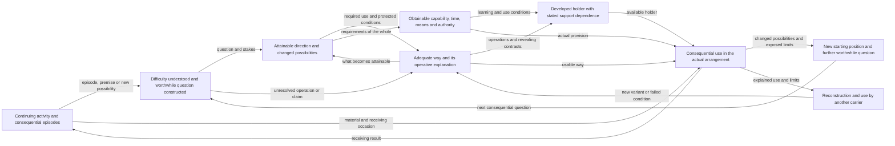

# SOURCE_FILE: Development DPF Suite/README.md
---
# Development DPF Suite

> Methods for constructing, realizing and continuing development, and for providing the work that makes it possible.

**Development DPF Suite, 12 October 2026.** The membership below identifies the product series in this collection; each linked publication retains its own edition and conditions of use.

This Suite is for people developing themselves, leaders and participants changing organizations, providers helping others develop, and people supporting a practice among independent carriers. It connects several disciplines. It is not one universal development Method, an organizational chart or a requirement to create an office.

Start with the [Reference](DEVELOPMENT-DPF-SUITE-REFERENCE.md) when the missing contribution is unclear. Open a known DPF or pattern directly when it already answers the question. A MethodDescription helps you perform work; neither reading it nor producing a plan establishes that the intended development occurred.

## Scope and identity

The ecosystem purpose is to make useful development attainable across personal, organizational, provider and cultural work. Development can begin with a faint difficulty rather than a known target practice. Its scope includes constructing a worthwhile attainable change, obtaining the needed contributions, realizing the change, continuing from the changed position, and improving the means of development when that improvement is worth its whole burden.

Routine work, learning or creating a Method, and implementing a selected practice can contribute without themselves constituting development. They also have valuable independent uses. A successful transition does not make endless activity obligatory: the development practice retains the ability to identify and pursue the next worthwhile attainable problem, while stopping an exhausted inquiry or ending an unhelpful intervention can be correct.

The Suite is a continuing collection of DPF product series. An edition belongs to its own product series; that series may belong to this Suite and another Suite. Inclusion does not copy the DPF, transfer ownership of its subject or make all its Methods necessary for every use. FPF remains the common source for transdisciplinary ontology and Methods, outside this collection of DPF series.

### Inclusion, review and removal

A proposed member must supply a developed, independently usable contribution to this ecosystem purpose, have an identifiable product-series rule and an obtainable admitted edition with source return, and connect usefully with another contribution or a distinct practitioner entry here. Shared vocabulary or one convenient citation is insufficient. A supporting source may remain outside the Suite when the narrower direct return is enough.

An inclusion decision takes effect only after those grounds are established for an actual product series. A loss of qualification requires a visible warning and a decision to repair, replace or remove the affected contribution; it does not silently erase membership. Removal preserves previous citation and use facts. If a product series ends or is reidentified as another series, the old belonging ends and a new inclusion is required.

The same Suite can add or remove members and change its Reference while preserving its purpose, inclusion rule and identity conditions. A replacement of those anchors outside this evolution rule identifies another Suite. A temporary one-member or empty state preserves this Suite only under an explicit preservation decision naming a restoration, review or retirement condition; no current cross-DPF answer is claimed in that state. Explicit retirement ends current belonging occurrences and preserves their historical facts. A later active collection requires a new constitution.

These rules promise no future maintenance service or continuous availability. Source changes, failed practitioner use and defeated connections reopen the affected guidance. Such review is not a demand to reevaluate every unchanged member.

## Membership

This table identifies the selected product-series contributions. Admission of new editions, constitution of new series and inclusion into the Suite remain distinct decisions. The question-led Reference explains their use; it does not determine membership.

| Product series | Contribution to the common use |
| --- | --- |
| [Development and Self-Development Practice](DEVELOPMENT-AND-SELF-DEVELOPMENT-PRACTICE-PRINCIPLES-FRAMEWORK.md) | Construct opportunities and directions, connect development undertakings, retain bounded advising, jointly provide independent directions and continue after a transition. |
| [Method Engineering](https://github.com/ailev/FPF/blob/main/Engineering%20DPF%20Suite/METHOD-ENGINEERING-PRINCIPLES-FRAMEWORK.md) | Obtain or develop Methods and make their use and renewal workable. [ME.6](../Engineering%20DPF%20Suite/METHOD-ENGINEERING-PRINCIPLES-FRAMEWORK.md#me6---compare-method-architecture-alternatives-and-simultaneous-enactment-conflicts) supplies the performance/provision comparison used here. |
| [Human Capability Development](https://github.com/ailev/FPF/blob/main/Development%20DPF%20Suite/HUMAN-CAPABILITY-DEVELOPMENT-PRINCIPLES-FRAMEWORK.md) | Construct and conduct human learning and development where the person must become capable, with practice, feedback, transfer and renewed demand. |
| [Organization Change Engineering](https://github.com/ailev/FPF/blob/main/Engineering%20DPF%20Suite/ORGANIZATION-CHANGE-ENGINEERING-PRINCIPLES-FRAMEWORK.md) | Construct and realize organizational arrangements, effective relations and feasible change alongside continuing work. |
| [Practice Implementation Support](PRACTICE-IMPLEMENTATION-SUPPORT-PRINCIPLES-FRAMEWORK.md) | Agree, construct, adapt and continue help for enacting an interpretable practice in its actual conditions. |
| [Leadership](LEADERSHIP-PRINCIPLES-FRAMEWORK.md) | Obtain contributions to joint work through substantive discussion, feasible agreement and preparation through first useful work. |
| [Community Management](COMMUNITY-MANAGEMENT-PRINCIPLES-FRAMEWORK.md) | Make participation, relationships, shared practice and joint contributions useful, including entry, provision, distributed organizing and continuation. |
| [Strategy](https://github.com/ailev/FPF/blob/main/Development%20DPF%20Suite/STRATEGY-PRINCIPLES-FRAMEWORK.md) | Choose worthwhile directions, complete offers, bounded commitments and programmes under changing conditions. |
| [Problem Structuring and Decision Support](https://github.com/ailev/FPF/blob/main/Development%20DPF%20Suite/PROBLEM-STRUCTURING-AND-DECISION-SUPPORT-PRINCIPLES-FRAMEWORK.md) | Obtain a defensible formulation, comparison and recommendation where the development choice needs them. |
| [Research Method Practice](https://github.com/ailev/FPF/blob/main/Development%20DPF%20Suite/RESEARCH-METHOD-PRACTICE-PRINCIPLES-FRAMEWORK.md) | Construct and conduct warranted inquiry and qualify claims, including research with an independent scientific end. |

Human Capability Development, Problem Structuring and Decision Support, Research Method Practice, Method Engineering and Organization Change Engineering are members of both Development and Engineering. The primary publication home is Development for HCD, PSD and RMP, and Engineering for ME and OCE. Each DPF edition has one full publication, reached from both Suite entries where membership is shared. The other five series are Development-only members. Engineering has direct external entries to the useful contributions of Development and Self-Development Practice, Community Management and Strategy. Shared membership does not copy a Method or make every useful dependency a member of both Suites.

Corporate governance, operations, accounting, marketing and other disciplines remain direct suppliers where the actual work needs their results. This first selection does not claim a smallest necessary set. A recurring whole-use or source responsibility can justify a later inclusion.

## Reference product

The **Development DPF Suite Reference** is a separately identified series of question-led Reference editions for these readers. It selects practical questions about this ecosystem, explains what the returned Methods or results contribute, and returns to the actual member editions, Core sources and the Suite account.

Its first edition is admitted only after its complete answers, source returns, boundaries and reader use are qualified. Later editions require a supported source-edition relation and admission while preserving these readers, use and source-return rules. A change to another ecosystem or a materially different independent use identifies another Reference series. Lost access or defeated advice requires the relevant warning, repair or retirement; publication and continuing maintenance are separate facts. Reference inclusion is a separate Suite decision and is not a prerequisite to direct use of an adequate DPF.

## Use and attribution

Read [Using FPF and its DPF Suites](https://github.com/ailev/FPF/blob/main/USING-FPF.md) with the available publications. Keep complete relevant patterns available when adapting them. A provider may contribute expertise without the recipient learning it; when the result is the recipient's own mastery, outsourced performance is not sufficient evidence.

Original framework content: Anatoly Levenchuk, with AI-assisted development and review. Original content is offered under [CC BY 4.0](https://creativecommons.org/licenses/by/4.0/); third-party material retains its own terms.


# SOURCE_FILE: Engineering DPF Suite/README.md
---
# Engineering DPF Suite

> Methods for difficult engineering decisions, explained as patterns you can use with your colleagues and AI assistants.

- **Author:** Anatoly Levenchuk, with AI-assisted development and review
- **Version:** 12 October 2026
- **Status:** Eternal alpha: already used in project analyses and development programmes, and revised as the methods and their evidence improve.
- **License:** [CC BY 4.0](https://creativecommons.org/licenses/by/4.0/) for original framework content; third-party material retains its own terms.
- **Publication:** [FPF repository](https://github.com/ailev/FPF)

You may be choosing an architecture, trying to make a working method reproducible, reorganizing a team, or deciding what to develop next. The Suite helps you find a useful way to tackle that particular difficulty and produce an answer you can act on.

A **DPF**, or **Domain Principle Framework**, collects methods for a field as a language of patterns. Each pattern explains a recurring difficulty, a way to address it, the result to obtain, and the conditions that affect its use. The methods are connected: one can help you discover or supply what another needs.

[FPF Core](https://github.com/ailev/FPF/blob/main/FPF-Spec.md) supplies the common concepts used across fields. The DPFs bring in the field's methods, competing approaches, examples and source evidence. This combination lets a team discuss technical choices, ways of working and organizational consequences in a shared language.

Using a DPF also means finding its place in the work you must actually perform. Which constituent abilities and resources are needed, what larger work is being done through the selected action, and what changes if that whole's conditions change? The [Method-vertical examples](ENGINEERING-DPF-SUITE-REFERENCE.md#engineeringreference251---what-must-be-available-through-the-method-vertical) show how a missing intermediate capability or shared resource changes the next move. A described Method can cover only part of what successful performance requires.

## Start with the problem in front of you

Describe the situation in ordinary words. For example:

> “We can buy a controller, commission one, or build it ourselves. How do we compare the alternatives, including the work and cost that each leaves to us?”

Open [SYSE.24 - Choose How the Project Will Obtain a Needed Engineering Result](SYSTEMS-ENGINEERING-PRINCIPLES-FRAMEWORK.md#syse24---choose-how-the-project-will-obtain-a-needed-engineering-result). It helps you compare complete ways to obtain the result: equipment alone, integration work, operating support, capability, access and eventual replacement can all change the choice. Your first useful result may be a defensible comparison or a precise question to put to a supplier.

Use a pattern's **Problem frame** to check that it fits. Its **Solution** gives the working moves; the example shows how they fit a case, and the checklist helps inspect your result. Bring in another pattern when you need its answer. You can begin from a result your project already has.

You can read this way yourself, use a pattern in a working meeting, or ask an AI assistant to help apply it. You do not need to read every framework before starting.

You can ask an assisting agent to explain an answer or give feedback in ordinary language, without FPF terminology. For example: “Explain this and comment on my proposal without FPF jargon; use the language of my work.” The patterns can guide the reasoning while the answer uses familiar words.

## Choose a DPF

The Suite has 24 member DPF series. Their full publications contain 387 pattern bodies (11.337 M characters). Start with the working question nearest to yours. Each linked publication provides its full searchable pattern index; shared members retain one full file in their declared publication home.

### Published DPFs

Each size covers the full linked Markdown file, including spaces and markup. 1 M = 1,000,000 Unicode characters; each line break counts as one.

| What you are trying to do | Published DPF | A result it can help you obtain |
| --- | --- | --- |
| Bring about or change an engineered system, from its intended use to working integration and continued development. | [Systems Engineering](SYSTEMS-ENGINEERING-PRINCIPLES-FRAMEWORK.md) - 53 patterns, 1.775 M characters | A system boundary, architecture decision, comparison of ways to obtain a result, usable composition of independently released components, integration plan, or justified release decision. It also covers general Platform Engineering, a substantial software delivery and reliability profile, and eleven Methods for engineering agent work and support, with human and technical realizations. |
| Choose, explain, test or improve a way of working, or develop a pattern language from source knowledge. | [Method Engineering](METHOD-ENGINEERING-PRINCIPLES-FRAMEWORK.md) - 25 patterns, 0.951 M characters | An explicit method, a mathematical comparison or construction of a changed way of working, a useful description or support arrangement, evidence about fit, transfer and practical value, or a source-based contribution to a method description in pattern-language form. |
| Change how an organization contributes, assigns work and enables people and other performers to act. | [Organization Change Engineering](ORGANIZATION-CHANGE-ENGINEERING-PRINCIPLES-FRAMEWORK.md) - 17 patterns, 0.692 M characters | A compared organizational arrangement, clarified assignments and authority, a supported change, or a decision about its consequences. |
| Work out what the problem is, compare possible directions, or prepare a recommendation. | [Problem Structuring and Decision Support](../Development%20DPF%20Suite/PROBLEM-STRUCTURING-AND-DECISION-SUPPORT-PRINCIPLES-FRAMEWORK.md) - 17 patterns, 0.719 M characters | Several useful problem formulations, decision alternatives, a comparison under uncertainty, or a recommendation with its grounds and limits. |
| Create, perform, teach or develop music and dance practices. | [Music and Dance Practice Engineering](MUSIC-AND-DANCE-PRACTICE-ENGINEERING-PRINCIPLES-FRAMEWORK.md) - 22 patterns, 0.969 M characters | A performance or practice design, a useful observation, a transmission method, or a choice about the practice's next development. |
| Recognize, represent, vary, perform, teach or observe rhythmic relations. | [Embodied Rhythmics](EMBODIED-RHYTHMICS-PRINCIPLES-FRAMEWORK.md) - 14 patterns, 0.268 M characters | A specific rhythmic correction, usable representation or variant, coordinated performance, representative exercise, bounded capability probe or observation. Its connected uses obtain cultural transmission and development contributions from the relevant MDPE methods. |
| Understand and change the bodily contribution to a familiar human movement. | [Somatic Movement Modeling](SOMATIC-MOVEMENT-MODELING-PRINCIPLES-FRAMEWORK.md) - 5 patterns, 0.068 M characters | A model and correction attempt connecting experience, regulation and result; a needed bodily distinction, controllable change, coordination or support transition. Movement technique and suitable physical demands remain prerequisites. |
| Keep an operation working while demand, queues, capacity, commitments, aims and evidence change. | [Operations Management](OPERATIONS-MANAGEMENT-PRINCIPLES-FRAMEWORK.md) - 28 patterns, 0.898 M characters | A bounded admission or continuation decision, queue or constraint treatment, capacity and service account, operating-method improvement, quality response, simultaneous-work reconciliation, cultural-continuation decision, meaningful aim or reasoned performance assessment. |
| Explain how work uses resources and how that use appears in money, forecasts and performance accounts. | [Management Accounting](MANAGEMENT-ACCOUNTING-PRINCIPLES-FRAMEWORK.md) - 9 patterns, 0.161 M characters | A resource and cost model, capacity account, cost allocation, reconciliation, forecast, margin explanation or assessment of accounting incentives. |
| Establish whose financial position is described, what can change it and how a financial service contributes to a participant's result. | [Financial Domain Modeling](FINANCIAL-DOMAIN-MODELING-PRINCIPLES-FRAMEWORK.md) - 5 patterns, 0.103 M characters | A model of parties, rights and obligations; conditional contractual flows; an established financial effect; or a connection between a service and its use. |
| Value investments, arrange finance, preserve liquidity or manage financial exposure. | [Corporate Finance](CORPORATE-FINANCE-PRINCIPLES-FRAMEWORK.md) - 22 patterns, 0.582 M characters | An investment valuation, financing comparison, liquidity response, hedge, treasury action or financial recommendation. |
| Connect economic plans, form feasible exchanges and commitments, or change resource-use and institutional arrangements. | [Economic Reasoning and Coordination](ECONOMIC-REASONING-AND-COORDINATION-PRINCIPLES-FRAMEWORK.md) - 10 patterns, 0.131 M characters | A grounded calculation, price response, exchange proposal, commitment or adaptation arrangement, shared-resource rule, institutional change or total-use comparison after an efficiency gain. |
| Explain dependence, spread, competing variants and the consequences of protective action. | [Defense and Transmission Modeling](DEFENSE-AND-TRANSMISSION-MODELING-DPF.md) - 9 patterns, 0.157 M characters | A participant comparison, transmission or interaction model, selection decomposition, or protective-action comparison grounded in the work and its available capabilities. |
| Establish corporate rights and powers, make a governing decision, protect a right or improve governance practice. | [Corporate Governance](CORPORATE-GOVERNANCE-PRINCIPLES-FRAMEWORK.md) - 17 patterns, 0.272 M characters | An authority answer, usable disclosure or review, a corporate act, a rights-protection result, an effective arrangement or a supported change to governance methods and culture. |
| Handle an administrative request, resolve a difficult case, or improve the arrangement providing the service. | [Organization Administration](ORGANIZATION-ADMINISTRATION-PRINCIPLES-FRAMEWORK.md) - 15 patterns, 0.298 M characters | Usable provision, a resolved exception, reconciled obligations and records, or a choice about controls, provider contributions and administrative burden. |
| Preserve or restore required equipment functioning, and manage the policies, support and programme that make maintenance useful. | [Maintenance Engineering and Management](MAINTENANCE-ENGINEERING-PRINCIPLES-FRAMEWORK.md) - 16 patterns, 0.242 M characters | A qualified condition account, supported policy or intervention recommendation, feasible protected work and return to use, or a justified information, programme, Method or practice decision. Advice can be complete before repair. |
| Compare continued use, renewal, replacement or other changes for one asset, an interacting system or a portfolio. | [Engineering Asset Management](ENGINEERING-ASSET-MANAGEMENT-PRINCIPLES-FRAMEWORK.md) - 16 patterns, 0.262 M characters | An applicable asset account, supported alternatives or programme recommendation, feasible timing, an asset decision, or a choice about improving asset-management arrangements, methods or culture. |
| Develop a person's capability, design learning for a future audience, or evaluate instructional material. | [Human Capability Development](../Development%20DPF%20Suite/HUMAN-CAPABILITY-DEVELOPMENT-PRINCIPLES-FRAMEWORK.md) - 29 patterns, 1.134 M characters | A supported demand, target or profile; a compared personal programme or whole learning-product design; feasible individual and group practice; performance, transfer or retention evidence; a continuing-development decision, or an instructional-material evaluation. |
| Understand a customer's situation, develop an offer, and organise the work needed to fulfil it. | [Marketing](MARKETING-PRINCIPLES-FRAMEWORK.md) - 14 patterns, 0.381 M characters | An answer to a customer question, an understandable and feasible choice, help suited to the customer's use, or a programme for selected organisations with evidence about cost, contribution and repeatability. |
| Decide whether research is needed, conduct it, examine its conclusions or improve its methods. | [Research Method Practice](../Development%20DPF%20Suite/RESEARCH-METHOD-PRACTICE-PRINCIPLES-FRAMEWORK.md) - 9 patterns, 0.483 M characters | An answer from existing evidence or a justified research plan; a protocol and record of research performed; an analysis, credibility judgement or corpus synthesis with its limits; a revised claim or question for another practice; or a choice to retain or improve the research method. |
| Connect separately governed meanings for a receiving use, qualify a model, handle semantic change or maintain shared modules. | [Semantic Integration Engineering](SEMANTIC-INTEGRATION-ENGINEERING-PRINCIPLES-FRAMEWORK.md) - 12 patterns, 0.272 M characters | A bounded integration result, adequate model reuse or construction, affected-use repair or revalidation, or a sufficient interface agreement or modular-commons arrangement. |
| Help someone follow why an outcome occurred, how a calculation works, or why a recommendation follows. | [Explanation Design](EXPLANATION-DESIGN-PRINCIPLES-FRAMEWORK.md) - 6 patterns, 0.132 M characters | A useful explanatory question, an account with its grounds, a worked example, coordinated text and diagrams, a repaired exchange, or a supported choice about improving an explanation. Includes instructional, technical and advisory, and human–AI profiles. |
| Notice consequential omissions, preserve answer meanings and coordinate checks in human, AI or mixed work. | [Checklist](CHECKLIST-PRINCIPLES-FRAMEWORK.md) - 6 patterns, 0.148 M characters | Useful questions, an interpretable form, a workable occasion, grounded answers, a shared conclusion, or a bounded judgement about a criterion and its checking means. |
| Design or change access to documentary knowledge for a person, team or assisting agent. | [Knowledge-Corpus Access Engineering](KNOWLEDGE-CORPUS-ACCESS-ENGINEERING-PRINCIPLES-FRAMEWORK.md) - 11 patterns, 0.239 M characters | An access design that connects search and synthesis to readable sources, keeps updates coherent and is tested on the work it must support. |

The word *engineering* includes physical equipment, factories, laboratories, buildings, robots and software, as well as the means needed to develop them. A platform can be a manufacturing or laboratory platform. The software profile addresses its particular delivery and reliability difficulties.

When your question crosses fields, open the [Suite Reference](ENGINEERING-DPF-SUITE-REFERENCE.md). It provides a detailed question index and worked cases, including [direct software-platform questions](ENGINEERING-DPF-SUITE-REFERENCE.md#engineeringreference15---resolve-a-software-platform-difficulty) for measurement, alerts, release exposure, recovery and repetitive work. The [instructional-material questions](ENGINEERING-DPF-SUITE-REFERENCE.md#engineeringreference113---evaluate-instructional-material-for-its-intended-use) lead to evaluation-specification construction and material evaluation; the [research preparation and trace questions](ENGINEERING-DPF-SUITE-REFERENCE.md#engineeringreference128---make-research-executable-and-inspect-its-course) lead to the RMP publication's operationalization and research-trace methods. When combining methods, match the result one supplies to what another needs and check their conditions of use. It also gives direct entries for [settling an HCD Method's supported use](ENGINEERING-DPF-SUITE-REFERENCE.md#engineeringreference112---develop-a-practice-or-a-persons-capability) and [analyzing a research claim or choosing a relevant credibility examination](ENGINEERING-DPF-SUITE-REFERENCE.md#engineeringreference129---analyze-a-claim-or-examine-its-credibility). For retaining or changing a research Method and returning its consequences, use [the research-Method entry](ENGINEERING-DPF-SUITE-REFERENCE.md#engineeringreference130---retain-or-improve-a-research-method).

For preserving or restoring equipment functioning, use the [maintenance question index](ENGINEERING-DPF-SUITE-REFERENCE.md#engineeringreference125---maintain-equipment-and-manage-maintenance) or the [PS17 advice-to-selected-work example](ENGINEERING-DPF-SUITE-REFERENCE.md#engineeringreference10---can-we-recommend-a-repair-before-it-is-ready-to-begin). To compare continued use, renewal, replacement or withdrawal by value, cost, risk and service, use the [asset-management question index](ENGINEERING-DPF-SUITE-REFERENCE.md#engineeringreference126---choose-how-to-use-and-change-engineered-assets). EAM provides both a [single-asset comparison](ENGINEERING-ASSET-MANAGEMENT-PRINCIPLES-FRAMEWORK.md#eam-asset---compare-continued-use-and-change-for-one-asset) and a [programme choice under shared constraints](ENGINEERING-ASSET-MANAGEMENT-PRINCIPLES-FRAMEWORK.md#eam-combination---choose-asset-work-under-shared-constraints). Choose by the result your question needs; either practice can concern one asset or many.

For a cost model, operating forecast or reconciliation of profit and cash, use the [management-accounting questions](ENGINEERING-DPF-SUITE-REFERENCE.md#engineeringreference116---explain-resource-use-costs-and-operating-accounts). For parties, rights, contractual events or the effects of financial actions, use the [financial-modeling questions](ENGINEERING-DPF-SUITE-REFERENCE.md#engineeringreference117---model-financial-positions-and-effects). For valuation, funding, liquidity or treasury action, use the [corporate-finance questions](ENGINEERING-DPF-SUITE-REFERENCE.md#engineeringreference118---value-investments-arrange-finance-and-manage-liquidity).

For economic plans that need to work together, use the [economic-coordination questions](ENGINEERING-DPF-SUITE-REFERENCE.md#engineeringreference119---coordinate-economic-plans-exchanges-and-shared-resources). The [venture example](ECONOMIC-REASONING-AND-COORDINATION-PRINCIPLES-FRAMEWORK.md#eco-venture---turn-a-useful-idea-into-a-feasible-service-arrangement) connects exchange discovery, calculation, commitments and adaptation; the shared-resource and efficiency examples show different combinations and stopping points.

For corporate authority, rights, board and committee work, disclosure or a decision, use the [corporate-governance questions](ENGINEERING-DPF-SUITE-REFERENCE.md#engineeringreference123---make-corporate-decisions-and-sustain-governing-contributions). The [interested-party transaction](CORPORATE-GOVERNANCE-PRINCIPLES-FRAMEWORK.md#cgov-conflicted-matter---bring-an-interested-party-transaction-to-a-corporate-decision) connects several contributions without treating an expert opinion as the corporate act.

For a rhythmic difficulty, use the [rhythm questions](ENGINEERING-DPF-SUITE-REFERENCE.md#engineeringreference110---work-with-rhythmic-relations-in-performance-and-learning). The [partnered-variation example](EMBODIED-RHYTHMICS-PRINCIPLES-FRAMEWORK.md#rhy-card-01--make-a-variation-work-with-a-partner) connects recognizing a difficulty, preserving continuing movement, arranging cues and returning to the whole performance.

For a bodily correction that must work during a whole movement, use the [somatic modeling questions](ENGINEERING-DPF-SUITE-REFERENCE.md#engineeringreference111---model-and-change-the-bodily-contribution-to-movement). They distinguish an unclear bodily relation, an unavailable adjustment and a combination that breaks during changing support. The [connected SOM entries](SOMATIC-MOVEMENT-MODELING-PRINCIPLES-FRAMEWORK.md#somatic-movement-modeling-dpf-readme) lead back to the receiving action and its concurrent demands.

For an explanation that someone must understand and use, start with the [explanation questions](ENGINEERING-DPF-SUITE-REFERENCE.md#engineeringreference114---make-an-explanation-understandable-and-usable). They distinguish the grounds for an account, its expression, the help a recipient needs and whether further repair is worthwhile.

For a practice whose spread or protective response changes the work, use the [dependence and protection questions](ENGINEERING-DPF-SUITE-REFERENCE.md#engineeringreference120---model-dependence-spread-and-protective-action). The [review-capacity example](ENGINEERING-DPF-SUITE-REFERENCE.md#engineeringreference15---can-protective-review-work-with-the-capacity-we-have) connects a modeled protective effect to the operating capacity and other commitments needed to obtain it.

For a checklist that misses a consequential question or yields reassuring entries without adequate grounds, use the [checklist questions](ENGINEERING-DPF-SUITE-REFERENCE.md#engineeringreference18---select-and-use-checklists-without-losing-the-work-question). The [Checklist applications](CHECKLIST-PRINCIPLES-FRAMEWORK.md#applications) connect local checking with shared work, change and Method improvement.

For a person or technical agent choosing how to obtain a result, open the [agent engineering family](SYSTEMS-ENGINEERING-PRINCIPLES-FRAMEWORK.md#syse-llm-path--choose-and-use-a-way-to-complete-the-task). Its first use compares complete ways to calculate 347 × 6 and reaches the used answer; repeated assistance, input or control failures enter their corresponding constructors. The [connected Reference answer](ENGINEERING-DPF-SUITE-REFERENCE.md#engineeringreference19---make-an-available-contribution-work-in-the-whole-task) then works support-selection diagnostics and a comparison of manual, rule and learning arrangements, alongside prediction, timely bodily action and reusable calculation. Its bounded structure descriptions and separate demonstrations explain conditional availability after those practical uses.

For learning that depends on explanation, varied examples, bodily coordination or participation in work, use HCD's [connected learning cases](../Development%20DPF%20Suite/HUMAN-CAPABILITY-DEVELOPMENT-PRINCIPLES-FRAMEWORK.md#hcdapplication10---combine-explanation-experience-and-participation-in-a-changing-practice). They show how to choose and combine the next learning action for language, partnered movement, a clerk's work and an engineering team.

## Looking for development recommendations?

Open [Development and Self-Development Practice](../Development%20DPF%20Suite/DEVELOPMENT-AND-SELF-DEVELOPMENT-PRACTICE-PRINCIPLES-FRAMEWORK.md) for development-specific construction and advice. Opportunity construction and bounded advising remain independently usable; [DOCA.9](../Development%20DPF%20Suite/DEVELOPMENT-AND-SELF-DEVELOPMENT-PRACTICE-PRINCIPLES-FRAMEWORK.md#doca9---construct-and-sustain-a-connected-development-undertaking) connects a full undertaking and further development. The [Development Suite Reference](../Development%20DPF%20Suite/DEVELOPMENT-DPF-SUITE-REFERENCE.md) helps locate the missing contribution when it is not yet clear.

If useful opportunities are missing, start with [DOCA.1](../Development%20DPF%20Suite/DEVELOPMENT-AND-SELF-DEVELOPMENT-PRACTICE-PRINCIPLES-FRAMEWORK.md#doca1---bound-the-development-opportunity-inquiry) or the first missing construction result in its pattern index. To establish the terms of help from an adviser, use [DOCA.7](../Development%20DPF%20Suite/DEVELOPMENT-AND-SELF-DEVELOPMENT-PRACTICE-PRINCIPLES-FRAMEWORK.md#doca7---bound-the-development-direction-advising-engagement). When the inputs and service boundary are already adequate, go directly to the missing comparison or recommendation method: [PSD.13](../Development%20DPF%20Suite/PROBLEM-STRUCTURING-AND-DECISION-SUPPORT-PRINCIPLES-FRAMEWORK.md#psd13---prepare-and-return-a-decision-support-recommendation) may be enough. [DOCA.8](../Development%20DPF%20Suite/DEVELOPMENT-AND-SELF-DEVELOPMENT-PRACTICE-PRINCIPLES-FRAMEWORK.md#doca8---requalify-changed-development-opportunities) helps requalify opportunities after their premises change.

For a particular person's programme comparison, use [HCD.2](../Development%20DPF%20Suite/HUMAN-CAPABILITY-DEVELOPMENT-PRINCIPLES-FRAMEWORK.md#hcd2---compose-and-compare-human-capability-development-programmes-for-later-work) once the relevant demand, starting performance, support and candidate programmes are available. Use [HCD.28](../Development%20DPF%20Suite/HUMAN-CAPABILITY-DEVELOPMENT-PRINCIPLES-FRAMEWORK.md#hcd28---construct-and-revise-a-whole-learning-product-for-a-future-audience) to construct or revise a learning product for a future audience. The Reference shows [how this construction contributes to advice for the programme author](ENGINEERING-DPF-SUITE-REFERENCE.md#engineeringreference112---recommend-a-programme-before-the-learners-are-known).
For example, “What should our engineering team learn or change over the next four months?” calls for evidence about the work it needs to perform, present limits, feasible alternatives and opportunity costs. A course is one possible response. The inquiry can also reveal a method, tooling or organizational change that would help more. The Reference explains [how to connect advice with those domain results](ENGINEERING-DPF-SUITE-REFERENCE.md#engineeringreference11---how-do-we-recommend-a-development-direction).

## Work with an AI assistant

Give the assistant access to FPF Core and the relevant DPF files. Tell it about the actual project, the decision you face, your constraints and the evidence available. Ask it to read the patterns it uses.

A useful starting request is:

> Help me work through this situation using FPF and the relevant Engineering DPFs: [describe the situation]. Identify the question we need to answer now, select the pattern that fits it, and help produce the next usable result. Explain the reasoning in ordinary engineering language, show the PatternIDs you used, and say which missing facts could change the answer.

Inspect the answer against the pattern and your project evidence. You and the other participants supply observations, specialist judgement and the authority to make real decisions. The assistant can help search, compare, draft and question the reasoning.

## What to read next

| You need... | Use... |
| --- | --- |
| A quick introduction and a first attempt with the Suite | This README. |
| A precise starting pattern, or a worked example involving several fields | [Engineering DPF Suite Reference](ENGINEERING-DPF-SUITE-REFERENCE.md). |
| The method itself, its example, checks and source discussion | The selected DPF's pattern body. Its Readme gives examples within that field. |
| An explanation of a shared FPF concept or general reasoning method | [FPF Core](https://github.com/ailev/FPF/blob/main/FPF-Spec.md). |
| A programme of study, exercises and feedback to build your abilities | An instructional Guide or a separately designed development programme. The Reference is organized for lookup while you work. |

The README introduces the Suite. The Reference helps you find and combine methods. Full pattern bodies remain the place to inspect what a method asks you to do.

## Suite scope and membership

Human Capability Development, Problem Structuring and Decision Support, Research Method Practice, Method Engineering and Organization Change Engineering also belong to the Development DPF Suite. The first three have their full publication home there; Method Engineering and Organization Change Engineering retain their full home here. Both Suite entries reach those same files. [Community Management](../Development%20DPF%20Suite/COMMUNITY-MANAGEMENT-PRINCIPLES-FRAMEWORK.md), [Strategy](../Development%20DPF%20Suite/STRATEGY-PRINCIPLES-FRAMEWORK.md) and [Development and Self-Development Practice](../Development%20DPF%20Suite/DEVELOPMENT-AND-SELF-DEVELOPMENT-PRACTICE-PRINCIPLES-FRAMEWORK.md) remain direct external sources for useful engineering contributions.

Engineering DPF Suite brings together domain pattern languages for developing engineered systems and the work, organizations and capabilities needed for them. It serves practitioners choosing and improving methods across these fields, using FPF's shared concepts.

**Current scope.** Under this purpose, the Suite includes the DPF series named in [Published DPFs](#published-dpfs), together with the [Engineering DPF Suite Reference](ENGINEERING-DPF-SUITE-REFERENCE.md) series. This section and the declared list are the current Suite identity and membership account. Each product keeps its own field boundary, readers, methods and dated editions. The list links available editions; the ecosystem catalogue describes the same products alongside the other FPF publications.

Include a DPF when its accepted product boundary and published pattern language supply a useful contribution to this common purpose, its relevant FPF dependencies are stated, and readers can reach its admitted edition and conditions of use. Record inclusion by updating this declared list when that product decision takes effect. A first accepted publication can implement the product and Suite-inclusion decisions together. Subsequent editions are admitted under the product's own rules; changing an edition or its availability leaves the product's Suite membership in place.

Review the scope when new practitioner needs, changed foundations or a product's limitations alter its contribution. A limitation calls for an explicit warning and a decision to repair, remove or replace the affected contribution. A dated removal ends membership; preserve the earlier fact for readers of older editions. If a product series ends or changes identity, its former membership ends and the replacement needs an inclusion decision.

Adding, removing or revising products preserves this Suite while its common purpose, inclusion rules and identity conditions remain. A change outside that scope identifies another Suite. If the shared purpose can no longer be served, decide whether to restore the collection or retire it; an empty or one-product interval needs an explicit restoration or retirement decision. State any continuing maintenance or future-availability commitment separately from this scope decision.

## Publication scope

The [FPF repository's Suite table](https://github.com/ailev/FPF#engineering-dpf-suite) gives the ecosystem view of these publications. When an available pattern does not cover a result your project needs, obtain that result from the relevant practice. The date at the start of each DPF identifies the publication you are using.

## Sources, revisions and citation

The DPFs bring together useful research and practitioner approaches, including disagreements and known limits. Source discussions explain what an approach contributes and where its evidence stops. The methods continue to change as better answers become available.

For consequential decisions, keep the publication date and the evidence behind the result you used. Revisit the affected conclusion when the situation or a relied-on source changes.

Cite the collection as: Anatoly Levenchuk. *Engineering DPF Suite*. [FPF repository](https://github.com/ailev/FPF). Include the date shown at the start of this file.

For a particular method, cite its DPF, PatternID, title and the date shown in that publication.

## License and reuse

The original FPF and DPF content by Anatoly Levenchuk, including the Engineering DPF Suite and Narrativization DPF, is available under [CC BY 4.0](https://creativecommons.org/licenses/by/4.0/): you may share and adapt it, including commercially, with attribution, a license link and an indication of changes. See the [licensing scope](https://github.com/ailev/FPF/blob/main/LICENSING.md) for the full notice and third-party and software boundaries.

You choose the license for your own original DPF or LPF. Using FPF methods or its publication form does not impose CC BY on your work. When sharing licensed FPF or DPF text under CC BY 4.0, preserve its attribution and comply with the license. Where your use needs no copyright permission, including under an applicable exception, these conditions do not apply. The license has no ShareAlike requirement.


# SOURCE_FILE: Foundational Thinking DPF Suite/README.md
---
# Foundational Thinking DPF Suite

> Mathematical, physical and computational methods for entering unfamiliar problems, using their results and developing better ways of working.

- **Author:** Anatoly Levenchuk, with AI-assisted development and review
- **Date:** 16 September 2026
- **Status:** Eternal alpha. All five member DPFs are available and evolve with their methods, sources and uses.
- **Publication:** [FPF repository](https://github.com/ailev/FPF)

**Start with the [Suite Reference](FOUNDATIONAL-THINKING-DPF-SUITE-REFERENCE.md)** when you need to choose among these contributions or connect them. Open a DPF directly when you already know the contribution you need.

## Start from a connected problem

You may know formulas or individual operations and still be unable to connect them into an answer. The Suite helps make those connections: what information a construction must retain, what another method can do with its result, and where a changed question makes earlier work worth revisiting.

| What you need to do | Follow the worked connection |
| --- | --- |
| Split or change a calculation while keeping its answer meaningful | [Change a combining rule](MATHEMATICAL-PRACTICE-DPF.md#mp-combine-results---change-a-rule-so-that-separately-obtained-results-can-be-combined): expose the lost distinction, construct a summary and operation, prove their compatibility, then use and revise them. |
| Decide a question without reconstructing every hidden detail | [Obtain a sufficient answer](MATHEMATICAL-MODELING-PRACTICE-DPF.md#mmp-sufficient-answer---answer-the-working-question-before-reconstructing-every-detail): expose what reduction loses, bound its effect, interpret the result and obtain more where it changes the answer. |
| Decide whether another observation will improve an action | [Connect intervention, information and choice](MATHEMATICAL-MODELING-PRACTICE-DPF.md#mmp-intervention-and-information---decide-whether-an-observation-will-improve-the-next-action): derive the relevant consequences, compare the report's benefit with its burden, and make the subsequent choice depend only on timely information. |
| Replace expensive component models and still obtain a usable joint answer | [Replace and couple models](MATHEMATICAL-MODELING-PRACTICE-DPF.md#mmp-replace-and-couple---use-cheaper-models-without-losing-the-combined-answer): retain the required responses, connect their meanings and error bounds, and refine only what prevents the answer. |
| Develop a physical prediction and decide which observation matters | [Connect physical accounts and observations](PHYSICAL-THINKING-DPF.md#ph-predict-and-distinguish---develop-a-physical-prediction-and-the-test-it-needs): constrain the law, derive a consequence, compare the observations that matter and revise the affected premise. |
| Construct an algorithm and adapt it when the required answer changes | [Keep construction and output consistent](COMPUTATIONAL-THINKING-DPF.md#cp-answer-under-limits---obtain-the-answer-the-work-needs-within-available-resources): construct the recurrence, share results, use bounds where they reduce search, and revisit what may be discarded. |
| Carry a changed instruction through several expressions | [Keep meaning and change connected](NOTATIONAL-ENGINEERING-DPF.md#nt-change-together---carry-a-changed-request-through-several-representations): recover references and interpretation, expose translation losses, and update the affected expressions. |
| Connect mathematics to changes in working methods | [Understand and change a construction](FOUNDATIONAL-THINKING-DPF-SUITE-REFERENCE.md#foundationalreference32---understand-and-change-a-construction): retain the distinction a later operation uses and connect it to Method Engineering. |
| Make reasoning available to other contributors and develop its next use | [Continue and distribute thinking](FOUNDATIONAL-THINKING-DPF-SUITE-REFERENCE.md#foundationalreference35---continue-and-distribute-thinking): recover a missing relation, arrange explanation or support, change the work and preserve the method for further development. |


These examples use several patterns together. Their short sequences show dependencies; worked explanations give calculations and return points. Start at a later contribution when its inputs are available. Each DPF's Table of Contents also gives direct help for other questions.

The [vertical of ongoing work](FOUNDATIONAL-THINKING-DPF-SUITE-REFERENCE.md#foundationalreference39---keep-the-vertical-visible-while-doing-the-work) asks a complementary question: what larger work is being performed through this action now, and what constituent abilities and resources make it possible? It helps locate a missing intermediate Method or capability even when the elementary operations and the intended whole are familiar.

## Use the publications

For use with an agent, follow [Using FPF](../USING-FPF.md). Copy this whole folder beside `FPF-Spec.md` in your project's reference folder. The root [ecosystem Readme](../Readme.md) gives the other files to copy and a paragraph for the agent's instructions. In GitHub, open an example above or a member link below.

## Publications

This is the public constitution and membership account for the Foundational Thinking DPF Suite. The following product series belong to it as of the date above.

Each size covers the full linked Markdown file, including spaces and markup. 1 M = 1,000,000 Unicode characters; each line break counts as one.

| Product series | Publication status | Useful contribution |
| --- | --- | --- |
| [Mathematical Thinking DPF](MATHEMATICAL-PRACTICE-DPF.md) | Published - 20 patterns, 0.477 M characters | Construct objects, operations and arguments; derive and use consequences. |
| [Mathematical Modeling DPF](MATHEMATICAL-MODELING-PRACTICE-DPF.md) | Published - 15 patterns, 0.509 M characters | Formulate questions, infer unknowns, construct causal comparisons, choose useful observations, construct continuing decisions, and change or combine models while retaining the needed answer. |
| [Physical Thinking DPF](PHYSICAL-THINKING-DPF.md) | Published - 10 patterns, 0.303 M characters | Construct physical accounts, derive their consequences, build observations and revise physical assumptions. |
| [Computational Thinking DPF](COMPUTATIONAL-THINKING-DPF.md) | Published - 14 patterns, 0.324 M characters | Construct and transform algorithms; connect their meaning, representations, resource requirements and interactions. |
| [Notational Engineering DPF](NOTATIONAL-ENGINEERING-DPF.md) | Published - 8 patterns, 0.219 M characters | Design, interpret, transform and coordinate expressions, including temporal and embodied notation. |
| [Foundational Thinking DPF Suite Reference](FOUNDATIONAL-THINKING-DPF-SUITE-REFERENCE.md) | Published | Choose and connect available contributions, understand their organization and locate a missing contribution. |

Computational Thinking develops algorithmics within computer science; numerical computation is one of its applications. Notational Engineering develops the expression conventions that make operations interpretable and usable. Current editions and this Reference are published together in this Suite folder.

[FPF](../FPF-Spec.md) supplies the common reasoning methods. The [Engineering DPF Suite](../Engineering%20DPF%20Suite/README.md) supplies collaborating domain methods, including Method Engineering and capability development. These publications can be used with this Suite without becoming its members.

## Purpose and continuity

The Suite is constituted for people and teams working with theories, models, specialists and AI: enter an unfamiliar question, develop and connect mathematical, physical and computational contributions, interpret the consequence, and use it to continue inquiry or change a way of working. Its members may also be used independently.

A DPF series qualifies for inclusion when it develops a substantial repertoire contributing to that purpose, has a usable public edition, and explains the results and conditions another contribution can use. Subject examples demonstrate that reach. A collection concerned only with a particular device or chapter of a science needs its corresponding narrower publication boundary.

An accepted architecture decision adds or removes a product series and updates this account. A later edition of an included series replaces the edition presented here when it retains the series' field purpose, identifies its changes, provides usable methods and source access, and states consequential limits. A substantially different field purpose requires a decision about the series itself. Changes to method details, pattern count, profiles or file arrangement can preserve the Suite's identity while its shared purpose continues.

If an edition becomes unavailable or cannot support a previously advised use, the Reference must expose that limitation when presenting the affected answer. Direct use of another known contribution can continue. If a series ceases to serve the shared purpose, the architecture decision settles repair, relocation or removal; earlier editions and the reasons for changed advice remain identifiable through publication history. Ending the shared purpose retires this Suite. A later collection with a different purpose needs its own constitution.

## The Reference and its editions

The Reference is separately constituted as a publication series belonging to this Suite. Its readers need a useful answer about selection, combination, shared architecture or an unavailable contribution. It returns to this membership account and to the publications that supply the answer. It is published as one Markdown file alongside the member DPFs.

A later Reference edition is admitted when its answers agree with the editions it presents, its available and planned contributions are distinguishable, and its readers can return to those sources. A different audience or use that defeats these conditions requires a decision about a different Reference series. A superseded or retired edition remains historical; its date alone cannot establish that its advice still applies.

## Rights and citation

Copyright © 2026 Anatoly Levenchuk. This account and the author's DPF publications are licensed under [Creative Commons Attribution 4.0 International](https://creativecommons.org/licenses/by/4.0/), except material carrying a separate notice. Cited sources retain their own rights. Independent authors choose the licenses for their own DPFs and LPFs.

Cite this account as: Anatoly Levenchuk. *Foundational Thinking DPF Suite*. [FPF repository](https://github.com/ailev/FPF). Include the date shown at the start of this file. For a method, also cite its DPF edition and PatternID.


# SOURCE_FILE: Readme.md
---
# FPF Library

**FPF Library** is the collection of the First Principles Framework project's own publications: **FPF Core**, **Domain Principle Frameworks (DPFs)**, their **Suites**, and accompanying References and usage materials.

> **AI-native declarative pattern languages for reasoning, engineering and development.** FPF gives people and AI agents a shared, precise language for Systems, Methods, architecture, Work, evidence, verification, decisions, improvement, and communication.

[**FPF Core Specification**](FPF-Spec.md) · [**Foundational Thinking DPF Suite**](Foundational%20Thinking%20DPF%20Suite/README.md) · [**Engineering DPF Suite**](Engineering%20DPF%20Suite/README.md) · [**Development DPF Suite**](Development%20DPF%20Suite/README.md) · [**Narrativization DPF**](Narrativization-and-Narrative-Studies-Principles-Framework.md)


**Author:** Anatoly Levenchuk, with AI-agent assistance

**License:** [CC BY 4.0](https://creativecommons.org/licenses/by/4.0/) for original framework content; third-party material retains its own terms.

**Status:** evolving publications; eternal alpha—already used in working projects and development programs while continuing to change.

This repository publishes the transdisciplinary **FPF Core** and domain pattern languages, available individually or in the **Foundational Thinking**, **Engineering** and **Development DPF Suites**. This Readme helps you choose among these publications. The [Readme inside FPF Core](FPF-Spec.md#first-principles-framework-fpf-readme) gives practical examples of using Core; the [Engineering Suite Readme](Engineering%20DPF%20Suite/README.md) helps you choose and combine its DPFs. The [Foundational Thinking Reference](Foundational%20Thinking%20DPF%20Suite/FOUNDATIONAL-THINKING-DPF-SUITE-REFERENCE.md) connects mathematical, physical, computational, modeling and notational contributions and explains their uses and limits. The [Development Suite Reference](Development%20DPF%20Suite/DEVELOPMENT-DPF-SUITE-REFERENCE.md) connects development undertakings with the Methods, capabilities, joint work and support they need.

The wider **FPF ecosystem** also includes other authors' DPFs and LPFs, tools, and services for using FPF.

## Read online or connect your agent

[**fpf.tools**](https://fpf.tools/) provides browser and read-only MCP access to the published FPF Library:

- [**Browse publications and patterns**](https://fpf.tools/publications) to read their contents and source passages.
- [**Search publication texts**](https://fpf.tools/search) by words, quoted phrases or pattern IDs.
- [**Connect through the MCP server**](https://fpf.tools/connect) to let an AI agent search and read the publications. The remote endpoint is `https://mcp.fpf.tools/mcp` (Streamable HTTP); public reading requires no API key.

See [source editions and update status](https://fpf.tools/status) for the revision currently available through the website and MCP.

[Uses and community projects](https://fpf.tools/in-use) is an editorial page on the website, separate from this Library distribution.

## Start here

Before selecting framework guidance, read and apply [Using FPF and its DPF Suites](USING-FPF.md). This instruction applies to project work, framework development, review and coordination. It explains how to find and read relevant content in the publications available to you, including when an interface cannot retrieve a large file.

For unfamiliar terminology or incomplete source access, [F.1](FPF-Spec.md#f1---find-and-select-sources-for-a-current-question) explains how to find inspectable material and return any remaining gap. When several patterns seem plausible, [E.11’s worked comparisons](FPF-Spec.md#e11462---resolve-a-first-pattern-ambiguity-with-a-worked-comparison) help recover the fact that changes the first needed result. Use an already known sufficient source directly.

When an AI agent assists you, put this requirement and the instruction's location in your project's `AGENTS.md` or equivalent instructions. If a reading test explicitly limits its reader to an isolated excerpt, use only the materials supplied for that test; do not add USING-FPF.md unless the test includes it.

FPF is designed for two complementary uses:

1. **AI-native, FPF-driven engineering work.** An AI agent can retrieve relevant patterns, compare their declared situations and questions, explain them in plain technical language, expose missing evidence or authority, and help produce the next useful result.
2. **Description and engineering of mixed human–AI work.** People can use the same language to describe which System is being changed, which Method is proposed, which Work is actually performed, which capabilities are available, what is assigned or permitted, who has decision authority, what evidence supports a claim, and what would reopen a decision.

FPF is not an agent framework, an agent runtime, or a software-coding methodology. It is a knowledge and reasoning framework that can guide work in manufacturing, construction, mechanical and electrical engineering, energy, robotics, laboratories, healthcare technology, education, embodied practice, software-intensive Systems, and other fields.

## Why an AI-native pattern language?

The FPF Core contains more than 300 interlinked transdisciplinary patterns. Reading and remembering the entire corpus is not a prerequisite for using it—and is rarely the best human entry mode. A capable AI agent can serve as a high-bandwidth reader of the pattern language: search the corpus, inspect a small set of plausible patterns, quote exact source passages when needed, and translate the relevant distinctions into the engineer's working language.

Instead of asking an agent to improvise from generic model priors, an FPF-driven setup gives it FPF Core and the relevant DPFs as explicit, inspectable references. The agent can then follow a maintained, plural account of current engineering thought, show which patterns and sources it used, and separate a source-grounded recommendation from plausible but unsupported advice.

The engineer supplies what the corpus cannot supply: the actual situation, domain knowledge, observations, constraints, stakes, local history, access to the engineered System, and any real assignment, permission, responsibility, or authority. The agent helps keep these claims distinct rather than silently inventing them.

This division of Work makes FPF useful as a common language between AI agents and **engineer–managers**: engineers who identify primarily as engineers but spend much of their day doing substantive management Work. They coordinate specialists and providers, negotiate architecture and interfaces, organize reviews and working meetings, compare alternatives and trade-offs, formulate strategies, make responsible decisions, preserve knowledge, and allocate Work among people, tools, robots, and AI. The term describes Work, not a corporate job title.

**AI-native does not mean AI-only.** It means that the architecture of the Work can be deliberately reconsidered around the different capabilities and limitations of humans, AI agents, tools, and other Systems. An AI-produced statement is not automatically a fact, evidence, permission, commitment, or decision. Each such relation must be established by its own basis.

## A declarative language, not a prescribed process

FPF and its DPFs are declarative pattern languages. Start from the **current working situation** and the **question that is current now**. Inspect the pattern whose declared Situation and Question match that difficulty. Use its distinctions, constraints, checks, result, and stop or reopen conditions to produce the smallest useful result—or an honest blocker.

Pattern numbers, file order, table-of-contents order, and the order in which examples are presented do not prescribe a project sequence. Several kinds of engineering Work may overlap. A real dependency still matters when one result cannot be used before another exists, but that dependency belongs to the concrete results and Work under consideration, not to a universal process imposed by the pattern language.

A constituent action can also perform several levels of work at once: updating a running total can be part of calculating a result and preparing a report. The encompassing purpose changes what that action must preserve. FPF helps [recover these connections](FPF-Spec.md#b15ew---recover-how-constituent-actions-enact-encompassing-work) and [compare a replacement in its encompassing uses](FPF-Spec.md#b15rs---evaluate-a-constituent-method-replacement-in-its-encompassing-uses); the Suite References give domain examples. Using a DPF still requires the relevant capabilities, coordination and resources throughout the needed vertical, including any intermediate contribution that must be learned or obtained.

An AI agent can therefore help choose the **next justified move** without pretending that the entire project follows one fixed sequence. The useful move may be a clarified question, an identified System, an architecture comparison, an evidence request, a decision record, a changed Method, a bounded Work plan, a source-grounded explanation, or an explicit stop because a necessary basis is missing.

## What is in the Library?

| Publication | What it contributes | Typical working questions |
| --- | --- | --- |
| [**FPF Core Conceptual Specification**](FPF-Spec.md) | A transdisciplinary language for entities and relations, Systems, Methods, Work, descriptions, claims, evidence, decisions, architecture, quality, improvement, cultural evolution, publication, and precise language. | What exactly are we discussing? What claim is being made? Which relation obtains? What may the evidence support? Which decision is current? What Work actually occurred? |
| [**Foundational Thinking DPF Suite**](Foundational%20Thinking%20DPF%20Suite/README.md) | Mathematical Thinking, Mathematical Modeling, Physical Thinking, Computational Thinking and Notational Engineering, with a Reference for their connected use. | How do we enter an unfamiliar problem, connect its different kinds of reasoning, use the result and change the way of working? |
| [**Engineering DPF Suite**](Engineering%20DPF%20Suite/README.md) | Published FPF-grounded domain pattern languages for engineering, operation, maintenance, organizational change, decision support, human development, and other practices, plus a Suite Reference for questions that draw on several DPFs. | Which System and use are current? Which architecture, interface, configuration, obtaining arrangement, Method, capability, verification result, or change is needed? |
| [**Development DPF Suite**](Development%20DPF%20Suite/README.md) | Methods for constructing, realizing and continuing development, and for providing the work that makes it possible, plus a question-led Reference. | What worthwhile attainable change is needed? Which contributions, preparation, joint work and support make it possible? What becomes possible next? |
| [**Narrativization and Narrative Studies DPF**](Narrativization-and-Narrative-Studies-Principles-Framework.md) | Patterns for turning selected source structure into a followable narrative while preserving recoverability, evidence limits, agency boundaries, viewpoint choices, and source return. Includes human and automated narrativization. | What source structure must survive the rendering? What may be compressed or reordered? Did a fluent narrative invent causality, agency, certainty, permission, or authority? |

### Foundational Thinking DPF Suite

The [Suite Readme](Foundational%20Thinking%20DPF%20Suite/README.md) introduces available members and connected examples. The [Reference](Foundational%20Thinking%20DPF%20Suite/FOUNDATIONAL-THINKING-DPF-SUITE-REFERENCE.md) explains their architecture and how to move between mathematical constructions, modeling and other contributions. Notational Engineering adds methods for making those contributions expressible, interpretable and usable together.

Larger questions need several patterns. [Changing a combining rule](Foundational%20Thinking%20DPF%20Suite/MATHEMATICAL-PRACTICE-DPF.md#mp-combine-results---change-a-rule-so-that-separately-obtained-results-can-be-combined) connects a counterexample, retained information, an operation and a proof. [Answering with incomplete model detail](Foundational%20Thinking%20DPF%20Suite/MATHEMATICAL-MODELING-PRACTICE-DPF.md#mmp-sufficient-answer---answer-the-working-question-before-reconstructing-every-detail) connects reduction, bounds, interpretation and further work. [Developing a physical prediction](Foundational%20Thinking%20DPF%20Suite/PHYSICAL-THINKING-DPF.md#ph-predict-and-distinguish---develop-a-physical-prediction-and-the-test-it-needs) links assumptions about an unknown physical law to a prediction, an observation that distinguishes alternatives, and revision when those assumptions change. [Constructing an algorithm within available resources](Foundational%20Thinking%20DPF%20Suite/COMPUTATIONAL-THINKING-DPF.md#cp-answer-under-limits---obtain-the-answer-the-work-needs-within-available-resources) connects decomposition, reused subcomputations, search bounds and recovery of the requested answers. [Carrying meaning through several expressions](Foundational%20Thinking%20DPF%20Suite/NOTATIONAL-ENGINEERING-DPF.md#nt-change-together---carry-a-changed-request-through-several-representations) connects interpretation, transformation, translation loss and the intended change. These sequences and worked explanations show how the pattern contributions depend on one another.

Publication sizes below include the complete linked Markdown text, including spaces and markup. 1 M = 1,000,000 Unicode characters; each line break counts as one.

#### Mathematical Thinking

The [Mathematical Thinking publication](Foundational%20Thinking%20DPF%20Suite/MATHEMATICAL-PRACTICE-DPF.md) contains twenty patterns and worked connections between their methods. The full publication is 0.477 M characters. Start with MP-FRAME when you have a working question but do not yet know which mathematics it needs. The Preface shows how to choose a representation, obtain and interpret a result, and revise the representation when the question changes. The individual bodies develop the mathematical constructions used along the way. This independently usable publication belongs to the Foundational Thinking DPF Suite. The [Suite Reference](Foundational%20Thinking%20DPF%20Suite/FOUNDATIONAL-THINKING-DPF-SUITE-REFERENCE.md) gives working combinations and explains how these methods connect with FPF and Method Engineering.

#### Mathematical Modeling

The [Mathematical Modeling publication](Foundational%20Thinking%20DPF%20Suite/MATHEMATICAL-MODELING-PRACTICE-DPF.md) contains fifteen general modeling methods and worked connections between them. The full publication is 0.509 M characters. Begin with the [Readme introduction](Foundational%20Thinking%20DPF%20Suite/MATHEMATICAL-MODELING-PRACTICE-DPF.md#mathematical-modeling---readme) when the working question has no mathematical formulation. The methods cover formulation, inference, prediction repair, intervention effects, counterfactual comparisons, observation design, sequential decisions, reduction, surrogates and model coupling. Readme and Preface show how one result supplies the next operation, how a changed question returns to its affected construction, and when an adequate answer permits stopping.

#### Physical Thinking

The [Physical Thinking publication](Foundational%20Thinking%20DPF%20Suite/PHYSICAL-THINKING-DPF.md) contains ten patterns and worked connections between their methods. The full publication is 0.303 M characters. Start with a physical question for which you need an account, a prediction, an observation or a revised assumption. The methods help constrain unknown laws, choose the effects to retain, derive how a system changes, relate possible microscopic states to collective behavior, use physical similarity and analogues, establish physical limits, and construct measurements and tests. The Preface shows how physical, mathematical and computational contributions work together, and which contribution to revisit when the physical situation changes.

#### Computational Thinking

The [Computational Thinking publication](Foundational%20Thinking%20DPF%20Suite/COMPUTATIONAL-THINKING-DPF.md) contains fourteen patterns for algorithmics within computer science. The full publication is 0.324 M characters. Its [Readme](Foundational%20Thinking%20DPF%20Suite/COMPUTATIONAL-THINKING-DPF.md#computational-thinking---readme) follows connections for translating programs, obtaining answers within resource limits, and sharing calculations while keeping request effects correct. The methods help construct and revise algorithms, control computation cost and error, preserve meaning when translating a program, and make interacting computations produce the required result. The Preface's worked example changes from finding one optimal solution to enumerating all of them. It shows which earlier pruning and reconstruction choices must change. Numerical computation is one application of these methods.

#### Notational Engineering

The [Notational Engineering publication](Foundational%20Thinking%20DPF%20Suite/NOTATIONAL-ENGINEERING-DPF.md) contains eight patterns for designing expressions and their use. The full publication is 0.219 M characters. Use the [connected examples](Foundational%20Thinking%20DPF%20Suite/NOTATIONAL-ENGINEERING-DPF.md#notational-engineering---readme) to follow a changed request through several representations, or keep a sequence usable when its reader or reference frame changes. The methods cover grouping and binding, interpretation, meaning-preserving transformation, translation losses, complementary representations, difficult reading operations, and temporal or embodied notation. The Preface follows a formula, graph and table through a changed request without overwriting independent observations.

### Development DPF Suite

The [Suite account](Development%20DPF%20Suite/README.md) identifies ten member DPF series and their inclusion and identity rules. The [Reference](Development%20DPF%20Suite/DEVELOPMENT-DPF-SUITE-REFERENCE.md) starts with the missing result: a development opportunity, a Method, human capability, joint contribution, a helping arrangement or another supplying discipline. Development is not exhausted by learning or implementing a selected practice; those contributions also have valuable independent uses.

| Domain pattern language | Publication status | What it covers |
| --- | --- | --- |
| [**Development and Self-Development Practice DPF**](Development%20DPF%20Suite/DEVELOPMENT-AND-SELF-DEVELOPMENT-PRACTICE-PRINCIPLES-FRAMEWORK.md) | Published - 11 patterns, 0.471 M characters | opportunities and directions; characterization; bounded advice; joint reachability and portfolios; a connected development undertaking and further development; and joint provision for independent purposes. |
| [**Method Engineering DPF**](Engineering%20DPF%20Suite/METHOD-ENGINEERING-PRINCIPLES-FRAMEWORK.md) | Published - 25 patterns, 0.951 M characters | choosing and recovering Methods from sources and observed Work; using mathematical constructions to compare and change ways of working; designing Method architectures, descriptions, complementary representations and supporting arrangements; testing coherence, situational fit, transfer and practical worth; maintaining variants and improving practice and culture; and constructing and refreshing MethodDescriptions in pattern-language form. |
| [**Human Capability Development DPF**](Development%20DPF%20Suite/HUMAN-CAPABILITY-DEVELOPMENT-PRINCIPLES-FRAMEWORK.md) | Published - 29 patterns, 1.134 M characters | human capability needed for later Work; demand and capability profiles; personal programmes and whole learning products for future audiences; individual and shared practice; learning through explanation, peer review and project comparison; group formation, regulation and shared rhythm; assessment, transfer and retention; providers and support; development portfolios and qualification; and characterization and evaluation of instructional material. |
| [**Organization Change Engineering DPF**](Engineering%20DPF%20Suite/ORGANIZATION-CHANGE-ENGINEERING-PRINCIPLES-FRAMEWORK.md) | Published - 17 patterns, 0.692 M characters | organizational contributions, roles and assignments; authority and interfaces; capability allocation; comparison and realization of organizational changes; participation and adoption; culture; and the effects of change on actual Work. |
| [**Practice Implementation Support DPF**](Development%20DPF%20Suite/PRACTICE-IMPLEMENTATION-SUPPORT-PRINCIPLES-FRAMEWORK.md) | Published - 5 patterns, 0.185 M characters | agreeing, constructing, adapting and continuing help for enacting an interpretable practice under its actual conditions, including selection of the needed human, AI, organizational or external contributions. |
| [**Leadership DPF**](Development%20DPF%20Suite/LEADERSHIP-PRINCIPLES-FRAMEWORK.md) | Published - 4 patterns, 0.148 M characters | contributions to joint work; substantive discussion; feasible agreement; and preparation through first useful work, with actual authority, refusal and capacity conditions. |
| [**Community Management DPF**](Development%20DPF%20Suite/COMMUNITY-MANAGEMENT-PRINCIPLES-FRAMEWORK.md) | Published - 16 patterns, 0.516 M characters | useful participation, relationships, shared practice and joint contributions; entry, provision, distributed organizing and continuation among independent carriers as well as organizations. |
| [**Strategy DPF**](Development%20DPF%20Suite/STRATEGY-PRINCIPLES-FRAMEWORK.md) | Published - 15 patterns, 0.423 M characters | finding worthwhile contributions and ways to obtain them; direction under uncertainty; options and scenarios; capabilities, dependencies and initiatives; investments and business models; commitments; and decisions to revise, pivot, pause or stop. |
| [**Problem Structuring and Decision Support DPF**](Development%20DPF%20Suite/PROBLEM-STRUCTURING-AND-DECISION-SUPPORT-PRINCIPLES-FRAMEWORK.md) | Published - 17 patterns, 0.719 M characters | problem formulations and participants; alternatives; values, uncertainty and consequences; comparison; recommendations; and follow-up. |
| [**Research Method Practice DPF**](Development%20DPF%20Suite/RESEARCH-METHOD-PRACTICE-PRINCIPLES-FRAMEWORK.md) | Published - 9 patterns, 0.483 M characters | qualifying a research question or answering it from existing sources; comparing approaches and selecting a design; operationalization and sampling; records and provenance; claim analysis and criticism; reproducibility, replication and triangulation; corpus synthesis; revision and return of knowledge contributions; and retention or improvement of research Methods. |

Human Capability Development, Problem Structuring and Decision Support, Research Method Practice, Method Engineering and Organization Change Engineering are shared with Engineering. Each has one full publication. HCD, PSD and RMP are located in Development; ME and OCE are located in Engineering. The two accounts link the same files.

### Engineering DPF Suite


The table lists the 24 member DPF series in the Suite. Each row gives the number of pattern bodies and the size of the full linked publication. Each DPF has a full pattern index.

| Domain pattern language | Publication status | What it covers |
| --- | --- | --- |
| [**Systems Engineering DPF**](Engineering%20DPF%20Suite/SYSTEMS-ENGINEERING-PRINCIPLES-FRAMEWORK.md) | Published - 53 patterns, 1.775 M characters | project System focus; intended use; affected Systems; problem and System-family options; functional organization; architecture and interfaces; specialist contributions; build, buy, provider, reuse, AI, or hybrid arrangements; recursive realization; integration; platforms; configuration and effectivity; release evidence; source change; evolvability; overlapping Work; and engineering culture. |
| [**Method Engineering DPF**](Engineering%20DPF%20Suite/METHOD-ENGINEERING-PRINCIPLES-FRAMEWORK.md) | Published - 25 patterns, 0.951 M characters | choosing and recovering Methods from sources and observed Work; using mathematical constructions to compare and change ways of working; designing Method architectures, descriptions, complementary representations and supporting arrangements; testing coherence, situational fit, transfer and practical worth; maintaining variants and improving practice and culture; and constructing and refreshing MethodDescriptions in pattern-language form. |
| [**Music and Dance Practice Engineering DPF**](Engineering%20DPF%20Suite/MUSIC-AND-DANCE-PRACTICE-ENGINEERING-PRINCIPLES-FRAMEWORK.md) | Published - 22 patterns, 0.969 M characters | embodied capability; coordination; generation; performance; observation; recognition; learning and transmission; supporting arrangements; alternatives; local change; style development; and cultural continuation in Music and Dance practice. |
| [**Organization Change Engineering DPF**](Engineering%20DPF%20Suite/ORGANIZATION-CHANGE-ENGINEERING-PRINCIPLES-FRAMEWORK.md) | Published - 17 patterns, 0.692 M characters | organizational contributions, roles and assignments; authority and interfaces; capability allocation; comparison and realization of organizational changes; participation and adoption; culture; and the effects of change on actual Work. |
| [**Problem Structuring and Decision Support DPF**](Development%20DPF%20Suite/PROBLEM-STRUCTURING-AND-DECISION-SUPPORT-PRINCIPLES-FRAMEWORK.md) | Published - 17 patterns, 0.719 M characters | problem formulations and participants; alternatives; values, uncertainty and consequences; comparison; recommendations; and follow-up. |
| [**Operations Management DPF**](Engineering%20DPF%20Suite/OPERATIONS-MANAGEMENT-PRINCIPLES-FRAMEWORK.md) | Published - 28 patterns, 0.898 M characters | continuing Work; operating modes and admission; cases, queues, flow and work in progress; constraints, capacity and commitments; resources and human conditions; exceptions; quality and reliability; coordination of simultaneous Work; Method improvement from operating evidence; and development of operations culture. |
| [**Maintenance Engineering and Management DPF**](Engineering%20DPF%20Suite/MAINTENANCE-ENGINEERING-PRINCIPLES-FRAMEWORK.md) | Published - 16 patterns, 0.242 M characters | maintenance policy; condition evidence and diagnosis; support readiness; intervention recommendations and protected work; verification and return to use; maintenance information; programme coordination; Method improvement; simultaneous Work; and maintenance culture. |
| [**Human Capability Development DPF**](Development%20DPF%20Suite/HUMAN-CAPABILITY-DEVELOPMENT-PRINCIPLES-FRAMEWORK.md) | Published - 29 patterns, 1.134 M characters | human capability needed for later Work; demand and capability profiles; personal programmes and whole learning products for future audiences; individual and shared practice; learning through explanation, peer review and project comparison; group formation, regulation and shared rhythm; assessment, transfer and retention; providers and support; development portfolios and qualification; and characterization and evaluation of instructional material. |
| [**Marketing DPF**](Engineering%20DPF%20Suite/MARKETING-PRINCIPLES-FRAMEWORK.md) | Published - 14 patterns, 0.381 M characters | customer and market inquiry; offers, positioning and reach; feasible choice; customer experience and journey design; help and relationships; intervention value and cost; promises and provision; repeatability; and programmes for selected customer organisations. |
| [**Management Accounting DPF**](Engineering%20DPF%20Suite/MANAGEMENT-ACCOUNTING-PRINCIPLES-FRAMEWORK.md) | Published - 9 patterns, 0.161 M characters | cost models for resource use and capacity; allocation of shared costs; reconciliation of operating results, financial reports and cash; forecasts, targets and resource requests; explanation of margin changes; customer and product economics; and behavioral effects of accounting measures. |
| [**Financial Domain Modeling DPF**](Engineering%20DPF%20Suite/FINANCIAL-DOMAIN-MODELING-PRINCIPLES-FRAMEWORK.md) | Published - 5 patterns, 0.103 M characters | financial positions, rights and obligations; boundaries of parties and groups; contractual events and payment flows; effects of approvals, postings and payments; and the contribution of a financial service to a participant's result. |
| [**Corporate Finance DPF**](Engineering%20DPF%20Suite/CORPORATE-FINANCE-PRINCIPLES-FRAMEWORK.md) | Published - 22 patterns, 0.582 M characters | financing, liquidity and working capital; capital allocation and valuation; cost of capital and capital structure; financial exposure; and consequences for other organizational decisions. |
| [**Economic Reasoning and Coordination DPF**](Engineering%20DPF%20Suite/ECONOMIC-REASONING-AND-COORDINATION-PRINCIPLES-FRAMEWORK.md) | Published - 10 patterns, 0.131 M characters | economic calculation and price response; exchange discovery; resource commitments; private information and incentives; adaptation under dependence; shared resources; local and wider orders; institutional change; and resource use after demand responds to efficiency. |
| [**Defense and Transmission Modeling DPF**](Engineering%20DPF%20Suite/DEFENSE-AND-TRANSMISSION-MODELING-DPF.md) | Published - 9 patterns, 0.157 M characters | dependence and consequences; exposure, uptake and reconstruction; coupled continuation and spread; selection within and among collectives; variant interaction; diversion of shared support; protective targets; and response costs, memory and feedback. |
| [**Corporate Governance DPF**](Engineering%20DPF%20Suite/CORPORATE-GOVERNANCE-PRINCIPLES-FRAMEWORK.md) | Published - 17 patterns, 0.272 M characters | corporate matters and rules; shareholding, voting and control; governing powers and contributions; committees, conflicts and independent review; information, internal control and assurance; corporate decisions, minority rights and accountability; effective amendments; and development and continuation of governance methods. |
| [**Engineering Asset Management DPF**](Engineering%20DPF%20Suite/ENGINEERING-ASSET-MANAGEMENT-PRINCIPLES-FRAMEWORK.md) | Published - 16 patterns, 0.262 M characters | value, service, cost, risk and capacity over the lives of engineered assets; continued use, renewal, replacement and other changes for one asset, interacting asset systems or portfolios; shared constraints, timing and asset-management practice. |
| [**Organization Administration DPF**](Engineering%20DPF%20Suite/ORGANIZATION-ADMINISTRATION-PRINCIPLES-FRAMEWORK.md) | Published - 15 patterns, 0.298 M characters | organizational requests and cases; permissions and effective dates; usable provision and access; obligations, performance and records; exceptions and controls; provider coordination; administrative burden; and revision while open cases continue. |
| [**Somatic Movement Modeling DPF**](Engineering%20DPF%20Suite/SOMATIC-MOVEMENT-MODELING-PRINCIPLES-FRAMEWORK.md) | Published - 5 patterns, 0.068 M characters | relating bodily experience, voluntary regulation and movement results; making changes distinguishable; regulating effort; combining and recalling coordination; adapting it through changing support or load, within a familiar human movement practice. |
| [**Embodied Rhythmics DPF**](Engineering%20DPF%20Suite/EMBODIED-RHYTHMICS-PRINCIPLES-FRAMEWORK.md) | Published - 14 patterns, 0.268 M characters | identifying rhythmic relations; continuous sound and movement with articulation; timing, representations and translation; comparison and transformation; action and cue allocation; shared reference and simultaneous layers; human practice, capability probes and observation; connected cultural uses through Music and Dance Practice Engineering. |
| [**Semantic Integration Engineering DPF**](Engineering%20DPF%20Suite/SEMANTIC-INTEGRATION-ENGINEERING-PRINCIPLES-FRAMEWORK.md) | Published - 12 patterns, 0.272 M characters | making separately governed meanings and representations usable together; semantic-model reuse and construction; cross-source correspondences, identities and claims; extraction and transformation; interfaces and validation; response to semantic change; and maintenance of shared semantic modules. Includes ontology and knowledge-graph engineering Methods. |
| [**Research Method Practice DPF**](Development%20DPF%20Suite/RESEARCH-METHOD-PRACTICE-PRINCIPLES-FRAMEWORK.md) | Published - 9 patterns, 0.483 M characters | qualifying a research question or answering it from existing sources; comparing approaches and selecting a design; operationalization and sampling; records and provenance; claim analysis and criticism; reproducibility, replication and triangulation; corpus synthesis; revision and return of knowledge contributions; and retention or improvement of research Methods. |
| [**Explanation Design DPF**](Engineering%20DPF%20Suite/EXPLANATION-DESIGN-PRINCIPLES-FRAMEWORK.md) | Published - 6 patterns, 0.132 M characters | explanatory questions and their subject grounds; worked examples and their limits; coordinated expression; responsive dialogue; targeted feedback and another learner attempt; and worthwhile repair for the recipient and task. Includes instructional, technical and advisory, and human–AI profiles. |
| [**Checklist DPF**](Engineering%20DPF%20Suite/CHECKLIST-PRINCIPLES-FRAMEWORK.md) | Published - 6 patterns, 0.148 M characters | selecting useful questions; preserving their meaning in reusable forms; fitting the occasion; obtaining grounded answers; connecting local checks to shared work; and qualifying criteria and checking means in human, AI and mixed work. |
| [**Knowledge-Corpus Access Engineering DPF**](Engineering%20DPF%20Suite/KNOWLEDGE-CORPUS-ACCESS-ENGINEERING-PRINCIPLES-FRAMEWORK.md) | Published - 11 patterns, 0.239 M characters | access arrangements and source preparation; complementary retrieval and developing queries; candidate assessment, corpus synthesis and combining contributions into a usable result; delivery of reading material, coherent updates, useful encounters, revisable memory and evaluation by useful results and full cost. |

**Platform Engineering** is included in Systems Engineering, with common Methods and subject profiles. For a development undertaking, use [Development and Self-Development Practice](Development%20DPF%20Suite/DEVELOPMENT-AND-SELF-DEVELOPMENT-PRACTICE-PRINCIPLES-FRAMEWORK.md). Its bounded opportunity-construction and advising Methods remain directly available. PSD supplies generic comparison and recommendation Methods; HCD supplies human capability-development and programme-comparison Methods.

Use the [**Engineering DPF Suite Reference**](Engineering%20DPF%20Suite/ENGINEERING-DPF-SUITE-REFERENCE.md) to find the relevant DPF, combine results from several DPFs for one working question, or identify a specialist contribution that still needs to be obtained.

For learning that depends on explanation, varied examples, bodily coordination or participation in work, use HCD's [connected learning cases](Development%20DPF%20Suite/HUMAN-CAPABILITY-DEVELOPMENT-PRINCIPLES-FRAMEWORK.md#hcdapplication10---combine-explanation-experience-and-participation-in-a-changing-practice). They show how to choose and combine the next learning action for language, partnered movement, a clerk's work and an engineering team.

## What is a DPF?

A **DPF, Domain Principle Framework**, is an FPF-grounded declarative pattern language for a recurring family of domain difficulties. It turns maintained domain knowledge into reusable patterns that can be selected by their Situation and Question rather than read as a textbook chapter sequence.

A DPF is intended to keep a domain's **state of the art (SoTA)** usable. Here, SoTA is not equated with the newest official standard, one institutional consensus, or one fashionable method. It is a current, plural, source-linked account of useful approaches, rival schools, evidence, practitioner experience, known failures, trade-offs, and the conditions under which a particular move is warranted. A DPF must preserve disagreement and source-use limits instead of laundering them into one authoritative-sounding recipe.

DPFs depend on FPF Core for transdisciplinary distinctions and do not silently rewrite it. FPF Core does not depend on any one DPF. More DPFs can be added for other domains while retaining the same shared language for cross-domain human–AI work.

## Recognizable engineering difficulties

FPF becomes useful when an ordinary conversation, document, dashboard, or generated answer no longer keeps difficult Work coherent. Typical signals include:

| What practitioners notice | What FPF helps make explicit |
| --- | --- |
| A late source, requirement, supplier, or design change returns as **rework**. | Which claims and decisions relied on the changed source; what must be revalidated; what remains unaffected. |
| A **handoff** loses scope, configuration, assumptions, evidence, or responsibility. | The exact subject, relation, receiving use, result, evidence limits, assignment, permission, and authority. |
| An **architecture decision** exists only in meeting memory, a chat, or a diagram. | Candidate structures, interfaces, comparison basis, accepted losses, selected structure, decision, and reopen conditions. |
| A design review compares labels such as build, buy, supplier, reuse, automation, or AI. | Comparable whole obtaining arrangements, including integration, assurance, support, capability, lock-in, and exit burdens. |
| A test, simulation, model, certificate, review, or AI answer “passed,” but nobody can say what it proves. | The claim, subject, conditions, configuration, evidence correspondence, traceability, uncertainty, and decision that may rely on it. |
| Parts are complete, but **integration**, **configuration**, **commissioning**, or actual use still fails. | The bounded configuration, intended use, interfaces, unresolved dependencies, operating evidence, fallback, and release decision. |
| Field failures or operating feedback do not return to design and Method decisions. | The affected architecture, source, configuration, evidence, Method, and decision conditions that must be reopened. |
| The result works once but is hard to maintain, reproduce, transfer, or change. | Maintainability and evolvability trade-offs, support arrangements, capability, tacit knowledge, descriptions, trials, and knowledge transfer. |
| One experienced person knows how the Work is really done, while the procedure says something else. | Method, MethodDescription, capability, actual Work, observed result, local variation, and evidence of transfer. |
| Humans and AI agents produce fluent output but disagree about facts, evidence, permission, or who decides. | Separate claims for capability, assignment, permission, authority, responsibility, evidence, and actual performed Work. |
| A technical explanation or narrative is compelling but cannot be traced back to the source structure. | Source selection, preserved and lost relations, viewpoint, compression, reconstruction checks, evidence limits, and source return. |

## Use FPF with your agent

Copy `FPF-Spec.md`, `Readme.md`, `USING-FPF.md`, `LICENSE` and `LICENSING.md` into a folder in your project, for example `fpf/`. For the complete Library, copy all three Suite folders and the independent DPFs beside Core, preserving their paths. Shared members have one full file in the home linked by both Suite accounts. If you select only part of the Library, include the actual member and supplier files needed for the work, retaining their folder paths and the README/Reference entries you use. Resolve pattern references in the copies you supplied, even when a publication writes them as GitHub links. Choose another edition when your task needs an update or a comparison.

For a project using the complete Library:

```text
fpf/
  FPF-Spec.md
  Readme.md
  USING-FPF.md
  LICENSE
  LICENSING.md
  Foundational Thinking DPF Suite/
    README.md
    FOUNDATIONAL-THINKING-DPF-SUITE-REFERENCE.md
    MATHEMATICAL-PRACTICE-DPF.md
    MATHEMATICAL-MODELING-PRACTICE-DPF.md
    PHYSICAL-THINKING-DPF.md
    COMPUTATIONAL-THINKING-DPF.md
    NOTATIONAL-ENGINEERING-DPF.md
  Engineering DPF Suite/
    README.md
    ENGINEERING-DPF-SUITE-REFERENCE.md
    ... full DPF files with their home in Engineering ...
  Development DPF Suite/
    README.md
    DEVELOPMENT-DPF-SUITE-REFERENCE.md
    ... full DPF files with their home in Development ...
  Narrativization-and-Narrative-Studies-Principles-Framework.md
```

Add the following paragraph to the project instructions your agent environment actually loads, whether those are kept in a file or in its settings. Replace `fpf/` with your chosen path:

> Use FPF and the relevant DPFs from `fpf/` for this project's work. Before using them, read `fpf/USING-FPF.md` and follow its guidance for choosing, reading, and applying patterns. Explain results and give feedback in the language of our work. Preserve the meaning of the sources.

If the environment has no persistent project instructions, send that paragraph as the first message. Then describe the actual project question, constraints, and available evidence. [USING-FPF.md](USING-FPF.md) contains the agent's working instructions, file structure, and search examples.

## Start from the question that is current now

| Current question | Useful entry |
| --- | --- |
| What exactly is the project changing, and for which use? | FPF `A.1.SCR`, `A.15.6`; Systems Engineering DPF `SYSE.1`, `SYSE.16`, `SYSE.2`. |
| Which functions, bearers, architecture, and interfaces should be selected? | FPF `C.30`, `C.32`, `C.32.P2S`; Systems Engineering DPF `SYSE.5`, `SYSE.6`. |
| Should we build, buy, reuse, contract a provider, use AI, or combine them? | Systems Engineering DPF `SYSE.24`; compare complete obtaining arrangements rather than labels. |
| What can this test, model, trial, review, or observation justify? | FPF `A.10`, `B.3`, `C.16`; Systems Engineering DPF `SYSE.4`, `SYSE.10`. |
| Which configuration exists, where does the claim apply, and may it be released? | Systems Engineering DPF `SYSE.13`, `SYSE.14`, `SYSE.19`. |
| Which Work may overlap, and which result dependencies really require order? | FPF `A.15.1`, `E.18.NET`; Systems Engineering DPF `SYSE.20`. |
| Which reusable way of working is current, and does it work in this situation? | FPF `A.3.1`; Method Engineering DPF `ME.1` and the pattern owning the current Method question. |
| What capability is missing for a named family of Work? | FPF `E.23.CDI`; then use the relevant domain pattern for the Work and evidence. |
| What does current SoTA offer, where do approaches disagree, and what should be maintained as a DPF? | FPF `G.2`, `E.4.DPF`; preserve sources, rival approaches, scope, freshness, and stop conditions. |
| How should source material become a technical explanation, learning rendering, or narrative without invented structure? | Narrativization and Narrative Studies DPF `NSTD.*`, selected by the current narrative question. |

These are entry points. One pattern can resolve a local difficulty; a larger question can require results that depend on one another. Use the Suite's connected examples and cards to follow those dependencies, and stop when the result needed by the current work is available.

## One-minute cross-industry example

A factory team needs more throughput from a filling and inspection cell without sacrificing product quality, maintainability, or safe operation. The first discussion jumps between four labels: modify the existing line, buy an integrated cell, assemble a solution from specialist suppliers, or combine operators, robots, machine vision, and AI agents.

An FPF-driven agent does not begin with a software architecture or a generic transformation plan. It helps the engineer:

- identify the actual project System and the operating use that matters;
- recover affected neighbouring and using Systems;
- compare functional, bearer, and interface alternatives;
- turn the four labels into comparable whole obtaining arrangements, including integration, assurance, support, capability, lock-in, and exit burdens;
- identify which configuration and effectivity range each claim concerns;
- connect trials and measurements to the exact claims they may support;
- distinguish overlapping Work from dependencies that genuinely require order;
- expose capability, assignment, permission, and decision-authority gaps;
- record the selected architecture, accepted trade-offs, evidence basis, and reopen conditions;
- return commissioning and field feedback to the affected design, Method, and decision.

The agent can draft and inspect this result using FPF and the Systems Engineering DPF. Engineers and other authorized participants contribute ground truth, evaluate the evidence, negotiate commitments, and make the actual decisions. The same distinctions apply to a building subsystem, laboratory setup, medical device, robotic product, energy installation, organizational method, research program, or software-intensive System.

## Core distinctions that matter in mixed human–AI Work

| Keep distinct | Why it matters |
| --- | --- |
| A System and a description, model, dashboard, or document about it | Changing or approving a description does not by itself change the System. |
| A Method, a MethodDescription, a WorkPlan, and actual Work | A procedure or plan does not prove that capable Work occurred or produced its intended result. |
| Architecture, an architecture description, and an architecture decision | A diagram is not the structure; a selected structure is not automatically realized. |
| Capability, assignment, permission, responsibility, and authority | A person, team, tool, or AI agent may have one relation without the others. A title or technical ability establishes none of them by itself. |
| A claim, its evidence, assurance about reliance, and the decision that uses it | Fluent text, a passed test, or a source citation does not support every nearby conclusion. |
| Result dependency, planned Work order, actual Work order, and teaching order | Each answers a different question. None should be inferred from document order. |
| A local decision and a continuing Method or culture | One successful case does not prove transfer, institutional retention, or universal applicability. |
| A narrative rendering and its source structure | Readability and engagement do not guarantee source fidelity, causal validity, or recoverability. |

## What FPF is not

FPF is not:

- an AI-agent framework, agent runtime, orchestration library, memory service, or autonomous-action permission;
- a software-coding framework, although software-intensive Systems are legitimate engineering subjects;
- a prescribed workflow, project-management methodology, lifecycle, or universal sequence of stages;
- a checklist bureaucracy or a compliance scheme built around official standards;
- a claim that one school, standard, toolchain, model, or institutional consensus is the whole state of the art;
- a replacement for domain expertise, direct observation, experiment, measurement, professional judgement, or legally valid authority;
- a demand that a human read the full specification before obtaining a useful result;
- a guarantee that every project needs every pattern or every DPF.

FPF is most useful when the cost of semantic drift, hidden assumptions, premature convergence, lost handoffs, ungrounded AI output, weak architecture decisions, evidence gaps, rework, or unreviewable collective Work exceeds the cost of using a disciplined pattern language.

## Publication and use status

This README is a public entry point, not the normative specification. It deliberately coarsens and omits detail. When a claim becomes important, inspect the exact pattern body, definitions, checks, source uses, and stop or reopen conditions in [FPF Core](FPF-Spec.md) or the relevant DPF.

The Library's publications are an **eternal alpha**: they are usable now and continuously revised as their sources, working situations, patterns, and evaluations change. AI agents should expose the source edition or snapshot they used whenever currentness matters.

## License and reuse

The original FPF and DPF content by Anatoly Levenchuk, including the DPF Suites and the Narrativization DPF, is available under [CC BY 4.0](https://creativecommons.org/licenses/by/4.0/): you may share and adapt it, including commercially, with attribution, a license link and an indication of changes. See the [licensing scope](LICENSING.md) for the full notice and third-party and software boundaries.

You choose the license for your own original DPF or LPF. Using FPF methods or its publication form does not impose CC BY on your work. When sharing licensed FPF or DPF text under CC BY 4.0, preserve its attribution and comply with the license. Where your use needs no copyright permission, including under an applicable exception, these conditions do not apply. The license has no ShareAlike requirement.

## Citation

```text
Levenchuk, Anatoly. FPF Library.
GitHub repository: https://github.com/ailev/FPF
```

For a specific claim or method, cite the publication, edition and pattern used.


# SOURCE_FILE: Development DPF Suite/COMMUNITY-MANAGEMENT-PRINCIPLES-FRAMEWORK.md
---
# Community Management Principles Framework

Edition: [Community Management — Participation and practice-support edition](#edition-and-use), 12 October 2026.

# Table of Contents

CB is this framework's reference code; its numeric local locators give CB.1–16. The § column gives publication position. Part order helps retrieval and does not prescribe use order. Dependencies name contributions needed under the conditions stated in the bodies.

| Unit | Reader use |
| --- | --- |
| [Community Management Readme](#community-management-readme) | Select a practical first entry. |
| [Preface](#preface) | Understand and combine the methods. |

## Part A - Choose the contribution and make entry possible

| § | ID & Title | Status | Keywords & Search Queries | Dependencies |
| :--- | :--- | :--- | :--- | :--- |
| 1 | [CB.1 - Choose a Useful Cultural or Community Contribution](#cb1---choose-a-useful-cultural-or-community-contribution) | Stable | Who needs what? Community, resource, learning or service? | STR.5; C.36; learning provision when selected |
| 2 | [CB.2 - Arrange the First Useful Exchanges](#cb2---arrange-the-first-useful-exchanges) | Stable | Joined, but no useful exchange; unanswered request | CB.1 when the offer remains uncertain |
| 3 | [CB.3 - Make Entry and Changes of Participation Workable](#cb3---make-entry-and-changes-of-participation-workable) | Stable | First action; newcomer entry; return, reduce or leave | The actual participation opportunity and its support |

## Part B - Make shared participation useful

| § | ID & Title | Status | Keywords & Search Queries | Dependencies |
| :--- | :--- | :--- | :--- | :--- |
| 4 | [CB.4 - Design a Space and Shared Activity for Its Purpose](#cb4---design-a-space-and-shared-activity-for-its-purpose) | Stable | Meeting, platform or shared space; activity and next use | The intended contribution; professional inputs when needed |
| 5 | [CB.5 - Obtain and Return Useful Contributions from Participants](#cb5---obtain-and-return-useful-contributions-from-participants) | Stable | Case clinic, demonstration, joint work, project review | Prepared work and capable contributors; domain methods |
| 6 | [CB.6 - Recognise a Contribution and Choose a Meaningful Response](#cb6---recognise-a-contribution-and-choose-a-meaningful-response) | Stable | Thanks, recognition, unwanted award; meaningful response | A contribution and what is known of its use |
| 7 | [CB.7 - Prepare and Sustain Distributed Organising](#cb7---prepare-and-sustain-distributed-organising) | Stable | Founder overload; prepare hosts; shared attention; absence and backup | Willing performers, access and preparation |
| 8 | [CB.8 - Make Participation Rules Usable and Resolve Incidents](#cb8---make-participation-rules-usable-and-resolve-incidents) | Stable | Rules, incident, reporting, correction and appeal | Actual authority; CB.13 when mandate is missing |

## Part C - Provide, sustain and govern the arrangement

| § | ID & Title | Status | Keywords & Search Queries | Dependencies |
| :--- | :--- | :--- | :--- | :--- |
| 9 | [CB.9 - Provide for Community Work and Agree Its Terms](#cb9---provide-for-community-work-and-agree-its-terms) | Stable | Who does the work? Time, money, access and voluntary terms | OPS/MA for capacity or cost; the chosen promise |
| 10 | [CB.10 - Understand the Value of Participation and Cultural Work](#cb10---understand-the-value-of-participation-and-cultural-work) | Stable | What value occurred? Stories, observations, failure and burden | Particular uses; C.28/RMP for stronger causal inquiry |
| 11 | [CB.11 - Continue, Change, Transfer or End a Community Arrangement](#cb11---continue-change-transfer-or-end-a-community-arrangement) | Stable | Continue, reduce, transfer, split, pause or end | Receiving work, provision and a valid decision |
| 12 | [CB.12 - Support a Useful Repeated Action of Participation](#cb12---support-a-useful-repeated-action-of-participation) | Stable | Useful repeat action; occasion, friction and return | A wanted action; HCD when capability is missing |
| 13 | [CB.13 - Establish a Workable Mandate for Shared Decisions](#cb13---establish-a-workable-mandate-for-shared-decisions) | Stable | Who may decide? Common mandate, delegation and challenge | The affected people, common subject and permissions |

## Part D - Develop practice and connect its contributions

| § | ID & Title | Status | Keywords & Search Queries | Dependencies |
| :--- | :--- | :--- | :--- | :--- |
| 14 | [CB.14 - Develop and Maintain a Shared Repertoire of Practice](#cb14---develop-and-maintain-a-shared-repertoire-of-practice) | Stable | Shared repertoire; documentation, benchmarking and renewal | ME/RMP for actual method-development contributions |
| 15 | [CB.15 - Connect Practices through a Useful Joint Contribution](#cb15---connect-practices-through-a-useful-joint-contribution) | Stable | Cross-community work; visits, translation and received use | Relevant practitioners, access and receiving conditions |
| 16 | [CB.16 - Form and Carry a Collective Voice into a Decision](#cb16---form-and-carry-a-collective-voice-into-a-decision) | Stable | Joint response; collective voice, dissent and representation | CB.13 for mandate; the receiving decision |

## Reference units

| Unit | Reader use |
| --- | --- |
| [CB.Application - Applications](#applications) | Follow professional, voluntary, independent and customer uses. |
| [CB.Reference - Sources, relations and renewal](#sources-relations-and-renewal) | Recover source limits, external contributions and changed-use returns. |
| [CB.Edition - Edition and use](#edition-and-use) | Identify and cite this edition; find licensing terms. |

# Community Management Readme

## Practical entries

Use this framework when people need useful participation, relationships or joint contributions: help one another, take part in a valued activity, keep shared work feasible, or make their experience useful elsewhere. A community organiser, participant, practitioner, sponsor or assisting agent can enter at the difficulty already present. When the proposed community is meant to support a wider cultural purpose, CB.1 also helps decide whether that purpose needs a community contribution at all.

These are selected examples, not a catalogue or a coverage boundary. Bring the actual question to the [Table of Contents](#table-of-contents) when none fits. Open a pattern's Problem frame, then its Solution and worked case. You can ask an assisting agent: “Explain this and give me your comments in ordinary language, without framework jargon.”

### OFFER — Choose what would help

- **Situation:** You have been asked to start or grow a community, but people may need an existing resource, independent practice, expert help or company with one another.
- **Question:** Which contribution is worth making for these people under the available conditions?
- **First useful result or blocker:** A credible offer and a bounded action to obtain a response, or the particular missing contribution that prevents an honest offer.
- **Start with:** [CB.1](#cb1---choose-a-useful-cultural-or-community-contribution). Its comparison includes ways to develop carriers of a practice without requiring mutual communication.
- **Stop or return:** Keep an adequate existing arrangement. When the offer is sound and the remaining task is a first exchange, move to CB.2; when a professional method or permission is missing, obtain it from its actual supplier.

### EXCHANGE — Make one request lead to useful help

- **Situation:** People have joined a group, but a shareable question still has no relevant, willing contributor or useful answer.
- **Question:** How can this particular exchange be completed?
- **First useful result or blocker:** The recipient obtains a usable next step, connection or answer and returns what it helped them do, or the organiser identifies the unavailable expertise, material, access or time.
- **Start with:** [CB.2](#cb2---arrange-the-first-useful-exchanges). Use CB.5 when the difficulty is choosing and carrying out a richer contribution such as a case clinic or project review.
- **Stop or return:** An urgent accountable answer may require a service. Reconsider the offer through CB.1 when the central contribution repeatedly cannot be obtained.

### CONTINUE — Carry a voluntary activity through a change of organiser

- **Situation:** An organiser is leaving. People want some activity to continue, while access, funding or the right to decide remains unsettled.
- **Question:** What can continue, on whose terms, with whom actually able to perform it?
- **First useful result or blocker:** An agreed feasible continuation or ending. For a transfer, someone can take over and completes a first activity under the new arrangement; otherwise the missing mandate, capability or resource remains explicit. The useful activity, decision mandate, willing work with its means, first performance, settlement of what ends, and a return of what happened need to remain connected through the change.
- **Start with:** [CB.11](#cb11---continue-change-transfer-or-end-a-community-arrangement); use [CB.13](#cb13---establish-a-workable-mandate-for-shared-decisions) for missing mandate, [CB.7](#cb7---prepare-and-sustain-distributed-organising) for organising capability and [CB.9](#cb9---provide-for-community-work-and-agree-its-terms) for provision and terms.
- **Stop or return:** Reduce, pause or end an unsupported promise. Keep an adequate existing arrangement. An unresolved incident still needs its responsible receiver under CB.8.

## How to use the language

Use the method that answers your present difficulty. Choose the smallest contribution that can answer the situation, obtain its real inputs, perform the relevant work, and inspect what reached the intended person or action. The [Preface](#preface) explains how to connect methods and why the alternatives matter. The [Applications](#applications) show complete constructed uses across unlike settings.

The four Parts group related questions for finding them. They are not stages that every community must traverse. You can begin with a resource dispute, an incident, a missing contribution or a useful existing practice. Follow another pattern when you need its result. Permission refused, unavailable expertise or a burden that nobody accepts can stop the proposed action.

# Preface

## CB.Preface:1 - Useful participation and its wider contributions

Community Management concerns building, sustaining, changing and ending arrangements for useful participation, relationships and joint contributions. Its Methods serve organisers and participants, including people who do this work without a community-manager position. The word management grants no authority over participants: the actual permissions, accepted commitments and common mandate determine who can decide what.

A community can support a wider cultural purpose. That purpose can also be served by people or agents who obtain and use a practice independently. A population carrying a practice need not communicate, identify with a community or act as one decision-making body. C.36 and C.36.RP address that wider cultural question directly; this framework supplies the community contribution and the qualified alternatives described in its patterns.

This language serves people constructing or changing such contributions in professional networks, employee and customer communities, voluntary groups, communities of practice and other shared activities. The immediate difficulty may be an unclear offer, an unanswered request, inaccessible participation, exhausted organisers, a disputed rule, a missing shared resource, a practice that nobody can reuse, or a collective view that cannot reach a decision. People may also want more of an already useful activity. The framework helps turn that intent into something people can actually obtain and sustain.

Begin by distinguishing the intended change. A repairer may want a justified diagnostic continuation; a neighbour may want enjoyable company; a volunteer may need a manageable contribution; a sponsor may want more capable use of a product. Learning, relationships, cultural continuation and commercial outcomes can coexist, but one does not stand for the others. Their differences can change the offer, the appropriate method and who should bear its cost.

An employee community and the organization employing its participants are different ways of considering their relations. Assignment authority over a job does not automatically settle a community's participation terms; a community mandate does not authorize changes to the employer's production commitments. A provider can contribute to several communities without controlling them. Distinguish these relations when a proposed contribution relies on them.

Use an existing satisfactory arrangement without re-engineering it. When one person needs a dependable professional answer, obtain the service. When an adequate explanation or learning provision lets people perform independently, that can be the whole cultural contribution. When there is no usable professional method, develop or obtain that method before promising its benefits. Community activity can help that work, but does not supply the missing domain knowledge by itself.

## CB.Preface:2 - What makes the choice difficult

People need a useful result without having unlimited time to help obtain it. Organising requires preparation, matching, access, follow-up and judgement, much of which remains invisible in an attendance count. A lively event can depend on unrepeatable founder work; a quiet resource can support valuable independent use. Count and visibility therefore answer only some of the practical questions.

Participation must fit different circumstances. Newcomers may need a small explained first action, while experienced members may need freedom to contribute occasionally. Recognition can acknowledge useful work, yet an unwanted public award can make participation harder. A sponsor may supply space or money while seeking control that defeats the participant's purpose. Volunteers can accept a bounded contribution without accepting a continuing production obligation.

Common work creates decisions about access, upkeep, rules and representation. The person who owns a room, the person who can teach a practice and the person authorised to speak for participants may be different people. Obtain permission from its holder, qualified help from a capable practitioner, and a mandate from those entitled to grant it. Keep an existing decision arrangement when it meets the shared need and provides appropriate consultation.

Evidence also has a cost. A returned account of one application may reveal a repair worth making. It does not estimate the prevalence of the problem or establish a general causal effect. Wider causal, learning or professional claims need the evidence appropriate to those claims. Choose that additional work when the decision depends on it.

## CB.Preface:3 - Connect the methods through the contribution needed next

Start from the working question and use any relevant results already obtained elsewhere. The following connections explain common choices; they do not prescribe a universal workflow.

[CB.1](#cb1---choose-a-useful-cultural-or-community-contribution) compares possible contributions and makes a credible offer. When mutual help is selected, [CB.2](#cb2---arrange-the-first-useful-exchanges) arranges a finishable exchange and obtains the recipient's account of its use. If the central contribution repeatedly cannot be obtained, reconsider the offer before recruiting more people. If the selected route is independent learning or a qualified service, obtain those contributions directly.

[CB.3](#cb3---make-entry-and-changes-of-participation-workable) makes a next participation action understandable and feasible, including a reduction, return or departure. [CB.4](#cb4---design-a-space-and-shared-activity-for-its-purpose) connects a space and shared activity to its intended result. [CB.5](#cb5---obtain-and-return-useful-contributions-from-participants) develops the actual contribution: a case clinic, a demonstration, a project review, joint work or another fitting form. A discussion setting supplies opportunities for interaction; prepared material, capable participants and the recipient's next use make that interaction useful.

[CB.6](#cb6---recognise-a-contribution-and-choose-a-meaningful-response) connects recognition to the contribution and the person's circumstances. [CB.7](#cb7---prepare-and-sustain-distributed-organising) obtains capable, supported organising work, including temporary participant groups where shared attention is needed, and an absence arrangement where continuity matters. [CB.8](#cb8---make-participation-rules-usable-and-resolve-incidents) makes expectations usable and carries incidents through judgement, response and correction. These methods address different problems: praise does not pay a promised fee, a role title does not prepare an organiser, and a welcoming tone does not settle a contested incident.

[CB.9](#cb9---provide-for-community-work-and-agree-its-terms) connects a promise to qualified time, access, funds and agreed terms. [CB.10](#cb10---understand-the-value-of-participation-and-cultural-work) examines particular uses and outcomes, including burdens, failures and unrealised potential, and returns a useful change. [CB.11](#cb11---continue-change-transfer-or-end-a-community-arrangement) uses those results to compare continuation, reduction, transfer, separation, pause and ending. An agreed transfer becomes effective when the receiver can perform the work and the former arrangement's obligations are settled.

[CB.12](#cb12---support-a-useful-repeated-action-of-participation) supports a wanted repeated action through a fitting occasion, feasible action and useful return. [CB.13](#cb13---establish-a-workable-mandate-for-shared-decisions) establishes a mandate where common decisions need one. Repetition is not the purpose of every participation arrangement; shared decision rights are not needed for every independent cultural use.

[CB.14](#cb14---develop-and-maintain-a-shared-repertoire-of-practice) develops a repertoire that practitioners can use, question and maintain. It can select simple documentation, reciprocal comparison or a properly provisioned development project. [CB.15](#cb15---connect-practices-through-a-useful-joint-contribution) connects practices through a useful joint contribution, keeping differences in meaning and working conditions visible. [CB.16](#cb16---form-and-carry-a-collective-voice-into-a-decision) carries a collective contribution into another party's decision with a position, mandate and returned answer. A useful idea can move between people without a joint method-development programme; an individual expert can speak without claiming to represent everyone.

When combining these contributions, establish their joint feasibility. An expert may be unable to advise on a case and welcome newcomers during the same hour; one room may not support two activities at the required time. Obtain another contribution, change timing or reduce the promise. An appeal concerning that expert's own response needs another reviewer; rescheduling alone cannot supply independence. Each local method may be sensible while the combination is impossible.

## CB.Preface:4 - Two ways to carry a practice, and why the distinction matters

An **arrangement based on mutual participation** makes contributions available through people working or spending time with one another. It may be a case exchange, music group, shared workshop or professional network. The arrangement must obtain suitable participants, material, interaction, support and a return to use. Its benefit can include valued relationships or an enjoyable experience; it need not be justified as a course or commercial acquisition mechanism.

An **arrangement for independent use** makes a practice obtainable and usable in people's separate settings. It may rely on a description, demonstration, exercise, tool and correction route. Cultural continuation then depends on actual acquisition, performance, selection and retention of the practice. A forum is optional. The [independent-use application](#cbapplication3---application-3---extend-a-practice-without-a-discussion-group) shows how a missing resource changes this route even when the learner understands the method.

These alternatives can be combined within one person's changing participation. Someone can learn independently, ask one question, contribute an example and then return to private work. CB.3 supports that change when participation itself needs help. [C.36](https://github.com/ailev/FPF/blob/main/FPF-Spec.md#c36---cultural-evolution-and-cultural-evolution-engineering) supplies the wider distinctions among cultural transmission, performance, retention and renewal. [C.36.RP](https://github.com/ailev/FPF/blob/main/FPF-Spec.md#c36rp---sustain-and-renew-shared-ways-of-working) develops how to make a way of working obtainable, usable and renewable across carriers. CB.1 compares the proposed community contribution with serious alternatives. Its independent-learning branch assumes a sufficiently known professional practice and obtainable learning provision; it does not supply every kind of cultural construction.

For example, a capable AI may already perform a selected contribution, while a person needs an explanation, a permitted tool or a professional service rather than learning that performance themselves. Obtain the missing contribution through its actual Method and provider. Use HCD when a human capability is the intended result. Use CB when participation or a joint contribution still needs arranging. C.36.RP keeps the wider acquisition, provision and renewal question available when no such participation is needed.

The language therefore starts from the receiving situation rather than a platform, a membership target or one inherited community model. It retains the useful organising repertoire found in practitioner sources while asking what each move contributes. Communities of practice supply powerful forms for joint learning and stewardship, yet learning together does not define every community or every cultural intervention. Business community methods supply purpose, provision and early organising constructions, while participants' own purposes and voluntary terms remain explicit.

This organization accepts some additional inquiry before choosing a format. It avoids committing people to recurring interaction when an adequate reference or individual service would suffice, and avoids publishing a resource as if it could replace the interpretation or relationship people actually need. When a new case defeats those alternatives, return to the particular contribution and its conditions, not to a universal claim that communities should grow or become more active.

## CB.Preface:5 - The work being performed, and the support it needs

A method in this book often describes a constituent of larger work. In the repairer application, asking for a discriminating observation is part of a peer exchange; that exchange is part of an attempt to obtain a diagnostic continuation; and the repairer's diagnostic work serves an actual customer's maintenance need. The customer commitment changes the peer exchange while it is happening. If the answer must be accountable and available within an hour, an optional evening group cannot carry that demand.

Another condition can change the constituent action without changing its conversational form. When the needed equipment record is confidential, the case owner first obtains permission or prepares a sufficient shareable case. A facilitator can support clarification but cannot replace the practitioner competent to interpret the observation. If that intermediate competence is absent, an orderly conversation still cannot produce the promised technical result.

The same relation applies to voluntary activity. Welcoming a newcomer may be part of running a garden session. Safe access to the shared tools, suitable supervision and the session host's available attention constrain the welcome. If the host must simultaneously resolve an urgent access incident, a prepared small task with another capable, willing helper may keep entry feasible; otherwise the session's promise must shrink.

Community Management provides only part of this work. The relevant practice supplies its professional method and correctness criteria. Human Capability Development (HCD) supplies development of a needed human capability and the conditions for practice and feedback. Organization Change Engineering (OCE) and Operations Management (OPS) help establish work arrangements and capacity when those contributions are missing; Management Accounting (MA) helps compare costs created by the chosen promise. Method Engineering (ME) and Research Method Practice (RMP) supply method development or research when those questions are open. The [supplier returns](#cbreference2---actual-supplier-returns) identify where those contributions become useful.

A community can support a culture of continuing development. Participation, learning a Method and creating a useful repertoire are possible contributions to that purpose; none by itself establishes development of the person, organization or other intended subject. [DOCA.9](https://github.com/ailev/FPF/blob/main/Development%20DPF%20Suite/DEVELOPMENT-AND-SELF-DEVELOPMENT-PRACTICE-PRINCIPLES-FRAMEWORK.md#doca9---construct-and-sustain-a-connected-development-undertaking) supplies the connected development construction, including formation of a worthwhile question, an attainable changed possibility for that subject and continuation after success. Use CB for the participation and joint contributions that construction actually needs. The community may remain useful for ordinary work when no development undertaking is needed.

Replacing a contribution requires examining what it did in the whole. A written answer may replace an explanation of a known procedure while leaving a new case's diagnosis unresolved. Paying a coordinator may supply booking and material preparation while leaving expert capacity unchanged. Keep these differences visible when comparing alternatives and receiving the changed work.

## CB.Preface:6 - Recognise the problem, then establish the result

Recognition guides entry. An unanswered case suggests CB.2 or CB.5; recurring organiser overload suggests CB.7 or CB.9; a contested right to decide suggests CB.13. These observations do not establish that the selected arrangement works. Establish the result at the scope on which someone will rely.

For one combined use, ask:

- Who should obtain what, and do those people recognise the proposed benefit and participation terms?
- Which actual contributions, permissions and resources make that result possible, including preparation and follow-up?
- Can those contributions coexist at the required occasion, and who can change the promise when they cannot?
- What reached the next person or action? What remains an offer, a possible later benefit, a failed use or an unresolved question?
- Where do people obtain correction, change their involvement or decline an additional obligation?
- Which observed condition should reopen the offer, method, provision or continuation decision?

These questions inherit the detailed checks of the selected patterns. A new confidential case needs its own permission judgement; it does not require redesigning an otherwise adequate recognition practice. A changed room cost may reopen provision while leaving the diagnostic method intact.

The [worked applications](#applications) show the language's gain and cost. Organisers obtain more specific promises and can correct a failed condition; participants obtain clearer choices and usable contributions. The price is real preparation, follow-up and sometimes a smaller offer. The constructed cases explain decisions and operations. Evidence about the effects of using this pattern language would require field inquiry.

Whose account is easiest to hear can bias the result. Include a consequential missing perspective when a claim depends on it: a person who declined, a quiet user, a newcomer, an unpaid organiser or someone affected by a collective statement. Do not turn that inquiry into a demand for universal visibility. Ask for proportionate, permitted information and preserve useful disagreement.

## CB.Preface:7 - What this publication preserves and where to return

This publication selects sixteen recurring problems of community work and its cultural contributions and develops methods for answering them. The complete bodies preserve their recognition conditions, construction, alternatives, worked cases, costs and return conditions. The ToC compresses each to a search row; the Readme compresses selected uses to entry guidance; the Preface explains connections. None of these compressed forms replaces the body needed to perform or adapt a method.

The source basis combines practitioner community-building accounts, the communities-of-practice repertoire, conceptual distinctions about culture and communities, bounded research contributions, and current FPF and domain-method suppliers. The [source-use account](#cbreference1---source-use-and-limits) states what was adopted, adapted or bounded and which changes would reopen it. Each body's SoTA-Echoing section gives the closer comparison and source return.

The framework deliberately leaves the full history and vocabulary of each source, platform-specific implementation, the complete professional methods used by a community, and the full learning, research or commercial product outside this edition. It also coarsens variation across local cultures and institutions. Return to the original source for a claim about its evidence or broader theory; to the domain supplier for work requiring its full method; and to the people and conditions of use before applying a general example as a local arrangement.

Unresolved use, repeated misunderstanding, changed provision or new source evidence should reopen the smallest affected method or relation. Inspect a proposed repair through the actual work and recipient result, including a contrasting condition that could defeat it. Wider causal or general effectiveness claims require further inquiry. The [renewal route](#cbreference3---renew-the-affected-contribution) keeps that work distinct from changing a link, publishing an edition or continuing the activity itself.

## CB.Preface:End

# Part A - Choose the contribution and make entry possible

## CB.1 - Choose a Useful Cultural or Community Contribution

> **Type:** Community-building method pattern
> **Status:** Stable

### CB.1:1 - Problem frame

Use this pattern when you want to help a practice spread, enable people to help one another, or create a place where a particular group can participate meaningfully, and the useful contribution is still unclear. A professional association proposes a forum; a neighbourhood organiser proposes a shared activity; a sponsor offers a platform. Before building the arrangement, determine whose situation it should improve and why this arrangement could do so.

Community Management concerns useful participation, relationships and joint contributions. This pattern begins early enough to discover that a proposed community is unnecessary. Its immediate subject is a proposed change in people's practice, participation or relationships and the contribution that could support that change. Cultural continuation is the wider question supplied by C.36 and C.36.RP. People can adopt a practice without communicating with one another; where mutual participation matters, its contribution needs an explanation of its own.

The first useful result is a bounded, understandable proposal: who could benefit, what would become possible, what participants and organisers would contribute, what conditions must hold, and which first action could test the proposal. A justified choice to use an existing service, improve access to a useful resource, or leave an adequate arrangement alone is also a result.

The intended user knows the activity in question or can obtain a qualified account from someone who does. This pattern helps organise a contribution; the activity's own professional methods supply correctness and specialist permissions.

**Ordinary non-use.** If an existing proposal already fits the people, purpose and conditions and the remaining difficulty is obtaining a first exchange, use CB.2. If one person needs help choosing a learning programme, use HCD.2. Return here when the proposed community activity itself may be the wrong response.

### CB.1:2 - Problem

An attractive community idea can hide several different problems. People may lack access to a reliable answer, opportunities to practise, trusted relationships, permission to use data, or a way to improve the practice itself. A discussion space addresses some of these conditions and leaves others intact. Its sponsor, active contributors and quiet participants may also want different results.

How can an organiser construct and compare useful contributions without treating a platform, shared label or sponsor objective as the answer?

### CB.1:3 - Forces

| Force | Decision it changes |
| --- | --- |
| A recognisable common concern | A sufficiently specific concern helps people decide whether to participate; a narrow description can also exclude people whose experience is needed. |
| Participants' benefit and organisers' purpose | A sponsor may sustain the arrangement, while its preferred behaviour may provide little value to participants. |
| Relationship and independent use | Some results need continuing mutual help; others can be obtained by people using an explanation or service independently. |
| Early uncertainty and credible commitment | A small practical probe can clarify the proposal, but participants still need truthful expectations about help, effort and control. |
| Diversity of situations and a feasible first action | One shared offer can contain several useful forms of participation; trying to serve every situation at once can prevent any exchange from working. |

### CB.1:4 - Solution

Start with one receiving situation, develop a small set of different ways to improve it, and make the chosen contribution concrete enough for affected people to question or try. Keep the cultural result, the mutual-participation result and the sponsor's result distinguishable.

**Working reminder:** find whose situation should change; compare ways to help; establish the needed contributions; make one honest offer; revise it from the response.

#### CB.1:4.1 - Recover the situation from people's work and experience

Ask a person who might use the arrangement to describe a recent relevant occasion. What were they trying to do or experience? What happened? Where did they turn, what did they receive, and what remained difficult? For an opportunity without a recent occurrence, retain the proposed situation as a hypothesis and say what makes it worth exploring.

Follow the detail that can change the proposal. A repairer saying “I need a community” may need help interpreting an unusual observation. Another may already know the diagnostic method but lack access to equipment data. A third may want colleagues with whom uncertainty can be discussed without embarrassment. These situations support different contributions even when all three people use the same occupational label.

Ask about existing help, including arrangements the organiser does not provide. A professional contact, a paid adviser, a manual, a local group or a private conversation can already answer the question. Establish what is missing from those alternatives before proposing another maintained activity.

Look beyond the founder's familiar contacts when their experience could misrepresent the intended use. Seek a consequential contrasting account: someone using another tool, working at another time, declining the original invitation, or facing a different access condition. Explain why their situation matters. This is purposeful inquiry, not a claim that a few conversations represent a whole population.

Use OCE.2 when the proposal depends on actual organisational work, informal help, access or authority that an organisation chart does not establish. Its result can show, for example, that the person everyone consults has no time allocated for that help. Preserve what the evidence establishes, what someone reports and what remains a proposal.

#### CB.1:4.2 - Separate the changes being sought

Describe each relevant change in ordinary language. Examples include being able to perform a known diagnostic procedure, obtaining a qualified second view on an unusual case, finding company for an activity, having one's experience heard, or developing a better practice with others.

For each proposed result, ask who values it and what would let that person recognise it. A participant can value a conversation or a sense of welcome without producing a document. In that case, ask about the experience under conditions in which an honest answer is possible. If the promise is improved professional work, obtain evidence about that work as well.

Keep three distinctions when they change action:

- **Access and capability:** possession of instructions or membership of a group does not establish that someone can use the practice.
- **Participation and relationships:** attending one event can be useful without creating a continuing relationship.
- **Participant and sponsor results:** product adoption or reduced support cost may matter to a sponsor, while the participant needs competent help or an opportunity to contribute.

These results can support one another. They need not be maximised together. Record a consequential disagreement rather than converting the sponsor's preferred measure into everybody's purpose.

#### CB.1:4.3 - Construct alternatives by how they would help

Generate alternatives that change the way the result is obtained. STR.5 supplies the fuller method for developing contrasting accounts of a worthwhile contribution and how it can be sustained. For a small community decision, compare the serious alternatives already exposed by the receiving situation.

| Receiving difficulty | A plausible arrangement | What must be available |
| --- | --- | --- |
| The answer is known and repeatedly needed | A usable explanation or maintained knowledge resource | Correct content, findability, an understandable scope and a way to notice outdated advice |
| A particular person needs a qualified answer under a dependable service commitment | A professional consultation or existing support service | Competence, a feasible response arrangement, access and an accountable provider |
| People need to perform a known practice independently | Suitable explanation, practice, feedback and access | A usable domain method, representative tasks, appropriate help and the conditions for later use |
| Different people hold useful experience and want to exchange it | A bounded mutual-help arrangement | Relevant requests, willing capable contributors, permissible material and enough coordination |
| People want continuing contact or shared activity | An accessible meeting or recurring shared practice | A purpose participants recognise, a workable form, welcome and an acceptable participation burden |

An existing adequate arrangement remains a serious alternative. Combine arrangements when each supplies a necessary contribution: a reference resource can answer routine questions while a small peer group handles unusual cases. Explain where the person changes route, so that “community support” does not become an unlimited promise.

Compare at the scale of the actual first use. Include preparation, response, correction, coordination and the participant's effort, not only platform cost. Do not make a well-developed favourite defeat an alternative described only by its name. Unknown willingness or capacity remains unknown until an appropriate response establishes it.

#### CB.1:4.4 - Build the contribution for the selected branch

For **mutual participation**, name the kinds of people whose contributions can help one another and the activity through which that help becomes possible. Describe the minimum relevant experience or access, the material people can bring, and what someone receiving a contribution will do with it. Membership criteria should follow the work and conditions of participation. A brand preference or friendship with the founder is insufficient when the promise concerns a wider professional group.

For **independent carriers of a sufficiently known practice who need to learn it**, identify the population and later activity to be changed. C.36 distinguishes transmission, performance, selection and renewal; C.36.RP supplies the broader construction when access, a capable provider, tools or method development may answer the need. The learning branch below connects contributions for its particular result:

1. Make the useful activity and participation demand understandable to potential learners. Show a relevant use and the available means of learning it.
2. Establish that the domain method and its correctness criteria are available. If experts cannot supply a usable method, return that question to Method Engineering, and to Research Method Practice when unresolved evidence requires inquiry.
3. Use HCD.5 to select learning activities for the relevant starting conditions and HCD.6 to construct representative practice and changed-condition attempts. Obtain missing material, help or access through HCD.7/8; a teaching publication can use Learning Product LPF.
4. Observe whether people can carry out the target activity under the support conditions of their later work. Keep course participation, helped performance and independent performance distinct.
5. Arrange how revised instructions, questions or observed failures can reach the people concerned. They may receive these from a provider without joining a discussion group.

This limited composition works when the professional practice is sufficiently known and the learning provision can actually be obtained. It remains a useful alternative to forming a community. If the needed result is available through direct performance, access or an adequate tool, use that contribution without imposing a learning programme. If the question is the design of a whole new service, return the contribution and delivery requirements to Systems Engineering. For an unavailable or no longer usable shared way, C.36.RP develops acquisition, reconstruction, provision and renewal. The organiser retains the question of whether the intended population can obtain and use the resulting provision; the direct supplier retains its substantive Method.

#### CB.1:4.5 - Make an offer that people can assess

Express the proposal in language potential participants use. Include the situation it addresses, the benefit being proposed, the first activity, the contribution requested from them, and what the organiser or provider will supply. State the boundaries that could change their decision: time, cost, confidentiality, commercial interest, limits of help and a feasible way to decline or leave.

A conversation or short invitation can carry these contents. Make a distinction between a service that promises a response and a voluntary opportunity to ask capable peers.

Ask recipients to explain what they expect to do and receive. Then invite an appropriately small real action: offer a permitted case, choose an available learning attempt, attend a first shared activity, or explain why the proposal does not fit. Agreement with an appealing idea is weaker evidence than a response to its actual demands. A refusal can reveal an unsuitable condition; it does not by itself show that the underlying need is absent.

Where people depend on an employer or organiser, examine what declining would actually cost them. A nominally optional activity with adverse consequences for refusal needs a different participation account.

#### CB.1:4.6 - Choose the next action and a return condition

Continue when the contribution is sufficiently worthwhile and feasible for the bounded action being proposed. For mutual help, pass CB.2 the receiving situation, first useful result, willing participants or recruitment question, material and access limits, and available organising effort. For independent learning, pass the target work and provision conditions to the selected HCD use.

Stop or change the proposal when an existing alternative answers the situation better, a necessary contribution cannot be obtained, or the apparent common purpose hides a material unresolved conflict. An unanswered question can itself be the next useful result: who can provide the required access, whether the intended recipient values the proposed result, or whether any capable person wishes to help.

Reopen the smallest affected choice when later responses change the population, desired result, available competence, burden or terms of participation. One failed invitation does not require rethinking the whole cultural purpose; repeated inability to obtain the central contribution may.

### CB.1:5 - Archetypal Grounding

#### CB.1:5.1 - Independent repairers compare four ways to obtain help

This constructed case concerns twenty independent repairers who sometimes encounter unfamiliar equipment faults. A supplier offers a branded forum. Some repairers service competing products, and the supplier would prefer discussions that favour its own equipment.

The organiser first examines three stipulated accounts. One repairer spends time locating an already documented procedure. Another needs a second interpretation of an unusual observation. A third understands the procedure but lacks permitted access to the needed data. These accounts are enough to reject one undifferentiated promise of “faster repairs”; they do not estimate how frequent each difficulty is.

The organiser develops four alternatives. A maintained index to approved procedures could help the first person. A paid specialist could provide an accountable response to the second. A voluntary case exchange could also help that person when timing is flexible and suitable peers choose to participate. Neither discussion nor training supplies the third person's missing access.

The first proposal therefore combines a reference route with a small, brand-neutral case exchange. Its initial case must be shareable and within the participants' competence. The organiser explains the sponsor's involvement, permits relevant discussion of other brands and obtains agreement on what material can be retained. If the sponsor requires promotional control inconsistent with that promise, the organiser changes the sponsorship arrangement or narrows the offer honestly.

The offer is: bring one permitted diagnostic question; a small group will try to identify a justified next step during an agreed window; the case owner will report whether that step was usable. It promises a bounded attempt at peer help. It does not promise repair completion or a guaranteed response to every future case.

CB.2 receives that proposal. An urgent customer case requiring a dependable specialist response uses the service alternative instead.

#### CB.1:5.2 - More carriers without a discussion group

The same association wants more repairers to recognise one well-understood fault condition. In this constructed variant, the diagnostic method, correctness criteria and authorised training examples already exist.

The organiser makes the use and prerequisites understandable, obtains a demonstration and a practice task through the relevant HCD methods, and ensures that repairers have access to the required information in their own workshops. A changed example tests whether they can select and use the diagnostic procedure under the stated help conditions. The training provider collects fault reports and distributes corrections to the material.

This arrangement can produce the intended cultural contribution even if the repairers never talk to one another. If their remaining difficulty is interpreting genuinely new cases, the organiser can later compare peer exchange and expert consultation. If the method itself is unsettled, more enrolments would not settle it; that question returns to method development.

#### CB.1:5.3 - A voluntary activity changes the criterion of usefulness

Neighbours want a quiet place to read and talk together. The proposed result is enjoyable company and an accessible opportunity to participate. The organiser asks about timing, travel, noise and the kinds of conversation people welcome. A smaller nearby meeting may fit better than a large online group. Attendance and participants' accounts help revise the arrangement; a count of completed books would answer another question.

### CB.1:6 - Bias-Annotation

Business-sponsored community accounts can privilege growth, retention and visible contribution. The receiving-situation inquiry keeps participants' purposes, quiet use and non-commercial arrangements available. The organiser's contacts can also make one convenient audience appear to be the whole relevant population; inspect a consequential missing perspective before generalising the proposal.

### CB.1:7 - Conformance Checklist

Before relying on the proposal, check that:

- the intended people and useful change can be recognised in an actual or explicitly proposed situation;
- the alternatives differ in how they would help, and an existing adequate route was considered where relevant;
- each necessary contribution has an available supplier or a named unresolved question;
- mutual participation is required only where it contributes to the result;
- the offer exposes the effort, interests and participation conditions that could change a person's decision;
- the next action and evidence can distinguish usefulness from registration, activity or agreement with an idea.

A small proposal can satisfy these questions in ordinary prose. A stronger commitment requires stronger evidence of demand, provision and applicable domain conditions.

### CB.1:8 - Common Anti-Patterns and How to Avoid Them

| Common wrong turn | Practical repair |
| --- | --- |
| “We have a platform, so we should build a community.” | Recover a receiving situation and compare ways to improve it before selecting the platform's role. |
| One active customer's preferences define the whole offer | Obtain a relevant contrasting account and narrow the claim to what the evidence supports. |
| A sponsor's retention target is presented as participants' purpose | Explain both purposes and the terms under which participants receive a worthwhile contribution. |
| No one accepts the first invitation, so people are judged unmotivated | Inspect relevance, requested effort, timing, trust and available alternatives; change the proposal or stop. |
| More discussion is prescribed for missing access or an unknown professional method | Return the exact missing contribution to its owner and retain any remaining community question separately. |

### CB.1:9 - Consequences

The organiser can explain why a particular community or cultural contribution is worth attempting and what would change the choice. Participants can assess a concrete offer. The work may produce a smaller arrangement, a combination with an existing service, or a useful route without mutual interaction.

This inquiry costs attention before recruitment and can expose conflicts a broad slogan concealed. Its result remains conditional where people's willingness, provision or effects have not yet been observed.

### CB.1:10 - Rationale

A useful contribution connects a person's situation to an obtainable result. Starting from that connection makes the form of association a design choice. Starting from a forum or membership label makes it difficult to notice when the required contribution is instruction, access or professional service.

Comparison also protects legitimate variation. A community for shared company and one for technical help need different criteria; neither needs to imitate a commercial support programme. Separating participant, cultural and sponsor results permits a reasoned combination without assuming that all interests coincide.

### CB.1:11 - SoTA-Echoing

The practical comparison here is between ways of obtaining the proposed contribution under comparable participant and organiser effort. It is not a claim that one community model has universal superiority.

| Source line or developed treatment | Adopted or adapted contribution | Boundary and effect on the method |
| --- | --- | --- |
| David Spinks, The Business of Belonging (2021), physical PDF pp.77–100 | Ask whom the arrangement serves, inspect recognisable identities and unmet opportunities, include missing voices, and distinguish industry participation from a product brand. | These are practitioner heuristics and reported cases. The identity cycle does not establish that every participant should become more active or that identity formation is the goal of every cultural intervention. |
| A. Levenchuk, essays on community ontology and systemicity (27–28 September 2024) | Preserve development of carriers of a practice without requiring mutual communication or a collective agent. | Used as a conceptual distinction and engineering proposal, not evidence of intervention effectiveness. |
| C.36 and STR.5 | Distinguish cultural relations and construct contrasting accounts of a worthwhile contribution with its supporting conditions. | The community-specific work connects those results to potential participants, a credible offer and an obtainable first action. |
| HCD.5/6 and OCE.2 | Match learning to the required action; reconstruct actual work, help and access rather than infer them from labels. | Reuse their concrete results. A community offer supplies neither domain correctness nor a missing permission. |

Source returns: [David Spinks, The Business of Belonging (2021)](https://www.wiley-vch.de/en/areas-interest/finance-economics-law/the-business-of-belonging-978-1-119-76612-4); [community ontology](https://ailev.livejournal.com/1735885.html); [systemicity discussion](https://ailev.livejournal.com/1736164.html). Reconsider the choice when new evidence changes the receiving situation, the useful mechanism or the feasibility of a serious alternative.

### CB.1:12 - Relations

- **Supplies CB.2:** a bounded proposal for mutual help, with the first result, participant conditions and organising capacity. A failure to obtain the central contribution returns from CB.2 to the affected choice here.
- **Uses [C.36](https://github.com/ailev/FPF/blob/main/FPF-Spec.md#c36---cultural-evolution-and-cultural-evolution-engineering):** the cultural relations and result being sought. [C.36.RP](https://github.com/ailev/FPF/blob/main/FPF-Spec.md#c36rp---sustain-and-renew-shared-ways-of-working) supplies the wider Method for making a shared way obtainable, usable and renewable; :4.4 here retains the narrower known-practice learning alternative.
- **Uses [STR.5](https://github.com/ailev/FPF/blob/main/Development%20DPF%20Suite/STRATEGY-PRINCIPLES-FRAMEWORK.md#str54---solution):** contrasting useful contributions and their provision conditions when that choice needs further development.
- **Uses [OCE.2](https://github.com/ailev/FPF/blob/main/Engineering%20DPF%20Suite/ORGANIZATION-CHANGE-ENGINEERING-PRINCIPLES-FRAMEWORK.md#oce24---solution):** evidence about actual organisational work and relations when the proposal relies on them.
- **Uses [HCD.5/6](https://github.com/ailev/FPF/blob/main/Development%20DPF%20Suite/HUMAN-CAPABILITY-DEVELOPMENT-PRINCIPLES-FRAMEWORK.md#hcd54---solution):** selected learning activities and representative tasks for an independent-carrier contribution. HCD.2 serves a person's programme choice; HCD.7/8 serves missing support and access.

- **Returns missing contributions to [Method Engineering](https://github.com/ailev/FPF/blob/main/Engineering%20DPF%20Suite/METHOD-ENGINEERING-PRINCIPLES-FRAMEWORK.md), [Research Method Practice](https://github.com/ailev/FPF/blob/main/Development%20DPF%20Suite/RESEARCH-METHOD-PRACTICE-PRINCIPLES-FRAMEWORK.md) or [Systems Engineering](https://github.com/ailev/FPF/blob/main/Engineering%20DPF%20Suite/SYSTEMS-ENGINEERING-PRINCIPLES-FRAMEWORK.md):** respectively, a usable professional method, an answer requiring inquiry, or a feasible whole provision/service construction. State the exact missing result when making the return.

### CB.1:End

## CB.2 - Arrange the First Useful Exchanges

> **Type:** Community-building method pattern
> **Status:** Stable

### CB.2:1 - Problem frame

Use this pattern when a group could benefit from mutual help or shared activity, but people have not yet found a workable way to participate together. A new professional group has interested names but unanswered questions. A local gathering attracts visitors who leave without making a useful connection. An existing group starts a new activity for which its old habits do not suffice.

The organiser's task is to arrange a bounded exchange in which someone offers a relevant contribution, another person can use or respond to it, and the participants can understand what happened. The result may be an answer, a comparison, an introduction, an agreed action or a valued conversation. Choose it from the participants' purpose.

This is the mutual-participation branch of Community Management. It begins with a credible purpose and participation conditions, such as those supplied by CB.1. It creates a first workable relationship around an activity; it does not require a formal organisation or equal contributions from every participant.

**First useful result:** a completed exchange with a known use or honest remaining gap, a feasible opportunity to continue, and an account of the help the organiser had to provide.

**Ordinary non-use.** When people can obtain the needed result independently from a resource or learning provision, use that route. When a timely accountable answer is required, obtain the appropriate service. Use CB.1 if the proposed mutual activity has no credible benefit or cannot obtain its essential contribution.

### CB.2:2 - Problem

Potential participants often wait for one another. A question is too broad for anyone to answer, a capable helper does not know it exists, or a newcomer sees activity but cannot tell how to join. Public invitations alone may leave these conditions unchanged. Conversely, an organiser can keep every conversation moving so effectively that the group appears self-sustaining while depending on unrecognised work.

How can the organiser obtain a useful first exchange, learn what makes it possible, and support continuation without manufacturing demand or promising unavailable help?

### CB.2:3 - Forces

| Force | Decision it changes |
| --- | --- |
| A small feasible start and relevant variety | A bounded group permits careful matching; selecting only familiar enthusiasts can hide missing perspectives and conditions. |
| Mutuality and unequal contributions | Participants can benefit in different ways and at different times; immediate repayment requirements can exclude useful participation. |
| Organising support and independent initiative | Early preparation can enable a relationship, while invisible constant prompting can conceal dependence. |
| Quality of help and willingness to help | A willing participant may lack the relevant competence; an expert may have no available time or permission. |
| Reach and usable attention | More invitees increase possible connections, but also unanswered requests, preparation and moderation burden. |

### CB.2:4 - Solution

Choose one meaningful exchange, obtain the necessary contributions deliberately, make participation understandable, and close the return to the people involved. Repeat or adapt the arrangement on the basis of what participants could obtain and what support it consumed.

**Working reminder:** choose a useful exchange; prepare both sides; connect them within real limits; return the result; keep or change the support.

#### CB.2:4.1 - Choose an exchange that can finish

Take the purpose from the current proposal rather than inventing an entertaining activity to fill a calendar. Name a small useful result and its recipient. A repair case might end with a justified diagnostic next step. A writers' group might end with an author understanding one reader's difficulty. A neighbourhood meeting might end with two people agreeing a feasible shared action.

Bound the work so that the recipient can supply relevant material and a contributor can respond within the proposed time. A request to “share your expertise” gives neither party enough direction. A request to inspect one permitted observation and explain which of two next steps it supports can.

State what would count as a usable result and what must remain outside the exchange. Use the target practice's criteria for a technical answer. A community organiser can arrange access to a qualified judgement without being qualified to make it. For a social activity, a wanted opportunity to speak and be heard may be the result; do not impose a technical deliverable on that purpose.

If the original request needs a missing domain method, unavailable data or a decision that the participants cannot make, obtain that contribution or revise the activity. A well-run meeting cannot supply it by itself.

#### CB.2:4.2 - Find the contributions needed on each side

Start from the result and work backward to the people, material and conditions that could produce it. For a help request, this normally means a person with a real question and someone with relevant competence, experience or access. For a joint activity, identify the different contributions that make it worthwhile.

Approach potential participants with a specific reason their contribution could matter. Explain the purpose, requested preparation, likely effort, available support and limits. Ask whether they want to participate under those conditions. Being well known, holding a title or appearing on a member list does not establish willingness or suitability for this exchange.

Obtain enough information to make a defensible match. The contributor may need to know the kind of case, the question, the material available and the recipient's starting knowledge. The recipient may need to know the contributor's experience and the limits of the proposed help. Use only information relevant to the match and permissible to share.

Include a consequential contrast when it changes the work: another practice setting, a novice's difficulty, a different schedule, or a perspective the first group lacks. This does not require inviting every stakeholder to the first exchange. It requires not claiming that the first convenient group represents everyone.

Keep the exchange voluntary in its actual terms. A person may ask without yet being able to answer other people's questions. Another may contribute by describing a failure, finding a source, listening carefully or testing an explanation. State the contribution needed for this activity; do not turn every invitation into an obligation to become a leader.

#### CB.2:4.3 - Prepare the request, material and participation conditions

Help the recipient formulate a request that a suitable contributor can act on. For a case discussion, include the situation, what has already been tried, the uncertainty or choice, the permitted material and the requested kind of response. Distinguish an observation from its interpretation. Remove detail that burdens the exchange without changing the question, while preserving conditions that change the answer.

Confirm that the contributors have the necessary material and understand the requested result. If they need preparation, include it in their time commitment. Offer a smaller or different contribution when the whole request is too demanding. An explicit refusal or unavailable contribution is useful information about the arrangement.

Choose the simplest medium that supports the work:

- use asynchronous exchange when participants can supply interpretable material and respond at different times;
- use a bounded live conversation when rapid clarification or joint attention to the same material matters;
- use a private or smaller setting when the permitted material or participants' conditions make a broad space unsuitable.

A written case can prepare a live discussion, and a short conversation can produce a written result. Make the connection between the two explicit.

Agree how people ask for clarification, decline a question, signal uncertainty and obtain help with the interaction. Explain what may be shared beyond the exchange and who decides that. These minimal conditions let the first activity proceed; a wider or continuing arrangement may need more developed entry, norms and governance.

#### CB.2:4.4 - Facilitate the exchange where support is actually needed

At the start, restate the purpose, result and limits. Let the recipient establish the question before contributors begin solving a different one. Make the relevant material available to everyone whose contribution needs it.

Use prompting to repair a specific obstacle. Invite a qualified person to address an unanswered question, ask a contributor to explain the observation behind a conclusion, or help the recipient distinguish two incompatible suggestions. Give enough time for a response and make declining permissible. Repeated unsolicited reminders are not a substitute for an agreed contribution.

When participants disagree, identify the condition or evidence that changes the proposed answer. They may be considering different configurations, using different criteria or lacking a decisive observation. Preserve a warranted unresolved result and the next source or observation needed. Do not force agreement to make the session look successful.

Protect the distinction between interaction and professional action. A repairer receiving advice still needs to judge its applicability and satisfy the conditions governing the actual repair. An author owns changes to a draft. A neighbourhood volunteer can propose an action without acquiring authority over other residents.

Make the organiser's contribution visible in the account of the activity: finding people, preparing the question, clarifying terms, arranging access or following up. Identify which contribution would disappear if that support ended.

#### CB.2:4.5 - Close the return to the recipient and contributors

Ask the recipient what the exchange enables them to do next. Where practical application is possible, obtain a later response about what was attempted, what happened and what remains uncertain. If application has not occurred, record that limit rather than treating silence as failure or treating a promising answer as a completed result.

Return a useful response to the contributor. It may be a short account of how the advice changed the next step, a clarification of what remained difficult, or an explanation that the proposed action could not be tried because a condition was absent. This closes an information gap and can improve the next contribution. It is not a debt requiring the recipient to praise the helper or perform an equal favour.

For a social or shared-interest activity, ask about the experience and whether participants want a next contact. Keep that judgement with them. The organiser cannot infer a valued relationship solely from attendance.

Retain a reusable explanation or case only when its use is appropriate and the necessary permission exists. Preserve the conditions that made it valid. A participant's consent to a small conversation does not automatically supply consent to publishing an attributed account. If no reusable record is needed, a completed private exchange can remain private.

#### CB.2:4.6 - Support the next exchange without hiding its cost

Use what happened to decide what should continue. Did the recipient obtain a useful result? Was the contributor's effort acceptable? Which part needed organising help? What would make a similar exchange easier or more reliable?

The next step may be another deliberately arranged exchange, a modest adjustment to the request, a reusable reference, a change of timing, or a different route under CB.1. Invite continuation on the strength of a concrete useful experience. A member can introduce another suitable person when that person also receives enough information to choose.

Watch for initiative that is compatible with the purpose: a participant brings a new relevant question, offers help under stated limits or arranges contact without the organiser supplying every step. Treat such observations as local evidence of the arrangement's current operation. They do not establish a universal growth stage or the long-term independence of the group.

Reduce or redistribute a particular organising contribution only when the needed work can still be done. If questions are now understandable but contributor matching still needs help, retain matching and stop rewriting every question. If recurring support has no willing, capable provider, reduce the activity, obtain resources or change the promise. Formal responsibilities and broader decision rights require their own agreement.

Do not use group size as the sole continuation test. A small group can deliver the desired contribution. A larger one can become less usable if the relevant questions no longer receive attention.

#### CB.2:4.7 - Recognise returns and assurance limits

| What the exchange establishes | Next useful move |
| --- | --- |
| Useful result, acceptable burden, and willing continuation | Keep the working arrangement and change only a demonstrated obstacle. |
| A relevant question, but no willing capable contributor | Revise the request or terms, obtain another supplier, or return the offer to CB.1. |
| A helpful discussion, but no evidence of application yet | Preserve the useful discussion result and the unanswered application question. |
| Conflicting advice with no available deciding basis | Return the technical or evidential question to a qualified domain contributor; keep the disagreement intelligible. |
| Results depend on organising work that exceeds available support | Reduce scope, redistribute accepted contributions, fund the required work or stop the unsupported promise. |
| A resource or individual service would answer the recurring need more directly | Use that route and retain only the mutual activity that still adds value. |

For stronger claims, obtain the evidence that claim requires. A useful answer is not proof of learning; a few useful exchanges are not a causal estimate of programme benefit; a successful small activity does not establish available capacity at a larger scale.

### CB.2:5 - Archetypal Grounding

#### CB.2:5.1 - One repair question receives a usable return

Continue CB.1's constructed repairer case. The organiser finds one owner of a shareable diagnostic question and two repairers with relevant experience who agree to help. The case involves a known professional method; its permitted reference material supplies the technical criteria. These starting facts are stipulated for the example.

The owner prepares the observations, the actions already taken and one unresolved choice. Customer identifiers and material without sharing permission are excluded. The two contributors see the question in advance and confirm that the requested help fits their competence and available time.

The proposed live exchange lasts twenty minutes: four minutes to establish the question, five for each contributor's interpretation, and six for comparison and the next step. These are this case's planning allowances, not a required meeting format. Preparation and closure are included separately:

| Participant | Preparation | Exchange | Return or closure | Total |
| --- | ---: | ---: | ---: | ---: |
| Case owner | 8 min | 20 min | 7 min | 35 min |
| Contributor A | 10 min | 20 min | 5 min | 35 min |
| Contributor B | 10 min | 20 min | 5 min | 35 min |
| Organiser | 10 min | 20 min | 10 min | 40 min |

The planned activity consumes 145 person-minutes. If a contributor has only twenty minutes including preparation, this arrangement does not fit that person's availability. The organiser can obtain a narrower written contribution, change the window or choose a different capable person; the missing preparation is not made free by calling the event short.

During the exchange, the two proposed next steps turn out to assume different equipment configurations. The group identifies the missing configuration fact and an authorised way for the owner to obtain it. The result is a justified information-gathering next step, not a diagnosis reached by consensus.

The owner later reports that the new information made one of the proposed diagnostic routes inapplicable and allowed the known procedure to continue. Both helpers receive that response. A short conditional note can be retained with the owner's agreement. It says which configuration changes the choice, so the account does not become an unconditional repair recipe.

For the next exchange, the owner offers to explain this configuration distinction to someone facing a similar question. That is a real contribution to consider. It does not establish that the owner can now judge every unusual fault or lead the whole group.

#### CB.2:5.2 - The same purpose requires asynchronous participation

In a second constructed use, the repairers' working hours do not overlap. The organiser keeps the purpose and permitted material but changes the interaction. The owner posts the bounded question and indicates when a response would still be useful. Each contributor accepts a feasible response window; one answers and the other checks the conditional interpretation later.

The owner returns a concise account of the chosen next step. If the decision cannot wait for those windows, the professional service route replaces this exchange for that case.

#### CB.2:5.3 - Willingness does not supply missing competence

Several people volunteer to help with a case, but none can explain how the proposed diagnostic method is justified. The organiser closes the request with that limitation and seeks a qualified source or method-development contribution. Participants can still help formulate the question and identify missing observations. Their enthusiasm does not make the technical answer reliable.

#### CB.2:5.4 - A first social connection can be enough

At a small neighbourhood reading gathering, two newcomers want conversation rather than critique of their reading ability. The host introduces a shared question, makes room for both to speak and checks whether they want another meeting. They agree to exchange recommendations. No completed review or progression into organising work is required for this exchange to be useful.

### CB.2:6 - Bias-Annotation

Accounts of successful communities can hide the founder's preparation, recruitment and follow-up, while leaving unsuccessful attempts out of view. Keep the actual support demand and missing outcomes visible. Visible, fluent contributors can also dominate early matching; distinguish demonstrated suitability for the specific request from confidence or frequency of posting.

### CB.2:7 - Conformance Checklist

A defensible first exchange has:

- a useful result and recipient appropriate to the purpose;
- contributions chosen for their relevance, competence, willingness and feasible effort;
- sufficiently prepared and permissible material;
- understandable participation and response conditions;
- a result or limitation returned to the people involved;
- a continuation decision that accounts for organising support and the limits of the observations.

A proposed exchange may satisfy the planning conditions while its practical outcome remains unknown. Preserve that distinction when deciding whether to repeat or enlarge it.

### CB.2:8 - Common Anti-Patterns and How to Avoid Them

| Common wrong turn | Practical repair |
| --- | --- |
| Invite a large audience and wait for useful conversation | Arrange one relevant request and the contributions needed to answer it; expand only where the activity can still be supported. |
| Ask volunteers to “engage more” | Name a worthwhile action, the person it helps and its actual effort; make refusal informative and permissible. |
| Select helpers by visible status alone | Establish their suitability, availability and permission for the specific question. |
| Treat every answer as equally valid to maintain harmony | Compare the assumptions and domain basis; retain uncertainty or seek a qualified contribution where needed. |
| The organiser answers, prompts and follows up everything, then declares the community independent | Identify the organising contributions, retain necessary support and test a specific redistribution. |
| Count a useful discussion as successful application or learning | Obtain the relevant later observation before making the stronger claim. |

### CB.2:9 - Consequences

Participants obtain a real opportunity to contribute and receive something useful. The organiser learns which matching, preparation and follow-up work matters, and can adapt it before creating a larger recurring commitment.

The approach requires hands-on attention and can establish that the proposed activity is not currently viable. A small successful exchange leaves larger-scale capacity, durability, learning and causal benefit as separate questions.

### CB.2:10 - Rationale

An early exchange is often blocked by several modest conditions at once: an unclear question, unknown competence, incompatible availability or an absent return. Deliberate matching and preparation make these conditions tractable. A bounded result keeps the commitment understandable and exposes what the interaction supplied.

Closing the return matters because a contributor otherwise may never learn whether the response could be used. Recording organising support matters for a different reason: it shows which work continuation must preserve. Neither requires equal repayment, compulsory activity or a fixed growth path.

### CB.2:11 - SoTA-Echoing

| Source line or developed treatment | Adopted or adapted contribution | Boundary and effect on the method |
| --- | --- | --- |
| David Spinks, The Business of Belonging (2021), physical PDF pp.68–76 and 108–111 | Start with a manageable scope, recruit deliberately and supply early organising work where spontaneous exchange is absent. | The life-cycle stages, activity percentages and growth stories are historical heuristics and cases, not universal thresholds. The method chooses support from the actual exchange. |
| Spinks, physical PDF pp.77–100 | Make the intended participation recognisable and inspect who is missing from the first group. | Identity and belonging can matter without making increasing activity every person's required trajectory. |
| OCE.2's treatment of actual work, supplied results and constraints | Identify the work that makes an exchange possible and retain uncertainty about unavailable contributions. | CB adapts this to independent participants and voluntary contribution; it does not infer positions or authority from participation. |
| HCD.5/6's treatment of helped performance and later observation | Keep receiving help, performing an action and developing capability distinguishable. | Use learning methods when learning is the purpose. A community interaction alone supplies no learning verdict. |

Source return: [David Spinks, The Business of Belonging (2021)](https://www.wiley-vch.de/en/areas-interest/finance-economics-law/the-business-of-belonging-978-1-119-76612-4). The construction retains the useful manual-start proposal while replacing generic activity targets with the participants' result, acceptable burden and actual support conditions. Prefer an adequate resource, professional service or independent-learning route when it supplies the receiving use more directly.

### CB.2:12 - Relations

- **Uses and returns to CB.1:** the contribution, participation terms and serious alternatives. Failure to obtain the central contribution reopens that choice.
- **Uses [OCE.2](https://github.com/ailev/FPF/blob/main/Engineering%20DPF%20Suite/ORGANIZATION-CHANGE-ENGINEERING-PRINCIPLES-FRAMEWORK.md#oce24---solution)** when a relied-on organisational contribution, access or decision relation needs evidence. The participants' actual commitments remain separate from organisation labels.
- **Uses [HCD.5/6](https://github.com/ailev/FPF/blob/main/Development%20DPF%20Suite/HUMAN-CAPABILITY-DEVELOPMENT-PRINCIPLES-FRAMEWORK.md#hcd54---solution)** when the intended contribution includes learning or representative practice.
- **Uses [C.36](https://github.com/ailev/FPF/blob/main/FPF-Spec.md#c36---cultural-evolution-and-cultural-evolution-engineering)** when the next question concerns how an exchanged practice is transmitted, retained, selected or renewed. Preserving a case is one possible contribution to that larger work.

### CB.2:End

## CB.3 - Make Entry and Changes of Participation Workable

> **Type:** Community-building method pattern
> **Status:** Stable

### CB.3:1 - Problem frame

Use this pattern when a person wants to enter, return to, or change their participation in a community, but the next useful action or its conditions are unclear. A newcomer reads the discussions without knowing whether a question is welcome. An experienced practitioner is invited to host a meeting without knowing the work involved. Someone returning after an absence finds that familiar people, tools and rules have changed.

The organiser helps the person obtain a form of participation that fits their purpose and present conditions. That can mean reading a useful resource, receiving help, making a small contribution, taking responsibility for an activity, or leaving a previous responsibility with a workable handover. Support can begin before any visible contribution.

**First useful result:** the person can choose and attempt an understandable next action, knows where a response or help will come from, and can reduce or decline the proposed involvement. An identified unavailable condition is a useful return when it prevents that action.

The organiser needs a credible account of what the arrangement offers, such as CB.1 supplies, and access to the people who can provide the promised help. The person's relevant domain knowledge may already be sufficient; difficulty entering a space does not establish a need for professional training.

**Ordinary non-use.** If the person already has a suitable way to participate and is using it, leave it available. If the central question is whether the community contribution is worthwhile, use CB.1. If an established organisational contribution has failed and its cause is unclear, OCE.10 supplies the deeper inquiry into the work episode.

### CB.3:2 - Problem

An invitation may be easy to send and difficult to accept. The person may face unfamiliar language, a public-disclosure demand, inaccessible material, uncertain permission, an unsuitable schedule or a commitment larger than they can sustain. An organiser can misread any of these as lack of motivation.

How can the organiser make useful participation obtainable while allowing people to contribute differently, receive help first, change their involvement and return after absence?

### CB.3:3 - Forces

| Force | Decision it changes |
| --- | --- |
| Clear guidance and personal choice | A concrete first action reduces uncertainty; a compulsory public introduction can exclude the person it was meant to welcome. |
| Relevant entry conditions and avoidable barriers | Some actions need competence or permission; unrelated hurdles consume effort without protecting that action. |
| Available help and organising capacity | A welcome creates an expectation of response which someone must be able to meet. |
| Continuity and changing circumstances | Familiar conventions ease return, while changed tools, responsibilities or personal commitments may require a new arrangement. |
| Recognition and actual access | Being told one belongs can matter, but does not provide a missing permission, response or opportunity. |

### CB.3:4 - Solution

Recover the action the person wants to make possible, establish the conditions that affect it, and offer a small workable choice with an available response. Observe the attempted use and change the obstacle or promise that the episode exposes.

**Working reminder:** find the wanted action; make its conditions visible; offer an attainable start; provide the promised response; support a change or return.

#### CB.3:4.1 - Recover where entry becomes difficult

Ask about one recent or imminent occasion: what brought the person here, what they hoped to obtain or contribute, what they could understand, and where the attempt stopped. Walk through the relevant path with their permission. A useful path might run from an invitation to finding a suitable question, preparing permitted material, obtaining help and knowing what to do afterwards. Inspect only the parts that can change this participation.

Compare the person's account with the arrangement they actually encounter. A link can work for the organiser and fail for an outside participant. A newcomer can understand the instructions yet expect that a basic question will be mocked. A returning member can have a valid account but no longer have the time required by an old responsibility.

Keep action-changing distinctions visible. Formal membership may permit access to a space; it does not establish that the person identifies with the group, feels welcome, is recognised by others or has performed the expected work. Find which of these is the live question before changing an entry condition. Often the useful correction is concrete: provide readable material, explain what question is welcome, obtain a response or clarify permission.

Use OCE.10 when an actual work episode needs comparison of rival explanations—for example, lack of access, unavailable time, uncertain role expectations or a punishing response to questions. Its inquiry and qualified return can prevent the organiser from treating a design defect as an individual attitude.

#### CB.3:4.2 - Offer forms of participation that serve the person

Choose alternatives by what the person wants to do and what the activity requires. The following forms can coexist and change over time; they are not ranks.

| Wanted participation | A feasible entry | Conditions to establish |
| --- | --- | --- |
| Find a known answer | Read or search an applicable resource | The material is findable, understandable and accessible under its actual use conditions. |
| Understand what happens here | Observe a permitted activity or inspect a worked example | The observer knows the purpose, sharing limits and how to ask later; the other participants accept the observation where required. |
| Obtain help | Bring a bounded question, privately or with preparation if necessary | Someone can help formulate it and a suitable response route is available. |
| Contribute experience or a result | Respond to one relevant request or offer a small piece of work | The contribution has a recipient, a useful scope and an attainable quality condition. |
| Organise or maintain an activity | Prepare and try the relevant organising work with support | The person understands the work, has the needed capability and resources, and accepts the actual responsibility. |

A person can enter with substantial capability and begin with a demanding contribution. Another can continue benefiting through quiet use. Do not make access to a useful answer depend on a public performance that the answer does not require. Where the arrangement has a legitimate membership or confidentiality condition, explain its purpose and offer the accessible alternative, if one exists.

For each real option, make the requested effort and available response concrete. “You may ask privately; the volunteer host checks requests on the agreed day” is assessable. “Someone will always help” needs capacity the organiser may not have. Let the person ask for a smaller contribution or say that none of the options fits.

#### CB.3:4.3 - Remove the barrier that does not serve the work

Trace an entry demand to the action it protects. A technical intervention may require demonstrated competence and permission. A private case discussion may require an agreed disclosure boundary. A requirement to publish a long biography before reading an ordinary reference may add no useful protection.

Remove or reduce unnecessary effort. Put the first action near the invitation, explain unfamiliar terms with an example, avoid asking for the same information repeatedly, and let people obtain the relevant material in a usable form. Preserve requirements whose removal would make the contribution unfit or impermissible. If the organiser does not control a needed access condition, obtain a decision from its owner or return the limitation.

Test the resulting path from the participant's conditions. Can they find the material, understand the first request and reach the promised help? Include the language, device, schedule, physical access or confidentiality condition that caused the difficulty. An administrator's successful demonstration is insufficient when the participant faces a different condition.

Keep a meaningful refusal available. Explain any consequence of declining a specific responsibility. In an employment or service arrangement, distinguish an existing obligation from optional community participation and obtain the relevant agreement; calling a required act voluntary does not change its terms.

#### CB.3:4.4 - Provide support before demanding visible contribution

Offer help for the actual next action. A newcomer might need to see an example of an answerable question, prepare a permitted description with a peer, or speak with someone who can explain an unfamiliar convention. Match the help to the gap rather than requiring a general orientation programme.

Ask what the person wants to try and what makes it difficult. Give a reason for a necessary condition, real alternatives where they exist, and feedback that helps the person improve the attempt. Make the response usable: who will answer, within which accepted window, and how to get another route if that help is unavailable. The support requires capable, willing people and real time.

Sometimes the obstacle is the person's interpretation of an ordinary transition difficulty. After checking the actual conditions, a relevant, truthful account from a more experienced participant can show how a similar difficulty was overcome and where help was obtained. Invite the newcomer to consider whether that account fits their situation; they may reflect privately or choose to contribute advice for later newcomers. There is no requirement to disclose personal experience.

Use such accounts only when the available opportunities support them. If mistakes are actually ridiculed, correct that practice and its consequences. If no one answers newcomers, obtain the missing response. A reassuring story cannot make rejection or absent support imaginary.

Check both the usefulness of the help and its experienced terms. A completed introduction may have felt coercive or consumed more effort than the person could afford. Silence can also mean that quiet use is sufficient. Ask where the answer can change the next action, and respect a decision not to participate further.

#### CB.3:4.5 - Prepare changes of participation and return

When a person takes a different responsibility, explain the work it adds, the decisions they may make, the help they can obtain and how they can stop or hand it over. Skill in the community's subject does not automatically supply facilitation, moderation or maintenance capability. Obtain the missing preparation through a capable colleague or the relevant HCD contribution.

For a bounded first attempt, agree what the person will do, what support will remain present and what result or difficulty they will return. Choose that attempt from the responsibility itself. Someone preparing to host a case exchange can rehearse opening the question, separating clarification from advice and closing with the recipient's next step. The support provider remains responsible for the help they accepted.

Use OCE.6 when a real organisational appointment, resource allocation, permission or enabling relation must be established. A community invitation can propose the contribution; the appropriate owner establishes the relevant authority and access. For informal voluntary activity, a clear accepted arrangement can suffice where no formal assignment is required.

On return after absence, recover what has changed that affects the next action: the current material, contact, convention, access or responsibility. Supply a short update and a suitable next use. Do not require repeating unaffected orientation or explaining a private reason for absence. If the old contribution is no longer wanted or feasible, agree a smaller one or its end.

When stepping back would leave a relied-on activity unsupported, arrange the handover or change the activity's promise. Permission to leave remains meaningful; continuity requires another feasible contribution, not an indefinite obligation on the departing person.

#### CB.3:4.6 - Close on usable participation and revise locally

Observe whether the person could carry out the selected action under the offered conditions. Distinguish receiving the invitation, entering a space, obtaining help and producing a useful contribution. Ask what remains confusing or costly when that answer can improve the arrangement.

Continue a working option without requiring increased visibility. Change the smallest defeated condition: clarify the request, repair access, change timing, obtain a suitable helper or revise the responsibility. Return to CB.1 when the available offer itself fails to serve the person's purpose. Use CB.2 for an initial exchange, CB.4 for its interaction design and CB.5 for a specific useful contribution.

An available entry can be recognised in an understandable invitation, material and response path. A stronger claim that people actually participate or feel accepted needs observations appropriate to that claim and those people. Registration, repeated attendance and a welcome message establish different things.

### CB.3:5 - Archetypal Grounding

#### CB.3:5.1 - Three repairers need different entries

In this constructed continuation of the independent-repairer example, the association initially asks every newcomer to create a public profile, describe a customer case and attend a live welcome session.

One repairer needs a known procedure and has no wish to discuss it. The relevant reference can lawfully be read without a personal account. The organiser makes it directly accessible and supplies its applicability and correction route. The person obtains the wanted result without becoming visibly active.

A second repairer wants help but cannot publish the customer's material. A willing host offers a short private preparation within an agreed window. Together they determine which observations can be shared; if none suffice, the case uses the service provider's protected route. If a permitted description is possible, the repairer can ask a bounded question. A public introduction would not have supplied this condition.

A third newcomer is experienced in diagnosis and offers to lead a discussion. The organiser establishes that the person has not facilitated a case clinic before. They prepare a small session with an experienced host, practise the clarification/advice boundary and agree which work the host will retain. Subject expertise makes a valuable contribution without proving readiness for every organising responsibility.

The repaired entry is a set of relevant choices. The organiser observes whether each promised route works. Counting three public profiles would conceal the different results.

#### CB.3:5.2 - A first error can lead to another attempt

A newcomer in a voluntary reading group misinterprets an unfamiliar annotation convention and concludes that they are unsuited to the group. The host first checks the event: the convention was unexplained, and a willing reader can help. With that reader's permission, the host offers a brief account of a similar early mistake and shows the corrected example. The newcomer chooses a small second attempt and receives a useful response.

In a changed case, an established member has mocked newcomers' mistakes. The host addresses that behaviour and the protection of questions before using a reassuring story. The two cases require different repairs even though both people express the same worry.

#### CB.3:5.3 - Return and handover preserve a choice

A volunteer who used to welcome newcomers returns after three months with less available time. The old role included both introductions and checking unanswered questions. The group now has another person for introductions, while question checking remains unsupported. They agree a smaller fortnightly contribution and revise the advertised response window. The returning volunteer receives only the changed material and current contact details.

If nobody accepts the remaining work, the organiser reduces the offer or obtains another provider. The previous volunteer's membership does not supply an unlimited continuing commitment.

### CB.3:6 - Bias-Annotation

A growth-oriented account can treat quiet participants as an unfinished version of active contributors. The method instead starts from the person's wanted use and the arrangement's legitimate requirements. Organisers who know the space well can also underestimate unfamiliarity; checking a real entry from the participant's conditions exposes that difference.

### CB.3:7 - Conformance Checklist

A workable entry or change of participation makes it possible to answer:

- What useful action does the person want, and which condition currently matters?
- Which offered form fits their purpose, capability and available effort?
- Which entry demands protect that action, and which can be removed?
- Who will provide the promised response or help?
- What responsibility, permission or support changes when participation changes?
- What did the attempted use establish, and what remains unavailable?

Use the answers to improve the action. A completed orientation checklist alone does not establish access, belonging or capability.

### CB.3:8 - Common Anti-Patterns and How to Avoid Them

| Wrong turn | Practical repair |
| --- | --- |
| Public self-presentation is required before any useful help | Offer the smallest relevant entry and obtain only information needed for it. |
| Quiet use is treated as a motivation defect | Ask whether it meets the person's purpose before prescribing more activity. |
| A reassuring message covers real exclusion or missing support | Change the actual response, access or protection condition. |
| Subject expertise is treated as organising competence | Prepare and observe the new responsibility with appropriate support. |
| Returning members must repeat everything | Supply the changes that affect their next use. |
| A volunteer can leave only after finding their own replacement | Put continuity work with the organiser and revise the unsupported promise. |

### CB.3:9 - Consequences

People can receive value before a large commitment, choose useful forms of participation and change them as circumstances change. The organiser obtains specific return questions about access, help and responsibility instead of one unexplained engagement problem.

The work consumes preparation and response capacity. Offering many options without capable support can make entry less reliable; retain only options the arrangement can supply.

### CB.3:10 - Rationale

Entry is a small use of the actual arrangement. If its first action depends on unavailable material, an unexplained convention or an absent response, persuasion leaves the dependency intact. Following that action reveals which change can help.

Choice and support work together. A bare choice among infeasible options supplies little autonomy; help tied to an unwanted public commitment can undermine it. Making a wanted action understandable, feasible and answerable allows participation to develop without prescribing one trajectory.

### CB.3:11 - SoTA-Echoing

The practical comparison is between a generic induction or escalating participation demand and an entry built around the person's wanted action and its actual conditions.

| Source line or developed treatment | Contribution used | Limit that changes use |
| --- | --- | --- |
| Spinks, The Business of Belonging (2021), physical PDF 102–118 | Proportion the invitation, make small entries intelligible, support quiet use, and prepare each change of responsibility. | The commitment curve is a heuristic. Increased activity and leadership are optional choices; artificial difficulty is not a reason to restrict useful access. |
| Self-determination theory; Slemp, Lee & Mossman (2021) | Provide meaningful choices and reasons, attainable action with useful feedback, and an available interpersonal response. | The workplace intervention review supports bounded design proposals; it does not establish their causal effect in every voluntary community. Observe the recipient's experience and the real work conditions. |
| Walton et al. (2023) | Truthful accounts of ordinary transition difficulties can support a newcomer's interpretation before visible contribution. | The studied student transition and actual opportunities constrain the inference. Use the adapted move only with real help and opportunity; it cannot correct actual rejection by reinterpretation alone. |
| OCE.10 and OCE.6 | Distinguish action-changing explanations; obtain the specific enabling relation where an organisational responsibility is current. | A community invitation supplies neither an employer's allocation nor a permission held by another owner. |

The accepted cost is deliberate inquiry and support in place of cheap uniform induction. Reconsider the entry when the offered help is unavailable, people experience pressure or exclusion, conditions change, or a simpler route supplies the same wanted result.

Source returns: [Spinks](https://www.wiley-vch.de/en/areas-interest/finance-economics-law/the-business-of-belonging-978-1-119-76612-4); [SDT theory](https://selfdeterminationtheory.org/theory/); [Slemp, Lee & Mossman](https://selfdeterminationtheory.org/wp-content/uploads/2021/03/2021_SlempLeeMossman_Interventions.pdf); [Walton et al.](https://www.gregorywalton.com/uploads/4/9/4/4/49448111/waltonetal2023.pdf).

### CB.3:12 - Relations

- **Uses CB.1 and CB.2:** a worthwhile offer and an obtainable first exchange. A failed central offer returns to CB.1.
- **Supplies CB.4 and CB.5:** understood participation conditions and supported contributors; an interaction or contribution can expose a new entry difficulty.
- **Uses [OCE.10](https://github.com/ailev/FPF/blob/main/Engineering%20DPF%20Suite/ORGANIZATION-CHANGE-ENGINEERING-PRINCIPLES-FRAMEWORK.md#oce104---solution):** inquiry and response for a consequential participation gap.
- **Uses [OCE.6](https://github.com/ailev/FPF/blob/main/Engineering%20DPF%20Suite/ORGANIZATION-CHANGE-ENGINEERING-PRINCIPLES-FRAMEWORK.md#oce64---solution):** an actual assignment or enabling relation required by the responsibility.
- **Uses [HCD.3 and HCD.5/6](https://github.com/ailev/FPF/blob/main/Development%20DPF%20Suite/HUMAN-CAPABILITY-DEVELOPMENT-PRINCIPLES-FRAMEWORK.md):** qualified diagnosis and preparation when learning a contribution is needed.

### CB.3:End

# Part B - Make shared participation useful

## CB.4 - Design a Space and Shared Activity for Its Purpose

> **Type:** Community-building method pattern
> **Status:** Stable

### CB.4:1 - Problem frame

Use this pattern when people have a worthwhile reason to interact, but the setting or activity does not yet let them do the relevant work together. A forum accumulates brief unanswered questions. A large meeting lets a few people speak while others cannot enter the conversation. A private case needs careful clarification, while the proposed format gives everyone only a minute.

The subject is the arrangement of an interaction: its people, purpose, material, place or channel, participation, facilitation, timing and continuation. A useful arrangement can support mutual help, a shared experience, comparison of practice or a wider view of an issue. It may be a single encounter or a continuing space.

**First useful result:** participants can perform the intended shared activity under feasible conditions, and its useful result or unresolved question reaches the next person or action that needs it.

The organiser needs a credible purpose and relevant contributions, such as CB.1/2 supply, and an account of participants' access and preparation. CB.3 helps establish entry conditions. The activity's domain supplies the content and criteria for professional conclusions.

**Ordinary non-use.** Keep an existing interaction that supplies its result at acceptable burden. Use a resource or individual service when it can answer the receiving need without mutual activity. A missing professional method, authority or permission requires its direct supplier; choosing a more engaging meeting does not obtain it.

### CB.4:2 - Problem

A familiar format can determine the result before anyone asks what participants need. A lecture may replace peer inquiry, a constant chat may hide answers that later users must find, or a forced consensus may erase a useful difference of perspective. Adding people, channels or recurring events can increase burden without improving the interaction.

How can an organiser construct and adapt a shared activity so that the right contributions can meet, be understood and lead to a useful continuation?

### CB.4:3 - Forces

| Force | Decision it changes |
| --- | --- |
| A common conversation and individual opportunity | Keeping everyone together preserves shared context; turn-taking capacity can become inadequate. |
| Rich material and feasible preparation | Participants need enough context to contribute, while excessive prework can prevent participation. |
| Familiarity and fit | A known tool or rhythm reduces entry cost; it may not support the required interaction or access. |
| Openness and sensitive material | Broad participation can bring useful perspectives, while some material needs a limited audience and explicit use conditions. |
| Continuity and available attention | A predictable opportunity can help people return; maintaining it consumes real organising and participant effort. |

### CB.4:4 - Solution

Begin with the result and the actions that could produce it. Choose a form, participants and setting that make those actions feasible; prepare their connections, run the activity with the support it needs, and return the outcome to its use.

**Working reminder:** name the result; choose how people will work; fit material, space and time; guide the actual interaction; connect its outcome to the next use.

#### CB.4:4.1 - Name the result and the interaction it requires

Ask what should become possible during or after this activity. A case owner may need a justified next step. Practitioners may need to understand how another group handles an unfamiliar condition. Neighbours may want a valued conversation. These purposes require different closure and different evidence.

Identify what participants must do with one another's contributions. Clarifying a difficult case needs questions and answers. Comparing contexts needs enough common questions to make the differences intelligible. Generating alternatives needs room for contributions that have not yet been evaluated. Producing a shared decision requires an applicable decision arrangement in addition to discussion.

Select the minimum material and relevant people from that action. Explain why each contribution is needed and what the person can use or receive. Include a missing perspective where it can change the result, and obtain the needed domain competence separately from facilitation.

State a limit early when it changes expectations. A forum answer can guide a next inquiry without promising an urgent professional response. A discussion can expose disagreement without settling it. A pleasant shared activity can be useful without demonstrating that anyone learned a skill.

#### CB.4:4.2 - Choose the form, timing and size together

Compare serious forms against the action and participants' conditions.

| Interaction needed | A suitable starting form | Main condition to check |
| --- | --- | --- |
| A question can be understood from prepared material and participants are available at different times | Asynchronous request and responses | The material is interpretable, the return window remains useful, and someone can close the thread or route. |
| The result depends on rapid clarification or joint attention | A bounded live conversation | Relevant people can meet, hear one another and see the needed material. |
| Several contexts must be compared | Prepared displays or a common set of questions, followed by comparison | Entries concern comparable questions while retaining the conditions that explain differences. |
| A larger group needs one developing conversation | A small speaking circle with an accessible way to enter and leave it | Listening, joining and turn-taking are feasible for the whole group. |
| Many perspectives should be connected | Several conversations with deliberate movement and preserved context | Each new group can recover the previous discussion and contribute a distinct perspective. |
| People need experience of an action | Demonstration, joint practice or a bounded role-play | The domain method, material, competent support and applicable protection are available. |

A combination is often useful: an advance written question can reduce live explanation, and a later response can report what happened in practice. Specify what passes between the parts and who returns it. A recording does not automatically supply that connection.

Separate timing from medium. Asynchronous contribution can use paper, shared artefacts or messages as well as an online space. A digital channel can support a live conversation or a delayed response. Choose from the work and access conditions, rather than treating online, remote and asynchronous as interchangeable.

Check the attention budget. Multiply a proposed round by the number of speakers, then allow time for understanding, comparison and closure. If it does not fit, shorten the requested contribution, use advance material, divide work with a meaningful return, select a smaller relevant group or change the scope. Do not merely announce a shorter time while retaining all the work.

Small size alone establishes neither trust nor confidentiality. Large size alone establishes neither diversity nor useful coverage. Inspect who is present, whose contribution is missing and whether the selected form actually lets that contribution matter.

#### CB.4:4.3 - Choose a concrete conversation construction

Use a form because of the result it develops. The variants below are adaptations of practitioner treatments in the Communities of Practice Guidebook. Their timings and group sizes must fit the actual case.

**A focused discussion of a current question.** State the question and obtain contrasting experience or interpretations. Let people clarify the terms, offer a relevant example and respond to a specific difference. Limit recurring monologues that prevent others from entering. If the agenda itself is uncertain, participants can propose and select questions for the available discussion time. Selecting discussion topics gives the group an agenda; it does not grant authority over the matter discussed.

**One conversation in a larger group.** Use a fishbowl-like arrangement when splitting into separate groups would lose the shared conversation. Keep a small speaking group and a wider listening group, with a clear, usable way to change places. People join the speaking group to contribute rather than starting a competing conversation from outside. Allow a newcomer to the speaking group a real chance to speak and remain for responses. Choose a transition signal that fits physical access or the available communication channel. A facilitator maintains audibility and the transition agreement. A fixed panel with an audience supplies a different interaction.

**Conversations with changing groups.** Use a café-like arrangement to explore one question across several contexts. Give each small group the same intelligible question and a way to retain the material. On changing groups, keep a host or other reliable context return; incoming participants add what they encountered elsewhere and inspect differences. At the end, compare themes and unresolved conditions across groups. Choose the number and duration of rounds from the available attention. A display of popular themes can guide further inquiry, but should not erase an important minority condition or be presented as a representative population estimate.

**Arguments that people hesitate to voice.** For a bounded issue, invite participants to explore opposing arguments in explicitly assigned roles. Give them preparation time, an opportunity to answer the other argument, and a closing conversation outside those roles. Ask which assumptions or alternatives now matter to their own judgement. Do not infer participants' personal beliefs from the side they were asked to argue. Keep the debate separate from a formal decision and use a different form if the conflict cannot be explored under acceptable participation conditions.

**A view of different practice settings.** Start with what participants need to know about one another. A gallery can let people present a relevant project, need or offer and then discuss it. For systematic comparison, agree the questions, let each participant describe their own context, and compare answers to the same question across contexts. Preserve a missing answer as missing; distinguish reported practice from demonstrated performance. A practice matrix is useful when it makes those comparisons possible. Its colours or cell counts add no independent quality judgement.

**Personal reflection connected to shared discussion.** Give a quiet period in which people can formulate their own conclusions or questions, then let them compare what they choose to share. Use a common document when seeing emerging contributions helps the purpose. If independent initial responses matter, collect or retain them before showing others' responses. Close with the important differences and the next use of the notes, rather than leaving a large unexamined transcript.

A shared timeline is another useful construction when the question concerns different histories or future connections. Choose the relevant period, let participants place meaningful events or proposals, and discuss where their accounts meet or differ. Keep a remembered event, a hope and an accepted commitment distinguishable. Use the result to identify a present question or agreed next action.

For a specific case clinic, design clinic, story, project review or prepared guest contribution, CB.5 develops how to obtain and return the useful content. The arrangements above can carry those activities where their participation conditions fit.

#### CB.4:4.4 - Prepare the space and the material

Choose a physical or digital setting by the interaction it must support. Check whether people can enter, see or hear the material, take turns, ask for clarification and recover the result. For a continuing question-and-answer space, also check whether later users can find an applicable answer and its conditions. For rapid discussion, the ability to exchange and clarify may matter more than a complex information structure.

Test the actual participant path with a representative task. Open the intended material under the participant's access conditions, try the proposed contribution and obtain the expected return. If a platform's features or cost matter to the decision, inspect its current terms and behaviour for this use; a remembered product category does not settle that comparison.

Keep the number of spaces proportionate to distinct needs and available support. Split a channel when the difference in audience, material, timing or purpose justifies it and the new route can be found. Avoid requiring people to repeat the same question in several places. Where independent groups already use another space, arrange a permitted connection rather than assuming that all useful relations must move to the organiser's platform.

For a meeting, make its purpose, preparation and participation understandable before it starts. Provide only material that participants need for the action, and allow enough preparation time. A case may need a short contextual explanation and a relevant diagram; a complete project review needs a larger body of work and inspection time.

Establish the sharing and participation conditions that the material requires. Explain who will be present, what may be retained or shared, whether recording is planned and how to decline a question or stop participation. Use another setting or material when those conditions cannot be met. A promise of a private conversation requires more than a small room or a closed online group.

#### CB.4:4.5 - Facilitate the work and respond to change

Open by making the purpose, current conditions and next action clear. Give an example when participants cannot cheaply infer how to contribute. Allow a person to pass or take another relevant form of participation where the activity permits it. Do not require personal disclosure or an emotional performance as proof of involvement.

LDR.1 supplies a developed construction for a brief before work, a short reassessment when the situation changes and a debrief afterwards. Use its relevant contribution: confirm what people will do, make an obstacle or change intelligible, and return the needed adjustment to the person who can make it.

During the activity, intervene at the actual difficulty. Ask for the observation behind a conclusion, give a quieter contributor a usable entry, recover a lost question, clarify which configuration an answer concerns or separate clarification from advice. If the selected form is preventing the work, change it openly and preserve the intended result. Breaking a large discussion into smaller groups also requires a way to bring their relevant results back.

For joint practice or role-play, name the representative situation, available materials, participant roles and the action being tried. Observe what happened and compare it with the applicable criteria before trying a variation. A demonstration can include the practitioner's explanation of a choice that would otherwise remain invisible. Use HCD when the intended result is a person's learning or capability; attendance, enthusiasm and seeing an expert perform are insufficient evidence of that result.

Keep emotionally sensitive material within the participants' consent and the organiser's competence. A person may decline to tell a story or continue an exercise. If the activity requires specialist support that is unavailable, change the activity or obtain that support. The purpose and limits of an ordinary practice discussion remain visible even when participants care deeply about it.

#### CB.4:4.6 - Connect the result to use and continuation

Before closing, ask what the activity supplied and who needs it next. The result may be a case owner's next step, a set of contrasting interpretations, an introduction, a material revision or a valued shared experience. Preserve an unresolved question where its deciding condition is still absent.

Return enough context for the next use. Include the question, relevant conditions, remaining disagreement or uncertainty, and the person who has accepted the next action where one is needed. Obtain agreement before sharing attributable or sensitive material. A private experience can remain private when no further record serves its purpose.

If the activity recurs, choose its rhythm from demand, participants' availability and organising capacity. Keep a familiar entry when it helps, but change the content or support that no longer serves the work. Predictability need not mean daily activity, a universal meeting length or a calendar filled at every frequency.

Observe the next use when the claim depends on it. A meeting can establish that participants compared alternatives; later application needs a later observation. Reopen the affected design when people cannot enter, contributions are lost, answers cannot be recovered, burdens exceed capacity or the purpose changes. Use CB.1 if another route now supplies the result more directly.

### CB.4:5 - Archetypal Grounding

#### CB.4:5.1 - Eighteen people compare a recurring difficulty

A constructed repairer meeting has eighteen participants, forty-five minutes and one question: under which workshop conditions does a particular permitted diagnostic observation become unavailable? The purpose is a picture of the differing conditions and contacts for follow-up, rather than agreement on a new diagnostic method.

The first design gives everyone two minutes for an introduction. That consumes thirty-six minutes and leaves nine for the actual comparison and closure. The organiser instead asks for a short advance description and arranges three groups with six people each. Each group has a willing host who can preserve its account.

The forty-five minutes are allocated as five to establish the question and sharing limits, twelve for the first conversation, three to change groups, twelve for a second conversation, ten to compare findings, and three to close the return. These case allowances sum to forty-five. The hosts retain context while the other participants encounter a different group.

One group reports an equipment constraint; another reports permission to use the data; a third finds that an available observation has been misunderstood. The whole-group comparison preserves those different conditions. The relevant access owner receives the permission question, and two participants accept a bounded clarification of the instruction. A majority preference would not make these difficulties the same.

If preparation is unavailable or participants cannot use the changing-group arrangement, the organiser reduces the questions, keeps stable groups with an explicit exchange of findings, or chooses an asynchronous comparison. The result governs the adaptation.

#### CB.4:5.2 - A private case cannot use the public channel

An association's open forum is effective for general reference questions. A member brings a case containing material they may share only with named authorised people. The organiser cannot solve this by moving the discussion to an unexamined private chat.

They establish the permitted audience and material, choose a setting that supports those conditions, and prepare the bounded question with the case owner. If no adequate material can be shared, the case uses its authorised service route. Other members can still receive an independently prepared general explanation if it is useful and permitted.

#### CB.4:5.3 - A common conversation needs a different entry

A large neighbourhood gathering wants to hear different experiences of using a shared garden. A fixed panel would leave most participants as an audience. The host proposes a small speaking circle with an accessible signal for joining, clear turns and audibility for the rest of the room. Someone unable to move between seats can enter through the agreed microphone route.

The closing account distinguishes differing experiences and questions for the people responsible for the garden. Participation in the conversation does not appoint the speaking group to decide for all residents.

#### CB.4:5.4 - A demonstration changes the receiving question

A practitioner demonstrates a familiar repair method while explaining why an observation changes the next action. Viewers recover a previously hidden distinction and ask for suitable practice material. CB.4 has arranged a useful demonstration and a return. The subsequent learning design, representative attempts and capability judgement use HCD. If the demonstrated method itself remains unclear, its description or development uses Method Engineering.

### CB.4:6 - Bias-Annotation

Event accounts often make a memorable experience or a fluent discussion appear sufficient. The method keeps the receiving result and later use visible. Platform-centred accounts can also favour measurable activity over quiet access and off-platform relationships; choose the setting from the contribution and actual participant conditions.

### CB.4:7 - Conformance Checklist

Before relying on the arrangement, establish that:

- the result and necessary interaction are intelligible;
- relevant contributors and domain criteria are available;
- the form, size and timing fit the work;
- material and access conditions allow the intended participation;
- facilitation addresses actual obstacles and permits a workable change;
- the outcome reaches its next use with the needed context and limits.

Recognition can begin with a simple invitation and prepared activity. Claims about actual learning, durable relationships, representative opinion or a fulfilled professional service require their own evidence.

### CB.4:8 - Common Anti-Patterns and How to Avoid Them

| Wrong turn | Practical repair |
| --- | --- |
| Select a favourite format and then search for a purpose | State the wanted result and compare interaction forms that could produce it. |
| Add participants while keeping the same speaking budget | Change the work distribution, scope or timing and preserve the return between groups. |
| Treat every digital channel as asynchronous | Establish actual response timing and its usefulness for the question. |
| A fishbowl becomes a permanent panel | Restore an accessible transition into the speaking conversation or acknowledge the panel purpose. |
| A theme vote is presented as a collective decision | Return the discussion result to the applicable decision arrangement. |
| A stimulating exercise is reported as acquired competence | Obtain representative performance evidence through the relevant learning use. |
| Create more spaces than can be supported | Consolidate the route or supply the missing organising work. |

### CB.4:9 - Consequences

Participants receive an arrangement that lets their contributions meet and produce an understandable result. The organiser can change size, timing, medium or support without losing the reason for gathering.

Preparation and facilitation cost effort. A smaller activity, an adequate reference or an individual service may be preferable when a designed shared experience adds little to the receiving use.

### CB.4:10 - Rationale

A format distributes attention, material and opportunities to respond. Its value therefore depends on the action participants need to perform. The same group can need a private case conversation, a broad comparison and quiet independent access at different times.

Preserving the return is as important as producing contributions. Splitting a group without connecting its findings loses shared context; recording everything without selecting what the next action needs creates another burden. A bounded result and receiving use give the organiser a reasoned choice.

### CB.4:11 - SoTA-Echoing

| Source line or developed treatment | Contribution used | Adaptation and accepted limit |
| --- | --- | --- |
| Spinks, The Business of Belonging (2021), physical PDF 139–168 | Connect people, purpose, setting, participation, rules, invitation and intended result; design guidance and timing instead of waiting for spontaneous interaction. | Select size and rhythm from the actual action. Small size, emotional intensity and platform activity supply no general quality or learning guarantee. |
| Wenger-Trayner et al., Communities of Practice Guidebook, second edition (2023), printed 152–156 and 163–174 | Distinct constructions for a focused discussion, shared conversation, rotating conversations, argument exploration, context comparison and reflection. | These are practitioner methods and cases. Preserve their different results and participation conditions; a forum format or topic selection supplies no independent decision mandate. |
| LDR.1:4.4 | Brief the work, reassess a changed situation and debrief the episode with an actual return. | Reuse the conversation construction while obtaining competence, permission and authority from their direct sources. |
| HCD.5/6 | Select learning activities and representative practice when learning is the receiving use. | An interaction can supply material or help without establishing independent capability. |

Compared with opening a channel or running a familiar event, the construction requires more explicit preparation but can reveal a timing, access or return failure before a recurring commitment is made. Reconsider it when a simpler arrangement supplies the same result, when the support cannot be obtained, or when participant conditions change.

The conversation variants are analytical adaptations of the [Communities of Practice Guidebook](https://www.wenger-trayner.com/wp-content/uploads/2024/03/24-02-21-CoP-guidebook-second-edition-final-2.pdf) by Etienne Wenger-Trayner, Beverly Wenger-Trayner, Phil Reid and Claude Bruderlein, published under [CC BY-NC 4.0](https://creativecommons.org/licenses/by-nc/4.0/). Further source return: [Spinks](https://www.wiley-vch.de/en/areas-interest/finance-economics-law/the-business-of-belonging-978-1-119-76612-4).

### CB.4:12 - Relations

- **Uses CB.1–3:** the purpose, first exchange and attainable participation conditions.
- **Supplies and uses CB.5:** the interaction carries a useful contribution; its recipient, material and criteria determine the appropriate form.
- **Uses [LDR.1](https://github.com/ailev/FPF/blob/main/Development%20DPF%20Suite/LEADERSHIP-PRINCIPLES-FRAMEWORK.md#ldr14---solution):** the preparation, change-of-situation and debrief conversations.
- **Uses [HCD.5/6](https://github.com/ailev/FPF/blob/main/Development%20DPF%20Suite/HUMAN-CAPABILITY-DEVELOPMENT-PRINCIPLES-FRAMEWORK.md#hcd54---solution):** a learning design when that is the promised contribution.
- **Returns to CB.1:** a changed purpose or an adequate alternative that no longer needs mutual interaction.

### CB.4:End

## CB.5 - Obtain and Return Useful Contributions from Participants

> **Type:** Community-building method pattern
> **Status:** Stable

### CB.5:1 - Problem frame

Use this pattern when a community has a real question or piece of work that participants could help with, but useful contributions are not yet reaching a recipient who can use or accept them. A support question attracts many replies without a usable answer. Product suggestions accumulate without a response from the product team. A volunteer is asked to maintain a resource without access, criteria or time.

The subject is the arrangement for obtaining a useful contribution from participants and returning its result. Contributions can include advice, practical support, a description of experience, a candidate recommendation, an improved requirement, teaching material or a permissible piece of maintenance work. Their domain methods and receiving responsibilities remain distinct.

**First useful result:** an agreed contribution reaches its recipient in a usable form, with an understandable acceptance, application, revision or limitation returned to the contributor. An unresolved requirement or unavailable supplier can be the warranted result.

The organiser needs access to the receiving question, relevant participants and the person who can judge or accept the contribution. CB.1 helps decide whether this is a worthwhile community contribution; CB.2 obtains an initial exchange; CB.3/4 support participation and the activity's form.

**Ordinary non-use.** If an existing resource or accountable service already supplies the result adequately, use it. If a professional method, mandate or permission is missing, obtain it from the appropriate source. Willing participants cannot make an unsupported technical act fit for use by discussing it.

### CB.5:2 - Problem

“Contribute to the community” can conceal very different work. Answering a question, recommending a person, producing a tested product change and restoring equipment have different criteria and receiving decisions. A large volume of activity can leave the needed result absent. Conversely, useful work may be received without acknowledgement, explanation or a path for correction.

How can an organiser connect a real need, suitable voluntary or agreed work, its receiving use and a returned response without promising contributions that nobody can supply?

### CB.5:3 - Forces

| Force | Decision it changes |
| --- | --- |
| Broad willingness and specific competence | Many people may want to help; a particular contribution needs relevant knowledge, access and effort. |
| Contribution and receiving authority | Participants can offer valuable material while the product, employer or equipment owner retains the relevant decision. |
| Quick help and reusable material | A response fitted to one case can be useful immediately; reuse needs its conditions and a maintained source. |
| Voluntary contribution and dependable commitments | Peer help can remain optional; a service promise requires a provision arrangement able to meet it. |
| Learning from feedback and unpaid repair burden | A returned reason can improve the contribution; repeated revisions consume real time and need renewed agreement. |

### CB.5:4 - Solution

Start with the receiving result. Distinguish the work it needs, obtain a suitable contributor under feasible terms, support its performance, and close the return between the contributor and the recipient. Keep domain correctness, authority and the limits of available evidence attached to the actual work.

**Working reminder:** name the receiving result; agree a feasible contribution; prepare the work; obtain a usable return; explain acceptance or the remaining gap.

#### CB.5:4.1 - Turn a general request into a receiving use

Ask who will use the contribution, for what next action, and under which conditions. Replace “we need more content” with the question a reader cannot yet answer or the action they cannot perform. Replace “we need ideas” with the use difficulty and the kind of proposal the receiving team can consider.

Choose the result before recruiting contributors. For a case, establish the subject and relevant configuration, what has been tried, the uncertainty, permitted material and useful response window. For a shared resource, establish its intended users, applicable content and the person who can maintain it. For a recommendation, establish what the recipient needs to decide and what the recommender actually knows.

Agree how the recipient will recognise a useful contribution. A case owner may need a justified next step; a design team may need a testable use account; a service owner may need evidence that a permissible intervention restored the required function. The criteria come from the receiving work and its domain, not from the number of responses or the contributor's popularity.

Distinguish accepted, usable and applied. A recipient can accept a technically sound explanation but be unable to act because access is missing. A product team can find a suggestion informative while declining its implementation. Preserve the actual outcome so that the contribution can be improved without claiming work that did not occur.

#### CB.5:4.2 - Obtain the contributor and the conditions

Find people whose competence, experience or access matches the needed contribution. Ask for a bounded piece of work, explain its recipient and criteria, and disclose the relevant interests of the organiser or sponsor. Confirm willingness, available effort, preparation and a useful return window.

Make the scope negotiable. A person can provide an observation without writing the whole guide, review one claim without maintaining the product, or answer a question without accepting a permanent service obligation. If the receiving promise requires more than anyone can commit, narrow it, obtain funded provision or use an accountable supplier.

Obtain the material, tools, access and permissions needed for the chosen work. OCE.6 supplies the fuller method when actual organisational assignments or enabling relations are current. Its central distinction matters here: selecting a capable person, agreeing a contribution and establishing permission are different achievements.

Provide preparation for the actual gap. A peer can help formulate a case or inspect an example. A qualified HCD contribution can develop missing capability. If the underlying professional method is unavailable, return that development or inquiry question to Method Engineering or Research Method Practice. More reminders cannot replace it.

Identify the receiving person before the contribution is made. Agree when and how they will inspect it and give a useful response. An open suggestion box without a receiving decision can invite effort the organisation is not prepared to use.

#### CB.5:4.3 - Choose the work and its acceptance conditions

The following branches illustrate different contributions. Select the branch that matches the receiving result and combine branches only with an explicit connection.

**Answer a question or provide peer support.** Prepare the question, connect it with a competent willing respondent and compare the response with the case's conditions. Ask for the basis and applicability of the answer when these change its use. The case owner returns what became possible, what was tried or which condition still prevents action. Use the relevant service route when a response or escalation must be dependable.

**Enable self-service.** Give the user an applicable instruction, necessary access and a recognisable result or stopping point. Try the route under the user's conditions and provide a route for exceptions. A public reference may serve many people who never join the discussion. OPS.6 supplies the action and return discipline when this is an operational case; the applicable domain method supplies the action itself. A confusing or obsolete instruction returns to its owner for correction.

**Help someone enter useful work.** A participant can recommend a possible colleague, introduce a newcomer or help them prepare. Obtain the person's agreement to the relevant introduction and give the recipient a factual account of the contribution offered. The employer or activity owner judges suitability and agrees the work. For onboarding, name the task the newcomer must be able to perform and supply the corresponding material, help and learning where needed. A recommendation is not a hiring decision, and an introduction is not completed preparation.

**Recommend an offer to a potential user.** Connect a real receiving need with an accurately described offer. State the experience or evidence behind the recommendation, its limits and the recommender's relationship to the provider. Let the recipient inspect the terms and decide whether to continue. CB.1 supplies the honest-offer discipline; the provider remains responsible for product claims. A community relationship supplies no obligation to promote a sponsor, and a purchase alone does not demonstrate that the recommendation served the person.

**Co-design a result or product.** Choose what contribution is wanted: a use account, requirement, concept, design alternative or tested part. Give contributors the relevant problem, constraints, available material and acceptance question. SYSE.2 helps connect the use situation to a candidate concept and compare changes on either side of the system boundary. The receiving product specialist must examine the contribution and return an adoption, revision, rejection or unresolved question with a reason. A popular proposal still needs the applicable engineering judgement.

**Produce or improve material.** Establish the reader's intended action, the subject method and correctness basis, and the person who can review and maintain the result. Ask participants for useful cases, explanations, corrections or a bounded authored contribution. Inspect the result through a representative use before presenting it as a reusable answer. For a teaching publication, obtain the relevant HCD learning design and use Learning Product LPF for the publication under the access condition in [CB.Reference:2](#cbreference2---actual-supplier-returns); the subject expert, author, learning designer and provider can be different people. If a necessary contribution cannot be obtained, preserve the gap instead of treating submitted material as a complete learning product.

**Maintain an object or a shared resource.** Name what must remain usable and who can authorise the actual work. For technical maintenance, MNT.1 establishes the unit, configuration, required functioning and the question being decided. Obtain the applicable professional method and permissions before an intervention; return functioning evidence and the separate decision to resume use where required. For a knowledge resource, obtain a capable maintainer, correction criteria and a route for obsolete or disputed content.

When a contribution spans institutions, obtain the actual contribution and authority from each. A university, supplier or association may provide useful people, material or access; its category alone specifies none of those commitments.

#### CB.5:4.4 - Develop useful case work and comparison

Choose a construction that fits the question, available experience and time. The following adaptations from the Communities of Practice Guidebook retain different results.

**Case clinic: obtain a reasoned continuation.** Ask the case owner for a real challenge, a focused question and just enough permitted context. Begin with clarification; let contributors ask about conditions before offering solutions. Then draw out relevant experiences and compare proposed actions with the case. Keep observations, experience-based suggestions and qualified technical conclusions distinguishable. The owner explains what they will take away, what they will not use and what remains undecided. Arrange a later response when actual use can be observed.

For a complex case, the work may require substantial clarification and more time than a short round permits. Divide the question or obtain separate preparation when needed. With a large group, CB.4 can provide a speaking circle or smaller groups with a return. A facilitator protects the question and turn-taking; domain contributors supply technical judgement. If advice conflicts, recover the differing conditions or the missing evidence rather than choosing the most popular answer.

**Design clinic: widen the possible next moves.** Use this when time is short or participants' contexts are too different for a deep case judgement. Give the owner a short opportunity to state the challenge. Follow with concise clarification, relevant experiences, suggestions and the owner's account of what changed their thinking. Keep a record of possibilities useful to the owner. The result is a broader set of options, with further examination still needed; do not present the speed of the exchange as evidence that a solution has been selected or tested.

**Story of practice: make experience available.** Ask the teller to recover what happened, the conditions, actions, difficulty and outcome. Let listeners ask for details that change their interpretation and explain what may be relevant to their own situation. An interviewer can help expose a choice or failure that the teller treats as obvious. Keep a story's context available when drawing a lesson. If someone needs a validated method or general causal explanation, obtain that further work; one compelling account does not provide it.

**Project review: obtain an informed view of a larger body of work.** Agree the question the project owner wants answered and give reviewers access and time to inspect the relevant work. Alternate examination with reflection so that claims can be challenged against the project, rather than against a short presentation alone. A rehearsal can help the owner prepare for an actual review. The project owner's applicable acceptance and release decisions remain separate.

**Demonstration or joint work: expose an action and its reasons.** Choose a representative situation, let a competent practitioner perform or explain the difficult action, and give participants a chance to ask about a consequential choice. When they try the action, supply the relevant practice and feedback through HCD. Their experience can also expose a question for method description or development. Keep the observed action and the result it actually establishes recoverable.

These forms can be combined. A story can clarify a case, a demonstration can test an interpretation, and a project review can expose a smaller question. Explain the change of receiving result when the activity changes, so that participants know which contribution is now wanted.

#### CB.5:4.5 - Prepare an external contribution without losing the question

Invite an external expert or neighbouring practitioner when the group lacks a needed perspective or competence. Give the guest the actual question, relevant material, participant preparation and expected result. Check that the guest can address it and agrees to an interaction that lets participants clarify and examine the contribution.

A prepared presentation can be useful, but leave enough time for the community's questions and their application. The guest may need to observe the work first, respond to selected cases, or join a small group after a general explanation. Choose the arrangement with the guest rather than presuming that a familiar lecture supplies it.

Connect preparation, shared work and continuation. Participants can submit questions in advance; the guest can identify missing context; afterwards, the recipient can return what was used or still needs clarification. Obtain agreement on retained material and attribution. A recording serves later use only when it contains the relevant question and can be accessed under the agreed conditions.

If the desired result is a continuing course, service or research project, obtain its provider and resource arrangement. The community can contribute domain expertise and cases, but a single guest visit does not supply the whole undertaking.

#### CB.5:4.6 - Return, accept, revise or stop

Give the recipient the contribution together with what determines its use: the question, applicable conditions, evidence or domain basis where needed, and unresolved limits. Use the existing discussion or work record when it can carry these facts.

Ask the recipient to return a meaningful disposition. Examples include: used as supplied; accepted for a stated later use; useful after a specified change; declined because a condition or requirement differs; or not yet assessable because a needed basis is missing. Explain the reason that can improve the contribution or prevent inappropriate reuse.

Agree further work rather than silently extending the original commitment. A small correction within the accepted task can proceed with the contributor's available effort. A materially different request, repeated revisions or a new maintenance obligation needs a revised arrangement.

Close a failed contribution honestly. When no suitable helper is available, return the unanswered question and a possible source or service route. When the user cannot act, distinguish missing access from an unusable answer. When the product team will not inspect suggestions, stop inviting that kind of work until a receiving arrangement exists.

For an operational case, OPS.6 separates selection, performance and the resulting state. Use that distinction whenever a message or record update could be mistaken for a completed intervention. A technical answer, performed work and restored functioning have different evidence.

#### CB.5:4.7 - Make useful material reusable and support continuation

Retain a contribution when another receiving use warrants it and the relevant permissions allow it. Preserve the situation, method or explanation, applicability conditions and limits. Give later users a way to find it and report a changed condition or error.

Choose a capable owner for correction and maintenance. For professional method content, use the relevant Method Engineering contribution; for a resource containing existing qualified advice, use its established subject review and publication route. If no one can maintain a changing answer, limit its stated use and avoid making an indefinite currency promise.

Observe how the arrangement works for both recipients and contributors. Are useful questions reaching suitable people? Are answers used or returned with reasons? Does preparation and follow-up exceed the available effort? Repeated reliance on one generous contributor is a provision question even when the contribution is voluntary.

Change the specific failed connection: improve the request, recruit another qualified helper, make a reusable answer accessible, change a response promise or stop an unsupported activity. Return to CB.1 when a service, resource or another contribution better serves the purpose. Keep enough information for the next participant to continue without requiring everyone to repeat the whole exchange.

### CB.5:5 - Archetypal Grounding

#### CB.5:5.1 - A clinic returns a useful next step

In a constructed repairer association, a participant brings an unusual diagnostic observation. The organiser obtains a permitted case description, a focused question and two contributors familiar with the relevant equipment. The case owner retains the decision about the actual repair.

The first contributor offers a solution immediately. The facilitator returns to clarification: the suggested action applies to one configuration, while the case may have another. The group first establishes the configuration and what observations can be obtained under the available permission. Contributors then explain similar cases and compare the resulting options with the current evidence.

The owner takes away one justified information-gathering action and reports the later result. It excludes one interpretation but leaves another condition uncertain. The returned account helps the contributors refine the advice. The clinic has supplied a useful continuation without claiming that the equipment was repaired or the method was proven in every setting.

If nobody can supply the needed technical judgement, the group can still clarify the question and return it to a qualified source. Interest and active discussion do not close that missing contribution.

#### CB.5:5.2 - Twenty minutes broaden a design question

A voluntary community wants to make its shared reference easier to use, but participants work in different settings and cannot inspect the whole resource together. They agree to a twenty-minute design clinic: two minutes for the owner's challenge, four for clarification, five for relevant experiences, six for possible changes and three for the owner's selected takeaways. The allowances sum to twenty.

Participants expose two different difficulties: finding a known answer and recognising whether it applies. The owner retains a clearer index and an applicability example as possibilities for a later trial. No vote selects a final design. A subsequent use test and the resource owner's decision are still needed.

A full case judgement would require more material and examination than this interval permits. The shorter form is useful because it promises a different result.

#### CB.5:5.3 - A product suggestion reaches an actual decision

Independent repairers repeatedly misunderstand a provider's configuration label. The provider asks the association for useful input. Instead of an unrestricted call for ideas, the product contact requests permitted accounts of the use situation and a proposed distinction that would help.

Participants supply two contrasting cases. One suggests changing the label; another suggests improving the accompanying explanation. The receiving specialist uses the relevant Systems Engineering work to compare product and supporting-arrangement changes. The team tests a revised explanation, then tells contributors which part it adopted and why the hardware label is unchanged.

The community obtained usable input and a returned decision. A count of submitted ideas would miss the comparison, and the participants' preference would not by itself establish a product change.

#### CB.5:5.4 - Support, self-service and maintenance have different closure

A user asks how to correct a permitted configuration setting. An applicable instruction and available access let them complete the case independently. They report the resulting condition; a volunteer's additional live session is unnecessary.

In a changed case, a community participant can explain the likely fault but cannot obtain permission to open the customer's equipment. The result is bounded advice and a return to the responsible service provider. MNT.1 helps establish the actual unit, functioning question and permission needs. No one marks the repair complete from the advice alone.

A third case concerns obsolete advice in the shared reference. The organiser obtains the applicable corrected source, a capable reviewer and a maintainer who can replace the entry and identify affected uses. This is maintenance of knowledge content, with its own criteria, rather than permission to perform an equipment intervention.

#### CB.5:5.5 - A willing mentor receives a bounded task

An association member recommends a possible employee to a workshop. The person agrees to the introduction, and the employer assesses suitability and offers work under its own conditions. A volunteer mentor then agrees to help the new employee prepare one familiar task, using available instructions and a qualified learning arrangement where needed.

The mentor's commitment is one prepared attempt and a return about the remaining difficulty. It does not include hiring authority or unlimited onboarding work. If the employer needs dependable continuing support, it must obtain that provision rather than assuming that a successful first meeting created it.

### CB.5:6 - Bias-Annotation

Sponsor accounts can make participant work appear to be freely available production capacity. The method keeps consent, preparation, receiving responsibility and revision effort explicit. Fluent or highly visible contributors can also crowd out less visible competence; select the contribution by the actual question and required basis.

### CB.5:7 - Conformance Checklist

A usable contribution arrangement establishes:

- the receiving use, result and applicable criteria;
- a suitable contributor and a feasible accepted scope;
- required material, preparation, access and permission;
- a construction that fits the kind of work;
- a recipient able to inspect and return a disposition;
- the actual result, remaining gap and any agreed continuation.

A plausible match is enough to begin a bounded invitation. Reliance on correctness, performed intervention, restored functioning or acquired capability requires the relevant domain evidence.

### CB.5:8 - Common Anti-Patterns and How to Avoid Them

| Wrong turn | Practical repair |
| --- | --- |
| Ask for “engagement” or “content” without a receiving use | Name the question, recipient and usable result. |
| Treat every volunteer as available production capacity | Agree the bounded work and obtain missing resources or another provider. |
| A popular answer becomes the accepted technical result | Inspect its basis and applicability through the domain criteria. |
| A short design clinic is presented as a completed decision | Preserve its alternatives and obtain the remaining comparison or acceptance. |
| A guest delivers a standard lecture unrelated to participants' questions | Prepare the guest around the receiving problem and connect interaction to later use. |
| Suggestions disappear into a receiving team's inbox | Establish inspection and a reasoned response before soliciting more work. |
| A one-case answer becomes a timeless general instruction | Preserve its conditions and obtain a maintained, qualified reusable explanation. |

### CB.5:9 - Consequences

The organiser can obtain different kinds of useful work without collapsing them into conversation or visible activity. Contributors understand what they are accepting and can learn what happened to the result. Recipients receive a usable contribution or an actionable gap.

Matching, preparation, inspection and feedback all consume capacity. Some work therefore belongs with a paid or otherwise accountable provider. A community contribution can complement that provision while retaining its own purpose and voluntary terms.

### CB.5:10 - Rationale

A contribution becomes useful through a relation to receiving work. Without a recipient and criteria, the organiser can collect effort without obtaining the needed result. Without a response, contributors cannot distinguish a useful accepted result from one that was ignored, misapplied or blocked by another condition.

The shared construction is the connection among request, contributor, conditions and returned result. The professional operations remain different. Keeping those differences visible lets a community combine support, learning, design and maintenance while preserving the authority and evidence each requires.

### CB.5:11 - SoTA-Echoing

| Source line or developed treatment | Contribution used | Adaptation and limit |
| --- | --- | --- |
| Spinks, The Business of Belonging (2021), physical PDF 45–54 | Distinguish support, product input, recommendation, contributed material and learning-oriented help; make the relevant answer obtainable, including for quiet users. | Business categories help expose different contributions but do not define every community purpose. The participant's result and agreed burden remain part of the choice. |
| Wenger-Trayner et al., Communities of Practice Guidebook, second edition (2023), printed 145–156 and 175–178 | Develop case clinics, shorter design clinics, stories, project reviews, demonstrations and prepared external contributions with later returns. | Their outcomes differ. A story is contextual experience; broadened options still need examination; a guest visit supplies only its agreed contribution. |
| A. Levenchuk, community-development essay 1741983, 2024 | Distinguish work that participants can contribute in recruitment, support, co-design and maintenance. | Match each contribution to an actual recipient, domain method and permission; membership supplies no general authority to perform it. |
| OCE.6, OPS.6, SYSE.2 and MNT.1 | Obtain enabling relations; distinguish chosen action from performed work; develop a use-and-concept proposal; establish the maintenance question. | Use each supplier for its actual result. CB organises the contributions and returns, while those bodies retain their professional questions. |

The serious alternative is to leave the work with an adequate resource or accountable provider. Community contribution is worthwhile where relevant people can supply useful work under acceptable terms and a recipient can use it. Compared with an unrestricted call for help or ideas, the construction adds preparation and response effort while exposing unavailable contributions and unusable results earlier.

Reconsider the arrangement when the kind of work, receiving criteria, permission, contributor capacity or available alternative changes. A missing method or unaccepted product obligation returns to its direct owner.

The clinic and external-contribution variants are analytical adaptations of the [Communities of Practice Guidebook](https://www.wenger-trayner.com/wp-content/uploads/2024/03/24-02-21-CoP-guidebook-second-edition-final-2.pdf) by Etienne Wenger-Trayner, Beverly Wenger-Trayner, Phil Reid and Claude Bruderlein, under [CC BY-NC 4.0](https://creativecommons.org/licenses/by-nc/4.0/). Other source returns: [Spinks](https://www.wiley-vch.de/en/areas-interest/finance-economics-law/the-business-of-belonging-978-1-119-76612-4); [Levenchuk](https://ailev.livejournal.com/1741983.html).

### CB.5:12 - Relations

- **Uses CB.1–4:** a worthwhile contribution, first exchange, supported entry and suitable shared activity.
- **Uses [OCE.6](https://github.com/ailev/FPF/blob/main/Engineering%20DPF%20Suite/ORGANIZATION-CHANGE-ENGINEERING-PRINCIPLES-FRAMEWORK.md#oce64---solution):** actual assignments and enabling relations when required.
- **Uses [OPS.6](https://github.com/ailev/FPF/blob/main/Engineering%20DPF%20Suite/OPERATIONS-MANAGEMENT-PRINCIPLES-FRAMEWORK.md#ops64---solution):** a permissible next action, its performance evidence and the returned case result.
- **Uses [SYSE.2](https://github.com/ailev/FPF/blob/main/Engineering%20DPF%20Suite/SYSTEMS-ENGINEERING-PRINCIPLES-FRAMEWORK.md#syse243---develop-the-use-claim-and-candidate-system-concept-together):** connected use and system-concept proposals for co-design contributions.
- **Uses [MNT.1](https://github.com/ailev/FPF/blob/main/Engineering%20DPF%20Suite/MAINTENANCE-ENGINEERING-PRINCIPLES-FRAMEWORK.md#mnt14---solution):** the bounded technical-maintenance question, operating conditions and relevant control.
- **Uses [HCD](https://github.com/ailev/FPF/blob/main/Development%20DPF%20Suite/HUMAN-CAPABILITY-DEVELOPMENT-PRINCIPLES-FRAMEWORK.md) and Learning Product LPF:** learning and publication contributions when those are needed.
- **Returns to [Method Engineering](https://github.com/ailev/FPF/blob/main/Engineering%20DPF%20Suite/METHOD-ENGINEERING-PRINCIPLES-FRAMEWORK.md) or [Research Method Practice](https://github.com/ailev/FPF/blob/main/Development%20DPF%20Suite/RESEARCH-METHOD-PRACTICE-PRINCIPLES-FRAMEWORK.md):** an unavailable professional method or an unresolved inquiry needed by the contribution.

### CB.5:End

## CB.6 - Recognise a Contribution and Choose a Meaningful Response

> **Type:** Community-building method pattern
> **Status:** Stable

### CB.6:1 - Problem frame

Use this pattern when someone has made a useful contribution but cannot see what it helped, or when an organiser must choose how to acknowledge it. An answer quietly prevents wasted work. A person prepares the material that makes a discussion possible, while only the speaker receives credit. A public award attracts more visible activity but leaves the recipient uncomfortable.

The subject is recognition of a contribution: making its value intelligible to the contributor and choosing an appropriate response. This can be a specific thank-you, a returned account of use, agreed public credit, a useful introduction, access to an opportunity or a material benefit. A community-wide reward arrangement is one possible application; ordinary recognition need not become a programme.

**First useful result:** the contributor receives a truthful, understandable response to what they supplied, in a form they can accept, with any offered benefit or opportunity actually obtainable.

The organiser needs an account of the contribution and its use, or a recipient able to explain them. CB.5 supplies the return from receiving work. Where the result remains uncertain, recognition can concern a known contribution such as careful clarification without claiming an unobserved outcome.

**Ordinary non-use.** An adequate, welcomed response needs no additional award. If the problem is unavailable help, access, learning or compensation already owed, obtain that contribution directly. If nothing useful is known about the contribution yet, seek the relevant account before praising an imagined effect.

### CB.6:2 - Problem

Recognition can fail in opposite ways. Useful work disappears without a response, or an organiser attaches praise and prizes to whatever is easiest to count. The recipient may experience the same public gesture as appreciation, exposure or a demand to contribute more. A reward can also consume another person's time or imply an opportunity that nobody has agreed to provide.

How can an organiser recognise a real contribution, choose a response that matters to its recipient, and change the arrangement when it distorts the work or imposes an unwanted burden?

### CB.6:3 - Forces

| Force | Decision it changes |
| --- | --- |
| Timely acknowledgement and warranted claims | A contributor should not wait indefinitely for a response; the organiser must distinguish a known contribution from a later effect that is still unobserved. |
| Public credit and personal preference | Visibility can help a person, while privacy, shared authorship or an unwanted association can make another form preferable. |
| Consistent treatment and different contributions | Common criteria make an award understandable; comparable value cannot always be represented by a count of messages or hours. |
| Appreciation and control | A response can convey useful information and care, or make approval conditional on further unpaid effort. |
| A desirable opportunity and actual provision | An introduction, learning place or special access is useful only when the relevant people, conditions and capacity support it. |

### CB.6:4 - Solution

Recover what the person contributed and whom it helped. Choose the purpose and form of the response with their circumstances in view, make any promised benefit feasible, deliver it, and observe whether it served the person and the work.

**Working reminder:** identify the contribution; recover its use; choose a fitting response; supply what was offered; correct the response when its meaning or effects differ.

#### CB.6:4.1 - Find the useful contribution behind the visible activity

Start from an episode or result. Ask the person receiving the contribution what became easier, clearer or possible, and which part helped. A specific answer, a corrected explanation, preparation, translation, coordination or patient clarification can matter more than the most visible performance.

Use the evidence proportionate to the claim. A case owner's account can support “your clarification helped me identify the missing information”. A claim that the advice prevented a technical failure needs the relevant technical basis. When the later outcome is unknown, thank the person for the contribution you can identify and leave the later question open.

Recover joint work fairly. Ask who prepared the material, made access possible or performed a less visible part. Name the contributions in a way those people accept. Do not assign all credit to the person who presented the result merely because their work is easiest to see.

Distinguish useful effort from a successful result. A careful attempt can expose why a proposed approach will not work. Explain that value without relabelling the attempt as successful implementation. Conversely, extensive effort alone does not make incorrect advice fit for reuse.

For an ordinary exchange, this inquiry can be one question to the recipient. A scarce award or influential public endorsement needs a more inspectable basis because other people's opportunities depend on it.

#### CB.6:4.2 - Choose what the response should accomplish

Decide whether the present need is to make the contribution's effect visible, convey appreciation, give fair credit, offer a useful opportunity or change a recurring recognition arrangement. These aims can combine, but each should have an actual recipient and result.

Begin with the least elaborate response that fits. A private message explaining a concrete use may be more valuable than a generic public accolade. Returning a recipient's permitted account of what changed can give the contributor information that the organiser could not supply alone.

Find out how the person wants to be recognised when the choice matters. They may welcome a named example, prefer collective credit, want an introduction, or decline publicity. Existing preferences and the relationship may be sufficient for a routine thank-you; a new public profile, attribution of sensitive work or substantial opportunity warrants an explicit agreement.

People can contribute because they enjoy the activity, because they value its outcome, because they accept a responsibility or because provision is paid. A fitting response does not require the organiser to declare one motive authentic and the others defective. Ask whether the response respects the person's choice and helps them understand their contribution.

Keep recognition and an agreement for work clear. Pay or reimburse what was agreed. A gift does not settle an outstanding obligation, and a thank-you does not obtain a new commitment. If continued work needs funding, access or protected time, arrange those conditions through their owners.

#### CB.6:4.3 - Construct a response that can actually be received

The options below are examples.

| Response | How to make it useful | Condition that can change the choice |
| --- | --- | --- |
| Specific acknowledgement and returned use | Name the contribution, explain a supported effect and let the recipient respond or correct the account. | The effect is unknown, the wording misattributes joint work, or the person prefers a different audience. |
| Agreed credit or public recognition | Describe what the person supplied, obtain the relevant consent and use an audience for whom the account has meaning. | Visibility exposes protected material, creates an unwanted association or overstates the person's qualification. |
| A useful connection | Establish why both parties might benefit, obtain their agreement and prepare the introduction around a real question. | The other person is unavailable, does not wish to participate or cannot supply the expected help. |
| Access to a useful activity or resource | State what is offered, obtain the provider's commitment and make the participation and selection conditions understandable. | The person lacks needed preparation, the resource is unavailable or the selection would remove access someone is already entitled to. |
| A material benefit | Choose something the person can use, explain any terms and provide it without an unannounced obligation. | Receipt creates expense, unsuitable conditions, disclosure or a burden greater than its value. |

A badge or title can carry an accurate statement, such as contribution to a particular resource. Make its meaning recoverable. If it is likely to be read as assessed professional competence or decision authority, either obtain that separate basis or change the description.

An invitation to speak can recognise useful experience and serve other participants, provided the person wants the work and has time to prepare it. Agree its scope and support. An invitation that becomes an unwanted unpaid assignment defeats the proposed benefit.

For an introduction or mentor opportunity, prepare the receiving question and agree the other person's contribution before promising access. CB.2 and CB.5 supply the exchange and contribution arrangements. A learning opportunity also needs an available learning provider and a suitable HCD contribution.

Check the receiving path for a material benefit. Can the person attend the event, use the resource or accept the item under their circumstances? Offer a reasonable alternative when the original benefit is unsuitable.

#### CB.6:4.4 - Make a recurring arrangement understandable and revisable

Use a recurring arrangement when contributions are repeatedly missed or a shared award needs consistent treatment. Begin with the useful work being recognised and the reason the arrangement is needed. Retain ordinary personal acknowledgement alongside it.

Explain how a contribution becomes known, who examines it and what the recognition means. Use examples of different qualifying contributions so that preparation, correction and quiet help can be noticed. Choose an observation window that fits the work: immediate message counts cannot reveal a result that appears only after later use.

If nominations or peer responses are used, ask for a concrete account of the contribution and its value. Popularity can help locate a candidate contribution, but it does not supply its correctness or receiving effect. Where a decision-maker has a relevant interest, use another suitable judgement or make that interest visible to the people relying on the award.

Make the burden proportionate. A small voluntary group may use a brief account at an existing meeting; a scarce professional opportunity needs clearer criteria and a way to correct an error.

Examine what the arrangement makes attractive to produce. If a count rewards short duplicate replies, replace or remove that count and inspect the useful response. If a ranking conceals collaborative work, recognise the joint contribution or its distinct parts. A peer vote alone does not solve these failures; it can favour well-known people or visible work too.

Provide a practical correction route. A contributor should be able to point out mistaken attribution, decline publicity or question a factual claim. Correct the account and affected benefit where necessary. When changing an established reward, explain the reason and honour commitments already made; do not quietly change the meaning of an earned acknowledgement.

#### CB.6:4.5 - Deliver the response and inspect its meaning

Deliver the recognition close enough to the contribution for the relation to be clear. Use ordinary language: what the person did, why it mattered and who benefited, within the available evidence. Avoid generic superlatives when they obscure that information.

A response can be offered without requiring a grateful public reply. Give the person a usable way to correct the account, change attribution or decline the opportunity. Keep a refusal compatible with continued ordinary participation.

Where the response could affect future participation, ask how it was received. Did the person understand what was valued? Was the opportunity useful? Did the gesture feel like appreciation or pressure to maintain an unwanted role? The organiser's good intention cannot answer these questions for the recipient.

Observe the work as well as the visible reaction. An increase in posts may coexist with less useful help. Continued contribution may reflect an accepted responsibility, a valued outcome or pressure. Use the person's account and relevant receiving results to interpret the change; silence or a click alone leaves that question open.

When the response creates a problem, repair its specific cause. Change the audience, clarify a claim, supply a promised opportunity, remove an unsuitable incentive or revise the expected commitment. Do not try to compensate for absent help with more praise.

#### CB.6:4.6 - Keep recognition distinct from continuing participation

A well-received acknowledgement closes the present recognition question. It need not establish a future obligation or a habit of returning.

Use CB.12 when the person wants help making a useful action easier to repeat. Use CB.3 for a changed role or a reduced commitment, and CB.5 when the needed repair is an absent contribution or receiving response. Learning feedback and capability assessment use their own HCD criteria.

Keep only the account needed for attribution, the offered benefit or later use. Publicly accumulating every acknowledgement can create a ranking that nobody intended to introduce. Retain a simple response when it does the job.

### CB.6:5 - Archetypal Grounding

#### CB.6:5.1 - A useful correction receives a specific return

In a constructed repairer association, one participant corrects a misleading applicability example in a shared reference. Another person confirms that the correction helped them distinguish two equipment configurations. The organiser asks permission to return that account.

The contributor prefers a private message and agrees to a brief credit on the corrected page. The response names the distinction they clarified and the use that the recipient reported. It makes no claim that all later repairs were successful.

A later public summary credits both the person who found the problem and the maintainer who checked and incorporated the correction. If a use report contradicts the correction, the subject review reopens; the acknowledgement of the contributed work does not settle the technical question.

#### CB.6:5.2 - A leaderboard rewards the wrong work

An online support group awards points for every answer. Several participants begin splitting replies and repeating material. A quiet contributor who prepares a reliable explanation receives little attention.

The organiser inspects actual cases with their recipients. Some quick replies are useful, but the count does not distinguish them from duplication. The group ends the per-message competition, explains the change and retains already-earned acknowledgements with their original limited meaning. Useful case returns and corrections can receive specific recognition without a new public ranking.

If a later formal award is wanted, it uses an account of a contribution and a suitable judgement. Popular nominations are considered alongside the receiving use and overlooked preparatory work.

#### CB.6:5.3 - A mentor invitation cannot promise another person's time

An organiser wants to thank a volunteer by offering a meeting with an experienced practitioner. Before announcing it, they learn what the volunteer would like to discuss and ask the practitioner whether they can help.

The practitioner can offer one bounded conversation but no continuing mentorship. The volunteer accepts that scope, receives preparation guidance and has a useful exchange. The organiser does not advertise a mentor programme from this single contribution.

In a changed case, the volunteer has no use for the introduction and prefers access to an existing reference resource. Recognition changes form without reducing their standing in the group.

#### CB.6:5.4 - Appreciation does not settle provision

A garden association publicly thanks someone who has repeatedly prepared shared equipment. The person explains that the work now exceeds the time they can offer. More praise would make the burden more visible without removing it.

The association keeps the acknowledgement, agrees a smaller voluntary contribution and arranges the remaining maintenance through a responsible provider. Any payment already agreed is settled separately. Recognition and provision both have useful outcomes.

### CB.6:6 - Bias-Annotation

Visible speakers, prolific writers and people close to the organiser are easier to notice. Look through the receiving work for less visible preparation, correction and coordination. An organiser can also project their own preferred reward onto another person; inspect the recipient's circumstances and response.

### CB.6:7 - Conformance Checklist

A fitting response establishes:

- the actual contribution and the supported account of its value;
- the purpose and audience of recognition;
- a form the person can accept;
- feasible provision of any offered benefit;
- proportionate criteria and correction where opportunities depend on them;
- a way to change an unwanted, misleading or distorting response.

An ordinary thank-you can rely on a known episode. A public competence claim, scarce award or promised service needs the corresponding assessment, decision or provision.

### CB.6:8 - Common Anti-Patterns and How to Avoid Them

| Wrong turn | Practical repair |
| --- | --- |
| Praise activity without finding its useful contribution | Obtain the relevant receiving account and name what it supports. |
| Credit only the person who presented joint work | Recover preparation and other contributions and agree the attribution. |
| Make every acknowledgement public | Choose the audience with the person's circumstances and preferences in view. |
| Promise an introduction or learning place without its provider | Obtain a bounded commitment and feasible access first. |
| Treat popularity or message volume as contribution quality | Inspect the contribution and its use; revise the misleading incentive. |
| Turn recognition into a new unpaid obligation | Agree new work separately and respect a refusal. |
| Replace owed payment or missing support with appreciation | Fulfil the actual obligation or obtain the missing provision. |

### CB.6:9 - Consequences

The contributor can understand what their work helped, and the organiser can offer a response that has real meaning and feasible terms. Less visible contributions become easier to notice. Recognition can remain small and personal.

Finding the receiving effect and providing an opportunity consume effort. A recurring award also requires criteria, correction and capacity. When those costs add little value, a truthful direct response is preferable.

### CB.6:10 - Rationale

Recognition connects a contribution with a person's understanding of its value and of their relation to others. The same gesture can convey different meanings because its audience, terms and the person's circumstances differ. Those conditions provide reasons for choosing a response; the recipient's account helps establish how it was received.

An incentive also changes what is worth producing under its rules. A measure that is easy to increase can draw effort away from the receiving need. Inspecting the work and the recipient's experience makes that displacement visible and gives the organiser a specific repair.

### CB.6:11 - SoTA-Echoing

| Source line or developed treatment | Contribution used | Adaptation and limit |
| --- | --- | --- |
| Spinks, The Business of Belonging (2021), physical PDF 119–129 | Return the experienced value of contribution and consider different forms of acknowledgement, status, connection, access and benefits. | Treat these as options. Claims that payment always displaces care, that every community needs status growth or that a peer reward system prevents gaming are too broad for choosing the response. |
| Self-Determination Theory, especially CET and OIT | Distinguish interest in an activity, instrumental motivation, internalisation and the perceived autonomy or control of social responses. | These distinctions guide questions about the arrangement; they do not predict one person's reaction to a particular award without evidence. |
| CB.5 and LDR.1:4.4 | Return a contribution's actual result and conduct a task-focused conversation about what helped and what needs changing. | Appreciation has its own purpose; technical acceptance, developmental feedback and an organisational decision retain their criteria. |

Compared with an unexamined prize or leaderboard, this construction requires more attention to the contribution and recipient but can reveal misleading attribution, unsuitable terms or an absent provider. The simpler alternative is often a specific acknowledgement.

Source returns: [Spinks](https://www.wiley-vch.de/en/areas-interest/finance-economics-law/the-business-of-belonging-978-1-119-76612-4); [the official SDT account, including CET and OIT](https://selfdeterminationtheory.org/theory/). Reconsider the response when the contribution, its receiving effect, the person's preferences or the promised opportunity changes.

### CB.6:12 - Relations

- **Uses CB.5:** an account of the contribution and its returned use.
- **Uses CB.2/4:** a useful connection or shared activity when offered as recognition.
- **Uses CB.3:** a changed responsibility, support condition or reduced voluntary commitment.
- **Uses [LDR.1](https://github.com/ailev/FPF/blob/main/Development%20DPF%20Suite/LEADERSHIP-PRINCIPLES-FRAMEWORK.md#ldr144---perform-the-smallest-sufficient-working-conversation):** a task-focused conversation and return when a concrete working contribution is needed.
- **Uses [HCD](https://github.com/ailev/FPF/blob/main/Development%20DPF%20Suite/HUMAN-CAPABILITY-DEVELOPMENT-PRINCIPLES-FRAMEWORK.md):** the learning contribution or assessment actually promised by an opportunity or qualification claim.
- **Combines with CB.12:** recognition may accompany useful repetition, while the repeatable action and its conditions require their own construction.

### CB.6:End

## CB.7 - Prepare and Sustain Distributed Organising

> **Type:** Community-building method pattern
> **Status:** Stable

### CB.7:1 - Problem frame

Use this pattern when useful participation depends on one organiser, when capable organisers cannot attend to several emerging needs at once, when a local group needs people who can sustain its work, or when an invitation through the most visible members fails to reach the people concerned. A founder still receives every request. A willing host has a title but cannot obtain a room or help with a difficult meeting. A quiet practitioner is the person others actually trust to explain a change.

The governed work is organising participation through capable, willing people and usable relationships. It includes finding those people, preparing a bounded contribution, enabling temporary groups of participants to support the activity, and arranging continuation or handover. Some organisers hold formal positions; others help without one. The source and scope of any authority to decide for others must be established separately.

**First useful result:** a willing person or temporary participant group can perform an agreed organising contribution at the next relevant occasion, with the access, preparation, time, help and decision boundaries it requires. Where continuity matters, another feasible performer or an honest reduced promise is also available.

Start with the useful activity and the contribution currently missing. A general ambition to "develop leaders" is insufficient to choose whom to involve or what to teach. CB.5 can identify the receiving contribution; LDR.1 develops the explanation, working conversation or preparation that enables it.

**Ordinary non-use:** a stable small exchange already has sufficient willing support and a workable absence arrangement. Continue it without creating a leadership programme. If the intended result is wider use of a practice among independent people, CB.1 may instead select an explanation or learning provision. Shared decision rights that are absent or contested require CB.13; assigning more organisers alone will not establish them.

### CB.7:2 - Problem

An organiser's visible work can conceal the relationships and conditions that make participation possible. Copying the role title leaves those conditions behind. Selecting only frequent speakers can omit competent helpers, people trusted by a less visible group and people who perform essential preparation.

Delegation also fails when the initiator continues to settle every exception, or gives away work while retaining every useful decision. The apparent replacement cannot act, participants return to the founder, and a volunteer absorbs an indefinite burden.

A capable host can also miss simultaneous difficulties: some participants have no usable way to contribute, a discussion consumes the time needed for another question, and a recurring practical problem goes unnoticed. Training the host may help a capability gap. A shortage of attention can instead call for participants to share a bounded observation and support task.

The practical problem is to obtain the needed contribution and its continuation while preserving local knowledge, willing participation and an effective way to handle limits.

### CB.7:3 - Forces

| Force | Working consequence |
| --- | --- |
| Reach and trust differ. | A widely known speaker may not be the person a particular group consults about its work. |
| Willingness and preparation differ. | Interest makes an invitation possible; representative work reveals what preparation remains. |
| Local freedom and shared commitments interact. | Local organisers need room to adapt, while participants must be able to rely on the common promises. |
| Continuity takes spare capacity. | A nominal substitute who has no time or access cannot cover an absence. |
| Attention and conference time are limited. | A support group needs a bounded task and time to interpret its observations together; adding duties can consume the participation it should enable. |
| Evidence about relationships is partial. | Missing nominations or messages may reflect the inquiry's boundary, not isolation or lack of contribution. |
| Support can become dependence. | Keep useful assistance while making it possible to perform without the initiator doing the work. |

### CB.7:4 - Solution

Construct the next organising contribution around the people who can actually supply and receive it. Investigate relationships only far enough to choose a useful action; prepare performance around a representative episode; then arrange a sustainable next occasion.

#### CB.7:4.1 - Name the contribution and the failure it should remedy

Describe what participants need to receive. For example, a local session needs an attainable place and a prepared host; new members need an answer from someone who can help; a reference needs corrections returned to its maintainer. Recover what currently happens, including work performed before and after the visible event.

Identify which part depends on a particular person and why. They may hold the only key, know the relevant specialist, settle a disputed responsibility or supply the explanation nobody else can give. These are different replacement problems. Reassigning the meeting chair will not replace an unavailable specialist. When capable organisers cannot notice or support several aspects of the activity at once, consider the variant for temporary participant groups in :4.7.

Make the commitment small enough to understand and large enough to complete. Agree the intended result, next occasion, expected effort, relevant conditions, available support and a point at which the person can reconsider. Name any preparation, follow-up or emotionally demanding incident work; an hour hosting a meeting may require several hours beyond the meeting itself.

Separate the work from the authority it needs. A volunteer may arrange an event within an existing offer but need a venue owner to approve access and a community decision-maker to change membership conditions. Use the effective arrangements supplied by CB.13 or the relevant organisation. OCE.6 can obtain an assignment and enabling contributions where those need to be established.

#### CB.7:4.2 - Find the actual paths of help, explanation and influence

When the relevant people are already known through recent work, approach them directly. When reach or understanding is uncertain, start with the question the relationship evidence must answer. "Who helps new repairers judge an unfamiliar case?" selects different relationships from "Who can book the room?" or "Whose explanation do members of this local group consult?"

Ask people about concrete episodes and whom they approached. Include participants outside the most visible circle and an accessible way to answer privately. Compare their accounts with permitted observations or work traces. Arrange a useful introduction with the introduced person's agreement; leave the connection unresolved when the available accounts are insufficient.

Keep the different relations intelligible. Being named frequently, connecting otherwise separated groups, being trusted on a subject and holding a mandate can belong to different people. OCE.2 supplies recovery of actual work, authority and resource relations when formal descriptions are misleading. A simple account of who supplied which help may be enough.

Use the inquiry to choose an action:

| What the inquiry reveals | Possible next move |
| --- | --- |
| A group already obtains reliable help from a willing local practitioner. | Ask whether that person wants a bounded organising contribution and what support it needs. |
| Two groups have useful knowledge but no workable exchange. | With their agreement, obtain an introduction or a joint case through CB.2/5. |
| The central organiser hears only one group's account. | Obtain the missing group's own account before adapting the offer. |
| Several people rely on one overburdened intermediary. | Reduce the promise, prepare another contributor or provide an additional route that participants can actually use. |
| People understand the proposal but find the practice unsuitable. | Return the substantive problem to its owner; changing the messenger will not repair the practice. |

With a willing participant who understands the receiving group's work, prepare the explanation of the proposed change. Start from a familiar case: what could people do differently, what useful result is expected, and which conditions or commitments would change? Use language and examples the recipients can inspect. Return a substantive objection to the person who can change the practice or offer.

Ask a recipient to work through that case and explain what they would do next and where they would seek help. If the action or consequence is misunderstood, repair the explanation and try the affected part again. If it is understood but infeasible or unwanted, return that condition instead of repeating the message. Later use can show whether the explanation was sufficient for the actual circumstances; agreement with the organiser is not the test of understanding.

Explain why information about relationships is being obtained, who will see it and what decision it will inform. Obtain only what that use needs. A public network drawing can reveal relationships that people did not agree to disclose; use a restricted account or an aggregate explanation when that is sufficient. If participants use a shared drawing to reconsider their cooperation, obtain agreement to that activity as well.

Distinguish evidence used to select an organiser from changes to the relationships themselves. Later, inspect whether the promised exchange occurs and supplies value. Increased connectivity or similar behaviour among connected people alone cannot establish that the organising intervention caused improvement.

#### CB.7:4.3 - Invite and select for the actual work

Make an individual, intelligible offer: the contribution, its recipient, available freedom, expected burden, support and way to leave or reduce it. Ask what the person wants from the work and which conditions would make it feasible. Declining the role can leave their existing participation valuable.

Use evidence appropriate to the contribution. A potential host can work through a representative session; a prospective moderator can explain how they would respond to a difficult case; a maintenance organiser can show how they obtain and return a correction. Assess the needed work, rather than using visible enthusiasm or friendship as its proxy.

Select preparation and support from the gaps revealed. One person may need the local access procedure, another practice in giving a brief, and another a qualified colleague for a domain judgement. A person who can welcome members need not be able to teach the practice or decide a complaint. Obtain those separate contributions where needed.

Make selection understandable when several people seek a role. State the work criteria, who selects, how relevant conflicts are handled and how an unsuccessful applicant can obtain a useful explanation. Keep the inquiry proportionate: a small voluntary hosting task may need one working conversation, while a role with consequential decisions requires the relevant mandate and preparation.

Recognise the contribution through CB.6 in a form the person values. Distinguish that acknowledgement from compensation, expenses, access and time needed to make the work possible. If the community needs dependable service beyond willing voluntary capacity, change the provision or promise.

#### CB.7:4.4 - Prepare the first episode and make support obtainable

Use LDR.1's brief, practice and debrief around the actual next contribution. Explain the purpose and demonstrate the difficult part where that helps. Let the new organiser explain their own next actions and practise a representative difficulty. Return concrete feedback; if a capability must be learned or assessed, obtain the corresponding HCD contribution.

Make the working guidance useful at the point of action. A local host may need a room contact, an accessible invitation example, the session's purpose and shape, and a response to an interruption. Put a frequent action near its cue and a consequential exception near the decision it changes.


Obtain the actual conditions: permission and access, material, time, a person who will answer a difficult question and a feasible response window. A name in a contact list is insufficient if that person is unavailable. Agree what the organiser should pause or reduce while help is absent.

Arrange peer support where organisers have recurring related problems. Use a feasible rhythm for exchanging cases and working examples that help with the next contribution. Keep sensitive incidents within the agreed handling route.

After the first episode, inspect the receiving result and the organiser's work. What could participants do? What required help? Which commitment took more effort than expected? Use the account to repair the specific condition. A completed training session alone does not show that the organising contribution can now be supplied.

#### CB.7:4.5 - Give local organisers usable freedom

For a local group or chapter, agree which shared commitments it carries and which choices it can make locally. Common commitments might concern a promised service, use of a shared name, access to a shared resource or a rule for reporting incidents. Local choice might concern timing, examples or a meeting format. Select these boundaries from the actual common work.

Give each retained central decision a reachable decision-maker and a response time compatible with local work. Give local decisions the means to take effect. An organiser who may choose a meeting time but cannot obtain the venue does not yet have a usable arrangement.

Work through an ordinary variation and a consequential exception. Can the host change a format when attendance is small? Who handles an event that would exceed the agreed budget or exclude a group previously promised access? What happens if two chapters want the same resource? Return unresolved decision rights to CB.13 and resource conditions to their owner or ECO.7.

Let local observations change the shared offer where warranted. Ask organisers what their participants could not use and bring back the outcome of that request. Otherwise local autonomy can become permission to absorb the failures of an inflexible central promise.

#### CB.7:4.6 - Continue, hand over or reduce the promise

Review the next contribution while there is still time to change it. Check willingness, effort and support as well as completion. If work repeatedly exceeds the accepted commitment, reduce the activity, obtain more provision or change the arrangement with its recipient.

Prepare a successor through real work. Introduce the relevant people, transfer permitted working material and obtain their own access. Explain unresolved commitments and consequential exceptions. Agree when responsibility changes and tell the recipients whom to approach.

Where independence from the initiator matters, let another prepared person perform an episode without the initiator doing it for them. Preserve the domain assistance, accessibility support and decision routes that the work legitimately requires. Inspect what the new organiser obtained, where they still needed help and what prevented completion.

A willing, capable organiser may continue under the applicable appointment arrangement; another role may need rotation to share learning or burden. An expiring mandate still needs its proper renewal. CB.13 supplies that decision, while this pattern prepares someone to perform the resulting contribution.

If no feasible successor or support can be obtained, inform participants of the reduced or ending offer. Settle outstanding commitments, provide a usable route for remaining questions and preserve material under its applicable permissions. A declared handover is complete only when the recipient can take up the agreed work; otherwise return the missing condition or end that promise explicitly.

#### CB.7:4.7 - Let temporary participant groups support the activity

Select this variant when sharing attention or follow-up among participants could repair a specific difficulty. A small group might attend to opportunities to contribute, the usefulness of the agenda and time allocation, or what happens when people use a shared aid afterward. Choose the contribution that is missing. An adequate host, one helper or an existing maintenance arrangement may already supply it.

Invite willing participants to one bounded task for a meeting or an agreed period. Explain what they should help the community obtain, the effort and access it needs, and when the task ends. People may continue their ordinary participation without joining a support group. In a small community, combine compatible tasks or select fewer; one person need not carry several simultaneous observation duties.

Agree the group's scope with the people who can authorise it. Distinguish an action it may take during the activity from a suggestion requiring someone else's decision. A group may offer an already permitted way to submit questions, signal an agreed time limit or maintain an authorised summary. Changing membership conditions or settling a complaint still needs its proper decision route. Use CB.13 when the required mandate does not exist.

Provide time for members to confer before, during or just after the activity, or at a feasible interval for a longer task. Include that time when designing the activity through [CB.4](#cb4---design-a-space-and-shared-activity-for-its-purpose). Agree how they will obtain the relevant observations without collecting unnecessary personal information. Silence can mean wanted quiet participation; ask about an apparent obstacle before treating it as exclusion. Incident details belong in CB.8's handling route.

At the agreed occasion, compare what members noticed and what it could mean for their task. Select a feasible response, act within the agreed scope and observe what the response enables. Where the change needs another person's decision, return a concrete proposal to that person and obtain a response. A group with no time to confer has not supplied this shared interpretation merely by collecting individual notes.

Return what happened to the participants or organisers who can use it. A proposed change to the next agenda or participation format goes to CB.4's activity construction; a question about what the activity helped people do goes to [CB.10](#cb10---understand-the-value-of-participation-and-cultural-work). Keep an observation, its interpretation and a claim of benefit distinct. For example, a newly used question route shows access to that exchange; whether it changed later practice needs the recipient's account and appropriate further observations.

Close the temporary assignment at its agreed limit. Settle unfinished suggestions with a willing receiver, retain only permitted useful material, and decide whether a later occasion needs the task again. If so, agree its burden and performers anew or arrange the handover in :4.6. Reduce or stop it when the observation or conference burden prevents useful participation or nobody can receive its result.

### CB.7:5 - Archetypal Grounding

#### CB.7:5.1 - A local explanation reveals the missing condition

In a constructed repairer association, the main meeting host invites members to return tested corrections to a common reference. The invitation reaches regular speakers, but a smaller weekend group rarely responds. The organiser initially suspects that the message needs more emphasis.

They ask people in both groups whom they consult after a difficult repair. Members of the weekend group name a practitioner who rarely attends the main meeting. With that person's agreement, the organiser obtains a conversation about recent cases. The group already understands the request; its members cannot prepare the confidential customer details expected by the current submission form.

The practitioner helps test a permitted account that retains the configuration and observed result while removing unnecessary customer information. A maintainer confirms that this is sufficient for the selected class of correction. One weekend repairer submits such an account and receives a useful return.

The newly found connection helped recover the obstacle. The repair was to the contribution conditions, not simply the volume of promotion. The practitioner agrees to introduce the new route once; they do not accept an indefinite duty to collect every case. The maintainer and organiser provide the continuing route.

#### CB.7:5.2 - Another host carries the next meeting

A garden group relies on its founder to open the room, welcome participants, explain the day's shared work and settle every uncertainty. A volunteer offers to host the next meeting.

They identify two replaceable contributions: room access and the preparation brief. A venue steward supplies authorised access; an experienced gardener remains available for unfamiliar growing questions. The volunteer observes one brief, rehearses the next task with feedback and agrees what to do if attendance or conditions change.

At the next meeting, the founder is absent. The volunteer opens the room, gives the brief and adapts the grouping to the people present. A plant-health question goes to the experienced gardener. The selected hosting contribution works without the founder while subject expertise remains available.

The debrief reveals that returning equipment takes longer than agreed. The group obtains a separate helper for that task. If no helper is available, it reduces the equipment-dependent activity rather than silently extending the host's commitment.

#### CB.7:5.3 - A local chapter reaches the limit of its freedom

A professional chapter may choose the timing and examples for an agreed case session. It may also use a shared name under stated conditions. Its host wants to turn the session into a paid service with a new guarantee.

The host can propose that change but cannot establish the guarantee or spend the central association's funds. The relevant decision-makers consider the new commitment under CB.13; the host continues the already supported session while that question is open. Local initiative has produced a proposal with consequences, not an assumed expansion of authority.

#### CB.7:5.4 - A small exchange needs no leadership programme

Three neighbours already take turns preparing a monthly materials exchange. Each knows the bounded task, one can cover an absence, and unused materials have a clear destination. A proposal to create a leadership ladder would add selection and reporting work without improving the exchange. They retain the arrangement and revisit it only if the work or conditions change.

#### CB.7:5.5 - A capable host cannot notice everything at once

In another constructed repairer session, eighteen people have ninety minutes to compare difficult cases. The host and a successor can both facilitate, but the previous session left an emerging question unheard while one account consumed most of the discussion. Further host training is one option; the group first tries sharing two bounded attention tasks.

Four participants volunteer in two pairs for this session. One pair attends to usable opportunities to contribute. The other attends to time and questions that the agenda is failing to serve. Their scope permits offering the existing written-question route and signalling the agreed time limits. The host retains decisions about changing the agenda. Each pair has five minutes together during a planned pause and ten minutes just after the session; the volunteers accept this burden for one occasion.

One member of the first pair notices that three speakers have taken every turn; the other notices an unused written-question route. During the pause, they compare these observations and ask a quiet newcomer whether the available routes work for them. The newcomer wants to ask a question without interrupting the case. A written question reaches the host, who gives it a place in the remaining discussion. The second pair identifies two related questions that cannot both receive a useful treatment in the remaining time. It proposes a focused next session; the host accepts that proposal through CB.4 and a participant agrees to prepare the shared material. The pairs neither infer everyone's wishes from silence nor grant themselves authority over the community's programme.

At the debrief, the first pair reports that the newcomer received a relevant reference. The second pair confirms the next-session preparation with its willing receiver. Both temporary assignments end; the existing organiser and successor remain responsible for their own agreed contributions. Through CB.10, the organiser later obtains the recipient's account: the reference supplied the previously missing condition needed to select a diagnostic check. This is one bounded account of value, not proof that the group arrangement generally improves repair performance.

The next event is shortened to thirty minutes, and only one participant offers additional help. There is no feasible pair or conference time. The organiser retires the group variant for that event, asks the willing helper to collect unanswered questions for the final three minutes, and defers the wider participation inquiry. The smaller contribution remains useful without claiming that a group performed the task together.

### CB.7:6 - Bias-Annotation

Visible participation is easier to notice than quiet preparation, private help or work by people absent from central meetings. Relationship inquiry can also reproduce the organiser's existing circle. Compare concrete episodes from the affected groups, retain uncertainty about missing connections and allow people to decline disclosure or a proposed role. Company chapter models bring useful support practices but do not make unpaid work or brand growth the purpose of every community.

### CB.7:7 - Conformance Checklist

For an ordinary next contribution, ask:

- What useful result will participants receive, and which organising work is missing?
- Why is the proposed person suitable and willing, and what preparation remains?
- Are their authority, access, time and help actually sufficient for the next occasion?
- Which choices are local, and where does an unresolved exception go?
- What did a performed episode reveal about value, burden and needed support?
- If a temporary participant group is used, can it confer, act within its scope and return a useful response before its assignment ends?
- If continuation matters, can the next person perform the work, or has the promise been reduced honestly?

A stronger claim about professional competence, influence or cultural continuation requires evidence appropriate to that claim. The ordinary result here is the obtained organising contribution and its supported next use.

### CB.7:8 - Common Anti-Patterns and How to Avoid Them

| Misuse | Repair |
| --- | --- |
| Appoint the most visible member and assume they reach everyone. | Recover the relationships relevant to the missing contribution and include the affected group's account. |
| Give a title without access or a usable decision boundary. | Obtain the specific enabling condition and establish the decision right through its proper source. |
| Treat an enthusiastic volunteer as permanently available. | Agree the burden and review point; change the promise when provision becomes insufficient. |
| Supply a large playbook while the difficult action remains unexplained. | Develop that action around a representative episode and feedback. |
| Let the founder rescue every trial of a successor. | Let the prepared successor perform while retaining the support the role actually needs. |
| Centralise every exception under the name of consistency. | State the common commitment and give local organisers the choices and means compatible with it. |
| Give every participant several observation duties and no time to confer. | Select fewer voluntary tasks, provide conference time and a receiving decision, or use a smaller individual contribution. |
| Interpret an unsuitable practice as a communication failure. | Return the substantive defect to the practice or offer owner. |

### CB.7:9 - Consequences

Participants obtain organising help through a broader and more understandable arrangement. The community can preserve useful local knowledge, change an unrealistic promise and continue a selected activity when the initiator is absent.

Preparation and spare capacity cost effort. Relationship inquiry and shared working guidance also need maintenance when people or conditions change. Use them where they alter the next contribution; stable small arrangements can remain simple. Temporary support groups also spend participants' attention and conference time. Their continued use depends on what those contributions enable, not on keeping the groups in existence.

### CB.7:10 - Rationale

Organising is effective when someone can obtain the contributions that let others participate. Those contributions depend on specific relationships and conditions. Recovering them explains why a nominal replacement or a generic leadership course can fail.

A representative episode links preparation to the receiving work. A later episode performed by another person tests the continuity actually claimed. Keeping authority and expertise separate makes it possible to distribute useful work without inventing powers or demanding that one organiser know everything. Temporary participant groups add a different contribution: several people notice, interpret and support an aspect of the activity together. Their return can change the next activity even when the host already knows how to facilitate it.

### CB.7:11 - SoTA-Echoing

The practice question is how to obtain distributed organising when relationships, local conditions and continuity matter. The useful line combines inquiry into actual work with a bounded offer, situated preparation, usable local freedom and observation of the next contribution. Where concurrent attention is missing, a temporary participant group can add shared observation, conference, permitted intervention and a received proposal. It accepts the cost of preparation and support in place of relying on visible enthusiasm or a founder's continuing rescue.

| Source or developed treatment | Contribution adopted or adapted | Limit that changes use |
| --- | --- | --- |
| David Spinks, *The Business of Belonging* (2021), physical PDF 30–32 and 114–118. | Guidance, peer support and local choice help make organising feasible; :4.3–4.6 ties them to a defined contribution. | Historical company programmes illustrate possibilities. Leadership is an optional contribution, and local arrangements need their own resources and authority. |
| [Valente, “Network Interventions” (2012)](https://ctbs.fsu.edu/sites/g/files/upcbnu2651/files/Valente_2012%2BScience.pdf), introduction and individual-selection discussion. | :4.2 distinguishes people frequently consulted, connections between groups and groups left outside the initial inquiry. | These are choices for investigation, not a universal ranking of organisers or proof of an effect in this community. |
| [Maya-Jariego (2025)](https://reference-global.com/download/article/10.2478/connections-2025-0002.pdf), typology and conclusion. | :4.2 separates relationship information used in preparation, changed relationships, shared interpretation and observation of implementation. | The distinction clarifies the work being attempted; effectiveness depends on the actual contribution and conditions. |
| Wenger-Trayner et al., *Communities of Practice Guidebook*, second edition (2023), printed 83–84 / physical PDF93–94, §3.3. | :4.7 adapts temporary participant groups that confer, support an activity and return suggestions; :5.5 varies available attention and time. | This practitioner construction is optional. The authors' experience claim of accelerated development is not a causal effectiveness result; voluntary participation, available time and actual authority determine the local arrangement. |
| OCE.2:4 and LDR.1:4.1–4.6. | Recover actual relations; prepare a working contribution; observe a subsequent episode without making one person indispensable. | Use their concrete recovery and preparation Methods. A roster or an agreement alone does not supply the performed result. |

The temporary-group variant is an analytical adaptation of the [Communities of Practice Guidebook](https://www.wenger-trayner.com/wp-content/uploads/2024/03/24-02-21-CoP-guidebook-second-edition-final-2.pdf) by Etienne Wenger-Trayner, Beverly Wenger-Trayner, Phil Reid and Claude Bruderlein, under [CC BY-NC 4.0](https://creativecommons.org/licenses/by-nc/4.0/). The repairer cases are constructed explanations.

The alternative of a central organiser remains sufficient when the work is small, reliable and sustainable. Distributed organising is useful when it repairs a real reach, capability, attention or continuity problem; adding roles for its own sake increases the burden.

Reopen the arrangement when a relied-on relationship, participant commitment, access condition, mandate or receiving result changes.

### CB.7:12 - Relations

- **CB.1/2** identifies the useful offer and helps establish a first exchange; **CB.3** enables entry or a change of responsibility.
- **CB.4/5** supplies the activity design and receiving contributions; **CB.6** supplies appropriate recognition. **CB.10** investigates the value a participant group observes; its findings and proposals can change the next CB.4 activity.
- **CB.8** supplies usable participation rules and incident handling. **CB.13** establishes or repairs a missing shared decision mandate.
- [OCE.2:4](https://github.com/ailev/FPF/blob/main/Engineering%20DPF%20Suite/ORGANIZATION-CHANGE-ENGINEERING-PRINCIPLES-FRAMEWORK.md#oce24---solution) recovers actual work and relations. [LDR.1:4](https://github.com/ailev/FPF/blob/main/Development%20DPF%20Suite/LEADERSHIP-PRINCIPLES-FRAMEWORK.md#ldr14---solution) develops the concrete enabling conversation, preparation and next episode.
- [OCE.6](https://github.com/ailev/FPF/blob/main/Engineering%20DPF%20Suite/ORGANIZATION-CHANGE-ENGINEERING-PRINCIPLES-FRAMEWORK.md#oce6---establish-holder-assignments-and-enabling-relations-for-organization-change) supplies effective assignments and enabling relations when needed; [HCD](https://github.com/ailev/FPF/blob/main/Development%20DPF%20Suite/HUMAN-CAPABILITY-DEVELOPMENT-PRINCIPLES-FRAMEWORK.md) supplies the specific learning or assessment contribution.
- [ECO.7:4](https://github.com/ailev/FPF/blob/main/Engineering%20DPF%20Suite/ECONOMIC-REASONING-AND-COORDINATION-PRINCIPLES-FRAMEWORK.md#eco74---solution) supplies rules for an actually constrained shared resource or maintenance contribution.

### CB.7:End

## CB.8 - Make Participation Rules Usable and Resolve Incidents

> **Type:** Community-building method pattern
> **Status:** Stable

### CB.8:1 - Problem frame

Use this pattern when participants cannot tell what conduct is expected, when different organisers apply a rule differently, or when an incident requires a response that people can understand and challenge. A useful disagreement is being treated as disloyalty. Advertising crowds out requested help. A participant can no longer access the only channel through which they could appeal their exclusion.

The governed work is making rules of participation usable and handling an incident under a valid decision arrangement. It includes clarification, proportionate protection, fact finding, response, appeal and return. Establishing who may make shared rules or review the decision-makers is the separate CB.13 question.

**First useful result:** the people concerned know the applicable expectation, the action being taken and its reason, and a reachable way to obtain correction or review. Where an incident is open, someone capable and authorised owns its next action.

An organiser needs the relevant activity and its conditions, a person able to receive concerns, and the actual scope of the available decision authority. A simple clarification can start with one unclear expectation. A consequential restriction needs grounds and authority proportionate to that action.

**Ordinary non-use:** a civil disagreement about the practice can continue through subject reasoning and CB.4/5 without becoming a conduct case. Existing understood rules may already be sufficient. Use the relevant qualified service for a danger or allegation beyond the community's handling capability.

### CB.8:2 - Problem

A rule can be visible but hard to apply. "Be respectful" may leave participants unable to distinguish sharp criticism, repeated personal attack and refusal to provide private information. A long code may still omit who can decide or what happens when the moderator is involved.

Incident handling fails in several ways. An organiser can rush to judgement, demand an unsafe confrontation, repeatedly tolerate an action that prevents participation, or hide a correctable mistake behind the rule's authority. A public explanation can itself disclose the information that should have been protected.

The task is to preserve useful participation while resolving the specific conduct question with an intelligible basis, an effective response and available correction.

### CB.8:3 - Forces

| Force | Working consequence |
| --- | --- |
| Immediate protection and a considered judgement have different timing. | A temporary measure can be needed before the facts supporting a final restriction are settled. |
| Common expectations meet different circumstances. | Language, accessibility, role and prior conduct can change what a fair response requires. |
| Explanation and privacy interact. | People need reasons without unnecessary exposure of reports or personal details. |
| Familiarity helps and can bias judgement. | A moderator's relationship to the people or dispute can require another decision-maker. |
| A rule needs real handling capacity. | An appeal promise fails when the same unavailable or conflicted person receives every route. |
| Criticism can be uncomfortable and useful. | Distinguish the subject claim from conduct that prevents others participating. |

### CB.8:4 - Solution

Connect each needed rule to the activity it supports and an action people can perform. Make the ordinary route usable before an incident, then handle a particular incident through its actual facts, available protection and applicable decision arrangement.

#### CB.8:4.1 - Explain the expectations needed for the activity

Begin with the useful participation and a concrete way it can fail. In a case exchange, participants need to challenge the proposed explanation and protect confidential case details. In a shared feed, repeated promotional posts may make requests hard to find. At a workshop, access or equipment rules may be necessary to carry out the activity.

State what a participant should do, the relevant boundary and why it matters. Include a short example where the distinction is easy to misread. For instance: disclose an affiliation when recommending one's own tool, explain its relevance to the question, and use the designated offer space for unrelated promotion. A blanket restriction may still be appropriate for a particular activity; choose it for that activity's conditions.

Separate subject standards from conduct rules. A technical claim can be wrong and need correction; a person can challenge it strongly while following the participation rules. Conversely, a correct claim does not justify repeated personal intimidation. Domain judgement and incident handling may both be needed, with different recipients.

Make expectations available where people enter and act. Explain the few consequential conditions before an event, link the relevant guidance at a posting point and provide an accessible way to ask. A participant should be able to understand an expectation before making a conspicuous contribution. Explain real limits on privacy instead of promising that anything said in a group will remain confidential.

Retain adequate existing rules. Revise an unclear or ineffective rule through its actual decision arrangement, with affected participants able to explain the practical consequences. State when the revision takes effect. Clarifying future conduct and judging past conduct are different decisions; do not silently treat a newly invented expectation as an earlier agreement.

#### CB.8:4.2 - Provide a workable receiving and decision route

Identify who receives a concern, what that person can do immediately and who may make a consequential decision. State how someone can report a problem privately and how urgent problems are routed while the usual receiver is absent. Give a realistic response window.

Test access from the position of a person who has been excluded, has left the venue or does not use the main platform. A route outside the restricted space can be essential. State who sees a report and the practical limits of confidentiality before inviting sensitive details.

Choose people able to understand the context and make the relevant judgement. Provide preparation, time, backup and permission to step away through CB.7. A person receiving hostility should be able to transfer the case.

Provide a way to disclose and handle a consequential conflict of interest. The challenged moderator, their close collaborator or an opposing party in the dispute may have useful evidence while being unsuitable to decide the case. Identify a replacement or an agreed external route under CB.13.

Keep the process small enough to operate. A small group may need two named contacts and an agreed alternate. A large or high-consequence setting may require trained staff and a more formal arrangement. If no adequate route exists for the claimed level of protection or review, change that promise and obtain the missing provision before relying on it.

#### CB.8:4.3 - Establish what happened and what needs action now

Receive the concern without deciding its truth from the reporter's status or tone. Recover the relevant action, context, time, affected participation and requested help. Obtain the smallest evidence that can settle the next decision: a complete exchange rather than one isolated sentence, an account from the people present, or a relevant observation.

Separate what was observed, what someone reports, their interpretation and what remains disputed. Retain enough context for later review. Restrict access to sensitive material and avoid reproducing it in a public discussion of the case.

Ask what must be protected while the issue is examined. Where the available authority permits it, a temporary pause, removal of exposed private information, separation of an interaction or alternate contact can preserve participation. State the scope, reason, responsible person and next review point. A temporary protection measure does not by itself establish responsibility for the alleged conduct.

Choose the next contribution from the question that needs to be settled:

| What remains to be settled | Appropriate next contribution |
| --- | --- |
| People understood different meanings or lacked relevant information. | Clarify the expectation and context, then check whether the difficulty remains. |
| People disagree about the practice or a proposed result. | Obtain the subject discussion or qualified judgement through CB.4/5. |
| An observed action may breach an applicable participation rule. | Compare the action and context with that rule, hear the relevant response and decide within the available authority. |
| People dispute the rule, decision-maker or mandate itself. | Preserve any currently justified protection and return the governance question to CB.13. |
| The matter exceeds the community's capability or authority. | Obtain the appropriate service or institutional response and limit the community's own promise. |

Several questions can coexist. A useful criticism can contain an impermissible disclosure; preserve the criticism's subject while acting on the disclosure.

#### CB.8:4.4 - Select and carry out a proportionate response

Give the person whose conduct is in question enough of the concern and relevant basis to respond, subject to the protection needed for others. Ask for missing context and correct factual mistakes. Where an immediate action had to precede this hearing, provide the opportunity as soon as the conditions permit.

Choose the response from the actual difficulty, seriousness, recurrence and foreseeable effect. Useful responses include clarification, a request to change or repair the action, a warning with an understandable next expectation, a bounded restriction or ending access to the activity. Follow the applicable decision rule. A serious incident may justify a stronger permitted response immediately; a fixed ladder of warnings cannot decide every case.

Consider whether a support or design defect contributed. An inaccessible posting rule, an unclear boundary between critique and personal comment, or an overloaded channel may need a repair alongside any individual response. A communication difficulty alone is not evidence of hostile intent.

Explain the decision to the people concerned. State the conduct or uncertainty on which it rests, the rule and scope, what changes now, how long a restriction lasts or what condition ends it, and how review can be requested. Give practical instructions for continuing permitted participation where that remains possible.

Use direct conversation when it can help and the people concerned can take part freely. Do not make a person confront the subject of their complaint as the price of receiving a response. A written exchange, an intermediary or separate conversations may be more workable. Choose the form that preserves the needed account and usable participation.

Make the selected response effective. Confirm the actual change to access, event arrangements or material, including the owner needed to perform it. For an in-person event, that may be the venue's responsible host; on a platform, it may be an administrator whose scope differs from the community moderator's. An announcement alone does not alter the operating condition.

#### CB.8:4.5 - Make appeal and correction possible

Offer a review route proportionate to the decision's consequence. Explain the grounds that can change it, such as relevant new facts, mistaken application of a rule, an excessive response or a conflict in the original judgement. Provide the person with enough reason to formulate the request and a route they can still reach.

Have a suitably authorised person who can reconsider the case examine the challenge. For a consequential disputed judgement, obtain someone other than the challenged decision-maker. The original moderator can supply their reasoning and evidence while the reviewer makes the reconsideration. CB.13 establishes who can fulfil that function if the arrangement is missing or contested.

Compare the decision with the relevant rule, facts and protected interests. The outcome may retain, change or reverse it, or return a missing inquiry. Explain the result and any further route that actually exists. Repeated identical submissions need not reopen settled facts indefinitely; a material new fact or a newly established conflict can reopen the affected question.

Correct what the mistake changed. Restore appropriate access, remove an unsupported public implication, revise an incorrect record and inform the people who relied on it. Restoring a post does not require redisclosing private material; provide a corrected permitted version when necessary.

Where return after a justified restriction is offered, agree the next expected conduct and support from the participation problem that led to it. Obtain the authorised access or activity change and inspect the next participation against that expectation. Retain the original reason where it still holds; a useful return need not reverse the earlier judgement. If access ends, state the scope and settle remaining practical matters through the applicable arrangements.

#### CB.8:4.6 - Learn from cases without making the case public

Keep a proportionate account sufficient to explain consequential decisions, support review and recognise recurrence. Use the normal permitted record and its access and retention conditions. An informal clarification may need no separate incident file; a consequential restriction needs a recoverable basis.

Inspect whether the response restored the wanted participation and whether it displaced the burden. A quieter feed may reflect restored usefulness, people leaving, or inability to report. Ask affected people through a workable route; absence of public complaints is not enough to distinguish those outcomes.

When cases reveal an unclear rule, incompatible decisions or missing support, repair that condition through its owner. Compare similar relevant cases while preserving their consequential differences. Prepare moderators on the revised expectation and confirm that participants can discover and use it.

Explain a community-wide change at the level people need: the working difficulty, the changed expectation, when it applies and how to ask or challenge. Protect case details that are unnecessary for that explanation.

Close the incident when the selected actions and any review are complete, the people concerned have the usable result, and outstanding work has a recipient. Reopen for material new evidence, failed protection, an inaccessible review route or recurrence that defeats the earlier remedy.

### CB.8:5 - Archetypal Grounding

#### CB.8:5.1 - Correct a mistaken removal without losing the rule

In a constructed online repairer group, a rule permits a relevant answer about one's own tool when the affiliation is disclosed; unrelated offers belong in a separate space. A moderator removes a member's linked answer as self-promotion and temporarily restricts posting from the member's account. The member can still reach the independent appeal contact by email.

The appeal includes the original question and the complete answer. The member disclosed their connection, explained the tool's relevant limitation and answered the requested comparison. The moderator who removed it also sells a competing tool and supplies their account without judging the appeal.

The alternate reviewer finds that the removal misapplied the rule. The answer and the member's posting access are restored, the moderator's public implication of an undisclosed interest is corrected, and the member receives the reason. The group keeps the rule that separates relevant disclosure from unrelated promotion.

A later post from the same member advertises a discount without answering a current question. Its different content supports moving it to the offer space. Correcting the first decision did not make every later post exempt.

#### CB.8:5.2 - Receive an offline complaint after the event

At a volunteer workshop, the host repeatedly interrupts one participant's account of a scheduling problem. The participant leaves and later reports through the alternate contact printed on the invitation. They do not have to attend another meeting chaired by the same host to be heard.

The alternate obtains accounts from the participant, host and a willing witness. The scheduling concern is real and returns to the organiser responsible for access. The interruption also prevented the participant from making that concern intelligible. Under the group's existing decision arrangement, the alternate obtains an authorised organiser's assignment of another facilitator for the next discussion. The host receives concrete feedback on receiving concerns.

The participant can use the new route without a private reconciliation with the host. The contact explains what will change and checks whether that route is usable. If the authorised organiser cannot obtain a replacement, the contact explains the remaining gap and obtains a different workable arrangement before promising the change.

#### CB.8:5.3 - Protect first, then settle a disputed judgement

A member posts a screenshot containing another person's private contact details. Under a previously established moderation rule, the on-duty moderator can hide that material immediately and preserve a restricted copy for review.

The screenshot is hidden and the affected person receives an explanation and a contact. The moderator then hears the poster's account. It is still disputed whether the exposure was deliberate. The immediate protection is justified by the exposed information; a further sanction is decided from the applicable rule and evidence, without treating the unresolved intention as a proven fact.

If the moderator accidentally hid an accompanying technical correction as well, they restore a permitted version of that correction. The useful subject contribution and the privacy problem receive distinct outcomes.

#### CB.8:5.4 - A disagreement needs a subject answer

Two members disagree about which maintenance interval applies to a particular device. Both state their reasons and leave room for a response. The organiser asks for the relevant configuration and source, then obtains a qualified comparison through CB.5. There is no conduct restriction to impose merely because the discussion is uncomfortable or ends without agreement.

#### CB.8:5.5 - Offer return while retaining a justified restriction's reason

In another constructed repairer group, a member repeatedly inserts advertisements into requests for technical help. A moderator explains the rule and shows the separate offer space. The member repeats the advertising, displacing the requested comparisons, and posting is suspended under the group's stated rule. The decision gives its reason and an email contact for review.

The member later asks to return. An authorised alternate confirms the original basis and offers a supported return within the existing moderation mandate. The member wants to answer questions about work they also sell. Together they examine a proposed answer: it needs to address the question, disclose that interest and keep unrelated offers in the offer space. A willing moderator can check the next two technical answers within an agreed response time. They agree to resume ordinary posting once the member has prepared those two answers to meet the stated expectations.

The administrator enables submission for approval. In the first answer, the member explains which repair their service cannot perform and supplies a relevant alternative; the moderator approves it. For the second answer, the member removes an unrelated discount before submission; the moderator approves the technical comparison. The questions receive usable answers. After these two exchanges, the moderator confirms the agreed condition and the administrator restores ordinary posting. The earlier advertising and its justified restriction remain in the proportionate account of the case.

This result shows that the offered arrangement worked for those exchanges. Further unrelated advertising would reopen the response from the new conduct and its effect. If the promised moderation support becomes unavailable, the reviewer and member need another workable arrangement before relying on it.

### CB.8:6 - Bias-Annotation

Public posts and articulate complaints are easier to inspect than private exclusion or the experience of someone who has already left. Moderators can also identify with familiar contributors or mistake an unfamiliar communication style for misconduct. Recover context and affected participation, make alternative reporting possible and separate consequential conduct from agreement with the organiser. The amount of public approval is evidence about expressed reactions, not a complete measure of fair or effective handling.

### CB.8:7 - Conformance Checklist

For the present rule or case, ask:

- Can a participant understand what to do and obtain the relevant guidance at the point of participation?
- Does the concern have an accessible receiver with the capability and authority for the next action?
- Are observed conduct, reported experience, interpretation and unresolved facts kept distinct?
- Is any temporary protection limited and subject to a real next review?
- Does the selected response address the actual difficulty, and has it taken effect?
- Can the affected person obtain an intelligible reason and a reachable, suitably independent review?
- Has an error been corrected in the access, material or understanding it changed?

Routine recognition can be brief. The evidence, hearing and review needed for a consequential restriction depend on its actual consequences and governing arrangement.

### CB.8:8 - Common Anti-Patterns and How to Avoid Them

| Misuse | Repair |
| --- | --- |
| Treat disagreement with an organiser as a conduct breach. | Preserve the subject question and identify any separate action that actually violates a rule. |
| Add rules after every discomfort without checking their use. | Recover the practical failure and test whether clarification or a direct repair is sufficient. |
| Apply a new rule as though everyone had already accepted it. | Explain its basis and effective time; judge earlier conduct under the applicable conditions. |
| Publish the complaint in order to demonstrate transparency. | Explain the decision while restricting unnecessary case details. |
| Require the reporter to negotiate directly with the person complained about. | Offer a feasible receiving and handling route with the needed protection. |
| Place the appeal inside the space from which the person is excluded. | Supply an accessible route outside that restriction. |
| Let a conflicted moderator decide the challenge to their own action. | Obtain the authorised alternate and retain the original moderator's account for consideration. |
| Call an announced restriction or correction complete. | Confirm the actual change and return it to the people who rely on it. |

### CB.8:9 - Consequences

Rules become instructions people can use, and an incident can end with a specific correction or supported restriction. A mistaken decision can be repaired without abandoning a useful expectation. Useful disagreement can continue while harmful conduct receives an effective response.

Handling and review require time, judgement and protection of sensitive information. A community that cannot supply them must narrow its promise or obtain the missing service. More elaborate procedure is worthwhile only where it improves the relevant decision and participation.

### CB.8:10 - Rationale

An expectation helps when a participant can recognise its application and act on it. Enforcement adds interpretation and consequences, so the decision-maker's actual authority, the evidence and the possibility of correction matter.

Temporary protection and final judgement answer different questions. Separating them permits timely action without turning uncertainty into guilt. Separating rule quality, actual handling and public reaction makes subsequent improvement more informative than adding another rule or counting approval.

### CB.8:11 - SoTA-Echoing

The practice question is how to maintain workable participation and correct mistakes in incident handling. The useful line connects clear expectations with accessible reporting, contextual judgement, proportionate response and effective review. It accepts the cost of hearing and correction where a mistaken response could materially exclude people or damage the activity.

| Source or developed treatment | Contribution adopted or adapted | Limit that changes use |
| --- | --- | --- |
| David Spinks, *The Business of Belonging* (2021), physical PDF 168–172 and 186–197. | Make expectations visible, sustain useful disagreement, explain enforcement and correct an organiser's mistake; :4.1–4.6 gives these actions explicit recipients and returns. | A rule or a friendly tone does not settle a contested fact. A direct call and public transparency are options whose privacy, access and power conditions must fit. |
| [Leibmann et al., “Reddit Rules and Rulers” (2025, v2)](https://arxiv.org/abs/2501.14163v2), longitudinal rule-change analysis and limitations. | :4.6 distinguishes a written rule, its execution and expressed perceptions of governance. | The study uses public discussion in sampled English-language Reddit communities; it does not observe enforcement or establish the right rule for this case. |
| [Lee et al., “Mapping Community Appeals Systems” (2025)](https://arxiv.org/html/2509.06557v1), moderator collaboration and offered reintegration. | :4.5 and :5.5 distinguish correcting an error from offering a supported return while retaining a justified restriction's basis. | Accounts from 17 Discord moderators with appeals systems do not demonstrate user-perceived fairness or rehabilitation. Evaluate the next conduct and available support; apology, tone and elapsed time do not supply that evidence. |
| [Community Canvas Guidebook (2017)](https://github.com/communitycanvas/documents/blob/master/CommunityCanvas-Guidebook.pdf), pp.47–49. | Anticipate conflicts involving members, staff and decision-makers; :4.2/:4.5 requires a real route beyond a conflicted original decision. | This historical repertoire does not itself establish the community's mandate; CB.13 supplies that construction. |
| OCE.14:4.1–4.6 and ECO.7:4. | Change a failing arrangement with its actual owner, conditions and returned effect; for a constrained common resource, combine use and upkeep rules. | Use OCE.14 for an existing organisation's revision and ECO.7 for the actual resource difficulty, rather than treating every disagreement as either problem. |

The alternative of informal clarification remains sufficient for an ordinary misunderstanding with limited consequences. A standing incident process becomes useful when consequences, recurrence or multiple decision-makers make that informal response insufficient.

Reopen the method's local use when reporting becomes inaccessible, an appeal lacks an independent decision-maker, a rule defeats useful participation or later evidence contradicts a consequential decision.

### CB.8:12 - Relations

- **CB.3/4** makes entry and shared activity usable; **CB.5** supplies subject contributions that a conduct process cannot judge merely by agreement or tone.
- **CB.7** prepares and supports organisers. **CB.13** establishes the authority to make rules, assign decisions and review challenges to decision-makers.
- [LDR.1:4.4](https://github.com/ailev/FPF/blob/main/Development%20DPF%20Suite/LEADERSHIP-PRINCIPLES-FRAMEWORK.md#ldr144---perform-the-smallest-sufficient-working-conversation) supplies a task-focused conversation when that is the needed contribution.
- [OCE.14:4](https://github.com/ailev/FPF/blob/main/Engineering%20DPF%20Suite/ORGANIZATION-CHANGE-ENGINEERING-PRINCIPLES-FRAMEWORK.md#oce144---solution) supplies a bounded revision of an established organisation; its owner and mandate must already be available.
- [ECO.7:4](https://github.com/ailev/FPF/blob/main/Engineering%20DPF%20Suite/ECONOMIC-REASONING-AND-COORDINATION-PRINCIPLES-FRAMEWORK.md#eco74---solution) supplies combinations of use, upkeep, observation and dispute rules for an actually constrained common resource.

### CB.8:End

# Part C - Provide, sustain and govern the arrangement

## CB.9 - Provide for Community Work and Agree Its Terms

> **Type:** Community-building method pattern
> **Status:** Stable

### CB.9:1 - Problem frame

Use this pattern when a useful community activity depends on contributions that have not been secured, when organisers are carrying work beyond what they agreed, or when a sponsor's conditions change what participants can expect. A room is paid for but nobody can prepare the session; several departments expect different results from one organiser; a voluntary contribution has become a service with fixed deadlines.

The subject is the arrangement that provides labour, money, access and other resources for cultural or community work. The move is to connect a bounded promise to willing contributions, effective authority and terms that the parties can sustain. The same provision construction can support a community's contribution to independent carriers: maintaining a public guide can need this arrangement even when its users never meet. Their cultural continuation does not thereby become a community-participation process.

The first useful result is an offer that can be delivered for a stated period: what will be provided, by whom, under which conditions, what participants and supporters receive, and what will change if support falls short. A smaller activity, a paid service, a different source of support or a decision to end an unsupported promise can be the result.

The intended user organises the activity and can obtain decisions from resource owners and affected contributors. The pattern uses accounting and operating results where calculation or scheduling needs specialist work.

**Ordinary non-use.** An already authorised, adequately provided activity can use its existing arrangements. If the remaining question is the value of the activity, use CB.10. If nobody can yet explain what contribution is worth supporting, return to CB.1 before seeking a larger budget.

### CB.9:2 - Problem

Community work consumes resources even when participants do not pay. Invitation, preparation, moderation, responding to difficult cases, maintaining material and handing over to a successor can remain hidden behind a successful meeting. Organisers may conceal that deficit by donating more time until an absence exposes it.

Support also has conditions. A sponsor may expect recruitment while participants expect confidential help. A platform provider can control access to material that the group depends on. Several beneficiaries can each assume another party is paying. Increasing income alone leaves these conflicting promises unresolved.

How can the organiser provide the useful work, agree who bears its burdens and benefits, and revise the promise before a shortfall becomes an involuntary obligation?

### CB.9:3 - Forces

| Force | Decision it changes |
| --- | --- |
| Useful promise and feasible supply | A more generous offer can help participants while exceeding the available capability or time. |
| Voluntary contribution and dependable service | People can willingly help within limits; a service promise may require firmer provision and compensation. |
| Several beneficiaries | Participants, employers, sponsors and independent users can gain different things and accept different costs. |
| Visibility and hidden work | Public sessions are easy to count; preparation, response and maintenance can determine whether they continue. |
| Resource ownership and community judgement | A funding decision can enable work without granting its owner every decision about participation or content. |
| Immediate support and future dependence | A convenient grant or platform can create a later renewal, withdrawal or transfer problem. |

### CB.9:4 - Solution

Build the arrangement from the promised activity and its resource dependencies. Compare support options with the affected people, obtain the actual commitments and test an ordinary use together with a plausible shortfall.

**Working reminder:** bound the promise; recover the work; compare support and terms; obtain commitments; try delivery; revise before the burden becomes hidden.

#### CB.9:4.1 - Bound the work that support is supposed to enable

State the receiving result and period. “Keep the community active” is too broad to show what must be provided. “Offer one monthly case discussion with a qualified facilitator and return the agreed resources” exposes a different demand from “answer every member's question within one working day.”

Recover each material expectation with the party that holds it. Participants may need dependable access; an employer may permit staff time to develop practice; a sponsor may want evidence of useful reach. Ask what each party offers, needs and has authority to decide. A staff member's enthusiasm does not allocate their employer's time.

Resolve incompatible promises before costing them as one programme. A confidential peer conversation and an identifiable sales-lead report require different permissions and participant expectations. Change the proposed terms, separate the activities or decline one promise when the conflict remains. CB.1 helps reconsider the contribution; CB.13 supplies a missing collective decision mandate.

For a group with several supporters, identify the person who can reconcile the demands on the same organiser. Retain the distinct results and receiving parties. Adding every possible sponsor benefit to one activity can multiply preparation, data collection and reporting beyond the activity's useful work.

#### CB.9:4.2 - Recover the resource demand, including quiet work

Walk through an actual or proposed occurrence with those who will perform it. Recover preparation, delivery and the follow-up needed for its result. Include access administration, conflict response and material maintenance where the promise depends on them. Ask what happens during absence or an unusually difficult case.

Express consequential requirements in usable units and time windows. Qualified facilitator-hours, a room booking and the organiser's time are different resources. An available room does not supply a facilitator, and eight hours available next month cannot meet a promise due tomorrow. Preserve the capability and timing that constrain the work.

Use [MA.1](https://github.com/ailev/FPF/blob/main/Engineering%20DPF%20Suite/MANAGEMENT-ACCOUNTING-PRINCIPLES-FRAMEWORK.md#ma14---solution) to obtain a missing resource-consumption and cost account. It connects outputs, preparation, attempts and rework to resources and to the applicable payments. Use [MA.2](https://github.com/ailev/FPF/blob/main/Engineering%20DPF%20Suite/MANAGEMENT-ACCOUNTING-PRINCIPLES-FRAMEWORK.md#ma24---solution) when supplied, used, reserved and unavailable capacity have been confused. Keep donated time visible as a constrained contribution. Express its monetary value only when the receiving comparison needs and can justify that valuation.

Recover what is already committed elsewhere. [OCE.11](https://github.com/ailev/FPF/blob/main/Engineering%20DPF%20Suite/ORGANIZATION-CHANGE-ENGINEERING-PRINCIPLES-FRAMEWORK.md#oce114---solution) helps arrange overlap with continuing work; [OPS.5](https://github.com/ailev/FPF/blob/main/Engineering%20DPF%20Suite/OPERATIONS-MANAGEMENT-PRINCIPLES-FRAMEWORK.md#ops54---solution) supplies admission against the provider's actual commitments. Obtain those results from the people who can change the work or its provision. A community schedule by itself cannot release a contributor from their other duties.

Use enough detail to decide. A small group may need only the next session's tasks and contributors. A programme with staff, several locations or uncertain demand may need alternative schedules and a fuller account. Deepen a quantity when its plausible range changes the promise or the support decision.

#### CB.9:4.3 - Compare ways to provide the contribution

Construct support alternatives from the actual gap. Members may share a task, an employer may provide time, a sponsor may provide space, or a qualified supplier may perform paid work. A smaller or less frequent activity can remove a demand; changing a payment source alone cannot.

For each feasible alternative, compare the received contribution, the burden on each party and the consequential conditions. Ask who bears preparation and interruption, who controls the resource, which uses are allowed and what happens at renewal. A free platform may cost migration work or impose limits that matter more than its current price. Obtain its applicable terms when choosing it.

Separate the resource comparison from the funding mechanism. Membership dues, voluntary contributions, grants, paid services and commercial sponsorship can fund similar work while changing who can enter and whose interests receive attention. Explain these effects to affected participants. A group can choose mutual provision without becoming a business, and a commercial programme can pay for work while retaining a voluntary discussion space.

Use [OPS.14](https://github.com/ailev/FPF/blob/main/Engineering%20DPF%20Suite/OPERATIONS-MANAGEMENT-PRINCIPLES-FRAMEWORK.md#ops144---solution) for an unresolved operating and financial comparison. It follows the alternatives through actual resource use, displaced work, payment timing and funding. MA supplies the cost relations. A favourable total at the end of a quarter does not pay an earlier room deposit.

Choose with the authorised parties. State the accepted loss: fewer sessions, paid coordination, a narrower response promise or less sponsor reporting, for example. Keep the alternative or missing decision that would reopen the choice. Participation in an activity alone does not authorise the organiser to accept a new obligation on members' behalf.

#### CB.9:4.4 - Agree contributions, benefits and control

Make each consequential commitment understandable to its contributor and receiver. State the work or resource, period, limits, support, compensation or reimbursement where applicable, and how an absence or withdrawal will be handled. Obtain agreement from the person or owner who can actually provide it.

Distinguish an invitation to contribute from an accepted assignment. Ask what a volunteer is willing and able to do; leave a reachable way to decline, reduce or end the contribution. If continuity requires fixed delivery, provide an arrangement that can carry that obligation, such as paid work, a confirmed rota with backup or a smaller promise. Appreciation through CB.6 can support a relationship; it does not supply missing labour.

Agree how benefits and costs are shared. Explain who can use the result, whether someone pays for privileged access, what a sponsor receives and how contributors are credited. Bring a contested distribution to those with the relevant mandate. Agreement can include an accepted asymmetry, such as an employer paying while independent practitioners receive open guidance; equal contributions are not a prerequisite.

When use and renewal of a shared resource are the difficulty, use [ECO.7](https://github.com/ailev/FPF/blob/main/Engineering%20DPF%20Suite/ECONOMIC-REASONING-AND-COORDINATION-PRINCIPLES-FRAMEWORK.md#eco74---solution). Its arrangement connects access, use, upkeep, observation, response and adaptation. CB.13 supplies a missing community mandate; resource owners retain their actual rights. A majority vote among users cannot grant access that the owner has not provided.

Make sponsor influence legible. Agree who selects activities, who controls contributed material and what information may be returned. Provide a way to raise a conflict without risking loss of ordinary participation. If a proposed condition changes the original offer, return it to affected people before relying on their earlier agreement.

#### CB.9:4.5 - Make the arrangement operable and try a shortfall

Obtain the allocations, access and practical support needed for the next activity. OCE.6 helps establish assignments and enabling relations; the receiving provider must accept work that depends on its resources. Check that a person can perform their part, rather than treating a named owner as provision.

Run one ordinary occurrence through the arrangement. Can the host enter the venue, can the facilitator prepare, and can the promised result reach its user? Inspect the first use and obtain contributors' accounts of work that the plan omitted. Correct the promise or the provision where they differ.

Also examine the shortfall most likely to defeat continuation: a key person's absence, a delayed payment, a loss of access or demand above the agreed limit. Decide who will reduce, postpone or cancel the affected promise and how participants will learn that decision. A simple backup may be enough. If no backup is feasible, make the limit part of the offer.

Keep the response proportionate to the reliance. A casual discussion can be postponed; a promised professional service may need a qualified replacement and explicit settlement with its users. Ask the relevant owner for the needed arrangement before accepting that reliance.

#### CB.9:4.6 - Reconcile support with actual work

At a useful interval, compare the accepted promise, delivered result, resource use and remaining support. Ask contributors privately where public gratitude could make a burden difficult to report. Look for extra preparation, repeated requests outside the agreed scope, deferred rest and work silently displaced elsewhere.

Distinguish a shortfall in supply from a change in the contribution itself. More applicants may require admission or a smaller promise. A sponsor's new sales objective may require a new agreement. An activity with little practical value needs CB.10 and possibly CB.1; simply funding more of it may preserve the wrong offer.

Revise the affected commitment with its holder and receiver. Obtain the replacement allocation, payment or reduced expectation and communicate it to those who rely on the old one. Record only what people need to act and later settle the arrangement; a small group need not create a permanent reporting system.

Before an important support period ends, establish whether renewal is real, conditional or absent. Use CB.11 for continuation, transfer, separation or ending that changes the arrangement as a whole. Preserve useful resources and settle current commitments even when the future programme is reduced.

### CB.9:5 - Archetypal Grounding

#### CB.9:5.1 - A funded room with an unfunded organiser

In a constructed repair community, two clinics each month require twelve expert-hours and six coordination hours. Two experts each offer six hours, but the organiser offers only four. Room and consumable payments total 120 currency units per month. Paying those 120 units leaves the two-hour coordination gap.

The group compares two supported options for the next three months. One monthly clinic requires six expert-hours, three coordination hours and 60 units. An available unrestricted grant can fund it. Keeping two clinics requires the original 120 units plus two paid coordination hours at 30 units each, or 180 units per month. A sponsor offers 540 units for the period with recognition on the invitation and a report of the number of completed clinics.

The organiser verifies that the additional coordinator can handle booking confirmations within the paid two hours, that the experts still agree to their six hours, and that the sponsor pays before bookings fall due. Members on alternating work schedules can reach only one of the two dates. The community's authorised decision therefore keeps both clinics, accepting the additional payment and sponsor recognition to preserve that access. The coordinator accepts the work and receives the booking access; the sponsor receives the agreed aggregate report.

The first clinic reveals another hour spent returning tools and resolving an unfinished booking. The group places that work with a willing contributor who has access and time. It also narrows the invitation: specialist advice is available at the clinics, with no promise of continuous replies between them.

When one expert becomes unavailable for a later date, the other cannot safely cover both tables. The organiser uses the agreed response: reduce that clinic to one table and tell booked participants what can be served. The funded venue does not justify preserving the original capacity claim.

#### CB.9:5.2 - When a voluntary contribution becomes scheduled production

A professional association invites members to contribute examples when they wish. A new customer contract would require revised examples every Friday in a prescribed format. Before promising that service, the association separates the open contribution space from the scheduled production.

A willing qualified member accepts paid editorial work with allocated time and a replacement arrangement. Others can continue offering examples under the original voluntary terms. The customer receives only the production promise that has been provided. If the paid role cannot be filled, the association defers that contract instead of converting the contributors' earlier enthusiasm into a weekly duty.

#### CB.9:5.3 - Keeping access without compulsory payment

A neighbourhood group wants newcomers with little money to use a shared room. Some members can fund bookings; others offer preparation and cleanup. The group obtains the owner's permission, compares the upkeep burden and agrees supported open sessions under an existing mandate.

At the first session, the paid booking and cleanup both occur. Later, an additional session has no willing cleanup contributor. The group postpones it rather than automatically charging the newcomers or leaving the task to the usual host. If the same conflict persists, ECO.7 helps revise access and upkeep together.

#### CB.9:5.4 - Independent users and sufficient existing provision

A small public guide has a willing maintainer, authorised hosting and a clear way to report corrections. Its users apply the practice independently. When the next update fits that established provision, the maintainer makes it under the existing arrangement; no membership programme or new funding exercise is needed. A future loss of hosting or maintenance would reopen the provision question.

### CB.9:6 - Bias-Annotation

The organiser may underestimate their own time, while a sponsor can make its visible benefits easier to report than participants' quiet gains. People with less money or less control over their work time can be excluded by an apparently equal contribution rule. Ask whose burden is missing from the arrangement and whether they can decline without losing unrelated access. A favourable account from continuing contributors leaves departed or silent people unexamined.

### CB.9:7 - Conformance Checklist

For an arrangement on which people will rely, establish the following at the detail needed for that reliance:

- The promised result and support period are understandable to the receiving parties.
- Material labour, capability, access and payment requirements have willing, authorised provision.
- Other commitments and the timing of payments have been considered where they affect feasibility.
- Contribution terms, benefits and sponsor influence are understandable to the affected people.
- Volunteers can decline or revise their contribution, and any dependable service has appropriate provision.
- An ordinary use and a consequential shortfall have a workable response.
- Actual burden and the end of the support period can change the promise before it becomes unsupported.

The arrangement can support reliance when the contributions, permissions and terms actually hold. Its description makes those conditions inspectable. Delivery and later value require their own observations.

### CB.9:8 - Common Anti-Patterns and How to Avoid Them

| Failure | Better move |
| --- | --- |
| Count a grant as complete provision | Recover the qualified work, access and timing that the money still needs to obtain. |
| Treat donated time as unlimited | Agree a contribution and its limit with the person who will perform it. |
| Promise every department a different benefit from one organiser | Reconcile the receiving results and provide the work each requires. |
| Use gratitude to carry a continuing service deficit | Provide the missing work, reduce the service or end the unsupported promise. |
| Count an allocated cost reduction as spendable cash | Obtain the actual capacity and payment consequences through MA/OPS. |
| Accept a sponsor's new condition under members' old agreement | Return the changed offer and obtain the affected decisions. |
| Keep a schedule by silently shifting the burden to the remaining volunteer | Apply the agreed reduction, replacement or postponement and revise the arrangement. |

### CB.9:9 - Consequences

Participants receive a more credible offer, contributors can see and question their obligations, and supporters can understand what their provision enables. A small activity can continue with mutual support; a service that requires dependable production can receive a different arrangement.

Making hidden work visible can reduce the apparent scale of the programme or increase its stated cost. Obtaining agreement and testing a shortfall also take effort. The gain is a choice made while alternatives remain available, rather than an unexplained cancellation or an exhausted organiser.

### CB.9:10 - Rationale

A community promise is realised through several people's work and through resources they may not control in common. Connecting those contributions makes a support decision actionable. Separating the benefit, contribution and authority of each party also exposes conflicts that a single budget cannot resolve.

Voluntary and paid contributions can coexist when their terms are clear and workable. The decisive question is what reliance the arrangement can support. Reopening that question when work or conditions change protects both the useful contribution and people's ability to choose their participation.

### CB.9:11 - SoTA-Echoing

This pattern compares community programme design with the actual operating and accounting methods needed to provide it. The alternatives are compared at the effort of arranging one supported activity or programme period, rather than at the scale of an organisation-wide transformation.

| Source or approach | Adopt, adapt or reject by value | Trade-off and limit |
| --- | --- | --- |
| David Spinks, *The Business of Belonging* (2021), physical PDF pp.59, 62–76 and 191–197 | Adapt the connection between objectives, programme work, support and organiser effort. Retain explaining consequential changes to participants. | The business framing makes sponsor support concrete but does not make revenue the purpose of every community. Its lifecycle and numerical anecdotes are historical heuristics, not universal staffing rules. |
| Duolingo, [announcement ending volunteer course creation](https://blog.duolingo.com/ending-honoring-our-volunteer-contributor-program-2/) | Use the company's explanation of its move to paid production as a bounded contrast: commercial conditions and standardised delivery can change an earlier voluntary arrangement. | This is a historical company account, not an independent finding about contributors' outcomes or a rule that every voluntary contribution must become paid. |
| MA.1/2 and OPS.5/14 | Adopt actual resource dependencies, available capacity, commitment admission and incremental payment timing when these questions are unresolved. | This adds calculation where it can change the choice; a small already supported activity can use a simpler account. The calculation does not grant authority. |
| OCE.6/11 and ECO.7 | Adopt actual assignments and enabling relations, compatibility with continuing work, and shared-resource access/upkeep arrangements. | These suppliers develop the organisational and economic work; CB.9 connects it to the participants' offer and the supporters' terms. A common purpose alone supplies none of those permissions. |

The current useful answer combines a community contribution with effective provision and revisable terms. It retains independent access and non-commercial support as positive options. Current provider terms, payment conditions and applicable rules must be obtained for the particular arrangement; a historical example cannot establish them.

### CB.9:12 - Relations

- **CB.1** supplies the worthwhile contribution; **CB.2–5** supply the participation and work that consume resources.
- **CB.6/7** support recognition, willing organisers and succession. CB.9 provides the work without treating recognition as compensation for an unagreed obligation.
- **CB.8/13** supply workable expectations, complaints and community decision authority.
- **CB.10** investigates value and burden; **CB.11** changes or ends an arrangement when support or purpose changes.
- **MA.1/2**, **OPS.5/14**, **OCE.6/11** and **ECO.7** supply the dependent cost, capacity, assignment and shared-resource results described in the Solution.
- **CB.14** can require a separately provided development project. Independent carriers can use the resulting practice without joining the funding or discussion group.

### CB.9:End

## CB.10 - Understand the Value of Participation and Cultural Work

> **Type:** Community-building method pattern
> **Status:** Stable

### CB.10:1 - Problem frame

Use this pattern when people need to decide whether a cultural or community arrangement is useful, what to change, or what support to continue, and visible activity does not answer that question. Meetings may be well attended while the intended help remains absent. A quiet reader may use a guide successfully without posting. An employer may ask what changed in practice after staff spent time together.

The subject is the value and burden of the arrangement for its participants, contributors, independent users and supporters. The move is to recover particular experiences and uses, connect them with relevant observations, and obtain an account that informs a practical decision. This includes cultural work whose carriers do not communicate with one another.

The first useful result states what people received or did, what changed, which contribution the evidence supports, what remains uncertain and which condition should be continued or changed. A useful conversation or sense of welcome can be a result in its own right. A promise of improved work also needs evidence from that work.

The intended user can talk with affected people and obtain or commission the observations needed for the decision. The pattern develops practical inquiry and feedback. A causal estimate, specialist capability judgement or formal method trial requires the corresponding method and evidence.

**Ordinary non-use.** When the result is already established at the needed scope and the only difficulty is allocating the agreed support, use CB.9. A routine attendance count needed to book a suitable room can remain a routine count. Return here when its interpretation or the activity's usefulness is in question.

### CB.10:2 - Problem

The easiest observations often concern the organiser's activity: events held, messages posted or resources published. The benefit may occur later, elsewhere and through a combination of contributions. People can enjoy a session without using its advice, use a resource without telling its author, or obtain an important result from one brief exchange.

Stories and numbers have complementary limits. A general success story can omit the action that supposedly helped. An indicator can change because the people, work or conditions changed. Listening only to those who continue participating can hide exclusion, unsuccessful use and the cost of leaving.

How can an organiser investigate the contribution and its limits well enough to improve the arrangement, while keeping the inquiry proportionate and useful to those who supply its evidence?

### CB.10:3 - Forces

| Force | Decision it changes |
| --- | --- |
| Visible activity and value elsewhere | Easy counts help locate work but can miss later independent use. |
| Participants' meanings and comparable observations | An account must retain what matters to people while supporting the comparison needed for the decision. |
| A convincing story and a warranted contribution claim | A detailed sequence can make a contribution plausible without identifying its causal effect. |
| Learning and accountability | Supporters need an account, while excessive reporting can consume the participation being supported. |
| Positive use and missing voices | Available successes can conceal non-use, harm, burden or people who could not enter. |
| Stable observation and newly discovered value | A consistent indicator supports comparison; an unexpected use may require a different question. |

### CB.10:4 - Solution

Begin with the practical decision, follow specific experiences into their receiving use, and compare the account with observations that could confirm, limit or contradict it. Return the result to participants as a reason for a concrete next move.

**Working reminder:** choose the decision; recover an occurrence; follow its use; compare evidence and missing cases; change a condition; return and observe the result.

#### CB.10:4.1 - Name whose decision and whose value matter

Recover the question with the person who will use the result. Continuing a monthly exchange, correcting an invitation, funding a guide and claiming reduced service cost require different evidence. Name the period and the change being considered, including leaving an adequate arrangement alone.

Ask affected people what would count as useful and what would count as an unacceptable burden. Keep differences visible. A participant may value a dependable answer, an organiser a manageable workload, and a sponsor a competent workforce. A gain for one party can coexist with a loss for another.

Distinguish the claims before selecting observations. Useful questions can concern experience and inclusion, relationships, access to a resource, ability to perform a practice, actual use, results in that use, or the provision and governance of the arrangement. Choose the question that matters to the receiving decision.

For a cultural result, use the distinctions in CB.1 and [C.36](https://github.com/ailev/FPF/blob/main/FPF-Spec.md#c36---cultural-evolution-and-cultural-evolution-engineering): people carrying a practice, their opportunities to enact it and the continuation of the practice are related but different subjects. A registration or download count alone does not establish any person's capability or later use.

Choose the smallest inquiry that could change the decision. An account of the last failed entry may suffice to repair a confusing invitation. A claim about programme-wide value needs a broader and appropriately selected evidence base. State the scope before a vivid case becomes a statement about everyone.

#### CB.10:4.2 - Choose observations and people who can answer

Find where the promised result would become visible. A participant can report whether they felt welcome; a recipient can show whether a handover let them act; an operating record can show later completion or repeated help requests. Use an existing adequate observation when its meaning, period and access fit.

An indicator needs a recoverable unit and population. For returning participation, distinguish people from visits and say who could have returned during the period. For response, distinguish an initial acknowledgement from a useful answer. If the observation method changes, retain that difference before interpreting a trend.

Use activity patterns to find informative accounts. Include a relevant contrast: someone who returned, someone who left after one attempt, a quiet user, or a contributor whose work stopped. Select the contrast because it can change the explanation. A few purposeful conversations can expose a repair without representing the whole population.

Provide an appropriate way to answer. People may need a private conversation, an accessible format or someone other than their organiser to receive criticism. Explain how the account will be used, obtain permission for attributed reuse and retain only detail needed for the inquiry. A refusal or missing response remains missing evidence.

Keep collection proportionate. Start with a small number of useful observations and cases; expand when plausible alternatives still change the decision. If the question needs specialist sampling or causal identification, obtain that contribution instead of treating more informal interviews as an equivalent.

#### CB.10:4.3 - Recover the path from experience to use

Ask for one particular occasion, preferably in the person's own account. Recover what happened, what the person received, what they subsequently did with it and what difference that made. A story can begin with a later result and work backwards. Check time order and retain where the account ends.

For social learning, the Guidebook's four basic value cycles help ask different questions:

| Part of the account | Useful recovery question | What the answer can establish |
| --- | --- | --- |
| Immediate experience | What happened in the exchange, and what did it mean to you then? | A reported experience, such as useful discussion or being able to ask a difficult question. |
| Potential resource | What idea, contact, explanation or other resource became available? | Something that could support later work, with its actual content or availability. |
| Applied use | What did you do differently, where and under which conditions? | An account of adoption or adaptation, including failed use. |
| Realised difference | What changed in the receiving situation, and what was that worth to those affected? | A reported or observed result and burden, qualified by the other evidence. |

Follow each consequential connection. If someone says the meeting improved a repair, ask which contribution they used and how it changed the action. If they received an idea but have not had an occasion to use it, keep that as potential value. Agree a later return only when it can answer the decision.

Recover the conditions that enabled or altered the path. The Guidebook distinguishes enabling value, such as obtaining time and support for practice, from strategic value, such as a conversation that connects the community's contribution with a stakeholder's decision. Understanding a relevant external development can provide orienting value. Transformative value concerns a change in participants' identity or the systems and culture around their practice, such as an adopted change to an organisation's rules. Follow these additional contributions when they help explain the use or its limits.

Ask about cost, unwanted effects and failed attempts with the same specificity. What extra preparation was needed? Who could not use the resource? Which expected result did not occur? A useful negative account can show where the proposed method or support fails.

Keep the person's experience and the investigator's interpretation distinguishable. Let the contributor correct an attributed account before it is circulated. If the purpose is simply a valued social experience, the immediate account can answer it; inventing a later productivity gain would change that purpose.

#### CB.10:4.4 - Compare the account with other observations

Seek the observation most capable of changing the account's meaning. It may be a recipient's response, an actual work product, an existing activity record or a relevant outcome indicator maintained for another purpose. Recover how it was obtained and whether it concerns the same people, work and period.

Compare the parts that can conflict. A participant may report that an answer resolved the issue while a later request shows that a necessary step remained unclear. A reported improvement may coincide with a different workload or new tool. Ask what the discrepancy changes; do not discard it to preserve the preferred story.

Use stories to interpret indicators and indicators to challenge stories. An unexpected rise in repeat requests can identify a case worth following. An unexpected successful use may reveal a benefit that the current indicator misses. Revise the question or indicator when the receiving decision needs that new meaning, retaining enough continuity to interpret the change.

Treat absent links explicitly. When a result is known but the supposed community contribution cannot be recovered, report the result without attributing it. When a contribution was used but no later outcome can yet be observed, return the use and the remaining question. Lack of a record is not automatically lack of value; it limits what the account can support.

[ME.11](https://github.com/ailev/FPF/blob/main/Engineering%20DPF%20Suite/METHOD-ENGINEERING-PRINCIPLES-FRAMEWORK.md#me114---solution) supplies a formal method-trial contribution when the question requires it, distinguishing intended work, what occurred, conditions, burdens and evidence reach. Its result can feed the community inquiry; retain the evidence scope of any ordinary accounts used alongside it.

#### CB.10:4.5 - Decide what the evidence warrants

State the strongest claim supported at the relevant scope. A report establishes what a person says they experienced. A checked occurrence can establish the action and result observed there. A connected and corroborated account can show which resource a participant used and what the recipient could then do. If that account is used to explain why an outcome changed, examine its causal support.

Recover the causal question: the effect of an intervention, an explanation of an observed difference or a counterfactual. [C.28](https://github.com/ailev/FPF/blob/main/FPF-Spec.md#c28---causaluse-cal-causal-use-questions-identification-and-realizability) helps determine the supported statement, its limits and the next useful evidence question. [RMP.1](https://github.com/ailev/FPF/blob/main/Development%20DPF%20Suite/RESEARCH-METHOD-PRACTICE-PRINCIPLES-FRAMEWORK.md#rmp14---solution) first tests whether an adequate existing source answers that question and then whether the remaining inquiry warrants research. A persuasive story or a correlation between membership and performance does not provide missing identification.

Consider competing explanations that matter here. New participants, seasonal demand, another service, changed incentives or easier cases can alter the interpretation. Compare the conditions that could change the present explanation.

Keep the population claim within the evidence. A useful case can justify trying a repair without establishing how often the problem occurs. Several positive cases selected by an enthusiastic host still leave unsuccessful and nonresponding people outside the conclusion. Name a missing observation only when it affects reliance or the next decision.

Include burdens and distribution in the judgement. More answers can coexist with exhausted experts; a helpful resource can be inaccessible to newcomers. MA can supply a missing cost account, and HCD can supply a needed capability judgement. Do not collapse these unlike consequences into an overall “community health” number unless a warranted decision rule actually requires and supports that aggregation.

#### CB.10:4.6 - Change the condition that the inquiry exposes

Turn the account into a proposed action with a responsible receiver. A person who cannot find the first task may need a clearer entry through CB.3. A useful discussion that never reaches its intended work may need a recipient or application opportunity through CB.5. Missing time or access returns to CB.9; an inadequate practice returns to CB.14 or its actual method supplier.

Compare a change with a credible alternative, including retaining the current arrangement. Ask what useful result should appear, what burden it adds and what would make the change unsuitable. Provide the permissions, people and resources before treating the proposal as a commitment.

Try the change at the scale appropriate to the decision. Observe the particular use that prompted it and a consequential contrasting use when that distinction is still unresolved. Record what was changed and what actually happened; a simultaneous change elsewhere may prevent attributing a later difference to this one.

If the inquiry exposes a different purpose, return to CB.1 with the affected participants. If the arrangement no longer merits or can obtain support, CB.11 develops continuation, transfer, separation or ending. A decline in activity by itself does not choose among those responses.

#### CB.10:4.7 - Return the result and keep the learning loop useful

Return what was learned to those who supplied the experience and those who can act. Explain the supported benefit or failure, the limit on the conclusion and the next change. Use the detail needed by each receiver while preserving consequential uncertainty and permission for reuse.

Let participants use the account to improve their own practice. A failed application can become a correction to shared guidance; a successful adaptation can become a candidate for another context. CB.14 and ME qualify any wider method claim. A sponsor's summary can draw on that same grounded account without replacing it with an unsupported impact total.

Choose a next observation only when the question remains live. Follow an unfinished story when application becomes possible, or check the result of the chosen repair. Stop or simplify collection when it no longer affects decisions or learning. Preserve meaningful longitudinal comparisons when they are still used.

### CB.10:5 - Archetypal Grounding

#### CB.10:5.1 - Follow a useful exchange into a changed handover

In a constructed network of repair workshops, a sponsor asks whether monthly discussions justify protected staff time. Participants report useful conversations, but the current dashboard shows only attendance. The organiser selects a bounded inquiry: did the discussion help recipients act on difficult handovers, and what additional work did it require?

A participant recounts one exchange in which a colleague explained why the next workshop needed the actions already tried. The participant uses the shared handover form and adds those actions to a later handover. The receiving technician identifies the next inquiry without repeating that request. With permission, the organiser compares the account with the handover and the recipient's recorded first response. These observations support the claimed use and immediate result in that case.

A second participant copied the same handover form but filled its “prior actions” field with “usual checks.” The recipient still had to ask what had actually been done. A third participant obtained the explanation but has had no relevant case yet. The inquiry retains failed use and potential use alongside the first success.

The participants revise the prompt to request the actual actions and results and try it with the second workshop. Comparing preparation of two similar handovers, they observe that the revised account takes about two more minutes. Its recipient can select the next inquiry from the information supplied. The observed repair concerns handover information; equipment differences and other workshop changes still affect total repair time.

The organiser returns these cases, the preparation burden and the unresolved wider effect to participants and sponsor. They continue the protected discussion time for another limited period and observe repeated clarification requests for the relevant handover class. A later trend can challenge or extend the account; the present evidence does not establish that meetings caused a general reduction in repair time.

#### CB.10:5.2 - A quiet user and a useful practice

A person rarely posts in an association's forum but uses its public planning guide. An optional conversation recovers a particular plan they prepared and the parts of the guide they used. The receiving team confirms that the plan supplied the information needed for its next decision.

This is useful independent use with a local receiving result. The association keeps the guide accessible and improves its correction route. It does not require the person to post in order to count as a successful user, nor infer that every download produced the same capability or result.

#### CB.10:5.3 - More activity and a less useful answer

After a points programme begins, more short replies appear. Participants explain that any reply earns points. Recipients report that many replies repeat the question, and experienced contributors spend additional time correcting them. Comparing a few received answers with their follow-up requests confirms that visible response volume has risen without the hoped-for help in those cases.

The organisers use CB.6 to change what receives recognition and CB.5 to improve the answer-and-return practice. They compare the next answers for usefulness and correction burden. They retain the activity count as an observation, but it no longer stands for successful support.

#### CB.10:5.4 - An experience that does not need a productivity claim

A walking group exists partly for companionship. Members describe feeling welcome, name occasions when they could join a conversation and report that a changed meeting point excluded two regular participants. The organiser checks access with those participants and restores a reachable meeting arrangement.

The inquiry has changed the condition that matters. No claim about workplace performance is needed. If the group later promises a health effect, that new claim needs an appropriate evidence basis.

#### CB.10:5.5 - Sufficient evidence for an ordinary decision

A host needs a room for the next meeting. Confirmed attendance and the venue's capacity answer the booking question. The host uses them without starting a value investigation. If attendance remains high while people report that the meeting is unhelpful, that different decision reopens this pattern.

### CB.10:6 - Bias-Annotation

Positive stories are easier to elicit when the collector controls access, funding or recognition. Departed people, quiet users and unsuccessful applicants may remain invisible. Give criticism an appropriate receiving route, preserve nonresponse as a limit and seek a relevant contrary case. A numerical indicator can also favour what is easy to record; inspect whose work and experience its definition excludes.

### CB.10:7 - Conformance Checklist

For the intended decision, check that:

- The receiving decision, relevant people, period and claimed value are clear.
- Observations have meanings and populations suitable for that claim.
- Particular accounts recover the consequential connections from experience or resource to use and result, retaining missing links.
- Useful contrary observations, burdens and unsuccessful uses are included where they can change the judgement.
- Reports, observed occurrences, contribution explanations and causal claims retain their different evidence requirements.
- The proposed change has a receiver and the provision needed to try it.
- Participants receive a usable return, and continued collection has a reason.

A coherent local account can support a bounded improvement. A broader claim needs evidence with the corresponding reach.

### CB.10:8 - Common Anti-Patterns and How to Avoid Them

| Failure | Better move |
| --- | --- |
| Treat more posts or attendance as the promised benefit | Follow the activity into the experience or receiving work that matters. |
| Collect only promotional success stories | Recover specific use, conditions, cost and negative or incomplete outcomes. |
| Call an available guide an acquired capability | Obtain the relevant capability or use evidence, or retain the weaker access claim. |
| Attribute an outcome because the person belongs to the community | Recover the contribution and use a causal method when the causal difference is the question. |
| Explain a trend after the population or definition changed | Compare like observations or retain the change as a limit. |
| Make every participant file a complete value story after every event | Collect what can change the live decision and use voluntary, proportionate returns. |
| Measure indefinitely without changing anything | Make the receiving decision, revise the inquiry or stop collection that no longer helps. |

### CB.10:9 - Consequences

The organiser obtains a more useful account of contribution, failure and burden. Participants can learn from actual uses, supporters can judge a bounded continuation, and quiet independent use can remain visible without being converted into compulsory participation.

The method takes follow-up effort and can expose an unwelcome limit on an attractive claim. Some benefits remain uncertain or unobserved. Preserving that limit allows a proportionate decision while leaving the stronger unanswered question available for appropriate inquiry.

### CB.10:10 - Rationale

A contribution often matters through a sequence of changes in different places. Recovering the connections explains how the community could have helped; comparing them with other observations makes that explanation more answerable. Returning the account to practice turns evaluation into a useful contribution of its own.

Stories and indicators can correct each other's omissions. Neither makes causal identification automatic. Keeping the claim at its warranted scope also permits small practical repairs without requiring every community to become a research programme.

### CB.10:11 - SoTA-Echoing

The practical comparison is between activity reporting, a bounded inquiry that combines particular accounts with other observations, and a more demanding evaluation or causal study when its answer is needed.

| Source or approach | Adopt, adapt or reject by value | Trade-off and limit |
| --- | --- | --- |
| Wenger-Trayner, Wenger-Trayner, Reid and Bruderlein, *Communities of Practice within and across organizations*, second edition (2023), printed pp.209–222 | Adapt the four basic value cycles, the additional strategic/enabling/orienting/transformative contributions, and the reciprocal use of stories and independently monitored indicators. Preserve negative value, incomplete stories, learning loops and proportionate collection. | Following a specific use costs more than counting attendance but can explain a contribution. A plausible contribution account is kept distinct from an identified causal effect; the source's reservations about control in complex settings do not establish that causal identification is impossible in every case. |
| Spinks, *The Business of Belonging* (2021), physical PDF pp.130–137 and 173–175 | Adapt interviews and observations across different participation histories, including quiet users, to diagnose a concrete condition. | Reject universal engagement thresholds and the use of membership or activity correlations as evidence of causal business return. Local observations need their population, period and meaning. |
| ME.11 with its receiving ME.12/13/14 questions | Adopt the distinction between planned activity, actual occurrence, conditions, burden and evidence reach when a method trial supplies the inquiry. | A formal trial is justified by its receiving question. Ordinary feedback is useful at its own scope and is not silently relabelled as such a trial. |
| C.36, HCD, MA and C.28/RMP | Retain the distinct cultural, capability, cost and causal questions and obtain the actual supplier result when it is needed. | More specialised evidence can resolve a consequential uncertainty; demanding all of it for a simple local repair would burden participation without changing that decision. |

Guidebook source: [second-edition text](https://www.wenger-trayner.com/wp-content/uploads/2024/03/24-02-21-CoP-guidebook-second-edition-final-2.pdf), published at the 2024 URL, under [CC BY-NC 4.0](https://creativecommons.org/licenses/by-nc/4.0/). The account here is an analytical adaptation; examples are constructed and do not imply the source authors' endorsement.

The useful contemporary combination preserves the source's positive inquiry method while qualifying its claims through the actual evidence question. New collection tools can reduce effort, but their convenience does not establish what the observations mean or whose experience is missing.

### CB.10:12 - Relations

- **CB.1** distinguishes the cultural, participant and supporter results whose value is in question.
- **CB.3–8/12/13** provide entry, activity, recognition, organiser support, expectations, repetition and decision arrangements that an inquiry may improve.
- **CB.9** supplies resource and burden arrangements; **CB.11** uses the warranted result when choosing continuation or ending.
- **CB.14** receives useful adaptations and failures for qualification and maintenance of the repertoire; **CB.15/16** can supply contributions whose returns need following.
- **C.36** supplies cultural distinctions, **HCD** a needed capability judgement, and **MA** a needed resource or cost account.
- **ME.11** supplies formal trial evidence when selected; **C.28/RMP** govern an unresolved causal or research question.

### CB.10:End

## CB.11 - Continue, Change, Transfer or End a Community Arrangement

> **Type:** Community-building method pattern
> **Status:** Stable

### CB.11:1 - Problem frame

Use this pattern when the purpose, people or support of a cultural or community arrangement changes enough that its continuation needs a decision. A founder is leaving, a sponsor withdraws a platform, participants need different forms of participation, or the useful work has largely been completed.

The subject is the arrangement that people can actually use: its activities, relationships, organising work, resources and commitments. The move is to choose a feasible continuation or ending, carry the useful contributions into the chosen arrangement, and settle what will no longer be provided. The wider cultural practice can continue among independent carriers even when an organised activity ends.

The first useful result is an agreed continuation or ending, with the provision and remaining actions needed to carry it out. Where implementation is part of the work, the result includes receiving use under the new arrangement and settlement of the old commitments. An announcement or copied archive alone establishes neither.

The intended user is an organiser, a person taking over a contribution, or someone who can obtain the relevant decisions from participants and resource owners. They need access to the commitments and means of work that the change affects.

**Ordinary non-use.** A continuing arrangement that remains useful and adequately provided needs no reinvention because a lifecycle diagram labels it mature. A routine rota change within effective existing terms can use those terms. Use this pattern when the change affects what people can obtain, who can provide it or which commitments remain valid.

### CB.11:2 - Problem

People often identify a community with its current host, founder or meeting format. That makes loss of one component look like the end of everything, or lets a claim that “the relationships will continue” hide the loss of access, support and practical opportunity.

Continuing can also be the wrong response. The original task may be complete, organisers may be depleted, or a single arrangement may no longer serve different groups. Holding everyone together can consume resources and prevent useful work elsewhere. Conversely, ending too quickly can lose an explanation, a capable contributor or an opportunity that people still need.

How can participants choose and carry out a continuation or ending that preserves worthwhile possibilities without carrying unsupported promises into the future?

### CB.11:3 - Forces

| Force | Decision it changes |
| --- | --- |
| Continuity and changed purpose | A familiar arrangement can retain value while a different form better serves the next work. |
| Useful relationships and controlled infrastructure | People may wish to stay connected but still need access, contact routes and resources. |
| Succession and voluntary limits | A departing organiser can help a transition without owing indefinite support. |
| Common provision and local independence | Separation may serve different purposes while leaving a shared resource to coordinate. |
| Preservation and maintenance burden | Saving everything can retain unusable or sensitive material and create work nobody accepted. |
| Timely closure and unfinished obligations | A firm ending can release people while current users still need a receiving answer. |

### CB.11:4 - Solution

Recover what people still need and what has changed, compare feasible arrangements, obtain the decisions and provision, then perform the transfer or ending at the level of actual use.

**Working reminder:** locate the change; recover what remains worthwhile; choose and provide the next arrangement; test receiving use; settle the old promise.

#### CB.11:4.1 - Identify what is changing and who can decide it

Name the concrete trigger and its timing. A sponsor may withdraw funding at the end of a period; a host may stop volunteering next month; members may want different activities. Separate what is already decided from a proposal, concern or unexplained drop in participation.

Recover the affected arrangement. Which work will stop or change? Who relies on it? Which resource, access or authority will disappear? Ask both the people doing visible activity and those obtaining quieter benefits, including independent users of maintained material.

Distinguish control over components. A platform owner can decide what it provides; an organiser can end their own contribution; an authorised community body can decide matters within its mandate. Independent participants still decide what they are willing and able to do together. Use CB.13 when the collective decision arrangement itself is missing or disputed.

Respond to an immediate harmful or unsupported condition through the applicable owner and CB.8/9. A necessary short-term suspension can protect participants while the larger choice remains open. State what is suspended and where people can obtain the remaining response.

#### CB.11:4.2 - Recover the useful work and the means of obtaining it

Use CB.10's current account or a bounded inquiry to identify what is worth continuing, what has failed and what is no longer needed. Recover the received benefit and the burden of providing it. A founder's preferred form and a sponsor's preferred metric are inputs to the choice, not a substitute for the affected uses.

Follow one consequential use through its actual dependencies. A monthly case discussion can depend on a qualified facilitator, permitted case material, access to the venue and a way to return the result. A public guide can depend on a maintainer and a correction route while requiring no continuing meeting.

Use [C.36.RP](https://github.com/ailev/FPF/blob/main/FPF-Spec.md#c36rp4---solution) when the missing contribution concerns obtaining and using a shared way of working. It locates the gap and compares access, capable help, learning, tools and method development. Retaining a finished answer can leave its interpretation or adaptation unavailable. Obtain the contribution that the later use actually needs.

Include relationships whose continuation requires willing participation. Ask who wants to remain in contact and through what arrangement. Preserve an available way to reconnect where people agree; do not treat a copied membership list as a renewed relationship.

Retain a worthwhile but not yet used possibility when there is a reason and proportionate means to keep it available. The choice need not be between funding a full programme and discarding every trace of its work. An accessible explanation with a clear maintenance limit may be sufficient.

#### CB.11:4.3 - Compare feasible continuations and endings

Construct alternatives that answer the actual change. The following forms have different practical consequences:

| Alternative | What must become true for it to work |
| --- | --- |
| Continue the present arrangement | Its useful purpose and the threatened provision remain or are restored. |
| Reduce or change activities | A smaller or different promise has willing contributors, adequate support and understandable effects on current users. |
| Pause for a stated period or condition | People know which services stop, who handles current obligations and what decision will restart or end the pause. |
| Transfer to another host | A willing capable receiver obtains the necessary access, authority, resources and means of work. |
| Separate into different arrangements | Each group can operate its chosen contribution, and any remaining shared resource or mandate has workable terms. |
| End the organised activity | Current obligations are settled and worthwhile reusable contributions have an appropriate destination or a clear ending. |

Compare benefit, burden, timing and transition loss with the people affected. Include retaining the arrangement when its difficulty can be repaired. Include ending when no worthwhile and feasible continuation is available. Growth, retention of every participant and a larger institution are not universal completion conditions.

Separate a promising alternative from a provided one. A person interested in taking over may still lack time, capability or resource permission. Use CB.7 to develop willing organising work and CB.9 to obtain support. If the needed contribution cannot be provided before the old one ends, reduce or suspend the dependent promise.

[ECO.9](https://github.com/ailev/FPF/blob/main/Engineering%20DPF%20Suite/ECONOMIC-REASONING-AND-COORDINATION-PRINCIPLES-FRAMEWORK.md#eco94---solution) develops a change to economic rules through the practices people can actually perform, including entry, exit, transition burdens and wider dependencies. Use it when those rules are the obstacle. [OCE.14](https://github.com/ailev/FPF/blob/main/Engineering%20DPF%20Suite/ORGANIZATION-CHANGE-ENGINEERING-PRINCIPLES-FRAMEWORK.md#oce144---solution) supplies a needed organisational revision.

When the effect is uncertain and reversal is practical, try a bounded continuation before committing the whole arrangement. Name the result and burden that will inform the decision, who can stop the trial and what remains available if it fails. A trial must fit the remaining support period.

#### CB.11:4.4 - Obtain the decision and prepare its practical consequences

Take each required decision through its actual authority. Obtain the resource owner's access decision, the successor's agreement and the community decision where one is required. Keep objections and accepted losses visible through CB.13. A departing volunteer may state the end of their own contribution while others decide how to replace it.

Translate the chosen alternative into what affected people need to do. Name the ending and starting dates, the remaining activities, how to reach the new receiver, which promises cease and where unfinished matters will go. Explain a change before users continue relying on the old offer.

Agree the handover work and its limit with both the departing and receiving contributors. Include the time needed to explain an unusual case, obtain access and practise a consequential operation. CB.7 and C.36.RP help obtain capability where it is missing; a title or a folder transfer cannot supply it.

Recover rights and permissions for the material that will move. Public instructions, contributed examples, private discussions and contact details can have different permitted uses. Obtain the relevant permission or leave the restricted material with an appropriate existing receiver. A useful summary can sometimes carry a lesson without carrying the personal account.

If a common resource remains after separation, agree its access, upkeep, decision and dispute arrangements through ECO.7 and the applicable mandate. If those terms cannot be made workable, choose a different resource or narrow what the groups share.

#### CB.11:4.5 - Transfer through receiving use

Provide the chosen receiver with the contributions their work requires. This can include explanations, tools, access, contact with a qualified practitioner and a way to obtain corrections. Preserve the conditions under which a method or resource can be used; the recipient needs to recognise when it is unsuitable.

Have the receiver perform the next consequential work under the new conditions. For an organiser, that could be preparing and running a meeting, responding to an access problem and returning its result. For an independent user, it could be finding the guide, applying the relevant instruction and reaching its maintained correction route.

Observe the gap that the attempt reveals. A missed permission calls for an access decision; an uninterpretable method calls for explanation or learning; a defective method calls for its actual development through ME or the domain practice. Repair the gap and try the affected receiving use again. Keep other usable contributions available.

For a platform move, obtain the applicable export, hosting and access conditions, then inspect the transferred content and a real receiving task. Navigation, links, search, contribution permissions and private material can behave differently. The practical test concerns the functions people rely on, not just the number of files copied.

Finish the departing contributor's responsibility at the agreed boundary. State which work has transferred, what remains unsupported and who has accepted any remaining handover. If the new arrangement cannot carry an essential promise, tell its users and reduce or stop that promise before declaring transfer complete.

#### CB.11:4.6 - Settle the arrangement that is ending

Review the actual remaining commitments with their receivers. Complete, transfer, cancel or renegotiate each one through the applicable arrangement. Paid bookings, promised feedback, borrowed equipment and unresolved participant matters can need different actions. A general closure announcement does not settle them.

Decide what remains accessible and who, if anyone, maintains it. Preserve useful methods, explanations and contact routes only with the permissions and provision needed for that use. Identify obsolete guidance as such where a reader could otherwise rely on it. A maintained public resource and an unmaintained historical archive serve different purposes.

Settle funds, resource access and credentials with the people who hold the corresponding authority. Follow the existing terms for unused contributions or shared property. Obtain a qualified decision where those terms are unresolved; the organiser should not invent a right to distribute or retain them.

Tell affected people what has ended, what remains usable and where the last unresolved work belongs. A final gathering or acknowledgement can help people recognise their shared contribution when they want it. It is not a condition that someone must satisfy before leaving.

Close the promised work at the scope actually achieved. An activity can end successfully after supplying its useful result. Relationships or cultural practice may continue elsewhere; say what has been arranged or observed and leave unobserved continuation open.

#### CB.11:4.7 - Observe the chosen continuation and revise its limits

After a transition, use a small number of relevant returns through CB.10. Can the next host obtain the necessary help? Can independent users still find and use the practice? Did separation remove the conflict or merely move an unresolved shared-resource burden?

Compare the result and cost with the choice. Revise the activity, provide a missing contribution or end the trial when its grounds fail. Preserve the distinction between a successful first use and continuation across later people or time; C.36 supplies the broader cultural question and its evidence requirements.

Revisit the arrangement when purpose, support or context changes again. The Guidebook's context-oriented development can reveal a new external constraint, partner or way to contribute. It can justify collaboration, challenge to an external condition or a different local agenda. It does not require the community to approximate a universal ideal of maturity.

### CB.11:5 - Archetypal Grounding

#### CB.11:5.1 - A departing founder and a closing platform

In a constructed volunteer repair circle, the founder will stop organising in two months and end the privately funded discussion platform. Participants still value a monthly case exchange and the public guide to preparing a useful case request. Some only use the guide and do not want to join another discussion service.

The group compares retaining two monthly meetings through paid coordination, reducing to one meeting with two willing organisers, and ending meetings while keeping the guide. The paid option lacks confirmed funding. Two members can provide the reduced schedule, and a local workshop offers an authorised room booking. Members choose that continuation through their existing decision arrangement, accepting the loss of the second monthly meeting.

The new organisers receive the booking route, the preparation method and access to a qualified facilitator. The founder agrees two handover sessions and no continuing response duty afterward. A willing maintainer accepts the public guide under its existing reuse terms and obtains hosting that will remain available after the old platform closes. Private case discussions remain with their permitted recipients; members receive an invitation to choose the new contact route.

In the first preparation attempt, the new organiser cannot obtain the room key at the required time. The workshop owner provides an actual keyholder arrangement. The organiser then prepares and runs the first reduced meeting with the facilitator, returns the discussed actions and confirms the next booking. An independent reader retrieves the transferred guide and includes the observations and prior actions in a case request. The receiving practitioner can identify the next inquiry. The reader also reaches the maintainer about a missing reference, and the maintainer corrects it.

The founder settles the old platform's remaining payment and returns borrowed equipment through their owners. An unfinished participant complaint retains its agreed receiver and response date, with a contact that remains reachable after closure. Before the platform closes, its entry page and a notice to participants give the ending date, the guide's independent address and the optional new group's contact route.

The result is a smaller activity with working support and continued access to the guide. It does not show that every former member moved or that the relationships will persist indefinitely. The new organisers review the next two meetings against their available time.

#### CB.11:5.2 - Separate purposes with a remaining shared resource

A music group contains people who want informal playing and others preparing public performances. Repeated attempts to combine both in one session leave each dissatisfied. The members choose two independently organised sessions rather than treating one preference as a failure of commitment.

Both groups obtain capable hosts and times. They still use a shared set of instruments, so the owners and authorised users agree regular slots, responsibility for returning the set and priority to the first confirmed booking for additional dates. The informal group uses its first session to help two newcomers join familiar pieces; the performance group rehearses its agreed concert programme without shortening it for that introduction.

Both later request the set for a Saturday. The informal group's booking was confirmed first, so the performance group takes an available Sunday slot. Each returns the set in time for the next user. The groups retain their different activities while using the shared resource under an arrangement both accepted.

#### CB.11:5.3 - End the forum and retain independently usable practice

A professional discussion forum has few new questions, while a qualified guide continues to be used. A bounded CB.10 inquiry finds that several users can perform their intended work from the guide and existing professional help; they do not need regular discussion.

The organiser confirms maintenance and correction support for the guide, settles open forum questions and announces the end of new posts. One later independent user retrieves the guide and obtains a correction through the retained contact. The organised discussion has ended, while that means of using the practice remains available. Independent users continue through the guide and the professional help they can already obtain.

#### CB.11:5.4 - A pause that does not promise an unavailable service

A seasonal field group cannot obtain the authorised site access needed for its next activity. It pauses field meetings until a named access decision or a stated review date. A willing receiver handles current enquiries and tells participants which alternatives are available.

At the review date, access is still unavailable and no capable host can provide the alternative site. The group ends the field programme for that season, returns the borrowed equipment and leaves permitted guidance accessible. The pause did not become an indefinite promise that nobody could fulfil.

#### CB.11:5.5 - Ordinary continuation

A reading circle still serves its purpose, its host remains willing, and the room and materials remain available. It continues under the existing terms. A label such as “mature community” supplies no reason to split, professionalise or replace it.

### CB.11:6 - Bias-Annotation

Founders can overvalue the form they created; successors can undervalue the work that made it usable. Active participants can overlook independent users, and a sponsor can equate the end of its platform with the end of the practice. Recover actual receiving uses and voluntary limits before choosing. People who prefer to leave need an effective exit, while those continuing need more than an assumption that somebody will maintain the shared work.

### CB.11:7 - Conformance Checklist

For the intended transition or ending, establish that:

- The changed condition, affected promises and decision authorities are clear.
- Worthwhile uses and the contributions needed to obtain them have been recovered.
- The chosen continuation, pause, transfer, separation or ending has feasible provision and stated accepted losses.
- Successors and other contributors have accepted their work and its limits.
- Material, access and shared resources move only through applicable permissions and arrangements.
- Receiving use has occurred where an achieved transfer is claimed, and unresolved gaps change the promise.
- Current obligations and the old arrangement's remaining resources have an effective disposition.
- People can discover what remains available, and later observation is bounded to a live question.

A successful first use establishes that transfer at its observed scope. Continued cultural availability or changed population practice requires further evidence.

### CB.11:8 - Common Anti-Patterns and How to Avoid Them

| Failure | Better move |
| --- | --- |
| Keep the founder's preferred format because it once worked | Recover current uses and compare feasible arrangements with affected people. |
| Claim that relationships will survive loss of the platform | Obtain willing contact and activity arrangements and observe their use. |
| Name a successor without providing time, access or capability | Establish and try the contributions their receiving work needs. |
| Copy every discussion and contact into a new space | Recover permitted uses and transfer only what the receiving arrangement may use. |
| Treat separation as failure while keeping an unresolved common resource | Allow different purposes and provide terms for the dependency that remains shared. |
| Preserve every old document as current guidance | Retain useful explanations with their conditions and distinguish an archive from maintained support. |
| Announce closure while leaving promised responses ownerless | Settle or transfer the actual obligations and give their receivers a reachable answer. |
| Maintain a pause with no next decision | Name the resumption condition or review date and decide again when it arrives. |

### CB.11:9 - Consequences

Useful work can continue through a smaller arrangement, another host, independent access or different groups. People can leave organising roles without pretending that their former work will perform itself, and an ending can release resources while preserving worthwhile contributions.

A transition consumes time and can reduce participation or lose a valued form. Some permissions or capabilities cannot be transferred. Making these limits explicit allows the remaining activity to be credible and gives people a real choice among what is still possible.

### CB.11:10 - Rationale

A community arrangement combines contributions that can change independently. Following the useful work exposes which of those contributions must move, be replaced or end. Receiving use tests the new combination where its value is supposed to appear.

Cultural continuation and organisational continuation therefore require related but distinct judgements. A practice can remain obtainable without the old group, and a group can remain active while losing a needed way of working. Preserving the means of use and settling actual commitments makes either a continuation or an ending useful.

### CB.11:11 - SoTA-Echoing

The comparison concerns the work needed to carry a useful contribution through changed conditions, including the option to end it. A simple rotation, a supported transfer and an institutional change require different effort.

| Source or approach | Adopt, adapt or reject by value | Trade-off and limit |
| --- | --- | --- |
| Spinks, *The Business of Belonging* (2021), physical PDF pp.68–76 | Adapt the recognition that growing diversity can justify local groups, distributed responsibility and changed support. | Treat the tree/lifecycle account as a historical organising heuristic. Reject mandatory growth, a fixed progression or the assumption that every group should remain under one umbrella. |
| Wenger-Trayner et al., *Communities of Practice within and across organizations*, second edition (2023), printed pp.118–119 and 125–128 | Adapt attention to relationships and the wider context, and the choice of development that members actually need. | Stronger identity or external alignment can help particular uses while creating burdens or exclusion. Neither is an obligatory maturity destination. |
| C.36 and C.36.RP | Adopt the distinction between the availability of a result and the means to obtain, interpret and adapt a practice; use a receiving task to expose a missing contribution. | This can require explanation, learning or a different provider. A copied archive is cheaper but may leave the needed work unavailable. Later cultural persistence remains a separate evidence question. |
| ECO.7/9, OCE.14 and CB.7/9/13 | Use actual resource rules, organisational revision, willing succession, provision and mandate where the transition depends on them. | A supported handover can be small; a change of shared economic rules needs its wider dependencies addressed. |

Guidebook source: [second-edition text](https://www.wenger-trayner.com/wp-content/uploads/2024/03/24-02-21-CoP-guidebook-second-edition-final-2.pdf), published at the 2024 URL, under [CC BY-NC 4.0](https://creativecommons.org/licenses/by-nc/4.0/). The treatment here analytically adapts its distinctions; the cases are constructed and do not imply endorsement by the source authors.

The useful answer is a choice tied to present work and viable transition, supported by observation of what receivers can obtain. Historical programme stories can suggest alternatives; the current permissions, provider conditions and willing contributions determine whether a particular continuation is available.

### CB.11:12 - Relations

- **CB.1** reopens a changed purpose; **CB.10** supplies a warranted account of benefit, burden and missing evidence.
- **CB.7/9** provide willing successors, support and terms; **CB.8/13** supply response to participant matters and legitimate collective decisions.
- **CB.14** maintains a shared repertoire; **CB.15** can help establish a useful relation with a successor group; **CB.16** can carry a needed external request.
- **C.36.RP** develops the means of obtaining and using a shared method; **C.36** supplies the broader cultural-continuation question.
- **HCD/ME** supply missing acquisition or method development when a handover exposes that need.
- **ECO.7/9** and **OCE.14** develop changes to shared resources, economic rules or organisational arrangements.

### CB.11:End

## CB.12 - Support a Useful Repeated Action of Participation

> **Type:** Community-building method pattern
> **Status:** Stable

### CB.12:1 - Problem frame

Use this pattern when a person wants to repeat a useful action of participation, but the intended action does not reliably happen in the situations where it would help. A practitioner forgets to return the result of a peer consultation. A volunteer wants to check a shared resource after using it but cannot fit the step into their working conditions. Reminders increase visits while the wanted contribution remains unfinished.

The wider subject of habit change includes many personal and professional behaviours. This pattern addresses the narrower construction of a voluntarily supported, useful repeated action in community participation. It connects a recognisable occasion, a feasible action, its useful return and the conditions that let the person continue or stop. The professional correctness of the action and the development of missing capability come from their direct suppliers.

**First useful result:** the person and organiser have a feasible arrangement for one wanted action and can examine what happens at subsequent relevant opportunities, including an unmet condition or a decision to discontinue the arrangement.

A habit involves a learned tendency to respond in a particular context with less need for a fresh deliberation to begin or perform the action. Repeated attendance alone does not establish that tendency. A dependable deliberate practice or a retained reminder can be an adequate result when automaticity is unnecessary.

**Ordinary non-use.** Keep an already workable routine. Use a simple accessible route for a rare, irregular need when the person can find it at the right time. Do not create repeated participation to compensate for an absent benefit, unavailable helper or unsuitable obligation. A different behavioural subject calls for its appropriate professional method.

### CB.12:2 - Problem

A successful first encounter does not necessarily make the useful action easy to repeat. The person may fail to notice the relevant situation, know what to do but lack material or time, begin but not finish, or discover that the expected result no longer matters.

An organiser who sees only a participation count can respond to all of these with more reminders or rewards. That can increase visible activity while leaving the actual obstacle unchanged.

How can the organiser and participant build and revise a useful repeated action, distinguish what prevents it, and retain the person's ability to choose another way or stop?

### CB.12:3 - Forces

| Force | Decision it changes |
| --- | --- |
| An easy return and a worthwhile result | Lowering effort helps only if the action still produces something the person or receiving work values. |
| A stable occasion and changing circumstances | A familiar context can support repetition; a changed schedule, tool or responsibility may need another arrangement. |
| Support and dependence | A reminder or helper can be appropriate continuing support; withdrawing it tests a different condition and may impair the result. |
| Visible repetition and uncertain mechanism | Counts show occurrences, while initiation, completion, usefulness and automaticity answer different questions. |
| Continued participation and voluntary choice | A person may value a practice now and reasonably reduce or end it later. |

### CB.12:4 - Solution

Choose one action worth repeating. Examine its actual opportunities, beginning, completion and return; repair the relevant conditions; try a proportionate arrangement with the participant; and use later episodes to retain, revise or end it.

**Working reminder:** choose the useful action; locate the failed connection; make a feasible occasion and response; try it; inspect useful repetitions and burden; change or stop what no longer serves the person.

#### CB.12:4.1 - Agree what is worth repeating

Begin with the participant's receiving need and a concrete action. “Visit the community more” gives no reason to prefer one visit to another. “When a peer's answer has been tried, return the result so that the advice can be corrected” names useful work and a relevant occasion.

Establish what would make one episode complete. The result may be an applicable answer found, a permitted question sent, a contribution returned to its recipient or a bounded period of valued shared activity. It need not be a public post.

Ask whether repetition is appropriate. A daily work handover and an occasional unusual case have different opportunities. The frequency of a platform notification is not the frequency of the person's need. If an address or bookmark is enough for a rare event, preserve that simpler arrangement.

Agree what support the person wants, the burden they can accept and when the arrangement should be reconsidered. Distinguish their voluntary participation from a duty already accepted through employment, membership or another agreement. Explain such a duty through its actual basis; adding a community reminder does not create or remove it.

For a shared activity, obtain the other participants' contributions too. One person's intention to seek help does not guarantee that a qualified respondent will be available. CB.5 supplies the contribution and return arrangement.

#### CB.12:4.2 - Reconstruct what happens at an actual opportunity

Use a recent episode, or a short observation of the next relevant one. Recover the situation in which the action would have helped, what the person noticed, what they began, what they could complete and what they received.

Keep four questions distinct:

| Question | An observation that can change the next move |
| --- | --- |
| Did a relevant opportunity occur and become noticeable? | The intended situation never occurred, was not recognised, or a notification arrived at an unusable time. |
| Could the person begin the wanted action? | The entry was hard to find, the request was unclear, or required material and permission were absent. |
| Could they carry the action through? | They started but lost time, access, assistance or an applicable method before completion. |
| Did the episode supply its intended value? | The answer arrived too late, the activity failed its purpose, or the person no longer wanted that result. |

Ask for the participant's account rather than inferring a motive from silence. A person who reads an applicable answer without posting may have completed the wanted action. A daily visitor may still be unable to obtain help.

Where an explanation remains uncertain, choose a small change or observation that can distinguish the live alternatives. For example, making the return link available at case closure can test a findability problem; sending more reminders while the response team is absent tests no useful repair. Preserve the other relevant conditions so that the observation remains interpretable, and keep its conclusion local.

If the expected benefit is unclear, ask what the person hoped the episode would settle and what remained afterwards. Compare plausible results rather than selecting a reward in advance. A maintained explanation may settle one question; another needs a peer to inspect unfamiliar conditions; a desired social encounter can have a different useful result. Agree a small trial of the relevant alternative through CB.1/5, then use the person's account and the receiving result to decide whether the original action is still worth repeating.

Compare episodes that led to useful action with ones that did not. Look for the event that made the need apparent and the conditions in which the person could respond. Distinguish a potentially useful cue from a merely coincident feature: a notification may have arrived every day, while the actual occasion was completion of a case. Choose the next observation to separate the plausible explanations; treat an unresolved pattern as uncertainty rather than a personal defect.

HCD.3 supplies a fuller comparison when a possible human capability limitation is the receiving question. It compares that explanation with method, access, support, organisation and measurement problems. Use its result rather than diagnosing a lack of motivation whenever participation falls.

#### CB.12:4.3 - Build an occasion, action and return that fit together

Choose an occasion the participant can recognise in their actual work. It may be an existing event, a relevant state of the case or a selected point in the day. Explain the action in terms that remain intelligible there. A person finishing a diagnostic comparison needs the route for returning that comparison, not an unrelated invitation to browse.

Make the beginning easy without deleting the work needed for a useful result. Put the relevant reference, permitted question route or return location where it is needed. Pre-fill stable information when that is appropriate, while leaving the person to inspect and supply the case-specific content. A one-click response is inadequate if the receiving use needs a distinction it omits.

Prepare completion conditions as well as the starting cue. The person may need a quiet interval, available material, usable access or a respondent within a certain window. Walk through one episode under those conditions. If the expected response cannot be supplied, change the promise or obtain provision before inviting repetition.

Specify a realistic fallback. When the planned time disappears, use another feasible occasion if that still serves the result. When the case contains protected information, use an authorised route. When the wanted result is no longer relevant, omit the action. A fallback should preserve the purpose rather than preserve a participation count.

A short personal plan can connect the recognised situation, chosen action, expected result and fallback. Put it where the participant will use it.

The useful return should be dependable enough for the promise being made. An answer, clarified case, valued exchange or maintained reference can supply that return. An added prize is not required when the activity already gives the person the result they want.

#### CB.12:4.4 - Choose support and useful accumulation deliberately

Use a reminder when remembering or noticing is the actual difficulty and the person wants that support. Agree its channel and timing, what action it should make intelligible, and how to change or end it. Combine or remove messages that compete for the same attention.

Begin with enough support for a feasible episode. Help can include a prepared example, a companion for an unfamiliar first attempt or a reliable route back to the relevant material. CB.3 supplies attainable entry and preparation; HCD supplies learning where the required action has not yet been learned.

Do not equate success without a reminder with success without every kind of support. An accessible instruction, an accommodation or an available professional can remain necessary. If independence from a particular prompt is worth testing, agree a safe, useful opportunity to reduce that prompt while preserving the other conditions. Keep the support if its continuing value justifies it.

Let repeated use leave something helpful when that serves a later need: a corrected explanation, a relevant saved example, an agreed connection or a useful personal setting. Make that accumulated result obtainable for its receiving use and preserve the relevant permissions. Its purpose is to improve the next episode; sunk effort alone is no reason to make leaving harder.

An organiser may also recognise a contribution through CB.6. Keep that response tied to the contribution and the person's preferences. A recognition programme is neither a necessary condition for repetition nor evidence that a habit has formed.

#### CB.12:4.5 - Observe the next episodes and distinguish the result

Choose an observation opportunity from the action's real occurrence and the decision being made. A daily task can produce several observations soon; an uncommon fault cannot. Do not manufacture irrelevant activity to fill an observation calendar.

Retain only information needed to decide what to change. Ask whether the relevant occasion occurred, whether the person noticed and acted, what support was present, whether the intended result was obtained, and what burden the episode imposed. A missed occasion, a justified decision not to act and an unfinished attempt should not become the same failure count.

Compare the episodes with the expected connection. If the person notices the occasion but cannot finish, repair completion conditions. If they complete the action but receive no useful result, repair the contribution or reconsider the action. If they do not notice an otherwise feasible occasion, change the cue or agreed support. If the person no longer wants the result, reconsider the arrangement with them.

A person's report that the action now comes to mind readily can inform a local adjustment. Ask separately how readily the occasion brings the action to mind and how much deliberate effort is still needed to carry it through. Compare these accounts across relevant episodes, keeping the actual support visible. When it matters, combine them with an agreed observation under reduced prompting. This can guide the next local trial; it is not a numerical habit-strength assessment. A stronger automaticity claim needs an appropriate measurement method and qualification for the intended use. Frequency alone cannot supply it.

Likewise, a favourable change after introducing the arrangement is useful local evidence but does not by itself establish a causal effect or transfer to every participant. Preserve the actual conditions when deciding what can be reused.

#### CB.12:4.6 - Retain, revise, transfer or stop

Retain the arrangement when it supplies a wanted result at acceptable burden. Fewer reminders, fewer visits or a simpler action can be an improvement if the receiving result is preserved.

Revise the part that failed. A new work schedule may need another occasion; a changed platform may need another route; a different question may need another respondent. Keep the parts that still work. If a change couples several conditions, avoid claiming that the observation isolates one cause.

After absence or a role change, recover the current need and conditions before restarting the old routine. Use CB.3 when the person is returning or changing their contribution. A former commitment can be reduced or replaced; the person need not recover an old activity level merely to count as returned.

Where continued professional development is the purpose, HCD.15 supplies the fuller arrangement for later-work triggers, contribution ownership, evidence and reassessment. Its professional criteria govern that result. A repeated community action can support the arrangement without establishing capability by itself.

Stop the support when the person declines it, the result no longer matters, the burden is unacceptable or the necessary contribution cannot be provided. Turn off the agreed reminders, clarify any remaining accepted commitment and preserve access to useful material where its terms allow. If another person has relied on a continuing contribution, arrange a handover or revise that promise through its owner.

On closing the arrangement, explain what remains available, what has ended and how the person can return if a new need arises.

### CB.12:5 - Archetypal Grounding

#### CB.12:5.1 - Returning the result of peer advice

In a constructed repairer association, participants want to return what happened after using peer advice. The returned cases help respondents correct the shared explanation. Useful case outcomes often remain unreported after the immediate repair work ends.

The organiser and one willing participant examine recent cases. Some advice has not yet been tried, so those cases have no result to return. In completed cases, the person remembers the discussion but must search for its location. The repair is to keep a link to the permitted discussion with the case material and place the return at the point where the case outcome is recorded.

One episode can be complete with a short account of what was tried, the resulting condition and any unresolved limit. Confidential details stay in the authorised route. The organiser confirms that a respondent will inspect the return and revise the explanation if necessary.

At later relevant closures, the participant can use the link without a separate platform reminder. This supports retaining the simpler arrangement. It shows useful returns under those conditions; it does not establish a general habit-strength value or a community-wide causal effect.

If the participant begins the return but lacks a confirmed outcome, the remedy is to wait for or obtain that information. Another notification cannot supply it.

#### CB.12:5.2 - A rare need requires access, not daily participation

An independent repairer occasionally encounters an unfamiliar configuration. They want to obtain a bounded review when the available instruction does not settle the case. The organiser initially proposes a daily digest to keep the community prominent.

The repairer instead needs an easy-to-find request route, a permitted way to prepare the case and a realistic response window. CB.5 helps obtain the relevant respondent. The route is saved with the working reference.

The repairer does not visit on days when no such question occurs. When a suitable case does arise, they use the route. A later case needing an urgent response uses the accountable service instead. The arrangement has improved access to help without adopting a daily habit as its objective.

If no one can answer the relevant class of question, the organiser changes the promised scope. Increased reminders would make the unsupported promise more intrusive.

#### CB.12:5.3 - A changed schedule interrupts completion

A volunteer has been checking a shared reference for one obsolete link after a regular weekly session. A change of schedule removes the quiet interval in which that work was feasible. A reminder still arrives, and the volunteer often opens the reference, but the correction remains unfinished.

They distinguish remembering from completion. The volunteer chooses a different available interval and keeps the bounded task. A maintainer remains available for corrections that the volunteer cannot judge or publish. The next episode supplies a checked correction without increasing the number of reminders.

If the task itself has changed and the person cannot assess the material, the community obtains the needed subject judgement or learning contribution. Repeating the old action more frequently would not restore its adequacy.

#### CB.12:5.4 - End a reminder while preserving the useful result

A member uses a general daily notification to find occasional answers. It increasingly interrupts their work and draws them into unrelated conversations. They prefer to consult the maintained reference when their own question arises.

The organiser helps remove the notification and makes the reference route easy to recover. The member retains permitted access and can submit a question if the reference is insufficient. Their visible activity decreases while the wanted use remains available.

In another case, the person has also agreed to inspect a shared resource on a recurring basis. They still want to perform that task and choose a different workable reminder. If they also decide to stop the contribution, they agree a revised promise or handover with its recipient.

#### CB.12:5.5 - Find out what makes a recurring exchange worth using

In a constructed group of workshop volunteers, a member says that the weekly exchange helps them "keep up", yet often skips it. The organiser has two plausible explanations: the member wants a concise update on changed practices, or wants a second person's judgement before using a practice in their own work. These suggest different recurring actions: reading a digest or bringing an unsettled case.

They compare recent episodes. The member read an update at home and missed the meeting after finding what they needed. On another occasion, they attended after receiving the same update, asked about an unfamiliar material and stayed until someone helped them decide the next step. A third visit was enjoyable but left the working question unresolved. The member's account favours getting judgement on an actual case; the episodes also leave room for valued social contact.

For the next suitable weekly exchange, the member agrees to try a short inspection of their pending case with a competent respondent. The usual invitation, time and place remain; the first part of the meeting is reserved for that case instead of the general round of updates. They judge the trial by whether the member leaves with a usable next step and its limits. If the reference alone settles the question beforehand, they can report that and release the slot.

The trial produces a bounded next step that the member can use. They choose to retain the digest for updates and, at their regular preparation of workshop work, check whether an unsettled case merits a request for the next exchange. The organiser keeps a respondent available for that promised use. They do not make attendance every week the target.

This supplies a practical reason to separate the two actions and occasions. It does not establish that case inspection caused attendance: the participant expected special attention, and personal contact may still matter. A later episode in which a case remains unresolved, no respondent is available or the member wants company rather than advice changes the next arrangement.

### CB.12:6 - Bias-Annotation

An organiser sees visits and messages more easily than usefulness, unwanted interruption or effort outside the platform. The method starts from the person's action and its receiving result. A successful return by a keen participant also says little about people with different opportunities, access or support; keep those conditions visible when considering another application.

### CB.12:7 - Conformance Checklist

A useful repeated-action arrangement establishes:

- an action the person wants or has accepted, with an intelligible result;
- real opportunities for that action;
- the current difficulty in noticing, beginning, completing or obtaining value;
- feasible conditions, wanted support and a useful fallback;
- observations that can change the arrangement without equating frequency with habit;
- an understandable way to retain, revise, reduce or stop the support and any affected commitment.

A feasible first episode is enough to try the arrangement. A claim about automaticity, durable capability, causal benefit or continued performance under different support requires evidence suited to that claim.

### CB.12:8 - Common Anti-Patterns and How to Avoid Them

| Wrong turn | Practical repair |
| --- | --- |
| Choose daily participation before identifying the recurring need | Establish the real occasion and consider a simple accessible route. |
| Treat every missed action as weak motivation | Distinguish absent opportunity, unnoticed occasion, unavailable conditions and an unwanted result. |
| Make starting easy but leave completion unsupported | Obtain the necessary material, time, method and receiving response. |
| Increase reminders when nobody can supply the promised help | Repair provision or change the promise. |
| Report visits or a streak as a formed habit | Preserve the occurrence claim and obtain an appropriate basis for automaticity if it matters. |
| Withdraw a useful support merely to prove independence | Test only the condition the receiving use needs, with agreement and an adequate fallback. |
| Keep a person returning because they have already invested effort | Preserve useful access and make a new choice from current value and burden. |
| Treat stopping as failure despite a better alternative | End the support and settle any remaining accepted contribution. |

### CB.12:9 - Consequences

The organiser and participant can locate a failed connection and change it without escalating all reminders, rewards or activity targets. Useful repetition can coexist with quiet use, continued support and a reduced frequency of visits.

Observation and support still require effort. Rare opportunities may leave the mechanism uncertain for a long time. An adequate deliberate practice can therefore be a better objective than proving automaticity, and a simpler access arrangement can be a better result than a habit programme.

### CB.12:10 - Rationale

Repeating an action requires more than recalling its beginning. Material, time, access, other people's contributions and the returned value can differ from one occasion to the next. Separating these conditions gives the organiser a useful repair even when the psychological mechanism is not established.

The person also retains a reason to choose whether the action should continue. An arrangement that is easy to repeat can outlast the need it once served. Inspecting value and burden alongside repetition prevents continuation from becoming its own objective.

### CB.12:11 - SoTA-Echoing

| Source line or developed treatment | Contribution used | Adaptation and limit |
| --- | --- | --- |
| Spinks, The Business of Belonging (2021), physical PDF 119–124 | Connect a participation occasion, action and experienced return; inspect why someone would come back. | The historical participation-loop account is a starting heuristic. A topic-focused community does not guarantee a beneficial habit, and an external reward is not required for every useful return. |
| Duhigg, The Power of Habit, reader's appendix, printed 275–286 | A practical historical approach to identifying an existing routine, examining its expected result and occasion, then trying a changed plan. | Use inquiry and revisable trials; the account supplies neither a universal change formula nor a fixed repetition deadline. |
| Eyal, Hooked for the Enterprise, Trigger–Investment | Connect accessible action with value accumulated through use. | Retain useful material or connections for the person. Commercial retention, induced pressure and compulsory variable rewards are not the criteria for this voluntary practice. |
| Stojanovic, Grund and Fries (2022), context-stability studies | Distinguish repetition, automaticity, starting context and conditions during performance. | Self-reported intentional habits in the studied populations inform a bounded design question. They do not establish the effect of a community intervention or make attendance an automaticity measure. |
| HCD.3:4.1–4.3 and HCD.15:4.1–4.7 | Compare human and non-training explanations; connect continuing development with meaningful triggers, support and evidence. | Apply these suppliers when capability or professional development is the receiving question. They do not replace the particular participation arrangement. |

Compared with a general reminder or reward programme, the method asks for more explanation of the wanted action and the failed condition. It can then remove unnecessary prompts or stop an unsupported activity. An existing routine or an accessible one-time route is preferable when it already serves the person adequately.

Source returns: [Spinks](https://www.wiley-vch.de/en/areas-interest/finance-economics-law/the-business-of-belonging-978-1-119-76612-4); [Duhigg's reader's appendix](https://charlesduhigg.com/wp-content/uploads/2025/01/Duhigg-Readers-Guide-to-Changing-Habits.pdf); [Eyal's enterprise account](https://www.nirandfar.com/hooked-for-the-enterprise/); [Stojanovic, Grund and Fries](https://www.frontiersin.org/journals/psychology/articles/10.3389/fpsyg.2022.883795/full). Reopen the arrangement when its action, context, useful return, support or accepted burden changes.

### CB.12:12 - Relations

- **Uses CB.1/5:** a worthwhile result, an available contribution and its returned use.
- **Uses CB.3/4:** attainable participation and a setting in which the action can be completed.
- **Combines with CB.6:** a meaningful acknowledgement where useful, without making recognition the whole repeated-action construction.
- **Uses [HCD.3](https://github.com/ailev/FPF/blob/main/Development%20DPF%20Suite/HUMAN-CAPABILITY-DEVELOPMENT-PRINCIPLES-FRAMEWORK.md#hcd34---solution):** diagnosis when a possible human limitation must be compared with conditions and non-training explanations.
- **Uses [HCD.15](https://github.com/ailev/FPF/blob/main/Development%20DPF%20Suite/HUMAN-CAPABILITY-DEVELOPMENT-PRINCIPLES-FRAMEWORK.md#hcd154---solution):** a continuing professional-development arrangement when later capability is the result.
- **Returns to CB.1:** a different contribution or simpler route now serves the person better.

### CB.12:End

## CB.13 - Establish a Workable Mandate for Shared Decisions

> **Type:** Community-building method pattern
> **Status:** Stable

### CB.13:1 - Problem frame

Use this pattern when people need decisions about a common activity but have not established who may make them, or when the mandate of an existing decision-maker is disputed or has expired. Several local groups want a joint event. A founder asks for comments and participants believe they are voting. A moderator's decision is challenged, but every appeal returns to that same moderator.

The governed object is the arrangement that makes specified shared decisions possible: their subjects, participants, source of authority, decision method, limits and means of reconsideration. This is one branch of community governance. Performing an already assigned organising task belongs to CB.7; applying an established participation rule to an incident belongs to CB.8.

**First useful result:** the people who can establish the arrangement have made a usable mandate effective for the named questions, with its limits and challenge route understood. If they cannot do so, the result is the exact unresolved authority or agreement question and the work that may still proceed under existing conditions.

Start with an actual shared decision and the people or organisations whose contributions and rights it would change.

**Ordinary non-use:** independent carriers of a practice can continue using it without a common governing body. A single activity owner may already have adequate authority and consultation arrangements. Keep that basis; use this pattern only for the missing or contested shared decision arrangement. A legally constituted body or regulated decision requires its applicable institutional and professional basis.

### CB.13:2 - Problem

Discussion, influence, ownership and a right to decide are different. A popular contributor can understand participants' needs without representing them. A sponsor can control the use of its room without being entitled to decide every question of the group. An elected representative can have a narrower mandate than their title suggests.

A proposed governance form can also omit the work that makes it effective. Representatives may have no way to obtain views or return reasons. A vote may have no defined electorate or result rule. Local groups may be called autonomous while every useful exception requires central permission. A challenge to the decision-makers may have no recipient.

The problem is to construct enough shared authority and procedure for the actual work, make it effective through the people entitled to do so, and preserve a workable way to correct or end it.

### CB.13:3 - Forces

| Force | Working consequence |
| --- | --- |
| Common work and local work overlap. | Allocate the shared question without absorbing choices that can remain local. |
| Participation and decision effort cost time. | Choose consultation, representation or direct participation to fit the consequence and available effort. |
| Formal authority and practical control can diverge. | Recover both the valid mandate and the means to carry a decision out. |
| Affected people may be quiet or absent. | Give them a usable way to contribute before treating the visible discussion as sufficient. |
| Stable decisions need correction. | Keep ordinary work possible while providing bounded amendment, recall and challenge. |
| A new arrangement must begin somewhere. | Its adoption needs an actual source of agreement or authority; the proposer cannot confer it by description. |

### CB.13:4 - Solution

Construct the arrangement around a few real questions, compare forms that could settle them, test their ordinary and disputed use, then obtain the acts and conditions that make the selected mandate effective. Keep the constitution of authority separate from each later decision made under it.

#### CB.13:4.1 - Separate the shared questions and affected parties

Name the intended common result and decisions needed to obtain it. For a joint event, these may concern its programme, common spending and use of a shared name. A local club's recurring schedule can remain outside that common subject.

Identify whose work, resources, access or accepted commitments each decision would change. Include people who supply upkeep or bear an effect without attending the central meeting. Ask what their participation can change: providing facts, proposing an option, consenting to use of their resource or making the shared choice.

Distinguish a community preference from a separate permission or professional judgement. A group can prefer a venue while its owner determines whether it is available. Members can choose a service aim while a qualified provider determines whether a particular promised performance is supportable. Obtain each result through its actual holder.

Make the smallest useful boundary explicit. State which questions the proposed arrangement can decide, which remain local and which must return elsewhere. If there is no common decision after that separation, use direct agreements or the existing activity owner rather than creating a general governing body.

#### CB.13:4.2 - Recover the authority that already exists

Obtain the current basis for relevant decision rights: an applicable agreement, an appointment under an established rule, members' adopted constitution, a resource owner's permission or an institutional decision. Check the subject, scope, holder and effective term against the proposed use. A former office holder may still have knowledge while lacking a current decision right.

Compare the stated arrangement with what people actually do and can obtain. OCE.2 supplies that recovery where the formal account is inadequate. Separate missing authority from missing access, an unavailable executor or disagreement with an otherwise valid decision.

Where no common mandate exists, identify who can enter a limited agreement about their own participation and contributions. Invite them to construct that agreement, stating who is included and what it will govern. A founding group can organise the activity of those who join on that basis; it cannot bind a wider population merely by claiming to speak for it.

Retain separate external conditions. If the proposed arrangement uses an organisation's assets, employees, name or statutory role, obtain the corresponding permission or professional result. The community's preferred rule cannot create that external authority. Return the specific unresolved permission or professional question to its holder.

#### CB.13:4.3 - Compare forms against the actual decision work

Compare workable alternatives, including an adequate existing arrangement. Choose the form for the subject, consequences, local knowledge, number of participants and effort people can sustain.

| Form | Construction needed | Useful boundary |
| --- | --- | --- |
| Consultation followed by an authorised organiser's decision. | State what input is wanted, when it can affect the choice, who decides and how the result will be explained. | Suitable where that organiser already has the decision right. Participants are giving input, not casting a binding ballot. |
| Direct decision by the eligible participants. | Define eligibility, access to the proposal, discussion and the rule for reaching a result. | Useful when the relevant people can take part and bear the decision work; a busy meeting alone does not define the electorate. |
| Representatives with bounded mandates. | Establish who selects each representative, what they may decide, how they obtain views and return reasons, and how they can be replaced. | Useful where direct participation is burdensome or distinct groups need a continuing voice. |
| Local autonomy with a limited common body. | Assign local subjects, common subjects and the route for questions affecting more than one group. | Useful when local groups can act independently except for named shared commitments or constraints. |

These forms can be combined. For example, local groups may select representatives for a joint event, while the event organiser consults participants about the programme within an already approved budget. Keep the basis of each decision understandable when moving between forms.

For each serious option, follow one ordinary question from proposal through information, discussion, decision, execution and return. Then follow a dispute, including a dispute involving the decision-maker. Identify the person or body performing each move, the time and support it needs, and what happens if it cannot act.

Compare the costs of the complete alternatives. Broad participation may improve the available account but require time and accessible preparation. Delegation can reduce repeated decision work while requiring explanation and a way to replace the delegate. Select these trade-offs from the local question; neither concentration nor distribution has a universal advantage.

#### CB.13:4.4 - Make representation and local autonomy usable

For a representative arrangement, define the represented constituency in terms participants can verify. State who may nominate, stand, select and challenge the selection, using the current governing basis. Make the opportunity accessible to eligible people who cannot attend the central meeting. Explain how vacancies are filled.

Specify the mandate's subject, limits and term. A representative may have discretion within a defined aim, be instructed on a particular proposal or need to return a materially different proposal to the constituency. Choose which applies before the consequential decision.

Give representatives a feasible way to obtain concerns and return reasons. Ask for relevant differences and minority positions. Where people decline to share a view or cannot be reached, preserve that limitation. Being affected and being represented through the established arrangement remain different facts.

Provide a means to replace or recall the representative under an intelligible rule. State who can initiate it, who decides, how the person can respond and what happens to current work during a vacancy. A recall procedure that no eligible person can reach adds little practical control.

For local autonomy, state the decisions retained by each group and the specific matters delegated to the common body. Provide a route for overlapping effects: a shared resource, a claim made in all groups' names or an activity that changes another group's commitments. Bring the affected groups into that question without requiring central approval of every unrelated local choice.

#### CB.13:4.5 - Define a decision and challenge method people can perform

For the named class of decisions, make the following working questions answerable:

- Who can propose a matter and receive the relevant information?
- Who must have a chance to contribute before the choice, and through what accessible route?
- Who decides, under which result rule and with what required participation?
- Who records and explains the result, and who makes it effective?
- Who receives a challenge or a proposed amendment, including one against the decision-makers?

Choose the result rule explicitly. An authorised person may decide after consultation; a group may use an agreed voting threshold; another group may seek agreement and have a defined way to handle a remaining objection. State what happens when required participation is absent, the result is tied or agreement is not reached. Delay, a further proposal, a limited interim action and referral are different outcomes.

Make the decision period realistic. Give affected participants the information and time needed for the consequential choice, and define a smaller route for genuinely urgent matters. Any interim authority needs a subject, limits and review point. Obtain that authority before relying on the shorter route.

Separate disagreement with the result from a challenge to its basis or conduct. A review may examine relevant new facts, failure to follow the adopted rule, a conflict of interest or a decision beyond the mandate. Identify a recipient capable of changing the affected decision. If the deciding body itself is implicated, provide the agreed alternate, appointing constituency or outside arrangement.

Plan what happens when no qualified or independent reviewer is available. Obtain one by agreement, limit or pause the dependent decision where the applicable arrangements permit it, or return the unresolved dispute to the body that can establish a valid route. Do not advertise independent appeal while relying on the same challenged decision-maker.

Use ECO.7 when the decisions concern a resource whose availability or condition is limited by use or maintenance. It supplies the combination of access, use, upkeep, observation and adaptation rules. Keep those resource facts separate from the source of the right to adopt the rules.

##### CB.13:4.5.1 - An optional decision method for a small team

An existing small team can consider the Core Protocols' [Decider](https://thecoreprotocols.org/protocols/decider) together with [Resolution](https://thecoreprotocols.org/protocols/resolution) for its own authorised action proposals. Its members must first adopt the [Core Commitments](https://thecoreprotocols.org/corecommitments) and the protocols' full obligations. These include staying for the decision, constrained discussion, no [Pass](https://thecoreprotocols.org/protocols/pass) during Decider, and responsibility for carrying out Decider commitments made in one's absence. Joining a community or volunteering for an activity does not by itself adopt those terms.

Use the complete primary instructions when performing the method. One action proposal receives simultaneous yes, no or support responses. An absolute refusal requires the proposer to withdraw the proposal. Resolution addresses a small remaining dissent when the effort is worthwhile. The proposer asks each dissenter for the precise change needed, adopts it or withdraws the proposal. A simple amendment requires checking that everyone is still in; accepting a complex amendment requires withdrawal and a new proposal containing the change. This supplies a concrete way to handle agreement on an action. The team's mandate, resource permissions and challenge route remain necessary.

Select this option only where those participation terms and limits on discussion fit the decision. If people need to abstain from individual votes, explain their reasons during the vote or avoid obligations for decisions made while absent, choose another agreed method under :4.5. Do not remove such source conditions while claiming to use unchanged Decider. People can decline this arrangement before adopting it without losing their wider community participation.

#### CB.13:4.6 - Adopt the arrangement and make it effective

Test the proposed arrangement before adoption with an ordinary case and a consequential dispute. Check whether the named participants can actually perform it with available time, information, access and support. Repair a missing contribution or revise the option.

Present the resulting proposal and its consequences to the people who can adopt it under the existing basis. Show the scope of the proposed authority, what remains with participants or local groups, the commitment required and how it can change or end. Obtain the required agreement or decision through the applicable procedure.

If this is the first limited voluntary agreement, make acceptance and its boundary explicit. Provide a way to decline. Record whose activity and contributions it governs and what happens to a person who leaves. Leave external obligations with their actual holders. A discussion of a proposal is not its adoption.

Make the mandates and conditions effective: complete the required appointment or acceptance, provide access, obtain the promised resource contribution and tell participants where decisions and challenges go. Use OCE.6 for assignments and enabling relations when needed. A person can be selected while an essential condition remains unavailable; retain that distinction and reduce the dependent promise.

Keep the usable rule and current appointments discoverable. A short agreement can suffice for a small joint activity. A larger association may need its established constitutional and decision records. Use the existing form that preserves the needed scope, term, result and amendment route.

#### CB.13:4.7 - Use, reassess and end the mandate deliberately

Follow the first actual decisions. Could participants offer relevant information? Did the authorised people decide within scope? Could the recipients carry the decision out? Did an affected local group or contributor discover a commitment they had never made?

Return the observed difficulty to its proper question. CB.7 repairs preparation or support for the organising work. CB.8 handles an incident under a valid rule. OCE.14 compares and implements a bounded revision of an established organisation when its current owner and decision rule are available. A defective or expired mandate returns here.

Review the arrangement when the activity, affected parties, resource conditions or scale of consequences changes. Use the agreed amendment method; do not treat an informal practice that drifted beyond the mandate as its automatic renewal.

At expiry, obtain renewal, replace the holder, reduce the subject or end the mandate through the applicable arrangement. Settle pending decisions and continuing commitments. Explain which ordinary work can continue under its own conditions and which must wait for a new mandate.

Close with an effective arrangement usable for its declared subjects, or with the specific missing authority question returned to the people who can resolve it. Evidence from its later use can justify keeping or revising it; adoption alone establishes no general claim about community trust or effectiveness.

### CB.13:5 - Archetypal Grounding

#### CB.13:5.1 - Three clubs authorise a joint conference

In a constructed case, three repair clubs want a one-day conference. Each club can commit its own contribution under its existing rules. They agree that local schedules, membership and regular fees remain with the individual clubs.

Six programme and purchasing decisions are expected over the next six weeks. A booking can be held for five days. Each club can run an accessible member ballot within four days, with a volunteer distributing proposals and returning results. Alternatively, each can appoint a representative who has agreed to two hours of weekly preparation and response. The clubs can authorise either form within the same spending limits.

Under direct club decisions, each club's eligible members would receive the programme options, costs and explanation, discuss them and return their choice through the club's stated ballot rule. Agreement by at least two clubs on the same option would authorise the event organiser to book and report it. Members would retain a binding choice on each question, at the cost of reading and deciding six successive proposals. Under representation, the three delegates would obtain their clubs' initial priorities, compare the proposals and return decisions and reasons. Members would surrender a ballot on each in-scope choice and need to rely on their representative's judgement and reports.

For either form, the clubs agree a reachable contact for challenges to scope or procedure. An experienced organiser from a fourth club accepts that bounded review task. Their agreement empowers this person to suspend or reverse an out-of-scope conference decision and return the new question to the clubs. A challenge to an endorsement hidden in a venue offer can therefore reach the same authorised reviewer whether member ballots or delegates approved it.

Both forms fit the booking window. The clubs choose representation because their members prefer to use the repeated decision time to prepare demonstrations, while the willing representatives can sustain the stated weekly work. They accept the loss of a separate member ballot on each programme choice. If representatives cannot obtain affected members' views or return intelligible reasons, the clubs will reconsider the form; direct club ballots remain feasible.

Each club selects its representative and supplies a spending limit. The three clubs adopt the limited arrangement: programme and common purchases require at least two of three votes, with all three given the proposal and a reasonable opportunity to respond. A proposal increasing a club's commitment beyond its agreed limit returns to that club. Each retains its own procedure for replacing its representative. The mandate ends after the conference's accounts and outstanding commitments are settled.

For an ordinary programme question, all three representatives receive two feasible options and their costs. Two prefer an afternoon of case sessions. The result falls within the limits; the organiser books the sessions and returns the programme and reason to the clubs.

A sponsor then offers a room on condition that the network endorse its repair product. Two representatives approve the offer as a venue choice. The third club challenges the added endorsement through the agreed contact. The reviewer obtains the event mandate and proposed announcement, hears the representatives' accounts and finds that the endorsement exceeds the agreed subject. The approval is reversed; the clubs receive the reason and the separate endorsement question. A feasible alternative venue remains available.

The sponsor can decide whether to provide its room, while the clubs decide whether to grant a new endorsement mandate. If the reviewer becomes unavailable or conflicted, the dependent joint decision waits for the clubs to obtain a replacement under their agreement. Local club meetings continue under their own arrangements.

#### CB.13:5.2 - Consultation does not turn into a ballot

The owner of a small discussion venue is authorised to choose its opening hours within a funded staffing arrangement. They invite regular users to explain which of two schedules supported by the available staffing they can use, stating the decision-maker, closing date for input and the need to preserve accepted access commitments.

Most replies favour the later schedule. An affected group's response shows that it would exclude them despite a separately accepted access commitment. The owner chooses the earlier schedule, explains the constraint and arranges a review when staffing changes. The consultation returned useful information and an intelligible decision; it did not promise that the most popular reply would bind the owner.

If the owner had announced a binding vote under a valid member decision rule, the same unilateral choice would need a different disposition. The declared and effective arrangement changes what counts as a proper decision.

#### CB.13:5.3 - Local autonomy has an interface for shared effects

Two local volunteer groups independently schedule their own case meetings. They share a limited pool of mentor time. Their common arrangement governs only allocation of that time and how unmet requests return; ECO.7 helps construct the feasible use and upkeep rules.

One group can change its meeting format locally. It cannot reserve all mentor time merely because it needs more sessions. That request goes through the common allocation and its actual capacity limits. Free copying of the groups' reference notes is not restricted by the same rule: the constrained contribution is mentor time.

If the common body begins directing unrelated local topics, either group can challenge that expansion through the adopted route. A new common subject requires the appropriate amendment, not merely repeated practice.

#### CB.13:5.4 - An expired mandate leaves a proposal, not an effective decision

An association's coordinator has prepared a useful revision to its moderation appeal route, but their term has expired. No applicable interim rule permits them to appoint the new appeal reviewer.

The proposal and its reasons remain available. The current authorised member body can consider it and establish the appointment. Existing incident protection continues only under the rules and holders whose authority remains valid. OCE.14 can help implement the later approved revision; it cannot renew the former coordinator's term.

#### CB.13:5.5 - Shared practice without shared government

Independent repairers use the same published technique and send occasional corrections to its maintainer. They have no joint budget, common service promise or need for decisions binding the users. The maintainer controls the publication under its actual arrangements; each repairer controls their own practice.

Creating a council of all users would add a representational claim and decision work that the present use does not require. They keep the explanation, correction and learning routes from CB.1/5. A later proposal for a joint service would create a new, bounded governance question.

#### CB.13:5.6 - A small team selects the protocol, a wider forum does not

Five volunteer organisers have adopted the Core Commitments and the full Decider and Resolution instructions for decisions within their session-planning mandate. They have authority over their own preparation and the allotted room time. Other community members have made no such commitment.

One organiser proposes using the next forty-five-minute session for two prepared cases. Four vote yes and one votes no. Asked for the needed change, the dissenter requests the material a day beforehand. The case author agrees to supply it. The proposer accepts this simple amendment, checks that all five remain in, and returns the decision and preparation responsibility. The material arrives as agreed; the session can use it. The protocol has helped this team settle one actionable proposal without creating a community-wide mandate.

On a later proposal, a requested amendment adds a separate paid workshop, changes the available time and needs funding that has not been obtained. The proposer withdraws it; the team must obtain the missing contributions before offering a new feasible proposal. The previous assent cannot authorise the expanded undertaking.

A subsequent forum includes volunteers who want to decide separately which activities they will help with. They do not accept compulsory voting or commitments made in their absence. The organisers use consultation followed by explicit agreement to each person's own contribution. They retain the small team's chosen procedure only within its actual membership and mandate.

### CB.13:6 - Bias-Annotation

Governance templates often begin from a company, association or online platform whose decision rights are already partly supplied. A voluntary common activity may lack that basis. Start with the participants' actual contributions, commitments and rights. Visible discussion can also hide people who lack time or access; provide a usable route for their relevant input without claiming that all affected people agree or are represented.

### CB.13:7 - Conformance Checklist

For the shared decision arrangement, ask:

- Are its common subjects, affected parties and retained local decisions intelligible?
- Does the authority to adopt it come from an actual agreement or applicable institution?
- Is consultation distinguishable from the procedure that produces a decision?
- Can representatives obtain views, act within a bounded term and return reasons, and can their constituents replace them?
- Can an ordinary question and a dispute pass through proposal, decision, execution and challenge with available people and resources?
- If a named external procedure is selected, have these participants accepted its actual obligations, including its treatment of abstention, absence and amendment?
- Has adoption occurred, and have the appointment, access and support conditions become effective?
- Is there a workable amendment, expiry and challenge route, including a challenge involving the decision-makers?

A small voluntary agreement can answer these questions briefly. A stronger institutional or legal claim needs its own applicable evidence and qualified result.

### CB.13:8 - Common Anti-Patterns and How to Avoid Them

| Misuse | Repair |
| --- | --- |
| Infer a community-wide mandate from founding the group, moderating it or being widely trusted. | Recover the actual source, subject and term of the decision right. |
| Ask for comments but present the result as a member vote. | State whether participants advise, consent or decide, and apply that actual arrangement. |
| Call a representative's personal preference the unanimous view of a group. | Obtain and return the relevant differences and limits of representation. |
| Give local groups autonomy while retaining every usable decision centrally. | Allocate specific subjects and provide the means to act on them. |
| Adopt a vote rule without eligibility, notice or a way to handle no result. | Complete the procedure around a concrete ordinary case and a dispute. |
| Extend a small team's decision protocol to everyone attending a community activity. | Obtain the actual adoption and mandate, or choose a procedure whose participation terms the affected people can accept. |
| Let the deciding body be the sole judge of every challenge to its own mandate. | Establish an alternate or return to the people who can constitute the mandate. |
| Treat an attractive revision as effective after a term has expired. | Preserve the proposal and obtain a current authorised disposition. |
| Require a governing council for all carriers of a practice. | Identify the actual common decision; retain independent use where no such decision is needed. |

### CB.13:9 - Consequences

Shared decisions can become both possible and bounded. Participants can understand who decides, supply relevant information, challenge an overreach and keep useful local freedom. Organisers and moderators receive an actual decision basis for their work.

Participation, representation and review consume effort. A limited agreement for one activity can be preferable to a general constitution. Where authority or a necessary contribution cannot be obtained, the method makes the unresolved question visible rather than inventing a collective power.

### CB.13:10 - Rationale

A shared decision needs more than discussion: it needs a rule that gives a result force for the specified participants and subject. That rule itself must be established through a valid basis. Starting from the actual common work exposes both the needed mandate and the questions that can remain elsewhere.

Testing ordinary and disputed use reveals omissions that an organisation diagram hides. Making adoption, appointment and provision distinct prevents a selected arrangement from being mistaken for an operating one. Bounded amendment and expiry then allow useful continuity without silently enlarging the original authority.

### CB.13:11 - SoTA-Echoing

The practice question is how to establish a decision arrangement for common work where its mandate cannot be assumed. The useful line compares consultation, direct decision, representation and local autonomy against actual subjects; supplies adoption and operating conditions; and tests a challenge as well as an ordinary choice. It accepts the effort of obtaining agreement and maintaining representation where shared commitments justify it.

| Source or developed treatment | Contribution adopted or adapted | Limit that changes use |
| --- | --- | --- |
| [Community Canvas Guidebook (2017)](https://github.com/communitycanvas/documents/blob/master/CommunityCanvas-Guidebook.pdf), pp.47–49. | Use its historical repertoire of decision bodies, sources of mandate, mixed local/common decisions and conflicts involving decision-makers to develop :4.1–4.6. | Founder status, election and employment require their actual basis. Claims of universally faster central decisions or more trusted decentralisation do not select the form. |
| Core Protocols: Decider, Resolution, Pass and the Core Commitments, linked in :4.5.1. | A qualified external option for a small adopting team; :5.6 contrasts it with a wider voluntary forum. | The procedure supplies neither a mandate over non-adopters nor a universal advantage. Its full source obligations remain selection conditions. |
| OCE.14:4.1–4.6 and its expired-chair case. | Recover a current owner, compare complete alternatives and make an authorised revision effective; :4.2/:4.6–4.7 preserves that boundary. | OCE.14 revises an established organisation. The missing initial or renewed mandate must be established here or through the relevant institution. |
| ECO.7:4–5. | Test resource-use and upkeep rules with a normal allocation and a changed condition; :4.5 and :5.3 keep that actual resource question. | Copyable knowledge, scarce mentor time and physical resources have different constraints; a resource rule alone creates no general governing right. |
| [Leibmann et al., “Reddit Rules and Rulers” (2025, v2)](https://arxiv.org/abs/2501.14163v2), discussion and limitations. | Keep stated rules, actual governance and expressed reactions distinct when following :4.7's results. | The study does not select a constitutional form or show that adopting one produces trust. |

Decider with Resolution offers a specified proposal-and-amendment procedure for a small team that accepts its commitments. The more general construction in :4.5 remains preferable where participants need different deliberation or withdrawal conditions. Neither option gains authority from its procedure alone.

An existing adequate owner with consultation is a serious alternative to a new representative body. Independent practice without binding common decisions is another. A more elaborate form earns its cost only by supplying a needed shared decision and workable correction.

Reopen when a mandate expires, a common subject or affected constituency changes, an external permission fails, or actual use exposes an unworkable decision or challenge route.

### CB.13:12 - Relations

- **CB.1** identifies the useful common activity or independent-practice alternative. **CB.7** prepares organisers to work within the resulting mandate; **CB.8** handles rules and incidents under it.
- **CB.4/5** supplies discussion and subject contributions for a decision. Receiving those contributions and authorising the decision remain different acts. The Core Protocols option in :4.5.1 supplies a particular decision procedure only within an adopted arrangement.
- [OCE.2:4](https://github.com/ailev/FPF/blob/main/Engineering%20DPF%20Suite/ORGANIZATION-CHANGE-ENGINEERING-PRINCIPLES-FRAMEWORK.md#oce24---solution) recovers actual work and authority conditions. [OCE.6](https://github.com/ailev/FPF/blob/main/Engineering%20DPF%20Suite/ORGANIZATION-CHANGE-ENGINEERING-PRINCIPLES-FRAMEWORK.md#oce6---establish-holder-assignments-and-enabling-relations-for-organization-change) obtains assignments and enabling relations.
- [LDR.1:4.4](https://github.com/ailev/FPF/blob/main/Development%20DPF%20Suite/LEADERSHIP-PRINCIPLES-FRAMEWORK.md#ldr144---perform-the-smallest-sufficient-working-conversation) supplies a working conversation; [OCE.14:4](https://github.com/ailev/FPF/blob/main/Engineering%20DPF%20Suite/ORGANIZATION-CHANGE-ENGINEERING-PRINCIPLES-FRAMEWORK.md#oce144---solution) revises an existing organisation under its current decision basis.
- [ECO.7:4](https://github.com/ailev/FPF/blob/main/Engineering%20DPF%20Suite/ECONOMIC-REASONING-AND-COORDINATION-PRINCIPLES-FRAMEWORK.md#eco74---solution) supplies common-resource rule construction. Corporate or regulated questions return to their applicable governance and professional authorities.

### CB.13:End

# Part D - Develop practice and connect its contributions

## CB.14 - Develop and Maintain a Shared Repertoire of Practice

> **Type:** Community-building method pattern
> **Status:** Stable

### CB.14:1 - Problem frame

Use this pattern when practitioners repeatedly encounter a difficulty that their ordinary exchanges do not resolve, useful ways of working remain scattered among participants, or contrasting experience suggests a worthwhile improvement. Several repairers keep reconstructing the same diagnostic explanation. Volunteer organisers have different ways to welcome people with limited time. A profession needs a workable response to changed tools or conditions.

The governed object is the community's joint undertaking to obtain, qualify and maintain a useful repertoire: ways of working and the explanations, cases and support needed to use them. Community Management organises that undertaking and its return to practitioners. Method Engineering supplies the construction and qualification of a reusable method; Research Method Practice supplies inquiry into an unresolved knowledge question when research is needed.

**First useful result:** a recurring problem has a specific next contribution, a willing and equipped provider, and an intended receiving use. That contribution may be a sufficient existing answer, a bounded comparison, a draft and trial, or a project whose returned result can be judged.

**What changes in practice:** people can obtain and improve reusable help instead of repeatedly discussing the same difficulty. Differences and failed attempts shape the result; later users can find its applicable conditions and request a correction.

Use ordinary help through CB.5 when a known answer resolves one person's case. Use HCD when the method is sufficiently known and the current need is for someone to learn it. A missing permission or unavailable resource may require its owner rather than development of a new method. Continue here when there is useful joint work on the repertoire itself.

### CB.14:2 - Problem

Shared experience is unevenly recoverable. A confident account may conceal the conditions that made it work. A useful local adaptation may be discarded because it differs from the usual practice, or copied into places where its support is absent. Repeated advice can leave the common difficulty intact.

A community can also agree to write a guide without providing anyone with time to write, resolve disagreements or try it. Conversely, a project team may complete a document that practitioners cannot use and report the delivery as successful practice development.

The task is to connect the practical question, people with relevant experience, qualified development work and the receiving practice. Agreement can settle what the community wants to support; the claims about a method still need evidence appropriate to their use.

### CB.14:3 - Forces

| Force | Tension |
| --- | --- |
| Immediate help | A current case needs an answer while a recurring difficulty may need longer development. |
| Common language | Shared guidance makes experience reusable; excessive uniformity can hide important local conditions. |
| Comparison | Differences reveal useful questions but can become a ranking that encourages concealment. |
| Contribution | Practitioners supply experience; sustained writing, testing and maintenance consume additional time. |
| Authority | A community can sponsor work within its mandate while access, employment and professional decisions have other owners. |
| Reuse | A concise usable resource needs enough provenance and limits to avoid unsupported transfer. |

### CB.14:4 - Solution

Begin with the difficulty in practice. Recover the available answer and contrasting cases, choose the joint work that can improve it, obtain the necessary development and support, then return a qualified result to an actual use. Continue maintaining it only while that contribution remains wanted and supportable.

#### CB.14:4.1 - Turn repeated difficulty into a bounded development question

Ask practitioners to show the situation in which their present approach is insufficient. Recover what they were trying to achieve, what they did, the result, the difficulty and the conditions that may matter. Include a successful contrast or a failed attempt when it can distinguish an explanation. Obtain permission for sharing the material at the level the joint work needs.

State the question as a change someone could use. “Help a receiving repairer recognise which case needs specialist investigation” is more useful than “improve knowledge sharing”. Identify who needs that result and what they would do differently. A request from an organiser still needs comparison with the practitioners' work.

First look for a sufficient existing answer. Ask the person with relevant experience, recover the applicable guidance and compare its conditions with the case. ME.2 and ME.4 help recover the repertoire and its source meanings when the needed material is scattered or unclear. If an existing answer suffices, return it through CB.5 and stop the development proposal.

Separate the remaining difficulty. The instruction may be incomplete; the method may fail under a changed condition; a person may need practice; or an organisational condition may prevent competent work. These can coexist, but their recipients differ. Return a learning need to HCD, an assignment or support problem to its owner through OCE, and a reusable method question to ME.

If an explanation or effect remains unknown, use RMP.1 with the exact question and current source answer. It first tests whether existing material is sufficient. Research follows only when the unresolved question, non-routine choice, inspectable criticism and communicable result conditions hold. An unfamiliar question or an intended data collection exercise alone does not establish that need.

#### CB.14:4.2 - Use differences to find a useful exchange

When participants want to learn from contrasting practice, agree which dimensions matter to their work. Select several that can reveal distinct strengths or limitations, such as recoverability of a case account, effort spent obtaining missing information and usefulness of the returned explanation. Explain what each observation means and use comparable cases where possible.

Invite participants to describe their own practice against those dimensions, with examples and relevant conditions. Keep unknown observations visible. A large gap is a reason to investigate what differs; it may arise from case mix, tools, access, experience or the way the observation was made.

Discuss a contrast with the practitioners who produced it. Ask how the apparent strength was achieved, which conditions it required, what it cost and where it failed. Look for reciprocal contributions: one group may have an effective intake conversation while another makes its later reasoning easier to recover.

Choose a specific exchange from that comparison. Name what one participant will show, what the other will try, and what result they will bring back. CB.15 supplies a connection with another practice when the needed experience is outside the current group. A learning programme for a particular person then uses HCD as needed.

Use a stable scale only when its meanings and progression fit a sufficiently stable practice. For a changing practice, describe the differences and test promising alternatives. Preserve dimensions separately unless a justified decision rule needs to combine them. The purpose here is to find useful work and partners; an overall league table would answer a different question and can make candid comparison harder.

#### CB.14:4.3 - Choose work that fits the size of the contribution

Select the smallest undertaking that can obtain the wanted result.

| Situation | Useful undertaking | Return that makes it worthwhile |
| --- | --- | --- |
| Participants can explain a sufficiently known way, but its usable account is missing. | Jointly develop an explanation, with an author or editor where helpful. | An instruction another intended user can follow, with conditions and remaining gaps. |
| Different approaches may help under different conditions. | Compare the cases and organise a bounded exchange or trial. | A qualified difference, supported choice or precise next question. |
| The contribution needs more sustained effort than ordinary participation can supply. | Establish a time-bounded practice-development project. | A usable product, evidence, limits and any maintenance or adoption work still needed. |
| The proposed explanation requires a new knowledge result. | Obtain the bounded RMP contribution. | An answer or retained uncertainty that changes the method decision. |

Writing can be shared, or one person can prepare drafts from practitioners' accounts. Choose from the available time and skills. A commissioned writer can make progress while practitioners retain responsibility for checking whether the account describes their work and answers their question.

For a project, establish its purpose, scope, participants, resource provision, intermediate returns and completion condition through the community's actual decision arrangement in CB.13. Include the people who will judge and use the result. A group may propose the work from below; the needed mandate and commitments still have to be obtained.

Obtain the time and access from their real owners. Use OCE.6 for assignments and enabling conditions, OCE.11 when this work overlaps with continuing commitments, and OPS.5 when a provider must decide whether to admit the work. An interested employee cannot commit an employer's time merely by volunteering in the community.

Agree useful intermediate contact. A draft, unresolved case or trial observation should reach practitioners early enough to alter development. Choose contact frequency from that purpose and the project's uncertainty. Regular reports of activity add little if the community cannot influence the result or obtain missing inputs.

#### CB.14:4.4 - Obtain a usable method contribution

Bring the cases, sources and disagreements to the people doing the method work. Preserve which claims are observations, participant interpretations, proposed explanations or established guidance. Recover the contribution and conditions of each serious option through ME.5 before presenting it as suitable for a new use.

For a guide, work through the intended user's action: what makes the situation recognisable, what input is needed, what the person does with it, what result they inspect and when they continue or stop. ME.8 supplies that construction and a trial of the description. Invite practitioners to identify a missing operation or a place where the author has relied on private knowledge.

Keep disagreements attached to the claim they change. One participant may object to an instruction because it needs access unavailable at their site. Another may dispute the proposed explanation despite agreeing that the local workaround is useful. Obtain the missing condition, retain separate variants, narrow a claim or request the relevant investigation. A majority preference cannot resolve an empirical uncertainty.

When no available method supplies the needed result, give a capable method developer the gap, relevant cases, required result and conditions. Obtain a proposal explaining the actions, inputs, dependencies, alternatives and stopping conditions. ME.6 compares arrangements whose combined conditions matter; ME.7 develops the proposed whole while preserving what is established and what remains a candidate. Practitioners supply the work that tests those choices, and ME.8 makes the resulting explanation usable.

Obtain the qualification needed for the proposed use from ME and the relevant professional practice. A candidate can remain useful for further development while an unresolved condition prevents ordinary reliance. The community needs the developer's result and limits before deciding whether to adopt it.

If the proposed improvement requires a change outside practitioners' control, state the particular change and its owner. CB.16 can obtain and carry a collective request; OCE can develop a change to an organisation. The community's guide should state the resulting condition that users actually have, including a still-unmet one.

#### CB.14:4.5 - Try the contribution in the uses that matter

Choose a first use that can answer a live question about the contribution. It may test whether a reader can recover the instruction, whether the approach fits the case, or whether its benefit justifies the burden. These are different questions; one successful reading does not answer all three.

Use ME.11 to arrange and observe actual trials when method evidence is needed. Select relevant conditions and, where it can change the decision, a contrasting situation that could defeat the claim. Obtain capable participants, permitted material, necessary support and the applicable stop before relying on the trial.

Observe the work as well as the verdict. Record what was tried, the result, effort, assistance, departures and unresolved difficulty. An expert's intervention may reveal missing instruction or a needed capability condition. A participant's approval may explain their preference while leaving effectiveness uncertain.

Return observations to the needed ME judgement: ME.12 checks coherence, ME.13 judges fit or transfer, and ME.14 compares practical worth against current alternatives. For causal explanations, keep the RMP question and evidence requirements in view. The community can coordinate these returns without turning every exchange into a research project.

Revise the affected explanation or conditions and try the changed use when its earlier result no longer applies. Preserve valid observations from unchanged uses. If the contribution remains unusable, return that result and the exact missing work; do not require the receiving practitioners to adopt it to complete the project.

#### CB.14:4.6 - Return the result to the repertoire and to practice

Have the intended recipients inspect the result against the agreed question. Return the useful guidance or product, its supported situations, evidence limits, remaining work and the means of obtaining help or reporting a problem. A project closes with an intelligible receiving result, including a justified stop when the proposed improvement failed.

Choose how later users will find it. Put a recurring answer beside the question people actually ask, link the fuller explanation and preserve its sources. Demonstrate the first use when explanation alone is insufficient. Keep access possible for someone who did not attend the development meetings.

Agree who can correct the material and what maintenance they can sustain. ME.15 supplies the distinction between a changed method, a changed description, a local departure and a support change. Preserve the relevant applicability and evidence instead of treating every new file edition as a newly validated method.

For adoption, obtain the receiving practice's decision and conditions. Learning a new way may require HCD; a changed assignment, tool or permission needs its owner. The returned repertoire offers a qualified option. Actual adoption and successful use remain observable later results.

The same resource can serve independent carriers who never join the community. Provide a usable explanation and conditions through an accessible publication or provider, and a feasible correction route where one can be maintained. Their use need not include a meeting, chat or public account of participation.

#### CB.14:4.7 - Maintain the contribution from later use

Invite reports that can change the advice: an unlike case, missing input, successful adaptation, failed result or excessive burden. Ask for enough context to decide which claim is affected. Credit useful corrections through CB.6 without rewarding only favourable outcomes.

Revisit the affected entry when evidence, tools, practice conditions or available support change. Preserve an older variant if another use still needs it. Retire or qualify misleading guidance and inform the people known to rely on the affected claim.

If no one can maintain a resource that requires continued support, reduce its promise, obtain a successor or withdraw that use through CB.11. A small resource with a clear limit may remain useful; an unsupported promise of ongoing advice will not.

### CB.14:5 - Archetypal Grounding

#### CB.14:5.1 - From repeated case repair to a usable shared guide

In a constructed network of repair workshops, technicians repeatedly ask which information should accompany a request for a second opinion. CB.5 resolves several cases, but the same missing context recurs. The members select a bounded question: help a competent recipient decide what to inspect next without repeatedly requesting basic information.

They recover existing instructions and compare permitted, anonymised examples. One workshop obtains clear accounts of the symptom; another supplies a concise record of what has already been tried. Faster replies at the second workshop also reflect its easier case mix. The group treats that difference as a question, not proof that its approach is superior.

None of the existing instructions explains how to request help when the original configuration is partly unknown. Two practitioners, a method developer and a writer accept a four-week project to supply that procedure and its usable explanation. Their employers provide the agreed time; the community supplies an editor and intended trial recipients. The completion condition is a procedure that lets a recipient identify a useful next inquiry or state the information that prevents advice.

With the practitioners, the developer compares two arrangements: have a specialist reconstruct every configuration before a request, or let a competent recipient first inspect the known account and decide which missing fact is needed. The first is feasible through a paid service but would consume specialist effort even when the unknown detail does not affect the question. They select the second for a bounded trial, accepting that some cases will need an additional exchange. Using ME.7/8, the developer prepares the proposed procedure and explanation: state the question, distinguish known from unknown configuration, report prior actions, and obtain the recipient's next inquiry or stop.

The first reading exposes wording that could lead the sender to guess an absent configuration; the team corrects it before the trial. In the complete-information case, the recipient chooses a next inquiry directly. In the incomplete case, the recipient identifies the missing detail, the sender obtains it, and the recipient can then continue. A third case lacks retrievable information and receives an explicit stop. The developer and receiving practitioners check these results against the procedure's stated conditions and return its bounded fit, the additional-exchange burden and the retained limit.

The community accepts the developed procedure and guide for those communication uses, with the trial observations and limitation. It has not established a better diagnostic method or a general reduction in repair time. An editor maintains the guide; receiving workshops decide how to introduce it. A workshop outside the network can use the published instruction without joining its meetings.

#### CB.14:5.2 - Reciprocal comparison without a single winner

Volunteer garden groups compare welcoming a new helper and handing over an unfinished task. One group provides a useful first explanation but loses task context when the host changes. Another keeps that context well but expects newcomers to infer where help is needed.

They agree two dimensions with observable examples, inspect a recent arrival and handover in each group, and exchange the relevant practices. The first group tries a brief end-of-session handover; the second asks a newcomer to recover the first task from its invitation and welcome.

At the first garden, the departing host leaves a short account of the bed still to weed, the unlabelled seedlings to leave alone and the location of the tools. At the next session, a replacement continues the named bed without contacting the absent host and stops at the uncertain seedlings. Preparing and checking the account takes five minutes at the end of the session. The group keeps that effort for work that will pass to another host; the uncertain seedlings still need an experienced gardener's decision.

At the second garden, the newcomer initially cannot identify a first task from the general invitation. The host adds the meeting place, the person to meet and a starter task, then demonstrates potting one tray. The newcomer finds the work and completes the next tray with help available. Preparing the materials and giving a ten-minute welcome are now explicit host work. The group arranges a willing host for the next arrival and retains supervision for tasks that need plant judgement; the clearer invitation alone would not supply that support.

Each group returns the changed practice, observed use and burden to its counterpart. One keeps a handover for unfinished work; the other provides a prepared first task and host. They remain independent and can adapt or stop either arrangement. If the accounts concern different work, they first revise the comparison rather than treating the apparent gap as a competence deficit.

#### CB.14:5.3 - A method project cannot promise an unknown cause

A group observes repeated equipment failures and wants to publish a preventive rule. The available cases do not distinguish a maintenance effect from differences in equipment and use. A qualified existing source can answer one configuration's question, so that answer is returned immediately.

The wider causal question remains. RMP.1 is used to state who needs the answer, the competing explanation and the evidence that could change the rule. If a research contribution is justified and can be provided, the community arranges that work and receives its result. If the needed records cannot be obtained, the guide retains the uncertainty and omits the unsupported preventive claim. Useful case-sharing continues within that limit.

#### CB.14:5.4 - Known practice and absent provision

A volunteer already has a usable, appropriate instruction but cannot access the tool it requires. The organiser obtains the access decision from the owner or helps choose a feasible alternative. No new guide or practice-development team is needed. If the tool is available and the difficulty is learning to use it, the next contribution is HCD support.

### CB.14:6 - Bias-Annotation

Frequent speakers, well-resourced sites and successful cases are easier to collect than quiet corrections, failed attempts or work under scarce provision. Invite relevant contrasts and let contributors restrict sensitive material. Explain how comparisons will be used before requesting them; a learning exchange coupled to undisclosed personnel ranking will distort both trust and evidence.

### CB.14:7 - Conformance Checklist

For reliance on the joint development result, establish:

- The recurring difficulty and receiving use are specific enough to select a contribution.
- Existing answers have been considered; learning, support, method and research questions have appropriate recipients.
- Comparisons retain consequential conditions and separate dimensions; a difference is investigated before becoming a superiority claim.
- Sustained work has willing participants, effective time and access, intermediate returns and a completion condition.
- The method contribution has the description, qualification and evidence needed for its intended use.
- The receiving practitioners obtain a usable result with limits and an available correction or maintenance arrangement.
- Changed conditions can reopen the affected advice, and independent use does not silently require community membership.

These questions justify reliance on the result. A few recurring difficulties are sufficient to recognise the opportunity and begin the bounded inquiry.

### CB.14:8 - Common Anti-Patterns and How to Avoid Them

| Failure in practice | Repair |
| --- | --- |
| Repeat a helpful clinic while the shared instruction remains missing. | Name the recurring gap and obtain a reusable contribution with an intended recipient. |
| Publish the group's consensus as a proven method. | Preserve the proposed claim and obtain qualification or evidence for the use that depends on it. |
| Rank unlike sites by one convenient total. | Compare meaningful dimensions and conditions; use the contrast to select an exchange or inquiry. |
| Ask volunteers to produce a substantial resource in their spare time. | Obtain the actual commitment or reduce the work to what can be sustained. |
| Commission a polished document without practitioner involvement. | Have practitioners shape the question and inspect drafts against their work. |
| Count a scheduled trial or favourable opinion as successful application. | Recover the performed use, result, support, departures and evidential reach. |
| Keep an obsolete guide visible because no replacement is complete. | Qualify or withdraw the affected claim while preserving still-useful guidance. |

### CB.14:9 - Consequences

The community gains a way to turn distributed experience into resources people can use and improve. A temporary project can obtain sustained work without making all participation project work. Differences remain visible enough to support adaptation and reciprocal help.

The method consumes time for recovery, disagreement, testing and maintenance. That effort is justified by the recurring use it serves. A sufficient existing answer or a small support repair can be the better result.

### CB.14:10 - Rationale

Repeated practical trouble is a useful entry because it links development to a receiving task. Comparing contexts then helps distinguish a missing explanation, a transferable contribution and a condition that belongs to another owner. This avoids asking one document to solve every difficulty.

Community judgement and method evidence have different jobs. Participants can establish priorities and sponsor a contribution. Qualified development and observation establish what users may reasonably expect from the resulting way of working. Connecting those returns preserves both practitioner influence and warranted claims.

### CB.14:11 - SoTA-Echoing

The practice question is how a community can improve a reusable repertoire without losing its practical context or claiming more than its evidence supports. The selected line combines practitioner-led documentation and reciprocal comparison with explicit development, trial and maintenance contributions. Informal help remains the lower-burden alternative when it already resolves the use.

| Source or developed treatment | Choice and effect in this pattern | Limit and accepted cost |
| --- | --- | --- |
| Etienne Wenger-Trayner, Beverly Wenger-Trayner, Phil Reid and Claude Bruderlein, *Communities of practice within and across organizations*, second edition (2023), pp.112–114 and 157–162. | **Adapt** joint documentation, mutual benchmarking and practice-development projects in :4.2–4.6. Keep practitioners involved while allowing dedicated writing and a temporary team. | This practical repertoire does not establish causal effectiveness or a universal maturity ladder. Stable scales suit stable practices; qualification and contrasting uses add effort. |
| ME.2/4/5/6/7/8, ME.11/12/13/14 and ME.15:4.1–4.3. | **Adopt** recovered source contributions, explicit method proposals, claims qualified for their uses, actionable descriptions, observed trials and bounded maintenance. These repair the gap between agreement to publish and a contribution fit for use. | Invoke the needed contribution; an ordinary advice exchange does not need a complete method-development programme. A candidate retains its unresolved status. |
| RMP.1:4 and OCE.11:4, with OPS.5:4. | **Adopt** a sufficient-source stop and the explicit provision of sustained work. **Reject** starting a study merely because the question is unfamiliar or treating volunteered interest as available capacity. | The community accepts a missing-input or uncertainty return when the required knowledge or provision cannot be obtained. |

The Guidebook contribution above is an analytical adaptation with attribution to its authors, under its [CC BY-NC 4.0 licence](https://creativecommons.org/licenses/by-nc/4.0/). The [source text](https://www.wenger-trayner.com/wp-content/uploads/2024/03/24-02-21-CoP-guidebook-second-edition-final-2.pdf) supplies the practical forms; this pattern adds the constructed cases and supplier connections.

Reopen this selection when the recurring use changes, new evidence defeats a method claim, comparisons cannot retain relevant conditions, or the work and maintenance burden exceed the value people obtain.

### CB.14:12 - Relations

- **CB.5** supplies immediate peer help and cases that may expose a recurring gap; **CB.7** prepares organisers who support the development work.
- **CB.13** supplies its collective mandate. **CB.15** connects relevant practices; **CB.16** carries a needed collective request to an external decision.
- [ME.2](https://github.com/ailev/FPF/blob/main/Engineering%20DPF%20Suite/METHOD-ENGINEERING-PRINCIPLES-FRAMEWORK.md#me24---solution) and [ME.4](https://github.com/ailev/FPF/blob/main/Engineering%20DPF%20Suite/METHOD-ENGINEERING-PRINCIPLES-FRAMEWORK.md#me44---solution) recover source contributions; [ME.5](https://github.com/ailev/FPF/blob/main/Engineering%20DPF%20Suite/METHOD-ENGINEERING-PRINCIPLES-FRAMEWORK.md#me54---solution) qualifies each contribution for its use.
- [ME.6](https://github.com/ailev/FPF/blob/main/Engineering%20DPF%20Suite/METHOD-ENGINEERING-PRINCIPLES-FRAMEWORK.md#me64---solution) compares arrangements; [ME.7](https://github.com/ailev/FPF/blob/main/Engineering%20DPF%20Suite/METHOD-ENGINEERING-PRINCIPLES-FRAMEWORK.md#me74---solution) develops the proposed method whole; [ME.8](https://github.com/ailev/FPF/blob/main/Engineering%20DPF%20Suite/METHOD-ENGINEERING-PRINCIPLES-FRAMEWORK.md#me84---solution) makes its account usable.
- [ME.11](https://github.com/ailev/FPF/blob/main/Engineering%20DPF%20Suite/METHOD-ENGINEERING-PRINCIPLES-FRAMEWORK.md#me114---solution) supplies trials. [ME.12](https://github.com/ailev/FPF/blob/main/Engineering%20DPF%20Suite/METHOD-ENGINEERING-PRINCIPLES-FRAMEWORK.md#me124---solution), [ME.13](https://github.com/ailev/FPF/blob/main/Engineering%20DPF%20Suite/METHOD-ENGINEERING-PRINCIPLES-FRAMEWORK.md#me134---solution) and [ME.14](https://github.com/ailev/FPF/blob/main/Engineering%20DPF%20Suite/METHOD-ENGINEERING-PRINCIPLES-FRAMEWORK.md#me144---solution) supply coherence, fit or transfer, and practical-worth judgements respectively; [ME.15](https://github.com/ailev/FPF/blob/main/Engineering%20DPF%20Suite/METHOD-ENGINEERING-PRINCIPLES-FRAMEWORK.md#me154---solution) maintains the repertoire.
- [RMP.1](https://github.com/ailev/FPF/blob/main/Development%20DPF%20Suite/RESEARCH-METHOD-PRACTICE-PRINCIPLES-FRAMEWORK.md#rmp14---solution) distinguishes a sufficient answer from a research contribution and returns the remaining question.
- [OCE.11](https://github.com/ailev/FPF/blob/main/Engineering%20DPF%20Suite/ORGANIZATION-CHANGE-ENGINEERING-PRINCIPLES-FRAMEWORK.md#oce114---solution) supplies workable overlap with continuing commitments; [OPS.5](https://github.com/ailev/FPF/blob/main/Engineering%20DPF%20Suite/OPERATIONS-MANAGEMENT-PRINCIPLES-FRAMEWORK.md#ops54---solution) supplies admission when an operating provider must accept the work.
- **HCD** supplies the particular learning contribution needed to use a known method; **CB.10/11** connects observed value with continuation, transfer or ending.

### CB.14:End

## CB.15 - Connect Practices through a Useful Joint Contribution

> **Type:** Community-building method pattern
> **Status:** Stable

### CB.15:1 - Problem frame

Use this pattern when a practical result depends on people from different communities understanding and using one another's contribution. A repair workshop and a reuse group repeatedly return incomplete referrals. Two professional groups use the same word for different decisions. Practitioners want to visit another site because its work may help with their own difficulty.

The governed object is a bounded connection between practices: the useful joint work, its participants and conditions, and the return each side receives. This is one branch of building relations across communities. It can begin with a single exchange and end there; a durable partnership is a further choice.

**First useful result:** the participants agree one useful question or task, each side's contribution, the permitted material and access, and how they will recognise a worthwhile return. A precise missing contribution or decision can also be the result.

**What changes in practice:** contact develops into work that each side can use. People can discover differences through a concrete case, correct a misunderstanding and choose a proportionate continuation.

A friendly introduction or shared event may already meet the purpose through CB.2/4. A sufficient published answer may need only source use through CB.5. Use this pattern when different practices must contribute to the result and the connection itself needs construction. A joint decision mandate belongs to CB.13; a collective external position belongs to CB.16.

### CB.15:2 - Problem

People can meet across a professional or community boundary without obtaining anything they can use. Presentations describe the other group but leave its work obscure. A common vocabulary conceals different purposes, standards or authority. One group may regard the other's caution as obstruction while the other sees an incomplete or inappropriate request.

An ambitious partnership can make this worse by demanding broad agreement before participants have worked together. The opposite failure is an attractive pilot whose useful result depends on unpaid effort, unavailable access or a person who cannot continue.

The task is to discover a concrete contribution worth obtaining together, make its conditions workable and learn from its return. Understanding each other's work matters where it changes that contribution.

### CB.15:3 - Forces

| Force | Tension |
| --- | --- |
| Different purposes | Each practice has its own users, obligations and reasons for acting. |
| Small commitment | A bounded first task makes entry possible but must still return something useful. |
| Translation | Shared words can help discussion while hiding differences in action or evidence. |
| Access | Seeing real work can reveal its conditions; material and participants may have legitimate access limits. |
| Reciprocity | Both sides need a reason to contribute, which need not be the same kind of benefit. |
| Continuation | A successful encounter can justify more work, but its support and mandate may not extend to that work. |

### CB.15:4 - Solution

Find a concrete problem whose answer needs both practices. Bring capable participants to a small useful action, make differences and permissions explicit at that action, then return the result to both sides before deciding whether to expand the relationship.

#### CB.15:4.1 - Locate the difficulty where the practices meet

Start with an actual request, referral, shared material, decision or outcome. Ask each side what it was trying to achieve, what it needed from the other, what it supplied and what happened. Recover a case where the connection worked as well as the difficulty when that contrast could change the explanation.

Let practitioners describe their own work and constraints. An organiser's account can identify a lead, but someone who performs or receives the contribution may expose a different problem. Use CB.1 and OCE.2 when the relevant people, affected interests or actual relations are still unknown.

State the common question in terms both sides can test against their work. They need not agree on every explanation. “Make a referral that the receiving workshop can accept or return with a specific reason” gives the groups a joint subject while allowing disagreement about their wider priorities.

Identify what would make the connection worth each side's effort. One may obtain a usable result, another a clearer incoming request, payment or experience relevant to its practice. Make an asymmetry visible. If the proposed provider has no reason to take part, ask whether a paid service or a smaller contribution would be worthwhile.

#### CB.15:4.2 - Choose a small action that needs both contributions

Look for an action that is feasible with limited preparation and useful even if the relationship goes no further. Good candidates expose the practical difference: work through one referral, compare two interpretations of the same case, inspect a relevant operation on a visit, or prepare one joint response.

| Needed result | Possible form | What must come back |
| --- | --- | --- |
| An answer to a bounded question. | Consultation or case discussion with qualified contributors. | An answer, applicability limit or precise missing inquiry for its receiver. |
| A concrete understanding of how another practice works. | A prepared visit, demonstration or learning expedition. | An account of the observed work and conditions, with what the visitor could try or still needs. |
| A working connection between recurring contributions. | A trial of one handover or jointly produced item. | The received result and an identified correction or condition for repeat use. |
| A larger new contribution. | A bounded joint project. | The agreed product and its use conditions; CB.14 governs a shared repertoire contribution. |
| A position to carry into an external decision. | Joint preparation with an explicit mandate through CB.16. | The authorised position and the decision-maker's response. |

Choose from the result rather than the attraction of a format. A visit is useful when situated observation can change understanding; a question that can be answered from an existing account may need no visit. A project is useful when the contribution needs sustained work; an informal encounter cannot silently promise its delivery.

Ask both sides to refine the first task. Keep it small enough for their actual commitments, but large enough to reveal whether the proposed connection works. If no task offers value under available conditions, end with that conclusion or a specific missing condition.

#### CB.15:4.3 - Obtain participants, access and the working agreement

Invite people who can supply the required experience or result. Distinguish the practitioner who explains the work, the facilitator who helps the exchange and the owner who can change an arrangement. LDR.1 supplies the working conversation; OCE.6 supplies a needed assignment or enabling relation.

Agree the question, preparations, time, location or channel, usable material and expected return. State who may see, retain or reuse the material and what needs permission. If a confidential case is essential and cannot be shared, choose a permitted alternative or stop that part of the exchange.

For a visit, obtain a local practitioner who can reveal the important work and answer questions about decisions. Arrange access to relevant activity, people and context. A room of general presentations can explain the organisation while leaving the intended practice unseen.

For an online visit, choose the work that can actually be shown through that medium. A guided screen demonstration and questions may reveal a sequence well; an aspect requiring physical observation remains outside the result. Distinguish live work, a reconstructed demonstration and an illustrative case when interpreting what was seen.

Keep the commitment and authority bounded. Participants may offer their own time but need an employer's permission for protected work time or data. A person who attends on behalf of a group needs the scope of that representation. If the first action needs no collective commitment, willing individuals can agree it within their own authority.

#### CB.15:4.4 - Clarify meanings through the shared work

Have each side explain the relevant action through a concrete case. Ask what starts it, what material it needs, what decision is made, what result leaves and who uses that result. Where the accounts conflict, locate the difference before proposing a shared term.

Compare consequential expressions in use. If one group calls a request “ready” when all fields are filled and another means a qualified practitioner has accepted it, preserve both meanings and say which condition the joint work needs. A short explanation or distinct wording may suffice.

When a recurring comparison or translation depends on an exact relation between local meanings, use F.9 to test the semantic correspondence or difference and its suitability for the proposed use. A mapping of terms does not itself provide permission to share material, authority to decide or a working referral arrangement.

Use the difference to change the joint action. Revise the question, add necessary context, obtain an unavailable contributor or keep two outputs for different recipients. Let each side recover the revised arrangement in its own words and apply it to the case.

Separate a misunderstanding from a substantive conflict. One group may understand a request precisely and still be unable to fulfil it because of cost, priorities or professional obligations. [LDR.2](https://github.com/ailev/FPF/blob/main/Development%20DPF%20Suite/LEADERSHIP-PRINCIPLES-FRAMEWORK.md#ldr2---agree-feasible-joint-contributions) helps make those conflicting contributions and choices explicit; the actual owner decides what can change.

#### CB.15:4.5 - Perform the action and inspect what each side receives

Brief the participants on the intended result and conditions, then do the selected work. Allow questions at the points where a decision becomes visible. On a visit, ask the practitioner why a particular move was selected, which alternatives were possible and what would change it.

Give each side a chance to correct the other's account. A participant may have understood the visible sequence while missing an input supplied elsewhere. Recover that dependency before proposing to use the approach in a new setting.

Inspect the receiving result. Can the next person act on the referral? Did the consultation answer the question? Can the visitor explain the observed practice and identify what their own situation lacks? Ask what remains uncertain and what additional work would resolve it.

Do not turn one observation into an unearned competence or effectiveness conclusion. A visitor may understand a practice without being able to perform it. HCD can supply the needed preparation, while ME can qualify a method's fit or transfer. Keep that further result separate from the successful visit.

When the action fails, return the failure to the relevant part of the arrangement. Repair an unclear request, obtain a missing decision or stop the unworkable promise. Use CB.8 if conduct prevents the exchange; a legitimate difference in professional judgement belongs to the subject question.

#### CB.15:4.6 - Return the contribution to both practices

Give the result to the people who need it on each side. Explain what was obtained, the conditions on which it depends and the next use or unresolved question. Check that the participants may share the intended account; protect material whose permission was limited to the encounter.

For a new shared instruction or practice contribution, use CB.14 to obtain qualification and maintenance. For a local adaptation, give the receiving owner the relevant observation and conditions. A helpful encounter may finish with one person changing a request and no new joint resource.

Where representatives took part, return the result to their groups and distinguish observations, proposals and agreed commitments. The account should allow those groups to correct a mistaken interpretation or decide whether to support further work.

Make the next contact usable when continued exchange is wanted: who can answer which question, by what route and within what realistic availability. Reduce the promise if it depends on a single overloaded person.

#### CB.15:4.7 - Choose a proportionate continuation

Compare the received value and burden with the reason for the exchange. The possible result is to stop after the useful episode, repeat a narrow action, revise the arrangement or establish a larger project. Make the choice with the participants and the owners of the additional commitments.

Use a joint project when sustained interdependent work is now worthwhile. Obtain its result, resource provision, assignments, intermediate returns and receiving decision. Use CB.13 for a common decision arrangement and OCE.11 when participants must protect continuing work while contributing.

Preserve each group's useful independence. A recurring referral, reciprocal visit or shared resource can connect practices without merging their membership or governance. If a common body is needed, name the decisions it must make and construct that mandate explicitly.

Reopen the connection when terms or practices change, a relied-on contact or resource disappears, one side bears an unaccepted burden, or the result no longer reaches its intended users.

### CB.15:5 - Archetypal Grounding

#### CB.15:5.1 - Repair a referral between a reuse group and a workshop

In a constructed local network, a volunteer reuse group sends requests to a professional repair workshop. The volunteers describe a request as ready once the intake fields are complete. The workshop reserves that word for a case a technician has accepted into its work. Repeated returns are interpreted as unwillingness to help.

One practitioner from each group and the intake organiser compare two permitted past referrals. Their common task is to make the next request easy to accept or return with a specific information gap. The volunteers gain a usable reply; the workshop expects fewer conversations to recover missing information. Each agrees time for this small trial.

They preserve two states: “information supplied” and “workshop accepted”. The request includes the owner's question and known context, with missing information stated. The workshop's intake owner retains the decision to accept work. Its existing service conditions and available capacity remain applicable.

For the next request, the technician can identify a missing model detail and returns that question through the agreed contact. The volunteer obtains the information, and the workshop then accepts the case. The two groups keep the distinction and contact route. They have improved that referral; they have not committed the workshop to accept every future request.

If demand grows beyond the contact's availability, they revisit provision before promising routine service.

#### CB.15:5.2 - A visit that reveals the work

A group of volunteer archivists wants to understand how another group recovers the history of an incompletely labelled photograph. A general talk could describe the collection, but the visitors need to see how practitioners combine clues and preserve uncertainty.

The hosts arrange a permitted case and a practitioner who can show the relevant sources. During an online visit, the practitioner reconstructs the investigation, identifies where an attribution remained uncertain and answers questions. The visitors distinguish the reconstructed account from live investigative work.

One visitor then explains how they would approach a different photograph and discovers that their own collection lacks the proposed catalogue link. The useful return is a clearer investigation question and that missing-source condition. A later local trial is needed before recommending the same approach there.

The visitors return a short account for the host to correct. The hosts identify a step that their demonstration left implicit and add it to the explanation they use for later visits.

#### CB.15:5.3 - From a small exchange to a supported project

Two walking groups use different descriptions of route accessibility. A first comparison reveals that one reports the surface while another describes whether its usual members completed the route. Neither account alone answers a newcomer with a different need.

They work through one route with the relevant participants and agree which observations and limits a joint account should expose. Producing and maintaining accounts for the whole area would require more work than the first encounter. They propose a bounded project through CB.14, obtain willing contributors and the groups' decisions on time and publication, and keep uncertainties about unobserved conditions visible.

The first route account remains useful even if the larger project is deferred.

#### CB.15:5.4 - An answer can finish the connection

An organiser asks a neighbouring club how to make its registration instructions clearer. The club supplies a permitted example and explains the relevant choice. The organiser adapts it and returns the useful result. The small connection has met its purpose and ends there.

### CB.15:6 - Bias-Annotation

Organisers may invite prestigious or familiar groups while missing the people who perform the relevant work. A host can also present only favourable conditions, and visitors can mistake a polished demonstration for ordinary practice. Ask for the specific work and meaningful contrasts, retain limits on access, and allow the group with less power to decline or renegotiate the proposed contribution.

### CB.15:7 - Conformance Checklist

For reliance on a joint contribution, establish:

- Each side can state the practical question and the value it expects from taking part.
- The first action is feasible and useful under the actual time, access and capability conditions.
- Participants can supply the contribution or obtain the missing owner decision.
- Consequential meanings and substantive conflicts are understood at the receiving use.
- The action yields an inspected result, including any unresolved input or failed condition.
- Both practices receive the useful return within the agreed permission and representation limits.
- Further commitments are chosen and provided explicitly; useful local independence remains available.

An unexplained referral failure or a promising contrast is enough to recognise the need. The conditions above support reliance on the constructed connection.

### CB.15:8 - Common Anti-Patterns and How to Avoid Them

| Failure in practice | Repair |
| --- | --- |
| Begin with a broad partnership agreement while the shared work is unclear. | Find one contribution both sides can use and try it under a small commitment. |
| Use a common word as evidence of common practice. | Compare its meaning and consequence in each side's actual case. |
| Resolve a resource conflict by rewriting terminology. | Return the real allocation or commitment question to its owner. |
| Fill a visit with presentations that could happen anywhere. | Arrange practitioner-guided access to the work and questions that need situated observation. |
| Treat visiting or understanding as being qualified to perform. | Obtain the separate learning, fit or professional result needed for later use. |
| Expand a successful pilot on the same unexamined volunteer effort. | Obtain provision for the new demand before promising the expanded service. |
| Let only the visitors receive the result. | Return useful observations, corrections and next decisions to the hosts too. |

### CB.15:9 - Consequences

Participants can overcome a specific disconnection while keeping their practices distinct. A concrete task exposes meanings, conditions and interests that general dialogue may miss. The returned result can justify a larger contribution or a useful stop.

Preparation, access and interpretation take effort. Some connections remain inappropriate under current conditions. A bounded result with an explicit gap may be more useful than a broad but unsupported partnership.

### CB.15:10 - Rationale

A small joint task gives differences a working consequence. People can ask why an action occurred, discover a missing dependency and judge whether a change helps their receiving work. This makes mutual understanding actionable without requiring complete agreement in advance.

Returning the result to both sides prevents the encounter from becoming an isolated experience for its attendees. Separating that return from further commitment lets the participants keep a useful narrow connection and obtain stronger governance or provision only when the work needs it.

### CB.15:11 - SoTA-Echoing

The practice question is how to obtain a useful contribution across communities whose meanings, interests and working conditions differ. The selected line begins with a small joint task and practitioner access, then uses its received result to choose continuation. General networking remains useful for contact; it is insufficient when the result depends on understanding or combining actual work.

| Source or developed treatment | Choice and effect in this pattern | Limit and accepted cost |
| --- | --- | --- |
| Etienne Wenger-Trayner, Beverly Wenger-Trayner, Phil Reid and Claude Bruderlein, *Communities of practice within and across organizations*, second edition (2023), pp.180–183. | **Adapt** useful initial activities, boundary projects and practitioner-guided visits in :4.1–4.3/:4.5. **Reject** substituting general host presentations for the work the visit needs to reveal. | The guide supplies practical constructions and experience, not a guaranteed trust or performance effect. Obtaining relevant access and returning the result adds preparation. |
| LDR.1:4.2–4.4 and OCE.11:4. | **Adopt** capable participants, a working brief, handling a changed situation and explicit coexistence with continuing work. :4.3/:4.7 obtains the conditions for the promised contribution. | Obtain the necessary authority and capacity from their actual owners. |
| F.9:4 and ME.13:4. | **Adopt** separate local meanings and a bounded translation use when recurring semantic correspondence matters. :4.4/:4.5 preserves the further work needed to use an observed practice. | Formal semantic comparison is needed only for the claim that depends on it; it does not create the social connection or establish professional transfer. |

The Guidebook contribution is an analytical adaptation with attribution to its authors, under [CC BY-NC 4.0](https://creativecommons.org/licenses/by-nc/4.0/); see the [source text](https://www.wenger-trayner.com/wp-content/uploads/2024/03/24-02-21-CoP-guidebook-second-edition-final-2.pdf). The constructed cases and supplier connections are this pattern's development.

Reopen the selected approach when the useful task cannot be made small enough, a changed practice defeats the translation, the exchange transfers unaccepted burden, or different evidence shows that the chosen form cannot supply the needed result.

### CB.15:12 - Relations

- **CB.1 and CB.2** help find the relevant need and people; **CB.4 and CB.5** provide shared activity and a usable contribution when the cross-practice connection is already sufficient.
- **CB.14** organises development and maintenance of a shared repertoire. **CB.13** supplies a common mandate; **CB.16** carries a collective external voice when needed.
- [LDR.1:4.4](https://github.com/ailev/FPF/blob/main/Development%20DPF%20Suite/LEADERSHIP-PRINCIPLES-FRAMEWORK.md#ldr144---perform-the-smallest-sufficient-working-conversation) supplies working conversations; [OCE.11:4](https://github.com/ailev/FPF/blob/main/Engineering%20DPF%20Suite/ORGANIZATION-CHANGE-ENGINEERING-PRINCIPLES-FRAMEWORK.md#oce114---solution) supplies coexistence with continuing commitments.
- [F.9:4](https://github.com/ailev/FPF/blob/main/FPF-Spec.md#f94---solution) supplies exact semantic comparison and the separate bounded-use question. Its relation is distinct from the connection between the communities.
- [ME.13](https://github.com/ailev/FPF/blob/main/Engineering%20DPF%20Suite/METHOD-ENGINEERING-PRINCIPLES-FRAMEWORK.md#me13---validate-a-methods-situational-fit-and-transfer) supplies method fit and transfer; **HCD** supplies the learning needed for a later performance.
- **CB.8** addresses conduct that prevents the exchange; **CB.10** helps judge the relationship's value and **CB.11** helps decide its continuation.

### CB.15:End

## CB.16 - Form and Carry a Collective Voice into a Decision

> **Type:** Community-building method pattern
> **Status:** Stable

### CB.16:1 - Problem frame

Use this pattern when a community needs to contribute to a decision that affects its practice, but individual comments do not adequately carry the shared concern. A profession is invited only after consequential design choices have been made. A provider asks a network for its view on a proposed change. Several local groups want to make one request while preserving different interests.

The governed object is a collective contribution to a specified receiving decision: the position, whom it represents, the authority to carry it, and the returned response. This is one branch of collective action. CB.13 constructs the decision mandate when needed; this pattern develops and carries the substantive position within it.

**First useful result:** participants can identify the receiving decision, the useful contribution they seek, the positions and uncertainties that matter, and who may present which position on whose behalf.

**What changes in practice:** a spokesperson can offer a grounded, authorised contribution and bring back an actionable answer. Members can distinguish what they asked for, what was agreed and what remains unresolved.

An individual's sufficiently useful expert answer can remain an individual contribution through CB.5. A community's internal allocation belongs to its existing decision arrangement. Use this pattern when representation of a shared position and its return from another decision are material to the result.

### CB.16:2 - Problem

An organiser may speak confidently for a community without knowing whether its members support the position. A popular statement may omit the practitioners most affected. Conversely, waiting for complete agreement can prevent any useful contribution before the decision closes.

Even a properly authorised message can fail because it asks only for recognition, gives the recipient no feasible action or reaches someone who cannot decide. A meeting may then be reported as influence although the receiving decision and working conditions remain unchanged.

The task is to build a contribution that both the represented participants and the decision-maker can use, carry it under a valid mandate, and return its actual effect and remaining work.

### CB.16:3 - Forces

| Force | Tension |
| --- | --- |
| Shared voice | A joint position can make a common concern intelligible while concealing real differences. |
| Expertise and authority | Knowledge supports the content; representation depends on the group's decision arrangement. |
| Timing | A decision window can be short while affected people need a usable opportunity to contribute. |
| Feasibility | An ambitious request may matter but require contributions that the community cannot provide or promise. |
| Negotiation | A representative needs enough discretion to respond while preserving the limits members accepted. |
| Influence | A received or accepted proposal still needs effective decisions and later observation of the practical result. |

### CB.16:4 - Solution

Locate the decision that can change the practice, develop the useful contribution with the people concerned, obtain the mandate to carry it and engage the actual recipient. Return the response and its consequences to the represented participants before treating the contribution as complete.

#### CB.16:4.1 - Locate the receiving decision and the practical gain

Recover the proposed change or recurring exclusion from an actual source: a decision proposal, current arrangement, invitation or account of the work. Identify who can decide, what is still open, the constraints and the time by which a contribution can matter. Confirm uncertainty with the recipient when access permits.

Ask practitioners what difference they need. Describe the receiving task or result and how the current arrangement helps or defeats it. “Include the technical writer before the interface is fixed so that operating instructions can influence its design” gives a recipient more to assess than “recognise the importance of writers”.

Use STR.5 when the contribution itself is unclear. It connects a recipient's need with a worthwhile result and the capability and resources that could sustain provision. Compare a serious alternative, such as an earlier bounded review, a later specialist service or a different provider. Keep the conditions each proposal needs.

Separate the community's aspiration from the facts on which it relies. Cases may demonstrate a recurring missing input without proving the effect of a proposed new arrangement. Obtain a sufficient source answer or the needed inquiry through CB.14/RMP where that stronger claim determines the choice.

If the decision is already closed, establish what can still change: implementation, correction, a later review or a new decision. Do not offer participants a choice that the recipient has no authority or opportunity to make.

#### CB.16:4.2 - Recover positions and affected differences

Define whose position is needed for this contribution. Use actual membership and constituency arrangements where they exist. Include people affected by the proposed action even when they do not attend ordinary meetings. CB.1 and OCE.2 help recover missing participants and different interests.

Provide enough of the proposal and its consequences for people to respond. Ask for the change they want, the case or reason behind it, what they can accept and what would make the proposal unworkable. Choose accessible routes and timing proportionate to the decision; one open meeting may not reach dispersed or less confident contributors.

Separate agreement, disagreement and absence of a response. An unanswered invitation supplies no assent. A well-attended discussion supplies useful positions, but its participants do not automatically represent every practitioner in the field.

Investigate differences that could change the request. Some may concern the same aim under different conditions; others involve competing priorities or a cost one group is asked to bear. Preserve the consequential difference in the proposal or in a clearly attributed dissent.

Agree what may be quoted, summarised or disclosed. A confidential case can inform the question without being identifiable in the public position. Obtain permitted evidence sufficient for the claim, or narrow it to what the participants can support.

#### CB.16:4.3 - Develop a position the recipient can act on

Construct the contribution around the actual decision. Explain the current difficulty, the proposed change, why it helps the receiving work, the evidence and limits, and the support needed to make it feasible. State what response is requested: a decision, a change to a proposal, a trial, information or a further conversation.

Compare materially different options when the choice remains open. Include the useful part of the current arrangement and the loss each change introduces. A narrower feasible request may obtain a needed contribution sooner; a broader request may be necessary if the narrow one leaves the real problem intact. Explain the choice to the represented participants.

Make the resource implications visible. State what the community can offer within its actual commitments and what must come from the recipient or another owner. A group of practitioners can propose protected review time; it cannot create that allocation by promising enthusiasm.

Prepare a joint position that can carry meaningful disagreement. Depending on the group's rules, it may be a supported majority proposal with a minority account, a common minimum with stated unresolved questions, or several attributed alternatives. Use a joint position only at the scope the participants have authorised.

If the contribution is advice, say what it can establish and which decision remains with its receiver. A request to be consulted may be justified by a useful professional contribution; it does not by itself establish an exclusive right to represent the domain.

#### CB.16:4.4 - Obtain and bound the representation mandate

Use the existing decision arrangement or obtain the needed one through CB.13. Establish who may approve the position, which participants it represents, the authorised spokesperson, the subject and duration, and how members can correct or withdraw the mandate.

Give the representative workable discretion. State what they may clarify or negotiate, the conditions they must preserve and which changes must return for a further decision. A mandate that only says “speak for us” leaves both the speaker and members exposed to incompatible expectations.

Distinguish approval of the position from approval of commitments. The community may authorise a request while each employer, site or individual retains the right to provide its own time or resources. Obtain those decisions when the negotiated action depends on them.

Prepare the spokesperson to use the mandate. They need the reasons, evidence limits, different positions, likely questions and a way to return an unexpected proposal. LDR.1 supplies the working brief and explanation. Where the task needs more than one kind of knowledge, obtain a supporting contributor.

When a collective mandate cannot be obtained within the decision window, choose a truthful narrower contribution. Named willing contributors may offer their own joint view under their own authority. State whom it represents; a community name or large mailing list does not enlarge that scope.

#### CB.16:4.5 - Engage the recipient and handle a changed proposal

Confirm that the recipient can receive the contribution in time and through a usable route. Present the request with its practical reason, represented constituency and mandate. Provide the evidence needed for the decision at a level the recipient can inspect.

If the first contact cannot decide, ask for the appropriate receiving route. Where no accessible route or timely decision remains, return that limit to the participants so they can choose a later opportunity or end this episode.

Use the exchange to test understanding. Ask the recipient to identify the question they can decide and any missing condition. Recover objections from the work: an unavailable resource, another affected interest, an unsupported claim or a different decision boundary may each require a different response.

Work within the authorised discretion. A representative can clarify the case or compare an allowed option. A materially different commitment or claim returns to the people who can approve it. State the pending condition to the recipient so that a provisional discussion is not mistaken for an agreement.

Keep disagreement intelligible. The recipient may decline the request for a reason members contest. Return that reason and the remaining possible action; do not replace it with an unsupported account of the recipient's motives.

If the recipient offers a trial or accepts a change, identify the actual decision, owner, scope and next contribution. Obtain the assignments, access and resources through their owners. An invitation to discuss, a favourable comment and an effective decision remain different results.

#### CB.16:4.6 - Return the answer and make the next action usable

Report the contribution and response to the represented participants. Explain what the recipient accepted, rejected, changed or left open; the reason and evidence supplied; any commitment made within the mandate; and any new question requiring the group's decision.

Give dissenting or previously absent participants a usable opportunity to correct a misrepresentation. Correct a materially inaccurate account with the recipient as well as within the community. CB.13 supplies reconsideration or replacement when the representative exceeded the mandate.

Return implementation work to its actual owners. Use OCE.14 for a bounded revision of an existing arrangement and OCE.6 for needed assignments and enabling conditions. CB.14 supplies a new practice contribution; HCD supplies a needed learning result. If the community has only obtained an invitation to further work, preserve that bounded gain and the unfinished result.

Agree an observation that can tell whether the expected practical change occurred. For example, check whether writers were actually included before the specified decision and whether their contribution was usable. CB.10 can connect those observations with the community's value question. A causal claim about the whole intervention still requires suitable evidence.

Close the representation episode when the answer, effective commitments and remaining work are understood by their recipients. A refusal or a bounded agreement may complete this episode even though the community's wider aim remains open.

#### CB.16:4.7 - Reconsider the position and its continuing mandate

Reopen the affected position when the external proposal changes, new evidence defeats a reason, a previously missed constituency matters, the required provision is absent or the mandate expires. Recover which part of the earlier contribution remains useful.

For continuing representation, agree how the community will keep the representative informed, obtain returns and replace them. The burden may justify a standing arrangement through CB.13; occasional external requests may need only bounded assignments.

Preserve independence among the represented groups. They may support one shared request while retaining different practices and other positions. A cross-community response through CB.15 needs each side's actual mandate at the scope attributed to it.

Independent carriers of a practice can use a published argument or contribute an attributed response without joining a common organisation. Their use or silence supplies no authority for a spokesperson to claim that they endorse the collective position.

### CB.16:5 - Archetypal Grounding

#### CB.16:5.1 - Technical writers ask to enter a design decision earlier

In a constructed engineering firm, a writers' community finds three cases where documentation began after the operating interface had been fixed. The writers had to describe confusing actions that an earlier review might have changed. They recover the cases with the relevant project staff and obtain permission to use the examples internally.

The community compares two proposals. A stronger final documentation service preserves the current development schedule but leaves interface changes late. A bounded writer review before the interface decision could expose explanation problems earlier; it requires time from both a writer and the design team.

Members support trying the early review on two projects. Some prefer a permanent writer on every team, while others cannot provide additional time under current allocations. The position retains those differences and requests a limited trial with protected time, a defined review question and a return after the two project decisions.

Under its member decision arrangement, the community authorises a spokesperson to request that trial. The mandate permits clarification of timing and review material; it does not permit promising staff from every department. The spokesperson brings the two alternatives and the cases to the engineering manager who owns the relevant process decision.

The manager proposes involving all writers in a weekly meeting. That exceeds the offered contribution and lacks time provision. The spokesperson returns the proposal for discussion. The members retain the bounded review, and the manager instead approves two project-specific sessions. The participating managers allocate the agreed time and the two writers accept the work.

The community receives the decision, conditions and named project returns. In the first session, the writer's explanation of an operating sequence prompts the team to clarify an interface label before its decision. Before the second session, its assigned writer becomes unavailable. The project reaches the interface decision before a replacement is obtained and reports that the early review did not occur. The community returns that provision failure to the participating manager for the next proposed use, retaining the useful first contribution. The two returns do not establish the programme's overall effect.

#### CB.16:5.2 - A shared response can preserve a minority concern

A provider proposes moving a network's support sessions to a new time. Most participating groups prefer the new slot; a smaller group would lose its only accessible session. The network gathers each group's reason and confirms which service decisions the provider can make.

Its authorised position supports the new slot only if a usable alternative remains for the affected group. The spokesperson is permitted to compare equivalent alternatives but must return any proposal that removes access. The provider offers a recorded presentation.

The smaller group explains that it needs live questions about its cases, so a recording does not supply the missing contribution. The spokesperson returns that answer within the mandate. The provider agrees to test a second live session if an appropriate host can be assigned. The network reports the conditional result and the unfilled host requirement; access is not described as secured until that condition is met.

#### CB.16:5.3 - Named contributors speak without claiming the whole field

A platform invites comments from repair practitioners on a proposed information form. Several members of a loose network have useful experience, but the network has no authorised common position and many independent repairers are outside it.

The willing contributors submit a joint technical account in their own names, stating the settings their examples cover and the limits of their agreement. They make the permitted account available for others to use or challenge. The response is a real contribution; it is not presented as the view of all repairers.

A later proposal to maintain an ongoing representative relationship would require a mandate and provision through CB.13. The earlier signatures do not settle that new question.

#### CB.16:5.4 - A request already within the organiser's assignment

A club needs its existing room booking corrected. The authorised organiser contacts the venue, obtains the correction and informs participants. The task is complete under the existing assignment. It does not need a new collective position or representation process.

### CB.16:6 - Bias-Annotation

A spokesperson may overrepresent confident contributors, people available at the consultation time or the position most convenient to a sponsor. Invitations from a prestigious recipient can also encourage overclaiming the community's mandate. Recover affected differences, show the scope of support and preserve useful dissent. Keep represented people able to challenge the speaker's account and the claims open to contrary evidence.

### CB.16:7 - Conformance Checklist

For reliance on a collective contribution, establish:

- The receiving decision, authorised recipient and opportunity to affect it are known or their uncertainty is explicit.
- The practical gain and proposed action are supported at the claimed scope, with a serious alternative where it changes the choice.
- Affected positions, meaningful dissent and missing responses remain distinguishable.
- The position is approved and the spokesperson has a valid mandate with usable discretion and return conditions.
- Promised resources and commitments have their actual owners' decisions.
- The response is returned accurately, with the effective result and unfinished work.
- Misrepresentation, new conditions and expired authority can reopen the affected contribution.

A recurring exclusion or an external invitation is enough to recognise the opportunity. It does not supply the authority or evidence required for reliance.

### CB.16:8 - Common Anti-Patterns and How to Avoid Them

| Failure in practice | Repair |
| --- | --- |
| Ask for recognition without a contribution the recipient can assess. | Explain the receiving work, proposed change, benefit, cost and needed support. |
| Treat the most visible members as the whole constituency. | Recover affected positions and state the actual representation scope. |
| Wait for unanimity while hiding the alternatives. | Use the applicable decision rule and carry meaningful disagreement explicitly. |
| Give a speaker an unlimited mandate because they know the subject. | Separate expertise from representation and bound negotiable commitments. |
| Promise other people's time in order to obtain approval. | Request and obtain the actual allocation before relying on the promise. |
| Count access to a meeting as a changed practice. | Return the specific decision and observe whether its conditions and contribution become effective. |
| Report only the favourable response to members. | Include refusals, changed terms, unsupported conditions and needed decisions. |
| Extend one episode's authority into permanent representation. | Obtain a current continuing mandate with returns and replacement. |

### CB.16:9 - Consequences

The community can make a contribution that a decision-maker can act on while keeping its members' positions and authority visible. A representative can negotiate useful details and return a changed question without inventing consent.

The work takes time to recover positions, prepare a feasible request and obtain the return. It may expose differences that prevent a single position. A narrower attributed contribution or an explicit refusal can be more useful than apparent unanimity.

### CB.16:10 - Rationale

A collective voice gains practical value through the work it helps change and the constituency it can legitimately represent. Evidence, mandate and receiving authority answer different questions. Keeping them distinct lets a technically strong proposal remain advice when authority is absent, or an authorised position remain uncertain where evidence is weak.

The return completes the connection. Without it, participants cannot distinguish influence from visibility, correct a misrepresentation or decide whether the effort remains worthwhile. Bounded discretion lets a representative act between meetings while members retain the ability to revise or withdraw the mandate.

### CB.16:11 - SoTA-Echoing

The practice question is how a community can make its expertise and shared interests count in another party's decision. The selected line joins an actionable contribution, a position that preserves differences, a valid mandate and a returned answer. Personal expert comment remains sufficient when no collective representation is needed.

| Source or developed treatment | Choice and effect in this pattern | Limit and accepted cost |
| --- | --- | --- |
| Etienne Wenger-Trayner, Beverly Wenger-Trayner, Phil Reid and Claude Bruderlein, *Communities of practice within and across organizations*, second edition (2023), pp.112–115 and 179. | **Adapt** stewardship of a domain and a joint response in :4.1–4.3. Preserve disagreement while articulating the professional contribution a decision could use. | Reputation and a learning opportunity do not establish representation authority. Recovering positions and obtaining a mandate add effort to the source's joint-response form. |
| STR.5:4 and LDR.1:4.4. | **Adopt** contribution, recipient, support and alternatives, then use a prepared working conversation. :4.1/:4.3/:4.5 makes the request actionable and handles a changed proposal. | A strategic proposal remains conditional where provision is missing; conversation does not make the recipient's decision. |
| CB.13:4, compared with an informal spokesperson arrangement. | **Adopt** actual mandate, bounded discretion and reconsideration in :4.4/:4.6. **Reject** inferring community authority from expertise, visibility or an invitation. | The scope must fit the real constituency. A smaller attributed contribution is available when the broader mandate cannot be obtained. |

The Guidebook contribution is an analytical adaptation with attribution to its authors, under [CC BY-NC 4.0](https://creativecommons.org/licenses/by-nc/4.0/); see the [source text](https://www.wenger-trayner.com/wp-content/uploads/2024/03/24-02-21-CoP-guidebook-second-edition-final-2.pdf). The constructed cases and mandate connections are developed here.

Reopen the selected approach when the receiving decision changes, a missing constituency invalidates the representation claim, evidence changes the useful contribution, or the burden of obtaining and maintaining the voice exceeds its practical use.

### CB.16:12 - Relations

- **CB.1** recovers the need and participants; **CB.5/14** supplies the relevant expert or method contribution. **CB.6** recognises a contribution but does not establish a collective voice.
- **CB.13** supplies the common decision arrangement and representation mandate. **CB.15** connects different communities when they need a shared response.
- [STR.5:4](https://github.com/ailev/FPF/blob/main/Development%20DPF%20Suite/STRATEGY-PRINCIPLES-FRAMEWORK.md#str54---solution) develops the worthwhile contribution and supporting conditions.
- [LDR.1:4.4](https://github.com/ailev/FPF/blob/main/Development%20DPF%20Suite/LEADERSHIP-PRINCIPLES-FRAMEWORK.md#ldr144---perform-the-smallest-sufficient-working-conversation) supplies preparation and the working exchange. [OCE.14](https://github.com/ailev/FPF/blob/main/Engineering%20DPF%20Suite/ORGANIZATION-CHANGE-ENGINEERING-PRINCIPLES-FRAMEWORK.md#oce144---solution) revises an existing arrangement; [OCE.6](https://github.com/ailev/FPF/blob/main/Engineering%20DPF%20Suite/ORGANIZATION-CHANGE-ENGINEERING-PRINCIPLES-FRAMEWORK.md#oce6---establish-holder-assignments-and-enabling-relations-for-organization-change) obtains assignments and enabling conditions.
- **CB.10** connects observed influence and practical results; **CB.11** revisits continuing provision. **HCD** supplies any later learning contribution.
- **RMP** supplies a needed research result where a consequential claim remains unresolved; a representation mandate does not settle that evidence question.

### CB.16:End

# Applications

These constructed applications show how the language can produce different useful results. The observations and outcomes are stipulated to make the choices inspectable. They do not report field tests or estimate an intervention's effect. Each application can be entered through the direct patterns it names.

## CB.Application:1 - Application 1 - Obtain useful professional help and develop what recurs

Twenty independent repairers sometimes encounter unfamiliar faults. Three initial accounts reveal different difficulties: locating an approved procedure, interpreting an unusual observation and obtaining restricted equipment data. A manufacturer offers a branded forum. Through [CB.1](#cb1---choose-a-useful-cultural-or-community-contribution), the organiser compares a maintained reference, an accountable specialist service and a voluntary case exchange. The data restriction needs its actual owner's decision. The first offer combines a reference route with a brand-neutral, non-urgent case exchange; the sponsor accepts discussion of competing equipment and receives no private case data.

For the first exchange, the case owner supplies permitted observations and a precise question. One qualified peer accepts the task; another initially interested person cannot attend. Under [CB.2](#cb2---arrange-the-first-useful-exchanges), the organiser confirms the first peer's relevant competence and a forty-five-minute window, helps the owner remove confidential material, and tells them what the exchange can promise. The room and conversation chosen through CB.4 let both examine the same permitted material. The owner needs to choose the applicable diagnostic check from an established professional procedure.

The procedure distinguishes a warning at start-up from one reported after normal operation, but the shared account omits when the warning occurred. The peer asks the owner to recover that condition from a permitted record. At the next opportunity, the owner finds that the warning followed normal operation. The peer points to the corresponding part of the procedure. The owner subsequently reports that they could select the next diagnostic check without disclosing restricted data. That is the useful result of this exchange. It establishes neither repair completion nor a general improvement in repair speed.

The organiser records ninety minutes of their own preparation and follow-up, in addition to the peer's time. With CB.7 and CB.9, the association compares repeating that support, paying for preparation or reducing the offer. It chooses one prepared case every two weeks. A capable backup host agrees to cover one absence and rehearses obtaining the permitted material and opening the exchange. An urgent case receives the specialist-service route. CB.3 gives newcomers a small first action—bring one permitted question with the necessary context—and lets others read the later explanation without contributing a case. Under CB.6, the association gives the helper the private acknowledgement they prefer.

A recurring missing condition appears in three later accounts. With [CB.14](#cb14---develop-and-maintain-a-shared-repertoire-of-practice), the repairers decide to make a short preparation aid from the already adequate diagnostic method. A capable practitioner writes it, another checks its conditions, and a new case owner uses it on a contrasting equipment context. That owner can prepare the discriminating material, but a reference is unclear. The maintainer corrects the reference before the aid is offered for wider use. This is a bounded description and use trial. If the underlying diagnostic method had been unsettled, ME/RMP work would have remained necessary.

The association then visits a maintenance team to compare how cases are prepared. Using [CB.15](#cb15---connect-practices-through-a-useful-joint-contribution), the visitors agree a question with the team and obtain permission to inspect how a real handover is prepared. “Complete handover” means different things in the two settings: the team includes access to an internal history; independent repairers do not have it. The visitors add a preparation question: can the recipient obtain the history used in this account? One repairer uses it to discover missing access before promising the next check. Transferring the team's fuller arrangement would still require that access.

Five repairers want the manufacturer to provide a permitted diagnostic-data route. They compare their needs and remaining differences and authorise a named person to present that five-person request through CB.13 and [CB.16](#cb16---form-and-carry-a-collective-voice-into-a-decision). The representative presents concrete affected work, an access proposal and its restrictions. The manufacturer authorises a limited read-only route for one equipment family. The representative returns the answer and application instructions. Two of the five obtain access for that family; the other three still need data for different equipment. The five decide individually whether the result helps. Expertise supplied a useful contribution; the mandate supplied the right to represent this group; the manufacturer made the access decision.

Finally, CB.10 compares concrete uses, failures, potential later uses and burden. The association retains the low-frequency exchange and preparation aid because the repairers who returned accounts find the next action useful at the agreed cost. It does not claim that attendance, gratitude or three favourable accounts establish a causal business return. If the actual decision later depends on that stronger claim, a suitable inquiry becomes additional work.

## CB.Application:2 - Application 2 - Keep a voluntary garden workable through conflict and succession

Twelve neighbours use a shared garden. They value company, access to growing space and occasional shared produce, but do not want the same frequency or kind of participation. The founder has been hosting two sessions a week and will leave in four weeks. A dispute over the shared tools has also made two newcomers reluctant to return.

[CB.11](#cb11---continue-change-transfer-or-end-a-community-arrangement) begins with what people still want to obtain. The neighbours compare two sessions, one weekly session, independent bed work with limited common upkeep and a seasonal pause. The founder's five hours of weekly organising will disappear. One volunteer offers two hours and another offers one. Their schedules overlap for the novice's half-hour of tool help. Under CB.9, they separate hosting and preparation from money: a small donation can pay consumables but cannot supply absent supervision. One session needs ninety minutes of hosting, thirty minutes of preparation and thirty minutes of qualified tool help: two and a half person-hours in total, leaving half an hour for follow-up. Two sessions remain unsupported.

The group has used the garden by the landowner's permission. CB.13 distinguishes that permission from the neighbours' own decisions. The landowner confirms access for the proposed season and names the conditions that the group cannot alter. The neighbours agree one Saturday session, book shared tools for a stated time and return them to the labelled rack. The host can settle competing requests by first confirmed booking; someone uninvolved hears a challenge. Each user returns a clean tool, and the hosts arrange the common check. People who only work their own beds accept these resource terms without promising to host. The mandate covers common access, use and upkeep.

CB.8 addresses the tool incident separately from the agreement about shared decisions. The people concerned give their accounts to someone not involved in the disputed response. The reviewer finds that the posted return location was obsolete and that a newcomer was blamed for following it. The group corrects the location and the response, and explains the change to those affected. The newcomer can return without accepting a hosting duty. At the next session, two people need the same fork. The host applies the booking rule: the first user returns it after thirty minutes, while the other begins a task using a different tool.

Under CB.7, the two volunteers practise opening the shed, preparing a small task and closing the session with the outgoing organiser. One can host but initially cannot obtain the key on the needed day. The owner supplies a permitted key arrangement before the first receiving session. The new host then runs the shorter session, with the second volunteer, who knows the tool and can supervise its use, helping a novice during the allocated half-hour. When that helper will be absent, the host selects a task within the available capability instead of asking unprepared participants to substitute.

CB.3 makes the first newcomer action visible: meet the named host, choose the prepared task, and ask for help at the stated point. CB.4 supplies a working layout with the right tools and a quiet place to pause. CB.12 adds a reminder chosen by the people who want the weekly activity; occasional participants retain the simpler one-time invitation. CB.6 thanks organisers in their preferred way and supplies promised consumables without converting gratitude into an unpaid commitment.

The first independent session finishes within the available time but reveals fifteen minutes of unbudgeted tool checking. The volunteers use part of the half-hour allowance and agree who will perform it; any further increase reopens the one-session promise. Using CB.10, the group collects short accounts from the host, a newcomer and someone who chose independent bed work. The host's account reveals the tool-checking burden. The independent grower needs to book a tool outside the session; the group supplies a reachable booking contact. These returns change workload and access while preserving different ways to participate.

The transfer under CB.11 includes the usable key arrangement, remaining supplies, current contact and the receiving session's result. The founder's support ends at the agreed date. One unresolved reimbursement has a named receiver after departure. If the landowner withdraws access or neither host can continue, the group returns to the feasible alternatives; a hopeful roster would not justify keeping the promise. The common activity can shrink or end while the neighbours retain what they learned and any independent relationships they choose.

## CB.Application:3 - Application 3 - Extend a practice without a discussion group

A professional association wants more independent repairers to recognise a well-understood fault condition. An adequate method, correctness criteria and authorised examples already exist. [CB.1](#cb1---choose-a-useful-cultural-or-community-contribution) compares a discussion group with making that practice obtainable in individual workshops. The latter fits the receiving situation: people need to choose and perform the action when it arises, without a recurring meeting obligation.

The association obtains a clear explanation, demonstration and representative practice through the relevant HCD contributions. In this case, the approved procedure distinguishes a warning at start-up from one after normal operation. The demonstration shows how the permitted event record determines which check to select. Practice changes the equipment example while retaining that distinction. The learner must select the applicable check and identify the record supporting the choice. A qualified provider checks both against the procedure and gives feedback on the missed condition. Learning-product work supplies a readable guide and corrections, while the provider arranges the information and tools needed for performance.

One learner selects the method correctly but cannot access the required equipment information in their workshop. More reminders or discussion cannot repair this condition. The association obtains a permitted data route from the owner. With access supplied, the learner selects the applicable check from a changed example without a prompt. Another learner needs a reminder to inspect when the warning occurred; the provider retains supported use and prepares further practice instead of recording independent capability prematurely.

C.36 distinguishes obtaining the practice, performing it, continuing to use it and selecting or adapting it under changed conditions. The association therefore looks for particular uses and returns, including an occasion when the method did not fit. Through CB.10 it asks a proportionate follow-up question and uses a failed reference lookup to correct the guide. It does not infer cultural retention from downloads or stable independent performance from one supported attempt.

No communication among the learners is required for these results. If unusual cases later need mutual interpretation, CB.2 becomes a serious additional option. If a newcomer wants occasional company, a voluntary activity can serve that separate purpose. If the professional method itself fails in a changed equipment context, ME/RMP work becomes current; enlarging the learner population would not resolve that question.

Later, the association replaces the website hosting the guide. Using CB.11, it obtains permission to move the material and a capable person who accepts correction requests. It updates the directory links it controls and notifies existing users through their usual information channel. After the old host closes, an independent user follows the updated directory, reaches the moved guide and reports a missing example reference; the new maintainer restores it. The practice remains obtainable through this provision.

## CB.Application:4 - Application 4 - Separate customer help, learning and provider commitments

A software provider invites customers to exchange examples. Its commercial team hopes to retain subscriptions; participants want to complete particular tasks. Using CB.1, the organiser makes both interests visible and compares peer help, documentation and paid support. An outage requiring a dependable response goes to the provider's service. One customer's non-urgent question fits an exchange: how to send each project team a weekly digest containing only its own records.

Through CB.5, the organiser prepares a short case clinic with a capable contributor and synthetic project data. The contributor proposes a filter and a recipient rule from the product's documented method. The customer tests two projects and discovers that the copied filter still names the first project. They correct it, repeat the test and obtain separate digests for the intended recipients. They return that specific result; actual production use still requires their applicable checks and permission.

Under CB.9, the provider assigns a qualified employee to the thirty-minute clinic every other week and supplies the moderator's preparation time. Volunteers choose whether to contribute examples. The provider obtains a separate agreement before treating an occasional contribution as scheduled production work.

The customer then wants to construct these configurations independently. With the HCD methods, the learning provider supplies a changed task, practice and feedback. The task changes project and recipient conditions; the learner must select and justify the filter and identify missing input. One attempt succeeds with a hint, so the provider arranges another attempt before judging independent performance. The earlier clinic answer remains useful help, while this work addresses the person's capability.

Using CB.10, the organiser follows the separate returns. The customer's report leads to a template that makes the project-specific field explicit. The learning provider uses the observed attempts for its bounded capability judgement. A later commercial inquiry would need suitable grounds to explain subscription retention; clinic activity and favourable stories alone do not settle that explanation.

A sales colleague quotes the customer's contribution as an endorsement without agreement. Through CB.8, the moderator receives the objection, checks the publication with those involved, obtains removal from the responsible publisher and tells the customer what was corrected. The provider clarifies the permitted use of later contributions. The incident concerns the accepted terms of participation, even though the configuration help was useful.

Continue the group under terms participants can understand and accept. Obtain a dependable support service through its responsible provider. A proposed course whose complete programme or qualified provision is still missing remains a proposal; this clinic can contribute worked material without supplying that whole product.

## CB.Application:End


# Sources, relations and renewal

## CB.Reference:1 - Source use and limits

The sources below shaped the connected language. Their practical contributions, evidence and limits remain distinct. The detailed comparisons in each pattern's SoTA-Echoing section should be used when a source-specific choice matters.

| Source family | Contribution retained in this edition | Boundary, alternative and return |
| --- | --- | --- |
| David Spinks, *The Business of Belonging* (2021) | A purposeful offer, manual early organising, workable participation, recognition, organising support, provision and accounts of value. These inform CB.1–12. | Treat numerical anecdotes and company examples as historical source accounts. Growth, commercial retention and visible activity do not define every useful contribution. Compare resources, services and smaller voluntary arrangements against the actual need. |
| Etienne Wenger-Trayner, Beverly Wenger-Trayner, Phil Reid and Claude Bruderlein, *Communities of practice within and across organizations*, second edition (2023) | Positive forms of learning through practice, activities and relationships, shared repertoire, reciprocal comparison, boundary work, collective stewardship, value inquiry and renewal. Temporary participant groups also supply shared observation and support. These contributions inform the corresponding methods, especially CB.4/5/7/10/11/14–16. | Use these forms when joint participation helps. Their community-of-practice focus does not require communication for every wider cultural purpose. Treat development dimensions as optional, and use C.28/RMP for a question that depends on causal explanation. |
| Community Canvas Guidebook (2017) | Historical organising questions about common decisions, mandate, mixed local and common responsibility, and conflicts involving decision-makers, developed in CB.8/13. | An informal repertoire supplies options. The actual arrangement needs a valid mandate, feasible operations and correction; a new body is unnecessary where an adequate owner can decide. |
| Core Protocols, linked in CB.13:4.5.1 | A connected decision option for an adopting small team. | Its participation obligations need explicit acceptance; this is not the default governance of a voluntary community. |
| A. Levenchuk's community ontology and systemicity essays (September 2024), read with C.36 | Cultural contribution can develop carriers of a practice without a communicating collective or one collective agent. CB.1 and the independent-use branch make that choice practical. | A conceptual distinction does not establish the effectiveness of an intervention. Obtain the method, learning, provision and use observations that the selected contribution needs. |
| A. Levenchuk, [role communities inside the company](https://ailev.ru/1741032.html) and [role communities around the company](https://ailev.ru/1741983.html), November 2024 | Distinguish an organization, its employee community, external participant communities and populations carrying a practice; preserve participant purposes and the real work transferred to them. These distinctions clarify the field boundary and its organizational and provider relations. | These are conceptual proposals. They do not establish that every enterprise needs an office, that informal participation removes cost, or that one provider can direct the whole recipient organization. |
| Research and practitioner reports used by individual patterns | Work on participation rules, appeals, context and repeated action qualifies the mechanisms and evidence in CB.8/12/13. The Duolingo contributor-programme announcement gives a historical account of changed production conditions in CB.9. | Retain the actual population, observations and limitations. Moderator reports, written rules, self-reported habits and an organisation's explanation answer different questions from experienced fairness, automatic performance or causal effectiveness. Follow each body's exact source and comparison. |
| FPF Core and the domain suppliers below | Cultural distinctions, useful-contribution comparison, actual work arrangements, learning provision, professional-method development, evidence, capacity and resource reasoning. | Reuse the needed substantive result. A reference alone does not obtain qualified work, authority, access or an operating service. |

Source returns: [The Business of Belonging](https://www.wiley-vch.de/en/areas-interest/finance-economics-law/the-business-of-belonging-978-1-119-76612-4); [Communities of practice guidebook, second edition](https://www.wenger-trayner.com/wp-content/uploads/2024/03/24-02-21-CoP-guidebook-second-edition-final-2.pdf); [Community Canvas](https://github.com/communitycanvas/documents/blob/master/CommunityCanvas-Guidebook.pdf); [community ontology](https://ailev.livejournal.com/1735885.html); [systemicity discussion](https://ailev.livejournal.com/1736164.html).

The Guidebook adaptations are attributed to its four authors and retain [CC BY-NC 4.0](https://creativecommons.org/licenses/by-nc/4.0/) as identified in the affected patterns. The constructed cases and connections are developed here. Other third-party contributions retain the terms and qualifications stated at their source returns. The edition's original content has the separate licence stated in [Edition and use](#edition-and-use).

## CB.Reference:2 - Actual supplier returns

Use the external contribution when the receiving question requires it. The cited frameworks retain their own content and edition boundaries; these returns do not include them inside Community Management.

| Receiving difficulty | Contribution to obtain and its direct supplier |
| --- | --- |
| The community is intended to support continuing development rather than only repeated participation | [Development and Self-Development Practice](https://github.com/ailev/FPF/blob/main/Development%20DPF%20Suite/DEVELOPMENT-AND-SELF-DEVELOPMENT-PRACTICE-PRINCIPLES-FRAMEWORK.md) supplies the development opportunity, connected undertaking and joint-portfolio Methods. CB supplies the participation, contributions and shared repertoire needed by that use; development of the community, its provider and a participant remain different questions. |
| A proposed cultural intervention confuses transmission, performance, retention or renewal | [C.36](https://github.com/ailev/FPF/blob/main/FPF-Spec.md#c36---cultural-evolution-and-cultural-evolution-engineering) supplies the cultural distinctions. [C.36.RP](https://github.com/ailev/FPF/blob/main/FPF-Spec.md#c36rp---sustain-and-renew-shared-ways-of-working) develops availability, acquisition, use and renewal of a shared way, including across independent carriers. CB.1 compares a community contribution with alternatives; CB.11/14 apply their own continuation and repertoire constructions. |
| The proposed community benefit lacks a serious alternative or supporting conditions | [STR.5](https://github.com/ailev/FPF/blob/main/Development%20DPF%20Suite/STRATEGY-PRINCIPLES-FRAMEWORK.md#str5---generate-strategic-directions) develops comparison of useful contributions and provision. CB.1 applies that construction to the cultural or community offer. |
| Work, help, access or authority is inferred from a role name | [OCE.2](https://github.com/ailev/FPF/blob/main/Engineering%20DPF%20Suite/ORGANIZATION-CHANGE-ENGINEERING-PRINCIPLES-FRAMEWORK.md#oce2---recover-current-organization-work-and-arrangement) recovers the actual work and relations. [OCE.11](https://github.com/ailev/FPF/blob/main/Engineering%20DPF%20Suite/ORGANIZATION-CHANGE-ENGINEERING-PRINCIPLES-FRAMEWORK.md#oce114---solution) arranges coexistence with continuing service; [LDR.1:4.4](https://github.com/ailev/FPF/blob/main/Development%20DPF%20Suite/LEADERSHIP-PRINCIPLES-FRAMEWORK.md#ldr144---perform-the-smallest-sufficient-working-conversation) supplies working conversations; [OCE.14](https://github.com/ailev/FPF/blob/main/Engineering%20DPF%20Suite/ORGANIZATION-CHANGE-ENGINEERING-PRINCIPLES-FRAMEWORK.md#oce144---solution) revises an established organizational arrangement from qualified results. CB.13 obtains an initial or renewed common mandate when that is missing. |
| A person needs to acquire a practice or receive useful learning support | [HCD.5](https://github.com/ailev/FPF/blob/main/Development%20DPF%20Suite/HUMAN-CAPABILITY-DEVELOPMENT-PRINCIPLES-FRAMEWORK.md#hcd5---select-human-capability-development-methods) and [HCD.6](https://github.com/ailev/FPF/blob/main/Development%20DPF%20Suite/HUMAN-CAPABILITY-DEVELOPMENT-PRINCIPLES-FRAMEWORK.md#hcd6---design-representative-practice-tasks) supply method selection, representative practice and feedback; [HCD.7](https://github.com/ailev/FPF/blob/main/Development%20DPF%20Suite/HUMAN-CAPABILITY-DEVELOPMENT-PRINCIPLES-FRAMEWORK.md#hcd7---arrange-providers-access-tools-and-ai-support-for-human-capability-development) and [HCD.8](https://github.com/ailev/FPF/blob/main/Development%20DPF%20Suite/HUMAN-CAPABILITY-DEVELOPMENT-PRINCIPLES-FRAMEWORK.md#hcd8---obtain-or-build-missing-human-capability-development-support-with-bounded-recursion) help obtain providers, access and missing learning support. [HCD.2](https://github.com/ailev/FPF/blob/main/Development%20DPF%20Suite/HUMAN-CAPABILITY-DEVELOPMENT-PRINCIPLES-FRAMEWORK.md#hcd2---compose-and-compare-human-capability-development-programmes-for-later-work) compares programmes for a particular person. A complete service may also need SYSE contributions. |
| A teaching publication in Guide or Slidement form is being produced | Learning Product LPF is a separate Russian-language local practice framework for producing those formats. This publication does not supply its text. Obtain the text and relevant production practice separately; if they are unavailable, that teaching-publication contribution remains unprovided. HCD's learning-method and support contributions remain available for other parts of the arrangement. |
| A practice is known but poorly expressed, or a new method claim must be developed | [Method Engineering](https://github.com/ailev/FPF/blob/main/Engineering%20DPF%20Suite/METHOD-ENGINEERING-PRINCIPLES-FRAMEWORK.md) supplies recovery, description, development, trial, adaptation and maintenance. [RMP.1](https://github.com/ailev/FPF/blob/main/Development%20DPF%20Suite/RESEARCH-METHOD-PRACTICE-PRINCIPLES-FRAMEWORK.md#rmp14---solution) distinguishes sufficient existing knowledge from a research need. CB.14 organises the practitioners' contribution and its use; it does not replace those methods. |
| A community promise exceeds capable time, access or funding | [OPS.5](https://github.com/ailev/FPF/blob/main/Engineering%20DPF%20Suite/OPERATIONS-MANAGEMENT-PRINCIPLES-FRAMEWORK.md#ops54---solution) supplies capacity reasoning; OPS.14 handles timing of an actual payment commitment; [MA.1](https://github.com/ailev/FPF/blob/main/Engineering%20DPF%20Suite/MANAGEMENT-ACCOUNTING-PRINCIPLES-FRAMEWORK.md#ma1---build-the-resource-consumption-and-cost-model) and [MA.2](https://github.com/ailev/FPF/blob/main/Engineering%20DPF%20Suite/MANAGEMENT-ACCOUNTING-PRINCIPLES-FRAMEWORK.md#ma2---explain-the-cost-and-use-of-capacity) supply the selected cost object and relevant cost account. CB.9 obtains the actual contributions and terms. |
| A scarce shared resource requires use and upkeep rules, or a rule must change | [ECO.7](https://github.com/ailev/FPF/blob/main/Engineering%20DPF%20Suite/ECONOMIC-REASONING-AND-COORDINATION-PRINCIPLES-FRAMEWORK.md#eco7---coordinate-use-and-renewal-of-a-shared-resource) and [ECO.9](https://github.com/ailev/FPF/blob/main/Engineering%20DPF%20Suite/ECONOMIC-REASONING-AND-COORDINATION-PRINCIPLES-FRAMEWORK.md#eco9---decide-whether-and-how-to-change-economic-rules-through-their-working-practices) provide methods for arranging shared use and changing resource rules. CB.8/13 connects them to participation, mandate and correction where those are needed. |
| A result is used as a causal explanation | [C.28](https://github.com/ailev/FPF/blob/main/FPF-Spec.md#c28---causaluse-cal-causal-use-questions-identification-and-realizability) distinguishes the causal-use question and necessary support; RMP supplies a fitting inquiry when required. CB.10's account of particular value does not replace that work. |
| A complete service, tool or provider arrangement is missing | [Systems Engineering](https://github.com/ailev/FPF/blob/main/Engineering%20DPF%20Suite/SYSTEMS-ENGINEERING-PRINCIPLES-FRAMEWORK.md) provides methods for defining the whole system and choosing how to obtain it. CB.1/9 can identify and arrange the community contribution within that larger provision. |

For a reproducible use or comparison, identify the supplying edition or revision actually read. These links provide discovery; the table identifies the relied-on contribution and receiving use. A supplier must still provide the needed result under the conditions of the present work.

A later edition of a supplier reopens only the CB claims and uses that rely on its changed contribution. For example, a change to the qualification of a method trial affects the CB.14 trial claim; it does not by itself reopen the garden's session-time decision. Removing the adequate professional method from the independent-use application would invalidate its chosen learning route: obtain or develop that method before continuing the same promise.

A new or unknown professional method, a complete service and a commercial strategy retain their own development questions. Use the available contributions identified above, and obtain any further result needed by the particular community's promise before relying on it.

## CB.Reference:3 - Renew the affected contribution

Begin with the changed fact and the use it can defeat. A failed invitation may concern access or wording; repeated inability to obtain qualified help may defeat the offer itself. A disputed incident may require correction of one response, a changed rule or a renewed mandate. New evidence about a professional method can invalidate a repertoire entry while leaving the social connection useful.

Return to the smallest affected source, method or arrangement. Check the proposed change through the receiving work and a consequential contrasting condition. Reuse unchanged contributions whose conditions still hold. Obtain the additional evidence required for any stronger causal, professional or population claim. Changes to representation, common commitments or the right to use resources need the relevant people's decisions as well as a revised description.

For this pattern language, repeated reader failure should reopen the affected explanation, example or practical entry. A change in the promised field or useful pattern division reopens the framework's organization. A changed source or external method first reopens its particular adopted contribution and dependent CB uses. A broken link first needs a working source return; repairing the link establishes access to text, not the text's adequacy.

Keep a usable return when changing a published pattern's title, order or interpretation. CB.1–16 retain their local addresses within this framework; Part and section positions are publication navigation. Preserve an old address when the practical answer continues. A different answer needs an explicit replacement or migration explanation so that a previous citation does not silently acquire a new meaning.

## CB.Reference:End


# Edition and use

## CB.Edition:1 - Edition and citation

**Community Management — Participation and practice-support edition, 12 October 2026.** Full-text home: [Community Management Principles Framework](https://github.com/ailev/FPF/blob/main/Development%20DPF%20Suite/COMMUNITY-MANAGEMENT-PRINCIPLES-FRAMEWORK.md).

This edition contains the sixteen complete CB pattern bodies, its Readme and Preface, the constructed applications, source-use account and supplier returns. It is written for people and assisting agents constructing or changing community participation and its contributions under the conditions each Method states. The retained independent-use application shows a qualified alternative to community formation, not a promise to contain every cultural Method. It does not promise a complete professional method, learning product, commercial strategy or research programme for every activity a community undertakes.

CB is this framework's reference code; a local numeric locator completes each PatternID, such as CB.14. When citing this publication outside the framework, name Community Management and identify this edition and the particular revision when its text matters. Authority to act and evidence for an intervention's effect depend on the particular use and its grounds.

## CB.Edition:2 - Product-series rule

The **Community Management Principles Framework** product series collects editions for community organisers, participants, practitioners, sponsors and assisting agents who construct, conduct, support and renew useful participation and joint contributions. A product-constitution decision begins this collection by admitting the **Participation and practice-support edition** above as its first edition. Publication and Suite inclusion are separate acts.

Select Methods for offer and exchange, participation and activity, distributed organising, rules and mandates, provision, value, continuation, repertoire work and boundary representation. Admit only complete editions whose independent practical use and required direct suppliers have been qualified. Preserve a sufficient individual or provider alternative, unequal authority and cultural continuation outside community participation. The edition must explain the useful results it supplies and return to obtainable external Methods for stronger or different claims.

Later editions may refine, add, split or redistribute Methods while preserving that participation-and-contribution promise, independent bounded use, practical receiving results and supplier boundaries. Admission requires a supported edition relation to the actual source edition (`EpistemeEditionRelation`), satisfaction of these rules and an effective admission decision. This applies also to a predecessor edition, fork, translation or other derivative. Replacing those identity anchors with another governed practice requires another product series. A different title, publication home, Suite membership or maintenance arrangement alone does not replace them.

Loss of a necessary use, defeated source grounds or a broken direct return requires review of the affected qualification and a decision to repair, correct an unsupported admission claim or retire the affected offering. An admitted edition remains a historical member while this series continues, including when superseded, unavailable or retired. Explicit retirement of the series ends the collection and current belonging while preserving the historical facts; later active use requires a new constitution. A maintaining party, maintenance commitment, future edition or continued availability requires its own grounds.

## CB.Edition:3 - Attribution and use

Original framework content: Anatoly Levenchuk, with AI-assisted development and review. Original content is offered under [CC BY 4.0](https://creativecommons.org/licenses/by/4.0/). Third-party material and adaptations retain their own terms as identified above and in each pattern. Preserve applicable attribution and source boundaries when copying or adapting a standalone publication.

## CB.Edition:End


# SOURCE_FILE: Development DPF Suite/DEVELOPMENT-AND-SELF-DEVELOPMENT-PRACTICE-PRINCIPLES-FRAMEWORK.md
---
# Development and Self-Development Practice Principles Framework

First edition of the Development and Self-Development Practice series, 12 October 2026. [Edition, series and scope](#docareference6---edition-series-and-scope).

Construct and sustain worthwhile development from the position actually reached. Obtain the missing contribution, make its realization feasible, and use success as a new starting position for further development.

Anatoly Levenchuk, with AI-assisted development and review.

**License:** [CC BY 4.0](https://creativecommons.org/licenses/by/4.0/) for original framework content; third-party material retains its own terms.

Publication repository: [ailev/FPF](https://github.com/ailev/FPF).

# Table of Contents

Find the question that needs an answer. PatternIDs are stable addresses within this framework; Parts and positions are reading order, not a required workflow. Dependencies name direct governors and conditional returns, not a checklist to execute.

## Public units

| Unit | Reader use |
| :--- | :--- |
| [Development and Self-Development Practice Readme](#development-and-self-development-practice-readme) | Enter a development undertaking, opportunity inquiry, portfolio construction or advice question at its missing contribution. |
| [Preface](#preface) | Understand the connected practice, independently useful branches, continuation after success and the limits of each result. |
| [DOCA.Application - Cross-pattern applications](#cross-pattern-applications) | Follow a person's development question, an organization inquiry, and unlike uses with the specialist contributions they need. |
| [DOCA.Reference - Framework boundary, sources and refresh](#framework-boundary-sources-and-refresh) | Recover field coverage, direct supplier results, source limits, and the smallest affected refresh. |

**Part I — Enter and characterize the inquiry**

| § | ID & Title | Status | Keywords & Search Queries | Dependencies |
| :--- | :--- | :--- | :--- | :--- |
| 1 | [DOCA.1 - Bound the Development-Opportunity Inquiry](#doca1---bound-the-development-opportunity-inquiry) | Evolving | inquiry, receiving use, horizon, protected conditions. What development question can usefully be investigated now? | Direct holder or domain premises; DOCA.1.CHR when characterization is missing. |
| 2 | [DOCA.1.CHR - Characterize the Development Subject and Intended Change](#doca1chr---characterize-the-development-subject-and-intended-change) | Evolving | characteristics, baseline, intended change, scales, uncertainty. What changes besides one maturity score? | FPF C.16 and C.11.CRC; qualified holder meanings and evidence. |

**Part II — Construct opportunities**

| § | ID & Title | Status | Keywords & Search Queries | Dependencies |
| :--- | :--- | :--- | :--- | :--- |
| 3 | [DOCA.2 - Search Neighboring Uses, Technologies, Characteristics, and Supports for Development Opportunities](#doca2---search-neighboring-uses-technologies-characteristics-and-supports-for-development-opportunities) | Evolving | search, neighboring uses, supports, plural leads. What materially different opportunity have we not considered? | A bounded inquiry; direct sources; C.18 and C.19 only for their actual archive or live-pool questions. |
| 4 | [DOCA.3 - Construct a Worthwhile Problem and Proposed Contribution](#doca3---construct-a-worthwhile-problem-and-proposed-contribution) | Evolving | worthwhile problem, receiver, promise, acceptance. What receiving contribution would make this lead matter? | PSD.3 for competing formulations; FPF A.2.3 for promise meaning; receiver and domain evidence. |
| 5 | [DOCA.4 - Construct Development Directions with Their Support Configurations](#doca4---construct-development-directions-with-their-support-configurations) | Evolving | directions, finite change, support, pattern contribution. What configuration could make the intended contribution possible? | C.11.CRC; HCD, OCE and other holder practices; DOCA.5 for joint reachability. |

**Part III — Qualify reachability and retain options**

| § | ID & Title | Status | Keywords & Search Queries | Dependencies |
| :--- | :--- | :--- | :--- | :--- |
| 6 | [DOCA.5 - Qualify Development-Direction Dependencies and Bound Joint Reachability](#doca5---qualify-development-direction-dependencies-and-bound-joint-reachability) | Evolving | joint conditions, shared resources, transition, conditional branch. Can these individually plausible ingredients hold together? | A.15.9; C.11.CRC; qualified direct feasibility and permission results. |
| 7 | [DOCA.6 - Maintain an Opportunity Portfolio and Preserve Stepping Stones](#doca6---maintain-an-opportunity-portfolio-and-preserve-stepping-stones) | Evolving | retention, stepping stones, stage baselines, burden. Which later possibilities are worth keeping available for reconsideration? | C.18; C.19 for live-pool treatment; C.11.CRC for stage-specific comparison; DOCA.8 for change. |

**Part IV — Bound advice and requalify change**

| § | ID & Title | Status | Keywords & Search Queries | Dependencies |
| :--- | :--- | :--- | :--- | :--- |
| 8 | [DOCA.7 - Bound the Development-Direction Advising Engagement](#doca7---bound-the-development-direction-advising-engagement) | Evolving | adviser, recipient, sponsor, competence, confidentiality, conflicts. Can this service responsibly provide the requested help? | PSD.1; applicable professional conditions; A.15.9; PSD.8–PSD.13 for the missing advice contribution. |
| 9 | [DOCA.8 - Requalify Changed Development Opportunities](#doca8---requalify-changed-development-opportunities) | Evolving | changed premise, actual dependence, scope, history. What can still be used after this change? | A.10/A.10.1, A.15.9 and direct subject practices; PSD.14 for affected advice; G.11 for currentness. |

**Part V — Construct, enact and continue development**

| § | ID & Title | Status | Keywords & Search Queries | Dependencies |
| :--- | :--- | :--- | :--- | :--- |
| 10 | [DOCA.9 - Construct and Sustain a Connected Development Undertaking](#doca9---construct-and-sustain-a-connected-development-undertaking) | Evolving | development, self-development, weak difficulty, problematisation, transformation network, next problem. How do the necessary contributions work together and continue after success? | DOCA results as needed; B.5.PI, C.39, C.40.CD/CU, C.32.MWA; ME.6, HCD, OCE and the actual subject practices. |
| 11 | [DOCA.10 - Construct a Feasible Development Portfolio with Shared or Branch-Specific Support](#doca10---construct-a-feasible-development-portfolio-with-shared-or-branch-specific-support) | Evolving | independent research, product, performer development, common support, resources. Which worthwhile undertakings and support arrangements can actually coexist? | STR.8/11/14, RMP.1/2/8, MA.1–3/8, OCE.8/9/11 and qualified receiving results. |

# Development and Self-Development Practice Readme

## Practical entries

These ordinary practical entries show useful ways into the connected practice and its independently usable Methods. They are not a catalogue or coverage boundary. Bring the actual question and start from an adequate existing result; use the Table of Contents and the PatternID and title for direct help.

Development can be organized by the subject itself, with others, or by an authorized provider. It need not begin with a settled problem, selected Method, office or development programme. Learning or implementing a Method can contribute without constituting the whole development. Opportunity construction needs no adviser. Advice from a distinct practitioner can begin with an already formed question or programme comparison, without reconstructing an earlier opportunity inquiry. You can ask an assisting agent to explain or apply the methods in the language of your work, without framework jargon.

### DOCA-CONDUCT-DEVELOPMENT — Connect a development undertaking and continue from its result

- **Situation:** A person or organization can name courses, tools and improvement projects, but cannot explain how they change its reachable contributions or how development continues after a local success.
- **Question:** What connected work would discover a worthwhile next problem, construct and obtain its means, enact the change and make further development possible?
- **First useful result or blocker:** A connected construction with usable supplier results, feasible provision, a bounded start and a meaningful return from what actually happens; or an exact unavailable contribution.
- **Start with:** [DOCA.9](#doca9---construct-and-sustain-a-connected-development-undertaking). Enter at the missing connection; use an already adequate opportunity, Method, performer or provision result directly.
- **Stop or return:** A sufficient construction can finish this design work. Its enactment needs the actual performers, resources and powers; development continues from the result actually obtained, not from the completed drawing.

DOCA.9 develops the typical connections before comparing their enactment through workplaces, ordinary managers, specialist help, a common service or a dedicated office. Its worked case shows a lead replacing an inadequate planning premise and then discovering a different problem after success: others copy the exercise without learning the judgement. The next undertaking develops transmission and independent use of the reasons, rather than repeating the course. A provider-supplied result and a person's acquired capability remain different outcomes.

### DOCA-COMMIT-A-PORTFOLIO — Preserve independent purposes under shared means

- **Situation:** Research, products, performer development and public contributions are each worthwhile, but compete for the same experts, money or provision.
- **Question:** Which combination can be undertaken, and should particular support be shared or supplied within its branches?
- **First useful result or blocker:** Feasible alternative portfolios, their actual trade-off and decisions, or the exact conflict preventing the combination. Authorized bounded commitments are a separate result.
- **Start with:** [DOCA.10](#doca10---construct-a-feasible-development-portfolio-with-shared-or-branch-specific-support) when the joining construction is missing; use a sufficient STR, research and operating account directly when it already answers the question.
- **Stop or return:** Return the proposed portfolio to its real commitment holders. A funding decision does not decide a scientific conclusion or authorize a client's organizational change. Reopen the affected arrangement when resources, contribution needs or permissions change.

The worked provider case preserves research with its own epistemic purpose while two products use an already adequate Method. Shared support includes adaptation and maintenance; it is compared with complete provision inside the branches. A changed resource limit reverses the support choice without inventing a product dependency or sacrificing the research by default. DOCA.6 remains the different Method for keeping possibilities available without allocating a programme.

### DOCA-CONSTRUCT-OPPORTUNITY — Find a contribution before choosing a course or tool

- **Situation:** An organization proposes a new platform, but the receiving problem, alternatives and conditions for combining them remain unsettled.
- **Question:** Which development directions could improve the receiving result, and which combinations or later steps remain possible?
- **First useful result or blocker:** Differentiated directions with their qualified or missing premises, a supported limit on their combination, and the next question that can change their use.
- **Start with:** [DOCA.1](#doca1---bound-the-development-opportunity-inquiry) when the inquiry boundary is missing; otherwise use the first missing construction or qualification result.
- **Stop or return:** A problem account, conditional direction or ruled-out combination can finish the inquiry. A direction commitment, realization or advice request has its own receiving question.

If you have usable material but no settled future contribution, [DOCA.2:5.4](#doca254---a-useful-question-emerges-from-available-material) shows a different entry: C.40 helps examine a feasible change; DOCA.3 investigates a possible use suggested by it; DOCA.4 and DOCA.5 become relevant when a direction and its support need construction and qualification. Stop at a sufficient local result if no further opportunity inquiry is worthwhile.

In [Larch Engineering's application](#docaapplication2---app-doca-02--an-engineering-companys-next-development-opportunities), “replace the analytics platform” opens a two-week return window for an inquiry about improving an industrial monitoring service over nine months. DOCA.1 identifies the receiving service and protections, then selects a review of available qualified results because it can expose a limiting dependency within the return window. DOCA.1.CHR separates fault-detection usefulness, false alarms, response time, work burden and protected conditions. Engineering and operations supply the readings; an unknown reading remains unknown.

DOCA.2 looks beyond platform vendors. DOCA.3 asks which receiving problem each lead would address. The resulting directions can concern a better detection component, operators' ability to interpret alarms, a revised escalation arrangement or a specialist provider. DOCA.4 explains the proposed contribution with the support that would make it usable. A course, purchase or change in responsibilities is a possible means, not evidence that the monitoring result improves. If comparing whole arrangements for one already specified result is the complete question, use the existing OCE.8 contribution directly.

DOCA.5 then consumes the qualified local capacity results. In the case, the technology and provider transitions each need a distinct six-hour contribution from the same specialist every week; eight hours are available during their overlap. Each can fit alone, but their concurrent combination needs twelve hours and fails this condition. This conclusion does not select one direction or invalidate its individual basis.

DOCA.6 can retain a sequential possibility without declaring it feasible. Its second step starts from the arrangement the first step would leave, including continuing work and support. If the first step has occurred, use the arrangement actually obtained; otherwise keep that starting point conditional. The missing transition comparison must show what the later step would deliver, its transition and continuing costs, its effects on customers, and whether protections still hold. Merely changing the order does not establish enablement or a preferred programme.

The inquiry can therefore return the directions, the ruled-out overlap and the missing sequential-transition result. Through A.15.9, inspect an adequate existing specialist result first; request more only when its obtainable contribution warrants the acquisition effort and delay. The later commitment belongs to Strategy; implementation and operation use the relevant professional methods.

Now suppose a provider notice removes access to one data class. DOCA.8 traces which direction relied on that access. The provider-supported route may need narrowing or retirement while an independently qualified operator-practice direction remains usable. Use the earlier result only where it still answers the narrower route's support and comparison questions. The notice does not itself switch the operating system. Any operating change needs its applicable authority, and PSD.14 receives affected advice when there is advice to reconsider.

### DOCA-ADVISE-DIRECTION — Return warranted advice without taking the choice

- **Situation:** A person wants advice about improving their work; personal development and better external support are both plausible, with different evidence and resource needs.
- **Question:** What advice can be supported now, and how does its result enter the person's later direction and programme choices?
- **First useful result or blocker:** A supported recommendation or conditional set, with the missing contribution or service condition that limits stronger advice.
- **Start with:** [DOCA.7](#doca7---bound-the-development-direction-advising-engagement) only when the advising boundary is missing; otherwise enter the needed PSD comparison or recommendation with the available DOCA or HCD result.
- **Stop or return:** Return the supported advice. The recipient retains the relevant choice; a missing result can warrant a narrower answer, referral or abstention rather than another study.

In [Mira's application](#docaapplication1---app-doca-01--miras-development-direction-programme-comparison-and-guide), the engineer-manager initially wants to “learn more patterns.” A qualified HCD account instead identifies the work: decide when a specialist report can support a release-review question and when another contribution is needed. With the stated checklist and reference, three of five representative uses are adequately qualified; two changed-configuration uses rely on unsupported transfer. Those observations concern the named tasks and support, not a general ability score.

DOCA.1 reuses the supplied performance account to begin constructing conditional directions for Mira's work over four months. Two offered discussion sessions add no capacity evidence while the support owner cannot yet supply it. Development must fit within the existing thirty-eight-hour week; up to three hours may be reassigned, with the displaced work and any burden on colleagues established. Using the problem and performance account, DOCA.4 contrasts supported practice of specialist-result use with changing the review service so a qualified reviewer supplies more of that contribution. The latter may improve the receiving result without developing Mira's personal capability. The personal-practice direction still needs the HCD transfer basis; both directions need their relevant support capacity. DOCA.5 qualifies these dependencies, and DOCA.6 can keep both conditional directions and a later unfamiliar-task possibility.

The first direction gives Mira something to practise: given a release question and specialist reports, decide what can be reused and at what strength, retain its limitation, and seek a further result only when the attainable answer warrants the work. A request does not supply the requested result. The support direction instead needs the provider's qualified output, response time and capacity, including consequences for other teams. Comparing the directions must retain those different contributions and burdens.

When Mira requests advice, DOCA.7 uses the established competence, participation and information-use conditions to bound the service. In this constructed scene, private feedback stays with Mira and the employer receives only agreed work implications. Employer payment does not authorize disclosure of the assessment. PSD can use the qualified inputs to return conditional directions while capacity and transfer remain unresolved; those gaps do not identify a winner. A conflict affecting who may advise can change the service while leaving an independently qualified technical result usable.

The later scene supplies the missing capacity and comparison results, and Mira separately chooses the personal-development direction. HCD.2 then compares programme candidates for that stake, compatible later tasks and support: a coached sequence and a reference-supported sequence with scheduled expert checks. Both need three learner hours a week; their stated provider demands are one mentor hour and half an expert hour respectively. The case separately supplies availability, displacement and other comparison conditions. Lower expert time alone proves neither greater effectiveness nor preference.

Programme advice, if wanted, uses that HCD.2 comparison. Mira's authorized programme choice is separate from her earlier direction choice. Learning Product practice then realizes the chosen programme's instructional part as a Guide. Its cases and exercises must make Mira perform and check the report-use decision; publishing the Guide establishes neither performed practice nor learning.

After the scheduled attempts, the case supplies a qualified result for all five familiar tasks with the allowed reference, but an unfamiliar configuration still produces an unsupported transfer. DOCA.8 reopens the stronger unfamiliar-work claim and any dependent later step; HCD retains the transfer question, and PSD.14 receives affected advice. The familiar-task result remains within its supported conditions.

An already adequate HCD.2 programme comparison can enter the programme-advice question directly, as the application's learning-product-author branch shows. No earlier personal inquiry or direction choice is invented. An audience description can support programme design without establishing fit for a named learner.

## Reading and citing a pattern

Use the full framework name outside a context that already identifies it. DOCA is its short reference code, not an expansion of the title; within this text a PatternID such as DOCA.5 is enough. Name the publication and edition when a particular body matters. A PatternID alone does not identify an edition or make different publications interchangeable. See [edition, series and scope](#docareference6---edition-series-and-scope). A Part or title change does not by itself change a PatternID.

Read the direct body's working situation, Solution, case and assurance limit before making a stronger claim. Its position in this file does not make every preceding pattern a prerequisite. The applications show conditional uses of results, not a procedure everyone must complete. The [unlike-subject cases](#docaapplication3---app-doca-03--unlike-subjects-exact-recipients-and-an-anti-case) explain where human development, engineering, cultural and research contributions differ. These constructed applications illustrate use; they do not establish field effectiveness.


# Preface

Development can begin with a faint difficulty in ordinary work, a possibility that changes what is worth attempting, or a newly noticed limit after success. The problem, the way forward and the means of development can all need construction. This framework helps people conduct that work, join its necessary contributions and continue from the position actually reached. It also retains independently useful opportunity inquiry and advice: a bounded useful result can finish such an undertaking without pretending that development itself is complete.

The developed subject, the provider of help and the chooser of a commitment need not be the same. Self-development is the branch in which the subject itself makes the relevant contribution to conducting its own development. An externally supplied improvement does not establish that contribution. A technical or non-agent subject can develop under another performer's work without being assigned agency by analogy.

## DOCA.Preface:1 - One connected practice and independently useful contributions

The connected question is how a worthwhile change becomes attainable and actual, and how the changed position becomes a basis for further development. DOCA.9 supplies the construction linking current work, problematisation, direction and Method construction, performer preparation, provision, consequential work and further inquiry. DOCA.10 handles a different recurring difficulty: independently worthwhile undertakings whose shared means and support must fit together. The opportunity and advice branches below supply useful results within that practice and remain usable independently.

**Connected formulation.** Notice what matters in the current situation; make the unresolved question worth answering; construct a reachable change with its means; qualify the contributions together; obtain the real commitment and provision; perform the work and distinguish the result from what was learned; use the changed position to find the next worthwhile attainable problem; improve the way development is done when that change is worth its cost. Enter at an adequate existing result, preserve independent work, and return to the particular missing contribution when a connection fails.

This formulation helps retain the joins explained by the patterns. It is not a compulsory lifecycle or an assertion that every described relation already obtains. A local performance can skip unnecessary learning because a qualified performer exists. A known adequate Method can avoid fresh research. A genuine inquiry can continue for its own scientific result without waiting for a sale. A branch can end, rest or consolidate while the subject retains a way to notice and pursue its next development. Endless activity and ever-larger obligations are not the meaning of open continuation.

The practical result of one complete use is a meaningful bounded start, actual work through qualified Methods, an intelligible account of the changed contribution and a reasoned next development question. It need not be a document package. Where a company or provider needs strategic descriptions, programmes, work arrangements and learning material, those are expressions of the relevant construction and separate instructional work; their existence is not evidence of the capability they describe.

### DOCA.Preface:1.1 - Opportunity construction and advice remain independent entries

**Development Opportunity Construction** investigates what could change, why it would matter to a recipient, and which support configuration could make that contribution possible. It can return a conditional direction, a qualified opportunity, a retained possibility or a precise gap. It needs no adviser.

The future contribution can emerge from examining material already available. With an affordable local question and a usable operation, use C.40 to develop that material. C.40.CD helps change the question and the way of answering it when both need development. DOCA then investigates any suggested receiving use. A useful local finding can finish the work without a programme, customer or opportunity being invented.

**Development-Direction Advising** concerns help from a distinct performer to a recipient. [DOCA.7](#doca7---bound-the-development-direction-advising-engagement) bounds that service; Problem Structuring and Decision Support supplies the actual comparison, recommendation or other warranted decision-support return. A formed question, qualified opportunity or adequate programme comparison can enter directly. Neither branch requires the other to have been performed.

These two branches share inquiry, characterization, joint conditions and changed-premise qualification because the same development claim can be used in construction and in advice. Sharing those questions does not make them four mandatory checkpoints. Use an adequate existing result and obtain only what the receiving question still lacks. A whole arrangement comparison already answered by OCE, a human programme comparison already answered by HCD.2, or an ordinary choice with sufficient inputs can go directly to its actual use.

Consider Mira, the engineer-manager in APP-DOCA-01. She is considering supported practice of qualified specialist-result use, or a change in the review service that supplies more technical support. The first is a prospective personal-development direction; the second may improve the receiving result without demonstrating a new personal capability. A missing independent-review transfer result is a specific HCD question. It does not erase a separately supported result for familiar tasks.

If Mira asks a career adviser for help, the adviser needs suitable competence, participation and information-use conditions. Employer funding does not itself authorize disclosure of private assessment notes. Even with an adequate service boundary, the missing transfer result limits the stronger advice while a qualified direction or conditional set can remain useful. A request or probe needs its own attainable contribution and whole-burden justification. Mira's direction choice remains separate. HCD.2 can then compare programmes for the selected stake; any requested programme advice and the authorized programme choice are further distinct results. Learning Product practice realizes the chosen programme's instructional part as a Guide. The application shows these uses with explicit assumptions, including a direct programme-level entry that invents no prior personal opportunity history.

## DOCA.Preface:2 - From an available result to a useful return

A direction needs more than an attractive label. DOCA.1 bounds the inquiry; DOCA.1.CHR makes the subject's relevant characteristics, current readings, intended changes and unknowns explicit. DOCA.2 varies uses, technologies, characteristics and supports. DOCA.3 asks what worthwhile receiving problem the proposed contribution would answer. DOCA.4 keeps that contribution with the configuration needed to obtain it.

Enter at the first missing result. A team with a sound inquiry can search without repeating intake. A practitioner with a qualified direction can examine its joint conditions through [DOCA.5](#doca5---qualify-development-direction-dependencies-and-bound-joint-reachability). [DOCA.6](#doca6---maintain-an-opportunity-portfolio-and-preserve-stepping-stones) can retain useful possibilities and conditional enabling relations without selecting a programme or committing resources. If responsible advice is wanted, use the actual missing service or PSD contribution. A request for a specialist result is fulfilled by an adequate return, not by sending the request.

This division preserves useful work at several stopping points. An inquiry can end with a better question. A direction can remain useful while one permission or support result is missing. A retained path can name a later possibility without asserting that its first step happened. The person or arrangement with the relevant authority retains each choice and intervention.

When the needed result is a continuing development undertaking, carry these returns into DOCA.9. It connects them with the professional work that can realize and qualify the change. When independently worthwhile undertakings draw on common means, DOCA.10 constructs the joint portfolio and compares support arrangements; Strategy still supplies strategic commitment and the actual holders make the decisions. Neither addition changes the finite result or non-use boundary of DOCA.1–8.

## DOCA.Preface:3 - Qualify the combination as well as its ingredients

Joining results requires three judgements: each result is adequately qualified; it fits the receiving subject, configuration, use and horizon; and the proposed combination meets its shared conditions. A sound result for another data class or support arrangement may fail the second judgement. Individually feasible directions can fail the third.

For the combined use, establish the receiving contribution, compatible premises, jointly available resources and permissions, protected conditions and the remaining uncertainty. Identify the next responsible receiver for a missing result. Reuse the detailed qualifications already supplied by the patterns and direct practices; a new combined demand, audience, configuration or horizon needs its own answer. Recognition means that a reader can recover this account. Assurance requires the actual measurements, domain evidence, competence, permissions and other qualified results on which it relies.

In DOCA.5's constructed eight-week case, directions A and B each require the same specialist for two hours every week; only two hours are available after existing obligations. Each direction fits alone. Together they need four hours and fail the joint condition under the no-overtime and urgent-cover protections. Doing A and then B takes sixteen weeks, outside the eight-week horizon. Shared support would be another configuration whose combined demand needs qualification. Preserve the individual directions and the exact joint limit. A combined-work estimate, alternative-support result, or revised-horizon result becomes a request only when its obtainable contribution warrants acquisition.

All pairs can fit while the whole set does not. In a separate arithmetic illustration, three non-shareable seven-hour activities each draw on one eighteen-hour budget. Every pair needs fourteen hours; all three need twenty-one. The deficit rules out that combination under those premises. It does not choose an optimal subset. APP-DOCA-02's six-plus-six versus eight-hour case shows another shared-capacity conflict in an organization inquiry.

**Constituent actions in ongoing work.** During programme advising, estimating a participant's available practice time can be part of comparing the feasibility of directions, which is itself part of constructing advice for that participant. If the intended programme requires coordinated practice with a partner, solitary free time is no longer the same usable resource. Arithmetic skill and knowledge of the desired profession can coexist with a missing ability to construct a feasible practice arrangement. Recover that intermediate contribution and its support before recommending the programme. B.1.5.EW supplies the general vertical question; the domain and HCD supply the requisite Methods and capability account. A feasible single step does not establish the feasibility of the advised combination.

## DOCA.Preface:4 - Compare a later step from its own starting point

DOCA.6's constructed ninety-day review-support case distinguishes an independent improvement from a later enabling possibility:

| Configuration | Estimated time per case | Weekly maintenance | Setup |
| --- | ---: | ---: | ---: |
| Existing manual support | 60 minutes | 0 hours | Baseline |
| Index added | 40 minutes | 2 hours | 6 hours |
| Retrieval added to the index | 30 minutes | 3 hours | 4 additional hours |

The index-to-retrieval increment is ten minutes per case, one extra maintenance hour per week and four extra setup hours. A whole-path comparison against manual support instead considers the thirty-minute per-case estimate, the full maintenance burden and ten setup hours on the appropriate time basis. Complete result, resource, affected-person/team and protected coordinates still matter; these figures alone establish no preferred direction or aggregate saving.

An enabling relation needs engineering evidence that the later configuration can actually reuse the index and its supports. Keep custody, representative verification, quality, access and joint feasibility explicit. If the index has been realized, use that actual arrangement as the next baseline and retain its incurred setup history. A reversible arrangement does not recover spent time. If the retrieval connection fails, an independently qualified manual-support contribution can remain useful.

## DOCA.Preface:5 - Respond to a change without rewriting the past

[DOCA.8](#doca8---requalify-changed-development-opportunities) starts from the changed premise and the opportunity or service claim that used it. Obtain the smallest affected qualification and preserve independently supported uses.

In its constructed data-permission case, the indexed manual arrangement is already actual, while broad retrieval over classes A and B remains prospective. A new restriction on external use of B retires that broad retrieval direction. An A-only direction is a new conditional candidate: the old whole-workload estimate does not qualify its performance, maintenance or incremental transition. The actual manual arrangement can remain usable within its unchanged permission and support basis.

A service conflict can require a different adviser or referral while an independently produced technical comparison remains qualified. A corrected report can defeat a transfer premise even when the person's performance history did not change. An inaccessible receiving use remains a coverage gap, and a missed necessary observation supplies no favourable result.

Preserve what was previously returned and distinguish a correction, a later recommendation, the recipient's actual choice and an implemented change. PSD.14 supplies the affected advice-follow-up contribution. Professional and operational owners retain their actual duties and authority. For an accessible source moved without a relevant meaning or use change, repairing the reference can be enough; this is not an instruction to reconstruct every opportunity.

## DOCA.Preface:6 - Architectural Rationale

The language connects three scales of result without treating them as interchangeable. A worthwhile opportunity or responsible advice can be enough for a bounded inquiry. A development undertaking needs the further joins by which necessary contributions become usable together, work occurs and a new position is obtained. A provider or organization with several independent ends needs a portfolio whose common demand and support can be chosen coherently. The shorter result remains useful without claiming the larger one.

DOCA.1–8 retain opportunity construction and advice because their results are reused in the larger practice and can be sought independently. DOCA.9 supplies the missing connected construction; its subject-specific learning, engineering, inquiry, cultural and organization work use their actual professional suppliers. DOCA.10 supplies the joining construction for independent purposes, shared support, resource competition and real commitments. Retaining a possibility in DOCA.6 does not allocate it, and comparing a human programme in HCD.2 does not construct an organization's research/product/development portfolio.

Using PSD alone remains a serious simpler alternative for a recommendation question with adequate inputs. HCD, OCE, Strategy or another professional Method can likewise finish their own question directly. A list of those suppliers is insufficient when the reader still has to invent how their outputs become one feasible development undertaking or how the first success opens a different worthwhile question. The connected Methods make that joining work explicit without absorbing the supplying disciplines.

The pattern language is broader than one composite Method. A DPF may offer several independently reusable ways whose results constrain one another; its publication Parts are not Method constituents or a mandatory action order. DOCA.1.CHR's suffix remains an address, not proof of specialization or parthood. A supplied domain result is a premise under qualified conditions, not the domain's entire Method.

The opportunity, advice and continuing-practice contributions are independently useful within the connected development language. Keeping them in one publication lets a practitioner discover and use their joins while retaining precise PatternIDs. A separate publication becomes preferable when a branch has an independently useful whole and the revised distribution serves its use, learning and change better. Reconsider the organization when changed uses or contributions make another arrangement more useful.

A useful narrower profile can inherit applicable guidance and explain its changed situation, contribution, conditions and evidence needs. More than one level of narrowing is possible, and a contribution can serve several profiles. State whether the actual relation is bounded-use projection, specialization, composition, reuse or result dependence.

## DOCA.Preface:7 - Source synthesis, costs and limits

The shared answer combines opportunity inquiry with result-specific qualification. DOCA adapts ISO 56007's public scope for opportunity and idea work before solution development: broaden the inquiry, examine the receiving problem and keep the proposed contribution prospective. A full paid-standard interpretation or effectiveness claim needs additional evidence. ISO 56008 supplies a bounded organization-measurement comparator; it does not furnish measurements for people, AI or facilities. OECD mission-portfolio work contributes retention, dependencies, adaptation and termination under uncertainty, while actual strategy and funding decisions remain external.

FPF C.16 helps preserve characteristic meaning, scales and qualified readings. C.11.CRC keeps finite comparisons relative to actual or conditional starting configurations and their complete oriented coordinates. A.15.9 supports reuse or acquisition of the missing qualified contribution. C.18 and C.19 retain their archive/front and actual live-pool questions. These contributions support the local moves; they do not supply a client's performance, feasibility or permission. The [source account](#docareference3---source-responsibility-and-references) gives the exact roles and reopening conditions.

For human advice, NCDA's identified ethics provisions and the scoped ICMCI engagement and responsible-AI contributions help bound the service. Their applicability, the professional's actual competence and local requirements still need their own basis. AI assisting an adviser and AI as a development subject raise different questions: professional responsibility governs the former; configuration-specific engineering and evaluation govern the latter. NIST Map contributes context and support-risk guidance, not that evaluation. A research taxonomy or a bounded search example likewise supplies no universal development mechanism. HCD and Learning Product retain human development, programme and instructional claims.

These distinctions matter for whose work the language serves. Sponsor pressure can displace the recipient's question; provider interests can restrict the alternatives considered; fluent AI output can obscure a missing qualification. APP-DOCA-03 applies the boundaries to communities, AI configurations, facilities, research and a population with no population-local advice recipient. Obtain the actual recipient and authority where needed; transfer no human-learning mechanism or capability reading by analogy.

A bounded inquiry still gains a smaller usable return: a course label becomes a contribution-bearing direction or an exact HCD question; a model shortlist can reveal a support alternative; an advice request acquires meaningful disclosure limits; and a changed premise reopens only dependent uses. The cost is explicit qualification and the work of joining results. Retaining options also consumes attention and resources. Some inquiries properly end with a narrower claim, a request, referral or abstention. Constructed cases show how to make these distinctions; they establish neither field effectiveness, general transfer nor faster reading.

The whole-development gain is different: a practitioner can construct and revise the joins from a consequential question to changed possibilities and a next attainable problem. B.5.PI, C.39, C.40.CD/CU, C.32.MWA and the direct subject practices supply its underlying constructions. DOCA.10 brings qualified research, strategic, accounting and organization contributions together under one finite choice. The original sources and their professional limits remain operative; constructed cases explain conditional use, not observed general effectiveness.

Reopen the affected guidance when a source change or repeated practitioner difficulty defeats its working move, branch boundary, source use or affordable return. An accepted later Guide contribution can change the uses it actually supports; an unaccepted future contribution supplies no current instruction. The complete bodies and applications give the instructions and worked detail for the selected question; the source tail identifies its external contributions and sources.

## DOCA.Preface:End


# Part I — Enter and characterize the inquiry

## DOCA.1 - Bound the Development-Opportunity Inquiry

> **Type:** DPF pattern
>
> **Status:** Released; evolving
>
> **Normativity:** Normative unless marked informative.

### DOCA.1:0 - Use This When

What is the smallest useful inquiry when someone says “we should develop,” names a fashionable solution, or asks what to develop next before the receiving change is clear?

Use this pattern when a person, organization, community, AI arrangement, platform, facility, research programme, or another identified subject has a development concern or aspiration but the receiving use, horizon, protected conditions, reason to explore, or affordable inquiry effort is still loose. The first useful result is a bounded inquiry that another person can inspect, or one exact missing premise that prevents such an inquiry.

Begin here without appointing an adviser. A person can bound a self-inquiry and continue into opportunity construction. When a distinct performer is already being asked to advise a named recipient, this pattern can recover the subject, use, and horizon, but `DOCA.7` governs whether the advising relationship itself is admissible.

**Cheap exit.** Reuse an existing inquiry when it already identifies the same subject, receiving use, horizon, protections, posture, and effort boundary and no material premise changed. If a qualified domain practice owns the whole question, use it directly. If adequate alternatives already exist and the remaining need is comparison, recommendation, or authorized choice, stop opportunity construction and use the direct decision-support owner.

**Ordinary non-use boundary.** A research account of change in a non-cultural population or lineage is not advice to that population. A separately authorized researcher may have an opportunity or decision question, but the researcher or sponsoring organization—not the population—then supplies the recipient and authority boundary.

### DOCA.1:1 - Problem Frame

A broad wish such as “develop in AI,” “become more mature,” “modernize the platform,” or “build a learning culture” can point to several different subjects and receiving uses. It may concern a person's capability for later Work, an organization's contribution and arrangement, an engineered system's service, an episteme or problem formulation, a research programme, or a proposed intervention. The same words do not make those subjects develop in the same way.

The practical danger appears before alternatives or advice. A course, tool, reorganization, model, supplier, or PatternID can become the answer before anyone names the receiver, useful difference, protected conditions, or evidence needed. The opposite failure is an unlimited discovery exercise whose growing list never returns a result that can be tested or used.

This pattern governs the inquiry boundary: the identified subject, receiving use, declared horizon, protected conditions, reason to explore, posture, inquiry budget, and first missing result. It does not establish a worthwhile problem, qualified opportunity, recommendation, choice, programme, Guide, performed Work, or observed development effect.

### DOCA.1:2 - Problem

Without an explicit inquiry boundary:

- a solution label substitutes for the receiving contribution;
- “development” silently shifts among person, organization, technology, knowledge, and population meanings;
- a supplier's promise is treated as the receiver's problem;
- the horizon expands or contracts to make a favored direction look plausible;
- safety, workload, continuity, privacy, reversibility, or another protected condition appears only after a candidate has gained momentum;
- search effort grows without a proportional stopping reason; and
- missing authority or evidence is hidden by a polished opportunity statement.

The reader then cannot tell whether to characterize the subject, search neighboring possibilities, request a direct specialist result, bound an advising relationship, or stop.

### DOCA.1:3 - Forces

| Force | Tension to preserve |
| --- | --- |
| Early ambiguity | Discovery can begin before a full goal exists, but a slogan is too weak to support a useful return. |
| Cross-holder reuse | One inquiry shape should work across people, organizations, AI arrangements, engineered systems, and epistemes without inventing one development mechanism. |
| Openness | The inquiry must leave room for materially different contributions without becoming an exhaustive search mandate. |
| Protection | Conditions that must not be traded away need to appear before candidate enthusiasm, while their exact measures remain with their owners. |
| Proportional effort | A reversible preliminary inquiry may be cheap; a consequential commitment needs stronger evidence and authority. |
| Honest posture | Proposed, predicted, recommended, planned, performed, and observed claims must remain distinct. |
| Independent entry | Opportunity construction can begin without an adviser, and advice can begin from an already adequate opportunity. |

### DOCA.1:4 - Solution

Construct the smallest inquiry boundary that can direct one useful next action and expose one truthful stopping point.

#### DOCA.1:4.1 - Identify the subject and claim posture

Name what may develop or be changed at the grain that matters now: a particular person, organization, community arrangement, AI model-and-scaffold configuration, facility, platform, research programme, episteme, or another exact subject. If identification is provisional, state the candidate boundary and what would settle it.

Mark the claim posture. A proposed future contribution is not actual change. A plan is not performed Work. A model prediction is not an observed result. If *development* or *evolution* still hides the subject, continuity rule, or value claim, use [`E.10.DEV`](https://raw.githubusercontent.com/ailev/FPF/main/FPF-Spec.md) and return with the direct subject owner.

#### DOCA.1:4.2 - Identify a receiving use or an exploratory question

For a proposed contribution, state who or what could use it, in which situation, and what practical difference would matter. The receiving use may be the subject's later Work, a service used by another System, an organization's market or operating contribution, a research use, or a decision that consumes a qualified opportunity.

Keep the receiver's useful difference separate from the subject's desired learning, prestige, procurement, technology adoption, or internal activity. If no receiver or receiving situation can yet be named, keep that question open rather than inventing demand.

An inquiry can still start from material that someone can use or change: permitted records, a working procedure, a model or another construction. Name an available operation and a difference worth examining within the inquiry's resources and permissions. [C.40](https://raw.githubusercontent.com/ailev/FPF/main/FPF-Spec.md) supplies that development Method. Its result can suggest a receiving use for DOCA.2 or DOCA.3 to investigate. A useful local result can also finish the inquiry; it need not become a development opportunity.

#### DOCA.1:4.3 - Separate the return time from the development horizon

State when the inquiry's result must be usable and over what horizon the proposed development or its consequences matter. For example, an inquiry can return by Friday about a contribution intended to improve work over four months. The available effort within that window belongs in §4.5: six staff-hours is a resource ceiling, not the inquiry's elapsed duration. Add another development or consequence horizon only when it changes the question or protections.

Name conditions that the inquiry may not silently trade away. Depending on the subject and use, these can include safety, legal or professional limits, privacy, confidentiality, workload, service continuity, accessibility, resource ceilings, reversibility, distributional consequences, or preservation of future options. The direct practice owns their meaning and evidence.

#### DOCA.1:4.4 - State the reason to explore and separate its status

Write why exploration is warranted now. Distinguish:

- a qualified receiving problem or demand;
- an observed dissatisfaction or changed constraint;
- a proposed contribution or explicit problem hypothesis;
- a supplier promise, technology signal, or PatternID used only as a search lead; and
- curiosity that is valuable only if a bounded inquiry can be afforded.

Preserve competing formulations when they would send the inquiry toward different contributions. Use the direct problem-structuring pattern when deciding among those formulations is itself the current Work.

#### DOCA.1:4.5 - Establish available means and permissions

Identify what can actually be used before the inquiry must return: people's time and capability, source access, conversations, computation and other relevant means. Check who can obtain and interpret the proposed result. An available effort ceiling is not yet a reason to spend it; select the budget with the result in §4.6.

Count the work the inquiry would require from everyone affected, including preparation, obtaining the result, interpretation and use. Include delay, displaced work and downside where they can change the choice. A short interview can require substantial preparation or interrupt someone whose contribution is needed elsewhere.

Permission to inspect a source, interview a participant, or run a desk study does not authorize an intervention, access to restricted records, procurement, advice, or implementation. If the proposed inquiry cannot respect a protected condition, select a permitted alternative or return the exact gap. Keep any stronger evidence condition for a later consequential commitment visible.

#### DOCA.1:4.6 - Choose a worthwhile first result and enough inquiry

Identify a result that could improve the answer or next inquiry. Depending on what is already known, it may be:

- a development-facing characterization from `DOCA.1.CHR`;
- materially different search leads from `DOCA.2`;
- a worthwhile problem and proposed contribution from `DOCA.3`;
- an admissible advising question or blocker from `DOCA.7`; or
- a qualified result from the practice that owns a missing premise.

Say what plausible answers would change: the next question, a possible contribution, a supported claim, an admissible action or a justified stop. When the future receiver is unknown, use the local exploratory question from §4.2. Discriminating explanations or discovering a useful operation can justify inquiry before an intervention is selected.

Compare the attainable inquiry with what the present basis already supports. A narrower answer, smaller probe, different source, deferral or stop may serve the use better. Compare their whole burdens under §4.5 and the protections, not uncertainty alone. Use [C.11.DUA:4.1–4.4](https://raw.githubusercontent.com/ailev/FPF/main/FPF-Spec.md) when the connection between the receiving question, evidence demand and worthwhile continuation needs development. Qualitative judgement is enough when it settles that choice.

Select the affordable inquiry whose attainable contribution is worth that burden, or finish with the supported answer now. State what would be enough for this use before spending the selected budget: for example, one evidenced difficulty and a question that distinguishes two plausible contributions. This condition need not settle every unknown. If the inquiry cannot reach it within the permitted means, return the narrower supported result or exact gap; exhausting a budget supplies no missing evidence.

For an outside-practice contribution, [A.15.9:4.1](https://raw.githubusercontent.com/ailev/FPF/main/FPF-Spec.md), steps 2–3, connects reuse of an available answer with the decision to obtain more. When acquisition is worthwhile, its later steps bound the request and qualify the returned result for use. Asking for it does not supply it.

Start at that selected contribution. Publication order does not require the earlier PatternIDs to be used.

#### DOCA.1:4.7 - Return the bounded inquiry or exact gap

Use ordinary prose first. The following compact form can support a handoff when several people must inspect the same boundary:

```text
BoundedDevelopmentOpportunityInquiry@Context:
  subjectAndBoundary:
  claimPosture:
  receivingUseAndReceiver:
  inquiryReturnTime:
  developmentOrConsequenceHorizon:
  protectedConditions:
  reasonToExploreAndStatus:
  knownPremises:
  suggestedButUnqualifiedPremises:
  inquiryBudgetAndPermissions:
  selectedResultAndSufficiency:
  directOwnerOrNextPattern:
  stopOrReopenCondition:
```

This is a local working form. An unsettled future receiver can remain unknown while the local question guides the inquiry. Keep the fields that change the next action or how another reader can use the result.

A complete return can be modest: “By Friday, use three of the six available staff-hours to locate one evidenced incident-handoff difficulty and the next question it warrants, using permitted examples and two brief clarifications. Preserve service workload and confidential records. This is enough to choose what to investigate next for Mira's work over four months; it does not select a course.” Section 5.1 shows why that inquiry earns its budget.

#### DOCA.1:4.8 - Stop, reuse, and reopen locally

Finish the boundary-setting work when the selected result, worthwhile effort, sufficient return and responsible practice are clear, or when the supported answer or exact gap already completes the present use. The inquiry itself stops at that sufficient return, a relevant blocker or its agreed limit; extending it requires a changed contribution comparison. Do not widen merely to increase idea count.

Reopen only the affected boundary when the subject, receiver, receiving use, horizon, protected condition, posture, authority, source premise, or effort budget changes. A changed characteristic need not erase an otherwise usable inquiry; a changed receiving use may.

#### DOCA.1:4.9 - What changes in practice

Instead of starting with a course, tool, provider, maturity label, or long opportunity list, the practitioner can now say what is being explored and why, over what horizon, under which protections, at what cost, and which result is needed next. A proposed contribution also needs its prospective receiving use. That is enough to begin responsibly without pretending that a recommendation or choice already exists.

### DOCA.1:5 - Archetypal Grounding

#### DOCA.1:5.1 - Person entering construction without an adviser

Mira manages an engineering team and says, “I should develop in AI this quarter.” She names herself as the development subject, her incident-review and handoff work as the receiving use, and her team and service organization as its receivers. She wants to improve that contribution over four months. By Friday she needs a concrete question for the next improvement discussion. Current service work, confidential records and her ability to continue the role must stay protected. Six staff-hours, counting her time and colleagues' time, can be taken from optional reporting before Friday without shifting required work to others.

An existing summary establishes delayed handoffs but does not locate where they stall. Three permitted incident examples and two colleagues' fifteen-minute clarification slots are available. Mira compares what each feasible inquiry would add:

| Available continuation | Whole burden before Friday | Useful return and limit |
| --- | --- | --- |
| Use the existing summary | Half an hour to interpret it. | Enough to say that delayed handoffs deserve attention; insufficient to locate the next discriminating question. |
| Examine the three examples and clarify the handoffs | Three staff-hours: half an hour of preparation, one hour on records, one hour of conversations counting both sides, and half an hour of interpretation. | Can locate an evidenced difficulty and distinguish a question about review practice from one about missing information or support. |
| Review a larger incident sample | Six staff-hours, including preparation and interpretation, displacing more optional reporting. | Could add evidence about recurrence, but that estimate is unnecessary for Friday's first improvement question. It would not establish the benefit of AI. |

She selects the three-hour inquiry under `DOCA.1.CHR`. Its sufficient return is one evidenced handoff difficulty, the protected workload limit and the next question that could change the proposed contribution. A tool, a change in review support and personal development remain possible; none is selected from the word “AI.” If the examples cannot support that return, she brings the exact evidence gap on Friday instead of extending the study automatically.

**Changed condition.** If the existing summary already locates that difficulty and supports the next question under the same conditions, the half-hour interpretation is enough. She reuses it and ends this inquiry. The unused budget creates no obligation to interview anyone. Neither result requires an adviser or a course choice.

#### DOCA.1:5.2 - Organization with a fashionable solution

An engineering company announces that it should “become platform-led.” The inquiry identifies the organization and a specific product-development arrangement, the receiving use as faster and more reliable product-family delivery, a twelve-month horizon with two decision windows, and protected safety, customer continuity, regulatory obligations, and scarce specialist attention.

The provider proposal is recorded as a suggested premise. Strategy owns any commitment, organization-change practice owns changed arrangements, systems and platform engineering own enabling-system realization, and operations owns continuing service. The first missing result is not a platform purchase decision; it is the development-facing characterization that can distinguish materially different contributions.

#### DOCA.1:5.3 - Advice can enter elsewhere

A committee already has three qualified development directions for an identified facility, a complete characterization, and a current joint-reachability account. Its current need is an independent recommendation. Repeating `DOCA.1` adds no value. The adviser begins with `DOCA.7` to establish recipient, mandate, competence, conflicts, disclosure, and reliance, then uses current decision-support results. The committee retains the choice.

#### DOCA.1:5.4 - Population anti-case

A researcher asks, “What should this non-cultural lineage develop next?” No population-local recipient or choice owner is identified. This pattern does not manufacture one. Evolutionary description remains with the applicable domain owner. If the researcher is instead deciding whether to fund an experiment, the researcher or sponsor becomes the decision recipient and a separately bounded research opportunity or decision inquiry can begin.

### DOCA.1:6 - Bias-Annotation

- **Solution-first bias:** familiar technologies and providers can appear more concrete than the receiving use. Keep them as leads until a contribution is qualified.
- **Human-development default:** do not transfer learning, career, or capability mechanisms to organizations, AI arrangements, engineered systems, epistemes, or populations.
- **Sponsor-recipient collapse:** the funder, subject, receiver, adviser, and later choice owner may coincide, but name distinctions only when their difference changes protection, disclosure, authority, or use.
- **Open-search prestige:** a larger idea list can look more rigorous while avoiding the first discriminating question.
- **Benefit-by-word bias:** *development*, *progress*, and *maturity* establish no beneficial direction without characteristics, polarity, and evidence.
- **Form bias:** a completed record cannot compensate for an unidentified subject or the absence of a useful question.

### DOCA.1:7 - Conformance Checklist

A conforming use or companion account:

1. **MUST** name the exact subject or provisional subject boundary and claim posture.
2. **MUST** state the receiving use and receiver when known. Otherwise, identify the local question being investigated and keep the future receiving use open.
3. **MUST** distinguish the inquiry's return time, available effort and relevant development or consequence horizon.
4. **MUST** expose protected conditions before candidate selection.
5. **MUST** distinguish qualified grounds, explicit hypotheses, supplier promises, and search leads.
6. **MUST** select an inquiry budget from attainable contribution, whole burden, available means and permissions, or use a sufficient existing answer.
7. **MUST** identify the selected result, its direct owner or next pattern, and what makes the return sufficient for the present use.
8. **MUST NOT** present the inquiry as a recommendation, choice, programme, Guide, performed Work, observed effect, or intervention authority.
9. **MUST** preserve independent Construction and Advising entry; no PatternID order may be presented as a mandatory lifecycle.
10. **MUST** state a stop or local reopen condition.
11. **SHOULD** use ordinary prose before any compact form.
12. **MUST** return a specific gap or non-use case when the subject or a condition needed for the proposed inquiry cannot be established.

### DOCA.1:8 - Common Anti-Patterns and How to Avoid Them

| Anti-pattern | Why it fails | Repair |
| --- | --- | --- |
| “Develop in X” as the inquiry | It names a subject area or solution without a question worth investigating. | Name the subject, local question, horizon, protections and first useful result; identify the receiving use when investigating a proposed contribution. |
| Full goal required before discovery | It suppresses useful exploration when the problem is still provisional. | Permit an explicit hypothesis, but bind effort and the question that would qualify or reject it. |
| Uncertainty sets the budget | A large unknown attracts an expensive study even when its results cannot improve the present use. | Compare attainable answers and whole burden with a sufficient current answer or smaller inquiry; stop at the result this use needs. |
| One cross-holder development mechanism | It imports human, organizational, technical, epistemic, or evolutionary assumptions across unlike subjects. | Recover the exact subject and return substantive claims to its direct owner. |
| Inquiry as engagement authorization | Permission to explore is treated as authority to advise or intervene. | Keep inquiry permission, advising admissibility, choice authority, and implementation authority separate. |
| Horizon by convenience | Time is shortened or extended to favor one candidate. | Declare the horizon before comparison and reopen when it changes. |
| Protected conditions added late | Candidate momentum hides safety, continuity, workload, privacy, or option losses. | State protections before search or selection. |
| Publication order as workflow | Readers use every pattern in numeric order. | Start at the first missing result and stop when the receiving use is served. |

### DOCA.1:9 - Consequences

The inquiry becomes cheap enough to start and strong enough to direct a useful next move. A person can explore without inventing an adviser; an adviser can reuse an adequate boundary without forcing construction; and a missing premise becomes a named request rather than hidden uncertainty.

The cost is explicit incompleteness. The result may be only a question, blocker, or narrow source request. Naming the subject, horizon, protections, posture, and budget also makes attractive but unsupported directions visibly weaker. That is preferable to premature certainty.

This pattern does not guarantee that search will find a worthwhile opportunity, that the subject can change, or that any later recommendation, choice, programme, Work, or effect will succeed.

### DOCA.1:10 - Rationale

The earliest reusable contribution is not generic goal setting or decision-support engagement. Opportunity construction often begins before a decision, option set, or separate adviser exists. Yet a fully unbounded discovery activity cannot distinguish useful exploration from fashion following.

The selected boundary is therefore intentionally small: enough identity, use, horizon, protection, posture, and effort to choose one missing result. Characterization, opportunity search, problem construction, support configuration, reachability, portfolio retention, advising, and refresh remain separable because each changes the practitioner's action and can be entered or stopped independently.

### DOCA.1:11 - SoTA-Echoing

**Practice question.** How can early development inquiry remain revisable while earning its effort and returning enough to support the next useful move?

**Selected best-known line.** Phillips, [*Decision Analysis for Practitioners* (2025)](https://pubsonline.informs.org/doi/full/10.1287/deca.2025.0356), develops requisite modelling: revise the problem and model with participants, explore assumptions through sensitivity analysis, and seek enough understanding to move forward without settling every input. Its sections on decision conferences, transitional objects and decision-analysis technology already support exploration before commitment and the emergence of new options. This pattern **adopts** revisable inquiry and sufficiency from that line.

**Useful adaptation here.** DOCA.1 joins those contributions to development-subject identification from [E.10.DEV](https://raw.githubusercontent.com/ailev/FPF/main/FPF-Spec.md), inquiry appraisal from C.11.DUA and bounded outside-practice use from A.15.9. Sections 4.1–4.6 connect the subject, local question or receiving use, protections, available means and sufficient return. This supports a self-inquiry, an unsettled future receiver, or a question that an existing qualified result can already answer. None of those entries requires convening a decision conference or constructing a decision model.

**Serious alternative and price.** Requisite modelling is a strong direct choice when participants need to develop shared understanding, examine consequential trade-offs or test sensitivity to disputed judgements. Use the corresponding decision-support practice directly when it supplies the whole needed result. DOCA.1's smaller return can be useful before that need is established, but it supplies neither the model nor the facilitated shared understanding. Its explicit boundary costs attention too: repeating it around an adequate modelling brief adds work without a useful contribution.

**Source roles and limits.** [ISO 56007:2023](https://www.iso.org/standard/75068.html) provides the normative opportunity/idea-management boundary before solution development. Reliance here is on its public scope, not an inspected full standard or evidence of effectiveness. Phillips supplies a developed practitioner account and cases, not proof of DOCA's comparative performance. The FPF contributions retain their respective semantic, appraisal and reliance roles; subject practices supply the actual development evidence.

**Reopen condition.** Reconsider this adaptation when a more economical entry supplies the same distinctions about the subject of development, protected conditions and sufficient return, when requisite modelling already closes the local use, or when a relied-on source changes the operation it supplies.

### DOCA.1:12 - Relations

- **Uses:** `E.10.DEV` to recover the subject, posture, and direct owner when development wording changes the next action.
- **Uses:** `C.11.DUA` to compare attainable inquiry with its receiving value and whole burden; `A.15.9` to reuse or obtain and qualify an outside-practice result.
- **Prepares:** `DOCA.1.CHR` when selected characteristics and current, intended, protected, or unknown readings are the first missing result.
- **Prepares:** `DOCA.2` or `DOCA.3` when the inquiry needs materially different leads or a worthwhile problem and proposed contribution.
- **Coordinates with:** `DOCA.7` when a distinct recommending performer and recipient make advising admissibility current; this pattern does not establish that relationship.
- **Returns to:** the practice that owns a missing premise, retaining its qualification and authority boundary.
- **Hands later comparison and recommendation outward:** current Problem Structuring and Decision Support patterns own formed decision alternatives, comparison, recommendation, follow-up, and choice separation.


### DOCA.1:End


## DOCA.1.CHR - Characterize the Development Subject and Intended Change

> **Type:** DPF pattern
>
> **Status:** Released; evolving
>
> **Normativity:** Normative unless marked informative.

### DOCA.1.CHR:0 - Use This When

Which characteristics would actually change this development inquiry?

Use this pattern when a person, organization, community arrangement, AI configuration, engineered system, facility, research programme, episteme, or another subject is described by a maturity label, Method list, role name, benchmark, dashboard, or one score, but the opportunity depends on more specific current, intended, protected, or unknown characteristics. The first useful result is a bounded development-facing characterization with the unknown or limitation that matters to this inquiry. A measurement, comparison, or source request is a continuation only when its obtainable contribution warrants the whole burden.

Use it after `DOCA.1` when the subject, receiving use, and horizon were still loose, or enter directly when those are already clear. It can serve either opportunity construction or bounded advising. It does not diagnose every property of the subject, choose a direction, prove capability, authorize intervention, or establish that development occurred.

**Cheap exit.** Reuse an existing characterization when it covers the same subject and configuration, receiving use, horizon, characteristic meanings and scales, evidence window, protected conditions, and current question. If one domain practice already supplies the complete adequate characterization, use that result directly and retain its qualification.

**Ordinary non-use boundary.** Do not build a characterization merely because a dashboard exists. If no characteristic could change the next action, stop. Characterizations of populations, lineages, cultures, organizations, people, AI models, and engineered systems rely on different domain owners and evidence; similar metric labels do not justify transfer.

### DOCA.1.CHR:1 - Problem Frame

Development talk often compresses a subject into “junior,” “mature,” “ready,” “high potential,” “advanced,” “safe,” or a composite score. A list of methods or technologies can create the same illusion: possession or use is treated as a characteristic of the subject and then as proof of useful change.

A development opportunity needs a more selective account. The practitioner must know which characteristics can reverse the worthwhile problem, proposed contribution, supported direction, reachability claim, portfolio position, advice, or protected condition. The account must preserve distinct result, resource, affected-System or distributional, and explicitly protected coordinates rather than hiding them inside a single attractive number.

This pattern governs that inquiry-relative characterization. Measurement, diagnosis, capability, architecture, safety, financial, legal, professional, organizational, engineering, research, and other domain claims retain their direct owners.

### DOCA.1.CHR:2 - Problem

Without a development-facing characterization:

- a maturity word hides several unlike scales and value directions;
- a score is reused without its subject, characteristic, scale, method, uncertainty, or time stance;
- the intended condition is described without a current baseline;
- one desired gain suppresses resource use, affected-System consequences, distributional effects, or protected conditions;
- person evidence is transferred to an organization or AI configuration;
- architecture characteristics are applied when architecture is not the bearer;
- an unknown premise is silently converted to a favorable reading; and
- a later change cannot be traced to the smallest affected opportunity claim.

The resulting direction may sound specific while remaining unmeasurable, incomparable, or unsafe to rely on.

### DOCA.1.CHR:3 - Forces

| Force | Tension to preserve |
| --- | --- |
| Selectivity | The account should include only characteristics that can change the inquiry, but omitted protections can reverse the answer. |
| Cross-holder form | A common characterization move aids reuse, while characteristic meanings and evidence remain holder-specific. |
| Readability | A few ordinary claims should guide action, but scales, polarity, uncertainty, and time stance cannot disappear when relied on. |
| Direction | Intended change needs an orientation, while *development* and *maturity* do not establish that higher is better. |
| Multiple coordinates | Comparison needs a complete decision-relevant set without forcing all coordinates onto one scale. |
| Current evidence | A provisional inquiry may proceed with unknowns, while stronger reachability or advice must not launder them into facts. |
| Recognition and assurance | A well-formed characterization can still rely on weak measurement, transfer, or source evidence. |

### DOCA.1.CHR:4 - Solution

Build the smallest characteristic account that can change this inquiry, and expose every material unknown or protected coordinate.

#### DOCA.1.CHR:4.1 - Bind the characterization to one subject, use, and horizon

Name the exact subject and configuration. For an AI case, distinguish model, data, scaffold, tools, oversight, access, and surrounding operating arrangement when their differences matter. For an organization, name the organization or bounded arrangement rather than treating its chart or provider as the subject. For a person, name the person and relevant later-Work context.

State the receiving use, horizon, scenarios, and evidence window. A characterization for today's incident-review Work is not automatically valid for a future management role. A model benchmark in one configuration does not characterize another configuration with the same product label.

If those boundaries are missing, use `DOCA.1` and return only after they are adequate for the current question.

#### DOCA.1.CHR:4.2 - Select characteristics by decision difference

For each candidate characteristic, ask: if its current reading, intended reading, polarity, or uncertainty were different, could the worthwhile problem, contribution, direction, reachability, protection, advice, or next question change?

Keep it when the answer is yes. Otherwise omit it from the working account, while naming any intentionally unsearched area whose omission could reverse the result.

Start from several directions when useful:

- the receiver's required result or acceptance expectation;
- resources and burdens needed to obtain it;
- consequences for affected Systems or groups;
- conditions that must not worsen;
- the subject's current limitations or enabling strengths;
- prerequisites, complements, constraints, interactions, and transition conditions; and
- uncertainty or information whose resolution could change the next action.

A generic capability, maturity, readiness, quality, or performance catalogue is a source of questions, not an automatic closed set.

#### DOCA.1.CHR:4.3 - Define each selected characteristic and reading

For every selected characteristic, state in ordinary language:

1. what exact subject or relation bears it;
2. what the characteristic means for this receiving use;
3. its scale or admissible levels and any unit;
4. polarity—higher-is-better, lower-is-better, target-is-best, or no simple order;
5. time stance and evidence window;
6. current reading and uncertainty, or `unknown`;
7. intended, threshold, exploratory, or comparison reading;
8. explicitly protected reading or boundary when current;
9. source, method, and qualification needed for reliance; and
10. the next claim that this reading can change.

Use [`C.16`](https://raw.githubusercontent.com/ailev/FPF/main/FPF-Spec.md) when a value, score, sensor indication, rating, or comparison must be made interpretable as a measurement. A label, dashboard tile, method description, or evidence link is not the measurement result or the actual subject state.

#### DOCA.1.CHR:4.4 - Orient the complete comparison coordinate set

When a finite candidate change is current, use [`C.11.CRC`](https://raw.githubusercontent.com/ailev/FPF/main/FPF-Spec.md) to compare an actual or relied-on configuration `S0`, finite change `Δ`, and realizable candidate configuration `S1` under the same boundary, horizon, scenarios, constraints, interactions, transition basis, evidence window, and receiving decision.

Keep four coordinate families visible:

- **result coordinates:** what useful results may improve, worsen, or remain unchanged;
- **resource coordinates:** time, attention, capital, computation, energy, materials and other consumed means;
- **affected-System and distributional coordinates:** consequences for other Systems, groups, services, or environments and how gains and burdens are distributed; and
- **explicitly protected coordinates:** values that may not be silently exchanged for a gain elsewhere.

State required authority separately as a condition for proceeding. Include the time, fees or other resources needed to obtain or maintain permission when they matter, without treating permission itself as a consumed quantity.

Do not hide one family inside another or average incomparable scales. A Pareto-improvement claim is warranted only when the declared complete set has no worsening coordinate and at least one improving coordinate under the same basis. Otherwise use only supported language such as `beneficial`, `harmful`, `dominated`, `non-dominated`, or `indeterminate`. None of these selects the direction.

#### DOCA.1.CHR:4.5 - Return characteristic meaning and evidence to direct owners

Use the practice that owns the substantive characteristic:

- human capability and representative later-Work evidence remain with current HCD and capability patterns;
- organization contribution, positions, assignments, arrangements, culture, and change remain with current organization and strategy practices;
- AI/model evaluation, data, safety, security, oversight, and deployment claims remain with their direct engineering and governance owners;
- service, flow, reliability, safety, and operability remain with operations, engineering, safety, and domain practices as applicable;
- architecture characteristics use `C.32.ACS` or `C.32.ACE` only when architecture is the bearer;
- measurement meaning and work use `C.16`; and
- evidence reliance, provenance, and currentness use their direct FPF owners.

Record an available MethodDescription as a way a result might be obtained, not as the result. Mark a source-qualified unknown when measurement, access, or currentness is insufficient.

When a reading was established for a different bearer or configuration, rely on it only when the direct practice that owns the receiving characteristic supplies a qualified transfer basis covering the receiving bearer and configuration, characteristic meaning, scale, intended use, evidence window, and uncertainty. Without that basis, keep the receiving reading `unknown` and limit the affected opportunity claim. This can finish a useful characterization. Use A.15.9 and C.11.DUA to select an evidence request only when its obtainable contribution warrants formulation, qualification, supplier Work, delivery, interpretation, delay, and displaced work.

#### DOCA.1.CHR:4.6 - Write the bounded characterization

Use ordinary prose first. This compact form can carry a characterization across a multi-practice handoff:

```text
DevelopmentFacingCharacterization@Context:
  subjectAndConfiguration:
  receivingUse:
  horizonScenariosAndEvidenceWindow:
  selectedCharacteristics:
    - characteristicAndBearer:
      meaningForThisUse:
      scaleUnitPolarityAndTimeStance:
      currentReadingAndUncertainty:
      intendedOrExploratoryReading:
      protectedReadingOrBoundary:
      directOwnerAndSource:
      affectedOpportunityClaim:
  completeCoordinateSet:
    resultCoordinates:
    resourceCoordinates:
    affectedSystemOrDistributionalCoordinates:
    explicitlyProtectedCoordinates:
  materialUnknowns:
  selectedFurtherContributionIfNeeded:
  stopOrReopenCondition:
```

Include only fields that serve the receiving use; an inactive request needs no field or explanation. This local form is not a universal characteristic space, measurement result, diagnosis, criterion verdict, capability profile, decision, or authorization. Several selected characteristics may use different scales and result epistemes.

#### DOCA.1.CHR:4.7 - Choose the next truthful result

Return one of these outcomes:

- an adequate characterization ready for opportunity search or construction;
- a worthwhile obtainable measurement or evidence request tied to one affected claim;
- a comparison question with the complete coordinate set;
- a narrower characterization that supports only part of the opportunity;
- a blocker because a protected or decision-reversing reading is unavailable;
- an explicit unknown that limits the answer while the supported characterization remains useful; or
- a stop because the existing characterization already serves the receiving use.

Continue to `DOCA.2` when material opportunity-generating dimensions are now visible, to `DOCA.4` when a direction needs a finite characteristic change and support configuration, to `DOCA.5` when joint reachability is current, or to `DOCA.7` when a formed advice question needs an admissible relationship. These are conditional continuations, not a fixed order.

#### DOCA.1.CHR:4.8 - Reopen the smallest affected scope

Reopen when the subject or configuration, receiving use, horizon, scenario, characteristic meaning, scale, polarity, measurement method, evidence window, protected condition, or decision-relevant unknown changes. Trace that change to the smallest affected opportunity, comparison, or advice claim.

Do not discard unaffected readings merely because one characteristic changed. Do not retain a composite maturity score when its underlying meaning or weighting changed.

#### DOCA.1.CHR:4.9 - What changes in practice

The practitioner replaces “more mature,” “AI-ready,” “senior,” or “platform-capable” with the characteristics that alter this inquiry. Current, intended, protected, and unknown readings stay distinct. Missing evidence limits the affected reading; a worthwhile further contribution becomes a directed request. Later comparison retains benefits, burdens, affected Systems, distribution, and protections on their own scales.

### DOCA.1.CHR:5 - Archetypal Grounding

#### DOCA.1.CHR:5.1 - Person and representative later Work

Mira's bounded inquiry concerns incident-review and handoff Work over four months. “Become better at AI” is discarded as a characteristic. The selected characteristics are: time to identify a material handoff gap, quality of the explanation supplied to the next reviewer, ability to detect unsupported model output, confidential-data exposure, review workload, and transfer to two representative incident classes.

The current account has qualified examples for explanation quality and workload, but no comparable evidence for transfer or unsupported-output detection. Those readings remain unknown. The intended contribution is faster detection without worsening explanation quality, confidentiality, or sustainable workload. HCD owns the human demand, capability, support, and transfer evidence. The characterization returns those useful readings and unknowns; it supplies no course recommendation or transfer claim. Representative-Work evidence becomes a request only when the attainable contribution warrants acquisition for the next use.

#### DOCA.1.CHR:5.2 - Organization without one maturity score

An engineering organization is called “low maturity” because releases are slow. The inquiry concerns reliable product-family delivery over twelve months. The characterization separates release lead time, rework, service interruption, platform reuse, security exposure, scarce-specialist attention, team autonomy, and customer-impact distribution.

Lead time has a lower-is-better quantity scale under a stated window; team autonomy has an ordinal scale and no ratio arithmetic; security exposure uses separately governed risk results. The intended configuration may improve lead time while worsening specialist bottlenecks or security. The account therefore remains multi-coordinate and indeterminate until organization, platform, operations, and security owners provide the missing premises.

#### DOCA.1.CHR:5.3 - AI arrangement and configuration identity

A team wants to “improve the model.” The actual subject is a model edition with a retrieval corpus, tool permissions, evaluator, human escalation path, and operating environment. Selected characteristics include task success under the declared evaluation, false-action rate, explanation adequacy, data exposure, escalation latency, compute use, operator workload, and robustness to changed inputs.

A benchmark from the bare model does not characterize the deployed arrangement. Human learning evidence does not establish model adaptation. The next question is whether the current evaluation covers the intended tool-enabled configuration and protected safety/security conditions.

#### DOCA.1.CHR:5.4 - Already adequate characterization

A facility team already has current, source-qualified service, safety, operability, resource, and affected-community characteristics for the same configuration and horizon. No meaning, scale, or evidence window changed. The team reuses the account and proceeds to joint reachability. Reformatting it into this pattern's compact form would add burden without changing action.

### DOCA.1.CHR:6 - Bias-Annotation

- **Score realism:** a number can feel more objective than its method, scale, weighting, and uncertainty warrant.
- **Maturity ladder bias:** one ordered label invites a universal sequence and higher-is-better assumption.
- **Human transfer bias:** person learning and capability measures do not characterize organizations, AI arrangements, or engineered systems.
- **Architecture projection:** architecture characteristics are tempting general quality labels; use them only when architecture is the bearer.
- **Available-data bias:** easily measured coordinates can crowd out protected or distributional consequences that matter more.
- **Benefit-only selection:** desired result coordinates can hide resources, affected Systems, transition burdens, and option losses.
- **Unknown-to-zero bias:** missing evidence is neither absence nor a favorable baseline.
- **Form completion bias:** a full table does not supply qualified measurements or direct-owner conclusions.

### DOCA.1.CHR:7 - Conformance Checklist

A conforming characterization or companion account:

1. **MUST** identify the subject and configuration, receiving use, horizon, scenarios, and evidence window.
2. **MUST** select each characteristic by an explicit way it can change the current inquiry or a protected condition.
3. **MUST** state the bearer, meaning, Scale or levels, Unit when applicable, polarity, and time stance for every relied-on characteristic.
4. **MUST** distinguish current, intended or exploratory, protected, and unknown readings.
5. **MUST** keep result, resource, affected-System or distributional, and explicitly protected coordinate families visible when finite comparison is current.
6. **MUST NOT** force incomparable coordinates into one scalar or assert Pareto improvement without a complete oriented set under one basis.
7. **MUST** identify the direct owner, source, qualification, and uncertainty for every decision-reversing reading.
8. **MUST NOT** infer measurement Work or a qualified result merely from the presence of a MethodDescription, display, benchmark score, source link or tool output. **MUST** establish the measurement and evidence basis required for the receiving claim, reusing an adequate qualified result.
9. **MUST** return each missing premise as a bounded request, unknown, narrower claim, blocker, or stop.
10. **MUST** retain a next measurement, comparison, pattern, direct-owner use, or local reopen condition only where it changes the recipient's continuation or interpretation. A sufficient direct characterization creates no further-work or omission-record obligation.
11. **MUST NOT** present the characterization as a chosen direction, recommendation, programme, authorization, performed Work, or observed effect.
12. **SHOULD** make the first useful result readable without requiring the compact form.

### DOCA.1.CHR:8 - Common Anti-Patterns and How to Avoid Them

| Anti-pattern | Why it fails | Repair |
| --- | --- | --- |
| One maturity score | Meanings, weights, scales, protections, and uncertainty disappear. | Select the characteristics that can change this inquiry and preserve their distinct scales. |
| Method or tool inventory as characterization | Possession or use does not establish the subject's state or contribution. | Ask which result or protected condition each item changes and obtain the direct evidence. |
| Target without baseline | The proposed delta cannot be interpreted. | State the current reading or an explicit unknown under the same subject, scale, and horizon. |
| Measurement by dashboard | A display is treated as subject state, result, evidence, and verdict. | Recover the complete C.16 measurement chain and separate later interpretation. |
| Higher is always better | Polarity and target regions are assumed. | Declare higher-, lower-, target-, or unordered semantics for each scale. |
| Person-to-system transfer | Human capability or learning evidence is reused for an AI model or organization. | Identify the actual bearer and configuration, then obtain the transfer basis from the direct practice owning the receiving characteristic and its evidence under `DOCA.1.CHR:4.5`. |
| Benefits-only comparison | Resources, affected Systems, distribution, and protections vanish. | Orient the complete coordinate set before finite comparison. |
| Unknown as favorable | A missing premise enters a direction as if it had passed. | Preserve `unknown` and state the strongest claim it blocks. |
| Characterization as diagnosis of everything | Entry burden expands beyond the decision. | Keep only action-changing characteristics and name relevant unsearched areas. |

### DOCA.1.CHR:9 - Consequences

Practitioners gain a characterization that is smaller than a full diagnosis yet strong enough to guide opportunity construction, source requests, finite comparison, or advice. Several scales and unknowns can coexist without pretending to be one score. Protected conditions become visible before selection, and later premise changes can reopen only the claims that depended on them.

The cost is that a familiar word such as *maturity* may unfold into several claims with different owners and evidence windows. Some apparently precise numbers become conditional or unusable. Completing the account may require measurements or specialist results that the current inquiry cannot afford.

This pattern improves the integrity of the inquiry, not the subject itself. It supplies no measurement Work, capability, diagnosis, direction choice, intervention, assurance, or observed effect.

### DOCA.1.CHR:10 - Rationale

The common contribution is not one cross-holder scale. It is the action of selecting and orienting characteristics for one subject, receiving use, horizon, and opportunity question, then returning their substantive meanings and evidence to direct owners.

In opportunity construction, use the characterization to vary opportunity-generating dimensions and specify finite candidate changes. In advising, use it to recover premises that can reverse a comparison or recommendation.

### DOCA.1.CHR:11 - SoTA-Echoing

**Practice question.** How should practitioners replace a development maturity label or isolated score with a characterization that can guide a finite opportunity decision without inventing one universal scale?

**Best-known line for this pattern.** FPF [`C.16`](https://raw.githubusercontent.com/ailev/FPF/main/FPF-Spec.md) supplies the strongest current measurement chain: exact measurand or subject, Characteristic, Scale, method, model, calibration, dated Work, attributed result, uncertainty, and bounded later use. [`C.11.CRC`](https://raw.githubusercontent.com/ailev/FPF/main/FPF-Spec.md) supplies the strongest current finite-change orientation: actual `S0`, finite `Δ`, realizable `S1`, complete result/resource/affected-System/distributional/protected coordinates, interactions, transition basis, uncertainty, and option effects. This pattern **adapts** those lines at `DOCA.1.CHR:4.2`–`4.7` by selecting only characteristics that can change one development inquiry and by returning holder-specific meaning and evidence outward.

**Serious alternative or default.** A maturity model or composite readiness score is faster to communicate and may be adequate when its construct, scale, weighting, evidence, and decision use are already qualified. As a default across unlike holders, it hides scale legality, trade-offs, protected coordinates, and transfer. At comparable entry effort, the selected multi-coordinate characterization preserves more decision-relevant information, at the cost of a less compact headline and possible indeterminate result.

For organization and campaign cases, [ISO 56008:2024](https://www.iso.org/standard/78485.html) is a current opportunity/innovation measurement source and supports explicit measurement and portfolio review. It is an organization-scope comparator, not a universal person, AI, or engineered-system characterization Method and not effectiveness evidence.

**Source roles and limits.** `C.16` and `C.11.CRC` are the current best-known FPF lines for measurement and finite contribution comparison. ISO 56008 is a bounded normative comparator. Holder, domain, safety, professional, legal, and evidence practices supply the actual characteristic meanings and results; this pattern does not outrank them.

**Reopen condition.** Reopen this stance if a current alternative demonstrates a lower-burden characterization that preserves subject/configuration identity, scale and uncertainty, the complete coordinate set, protected conditions, holder-specific ownership, and local reopenability, or if a relied-on measurement or finite-comparison pattern changes those obligations.

### DOCA.1.CHR:12 - Relations

- **Receives from:** `DOCA.1` the subject, receiving use, horizon, protected conditions, posture, and effort boundary when those were not already adequate.
- **Uses:** `C.16` for relied-on measurement claims and `C.11.CRC` for finite configuration-relative contribution comparison.
- **Prepares:** `DOCA.2` by exposing opportunity-generating characteristics and relevant unsearched dimensions.
- **Constrains:** `DOCA.3` and `DOCA.4` by making the receiving problem, contribution, finite change, and protections inspectable.
- **Supplies premises to:** `DOCA.5`, `DOCA.6`, `DOCA.7`, and `DOCA.8` without establishing reachability, portfolio admission, advising admissibility, or refresh outcome.
- **Returns to:** HCD or capability owners for human results; organization, strategy, engineering, operations, AI/model, safety, legal, professional, research, evidence, measurement, or other direct owners for their characteristics and conclusions.


### DOCA.1.CHR:End


# Part II — Construct opportunities

## DOCA.2 - Search Neighboring Uses, Technologies, Characteristics, and Supports for Development Opportunities

> **Type:** DPF pattern
>
> **Status:** Released; evolving
>
> **Normativity:** Normative unless marked informative.

### DOCA.2:1 - Problem Frame

**Use this when** a development inquiry keeps returning to one course, provider, technology, role, or familiar future, while a different receiving use or support could reveal a more useful contribution. Also use it when idea generation is expanding but nobody can say what difference the next search should expose or when to stop.

Start with one bounded subject, a question worth investigating, a horizon, protected conditions, and an effort limit. The question may concern a known receiver or what a change to available material could reveal. Ask what could change if the receiving use, the way of contributing, a relevant characteristic, or the support were different. The first useful result can be a small set of materially different leads with their generating operations, sources and next question. An examined local result can also be enough to stop this branch.

This is opportunity-generating search: the worthwhile problem and target contribution may still be provisional. A *lead* is a possibility worth examining, not yet a supported need, complete direction, or reachable change. A separate adviser is unnecessary.

**Ordinary non-use boundary.** Reuse an adequate lead or direction set when another search is unlikely to change the current inquiry. If a bounded decision-support question already needs a finite alternative set, use [PSD.8](https://github.com/ailev/FPF/blob/main/Development%20DPF%20Suite/PROBLEM-STRUCTURING-AND-DECISION-SUPPORT-PRINCIPLES-FRAMEWORK.md#psd8---generate-decision-alternatives). If one domain practice owns the whole discovery question, use it directly. If the only question is a requirement's justification, use C.11.DUA with its direct domain basis without reopening opportunity search. Do not open a generation archive merely to remember two possibilities.

### DOCA.2:2 - Problem

A search can inherit its answer from the first suggestion. Searching for better courses still assumes that learning is the needed change; searching for better models still assumes that the model is the limiting part. Different brands then masquerade as different opportunities.

Unbounded brainstorming fails differently. It accumulates possibilities without a recoverable receiving use, generating operation, source limit, or next discriminating question. Idea count and novelty replace usefulness; checking every lead consumes the time intended for development.

The practitioner needs enough contrast to expose consequential unknowns, without claiming an exhaustive possibility space or making evidence qualification a prerequisite for imagining anything.

### DOCA.2:3 - Forces

| Force | Tension |
| --- | --- |
| Breadth | A neighboring use can reveal a different contribution, while each additional search consumes attention. |
| Relevance | Value questions guide generation, while prematurely fixed objectives can conceal a worthwhile new problem. |
| Imagination | An unproven possibility may deserve inquiry, while an analogy does not establish local demand or feasibility. |
| Source diversity | Different sources can challenge one framing, while many sources may repeat one supplier claim. |
| Protection | A constraint may be an untested assumption or a binding limit; only the former can be varied by conjecture. |
| Stopping | Search should stop when it has served this inquiry, not merely when a quota is filled or time expires. |

### DOCA.2:4 - Solution

Vary the few dimensions that could change the opportunity, make the resulting differences inspectable, and stop once the inquiry has a useful result or a specific limit.

#### DOCA.2:4.1 - Choose the search question and its limit

Recover the subject and configuration, the receiving concern when known, the local question, horizon, protections, and effort boundary. Use `DOCA.1` only if these are still too loose to distinguish a useful lead from a slogan. Use `DOCA.1.CHR` when an unclear characteristic, scale, or current reading prevents a productive contrast.

Write a question such as: “What different contribution could help the receiving engineer recover unsupported acceptance claims within this quarter?” The question may explore what is worthwhile; it need not name one fixed target or preferred solution.

Name what may be investigated at the chosen effort and with the available permissions. A short source search and a permitted conversation may be enough. If protected records, experiments, or professional assessments are needed, return the corresponding access or specialist request before doing that work.

#### DOCA.2:4.2 - Search from more than one direction when it can change the answer

Use the following search prompts selectively.

| Operation | Question to try | Difference to retain |
| --- | --- | --- |
| Develop available material | What can we change or recombine with the means we have, and what difference could we examine? | Use C.40 to perform and examine the change. Retain a useful local result and any application or next question it suggests. |
| Substitute a receiving use | Where else does this difficulty occur, and what changes with the receiver, timing, scale, environment, or acceptance expectation? | A different worthwhile result or a condition that makes the original contribution useful. |
| Substitute a technology or Method | Could manual, organizational, technical, provider, or mixed support supply the contribution differently? | A different mechanism, burden, limitation, or dependency, not just a new brand. |
| Vary a characteristic | Could lower latency, clearer limits, better accessibility, reversibility, or a different burden make a contribution worthwhile? | An action-changing characteristic and the question about its meaning or evidence. |
| Combine or change support | Could access, feedback, review, interfaces, resources, or a different division of contributions make an existing capability usable? | The support change and the dependency it would remove or introduce. |
| Challenge an assumed constraint | Is this restriction a fact, an authoritative limit, a chosen premise, or an untested assumption? | A conditional alternative and the exact premise that must be resolved. |

Do not lift a binding safety, confidentiality, legal, or authority condition merely to generate a convenient lead. If the requirement's own justification is the live question, use `C.11.DUA` §4.3 with the competent domain contribution. Identify the protected person or System and outcome, governed quantity or activity, evidence and threshold basis, marginal protection, full burden and displaced protective work. Compare retaining, tightening, revising or replacing it only where those are meaningful alternatives.

Return the supported requirement recommendation and the reason or limit needed for this opportunity inquiry. Keep its present force, amendment authority and feasible window distinct. The appraisal can finish when timely amendment is unavailable; current leads still inherit the original binding limit. A possible later revision does not restore the opportunity lost under the present conditions.

Use explicit value questions: what would matter to a receiver, what burden should diminish, and what must remain protected? When group advocacy could anchor the search, let participants first propose possibilities independently, then use their differences to extend the set. Neither a workshop nor a separate group is mandatory.

#### DOCA.2:4.3 - Keep the operation, source, and claim status together

For each retained lead, say what was varied, where the idea came from, what concrete difference might matter, and what remains unsupported. Preserve a source date or edition when its currentness affects the next use. Distinguish the source's actual claim from the inference made for this subject.

For example: “The supplier describes long-record retrieval; changing the receiving use from automatic approval to claim-to-evidence recovery suggests a possible review aid. We have no result establishing its accuracy or permitted use with these records.” That is a search lead with a testable connection, not a supplier-validated opportunity.

Independent-looking pages that repeat one announcement supply one lineage of suggestion. A demonstration for another person, organization, model configuration, or environment is an analogy until the receiving practice qualifies its use. Use `DOCA.1.CHR` for a relied-on characteristic transfer and `DOCA.5` for a material reachability premise.

#### DOCA.2:4.4 - Retain meaningful contrasts without prematurely ranking them

Keep a lead when its difference could change the receiving problem, proposed contribution, support, burden, protection, horizon, or next evidence request. Merge duplicates whose differences change none of those. Do not discard a distinct useful question solely because another lead has a more impressive demonstration.

Keep the current way, a smaller repair, or no new development when each is a serious answer. “No new development” still has the continuing Work, costs, and exposure of the actual baseline.

Mark leads as ready for problem/contribution inquiry, conditional on a named premise, rejected for this use, or retained for a separately stated future question. These are working descriptions, not scores or a universal classification. The strongest available result may be that none of the searched leads yet identifies a worthwhile contribution.

#### DOCA.2:4.5 - Stop at a useful difference or an exact gap

Stop widening when the retained contrasts expose the unknowns that can change the inquiry at its chosen effort, when an adequate set already exists, or when a missing premise makes further generation uninformative. If the effort limit is reached first, report that limit and any consequential unsearched area; do not describe the search as sufficient merely because the time was spent.

State the next discriminating question and how plausible answers would change the leads. Use `DOCA.3` when the missing result is the receiver's worthwhile problem or proposed contribution, and `DOCA.4` when that result is already adequate and directions need support configurations. A return to one missing frame or characteristic is also a complete outcome.

A two-sentence return can suffice: “Changing the use and support exposed claim-to-evidence recovery and shift-exception handoff as different leads; three other products repeat the first mechanism. We stopped after the agreed source search because the next difference depends on whether receivers need either contribution; accessibility beyond the current office use remains unsearched.”

#### DOCA.2:4.6 - Use formal search machinery only for its actual question

Use [C.17](https://raw.githubusercontent.com/ailev/FPF/main/FPF-Spec.md) when novelty, creativity, or value must be characterized for a named bearer, comparison basis, and objective. A novelty result alone does not establish worth for this development inquiry. Use [C.18](https://raw.githubusercontent.com/ailev/FPF/main/FPF-Spec.md) when an actual generation archive or front needs its generator, operators, descriptors, lineage, retention, or comparison basis. Use [C.19](https://raw.githubusercontent.com/ailev/FPF/main/FPF-Spec.md) when the question is how to treat a still-live pool under its declared policy: widen it, keep its frontier, narrow it to a subset, or sunset a line. Selecting the next local candidate or probe under an unchanged policy is not that question.

Visiting a new region does not by itself expand the admissible possibility space. A stronger expansion claim needs the earlier and changed generation conditions and evidence of what a new operator, access relation, or building block makes available. Ordinary neighboring search need not make that claim.

Reopen only the affected search when a source, protected condition, receiving use, or generating assumption changes. `DOCA.8` traces the effect into retained opportunities and downstream advice.

An available construction can therefore be an entry before a receiver or final contribution is known. Use [C.40](https://raw.githubusercontent.com/ailev/FPF/main/FPF-Spec.md) when examining a feasible variation can disclose a useful continuation. Use [C.40.CD](https://raw.githubusercontent.com/ailev/FPF/main/FPF-Spec.md) when a changed question requires changing the way of answering it, and the attempted way can change the next question. Bring a suggested application back to DOCA.3 for its receiving-use inquiry. Neither route requires performing a variation when an adequate lead already exists.

### DOCA.2:5 - Archetypal Grounding

#### DOCA.2:5.1 - A model announcement becomes two different questions

This constructed case stipulates an engineering-services unit's ninety-day inquiry and a two-hour source-search allowance. Confidentiality, independent acceptance, and continuing service are protected. An announcement says a model can process long records; the unit has not established a worthwhile development problem.

The first search finds three model products with similar advertised retrieval functions. This changes a possible supplier, not the receiving contribution. A use contrast then separates two possibilities: helping an acceptance engineer recover unsupported claims, and helping shift staff recover unresolved exceptions. A support contrast adds a manual index to the first and a clearer human handoff to the second.

The return is two leads, each with a non-model possibility and a distinct missing premise. The acceptance lead needs a receiver's account of the qualification gap and purpose-specific record access. The shift lead needs the relevant exception problem, receiving-holder support, and attention limits. Neither demonstration establishes those premises.

The team stops widening within its allowance because receiver inquiry can now distinguish the two leads more usefully than another product search. It records that non-office accessibility uses were not explored. The next question—whether either receiver identifies a consequential unmet contribution—is the `DOCA.3` problem/contribution inquiry, unless an adequate existing account already answers it. Its answer can qualify, narrow, or reject the hypothesis. A positive answer alone establishes neither a feasible direction nor a commitment; rejection concerns this use, not every possible use of the technology.

#### DOCA.2:5.2 - A person searches contributions, not course names

Mira has four months to explore a next contribution in engineering Work. She contrasts evidence review, where the receiver needs unsupported claim-to-test links found, with interface coordination, where specialists need incompatible assumptions surfaced. Reading technical documents occurs in both; their receiving results differ.

She also varies support. For evidence review, permitted examples exist but representative capability and transfer evidence are missing. For coordination, access to participants and competent feedback are not established. The two leads retain different missing premises. Either conditional lead can finish this inquiry; request further evidence only when its obtainable contribution warrants acquisition through A.15.9 and C.11.DUA. A course catalogue may suggest a resource, but cannot merge the contributions or fill either gap. Mira can stop with these questions without engaging an adviser.

#### DOCA.2:5.3 - An adequate facility set is reused

A facility team already has current manual-repair, sensor-replacement, and changed-maintenance candidates for the same service concern. The remaining uncertainty is the safe outage window. Another technology search would not change that question, so the team requests the outage result and does not use this pattern to enlarge the set.

#### DOCA.2:5.4 - A useful question emerges from available material

A constructed workshop has permission to examine four records and an available sorting operation. The records are ordered by job: A starts at 09:00 and finishes at 09:08; B starts at 09:03 and finishes at 09:07. No future service or customer has been selected. A five-minute exploration can ask what a chronological view exposes.

Sorting by time produces A-start, B-start, B-finish, A-finish. The view makes a four-minute overlap visible. Keep the view and its sorting rule for the next question: could seeing overlapping jobs help someone coordinate the workshop? DOCA.3 can investigate that possible receiving use. The overlap alone establishes neither a coordination problem nor competition for one resource.

If the workshop already has an adequate view and no worthwhile further question emerges, stop this branch. The examined result remains a local answer; no opportunity account or service proposal is needed to complete it.

### DOCA.2:6 - Bias-Annotation

- **Supplier anchoring:** product variety hides the unchanged receiving-use assumption.
- **Novelty preference:** an unfamiliar idea displaces a useful small repair without a value reason.
- **Source-count illusion:** repeated announcements look like independent evidence.
- **Available-support bias:** an offered course or tool defines the future before the needed contribution is understood.
- **Constraint wishfulness:** an inconvenient protection is treated as removable without its owner's result.
- **Search-completion bias:** a spent budget or full table is mistaken for adequate coverage.

### DOCA.2:7 - Conformance Checklist

A conforming search return:

1. **MUST** name the subject, local question, horizon, relevant protections, and effort boundary, together with the receiving concern when known.
2. **MUST** identify the generating operations and the differences that make retained leads consequential.
3. **MUST** distinguish source claims, local inferences, analogy, and missing evidence.
4. **MUST NOT** equate source count, idea count, novelty, or a supplier demonstration with local worth or reachability.
5. **MUST** preserve binding constraints while separately identifying assumptions that may be investigated. A live merits question returns its supported judgement of protection and burden and the actual amendment limit, without treating the recommendation as a changed rule.
6. **MUST** state the stopping reason and any unsearched area whose omission can change the receiving use.
7. **MUST** return a useful local answer, a next question with action-changing answers, an adequate lead set, rejection, or a specific gap.
8. **MUST NOT** require a workshop, exhaustive search, archive, live pool, recommendation, or selected direction for an ordinary search result.
9. **SHOULD** reuse an adequate set and retain a serious baseline or smaller repair when relevant.

### DOCA.2:8 - Common Anti-Patterns and How to Avoid Them

| Anti-pattern | Why it fails | Repair |
| --- | --- | --- |
| Five brands, one possibility | The receiving use and mechanism remain unchanged. | Vary the contribution, characteristic, or support that could alter the inquiry. |
| Idea-count target | Quantity says nothing about decision-bearing differences. | Name the difference each retained lead exposes and stop at useful coverage or a gap. |
| Analogy as permission | Another configuration's demonstration supplies no local access or safety basis. | Retain a conditional lead and request the receiving owner's result. |
| Protected constraint deleted | The attractive lead depends on an unauthorized change. | Keep the limit or investigate a separately authorized alternative. |
| Infinite ideation | Generation postpones the receiver or evidence question. | State which answer would retain, narrow, or reject the lead and obtain that answer. |
| Archive as value verdict | Retention is mistaken for a useful or non-dominated opportunity. | Name the archive's actual retention basis and keep worth and comparison separate. |

### DOCA.2:9 - Consequences

The practitioner can explain how a search changed the possibilities under consideration and why it stopped. An old capability with better support can remain alongside a new technology. Rejected or unresolved leads retain reasons that make later reconsideration local.

The cost is a small amount of source and difference tracking. Search can end without a positive opportunity, and relevant unsearched areas may remain. The result supports the next inquiry; it supplies neither the receiver's value evidence nor the subject's feasible development change.

### DOCA.2:10 - Rationale

Searching along several consequential dimensions loosens the first proposed solution without requiring limitless creativity. Naming the generating operation makes a lead criticizable: a receiver can question the use, a specialist can challenge the transferred characteristic, and a support owner can identify the unavailable relation.

Stopping at the next discriminating question converts breadth into a usable return. A missing premise then guides work instead of being hidden by more suggestions.

### DOCA.2:11 - SoTA-Echoing

**Practice question.** How can a development inquiry discover useful possibilities before its problem and target result are fixed, while keeping effort and reliance bounded?

**Best-known line for this use.** Value-guided contrastive search, coupled to source-qualified return, supplies the useful move. [ISO 56007:2023](https://www.iso.org/standard/75068.html) places opportunity and concept work before solution development and deployment and rejects one universal tool set. Its public scope supplies a normative boundary, not evidence that this search succeeds. [Keeney's value-focused brainstorming](https://pubsonline.informs.org/doi/10.1287/deca.1120.0251) supplies the historical generation anchor: use explicit values to generate alternatives and, when groups are involved, obtain individual ideas before group anchoring. This pattern **adapts** those contributions in `:4.1`–`:4.5` to provisional receiving uses, explicit operations, protected constraints, and proportional stopping.

**Comparison at comparable effort.** A short supplier-menu search is efficient when the needed contribution is settled. In the constructed model case, the same bounded inquiry obtains more consequential differences by varying use and support than by retaining three brands. Unstructured brainstorming can reveal surprises but leaves the practitioner to reconstruct source limits and the next question. Adopt the contrastive move for that unresolved-use situation; retain a menu or direct domain Method when it already answers the question. The cost is explaining each retained difference instead of reporting only names.

**Current neighboring contribution.** PSD.8 supplies a finite alternative set for a bounded decision-support question; C.18 supplies archive/front stewardship. Neither result is required merely to perform this earlier search. Their boundaries prevent a search lead from being promoted by its position in a list or archive.

**Source limits and reopen.** The source combination is guidance, not comparative effectiveness evidence or a universal development mechanism. Reopen the affected move if a stronger current generation practice produces useful contrasts with less burden while preserving source limits, protected conditions, and a discriminating stop, or if a relied-on source changes those obligations.

### DOCA.2:12 - Relations

- **Receives from DOCA.1:** inquiry scope, protections, horizon, and effort when missing.
- **Uses DOCA.1.CHR:** characteristic meanings and qualified readings that make a search contrast interpretable.
- **Supplies DOCA.3:** leads whose worthwhile problem and proposed contribution need inquiry.
- **Supplies DOCA.4:** leads with an adequate contribution premise that need distinct support configurations.
- **Uses PSD.8:** finite alternative generation when a bounded decision-support question is the receiving use; this is a conditional return, not the next numbered stage.
- **Uses C.17, C.18, or C.19:** only for the actual novelty/value characterization, archive/front stewardship, or live-pool treatment policy each governs; local candidate/probe selection is a different question.
- **Uses DOCA.5 and DOCA.8:** qualification of a material reachability premise and tracing of changed premises into retained uses.
- **Returns to domain and holder practices:** local need, feasibility, capability, access, safety, and other substantive results that search cannot supply.

### DOCA.2:End


## DOCA.3 - Construct a Worthwhile Problem and Proposed Contribution

> **Type:** DPF pattern
>
> **Status:** Released; evolving
>
> **Normativity:** Normative unless marked informative.

### DOCA.3:1 - Problem Frame

**Use this when** a development lead names an attractive niche, technology, course, service, or provider promise, but the receiving use and the reason to change it remain unclear. Someone may say “we need AI,” “become a leader,” or “offer faster analysis” without identifying whose result is unsatisfactory, what difference matters, or what could actually be supplied.

Start by asking the receiver what is missing or foregone in one bounded use. Relate that problem to a proposed contribution and an inspectable acceptance expectation. The first useful result is a supported worthwhile problem or an explicitly unconfirmed problem hypothesis, together with the proposed contribution, its limits, and the question that could confirm, narrow, or reject it.

The subject that might develop and the receiver of its later contribution can differ. A person may explore their own future Work without an adviser; an organization may investigate a contribution for a client; a research programme may seek an epistemic contribution rather than a commercial offer.

**Ordinary non-use boundary.** Reuse an adequate problem/contribution account when its receiving use, evidence, protections, and horizon remain current. Proceed to `DOCA.4` if only the way of obtaining that contribution is missing. Use [PSD.3](https://github.com/ailev/FPF/blob/main/Development%20DPF%20Suite/PROBLEM-STRUCTURING-AND-DECISION-SUPPORT-PRINCIPLES-FRAMEWORK.md#psd3---generate-plural-problem-formulations) when a bounded decision-support inquiry needs materially different problem formulations. This pattern does not establish an actual commitment, choose a direction, or justify intervention by itself.

### DOCA.3:2 - Problem

A niche, a worthwhile problem, and a proposed contribution answer different questions. A niche is a possible fit between a contribution and a use. The problem explains why an inadequate or foregone result matters there. The contribution says what could be supplied and how the receiver would recognize it.

If these are collapsed, a supplier's enthusiasm becomes demand, a proposed offer becomes a commitment, and a useful intermediate result becomes a promise of benefit. “Recover missing evidence” turns into “approve faster,” although neither the time saving nor the approval is established. Alternatively, a practitioner rejects a useful problem merely because no feasible way to address it is known yet.

The needed move is to make the value and contribution claims separately inspectable, preserving uncertainty without losing a worthwhile next question.

### DOCA.3:3 - Forces

| Force | Tension |
| --- | --- |
| Discovery | A useful problem can emerge during inquiry, while retrospective enthusiasm can be mistaken for evidence of need. |
| Receiver relevance | The receiver can explain a missing result, while effects on others and protected conditions may defeat the proposed change. |
| Specificity | A contribution must be inspectable, while premature solution detail narrows the opportunity. |
| Value and feasibility | A problem may be worthwhile before its solution is reachable; neither claim establishes the other. |
| Promise and benefit | An offer can specify a result, while its usefulness, provision, and downstream effects require separate grounds. |
| Plurality | Different receiving problems may remain live without being forced into one same-result comparison. |

### DOCA.3:4 - Solution

Write a small, source-qualified account of why a change could be worth pursuing and what contribution would answer it. Keep a supported problem, an open hypothesis, and a rejected lead visibly different.

#### DOCA.3:4.1 - Recover the receiver's situation

Name the developing subject, the prospective receiver, the later Work or use, the horizon, and the relevant conditions. Ask what result is currently inadequate or unavailable, what happens if nothing changes, and which evidence or participant account supports that description.

Use qualified evidence about actual Work or receiving demand when it exists. A receiver's report can establish their stated concern; its causal explanation, scale, representativeness, and effects on others may still need qualification. Do not infer organization-wide demand from one person's preference.

If the inquiry cannot yet identify a receiving situation, use DOCA.1 or DOCA.2 to recover a worthwhile next question. When usable material and an available operation permit a revealing local change, their C.40 entry lets that inquiry proceed before its future application is settled. A use suggested by the result is then a problem hypothesis to examine here. Keep an unknown receiver explicit; do not invent a customer to complete the account.

#### DOCA.3:4.2 - Separate the problem from the proposed answer

Describe the missing or inadequate result without building in one technology, provider, training programme, or staffing answer. Then state the proposed contribution separately.

For example:

- **Problem:** an acceptance engineer cannot recover which submitted claims lack a sufficient evidence basis before the handoff review.
- **Proposed contribution:** an inspectable claim-to-evidence account that identifies supported claims, missing premises, and qualification limits in the permitted source set.
- **Acceptance expectation:** the receiver can trace each entry to its source and identify unresolved claims under the applicable review criteria.

Faster approval is a different benefit claim; automatic approval is a different contribution and authority question. Preserve those differences if they become live rather than silently extending the proposal.

If rival problem formulations change the subject, boundary, evidence, intervention family, or affected interests, keep them distinct. PSD.3 supplies plural formulation work when a decision-support engagement is current. A change of wording that leaves those consequences identical does not create another worthwhile problem.

#### DOCA.3:4.3 - Establish what makes the problem worthwhile

Ask who is affected, why the missing result matters, at what scale and horizon, and under what burdens and protections addressing it could be worth pursuing. Include material contrary evidence and consequences for affected people or Systems, not only the proposed beneficiary.

Use the domain practice that owns each relied-on claim. A human capability need belongs with current HCD and representative later-Work evidence; a service failure belongs with the relevant operations and domain evidence; safety, access, finance, legal, and other specialist claims retain their own qualification. Use `DOCA.1.CHR` when the value account relies on unclear or incompatible characteristics.

Return the strongest supported statement:

- a worthwhile problem for this receiving use under stated conditions;
- an attributed or contested value claim requiring a named resolution;
- an unconfirmed problem hypothesis with the exact confirming question; or
- rejection or revision of the lead because no worthwhile problem is supported at the chosen scale.

A receiver's desire alone does not defeat a binding protection. Conversely, missing feasibility does not disprove the problem: retain the worthwhile problem and name the unresolved way of addressing it. For a comparative claim such as “worth the transition cost,” obtain the applicable comparison rather than treating this inquiry as its proof.

#### DOCA.3:4.4 - State the proposed contribution and its acceptance expectation

Say what could be supplied, for which receiving use, under what conditions, with what exclusions, and what the receiver could inspect to determine whether that contribution was supplied as proposed. Keep the proposed result, the acceptance criterion, and any actual acceptance separate.

Use [A.2.3](https://raw.githubusercontent.com/ailev/FPF/main/FPF-Spec.md) when a promise's content must be identified or relied on. Read an existing provider promise from its actual source; mark a newly constructed promise as proposed. Neither description establishes a provider commitment, capability, access, provision, fulfilment, or achieved benefit.

A research contribution can be a criticism, discriminating experiment, reproducible comparison, or clarification of an unresolved claim. It need not be sold, but its intended epistemic result and evidence standard must still be inspectable. Do not impose a commercial service model on that use.

#### DOCA.3:4.5 - Link the contribution to the problem without assuming success

Explain why the proposed result could address the missing receiving result. Mark that connection as supported, conditional, disputed, or hypothetical according to its evidence. Identify what a plausible contrary answer would change.

Ask the smallest question that distinguishes the live possibilities. “Does the reviewer need a source-traceable account of unsupported claims, or is the delay actually caused by unavailable acceptance authority?” can redirect the contribution. “Would you like better AI?” cannot distinguish the problem from the preferred solution.

Use existing adequate results before requesting new Work. When another practice must supply an answer, use [A.15.9](https://raw.githubusercontent.com/ailev/FPF/main/FPF-Spec.md) for the bounded result request and reliance boundary. The supplying practice answers its own substantive question. A proposed interview, measurement, or experiment still needs the permissions and conditions applicable to that activity.

#### DOCA.3:4.6 - Return the account at the strength it supports

Ordinary prose is enough when the receiver can recover the situation, worthwhile difference or hypothesis, contribution, acceptance expectation, evidence limits, and next question. For example:

> The case's acceptance engineer reports that unsupported claims cannot be recovered reliably from the incoming package, and the stipulated review records support that concern. We propose a source-traceable claim-to-evidence account, not approval; the next question is whether the available records and review criteria cover a representative package without breaching confidentiality.

Use `DOCA.4` when the contribution premise is adequate and materially different directions need construction. Return to `DOCA.2` when the lead must change. Stop with a problem hypothesis or rejection when that is the truthful result. If an adequate direction already exists, proceed directly to the missing reachability, comparison, or advising result; no mandatory cycle through earlier PatternIDs follows.

Reopen the affected problem or contribution under `DOCA.8` when the receiving use, value evidence, acceptance expectation, source, horizon, or protected condition changes. A narrower permitted source set can narrow one proposed contribution while leaving the receiver's problem and another direction intact.

### DOCA.3:5 - Archetypal Grounding

#### DOCA.3:5.1 - Qualification support is not faster approval

This constructed example stipulates an engineering-services unit's ninety-day inquiry. Its acceptance engineer reports repeated difficulty finding unsupported claims in incoming evidence packages; the example's review records corroborate that bounded concern. Confidentiality, traceability, independent acceptance, and tolerable review burden are protected.

The technology lead was “use a long-record model.” The problem/contribution account instead proposes a claim-to-evidence account for one class of package. The acceptance expectation is that the reviewer can recover each included claim's cited support and identify unresolved premises under the relevant criteria. A manual index and bounded retrieval assistance could both serve that proposal.

No result yet establishes faster approval or representative model accuracy. The first useful return preserves the worthwhile qualification problem while marking the processing route as conditional on purpose-specific access and evaluation. If the data owner permits only public, non-representative samples, a narrow demonstration remains possible; the original representative-use claim remains unsupported.

A rival lead concerns shift exceptions and the next authorized handoff action. That is a different receiving problem, not a second implementation of the same qualification account. The two remain distinct for later direction construction.

#### DOCA.3:5.2 - Receiver inquiry rejects a supplier lead

A supplier offers a dashboard to a small unit as an “AI transformation.” In this constructed case, the unit's current result meets its acceptance needs, its receivers identify no consequential unmet result at the proposed scale, and the proposal adds review burden. No independent protected or foregone-result concern is established.

The inquiry rejects this lead for the current use. It does not claim that the technology is universally useless. Retaining the idea for a different receiving question would require that question and a retention reason, not relabelling the rejected proposal as a worthwhile opportunity.

#### DOCA.3:5.3 - A research problem remains a hypothesis

A research group suspects that an evaluation loses important failure cases when several task types are pooled. The proposed contribution is a reproducible comparison between the pooled and separated analyses, with explicit limits on what any difference would establish.

The problem is provisional: no result yet shows that the suspected loss changes the relevant scientific conclusion. The next question is whether the comparison exposes a conclusion-changing discrepancy on an admissible dataset. A negative answer closes or narrows the hypothesis; a positive answer motivates further research. Publication, funding, and improved model performance are not part of the proposed epistemic result.

### DOCA.3:6 - Bias-Annotation

- **Solution-first framing:** the supposed problem contains the technology or intervention it is meant to justify.
- **Receiver-preference inflation:** one person's interest is treated as established demand at another scale.
- **Benefit inflation:** an inspectable intermediate contribution is described as a guaranteed downstream improvement.
- **Supplier authority:** an offer is taken as evidence of need, capability, or fulfilment.
- **Commercial projection:** a research or community contribution is forced into a sales promise.
- **Feasibility contamination:** an unknown solution causes rejection of a still-worthwhile problem, or a feasible tool creates a supposed need.

### DOCA.3:7 - Conformance Checklist

A conforming problem/contribution account:

1. **MUST** identify the developing subject, receiving use, horizon, and relevant protected conditions.
2. **MUST** distinguish the inadequate or foregone result, why it matters, and the proposed contribution.
3. **MUST** distinguish a supported worthwhile problem, an attributed or disputed claim, an unconfirmed hypothesis, and rejection where those outcomes are live.
4. **MUST** preserve material contrary evidence, affected-System consequences, and burdens that can reverse the worth claim.
5. **MUST** state an inspectable acceptance expectation without reporting actual acceptance or achieved benefit.
6. **MUST** distinguish a proposed promise from an existing promise and both from commitment, provision, and fulfilment.
7. **MUST** expose the evidence or hypothesis linking the contribution to the problem and the next discriminating question.
8. **MUST NOT** infer need from novelty, a supplier offer, or solution feasibility, or reject a supported receiving problem solely because solution evidence is missing.
9. **MUST** return to the next missing result or stop; a direction, recommendation, choice, or intervention is not required to complete this account.

### DOCA.3:8 - Common Anti-Patterns and How to Avoid Them

| Anti-pattern | Why it fails | Repair |
| --- | --- | --- |
| “We need a tool” as problem | The answer is embedded before the receiving failure is understood. | Name the missing result and retain different ways of contributing. |
| Niche equals demand | A possible fit does not establish that its difference matters. | Obtain the receiving-use evidence or keep a hypothesis. |
| Faster approval by implication | Qualification support is promoted into an unproved benefit and authority claim. | State the inspectable contribution and qualify stronger benefits separately. |
| Offer equals commitment | The content of an offer is mistaken for an obtaining provider relation. | Identify the promise source and separately establish any commitment or provision. |
| One sponsor speaks for everyone | Effects and conflicting interests disappear. | Preserve attributed concerns and consequential missing voices or evidence. |
| Unreachable therefore worthless | Missing support is allowed to erase a genuine receiving problem. | Retain the problem and return the exact direction or reachability gap. |

### DOCA.3:9 - Consequences

The practitioner can distinguish what might be worth addressing from what could be supplied. A useful hypothesis can survive without invented evidence, and a supplier lead can be rejected before it consumes a development programme or procurement budget. Later direction construction has an inspectable premise rather than a slogan.

The cost is receiver and evidence inquiry. Different people may value the proposed change differently, and the available evidence may justify only a narrower problem or an unanswered question. This pattern makes those limits visible; it does not settle domain truth, comparative value, or authority by naming an opportunity.

### DOCA.3:10 - Rationale

Separating problem, proposed contribution, and acceptance expectation lets each be challenged without discarding the others. A receiving difficulty can remain valid when one delivery route fails. A contribution can be precisely described while its worth remains hypothetical. The distinction prevents both premature commitment and premature rejection.

An explicit confirming question gives provisional value a practical use. It says what the next answer would change instead of treating uncertainty as either permission to promise or a reason for indefinite research.

### DOCA.3:11 - SoTA-Echoing

**Practice question.** How can a promising lead become a worthwhile receiving problem and proposed contribution without importing the supplier's preferred solution or overstating benefit?

**Best-known line for this use.** Combine receiver-grounded problem inquiry with an explicit problem/contribution distinction. [ISO 56007:2023](https://www.iso.org/standard/75068.html) supplies the bounded opportunity/concept front-end before solution development. Current PSD.3 supplies materially different formulations and their evidence consequences; A.2.3 supplies promise-content identity without conflating commitment and fulfilment. This pattern **adapts** those contributions in `:4.1`–`:4.6` to one prospective development contribution and its confirming return. Domain evidence, rather than the source combination, supports the actual worth claim.

**Serious alternative and trade-off.** An offer-led brief is cheaper when a qualified receiving need and acceptance basis already exist. When they do not, it hides the problem inside the offered answer. At comparable bounded inquiry effort, asking what result is missing and what would count as a supplied contribution can distinguish qualification support from faster approval and from shift handoff in `:5.1`. A full decision-modeling engagement can handle richer competing values, but is unnecessary when a short receiver account or a negative answer resolves the lead. Use that fuller work when it changes the decision rather than making it an entry requirement.

**Source roles and limits.** ISO supplies normative scope, PSD.3 formulation guidance, and A.2.3 semantic distinctions. None establishes this receiver's need, a causal benefit, professional authority, or the empirical effectiveness of this cross-holder inquiry. A commercial promise is one possible use, not the template for every epistemic or community contribution.

**Reopen.** Reopen the affected move if current practice supplies a better low-burden way to expose false need, overpromised benefit, or consequential missing participants while preserving a usable first return; or if a relied-on source changes the problem, value, or promise boundary.

### DOCA.3:12 - Relations

- **Receives from DOCA.1 and DOCA.2:** the bounded inquiry and leads whose receiving contribution remains uncertain; adequate direct inputs may be reused.
- **Uses DOCA.1.CHR:** characteristics and scales needed to make a worth or contribution claim interpretable.
- **Uses PSD.3:** plural formulations when their structural differences change a bounded decision-support inquiry.
- **Uses A.2.3:** identity and conditions of relied-on promise content, distinct from commitment and provision.
- **Uses A.15.9:** the smallest missing outside-practice result and its reliance boundary, without performing the supplier's Method.
- **Supplies DOCA.4:** worthwhile problem/proposed-contribution accounts, including explicit hypotheses and acceptance expectations.
- **Supplies DOCA.5:** the value and contribution claims whose necessary transitions still need qualification; a worthwhile problem is not a reachability verdict.
- **Uses DOCA.8:** local requalification when receiving need, source, acceptance, protection, or horizon changes.

### DOCA.3:End


## DOCA.4 - Construct Development Directions with Their Support Configurations

> **Type:** DPF pattern
>
> **Status:** Released; evolving
>
> **Normativity:** Normative unless marked informative.

### DOCA.4:1 - Problem Frame

**Use this when** a worthwhile problem or proposed contribution is clear enough to explore, but the proposed direction is still “train,” “buy,” “automate,” “hire,” or “learn Pattern X.” Those labels omit the change, later Work, access, support, transition burden, and evidence that would make the contribution possible.

Start by describing one finite change from the actual situation, together with the support needed to obtain the proposed contribution. Construct a materially different way when it could change the inquiry. The first useful result is a small set of contribution-bearing direction/support configurations, or one such candidate with an exact missing alternative or premise.

A *direction* here is a prospective change in contribution, capability, use, or enabling conditions over a declared horizon. Its description is not an obtaining arrangement, selected programme, WorkPlan, performed Work, or choice. A person exploring their own development can use it without asking for advice.

**Ordinary non-use boundary.** Reuse adequate directions when only reachability or comparison remains. If the receiving problem or contribution is still missing, use `DOCA.3`; do not complete a training or tool configuration around an unexamined need. If a domain practice owns the whole configuration question, use it directly. Once one organization result, use, and acceptance premise are stable and whole obtaining arrangements are the decision, [OCE.8](https://github.com/ailev/FPF/blob/main/Engineering%20DPF%20Suite/ORGANIZATION-CHANGE-ENGINEERING-PRINCIPLES-FRAMEWORK.md#oce8---compare-human-ai-robotic-and-provider-arrangements-for-the-same-organizational-work-result) supplies that comparison and its authorized return.

### DOCA.4:2 - Problem

A direction can sound concrete because it names a product, course, Method, or person. Yet the proposed intervention may address only one fragment of what makes the later contribution possible. Training alone does not establish access; naming a model does not establish evaluation or receiving-holder support; a provider offer does not establish a usable result or a continuing arrangement.

Another failure compares fragments under different assumptions. One direction includes feedback and transition time while another is credited with its advertised benefit alone. A path compares every later step with today's baseline, hiding the configuration and costs that earlier steps create. “Learn this pattern” supplies no usable next development step when neither its complete contribution nor representative use is recoverable.

The practitioner needs possible configurations that expose what changes, what must support the change, what may worsen, and what remains to be established before reliance.

### DOCA.4:3 - Forces

| Force | Tension |
| --- | --- |
| Constructiveness | Useful directions need more than warnings, while incomplete premises should remain visible. |
| Material difference | Different ways can reveal better opportunities, while renamed fragments create false plurality. |
| Completeness | A direction needs its contribution and support, while early inquiry cannot afford a full implementation design. |
| Same or different result | Some directions obtain one result differently; others change the proposed contribution and cannot share false parity. |
| Finite change | A bounded candidate permits comparison, while future stages may depend on configurations not yet qualified. |
| Development and expression | A change may build capability or make existing capability usable; the evidence and intervention differ. |
| Benefit and burden | A desired gain may consume scarce resources, worsen another result, or close a later option. |

### DOCA.4:4 - Solution

Construct whole-enough prospective directions around the receiving contribution. Preserve their finite changes, supports, consequences, and unresolved premises before asking which is reachable or preferable.

#### DOCA.4:4.1 - Recover the contribution and the actual starting condition

Name the developing subject and configuration, receiving Work or use, proposed result, acceptance expectation, horizon, scenarios, and protected conditions. Use the current problem/contribution account from `DOCA.3` or an adequate direct source. Preserve an unconfirmed problem as a hypothesis rather than strengthening it through detailed design.

Recover the actual starting configuration `S0`: relevant capability, access, support, Work, interfaces, resources, and current readings. Mark unknowns. A job title, organization chart, tool inventory, or source publication is not that baseline.

Use `DOCA.1.CHR` for the characteristic meanings, scales, current/intended/protected/unknown readings, and evidence window needed by the inquiry. Characterize only what could change the direction or its qualification; do not commission a complete diagnosis by default.

#### DOCA.4:4.2 - Turn a label into a complete contribution

For every serious proposal, explain what the subject or supported arrangement could contribute in the receiving situation. State the recognizable situation, useful move, first result, and stop or non-use boundary. Include the support and substantive conditions that change how the contribution is obtained.

When a pattern is the proposed address, cite its complete current body and recover the action-bearing contribution from it. Do not substitute its title, PatternID, a summary card, or a list of topics for that contribution. Keep the body's relevant applicability, assurance, and stopping conditions; the direction need not copy the entire source.

If the receiving claim depends on a Method or MethodDescription, preserve its established relation under [A.3.1](https://raw.githubusercontent.com/ailev/FPF/main/FPF-Spec.md) and [A.3.2](https://raw.githubusercontent.com/ailev/FPF/main/FPF-Spec.md). A pattern is a MethodDescription only when it describes an already admitted Method as its EntityOfConcern. Otherwise use its content as pattern guidance and leave that stronger relation unasserted. In neither case does reading or publishing the description establish the subject's capability.

For a person, connect the contribution to representative later Work. “Use A.15.9 to formulate and rely on a bounded outside-practice result in evidence review” can specify a contribution; “finish A.15.9” cannot specify capability or transfer. Current HCD and the relevant domain practice supply those results.

#### DOCA.4:4.3 - Construct materially different directions

Vary the change that could make the contribution possible. Useful contrasts include developing a capability, making an existing capability usable through access or support, obtaining a qualified external contribution, changing the work or interface, or changing the proposed contribution itself. They are prompts, not mandatory candidate families.

Distinguish two questions:

- **Different contribution premises:** directions address different worthwhile problems, results, uses, or acceptance expectations. Preserve those differences for the receiving comparison.
- **Different ways of obtaining one contribution:** candidates hold the result premise stable but vary the supporting arrangement. For organization-change decisions, use OCE.8 when that whole same-result question is current.

Use [PSD.8](https://github.com/ailev/FPF/blob/main/Development%20DPF%20Suite/PROBLEM-STRUCTURING-AND-DECISION-SUPPORT-PRINCIPLES-FRAMEWORK.md#psd8---generate-decision-alternatives) when the receiving work is a bounded decision-support alternative set. PSD.8 can retain alternatives for different live formulations; same-result parity is not its universal entry condition.

Retain the actual baseline, a smaller repair, a staged direction, or no new development when each genuinely answers the inquiry. No change still carries continuing Work, resource use, and exposure. A missing alternative is an honest return; do not invent a weak candidate to make a preferred one win.

#### DOCA.4:4.4 - Specify the finite change and support configuration

For each retained direction, state the finite change `Delta` and candidate configuration `S1` relative to `S0`. Give enough support detail to identify the material dependencies and contradictions:

- what contribution or Work would change, and who or what would perform or support it;
- required capability, access, feedback, tools, Methods, interfaces, provider contributions, resources, and authority where each is consequential;
- prerequisites, sequence or coexistence conditions, constraints, and interactions;
- transition and implementation Work, including migration, setup, evaluation, recovery, and continuing-service needs;
- what can be reversed, at what burden, and what remains irreversible; and
- later options that the change could open, close, delay, or preserve, with the basis and uncertainty of those claims.

Describe how the proposed performers, supports, and relations fit together under these conditions. A feedback provider needed by two candidates may have capacity for only one. A combined model-and-human arrangement may add review or recovery Work that neither component proposal named.

Use direct holder, engineering, operations, organization, provider, safety, and other practices for their mechanisms and quantities. Unknown support does not establish realizability. Keep the direction conditional, identifying the result needed to construct a realizable candidate; reject or revise it when a qualified condition rules out its necessary support. Do not discard the worthwhile contribution merely because this way fails.

#### DOCA.4:4.5 - Preserve the complete finite-comparison basis

When making a finite contribution comparison, use [C.11.CRC](https://raw.githubusercontent.com/ailev/FPF/main/FPF-Spec.md). Compare actual or relied-on `S0`, finite `Delta`, and realizable candidate `S1` under one system boundary, receiving decision, horizon, scenarios, constraints, interactions, transition basis, uncertainty, and evidence window.

Keep four coordinate families visible: useful results; consumed resources; consequences for affected Systems and the distribution of gains and burdens; and explicitly protected conditions. Retain each characteristic's scale and polarity. Do not hide one family in another or average incompatible scales.

For a Pareto-improvement claim, no coordinate in the declared complete set may worsen and at least one must improve under that same basis. Otherwise state only the supported relation, such as beneficial under a stated value judgement, harmful, dominated, non-dominated, or indeterminate. A direction with a possible gain and an unresolved protected condition is not thereby a Pareto improvement or a selected option.

If reachability or another necessary premise is missing, give the conditional configuration and comparison question to `DOCA.5`; do not manufacture a complete comparison. A numerical or analytical result from elsewhere remains limited to the configuration and use its supplying practice qualified.

For a later step, use its stage-specific `S_i`, finite `Delta_i`, and candidate `S_i+1`, not the original baseline by default. `DOCA.6` maintains the resulting finite path or branch account, including each step's burden, reversibility, option effects, and reopen condition. Neither the path nor its separate comparisons select a programme.

#### DOCA.4:4.6 - Return a usable candidate or the exact gap

An ordinary direction account can say:

> For this receiving Work and horizon, change this part of the current configuration to obtain this contribution, with these supports and protected conditions. The material transition and consequences are these; this premise remains unknown, and its positive, negative, or narrower answer would change the candidate in these ways.

Expand only what the next use needs. A complete enough direction may still be conditional; distinguish a qualified proposed configuration, a conditional direction with a named premise, an incomplete fragment, and a direction ruled out for the current use.

Use `DOCA.5` for jointly necessary transitions and competing support. Use `DOCA.6` for retention or a finite path when that is the question. If comparison or advice is current, provide the direction and its qualified premises to the appropriate PSD or domain use; `DOCA.7` supplies the development-advice relationship boundary only when advice is requested.

For human development, a direction choice may become an input to HCD.2, which composes and compares programme candidates without choosing. A programme-level advice request starts with those comparable candidates; it does not relabel a DOCA path as a programme. Learning Product realizes a Guide from an authorized selected programme and focal pattern contributions. A Guide is not produced by rearranging direction labels.

Reopen only the affected contribution, support, transition, comparison, or downstream use under `DOCA.8` when its premises change.

### DOCA.4:5 - Archetypal Grounding

#### DOCA.4:5.1 - A complete pattern contribution for a person's later Work

This constructed case concerns Mira's four-month exploration of useful engineering-review Work. Its source packet stipulates permitted example packages and a maximum of two inquiry hours per week. The stipulated review record identifies recurring delays from missing outside-practice premises. Her current ability to recognize those missing premises in representative Work is unknown. Independent acceptance, confidentiality, and sustainable workload remain protected.

One lead is “learn A.15.9.” The direction instead cites the complete [A.15.9 body](https://raw.githubusercontent.com/ailev/FPF/main/FPF-Spec.md) and recovers its contribution:

| Contribution position | What Mira would need to recognize or do in later Work |
| --- | --- |
| Situation | A review decision depends on an outside-practice result, but the available request names only a department, document, or tool. |
| Move | Inspect an existing answer; use its supported contribution and material limit. Select a further request only when its obtainable contribution warrants the whole acquisition burden; preserve the supplier/receiver judgement boundary. |
| First result | A useful supported answer with its material limit, a selected worthwhile result request, or an exact blocker. |
| Stop/non-use | Finish at the useful answer and its necessary limit; use the direct domain Method when the substantive specialist answer is the whole question. |

The pattern supplies guidance for the proposed contribution, not evidence of Mira's capability. HCD and review-domain practice must establish representative performance, support, and transfer.

Two directions now differ materially:

| Configuration question | Supported capability-development direction | Access-and-specialist-support direction |
| --- | --- | --- |
| Finite change | Add bounded representative practice with qualified feedback to Mira's current review arrangement. | Add a usable existing-result index and access to a specialist's bounded result, without presuming a new human capability. |
| Intended contribution | Mira distinguishes a useful qualified answer from a stronger unsupported claim and selects a precise request when its contribution warrants acquisition in later review Work. | Mira can use a qualified available result and obtain a further contribution when the review justifies its acquisition. |
| Necessary support | Permitted cases, competent feedback, challenge appropriate to the person, time, and a transfer check. | Purpose-specific access, a current index, a qualified supplier result, and a usable review interface. |
| Transition and resource burden | Practice and feedback consume time before later use; feedback availability is not yet established. | Index preparation and specialist response consume effort; continuity and response conditions are not yet established. |
| Protected and affected conditions | Review independence and confidentiality remain; feedback burden on colleagues must fit the same resource boundary. | Source custody and confidentiality remain; specialist demand must not silently displace other required Work. |
| Option effect | Representative evidence could inform a later programme comparison; its production and value remain conditional. | Access might make current capability usable sooner, but could create continuing supplier dependence. |

The candidates do not yet share a qualified same-result comparison: the first proposes development of independent recognition; the second proposes supported result use. The next question is which contribution the receiving review needs and what HCD or supplier result can qualify the corresponding transition. Combining them creates another candidate whose joint time and support need testing.

The result is two conditional directions, not a learning programme or recommendation. If a selected direction calls for human capability development, HCD.2 can supply programme candidates and comparison. Within that branch, any requested programme recommendation and authorized programme choice remain separate; only then can Learning Product realize the appropriate Guide. The person can also stop now with the conditional directions and the support limits that matter; an exact support request is a further selected contribution.

#### DOCA.4:5.2 - A faster retrieval candidate is not a cost-free improvement

This constructed example stipulates a service unit's actual manual qualification arrangement and an engineering estimate for a possible indexed arrangement over a ninety-day horizon. The result premise is fixed: a source-traceable claim-to-evidence account under the same acceptance criteria. The candidate does not replace independent acceptance. Review capacity and scarce index-maintainer capacity are separate resource coordinates.

| Finite-comparison coordinate | Actual `S0`: current manual account | Candidate `S1`: indexed account | Qualification and consequence |
| --- | --- | --- | --- |
| Result latency | 60 minutes per representative package in the case record. | 40 minutes estimated for the same package class. | Potential improvement, not an observed effect of an implemented change. |
| Index-maintainer capacity | No index maintenance is needed in this manual configuration. | Two maintenance hours per week are required by the estimate. | A resource increase that cannot be omitted or silently netted against a different person's time saving. |
| Transition | Continuing operation. | Six setup hours plus a representative verification are needed. | Setup and verification compete with other unit Work. |
| Affected-System distribution | Reviewers currently bear the recovery burden. | Some burden moves to the index maintainer. | The recipient of the time saving and bearer of the new burden differ. |
| Protected conditions | Existing confidentiality and traceability basis. | The proposed index's custody and coverage are not yet qualified. | The protected-condition premise blocks a positive whole-configuration conclusion. |

The finite change is adding and maintaining the index, not merely subtracting twenty minutes. Discarding the index could reverse its future use but would not recover spent setup time. A later model-assisted retrieval candidate would start from whichever configuration is then actually assumed, including its index-maintenance burden; it cannot reuse today's `S0` silently.

The return is a conditional configuration and two decisive questions: can the access owner qualify the proposed custody/use, and can the unit supply setup, verification, and maintenance without violating protected continuing Work? Even if latency improves, the resource increase prevents a no-worsening Pareto claim. C.11.CRC supplies the finite-comparison discipline; `DOCA.5` must qualify the joint premises before a stronger reachability claim. The illustrative numbers establish no measured effectiveness.

#### DOCA.4:5.3 - The AI subject is the arrangement being changed

A team says “improve the model,” but its receiving-use failure may arise from the retrieval corpus, tool permissions, escalation path, or operating support. The team constructs a parameter-change direction and a changed-retrieval-and-oversight direction, each naming its model edition, data, tools, evaluation, and environment.

A bare-model benchmark does not by itself qualify either tool-enabled arrangement. The receiving engineering and evaluation practice must establish any transfer basis for the intended configuration, characteristic, and use under `DOCA.1.CHR:4.5`. Otherwise the reading remains unknown and the direction retains that limit. A corresponding request follows only when its obtainable contribution warrants acquisition. Human curriculum or learning-transfer evidence does not qualify either AI change.

#### DOCA.4:5.4 - Direct same-result arrangement work is enough

An organization already has a stable contribution and acceptance basis, adequate baseline evidence, and whole manual, internal-specialist, and provider arrangements. It does not reopen development-direction construction merely because the arrangements could be given development labels. OCE.8 owns the remaining organization comparison and lawful disposition; the necessary authority and specialist results still have to be present.

### DOCA.4:6 - Bias-Annotation

- **Label concreteness:** naming a course, tool, person, or PatternID feels more specific than the contribution it actually describes.
- **Capability default:** an access or support limitation is treated as a need to develop the holder.
- **Fragment parity:** a fully supported direction is compared with an advertised fragment.
- **Benefit-only comparison:** transition, maintenance, distribution, or protected conditions disappear behind a desired gain.
- **Combination optimism:** attractive components are presumed to work together despite shared capacity or incompatible premises.
- **Baseline drift:** later steps are compared with the original situation instead of their actual assumed starting configurations.
- **Learning-route projection:** a prospective contribution path is mistaken for a selected programme or a Guide.

### DOCA.4:7 - Conformance Checklist

A conforming direction/support account:

1. **MUST** name the subject/configuration, receiving contribution and use, horizon, acceptance expectation, protections, and actual or relied-on starting condition.
2. **MUST** describe the useful move and first result rather than only a label; a pattern-based direction must preserve its complete cited contribution and applicable conditions.
3. **MUST** preserve established Method/MethodDescription relations when relied on and must not infer them from a title or publication alone.
4. **MUST** state what makes retained directions materially different and whether their contribution premises are the same or different.
5. **MUST** identify the finite change, candidate configuration, material supports, prerequisites, constraints, interactions, and transition basis.
6. **MUST** preserve result, resource, affected-System/distributional, and explicitly protected coordinate families for finite comparison, with each coordinate's declared scale and polarity under a common comparison basis.
7. **MUST** state transition burden, reversibility, and supported or conditional option effects; a later compared step must use its own starting configuration.
8. **MUST** keep unknown support and ruled-out support different and return the missing owner-qualified result before asserting realizability or joint reachability.
9. **MUST NOT** claim Pareto improvement when any coordinate in the complete set worsens or its necessary qualification is absent.
10. **MUST** distinguish a direction or path from a recommendation, choice, programme, Guide, performed Work, or observed effect.
11. **SHOULD** retain a serious baseline, smaller repair, or no-new-development direction and stop when the next missing result belongs elsewhere.

### DOCA.4:8 - Common Anti-Patterns and How to Avoid Them

| Anti-pattern | Why it fails | Repair |
| --- | --- | --- |
| “Learn Pattern X” | The contribution, later Work, support, and evidence are absent. | Recover the complete cited contribution and the holder-specific development or use question. |
| Train instead of restore access | Capability development is proposed for a different limiting condition. | Separate capability, expression, access, and support premises and construct the appropriate change. |
| Tool versus whole arrangement | The comparison credits one fragment with unprovided support. | Complete the candidate or return the missing support; retain a same-result basis only when it is true. |
| Two plausible steps equal a path | Joint resources, interactions, and transition conditions are untested. | Use DOCA.5 for joint reachability and DOCA.6 for the stage-specific path account. |
| More benefit means Pareto improvement | Resource, distribution, or protection losses are omitted. | Use the complete oriented set under C.11.CRC and state only the warranted relation. |
| Small means reversible | A small probe can still disclose data, consume scarce access, or close an option. | Name the actual recovery, irreversibility, and permission basis. |
| Publication means capability | A pattern, programme, or Guide is treated as achieved development. | Obtain the relevant holder-owned performance, transfer, or effect evidence. |

### DOCA.4:9 - Consequences

Practitioners obtain directions that another person can inspect, challenge, and qualify. A capability-development route can coexist with a support repair or external contribution. The next inquiry becomes precise: which access, feedback, transition, resource, or protection premise changes this candidate?

The cost is recovering the baseline and enough support detail to expose interactions. Some attractive labels become conditional fragments, and the comparison may remain indeterminate. A commitment may have to wait while the responsible practice supplies the necessary result.

A constructed direction remains a possibility. Realization, authority, programme design, evaluation, and later observed effects retain their own requirements.

### DOCA.4:10 - Rationale

A contribution and its support jointly determine what a proposed change means. A course without representative practice, a model without permitted data, or a provider without a usable interface can be a relevant ingredient without being a way to obtain the contribution.

Finite changes and stage-specific baselines make hidden burden visible. They let a receiver retain a useful possibility while identifying the exact condition that prevents a stronger claim, and they prevent a gain at one stage from being counted again in every later step.

### DOCA.4:11 - SoTA-Echoing

**Practice question.** How can a development direction become a contribution-bearing possible change without treating a course, tool, or pattern label as a complete and reachable intervention?

**Best-known line for this use.** Construct the contribution and support together, then apply finite configuration-relative comparison. Current OCE.8 supplies whole-arrangement construction and comparison when one organization result premise is stable. C.11.CRC supplies actual `S0`, finite change, realizable `S1`, complete coordinates, transition basis, and option effects. This pattern **adapts** their contributions in `:4.3`–`:4.6` for development inquiries that may still retain different contribution premises. Current HCD and other holder practices retain the change mechanisms and evidence.

**Serious alternative and comparison.** A course or product catalogue is cheaper when the missing contribution and all material supports are already known. When they are not, it omits the difference between developing capability and making an existing capability usable. At the bounded effort of the Mira case, two contribution/support descriptions expose different evidence and provider needs; ranking two course brands would not do so. OCE.8 is the stronger direct alternative once same-result organization arrangement comparison is the whole question. Use OCE.8 directly for that same-result question; no additional opportunity-construction pass is needed.

**Front-end boundary.** [ISO 56007:2023](https://www.iso.org/standard/75068.html) supplies normative guidance for opportunity/concept work before solution development and deployment. Here that boundary supports prospective configurations and truthful gaps; it supplies no missing support, implementation, or effect evidence. A complete cited pattern contribution similarly supplies guidance, not holder capability.

**Trade-off, limits, and reopen.** The selected account costs more than naming an intervention but less than designing and qualifying every implementation. Its constructed cases demonstrate distinctions, not comparative effectiveness. Reopen the affected move if current holder or configuration practice preserves the contribution, complete consequences, and necessary support with less burden; if a relied-on comparison or source changes; or if a real use reveals a consequential omitted interaction or transition.

### DOCA.4:12 - Relations

- **Receives from DOCA.1, DOCA.1.CHR, and DOCA.3:** the bounded inquiry, relevant characterization, and worthwhile problem/proposed-contribution premise; equivalent direct results suffice.
- **Uses A.3.1 and A.3.2:** identification of Method and MethodDescription when a direction relies on those relations; a PatternID remains a locator for the complete contribution.
- **Uses PSD.8:** finite alternatives for the receiving decision-support question, including alternatives addressing different formulations.
- **Uses OCE.8:** whole same-result organization arrangement comparison once its result/use/acceptance premise is stable.
- **Uses C.11.CRC:** finite contribution comparison under one basis with complete coordinates, transition burden, reversibility, and option effects.
- **Supplies DOCA.5:** direction/support candidates and the material premises whose joint qualification changes reachability.
- **Supplies DOCA.6:** contribution-bearing finite steps and their stage-specific baselines for retention, paths, or branches.
- **Returns to HCD, organization, strategy, AI, engineering, operations, and other direct practices:** their interventions, mechanisms, capability, support, evidence, authority, and realization results.
- **Returns human programme and Guide work:** HCD.2 composes and compares programmes; authorized participants choose; Learning Product realizes the selected programme and pattern contributions as a Guide.
- **Uses DOCA.7 and DOCA.8:** an advising boundary when advice is requested and local requalification of changed directions or supports.

### DOCA.4:End


# Part III — Qualify reachability and retain options

## DOCA.5 - Qualify Development-Direction Dependencies and Bound Joint Reachability

> **Type:** DPF pattern
>
> **Status:** Released; evolving
>
> **Normativity:** Normative unless marked informative.

### DOCA.5:1 - Problem Frame

**Use this when** a development direction looks worthwhile, but it is not yet clear that its necessary changes, resources, support, and permissions can hold together for this subject and horizon. The warning sign is “each step is possible” without an answer to “can these steps work together here?”

Start with the proposed direction and name the condition most likely to defeat its reachability. Inspect the existing result for that condition, then check how it interacts with the other necessary conditions. The first useful result is a bounded reachability claim, a conditional direction with an exact missing premise, or rejection of the affected transition.

This is the joint-qualification question within development-opportunity construction or development-direction advising. *Reachability* means that the proposed transition is supported as possible under stated conditions; it is not an observed effect, a recommendation, or permission to perform it. A person exploring their own direction can use this pattern without an adviser.

**Ordinary non-use boundary.** Reuse an adequate current reachability account when only retention, recommendation, choice, or execution remains. Enter directly from adequate direction descriptions; no earlier DOCA pass is compulsory. If the change itself is unspecified, return that gap to DOCA.4 or the practice constructing it. If a domain practice already owns the complete feasibility question, request or reuse its result rather than building a second feasibility model here.

### DOCA.5:2 - Problem

Necessary conditions can be credible separately and incompatible together. Two directions consume the same scarce specialist hours. Access exists for one environment but not the proposed receiving use. A later step requires a capability that an earlier step merely hopes to develop. A nominally reversible trial creates an irreversible disclosure or leaves continuing maintenance.

A checklist of obtained premises can therefore give false confidence. It can also cause needless exclusion: one unavailable route is mistaken for an impossible contribution, or one missing premise makes an otherwise independent direction disappear.

The practitioner needs to determine which combination is supported, which claim remains conditional, and exactly where new evidence or a revised configuration would change the answer.

### DOCA.5:3 - Forces

| Force | Tension |
| --- | --- |
| Separate and joint support | Individually qualified transitions may compete, interfere, or rely on the same uncertain source. |
| Opportunity and assurance | A useful possibility can be retained before all premises are qualified, but it must not be presented as reachable now. |
| Missing and negative evidence | An unknown condition calls for qualification; a ruled-out condition calls for rejection or revision of the affected route. |
| Apparent simplicity | A small change may require substantial transition Work, scarce access, or irreversible exposure. |
| Holder specificity | Human, organizational, AI, and engineered-system premises come from different practices and do not transfer by analogy. |
| Effort and consequence | A short account can settle an ordinary conflict; a high-consequence feasibility claim may require substantial domain assurance. |

### DOCA.5:4 - Solution

Qualify the necessary conditions together for one named transition or combination. Keep the work proportional to the claim that someone will rely on; do not turn every possible dependency into a new investigation.

#### DOCA.5:4.1 - Bind the claim before testing its dependencies

Name the identified subject, receiving use, actual or currently relied-on starting configuration, proposed finite change, candidate configuration, horizon, and protected conditions. Recover an adequate direction/support description when one exists. For a path, name the particular step and the starting configuration it inherits.

State the claim being qualified: one direction alone, several directions together, a sequence, or one branch under a stated contingency. Those are different claims. “A or B is available” does not establish “A and B can both be realized,” and two separately possible endpoints do not establish a possible transition between them.

Select dependencies by consequence. Ask what absence or failure would block the proposed transition, breach a protection, or materially change its contribution. Include dependencies on capability, access, evidence, acceptance, support, time, resources, authority, and continuing Work only where they affect this claim. An unstated material dependency is a gap, not a satisfied condition.

#### DOCA.5:4.2 - Use the supplying practice's qualified result

For each material dependency, state the required result and why it matters to this transition. Use [A.15.9 — Request and Use a Bounded Result from Another Practice](https://raw.githubusercontent.com/ailev/FPF/main/FPF-Spec.md) to inspect an existing result and use it at its supported strength for this receiving question. Retain a conditional direction where the needed premise is absent. Select a further request through A.15.9 and C.11.DUA only when its obtainable contribution warrants formulation, qualification, performance, delivery, interpretation, delay, and displaced work.

A provider's offer, a published MethodDescription, and a qualified result about this subject answer different questions. Recover the result's subject and configuration, characteristic or condition, receiving use, evidence window, limitations, and uncertainty. If new Work is needed, the supplying practice retains its Method, competent performer, authority, and conclusion. Assess evidence-bearing reliance through the applicable A.10 result; a citation alone does not qualify the premise.

Use ordinary wording that preserves the difference between supported, conditional, unknown, and ruled out. Keep these distinctions at the claim they affect. If authorized access is absent, an access-dependent route cannot be described as available. That fact need not defeat a contribution obtainable without that access.

An existing result for another holder or configuration is not automatically a result for this one. Use the direct practice's qualified transfer basis, covering the receiving bearer and configuration, characteristic meaning and scale, intended use, evidence window, and uncertainty as required by DOCA.1.CHR. Otherwise leave the receiving premise unknown.

#### DOCA.5:4.3 - Test the combination, not just its ingredients

Put jointly necessary conditions on one compatible basis. Recover the relevant time intervals, resource quantities, operating and transition demands, availability restrictions, and protection limits. Do not add estimates from incompatible scenarios or treat the same resource as available twice.

Ask which conditions compete, complement, substitute for, or interfere with one another. Inspect common causes and shared suppliers, thresholds, congestion, delays, continuing obligations, and evidence dependencies where they can change the result. Two claims derived from the same unqualified assumption do not independently support the combination.

For a sequence, check whether the earlier transition can establish the next step's starting conditions within the declared horizon. A planned learning result remains a condition on the later step until the relevant human-development evidence supports it. A later resource estimate must include continuing demands inherited from earlier steps. For alternatives, preserve their separate bases: a conflict between them may rule out simultaneous realization without ruling out either alone.

Use the direct domain analysis when the joint question needs scheduling, engineering, safety, organizational allocation, finance, or another specialized result. An ordinary arithmetic conflict can be stated directly when the underlying quantities and limits are qualified. Do not infer independence, additivity, or a probability of completion from the shape of a dependency diagram.

#### DOCA.5:4.4 - Include transition burden, recovery, and future options

Check what must happen to move from the starting configuration to the candidate, not just what could hold after arrival. Include material setup, learning, migration, evaluation, coordination, temporary loss of service, and continuing support. Distinguish the resources needed to find out whether a transition is possible from those needed to realize it.

When comparing the finite change's contribution, use [C.11.CRC](https://raw.githubusercontent.com/ailev/FPF/main/FPF-Spec.md): actual or relied-on starting configuration, finite change, candidate configuration, common horizon and scenarios, and the complete relevant result, resource, affected-System/distributional, and protected coordinates. Each coordinate keeps its declared scale and polarity. A gain in the intended result does not cancel a protected loss or establish Pareto improvement.

Name what reversal would require and what it would not restore. Removing a tool may restore the earlier operating arrangement while leaving setup time spent, information disclosed, or a supplier relationship changed. State whether the transition opens, preserves, closes, or delays a later option, and which part of that claim is evidenced or conditional.

A proposed probe is itself a finite change when it consumes resources, exposes people or data, or changes later possibilities. Return its question and missing feasibility or authority result before treating it as an admissible recommendation or performed Work.

#### DOCA.5:4.5 - Return the strongest supported reachability claim

Write the result at the smallest affected scope.

| What the qualification establishes | Useful return |
| --- | --- |
| Necessary transitions and their joint limits are supported for this subject, configuration, use, and horizon | State bounded reachability, the supporting conditions, residual uncertainty, and the event that would reopen it. |
| A material premise is still missing but the candidate is specified well enough to qualify | Retain a conditional opportunity; name the exact claim withheld, supplying practice, and result that could support or defeat it. |
| A qualified constraint defeats the proposed transition or combination | Reject that route for the stated use, or construct a revised candidate; retain independently supported alternatives. |
| The starting condition, finite change, or jointly necessary conditions are too unclear to test | Return an unresolved candidate and the missing description or evidence, without asserting reachability or impossibility. |

“Conditional” is useful only when the condition changes the result. State what a positive and a negative answer would do. Do not retain a known-infeasible direction as merely awaiting more evidence, or call an unanswered question a negative result.

An ordinary return can be two sentences:

> Each support direction can operate alone during the eight-week inquiry, but both require the same engineer for two hours each week and only two hours are available. The joint direction is ruled out under the no-overtime protection; retain the separate candidates, and qualify a shared-support configuration only if its actual combined demand could change that result.

This return need not become a large dependency register. Expand it when several recipients, delayed reuse, disagreement, or consequence makes the basis hard to recover.

**Recognition and assurance.** A reader can recognize a usable account from the named transition, joint limits, qualified or missing premises, and bounded return. Trust in the reachability claim requires the relevant domain evidence and uncertainty assessment; high-consequence use retains its additional safety, authority, and assurance requirements. A clear account makes those requirements visible without satisfying them by description.

#### DOCA.5:4.6 - Return to the next actual use

Supply the qualified direction or exact gap to the current inquiry. DOCA.6 may retain the candidate or reconstruct its path; DOCA.7 bounds an actual advising engagement, and PSD supplies decision-support results when recommendation is requested. HCD, organization, AI, engineering, operations, and other direct practices retain programme construction, allocation, realization, and evidence.

Reopen only the affected claim when its subject, starting configuration, use, horizon, resource, support, permission, protection, or evidence changes. Use DOCA.8 to trace that change through dependent opportunities and advice. Preserve an unchanged independent result.

### DOCA.5:5 - Archetypal Grounding

#### DOCA.5:5.1 - Two feasible support directions cannot share the same hours

Consider a constructed engineering-organization case. Two departments want better acceptance preparation during an eight-week period. The current arrangement is manual review. Candidate A supports one department with a qualified reviewer; candidate B supports the other with the same specialist. The following are stipulated case premises, not reported field evidence.

The relevant practice has qualified each direction separately for its own use. Each needs two specialist hours every week for all eight weeks. The organization has confirmed only two hours per week for this inquiry, after existing obligations. The protected condition is no overtime or loss of urgent operating cover. Setup and the remaining dependencies are covered in each separate qualification.

| Claim | Joint test and result |
| --- | --- |
| A alone | Its two weekly hours fit the qualified availability; retain its bounded individual reachability. |
| B alone | Its two weekly hours fit the same availability when A is absent; retain its bounded individual reachability. |
| A and B together | Four hours are required in each overlapping week, against two available; the combination is ruled out for this horizon and protection. |
| A followed by B | Both need eight weeks, so moving B after A does not fit the original eight-week horizon. A longer horizon would be a revised claim requiring its own availability and continuing-demand basis. |
| Shared support for A and B | “The specialist can cover both at once” is an unqualified new configuration, not a consequence of the individual results. |

The useful answer is not “development is impossible.” Both separate directions remain candidates. The organization can request the exact combined-work estimate for a genuinely shared-support configuration, examine another provider, or later consider a different horizon. Those possibilities require their own qualification. Choosing between A and B remains a separate decision.

#### DOCA.5:5.2 - Mira needs a transfer premise, not another label

In this constructed case, Mira, an engineer-manager, is exploring better review contributions over four months. A human-development result identifies what she can already do under specified support. A separate access inquiry finds that some representative examples are unavailable. A small recovery test shows improved performance with permitted examples and feedback.

Those results answer different questions. A capability envelope bounds current performance conditions; an access/expression differential concerns whether a capability can be expressed under changed conditions; a particular recovery test concerns that tested recovery. None alone establishes learning transfer to later independent review or selects an intervention.

If the direction requires independent later review, retain it conditionally while HCD supplies the result about feasible development, practice, feedback, and transfer for Mira's intended use. If a different direction requires continuing specialist support, qualify that arrangement on its own basis. Do not silently replace independent capability with supported performance.

The exact return might be: “Supported review with the permitted examples is evidenced within the tested conditions. Independent transfer in the intended work remains unknown; this blocks the independent-review claim, not the supported route or the usefulness of the receiving problem.”

#### DOCA.5:5.3 - Data access does not complete an AI reachability claim

In this constructed case, a team has a model benchmark result and permission to inspect a small data sample. Its proposed direction is a retrieval-assisted review arrangement using a different configuration and representative operational data.

The benchmark does not establish the receiving configuration's performance. Sample inspection does not establish permission for operational processing, continuing data access, evaluation coverage, or adequate human oversight. Use the AI, data-governance, and operating practices' specific results through A.15.9. Until the required transfer and support results exist, retain the arrangement as conditional.

If the qualified data result excludes that operational use, reject the access-dependent route for that use. Preserve a permitted manual route when its evidence is independent. A population or lineage can likewise be the subject of a scientist's reachability hypothesis, but it is not thereby an advice recipient or authorized chooser; a proposed intervention remains the scientist's or organization's separately governed case.

### DOCA.5:6 - Bias-Annotation

Optimism favors possible endpoints and hides the transition. Availability bias favors the one provider already known. Schedule and resource arithmetic can look precise while using unqualified quantities. Success in a supported test can be overread as independent capability or general transfer.

Ask which condition would defeat the combination, whose burden is missing, and whether two premises share the same unsupported source. Keep qualified contradiction, uncertainty, and absence of evidence different. These checks expose assumptions; domain evidence still determines the reachability claim.

### DOCA.5:7 - Conformance Checklist

1. **MUST** bind the subject, receiving use, starting configuration, finite change, candidate configuration, horizon, and protected conditions.
2. **MUST** state whether the claim concerns one direction, a joint combination, a sequence, or a conditional branch.
3. **MUST** qualify material external premises through A.15.9 and preserve their supplying practice, use limits, currentness, and uncertainty.
4. **MUST** test shared resources, timing, interactions, and inherited obligations where they can change joint reachability.
5. **MUST** include material transition burden, reversibility, and supported or conditional option effects.
6. **MUST** preserve C.11.CRC's complete coordinate basis when asserting finite contribution or dominance relations.
7. **MUST** distinguish supported reachability, a conditional opportunity, a ruled-out transition, and an unresolved candidate.
8. **MUST** localize a missing or defeated premise and retain unaffected independent alternatives.
9. **MUST NOT** infer holder transfer, learning, capability, authority, observed effect, or choice from a label, source description, benchmark, or reachability account.
10. **SHOULD** use a short result when the claim and its decisive limits are readily recoverable.

### DOCA.5:8 - Common Anti-Patterns and How to Avoid Them

| Anti-pattern | Why it fails | Repair |
| --- | --- | --- |
| Every box is feasible, so the chain is feasible | Boxes may consume the same resource or fail to establish the next starting condition. | Qualify the joint transition on one timing and resource basis. |
| Missing evidence means impossible | An unanswered premise is treated as a negative result. | Return the exact conditional claim and qualifying question. |
| Known conflict remains “conditional” | A ruled-out combination keeps circulating as if confirmation alone could rescue it. | Reject or revise the affected configuration explicitly. |
| Delay one step and the conflict disappears | Earlier steps may leave continuing demands, and the original horizon may no longer fit. | Reconstruct the later starting configuration and joint limits. |
| A test proves development | Supported recovery or benchmark success is treated as transferable capability. | Return to the holder practice for the exact development or transfer result. |
| Reachable means authorized | Feasibility is used as permission or recommendation. | Keep the choice, mandate, probe exposure, and execution result separate. |

### DOCA.5:9 - Consequences

Practitioners can stop making whole-direction claims from isolated premises. A conflict can narrow one combination while leaving useful alternatives intact. A selected worthwhile request becomes specific enough for the supplying practice to answer, while a useful conditional result can finish without one.

The cost is recovering compatible conditions and exposing burdens that a direction label omitted. Some candidates remain conditional, and a high-consequence claim may require specialist analysis. This pattern reduces neither that assurance obligation nor the uncertainty of an unperformed transition.

### DOCA.5:10 - Rationale

Reachability depends on conditions holding together, not merely being individually conceivable. Binding the claim first makes both rejection and retention more precise: evidence can defeat one combination without defeating every use of the contribution.

Separating the qualification of each premise from the joint test also makes work reusable. A current access, capability, or support result can serve several candidates, while each candidate still needs its own compatible combination and transition basis.

### DOCA.5:11 - SoTA-Echoing

**Practice question.** How can a practitioner qualify a development direction's joint reachability without mistaking individually credible ingredients for a realizable combination?

**Best-known line for this use.** Reuse holder-qualified results, then test their finite configuration and joint constraints. This pattern **adopts** A.15.9's single result-acquisition method in `:4.2` and **adapts** C.11.CRC's finite-change, interaction, transition, and option-effect analysis in `:4.3`–`:4.4`. The supplying domain retains the feasibility model and evidence. This division makes the relevant resource conflict visible without requiring a second domain investigation.

**Serious alternatives and trade-off.** A list of separately qualified premises is cheaper to maintain, but in the eight-week case it admits a combination that requires twice the available support. At comparable reading effort, the joint row reveals the decisive conflict. A complete domain schedule or feasibility analysis is the stronger direct alternative when the question is already an implementation problem and its conditions are stable; reuse that result. For an early opportunity inquiry, constructing such a model for every candidate can cost more than the bounded rejection or exact gap requires. This is a proportionality judgement, not a measured efficiency result.

**AI-specific source return.** The current [NIST AI RMF Playbook, MAP 1.1 and MAP 4.1](https://airc.nist.gov/airmf-resources/playbook/map/) is an answer-bearing source for mapping receiving context, non-AI alternatives, third-party components, and continuing support risks. This pattern **adapts** that line in `:4.2` and `:5.3`: a model result and data access are ingredients whose receiving-use limits still matter. Its AI risk guidance does not supply the missing client results or establish a common human/AI development mechanism.

**Limits and reopen.** The cases are constructed demonstrations, not evidence of intervention success. Reopen the affected move when domain practice supplies a less burdensome account preserving the same joint constraints and protections, a real use reveals a missed interaction, or a relied-on holder, configuration, evidence, or source meaning changes.

### DOCA.5:12 - Relations

- **Receives from DOCA.1, DOCA.1.CHR, and DOCA.4:** the inquiry, relevant characterization, and direction/support candidates; adequate direct inputs suffice.
- **Uses A.15.9:** the single method for obtaining and qualifying a bounded external result; source reliance retains its applicable A.10 qualification.
- **Uses C.11.CRC:** finite configuration-relative contribution, complete coordinates, constraints, interactions, transition burden, reversibility, and option effects.
- **Returns to holder and domain practices:** capability, access, support, transfer, feasibility, safety, authority, allocation, and realization results.
- **Supplies DOCA.6:** bounded reachability, conditional or rejected combinations, and the exact gaps that change retained paths.
- **Supplies DOCA.7 and PSD:** qualified premises or localized blockers for a bounded advising engagement and its decision-support question.
- **Uses DOCA.8:** affected requalification when a relied-on condition changes.

### DOCA.5:End


## DOCA.6 - Maintain an Opportunity Portfolio and Preserve Stepping Stones

> **Type:** DPF pattern
>
> **Status:** Released; evolving
>
> **Normativity:** Normative unless marked informative.

### DOCA.6:1 - Problem Frame

**Use this when** useful development opportunities would otherwise disappear because they are not today's strongest candidate, depend on a later condition, or require a preliminary step whose immediate result is modest. The working question is “what is worth keeping available, for which later use, and at what cost?”

For an opportunity portfolio, name the later option that retention is meant to preserve, together with its contribution, conditions, lineage and next reconsideration. The first useful result can be two retained alternatives with one reason and reopen condition each; a large portfolio system is unnecessary. When no later opportunity can yet be named, the C.40 return in :4.2 handles retaining material for a worthwhile further inquiry.

This pattern governs opportunity retention and path construction within Development Opportunity Construction. A *portfolio* here is the maintained set of opportunity descriptions and their relevant relations. It is not a funding allocation, selected development programme, recommendation, or permission to realize every member. A *stepping stone* is a candidate step retained for what it may enable later, not necessarily for being best now.

**Ordinary non-use boundary.** Do not create a portfolio when one current question needs only a direct qualification or choice and there is no useful later retention. Reuse an adequate set with its current conditions. Enter directly from existing opportunities; no complete earlier DOCA sequence is required. When an authorized programme and its implementation are already the subject, use the owning programme or work practice. If an actual search archive, front, or live-pool treatment is the question, use C.18 or C.19 at the specific return in `:4.5`.

### DOCA.6:2 - Problem

A current ranking can discard an opportunity that preserves a valuable later route. Conversely, retaining everything creates a costly collection with no reason to revisit or discard anything. A “roadmap” can make a conditional sequence look committed before its dependencies are qualified.

Path descriptions introduce another error: every later step is compared with the original situation. Earlier benefits are counted again, transition costs disappear, and the next step inherits capabilities, access, or evidence that have never been established. A preliminary inquiry can be called a stepping stone even when no supported link connects it to the later option.

The practitioner needs a small, revisable set in which retention has a reason, each step begins from its own configuration, and uncertainty does not become an implied choice.

### DOCA.6:3 - Forces

| Force | Tension |
| --- | --- |
| Immediate and later value | A candidate outside the current front can preserve a useful later option. |
| Preservation and cost | Saving a short account can be cheap; maintaining data access, expertise, equipment, or supplier availability may not be. |
| Paths and uncertainty | A path helps expose dependencies but can make an unqualified future appear inevitable. |
| Diversity and comparability | Opportunities can serve different contributions and horizons without sharing one meaningful score. |
| Lineage and change | Revisions need a recoverable basis without preserving every obsolete candidate as live. |
| Revisit and inertia | Retention needs an action-changing reason and a stop, not an indefinite promise to reconsider. |

### DOCA.6:4 - Solution

Retain an opportunity when its expected use or learning value justifies the burden of keeping it. Describe paths as conditional finite transitions; qualify them before making a reachability claim.

#### DOCA.6:4.1 - State why and for how long something is retained

Name the subject, receiving use, protected conditions, and the horizon or horizons that actually affect this inquiry. Use the horizon needed by the opportunity; do not impose universal near-, medium-, and long-term buckets. When horizons differ, preserve that difference rather than merging their anticipated results into one comparison.

For each retained opportunity, keep its contribution and support configuration, present qualification, source or parent candidate, retention reason, material retention burden, and revisit or discard condition recoverable. Name who will reconsider it when someone has accepted that responsibility. A source pointer may suffice for an unchanged description.

Distinguish preserving an account from preserving an obtainable option. Saving a direction in a note does not reserve a provider, renew data rights, maintain a skill, or keep equipment ready. If retention needs resources or continuing Work, identify that burden and the actual authority or arrangement. Without it, retain a conditional possibility or description, not a claim that the option remains available.

An ordinary two-sentence account is enough:

> Keep the permitted manual-review route as the current reference and the retrieval-assisted route as conditional on representative data use and evaluation. Revisit the second when those results arrive or at the end of the ninety-day inquiry; saving its description reserves no data, supplier time, or implementation budget.

#### DOCA.6:4.2 - Make each stepping-stone claim testable

Name the later option or reachable region, the proposed enabling transition, and the evidence connecting the step to that later use. Ask what becomes possible, less costly, or better qualified because of this step, and what could show that the connection fails.

When a later opportunity is still unknown, a smaller retention claim may suffice: keep an examined construction for an affordable next question. [C.40](https://raw.githubusercontent.com/ailev/FPF/main/FPF-Spec.md) supplies the development and continuation Method. Preserve the material, operation and conditions that let someone try that continuation. Judge its burden against what the next answer could change; do not invent a distant payoff or call this a qualified path to an unnamed opportunity.

Keep a *candidate stepping stone* distinct from one whose retention is justified under the stated policy. A plausible connection may justify a bounded inquiry, but does not by itself justify performing the step. State the value, burden, delay, uncertainty, and protected conditions that make retention worthwhile for this use.

A data-access question can be a candidate stepping stone toward representative evaluation. Its possible answers change which evaluation routes remain available. The question itself grants no access and establishes no model capability. A useful course, preliminary project, archive variant, or “zone of proximal development” label likewise needs the particular enabling relation and holder-owned evidence.

Do not require immediate dominance. Retention can be justified by later reachability, coverage, learning, or reversibility even when another candidate has a stronger current result. Conversely, novelty or diversity alone is not proof of future usefulness.

#### DOCA.6:4.3 - Construct paths from their stage-specific configurations

For every material step in a path or branch, name its own starting configuration, finite change, and resulting candidate configuration. Write `S_i -> Δ_i -> S_i+1` only as compact notation for those three descriptions, not as evidence that the transition is feasible.

Recover what the starting configuration inherits: established or still-conditional capability, support, access, ongoing Work, resource demand, remaining uncertainty, and effects of earlier choices. If the earlier step has not occurred, the later starting configuration is conditional too. If the path can branch, name the condition that distinguishes the continuations and the stop when neither is supported.

State each step's transition burden, reversibility, and effects on later options. Do not repeatedly credit the full difference from the original configuration as each later step's contribution. Use [C.11.CRC](https://raw.githubusercontent.com/ailev/FPF/main/FPF-Spec.md) for finite comparisons with the complete relevant result, resource, affected-System/distributional, and protected coordinates. Each coordinate keeps its own scale and polarity under the common comparison basis. When step horizons or scenarios differ, obtain an adequate mapping or keep those comparison claims separate.

Use DOCA.5 to qualify the jointly necessary transitions, shared resources, timing, and inherited obligations. A sequence of individually plausible steps remains a conditional path until the necessary joint basis exists. Return a missing holder, access, support, or implementation result through A.15.9. Do not substitute a path diagram for the supplying practice's conclusion.

A path can preserve alternatives without selecting a programme. Human capability-development programmes remain HCD.2's composition and comparison question; authorized participants retain programme choice, and Learning Product work realizes the selected programme and pattern contributions as a Guide.

#### DOCA.6:4.4 - Keep the set inspectable without forcing a winner

Preserve materially different candidates, including conditional directions and a useful baseline, when their retention reasons remain current. Keep a candidate ruled out for this use outside its live opportunity set, with enough explanation to avoid rediscovering the same defeated claim. Preserve other uses separately when their basis remains supported. A historical record can remain useful without being a live option.

Use a comparison only for the question it answers. A result about non-domination requires a declared comparator, complete relevant coordinates, and admissibility basis. A retained candidate need not be non-dominated now. Different contribution premises or horizons may support only a partial comparison; do not invent one scalar ranking to make the portfolio look settled.

Make resource interactions visible when retention itself competes for scarce attention, expertise, access, or maintenance. If the available retention allowance cannot support the set, return the needed allocation or reduction decision to its authorized owner. Meanwhile, describe only what the available maintenance actually supports. Do not silently make every member “available” by naming it in the portfolio.

Stop expanding the account when the next missing result belongs to a holder practice, an actual pool-treatment decision, or a local choice. The inquiry can return a useful partial set.

#### DOCA.6:4.5 - Use archive, front, and pool treatment only for their actual questions

Use [C.18 — Open-Ended Search Archive and Front Stewardship](https://raw.githubusercontent.com/ailev/FPF/main/FPF-Spec.md) when generation or retention actually needs a search archive, front, descriptor space, lineage, or exploration policy. Its archive preserves exploration or stepping-stone value; its front reports current non-domination under a declared comparator and admissibility. Neither return is a recommendation, selected-set declaration, or work permission.

For generation, recover the generator, operators, descriptors, source/lineage, and retention basis that matter. Claim a changed possibility space only when that stronger claim changes the inquiry. A newly visited region under the same effective generation conditions is exploration, not evidence of expansion. Use C.18 for the earlier and candidate space declarations, changed component, supported mode, evidence, and blocked overread; causal claims require the direct causal result.

Use [C.19 — Explore–Exploit Governor](https://raw.githubusercontent.com/ailev/FPF/main/FPF-Spec.md) when the current question is how to treat a still-live pool under its declared policy: widen it, keep its frontier, narrow it to a subset, or sunset a line. The policy may remain unchanged while that treatment question becomes current. Selecting the next local candidate or probe is a different question, as are generating a variant, declaring a selected set, and enacting Work.

Ordinary opportunity retention does not require all those practices. A few descriptions with recoverable reasons and conditions can be enough.

#### DOCA.6:4.6 - Return a discriminating question and reconsider locally

Name the next question whose plausible answers would retain, narrow, reject, or open a particular opportunity or path. Use the declared receiving policy to consider relevant value, inquiry burden, delay, protections, and uncertainty. Reuse a sufficient partial comparison; no complete ranking is needed merely to state the question.

If the question becomes “which candidate or probe should we choose now?”, return to the actual local choice or PSD decision-support question. A proposed probe needs its own feasibility, exposure, authority, and execution basis before it becomes recommended or performed. An information request is not that authorization.

Revisit at the declared trigger, including a material source, use, horizon, resource, support, permission, or evidence change. Use DOCA.8 to update the smallest affected opportunity and its dependent paths or advice. Preserve unaffected candidates and source lineage; retire a retention claim when its later use disappears, its cost no longer fits, or a qualified result defeats its enabling connection.

**Recognition and assurance.** A usable account shows what is retained, why, for how long, under which conditions, and what changes next. Whether a path is reachable, a step causes a later possibility, or a retained option will remain obtainable requires the appropriate domain evidence, DOCA.5 qualification, and actual resource or authority basis. The clarity of the account supplies none of those assurances.

### DOCA.6:5 - Archetypal Grounding

#### DOCA.6:5.1 - An index changes the starting point of the later model step

Consider a constructed review-support inquiry over ninety days. The actual case baseline is manual qualification, with sixty minutes per representative case and no separate index-maintenance allocation. A candidate index might reduce this to forty minutes, at two maintainer hours each week and six setup hours. A later retrieval-assisted configuration might reduce it to thirty minutes, with total maintenance of three hours weekly and four additional setup hours.

These are stipulated illustrative estimates under the same representative case type and compatible service assumptions, not observed effects. Data custody, representative verification, acceptance quality, and the feasibility of fitting the transitions within ninety days remain unqualified.

| Stage-specific transition | Increment and inherited basis | Retention and limit |
| --- | --- | --- |
| Manual `S0` -> build and verify index -> candidate indexed `S1` | Estimated case time changes from 60 to 40 minutes; maintenance changes from 0 to 2 hours weekly; setup requires 6 hours plus the stated verification basis. | Retain as a candidate manual-support improvement, conditional on its own support and protection results. |
| Candidate indexed `S1` -> add and verify retrieval support -> candidate `S2` | The later estimated case-time change is 40 to 30 minutes, not another 60 to 30. Maintenance rises from 2 to 3 hours weekly; four setup hours are additional to the earlier six. | Retain as a conditional later branch; assert reachability only when inherited index support, data use, evaluation, and joint timing/resource conditions are qualified. |
| Candidate indexed `S1` -> remove index -> restored manual arrangement | If S1 has been realized, earlier setup time is spent. Removal can restore the arrangement only if the operational and data-handling conditions permit it. | Reversibility of the arrangement is distinct from recovery of the spent time or any disclosure. |

The second transition's marginal estimate is ten minutes per case, not thirty. A full path comparison against `S0` can still be made separately, but it must include the whole path's transition burden and time-dependent operating costs without counting the first gain again.

The table is not a Pareto-improvement claim: maintenance demand increases and the protection/quality coordinates remain unqualified. Nor does it show that the index enables retrieval merely because it comes first. The relevant engineering result must establish whether the particular index and its data representation are actually reusable for the proposed retrieval configuration.

If that connection is absent, the index can remain a manual-support candidate on its independent contribution, while its stepping-stone claim remains unknown or is rejected. The team returns that exact reuse question rather than treating the three labels as a committed roadmap.

#### DOCA.6:5.2 - A retained question can cease to be a stepping stone

In another constructed case, a team retains a representative-data access question because its answer could open a bounded model-evaluation route. The local retention policy permits keeping the question and its existing source notes until the data steward answers, at negligible additional burden. It authorizes no processing or trial.

An affirmative, use-specific result would allow the team to qualify that evaluation route's remaining conditions. A refusal for the proposed processing would close the data-dependent branch. A narrower permission would create a narrower candidate requiring its own receiving-use qualification.

The steward rules out the proposed use. The team retires the stepping-stone claim for that route; saving the historical answer can prevent the same unsupported request from recurring. It retains the independently permitted manual-support direction and the receiving problem. The changed premise does not erase the whole portfolio.

#### DOCA.6:5.3 - Mira retains directions before choosing a programme

In this constructed case, Mira is exploring review contributions over four months. She keeps two directions: develop more independent review capability, or improve the conditions for supported contribution. The first needs HCD evidence about representative practice, feedback, and transfer; the second needs an actual continuing support arrangement. Both can remain described while those questions are open.

A preliminary exercise is only a candidate stepping stone toward independent review until its enabling relation and feasible development conditions are supported. Being the first item in a course sequence is not that evidence. Retaining its description does not reserve Mira's practice time or a specialist's attention.

When direction advice is requested, the bounded engagement and PSD results remain separate from the authorized direction choice. HCD.2 then composes and compares human capability-development programmes when that is the selected question. An optional PSD programme recommendation, authorized programme choice, and Learning Product Guide remain further distinct results. If an adequate programme comparison already exists, the programme-level question can begin there; Mira need not reconstruct an opportunity portfolio to use it.

### DOCA.6:6 - Bias-Annotation

Immediate-performance bias can discard a useful stepping stone; novelty bias can retain an attractive but unsupported one. Sunk-cost reasoning can keep a branch alive after its enabling condition disappears. A tidy stage sequence can conceal conditional starting states.

Ask what later use justifies retention now, what continuing burden it creates, and what answer would end it. Keep “worth remembering,” “worth maintaining,” and “chosen to perform” distinct. These distinctions make retention inspectable without guaranteeing future value.

### DOCA.6:7 - Conformance Checklist

1. For a retained opportunity or proposed path, **MUST** bind the subject, receiving use, relevant horizon or horizons, and protected conditions. Retaining material for further inquiry without a known later opportunity uses the C.40 return in :4.2.
2. **MUST** preserve each retained opportunity's contribution, conditions, lineage, retention reason, material burden, and revisit or discard condition.
3. **MUST** distinguish preserving a description from maintaining an obtainable option and identify actual resources or authority where the latter requires them.
4. **MUST** state the later option or region, enabling transition, and evidence for a stepping-stone claim; a candidate connection may remain explicitly unqualified.
5. **MUST** describe each material path step from its own starting configuration, finite change, and candidate result, including inherited uncertainty and continuing obligations.
6. **MUST** preserve step-specific transition burden, reversibility, option effects, and the complete C.11.CRC basis when making finite comparison claims.
7. **MUST** qualify joint reachability through DOCA.5 or the adequate direct domain result before asserting it.
8. **MUST** distinguish archive retention, current-front membership, live-pool treatment, local choice, and actual Work when those questions occur.
9. **MUST NOT** force one scalar winner, universal horizon taxonomy, selected programme, or work permission from a retained set.
10. **MUST** localize changed-premise effects, retire defeated retention claims, and preserve unaffected independent opportunities.
11. **SHOULD** return the next discriminating question and keep the account no larger than its receiving use requires.

### DOCA.6:8 - Common Anti-Patterns and How to Avoid Them

| Anti-pattern | Why it fails | Repair |
| --- | --- | --- |
| Keep only today's best | Later reachability and useful exploration can disappear with a currently weaker candidate. | State the specific retention reason independently of current-front membership. |
| Keep everything | Retention consumes resources and loses its practical purpose. | Name the later use, cost, reconsideration trigger, and discard condition. |
| Every step starts from today | Earlier gains are counted again and earlier obligations vanish. | Reconstruct each step from its own inherited configuration. |
| First in the sequence means enabling | Temporal order is mistaken for a supported stepping-stone relation. | Obtain the exact connection to the later option. |
| Saved means available | A note is treated as reserved capacity, maintained capability, or permission. | Qualify actual preservation or label the option conditional. |
| More novelty means expanded possibilities | Visiting a region is mistaken for changing what the generator can admit. | Use C.18's earlier/candidate space and mode claim only when the stronger distinction matters. |
| C.19 chooses my next probe | Pool treatment is mistaken for a local choice or permission. | Return the actual local decision and the probe's own feasibility and authority question. |

### DOCA.6:9 - Consequences

Practitioners can preserve a weaker current candidate for a specific later use without pretending it is best now. A path exposes what each step inherits and which premise would change the next continuation. A defeated branch can be retired without losing the receiving problem or an independent route.

Retention has a cost, even when only attention is scarce. Some later options remain conditional, and stronger claims need domain evidence. The portfolio can inform recommendation or programme work without deciding either.

### DOCA.6:10 - Rationale

Immediate comparison and future retention answer different questions. Keeping their reasons separate lets a practitioner avoid both premature elimination and an indefinitely growing list.

Stage-specific configurations make the retained path intelligible. A later step can be valuable because of the conditions an earlier step creates, but that connection and its continuing burdens must be recoverable. Otherwise a path is only an ordered set of attractive labels.

### DOCA.6:11 - SoTA-Echoing

**Practice question.** How can development inquiry retain later possibilities and useful intermediate steps without forcing a current winner or disguising an unqualified sequence as a programme?

**Best-known line for this use.** Retain candidates for an explicit later use, while comparing each finite step from its own inherited configuration. This pattern **adapts** C.18's distinction between archive exploration/stepping-stone value and current-front non-domination in `:4.1`–`:4.2` and `:4.5`. It **adopts** C.11.CRC's finite comparison and option-effect discipline in `:4.3`. C.19 supplies actual live-pool treatment, not a local next-probe choice.

**Serious alternative and trade-off.** Retaining only the current front is useful when immediate comparison is the whole question. It loses a presently weaker candidate whose supported enabling relation matters to a later use. Keeping an unrestricted backlog avoids that loss but hides retention costs and defeated premises. At the modest effort of the index case, adding a retention reason and a stage-specific increment exposes both the possible later use and the extra maintenance burden. The cost is reconsidering conditions that a static list ignores; comparative efficiency has not been measured.

**Organization-specific source return.** [Proactive portfolio management in mission-oriented innovation policy, OECD, 2025](https://www.oecd.org/content/dam/oecd/en/publications/reports/2025/03/proactive-portfolio-management-in-mission-oriented-innovation-policy_6bc6df0e/1ee956a5-en.pdf), sections 2–4, supplies a current answer-bearing line on complementary activities, development-stage dependencies, resource distribution, adaptation, and termination. This pattern **adapts** those interdependence and reconsideration concerns in `:4.1`, `:4.3`, and `:4.6`. The source's mission-management scope includes selection and funding; opportunity retention here supplies inputs to those separately authorized moves. It establishes neither a universal three-horizon rule nor a person- or AI-development mechanism.

**Limits and reopen.** The constructed cases show what must be distinguished; they do not demonstrate future option value or intervention effectiveness. This is not a complete comparison of investment-portfolio or real-options methods. Return such a specialist comparison when the receiving use requires valuation or allocation. Reopen the affected retention rule when a serious alternative preserves the needed possibilities at lower burden, the enabling evidence fails, or the governing use, source, horizon, or resource condition changes.

### DOCA.6:12 - Relations

- **Receives from DOCA.2–DOCA.4 or adequate direct sources:** searched leads, proposed contributions, and direction/support candidates with source lineage.
- **Uses DOCA.5 and A.15.9:** joint reachability and exact external-result qualification for retained paths and stepping stones.
- **Uses C.11.CRC:** finite step comparisons, inherited configurations, complete coordinates, transition burden, and future option effects.
- **Uses C.18:** actual generation, archive, front, descriptor, lineage, and possibility-space claims.
- **Uses C.19:** treatment of a still-live pool under its declared policy; local choice remains a different result.
- **Supplies DOCA.7 and PSD:** retained alternatives and conditional paths for an actual bounded advising and decision-support question.
- **Returns to HCD.2 and Learning Product:** human programme comparison and later Guide realization; authorized choices and performed Work remain separate.
- **Uses DOCA.8:** affected reconsideration, revision, or retirement while preserving independent candidates.

### DOCA.6:End


# Part IV — Bound advice and requalify change

## DOCA.7 - Bound the Development-Direction Advising Engagement

> **Type:** DPF pattern
>
> **Status:** Released; evolving
>
> **Normativity:** Normative unless marked informative.

### DOCA.7:1 - Problem Frame

**Use this when** someone asks a distinct adviser which development direction to consider for a person, organization, or other identified subject, but the terms of that help are not clear enough to support responsible advice. The question may already be well formed. What remains unsettled is who the advice serves, what the adviser can competently provide, what may be disclosed, and who retains the choice.

Begin by naming the recipient, developing subject, intended use, horizon, and the person or arrangement expected to prepare the advice. Then settle the professional conditions that can change whether the service may proceed. The first useful result is an admissible bounded advising question, a narrower service, or an exact blocker or referral.

This pattern is the entry to Development-Direction Advising. It governs the development-advice relationship and its permitted reliance, while PSD governs generic decision-support framing, comparison, and recommendation. An admissible engagement question is not yet a warranted recommendation.

**Ordinary non-use boundary.** Self-directed opportunity construction needs no adviser. Enter DOCA.1–DOCA.6 at the missing result when that is the actual question. If a chooser already has adequate premises and needs only their own choice, use C.11 or the direct domain rule. Reuse a current adequate engagement boundary; do not repeat intake merely because another pattern is being used. When one qualified domain practice owns the whole service, use it directly.

### DOCA.7:2 - Problem

An apparently helpful development conversation can serve the wrong recipient. An employer pays for career advice and expects the employee's private assessments. A sponsor's preferred provider becomes the presumed recommendation. A fluent AI-assisted memo conceals an unqualified assessment or unauthorized use of client information.

Another failure makes entry unnecessarily expensive. A formed question is sent through an exhaustive diagnosis, participant-mapping exercise, or workshop before anyone asks what advice is actually needed. The recipient receives either premature prescription or a process that never reaches a useful return.

The adviser needs a bounded relationship in which service competence, participation, confidentiality, conflicts, referral, and choice remain explicit enough to govern the next useful action.

### DOCA.7:3 - Forces

| Force | Tension |
| --- | --- |
| Recipient and sponsor | The person paying may have legitimate interests without being entitled to every assessment or choice. |
| Help and autonomy | An adviser must offer a useful return without taking the recipient's or another authorized participant's decision. |
| Breadth and competence | Development questions cross practices; coordinating their results does not qualify the adviser to perform every assessment. |
| Transparency and confidentiality | The recipient needs intelligible grounds while protected information retains its disclosure limits. |
| Affordable entry | A formed question needs only its missing relationship conditions, not an automatic workshop or complete diagnosis. |
| Delivery and continuing duties | One recommendation can be delivered while actual contact, referral, protection, or closure duties remain. |

### DOCA.7:4 - Solution

Agree the development-advice question and the conditions under which the adviser can responsibly answer it. Keep the boundary proportional to the use and consequence.

#### DOCA.7:4.1 - Identify the actual relationship and receiving use

Use [PSD.1 — Bound the Decision-Support Engagement and Authority Boundary](https://github.com/ailev/FPF/blob/main/Development%20DPF%20Suite/PROBLEM-STRUCTURING-AND-DECISION-SUPPORT-PRINCIPLES-FRAMEWORK.md#psd1---bound-the-decision-support-engagement-and-authority-boundary) to recover an adequate engagement question or its exact missing value. State whose development is under consideration, what later contribution or decision the advice serves, the horizon, and the return sought now.

Distinguish the recommending performer from the recipient at the grain of this engagement. Naming one self-directing actor twice does not establish the distinct advising relation used here. A recipient may also be the choice owner when that authority is supported. An organizational team can receive advice from a separate internal specialist without appointing an external consultant.

Identify the client, sponsor, developing subject, recipient, and choice owner separately where their differences change service, disclosure, protection, or action. One person may occupy several positions. State the relevant coincidence rather than inferring it from a job title, contract signature, or payment.

A useful question might be: “For Mira's own development choice over four months, help her compare directions for contributing to cross-disciplinary review; her employer's later assignment decision remains separate.” If no recipient or receiving use can be identified, return that gap or the direct inquiry instead of inventing an advice engagement.

#### DOCA.7:4.2 - Bound the service by competence and applicable duties

Agree what assistance is being offered and excluded. Distinguish development-direction advice from assessment, teaching, psychotherapy, recruitment, sales, programme design, and implementation when confusion would change what the client receives. A referral or a smaller service may be the correct result.

Determine the professional and local requirements that actually apply to this service, jurisdiction, and client relationship. Use their competent interpretation when applicability is uncertain. A professional code cited in this pattern establishes neither a licence nor every local duty. Do not assert assessment competence, legal authority, or a client's capacity from an adviser title or a signed form.

Ask what the adviser can judge and which specialist results bear the requested claim. Use A.15.9 for a missing human-development, organizational, technical, safety, legal, financial, or other bounded result; reuse an adequate current one. Retain the advice supported now and its material limit; a missing result becomes a request only when A.15.9 and C.11.DUA select its obtainable contribution against the whole acquisition burden. The supplying practice retains its Method and conclusion. Coordinating a career or organization question does not transfer those competences to the adviser.

For human career services, the applicable professional basis may require informed participation, competent assessment and interpretation, and appropriate referral or closure. [NCDA's 2024 Code of Ethics, A.2, A.10, and E.2](https://www.ncda.org/aws/NCDA/asset_manager/get_file/3395) supplies that bounded line. Apply it within its professional scope; obtain qualified help for consent or capacity questions that the adviser cannot resolve.

#### DOCA.7:4.3 - Agree participation, information use, and disclosure

Make the service and its limits understandable to the person whose participation is required. Establish the applicable consent or other legitimate participation basis, what information will be obtained, its intended use, who may receive it, and relevant confidentiality limits. Keep voluntary participation, mandated service, assent, and authority to act for another person distinct when the case requires them.

Specify what the sponsor receives and what remains within the advising relationship. Do not promise unconditional secrecy where applicable duties require disclosure, or assume that payment permits disclosure. A change in purpose or audience requires its own applicable basis; an earlier agreement does not silently cover every later use.

Use only the information needed for the bounded service. If a decisive premise cannot be disclosed to a recipient, explain the resulting reliance restriction without exposing the protected content. A qualified summary may support a bounded return without releasing raw assessment material. If the permissible explanation cannot support the requested reliance, return the narrower question or blocker; do not ask the recipient to treat an unexplained preference as a warranted recommendation.

When the client declines an optional assessment or service, explain the resulting scope and limits without converting refusal into an adverse factual judgement about capability. Follow any actual professional or legal duties that remain; the declined step is not permission to improvise the missing result.

#### DOCA.7:4.4 - Treat conflicts before relying on the advice

Identify material financial, provider, employment, organizational, or other interests that can distort the requested service. Make their treatment explicit under the applicable relationship: disclosure, changed scope, independent assessment, recusal, referral, or another qualified response.

Disclosure alone may not make an incompatible engagement acceptable. A sponsor's instruction to conceal a material interest or exclude a serious alternative can block the requested independent comparison. Return that service limitation; do not disguise it as a technical inferiority of the excluded direction.

For management consulting, [ICMCI's competence framework v4.0, C.1.1–2, C.2.1, and E.3.5](https://www.cmc-global.org/sites/default/files/public/icmci_cmc002_competence_framework_version_4.0_1.pdf) supplies bounded engagement, client-involvement, and conflict-disclosure guidance. These identified clauses inform the relationship question; the actual applicable professional requirements govern this service.

Preserve an independently qualified domain result within its established scope when a relationship conflict changes who may advise or how the result may be used.

#### DOCA.7:4.5 - Distinguish AI assistance from an AI development subject

If AI assists the adviser, establish the permitted use of client information and the responsible professional's review of the resulting content. Within the [ICMCI AI Code v1.0, May 2026](https://www.cmc-global.org/sites/default/files/public/code_of_responsible_use_of_artificial_intelligence.pdf), sections 1.2, 2.2, 3.1–3.4, 5, and 7, professional responsibility remains with the consultant; material AI use and its limits require appropriate client communication. An unverified generated answer supplies no specialist warrant.

If AI is instead the developing subject, identify the model, scaffold, tools, allocation, or composite arrangement being changed and its receiving environment. The recipient and choice owner are separate questions. A human learning result does not qualify a model change; use the relevant AI, engineering, operating, and governance results through A.15.9.

Both situations can occur in one engagement. Keep the adviser's use of AI, the proposed change to the subject, and the human client's professional protections separate.

#### DOCA.7:4.6 - Enter at the missing substantive result

Once the service boundary is adequate, identify what answer is still needed. Reuse current opportunity, characterization, reachability, and comparison results that cover this subject, configuration, use, and horizon.

If the receiving contribution or direction is unsettled, use the relevant construction pattern. If adequate directions exist, enter the actual PSD alternatives, comparison, or recommendation question directly. PSD.2–PSD.7 become relevant only when participants, formulations, scope, models, Method choice, or facilitation can change the return; a formed question needs no workshop as an entry fee.

Use DOCA.5 for a missing joint-reachability result and A.15.9 for an exact external premise. A service may be admissible while the evidence supports only a conditional set, request, or blocker. Keep the scope local: a missing provider comparison can block ranking all directions while an independent human-development result remains usable.

PSD.13 supplies the bounded recommendation when that question is current. The later authorized direction choice remains separate. When the selected direction calls for human capability development, HCD.2 programme comparison, an optional programme recommendation, authorized programme choice and Learning Product Guide remain distinct further results. An existing programme-level comparison can be used directly for its programme question.

#### DOCA.7:4.7 - Return the boundary and preserve actual closure duties

Lead with what can be offered now and the most important condition. A two-sentence result can be sufficient:

> We can help Mira compare review-development directions for her own four-month choice; the employer receives only the agreed service summary, not her private assessment material. A recommendation remains conditional on the missing representative-practice and transfer results, while the employer retains its separate assignment decision.

If the relationship cannot responsibly supply the requested service, return the exact mandate, competence, consent, conflict, disclosure, or other blocker and the appropriate next receiver. State what limited independent help remains possible, if any. Do not infer that a service blocker proves the subject has no worthwhile development direction.

Fit the eventual explanation to the recipient's use. PSD.13 and the applicable receiving-use guidance govern making the recommendation intelligible; persuasion to accept it is a different purpose. Delivery alone establishes neither understanding nor consent, choice, implementation, or effectiveness.

A completed recommendation application does not cancel duties arising from an actual professional relationship. Contact, referral, confidentiality, protection, and service closure continue only as their governing basis requires. If follow-up is needed, use PSD.14 for a feasible observation and return arrangement; a date in the report creates no staffed service. Reopen the affected engagement condition when the recipient, purpose, competence, conflict, information use, or professional basis changes.

**Recognition and assurance.** The reader can recognize a bounded engagement from the recipient, developing subject, adviser, use, horizon, service limits, and retained choice. Assurance requires the actual competence, participation, protection, reliance, and authority basis relevant to that use. A clear account is not evidence that those conditions obtain.

### DOCA.7:5 - Archetypal Grounding

#### DOCA.7:5.1 - Employer-sponsored advice remains Mira's development question

This is a constructed case. Mira's employer funds four months of career-development advice. Mira asks a separate adviser whether to pursue cross-disciplinary review capability or a specialist engineering direction. The employer also wants information for a later staffing decision.

The adviser first separates the intended uses.

| Participant or use | Bounded position |
| --- | --- |
| Mira | Developing person and recipient for her own development choice. |
| Employer | Sponsor; it retains its separately authorized staffing decision. |
| Adviser | Prepares the development-direction return within the established career-service competence and agreed conditions. |
| Personal assessments | Used only within their qualified purpose and agreed disclosure basis; funding does not settle access. |
| Employer-facing return | An agreed service summary, with no private assessment content unless a separate applicable basis permits it. |

In the case, the adviser's competence for this bounded career service is established; specialist development and transfer assessments remain outside that competence. Mira accepts the bounded service and the employer agrees to the disclosure limit. Existing information identifies the two directions, but no qualified result supports the proposed independent-review transfer. The adviser returns the two-sentence boundary in `:4.7` with the limit on independent-review transfer. A specific HCD request follows only when its attainable contribution warrants acquisition; this service-boundary answer needs no request to be complete. Admitting the service did not make a course recommendation ready.

Now the employer requests raw assessment notes for staffing. That is a changed audience and use, not another copy of the agreed service summary. The adviser withholds that disclosure pending its applicable basis and revisits the affected service terms. Mira's earlier qualified assessment claims retain their established scope; the adviser takes neither her development choice nor the employer's staffing decision.

If the sponsor refuses any service except undisclosed assessment transfer, the current request may end with a scoped blocker or referral under the actual professional conditions. It does not justify an adverse judgement about Mira.

#### DOCA.7:5.2 - A provider interest changes the service, not the engineering facts

In a constructed organization case, a committee asks a consulting team to compare internal development, a provider arrangement, and mixed support for a ninety-day reliability need. The committee is the intended recipient and assumed authorized choice owner.

One consultant has a material payment interest in the named provider. A technical result about internal development is independently qualified, but the requested whole-set recommendation has not been made. The consulting team applies the relevant conflict requirements before offering that recommendation. Disclosure and independent comparison may be sufficient in one relationship; another may require recusal or referral. The pattern does not decide that professional question from the presence of a disclosure note.

If the sponsor demands a concealed provider preference, return the blocker on that service. Keep the independent technical result within its existing scope. Do not recast the conflict as proof that either internal development or the provider is technically infeasible.

#### DOCA.7:5.3 - A model is the subject, not automatically the client

In a constructed AI case, an authorized operations team asks a separate advisory arrangement whether to tune a model, change its retrieval support, or alter human–AI allocation. The team receives the advice; the changed model or composite arrangement is the subject. The advisory service still needs its own scope and qualified technical inputs.

An evaluation covers configuration A, while one proposed direction changes tools and oversight to B. The useful return keeps B's evaluation and safety premises unqualified while retaining the supported scope of A. Select a B-result request only when its obtainable contribution warrants acquisition; neither the limit nor a request supplies a deployment recommendation. The adviser's separate use of a drafting tool changes neither that gap nor the client's information-use restrictions.

For contrast, “tell this unmanaged biological lineage which direction it should choose” supplies no lineage-local recipient or chooser. Return that attribution gap to the evolutionary account. A research team asking about a proposed intervention is a different recipient-owned case requiring its scientific, ethical, safety, and governance basis.

#### DOCA.7:5.4 - Do not create personal advice from an audience description

A provider asks which learning programme to design for future participants. The provider's programme-design decision is the receiving use; the described audience is a design assumption, not a collection of assessed clients. Use PSD.1 and the learning-product design practice for that question.

If Mira later asks whether that programme fits her own development, her later Work, starting conditions, support, and qualified comparison become relevant. A well-described audience does not supply those personal premises. Conversely, an adequate existing programme comparison can support a programme-level advice question without repeating opportunity construction.

### DOCA.7:6 - Bias-Annotation

Sponsor pressure can displace the recipient's use. Provider incentives can hide behind a technically plausible comparison. Professional confidence can make the adviser cross into an unqualified practice, while automated fluency can obscure that crossing.

Check whose question is being answered, which disclosure is actually permitted, and which competence is carrying the decisive claim. Keep these checks proportional: the absence of a dispute does not remove professional duties, and the existence of several participants does not require a workshop.

### DOCA.7:7 - Conformance Checklist

1. **MUST** identify the distinct recommending performer, recipient, developing subject, receiving use, horizon, and later choice owner at the grain of the engagement.
2. **MUST** separate sponsor, client, recipient, subject, and chooser where the difference changes service, disclosure, protection, or authority.
3. **MUST** bound the offered service, actual competence, applicable professional conditions, exclusions, and referral or closure requirements.
4. **MUST** establish the relevant participation and information-use basis without inferring consent, capacity, or disclosure permission from a title, payment, or form alone.
5. **MUST** address material conflicts before relying on the requested advice; disclosure must not substitute for the treatment actually required.
6. **MUST** distinguish AI assisting the adviser from AI as the developing subject and preserve the respective professional and technical qualification.
7. **MUST** use qualified external results for specialist premises and state the precise scope blocked when a result is missing.
8. **MUST** distinguish an admissible engagement question from a warranted recommendation and each later authorized choice or realization.
9. **MUST** preserve actual professional duties after delivery without inventing an indefinite follow-up service.
10. **SHOULD** reuse an adequate boundary and enter at the first missing result; ordinary self-directed construction needs no advising engagement.

### DOCA.7:8 - Common Anti-Patterns and How to Avoid Them

| Anti-pattern | Why it fails | Repair |
| --- | --- | --- |
| The sponsor is every recipient | Payment is mistaken for disclosure rights and choice authority. | Name each actual use and its participation, disclosure, and decision basis. |
| Signed means informed | A form substitutes for the required understanding, participation, or capacity. | Establish the applicable condition or obtain qualified assistance. |
| Disclose and proceed regardless | A declaration substitutes for treatment of an incompatible conflict. | Use the actual professional response, including narrowed service or referral. |
| Admit the service, then prescribe | Relationship adequacy is mistaken for substantive evidence. | Return the missing premise and use PSD for the actual recommendation. |
| AI answered, so the adviser is qualified | Generated content masks missing expertise or prohibited data use. | Keep responsible review and specialist qualification in their actual practices. |
| Every advice question needs a workshop | A formed question is forced through irrelevant intake work. | Use the first missing result and preserve adequate inputs. |
| Delivered means all duties ended | Completion of a return is mistaken for closure of the relationship. | Follow the actual contact, referral, protection, and closure basis. |

### DOCA.7:9 - Consequences

The recipient can understand what help is being offered, whose interests are represented, what may be disclosed, and which decision remains theirs or another participant's. A formed question can proceed without unnecessary construction or facilitation.

The boundary can also expose a genuine limit: a smaller service, an additional qualified supplier, a referral, or no responsible advice under the requested terms. Agreeing these limits costs attention and can frustrate a sponsor, but prevents a fluent answer from concealing the wrong service.

### DOCA.7:10 - Rationale

Development advice combines premises about a subject with a relationship in which someone is expected to help a recipient. Good technical premises cannot repair an unauthorized disclosure or incompatible conflict. Equally, a proper relationship cannot supply a missing development or transfer result.

Separating the two questions makes a useful partial return possible: the service can continue within its supported boundary while one substantive claim remains conditional, or a domain result can survive a change in who may provide the advice.

### DOCA.7:11 - SoTA-Echoing

**Practice question.** How can a formed development-direction question enter responsible advice without collapsing recipient, sponsor, professional service, and later choice?

**Best-known line for this use.** Combine PSD.1's bounded receiving-use question with the applicable professional relationship conditions. This pattern **adapts** that division in `:4.1`–`:4.4` and `:4.6`–`:4.7`: use the smallest adequate boundary, establish the actual service limits, and return missing premises to their owners.

**Serious alternative and trade-off.** Generic authorization and a technically sound comparison can suffice for an ordinary local choice. They do not settle who receives Mira's assessment or how a provider interest affects the consulting relationship. At comparable intake effort, a question about the intended recipient and disclosure exposes that defect. An exhaustive diagnostic or facilitation engagement can be useful when it is the actual service, but adds burden without resolving a formed question more directly. The selected boundary trades a small amount of explicit agreement for a more usable and contestable service; the constructed cases do not establish measured effectiveness.

**Professional source returns.** NCDA's 2024 Code, A.2, A.10, and E.2, informs the human career-service participation, assessment, and referral limits in `:4.2`–`:4.3`. ICMCI v4.0's identified engagement clauses inform client involvement and conflict treatment in `:4.1` and `:4.4`. These are bounded source contributions, not one universal professional code or a complete current certification standard.

**AI-assisted service.** The ICMCI AI Code v1.0 adds the answer-changing responsibility, content-review, information-use, and material-disclosure conditions in `:4.5`. This pattern **adopts** their professional-scope boundary and **rejects** treating tool availability as warrant. Those conditions do not evaluate the AI development subject.

**Limits and reopen.** Apply the professional sources only where their scope or adoption is established, together with the actual local requirements. Reopen the affected boundary when those requirements, the service purpose, recipient, competence, conflict, or information-use conditions change, or when a less burdensome arrangement preserves the same protections and useful return.

### DOCA.7:12 - Relations

- **Uses PSD.1:** the generic engagement question, participant positions, receiving use, and authority boundary.
- **Receives from DOCA.1–DOCA.6 or adequate direct sources:** inquiry, characterization, opportunities, directions, reachability, and retained paths when those results are needed.
- **Uses A.15.9 and the relevant holder practices:** qualified specialist premises without taking over their Methods or conclusions.
- **Uses PSD.8–PSD.13:** alternatives, comparison, and recommendation only for the actual missing decision-support result.
- **Returns to the applicable professional relationship:** competence, participation, confidentiality, conflicts, disclosure, referral, and closure.
- **Returns to authorized participants:** the direction choice. When the selected direction calls for human capability development, HCD.2 supplies programme comparison, authorized participants make the programme choice, and Learning Product realizes the later Guide.
- **Uses DOCA.8:** changed engagement premises and their opportunity-specific effects.
- **Uses PSD.14:** a genuinely needed follow-up arrangement and affected recommendation return.

### DOCA.7:End


## DOCA.8 - Requalify Changed Development Opportunities

> **Type:** DPF pattern
>
> **Status:** Released; evolving
>
> **Normativity:** Normative unless marked informative.

### DOCA.8:1 - Problem Frame

**Use this when** something relied on by a development opportunity, direction, path, or advising engagement changes, and a practitioner needs to know what can still be used. The change may concern the subject, receiving use, horizon, characteristic, contribution, support, resource, permission, evidence, or an enabling step.

Begin with the changed premise and the particular opportunity claim that used it. Compare the earlier and current conditions and return the useful result they support. Obtain new qualification only when a stronger current use needs it and its attainable contribution warrants acquisition. The first useful result is an unchanged, narrowed, blocked, revised, or retired contribution for a stated use, with its affected downstream return.

This is application-specific requalification shared by Construction and Advising. A changed recommendation uses PSD.14's follow-up question; changed source-currentness or publication work retains its direct owner.

**Ordinary non-use boundary.** Reuse a current result when no material premise or receiving use changed. A new filename, link, date label, or layout alone does not require reconstructing opportunities. If the current question is only one source's currentness, use G.11; if it is one already-known evidence reliance, use A.10 and the direct subject guidance. Do not create an indefinite monitoring service to answer a bounded change.

### DOCA.8:2 - Problem

Practitioners can respond to change too broadly or too narrowly. They repeat every assessment because a source version changed, or merely replace a link while the supported use has narrowed. They discard an independent manual route when one AI configuration loses permission, or carry an old whole-use estimate into a smaller data class.

Another error rewrites the past. A revised opportunity description makes a previous recommendation seem different from what was delivered. A later step is treated as implemented because it was retained in a path. A missed observation is interpreted as evidence that nothing changed.

The practitioner needs a local account of what changed, what actually depended on it, what is now supported, and who must act on the resulting question.

### DOCA.8:3 - Forces

| Force | Tension |
| --- | --- |
| Local repair and sufficient reach | One changed premise may affect several claims, but citation or proximity does not make every nearby result dependent. |
| Reuse and uncertainty | An independent result can survive while an uninspected branch remains unresolved. |
| Earlier and present truth | The previous return must remain recoverable even when its current reliance is withdrawn. |
| Change and authority | A revised assessment can require attention without authorizing a changed intervention. |
| Timeliness and assurance | A protection issue may need an existing urgent response while fuller requalification remains unfinished. |
| Bounded work and ongoing duties | A one-off update can close, while a separately established observation or service arrangement continues under its own terms. |

### DOCA.8:4 - Solution

Trace the actual change to the smallest opportunity-specific result whose use can change. Qualify that result through its governing practice before reporting the stronger conclusion as restored.

#### DOCA.8:4.1 - Identify what changed and what the current use requires

Recover the earlier claim and its subject, configuration, receiving use, horizon, evidence, and conditions. State the new fact or uncertainty and how it became known. Compare meanings and applicability, not just version labels.

Distinguish the relevant kinds of change:

| Change encountered | What must be qualified |
| --- | --- |
| The subject or world-side condition changed | The person's current conditions, organization arrangement, model configuration, resource, access, or other actual premise for this use. |
| A source claim was corrected, narrowed, replaced, or challenged | What the earlier and later claims say, and which receiving uses relied on the difference. |
| A use or value judgement changed | The new contribution, recipient, horizon, protected condition, or comparison question rather than the earlier answer under a new label. |
| A reliance window expired or a necessary observation is missing | Whether current reliance is still supported; absence of a new adverse report is not a favourable result. |
| Only representation or access to a source changed | The specific identity, availability, or one-use reliance question, if material; otherwise take the cheap stop. |

One event may contain several changes. A model replacement can change the actual configuration and invalidate an evaluation's applicability. A corrected report can change warranted belief even when the represented world stayed the same.

If a credible change indicates a possible protection breach, follow the existing applicable protection or escalation rule at its required speed. Identify that rule and its authorized owner. A routine requalification account neither suspends an applicable duty nor creates a new intervention authority.

#### DOCA.8:4.2 - Establish the affected use, not just a connection

For one known opportunity, inspect how the changed premise supports its contribution, direction, comparison, reachability, retention, or advising boundary. Ask which action or conclusion would change if that premise no longer held. A source listed in the same bibliography may do no work in this claim; an uncited assumption may do substantial work.

Use [A.10.1 — Revalidate Affected Uses When a Relied-on Source Changes](https://raw.githubusercontent.com/ailev/FPF/main/FPF-Spec.md) when a changed source claim requires discovering and revalidating several receiving uses, especially when the receivers are not yet fully known. It supplies the bounded search frame, complementary source- and receiver-oriented discovery, coverage limits, direct-reliance test, and action-changing reach. Do not substitute a link scan for that result.

Keep the returned discovery conclusions distinct from the opportunity judgement. A confirmed dependent use needs a supported subject judgment or scoped blocker; an adequate existing result may supply it. The direct return can finish the question. Add a common account only when a receiver needs that overview, and group equivalent irrelevant mentions without separate exclusion records. An unresolved use or inaccessible source remains a gap. Do not call an uninspected branch unaffected or extend a local negative search result beyond its covered frame.

Follow an established dependency only while a receiving action or claim can change. Include a combined recommendation when its ranking used the affected comparison, but stop before a separate result whose inspected basis is independent.

#### DOCA.8:4.3 - Obtain the result that changes the opportunity claim

Use [A.15.9](https://raw.githubusercontent.com/ailev/FPF/main/FPF-Spec.md) for the missing external result: inspect an adequate existing result first and qualify its supported use for the present subject, configuration, use, and window. Retain a useful narrowed or conditional answer. Select a request through A.15.9 and C.11.DUA only when its obtainable contribution warrants the full acquisition burden. The supplier retains its Method and conclusion.

Return to the DOCA contribution that the change actually affects. A changed receiving need may reopen DOCA.3's problem/contribution account. A changed support or finite configuration may require DOCA.4 and DOCA.5. A defeated enabling relation may retire a DOCA.6 stepping-stone claim while leaving the candidate's independent contribution useful. A changed recipient, conflict, consent, or disclosure condition reopens DOCA.7's service boundary. Preserve an independently qualified domain result within its established scope, and reconsider a domain claim whose qualification itself depended on the changed condition.

Do not transplant the earlier qualification to the new subject or configuration. A model name, similar job title, same provider, or narrower dataset is insufficient. Use the direct practice's qualified transfer basis where it applies; otherwise preserve the receiving reading as unknown under DOCA.1.CHR.

Narrowing a candidate also reopens the quantities and comparisons that depended on the broader use. An average over two data classes does not automatically describe either class alone. If an earlier path step has become actual, use that actual configuration and inherited obligations as the next starting point. If it remains prospective, keep its resulting state conditional.

Use C.11.CRC for the changed finite comparison: complete result, resource, affected-System/distributional, and protected coordinates, each with its scale and polarity on a common basis. Use DOCA.5 for the changed joint conditions. A request for either result is not the completed result.

#### DOCA.8:4.4 - State the smallest warranted disposition

Write what can now be used and which earlier scope no longer has support.

| Disposition in ordinary language | Required meaning and next use |
| --- | --- |
| Unchanged within stated conditions | Inspection shows that the change does not alter this claim's relied-on basis or applicable use. Preserve that bounded result, not a general “everything is current” conclusion. |
| Narrowed | A specified portion retains a qualified basis; explicitly withdraw the unsupported scope and qualify any changed comparison. |
| Blocked for this use | A necessary premise, interpretation, permission, or other condition is missing or no longer adequate. Name the claim withheld, exact gap, and responsible next receiver. |
| Revised | A changed contribution, configuration, path, or engagement has been described. State which parts are qualified and which remain candidate or conditional. |
| Retired for this use | A supported reason ends this opportunity or retention claim, such as a disappeared need, prohibited route, or defeated enabling connection. Preserve its history and any separately supported use. |

These are scoped returns, not a universal state machine. One change can leave a baseline unchanged, retire one route, and open a revised conditional alternative. “Revised” does not mean “validated,” and “blocked” does not mean the subject lacks every possible development direction.

An ordinary return can be short:

> The indexed manual route remains supported for its inspected use, but the earlier retrieval direction no longer has permission for data class B. Retire that broad route and retain the class-A direction only as a new conditional candidate; obtain its own evaluation and incremental-burden result before relying on it.

#### DOCA.8:4.5 - Return affected advice and action questions to their owners

Make the changed contribution and its scope available to the person or practice using it, under the actual disclosure and service conditions. Preserve the earlier opportunity or recommendation as an account of what was returned under the earlier basis. Record a correction where needed without silently rewriting that history.

When an actual recommendation or follow-up question is affected, use [PSD.14 — Arrange Decision Follow-up or Reassess Advice After a Change](https://github.com/ailev/FPF/blob/main/Development%20DPF%20Suite/PROBLEM-STRUCTURING-AND-DECISION-SUPPORT-PRINCIPLES-FRAMEWORK.md#psd14---arrange-decision-follow-up-or-reassess-advice-after-a-change). It distinguishes the observation, interpretation, earlier advice, established decision, and implementation, and supplies the affected decision-support return. Use PSD.13 for a later recommendation when one is actually needed.

A recommendation, its delivery, and its acknowledgement establish neither the recipient's choice nor an implemented change. If an operational action must change, recover the applicable authorized decision or protection rule. If the receiving choice is unknown, say so rather than treating the old advice as a standing instruction.

A change in professional scope or disclosure can restrict the service return while leaving a qualified technical result intact. Contact, referral, confidentiality, and closure follow the actual relationship. Do not expose protected material merely to make the update easier to explain.

#### DOCA.8:4.6 - Close the bounded update and keep a feasible reopen condition

Close this update when the inspected use has a supported disposition or an explicit blocker and its material coverage limits are visible. A compatible source-link repair can finish directly. Name the next receiver only when further action needs one; neither branch requires a duplicate common account. Keep an independent unresolved branch open as such; do not hold every resolved branch unfinished.

For an actual continuing use, state the observation or condition that would reopen its result and identify any responsibility on which that use relies. A completed reference repair needs no new observation arrangement. If later advice depends on future evidence, the observation, interpretation, access, timing, burden, and receiving response must be feasible under PSD.14. A missed or late observation is a present reliance limit when that evidence was necessary.

Use [G.11](https://raw.githubusercontent.com/ailev/FPF/main/FPF-Spec.md) for actual source currentness, decay, scoped refresh planning, or reporting. It does not decide the new domain result or replace the opportunity judgement. If the guidance itself fails across applications, return the bounded failure to its maintainer; a changed fact about one subject normally changes only that application.

**Recognition and assurance.** A usable update shows the changed premise, the inspected dependence, the current scope, and the next use or gap. Assurance requires support for the observation and subject result relied on, and for the authority needed by the receiving use. A recent date or a complete-looking trace does not establish any of them.

### DOCA.8:5 - Archetypal Grounding

#### DOCA.8:5.1 - A narrower data permission does not preserve the old whole-use estimate

This is a constructed continuation of a review-support inquiry. The indexed manual arrangement `S1` has now been realized. A separate retrieval-assisted direction remains prospective and concerns data classes A and B. Its estimated contribution was described for that combined workload; no later retrieval arrangement has been implemented.

The data steward supplies a qualified change: external processing of class B is no longer permitted, while the existing local manual use of both classes and the stated external use of class A remain permitted. The update must distinguish the receiving claims.

| Inspected claim | Present result |
| --- | --- |
| Indexed local manual contribution | Its existing permission and support basis are unchanged in this case. Preserve the actual arrangement and its incurred setup history. |
| Retrieval direction using A and B externally | The broad configuration no longer meets its permission condition. Retire that route for this use. |
| Retrieval direction using A only | A revised conditional candidate. The old whole-workload estimate does not qualify class-A performance, maintenance, verification burden, or the incremental transition from actual `S1`. |
| Index as a stepping stone to broad retrieval | Reconsider that enabling claim. The independent manual contribution survives even if the broad retrieval connection is retired. |
| Earlier advice to consider the broad evaluation probe | Return the changed permission and affected scope to PSD.14; recover any actual probe decision separately. |

This result can finish with the actual manual arrangement preserved, the prohibited broad route retired, and the class-A direction conditional on its unqualified performance and transition. A class-A evaluation or finite transition result becomes a request to the relevant AI or engineering practice only when its attainable contribution warrants the whole burden relative to continuing from `S1`. DOCA.5 qualifies the revised joint conditions when that question is pursued.

If a probe was already authorized or begun, the responsible operational owner applies the applicable permission and protection rules. The adviser does not infer continued authority from the earlier recommendation. If no decision or implementation evidence exists, those remain unknown.

The update can close with the short return in `:4.4`. The narrowed branch is retained as a possibility while its qualification is missing; the realized manual arrangement is not silently reverted.

#### DOCA.8:5.2 - A corrected source can change use even when the world did not change

In a constructed case, a human-development report's corrected edition states that a performance result concerned supported review, not independent review. The person's actual performance history has not changed. The correction changes which claims the report can support.

The known opportunity account used the independent-performance premise to qualify a later step. That step now lacks its transfer basis; the supported-performance result can remain useful within its proper conditions. A new course is not inferred from the correction.

Several other possible receivers are not fully known. Under A.10.1, the responsible practitioner bounds discovery to the current development inquiry's opportunity notes and issued advice, excluding unrelated historical projects. Source-oriented search finds the cited report; receiver-oriented inspection also finds an uncited independent-performance assumption.

One note merely lists the report as background. Another uses its corrected claim in a path. A private recipient-held copy cannot be inspected. The outcomes differ: the background mention supplies no affected use; the path needs its HCD and DOCA qualification; the private copy remains a named coverage gap, not an unaffected result.

The direct DOCA return can finish with the locally blocked path, supported-review result and unresolved recipient-copy question. Subject qualification is still required before asserting a restored independent-performance claim. If an adviser needs a common overview, it cites these supported results and groups the irrelevant background mentions; no separate exclusion note is needed. Neither return claims complete no-impact coverage.

#### DOCA.8:5.3 - Changed service terms leave technical evidence distinguishable

In a constructed organization engagement, the consultant discovers a material provider interest that was absent from the agreed service basis. The existing technical comparison was independently produced and remains qualified for its stated configuration and horizon.

DOCA.7 now reopens whether this adviser can provide the requested recommendation and on what terms. The professional result may require narrowed scope, an independent recommender, or referral. That service outcome does not by itself refute the technical comparison. PSD.14 receives the affected advice-use question if advice was already returned.

At the planned three-month follow-up, no capable observer or permitted source is available. That gap supplies no evidence that conditions stayed favourable. If the advice depended on that observation, return the missing observation and its reliance effect now. Existing professional contact or protection duties still follow their actual basis.

#### DOCA.8:5.4 - Take the cheap stop for unchanged meaning

A source is moved to a new repository path with the same relevant claims, applicability, and accessible content. The user verifies that the relied-on source and receiving use remain the same. Updating the access reference answers this change; no opportunity reconstruction, multi-use discovery, separate subject-result record or common summary is needed.

If access is lost, a relied-on window expires, or one changed word narrows the claim, the premise is different. Return that specific reliance or claim-comparison question instead of using “only a document change” as a blanket exemption.

### DOCA.8:6 - Bias-Annotation

Recency bias can make a new document look more trustworthy without relevant qualification. Consistency pressure can preserve a previous recommendation after its premise fails. Conversely, a visible change can encourage excessive rechecking and discard independent value.

Ask what action-changing claim actually differs and what inspected evidence supports each retained use. Distinguish unresolved coverage, missing observations, and negative findings. Preserve history without treating it as present warrant.

### DOCA.8:7 - Conformance Checklist

1. **MUST** identify the earlier claim, present change, subject/configuration/use/horizon, and the basis on which the change is known.
2. **MUST** distinguish world-side, source-claim, receiving-use, reliance-window, and representation changes where they imply different returns.
3. **MUST** establish actual dependence before propagating an effect; inspection and coverage limits must remain visible.
4. **MUST** use A.10.1 for its actual several-use source-change discovery question, not as a mandatory pass for every changed fact.
5. **MUST** obtain the independently governed subject result through the relevant practice before asserting restored qualification.
6. **MUST** requalify altered scope, quantities, transfer, and finite comparisons; a narrower candidate does not inherit every whole-use result.
7. **MUST** preserve actual versus conditional stage configurations, incurred burdens, and unaffected independent contributions.
8. **MUST** state the smallest supported unchanged, narrowed, blocked, revised, or retired use and its exact gap or next receiver.
9. **MUST** preserve earlier returned advice and distinguish renewed recommendation, authorized choice, protection response, and implementation.
10. **MUST** retain actual professional and observation duties without inventing a continuing service.
11. **SHOULD** close a bounded update when its result and coverage limits are usable, while leaving independent unresolved questions explicit.

### DOCA.8:8 - Common Anti-Patterns and How to Avoid Them

| Anti-pattern | Why it fails | Repair |
| --- | --- | --- |
| New version means redo everything | Identity or formatting substitutes for changed meaning. | Compare the relevant claim and take the cheap stop when its use is unchanged. |
| The world stayed the same, so the correction is irrelevant | A changed claim can remove warranted support for the same world. | Requalify the receiving assertion that used it. |
| Follow every link | Citation and adjacency substitute for actual dependence. | Use the direct receiving claim and bounded discovery coverage. |
| Not found means unaffected | Inaccessible or unsearched receivers disappear from the conclusion. | Preserve the coverage gap and localize the result. |
| Narrow the label, keep the old estimate | A whole-use result is silently transferred to a different case mix or configuration. | Obtain the narrowed candidate's own qualified comparison. |
| Correct the advice by rewriting its history | The earlier return can no longer be recovered. | Preserve it and identify the later correction and current reliance limit. |
| No new observation means no change | Failed observation is treated as a favourable result. | Return the missing evidence and its effect on current reliance. |
| Updated advice changes the operation | Recommendation is mistaken for an authorized decision or control rule. | Return the question to the actual choice or protection owner. |

### DOCA.8:9 - Consequences

A change can now produce a small useful correction rather than a global restart or a cosmetic source update. Practitioners can retain independently supported routes, revise a conditional branch, and explain exactly which premise would restore a stronger claim.

The cost is recovering the earlier use and enough current evidence to distinguish dependence from proximity. Some coverage remains unresolved, and an urgent operational or professional duty can continue while the opportunity update is incomplete. Local closure is honest only within the inspected conditions.

### DOCA.8:10 - Rationale

An opportunity's use depends on particular contributions and premises, not on everything stored beside it. Local requalification preserves this useful structure while allowing a changed need or configuration to have wider effects when the actual dependence warrants them.

Keeping the earlier return, current qualification, and later authorized action separate also prevents history from being rewritten to fit a new recommendation. The practitioner can learn from the change without pretending it had already been known or acted upon.

### DOCA.8:11 - SoTA-Echoing

**Practice question.** How can a development inquiry respond to changed premises without either replaying every result or preserving unsupported opportunities and advice?

**Best-known line for this use.** Qualify the claim-sized change, establish actual reliance, and return the affected question to its direct owner. This pattern **adopts** A.10.1's bounded source-to-use discovery only for that source-change question in `:4.2`, and **adapts** PSD.14's distinction among observation, interpretation, advice, decision, and implementation in `:4.5`–`:4.6`. DOCA.3–DOCA.7 supply the opportunity-specific result being reconsidered; G.11 retains currentness and refresh work.

**Serious alternatives and trade-off.** Rechecking everything can be justified when the affected basis cannot be separated. It is unnecessary for the independently permitted manual route in `:5.1`. Updating only a source pointer is cheaper but misses the corrected support claim in `:5.2`. At comparable inspection effort, recovering the actual receiving premise distinguishes the two cases and identifies the smallest needed result. Bounded discovery costs more than a citation scan and may end with unresolved coverage; that is preferable to unsupported complete-preservation claims. No measured efficiency advantage is asserted.

**AI-specific source return.** The current [NIST AI RMF Playbook, MAP 1.1](https://airc.nist.gov/airmf-resources/playbook/map/) emphasizes receiving context, assumptions, operational requirements, and downstream effects of system changes. This pattern **adapts** that line in `:4.1`, `:4.3`, and `:5.1`: a changed configuration or use requires qualification of the receiving contribution, not merely a fresh product label. The source does not supply the client's evaluation, permission, or causal result.

**Limits and reopen.** The cases are constructed probes of the distinctions, not evidence of field effectiveness. Reopen the relevant requalification rule when actual uses reveal missed dependence, an inadequate discovery frame, unaffordable burden, or a stronger direct-domain method. Changes to the guidance itself go to its maintainer.

### DOCA.8:12 - Relations

- **Receives from DOCA.1–DOCA.7:** the inquiry, characterization, contribution, direction, reachability, retained path, or advising boundary whose premise changed.
- **Uses A.10 and A.15.9:** one-use reliance and bounded external-result qualification.
- **Uses A.10.1:** changed-source discovery and revalidation across actual receiving uses, with coverage and independently governed subject results.
- **Returns to DOCA.3–DOCA.7 and holder practices:** the smallest opportunity or relationship question affected by the new conditions.
- **Uses C.11.CRC:** changed finite comparisons with complete coordinates and actual or conditional stage-specific baselines.
- **Uses PSD.14 and PSD.13:** follow-up and any later recommendation, separate from the choice and implementation.
- **Uses G.11:** currentness, decay, scoped refresh planning, and reporting when those are the actual questions.
- **Returns to professional and operational owners:** actual contact, disclosure, protection, authority, and realization duties.

### DOCA.8:End


# Part V — Construct, enact and continue development

## DOCA.9 - Construct and Sustain a Connected Development Undertaking

> **Type:** DPF pattern
>
> **Status:** Evolving
>
> **Normativity:** Normative unless marked informative.

### DOCA.9:1 - Problem frame

Use this Method when worthwhile development depends on several kinds of work and their connections are not yet workable: someone can formulate a direction but not obtain its means; a provider supplies a result but the intended recipient acquires no new capability; research, product work and learning compete for the same people; or a successful intervention leaves no way to recognise and organise the next worthwhile transition.

The intended result is a feasible, revisable construction of development for named subjects, with the Methods, performers, means and receiving uses that make it possible. It includes a description of the relevant connected transformation flows and an arrangement that can perform the needed work. The description is a means of construction and coordination. Its production is not the development of the described subjects.

Development here concerns a worthwhile change in a subject's attainable possibilities and ability to deal with consequential situations, together with continuation from the changed position. A difficult episode can begin before anyone has named a problem. Its continuation can require a different question, a different Method, a different arrangement or a different understanding of value. Completing current work, learning an established Method, creating a Method and implementing an agreed change can contribute to development; none establishes the whole by itself.

The Method is usable by a person arranging self-development with assistance, leaders and participants in an organization, a provider helping other subjects, or organizers supporting a practice among independent carriers. It does not grant a provider authority over a recipient or make every cultural carrier a member of a managed organization.

For one adequate bounded improvement with available means and no consequential connection problem, use its direct Method. Do not build a network description merely to redescribe that work. Conversely, a bounded contract may be one contribution to continuing development without promising to provide its whole future.

### DOCA.9:2 - Problem

Useful local results can fail to become development. A research finding does not reach an engineering choice; a course supplies knowledge without the conditions for its use; a new arrangement performs well only while its designer supplies every judgement; or support remains organized around an earlier problem after its recipient has changed.

A single lifecycle diagram hides these failures. It can put an epistemic result, a person's capability, an organization and a provider's work into successive boxes as though one object passed through them. An organization chart can hide the same problem from the opposite side: every box has an owner, but the required work and its conditions do not connect.

The practitioner must construct a connected whole without turning it into a compulsory universal sequence. Different subjects, questions and time scales need different Methods and different evidence. Some work can proceed independently. Some results need one another, some merely share scarce means, and some reveal a need to revise a previous decision.

### DOCA.9:3 - Forces

| Force | Tension to resolve |
| --- | --- |
| Useful continuation | Bounded commitments must finish, while development can continue from what they make possible. |
| Specificity | Professional Methods supply real substance; a general construction must connect them without pretending to replace their knowledge. |
| Joint feasibility | Locally attractive transitions can compete for the same capability, time, authority or funds. |
| Independence | Research, participant development, provider development and cultural continuation can have independently worthwhile results. |
| Self-development | Help can make a transition possible while leaving the recipient dependent on an external problem setter. The desired independence must be chosen, not assumed. |
| Cultural reach | A practice can become ordinary beyond its first provider, but adoption, competence, voluntary participation and effective use are different results. |
| Affordable support | Common means can reduce total cost; sharing can also create queues, incompatible standards or a monopoly over problem formulation. |
| Changing means | Cheap capable AI changes viable allocations. It does not erase the developing subject, its stakes, access conditions or responsibility relations. |

### DOCA.9:4 - Solution

#### DOCA.9:4.1 - Recover what is developing and the work its development should change

Begin with a consequential situation, not an office proposal. Name the subject whose possibilities are in question, the work or life situations that matter to it, and the available basis for describing its current position. A person, team, organization, technical system and cultural population require different descriptions. A provider, a paying organization and a participant can coincide in one case and differ in another.

Use DOCA.1 and DOCA.1.CHR to bound and characterize the development inquiry. B.5.PI supplies the entry from an unnoticed or weakly understood difficulty in ordinary work. DOCA.3 and C.40.CD help construct the problem and possible contribution when neither is settled. A discrepancy from a target is one entry; a newly accessible possibility, a dependence that has become costly, a changed environment or an unexamined limit after success can be another.

For each intended change, say what the subject could subsequently do or obtain, why that is worth pursuing, what it could lose, and which uncertainty matters now. A slogan such as “become a learning organization” does not yet distinguish changes. Compare, for example, a team that can obtain a qualified answer from an adviser, a team that can make that judgement itself, and a team that can construct and improve its own way of making such judgements. These can all be useful; their costs and evidence differ.

Keep the present work that must continue visible. Development need not suspend useful operation, nor must every limitation be removed before the next contribution. Rest, consolidation, deliberate termination of one direction and protection from overload can preserve the conditions for subsequent development.

#### DOCA.9:4.2 - Construct the typical connected transformation, then vary it

Start with this recurrent situation: a subject can perform some worthwhile activity, but its current way does not let it formulate or accomplish a further worthwhile change. Its difficulty can be visible only in interruptions, dependence on a particular helper, repeated exceptions, displaced costs or a possibility that it cannot yet use. A useful initial construction connects changes in **ongoing work, problem formulations, available ways, the developing subject, provision and cultural continuation**. These are different objects; they do not travel through one common sequence.

The construction below is prospective. It describes transformations to arrange and the contributions on which they depend. It does not assert an obtaining E.18.NET network or make the following descriptions an exhaustive taxonomy of flows. Use the direct E.18 identity and change rules when selecting actual flow members. One described strand can require several members; two distinctions useful for the explanation can belong to one member.

##### DOCA.9:4.2.1 - Connect current work to the construction of a worthwhile question

Keep ordinary work running where it remains useful. Preserve enough of a consequential episode to recover what was being attempted, the way used, its premises and what actually happened. The episode may be a failure, an unexpectedly successful response or a newly available means. Use a sufficient established account directly. When different live explanations would change the continuation, distinguish them before selecting the repair. For example, inability to supply a result can concern an inadequate Method, unavailable authority or an unlearned operation. Sending all three into a training programme would give them the wrong continuation.

Problematisation transforms the subject's understanding of the situation and produces new formulations. Under B.5.PI, DOCA.1/.3 and C.40.CD, relate the difficulty to something worth changing for that subject; expose the premise making the current way insufficient; and construct a question whose possible answers change action. Its result supplies two different receiving operations:

- Direction construction uses the question to compare worthwhile attainable changes, including the means, losses and support dependence of each.
- Method or knowledge inquiry uses the consequential unresolved operation or claim to search, adapt, construct or investigate a way. It need not wait for a fully settled strategy when what can be done affects what is worth choosing.

The returns matter. A technical inquiry that establishes a cheaper usable way can change the direction. A participant's objection can expose an unwanted result and change the question. An unavailable decision power can require a different undertaking. Do not freeze the formulation simply because one branch has begun work.

A **direction is ready for the next construction** when it specifies enough of the subject's changed possibilities and receiving conditions to distinguish ways of obtaining them. It need not settle every future question. “Use a consultant's answer”, “make this judgement with obtainable help”, and “organize and revise our own way of making this judgement” specify different results even when all three begin at the same failed project.

##### DOCA.9:4.2.2 - Join development of the way with development of its performer

Construct one adequate way to obtain the chosen change. Its explanation connects the material or information available in the work, the operative distinctions and actions, the intermediate result needed by the next action, the receiving result and the conditions on which those connections depend. ME and C.39/C.40.CD supply development of this construction; use RMP for a genuinely unresolved research claim. A method description that names only its final result does not yet supply the next performer.

This way then separates into three possible receiving contributions:

1. A capable performer can use it to supply the immediate result.
2. HCD or the appropriate non-human capability-development Method can use the explained operations and revealing contrasts to develop the intended holder.
3. Provision and organizational design can use its actual requirements to construct the access, time, tools, authority and cooperation needed for performance.

These branches are joined by **the same intended use and its operative conditions**, not by a shared document title. In a human-learning branch, the learning task must require the consequential operation that later work needs. In a provision branch, capacity must be available when that task and later work consume it. When immediate delivery and learning use one occasion, distinguish the helper's contribution from the learner's. A helper can complete the project while accidentally removing every opportunity for the learner to make the judgement being developed.

The branches also return results to one another. If a learner's attempt exposes an unexplained distinction, return it to the Method construction. If a sound operation cannot be executed under local information access, return the missing access to provision or alter the way. If changing the arrangement removes the operation entirely, reconsider whether learning it still serves a retained development aim. A machine that eliminates an unnecessary decision can be a better whole solution than training everyone to make it.

##### DOCA.9:4.2.2a - Use present capabilities to develop the same agent

An agent can use a capability it already has to perform work through which it develops another of its capabilities. This can concern a person, an AI system, a team or an organization. The available capability supplies a contribution to that work; it need not supply the whole undertaking. For example, being able to construct a revealing comparison can help someone develop a new professional judgement, but does not supply missing subject knowledge, information access or authority. Begin with the changed possibilities sought in §4.1, not with a presumption that every exercise or Method change is development.

Work backward from the wanted capability through E.23.CDI:4.2–4.2.1, then follow the proposed development forward with the agent's actual means. Which operation must become possible? What would let the agent construct or acquire its way of performing that operation? What can it already do to obtain that contribution? An agent may already be able to recover an explanation, construct a trial, distinguish an error, obtain expert help or revise an arrangement. Explain how the selected action produces the input needed by the next action. If the agent can reconstruct a demonstrated solution but cannot judge an unfamiliar one, a trusted worked comparison can supply the missing judgement while it learns the relevant distinction. Do not quietly require the target capability in order to acquire it. If the development operation itself is unavailable, obtain that contribution or develop it under an attainable smaller question.

Use A.12 to expose who acts on what. Where acting and changed constituents are distinct parts of the same agent, Reflexive Split supplies the internal account. An organization's method-development group can change the preparation of another group; an AI's existing orchestration component can construct tests and install an authorized change in its retrieval component. Their part relations and the actual interaction belong to the chosen account. A capability, role or later edition alone does not identify either constituent. Select enough physical, software or organizational detail to make the intervention intelligible and decide it; an ordinary development choice does not require an anatomical account of a person. Preserve an adequate existing Reflexive Split and supply the missing development operations through the relevant Methods. A.12 identifies the participants and relation; it does not by itself teach the subject operation or establish its outcome.

The working connection has to survive enactment. In the proposed AI arrangement, the orchestrator's existing test-construction ability produces contrasting queries and expected distinctions. A qualified source or evaluator supplies any judgement that the orchestrator cannot make. The permitted change modifies the retrieval component, and representative receiving queries test the capability of the resulting agent with its actual tools and remaining help. A changed file is not that capability result. For a person, a worked explanation, a chosen practice task and feedback can play corresponding roles, but the learning Method must explain how the person's attempts and corrections develop the operation. Software installation is not a model of human learning. In an organization, changing an instruction still requires the relevant groups to acquire or obtain the operations, coordinate their work and have authority to perform it. The agent-specific Methods supply these mechanisms.

Keep external contributions visible without treating useful assistance as a failure. An outside specialist remains an outside contributor unless the chosen whole actually includes that contributor; its successful work is not automatically the recipient's acquired capability. State which contributions the agent can subsequently perform or organize and which remain supplied. Then use the changed position in §4.2.4 to form the next worthwhile question. When the acquired capability changes how the agent obtains subsequent development, trace that additional connection: for example, a newly learned way of examining errors can change the construction of the next practice task. Reusing an adequate way is legitimate. Improving the way of developing is needed when it changes an attainable result or burden, not as a compulsory extra cycle after every success.

##### DOCA.9:4.2.3 - Rejoin in consequential work and distinguish what changed

Bring the available way, actual performer and provision together in one consequential receiving occasion. Ordinary work supplies the material and stakes; the developed way supplies the operation; the performer enacts it; the arrangement supplies the necessary conditions. The work changes its own subject, such as a service, engineered system or decision. This result alone does not describe the change in the person, team or organization.

Use the work and its appropriate examination to recover three distinct results where they matter:

- what the receiving activity obtained;
- what the developing subject can now do, under which retained assistance and conditions;
- what the attempt revealed about the way and its provision.

The first goes back into ordinary operation. The second changes the starting position for subsequent development. The third can change the Method, help, organization or the earlier direction. A useful result that still depends on a specialist remains useful. It does not establish independent capability, nor does that limit invalidate the delivered service.

The critical join is now explicit: a proposed capability is not merely written between “training” and “performance”. The learning work exercises the named operation; the receiving work requires that operation under the promised assistance; and the resulting evidence supports only the capability of the actual holder and arrangement. C.40.CU, E.23.CDI and the subject evaluation Methods provide the corresponding construction and qualification.

##### DOCA.9:4.2.4 - Connect the changed position to further development and cultural continuation

After a successful transition, use the subject's changed position as new input to problem formation. Recover what it can now notice, attempt, combine or question. Compare that with a consequential situation it could not previously handle. This can yield a further problem even when the completed project satisfies every acceptance condition. The new question is not an automatically scheduled repeat of the first task.

For example, a lead who can now revise a planning assumption may become able to notice that the organization has no way for another lead to dispute an inherited assumption. The next problem concerns the conditions under which a judgement can be reconstructed, challenged and renewed across people. Repeating the planning course does not supply that result. The new direction can require a different way of discussing evidence, a different information-use rule and learning support for another carrier. It uses the first result without making the first project endless.

Cultural continuation is a connected but distinct strand. Use the operative explanation, decisive contrasts and actual conditions from the successful work to make the practice obtainable by another carrier. Through C.36.RP, arrange reconstruction, first consequential use and renewal in that carrier's conditions. A faithful copy can fail when those conditions differ. Return a useful new variant or a revealing failure to the common repertoire; preserve local differences that explain why the variants work. A shared employer or an organized community can support this work, but is not required for it.

When several occasions reveal the same costly limitation in noticing, framing, constructing or continuing, the subject may develop its **way of developing**. The returned result must make a subsequent worthwhile transition better attainable or less burdensome. Producing a new framework, helper or training programme does not establish that gain by itself. Reuse the same construction at that subject and purpose; do not create a new universal level of development merely because its object is another development Method.

##### DOCA.9:4.2.5 - Keep provision and continuing activity connected throughout

Provision is not a last box after the development plan. It supplies conditions consumed at several joins: access for problematisation, subject expertise for constructing the way, protected opportunity for practice, permission for consequential use and continuing support for another carrier. Its own development can therefore be a genuine dependency. It can also proceed independently for several later uses.

One person can perform ordinary service work, develop its Method and help another person use it. These are distinct Work contributions without necessarily being distinct positions or organizational units. Compare their joint demand against actual capacity. Likewise, a research result can have its own scientific purpose while contributing to a product direction; the product does not become its only justification.

Embed the development undertaking in the surrounding activity. Preserve the ordinary results that cannot be displaced, identify what each development alternative would displace, and settle that choice with the actual resource owner. A project boundary, a Method boundary and an organizational boundary answer different questions. A residence coordinator can develop a way of running programmes and also run current cohorts; drawing two project branches has not doubled that person's available time.

##### DOCA.9:4.2.6 - Use the connected description

The following drawing compresses the explained construction. Boxes denote described work and results; labelled arrows summarize prospective receiving connections. They do not assert generic world-side relation occurrences or one object passing through a lifecycle.



The drawing omits internal professional transformations, the multiplicity and timing of occurrences, exact participant signatures and most failure returns. Read those from the explanation and direct Methods, not from arrow direction. For an actual E.18.NET claim, identify member flows and qualifying cross-flow relation occurrences under their direct governors. The proposed drawing does not supply that assurance.

Enter where a sufficient result is already available. An existing adequate Method can enter at the way and its receiving use; an established capable holder need not repeat learning. A missing source claim can open an inquiry without creating a whole training programme. Remove a branch only when its contribution is unnecessary or supplied elsewhere under compatible conditions. Keep a real unresolved contribution visible instead of silently calling it done.

#### DOCA.9:4.3 - Change a connection and derive the changed arrangement

Local adaptation changes the construction, not just its names. Begin with the operative condition that differs; follow only the joins whose receiving result depended on it; reconstruct those joins; and compare the changed whole with the original intended result.

Consider a team developing its ability to frame and revise consequential operating decisions. Its first construction requires development of a technical calculation, learning how to interpret the result, use in a real decision and cultural continuation to another team. Two alternatives differ substantively:

| Connected contribution | Locally developed calculation | Adequate external calculation becomes obtainable |
| --- | --- | --- |
| Method construction | A subject specialist develops and qualifies the calculation and its limits. | Obtain the existing calculation, explanation, limits and reliable access; local development of that calculation is unnecessary. |
| Development of the subject | The team learns to formulate the question, judge premises, interpret alternatives and revise its own decision. Calculation construction may be delegated. | Keep these contributions where they remain the aim. Receiving a technically correct answer does not replace them. |
| First consequential use | The local calculation and decision work must be ready together. | The external result must answer the local question in time; unsuitable scope returns to the question or supplier. |
| Provision | Local technical development time, tools and qualification are required. | Provider availability, confidentiality, compatibility and continuing access become material conditions. |
| Cultural continuation | Preserve the local explanation and the means of maintaining the calculation. | Preserve the interpretation and return route to the supplier, without teaching every carrier to recreate its technical machinery. |
| Organization choice | A temporary specialist team may be justified by the development burden. | A local decision owner with a development adviser and an external specialist may suffice. An internal calculation office has lost its former justification unless another use supports it. |

The changed supply removes one internal branch and adds a provider dependence. It does not automatically remove the subject's development or transfer responsibility for the operating decision. Conversely, if the only retained aim was obtaining a qualified decision and no independent judgement is wanted or needed, revise the direction openly and compare a service solution. Do not retain compulsory training under a discarded aim.

A different change gives a different answer. If the external service fails the local confidentiality condition, the technical result can remain adequate while its provision is unusable. Consider an authorized local execution, a less sensitive input, another provider or renewed internal construction. “The Method exists” does not settle that arrangement. If an AI arrangement can perform the whole retained contribution with the required powers and supported reliability, compare it as a whole alternative rather than preserving human steps by habit.

For ordinary leadership without a separate office, allocate these same contributions to actual managers, practitioners and obtainable specialists. For a dedicated development office, keep it responsible for the development help it can provide and make its technical suppliers explicit. For a common service covering several masteries, share only contributions that are genuinely reusable: for example, access, practice design or maintained infrastructure. Preserve specialized problem formulation and judgement where substituting one subject's standard would defeat another's use. Federation combines these where common provision and local judgement both matter.

Use the same adaptation on connections omitted from the drawing: a provider's authority may not extend to a voluntary participant; a learning occasion may compete with a production deadline; two branches may require the same scarce expert simultaneously. Follow the changed condition through the receiving work and compare the moved burden. These changes can alter the direction, the Method, its allocation or the service remit; not every failure calls for another organization chart.

ME.6 supplies comparison of the resulting performance and support arrangements. It can use adequate existing Methods while changing their Work order, allocation, provision or provider relations; use OCE where actual organizational construction is needed. An existing sufficient arrangement requires no new architectural exercise.

Before relying on a consequential connection, distinguish a proposed requirement from an established relation:

| Proposed reliance | Direct question to settle |
| --- | --- |
| Work enacts a Method or produces a result | A.15, A.15.1 and A.15.PROD govern the claimed performance and production. A plan is not occurrence evidence. |
| A continuing subject changes | A.3.4 governs the appropriate change claim; new epistemic content is not automatically persistence of one unchanged episteme. |
| A holder can perform the contribution | A.2.2 and E.23.CDI keep the holder, work family and actual support conditions explicit. |
| A contribution is obtainable from another actor | Its service, provision, assignment and authority relations need their own actual basis. A catalogued offer is not reserved capacity. |
| Methods or Work form a whole | B.1.5 and C.32.MWA distinguish constructive parthood, use, support, overlap and order. Sharing a result or adviser does not establish parthood. |
| Several independently identified flow structures form a selected network | E.18.NET requires their exact qualifying relations and bindings. No generic “transfer” arrow supplies them. |

A small local construction can remain in ordinary language when it supports the decision. Stronger formal reliance requires the corresponding direct basis. The purpose of that qualification is to preserve meaning while making the undertaking usable, not to defer every practical decision until a complete formal model exists.

#### DOCA.9:4.4 - Form alternatives that remain whole

A useful alternative specifies a possible change and enough of its means, costs and receiving use to judge whether it can work. DOCA.4/.5 and STR.6/.8 supply this construction; C.40.CU supplies the development of a useful reproducible whole. Reuse an adequate answer and develop its missing connections.

Several routes can be live together:

- **A usable Method exists.** Obtain its result, use it, adapt it or develop the capability to perform it, according to the sought result. A course is not required when a qualified provider is the sufficient alternative.
- **The Method exists but is not feasible locally.** Change access, support, allocation or the Method's contextual realization. If that exposes a poor direction, return to direction construction.
- **The proposed way is underdeveloped.** Use ME and C.40.CD/CU to construct and try it. Do not sell established provision of a result that the proposed way cannot yet supply.
- **A consequential knowledge claim is unresolved.** Use RMP or another actual research practice. Independent research can also be worthwhile without an immediate product customer; give it its own result, conditions and resources.
- **The participant can perform the work only with continuing help.** Compare maintained support with a learning transition and a different division of work. Neither dependence nor independence is universally superior.
- **The current arrangement produces the result but blocks further development.** Compare changes to problem formulation, authority, learning opportunity and support, not merely faster execution of the same routine.

These branches can rejoin or reopen one another. They are not stages that every undertaking must complete in order. A fully formed local question can enter near its receiving use; a failed trial can return to the underlying purpose rather than repeat an unchanged solution.

#### DOCA.9:4.5 - Synthesize the organization from the work and conditions

For each alternative, recover the actual Work contributions, capability holders, means, authority and mutual dependencies needed to enact it. Use C.32.MWA to compare these structures; OCE.3/.4 construct the organization concept and contribution architecture, OCE.5/.6 establish positions and enabling relations, and OCE.8 compares human, AI, robotic and provider arrangements.

Start with the contributions that must remain with the developing subject or at the place of work. Where self-development is intended, someone must notice and help formulate their own next difficulty, judge what matters to them and use the changed possibilities. A helper may assist strongly; outsourcing all those judgements changes the self-development claim. Where the purpose is obtaining a competent result rather than personal mastery, more work can properly be delegated.

Then locate professional help, common means and decisions that need a wider view. They may be performed by the same person, ordinary managers, peers, a temporary team, a specialist office, a common service, an external provider, AI systems or combinations. A name such as “development office” establishes neither a capability nor an authority relation.

Compare at least the serious feasible alternatives exposed by the case, not every possible organization chart. The usual differences are:

| Arrangement | What can make it useful | What must be resolved |
| --- | --- | --- |
| Workplaces and ordinary leadership, with no separate office | Local knowledge and short receiving paths; sufficient existing capability and time | Protected effort, access to uncommon expertise and coordination beyond one workplace |
| Dedicated development support | Concentrated skill in problematisation and development, continuity of support and a protected strategic remit | Subject expertise obtained elsewhere, risk of taking over the recipient's agency, separation from actual work |
| Common support for several masteries | Reusable learning, evaluation, infrastructure or supply capabilities and shared fixed costs | Whether the common contribution is genuinely common, specialist judgement and competition for capacity |
| Federated provision | Local or disciplinary judgement with selected common resources and cross-unit coordination | Explicit authority, interfaces, funding, compatible evidence and responsibility for unresolved joins |
| External or inter-organizational provision | Rare expertise and scale unavailable internally | Purchase and availability, confidential information, local adaptation and transfer after the engagement |
| Extensive AI provision | Cheap retrieval, construction, rehearsal, monitoring or execution where capability and access support it | Reliability, permissions, context, tool dependence, correlated failure, adaptation and the exact retained human result |

Provider remit and realization arrangement are coupled choices. “All needed masteries are obtainable” does not entail “one office owns and teaches them all.” A tunnelling company can use specialist technical providers for tunnelling mastery and a narrower development practice for constructing its next worthwhile transitions. MIM can coherently specialize in development while referring a client's geological problem to another provider. Both must connect the obtained result to their receiving work.

In an organization with autonomous AI agents, distinguish development of the agents, development of the human participants, and improvement of the combined arrangement. A cheaper AI answer can remove an unnecessary human processing job; it does not demonstrate human mastery. Conversely, preserving human mastery as an explicit objective can justify practice that would not be needed to obtain the immediate answer.

Compare complete configurations through C.11.CRC and C.11.DUA over the same horizon and sufficient result. Include construction, acquisition, learning, adaptation, operation, maintenance, coordination, checking, transition and displaced work. Count a shared contribution once only where it can actually serve both uses. A benefit that depends on unavailable authority or capability is not available merely because its direct monetary cost is low.

#### DOCA.9:4.6 - Turn the selected construction into performed contributions

Use the first real receiving occasion to define a bounded realization. Which contribution will be made, by whom, with which means, on what terms, and what will its recipient then be able to do? Keep the uncertainty that the first attempt is meant to resolve. A charter, budget and meeting schedule can enable this work without being its intended result.

Use [LDR.4](https://github.com/ailev/FPF/blob/main/Development%20DPF%20Suite/LEADERSHIP-PRINCIPLES-FRAMEWORK.md#ldr4---prepare-a-proposal-for-decision-and-first-use) to prepare the proposal, obtain effective decisions and commitments, and complete the first useful handover, with [CB.7:4.2](https://github.com/ailev/FPF/blob/main/Development%20DPF%20Suite/COMMUNITY-MANAGEMENT-PRINCIPLES-FRAMEWORK.md#cb742---find-the-actual-paths-of-help-explanation-and-influence) for its voluntary branch. For a subject uncertainty, use [LDR.3](https://github.com/ailev/FPF/blob/main/Development%20DPF%20Suite/LEADERSHIP-PRINCIPLES-FRAMEWORK.md#ldr3---construct-a-useful-answer-through-substantive-discussion); for incompatible contributions, use [LDR.2](https://github.com/ailev/FPF/blob/main/Development%20DPF%20Suite/LEADERSHIP-PRINCIPLES-FRAMEWORK.md#ldr2---agree-feasible-joint-contributions). Recover the proposal in the participants' own working terms; let them consult trusted advisers; distinguish misunderstanding from a correctly understood objection; revise the proposed work, conditions or distribution of gains and losses where the objection is material. Make the accepted contributions mutually knowable before relying on them. This work can change formulation and selection, not only implement a completed strategy.

An employer's proper authority, a professional obligation, a voluntary commitment and agreement to a service are different bases. A sponsor cannot settle all of them through one signature. When a needed contribution is unaccepted, outside the person's power or beyond available capacity, return to the relevant construction rather than hide it in the implementation plan.

OCE.9/.11/.16 connect realization with continuing service and concurrent change. HCD supplies actual learning, practice, feedback and transfer where a human capability is part of the promise. SYSE and the subject profession supply engineered means. Observation and evaluation use the evidence required by the actual claim, not the mere completion of activities.

When the first attempt fails, locate what the result changes. Inadequate purpose, a wrong Method, a missing capability, unavailable means, a broken cross-flow connection and an unsupported success claim need different repairs. Preserve useful performed work and warranted results while changing the failed connection.

#### DOCA.9:4.7 - Continue from the changed position

After a worthwhile transition, recover the new starting position: attainable work, actual support dependence, new constraints, retained possibilities and newly exposed limits. DOCA.6/.8 preserve opportunities and requalify changed premises. B.5.PI and C.40.CD support the next inquiry even if the completed project meets all its declared criteria.

Ask what became worth attempting that was previously inaccessible or invisible. Select a more demanding but still attainable problem when its contribution justifies the burden. “More demanding” is relative to the subject and the useful contribution; it is not an obligation to increase workload, status, budget or a single numerical score. A strategic contraction can free the means for a more important development.

Separate the end of a project, a provider's contract, one chosen direction and the subject's continuing development. A provider may complete a good bounded service while another provider or the subject takes the next work. If nobody can yet continue without the original helper choosing the problem, retain the supported-development result and identify what remains before claiming the intended self-development.

Improvement of development itself is another possible direction. Identify the limitation in noticing, framing, choosing, obtaining means, checking or continuing; construct a better way; use it in a subsequent development occasion; and compare the result and its total burden. Preparing a replacement helper sustains supply. Changing how future helpers are developed can improve the means of development. Neither recursion nor a new generation is valuable by label alone.

A finite observation can support a repeatable next transition, transfer to another carrier or reduced dependence. It cannot demonstrate that development will continue indefinitely.

#### DOCA.9:4.8 - Make cultural continuation possible without substituting compliance

When development is intended to become ordinary practice, identify what must be reconstructed and used by further carriers. The object is not necessarily a fixed procedure. It can include ways of noticing difficulties, disputing formulations, obtaining professional help, constructing a transition and reopening the question after success.

Use C.36/C.36.RP to distinguish generation, transmission, reconstruction, use, selection and retention. CB.7 develops distributed organizing; CB.12 connects an occasion, attainable action, useful return and repetition; CB.14 develops the repertoire. These suppliers already contain substantive Methods. Obtain their actual results rather than replacing them with a communication campaign.

A workplace, association, customer community and population of independent practitioners expose different constraints. Organizational membership may support some work assignments; participation in a community or receipt of a public text does not confer the same authority. Independent carriers can use and develop the practice without a shared meeting, employer or provider.

Create conditions for another capable carrier to recognise and organize a materially different next development problem. Successful performance of the founder's prepared exercise demonstrates less. Examine what the next carrier can reconstruct from available material and help, what changes under local conditions, and which result is returned to the common repertoire. Qualified disagreement or an independently improved variant can sustain development better than uniform repetition.

#### DOCA.9:4.9 - Give local work an adequate method language and return to use

Keep the decisions needed to operate the arrangement available at their actual point of use: purpose and strategy, contribution and support architecture, authoritative commitments, research questions where present, and the Methods that govern recurring work. These are different products. They need not become one document per named pattern, and their hierarchy need not reproduce the Library's framework hierarchy.

A local framework is justified when recurrent local practice needs a coherent language of Methods and their relations. Use E.4.DPF to construct it from the actual local problems and supplier results; identify variation, authority and the conditions that reopen an adaptation. Do not copy whole DPFs into every project. A contract or resource allocation is not replaced by an LPF, and a single project may need only a few adequately explained local instructions.

Carry a proposed Method into an actual work occasion with sufficient explanation, capability and means. Observe both conformity where it matters and the receiving result. When local adaptation works, distinguish what can be reused from what depends on local facts. When it fails, return to the responsible Method or architecture decision rather than treating failure as disobedience by default.

The typical network thus remains an aid to constructing and revising concrete practice. Its useful invariant is the recoverable connection among developing subjects, consequential problems, viable transformations, actual means and further development. Its layout and allocation can change.

### DOCA.9:5 - Archetypal Grounding

#### DOCA.9:5.1 - From repeated replanning to a different way of committing work

This is a constructed case. Its observations and resource figures are stipulated to expose the Method; they are not a report of an intervention or estimates for other organizations.

A small engineering company integrates business-data feeds for customers. Two project leads use a reliable planning routine for familiar integrations: inspect an agreed input format, divide the work into known tasks, estimate them and reserve people. In a new integration, the first sample passes the existing tests, yet later exports contain revised records that must replace earlier versions. The plan treated every later record as a new item. Adding more execution capacity would produce the wrong report sooner.

The immediate customer result is an adequately processed report. The proposed development result is different: project leads should be able to notice when the basis of a commitment is unestablished, construct a useful inquiry and revise the obtaining way before making that commitment. The company also wants this practice to continue without an adviser choosing every next question. A consultant could repair the current integration without producing those latter results.

The first lead initially frames the problem as inaccurate estimation. With a development adviser, she reconstructs the episode: which input premise was used, why the first sample supported it only weakly, and where the later output ceased to mean the intended business quantity. They contrast the episode with a familiar feed whose replacement semantics are documented and covered by suitable tests. This shows that the consequential difference is not simply project size or programmer speed. In the new case, the necessary processing operation depends on a source behavior that has not yet been established.

The lead therefore changes the question from “How many more days do we need?” to “Which source behavior must we establish to choose a valid processing way, and what can we responsibly commit before that is known?” The adviser asks for the competing implications rather than supplying a schedule. The subject specialist helps formulate two feasible possibilities: a feed with stable record identities and explicit revisions, or one without sufficient information for reliable automatic replacement. The first permits a bounded processing construction; the second requires changed source provision or a narrower agreed result. A small obtained source history, its interpretation with the data owner and a replay against a known correction can distinguish those possibilities for this decision.

This inquiry is not automatically a scientific research programme. Existing professional knowledge may be enough to construct and interpret it. It is also not useful merely because it is called discovery. It must return the particular contribution that changes the commitment. The lead arranges access to a permitted history and obtains the owner's explanation; the specialist examines the relevant semantics; the lead works through what each possible result permits. They preserve the existing task-estimation routine for the part whose premises remain valid.

The resulting way contains a conditional commitment, not an optimistic average of incompatible plans. Obtain and interpret the decisive source behavior; choose the compatible processing operation; qualify it for the actual receiving meaning; then commit the dependent work with its remaining assumptions. If source provision cannot support either acceptable route, return that restriction to the customer and direction choice. Protect unaffected current service while this work proceeds.

The supplied contributions now have exact receiving uses. The episode gives problematisation a failed premise and its consequence. The revised question gives the specialist an interpretable inquiry. The qualified source result gives the lead a basis for selecting a processing way and commitment. The explanation of that selection supplies the learning work with the judgement to practise. The eventual project result is consumed by the customer; the lead's changed capability is a separate claim.

#### DOCA.9:5.2 - Derive a feasible arrangement without making the office the premise

The company compares three whole arrangements. Ordinary managers can provide the help if they have the relevant development skill and protected time, obtaining the data specialist where necessary. A development specialist can supply problematisation and learning support while obtaining technical judgement from elsewhere. A general competence office can supply both through a broader maintained service. The office gains no presumption merely because several kinds of help occur.

For this initial horizon, suppose the ordinary managers lack time to supply the development help, an available adviser has that capability, and the subject specialist can provide the bounded technical contribution. The proposed general office would add fixed coordination work without removing another current constraint. Choose the specialist arrangement for the first undertaking. Keep the conditions under which recurrent demand and genuinely common support would change that choice.

The adviser has six hours available each week. Existing support consumes two. Joint work on the failed premise, question and conditional commitment requires two; each lead's own contrasting case requires one; preparing another helper would require two more. The initial request is therefore eight hours. Defer helper preparation for this first attempt, leaving six. This does not establish the wider cultural aim or make preparing a successor unnecessary forever.

The joint work is shareable only because both leads need the same operative distinction and can lawfully use the shared material. Each individual case remains separate because its local premise and decision must be reconstructed. If either confidentiality or the problem difference defeats sharing, the two-hour contribution cannot simply be counted once; change the timing, supply or promise.

The leads' work time, subject-specialist access, permitted data and the manager's authority must also be available. In this constructed case they are stipulated as obtainable for the bounded attempt; the arithmetic establishes only the adviser constraint. A real organization must replace those premises with its actual availability. Six adviser hours cannot compensate for a lead assigned entirely to current delivery.

Proposal discussion changes the arrangement. A manager wants uncertainty reports included unqualified in performance ratings. A lead explains that this would make early discovery of an unsupported commitment personally costly. The concern is understood correctly, so further persuasion is not the answer. The manager agrees a different use of the material and makes the corresponding work-time allocation. If that authority or commitment were unavailable, the design would retain a dependency, not claim a supportive culture.

The same adviser and manager continue ordinary work during this change. No separate project box or new DPF supplies extra people. Development of the integration Method, present integration delivery, the learning work and provision of help remain distinct contributions even when one person performs several.

#### DOCA.9:5.3 - Show the changed capability in consequential work

In the first attempt, the specialist establishes the source semantics and the lead explains why that result changes the permissible commitment. The adviser then varies the next case. In another feed, stable semantics are already adequately documented; in a third, source latency rather than revision semantics defeats the promised reporting time. Applying the new inquiry unchanged to all three would be another fixed routine.

The lead has to locate which condition is consequential. For the well-supported feed she can use the familiar way without adding a discovery exercise. For the latency case she distinguishes a calculation defect from an unavailable input at the promised time and constructs alternatives involving the receiving window or provision. She obtains the relevant professional answer where needed and makes the commitment within her authority. Help remains available on the agreed terms.

Those enactments would support only what the applicable performance evidence establishes. If the lead independently notices the premise difference and formulates the consequential question but still needs a specialist's technical result, retain that bounded capability with its support dependence. Do not call it complete subject expertise. If the adviser still chooses the difference and every consequential operation, retain the delivered project result and assisted performance, and continue the missing development.

The useful change is not merely familiarity with a new test. The lead can now turn an ill-formed scheduling complaint into a meaningful question about an obtaining way, seek the result that changes a commitment and preserve a sufficient existing way when no new inquiry is warranted. That changes which situations she can handle and which further difficulties she can see.

#### DOCA.9:5.4 - Continue from success into a harder, attainable problem

After the first projects work, the lead reviews a newcomer's planned integration. The newcomer has copied the visible lesson as “always run a discovery trial”. He proposes a week of replay on a feed whose operative premises are already adequately supported. Asked what result would change his action, he can name no such distinction. The previous successful project concealed a new limitation: the organization transmits the exercise more readily than the judgement that made the exercise worthwhile.

The lead now identifies a further problem herself. How can another person reconstruct and dispute the reason for an inquiry, without either copying a ritual or requiring the original adviser to authorize every case? This is harder than making her own commitment: another carrier must recognize the distinction under different preparation and conditions, and the working arrangement must permit a justified disagreement. It is attainable because the first development supplied contrasting cases, an explained construction and a lead able to examine its limits.

She does not solve it by adding a rule saying “do not run unnecessary trials”. She obtains HCD help for the missing learning operation and C.36.RP for reproducible access and renewal. Together they construct a comparison in which the newcomer must relate the input premise, proposed inquiry result and changed action. For one adequately supported case he explains why no new trial is needed. For a differently unsupported case he constructs the result he must obtain and the consequence of each possible answer. A disagreement with the lead is examined against the actual material and receiving decision, rather than treated as a failure to remember the house style.

The lead also changes provision. The usable account retains the decisive contrasting material and the reasons for the selected action, with access to a subject specialist for technical questions. It is not a catalogue of approved answers. At a later real occasion, the newcomer must formulate the issue and obtain the needed contribution under the support conditions the company intends to maintain. An adviser silently repairing the case would preserve delivery but defeat this particular transfer claim.

The earlier two-hour joint construction has ended. In the next explicitly agreed horizon, its released adviser time can support this carrier-development work while the two hours of incumbent support and the two individual hours remain. That gives six hours again, subject to the real allocation being confirmed. If first-stage support has not in fact ended, the transfer undertaking needs another arrangement. A programme's successful milestone does not free capacity by wording alone.

The new result can establish a usable way for another carrier and a better local means of development within its observed scope. It does not prove endless continuation. The practice keeps returning from the changed position to worthwhile attainable problems; a later one might concern several teams' incompatible commitments, another subject's learning needs or a better way to expose hidden assumptions. Select it for its actual contribution and difficulty relative to the subject. Do not manufacture increasingly elaborate exercises simply to keep the programme running.

#### DOCA.9:5.5 - Preserve the construction under materially different conditions

For independent practitioners, no employer can allocate every carrier's time or require disclosure. The same explanation and specialist return may be supplied by a publisher, association or service on acceptable terms; cultural continuation can occur without a communicating group. For a qualified AI arrangement, some inquiry and processing work may be obtained directly from agents. Retain human learning only where it remains an intended result or required contribution, and examine the combined arrangement under its actual powers and access.

For MIM's development, research can have an independently worthwhile scientific result as well as possible product uses. Developing a residence Method, preparing coordinators, running current cohorts and helping a particular participant develop are not one flow. A coordinator can contribute to all of them; their joint demand remains real. The typical construction supplies the joins to expose and develop, while STR, RMP, HCD, DOCA.10 and the actual professional practice supply their substantive work. The MIM case neither converts all research into immediate client service nor establishes the Method's general boundary.

### DOCA.9:6 - Bias-Annotation

The main distortion is to begin with a familiar institution, course or flowchart and make every problem fit it. Recover the developing subject, work and consequential variation before selecting those forms. Another distortion is to equate autonomy with absence of support. Compare the degree and kind of independence actually worth developing.

A further bias treats success on a prepared case as evidence for the whole proposed culture. Ask which subject changed, which further use was shown and what remains a supported expectation.

### DOCA.9:7 - Conformance Checklist

- Can the reader distinguish the intended development from current work, Method acquisition, Method construction and delivery of help?
- Does each consequential connection name the contribution and receiving use, with a workable return when its conditions fail?
- Are the proposed flow description, actual transformations, performed Work and organization claims kept at their supported status?
- Can the selected arrangement supply the needed capability, resources and authority together with continuing work?
- Does the next transition arise from the changed subject's position, with a bounded attainable contribution rather than a compulsory endless workload?
- Can another carrier obtain and adapt the relevant Methods without the unpublished invention of the first organizer?

Use the questions needed by the actual claim; they are not a demand to complete every branch.

### DOCA.9:8 - Common Anti-Patterns and How to Avoid Them

**The office is the solution.** Recover the work and support network before and while comparing organization concepts.

**Everything involving Methods is development.** Identify the subject, worthwhile change and continuation being claimed.

**The arrow establishes the relation.** Qualify the direct relation and its local conditions; retain a proposed description where facts are missing.

**One successful service proves recipient mastery.** Keep delivery, assisted performance, transferred capability and self-development distinct.

**All research feeds today's product.** Preserve independent research ends and their actual relation to the rest of the portfolio.

**The new AI removes every human purpose.** Recompare the whole allocation against the actual retained result and duties.

**The example defines the Method.** Keep case assumptions local and test consequential changes that could defeat the promised use.

### DOCA.9:9 - Consequences

The undertaking becomes constructible and revisable across disciplines. The practitioner can locate an unavailable contribution, compare provision and change a failed connection without restarting everything. Development can continue after a bounded success without requiring the same office, provider or project forever.

The Method costs effort in recovering relations and comparing whole configurations. It does not remove professional knowledge, supply missing authority or guarantee cultural uptake. Use the smallest account that supports the consequential choices and deepen it where missing structure would change action.

### DOCA.9:10 - Rationale

The recurring difficulty is a failure of the connected whole, not necessarily the absence of an elementary operation. Existing FPF and DPF Methods already provide problem formation, construction, realization, capability development, organization design and cultural continuation. This Method makes their receiving relations and returns explicit for continuing development.

A connected description and a worked case can support understanding and prospective construction. Qualification of concrete outcomes remains with the actual subject, work and evidence. This distinction lets a typical network guide a future arrangement without asserting that its work has already occurred.

### DOCA.9:11 - SoTA-Echoing

The whole question is how to construct an attainable development undertaking, realize it through available or obtainable capabilities and means, and continue from the changed position without confusing that continuation with indefinite operation of the same project. For this question, a strong existing Library answer is direct use of ME.6, C.40.CU and the qualified subject Methods. ME.6 already compares Method, Work, allocation, provision and other decision-changing relations, including joint burden and realization conditions. C.40.CU already connects an examined response to a useful application, alternative obtaining arrangements, realization, reproduction and condition-sensitive renewal. Subject Methods supply the actual research, learning, engineering or organizational operations. This is a serious sufficient alternative, not merely a choice of office diagram. When the practitioner can obtain the required result and its next continuation from that composition, use it directly; the present pattern requires no additional modelling exercise.

The remaining difficulty arises when individually adequate contributions leave the developmental connections to private invention: how a newly noticed limitation changes the problem and the obtaining way together; how the agent's present capability enables its next capability development; how immediate delivery, development of a performer and provision rejoin without one standing in for another; and how success opens further development and cultural continuation. The original contribution here is the developed construction of those joins in :4.2, their supplier-change derivation in :4.3, and their post-success and further-carrier uses in :4.7–4.8. The worked case follows a failed commitment premise into a changed decision capability and then a harder carrier-development question. These moves reuse A.12, B.5.PI, C.39, C.40.CD/CU, E.23.CDI and C.36/C.36.RP; E.18/E.18.NET, C.30.TFS-REL and C.32.MWA retain the distinctions needed to describe and realize the construction. The gain claimed is an obtainable explanation for this connected work, not a new universal development mechanism or measured superiority over a competent direct composition.

For organizational provision, Rebecca Peters's [CIPD analysis, 9 July 2024](https://www.cipd.org/uk/views-and-insights/thought-leadership/insight/transforming-operating-models), compares central, local and hybrid HR arrangements in relation to purpose, continuing operations and provider capability. This pattern adapts that comparison to the support-remit choice; it does not transfer an HR configuration as a generally optimal development office.

Ina M. Sebastian, Peter Weill, Thomas Haskamp and Jan vom Brocke's [MIT CISR study, “Designing Decision Rights for AI”, 18 June 2026](https://cisr.mit.edu/publication/2026_0601_AIDecisionMatrix_SebastianWeillHaskampVomBrocke), distinguishes framing, action and learning decisions under risk and ambiguity. Its interview-based examples include local business ownership combined with common AI expertise and infrastructure. Here that is a source for examining which decisions and contributions can be distributed or shared; its human organizational roles are not mandatory roles for every agent arrangement. Neither this study nor the CIPD cases establish comparative effectiveness for every community. OCE and Method Engineering retain the operative organizational construction; implementation-support practice supplies needed help in an enactment, not the prior definition of every development question.

The 2024 essays on role communities [inside a company](https://ailev.ru/1741032.html) and [around a company](https://ailev.ru/1741983.html) motivate attention to overlapping organization/community relations, participants' own journeys and competing formal and informal influence. They are conceptual contributions, not evidence for universal predictions about human replacement or office disappearance.

### DOCA.9:12 - Relations

DOCA supplies development opportunity and direction construction; this Method uses those results and returns changed premises. ME.6 supplies comparison of performance/support architecture across supplied Methods; OCE supplies construction and realization of actual organizational arrangements. HCD supplies human learning and transfer; SYSE supplies engineered contributions; ME and RMP supply Methods and warranted knowledge when their questions are live. STR and DOCA.10 connect independently worthwhile contributions under finite means.

C.36/C.36.RP and the applicable cultural and community Methods supply continuation among carriers. [LDR.4](https://github.com/ailev/FPF/blob/main/Development%20DPF%20Suite/LEADERSHIP-PRINCIPLES-FRAMEWORK.md#ldr4---prepare-a-proposal-for-decision-and-first-use) supplies proposal preparation through decision and first use; CB.7 supplies voluntary proposal participation before and during realization. E.4.DPF supplies a local language when recurrent local practice warrants one.

These use and support relations do not by themselves establish constructive Method parthood, a universal work sequence or a containing organization.

### DOCA.9:End

## DOCA.10 - Construct a Feasible Development Portfolio with Shared or Branch-Specific Support

> **Type:** DPF pattern
>
> **Status:** Evolving
>
> **Normativity:** Normative unless marked informative.

### DOCA.10:1 - Problem frame

**Use this when** an organization that supplies products, services or professional help must develop several capabilities together, but cannot yet explain which research, product, performer-development and enabling work it can actually undertake with its limited resources. Individually worthwhile proposals compete for the same people or means. Some results deserve pursuit in their own right; others support several branches. Treating everything as a product project loses the former, while giving every branch its own complete support team can duplicate work the organization cannot afford.

The wider activity is the organization's development. This pattern addresses construction of a bounded portfolio for that development: a proposed combination of undertakings, their receiving results, common or separate support, resource commitments and conditions for starting and revising the work. It does not prescribe a universal set of branches. Research, products, capable performers and cultural contributions are possible independent purposes, not four compulsory departments or successive phases.

The working readers are the people constructing the portfolio with its prospective performers and decision holders. They bring knowledge of their subject, existing commitments, available methods and resource conditions. The pattern supplies the joining work: how to preserve independently worthwhile results while designing and comparing feasible ways to support them together. Scientific inference, product design, human development, operating coverage and legal or financial authorization retain their own professional methods.

**First useful move.** Take the nearest resource decision. For each proposed undertaking, ask what receiving result justifies it, which other undertaking actually needs a result from it, and which merely uses the same scarce resource. Construct one complete shared-support arrangement and one serious arrangement with support inside the branches where that distinction can change the decision. Compare their full demands at the times that matter.

**First useful result.** Return a feasible proposed portfolio with its trade-offs and next decisions, a smaller useful portfolio, or the exact incompatibility preventing one. When the authorized holders participate, their separate decisions can make a bounded part available to start. A portfolio description neither spends resources nor establishes acquired capability.

**Ordinary non-use boundary.** Use an adequate existing portfolio construction directly. STR.8 already explains how contributions and proposed changes obtain a strategic result; STR.11 selects bounded commitments; STR.14 reconciles simultaneous strategic work. If those descriptions and an existing domain account supply every needed connection, this pattern adds no compulsory pass. Use DOCA.6 when the question is only which opportunities to retain, OCE.8 for different whole arrangements for one stable organizational result, or direct Operations guidance for an already understood scheduling problem.

Recognition is inexpensive: an unexplained shared contribution, unsupported dependency or competing commitment warrants examining that connection. A claim that the resulting portfolio can safely be performed requires actual capability, access, commitments and relevant professional assurance. The construction below exposes those requirements; it does not satisfy them by naming them.

### DOCA.10:2 - Problem

A provider can promise new customer capabilities while its own development remains a list of ambitions. Research is credited with a product result it has not established; preparing a performer is credited with organizational capacity before allocation exists; a common library is counted as free support for every application. Alternatively, each branch budgets an independent copy of methodology, tools and preparation even where a common contribution would work.

A programme tree makes these mistakes hard to see. A scientific inquiry can be inside the organization's development programme without being an input to its next commercial release. A method can support two products without its entire research field becoming subordinate to those products. Two branches can have no result dependency and still be unable to coexist because one expert supplies both.

The practitioner must construct a combination whose results remain meaningful, whose support is obtainable, and whose joint burden fits. The answer must also say what changes after success: completing a familiar delivery does not by itself develop the ability to handle a harder problem or improve the way development is organized.

### DOCA.10:3 - Forces

| Force | Tension |
| --- | --- |
| Independent purposes and common resources | Scientific, commercial, human and cultural results can each be worthwhile while competing for one finite allocation. |
| Reuse and subject specificity | A shared operation can reduce repeated construction; its useful application may still require different premises, expertise, authority and feedback. |
| Common support and common dependence | Sharing can make maintenance affordable while creating a scarce supplier whose failure affects several branches. |
| Finite commitments and uncertain discovery | Work can be bounded and funded before its scientific answer or future application is known. That uncertainty does not justify an unbounded promise. |
| Current service and new capability | Development consumes people, attention and recovery capacity needed by current recipients. |
| Strong AI and the developed subject | Available AI can perform more work, but obtaining its output, developing a person, and developing a collective capability remain different results. |
| Plural characteristics and a decision | Unlike contributions need not share a score, yet their owners still have to choose what receives resources now. |
| Continuation and growth of obligations | A useful next problem can justify further development; success creates no duty to expand every branch indefinitely. |

### DOCA.10:4 - Solution

Construct the portfolio from independently justified results and the contributions that make them obtainable. Develop alternative arrangements for support, place each on one joint resource and authority basis, and take the resulting bounded choice to its actual holders. Preserve independent branches when a dependency fails. Reuse supplied methods rather than repeating their internal operations.

The numbered subsections explain one reusable construction, not a compulsory document sequence. An adequate contribution can enter directly where the current connection is missing.

#### DOCA.10:4.1 - Establish the decision and preserve the different results

Start with the organization being developed, the decision horizon and the commitment now in question. Recover current service, already accepted development work, protected conditions and resources actually available to allocate. Distinguish them from resources somebody hopes to obtain. A longer scientific horizon can remain relevant while the present decision funds only the next eight weeks of inquiry.

For each serious undertaking, explain its next useful result, receiver and grounds of worth. DOCA.3 supplies this problem–contribution account; retain its distinction between a supported need and a hypothesis. Do not invent a customer for foundational research or call every internally useful result a sale. Examples of different result grounds are:

- a research claim, counterexample, explanatory model or precisely narrowed question judged by its scientific contribution;
- a product or service configuration that could supply a specified recipient contribution;
- a performer's ability to undertake a previously unavailable class of work, under stated assistance;
- the organization's ability to provide, accept and sustain that work through its participants and means;
- an independently usable explanation or method that other practice carriers can adopt, criticize or develop.

Use only the distinctions needed by this portfolio. A branch can contain several of these results. Keep them separate where one can succeed while another fails.

Also name the development contribution, if any, separately from the result of the ordinary work. A new scientific conclusion can be produced by an already mastered research practice; its novelty alone does not show development of the researcher or the organization. Current research, editorial and service commitments belong in the joint resource account on their own grounds even when they are not developmental changes. When developing the ability to undertake a new inquiry, maintain a wider repertoire or provide a new form of help is intended, identify that changed possibility and what must change to obtain it. Membership in a development project does not turn every constituent action into development.

For a research undertaking, use RMP.1 to identify the unresolved knowledge contribution rather than promising the desired answer. RMP.2 supplies an obtainable inquiry or a justified no-new-study result where design selection is live. A negative result or retained uncertainty can be a successful epistemic contribution under the inquiry's answer and work-stop conditions; it is not automatically successful product development. Funding authority can select how much inquiry the organization supports without deciding which scientific conclusion is true.

Distinguish three kinds of decision beside the affected work: who can allocate the organization's resources, who can accept a contribution for its receiving use, and who can authorize access or action. They can coincide in a small organization, but their coincidence needs an actual basis. A client retains its product and organization decisions. An independent researcher or volunteer retains choices not delegated by agreement.

Keep the task's nesting where it is already established. A provider's contribution to a client project can sit within its client-development programme without making the client a part of the provider. That nesting says where the provider coordinates its work; it does not settle the method, budget or authority of every participant.

#### DOCA.10:4.2 - Distinguish result dependencies from shared demand

Use STR.8:4.2–4.2a to explain the obtaining way for each result. Keep the result beside the proposed action and its grounds. Retain adequate current methods, people and means; propose new work only for a missing contribution or necessary continued availability. An available description does not establish that a performer can use it.

At a proposed connection between branches, make the receiving action explicit:

| Relation being proposed | Question that establishes its practical meaning | Consequence for the portfolio |
| --- | --- | --- |
| A result is needed before another action | What exact result, at what qualification and time, does the receiving operation consume? Could it proceed with a current or alternative result? | Retain a dependency only for the affected action. Provide its result, substitute, narrow the promise or defer that action. |
| One contribution supports several branches | What same operation or result remains usable for each receiver, and what separate adaptation remains? | Construct one supplying effort plus each actual receiving effort. Test its capacity and change obligations jointly. |
| Branches compete for one resource | Which identified person, device, provider window or funding condition is shared? | Combine their demands in that resource's actual windows; no result dependency follows merely from competition. |
| A result might open a later use | What possible use becomes more plausible or attainable, and what is still unknown? | Retain a qualified opportunity or research hypothesis. Do not put its uncertain result on the current delivery path. |
| Results are pursued together for independent purposes | Why does each belong in the chosen development direction even without the other? | Compare their joint resource claim and accepted trade-off without inventing a causal or input connection. |

To test a claimed dependency, remove the supplying result in thought while keeping the other conditions fixed. Identify the specific receiving operation that becomes impossible or inadequate. If existing knowledge still supports the product, the new research is not a prerequisite for that product. Its scientific worth can remain a separate reason to fund it. If an unknown operation is indispensable to the product promise, either construct it, commission an appropriately bounded inquiry, use another way, or narrow the promise. A research schedule cannot guarantee discovery.

For each real dependency, explain why the supplied result meets the receiver's conditions. A general method account may need a subject model, permitted data, an interpretation and a preparation arrangement before it can be used. Perform that connection on a representative piece of material. A matching title is not enough. Retain a gap when the necessary operation remains unknown, but continue every branch whose grounds do not depend on it.

Distinguish development of content from its first use and its later improvement. An AI-produced explanation might help a practitioner perform a familiar operation immediately. A new reusable method requires its own construction and grounds; a new capability requires evidence about the subject that acquired it. Include the actual context, tools, interpretation, checking and repair needed by the chosen AI use in its demand.

#### DOCA.10:4.3 - Construct shared support and support within branches

Identify the enabling contributions that could plausibly be shared. Examples include a common method construction, source maintenance, a reusable AI operation, a permitted case repository or preparation for a genuinely common task. Begin from the contribution and its receivers, not from a proposed office.

**Shared-support arrangement.** Describe one supplier's bounded contribution, the applications it serves and the conditions for each use. Identify who maintains its operative content, who can alter it, which receivers need notice of a change and how a failed use returns. Provide enough capacity for expected combined demand and a way to handle a common failure. Then add the work each branch still performs: subject interpretation, adaptation, integration, feedback, acceptance and continuing support.

**Support within each branch.** Let each branch obtain and maintain the support needed by its own receiving result. Retain common sources by reference and exchange reusable results where worthwhile, but do not require synchronization merely because similar work occurs twice. Include the repeated construction, separate maintenance and any later reconciliation. The arrangement can use the same external source without using the same internal supplier.

Compare these as serious alternatives. A common contribution may reduce repeated work while increasing agreement, waiting and adaptation. Separate provision can be preferable when confidentiality, scientific freedom, specialized equipment, incompatible calendars or different acceptance conditions make a common supplier expensive or unsuitable. Neither arrangement implies a legal unit or dedicated office. An office is one possible way to provide selected shared contributions; distributed performers can supply them too.

Use the following constructive test for a proposed shared contribution:

1. Name the smallest content or operation that both receiving uses actually preserve. Remove application-specific inputs and promises from that common part.
2. Follow it into both applications. Recover each missing input conversion, professional judgement and return after failure. Keep those with the application unless their commonality is itself explained.
3. Compare one common production and maintenance effort plus the separate applications with two adequate separate efforts. Count coordination and migration as well as execution. Do not assume sharing removes all repeated work.
4. Ask what happens if one receiver changes, withdraws or doubles its demand. Determine what the remaining receiver still needs, what effort actually disappears and what common obligation remains.
5. Retain, narrow or abandon sharing at that contribution boundary. A useful common substrate can coexist with separate subject methods and separate authority.

This test does not require a universal shared platform. It can justify sharing only an input format or one AI operation while retaining independent research, product methods and learning designs. A hybrid is useful when its split has a stated reason; it is not automatically a compromise superior to both coherent alternatives.

**Subject help and common support.** Common support makes a contribution available under known conditions. Subject help supplies the diagnosis, theory, construction or interpretation that the recipient's particular problem requires. Sharing a case store or language model does not supply a missing research mechanism, engineering model or learning intervention. When the same subject method is itself reusable, share its qualified explanation and useful means; still provide the adaptation and competence needed in each use. Do not demote subject work to generic administration merely because several branches need it.

OCE.8 can compare complete human, AI, internal-provider and external-provider arrangements once a particular support result and acceptance basis are stable. It should not silently decide whether the organization's independent research purpose is worth preserving: that changes the result set being pursued.

#### DOCA.10:4.4 - Build the joint resource account and repair the whole

For each candidate arrangement, start from the same current configuration and horizon. Place current commitments, protected reserve, development work and continuing obligations in the same account. MA.1–2 supply the resource-demand and capacity meanings; OCE.11 supplies coexistence around organization change; STR.14 supplies reconciliation across simultaneous strategic work. Use an adequate supplied account directly.

Count each performed or proposed supplying effort once. Then add every actual application effort. If the same person appears as researcher, methodologist and mentor, reconcile those demands against that person's availability rather than giving each role a new pool of hours. Pool resources only when their relevant capabilities and availability make them interchangeable for this use. AI compute, AI-engineer time, researcher time and mentor time do not cancel one another merely because they have prices.

Begin at the coarsest time window that can expose a decisive conflict. Refine to a week, shift or booked session when timing could defeat the combination. Include preparation, learning, supervision, integration, feedback, failures, recovery and the work of constructing and maintaining the coordination itself where they are needed. A feasible total can conceal an impossible first week.

Keep three accounts distinct where the decision uses them:

- the work and scarce capacity consumed;
- the payments required, with their actual dates and funding conditions;
- any assigned share used for reporting or charging.

MA.3 supplies a needed allocation convention. A research branch's assigned share is not necessarily a payment avoided by cancelling it. Released staff time does not become cash unless a real supply or payment changes. MA.8 supplies the time-related account when a product creates later service obligations; expected future revenue is not present funding.

Repair a conflict by changing the complete obtaining arrangement. Possible moves include reducing a result's scope, moving a genuinely movable contribution, obtaining a qualified substitute, changing which work is shared, or deferring an independent branch. Preserve the receiver's acceptance condition when claiming the same result. A smaller complete research question or service contribution can be useful; removing its essential criticism or exception response merely creates an incomplete fragment.

Recompute every receiving use affected by a changed shared contribution. If research does not supply the affected product input, a product delay need not stop the research. If both depend on the same scarce scientist, resource reallocation may still change both schedules. Keep those two reasons distinct.

Finding that no candidate is feasible is a legitimate result. Return the exact conflicting resource, time or authority condition and the smallest decision that could change it. Do not invent overtime, voluntary participation, funding or a future discovery to make the rows add up.

#### DOCA.10:4.5 - Compare the portfolios without erasing their purposes

Use C.11.CRC to compare each finite candidate with the actual continuation. Preserve meaningful characteristics and their scales. A short reasoned comparison is often enough; an unexplained score is not.

Separate non-negotiable conditions from negotiable trade-offs. Then compare the surviving candidates along the characteristics that could change this decision:

| Concern | Useful characteristic and interpretation |
| --- | --- |
| Scientific contribution | The question or claim advanced, the criticism it can bear, and the attainable epistemic return. An expert judgement can be qualitative; an unanswered question is not zero merit. |
| Product opportunity | The new recipient contribution that the provider could offer, its boundary, and the supported or uncertain route to demand and sustained provision. |
| Performer development | The previously unavailable work the identified performer could undertake, with the assistance and transfer evidence still needed. Training completion is a different reading. |
| Organization development | The contribution the organization could obtain through a new arrangement, and its dependence on scarce individuals or outside support. |
| Cultural contribution | What other carriers can understand, use, adapt or continue under actual access conditions. Downloads, membership and revenue are not substitutes for that contribution. |
| Resource and burden | Scarce capacity by bearer and time, expenditure by date, support, displaced work and distribution of burden. |
| Further development | The concrete new question, operation or obtainable option preserved, opened or delayed. Distinguish a supported connection from a speculative possibility. |

This is a selection aid, not a mandatory seven-column scorecard. State enough about a characteristic's bearer, meaning, comparison basis and uncertainty to prevent a misleading comparison. Where unlike scales remain, preserve a partial ordering or an explicit value judgement. A chooser can prefer a scientifically stronger, more costly portfolio or a smaller commercial commitment without claiming one numerical optimum.

First remove only what a qualified hard condition rules out. Then inspect any supported dominance under the complete comparison basis. Compare the remaining serious alternatives through their consequential gains, losses and displaced opportunities. State the trade-off that the actual decision holder accepts. If there is no agreed basis for trading research away for another product release, expose that decision rather than hiding it in financial weighting.

Apply C.11.DUA when an unknown prompts a proposed study. Ask what attainable answer could change this allocation or the claim on which it relies, and compare that gain with inquiry burden and delay. Existing knowledge and reasoned expert synthesis can support a bounded portfolio proposal now. Uncertain long-run effectiveness does not require proving the whole development programme before constructing it. Conversely, a missing permission or a resource conflict cannot be waived as uncertainty.

Preserve a research allocation for its stated epistemic purpose when the owners choose it. Describe product relevance separately. A product can use the current qualified method while new theory remains unsettled. If the next release actually requires the new theory, the honest choice is a conditional release, a different method or a changed promise.

#### DOCA.10:4.6 - Obtain the decisions and begin a complete bounded undertaking

Take the proposed portfolio and its actual trade-off to the resource and commitment holders. STR.11 supplies the distinction between retained alternatives, intended joint use and authorized commitments. Obtain the decisions at the smallest scope that lets useful work begin.

Make the resulting action legible: which contribution starts, who has accepted the work, what time or money is allocated, which receiving conditions apply, what remains excluded, and who can alter the commitment. A funding decision cannot supply research access; a sales decision cannot allocate a client's staff; an employer's encouragement cannot replace protected work time.

Choose a first undertaking that returns a useful contribution, not merely a meeting, platform installation or collection of activity measures. It may be a bounded research result, a product construction with its obtaining method, a performer-supported complete case, or an organizational capability increment. Use the direct subject method to produce and judge that result. OCE.9 supplies representative realization and exception handling for an organization-capability increment under its entry conditions.

Before committing to later starts, establish the particular results they require. Some branches can start together; others need a prior result or a later availability window. A conditional future branch is not an authorized present task. Keep independently useful work moving on its own grounds.

The portfolio-construction result finishes when the participants can identify a feasible proposed combination and its decisions, or an exact impasse. With authorization supplied, it also gives a usable bounded start and conditions for continuation. Actual performance and acquired capability remain subsequent results, not completion claims for this construction.

#### DOCA.10:4.7 - Continue development after the first success

Observe the scientific, product, performer and organization results separately where each affects the next decision. If a local action was performed but its result did not follow, examine that obtaining relation. If the local results arrived but the encompassing contribution did not, examine their join. If the work did not occur, inspect allocation, capability, access and support before revising the theory.

After success, ask what worthwhile result remains outside the present repertoire and which development contribution could make it obtainable. A stronger AI operation, a new scientific construction, a more capable performer or an unfamiliar receiving problem can change this question even when current delivery works well. Do not define development solely as correction of failed adoption.

Distinguish repeating a successful delivery, improving its efficiency, expanding the class of problems that can be handled, and improving how the organization develops that capability. For the last two, the content may itself need construction. Use C.39 for a missing obtaining way, RMP for a live knowledge question and DOCA.3–6 for new contribution possibilities and retained continuations. A customary retrospective or larger training catalogue does not supply a new method.

Fund only the next worthwhile, obtainable contribution and its necessary support. Preserve useful intermediate material and independent alternatives at their actual retention cost. Saving an account reserves no specialist time or funding. When a new order consumes development capacity, state which result moves, which future possibility is delayed and who accepts that trade-off.

Reopen the smallest affected part of the portfolio when its receiving need, scientific premise, shared contribution, resource, authority or promising alternative changes. A failed shared service can affect several branches; a disproved speculative product use need not invalidate an independently worthwhile scientific result.

### DOCA.10:5 - Archetypal Grounding

The following cases are constructed teaching examples. Names, hours, payments, timing, permissions and decisions are stipulated to demonstrate the Method. They report neither an actual provider's resources nor observed effectiveness. The first case uses the receiving configuration of a development provider; its branch arrangement is one application, not the definition of the Method.

#### DOCA.10:5.1 - Construct the provider's portfolio

Atelier supplies development help through a residency and is preparing corporate assistance. Its owners also choose to support independent methodological research and public contributions. The immediate decision is how to organize eight weeks of its own development while maintaining current delivery. Client development is one branch of this provider's development; no client becomes a department of Atelier.

The proposed results are:

| Undertaking | Next receiving result and what is not promised |
| --- | --- |
| Mathematical research | A bounded construction and criticism of one representation question, including a failed conjecture or narrowed question if that is the warranted return. No commercial application is promised. |
| Research on methods | A defensible comparison addressing one unresolved explanation of a method's limitations. Its scientific conclusion is not fixed in advance. |
| Residency product | A usable module through which a prepared facilitator can help a participant construct a new project solution. A written module alone is not evidence of learning. |
| Corporate offer | A bounded offer and method of joint construction, with provider/client contributions, exceptions and cost exposed. No unnamed client is assumed to have authorized a company change. |
| Facilitator development | Another facilitator can supply the selected help with stated assistance and can participate in improving the preparation method for a harder case. |
| Public contribution | One explainable method contribution and contrasting cases that independent carriers can use and criticize under the chosen open access terms. |

The owners regard both research questions as worthwhile independently of the two products. They do not infer development of Atelier merely from obtaining a novel scientific answer. The portfolio contains their support as an independent resource commitment; the intended development results are the new product/provision possibilities, facilitator capability and, under arrangement A, the ability to maintain a common Method contribution. A separate wish to develop Atelier's research capability would need its own changed possibility, obtaining way and qualification. An applicable RMP account supplies the proposed inquiry scopes and limits. Current qualified methods suffice for the product constructions. Therefore neither product waits for the new research conclusions. A new result may later change the product method through a separately qualified receiving use.

The residency and corporate offer do share a smaller contribution: an explanation of how to construct and revise an obtaining method, together with reusable AI operations for organizing the relevant material. They do not share the recipient's subject model, development mechanism, exercise design, authority or acceptance decision. The residency develops a person's contribution; the corporate offer concerns joint work and client decisions. Those differences remain in their application work.

#### DOCA.10:5.2 - Calculate both support arrangements

Four disjoint, qualified resource pools have the following stipulated eight-week availability. The pools do not double-count people; where the same person filled several roles, a person-specific account would replace these totals.

| Resource | Supplied usable hours | Current commitments | Protected reserve | Available for this development |
| --- | ---: | ---: | ---: | ---: |
| Methodologists | 160 | 80 | 16 | 64 |
| Facilitators | 200 | 96 | 24 | 80 |
| AI engineers | 144 | 64 | 16 | 64 |
| Researchers | 160 | 48 | 16 | 96 |

Reserve has a supplied operating justification and cannot be allocated by this construction. AI-engineer hours include the context, integration, checking and repair work needed by these particular operations; computation payments are accounted for separately. The researchers are a distinct pool, but the research still consumes some methodologist and AI-engineer time.

The following is the estimated work common to both candidates. It includes the direct undertaking work, its specific preparation and evaluation; it excludes the alternative support packages in the next table.

| Common undertaking work | Methodologist hours | Facilitator hours | AI-engineer hours | Researcher hours |
| --- | ---: | ---: | ---: | ---: |
| Mathematical inquiry | 4 | 0 | 4 | 48 |
| Inquiry into methods | 4 | 0 | 4 | 32 |
| Residency construction and bounded use | 8 | 16 | 6 | 0 |
| Corporate-offer construction | 10 | 12 | 10 | 0 |
| Facilitator development and subsequent preparation-method revision | 4 | 16 | 4 | 0 |
| Public contribution and its usable return | 0 | 6 | 2 | 0 |
| **Common demand** | **30** | **50** | **30** | **80** |

**Arrangement A: common enabling contribution.** One designated methodologist maintains the shared construction; the AI engineers supply its reusable operations. Branch owners retain adaptation and receiving acceptance.

**Arrangement B: provision within branches.** Each branch constructs its adequate explanation and AI support. A small common exchange maintains source returns and identifies reusable changes; it imposes no common release dependency.

| Additional work in each alternative | Methodologist hours | Facilitator hours | AI-engineer hours |
| --- | ---: | ---: | ---: |
| A: build and maintain common contribution | 16 | 8 | 16 |
| A: residency and corporate adaptations | 4 | 10 | 8 |
| A: joint coordination and change return | 4 | 2 | 2 |
| **A: total with common undertaking work** | **54** | **70** | **56** |
| B: residency-specific support | 8 | 6 | 12 |
| B: corporate-specific support | 10 | 8 | 14 |
| B: bounded exchange between branches | 2 | 2 | 2 |
| **B: total with common undertaking work** | **50** | **66** | **58** |

Both require 80 researcher hours. Neither consumes the protected reserve. Compared with B, A requires four additional methodologist hours and four facilitator hours while saving two AI-engineer hours. It is not a no-worsening improvement. Its stipulated extra contribution is a maintained common method account with qualified returns for both applications; B supplies adequate separate accounts with fewer common-change obligations.

A count of product revenue does not choose between them. The owners can choose the extra reusable contribution and its burden, or decide that its present value is insufficient. They must not claim that future scale automatically repays the difference.

The stipulated additional payments are 2,400 currency units for A and 1,800 for B, both due before any new sales. Existing funding covers the salaried resource arrangements, current obligations and reserve; 6,000 units of unrestricted cash are available for these additional payments. This establishes affordability within the example's supplied terms, not profit, valuation or a forecast of sales. Expected revenues are not used to fund the start.

#### DOCA.10:5.3 - Repair timing and obtain the bounded decision

The first proposed calendar for A places 18 methodologist hours in weeks 1–2, although only 16 are available. Its eight-week total of 54 concealed that conflict.

The extra two hours concern corporate adaptation needed only in week 5. Move them to weeks 3–4; do not move the research's already booked criticism session or consume reserve. The shared base becomes usable in week 3, the residency application follows, and corporate adaptation is completed before its receiving construction in week 5.

The resulting demand by successive two-week windows is:

| Resource | Weeks 1–2 | Weeks 3–4 | Weeks 5–6 | Weeks 7–8 | Total |
| --- | ---: | ---: | ---: | ---: | ---: |
| Methodologists; capacity 16 per window | 16 | 16 | 12 | 10 | 54 |
| Facilitators; capacity 20 per window | 18 | 18 | 18 | 16 | 70 |
| AI engineers; capacity 16 per window | 14 | 16 | 14 | 12 | 56 |
| Researchers; capacity 24 per window | 20 | 20 | 20 | 20 | 80 |

For this constructed case, the performers have also checked the particular booked sessions and result-before-use conditions within those windows. That supplied calendar premise matters: the aggregate table alone would not establish it.

The owners choose A for this interval because they want to acquire the common method-maintenance capability as well as the two bounded application results, and accept its additional methodologist and facilitator burden. They allocate the stated hours and 2,400 units; the performers accept those contributions within existing assignments. Research retains its own questions and scientific judgement. Product managers may request a different research contribution but cannot promise or revise its conclusion.

The bounded start authorizes internal construction, the agreed residency work and independent inquiries under their stipulated permissions. It authorizes no corporate client implementation, new data access or future product launch. The client-related offer remains a construction result for later agreement.

The methodologist supplies the common base; each branch performs its stated adaptation; the facilitator-development work uses a complete application and then examines a harder receiving case. A relevant mismatch returns to its actual owner: a subject-model gap stays with the subject specialists, a defective common operation returns to its maintainer, and unavailable client authority limits the corporate application without stopping the residency or independent research.

This completes a portfolio construction and an illustrative bounded allocation. It does not claim that the work has occurred. The later case results, scientific conclusions and acquired capabilities require their own evidence.

#### DOCA.10:5.4 - A changed condition makes branch provision preferable

Before starting, a qualified new operating commitment reduces available methodologist time from 64 to 52 hours. Its timing leaves enough room for B's checked schedule. No other premise changes.

A now needs 54 and no longer fits. B needs 50 and remains feasible. The owners compare three serious responses: defer two hours of a result whose later need genuinely permits it, obtain qualified outside support, or select B. They cannot simply cut two arbitrary hours from the common method's necessary construction and continue to promise A.

Suppose no timely qualified substitute is available and the owners prefer to preserve the two independent inquiries, current delivery and both bounded product constructions. They select B and its 1,800-unit payment. The reusable common maintenance result is deferred; the already specified source returns and exchange keep later combination possible at its actual modest cost. The research was not sacrificed merely because it lacks near-term revenue.

Only the changed support arrangement and its receiving applications need reconstruction. The research questions, current product methods and separate client authority remain intact. If one inquiry later produces a result useful to both products, that creates a new support candidate to examine; it does not retrospectively turn the original research into a required product stage.

If the new operating commitment were not yet authorized, the current 64-hour arrangement would remain the decision basis. If it consumed a researcher rather than a methodologist, switching A to B would not repair that different resource conflict.

#### DOCA.10:5.5 - Transfer to a supplier with an external research partner

A measurement-equipment supplier wants a new instrument family and prepares field technicians, while an independent laboratory investigates a measurement theory. The laboratory's public scientific result may matter later, but the first instrument can use an already qualified method. Its funding agreement gives the supplier no right to redirect the investigation.

Here the portfolio includes the supplier's funded contribution to the laboratory and its actual result dependencies, not ownership of the laboratory's whole programme. Product engineering and technician preparation share a test fixture only after their required ranges and access times prove compatible. Scientific samples, confidential customer records and the laboratory's interpretation authority stay separate.

A proposed common test team would save some setup but cannot enter a restricted customer site. Separate branch provision therefore supplies the product's field evidence and the technician's practice, while a common fixture design and permitted reference material remain shared. The scientific work can continue independently. If a later product promise requires a new scientific relation, that promise becomes conditional on a qualified result or must change.

A mathematical inquiry with independently secured people, access, funds and criticism can instead have no shared scarce resource or receiving-result dependency on the supplier's current development. In that case its RMP construction and existing provision can suffice: keep it visible only where the owner's real commitment decision uses it, and impose no shared platform, office or new portfolio exercise. An independent scientific purpose does not require an invented product customer. If developing the investigator's capacity for a harder class of questions is also intended, construct that distinct development undertaking through DOCA.9 and the appropriate capability practice.

The preserved construction is the distinction among independent ends, exact result uses and shared demand, followed by comparison of complete support arrangements. The particular branch names, departmental nesting, equipment and funding rule differ. No universal office, research-to-market sequence or four-branch organization is inferred.

### DOCA.10:6 - Bias-Annotation

Commercial visibility can make near-term sales appear to be the only result worth funding. Scientific prestige can hide an inquiry with no attainable criticism or bounded return. Shared-platform enthusiasm can discount adaptation, while local ownership can exaggerate the cost of common provision. Strong AI demonstrations can hide uncounted preparation or credit the wrong subject with development.

Counter these biases at the actual choice: keep each result's grounds visible, compare complete serious arrangements, show displaced work, and identify whose judgement and authority support the allocation. Do not prescribe equal funding or a fixed research percentage as a substitute for that judgement.

The cases concern organizations choosing finite commitments. Independent carriers without a common allocator may use the construction to negotiate contributions, but the result remains a proposal until each relevant holder accepts its part. Membership in a community supplies no resource commitment.

### DOCA.10:7 - Conformance Checklist

Use these questions to examine the construction, not as a separate form required before every ordinary allocation.

- Can a participant explain the next useful result of each selected undertaking and distinguish its scientific, product, capability or cultural grounds where those differ?
- Does each claimed dependency identify the receiving action, usable result, timing and qualified alternative or return?
- Do shared and branch-specific support alternatives include production, application, maintenance, coordination and failure response?
- Does the resource account count each actual supplying effort once, every receiving effort where it occurs, and each scarce bearer in the relevant windows?
- Are payments, capacity, assigned costs, permissions and accepted commitments kept distinct?
- Does the comparison retain protected conditions, meaningful characteristic scales, uncertainty, displaced work and the actual accepted trade-off?
- Can the next performer identify what is now authorized and what remains conditional?
- Does a changed shared contribution reopen its affected uses without needlessly stopping independent branches?
- After success, can the organization identify a worthwhile next development question without mistaking routine repetition for a new capability?

These questions can establish the intelligibility and conditional coherence of the proposal. Empirical effectiveness, safety, research truth, learning transfer and actual organizational capability need their own evidence.

### DOCA.10:8 - Common Anti-Patterns and How to Avoid Them

| Anti-pattern | Failure | Repair |
| --- | --- | --- |
| Research must justify itself as next-quarter revenue | The portfolio loses independent epistemic purposes and invites an invented application promise. | State the scientific return and resource choice separately from a qualified product use. |
| Every named branch gets its own full stack | Repeated methodology and infrastructure consume capacity without comparison. | Construct both shared provision and adequate separate provision at the specific contribution boundary. |
| Everything common goes into an office | A unit name substitutes for available contributions and authority. | Specify what is supplied, to whom, under which conditions; compare office and distributed provision only for that result. |
| One person, three available role budgets | The plan manufactures capacity by relabelling its bearer. | Reconcile all assignments against that person's actual windows and protected commitments. |
| A shared source eliminates adaptation | Subject models, practice, access and receiving acceptance remain unpaid work. | Trace the common result through each application and include its missing operations. |
| Unknown long-run effect blocks any proposal | The inquiry demand costs more than it can change in the current choice. | Use current grounds for a bounded expert construction; obtain additional evidence only where its attainable answer matters. |
| Arithmetic supplies authority | Hours fit, but performers, clients or access owners have not agreed. | Return the exact decision and keep dependent work unavailable until its condition holds. |
| A successful cohort ends development | The provider can repeat one service but cannot address the next worthwhile class of problem. | Separate repetition, efficiency, expanded capability and development of the way development is done. |
| The teaching case becomes the method boundary | One provider's nesting or resource split becomes a universal design. | Preserve the result/dependency/support construction and vary branches, authorities and means with their actual grounds. |

### DOCA.10:9 - Consequences

The organization obtains a portfolio it can reason about and take into action through bounded decisions. Shared support becomes an explicit contribution with costs and receivers. Independent research and cultural work can remain visible without invented sales dependencies. A resource change can lead to a precise reconstruction rather than an indiscriminate cut.

The construction costs joint attention and qualified estimates. It can expose that a desired combination is currently unavailable. Sharing can create common failure and maintenance obligations; separate provision can create repetition and divergence. Neither cost disappears because the portfolio is well explained.

The result supports a start and subsequent reconsideration. It supplies no guarantee that research will produce a preferred answer, clients will buy, a participant will learn, or the organization will acquire the intended capability.

### DOCA.10:10 - Architectural Rationale

One programme can contain several ends without one end being an input to every other. The independent worth account protects that plurality; the receiving-operation test admits only actual dependencies. Joint resource comparison then reconnects branches that are materially independent but cannot be funded or staffed independently.

The support alternatives are generated before selecting a unit structure because the same common contribution can be provided through a distributed assignment, a dedicated service, a partner or a capable AI arrangement. Conversely, an office can house several subject services whose methods and acceptance remain different. Organizational form follows the selected contribution and its continuing conditions.

The construction uses existing domain methods for their own results. Its added organization joins those results into a portfolio whose independent purposes, support placement, actual resource competition and authority can be changed together without conflation. It does not replace strategic selection, research design, costing or organization realization with a universal portfolio algorithm.

C.11.CRC preserves whole finite consequences; C.11.DUA prevents an unresolved effectiveness claim from becoming an automatic demand for an ideal study. A bounded expert choice remains defeasible. Explicit grounds and a changed-condition construction make that choice inspectable without manufacturing precision or guaranteed success.

### DOCA.10:11 - SoTA-Echoing

**Current available Library answer.** STR.8:4.2a and :5.5 already teach result–action construction, necessity within a selected way, joint sufficiency, shared support and revision. STR.11 distinguishes alternatives, joint use and authorized commitments. STR.14 compares whole configurations under simultaneous demand. Adopt those contributions. DOCA.3–5 supply meaningful prospective contributions, support configurations and bounded joint reachability; DOCA.6 retains opportunities and stage-specific paths but expressly does not select a funded programme. Retain its boundary rather than relabelling retention as enactment.

**Research and resource practice.** Adopt RMP.1–2's independent epistemic return, attainable design comparison and truthful no-new-study outcomes; use RMP.8 for qualified return of a research result to its actual use. Adopt MA.1–3's distinction among consumption, capacity, payment and assignment, with MA.8 for time-related product obligations. OCE.8 supplies same-result support arrangements; OCE.11 supplies coexistence with current service. Their boundaries prevent funding authority, scientific validity and delivery permission from collapsing into one approval.

**External comparison and transfer limit.** [Tõnurist, Larrue and Jonason, OECD (2025), section 4, pages 20–27](https://www.oecd.org/content/dam/oecd/en/publications/reports/2025/03/proactive-portfolio-management-in-mission-oriented-innovation-policy_6bc6df0e/1ee956a5-en.pdf) distinguishes developing, managing and monitoring mission portfolios, addresses complementary activities, separate control and influence, and evolving criteria. Adapt those concerns to support placement and bounded authority here. Do not transfer the source's mission-alignment premise to a rule that independent science exists only to serve one commercial mission. Its practitioner-derived framework is not comparative evidence that this provider construction outperforms alternatives. This is an adaptation of an original work by the OECD. The opinions expressed and arguments employed in this adaptation should not be reported as representing the official views of the OECD or of its Member countries.

**Serious alternatives and actual difference.** An already adequate STR.8/11/14 construction with qualified research and operating inputs is sufficient and should be retained. A list of those PatternIDs is insufficient when the user must still invent whether research is an end or an input, which support can be shared, how separate receiving work changes the joint account, and which choice changes when capacity falls. This pattern develops those connections for one recurring portfolio problem. A project-by-project ranking is cheaper when there are no consequential common conditions; otherwise it can select an infeasible combination. A fully centralized support arrangement is useful when commonality and service capacity hold, while the changed case shows a condition under which separate provision wins.

The worked cases explain a conditional construction and its revision. They do not establish field effectiveness. Reconsider the Method if a public treatment supplies the same whole use with less reconstruction, or practical use reveals a missing dependence, unsupported sharing rule or decision-reversing burden.

### DOCA.10:12 - Relations

- **STR.8, STR.11 and STR.14** supply contribution construction, bounded strategic commitments and reconciliation of simultaneous strategic work. Use their complete bodies in the [Strategy Principles Framework](https://github.com/ailev/FPF/blob/main/Development%20DPF%20Suite/STRATEGY-PRINCIPLES-FRAMEWORK.md).
- **DOCA.3–6** supply worthwhile problems, prospective configurations, joint qualification and retention, in this framework. A retained possibility is not the portfolio's allocation.
- **RMP.1, RMP.2 and RMP.8** supply research entry, obtainable design or stop, and bounded evidence return in the [Research Method Practice Principles Framework](https://github.com/ailev/FPF/blob/main/Development%20DPF%20Suite/RESEARCH-METHOD-PRACTICE-PRINCIPLES-FRAMEWORK.md).
- **MA.1–3 and MA.8** supply resource, capacity, shared-cost and time-related product accounts in the [Management Accounting Principles Framework](https://github.com/ailev/FPF/blob/main/Engineering%20DPF%20Suite/MANAGEMENT-ACCOUNTING-PRINCIPLES-FRAMEWORK.md). The actual operating and financial choices use their direct owners.
- **OCE.8, OCE.9 and OCE.11** supply whole support-arrangement comparison, organization realization and coexistence in the [Organization-Change Engineering Principles Framework](https://github.com/ailev/FPF/blob/main/Engineering%20DPF%20Suite/ORGANIZATION-CHANGE-ENGINEERING-PRINCIPLES-FRAMEWORK.md). OCE.16 locates a consequential dependency between separately managed organization changes; it is not a portfolio allocation method.
- **C.11.CRC, C.11.DUA and C.39**, in [FPF](https://raw.githubusercontent.com/ailev/FPF/main/FPF-Spec.md), govern finite comparison, proportionate evidence demands and development of a missing obtaining way. C.32.MWA supplies a broader architecture account when several Method, work and support structures remain materially different.
- **Human-capability, product, engineering, AI and operating practices** retain their actual mechanisms and evidence. This portfolio construction receives their qualified contributions; it cannot infer them from a coherent programme.

### DOCA.10:End

# Cross-pattern applications

The three applications below are constructed cases. Their supplied observations, permissions, budgets, choices and later events are case assumptions, not reports about actual people or organizations. Where a required result is missing, the case leaves the dependent claim open. Arrows and table order describe possible uses of results, not Method parthood or a compulsory lifecycle.


## DOCA.Application:1 - APP-DOCA-01 — Mira's development direction, programme comparison, and Guide


### DOCA.Application:1.1 - The working difficulty and the first bounded return

Mira is an engineer-manager who prepares release-review handovers. She has four months to improve that work. “Learn more patterns” is her initial idea. Her receiving need is more specific: distinguish an already adequate specialist result from a missing result, select a worthwhile further contribution, and avoid carrying a result into a changed configuration without qualification.

For this case, a qualified HCD practitioner has recovered representative later-Work demand and evidence of Mira's present performance under the available checklist and technical reference, using the target practice's qualified correctness criteria. Mira's responses adequately qualified three of five receiving uses; in the two changed-configuration cases they relied on unsupported transfer. The result concerns those tasks and supports. It does not establish unaided performance, a general mastery score, or transfer to every engineering setting.

DOCA.1 bounds Mira, that later Work and the four-month horizon. She needs a first direction question by Friday. Two short discussion sessions are available, but the support owner cannot provide a qualified capacity answer this week. The existing HCD result already supports construction of conditional personal-practice and review-support directions. Mira therefore uses that result now and carries the capacity gap; another meeting would not qualify it. Reopen acquisition when an obtainable answer could change the directions or their use.

Development activity must fit within the existing thirty-eight-hour working week; at most three hours a week can be reassigned, with the displaced activity named. Protected conditions include no disclosure of restricted release data and no unsupported technical acceptance. Mira is the recipient and direction chooser; an employer's staffing decision remains a different use.

DOCA.1.CHR replaces “become more mature” with the needed readings:

| Coordinate and scale | Current reading in this case | Intended or protected condition |
| --- | --- | --- |
| Adequately qualified handovers, count out of the same five representative tasks; higher is better | 3/5 with the stated checklist and reference | 5/5 under the intended receiving conditions; a target, not an obtained result. |
| Unsupported technical acceptances, count in that task set; lower is better | 2/5 | Protected: zero in the claimed qualified task set. |
| Total work burden, hours per week; lower within the required output is preferable | 38 | Do not exceed 38; development displaces at most three hours of named existing work. |
| Mentor/specialist capacity, hours per week; lower consumption preserves capacity | Extra usable capacity is unknown. | Confirm the capacity before a direction or programme relies on it. |
| Additional work shifted to release colleagues, hours per week; lower is preferable | None from this proposed change, which has not begun. | Qualify who absorbs or stops the displaced work and the resulting burden; spare capacity is not assumed. |
| Information disclosure, permitted/not permitted for each recipient and purpose; prohibited use is inadmissible | The technical reference and anonymized examples are permitted | No raw restricted release data in the learning or advice service. |
| Transfer to unfamiliar configurations, qualified/unqualified/unknown for a stated task family | Unknown | Obtain HCD and target-domain evidence before claiming that transfer. |

Counts, time, permission and qualification readings answer different questions. Do not sum them into one maturity score or code an unknown reading as poor performance.


### DOCA.Application:1.2 - A complete pattern contribution, not “learn A.15.9”

Using DOCA.2–DOCA.4, Mira constructs two materially different directions. One is intended to develop her recognition and execution of bounded specialist-result use. The other would change the release-review support arrangement so that a qualified technical reviewer supplies more of that contribution. The second may improve the receiving result without demonstrating new personal capability. Both are more precise than competing course brands.

The first direction cites [A.15.9 — Use or Request a Bounded Result from Another Practice](https://raw.githubusercontent.com/ailev/FPF/main/FPF-Spec.md) as a complete contribution. The recurring difficulty is a missing qualified outside contribution. The move is to inspect an existing result, use it at its supported strength, and retain a material limit. A further request is selected only when its obtainable contribution warrants the whole acquisition burden; the return is qualified for the receiving subject, configuration, use and window. The useful result is a qualified contribution or an explicit limitation. A useful narrower answer can also complete the use; a request itself is not the supplied result.

Mira's intended learner action is therefore observable: given a release question and two specialist reports, decide which report can be used and at what strength, retain a genuine use limit, and obtain a further contribution only when it warrants the work. When acquisition is selected, she drafts its bounded request; she withholds the claim that still lacks a suitable result. The PatternID is an address for that guidance, not a development step by itself. Reading the text does not establish that Mira can perform the described move.


### DOCA.Application:1.3 - Finite directions and a conditional later step

Call Mira's actual checklist-and-reference arrangement `S0`. Direction A adds supported practice of that contribution and later task checks; direction B changes the review-service arrangement. They are compared against the same `S0`, task family, horizon and protections. DOCA.5 asks HCD for the person-specific challenge, support, practice and transfer basis, and the service owner for real review capacity. Separately plausible components do not establish joint availability.

| Finite candidate | Receiving result and complete burden question | Transition, reversibility, and options | Present conclusion |
| --- | --- | --- | --- |
| A: `S0` plus supported practice, producing prospective `S1` | HCD must qualify expected task closure and transfer; count preparation, attempts, feedback, retries, checks, mentor work, displacement and total weekly burden. Preserve the critical-error and disclosure constraints. | Setup and later checking remain prospective costs. Identify the cost of stopping the segment and restoring displaced work before claiming reversibility. Later unfamiliar-case practice is an option only if its prerequisite is qualified. | Conditional direction, not a qualified improvement or programme. |
| B: `S0` plus a proposed review-service contribution | The service practice must qualify output, response time, capacity, continuing cost, Mira's coordination burden and effects on other supported teams. The same protected errors and disclosure limits apply. | Establish actual provider availability and withdrawal consequences; retained external support is not unaided personal performance. | Conditional support-direction alternative; do not relabel it personal development. |
| Later unfamiliar-case practice after A | For a planned step, use the stated prospective `S1` and keep its result conditional. For an actual transition, use the `S1` actually obtained and reconsider any difference. Qualify the new task, support, time and transfer evidence from that starting configuration. | Keep the first step's incurred costs in history if it occurred. Compare the next increment separately; do not credit the first gain twice or charge hypothetical setup as spent. | Candidate enabling relation; HCD evidence must support the prerequisite and transfer claim. |

C.11.CRC governs any stronger finite comparison. The result, resource, affected-person/team, distributional and protected coordinates above must be complete on one qualified basis, including interactions and evidence limits. No Pareto or aggregate-savings claim follows from these descriptions. DOCA.6 may retain A, B and the conditional later step with their missing-result and reconsideration conditions.


### DOCA.Application:1.4 - Advice and the two distinct choices

Suppose Mira asks a distinct career-development adviser for help. Using DOCA.7, the adviser bounds the service on independently established competence, Mira's participation, confidential individual feedback, an employer-facing summary limited to agreed work implications, and appropriate treatment of provider interests. These are supplied conditions of this constructed scene, not consequences of the sponsor's payment. A private assessment does not become an employer record.

PSD receives the formed direction question and qualified available inputs. While mentor capacity and transfer remain unresolved, its useful return can retain conditional directions with those limits. A request or recommended probe follows only when its obtainable contribution warrants the whole burden; the missing premises do not establish a winner. In a later scene, assume the required capacity and comparison results have arrived and the authorized choice inputs are adequate. Mira explicitly chooses the personal-development direction A under its stated resource and evidence limits. That choice is a new case fact; neither the opportunity table nor the advice made it for her.

[HCD.2 — Compose and Compare Human Capability-Development Programmes for Later Work](https://github.com/ailev/FPF/blob/main/Development%20DPF%20Suite/HUMAN-CAPABILITY-DEVELOPMENT-PRINCIPLES-FRAMEWORK.md#hcd2---compose-and-compare-human-capability-development-programmes-for-later-work) now receives the selected development stake, compatible profile, later tasks, participation and qualified support. In this constructed continuation, the HCD practitioner supplies a programme-comparison account for two feasible candidates under those conditions:

| Programme candidate | Qualified resource and support position | Expected contribution and limit |
| --- | --- | --- |
| Coached whole-task sequence | Three learner hours and one mentor hour per week, including preparation, attempts, feedback, correction, retries and checks. The provider confirms that one hour is available. | More of the early attempt receives immediate guidance. Later independent and unfamiliar performance remains to be tested. |
| Reference-supported individual sequence with scheduled expert checks | Three learner hours and half an expert hour per week, including the same categories of learner and provider work. The stated references and checking access are available. | More of the attempt occurs before expert feedback. Error correction and changed-condition checking remain necessary; lower expert time is not an effectiveness finding. |

Both fit within the remainder of the original four-month horizon, with inquiry and choice time already allowed for, and preserve Mira's thirty-eight-hour working-week limit. The supplied account identifies an authorized three-hour reallocation from reporting work that can be suspended without moving it to colleagues or losing a required release output. It includes setup, access, assessment, stopping and restoration costs within the reported allocations; performance expectations and transfer uncertainty remain explicit. These are assumed qualified HCD and organizational inputs, not results calculated by DOCA from the table. No unqualified practice attempt authorizes live release acceptance. Unequal description detail, missing displacement or an unconfirmed provider hour would reopen the comparison.

If programme advice is wanted, PSD uses that HCD.2 account to prepare a separate recommendation. In this continuation Mira makes the authorized programme choice of the reference-supported sequence with scheduled expert checks, using the complete comparison and choice inputs. If advice is not wanted and those inputs already exist, the comparison can go directly to the actual chooser. The earlier direction choice did not select this programme.


### DOCA.Application:1.5 - Guide realization, performed attempts, and evidence

Only after the programme choice does Learning Product practice realize its instructional part as a Guide. [LG.02](#docareference52---learning-product-source-access) places the first distinction, worked use and later varied return at stable addresses. [LG.05](#docareference52---learning-product-source-access) develops the focal contribution into recognition, explanation, move, result/check, worked case, contrast and practice. [LG.03](#docareference52---learning-product-source-access) tests the learner's next action rather than the fragment's apparent polish.

A unit can show a completed bounded request and why one existing report is reusable. Its practice case changes the receiving configuration; Mira must decide whether to reuse, narrow or request, produce the stated result, and check the same conditions. The unfamiliar case must require a fresh applicability decision, not recall of the identifier. These are instructional design contributions; the Guide is not the programme, performed practice, or proof that learning occurred.

In a later constructed observation, Mira completes the scheduled attempts and the assessor qualifies all five familiar tasks with the allowed reference, but one unfamiliar configuration still leads to an unsupported transfer. The observation supports the familiar-task result only under its measured conditions. HCD retains diagnosis, transfer and later evidence. DOCA.8 reopens the stronger unfamiliar-work claim and any dependent path; PSD.14 receives affected advice. Completing those activities and succeeding on the familiar tasks do not prove general transfer or reduced cognitive load.

The result-use sequence in this branch is:

> HCD evidence → DOCA opportunity/path candidates → PSD direction advice when requested → authorized direction choice → HCD.2 programme comparison → PSD programme advice when requested → authorized programme choice → Learning Product Guide → performed attempts → HCD and representative-Work evidence → affected reconsideration.

These are distinct results, not mandatory stages. The inquiry may stop much earlier.


### DOCA.Application:1.6 - A direct programme-level entry

A learning-product author may already have a Foundations-like HCD.2-grounded comparison of programme variants. PSD can begin with that comparison and the author's actual recommendation question. No earlier personal DOCA path or direction choice is invented. Audience assumptions support a bounded learning-product design return, not individual fit; a named learner still needs compatible later Work, entry evidence, support and participation for personal comparison. The author's authorized programme choice precedes Guide production, and observed learner evidence remains necessary for effectiveness.


## DOCA.Application:2 - APP-DOCA-02 — An engineering company's next development opportunities


### DOCA.Application:2.1 - One receiving question, several kinds of direction

Larch Engineering wants to improve a small industrial monitoring service over nine months while preserving current customer operation. Its operations lead is the recipient of the opportunity account. The governing management arrangement owns any later direction commitment; the inquiry team cannot bind the company. DOCA.1 sets a return within two weeks and protects confidentiality, safety and continued service. The team has one day of combined engineering and operations effort available, including preparation and interpretation. Existing qualified service and capacity reports can support a first comparison of directions and expose an impossible overlap. Reviewing them is worth that effort; a new platform benchmark cannot qualify the whole support arrangement in this window. The sufficient return is conditional directions and their limiting dependencies, not a purchase recommendation. If the reports cannot support a needed premise, that gap remains in the return.

The initial proposal is “replace the analytics platform.” DOCA.1.CHR recovers the real comparison positions: fault-detection usefulness for the stated customer equipment, false-alarm burden, response time, operator and provider effort, total transition and operating resources, service interruption, security, effects on small and large customers, and future maintainability. Each needs its own scale, polarity, evidence and window. Current readings are supplied by engineering and operations; missing readings remain unknown.

DOCA.2 varies more than vendors. DOCA.3 tests what receiving problem would make each contribution worthwhile. DOCA.4 keeps the proposed result and support arrangement together:

| Direction being constructed | Contribution and support question | Exact external result still owned elsewhere |
| --- | --- | --- |
| Market/use | Could the current service solve a different, evidenced customer problem without changing the platform? | Market and domain inquiry must qualify the receiving need, affected customers and acceptance basis; Strategy owns any market commitment. |
| Technology | Could a different detection component improve the named operating result? | Engineering and AI evaluation qualify that component in the actual equipment/data configuration; safety and security retain their constraints. |
| Human capability | Could operators better distinguish a false alarm from an actionable signal? | HCD qualifies later tasks, current performance, supports, transfer and feasible development; a course title is not that result. |
| Organization | Could a revised escalation and review arrangement reduce missed or incomplete handovers? | OCE compares whole arrangements for the same required result, including provider responsibilities and actual capacity. |
| Provider | Could a specialist service supply the missing contribution? | The provider must supply qualified output, availability, response, dependency and withdrawal conditions; purchase intent is not an operating service. |
| Platform/support | Could data provenance, a simpler interface or a maintained reference make current detection usable? | Systems/Platform Engineering supplies architecture and realizability; OPS supplies continuing operating and support conditions. |

When one same-result arrangement comparison is already the whole question, go directly to [OCE.8](https://github.com/ailev/FPF/blob/main/Engineering%20DPF%20Suite/ORGANIZATION-CHANGE-ENGINEERING-PRINCIPLES-FRAMEWORK.md#oce8---compare-human-ai-robotic-and-provider-arrangements-for-the-same-organizational-work-result). The broader DOCA search does not become a required preface.


### DOCA.Application:2.2 - Joint limits and a useful return

Assume qualified local results show that, in the compared arrangement, the technology transition and provider transition each require a distinct six-hour contribution from the same specialist per week. Those tasks cannot share the same hours, and the confirmed shared capacity during their overlap is eight hours per week. Each direction can remain individually plausible. Their concurrent combination needs twelve and therefore fails that joint condition. DOCA.5 does not erase the individual results or infer that one must be chosen.

A sequential branch may be retained under DOCA.6, but order alone does not establish enablement. Its second step must start from the first step's actual resulting arrangement, or from an explicitly conditional one if the first is only planned. C.11.CRC requires the branch's complete contribution, transition, operating, affected-customer and protected-coordinate comparison. Specialist hours alone establish neither net benefit nor a preferred programme.

The inquiry returns the receiving problem, differentiated directions, the scope of each existing qualification, the ruled-out overlap and the exact missing sequential-transition result. If responsible advice is requested, DOCA.7 establishes its service conditions and PSD composes the bounded recommendation. Strategy retains the direction commitment and its revision; OCE retains arrangement change, HCD human development, engineering the enabling systems, and OPS continuing operation.

Suppose a later provider notice removes access to one data class. DOCA.8 inspects the actual dependent directions. It may narrow or retire the provider-supported route while preserving an independently qualified operator-practice opportunity. The provider notice does not itself switch the operating system. Actual protection and operational owners apply their existing duties, and PSD.14 receives affected advice.


## DOCA.Application:3 - APP-DOCA-03 — Unlike subjects, exact recipients, and an anti-case

The common opportunity question does not create one development mechanism. Each branch below can enter construction at a missing contribution. Advice additionally needs an actual recipient, distinct advising performer and adequate service terms.


### DOCA.Application:3.1 - Community and governance

A professional maintenance community wants more reliable transfer of incident experience between participating groups. Its named coordination circle receives an inquiry, under its established limited remit. DOCA can construct possibilities such as changed examples, contributor support, review practice or communication arrangements. Cultural and governance practices qualify participation, transmission, variant retention and intervention claims; FPF C.36 supplies its actual cultural question.

One successful workshop or published pattern does not demonstrate changed community practice. A useful first return is a bounded contribution hypothesis with its unestablished practice effect. An observation or coordination request is a further action only when its attainable contribution warrants the whole burden for this inquiry. If nobody is entitled to receive or act on the requested community-wide advice, return that recipient or authority gap. Do not invent community consent from a meeting attendance list.


### DOCA.Application:3.2 - AI/model or composite arrangement

A service team is the recipient of an inquiry about a named AI-assisted review configuration. The development subject is the specified model, data, scaffold, tools, code, oversight and operating arrangement—not an assumed human-like learner. DOCA can contrast parameter, data, scaffold, tool, evaluation, oversight and non-AI support changes.

The first useful result is a contribution-bearing configuration or an exact AI/engineering evaluation gap. The direct practices own performance, safety, security, data access and operational evidence. A result for configuration A does not qualify configuration B because the provider or model family is the same. Human curriculum, motivation, cognitive-load and transfer mechanisms do not transfer by analogy.

The team's authorized operational owner retains deployment or probe choice. AI helping to draft the advice invokes the adviser's own review and information-use obligations; it does not fill the developing subject's evaluation gap.


### DOCA.Application:3.3 - Engineered platform or facility

A laboratory-platform owner asks which change could improve access to a shared instrument without degrading calibration or safety. DOCA bounds the facility configuration, receiving experiments, horizon, users, downtime, calibration and resource protections. Directions may involve scheduling, support, interfaces, a component change or a separate provider.

The smallest result may be a qualified support opportunity or a conditional transition. Systems/Platform Engineering supplies architecture and realization; operations, domain measurement and safety practices supply their direct results. A changed interface may make an existing instrument capability more usable; any claimed new measuring capability still needs its own qualification. Fewer support calls do not prove preserved measurement quality. Missing calibration or safety evidence blocks the dependent use, not every independent facility improvement.


### DOCA.Application:3.4 - Research programme or body of knowledge

An actual research lead receives a question about the next contribution to a reproducibility programme. The subject is the specified research arrangement or body of knowledge, and the intended contribution might be a replicated result, corrected claim, discriminating experiment or reusable analysis.

DOCA can construct and retain those opportunities under a stated horizon and burden. Research and evidence practices own the criticism, reproducibility, formalization, empirical result and inference. A sequence of pattern contributions is prospective guidance, not completed research or a capability finding. If an earlier report is corrected, DOCA.8 follows its actual receiving use; A.10.1 applies when several affected receivers must be discovered. Return the precise evidence question or supported epistemic contribution.


### DOCA.Application:3.5 - Non-cultural population or lineage

In this evolutionary research account, the population has no population-local advice recipient or chooser. DOCA abstains from advice to it. Variation, reproduction, selection, persistence and lineage remain the direct subject of the relevant scientific practices, not a human programme in another vocabulary.

A researcher who asks whether to change an experiment or conservation intervention is a different case. The researcher or authorized organization is the recipient; the population remains an affected subject. Its evidence, welfare/protection conditions, governance and intervention authority must be qualified by their actual owners.


### DOCA.Application:3.6 - What the contrast preserves

Across these uses, keep the identified subject, receiving contribution, horizon, protections, source limits and first useful return. Do not transfer a person's mastery reading, a team's authority, an AI benchmark, a facility's calibration or a research claim into another branch without its qualified receiving basis. When the necessary recipient, meaning, permission or evidence is missing, the useful result can be an exact request, narrower claim or abstention.

## DOCA.Application:End


# Framework boundary, sources and refresh


## DOCA.Reference:1 - Covered work and independent entry

The field is conducting and improving a named subject's development, including self-development when that subject contributes to conducting its own development. Recurring questions include unnoticed difficulty, an unformed aspiration, construction of a worthwhile problem, reachable directions and means, joint provision, enactment, actual changed possibilities and continuation after success. Ordinary work, implementation, advice, learning and Method creation can each contribute; none alone defines the whole.

DOCA.9 constructs the connected undertaking using the qualified subject and professional results it needs. DOCA.10 constructs a feasible portfolio for an organization or provider with independently worthwhile undertakings and shared means. Opportunity construction uses DOCA.1, DOCA.1.CHR and DOCA.2–6 without requiring an adviser. Advising can start with a formed question, qualified opportunity or existing HCD.2 programme comparison. Shared inquiry, characterization, joint conditions and changed-premise qualification remain results to obtain when missing, not mandatory checkpoints.

The publication includes the complete eleven pattern bodies, their material connections and heterogeneous worked uses. It deliberately does not reproduce every engineering, learning, cultural, research, financial or legal mechanism needed by every development subject. The direct supplier result and conditions remain part of the receiving construction. If that result is unavailable, keep the particular gap; a coherent network drawing does not close it.

The cross-pattern applications preserve a person-to-Guide use, an organization inquiry and unlike subjects. DOCA.9 adds a connected undertaking with two substantive development transitions and changed performing arrangements. DOCA.10 adds a provider portfolio, a decision-reversing resource change and an external research partner. These are teaching cases, not an empirical coverage claim or the Method's scope boundary.


## DOCA.Reference:2 - Results supplied by other practices

| Missing contribution or current question | Direct supplier and result | Qualification and receiving effect |
| --- | --- | --- |
| An examinable change before its future application is settled | [C.40](https://raw.githubusercontent.com/ailev/FPF/main/FPF-Spec.md): examined material and a worthwhile continuation or stop. [C.40.CD](https://raw.githubusercontent.com/ailev/FPF/main/FPF-Spec.md) when problems and ways of answering them develop together. | A suggested application enters DOCA.2 or DOCA.3 as a lead or hypothesis. A local result can be useful without establishing demand, a development opportunity or a qualified future path. |
| One specialist premise | A.15.9 with the actual supplying practice: an existing qualified result, bounded new result, or exact unresolved gap. | Preserve subject, configuration, use, scope and window. The supplier keeps its Method and conclusion; requesting a result does not supply it. |
| Characteristic meaning or measurement | C.16 and the holder/domain measurement practice: defined characteristic, legitimate scale, method/model and attributed reading with uncertainty. | Use only for the stated subject and conditions. DOCA.1.CHR selects what changes this inquiry; it does not create cross-holder measurement equivalence. |
| Finite comparison | C.11.CRC and the applicable domain: comparison of actual `S0`, finite change and realizable `S1` with complete oriented coordinates. | Include result, resources, affected-System/distributional and protected conditions, interactions, transition, reversibility, options and evidence limits. Missing coordinates withhold the stronger comparison. |
| Human demand, capability or development | [HCD.1](https://github.com/ailev/FPF/blob/main/Development%20DPF%20Suite/HUMAN-CAPABILITY-DEVELOPMENT-PRINCIPLES-FRAMEWORK.md#hcd1--derive-human-capability-demand-from-representative-later-work) for the requirements of later work, including a provisional account before that work begins; [HCD.3](https://github.com/ailev/FPF/blob/main/Development%20DPF%20Suite/HUMAN-CAPABILITY-DEVELOPMENT-PRINCIPLES-FRAMEWORK.md#hcd3--diagnose-whether-a-capability-misconception-or-behaviour-limits-work) for causes of an observed difficulty; the relevant HCD and target-domain Methods for support, practice and transfer. | Same-holder and condition-compatible inputs matter. Audience assumptions and supported performance do not establish individual fit or unfamiliar/independent performance. |
| Human programme alternatives | HCD.2: a programme-comparison account, limited feasible candidate or precise blocked/design return. | Keep learner/provider burden, access, whole-task closure, displacement and uncertainty comparable. Programme advice and authorized choice remain separate. |
| Generic engagement, alternatives, comparison or recommendation | PSD.1 and PSD.8–PSD.13: the actual missing decision-support contribution and bounded recommendation disposition. | No compulsory workshop. Preserve the exact recipient/use and uncertainty; a recommended probe is not permission to perform it. |
| Advice follow-up | PSD.14: feasible observation, interpretation and affected recommendation return. | Distinguish earlier advice, actual choice, implementation and evidence. A missing necessary observation is not a favourable result. |
| Organization arrangement, direction or continuing operation | OCE, Strategy, Systems/Platform Engineering and OPS: their respective arrangement, authorized commitment/revision, realization and operating results. | An opportunity or recommendation cannot substitute for any of those results. Reuse a direct same-result arrangement comparison when it answers the whole question. |
| Guide realization | Learning Product practice, including LG.02, LG.03 and LG.05 for their actual questions: an instructional route/unit and learner-action result. | Begin realization from an authorized programme choice. The Guide supplies neither programme choice nor proof of learning, reduced load or transfer. |
| Professional service conditions | The applicable career, consulting or other professional practice: established competence, participation, confidentiality, conflict treatment, disclosure, referral and closure conditions. | Establish actual scope/adoption and local requirements. Codes and service forms do not establish personal competence, permission or a universal legal rule. |
| AI, engineered, cultural, research, legal, safety, security or financial premise | The actual subject practice: the named evaluation, relation, criterion, authority, constraint or evidence result. | Retain the exact object and receiving conditions. Missing or stale results produce a bounded request, narrower claim, blocker or abstention, not a cross-domain analogy. |
| Several uses affected by one changed source claim | A.10.1: needed bounded discovery, actual dependence and coverage, followed by the supported direct subject result or scoped gap. A sufficient direct return needs no additional common account. | A citation alone is not reliance; an inaccessible or uninspected receiver is not unaffected. For one known reliance use A.10 and the direct owner. |
| Source or guidance currentness | G.11 and the responsible source/framework maintainer: currentness, decay, scoped refresh and reporting. | A recent date or refresh completion does not create the new domain result, edition admission, access or effectiveness. |
| Construction and change of the connected development undertaking | B.5.PI for problematisation; C.39 for a missing way; C.40.CD/CU for developing the question and constructing a reproducible useful whole; C.32.MWA for distinct Method, Work and provision structures. | DOCA.9 supplies their development-practice connection. A supplier's conceptual result is not evidence of actual performance, acquired capability or an obtaining transformation-flow network. |
| Research, strategic and resource contributions to a portfolio | RMP.1/2/8, STR.8/11/14, MA.1–3/8 and OCE.8/9/11: independently justified inquiry, contribution construction, bounded commitment, shared-demand accounting and realization. | DOCA.10 joins these qualified results without deciding scientific truth, resources or client authority by itself. Independent epistemic work need not be a prerequisite for an existing product. |
| Cultural continuation and useful participation | C.36/C.36.RP for cultural reconstruction, use, retention and renewed carriers; Community Building for actual participation arrangements; the target practice supplies the content. | A cultural population need not be one interacting community or organization. Participation, access and independently reproduced capability require different results. |


## DOCA.Reference:3 - Source responsibility and references

The source roles below consolidate the pattern-local SoTA accounts for this edition's claims. They identify which contribution is adopted or adapted, its limit, and the smallest return after a material change. They do not replace the complete sources or establish a client's facts. The cited editions and bounded source roles qualify these uses; a changed source or receiving question can require a new source return.


### DOCA.Reference:3.1 - Opportunity, characterization, and retained possibilities

| Source and relied-on contribution | Use in this framework | Limit and smallest reopen |
| --- | --- | --- |
| [ISO 56007:2023](https://www.iso.org/standard/75068.html): opportunity/idea and concept work before solution development and deployment. | **Adapted** in DOCA.1–DOCA.4: independent early inquiry, contrastive search, receiving problem/contribution and prospective support configuration. | Reliance is on its public scope, not an inspected full paid standard or effectiveness evidence. Reopen the affected front-end boundary if that scope or a stronger practice changes it. |
| [Phillips, Decision Analysis for Practitioners, 2025](https://pubsonline.informs.org/doi/full/10.1287/deca.2025.0356): requisite modelling, revisable problem framing and exploration sufficient to move forward. | **Adopted and compared** in DOCA.1: a strong alternative when joint modelling and sensitivity analysis serve the question; adapted to a bounded development inquiry with an optional no-adviser entry. | A practitioner account with cases, not comparative effectiveness evidence for DOCA. Reopen the bounded-entry choice when direct modelling already supplies the needed result. |
| [Keeney, Value-Focused Brainstorming](https://pubsonline.informs.org/doi/10.1287/deca.1120.0251): generate alternatives from explicit values and avoid early group anchoring. | **Adapted historical anchor** in DOCA.2, joined to current bounded inquiry and source-qualified return. | This earlier contribution is not labelled the whole current SoTA or a universal generation Method. A better contrastive approach reopens the affected search move. |
| [ISO 56008:2024](https://www.iso.org/standard/78485.html): measurement and review for innovation management. | **Bounded comparator** for organization/campaign characterization in DOCA.1.CHR. | Organization scope does not supply person, AI or facility measures. Reopen its affected measurement comparison, not every holder branch. |
| Current FPF [E.10.DEV](https://raw.githubusercontent.com/ailev/FPF/main/FPF-Spec.md), [C.16](https://raw.githubusercontent.com/ailev/FPF/main/FPF-Spec.md), [C.11.CRC](https://raw.githubusercontent.com/ailev/FPF/main/FPF-Spec.md), [C.11.DUA](https://raw.githubusercontent.com/ailev/FPF/main/FPF-Spec.md), [A.15.9](https://raw.githubusercontent.com/ailev/FPF/main/FPF-Spec.md), [C.18](https://raw.githubusercontent.com/ailev/FPF/main/FPF-Spec.md) and [C.19](https://raw.githubusercontent.com/ailev/FPF/main/FPF-Spec.md). | Their directly defined semantic recovery, measurement, finite comparison, inquiry appraisal, external-result use and acquisition, archive/front and live-pool contributions are **adopted or adapted** at the body loci named in each pattern's SoTA account. | None establishes a particular holder result. C.19 governs actual live-pool treatment, including under unchanged policy; it is not a local probe selector. A changed definition reopens the dependent DOCA claim. |
| [OECD, Proactive portfolio management in mission-oriented innovation policy, 2025](https://www.oecd.org/content/dam/oecd/en/publications/reports/2025/03/proactive-portfolio-management-in-mission-oriented-innovation-policy_6bc6df0e/1ee956a5-en.pdf), sections 2–4: complementary activities, stage dependencies, resources, adaptation and termination. | **Adapted** in DOCA.6's retention, stage-specific comparison and reconsideration. | Its mission selection and funding remain external; it supplies no universal horizon count, individual development mechanism or demonstrated option valuation. Reopen the particular retention or specialist-valuation question. |


### DOCA.Reference:3.2 - Professional and AI-source qualification

| Source and qualified reading | Receiving contribution | Scope limit and return |
| --- | --- | --- |
| [NCDA Code of Ethics, 2024](https://www.ncda.org/aws/NCDA/asset_manager/get_file/3395), A.2, A.10 and E.2. | **Adapted** in DOCA.7's career-service participation, assessment-competence, information-use and referral boundaries. | The identified professional scope does not establish local law or the adviser's actual competence. Determine the applicable service and local requirements before relying on those claims. A changed code or use reopens the affected condition. |
| [ICMCI competence framework v4.0, approved October 2021](https://www.cmc-global.org/sites/default/files/public/icmci_cmc002_competence_framework_version_4.0_1.pdf), identified C.1/C.2 engagement and E.3.5 impartiality clauses. | **Bounded clause reliance** for client involvement and material conflict treatment in DOCA.7. | The official [ICD 2026 page](https://www.cmc-global.org/content/icd-2026) lists an update presentation. Its existence does not make this older framework the complete current standard or establish that the full update was inspected. A complete current certification claim remains outside this reliance. |
| [ICMCI Code of Responsible Use of Artificial Intelligence, v1.0, May 2026](https://www.cmc-global.org/sites/default/files/public/code_of_responsible_use_of_artificial_intelligence.pdf), sections 1.2, 2.2, 3.1–3.4, 5 and 7. | **Adopted within professional scope** in DOCA.7: responsibility, human content review, protected information, competence and material-use disclosure. | Routine tool availability is not warrant. Actual adoption, contract and applicable requirements determine the service conditions. The code does not evaluate an AI development subject. |
| [NIST AI RMF Playbook, MAP 1.1 and MAP 4.1](https://airc.nist.gov/airmf-resources/playbook/map/): receiving context, assumptions, third-party components and support risks. | **Adapted** in DOCA.5 and DOCA.8 for configuration-specific joint premises and changed-use effects. | These Map contributions do not provide the client's evaluation, causal result or permission. The source describes RMF revision in progress; this is not reliance on a claimed completed replacement edition. Reopen the affected configuration or source claim. |

For a concrete currentness episode, suppose an adviser needs to know whether “ICMCI compliant” establishes all required engagement conditions. The identified v4.0 clauses support the bounded involvement/conflict contribution, and the May 2026 AI Code supplies a separate scoped AI-use contribution. Neither closes the broader complete-current-standard claim. The visible 2026 update cue returns that precise claim to the professional source owner; the adviser can retain the identified qualified contributions while withholding the broader assertion. Local legal and professional applicability still needs its own result. A newer label alone supplies none of these conclusions.


### DOCA.Reference:3.3 - Direct frameworks, predecessor sources, and honest omissions

[Problem Structuring and Decision Support](https://github.com/ailev/FPF/blob/main/Development%20DPF%20Suite/PROBLEM-STRUCTURING-AND-DECISION-SUPPORT-PRINCIPLES-FRAMEWORK.md) supplies its direct generic inquiry, comparison, recommendation and follow-up contributions. [Human Capability Development](https://github.com/ailev/FPF/blob/main/Development%20DPF%20Suite/HUMAN-CAPABILITY-DEVELOPMENT-PRINCIPLES-FRAMEWORK.md) supplies personal demand, programme and evidence contributions. [OCE.8](https://github.com/ailev/FPF/blob/main/Engineering%20DPF%20Suite/ORGANIZATION-CHANGE-ENGINEERING-PRINCIPLES-FRAMEWORK.md#oce8---compare-human-ai-robotic-and-provider-arrangements-for-the-same-organizational-work-result) supplies whole-arrangement construction and comparison when that same-result question is current. Their use is claim-specific; a bibliography entry is not proof of dependency or client adequacy.

The [predecessor opportunity-construction description](https://github.com/ailev/FPF/blob/main/Development%20DPF%20Suite/PROBLEM-STRUCTURING-AND-DECISION-SUPPORT-PRINCIPLES-FRAMEWORK.md#construct-a-bounded-development-opportunity), [advising profile](https://github.com/ailev/FPF/blob/main/Development%20DPF%20Suite/PROBLEM-STRUCTURING-AND-DECISION-SUPPORT-PRINCIPLES-FRAMEWORK.md#development-direction-advising) and [source-responsibility account](#docareference54---predecessor-source-account-access) remain distinct sources, with their public expressions and access limits identified below. Their construction moves are carried by DOCA.1–DOCA.6, their actual engagement conditions by DOCA.7, and their affected-opportunity return by DOCA.8. Generic recommendation and follow-up continue to return to PSD.

The [Foundations programme](#docareference53---foundations-programme-source-access) and [comparison](#docareference53---foundations-programme-source-access) illustrate a programme design considered before a particular person's development question. A learner-oriented narrative can arrange explanations and practice for learning; a compact pattern body helps a practitioner select a move for a working difficulty. For a particular person's capability, programme fit or learning result, use the relevant direct practices and observations.

Broader career-design exercises, motivation and learning-science accounts, real-options valuation, specialist investment valuation, complete professional certification, legal/safety compliance and domain implementation are not reproduced here. Their omission is not permission to bypass them when a receiving claim needs them. Return that exact question to its actual current owner.

### DOCA.Reference:3.4 - Connected development and the portfolio construction

DOCA.9 combines the developed Library contributions to problematisation, Method construction, transformation-flow description, capability development and cultural continuation. B.5.PI, C.39, C.40.CD/CU, E.18/E.18.NET, C.32.MWA, E.23.CDI and C.36/C.36.RP retain their precise subjects and conditions. A.12 retains the internal acting/changed-parts explanation where its premises hold. HCD, OCE, Method Engineering and the actual target practice retain the operations that make a subject-specific transition attainable. DOCA.9:11 compares the developed joining contribution with direct ME.6/C.40.CU/subject-Method composition, preserves the latter as an adequate cheaper stop, and identifies the exact CIPD and MIT CISR organizational sources and their adaptations. The synthesis supplies the connections and changed-condition construction, not a new universal mechanism for every development subject. In particular, the same-agent explanation in :4.2.2a connects available capability to a development operation and its receiving use; it neither replaces Reflexive Split nor infers acquisition from the description of a change.

DOCA.10 uses STR.8/11/14 for contribution and commitment construction, RMP.1/2/8 for independent epistemic purposes and attainable inquiry, MA.1–3/8 for scarce demand and time-related obligations, and OCE.8/9/11 for obtaining and realizing support while current work continues. Its original OECD comparison and transfer limit are stated in DOCA.10:11. In particular, the mission-portfolio source does not make independent science subordinate to the next commercial release.

The role-community essays cited by DOCA.9 contribute overlapping organizational/community relations, participant journeys and competing formal/informal influence. They are conceptual sources from 2024, not evidence that every office disappears or that AI universally replaces human contributions. Their useful source question is how the participant's own purpose, burden and authority changes the proposed provision.

These constructions can be examined through their intermediate results, whole conditions and changed cases. Their worked examples are stipulated explanations, not observations of organizational effectiveness or any provider's actual resources. Reopen a dependent move when subject evidence, a supplier or practical use defeats its connection. An adequate direct Method retains its stopping power.


## DOCA.Reference:4 - Requalification and guidance refresh

For a changed client fact, configuration, support, use, horizon or service condition, use DOCA.8 to find the smallest affected opportunity result. Preserve independent qualified uses, historical advice and actual prior configurations. A narrowed data class needs its own quantities and comparisons; a missed necessary observation limits only the reliance that needed it.

For a changed development undertaking, DOCA.9 reconnects the affected receiving work, provision and continuation. For a changed shared contribution, timing or allocation, DOCA.10 reconstructs its affected portfolio uses without inventing dependencies for independent branches. Use DOCA.8 for the opportunity claims whose premises changed; it need not absorb the whole enactment or resource decision.

For a changed source claim with several receiving uses, A.10.1 supplies bounded discovery and actual dependence before each direct practice qualifies its result. For source currentness, decay or scoped refresh, use G.11. A moved file with unchanged accessible claims can require only a repaired reference; an uninspected receiver or expired reliance window cannot be declared unchanged for convenience.

When a source or practitioner result defeats the guidance itself, send the precise failed move, receiving use, source difference and candidate repair to the responsible framework maintainer. Change only the dependent body, relation, entry or example unless the field or branch boundary is genuinely defeated. Updating a client account is not automatically a framework revision; updating a publication date is not a new qualification.


## DOCA.Reference:5 - Reading the references

All eleven DOCA bodies are included in this publication. Internal links use GitHub's native heading fragments. If a Markdown reader uses another heading-address convention, use its document outline or search for the exact heading. Other framework and domain sources remain external. Their public URLs remain usable when this Markdown file is copied elsewhere, provided network access and the supplying publication remain available. This is not an offline-complete source collection.

Use a supplying source for the exact contribution and conditions named by the receiving claim. A working link does not establish that a result fits the subject, configuration, use or horizon. If the source or its necessary qualification cannot be obtained, retain the exact gap and use only independently supported contributions.


### DOCA.Reference:5.1 - FPF source locators

The complete [FPF Markdown](https://raw.githubusercontent.com/ailev/FPF/main/FPF-Spec.md) is available as a raw file. GitHub's [file page](https://github.com/ailev/FPF/blob/main/FPF-Spec.md) may refuse to render the large document. Open or save the raw Markdown in a text or Markdown reader and search for the following PatternID and heading. FPF links in this publication return to that full file, not to a promised rendered fragment.

| FPF PatternID | Source heading to locate |
| --- | --- |
| A.2.3 | `U.PromiseContent` — Promised Outcomes and Acceptance Criteria |
| A.3.1 | U.Method: Reusable Way of Doing with Explicit Applicability |
| A.3.2 | U.MethodDescription: Description Episteme for a Way of Doing |
| A.10.1 | Revalidate Affected Uses When a Relied-on Source Changes |
| A.15.9 | Use or Request a Bounded Result from Another Practice |
| C.11.CRC | Configuration-Relative Contribution Comparison |
| C.11.DUA | Make Advice and Evidence Demands Worth Their Burden |
| C.16 | Measurement & Metrics Characterization (MM‑CHR) |
| C.17 | Characterising Generative Novelty and Value |
| C.18 | Open-Ended Search Archive and Front Stewardship |
| C.19 | Explore-Exploit Live-Pool Governor |
| C.40 | Develop Branching Search from Reusable Material |
| C.40.CD | Develop Problems and Ways of Solving Them Together |
| E.10.DEV | Recovering What Development or Evolution Means in the Current Claim |
| G.11 | Decide Whether and How to Refresh (Telemetry and Decay) |
| B.5.PI | Locate the complete problematisation pattern by this PatternID. |
| C.32.MWA | Locate the complete Method/Work architecture construction by this PatternID. |
| C.36 / C.36.RP | Locate the complete cultural-construction and reproduction pattern bodies by these PatternIDs. |
| C.39 | Find and Develop a Way to Obtain a Result |
| C.40.CU | Locate the complete reproducible-useful-whole construction by this PatternID. |
| E.18 / E.18.NET | Locate the complete transformation-flow and network pattern bodies by these PatternIDs. |
| E.23.CDI | Locate the complete capability-development pattern by this PatternID. |

Use the complete relevant pattern and its conditions, not just the matched title. In particular, A.10.1 supplies bounded changed-source discovery and actual-use qualification; DOCA.8 requires a subject basis before asserting restored qualification, but may finish with a supported limit or compatible reference repair. It does not require a second result record or an unused common summary. A different edition or wording requires comparison of the relied-on contribution when that difference could affect the receiving use.


### DOCA.Reference:5.2 - Learning Product source access

The following sources belong to the Learning Product Development LPF. Their complete texts are not included here, and this publication supplies no verified public retrieval address for them.

| Exact source | Contribution used in APP-DOCA-01 |
| --- | --- |
| LG.02 - Проектировать длинный учебный маршрут по устойчивым адресам | Place the first distinction, worked use and later varied return along a learning route with stable addresses. |
| LG.03 - Проверять законченный фрагмент руководства по следующему действию учащегося | Check whether a completed Guide fragment supports the learner's next action and identify the bounded repair. |
| LG.05 - Проектировать учебную единицу, которая учит применять паттерн | Develop a pattern-centred unit around recognition, explanation, action, result/check, a worked case and practice. |

Obtain the applicable source from the Learning Product maintainer when its full instruction is needed. LG.05 is marked Candidate in its source LPF; qualify its applicable use before treating it as established instructional guidance. The constructed DOCA application explains the requested design contribution, not the admission of that source. Without the full source or a qualified design result, retain the Guide-design question with Learning Product practice. The opportunity and programme results remain separately usable within their conditions.


### DOCA.Reference:5.3 - Foundations programme source access

**ThinkingFoundations + EngineeringFoundations** is the programme source; **Основания выбора и сравнение программ** is its supporting programme-choice and comparison account, with a source-inspection basis of 2 September 2026. They illustrate a programme design considered before a particular person's development question. Their full working texts are not included here and no verified public retrieval route is supplied.

For that illustration's complete design and comparison, request both sources from the programme's responsible designer or maintainer. For an actual person's programme question, obtain the compatible HCD.2 comparison and the person's relevant starting conditions, later tasks, support and participation. The illustration supplies none of those individual premises. A different adequate programme comparison can enter the same advice or choice question directly.


### DOCA.Reference:5.4 - Predecessor source-account access

**Development-direction profile: source responsibility and local refresh** is the full predecessor source account, whose identified qualification window is 2 September 2026. The public PSD section [Source responsibility and references](https://github.com/ailev/FPF/blob/main/Development%20DPF%20Suite/PROBLEM-STRUCTURING-AND-DECISION-SUPPORT-PRINCIPLES-FRAMEWORK.md#psdreference5---source-responsibility-and-references) supplies a condensed source-responsibility expression, not that complete earlier account.

Use the public section for the contribution it actually states. If a historical qualification or source-use decision depends on omitted detail, obtain the full named account from PSD profile maintenance. The current DOCA source roles above remain the place to recover this publication's own bounded reliance; neither a condensed expression nor the source's date supplies an uninspected stronger claim.


### DOCA.Reference:5.5 - A useful stop when access is incomplete

A reader should be able to locate the current question, recover its first useful result or gap, and identify the source or practice that can support the stronger claim. If source access fails, keep the missing premise explicit and preserve independent qualified work. The responsible practice may supply an adequate alternative result, a narrower claim or a blocker. Publication, accessible text, recent dates and well-written examples do not supply the client's evidence or authorization.

## DOCA.Reference:6 - Edition, series and scope

**Series and current edition.** The first edition dated 12 October 2026 is the first admitted member of the Development and Self-Development Practice product series. It serves people and assisting agents arranging their own development, development of a collective, organization or another system, bounded advising, or help for others to continue development.

This publication connects opportunity construction, characterization and development-direction advice with continuing development. DOCA.1–8 and DOCA.1.CHR supply complete opportunity, characterization and advice Methods. Their results retain the stated boundaries when used in a larger undertaking.

DOCA.9 connects a consequential situation to changed possibilities and further development. DOCA.10 constructs an organization or provider portfolio for independent purposes and shared means. The Readme, Preface and source returns explain how these contributions work together. Cite the actual publication and edition used; a historical citation retains the content of that edition.

DOCA is the reference code used for the eleven Methods in this framework. The title names its practical scope; the complete Methods and qualified supplier returns supply that scope's content. PatternIDs identify contributions within the named publication; a URL fragment follows the actual Markdown heading. Suite membership is stated in the Suite account.

Admit a later edition through an explicit decision when its relation to the actual source edition is established and the complete language is qualified for this use. Retain the connection from consequential difficulty or opportunity through worthwhile attainable change and realization to further development, together with independently useful inquiry and advice. Self-development requires the developing subject's own organizing contribution. Refinement, splitting or redistribution must preserve useful operations and qualified suppliers or provide qualified replacements. Correct false claims and mistaken boundaries. Source derivation alone does not admit an edition.

Direct reliance remains contribution-specific. A changed supplier Method, professional condition or source can reopen the dependent move without invalidating the entire language. Review the affected admission or use when a required operation is lost or use exposes a consequential failure. Replacing continuing development with routine delivery or implementation alone identifies another series. Use the existing adequate contribution where it still answers the receiving question.

Loss of qualification calls for a warning and a decision about repair, withdrawal of recommendation or retirement. Superseded, unavailable or retired editions retain their historical membership while the series continues; a false admission claim requires correction. Retire the series by an explicit decision when its field and use will no longer be served or when repair after qualification loss is declined. Retirement ends its current belonging occurrences while preserving past facts; a later active collection requires a new constitution. A change of title, publication home, Suite membership or maintenance alone leaves the series identity unchanged. The constitution establishes no maintenance service, future edition or uninterrupted availability.

## DOCA.Reference:End


# SOURCE_FILE: Development DPF Suite/DEVELOPMENT-DPF-SUITE-REFERENCE.md
---
# Development DPF Suite Reference

> Find the contribution that lets development continue, and the Methods for obtaining it.

**Reference edition, 12 October 2026.** The [Suite account](README.md) states the collection, membership and identity rules. Each answer returns to the full supplying publications and their conditions of use.

Use this Reference while arranging development of yourself, a collective, an organization or another system, providing help, or supporting continued practice among independent carriers. It supplies practical entries to complete Methods, not a fixed process or an obligatory office. Open a known sufficient pattern directly. The supplying pattern's entry, conditions, worked case and return still govern its use.

Addresses `Development.Reference:n` identify sections of this Reference, not patterns. Each section includes its subordinate headings through the next heading of the same or higher level. The final boundary is `Development.Reference:End`.

## Contents

- [Development.Reference:1 - What result are we trying to obtain?](#developmentreference1---what-result-are-we-trying-to-obtain)
- [Development.Reference:2 - Where does development begin, and what happens after success?](#developmentreference2---where-does-development-begin-and-what-happens-after-success)
- [Development.Reference:3 - How do the different transformations form one undertaking?](#developmentreference3---how-do-the-different-transformations-form-one-undertaking)
- [Development.Reference:4 - Who should perform and support the Methods?](#developmentreference4---who-should-perform-and-support-the-methods)
- [Development.Reference:5 - Which directions can we undertake together?](#developmentreference5---which-directions-can-we-undertake-together)
- [Development.Reference:6 - How does a proposal become feasible joint work?](#developmentreference6---how-does-a-proposal-become-feasible-joint-work)
- [Development.Reference:7 - What help, learning and cultural continuation are needed?](#developmentreference7---what-help-learning-and-cultural-continuation-are-needed)
- [Development.Reference:8 - Can these Methods produce a coherent project document package?](#developmentreference8---can-these-methods-produce-a-coherent-project-document-package)
- [Development.Reference:9 - What changes when capable AI becomes inexpensive?](#developmentreference9---what-changes-when-capable-ai-becomes-inexpensive)
- [Development.Reference:10 - How does the selected practice become usable locally?](#developmentreference10---how-does-the-selected-practice-become-usable-locally)
- [Development.Reference:11 - Where do the answers come from, and when should they change?](#developmentreference11---where-do-the-answers-come-from-and-when-should-they-change)

## Development.Reference:1 - What result are we trying to obtain?

A request for a development office can name a proposed arrangement before anyone has established its useful result. Recover that result first. Does a person need to perform some current work, become able to perform it, organize their own further development, or help others become able to continue? Does a provider need a viable offer, a company need a different capability, or a community need useful participation? These results can depend on each other without being the same.

[DOCA.1 and DOCA.1.CHR](DEVELOPMENT-AND-SELF-DEVELOPMENT-PRACTICE-PRINCIPLES-FRAMEWORK.md#doca1---bound-the-development-opportunity-inquiry) help bound the inquiry and characterize the subject and intended change. [DOCA.7](DEVELOPMENT-AND-SELF-DEVELOPMENT-PRACTICE-PRINCIPLES-FRAMEWORK.md#doca7---bound-the-development-direction-advising-engagement) bounds help when the adviser, recipient, sponsor and choice owner differ. Their result can be a better bounded inquiry or a qualified stop, not a compulsory programme.

Use [Human Capability Development](https://github.com/ailev/FPF/blob/main/Development%20DPF%20Suite/HUMAN-CAPABILITY-DEVELOPMENT-PRINCIPLES-FRAMEWORK.md) when a person must acquire the ability; use an adequate available service when supplied performance is sufficient. Neither route alone establishes self-development. Continue to the connected undertaking only when the receiving work needs that larger result.

## Development.Reference:2 - Where does development begin, and what happens after success?

Development need not start with a chosen practice or an explicit problem. Recurrent workarounds, a surprising success, an avoided task or a narrowing of attainable possibilities can justify inquiry. The development language's [DOCA.1–4](DEVELOPMENT-AND-SELF-DEVELOPMENT-PRACTICE-PRINCIPLES-FRAMEWORK.md#doca1---bound-the-development-opportunity-inquiry) connects such inquiry to a worthwhile problem, possible directions and the support they need. An adequate established answer can end that inquiry; creating novelty is not a condition of useful work.

[DOCA.9](DEVELOPMENT-AND-SELF-DEVELOPMENT-PRACTICE-PRINCIPLES-FRAMEWORK.md#doca9---construct-and-sustain-a-connected-development-undertaking) connects the proposed transition, its realization and continuation from the changed position. Its worked case shows why successful delivery of the current result is different from the subject becoming able to organize a further development problem. The next problem may be harder because earlier limitations have been removed, but escalation without a worthwhile attainable gain is not development discipline.

For an unknown way to obtain the result, follow [C.39](https://github.com/ailev/FPF/blob/main/FPF-Spec.md#c39---find-and-develop-a-way-to-obtain-a-result) and the Development framework's direct C.40 returns. For improvement of the means of development, follow its E.23.CDI return rather than treating every Method edit as development. A sufficient contribution ends the local inquiry; continuing development opens the next substantive question.

## Development.Reference:3 - How do the different transformations form one undertaking?

Ordinary work, inquiry, changed subject capability, construction of products and Methods, support provision and cultural continuation must supply one another where the intended result depends on them.

Use [DOCA.9:4](DEVELOPMENT-AND-SELF-DEVELOPMENT-PRACTICE-PRINCIPLES-FRAMEWORK.md#doca94---solution). It develops the typical connections and their conditional returns, including an adequate external contribution that changes which work the undertaking must perform itself. The result is a proposed connected undertaking with identifiable receiving contributions and conditions, not an already operating organization. Its worked case provides the construction at a size that can be inspected and adapted.

An actual transformation-flow network claim uses the distinct flow and network rules in [E.18](https://github.com/ailev/FPF/blob/main/FPF-Spec.md#e18---transformation-flow-structure) and [E.18.NET](https://github.com/ailev/FPF/blob/main/FPF-Spec.md#e18net---network-of-transformation-flow-structures). Methods, performed work, receiving dependencies and shared resources remain different relations. If only one adequate contribution is needed, there is no obligation to model a whole network. If a connection cannot be constructed from the supplied Methods, return that missing contribution to its actual practice.

## Development.Reference:4 - Who should perform and support the Methods?

Compare complete arrangements, not office names. The same development work might be performed through ordinary managers and workplaces, a specialist development office, a common service for several masteries, a federation, an external provider or an extensive AI arrangement. Methods, capability, resources and powers must be connected without assuming that their structures coincide.

[ME.6](../Engineering%20DPF%20Suite/METHOD-ENGINEERING-PRINCIPLES-FRAMEWORK.md#me6---compare-method-architecture-alternatives-and-simultaneous-enactment-conflicts) constructs these alternatives from the supplied practice and receiving result. It distinguishes the subject's necessary own contribution from substitutable provision, exposes joint demand and authority, and compares shared and specialized support. Its examples include a company without a new office, voluntary external participants and qualified AI. Current [Organization Change Engineering](https://github.com/ailev/FPF/blob/main/Engineering%20DPF%20Suite/ORGANIZATION-CHANGE-ENGINEERING-PRINCIPLES-FRAMEWORK.md) supplies the actual organizational design and realization where an organization is the governed subject.

A tunnel-building company may need technical performance, learning and continued development. That does not decide that one office should own all three. A specialist development provider can obtain technical expertise from elsewhere while preserving its own strategic remit. Conversely, a common service can share genuinely common provision without treating every mastery as interchangeable. The Method compares these conditions and their whole costs.

Stop when the current or selected arrangement is sufficient for the next use. Return to ME.6 when the work, capacity, provider, mandate or means change enough to alter that answer. A Method architecture does not itself appoint staff or grant powers.

## Development.Reference:5 - Which directions can we undertake together?

Research, products, people, infrastructure and community work can be independently worthwhile while competing for the same real performers. Ranking each direction separately can promise incompatible work or charge the same common provision several times.

[DOCA.10](DEVELOPMENT-AND-SELF-DEVELOPMENT-PRACTICE-PRINCIPLES-FRAMEWORK.md#doca10---construct-a-feasible-development-portfolio-with-shared-or-branch-specific-support) constructs shared versus branch-specific support, joint demand and feasible combinations. It retains scientific and editorial ends and decisions, and shows when an existing Strategy result already suffices. The [Strategy DPF](https://github.com/ailev/FPF/blob/main/Development%20DPF%20Suite/STRATEGY-PRINCIPLES-FRAMEWORK.md) supplies direction, offer, programme and bounded commitment Methods; [Research Method Practice](https://github.com/ailev/FPF/blob/main/Development%20DPF%20Suite/RESEARCH-METHOD-PRACTICE-PRINCIPLES-FRAMEWORK.md) supplies inquiry and its warranted stop.

For a development provider, this means comparing its own development, a shared Method library and independent scientific contributions, B2C/B2B provision, client projects and people/AI/community work alongside current obligations. One real performer has one capacity in the comparison, even when that person fills several roles. Independent mathematical inquiry with no material shared dependency need not acquire a portfolio or office merely to use a development Method. Stop with the sufficient bounded decision; reopen the affected combination when a shared condition changes.

## Development.Reference:6 - How does a proposal become feasible joint work?

An accepted strategy does not supply all the contributions needed to enact it. Nor does telling people about the strategy resolve objections or make incompatible promises feasible.

[Leadership](LEADERSHIP-PRINCIPLES-FRAMEWORK.md) supplies four connected Methods. LDR.1 obtains and continues a missing leadership contribution. LDR.2 negotiates complete feasible contributions. LDR.3 constructs a useful answer through substantive discussion. LDR.4 prepares a proposal through decision, commitments, a mutually understood start and first useful work. This last contribution carries propitka: trusted judgement and examination of consequences can change the proposal before commitment, and first use tests what the agreement actually provided.

Read [LDR.4](LEADERSHIP-PRINCIPLES-FRAMEWORK.md#ldr4---prepare-a-proposal-for-decision-and-first-use) when that whole transition is missing. Open one of the other Methods directly when only its contribution is needed. The independent-community case makes voluntary contribution and refusal visible; no common employer is presumed. An authority or commitment must obtain in the actual setting. Ordinary sufficient coordination needs no special preparation campaign.

## Development.Reference:7 - What help, learning and cultural continuation are needed?

These are different questions with different sufficient answers.

| Missing contribution | Useful entry and result | Ordinary boundary or return |
| --- | --- | --- |
| Help through which an interpretable practice becomes workable | [Practice Implementation Support](PRACTICE-IMPLEMENTATION-SUPPORT-PRINCIPLES-FRAMEWORK.md), IS.1–5: a bounded help relationship, diagnosis, support strategy, introduction/adaptation and continuation or end | An unknown development direction returns to DOCA; an unknown subject Method returns to its field or Method Engineering. |
| A person must become capable, rather than receive a service | [Human Capability Development](https://github.com/ailev/FPF/blob/main/Development%20DPF%20Suite/HUMAN-CAPABILITY-DEVELOPMENT-PRINCIPLES-FRAMEWORK.md): learning purpose, prepared practice, feedback and transfer | Competent provider performance is not evidence of the recipient's learning; adequate existing competence may need only access or support. |
| Useful participation, relationships or joint contributions | [Community Management](COMMUNITY-MANAGEMENT-PRINCIPLES-FRAMEWORK.md), starting at CB.1 or the known missing Method | Do not create a community when independent use of an available resource is enough. Employment does not by itself establish community participation or voluntary mandate. |
| A practice must continue among further carriers, including independent people, collectives or AI | [C.36](https://github.com/ailev/FPF/blob/main/FPF-Spec.md#c36---cultural-evolution-and-cultural-evolution-engineering) and [C.36.RP](https://github.com/ailev/FPF/blob/main/FPF-Spec.md#c36rp---sustain-and-renew-shared-ways-of-working), with the subject practice's actual sources | Transmission or participation counts do not establish reconstruction, use or capacity to continue. Follow the direct cultural Method even when there is no community organizer. |

For a culture of development, combine the actual cultural continuation contribution with DOCA.9's development result. Reproducing a training activity or one mastered Method does not show that further carriers can notice a consequential difficulty or possibility, construct a worthwhile development problem, and organize the next attainable transition. A local helping undertaking can nevertheless finish legitimately before that larger culture claim is established.

## Development.Reference:8 - Can these Methods produce a coherent project document package?

Use these Methods to construct the content needed for a coherent project package. For example, a development provider may need a connected concept, strategy, project architecture and programmes for its own development and capacity to help clients. Scientific inquiry, a shared Method library, B2C/B2B provision and community contributions can have independent ends while sharing means.

[DOCA.9:4](DEVELOPMENT-AND-SELF-DEVELOPMENT-PRACTICE-PRINCIPLES-FRAMEWORK.md#doca94---solution) constructs the development undertaking and keeps its intended changes and receiving results connected. Sections 4.4–4.9 connect alternatives, organization, performed contributions and further development, then give local work the Method language it needs. Use [STR.6](https://github.com/ailev/FPF/blob/main/Development%20DPF%20Suite/STRATEGY-PRINCIPLES-FRAMEWORK.md#str6---construct-strategic-option-families-or-develop-reusable-material-for-strategic-exploration) for complete strategic alternatives, [STR.8:4.2a](https://github.com/ailev/FPF/blob/main/Development%20DPF%20Suite/STRATEGY-PRINCIPLES-FRAMEWORK.md#str842a---explain-why-the-proposed-changes-would-work-together) to explain why changes and already available contributions work together, and [STR.11](https://github.com/ailev/FPF/blob/main/Development%20DPF%20Suite/STRATEGY-PRINCIPLES-FRAMEWORK.md#str11---select-strategy-portfolio-commitments-and-assumptions) for bounded commitments.

For organization work, use OCE's Methods for [concept alternatives](https://github.com/ailev/FPF/blob/main/Engineering%20DPF%20Suite/ORGANIZATION-CHANGE-ENGINEERING-PRINCIPLES-FRAMEWORK.md#oce3---generate-and-compare-organization-concepts), [contribution architecture](https://github.com/ailev/FPF/blob/main/Engineering%20DPF%20Suite/ORGANIZATION-CHANGE-ENGINEERING-PRINCIPLES-FRAMEWORK.md#oce4---design-an-organizations-contribution-architecture), [paired product and organization decisions](https://github.com/ailev/FPF/blob/main/Engineering%20DPF%20Suite/ORGANIZATION-CHANGE-ENGINEERING-PRINCIPLES-FRAMEWORK.md#oce7---coordinate-product-or-service-and-organization-architecture-decisions), and [bounded realization](https://github.com/ailev/FPF/blob/main/Engineering%20DPF%20Suite/ORGANIZATION-CHANGE-ENGINEERING-PRINCIPLES-FRAMEWORK.md#oce9---realize-a-bounded-organization-capability-increment). RMP supplies warranted inquiry; HCD, a human learning or development programme; CB, a community arrangement; and Practice Implementation Support, a helping undertaking. ME.6 connects the performance and provision arrangements, and DOCA.10 tests joint feasibility where shared means make that question real. Leadership supplies missing joint contributions to formulation and enactment.

The resulting documents must agree about the subjects, commitments, means and contributions on which they rely. A provider's planned service, work actually delivered and a recipient's new capability remain separate claims. Company assistance stays within the agreed client remit; scientific choice retains its independent criteria.

Stop with the content needed for the next responsible action. When a required content construction is absent from these suppliers, report the missing Method or connection. [The local realization question](#developmentreference10---how-does-the-selected-practice-become-usable-locally) concerns putting those Methods into usable local practice, not relabeling every project document an LPF.

## Development.Reference:9 - What changes when capable AI becomes inexpensive?

Recompare the whole arrangement. A qualified agent may supply inquiry, source recovery, construction, explanation, practice feedback or an authorized decision. The changed viable division of work can remove a specialist bottleneck or an unnecessary office.

Use [ME.6's AI case](../Engineering%20DPF%20Suite/METHOD-ENGINEERING-PRINCIPLES-FRAMEWORK.md#me656---capable-ai-changes-the-whole-arrangement-not-just-the-coachs-speed) and [C.11.DUA](https://github.com/ailev/FPF/blob/main/FPF-Spec.md#c11dua---make-advice-and-evidence-demands-worth-their-burden). Include the actual capability, access, context, powers, qualification, shared capacity and consequences of error. Remove human duplication only when the replacement supplies the contribution on which the receiving result depends. Do not retain people merely because an earlier arrangement had them; do not assume a general capability claim supplies the required local judgement or authorization.

If the intended gain is a human's mastery or self-development, AI performing all of the work can defeat that gain even when the immediate output improves. If the gain is an externally supplied result, requiring the human to learn the provider's Method may add waste. Return to the intended result, then change the performance and support arrangement. The worked costs in these Methods are prospective models, not measured universal savings.

## Development.Reference:10 - How does the selected practice become usable locally?

To realize a selected proposal, the responsible performers need usable Methods, actual means and powers, sufficient preparation, commitments and an entry into real work.

Follow [ME.6:4.9](../Engineering%20DPF%20Suite/METHOD-ENGINEERING-PRINCIPLES-FRAMEWORK.md#me649---give-the-selected-realization-its-exact-contribution-and-conditions) to the actual missing contribution. ME.10 makes Method material usable; OCE.9 realizes an organizational change; Practice Implementation Support provides and adapts the helping undertaking; HCD develops a person's needed capability. An adequate already available contribution ends its branch. A changed result or dependency returns to the supplying Method and the affected whole.

Use [E.4.DPF](https://github.com/ailev/FPF/blob/main/FPF-Spec.md#e4dpf---domain-and-local-principle-frameworks-whether-and-how-to-author-and-publish) when a bounded local practice needs an LPF language. Keep local decisions and examples distinct from the general Method, retain its supplier and conditions, and revise local guidance when those conditions change. A hierarchy of projects does not imply a hierarchy of copied frameworks. A service description, programme, assignment or architecture decision remains its own kind of document.

## Development.Reference:11 - Where do the answers come from, and when should they change?

The [Suite account](README.md#membership) identifies the membership and its separate constitution rules. This Reference selects questions and direct contributions for the stated use; it does not reproduce all member content or claim that all members are necessary for every answer. Core Methods, adjacent disciplines and underlying sources are returned where they matter.

The form adapts [E.11.DSG](https://github.com/ailev/FPF/blob/main/FPF-Spec.md#e11dsg---dpf-suite-reference): begin with a working situation, give a short answer or honest stop, and make the complete supplying Methods available as the question requires. Instructional how-to guidance is the relevant alternative when the reader needs a procedure for a selected task. Here the reader may first need to identify the missing result or supplier, and direct use of a known sufficient DPF remains available. This is a bounded basis for the Reference form; claims about the Methods' effectiveness retain their own evidence requirements. Reconsider the form when another arrangement gives these readers a more truthful or less burdensome answer.

The complete patterns retain their problem, forces, developed solution, examples, evidence limits and source choices. The office-form literature, implementation-support literature, leadership sources and role-community essays contribute at different evidence strengths. Their interpretations and limits are stated in the actual supplying patterns; a recent date, organizational label or illustrative success is not evidence of universal effectiveness.

A changed source or failed use reopens the claim and connection it can alter. A new product edition does not silently change a saved historical answer. If a cited publication is unavailable or the relevant candidate is not yet admitted, the affected answer remains provisional; an accessible title is not a substitute for its full Method. Use another sufficient direct source when available, or retain the specific missing contribution and the condition for retry.

Original content: Anatoly Levenchuk, with AI-assisted development and review. [CC BY 4.0](https://creativecommons.org/licenses/by/4.0/) applies to original content; source materials retain their own terms. Authorship and publication do not establish a maintenance commitment.

## Development.Reference:End


# SOURCE_FILE: Development DPF Suite/HUMAN-CAPABILITY-DEVELOPMENT-PRINCIPLES-FRAMEWORK.md
---
# Human Capability Development Principles Framework


HCD is a pattern language for deriving human capability demand from later Work, designing and sustaining development arrangements, judging human contribution, transfer and retention, and evaluating instructional material under stated audience, task, support and time conditions.

> **Author:** Anatoly Levenchuk with AI-assisted development and review.
> **Version:** 12 October 2026 — twenty-nine-pattern edition
> **Status:** Eternal alpha: used in working development projects and open to continuing correction.
> **License:** [CC BY 4.0](https://creativecommons.org/licenses/by/4.0/) for original framework content; third-party material retains its own terms.
> **Publication:** [FPF repository](https://github.com/ailev/FPF). [Citation](#hcdreference9---citation).

# Table of Contents

Use the Readme when you have a working difficulty but do not yet know the direct pattern. Use this Table of Contents when you already know the PatternID. The twenty-nine pattern bodies contain the authoritative practitioner guidance.

`HCD.*` is the PatternID namespace. The numbers are stable addresses, not a Work sequence; HCD.1–HCD.28 and nested HCD.6.1 are available in this edition.

## Public units

| Unit | Reader use |
| :--- | :--- |
| [Human Capability Development Principles Framework Readme](#human-capability-development-principles-framework-readme) | Connect whole learning products, individual and group arrangements, personal development, evidence, continuation and material repair. |
| [Preface](#preface) | Keep human holder, later Work, performance evidence, development and authority distinct. |
| [Instructional-material evaluation profile](#hcdapplication1---instructional-material-evaluation-profile) | Select material properties and qualified evidence; construct a specification only when needed, then diagnose the actual material contribution. |
| [Authoritative Pattern Bodies](#hcd1--derive-human-capability-demand-from-representative-later-work) | Use HCD.1–HCD.28 and nested HCD.6.1 under their own entry conditions; reader order is not a mandatory sequence. |
| [HCD.Application - Cross-Pattern Application](#cross-pattern-application) | Inspect whole products, peer learning and personal returns; combine explanation, experience and participation in language, movement, workplace and multi-role practice. |
| [HCD.Reference - Framework Boundary and Refresh](#framework-boundary-and-refresh) | Check available PatternIDs, source/currentness, external owners, and publication limits. |

## Part I — Human Capability Demand, Programme, Practice, Evidence, Continuation, Repertoire, Culture, Learning Products, and Shared Tasks

| § | ID & Title | Status | Keywords & Search Queries | Dependencies |
| :--- | :--- | :--- | :--- | :--- |
| 1 | [HCD.1 — Derive Human Capability Demand from Representative Later Work](#hcd1--derive-human-capability-demand-from-representative-later-work) | Stable | What must this exact human contribute in representative later Work, and what evidence makes the demand current? | FPF A.15.1, E.23.CDI; direct later-Work and target-domain evidence |
| 2 | [HCD.3 — Diagnose Whether a Capability, Misconception, or Behaviour Limits Work](#hcd3--diagnose-whether-a-capability-misconception-or-behaviour-limits-work) | Stable | Which smallest changeable human limitation is supported, or which non-training branch owns the next result? | HCD.1 or equivalent qualified input; FPF E.23.CAE |
| 3 | [HCD.4 — Architect a Balanced Human Capability Profile Across Simultaneous Work](#hcd4--architect-a-balanced-human-capability-profile-across-simultaneous-work) | Stable | Which contributions should be preserved or developed, and what local model explains possible qualitative changes? | HCD.1 or equivalent qualified input; FPF C.32.MWA, C.11 |
| 4 | [HCD.2 - Compose and Compare Human Capability-Development Programmes for Later Work](#hcd2---compose-and-compare-human-capability-development-programmes-for-later-work) | Stable | Which feasible development programmes can serve this person's later Work, and how do their complete contributions and burdens compare? | HCD.1, HCD.3 and HCD.4 values or qualified equivalents; FPF C.11.CRC |
| 5 | [HCD.5 - Select Human Capability-Development Methods](#hcd5---select-human-capability-development-methods) | Stable | Which development Method plausibly fits the target action, observed or proposed entry conditions, mechanism, task, provider, risk, and evidence need? | Qualified target and starting evidence; HCD.2 when a programme candidate is current |
| 6 | [HCD.6 - Design Representative Practice Tasks](#hcd6---design-representative-practice-tasks) | Stable | Which tasks, help and alternative pathways could develop the target action, and what observation would redirect them? | HCD.5 Method requirements; HCD.4 local model when needed; target-domain criteria and safe-task constraints |
| 7 | [HCD.6.1 - Help a Learner Discern a Needed Distinction in Practice](#hcd61---help-a-learner-discern-a-needed-distinction-in-practice) | Stable | How can a learner notice a needed difference, use it and distinguish it from a misleading cue? | Subject distinction and action criteria; learner access and starting capability; HCD.6 whole-task use |
| 8 | [HCD.7 - Arrange Providers, Access, Tools, and AI Support for Human Capability Development](#hcd7---arrange-providers-access-tools-and-ai-support-for-human-capability-development) | Stable | Which exact provider, source, tool, AI, environment, and checking contributions are actually available when needed? | Selected programme, Method or practice contributions; actual access and capacity evidence |
| 9 | [HCD.8 - Obtain or Build Missing Human Capability-Development Support with Bounded Recursion](#hcd8---obtain-or-build-missing-human-capability-development-support-with-bounded-recursion) | Stable | Should a missing development contribution be obtained or built, and what operating test establishes it? | One exact HCD.7 gap; direct provider, environment and domain-owner results |
| 10 | [HCD.9 - Perform Deliberate Practice with Feedback](#hcd9---perform-deliberate-practice-with-feedback) | Stable | What did this person attempt with which help, what did feedback support correcting or retaining, and does a question still require another attempt? | HCD.5 Method, HCD.6 task, HCD.7/HCD.8 support and provider results |
| 11 | [HCD.10 - Choose Whether and How to Vary, Space, Interleave, or Progress Practice](#hcd10---choose-whether-and-how-to-vary-space-interleave-or-progress-practice) | Stable | Should task, timing, retrieval, source, support, mixing, or challenge conditions change across the next episodes, and how? | HCD.9 attempt history; intended later conditions; E.23.CAE when a failure differential matters |
| 12 | [HCD.11 — Assess Human Performance in Representative Work](#hcd11--assess-human-performance-in-representative-work) | Stable | What did this person contribute under the required conditions, and what bounded capability claim does the evidence support? | HCD.1 or equivalent demand frame; qualified target-domain criteria |
| 13 | [HCD.12 — Test Transfer to Unfamiliar Work or Learning from a New Source](#hcd12--test-transfer-to-unfamiliar-work-or-learning-from-a-new-source) | Stable | Which contribution survives a material unfamiliar change, or what can this person do after access to a new source, with what help? | HCD.11 or equivalent prior performance for transfer; qualified preparation and source conditions for new-source learning; E.23.CAE when a differential is needed |
| 14 | [HCD.13 — Test Human Capability Retention and Dependence on Tools or Other Support](#hcd13--test-human-capability-retention-and-dependence-on-tools-or-other-support) | Stable | What remains after this delay and practice history, and what depends on support? | Qualified earlier performance; E.23.CAE for an applicable apparent-loss differential |
| 15 | [HCD.14 — Revise the Human Capability-Development Arrangement from Evidence](#hcd14--revise-the-human-capability-development-arrangement-from-evidence) | Stable | Which development component should change from this evidence, and how will the revision be tested? | Compatible HCD.11, HCD.12 or HCD.13 evidence; qualified development Method |
| 16 | [HCD.15 — Sustain Continuing Human Capability Development](#hcd15--sustain-continuing-human-capability-development) | Stable | What can this person learn from successful Work, or which continuing arrangement should respond to changed Work or evidence? | Compatible HCD.14 or equivalent evidence; E.23.CDI and direct later-Work, provider, access and support results |
| 17 | [HCD.16 — Keep Human Capability-Development Method Claims Current](#hcd16--keep-human-capability-development-method-claims-current) | Stable | Which exact HCD Method claim should be retained, adopted, revised, branched, retired, or probed for this repertoire use? | Exact admitted Method or status-preserved candidate and claim; ME.15/IS.4 and qualified human-development evidence |
| 18 | [HCD.17 — Deliberately Continue and Change Human Capability-Development Culture](#hcd17--deliberately-continue-and-change-human-capability-development-culture) | Stable | Which observable HCD cultural relation should this bounded population continue or change, and what evidence supports that decision? | HCD.14/HCD.16 or equivalent direct input; C.36, truthful Method status, bounded population and authority evidence |
| 19 | [HCD.18 - Select or Construct a Characterization and Evaluation Specification for Instructional Material](#hcd18---select-or-construct-a-characterization-and-evaluation-specification-for-instructional-material) | Stable | Which task-based specification can distinguish useful material support, limiting defects, and the evidence needed for this audience and use? | A.19.ECS; instructional-material profile; qualified task, subject and assistance conditions |
| 20 | [HCD.19 - Evaluate Instructional Material through Representative Reader Work and Diagnose Its Repair](#hcd19---evaluate-instructional-material-through-representative-reader-work-and-diagnose-its-repair) | Stable | What does this material supply to actual reader work, what limits its use, and what repair or evidence changes the conclusion? | Compatible material-evaluation specification; E.23 for improvement; NSTD.6/.8 when narrative use is live |
| 21 | [HCD.20 - Compose and Compare Arrangements for Individual and Group Learning](#hcd20---compose-and-compare-arrangements-for-individual-and-group-learning) | Stable | Which individual or group arrangement preserves the intended learning actions within actual support and complete resource constraints? | Qualified target and preparation; HCD.6 task and HCD.7/.8 support values |
| 22 | [HCD.21 - Form and Change Learning Work Groups](#hcd21---form-and-change-learning-work-groups) | Stable | Which compatible participants can actually connect, contribute and continue when membership changes? | HCD.20 task-derived composition; relevant preparation, access and availability |
| 23 | [HCD.22 - Design Shared Learning Tasks with Necessary Individual Contributions](#hcd22---design-shared-learning-tasks-with-necessary-individual-contributions) | Stable | How should dependence, actions, visibility, material transfers and feedback make the intended personal contribution possible? | HCD.6 whole-task criteria; HCD.20 arrangement constraints or qualified equivalents |
| 24 | [HCD.23 - Learn through Explanation and Comparison of Solutions](#hcd23---learn-through-explanation-and-comparison-of-solutions) | Stable | How can explaining and comparing grounds lead to a personal application rather than assent? | Qualified task and subject criteria; HCD.22 interaction conditions and actual help |
| 25 | [HCD.24 - Learn Evaluation and Revision through Peer Review](#hcd24---learn-evaluation-and-revision-through-peer-review) | Stable | How can the reviewer learn judgement and the author use feedback to revise? | Permitted comparable work; HCD.6.1 discernible criterion; HCD.7 qualified support |
| 26 | [HCD.25 - Learn Transfer through Comparison of Projects](#hcd25---learn-transfer-through-comparison-of-projects) | Stable | Which relation carries across projects, what breaks it, and how does the learner use it? | Qualified permitted cases; HCD.6.1 contrast and HCD.12 transfer or new-learning question |
| 27 | [HCD.26 - Regulate Shared Learning](#hcd26---regulate-shared-learning) | Stable | Which process change fits the group's actual difficulty, and did participants use it? | Recoverable shared task and contributions; actual state and available support |
| 28 | [HCD.27 - Coordinate Personal Learning Routes with a Shared Rhythm](#hcd27---coordinate-personal-learning-routes-with-a-shared-rhythm) | Stable | How can material transfers, shared occasions and personal return windows remain feasible? | Personal or audience conditions; HCD.22–25 contributions; HCD.7 capacity and access |
| 29 | [HCD.28 - Construct and Revise a Whole Learning Product for a Future Audience](#hcd28---construct-and-revise-a-whole-learning-product-for-a-future-audience) | Stable | Which connected product can a future audience use, and which subject, teaching or supply contribution is missing? | Qualified later-work and subject basis; HCD.5–8, HCD.19 and selected HCD.20–27 results |

# Human Capability Development Principles Framework Readme

## Practical entries

Human Capability Development connects what a person needs to contribute in later work with a feasible way to develop that contribution and evidence of what the person can now do. Tools, AI and providers can support the work; their contribution must remain visible when interpreting the person's performance. Instructional material can also be evaluated and repaired without making a claim about a particular person's development.

The selected examples below show how results from several methods work together. They are not a catalogue, a coverage boundary or stages to complete for every question. If no example matches your question, use the Table of Contents' working questions to enter the smallest relevant pattern. For a question outside human capability development, follow [Framework Boundary and Refresh](#framework-boundary-and-refresh) to the named domain owner. Use an adequate existing result where it fits; return only to the question left open by a missing input or changed condition. The Table of Contents gives direct access to HCD.1–HCD.28 and nested HCD.6.1 in this twenty-nine-pattern edition.

You can ask an assisting agent to explain or apply these methods in the language of your work, without framework jargon, while preserving the distinctions needed for the question.

### HCD-PRODUCT - Build a learning offer before the learners are known

**Situation:** An author has a future audience and intended work, but topics, materials, practice and promised support do not yet form an attainable product.

**Question:** What complete learning route can this audience use, and which subject, material or supply contribution is missing?

**First useful result or blocker:** Comparable whole-product variants for a bounded task family, with entry branches, complete burdens and an exact missing contribution where a connection fails.

**Start with:** [HCD.28 - Construct and Revise a Whole Learning Product for a Future Audience](#hcd28---construct-and-revise-a-whole-learning-product-for-a-future-audience). Its solution explains how to join the contributions; the links below locate the suppliers.

**Stop or return:** Stop with the construction needed for the design or offer decision. Return a missing subject method to its domain owner, a material defect to HCD.19, and unavailable help to HCD.7/.8. When an individual learner becomes known, return usable product variants and requirements to HCD.2 for personal comparison.

Future diagnosticians may calculate an indicator correctly while choosing the wrong model. HCD.28 first checks whether the subject selection criterion is available, implicit in expert action or unresolved. With an adequate subject basis, HCD.5/.6 construct the learning mechanism and task; HCD.7/.8 establish actual assistance. HCD.20 compares individual and group options, and HCD.22 constructs the selected shared task. None of these links makes the group option obligatory. The [constructed whole-product application](#hcdapplication5---app-hcd-04---constructed-whole-learning-product-and-shared-task) shows how the complete load can change the design.

### HCD-GROUP - Make joint activity develop the intended personal contribution

**Situation:** A shared answer is good, but it is unclear what each participant did, or the proposed interaction cannot fit the available people, time and help.

**Question:** Which contributions make learning together useful, and how can the task elicit them under a feasible arrangement?

**First useful result or blocker:** A justified individual or group option and, when needed, a shared task with usable personal actions, material transfers, feedback and recovery.

**Start with:** [HCD.20 - Compose and Compare Arrangements for Individual and Group Learning](#hcd20---compose-and-compare-arrangements-for-individual-and-group-learning) when the configuration is unsettled; enter [HCD.22 - Design Shared Learning Tasks with Necessary Individual Contributions](#hcd22---design-shared-learning-tasks-with-necessary-individual-contributions) directly when the target and arrangement constraints already exist.

**Stop or return:** Stop when the comparison or task changes the next design decision. Return missing qualified help to HCD.7/.8 and a disconnected product route to HCD.28. Personal performance, the common product, team capability and the material's contribution require their respective observations.

A cohort of 24 need not discuss as one group. Two three-minute contributions each plus six minutes of reconciliation give an initial bound of four people in thirty minutes, excluding separate help. The worked construction adds six minutes of qualified help per group and staggers the starts, allowing two mentors to make all six visits before the dependent personal actions. HCD.20 shows the participant and mentor timeline and the changed burden. At a shared instrument, meaningful observation and operator turns produce different constraints; the discussion formula does not determine that group size.

To establish or change actual membership and contact, use [HCD.21](#hcd21---form-and-change-learning-work-groups). To develop understanding through reasons, use [HCD.23](#hcd23---learn-through-explanation-and-comparison-of-solutions); for evaluative judgement and revision, use [HCD.24](#hcd24---learn-evaluation-and-revision-through-peer-review); for a relation that must reach another project, use [HCD.25](#hcd25---learn-transfer-through-comparison-of-projects). A group whose work has drifted can use [HCD.26](#hcd26---regulate-shared-learning), while incompatible preparation, material transfers or return windows lead to [HCD.27](#hcd27---coordinate-personal-learning-routes-with-a-shared-rhythm). Each method returns the actual contribution and its limits to the arrangement.

### HCD-FEASIBLE - Make a development proposal fit the work and available support

**Situation:** A development proposal contains useful topics and exercises, but its complete tasks, learner effort and provider contribution have not been shown to fit together.

**Question:** What can be offered within the available time and support while preserving the intended contribution to later work?

**First useful result or blocker:** A comparable, feasible arrangement or task fragment; otherwise the target, resource or support constraint that prevents the comparison.

**Start with:** [HCD.2 - Compose and Compare Human Capability-Development Programmes for Later Work](#hcd2---compose-and-compare-human-capability-development-programmes-for-later-work) for one known person with compatible work, target and starting evidence. For an author with a future audience, start directly with [HCD.28](#hcd28---construct-and-revise-a-whole-learning-product-for-a-future-audience); its product variants can later supply the personal comparison.

**Stop or return:** Stop with the comparison needed for the present decision. Return a missing support contribution to its provider, a changed intended outcome to its owner, or a non-training cause to the practice that can address it. Programme comparison does not authorize launch.

1. **Establish whose contribution the proposal concerns.** For one person, [HCD.1 - Derive Human Capability Demand from Representative Later Work](#hcd1--derive-human-capability-demand-from-representative-later-work) supplies the required contribution and its basis. [HCD.3 - Diagnose Whether a Capability, Misconception, or Behaviour Limits Work](#hcd3--diagnose-whether-a-capability-misconception-or-behaviour-limits-work) distinguishes a human development target from a tool, access, assignment or other limitation. Where simultaneous work competes for development effort, [HCD.4 - Architect a Balanced Human Capability Profile Across Simultaneous Work](#hcd4--architect-a-balanced-human-capability-profile-across-simultaneous-work) supplies the priorities and contributions to protect. HCD.2 consumes those results in comparing feasible alternatives. For a future audience whose individual learners are not yet known, it returns the design question and available fragments to HCD.28. A product variant returns to HCD.2 only with the named person’s compatible starting evidence, work, support and participation conditions.
2. **Make the alternatives comparable through complete tasks.** In the constructed [programme-design application](#hcdapplication6---application-return-to-a-programme-and-instrument-designer), three compositions each use 340 learner hours over 34 weeks. A change from ten to six hours per week leaves 204 hours: each original proposal exceeds the allowance by 136 hours. HCD.2 asks what work, practice and evidence would be removed or replaced. Merely multiplying allocations by 0.6 does not show that the promised outcomes survive.
3. **Construct the missing development contribution.** Retain the detailed task fragment already available for one option and construct the smallest comparable fragment for another, using the same intended output and audience assumptions. [HCD.5 - Select Human Capability-Development Methods](#hcd5---select-human-capability-development-methods) selects how to develop the target action from the starting evidence, or proposes conditional choices from stated entry assumptions for a future audience; [HCD.6 - Design Representative Practice Tasks](#hcd6---design-representative-practice-tasks) turns that choice into a whole task, criterion, permitted help and relevant variation. If the learner cannot yet notice a distinction required by the task, [HCD.6.1 - Help a Learner Discern a Needed Distinction in Practice](#hcd61---help-a-learner-discern-a-needed-distinction-in-practice) helps design an accessible contrast and use the learner’s response to guide the next attempt. Return the noticed distinction to the whole task; recognizing it does not establish the ability to perform that task. These results let HCD.2 compare what the options actually provide.
4. **Test the support needed at the time of use.** [HCD.7 - Arrange Providers, Access, Tools, and AI Support for Human Capability Development](#hcd7---arrange-providers-access-tools-and-ai-support-for-human-capability-development) uses those tasks to establish actual feedback, assessment, access and capacity. The example's 240 teaching hours divided among twelve participants is a planning allocation, not twenty hours of individual contact each. Doubling participants with unchanged individual checking demand doubles that checking work. [HCD.8 - Obtain or Build Missing Human Capability-Development Support with Bounded Recursion](#hcd8---obtain-or-build-missing-human-capability-development-support-with-bounded-recursion) enters only for a missing contribution that must be obtained or built. Return its cost and operating limits to the comparison.

A useful substitution may emerge from this fragment comparison. It does not yet establish that a complete 204-hour programme exists. Changing the intended outcome is another possible decision, which must be explicit before comparing a narrower offer.

### HCD-EVIDENCE - Decide what a successful attempt permits you to rely on

**Situation:** A learner reaches a correct answer after help, or succeeds in familiar work, and someone needs to decide what this permits them to rely on in later work.

**Question:** Which contribution is supported, under what conditions, and what part of development should change?

**First useful result or blocker:** A bounded performance conclusion and, when needed, a targeted change to the task or assistance; an unresolved transfer, delay or support question remains separate.

**Start with:** [HCD.11 - Assess Human Performance in Representative Work](#hcd11--assess-human-performance-in-representative-work), using the attempt and its actual conditions. If practice is being conducted, [HCD.9 - Perform Deliberate Practice with Feedback](#hcd9---perform-deliberate-practice-with-feedback) preserves the first attempt, supplied help, feedback, learner correction or supported retention. A correction requires a targeted retry; after retaining an action, retry only for a remaining practice question.

**Stop or return:** Stop when the available evidence is sufficient for the intended reliance or local revision. Obtain another observation only for a consequential unresolved claim whose evidence can be obtained at worthwhile cost.

1. **Separate the successful product from the person's contribution.** In the constructed [APP-HCD-02](#hcdapplication3---app-hcd-02---constructed-performance-transfer-retention-and-revision), a teacher initially helps Learner-L17 reject a release proposal supported by the wrong firmware evidence. That correction is assisted. Two later fresh attempts show L17 detecting the mismatch before a teacher or AI cue, supporting a narrower independent configuration-checking conclusion.
2. **Change the condition relevant to the next use.** [HCD.12 - Test Transfer to Unfamiliar Work or Learning from a New Source](#hcd12--test-transfer-to-unfamiliar-work-or-learning-from-a-new-source) uses unfamiliar work when transfer matters. A compatible release case requires two hours per change plus one hour per batch of at most four changes. Ten changes need `20 + 3 = 23` hours and fit a 24-hour allowance. At 22 hours, ten no longer fit; nine need `18 + 3 = 21`. L17's corrected nine-change answer after feedback supports helped resource adaptation while preserving the earlier configuration result.
3. **Repair the development contribution exposed by that result.** [HCD.14 - Revise the Human Capability-Development Arrangement from Evidence](#hcd14--revise-the-human-capability-development-arrangement-from-evidence) can replace a cue-led resource exercise with cases requiring both a justified proposal and a justified refusal. It need not discard sound arithmetic or configuration practice. [HCD.10 - Choose Whether and How to Vary, Space, Interleave, or Progress Practice](#hcd10---choose-whether-and-how-to-vary-space-interleave-or-progress-practice) uses the attempt history to select a consequential variation, separated return, competing task or assistance change; these are different choices, not a fixed progression.
4. **Open a delay or support question only when it affects reliance.** [HCD.13 - Test Human Capability Retention and Dependence on Tools or Other Support](#hcd13--test-human-capability-retention-and-dependence-on-tools-or-other-support) compares performance after a delay and under changed support with suitable earlier conditions. One delayed attempt with AI also removed cannot isolate the effect of delay from the effect of removing AI. Keep intervening practice and remaining tools visible. An immediate local repair need not wait for this separate investigation.

### HCD-CONTINUATION - Keep a useful arrangement while its conditions change

**Situation:** Development already has useful results, but later work, support or a claim about a development method changes; a successful work episode may also raise a question about what to retain or learn next.

**Question:** What should continue for this person, and does the change also affect the method repertoire or a group's development practice?

**First useful result or blocker:** A bounded lesson from successful Work, a continuing arrangement for the person, a decision to retain, revise or stop a specified use of a development method, or a decision about a specified cultural relation. Each uses evidence appropriate to its own question.

**Start with:** [HCD.15 - Sustain Continuing Human Capability Development](#hcd15--sustain-continuing-human-capability-development) for the person's continuing development, using current work and evidence, including an applicable HCD.14 revision. Open a repertoire or culture question only when that is the affected object.

**Stop or return:** Continue what remains adequate. Return a missing allocation to its owner; retain an unresolved comparison when its proposed investigation is not feasible. A change to one use does not by itself establish a population-wide effect.

For an episode that succeeded but whose useful lesson is unclear, start with **HCD.15:4.2.1** and the import case in **HCD.15:5.4**. Connect the person's explanation to the work record, actual help and an alternative account before choosing another application. The result can justify keeping the action and returning to Work.

1. **Locate what changed and what can be retained.** The constructed [APP-HCD-03](#hcdapplication4---app-hcd-03---constructed-continuation-method-repertoire-and-culture) preserves practice in tracing a release claim to its supporting evidence and referring safety or maintenance questions to the relevant specialist, while proposing a replacement for one cue-led correction exercise. HCD.15 uses that result to specify relevant cases, help, responsible providers and reopening conditions for the person. Until the needed learner and provider time is allocated, the affected practice cannot be arranged; the useful prior result remains available. HCD.15:5.3 shows a separate resourced variant: first, helped and fresh attempts lead to a local continuation decision, then an AI change reopens only source access.
2. **Carry evidence to the method claim only when it fits.** [HCD.16 - Keep Human Capability-Development Method Claims Current](#hcd16--keep-human-capability-development-method-claims-current) can use compatible observations from continuing development to retain a supported use or narrow a claim. In the example, retain the method for practising evidence tracing and specialist referral through attempts, feedback, correction and retry. The available result supports performance with help; its contribution to independent learning remains unresolved. The proposed comparison needs three learner hours and two provider hours; only half a provider hour is available. Its useful return is the narrower claim and unresolved comparison. A later resource window may make the probe worthwhile; selecting it supplies no result. Fresh success after both practice episodes can support the observed contribution while leaving each candidate's separate effect unresolved.
3. **Distinguish a group's continuation question.** [HCD.17 - Deliberately Continue and Change Human Capability-Development Culture](#hcd17--deliberately-continue-and-change-human-capability-development-culture) asks about the specified transmission, receiving use, recognition or retention of practice within a population. Its example observes receiving trainers using a teaching sequence after combined preparation and coaching. Reducing refresher coaching for those previously prepared trainers changes that basis: a feasible, authorized comparison can support a branch proposal, while the trainers' later use and the learners' performance remain separate observations. It does not establish that materials alone prepare a new group. The person's performance conclusion alone does not answer this cultural question.

### HCD-MATERIAL - Find what instructional material supports and what to repair

**Situation:** An explanation, worksheet or learning route is meant to support a reader's task, but a correct reader answer may have depended on prior knowledge or help.

**Question:** What did the material supply, what remains missing, and which repair would change its intended use?

**First useful result or blocker:** A compatible evaluation specification, or a supported diagnosis of the material's contribution, limiting defect and repair reach.

**Start with:** [HCD.19 - Evaluate Instructional Material through Representative Reader Work and Diagnose Its Repair](#hcd19---evaluate-instructional-material-through-representative-reader-work-and-diagnose-its-repair) when a compatible specification exists. Otherwise use [HCD.18 - Select or Construct a Characterization and Evaluation Specification for Instructional Material](#hcd18---select-or-construct-a-characterization-and-evaluation-specification-for-instructional-material) to connect the promised task, audience, permitted help, criteria and evidence to the intended decision.

**Stop or return:** Stop with the supported use or repair conclusion and any evidence gap that limits it. Repair the affected material through E.23; use human-performance methods only for a claim about the person's contribution or learning.

1. **Use the specification to decide what must be inspected.** The [instructional-material evaluation profile](#hcdapplication1---instructional-material-evaluation-profile) explains how HCD.18 and HCD.19 work together. Select properties that can change the use or repair decision; a local false relation does not require evaluating an entire course.
2. **Distinguish material contribution from reader repair.** In its Time-use S1 case, an uninterrupted example gives the same value for active effort and elapsed turnaround, so it cannot distinguish the two rules. A prepared reader separates them correctly using prior knowledge. HCD.19 preserves that fact rather than crediting the missing distinction to the material.
3. **Repair the relation and inspect its affected use.** The revised material distinguishes the quantities, changes the columns, adds interruption and population conditions, and supports a changed two-person comparison of three consumed person-hours with four available person-hours. This supports the bounded repair and use, not a novice-learning claim.
4. **Return remaining requirements at their actual reach.** The full specification still requires a concurrent-person example, an inspected task and key, and suitable explanatory and feedback evidence. Keep these gaps visible without withholding the narrower supported repair. Obtain additional reader work only when its result can change the decision enough to warrant its burden.

# Preface

## HCD.Preface:1 - Start from the contribution that later Work needs

Use HCD when a person, manager or development practitioner needs to improve or sustain a human contribution to later Work, and must decide what development is worth attempting under real time, access and support conditions. The question may arise before a programme, during a difficult practice attempt, after a successful assessment, or years later when the Work changes. A learning-product author can also use the framework while the future audience is still an assumption.

The recurring difficulty is connecting a development activity to the contribution it should change. A curriculum may cover every topic while leaving whole tasks out of reach. A good assisted answer may conceal the action the person still cannot supply. A once useful arrangement may become unsuitable after a tool, task or provider changes. HCD makes these differences actionable: identify the required contribution, compare a plausible development change, obtain the support it needs, and judge only what the subsequent observation can establish.

Begin with the decision now in front of you. State whose contribution matters, in what later Work, what is already known, and which result would change the next action. Then enter the relevant body through the [Practical entries](#practical-entries). The first useful result can be small: a demand hypothesis, two comparable task fragments, a corrected practice attempt, one qualified performance claim, or an exact missing contribution to obtain. A known person needs compatible personal evidence; an author without named learners can proceed directly to [HCD.28](#hcd28---construct-and-revise-a-whole-learning-product-for-a-future-audience), which constructs the product before personal comparison through HCD.2.

The main choices concern complete-task attainability, preservation of useful existing contributions, and the effort displaced by development. More practice, realism, independence, assessment or provider preparation can improve one condition while making the whole arrangement too burdensome or changing the task being judged. Select these contributions for the live question and compare their combined demands. The [programme and instrument application](#hcdapplication6---application-return-to-a-programme-and-instrument-designer) makes that whole-arrangement constraint concrete.

## HCD.Preface:2 - What the framework connects


Human Capability Development deliberately changes a human holder's capability for intended later Work. It is not every change in behaviour, every use of instruction, or every problem involving a person. A demand account states what later Work requires; a diagnostic target names what may need to change; a profile describes contribution claims; a programme sets out a bounded development arrangement; HCD.2 composes and compares programme candidates. Learning Work and clinical treatment are performed activities. Assessment provides observations and bounded inferences about performance, transfer, or retained capability. Programme, employment and other consequential decisions require their own authority.

HCD.1–HCD.17 keep one exact human holder or bounded HCD population, later Work, conditions, direct-owner results, finite resources, evidence, uncertainty and receiving decision aligned. Demand, diagnosis, profile, programme comparison, Method selection, practice-task design, support arrangement, bounded provider or environment development, focused practice, practice progression, performance assessment, transfer, retention, revision, continuing arrangement, HCD Method-repertoire change and cultural continuation can each be entered directly when their qualified inputs already exist. Their PatternIDs are stable addresses; file order and numbering do not prescribe Work order.

FPF supplies the transdisciplinary distinctions used here: human and other Systems, capability holders, Methods and MethodDescriptions, Work and results, evidence, architecture, decision objects, agency, authority, and precise plain language. Direct human-learning and behaviour sources supply bounded mechanism and evidence claims. Target-domain and specialist sources provide criteria and evidence for correctness, criticality, safety, clinical, legal, and employment questions. Qualified specialists exercise professional judgement, and authorized actors make the corresponding decisions.

HCD.28 connects programme, material, practice and actual supply as a learning product for an audience. HCD.20 compares individual and group arrangements; HCD.22 designs a shared task when interaction supplies a needed contribution. HCD.21 establishes membership and actual contact; HCD.23–25 develop explanation, evaluative exchange and cross-project learning. HCD.26 regulates the current shared attempt, and HCD.27 connects personal routes with useful shared occasions. A personal action, a common work product and a team capability have different bearers and evidence. These methods let a designer join their contributions without treating one result as all three.

HCD.18 and HCD.19 address a different immediate object: the instructional material's contribution under a declared audience, task, and support arrangement. Their specification and diagnosis can improve a learning product before particular learners are known. Actual learning and personal capability remain human-evidence questions; the material result is neither a personal profile nor a whole-programme conclusion.

## HCD.Preface:3 - Human demand, capability evidence, development revision and transformation remain distinct

`HCD.1` derives what a human holder must contribute in later Work. It does not establish the holder's current capability. `HCD.3` identifies a supported limiting target or returns the question elsewhere. It does not select an intervention. `HCD.4` compares current and target claim rows and may support one bounded choice. It does not create a programme, learning trajectory, performed development Work, or transformation.

`HCD.2` composes and compares feasible programme candidates for one person's later Work, including complete contributions, burdens, support dependence and evidence needs; it does not choose or launch a programme. When no particular person is yet known, it returns the learning-product question to HCD.28. HCD.28 supplies conditional variants, not a diagnosis or programme assignment for each future member. `HCD.5` selects a development Method for a qualified target and starting attempt, or proposes conditional Methods with entry evidence for a future audience. Neither result is an effectiveness finding. `HCD.6` designs a sufficiently whole, criterion-bearing practice task without treating surface realism as representation. Its nested `HCD.6.1` helps a learner discern a needed difference, use it and separate it from an incidental cue. That preparatory teaching operation returns to whole-task use and preserves the difference between recognition and performance.

`HCD.7` establishes the provider, access, source, tool, AI, environment, human-check, capacity and fallback contributions required by a bounded use. `HCD.8` compares obtaining an exact missing contribution with building it, follows only the first blocking dependency, and requires an operating test. `HCD.9` preserves the first attempt, actual help, information-bearing feedback and the learner's response. It requires a targeted retry after correction; supported retention can end the episode when no question remains. `HCD.10` selects variation, spacing, retrieval, source, interleaving, support and challenge conditions separately across episodes.

HCD.11 returns observations and a bounded capability inference. HCD.12 tests a material unfamiliar variation. HCD.13 compares delayed performance and support conditions. HCD.14 uses an affected observation to revise a development assumption. A correct first attempt, a correction after feedback, learning from a newly supplied source, delayed performance, transfer, retention and a causal development effect are separately reportable.

HCD.15 configures a continuing arrangement from material Work or evidence changes, including a useful question qualified from successful Work; it is not a calendar, performed development Work or achieved capability. HCD.16 returns the strongest supported bounded use, narrowed claim, unresolved comparison or real protection stop for an exact admitted Method or status-preserved candidate and human-development claim. A selected change or probe needs an obtainable contribution worth the complete learner/provider burden; the result neither admits nor universally retires a Method. HCD.17 returns a supported current cultural account and continuation decision, or selects a worthwhile attainable inquiry. It preserves the testable predicate, actual subjects, scope, evidence, and needed authority; a school, standard, carrier, event or community label is not the culture.

Distinguish instructional events, learner activity, learning outcomes, later transfer, and job performance, and use corresponding evidence for claims about each. A MethodDescription, course completion, self-report, platform prediction, assisted score, published schedule or reserved provider hours can inform a bounded question. A capability, transfer, retention or effect claim needs a justified inference from appropriate observations.

## HCD.Preface:4 - Several contributions can be simultaneous

Perception, reasoning, bodily action, coordination, decision, evidence return, tool use, and specialist interfaces can all matter in one representative Work occurrence. The relationships among these contributions need not follow a course sequence, Method hierarchy, Work order, organization chart, or dashboard.

A profile and programme comparison therefore preserve claim identity, conditions, support dependence, uncertainty, critical-error boundaries, trade-offs and finite burdens. A scalar is secondary and admissible only when the receiving decision loses none of those decision-bearing values.

Describe the contribution required in the person's work role and the conditions under which it is needed. The human capability holder is the person who fills that role. The same person can review evidence, coordinate a specialist and make a bounded proposal in the same Work, or fill different roles in different Work. HCD.4 therefore compares that person's contribution claims and their interfaces. A role description can help derive demand through HCD.1; personal starting evidence is still needed for diagnosis or a personal programme comparison.

Several people's development can support an organization's work, but an organizational result also depends on assignments, coordination, resources and other system contributions. Keep each person's evidence identifiable and take organization-holder capability or organization change to OCE and the relevant direct owners. A bounded cultural population is a different subject again: HCD.17 asks how one HCD practice value is transmitted, received, selected or retained among specified participants. It can examine that relation while individual capability consequences remain an HCD.11–HCD.13 question. A population becomes a capability holder only if the independent-System condition of E.23.CDI is separately established; HCD.1's population use otherwise preserves member or representative demand accounts.


**Constituent actions in ongoing work.** Consider a dancer who has adequate strength, holds an axis when stationary and remembers a figure, but cannot maintain balance during its required rotation. During an attempted figure, muscular actions support rotational coordination, and that coordinated rotation is a constituent of performing the figure. The missing capability is in the middle. HCD.3 locates the supported limitation; HCD.2 includes its development in a programme that retains already mastered contributions; HCD.6 and HCD.10 prepare the combination and needed variation. Knowing the figure and succeeding in separate strength exercises do not fill this gap. A suitable teacher, space, time and conditions must also be available. These are conditions of performance, not items supplied by reading this DPF.

## HCD.Preface:5 - Pattern relations do not prescribe a lifecycle

`HCD.1` may supply evidence input to `HCD.3` and scope or result frames to `HCD.4`, `HCD.2` and `HCD.11`. HCD.3 and HCD.4 may supply target, starting-evidence, protected-strength and priority values to HCD.2 or HCD.5. Equivalent qualified inputs permit direct entry; no pattern result follows merely from an adjacent number.

Before programme choice, HCD.5 can select a development Method for a candidate, HCD.6 can prepare its practice task, and HCD.7 can determine the support it needs and what is available. Use HCD.8 when obtaining or building a missing contribution changes the comparison. Develop only enough of each candidate to make the comparison useful. After a separate programme choice, complete or revise the selected Methods, tasks and support.

HCD.5, HCD.6 and the enabled HCD.7/HCD.8 contributions may supply HCD.9. HCD.9 may supply practice history to HCD.10 or an attempt to HCD.11; HCD.10 designs later episodes but does not make their performance or retention findings.

HCD.11 can supply performance evidence to HCD.12 and HCD.13. Equivalent qualified observations permit direct entry. HCD.14 may use a compatible result from any one of HCD.11, HCD.12 or HCD.13; it need not wait for all of them. New evidence may also update HCD.3's diagnosis, HCD.4's profile, HCD.2's comparison or HCD.5's selection when it changes their question.

A compatible HCD.14 revision hypothesis may inform HCD.15's continuing-arrangement decision or HCD.17's cultural-variation comparison. Observed HCD.15 arrangement use and human-development evidence may inform HCD.16. A bounded HCD.16 repertoire disposition or status-preserved candidate variation may inform HCD.17. All four relations are conditional receiver-governed inputs: a missing, stale or differently scoped result requires a qualified direct substitute or an exact missing-result return, and no receiver waits merely because one PatternID is adjacent.

HCD.18 supplies a specification to HCD.19 only when construction or revision is needed. A compatible existing specification permits direct evaluation. HCD.19 returns the material-specific defect and affected-use test to E.23; any HCD.11–HCD.13 use consumes only observations qualified for its own human-evidence question. Narrative attachment and progressive reconstruction use NSTD.6/.8 when that branch is live.

HCD.28 joins the required subject, teaching, task and supply results into a whole learning route and compares serious alternatives. HCD.20 supplies the applicable arrangement comparison; HCD.22 supplies the actual shared task. Their results can return a changed burden or missing contribution to HCD.28. HCD.2 consumes a suitable product variant only after adding the known person’s relevant conditions. HCD.21 supplies compatible participants and contact; HCD.23–25 supply a selected interaction method. HCD.26 can return a missing subject or support contribution from an actual attempt, and HCD.27 supplies the material and timing connections among episodes. These relations allow direct entry, iteration and a sufficient individual product; they are not a compulsory sequence through all nine methods.

Use the smallest pattern whose result changes the current decision. A new observation reopens only the claims and receiving decisions whose evidence, conditions, or retry predicates it changes.

To combine uses, first name the result the combination should produce and the values each receiving Method actually needs. Reuse a result only when person or population, contribution, later Work, conditions and evidence window fit that receiving use. Then identify dependencies that require order, contributions used together, and competing demands on time or support. An available direct result can close a dependency immediately. HCD.8's obtain-or-build comparison is useful only when an exact missing contribution blocks the selected use. The [Direct result relations](#hcdreference4---direct-result-relations) table locates these returns; the bodies explain how each result is produced.

For example, a practitioner can combine HCD.6, HCD.7 and HCD.9 for one supported practice task when the target and Method are already qualified. A fresh transfer miss can instead combine HCD.12 with HCD.14 to test a local revision, without rebuilding demand or waiting for a delayed observation. In a programme comparison, HCD.2 needs enough task, Method and support detail to compare complete candidates; fuller elaboration follows the separately selected use. These combinations share contributions, while their result, evidence and stopping question differ.

## HCD.Preface:6 - Choose the scope and the evidence that change this use

The broad subject is deliberate human capability development. A personal programme comparison narrows it to finite changes for one person's later Work: HCD.2 compares complete candidate arrangements from that person's supported baseline. HCD.28’s future-audience learning-product design has a different result. It keeps audience assumptions, output tasks, alternatives, support and budgets explicit so that the author can develop a comparable product fragment; personal recommendation waits for the relevant person and evidence. This difference gives the author a useful direct start and identifies what individualization must later add.

Performance, unfamiliar transfer and retention narrow the evidence question in different ways. HCD.11 asks what the person contributed under specified conditions. HCD.12 asks what survives a material unfamiliar change to an already demonstrated contribution. HCD.13 compares earlier and delayed performance with the intervening practice and support conditions preserved. A claim about learning a newly supplied Method instead uses the declared new-source intention in HCD.12:4.5. These are useful distinct questions because the same correct answer can support different inferences, or fail to distinguish them.

The intended capability may include competent use of sources: a person may need to recognize a question, find a current rule, use a calculator and obtain a specialist result. Independence concerns the particular contribution being judged. If independent recognition is required, the person must select the relevant response before a teacher or AI supplies that selection; permitted references and accessibility support can remain. HCD.6 specifies the intended task conditions, HCD.7 establishes available support, and HCD.9/HCD.11 preserve the help actually received. HCD.12 and HCD.13 then interpret transfer or delay under those conditions. A delayed attempt with AI also withdrawn answers that combined condition; separate delay and support-dependence claims need an interpretable comparison.

Continuing development extends beyond a fixed course. HCD.15 connects changes in later Work or evidence, and worthwhile questions from successful work episodes, to opportunities for practice, current sources, coaching, specialist access and reassessment under an agreed burden. A material change can reopen one contribution while the rest stays in ordinary use. Use HCD.14 for a local revision; enter HCD.15 when a continuing arrangement must respond to further changes. If the question concerns which human-development Method claim remains warranted for a population and use, HCD.16 compares that claim with serious alternatives. If it concerns how a practice continues among participants, HCD.17 tests the cultural relation. The [continuation application](#hcdapplication4---app-hcd-03---constructed-continuation-method-repertoire-and-culture) shows all three questions with their consequences kept separate.

These are different bounded uses of the available repertoire. They retain the same direct source, domain and authority boundaries. A narrower use is helpful when its specified person, audience, evidence question, or continuing-development object changes the action, result or stop.

## HCD.Preface:6.1 - Learning a practice whose usable regularities exceed its rules

A learner can state a grammatical rule yet miss a familiar phrase in conversation; copy a dance sequence yet fail to respond to a new partner; complete a work procedure yet miss the exception that calls for help. Conversely, a person can make a sound distinction or perform a coordinated action before being able to explain it. Begin from the contribution the receiving practice needs. A verbal account, recognition, fluent execution, adaptation and participation can be related targets without being interchangeable observations.

[HCD.5:4.2.1](#hcd5421---compose-learning-from-the-contribution-not-an-explicitimplicit-ratio) explains how to combine explanation, examples, exposure, practice, feedback and participation from that target. [HCD.6.1:4.2.2](#hcd61422---learn-a-family-of-regularities-without-forcing-a-single-rule) develops learning across a family of examples when a single contrast or explicit rule is insufficient. HCD.6 reconnects focused work to simultaneous coordination; HCD.9 makes feedback usable through the response the target actually requires. [HCD.Application:10](#hcdapplication10---combine-explanation-experience-and-participation-in-a-changing-practice) follows these connections through language, movement, ordinary workplace learning and a team of engineers.

A cultural practice supplies uses, exemplars, conventions and disputed or changing judgements as well as explicit rules. Learning can therefore begin from competent demonstrations and usable comparisons without waiting for a complete verbal theory. Establish which practice and conditions those examples represent. A conventional variant in one community is not automatically an error in another. Developing the learner's participation differs from changing the practice's repertoire or recognition arrangements; MDPE supplies that latter music-and-dance question.

Learning inside work adds another connection. A real task must give the person an attainable contribution, help at the point of need and a later opportunity to use the result. HCD.15 develops that arrangement. HCD.22 distinguishes learning through interaction from learning to perform one's contribution in joint work; OCE addresses a needed change to the organization's assignments, access or contribution relations. A useful joint result may require all three without making every participant learn every profession.

## HCD.Preface:7 - Architectural Rationale

HCD organizes the repertoire around working questions whose inputs and useful results can differ. Demand can be supported while diagnosis remains open; a practice correction can be useful before transfer is demonstrated; an operational assessor contribution can exist before any learner receives it. Separating these Methods lets a practitioner obtain the missing result and preserve established contributions. Combining them around later Work keeps that separation from becoming a collection of unrelated techniques. The cost is explicit attention to conditions and interfaces; reuse compatible results and keep the account only as detailed as the receiving decision requires.

Several serious approaches can supply part or all of a particular development arrangement. Compare them by the contribution needed in the same working situation.

| Approach | Practical strength and appropriate use | Why HCD keeps a broader repertoire, and when to prefer the approach directly |
| --- | --- | --- |
| A complex-skill programme designed through [4C/ID](https://www.4cid.org/about/) | Learning tasks connect supportive information for reasoning, procedural information during routine work, and additional part-task practice where automaticity needs more practice. This supplies a concrete architecture for a complex-skill curriculum. | HCD.2/.5/.6 adapt this task-and-support organization while retaining diagnosis, personal baselines, complete resource comparison and later evidence questions. A designer whose demand, audience and delivery conditions are settled can use 4C/ID directly for that programme. HCD remains useful when a human target, available support, continued development or a particular transfer/retention inference is still undecided. |
| [Cognitive apprenticeship and supervised participation](https://doi.org/10.1016/j.ijme.2020.100417) | Modelling and coaching can expose expert reasoning in situated tasks; guided participation provides access to work that a text alone may not supply. Prefer this form when competent supervision and suitable tasks can supply the target contribution within the consequence and resource limits. | HCD.5 compares the development contribution, HCD.7 establishes provider and access conditions, and HCD.8 addresses an exact missing contribution. Protected or infrequent work may require bounded simulations or separately prepared cases to make the needed observation possible. The trade-off is access to situated judgement versus supervision burden and the variation actually available; the label alone cannot settle the local comparison. |
| A learning product as the main development arrangement | A course, guide or interactive product can coordinate explanation, practice, pacing and feedback for a defined audience, and can make an already selected development design usable at scale. HCD.28 connects that offer with the required subject basis and actual supply; Learning Product practice supplies Guide/Slidement construction within its own applicable profile. | Use that product directly when it fits the person's task, entry evidence and support. HCD adds the comparison when fit, alternatives, finite burdens or later-Work evidence are unresolved, and, through HCD.28, develops the whole-product construction before particular learners are known. A course's audience assumptions remain design assumptions until the person-specific questions they matter to are answered. |
| A generic evaluation or testing framework | A framework for claims, tasks, observations and intended interpretations helps an assessor obtain evidence for a bounded judgement. HCD.11 adapts that contribution from evidence-centred design and the [Testing Standards](https://www.testingstandards.net/uploads/7/6/6/4/76643089/9780935302356.pdf). | HCD distinguishes the development decisions that use the judgement: diagnosis, local revision, unfamiliar transfer, delay, support dependence and continuing arrangement. Direct evaluation is enough when only its bounded judgement is needed. The wider HCD combination earns its cost when the same result requires a different development response, or when the proposed assessment would change the contribution being observed. |

The shared source line is therefore task- and evidence-sensitive human development. Whole tasks and expertise-sensitive support inform what to practise; feedback, retrieval, spacing and task similarity inform candidate practice changes; assessment sources qualify what can be inferred. Provider and workplace-learning sources connect learning opportunities to the conditions of participation and later Work. Each family contributes a bounded answer, not a proof that the whole local programme works. The [Source use](#hcdreference5---source-use-and-currentness) account and each body's SoTA-Echoing section identify the specific adopted or adapted claim, population, task, support, horizon and limit. Reopen a choice when those conditions change or a serious alternative changes the next useful action; preserve unaffected source uses.

## HCD.Preface:8 - Check the combination, learn from its result and revise

Recognition starts from the current difficulty and the first result that could change it. Stronger assurance begins when someone will rely on a claim of capability, transfer, retained performance, provider operation or effect. The selected body's criteria and recognition/assurance boundary govern that stronger question. At framework scope, check the connections that a local body cannot establish for the whole use:

- Does each consumed result concern the intended person or bounded population, contribution, later Work and conditions, with a clear distinction between observation, design and hypothesis?
- Does each required contribution have a feasible source, provider and time window, and does the whole combination fit learner and provider budgets including preparation, feedback, checking, retries and any delayed observation?
- Can the intended observation distinguish the human contribution from an answer supplied by help, and can its task and domain criteria support the declared inference?
- Do the receiving decisions preserve non-compensable errors, useful existing contributions, participation and access conditions, and the authority of their actual owners?
- Is the first result useful enough to stop or proceed now, with an observation or changed condition that can reopen only the affected claim?

The constructed applications show what those questions can change. In ImpactReview-17, a feasible probe is still worth doing before selecting a profile focus. In the L17 case, independent configuration checking survives one unfamiliar task while uncued resource adaptation remains unsupported; HCD.14 can propose a local practice change immediately. In ReleaseWork-R9, prospective demand remains useful while distinct missing observations block stronger same-holder conclusions. None of these constructed results supplies observations of a real learner.

The future-diagnostician application adds a whole-product question. A missing selection criterion, an inaccessible explanation and a late mentor response require different repairs. HCD.28 preserves those distinctions; HCD.20/.22 expose the personal actions and peak demand hidden by a correct group answer. Their constructed numbers are planning assumptions, not observed learning or cost reductions.

The likely practical gain is a smaller and more informative next development action: compare one missing task fragment, obtain one assessor contribution, revise one cue-dependent exercise, or retain a working arrangement until a relevant condition changes. The costs include representative task preparation, competent judgement, time for correction and evidence that sometimes requires later access. Shared observations can reduce duplicate work only when their conditions fit each receiving inference. The programme application shows how apparently useful local activities can still exceed the common budget.

The engineering examples foreground explicit sources, configurable tools, auditable work products and consequential error checks. Work whose contribution is bodily, interpersonal or difficult to observe may need different representative tasks and qualified domain judgement. Learners also differ in starting evidence, language, accessibility needs, consent, available time and access to competent providers. Preserve those conditions before transferring a task or programme; keep required accessibility support in an independence test. The [clinical unlike case](#hcdapplication9---clinical-unlike-case---return-diagnosis-and-treatment-to-their-owner) demonstrates one material boundary where the specialist owns diagnosis and treatment.

Use HCD.14 to test the smallest development assumption changed by an observation, with an executable change, fresh task, protected contributions and retain/adapt/abandon conditions. Use HCD.15 when subsequent Work or evidence changes require a continuing arrangement, or when a useful lesson from successful Work still needs to be qualified before deciding what to learn next. A contradicted source claim or serious new Method alternative can reopen the bounded HCD.16 repertoire question; a changed receiving-use or retention relation among participants can reopen HCD.17. Practical revision can proceed under a proportionate reversible hypothesis while a stronger causal-effect claim remains a separate evidence question.


## HCD.Preface:End


# Part I — Human Capability Demand, Programme, Practice, Evidence, Continuation, Repertoire, Culture, Learning Products, and Shared Tasks

## HCD.1 — Derive Human Capability Demand from Representative Later Work

> **Type:** Human Capability Development practitioner method pattern
> **Status:** Stable


### HCD.1:0 - Use This When

Use this pattern when someone asks what a named person must become able to contribute in later Work and the available request is still expressed as a job title, competency list, course request, platform score, MethodDescription, or technology rollout. Begin with the exact human holder and representative later Work, not with a learning product.

The first useful result is a **human capability-demand account** recording which contributions that person needs to make in the named Work family, configuration, conditions, and horizon for the receiving decision. When the future Work is well framed but current evidence is not yet available, return a **prospective demand hypothesis** and the observations to obtain. When the question belongs to a clinical, target-domain, authority, organization, assignment, access, tool, or nonhuman-capability owner, return it there. When a conclusion consumes evidence that is absent, name each missing value and its retry predicate instead of calling the gap a learning need.

The practical gain is a demand that can guide diagnosis or profile comparison without pretending that training has been selected or that capability has already been observed. Use `HCD.3` when the demand is known and the question is which changeable human limitation, if any, is supported. Use `HCD.4` when the demand is known and simultaneous capability claims must be compared. A separate programme comparison (`HCD.2`) may use the account; deriving demand does not select a programme.

Do not use HCD.1 to prescribe diagnosis, treatment, curriculum, provider, employment action, safety judgement, release decision, or target-domain correctness. Those decisions remain with their direct owners.

#### HCD.1:0.1 - Working Terms

| Name in this pattern | What it denotes |
| --- | --- |
| human holder | One identified human person whose capability demand is being considered. A role, cohort, roster, demographic category, or population is not that person. |
| later Work | A named family of future or recurring `U.Work` occurrences in which that person may contribute under stated conditions. |
| representative case | A case selected to examine a material variant of later Work, such as unfamiliar content, changed support, or a specialist interface. Its suitability depends on the conditions it represents and the conclusion for which it is used. |
| human capability demand | The contributions this person needs to be able to make under the named later-Work conditions. A demand account records those requirements; it does not establish the person's current capability. |
| demand claim | A statement that this person needs to be able to make a specified contribution under the named later-Work conditions, with the evidence for that requirement, uncertainty, and limits. |
| prospective demand hypothesis | A provisional account of future demand grounded in a supported future-Work frame. It states which demand claims remain provisional and which observations could qualify or revise them. |
| demand-evidence-blocked | A result that names each missing input, the conclusion it blocks, and the condition for retry. It also distinguishes available material from the missing input when that material could mislead the receiver. |
| outside-HCD return | A return of the current question and available evidence to the direct clinical, target-domain, authority, organization, assignment, access, tool, or other owner. |

The account records what later Work requires of the person. Evidence about present capability, causes, learning, or intervention effectiveness answers different questions and uses its own pattern.

### HCD.1:1 - Problem Frame

Human development is often commissioned from a visible carrier: a course catalogue, certification, role framework, AI platform, assessment dashboard, or manager's request. Those carriers can be useful, but none identifies by itself what a particular person must contribute in later Work.

Later Work is configured. The same named task can require different contributions when the product configuration, Method, information access, AI support, time, authority, specialist interface, or critical-error boundary changes. Assisted performance may also conceal which contribution belongs to the person and which belongs to a tool, another Agent, or an organization.

Demand therefore has to be recovered from representative Work and its intended result. Current observations are valuable, but future planning sometimes precedes an actual Work occurrence. The method must support honest prospective hypotheses without silently upgrading plans or demonstrations into current evidence.

### HCD.1:2 - Problem

A role-first or course-first description bundles unlike things. It can call a missing Method, inaccessible source, broken tool, absent specialist result, poor assignment, unsafe workload, or organizational constraint a human skill gap. It can also average across a population and then assign the average to one person.

The reverse mistake is to refuse any demand account until the exact future Work has occurred. That discards useful architecture and delays the observations that would test it. The practitioner needs a result that distinguishes what can be framed now, what is qualified now, what belongs elsewhere, and exactly what evidence blocks the stronger conclusion.

### HCD.1:3 - Forces

- A short role label is easy to communicate, while the consequential demand usually lives in case variants, interfaces, and error boundaries.
- A MethodDescription can make intended Work inspectable, while only enactment or qualified representative evidence supports claims about obtaining Work and its results.
- Current task success is visible, while later transfer and unfamiliar variants must be established rather than presumed.
- AI and other supports can improve the joint result, while assisted output is not automatically human capability.
- Population summaries help allocation, while a person-specific decision requires a person-specific holder and compatible evidence.
- Missing evidence should stop false certainty, while a useful prospective hypothesis may still guide observation.
- HCD can organize demand evidence, while target-domain correctness, specialist judgement, assignment, safety, release, and employment authority stay elsewhere.

### HCD.1:4 - Solution

Derive demand claim by claim from representative later Work. Preserve the truth posture of every case and source, separate human contributions from surrounding conditions and other owners, and return the strongest conclusion that the evidence supports.

#### HCD.1:4.1 - Pattern-Use Unfolding

1. **Fix the use boundary and holder.** Name the exact human person, receiving decision, later-Work family, subject configuration, effective horizon, and evidence window. If the question concerns a population, identify the separately observed members or representative accounts; do not manufacture one aggregate holder.
2. **Recover the later-Work basis.** For every case, distinguish what was observed from what is planned, stipulated, or assumed. Explain which later Work and material conditions the case represents, and why its evidence is suitable for the intended conclusion. Recover the intended result, quality and critical-error predicates, Work products, and stopping conditions.
3. **Recover Methods and direct-owner inputs.** Identify applicable target Methods or MethodDescriptions, specialist results, assignments, authority, access, environment, tools, and supports. A missing nonhuman value remains a missing nonhuman value; do not rename it a learning gap.
4. **Select representative cases.** Cover the variants that can change demand: familiar and unfamiliar situations, allowed and withdrawn assistance, time or workload limits, AI-output challenge, coordination interfaces, specialist-return conditions, and material quality or critical-error boundaries.
5. **Derive human demand claims.** For each case, state which contribution the named person must be able to make for the intended result under the protected conditions and why the evidence warrants that requirement. Contributions may include, for example, noticing a signal, handling an object, coordinating a specialist return, or justifying a decision. Record required tools and supports as conditions of the contribution. Keep each contribution distinct from the Method, task, tool output, team result, or personal trait.
6. **Bind evidence and uncertainty.** Relate each demand claim to the cases, observations, work products, inference rule, uncertainty, and remaining observation. Keep instruction events, learner events, learning outcomes, later transfer, and job performance distinct; one does not establish the next by label alone.
7. **Return a conclusion-specific disposition.** Emit `qualified current demand`, `prospective demand hypothesis`, `outside-HCD return`, or `demand-evidence-blocked`. Different questions may lawfully receive different dispositions in one use—for example, a prospective hypothesis for future framing and a blocker for qualified current demand.

#### HCD.1:4.2 - Record the Result

A human capability-demand account contains these result positions:

| Result position | Required content |
| --- | --- |
| use boundary | Human holder, receiving decision, later-Work family, configuration, effective horizon, evidence window, and direct owners whose results or authority matter. |
| later-Work basis | Cases, what was observed or remains planned, stipulated, or assumed, and the later Work and conditions they represent; reasons the evidence is suitable for the conclusion; intended result, quality and critical-error predicates, Work products, and stop conditions. |
| protected conditions | Allowed or required tools, AI posture, information access, time, environment, assignment, authority, supports, and specialist interfaces. |
| demand claims | Statements of the human contributions required in the named later Work, including material interfaces among simultaneous contributions. Derive these requirements from the cases rather than assigning capability from job labels or traits. |
| evidence account | Evidence and inference for every demand claim, uncertainty, incompatible evidence, and the observation or case still needed. |
| external gaps | Missing Method, description, specialist return, assignment, authority, access, environment, or nonhuman capability kept under its own kind and owner. |
| disposition | One conclusion-specific `qualified current demand`, `prospective demand hypothesis`, `outside-HCD return`, or `demand-evidence-blocked`. |
| continuation | Compatible inputs that HCD.3, HCD.4, or a future programme comparison may consume, plus scope limits and reopen conditions. |

For each absent value consumed by the blocked conclusion, preserve the following content in a form suited to its receiving use:

| Missing-value field | Required content |
| --- | --- |
| missing kind | For example `later-Work-occurrence-missing`, `later-Work-result-claim-missing`, `result-record-missing`, `representative-observation-evidence-missing`, or a named external supplier result. |
| blocked conclusion | The exact conclusion that cannot be supported without this value. |
| available non-substitute, when relevant | If available material could plausibly be mistaken for the missing input, name it and explain why it cannot fill this gap. Otherwise omit this field. |
| retry condition | The input that must become available or be confirmed before reconsidering the named conclusion. State its required connection to the person, Work, and conditions, using only qualifiers that affect that conclusion. |

Do not infer `result-record-missing` when qualified direct observations are sufficient for the conclusion. Conversely, an orphan record does not establish that Work occurred or produced the result described in the record.

#### HCD.1:4.3 - Population and Reuse Boundary

A population use may return a distribution over separately identified member or representative demand accounts. It does not create one person's demand by averaging, and it does not turn the population into a capability holder. A population whole qualifies as a holder only through the independent-System condition of `E.23.CDI`, outside this one-human-holder pattern.

Any downstream use must preserve the same human holder, configuration, later-Work conditions, effective horizon, compatible evidence window, and receiving decision. HCD.3 may consume the account as evidence input; HCD.4 may consume it as a scope and result frame. Programme comparison (`HCD.2`) may use the same frame. Deriving demand requires no programme-comparison result.

#### HCD.1:4.4 - What Changes in Practice

A practitioner stops asking, “Which course matches this role?” and first asks, “What must this person contribute in which later Work, under which conditions, and what evidence makes that demand current?” The answer either supports a bounded demand, makes a future hypothesis testable, returns the question to its owner, or exposes the exact missing evidence.

### HCD.1:5 - Archetypal Grounding

#### HCD.1:5.1 - Constructed Positive Case: ImpactReview-17

`ImpactReview-17` is a constructed pedagogical case. Its answer key, `ImpactReview-17-Domain-Oracle-v1`, supplies the engineering correctness and criticality criteria for `PumpWorks-Config-Baseline-42` and `AI-Assist-M4`. The review events and evidence below are stipulated case data.

The human holder is Engineer-P14. The later-Work family is independent review of AI-proposed change-impact claims for mixed physical/software pump-controller changes before separate integration, assurance, and release decisions. The constructed 2026-Q4 conditions include the named configuration and AI assistant, current source access, a forty-five-minute case limit, recoverable audit records, and bounded safety and maintenance specialist returns. Final integration, safety, release, and employment authority remain with their direct owners.

The stipulated work permits a routine reminder to construct and test an alternative configuration hypothesis. The engineer must supply that hypothesis and its test; neither another person nor the AI may supply the case-specific rival or rejection decision. Remembering to initiate the operation without a reminder is a separate, stronger question.

The evidence packet stipulates eight representative review occurrences: four familiar and four unfamiliar variants; four include a plausible but wrong AI dependency claim; two require a specialist return; and every case requires a recoverable audit record. HCD.1 returns this human capability demand for Engineer-P14:

- recognize when the independent-review Method applies;
- trace each release-affecting claim to the current source and configuration;
- independently challenge plausible AI output rather than treating supported output as the person's contribution;
- request, delimit, and preserve required specialist returns;
- return auditable evidence; and
- detect every seeded safety-critical omission within the protected time and authority boundary.

Within this example, the stipulated criteria and observations support `qualified current demand` for Engineer-P14. The case shows how to derive required human contributions from representative Work; demand does not establish the person's current capability. Operational use needs qualified current target-domain criteria, safety or specialist inputs, and representative evidence for the actual person and Work.

#### HCD.1:5.2 - Missing Case: ReleaseWork-R9

For Engineer-E27, the accepted architecture supports a **prospective demand hypothesis** for 2026-Q4 `ReleaseWork-R9`: AI-output challenge, configuration-impact reasoning, evidence return, specialist coordination, critical-error detection, and adaptation across unfamiliar mixed physical/software variants may be required. This hypothesis guides observation; it is not qualified current demand.

The stronger conclusion is blocked by distinct absent values:

| Missing value | Blocked HCD.1 use | Non-substitute and retry |
| --- | --- | --- |
| `XRI-21-supplier-result-missing` | Any demand claim that consumes current engineering-culture enactment, its bounded practice-change decision, retained alternatives, or evidence gaps. | The current `SYSE.21` MethodDescription and its constructed PumpWorks demonstration can shape questions but are not an obtaining supplier result. Retry with a compatible obtaining `SYSE.21` result—or a receiver-permitted qualified direct substitute—for Engineer-E27, the Method, Work, period, and evidence use. |
| `later-Work-occurrence-missing` | Treating ReleaseWork-R9 itself as current later-Work evidence. | A plan, architecture, MethodDescription, or constructed occurrence does not establish enactment. Retry when an admitted performed Work occurrence identifies Engineer-E27, configuration, period, and actual performer. |
| `later-Work-result-claim-missing` | Any demand claim whose evidence consumes the occurrence-produced result, quality, error, or consequence. | A planned result or demonstration result is not the occurrence's result. Retry with the produced result or a supported direct claim tied to the admitted occurrence. |
| `result-record-missing` | Any record-dependent inference about that occurrence or result. | An orphan document would not establish the Work or result. Retry when a current result record links the admitted Work occurrence to its produced result; omit this requirement where qualified direct observations are sufficient. |
| `representative-observation-evidence-missing` | Upgrading the prospective hypothesis to `qualified current demand`. | A target repertoire, curriculum, course completion, platform score, or constructed case is not representative observation evidence. Retry with holder- and condition-compatible observations or a named qualified representative case set covering performed Method, configuration, work products, quality and critical errors, AI/support posture, specialist returns, variants, and evidence window. |

These rows do not collapse into “insufficient data.” Each names a different missing input, blocked conclusion, misleading substitute, and retry condition. Recovering one row changes only the conclusions that consume it.

#### HCD.1:5.3 - Unlike Case: Clinical Ownership

Return an adult's request for treatment of social anxiety to a qualified clinical specialist as an `outside-HCD return`. HCD.1 may address a separately posed, legitimate question about that person's non-clinical participation in later Work, supplied by the person or qualified clinical owner. Diagnosis, treatment choice, provider competence, safety, consent, and clinical outcome interpretation remain with the qualified clinical route.

### HCD.1:6 - Bias-Annotation

| Recurring bias | Likely drift | Repair |
| --- | --- | --- |
| training-solution bias | The requested course or certification is treated as the demand. | Recover the human holder and representative later Work before considering any learning product. |
| role-average bias | A job-family profile is assigned to one person or one population average is reified as a person's demand. | Keep holder-specific accounts and report population distributions separately. |
| current-arrangement bias | Today's Method, tool, or division of labour is assumed to be the only future demand. | Name the effective horizon, alternatives, supports, and configuration; preserve prospective uncertainty. |
| technology bias | AI-assisted or tool-supported output is attributed to the human holder. | Separate human, tool, specialist, team, and organization contributions and test material support conditions. |
| evidence-convenience bias | Completion, self-report, platform prediction, MethodDescription, or visible document substitutes for later-Work evidence. | Trace each demand claim to representative cases, observations, inference, uncertainty, and remaining evidence. |
| human-deficit bias | Missing access, authority, assignment, Method, environment, specialist result, or nonhuman capability is called a skill gap. | Return the value under its actual kind and direct owner. |
| occurrence maximalism | No future question is allowed until the exact Work occurs. | Return a prospective demand hypothesis with observations-to-obtain, while blocking only the stronger current conclusion. |

### HCD.1:7 - Conformance Checklist

- [ ] One exact human person is named as holder; any population use preserves member or representative accounts.
- [ ] The later-Work family, configuration, effective horizon, evidence window, and receiving decision are explicit.
- [ ] Each case distinguishes observed facts from plans, stipulations, and assumptions, and explains which later-Work conditions it represents and why its evidence is suitable for the conclusion.
- [ ] Intended results, quality and critical-error predicates, protected conditions, tools, supports, and specialist interfaces are recoverable.
- [ ] Each demand claim names a human contribution supported by representative Work rather than a job label, trait, task, MethodDescription, or course.
- [ ] Human, AI, tool, specialist, team, organization, assignment, authority, and environment contributions or gaps remain distinct.
- [ ] Each demand claim has evidence, an inference boundary, uncertainty, and any observation still needed.
- [ ] The result uses one conclusion-specific disposition and does not suppress a lawful prospective hypothesis merely because qualified current demand is blocked.
- [ ] Every blocker names the missing input, blocked conclusion, and retry condition; available material is distinguished from that input when it could mislead the receiver.
- [ ] Downstream reuse preserves holder, configuration, conditions, horizon, evidence window, and receiving decision.
- [ ] The first result selects no curriculum, provider, intervention, assessment programme, treatment, safety action, release action, or employment action.


### HCD.1:8 - Common Anti-Patterns and How to Avoid Them

| Anti-pattern | Why it fails | Repair |
| --- | --- | --- |
| “The role requires these competencies” | The role label hides case variants, conditions, and the exact holder. | Derive claim-sized contributions from representative later Work for the named person. |
| “The course objective is the capability demand” | A learning-product intention is not a later-Work result. | Start with later Work and let a future programme comparison answer the demand. |
| “The MethodDescription proves the Work” | A description states an intended Method; it does not establish enactment, result, or observation. | Preserve its use as a question frame and recover the missing occurrence or qualified representative evidence. |
| “The tool score is the person's capability” | The score may describe joint or model-dependent performance. | State support conditions and recover direct task evidence and inference limits. |
| “One missing record means no evidence exists” | Direct observations may support the conclusion without a record, while an orphan record may support nothing about the occurrence. | Name the evidence actually consumed and require a record only for a record-dependent use. |
| “The average employee is the holder” | Aggregation erases person, condition, and evidence identity. | Keep individual accounts or an explicit distribution; use `E.23.CDI` before treating a population whole as holder. |
| “HCD.2 must come next” | Numbering is mistaken for a lifecycle and invites premature programme design. | Route independently to HCD.3 or HCD.4 when their qualified inputs exist; programme comparison needs its own qualified basis and decision. |
| “Poor outcome means training” | Method, tool, assignment, access, organization, nonhuman capability, or specialist causes may dominate. | Return those values to their owners and use HCD.3 only when a diagnostic question remains. |

### HCD.1:9 - Consequences

The organization gains an inspectable demand account that can support diagnosis, profile comparison, evidence collection, or later programme comparison without making those later decisions in advance. Prospective planning remains possible, and missing evidence becomes a substantive return rather than an administrative “TBD.”

The cost is more careful case selection and relation keeping. Demand may vary across configurations, supports, horizons, and holders; some visible requests will return outside HCD. Evidence collection may reveal that the main constraint is not human capability.

### HCD.1:10 - Rationale

Beginning from representative later Work preserves the direction of justification: intended results and conditions constrain the required human contributions; learning products do not invent their own demand. Holder identity prevents a role model or cohort aggregate from masquerading as a person's capability.

The four dispositions avoid a false choice between unsupported certainty and silence. A prospective hypothesis is useful for future framing, while a discriminated blocker protects a stronger current conclusion. Keeping external gaps under their own kinds prevents HCD from taking authority over target Methods, specialist results, assignments, safety, release, or employment.

### HCD.1:11 - SoTA-Echoing

The working question is: **How should a practitioner derive a human capability demand that is useful for later development decisions and still warranted by later-Work evidence?**

The selected current line combines representative-work analysis with the workplace-instruction evidence chain summarized by Kraiger and Ford's 2021 review ([`COG-10`](https://doi.org/10.1146/annurev-orgpsych-012420-060109)): instructional events, learner events, learning outcomes, transfer, and job performance must be distinguished, and claims about each need corresponding evidence. Transfer must be established under material learner, design, opportunity, support, and work-environment conditions. Direct target-domain evidence supplies what counts as correct, safe, critical, or useful in the actual Work. Where AI assistance is material, Dell’Acqua and colleagues’ [Navigating the jagged technological frontier](https://doi.org/10.1287/orsc.2025.21838) (`AI-03`) supplies a bounded cue to test independent error detection under the named task and model conditions. It establishes neither a universal AI-task boundary nor this person's engineering capability.

A serious operational alternative is a role-first competency framework or training-needs inventory. It is cheaper to publish and supports broad workforce communication, but it commonly loses holder identity, representative case variation, tool and specialist interfaces, critical-error predicates, and the distinction between a learning outcome and later performance. HCD.1 retains those inventories only as discovery cues and mutates them into evidence-bound claim rows.

The selected line does not establish one universal demand, transfer trajectory, or intervention for ReleaseWork-R9. It also cannot supply target-domain truth. Reopen a demand claim when its holder, Work family, Method, configuration, support posture, quality or critical-error predicate, effective horizon, evidence window, direct source, or receiving decision changes. A later stronger source reopens only the claims whose move or limit it changes.

### HCD.1:12 - Relations

- **`A.15.1` and current Work ontology:** keep Method, Work occurrence, performer, result, and result episteme distinct.
- **`E.23.CDI`:** governs whether a population whole is an independent System capable of holding capability; HCD.1 otherwise stays at one-human-holder granularity.
- **`E.23.CAE`:** supplies capability-evidence boundaries for downstream observations; evidence does not itself authorize intervention or employment action.
- **`COG-10`:** supplies the event-to-transfer distinction and the requirement to qualify workplace opportunity, support, and environment.
- **[Dell’Acqua and colleagues, Navigating the jagged technological frontier](https://doi.org/10.1287/orsc.2025.21838) (`AI-03`):** supplies the bounded independent-error-challenge cue where assisted Work makes that contribution material.
- **Target-domain Methods and results:** determine correctness, quality, criticality, and specialist boundaries. HCD.1 consumes them; it does not replace them.
- **`SYSE.21` / `XRI-21`:** an obtaining compatible cultural-continuation result may supply later-enactment observations, a bounded practice-change decision, retained alternatives, and evidence gaps. Its MethodDescription or constructed demonstration is not that supplier result.
- **`HCD.3`:** may consume a compatible HCD.1 account as evidence input for a limiting-capability or non-training disposition; no target is entailed.
- **`HCD.4`:** may consume a compatible HCD.1 account as the scope and result frame for a condition-qualified profile comparison; no mastery or choice is entailed.
- **Programme comparison (`HCD.2`):** may consume the compatible demand account and evidence needs. HCD.1 derives demand without selecting a programme or requiring a programme-comparison result.
- **Clinical, safety, legal, employment, specialist, organization, provider, and release owners:** retain their direct decisions and authority.

### HCD.1:End

## HCD.3 — Diagnose Whether a Capability, Misconception, or Behaviour Limits Work

> **Type:** Human Capability Development practitioner diagnostic pattern
> **Status:** Stable


### HCD.3:0 - Use This When

Use this pattern when a named person's later-Work demand is already recoverable, performance is inadequate or unstable, and different explanations would lead to different next Work. Begin by comparing the smallest rival set that could change the decision; do not begin by assigning training, practice, coaching, motivation work, or treatment.

The first useful result is either a **qualified intervention target**—the smallest changeable human limitation supported by current evidence—or a **non-training return** to the owner of the actual constraint, specialist question, or missing result. A target names what is supported, any still-plausible rival explanations, the conditions protected during observation, and what later observation could reopen it. A return names the blocked HCD decision and an exact retry condition.

The practical gain is stopping generic development Work before it consumes time or harms the person. Use `HCD.1` when the later-Work demand itself is unclear. Use `HCD.4` after a compatible demand and claim-level evidence exist and simultaneous capability claims must be compared. A separate programme comparison (`HCD.2`) may use a target or another qualified basis; HCD.3 stops at the target or non-training return.

Do not use this pattern to diagnose a medical disorder, prescribe a clinical or learning intervention, declare that development occurred, authorize surveillance, assign Work, or make safety, employment, provider, or treatment decisions.

#### HCD.3:0.1 - Working Terms

| Name in this pattern | What it denotes |
| --- | --- |
| diagnostic question | A bounded question about which live explanation best accounts for an observed later-Work gap and would change the next Work. It is not a medical diagnosis. |
| rival branch | A materially different explanation whose survival changes the next observation, owner, or development question. |
| human limitation | A difficulty this person has in making a required contribution under the named later-Work conditions. Current evidence supports treating that difficulty as changeable and relevant to the decision. |
| qualified intervention target | The smallest supported human limitation, with evidence, any still-plausible rivals, conditions, intended observation, specialist boundary, and reopen condition. “Intervention target” names what a later choice might try to change; it selects no intervention. |
| non-training return | A return to the owner of a nonhuman constraint, specialist question, or question outside the demand envelope; or a return naming evidence needed before a human target can be justified. |
| protected condition | A condition held stable or bounded so that an observation can discriminate rivals without quietly changing the holder, task, tool, authority, or support arrangement. |
| observed target change | A difference in the selected target between observations under stated conditions. It can inform the next development decision before its cause is established. |
| target engagement | A change in the selected target attributable to an intervention. Evidence must concern that target and justify the attribution; a theory label or assigned activity does neither. |

The diagnosis concerns the person's difficulty making the required contribution under the named conditions. A low score, poor result, behaviour label, or inferred latent state can inform the diagnosis but does not by itself show what human change would help.

### HCD.3:1 - Problem Frame

When Work goes badly, the visible human is often the easiest place to intervene. Yet the same observation can arise because the demand was wrong, the Method or source was missing, a tool or cue changed, the assignment or authority failed, workload or recovery was inadequate, a specialist return was absent, the response was not recognized as applicable, or the person's capability really is limiting.

These branches have different owners and remedies. More practice can be useless when the task lies outside the claimed envelope, unsafe when a clinical or safety condition is current, and misleading when assistance or prompt design controls the result. Conversely, an endless list of possible causes is not a diagnosis. The comparison must become small enough to change a decision.

### HCD.3:2 - Problem

The common shortcut is to transform “the result was poor” into “the person needs training.” It hides the evidence chain, turns a familiar intervention into a cause, and exposes the person to monitoring or employment consequences without a justified target.

The opposite shortcut refuses any bounded target while uncertainty remains. That makes practical diagnosis impossible even when controlled observations have eliminated the decision-changing rivals. The practitioner needs a conservative result that can name one qualified target, record the explanations considered and any still-plausible alternatives, and return questions for other owners. Eliminating the considered rivals leaves the stated evidence limits and reopen conditions in force.

### HCD.3:3 - Forces

- A familiar human explanation is actionable, while Method, tool, authority, organization, environment, or specialist constraints may be more decisive.
- One observation is cheap, while a target must survive the rivals that would change the next Work.
- A controlled probe improves discrimination, while the probe can teach, prime, fatigue, expose, or otherwise change the person.
- Assisted performance reveals a joint result, while the human limitation may concern applicability, access, adaptation, enactment, or independent challenge.
- Motivation language is easy to apply, while change in the proposed target needs evidence beyond a theory label or assigned technique.
- A narrow target supports later design, while a diagnosis that is too broad becomes a trait label or a curriculum in disguise.
- Useful evidence can be collected, while privacy, consent, worker governance, clinical safety, and employment authority constrain collection and use.
- A specialist boundary protects the person, while HCD must still preserve any legitimate non-clinical Work question.

### HCD.3:4 - Solution

Compare the coarsest decision-changing rival branches, run only safe and qualified observations, and return the smallest human limitation justified by the current evidence—or return the question to the owner of the surviving non-training branch.

#### HCD.3:4.1 - Bind the Diagnostic Use

Name:

1. the exact human holder and participating basis;
2. the HCD.1 demand account or equivalent qualified later-Work input, including configuration, conditions, horizon, and evidence window;
3. the observed gap and the HCD decision it could change;
4. the evidence collector, declared use, access conditions, privacy or worker-governance boundary, and direct owners;
5. the protected conditions and safe probe limit; and
6. the point at which a clinical, safety, legal, employment, target-domain, or other specialist owner must take over.

If the demand is absent or incompatible, stop with a non-training return for the exact missing scope or evidence. Do not diagnose a person against a job label, aggregate profile, or imagined future task.

#### HCD.3:4.2 - Compare Decision-Changing Rivals

Include at least the branches that remain plausible and would change the next Work:

| Rival branch | Question that keeps it live |
| --- | --- |
| demand or envelope | Is the demand specified correctly and inside the capability envelope being relied upon? |
| applicability, access, expression, adaptation, or enactment | Is the response unavailable, or does a cue, context, interference, configuration, or performer arrangement prevent selection or use? |
| Method or description | Is the target Method missing, stale, disputed, or inapplicable? |
| tools and supports | Are AI, information, cues, access, environment, workload, recovery, or another support condition limiting? |
| assignment and organization | Is assignment, permission, authority, coordination, organization, provider access, or a required specialist result missing? |
| specialist condition | Does health, disorder, safety, ethics, law, or another specialist condition require its direct owner? |
| human change target | Does the evidence support a particular capability, knowledge, skill, discrimination, misconception, behaviour, self-regulation, or commitment as limiting and changeable? |
| measurement artefact | Could a scoring, recording, or interpretation error explain the poor indicator without the corresponding failure in Work? |

Do not expand the set with every imaginable explanation. Include a branch when a credible current value or absence makes it decision-changing.

Too few or poorly linked observations, coupled conditions, contamination, or unsafe collection can prevent this comparison from distinguishing the live branches. Narrow the conclusion or give a non-training return that names the evidence limit, the next needed observation, and safe conditions for obtaining it.

Look for a missing intermediate performance, not just an absent basic skill or an unknown whole procedure. Use FPF B.1.5.EW to recover the relevant constituent–whole connections. In a stipulated dance case, the person has sufficient strength, holds the axis when stationary and recalls the figure, but loses balance during its rotation. Those observations locate a coordination question between the muscular actions and the figure; they do not establish a general lack of strength or memory. If existing observations already distinguish the decision-changing rivals, use them. Otherwise choose a suitable comparison of the rotation in isolation and in the figure, under domain-qualified conditions. Return the supported limitation or the unresolved alternative rather than prescribing more of whichever exercise is easiest to name.

#### HCD.3:4.3 - Probe Before Declaring Capability Loss

When a prior qualified capability or result exists and the differential can change the next Work, use an applicable `E.23.CAE` disposition before declaring loss or prescribing more practice. Return to a qualified reference condition without further development where safe, vary the smallest decision-bearing condition, and observe applicability, access, adaptation, enactment, and result separately.

A recovered response weakens simple global loss but does not prove transfer. Failure across reference and target conditions may warrant capability-claim revision only after demand, configuration, support, and measurement rivals have been addressed. If the probe teaches, primes, fatigues, changes exposure, or cannot be run safely, narrow the conclusion or return an unresolved differential that states the observation limit and its effect on the conclusion.

For any new observation, record the evidence collector, holder participation, declared use, protected conditions, access and privacy boundary, and whether another owner must interpret the result. Treat an assisting System's inference as decision input. Acting on it requires separately established authority for the particular action.

#### HCD.3:4.4 - Record the Result

A qualified intervention target contains:

| Result position | Required content |
| --- | --- |
| use boundary | Human holder, later-Work demand, configuration, horizon, evidence window, receiving decision, participation basis, and governance limits. |
| observed gap | Claim-sized Work observation, intended result or critical-error boundary, and why the gap matters. |
| target | The person's difficulty with the required contribution and the smallest supported human change to target under the named conditions. A later decision selects any practice or other intervention. |
| evidence | Observations, work products, contrasts, inference rule, uncertainty, and contamination or measurement limits. |
| rival disposition | The explanations considered, any still-plausible alternatives, and their effects on the target and next observation. When none remain, keep the evidence limits and reopen condition explicit. |
| protected conditions | Method, task, tools, prompts, information, time, environment, assignment, authority, supports, and specialist routes held or bounded. |
| intended observation | The target change to observe, its conditions, and the claim that would depend on it. Explaining a result as an effect of the intervention through that target requires evidence for each link. |
| boundaries and continuation | Direct specialist or owner boundary, unsupported uses, and the condition that reopens the target. |

Observed performance may be reported with its conditions before a causal explanation is established. A better score alone establishes neither a change in the proposed target nor the intervention's effect through that target.

A non-training return contains:

| Result position | Required content |
| --- | --- |
| actual owner or missing result | The direct Method, tool, assignment, organization, authority, specialist, evidence, or other owner and the exact result or value needed. |
| blocked HCD decision | The diagnosis or later development decision that cannot be made. |
| evidence and rival disposition | What is known, what remains unresolved, and why a human target is not supported. |
| safe interim boundary | What must not be assigned, inferred, prescribed, or used meanwhile. |
| retry condition | The exact new result, protected observation, owner decision, or compatible evidence that permits reconsideration. |

#### HCD.3:4.5 - What Changes in Practice

A practitioner no longer asks, “Which training should fix this failure?” They ask, “Which live explanation would change the next Work, what observation distinguishes it safely, and what is the smallest human target the evidence actually supports?” A missing Method, prompt, authority, specialist result, or diagnostic observation is returned under its own name.

### HCD.3:5 - Archetypal Grounding

#### HCD.3:5.1 - Constructed Positive Case: ImpactReview-17

`ImpactReview-17` is a constructed pedagogical case. `ImpactReview-17-Domain-Oracle-v1` supplies engineering correctness and criticality criteria for `PumpWorks-Config-Baseline-42` and `AI-Assist-M4`. The baseline observations and neutral-probe results below are stipulated case data.

For human holder Engineer-P14, the constructed HCD.1 account demands independent review of AI-proposed change-impact claims under a forty-five-minute limit with current sources, configuration trace, auditable evidence, and bounded safety and maintenance specialist returns. The baseline stipulates correct source/configuration trace and evidence return in eight of eight cases, correct specialist routing in two of two relevant cases, and rejection of two of four plausible wrong AI claims. Both misses occur in unfamiliar variants and are labelled safety-critical only by the constructed oracle.

Several rivals would change the next Work. The applicable MethodDescription, source access, tool configuration, time, assignment, authority, and specialist route are present in the case, so those branches do not explain the two misses. An `E.23.CAE`-shaped neutral probe preserves those conditions. Engineer-P14 recognizes that independent checking is required but does not generate and test a competing configuration hypothesis on either unfamiliar miss.

HCD.3 therefore returns this **qualified intervention target**:

> Generate and test an independent configuration counter-hypothesis before accepting plausible AI output in unfamiliar variants.

The stipulated review permits an ordinary reminder to construct and test a competing hypothesis, but the engineer must supply the case-specific rival and its test. In the proposed comparison, the neutral prompt is “Review this AI claim against the current configuration.” The other prompt adds “Before accepting it, construct and test a competing configuration hypothesis.” Neither supplies the alternative or tells the engineer which claim to reject.

The evidence is narrow: two unfamiliar misses inside eight constructed cases. A prompt-design rival remains live because the neutral prompt may have suppressed the counter-hypothesis move. The protected conditions are the same source, configuration, AI assistant, time limit, authority, and specialist routes. The intended observation is whether Engineer-P14 produces and tests a competing configuration hypothesis and rejects the planted wrong claim in each of two further unfamiliar cases: one first attempt with a neutral prompt, and one first attempt on the other case with an explicit counter-hypothesis prompt. Success with the reminder supports performance under that permitted condition and may justify returning prompt design to the Method/tool owner; it does not establish self-initiated use of the operation. Different cases leave case-difference uncertainty; the comparison informs the next decision without isolating a causal prompt effect. Reopen when the prompt, configuration, case family, source access, tool posture, time, observation count, or target-domain oracle changes.

The result is a bounded target for a later development decision, not an assignment to practice. Operational use needs qualified current domain criteria and observations for the actual person and Work, including evidence that distinguishes the live rivals.

#### HCD.3:5.2 - Missing Case: ReleaseWork-R9

Engineer-E27 has only a prospective HCD.1 demand hypothesis for `ReleaseWork-R9`. The actual Work occurrence, occurrence-produced result claim, occurrence-bound result record, representative observations, and compatible obtaining `SYSE.21` supplier result required by `XRI-21` are not recoverable.

HCD.3 returns a **non-training return** with `diagnostic-evidence-missing`. The blocked decision is whether any human capability, knowledge, skill, discrimination, misconception, behaviour, self-regulation, or commitment is the limiting change target. A MethodDescription, plan, target repertoire, curriculum, constructed demonstration, course completion, or platform score cannot discriminate the rival branches.

The safe interim boundary is: do not base training assignment, an inference of human deficiency, employment consequences, or a transformation claim on the unsupported HCD inference. Separate decisions require their own sufficient evidence and appropriate authority. Retry after a compatible HCD.1 demand basis and holder-specific evidence distinguish the live demand/envelope, Method, tool/support, assignment/authority, specialist, and human-target branches under the intended configuration and evidence window. Recovering a Work occurrence alone does not complete the diagnosis; the observations must be decision-discriminating.

#### HCD.3:5.3 - Unlike Case: Social-Anxiety Clinical Route

When an adult seeks treatment for social anxiety, return that question to qualified clinical care. A diagnostic label, symptoms, avoidance, or treatment request alone does not establish a target for changing a separately specified contribution in later Work. The current NICE social-anxiety guideline ([`BEH-05`](https://www.nice.org.uk/guidance/cg159/chapter/recommendations)) places recognition, assessment, treatment choice, provider competence, safety, shared decision-making, and outcome monitoring with qualified clinical care.

HCD.3 returns a **non-training clinical route** whenever diagnosis, treatment choice, exposure or CBT content, clinical safety, consent, provider competence, or clinical outcome interpretation is current. It may preserve a legitimate later-participation Work question and the distinction between observed behaviour, support, transfer, and outcome, but it does not prescribe exposure, behavioural experiments, homework, counterconditioning, symptom targets, or provider arrangements. Retry HCD only when the person and clinical owner supply a bounded non-clinical Work question whose evidence can be used safely without taking clinical authority.

### HCD.3:6 - Bias-Annotation

| Recurring bias | Likely drift | Repair |
| --- | --- | --- |
| training-default bias | A poor result becomes a course or practice assignment. | Compare decision-changing rivals and return the smallest supported target or a non-training result. |
| dispositional bias | A configuration-dependent observation becomes a stable trait, attitude, or motivation label. | Bind holder, Work, conditions, horizon, observations, and any still-plausible rivals. |
| tool-blame or human-blame bias | Responsibility is assigned to the AI tool or person before the joint arrangement is separated. | Vary protected conditions and keep human, tool, Method, prompt, authority, and specialist contributions distinct. |
| familiar-mechanism bias | “Forgot,” “misconception,” or “not motivated” substitutes for a controlled differential. | Use `E.23.CAE` where applicable and retain any still-plausible explanation that could change the next decision. |
| target-rhetoric bias | Naming autonomy, confidence, motivation, or practice is treated as evidence that it is limiting. | Require holder-specific evidence for the proposed target. A later claim that an intervention worked through that target also needs target-engagement evidence. |
| clinical appropriation bias | A disorder or treatment process is recast as development. | Return diagnosis, treatment, provider, safety, consent, and clinical outcomes to qualified clinical ownership. |
| surveillance bias | More data collection is assumed to be harmless and authorized. | Name declared use, participation, access, privacy or worker-governance conditions, and direct authority before collection. |
| intervention leakage | The target wording quietly names a programme, provider, schedule, or method. | Name the person's difficulty with the required contribution, the smallest supported human change to target, and the intended observation; select any intervention separately. |

### HCD.3:7 - Conformance Checklist

- [ ] The exact human holder and a compatible HCD.1 account or equivalent qualified later-Work input are recoverable.
- [ ] The observed gap, configuration, horizon, evidence window, receiving decision, and protected conditions are explicit.
- [ ] The rival set contains every credible branch that would change the next Work and does not expand into an unbounded cause catalogue.
- [ ] An applicable `E.23.CAE` disposition is used before capability loss or more practice is declared when its differential can change the decision.
- [ ] Method, tool, AI, cue, information, access, environment, workload, recovery, assignment, authority, organization, provider, specialist, and human-target branches keep their own kinds.
- [ ] Any qualified target names the person's difficulty with the required contribution and the smallest supported human change under the named conditions.
- [ ] Evidence, uncertainty, the disposition of considered rivals, any still-plausible alternatives, protected conditions, intended observation, specialist boundary, and reopen condition are present.
- [ ] A non-training return names the actual owner or missing result, blocked HCD decision, safe interim boundary, and retry condition.
- [ ] Evidence collection names collector, declared use, holder participation, access, privacy or worker-governance boundary, and required direct owners.
- [ ] The result authorizes no surveillance, assignment, employment action, specialist action, treatment, or development intervention.
- [ ] The result claims neither target engagement nor transformation before later evidence supports it.
- [ ] The receiver can identify the next observation, safe interim boundary, and owner of any returned question.

### HCD.3:8 - Common Anti-Patterns and How to Avoid Them

| Anti-pattern | Why it fails | Repair |
| --- | --- | --- |
| “The score is low, so train the skill” | The score does not identify the required contribution, where the person has difficulty, or the rival explanations. | Recover the later-Work account and compare decision-changing branches. |
| “They know it when prompted, so the problem is solved” | Reference recovery does not establish unaided applicability, adaptation, enactment, or transfer. | Record the qualified differential and probe the earliest unresolved position. |
| “They missed twice, so capability was lost” | Small, configuration-bound evidence cannot eliminate support, prompt, envelope, or measurement rivals. | Preserve uncertainty and any still-plausible rival; narrow or return the target. |
| “Motivation is the cause” | Naming motivation supplies neither an observation of change nor a causal explanation. | Specify the proposed target and observe it. A claim that an intervention changed it and thereby changed a later result needs grounds for both links. |
| “The AI made the error” or “the human made the error” | The joint Method, prompt, source, review, and authority arrangement is hidden. | Separate contributions and use a crossed or otherwise discriminating condition where safe. |
| “A clinical technique is just another learning intervention” | HCD lacks diagnosis, treatment, provider, consent, safety, and clinical outcome authority. | Return the case to qualified clinical ownership and retain only a legitimate non-clinical Work question. |
| “The target is practice” | Practice is an activity intended to produce a change; it does not identify the person's difficulty. | Name the difficulty making the required contribution, what must change, and the observation that would show that change. |
| “Diagnosis chooses the programme” | A target is evidence for a later decision, not a programme or authorization. | Keep programme comparison (`HCD.2`) separate; stop at the target or non-training return. |

### HCD.3:9 - Consequences

A development decision can focus on one evidence-supported target instead of a generic deficit, or stop early when the real constraint belongs to another owner. Rival explanations and governance remain visible, reducing unnecessary practice, unsafe probing, and employment overreach.

The cost is disciplined observation. Some cases remain unresolved, and a narrow target may reopen when prompt, tool, task, support, evidence, or specialist information changes. Using a qualified target to design development still requires a separate intervention choice. A claim that the intervention worked through this target requires later target-engagement and result evidence.

### HCD.3:10 - Rationale

The smallest decision-changing target is more useful than a complete causal story. It is sufficient to change the next development question while avoiding claims about hidden mechanisms that the evidence cannot support. Recording the considered explanations, any still-plausible alternatives, evidence limits, and reopen conditions prevents “qualified” from becoming “certain.”

The non-training return is a positive result because it prevents misdirected Work and tells the receiving owner exactly what is needed. The specialist boundary is not a residual exception: clinical, safety, legal, target-domain, assignment, and employment questions retain their own authority even when human development is also relevant.

### HCD.3:11 - SoTA-Echoing

The working question is: **How can a practitioner identify a development-relevant human target without treating every poor result as a training need or a medical diagnosis?**

The selected current line joins three bounded contributions. First, Melanson and Fahmie’s [Functional analysis of problem behavior: a 40-year review](https://doi.org/10.1002/jaba.983) (2023; `BEH-01`) supports the warning to distinguish maintaining conditions before intervening, but its clinical populations, controlled procedure, causal functions, and specialist safety arrangements are not generalized into HCD. Second, `E.23.CAE` separates envelope, configuration, applicability, access, adaptation, enactment, and actual capability change through an observation-first differential. Third, Sheeran and colleagues’ meta-analyses [Self-determination theory interventions for health behavior change](https://doi.org/10.1037/ccp0000501) (2020; `MOT-01`) and [Does increasing autonomous motivation or perceived competence lead to health behavior change?](https://doi.org/10.1037/hea0001111) (2021; `MOT-02`) support an intervention-to-target-to-result evidence chain when explaining an intervention's result through its proposed motivational target. A theory label or assigned technique is not evidence that the target changed.

A serious alternative is the generic training-needs interview or competency-gap score. It is fast and legible, but it commonly treats the selected measure as the cause, omits support and authority rivals, and moves directly from gap to programme. HCD.3 keeps those measures as evidence cues, then mutates the workflow into a bounded rival comparison and one target-or-return result.

This line does not supply a universal causal diagnosis, clinical protocol, intervention, or transfer claim. Human mechanism and intervention claims still require a direct source matched to the population, target, comparison, measure, horizon, support, and limit. Reopen when the holder, demand, configuration, prompt, tool, support, Method, assignment, authority, specialist result, evidence window, observation, declared use, or governance condition changes.

### HCD.3:12 - Relations

- **`HCD.1`:** supplies a same-holder demand account and evidence needs. HCD.3 may instead use an equivalent qualified later-Work input. Qualified inputs permit direct entry without a prescribed pattern sequence.
- **`E.23.CAE`:** supplies differential dispositions when apparent loss, access, expression, adaptation, or enactment would change the next Work. Its result is evidence, not an intervention choice.
- **`E.23.CDI`:** governs development-intervention and transfer evidence only after development is separately selected; HCD.3 does not perform that selection.
- **[Melanson and Fahmie’s review (2023)](https://doi.org/10.1002/jaba.983) (`BEH-01`):** supplies only the bounded “differentiate before intervening” warning; its clinical procedure and population remain outside HCD.
- **Meta-analyses by Sheeran and colleagues ([2020](https://doi.org/10.1037/ccp0000501), [2021](https://doi.org/10.1037/hea0001111); `MOT-01`, `MOT-02`):** supply target-engagement and intervention-to-target-to-result evidence boundaries; they do not make motivation the default cause.
- **The [NICE social-anxiety guideline](https://www.nice.org.uk/guidance/cg159/chapter/recommendations) (`BEH-05`) and direct clinical sources:** provide criteria for diagnosis, treatment, provider competence, safety, consent, and outcome interpretation. Clinical specialists exercise professional judgement; the person and other authorized actors make the decisions that belong to them. HCD.3 supplies the stop-and-route boundary.
- **Target-domain Methods and specialist results:** provide criteria and evidence for correctness, quality, criticality, hazard, legality, and other domain questions in the diagnostic comparison. Qualified specialists make the professional judgements, and authorized actors decide the corresponding actions.
- **`HCD.4`:** may receive a qualified target and any still-plausible rival as claim-level evidence for profile comparison; it does not inherit an intervention or mastery claim.
- **Programme comparison (`HCD.2`):** may use a qualified target under its own Method and decision boundary. HCD.3 selects no programme and requires no programme-comparison result.
- **Employment, assignment, safety, legal, provider, organization, platform, and tool owners:** retain their direct decisions and authority.

### HCD.3:End

## HCD.4 — Architect a Balanced Human Capability Profile Across Simultaneous Work

> **Type:** Human Capability Development practitioner profile-and-choice pattern
> **Status:** Stable


### HCD.4:0 - Use This When

Use this pattern when one named person's later Work requires several contributions at once and a manager, practitioner, or the person needs to know what to preserve, investigate, defer, or make a development priority. Begin with a compatible HCD.1 demand account or equivalent qualified scope and compare the claims one by one; do not begin with a course sequence, mastery ladder, role level, platform score, or one total.

With compatible scope and claim-level evidence, the first useful result is a **condition-qualified human capability profile**: priority characteristics, explicit trade-offs, limiting gaps, and a recommendation or unresolved question for one named decision owner. If a bounded choice is also requested, apply the `C.11` requirements in §4.4. Missing choice inputs block that choice; keep any comparison and recommendation that the scope and evidence support. If required scope or profile evidence is missing, return `profile-decision-blocked` for the affected conclusion with the missing value and retry condition.

The practical gain is a profile that preserves strong contributions while exposing one consequential gap and its uncertainty. Use `HCD.1` when the demand frame is missing. Use `HCD.3` when the limiting cause or target is unresolved. A separate programme comparison (`HCD.2`) may use the profile; HCD.4 neither requires nor invents a programme.

Do not use this pattern to claim current mastery from an aggregate, prescribe curriculum or provider, assert a learning trajectory or transformation, perform ongoing-Work steering, decide employment, safety, legal, clinical, or release matters, or treat an assisting System as the chooser by label alone.

When choosing learning opportunities requires more than a current–target comparison, also construct a **local qualitative model of proficiency** using §§4.2.1–4.3.1. It describes possible ways of acting or reasoning, the conditions that distinguish them, and testable hypotheses about how one might develop into another. The model supplies HCD.6 with something to teach and test. A supported preserve-or-prioritize decision can finish without constructing this additional model.

#### HCD.4:0.1 - Working Terms

| Name in this pattern | What it denotes |
| --- | --- |
| capability claim | One condition-qualified claim about a human contribution or interface needed in representative later Work. It is not a course outcome, trait label, or scalar coordinate by itself. |
| current profile | The set of supported current claim dispositions for one human holder, configuration, conditions, evidence window, and date. |
| target profile | The set of intended claim dispositions justified by representative later Work. It is not proof that the holder obtained them. |
| intermediate state | A proposed way of acting or reasoning that may be useful between a current and target contribution. Its place and attainability need grounds; a convenient middle row establishes neither. |
| local qualitative model | A revisable account of distinguishable ways of performing a bounded contribution and their relations. A person's current profile locates supported claims within that account, with uncertainty; the account is not the person's actual condition. |
| learning progression | A model of possible qualitative development under specified instructional and task conditions, with supporting evidence and unresolved relations. A newly proposed progression remains a hypothesis. |
| learning pathway | A selected, revisable plan of learning opportunities, tasks and help for a person. HCD.2 and HCD.6 use a progression without treating every possible transition as compulsory. |
| learning trajectory | The recorded history of attempts, help, feedback, observations and supported changes for a person. It may diverge from the selected pathway and reveal defects in the model. |
| profile difference | The claim-by-claim current-versus-target comparison, including preserved strengths, gaps, uncertainty, support dependence, critical errors, and trade-offs. |
| bounded profile decision | A lawful `C.11` choice over an already-available option set, supported by the profile comparison and kept separate from authorization, commitment, and later Work. |
| profile-decision-blocked | A substantive return naming a missing value required for the affected conclusion—scope, evidence, chooser, option, comparison, applicable inquiry input, participation or authority—and its retry condition. |
| simultaneous Work | Representative Work whose contributions or interfaces coexist, overlap, recur, or constrain one another; printed order does not make them a sequence or hierarchy. |

Current and target profiles describe supported and intended contributions. A profile difference compares those descriptions, and an optional aggregate summarizes selected claims. A curriculum plans instruction. Keep these descriptions, comparisons, and plans separate from the person's realized learning trajectory, the Work performed in learning, and any human transformation. Claims about what happened or changed need evidence of those occurrences.

### HCD.4:1 - Problem Frame

A person can be strong in three contributions and weak in a fourth. One contribution may be safe only with a specialist return; another may be independent of a tool; a third may fail only in unfamiliar variants. A single level or average can hide the critical asymmetry that should drive the next decision.

Visible source structures are seductive. A course order can look like a capability hierarchy, a Method decomposition can look like a development sequence, an organization chart can look like a profile, and a platform prediction can look like mastery. In simultaneous Work these structures need not line up one-for-one.

A profile must therefore preserve claim identity, conditions, evidence, support dependence, uncertainty, critical-error boundaries, and trade-offs. It may inform a choice, but choice requires a real chooser, current options and an adequate comparison basis. Inquiry values are needed when further inquiry is live under `C.11`, not as fields to complete for every choice.

### HCD.4:2 - Problem

The common shortcut is to compress unlike claims into one score and then optimize the score. The resulting decision can trade away an already-reliable safety boundary, conceal unsupported transfer, or treat assisted performance as independent human capability.

The opposite shortcut records many dimensions but never closes a practical question. The practitioner needs a readable comparison that says what to preserve, what gap matters, what uncertainty is decision-changing, and whether to choose, probe, reroute, or stop—without fabricating a programme or authority.

### HCD.4:3 - Forces

- A scalar is easy to compare, while claim identity, asymmetry, critical-error status, support dependence, and uncertainty may be decision-bearing.
- A staged course or Method hierarchy is easy to draw, while the way human contributions constrain one another in later Work need not follow that order or hierarchy.
- Target states guide development, while current evidence and actual transformation must not be inferred from the target.
- Assisted scores can predict performance, while platform or AI output is model- and condition-dependent evidence rather than mastery.
- Self-monitoring can improve, while self-report and confidence do not establish later-Work capability.
- A recommendation helps an owner act, while the profile does not create authority, options, budget, or commitment.
- Another probe can reduce uncertainty, while probing consumes time and may itself change the holder or Work.
- Preserving every strength is attractive, while real trade-offs may move time, workload, autonomy, support, or risk.
- Human participation matters, while manager, safety, release, clinical, and employment owners retain different decisions.

### HCD.4:4 - Solution

Build the profile as a set of evidence-bound claim rows across simultaneous representative Work. Compare current and target dispositions without imposing a source sequence, expose trade-offs, and close only the decision that the current evidence and authority support.

#### HCD.4:4.1 - Bind the Profile Use

Name:

1. the exact human holder and holder participation basis;
2. the HCD.1 demand account or equivalent qualified scope, including later-Work family, configuration, conditions, effective horizon, evidence window, and receiving decision;
3. the named profile decision owner and every direct owner whose authority or result remains external;
4. the representative cases and simultaneous contribution interfaces that can change the comparison; and
5. the protected consequences, critical errors, privacy or worker-governance conditions, and stop boundaries.

If the same-holder scope cannot be recovered, return `profile-decision-blocked` for the missing demand frame. Do not substitute a role profile, population average, course map, or imagined future person.

#### HCD.4:4.2 - Build Claim Rows

For each selected capability claim, record:

| Claim field | Required content |
| --- | --- |
| contribution and interface | What the human contribution supports in representative later Work and which simultaneous contributions, tools, or specialist returns it interfaces with. |
| current disposition | Current evidence, conditions, support dependence, date, uncertainty, and any critical-error observation; `unsupported` is preferable to an invented level. |
| target disposition | The contribution and result boundary demanded by representative later Work, with its source and horizon. |
| intermediate disposition | The intermediate contribution, result boundary, and conditions, only when they help this decision. Keep a proposed next action separate from the state description. A threshold may define an intended result boundary, but a claim that it was reached needs observations. |
| discriminating evidence | Representative task, observation, work product, inference rule, and protected consequence that distinguish the claim. |
| trade-off and conflict | What time, workload, autonomy, support, evidence burden, or other claim could be harmed by prioritizing this one. |
| next change point | The nearest observation, source return, owner decision, or condition that can change the row. |

Use an aggregate only when the receiving decision does not need any claim identity, asymmetry, critical-error status, support dependence, or uncertainty that the aggregate removes. Keep the underlying rows available whenever an aggregate is used.

##### HCD.4:4.2.1 - Construct Distinguishable Ways of Acting

Use this extension when different accounts of how proficiency develops would change a learning, assessment or next-practice decision. Begin with the claim rows and representative later Work, rather than filling predefined levels. A small model of one consequential contribution is often enough.

**Recover the action and its meaningful differences.** Inspect the domain Method, a worked performance and relevant learner attempts. Ask what the person attends to, how they represent the difficulty, which alternatives they consider, what they do, and how they detect or repair a wrong result. Compare the same contribution under compatible conditions. For example, counting every incoming message and identifying distinct requests before estimating work are qualitatively different strategies, even when a particular dataset makes their totals coincide. Two arbitrary score bands need not describe different strategies.

**Write descriptions that another practitioner can discriminate.** For each candidate way, give the task conditions, the person's action or reasoning, the resulting work product, help allowed, a positive example and a nearby response that would not warrant that description. Include plausible partial or mistaken reasoning when it changes instruction. A person who notices duplicate messages only after a question is different, for this use, from one who independently chooses the appropriate unit. The same person may show either response in different settings. “No admissible evidence” describes the assessor's knowledge; it is not an initial state of the person.

**Choose the grain by the decision.** Split a description when its components can lead to different instruction or different evidence. Join descriptions when the distinction changes neither the task, feedback, inference nor receiving decision. Do not create a node for every sentence of a pattern or a step of its mantra. Conversely, do not compress recognizing a difficulty, selecting a Method and enacting it merely because one task needs all three.

**Separate dimensions before ordering them.** Ask whether one contribution can be available while another is absent or uncertain. Construct or find tasks that expose those combinations: calculation with the unit supplied; unit selection with calculation supplied; and their combination in a whole task. Differences across those conditions warrant separate descriptions for the local decision. They do not establish statistical independence or show that isolated success composes automatically. Preserve interfaces and simultaneous resource demands through §4.3.

**Locate the current and intended profiles with their evidence.** A profile can occupy several condition-qualified descriptions or remain between competing interpretations. Record that uncertainty instead of forcing one label. Keep the desired later-Work performance as the target even when an intermediate instructional task is easier. If personal observations are unavailable, retain a proposed model and target; do not invent that person's starting position, gap or actual passage through it.

##### HCD.4:4.2.2 - Propose and Challenge the Relations

A list of descriptions becomes useful for development when it explains which relationships matter and why. Draw a graph only if it helps retain them; a few sentences or a table can carry the same account.

| Proposed relation | How to construct it | What could change it |
| --- | --- | --- |
| A contribution is required during another performance | Inspect the domain action: identify the input or coordinated contribution that must be present, including what a reference, tool or colleague can supply. | A valid alternative Method or supplied contribution removes the supposed personal requirement. |
| One capability must be available before a particular learning opportunity is usable | Explain what the learner must already notice or do to benefit from that task under its actual help. Distinguish this instructional prerequisite from a requirement of later Work. | A supported route makes the task learnable without that prerequisite, or a learner succeeds through another route. |
| One learning move may produce a qualitative change | Name the starting way, intended way, learning action, support and proposed mechanism; connect them to domain teaching knowledge, relevant research or prior observations. | Adequate enactment produces no predicted difference, a different change appears, or the change disappears outside the cue that supplied it. |
| Two ways may develop separately or through different routes | Specify a plausible combination of performances and a task contrast that could distinguish it from one common ordering. | Comparable observations consistently require the missing contribution or expose an omitted shared requirement. |
| A return or renewed support may be needed | State the changed condition: a more complex task class, lost access, a misconception, fatigue or a delayed difficulty. Name the result the return is meant to recover. | Restoring the condition removes the difficulty, or evidence supports a different cause. Returning to help alone is not evidence of lost capability. |

For each relation used to select a pathway, state whether its basis is domain analysis, a research result with matching conditions, a local observation, or an untested author hypothesis. These grounds support different strengths of reliance. Co-occurrence or a common teaching order does not establish necessity. Success after instruction does not isolate its causal effect.

Make a proposed transition concrete: **for a learner showing this starting response under these conditions, this activity and help are expected to make this different response attainable, because this learning process addresses the observed difference; this observation would weaken or redirect that expectation.** HCD.5 compares development Methods for that process. HCD.6 constructs the actual learning and observation tasks. If the mechanism or starting evidence is too uncertain for a useful proposal, return the particular missing account; an arrow is no substitute.

Keep more than one route when the evidence supports materially different starts, supports or mechanisms. A route can revisit an earlier distinction, maintain an already acquired action while developing another, or use renewed guidance in a harder task class. Retain only relations that matter to the receiving decision. A complete universal map of professional mastery is unnecessary.

##### HCD.4:4.2.3 - Preserve Different Proposals for Learning a Method

When the subject is a Method described by a pattern language, two candidate orderings expose different questions. Use them as hypotheses to examine, rather than as a prescribed scale.

One proposal follows **recognition in a supplied example → explanation of situation, conflicts and mechanism → supported enactment → independent familiar enactment → adaptation in a new context → composition and repair → developing and testing variants, helping others learn and improving the pattern description**. Its useful question is how the person's ways of using a Method differ as demands change. Lack of evidence sits outside this sequence. Composition, repair, variant testing, teaching others and improving the pattern description must each have their own target and observation; they need not form one highest stage.

The other follows **noticing isolated signs → recognizing the conflict among requirements in the situation → selecting an applicable Method → supported enactment → independent action → adaptation and composition in a new context**. Its useful question is how interpretation of the situation makes a Method choice possible. Recognizing a finished example in the first proposal does not establish that a person notices a conflict in an unlabelled situation in the second.

Localize each proposed link. To examine signs-to-conflict, contrast two situations with the same conspicuous sign but different relationships among requirements; ask what action each warrants. To examine conflict-to-selection, retain the difficulty while making a neighboring Method a plausible rival. To examine supported-to-independent enactment, change only the help that supplied the targeted contribution while retaining legitimate later-Work tools. To examine familiar-to-unfamiliar use, identify the consequential novelty and obtain an attempt that does not merely repeat the demonstrated answer.

Compare the proposals against the same work and learner evidence. Keep a useful local order where its grounds survive; split dimensions or allow another route where the evidence distinguishes them. Do not convert either proposal into an unordered vocabulary list, equate the two, or require a person to traverse every distinction before useful work. §§5.5 and HCD.6:5.6 show how a proposed relation changes while the required later-Work result stays the same.

#### HCD.4:4.3 - Compare Without Inventing Order

Apply `C.32.MWA`'s guard against layout substitution. A course sequence, Method hierarchy, Work order, organization chart, or platform dashboard may be a source structure; none is the profile architecture merely because its rows line up with capability names.

Ask which contributions are simultaneous, which interfaces constrain each other, which supported claims must be preserved, which gaps are limiting, and where a local gain moves burden or risk. State the current profile, target profile, difference, priority characteristics, explicit trade-offs, and the recommendation or unresolved question before making a choice.

##### HCD.4:4.3.1 - Test and Revise the Model without Rewriting the History

For a relation that can change the next decision, design an observation whose plausible outcomes favor different accounts. Specify the task, means, relevant first action and inference before interpreting its result. An answer that both accounts predict supplies little discrimination. HCD.11 returns the observation and its limits; it does not make the proposed categories true merely by scoring them.

Distinguish three updates. New evidence may locate this person differently within an unchanged model; it may require a different description, condition or relation in the model; or it may only require changing a task or available help. If a supposedly higher performance appears while its asserted prerequisite fails under comparable conditions, examine the prerequisite claim, the observations and the model's grain. Do not relabel the inconvenient attempt as noise simply to preserve the ladder. If the apparent contradiction comes from an inaccessible task or changed help, repair that comparison before changing the proficiency account.

Use learner explanations and work products to detect a strategy missing from the proposed categories. Where the categories collapse different mechanisms, split them; where two categories never change a relevant inference, consider merging them. Reconsider task validity, scoring and alternative explanations along with the model. Small local evidence can justify a reversible pathway change while leaving a population-wide progression unvalidated.

Keep the earlier observation, its conditions and the model interpretation used at the time. Record the revised interpretation with its reason. Revising a model is a change in an account; claiming that the person learned, forgot or transferred requires evidence about the person. HCD.14 uses this distinction when the model revision also changes the remaining learning arrangement.

#### HCD.4:4.4 - Make a Bounded Choice Under C.11

When a bounded choice is requested, obtain the inputs and conditions required by `C.11`:

| `C.11` input or condition | HCD.4 use |
| --- | --- |
| `DecisionSubject` and `DecisionSubjectGranularity` | The actual chooser and chooser-bearing level. Do not default to generic `Agent`; route unresolved agency to `A.13`. |
| `OptionSet` | Concrete options already on the table. HCD.4 does not generate a missing programme alternative. |
| `PreferenceOrder` or `EvaluativeMeasure` | The explicit comparison basis, including protected claims and unacceptable critical errors. |
| `BeliefState` | Current uncertainty, evidence limits, and live rivals shared across the options. |
| `OutcomeModel` | How the options and uncertainty map to the consequences that matter for this choice. |
| dependence layer | Evidential by default; causal, counterfactual, subjunctive, or other heavier dependence requires its own current support. |
| `ChoiceRule` | The condition under which `choose now`, `reject current set`, `probe again`, or `reroute` is lawful. |
| probe-worthiness | When inquiry is live under `C.11`—through a current proposal, consequential uncertainty or an applicable requirement that could change the choice or warranted use—obtain the relevant `ProbeActionSet`, `ProbeBudget`, `CostToProbe`, and value of information or computation. Otherwise these fields do not apply to finishing the supported choice. |
| governance | Holder participation and the chooser's applicable authority; authorization, commitment, and later execution remain separate. |

If a required input, condition, or necessary current/target evidence is absent, keep the profile comparison and recommendation if they are supported, then return `profile-decision-blocked` with the missing value, blocked choice, safe boundary, and retry condition.

With the required inputs and conditions established, the chooser applies the explicit `ChoiceRule` to the current comparison basis, dependence layer and any applicable inquiry values. Emit a `ChoiceResult` with the lawful disposition, its reason and the next question specified by `C.11`. The decision record documents this application, the inputs used and the emitted result.

Finish an already supported choice without creating a study, empty probe fields or a separate justification for omitting inquiry. Keep the profile, actual choice grounds and any short reason or limitation needed by this decision or a later recipient in that same result. A live feasible probe can still be selected when its attainable contribution justifies its whole burden. An evidence limit remains a limit when acquisition is not selected.

#### HCD.4:4.5 - Recognition and Assurance

**Recognition.** Use HCD.4 when a conversation contains “well-rounded,” “level up,” “mastery score,” “skills matrix,” “promotion profile,” or a course pathway, while the actual decision depends on several different contributions to later Work.

**Assurance.** Stronger reliance requires holder- and condition-compatible task evidence for each decision-bearing claim; explicit current, target, and uncertainty positions; preservation of critical-error and support-dependence boundaries; an inspectable trade-off account; and, for a choice, all required current `C.11` inputs and conditions, application of the rule, and an inspectable result. High-stakes employment, clinical, safety, legal, or release uses need their direct owner and assurance in addition to this profile.

#### HCD.4:4.6 - What Changes in Practice

A practitioner stops asking, “What level is this person?” and asks, “Which contributions are supported under which conditions, which must be preserved, which gap matters across simultaneous Work, and what uncertainty could still reverse the decision?” The profile returns a useful comparison even when no choice is yet lawful.

### HCD.4:5 - Archetypal Grounding

#### HCD.4:5.1 - Constructed Positive Case: ImpactReview-17

`ImpactReview-17` is a constructed pedagogical case. `ImpactReview-17-Domain-Oracle-v1` supplies engineering correctness and criticality criteria for `PumpWorks-Config-Baseline-42` and `AI-Assist-M4`. The observations and decision conditions below are stipulated case data.

The human holder is Engineer-P14. The later-Work demand is independent review of AI-proposed change-impact claims under a forty-five-minute case limit, current source/configuration access, auditable evidence, and bounded safety and maintenance specialist returns. The work permits a routine reminder to construct and test an alternative hypothesis, while the engineer must supply the case-specific rival and its test. The explicit probe prompt in HCD.3:5.1 names that operation without supplying its answer. Self-initiated recall remains a separate question. HCD.4 keeps four claim rows:

| Claim in the constructed profile | Current evidence | Target and trade-off disposition |
| --- | --- | --- |
| source/configuration trace | 8/8 under the stipulated configuration | Preserve; do not trade traceability for speed. |
| independent AI-output challenge | 2/4 planted-error cases; both misses are unfamiliar variants | Priority gap; target 4/4 and zero accepted seeded safety-critical omissions, while the forty-five-minute limit remains a visible cost. |
| bounded specialist return | 2/2 relevant cases | Preserve the authority boundary; do not internalize specialist judgement. |
| auditable evidence return | 8/8 | Preserve; no aggregate may hide a missing critical-error record. |

The resulting comparison says: preserve the three supported claims, investigate independent AI-output challenge as the limiting gap, keep the prompt-design rival live, and do not select a programme. The current profile is not one score; the target is not proof of mastery or transformation.

Engineer-P14 faces one person-level self-development-focus choice within a separately pre-authorized twelve-hour allocation. The constructed decision record captures the chooser's inputs and application of `C.11`:

| Decision value | Constructed case value |
| --- | --- |
| `DecisionSubject` | Engineer-P14. |
| `DecisionSubjectGranularity` | Person-level; Engineer-P14 participates directly in the comparison. |
| `OptionSet` | `O1` preserve the profile without selecting a change; `O2` make independent AI-output challenge the priority for later programme comparison while preserving the three supported claims; `O3` defer a human profile-change priority and return the live prompt-design question to the Method/tool owner. |
| `EvaluativeMeasure` | Prefer fewer accepted seeded safety-critical omissions while preserving source/configuration trace, specialist authority, auditable evidence, the forty-five-minute case limit, and reversibility. |
| `BeliefState` | Two unfamiliar misses, a small sample, and a live prompt-design rival remain. |
| `OutcomeModel` | A two-case prompt comparison can still change which of `O2` or `O3` survives, while differences between the cases remain unresolved. This supplies evidential input rather than an isolated causal prompt effect. `O1` leaves the observed critical-error gap unchanged. |
| dependence layer | Evidential baseline only; no causal intervention or capability-change claim is used. |
| `ChoiceRule` | Choose a profile-change priority now only if it survives the live nonhuman rivals and no feasible decision-changing probe is worth its cost; otherwise emit `probe again` for the smallest feasible probe that can reverse `O2` versus `O3` within the allocation and protected conditions. |
| `ProbeActionSet` | Two further unfamiliar seeded-error cases, with one first attempt per case: one uses a neutral prompt, the other an explicit counter-hypothesis prompt. Observe whether Engineer-P14 generates and tests a counter-hypothesis, and whether they reject the wrong AI claim. Keep the same sources, tools, specialist routes, and forty-five-minute limit per case. |
| `ProbeBudget` | Two hours remaining for this pre-choice probe inside the twelve-hour allocation. |
| `CostToProbe` | Up to ninety minutes for the two attempts, plus thirty minutes reserved for preparation and comparison: two hours in total. |
| value of information | A tested counter-hypothesis and rejection of the wrong claim only with the permitted reminder would strengthen `O3`: the observed human contribution works under that assistance condition. It would not establish self-initiated recall. Misses under both prompts would strengthen `O2`. Interpret either result with the small sample and unresolved case differences. The seeded critical-error boundary makes this possible change in choice worth the bounded cost. |
| probe-worthiness | Feasible and worth its cost. |
| `ChoiceResult` | **`probe again`** with this two-case comparison, one attempt per prompt condition. No profile option is selected yet. |
| next question and authority | Return the new observations to HCD.3 and the updated comparison to HCD.4. The accountable manager owns time allocation, Work assignment, and employment consequences; safety and release owners retain their authority. |

Applying the stated `ChoiceRule` returns `probe again`: the probe fits the two-hour budget, preserves the protected conditions, and can still change which of `O2` or `O3` survives. Engineer-P14 participates in the comparison. The pre-authorized time supplies resources for the bounded probe; safety, release, and employment decisions remain with their authorized owners.

#### HCD.4:5.2 - Missing Case: ReleaseWork-R9

For Engineer-E27, HCD.1 can return a prospective `ReleaseWork-R9` demand hypothesis, but no compatible current profile comparison is supportable. The actual Work occurrence, occurrence-produced result claim, occurrence-bound result record, representative observations, and obtaining `SYSE.21` supplier result required by `XRI-21` remain distinct missing values.

HCD.4 may retain prospective target claims for AI-output challenge, configuration-impact reasoning, evidence return, specialist coordination, critical-error detection, and unfamiliar-variant adaptation. It cannot populate current claim rows, claim a current-versus-target gap, or select a profile priority.

Return `profile-decision-blocked`. The blocked choice is any preserve, investigate, defer, narrow, specialist-evidence, or profile-change decision that depends on current holder evidence. The incomplete HCD profile does not justify claims of mastery, a current-versus-target gap, or transformation, or decisions about a programme, allocation, or employment. This boundary applies to uses of that unsupported profile; separate decisions need their own sufficient evidence and appropriate authority. Retry with a compatible same-holder demand frame, claim-by-claim current and target evidence under the intended configuration and evidence window, direct target-domain and specialist boundaries, holder participation, and—if a choice is requested—the current `DecisionSubject`, pre-existing `OptionSet`, comparison basis, applicable inquiry values, authority, and `ChoiceRule`. Do not fabricate HCD.2 alternatives to complete the record.

#### HCD.4:5.3 - Unlike Case: Clinical and Participation Profiles

For an adult seeking treatment for social anxiety, use qualified clinical care for diagnosis, treatment targets, provider competence, safety, and outcome interpretation. Symptom scales, exposure ladders, treatment plans, and provider pathways inform that clinical work; they do not by themselves establish a profile of the person's contributions in later Work.

HCD.4 may compare condition-qualified contributions for a separately legitimate non-clinical participation or later-Work question only when the person and clinical owner supply a safe boundary and compatible evidence. A symptom change alone does not demonstrate the later-Work contribution. HCD.4 does not select treatment, and clinical safety must not be traded against productivity. Managerial authority over allocation confers neither clinical competence nor clinical decision authority and does not replace the person's consent. If the required boundary or evidence is missing, return `profile-decision-blocked`; route a clinical question to its clinical owner.

#### HCD.4:5.4 - Constructed Ordinary Case: Preserve a Supported Profile

Engineer-K6 asks which of two already proposed profile priorities to retain for next month's review of the same kind of configuration note, using the same sources, AI support and specialist return. A qualified HCD.1 demand account supplies a forty-five-minute case limit, source traceability, independent challenge of AI claims and auditable return. This constructed case stipulates current same-holder observations and the target-domain correctness criteria.

At the current forty-minute working pace, source traces and evidence returns are complete in eight of eight representative cases, and four of four seeded incorrect AI claims are rejected. In four additional, compatible cases at a twenty-minute pace, traces and returns remain complete, but only two of four seeded incorrect claims are rejected. The sample supports these condition-qualified rows; it does not establish mastery, an isolated causal effect of pace or transfer to other tools.

K6 is the person-level chooser and participates directly. The current options are `O1`, preserve independent challenge together with trace and evidence return at the present pace, and `O2`, prioritize twenty-minute completion. The comparison first preserves rejection of the seeded critical errors and then prefers less review time within the forty-five-minute limit. The outcome account uses the observed contribution and trade-off under each pace. The uncertainty about other tools lies outside this receiving use.

The explicit `ChoiceRule` selects the option supported for all required contributions before preferring speed. Applied to these rows, it returns **`choose now: O1`**: preserve the present profile; the faster option loses a required contribution. The result keeps the claim rows, options, rule, reason and same-configuration limit. This is the completed profile-priority choice. It neither selects a programme nor authorizes a release, allocation or employment action; those decisions retain their direct owners.

#### HCD.4:5.5 - A Local Model for Selecting the Unit of Work

Coordinator-N24 is fictional. The following tasks, observations and resources are stipulated teaching data, not a measured learning study. N24 must estimate active processing work from request records. In this case each distinct request needs 18 minutes, and each duplicate message adds no further processing. These simplifying assumptions are supplied domain facts; real coordination, queueing and variable request effort require their own model.

The target is to choose the unit appropriate to the requested result, calculate the active effort and state its boundary. In two initial tasks, N24 calculates correctly when given the number of distinct requests. With 80 message records including 20 duplicates, N24 initially uses 80 and returns 24 hours. After a teacher asks which records concern the same request, N24 groups them into 60 requests, returns 18 hours and explains the difference. The first response and the helped correction are separate evidence.

The practitioner constructs this small model:

| Contribution | Candidate qualitative descriptions | Current position and intended change |
| --- | --- | --- |
| selecting the unit | follows the salient record label; uses the work request when grouping is prompted; independently chooses and checks the unit against the receiving question | The first two are observed. Independent selection is the target, with uncertainty about cues and context. |
| carrying out the calculation | needs the unit and operation supplied; applies 18 minutes per distinct request with ordinary calculator access | The second is supported when the unit is given. Preserve it while changing selection. |
| coordinating the result | reports a number without its scope; relates the estimate to active effort while keeping response time and queue clearance separate | Include that scope distinction in whole-task practice; do not infer it from arithmetic alone. |

Model M0 tentatively orders independent selection by context familiarity: success in new service contexts is expected to come with reliable selection in familiar ticket formats. This cumulative proficiency hypothesis would favor familiar-format practice before moving to new contexts. Its basis is a plausible teaching assumption, not an established prerequisite. M0 also predicts that an explanation of the duplicate/request relation will help selection; the earlier helped explanation has not yet tested independent use. HCD.6:5.6 constructs two routes that could address that difference.

The two candidate orderings lead to different observations: noticing duplicate signs is not yet recognizing the unit conflict; recognizing that conflict is not choosing the relevant operation; supported grouping is not independent selection. Explanation, calculation, selection and qualification of the whole result remain distinguishable. Whether learning them also supports later adaptation or repair needs separate observations. Teaching another person is outside this target, not an automatic next stage. The observation and revision of M0 are developed in HCD.6:5.6.

### HCD.4:6 - Bias-Annotation

| Recurring bias | Likely drift | Repair |
| --- | --- | --- |
| scalar bias | One score hides claim identity, critical errors, support dependence, and uncertainty. | Keep claim rows; aggregate only when the receiving decision loses nothing material. |
| ladder bias | Current, intermediate, and target states become a universal maturity path. | Use intermediate descriptions only when decision-useful and condition-qualified; distinguish intended targets from observed states. |
| curriculum bias | Course order becomes capability architecture. | Recover simultaneous later-Work contributions and keep curriculum future and separate. |
| source-layout bias | A Method hierarchy, Work order, organization chart, or dashboard becomes the profile. | Recover contributions and their mutual constraints from simultaneous Work. Use a corresponding source structure only when that correspondence is justified for the profile question. |
| tool-score bias | A model prediction or assisted result becomes human mastery. | Bind the prediction to its task, data, support posture, uncertainty, and direct evidence. |
| deficit-only bias | Strong claims disappear while one gap is amplified. | State what must be preserved and the trade-off created by prioritizing the gap. |
| chooser bias | A manager, platform, or assisting System is treated as the chooser without a current choice relation. | Name `DecisionSubject` and granularity; route unresolved agency to `A.13`. |
| probe-for-free bias | More information is always requested. | Name budget, cost, decision-changing value, and the condition for stopping. |
| authority collapse | A profile recommendation becomes authorization, employment action, safety choice, or commitment. | Keep comparison, `ChoiceResult`, authorization, commitment, and later Work separate. |

### HCD.4:7 - Conformance Checklist

- [ ] One exact human holder and a compatible HCD.1 demand account or equivalent qualified scope are recoverable.
- [ ] Later-Work family, configuration, conditions, horizon, evidence window, receiving decision, and representative simultaneous interfaces are explicit.
- [ ] Each claim row states contribution, current evidence, target, optional intermediate only when useful, conditions, support posture, observation date, uncertainty, discriminating task/evidence, critical-error boundary, trade-off, and next change point.
- [ ] Profile descriptions and their comparison or aggregate are distinguished from instructional plans, realized learning trajectory, performed learning Work, and human transformation; occurrence and change claims have corresponding evidence.
- [ ] When a local progression model is used, qualitative descriptions have discriminating examples; dimensions, task conditions, prerequisites and transition hypotheses retain their different grounds.
- [ ] The model's consequential relations have an observation that can challenge them, and the result distinguishes updating a person's position from revising the model or pathway. An ordinary supported profile choice needs no additional model.
- [ ] Any source structure used for the profile is justified by the contributions and mutual constraints in representative Work.
- [ ] Supported claims to preserve are visible alongside gaps and trade-offs.
- [ ] An aggregate is used only when it removes no decision-bearing identity, asymmetry, critical-error, support, or uncertainty value.
- [ ] The profile first returns priority characteristics, trade-offs, limiting gaps, and a recommendation or unresolved question to one named owner.
- [ ] For any bounded choice, the chooser has applied the `ChoiceRule` to the required current `C.11` inputs; the record includes chooser granularity, pre-existing options, comparison basis, belief, outcome model, rule, applicable inquiry values, emitted result, participation and authority. Keep a reason or limit needed for this or a later use in the substantive result.
- [ ] A missing decision or evidence value required for the affected conclusion produces `profile-decision-blocked` with blocked choice, safe boundary, and exact retry condition.
- [ ] The result fabricates no HCD.2 programme and authorizes no curriculum, provider, employment, safety, legal, clinical, or release action.
- [ ] The receiver can identify claims to preserve, the consequential gap, what could reverse the recommendation, and who decides next.

### HCD.4:8 - Common Anti-Patterns and How to Avoid Them

| Anti-pattern | Why it fails | Repair |
| --- | --- | --- |
| “Overall mastery: 72%” | The aggregate can hide a critical error and unsupported claim. | Restore claim rows and make the receiving decision justify any later aggregate. |
| “Complete level 2 before level 3” | A convenient ladder becomes an unsupported Work or learning sequence. | Show simultaneous contributions. Use a local intermediate target only when the current decision needs it, and judge its achievement from observations rather than course position. |
| “The platform predicts mastery” | A model output depends on its data, item representation, task, and support assumptions. | Keep it as one evidence source and require direct claim-task-observation-inference trace. |
| “The target profile is the current profile” | Intention is mistaken for current evidence or transformation. | Record current, target, difference, and evidence dates separately. |
| “Improve the weak dimension” | The decision can damage a strong claim, authority boundary, or protected consequence. | State preserved claims and moved trade-offs before recommending priority. |
| “The profile chose the programme” | A comparison neither generates alternatives nor supplies an HCD.2 Method. | Stop at recommendation, blocker, or complete `C.11` choice over already-available non-programme options. |
| “More data” | The next observation has no decision-changing purpose or bounded cost. | Name the exact probe, budget, cost, value, and reversal condition—or close now. |
| “The manager is the subject” | Manager authority over allocation does not erase the human holder's participation or transfer clinical, safety, or release authority. | Keep `DecisionSubject`, participation, and direct-owner authorities explicit. |

### HCD.4:9 - Consequences

The result makes a profile usable without flattening it. Practitioners can preserve reliable contributions, expose one limiting gap, show the cost of prioritization, and distinguish a recommendation from a lawful choice. Missing required evidence or choice values become exact blockers instead of silently completed forms; an inapplicable inquiry field blocks nothing.

The cost is a larger evidence surface than one score. Claim rows can disagree, uncertainty can remain, and the lawful result may be `probe again` or reroute rather than a selected priority. A later programme, intervention, or employment decision still needs its own Method and authority.

### HCD.4:10 - Rationale

Capability profiles are architectures of simultaneous, condition-qualified claims, not inventories arranged by visual order. Claim identity is needed because contributions can have different supports, critical-error limits, uncertainty, and trade-offs. The profile's practical value lies in the difference it preserves, not in a total it can display.

Keeping comparison before choice prevents the profile from inventing a chooser, options, or authority. Under `C.11`, applying the `ChoiceRule` can return `probe again` when a feasible observation is worth its cost and can still change which option survives. The record makes the used inputs, applied rule, and result inspectable; it preserves an already supported choice without a separate no-probe account. `profile-decision-blocked` identifies absent prerequisites for the actual conclusion.

### HCD.4:11 - SoTA-Echoing

The working question is: **How should a practitioner compare several human capability claims for simultaneous later Work without turning a score, source layout, or target into mastery or a programme?**

The selected current line combines claim-level assessment traceability and bounded mastery evidence. Winget and Persky’s [A practical review of mastery learning](https://doi.org/10.5688/ajpe8906) (2022; `COG-06`) describes arrangements with local thresholds, formative evidence, correction, and retest; it establishes neither one universal level nor later professional performance. Gutierrez de Blume’s [Calibrating calibration](https://doi.org/10.1037/edu0000674) (2022; `COG-07`) informs the use of self-monitoring accuracy as one evidence source, while confidence is not a demonstration of capability. Arieli-Attali and colleagues’ [Expanded evidence-centered design](https://doi.org/10.3389/fpsyg.2019.00853) (2019; `COG-08`) supports making the claim, task, observable evidence, inference, and proposed transition recoverable; this design framework supplies no causal treatment comparison, and an evidence model does not make its claim true. Abdelrahman and colleagues’ [Knowledge tracing: a survey](https://doi.org/10.1145/3569576) (2023; `COG-09`) describes latent-state and next-response predictions under model and data assumptions; such predictions do not demonstrate transfer, retention, capability, or causal learning. `C.32.MWA` adds the architecture guard: relationships among simultaneous contributions need not match course order, Method partition, Work structure, or organization structure. Recover those relationships from the Work; a matching layout alone does not justify the correspondence.

A serious alternative is the single competency score, role-level matrix, or mastery ladder. It is compact and can support coarse reporting, but it commonly loses asymmetric claims, critical errors, support dependence, uncertainty, simultaneous interfaces, and moved burden. HCD.4 retains a scalar only for a receiving decision that demonstrably needs none of those values; the authoritative comparison remains claim by claim.

The selected line does not establish a universal capability state space, threshold, curriculum, development sequence, transfer result, or transformation. Choice requirements come from `C.11`; a decision record documents their application to the case. Direct target-domain sources supply correctness and criticality criteria. Reopen when the holder, later Work, configuration, Method or source edition, support posture, claim set, evidence date, critical-error predicate, trade-off, profile owner, options, chooser, authority, or decision rule changes.

For the additional question, **how can a practitioner construct and revise a local model of qualitative development rather than merely list current and target claims?**, the selected line separates descriptions of proficiency from hypotheses about changing it. [Expanded evidence-centered design](https://doi.org/10.3389/fpsyg.2019.00853) makes that missing connection explicit through a proficiency-change account, task support and change evidence. HCD.4 adapts this construction in §§4.2.1–4.3.1 without requiring a psychometric model for every local decision; it supplies no effect estimate for the proposed teaching move.

[Kaldaras, Haudek and Krajcik (2024)](https://doi.org/10.1186/s40594-024-00516-0), in their account of learning-progression-aligned STEM assessment, distinguish hypothetical progressions from validity evidence accumulated through tasks and responses. Their discussion also treats progression as dependent on instructional conditions. HCD.4 adopts that bounded practice of revising descriptions and relations against observations; their proposed AI assessment architecture does not validate N24's model or an automated mastery judgement.

A serious alternative is a fixed rubric of increasing independence, or an unconnected list of skills. Either can suffice for reporting a bounded performance when its distinctions fit that use. Neither explains why the next activity should produce a particular change. The local construction adds that explanation, alternative routes and a discriminating observation, at the cost of domain analysis and case preparation. The added model is justified only when those distinctions change learning or assessment. Reopen it when a new response crosses the proposed ordering, a supposedly independent dimension depends on another, or a different task or support changes what a description predicts.

### HCD.4:12 - Relations

- **`HCD.1`:** supplies the same-holder scope and result frame. An equivalent qualified demand account may substitute; an incompatible population profile may not.
- **`HCD.3`:** may supply a qualified target and any still-plausible rival as evidence. HCD.4 does not inherit an intervention, programme, or transformation claim.
- **`C.32.MWA`:** prevents course sequence, Method hierarchy, Work order, organization chart, model, or platform layout from becoming the profile architecture by alignment alone.
- **[Winget and Persky’s review (2022)](https://doi.org/10.5688/ajpe8906) (`COG-06`):** supplies the local-threshold, correction, and retest contribution, not a universal mastery ladder.
- **[Gutierrez de Blume’s meta-analysis (2022)](https://doi.org/10.1037/edu0000674) (`COG-07`):** supplies self-monitoring accuracy as one bounded evidence source.
- **[Arieli-Attali and colleagues’ design framework (2019)](https://doi.org/10.3389/fpsyg.2019.00853) (`COG-08`):** supplies claim/task/evidence/inference traceability, not a causal intervention result.
- **[Abdelrahman and colleagues’ survey (2023)](https://doi.org/10.1145/3569576) (`COG-09`):** supplies model-prediction limits; a predicted state does not establish this person's mastery.
- **`C.11`:** governs one local choice over a current `OptionSet` and emits `choose now`, `reject current set`, `probe again`, or `reroute` under an explicit `ChoiceRule`.
- **`A.13`:** receives an unresolved agency claim when an assisting System, coupled arrangement, team, or organization is proposed as chooser.
- **`E.23.CAE` and `E.23.CDI`:** may supply differential or later development/transfer evidence under their own entry conditions; neither is implied by a profile.
- **Target-domain and specialist sources:** provide criteria and evidence for correctness, quality, criticality, safety, legal, clinical, and specialist-return questions in the claim rows. Qualified specialists supply professional judgements, and authorized actors make the corresponding decisions.
- **Programme comparison (`HCD.2`):** may receive priority characteristics, trade-offs and relevant local progression hypotheses as fit criteria for the same person, later Work, and decision. HCD.4 requires no programme-comparison result and does not fabricate programme alternatives.
- **`HCD.5`, `HCD.6`, `HCD.10`, `HCD.11` and `HCD.14`:** respectively compare learning mechanisms, turn local transition hypotheses into tasks and pathways, select the next practice change, test the claims and relations, and revise the affected model or arrangement. A model does not supply a selected plan or an observed trajectory.

- **Managers and direct decision owners:** retain allocation, assignment, employment, safety, legal, clinical, and release authority; the human holder's participation remains explicit.

### HCD.4:End

## HCD.2 - Compose and Compare Human Capability-Development Programmes for Later Work

> **Type:** Human Capability Development practitioner programme-composition pattern
> **Status:** Stable

### HCD.2:0 - Use This When

Use this pattern when one named person has a recoverable later-Work demand and a practitioner, manager, or that person needs several feasible ways to develop the required contributions. Begin with the person's current mastered and supported configuration, the complete later-Work tasks, and the conditions of participation; do not begin with a topic list or a preferred course.

The first useful result is a **programme-comparison account**: comparable descriptions of the actual programme candidates, their intended task closure, contribution and access allocations, burdens, uncertainties, evidence needs, applicability conditions, and the smallest change that would reopen the comparison. If only one candidate remains feasible, describe that candidate and the missing comparison rather than inventing a rival or calling it dominant. A separate authorized choice consumes the comparison.

The practical gain is a programme that can be inspected as a finite change from what the person can already do with available support. The practitioner can see whether a proposed component completes a usable contribution, preserves a prerequisite, adds a future option, or merely displaces practice that another required result still needs. When another start competes with unfinished learning, §4.2a compares continuing, pausing and starting together.

Do not use HCD.2 to design a universal course for an unknown audience, diagnose a person, choose on behalf of the decision owner, promise learning, or establish provider competence. When the current recipient is a learning-product author who does not yet know the learners, return the outputs, audience assumptions, existing alternatives, resource boundary, and individualization questions to [HCD.28](#hcd28---construct-and-revise-a-whole-learning-product-for-a-future-audience). It constructs and compares the whole learning product; its conditional variants and requirements can then supply this personal comparison. A named person's compatible Work, entry performance, support, and participation conditions are the retry inputs for personal comparison.

#### HCD.2:0.1 - Working Terms

| Name in this pattern | What it denotes |
| --- | --- |
| human holder | The one identified person whose development is being considered. A course audience, job family, cohort, or average participant is not that person. |
| current mastered and supported configuration | The contributions the person can currently make under stated conditions, together with references, AI, tools, specialists, and other supports that are actually available. Unsupported assumptions about current capability or access do not belong in the baseline. |
| capability-development programme | A bounded arrangement of preparation, representative attempts, feedback, correction, retries, access, and later checks intended to help the person make specified contributions in later Work. It is not the learning product that may carry parts of the arrangement and does not establish that development occurred. |
| complete work task | A representative later-Work task whose required result, critical errors, human contributions, supporting contributions, and stopping conditions are sufficiently present to guide programme composition. |
| contribution allocation | A statement of what the person must recognize or perform, what may be retrieved from a reference, what controlled AI help may supply, and what a specialist or other provider must contribute. Several allocations may coexist in one task. |
| access allocation | The tools, sources, people, environments, permissions, timing, and support conditions that a programme assumes or must obtain. Intended help, permitted help, actual availability, and help received in an attempt remain different facts. |
| comparable programme description | One candidate described against the same holder, later-Work outputs, protected errors, horizon, evidence posture, and resource coordinates as the other candidates. |
| learning-product design return | A positive return to HCD.28 for an author who has audience hypotheses but no personal holder evidence. It preserves the product question; HCD.28 returns candidate variants and requirements, while HCD.2 still needs the relevant personal evidence. |

The programme, its description, a later decision to adopt it, the Work that enacts it, and observed human development are different objects. HCD.2 composes and compares descriptions; it does not make the later events true.

### HCD.2:1 - Problem Frame

A person may need to recognize when a professional Method applies, retrieve a precise rule, perform a calculation, challenge an AI proposal, and obtain a specialist result in one piece of later Work. A syllabus can mention every topic and still fail to make that combination attainable. Conversely, requiring the person to memorize every detail can waste scarce time and remove useful support already present in the Work.

Programme candidates start from different baselines. One person may already perform the routine operation but miss a hazardous mismatch. Another may need a prerequisite before a whole task is useful. A third may be capable with a reference and specialist return but not under unsupported conditions. Time, participation, project access, teacher capacity, and the cost of later checking can change which programme is feasible.

The practitioner therefore needs to compose finite alternatives around complete work tasks, make their human and external contributions visible, and compare them without treating detail, duration, novelty, or a technique label as evidence of superiority.

### HCD.2:2 - Problem

The common shortcut is to translate a demand into topics, allocate hours, and call the result a programme. This hides whether the pieces combine in representative Work, whether practice and correction fit inside the budget, and whether the assumed teacher, data, AI, specialist, or project access exists.

A second shortcut starts with one polished programme and compares every rival with its documentation rather than with the same required result. The detailed candidate then appears to dominate because its assumptions and costs are visible while the others remain sketches.

A third shortcut assigns an audience profile to every future learner. It converts a course-design hypothesis into a personal diagnosis and can recommend development without same-holder evidence. The practitioner needs a useful return for both situations: a personal comparison when compatible inputs exist, and a precise learning-product design question when they do not.

### HCD.2:3 - Forces

- Complete tasks expose coordination and critical errors, while some prerequisites need preparation before meaningful whole-task practice.
- Internalized performance can reduce access delay, while reliable references, tools, AI, and specialists can be legitimate parts of later Work.
- A detailed programme is easier to inspect, while unequal detail is not evidence that it contributes more.
- Personalization can remove redundant work, while role labels and audience averages do not establish one person's starting capability.
- A finite time budget forces displacement, while hidden reading, preparation, provider Work, and retries are easy to leave outside the count.
- Early supported performance can enable practice, while it does not establish later independent, changed-condition, or delayed performance.
- One candidate may be the only feasible option now, while feasibility alone does not establish dominance, effectiveness, or a final choice.
- Programme design can reveal missing access or provider capability, while the description does not make that support available.
- Future options can be valuable, while speculative option value must not replace the required near-term work result.

### HCD.2:4 - Solution

Compose each candidate as a finite change from the person's current mastered and supported configuration. Keep complete later-Work tasks, human and external contributions, practice and correction, resources, evidence limits, and future options visible on one comparison basis. Return the comparison without making the final choice.

#### HCD.2:4.1 - Bind the Personal Comparison

Name:

1. the exact human holder and the basis for their participation;
2. the receiving decision, decision owner, later-Work family, configuration, horizon, and protected result or critical-error conditions;
3. a compatible HCD.1 demand account or equivalent qualified later-Work input;
4. the current performance evidence, supported contributions, unresolved gaps, and any HCD.3 target or HCD.4 profile that the comparison actually uses;
5. the professional Methods, target-domain criteria, source access, tools, AI posture, specialists, provider contributions, environment, authority, and time that are available or still assumed; and
6. the development stake that the candidates must address without silently changing it.

HCD.1, HCD.3, and HCD.4 can supply these inputs, but their PatternIDs are not ritual prerequisites. Compatible direct evidence is enough for the positions the current comparison consumes. Use diagnosis only when rival causes would change the programme.

If personal evidence, participation, later Work, or support conditions are missing, stop the personal comparison at the affected claim. For an unknown audience, issue the learning-product design return to HCD.28. When a product variant comes back for a named person, test its entry assumptions, intended contribution, assistance and burden against that person’s compatible evidence before using it as a programme candidate. For a missing target-domain Method or correctness criterion, return the exact qualified outside-owner question. If no candidate can make the supplied development stake feasible, return that constraint and the surviving alternatives to the separate navigation or target decision rather than weakening the stake inside HCD.2.

#### HCD.2:4.2 - Compose Task-Closing Candidates

1. **Select representative complete tasks.** State the required result, important variants, critical errors, Work products, conditions, and stopping rules. A topic or Method name is only a discovery cue.
2. **Decompose only far enough to allocate contributions.** For every material contribution, state what the person must recognize and perform, what may be retrieved from a current reference, what controlled AI help may supply, and what requires a specialist or other provider. Keep the human check required for assisted output explicit.
3. **Separate prerequisites from simultaneous complements.** A prerequisite must be available before the relevant practice can proceed. A reference, tool, or specialist contribution may instead remain part of the same later Work. Do not teach every complement as if it had to become unaided personal performance.
4. **Construct finite changes from the baseline.** Add, substitute, remove, or retain programme elements relative to the person's current configuration. Explain which task combination each change is intended to close, which future option it opens, and which existing contribution it might displace or weaken.
5. **Include the complete development loop.** Account for preparation, demonstrations or explanations where useful, representative attempts, feedback, correction, retries, changed-condition or later checks, and the access and provider contributions that make those activities possible.
6. **Keep downstream elaboration explicit.** HCD.5 can select the development Methods, HCD.6 can design the practice tasks, HCD.7 can establish available support, HCD.8 can compare obtaining or building a missing contribution and establish the preparation or operating test the selected route needs, and HCD.9–HCD.10 can specify practice and progression. HCD.2 needs enough of those contributions to make a candidate comparable; it does not pretend that an unperformed elaboration already exists.

Recover the relevant vertical within each complete task, using FPF B.1.5.EW when the connections are unclear. Ask what the person or available contributors must perform together while the encompassing work is under way. Adequate performance of isolated constituents can leave their coordination unavailable. Keep already attained contributions and include development only for the missing or insufficiently transferable ones. Include the variety of constituent Methods that the intended task variants require; a single rehearsed path may leave the person unable to choose a different continuation. Check shared time, attention, equipment and assistance as a combined demand rather than counting the same available resource separately for every part.

For example, in a stipulated dance case, strength and recall of the figure are adequate but balance during rotation is not. A programme adds suitable rotational-coordination practice and return to the figure under varied relevant conditions; it need not repeat the already mastered strength and recall work. HCD.3 distinguishes that gap from other causes, HCD.6 designs the practice and HCD.10 distributes its variation. A domain practitioner supplies the exercise and performance criterion.

When candidate programmes rely on different ways of developing the same contribution, carry the relevant HCD.4 local model into this comparison. Name which entry evidence makes each route usable, which qualitative change it proposes and what evidence supports the relations it relies on. HCD.6:4.2.1 supplies task and help alternatives; compare their whole learner/provider burden and the observation that could redirect them. Do not count crossed model nodes as equal units of gain or require every candidate to follow one presumed ladder. In the N24 case (HCD.6:5.6), contrast-first and supported-performance-first routes have the same target but different entry reliance, preparation and learning opportunities. The selected plan remains revisable; it is not the person's recorded trajectory.

#### HCD.2:4.2a - Compare a New Start with Unfinished Learning

When another component would start alongside unfinished learning, recover what is still needed for the contributions already being developed before treating the addition as feasible. A **learning line** here is the remaining development towards one declared task contribution or a bounded future option. Several exercises can belong to one line; completing an exercise need not close that line.

Start from the person's current programmes and recent attempts, including paused work that still needs maintenance or would incur a restart cost. For each relevant line, recover the intended later use and its threshold under allowed support, what the person has already demonstrated, and what remains unsupported. Then describe the remaining practice, feedback, learner correction and checks needed for that use. Include the provider and access windows that make them possible. Include a delayed or unassisted check only when the intended use requires it.

Compare the proposed new start with continuations that finish an existing contribution, preserve necessary practice, or deliberately pause or retire a line. Compare remaining benefit and burden; time already spent is not a reason to finish. A future option can justify a new start, but name what the bounded exploration will make possible or settle and when it returns for a decision. Calling every new topic an option leaves no stopping condition.

Construct a feasible **boundary on concurrent learning** for each candidate. Place the remaining attempts, feedback and correction in the available learner and provider windows; check attention blocks, shared tools and any assistance needed at the same time. Count a shared activity once when it serves several lines, while retaining different observations needed for different claims. Include maintenance, transition and restart costs of a pause. A sum of course hours can fit even when feedback arrives too late for correction or two lines need the same scarce practice window.

State which lines can remain active together and under what condition another can start: for example, an existing contribution is closed to its declared criterion, one line is paused with its consequences accepted, or additional usable capacity becomes available. The result can be a conditional set of compatible lines rather than a fixed count. Splitting one line into more modules does not change its remaining demand. Carry this boundary and its protected work into the programme comparison; the authorized decision owner still chooses whether to start, continue or pause.

Return actual attempts and help from HCD.9 to this account. A successful episode removes only the remaining work its evidence settles; the wider contribution can still need a changed-case attempt or another required check. HCD.11–13 supply stronger observations only where the intended claim needs them. Failed correction, a changed later task or a lost provider window changes the remaining work or feasible boundary through HCD.14/.15. When the required result is established, remove the completed work from the open set while retaining any needed maintenance. These changes can tighten or widen the boundary.

#### HCD.2:4.3 - Make the Descriptions Comparable

Describe every candidate on the same decision-bearing positions:

| Comparison position | Required content |
| --- | --- |
| holder and use | Human holder, decision owner, participation basis, later-Work family, configuration, horizon, and receiving decision. |
| current configuration | Supported current contributions, protected strengths, unavailable values, uncertainty, and evidence window. |
| intended task closure | Complete tasks and outputs the programme is intended to make attainable, including protected errors and variants. Keep intended attainability separate from observed learning. |
| contribution allocation | Human recognition and performance, reference use, controlled AI help and human checking, specialist returns, and other provider contributions. |
| preparation and sequence | True prerequisites, simultaneous complements, dependency reasons, and any replaceable or optional ordering. Printed topic order is not a capability hierarchy. |
| practice and evidence plan | Representative attempts, permitted help, feedback, correction, retries, changed-condition checks, delayed checks, and the observation each supports. |
| access and provider basis | Actual and assumed sources, tools, AI, people, environments, permissions, capacity, peak load, and missing enablement. |
| resources and displacement | Learner time, provider time, preparation, assessment, transition, tool or material burden, and the useful activity displaced by the change. For concurrent unfinished learning, include the remaining commitments and pause/restart consequences from §4.2a. |
| uncertainty and source limits | Evidence for each expected contribution, unsupported effect claims, transfer and retention limits, and the observation that could change the estimate. |
| continuation | Future options opened, preserved or closed; applicability conditions; the feasible boundary on concurrent learning where relevant; exact constraint or evidence gap; and smallest change that reopens the comparison. |

Unequal detail is itself a comparison gap. Develop only the smallest missing fragment needed to compare the same task, output, conditions, support, and resource coordinates. Do not require complete competing courses when one closed task family can discriminate the alternatives.

#### HCD.2:4.4 - Compare the Finite Programme Changes

Use `C.11.CRC` to compare each realizable candidate configuration with the person's current configuration. Name the baseline, finite addition or substitution, candidate configuration, horizon, scenarios, result and resource coordinates, interactions, uncertainty, transition, reversibility, and option effects.

For HCD.2, the decision-bearing coordinates normally include:

- closure of the required later-Work outputs and protected critical-error conditions;
- learner, teacher, assessor, specialist, tool, and transition burden;
- dependence on references, AI, cues, project access, authority, and provider availability;
- preservation of current strengths and practice needed by other contributions;
- the qualified expectation and evidence plan for supported, independent, changed-condition, transfer, and delayed performance; and
- future development options and the cost of reopening a closed route.

Use `dominated`, `non-dominated`, `beneficial`, `harmful`, or `indeterminate` only for the candidates, coordinates, horizon, conditions, and evidence actually compared. A programme is not non-dominated merely because it was generated, and one feasible candidate is not dominant merely because no rival is ready. HCD.2 supplies the comparison claim; `C.11` supplies any later bounded choice from the complete choice inputs.

#### HCD.2:4.5 - Return the Programme-Comparison Account

Return one account containing:

| Result position | Required content |
| --- | --- |
| comparison boundary | Holder, later Work, supplied development stake, decision owner, candidates, horizon, conditions, participation, evidence window, and direct outside owners. |
| candidate descriptions | The comparable positions in §4.3 for every actual candidate, including any one candidate that remains feasible. |
| comparison claims | Supported relative contribution, burden, dependence, uncertainty, displacement, and option claims; any dominance relation is explicitly bounded. |
| access allocations | Intended human, reference, AI, specialist, provider, environment, permission, and timing contributions, with actual availability distinguished from assumption. |
| evidence and gaps | Sources and observations supporting each claim, missing values, unsupported stronger claims, and the conclusion each gap blocks. |
| disposition | `comparable candidates`, `one feasible candidate with comparison gap`, `current candidate set infeasible`, `personal comparison blocked with the exact missing input and its receiving owner`, or `learning-product design return for an unknown audience`. These are readable HCD.2 dispositions, not a final programme choice. |
| continuation | The smallest comparable fragment, provider result, personal observation, budget change, target decision, or other condition that permits the next comparison or choice. |

When a final choice is requested, pass this account to the authorized decision owner and the applicable decision Method. Preserve the option set, preferences, belief state, outcome model, protected conditions, probe worth, and authority required there. Do not turn the HCD.2 comparison into authorization, commitment, launch, or proof of effect.

#### HCD.2:4.6 - Recognition and Assurance

**Recognition.** Use HCD.2 when the live question sounds like “Which way could this person become able to do the whole job?” and the alternatives differ in preparation, practice, support, time, or future options. The smallest useful result may be one comparable task fragment rather than a complete curriculum.

**Assurance.** Stronger reliance needs same-holder and condition-compatible inputs, qualified target-domain tasks and error criteria, credible provider and access claims, complete resource coordinates, and explicit evidence limits. A programme can be compared before it is chosen or run. Effectiveness, transfer, retention, provider operation, and personal development require their own observations.

#### HCD.2:4.7 - What Changes in Practice

A practitioner stops asking, “Which course covers all the topics?” and asks, “Which finite programme change closes this person's complete later-Work tasks, with what human and external contributions, at what burden, and what evidence is still missing?” A detailed course becomes one candidate; an unknown audience receives a design question rather than an invented personal profile.

### HCD.2:5 - Archetypal Grounding

#### HCD.2:5.1 - Constructed Personal Case: Learner-FP6

`Learner-FP6` is a constructed pedagogical holder. The stipulated entry attempt shows that this person can build a device model but confuses a flow unit, the recipient of the result, and the organizational permission needed for the proposed action. The intended later-Work outputs, mandatory tasks, 340 learner-hour limit, available teacher and worked examples, and protected critical errors are held fixed for this comparison. No observation of actual learning is claimed.

Two six-hour candidates replace harder optional cases rather than add time:

| Candidate | Finite change and intended contribution | Burden, dependence, and evidence gap |
| --- | --- | --- |
| focused preparation | Allocate two hours to selecting the result recipient, two to checking the required organizational permission and tracing consequences for other systems, and two to checking flow units and constraints before the next whole task. The mandatory tasks, later variation, and final result remain unchanged. | Uses an explicit prerequisite route and keeps teacher feedback inside the existing arrangement. It may isolate the three weaknesses clearly, but the comparison still needs a changed-condition whole-task attempt to show whether the contributions combine. |
| supported whole-task preparation | Use the same six learner hours for a complete decision task in which the person must calculate with the flow unit, address the right recipient, and obtain or respect the required permission. A worked example and bounded teacher questions support the first attempt; a changed case then removes answer-revealing help. | Tests integration earlier but may conceal which prerequisite failed. Selecting, demonstrating, and reviewing the extra case consumes teacher preparation and feedback Work that must fit an established capacity or be priced separately. |

HCD.2 returns two comparable descriptions, the common output and evidence plan, and the unresolved provider-load and changed-condition evidence. It does not choose between them. An independent attempt showing three separable errors would strengthen focused preparation; success on the components but failure to combine them would strengthen the whole-task candidate. Either observation reopens only the affected comparison claims.

#### HCD.2:5.2 - Unknown Audience: FoundationsProgramme A, B, and C

A learning-product author has two intended outcomes: checked performance of complete selected work tasks, and lower effort to learn a previously untaught Method while preserving correctness. These are design aims, not observed gains. The author has an audience hypothesis, three 340-hour compositions, and no named learners. A allocates 202/96/42 hours to general/domain/joint application, B allocates 88/204/48, and C allocates 136/136/68. C is described in more detail; that detail does not establish dominance.

The HCD.2 boundary returns a learning-product design question to HCD.28: preserve the two outputs, audience assumptions, three alternatives, learner and teacher resource coordinates, support assumptions, and individualization questions. Use C's existing material and develop only the smallest missing A/B fragment for one closed task family with the same output, entry assumptions, representative attempt, feedback, retry, access, and resource account. Do not fabricate one future learner or require three complete courses before comparison becomes useful.

If the learner budget falls from 340 to 204 hours while both outputs remain fixed, none of the three original candidates is launchable as described. Multiplying every activity by 0.6 or hiding reading and practice outside the budget does not close the task. The return asks for a new candidate that identifies the removed or replaced 136 hours and preserves the mechanisms needed for the outputs. The separate 240-hour teacher calculation does not replace learner time or establish a competent available service. A 170-hour ThinkingFoundations-only offer answers a narrower output question and therefore is not an improved version of the same candidate set.

#### HCD.2:5.3 - One Feasible Candidate Is Not a Winner

A named person has a qualified near-term engineering task and strong entry evidence. Only one candidate currently fits the deadline and available project access; a second candidate depends on an unavailable specialist. HCD.2 may return the feasible candidate, its finite comparison with the current configuration, and the exact specialist result that blocks the other candidate. It does not invent a weak rival, call the feasible programme universally best, or infer that the programme will work. A later provider result, deadline change, or changed task reopens the bounded comparison.

#### HCD.2:5.4 - Two Unfinished Lines and an Attractive New Start

In this constructed case, Lena has six learner-hours and two 45-minute sessions with a suitably qualified teacher in the coming week. The sessions can each return feedback early enough for a learner correction and subsequent check. The programme must preserve preparation for Friday's report. A second line concerns work next month; a simulation method might open a further project option.

Recover the remaining contribution of each line:

| Line | Existing evidence and remaining useful result | Remaining burden in this window |
| --- | --- | --- |
| A — justify a dashboard anomaly | Lena computes the indicator correctly. She still needs to distinguish two plausible explanations, select a discriminating observation and correct her reasoning on a changed case under the allowed reference. This is needed for Friday's report. | Two learner-hours for attempt, feedback use, correction and check; one 45-minute teacher session, including preparation and review. |
| B — adapt a data query | A query works on the practised structure. The remaining task is to adapt it to a changed structure and check the result with the permitted reference. No further topic reading is needed on the stipulated evidence. | Two learner-hours and one 45-minute teacher session for the remaining attempt, correction and check. |
| C — explore simulation | This is a proposed start, not an acquired contribution. One supported model and a contrast with the current analysis would inform whether a further simulation programme is worth constructing. That decision ends this exploration. | Two learner-hours and one 45-minute teacher session for the bounded exploration and its review. |

All three fit the six learner-hours but need 135 teacher-minutes; only 90 are available. Counting A's completed calculation and B's completed query as closed learning would conceal this competition. There are at least two comparable continuations that preserve Friday's requirement:

- **Continue A and B; defer C.** Four learner-hours and 90 teacher-minutes are allocated to the two remaining task contributions. Completion is intended, not guaranteed by those allowances.
- **Continue A and open C; pause B.** The same four learner-hours and 90 teacher-minutes supply A and the exploration. On the stipulated pause arrangement, preserving B's partial work takes another half-hour now and returning to it requires a further half-hour next month. Its remaining practice is still owed, and its later use must tolerate that delay.

The two continuations have different closure, option and transition consequences. HCD.2 returns those differences and a boundary of these two compatible active lines, not a universal maximum of two or a choice made for Lena. If the next project now requires simulation while B's later use is cancelled, opening C and retiring B can become preferable; unfinished status is not a reason to retain obsolete work.

Under the original work estimates, a confirmed third timely teacher session would make the three-line candidate feasible at six learner-hours and 135 teacher-minutes. This widens the available comparison without establishing that taking all three is preferable.

Suppose instead that A's next attempt reveals another correction requiring one learner-hour and a further 45-minute teacher session before Friday. A now consumes three learner-hours and both sessions. The previous two-line continuations no longer fit. With the same help, a candidate can keep only A active and pay B's half-hour pause cost: 3.5 learner-hours and 90 teacher-minutes. Retaining B or starting C as described requires additional suitable help or a changed arrangement. HCD.9's result changes the remaining work; HCD.14/.15 reopen the affected comparison.

### HCD.2:6 - Bias-Annotation

Lenses: **Gov**, **Arch**, **Onto/Epist**, **Prag**, **Did**. Scope: personal human-capability programme composition and comparison under qualified later-Work, participation, support, and evidence conditions.

| Recurring bias | Likely drift | Repair |
| --- | --- | --- |
| course-solution bias | The requested course or familiar programme is treated as the answer before later Work and baseline are recovered. | Begin from the holder, complete work tasks, current configuration, and supplied development stake. |
| detailed-candidate bias | The most documented candidate appears superior to sketches. | Compare one minimal closed-task fragment on the same positions before expanding the candidates. |
| topic-count bias | Coverage or PatternID count substitutes for contribution to later Work. | Trace every included element to task closure, a prerequisite, a support contribution, an evidence need, or a future option. |
| role-average bias | Audience or role assumptions become one person's current profile. | Require compatible same-holder evidence or issue the learning-product design return. |
| support invisibility | Teacher, assessor, specialist, AI, access, and preparation are assumed free and available. | Record access allocations, actual availability, peak load, and missing enablement separately. |
| assistance attribution | Helped output is treated as independent human capability or learning. | Preserve permitted, available, received, independent, changed-condition, and delayed evidence states. |
| sunk-curriculum bias | Existing content is retained because it was expensive to create. | Compare the finite contribution and displacement of retaining it under the current task and budget. |
| technique-brand bias | A pedagogy label is assumed to work across holders and tasks. | State its proposed mechanism, source limit, required observation, and serious alternative. |

### HCD.2:7 - Conformance Checklist

- [ ] One exact human holder is named for a personal comparison; an unknown audience receives a learning-product design return rather than an invented profile.
- [ ] The later-Work family, supplied development stake, protected outputs and errors, configuration, horizon, participation, evidence window, decision owner, and outside owners are explicit.
- [ ] The baseline contains only supported current human and external contributions under stated conditions.
- [ ] Every programme candidate closes or tests a recognizable complete-task combination rather than merely covering topics.
- [ ] Human recognition and performance, reference retrieval, controlled AI help and checking, specialist returns, and other provider contributions are allocated explicitly.
- [ ] True prerequisites are distinguished from supports and complements used during the same later Work.
- [ ] Preparation, representative attempts, feedback, correction, retries, changed-condition or delayed checks, and provider/access work are inside the candidate account.
- [ ] Candidates use the same decision-bearing output, error, burden, support, horizon, uncertainty, and future-option positions; unequal detail is reported as a gap.
- [ ] Learner, teacher, assessor, specialist, transition, tool, material, and displaced-work burdens are visible where they change the comparison.
- [ ] When another start competes with unfinished learning, the comparison recovers remaining work, compares closure with opening an option, and states which lines can remain active together, when another may start and what would change that boundary.
- [ ] Supported, independent, changed-condition, transfer, and retention claims remain distinct, and unobserved gains remain hypotheses.
- [ ] Any dominance wording is bounded to the candidates, coordinates, horizon, conditions, and evidence actually compared.
- [ ] The result contains a usable disposition and smallest reopen condition but no final choice, authorization, launch, provider-operation, or effectiveness claim.

### HCD.2:8 - Common Anti-Patterns and How to Avoid Them

| Anti-pattern | Why it fails | Repair |
| --- | --- | --- |
| “Give everyone programme C” | Detail and a broad audience description do not establish personal fit. | Keep C as one design candidate; obtain same-holder inputs before personal comparison. |
| “This programme covers more topics” | Topic count says nothing about task closure, displacement, support, or evidence. | Compare contributions to complete later-Work results and protected errors. |
| “Scale 340 hours to 204” | Uniform scaling can remove preparation, attempts, feedback, or correction that makes the output plausible. | Name every removed or replaced hour and show how the required mechanisms and outputs remain available. |
| “Teacher hours make it feasible” | A time calculation does not establish competence, access, scheduling, or operation at peak load. | Obtain the HCD.7 support result or return the exact missing contribution to HCD.8 for obtain-or-build comparison and the preparation or operating test the selected route needs. |
| “AI support means the person knows it” | Assisted performance can differ from later unassisted performance. | Allocate the human checking contribution and preserve actual help in every observation. |
| “Every component is a prerequisite” | A printed sequence turns legitimate same-task references and specialists into unnecessary memorization or gates. | Separate before-practice prerequisites from simultaneous complements and supports. |
| “One feasible candidate dominates” | Missing rivals or evidence do not create a supported dominance relation. | Return the feasible description and the exact comparison gap. |
| “HCD.2 chooses and launches” | Comparison is collapsed with preference, authority, commitment, and execution. | Pass the comparison to the applicable decision Method and authorized owner. |
| “The course author is the learner” | Recipient and holder are silently merged. | Return a class-level design question now and reopen personal comparison when a named learner supplies compatible evidence. |

### HCD.2:9 - Consequences

The practitioner gains a comparison that connects development activities to complete later Work, exposes external support before commitment, and preserves uncertainty without becoming silent. A small comparable fragment can be enough to improve a decision, so the method does not require building several complete courses first.

The cost is explicit composition work. Human and provider time, access, transitions, retries, displaced practice, and later evidence can make an attractive programme infeasible. Some requests return to learning-product design, provider enablement, target-domain owners, or a separate target decision rather than yielding a personal recommendation.

### HCD.2:10 - Rationale

Development is configuration-relative. What one programme adds depends on what this person can already contribute, what support is actually available, which complete tasks matter, and which protected errors cannot be traded away. Starting from an empty curriculum exaggerates every addition; starting from a role average fabricates the holder.

Whole tasks reveal coordination and applicability, while claim-sized contribution allocation prevents the whole-task label from hiding references, AI, specialists, or prerequisites. Comparing finite changes keeps resources and displaced work visible. Separating comparison from choice protects preference, authority, commitment, launch, and evidence of effect as their own questions.

### HCD.2:11 - SoTA-Echoing

The working question is: **How should a practitioner compose and compare a development programme for one person's consequential later Work without reducing it to topics or promising an unobserved effect?**

The selected best-known line combines sufficiently whole complex-task practice with expertise-sensitive support, explicit correction and retesting where those mechanisms fit, and configuration-relative finite comparison. The maintained [4C/ID model](https://www.4cid.org/about/) and its [fourth-edition presentation](https://www.4cid.org/readings/books/) supply the serious complex-task design candidate: whole learning tasks, support for non-routine reasoning, timely procedural information, and additional practice for recurrent parts. Paas and van Merriënboer's 2020 review ([`COG-05`](https://doi.org/10.1177/0963721420922183)) supports changing guidance with prior knowledge and task complexity. Winget and Persky's 2022 review ([`COG-06`](https://doi.org/10.5688/ajpe8906)) supplies the bounded formative-assessment, corrective-activity, retest, and threshold arrangement. HCD.2 adapts these contributions into §§4.2–4.3; none establishes later professional performance or the effect of a local programme.

The serious ordinary alternative is a syllabus-first or branded-programme comparison: list content and hours, match them to a role profile, then prefer the most complete or familiar package. It is cheaper to describe, but it hides complete-task closure, same-holder starting evidence, contribution allocations, provider dependence, displaced work, and unequal detail. HCD.2 rejects topic count and programme labels as the comparison basis, while retaining a syllabus as one carrier of a candidate once its contribution is made explicit.

`C.11.CRC` supplies the internal finite-comparison grammar used in §4.4. The HCD evidence chain keeps intended instruction, supported attempts, independent performance, transfer, and retention in their direct pattern owners; HCD.2 carries only the expectations and evidence needs used by the comparison. Bastani and colleagues' 2025 school-mathematics trial ([`AI-04`](https://doi.org/10.1073/pnas.2422633122)) is counterexample evidence that improved AI-assisted practice can fail to improve later unassisted performance; its population and task do not supply an adult workplace effect size or a universal AI prohibition. These limits produce the separate evidence states in §§4.3–4.6 rather than a promised causal programme effect.

This comparison adds design and evidence work, but it is non-dominated for the stated question because it preserves complete-task usefulness, personal fit, support dependence, finite burden, and uncertainty that the cheaper syllabus-first alternative loses. Reopen the selected line if a stronger source changes the complex-task, support, correction, AI-dependence, or transfer boundary, or if representative use shows that the same decision values can be preserved with materially less effort.

### HCD.2:12 - Relations

- **`HCD.1`:** can supply the compatible human capability-demand account and later-Work boundary; programme composition does not alter that demand.
- **`HCD.3`:** can supply a qualified human target or non-training return when rival causes change the programme; diagnosis is not mandatory otherwise.
- **`HCD.4`:** can supply the current/target claim comparison, protected strengths, priorities, and trade-offs; a profile does not generate programme alternatives.
- **`HCD.5`:** selects human-development Methods for the target contribution and evidence limits exposed by a candidate.
- **`HCD.6`:** designs representative practice tasks, permitted help, variations, and result criteria needed by the selected Method.
- **`HCD.7`:** establishes which provider, source, tool, AI, access, and human-check contributions are actually available.
- **`HCD.8`:** compares obtaining or building an exact unavailable contribution and establishes the preparation or operating test the selected route needs; already established usable support can be arranged directly through HCD.7.
- **`HCD.9` and `HCD.10`:** carry out focused practice and change its variation, spacing, interleaving, challenge, or help while preserving attempt history.
- **`HCD.11`–`HCD.13`:** provide compatible observed performance, transfer, retention, and support-dependence evidence; the programme description does not manufacture those observations.
- **`HCD.14` and `HCD.15`:** revise affected programme assumptions and parts, or reopen development when later Work or support changes; changes in remaining work or available help can revise the boundary on concurrent learning.
- **`C.11.CRC`:** supplies the finite configuration-relative comparison claim. **`C.11`** separately supplies a bounded choice when its preference, belief, outcome, probe, and authority inputs exist.
- **PSD and other advice Methods:** may recommend a programme to a named recipient from qualified inputs; advice does not compose the missing programme or make the choice for its owner.
- **HCD.28:** constructs and compares a whole learning product for a future audience, using HCD.5–8 and other applicable contributions. HCD.2 returns the unknown-audience question there and consumes suitable variants only with compatible personal evidence.
- **Learning-product and target-domain practices:** supply applicable instructional/carrier construction and professional task correctness. HCD.28 coordinates the needed product contributions; HCD.2 returns an exact missing domain question without inventing its answer.
- **Provider, clinical, safety, legal, employment, specialist, organization, and release owners:** retain their direct competence, participation, authority, and consequence decisions.

### HCD.2:End

## HCD.5 - Select Human Capability-Development Methods

> **Type:** Human Capability Development practitioner method-selection pattern
> **Status:** Stable

### HCD.5:0 - Use This When

Use this pattern to select how to develop a particular contribution. For a known person, begin with a qualified target and an initial or recent attempt. For a future audience, begin with the intended contribution and the entry conditions that would call for different teaching or practice. Return conditional design choices until evidence about a particular learner supports applying one of them.

The first useful result is a **Method-selection account**: a justified set of capability-development Methods, the target contribution and proposed mechanism for each, their task and learner fit, required support, evidence limits, burden and risk, surviving alternatives, and the observation that would change the selection. The result can contain one Method or a small coordinated set. A future-audience result states the entry evidence on which each choice depends. Selection does not establish target engagement, learning, transfer, or effectiveness.

The practical gain is discrimination. A person who calculates correctly but accepts an unsupported cause receives a different development proposal from someone who cannot perform the calculation, cannot recognize when the Method applies, or lacks the data and permission to act. An external constraint is returned to its owner instead of being disguised as a need for more training.

Do not use HCD.5 to diagnose a disorder or human limitation, design the full practice task, assign a provider, launch an intervention, or infer development from participation. Use HCD.3 when rival causes still change the human target. Use HCD.6 to turn a selected Method into representative tasks, HCD.7–HCD.8 for support and provider arrangements, and HCD.9–HCD.14 for enactment and evidence.

#### HCD.5:0.1 - Working Terms

| Name in this pattern | What it denotes |
| --- | --- |
| development target | The smallest supported change in the person's contribution that the proposed development should address under the named conditions. A score, trait label, activity, or programme topic is not the target by itself. |
| starting attempt | A condition-qualified observation of the person's relevant action before the selected development. Record the task, help received, work product, result, and important errors rather than only a score. |
| conditional design hypothesis | A proposed Method choice for a future learner whose entry evidence would meet stated conditions. It identifies the required evidence without asserting that any person already meets those conditions. |
| capability-development Method | A repeatable way of arranging human action, task, information, feedback, support, and correction to pursue a named development target. Its description guides action; it does not establish that the Method was enacted or effective. |
| proposed mechanism | The instructional reason the Method is expected to change the target, with the learner action and conditions that could make it useful. This can be a revisable design hypothesis; it need not assert a known neural mechanism or a demonstrated causal effect. |
| observed target change | A difference in the selected target between observations under stated conditions. It can inform the next development decision before its cause is established. |
| target engagement | A change in the selected target attributable to an intervention. Evidence must concern that target and justify the attribution; a theory label or assigned activity does neither. |
| Method set | One Method or a small combination whose members make distinct necessary contributions to the same bounded target or task. A catalogue of plausible techniques is not a selected set. |
| surviving alternative | A serious alternative that remains compatible with the current evidence and would change the development action or evidence plan. |
| non-training return | A return naming the external constraint, owner, blocked HCD decision, safe interim boundary, and retry condition when a human-development Method is not yet the supported next move. |

The target, selected Method, Method description, provider, enacted development Work, observed target change, and later capability claim remain different objects. HCD.5 selects the Method and records the description and conditions needed by the next design use; later evidence determines what was enacted and what changed.

### HCD.5:1 - Problem Frame

The same poor result can arise from different action failures. A person may lack a usable explanation, make a recurrent calculation error, fail to distinguish situations that call for different Methods, or combine individually correct steps badly in a whole task. The same visible failure may instead come from missing data, inaccessible sources, absent permission, an unsuitable tool, an unavailable specialist, or an unsafe workload.

Development Methods act differently. A worked example can expose reasoning that unsupported problem solving hides, but unchanged guidance can obstruct an experienced learner. Part practice can stabilize a recurrent operation, but it cannot teach when to use it. Whole tasks can expose coordination, but they can overload a novice when a true prerequisite is missing. Feedback can change the next attempt only when its information identifies an actionable difference.

Method selection connects a qualified target and starting attempt—or explicitly assumed entry conditions for a future audience—to a plausible change mechanism, while preserving the task, learner, support, evidence, burden, and risk conditions under which that mechanism might help.

### HCD.5:2 - Problem

The common shortcut is treatment by label: “deliberate practice,” “coaching,” “mastery,” “retrieval,” “interleaving,” “motivation,” or “AI tutor” is prescribed because the term sounds relevant. The label hides what the person must do differently and which observation would show that the proposed target changed.

Another shortcut chooses the activity that is easiest to provide. A lecture substitutes for missing project access, repeated calculation substitutes for causal discrimination, or a score substitutes for feedback. The intervention can be delivered successfully while the limiting contribution remains untouched.

The opposite failure is an exhaustive menu with no selection. The practitioner needs a small justified Method set, one serious alternative, and a precise return when the next step is not human development.

### HCD.5:3 - Forces

- A familiar technique is easy to commission, while its mechanism may not match the observed action or later-Work target.
- Whole-task practice preserves coordination, while a true prerequisite or recurrent suboperation may need focused preparation.
- Guidance can help a novice begin, while the same guidance can become redundant or answer-bearing as knowledge grows.
- Repetition supplies more attempts, while repeated practice history alone does not establish causality or a universal hours threshold.
- Feedback is widely available, while its information content, timing, receiver, and opportunity for correction determine what it can change.
- A self-regulation plan can support an already endorsed goal, while goal enactment is not the same as capability or transfer.
- Supported performance can make practice possible, while it can hide the human contribution the target requires.
- A small source effect can justify a candidate mechanism, while population, task, measure, horizon, and provider differences limit transfer to this person.
- Human development can be useful, while access, authority, environment, provider, safety, clinical, or target-domain problems may own the next action.

### HCD.5:4 - Solution

Recover the target action and its observed or proposed entry conditions, compare a small set of Methods that propose materially different change mechanisms, and select only the Method or combination whose task fit, learner fit, support, burden, risk, and evidence plan remain credible. Return external constraints before prescribing development.

Use observations of the target to decide whether to continue or change practice. Report the conditions and what changed; a before/after difference alone does not identify the intervention's effect. Obtain additional causal evidence only when the receiving decision needs that stronger claim and the inquiry is feasible and worth its cost. If the target observation is unavailable, leave change unknown rather than treating it as a demonstrated lack of improvement.

#### HCD.5:4.1 - Bind the Selection Use

First distinguish selection for a known person from design for a future audience. Name:

1. the person and participation basis, or the future audience and its assumptions; identify the receiving decision and decision owner in either case;
2. the later-Work contribution, configuration, horizon, protected result and critical-error conditions;
3. the qualified target for that person and any still-plausible rival explanation, or the target contribution and proposed entry conditions for each design branch;
4. the person's starting attempt, including task, permitted and received help, work product, result, errors, uncertainty and evidence window. For future design, state instead the entry task or existing evidence that would distinguish the branches, the allowed help and the response that would select or reopen each choice;
5. current strengths, prior relevant practice, available time, access, tools, AI posture, provider contribution, environment, privacy, safety, and other protected conditions; and
6. the observation that the receiving decision would use after the Method is applied.

For future design, keep unknown learner, support and resource values as assumptions with a return condition. Apply a personal choice only when the person's entry evidence supports it. If rival explanations then change the human target or next action, return to HCD.3. If a target-domain way or judgement required for the next action is unavailable, or access, permission, a tool, specialist result or safe participation condition is missing, return that specific need to its owner. A qualified demonstration, family of exemplars or practitioner judgement can supply a usable subject basis before it is fully verbalized; §4.2.1 develops that branch. Do not make an actually missing contribution into a motivation, practice or knowledge deficit.

#### HCD.5:4.2 - Generate a Small Candidate Set by Mechanism

Use the observed action difference, or the stated difference between possible entry conditions, to generate serious candidates. The following cues are questions, not an exhaustive intervention classification:

| Observed difference | Candidate Method question | Boundary to preserve |
| --- | --- | --- |
| the person lacks a usable representation or cannot follow expert reasoning | Would an explanation, demonstration, integrated worked example, or prompted self-explanation expose the decision-bearing relation? | Guidance should fit prior knowledge and later be reduced or changed; understanding the example is not independent performance. |
| the person cannot yet notice the difference named by an instruction | Would HCD.6.1 make that difference discernible through an accessible contrast and a response that uses it? | The encounter must be feasible from the learner's existing capabilities; noticing the difference and performing the target action remain separate. |
| the person performs an operation when named but does not recognize when it applies | Would discrimination practice across contrasting situations improve recognition and Method selection? | Repeating execution with the Method name supplied cannot test this target. |
| a recurrent component is slow or error-prone and constrains the whole task | Would focused part practice with immediate correction stabilize that component? | The component must contribute to the later task; part success does not establish whole-task coordination. |
| separate contributions are adequate but their coordination fails | Would sufficiently whole-task practice with bounded support expose the interfaces and stopping conditions? | A true prerequisite may still need preparation; task realism does not excuse unsafe or uninterpretable complexity. |
| the next attempt repeats a known, actionable difference | What information-specific feedback, corrective activity, and retest would let the person change that action? | Praise, a score, or another attempt is not enough when it does not identify the difference to change. |
| the person has an endorsed goal and feasible action but misses a stable cue | Would a bounded if–then plan or environmental cue support enactment? | Goal attainment is not capability, and a plan cannot repair an unavailable or unsafe action. |
| competent participation in complex Work is needed | Would demonstration, coaching, guided participation, or supervised workplace practice provide the missing contribution? | The provider, task, access, supervision, and consequence boundary must be real; the label “apprenticeship” establishes none of them. |
| the observed limit disappears when data, permission, workload, tool, or support is restored | Is the supported next move an access or arrangement change rather than a development Method? | Return the condition to HCD.7, HCD.8, or its direct owner and preserve any remaining human target separately. |

Spacing, retrieval, interleaving, cue focus, support fading, and other practice features may refine a candidate when their mechanism matches the target. Their names do not select the Method. HCD.10 chooses the condition-sensitive practice change after the governing Method and observations are present.

If a local proficiency model is being used, connect the candidate mechanism to its proposed transition rather than selecting a Method for a level name. Recover the starting response, the intended difference and the condition that distinguishes them from HCD.4:4.2.1–4.2.2. For N24 (HCD.6:5.6), correct calculation with a supplied unit rules against arithmetic repetition as the present target. Contrast and supported whole performance are serious alternatives for making unit selection available. If later evidence separates cue-dependent selection from cue-resistant selection, reconsider that mechanism and its task; the model's new wording alone is no reason to repeat an unchanged Method. Pass the selected connection and its uncertainty to HCD.6.


##### HCD.5:4.2.1 - Compose learning from the contribution, not an explicit–implicit ratio

Use this branch when a rule lesson, repeated imitation or unstructured participation leaves a person unable to use what they encounter. The aim is a feasible combination in which each activity supplies something the next contribution needs. The combination can begin with an explanation, a demonstration, an existing successful performance or participation in work; the entry evidence decides.

**Recover the practice and the kind of judgement.** Identify the receiving activity and an adequate performance, together with a nearby case that calls for a different response. Correctness can be specified by a rule, but it can also be made accessible through recordings, competent demonstrations, accepted work products, partner responses or qualified practitioner judgement. Establish the conditions in which those comparisons have standing. Where competent practitioners differ, preserve the different conventions or purposes and teach a useful choice between them. If the required distinction remains unsupported, narrow that target or obtain subject help. Incomplete verbalization alone does not make a demonstrated practice unavailable.

Distinguish a learner's ability to explain a regularity from their ability to notice, anticipate or enact it. Likewise distinguish a teaching activity from a claim about the learner's psychological mechanism. Learning from examples can include deliberate comparison; a fluent response can have a history of explicit instruction. Failure to verbalize an acquired distinction does not establish that its acquisition was unconscious. Neural-network learning can suggest questions about exposure, variation or prediction, but that analogy supplies no evidence of the human mechanism.

**Find the missing contribution in an attainable whole use.** Use an existing work sample or a small supported encounter, rather than demand an unaided test from someone who cannot yet enter the task. Ask what the person can already supply and what the current help supplies. Then choose the contribution that will change the next attempt:

| Present need | Construct the learning opportunity | Use its result |
| --- | --- | --- |
| Understand why a choice or boundary matters | Give a short explanation connected to contrasting cases; let the learner predict or choose in another case. | Use the relation to guide selection, diagnose an exception or ask a better question. A repeated definition is insufficient when action is the target. |
| Notice or anticipate a pattern before a full account is available | Supply accessible, meaningful examples and contrasts across the relevant family; let the learner discriminate, predict, complete or respond. | Use the response to locate a confusion and refine examples or help through HCD.6.1. Do not require an invented rule for every successful discrimination. |
| Make an available operation more fluent or stable | Arrange manageable repetitions with information about the result and a correction the learner can use. | Reduce demands on the encompassing activity, then return the operation to it. Mere familiarity with a model may leave production unchanged. |
| Coordinate contributions that work separately | Keep the consequential coupling in a reduced-demand whole task; support other contributions and practise the missing relation. | Restore tempo, complexity, partners or conditions as the intended use requires. Part success alone cannot decide that return. |
| Adapt a familiar response | Contrast conditions in which it works with conditions requiring a change; vary the deciding relation while preserving usable references. | Let the person select, modify, pause or seek help in a new relevant case. Include a valid familiar case so that blanket refusal is not rewarded. |
| Participate competently in changing work or culture | Give a useful, attainable contribution with access to competent participants, feedback and another occasion to contribute. | Increase or change participation from what the person can supply and what the practice needs. Attendance alone supplies neither the opportunity nor the learning. |

**Choose what to explain and when to bring it into attention.** Explain a relation when it can make the next action intelligible, expose a misconception, protect a consequential boundary or help transfer. Demonstrate or contrast what a description leaves imperceptible. During a difficult whole performance, one usable cue may serve better than simultaneous monitoring of every component. Inspect a detail between attempts, practise it under manageable conditions, then let the learner return attention to the purpose, partner or result of the whole. If conscious monitoring already helps, keep it. If it disrupts an otherwise available coordination, compare a different cue or a separate preparation episode. The appropriate focus is a subject- and learner-dependent design choice.

**Build a distribution of encounters, not only a rule and one exception.** Frequent forms can deserve repeated use; rare but consequential exceptions can deserve deliberate contrasts or an available reference. Include meaningful variation in speakers, situations, materials or partners where later work will require it. A teaching set may intentionally overrepresent a difficult exception. Tell the learner enough about that choice to avoid mistaking exercise frequency for prevalence in the practice. There is no universal proportion of rule-governed and example-based learning, including a 70/30 split. Allocations of time should follow the missing contribution, encounter opportunities, consequence and response.

**Distinguish learning a convention, switching conventions and changing one.** For reproduction, provide examples and feedback from the practice the learner wants to join. For switching, contrast situations with different purposes or expectations and practise recognizing which convention is in use. For deliberate innovation, let the learner vary a consequential relation while retaining a chosen contribution, then examine the variant with competent participants in its receiving use. A successful experiment can support keeping that variant locally; wider adoption and a changed cultural norm are further results. Music and dance practice development returns those questions to MDPE.21/.17 and Application:5. Learning to take part in that work remains an HCD question.

**Join activities through actual use.** An explanation can supply a distinction for comparing examples. A contrast can make an instruction perceptible. Repetition can make a response available quickly enough to coordinate with another action. Participation can expose the context or exception that changes the next explanation. State which of these joins is needed here and give the learner the corresponding action. Do not add all activities to every lesson or presume a one-way progression from theory to practice.

Choose the next observation from the pending decision. If learners can recognize the pattern but cannot enact it, change practice rather than add more recognition questions. If they perform only with a model, decide whether that support belongs to later work or whether another occasion should expose selection without it. If their response fits one register or partner convention, extend the experience only when another use is needed. Stop the added development when the supported arrangement serves the present purpose.

This construction is a reasoned teaching hypothesis. Use established subject knowledge, available observations and current learning research to choose a worthwhile action; an unattainable controlled experiment is not a prerequisite for trying a proportionate arrangement. Retain what is uncertain when it changes use. Commission a further comparison when its attainable answer can change the teaching choice or justify a stronger claim enough to warrant its cost. C.11.DUA develops that comparison; it neither converts a plausible mechanism into a demonstrated effect nor requires a study merely to finish this design.

#### HCD.5:4.3 - Compare Method Fit and Evidence

For each serious candidate, record:

| Selection position | Required content |
| --- | --- |
| target contribution | The exact human action or judgement intended to change and its role in later Work. |
| proposed mechanism | How the Method is expected to change that target, what source or prior observation supports the expectation, and which rival explanation remains live. |
| task and learner fit | Starting performance, prior knowledge, task complexity, similarity, support dependence, and the reason this Method fits better than the serious alternative. |
| enacted form | The minimally sufficient explanation, demonstration, practice, feedback, correction, plan, coaching, or support change; identify a qualified professional description when local design would be unsafe or under-specified. |
| provider and access need | Competence, time, data, tools, AI, environment, supervision, permission, privacy, and peak-load conditions required for the Method. |
| burden and risk | Learner and provider effort, displaced Work, error exposure, overload, autonomy, fatigue, clinical or safety risk, and the cost of another attempt or probe. |
| evidence plan | Use existing observations when sufficient. Select further observation only for a question that can change the choice or qualify a needed claim; retain the relevant help, conditions and inference limits. A design hypothesis can guide an attainable next action without a separate causal study. |
| alternatives and stop | Surviving alternative, rejected candidate with reason, condition for stopping or returning, and smallest change that reopens selection. |

Compare candidates at comparable enactment effort. A richly specified Method does not defeat an unnamed alternative; make only the smallest alternative description needed to expose a decision-bearing difference. Preserve source limits instead of transporting one average effect, hours threshold, cue, sequence, or professional arrangement to a different task and population.

#### HCD.5:4.4 - Select a Coherent Method Set

Select the smallest set whose members make distinct contributions to the target. For a combination, state:

1. which target or task difference each member addresses;
2. whether it prepares a prerequisite, enables the first attempt, supplies feedback, supports correction, or tests changed performance;
3. which order is required by dependence and which order is merely convenient;
4. which help is allowed during each observation and what the person must do without an answer-bearing cue; and
5. when the set stops, changes, or returns because comparable observations show insufficient target change, another limitation appears, or a provider condition fails.

Do not accumulate techniques as insurance. If two candidates propose the same contribution at higher burden, retain the lower-burden adequate candidate unless a material evidence, safety, participation, or future-use value justifies the difference. If methods address different supported targets, keep those targets and evidence plans distinct even when one programme coordinates their enactment.

#### HCD.5:4.5 - Record the Method-Selection Account

| Result position | Required content |
| --- | --- |
| selection boundary | Person and participation basis, or future audience assumptions; later-Work contribution, configuration, horizon, evidence window, receiving decision, decision owner and outside owners. Mark which conditions are observed and which are proposed. |
| target and start | For personal selection: qualified target and starting attempt with its conditions, strengths, errors, help, uncertainty and still-plausible rivals. For future design: target contribution, assumed starting conditions and the entry evidence that would select or reopen each branch. |
| selected Method set | Each Method's action, proposed mechanism, intended target contribution, enacted form, required support, and stop condition. |
| comparison | Serious alternatives, comparable effort, task and learner fit, evidence, burden, risk, and reason for selection or rejection. |
| evidence plan | Existing basis and any worthwhile next observation; help and changed conditions that affect interpretation; stronger later-Work evidence only for a needed stronger claim; limits that change use. |
| disposition | `selected Method set`, `conditional design hypothesis for stated entry evidence`, `non-training return`, or `Method description or provider result blocked`. |
| continuation | The practice-task design, provider/access result, first enacted attempt, missing professional description, outside-owner question, or smallest condition that reopens selection. |

For a future audience, return only a conditional design hypothesis tied to the stated entry evidence and planned diagnostic branches. Do not turn an audience description into an individual prescription. When a competent professional Method or provider result is required and unavailable, name that result rather than writing a generic local substitute.

#### HCD.5:4.6 - Recognition and Assurance

**Recognition.** Use HCD.5 when the question is “What kind of development activity could change this person's specific action?” and a worked example, whole task, focused component practice, feedback loop, coaching arrangement, self-regulation aid, or support change would lead to different next Work. For a future audience, ask the same question conditionally for each proposed entry branch.

**Assurance.** Stronger reliance needs a qualified target, condition-compatible starting evidence, a task- and learner-matched mechanism claim, source limits, credible provider and access conditions, material burden and risk, and an observation that can detect target change without conflating helped performance with learning. Attribution of that change to the intervention requires a further basis; it is not implied by this observation. Clinical, safety, employment, legal, provider-competence, and target-domain correctness decisions require their direct owners.

#### HCD.5:4.7 - What Changes in Practice

A practitioner stops asking, “Which learning technique should we use?” and asks, “Which exact action must change, what Method could change it under these conditions, what serious alternative remains, and what observation would show that the target—not merely the activity or score—changed?” When the answer is access, permission, data, workload, or specialist input, the work leaves Method selection with a named return.

### HCD.5:5 - Archetypal Grounding

#### HCD.5:5.1 - Correct Calculation, Unsupported Cause

In a constructed pump case, flow remains 100 m³/h while measured power rises from 20 to 22.4 kW, so the calculated energy per unit volume rises by 12%. The person computes the ratio correctly but concludes that the controller change caused the increase. Current facts leave at least resistance, regulation efficiency, and measurement error as live explanations.

The target is not unit conversion or arithmetic. It is proposing competing explanations, stating a discriminating observation, and keeping the conclusion conditional. A selected Method set uses one worked explanation that makes the rival predictions visible, a coached discrimination attempt, and a later changed case in which the person must choose the next observation without the Method or answer supplied. Focused unit practice remains a surviving candidate only if a separate starting observation shows a unit error. Generic repetition of the original calculation is rejected because it does not address the target.

The selection account records the proposed reasoning mechanism, teacher feedback needed, safe stipulated data, changed-condition observation, and the limit that this exercise does not establish engineering capability or the causal effect of the Method.

#### HCD.5:5.2 - Execution with a Cue, Failure to Select

A person can apply a finite comparison correctly whenever `C.11.CRC` is named, yet chooses a local score when a new situation requires comparing complete configurations. More worked examples with the PatternID printed beside the task would rehearse execution while preserving the selection failure.

HCD.5 selects discrimination practice across cases in which a finite comparison, a sensitivity result, or a source check is appropriate. Early feedback names the decision-bearing cue; later tasks remove the answer-bearing Method label and change the configuration or horizon. The intended observation is correct recognition and selection before execution on the changed case. It can support this performance claim without yet establishing whether the practice caused the change. HCD.6 supplies the actual representative task set; HCD.9 records what happened in each attempt.

#### HCD.5:5.3 - Missing Project Access Is Not a Practice Dose

A participant can explain the target Method on a supplied case but cannot apply it in their work because the project data and permission for a small safe trial are absent. The missing access changes the next action before any learning-technique comparison. HCD.5 returns the exact data, permission, owner, blocked practice decision, and retry condition to HCD.7 or the direct project owner. It preserves any supported human target but does not prescribe a longer course or call non-participation low motivation.

#### HCD.5:5.4 - Future Audience Design Hypothesis

A learning-product author expects entrants to differ in unit work, causal discrimination, and Method recognition. HCD.5 may propose conditional branches: focused component preparation for an observed unit error, worked explanation and coached discrimination for an unsupported cause, and Method-selection practice for cue dependence. The author still needs entry tasks that distinguish those conditions. The branch is not a frequency claim about engineers or a prescription for any person not yet observed.

### HCD.5:6 - Bias-Annotation

Lenses: **Gov**, **Arch**, **Onto/Epist**, **Prag**, **Did**. Scope: selecting capability-development Methods from a person's qualified target and starting evidence, or proposing conditional choices for a future audience.

| Recurring bias | Likely drift | Repair |
| --- | --- | --- |
| technique allegiance | One school or branded intervention becomes the default. | Compare proposed mechanisms and a serious alternative against the exact target and starting attempt. |
| activity bias | Attendance, repetition, coaching time, or content exposure substitutes for change in the target. | Name the observation of target change and distinguish it from an intervention-effect claim. |
| deficit bias | A tool, access, authority, workload, provider, or specialist failure becomes a human limitation. | Issue a non-training return while preserving any separately supported target. |
| score bias | A scalar selects an intervention without the underlying action or error. | Recover the task, work product, help, error pattern, and inference limit. |
| novice-default bias | Guidance is kept constant despite changing prior knowledge. | State the learner-fit condition and the rule for reducing, changing, or removing support. |
| dose bias | More hours or repetitions are presumed causal. | Specify the Method contribution and observation; keep practice history as evidence rather than mechanism proof. |
| feedback optimism | Any response from a teacher or tool is called useful feedback. | State the information that identifies the action to change and the opportunity for correction. |
| motivation rhetoric | A theory label explains non-enactment without target or context evidence. | Compare cue, feasibility, support, environment, and the observed target before selecting a self-regulation Method. |

### HCD.5:7 - Conformance Checklist

- [ ] The selection concerns either a known person with a qualified target or a future audience with explicit entry assumptions; the intended contribution, horizon, receiving decision and decision owner are recoverable.
- [ ] A personal selection uses a starting attempt with its conditions, help, work product, result, errors, strengths and uncertainty. A future-audience proposal identifies the entry evidence needed to distinguish its conditional branches without asserting that a learner has supplied it.
- [ ] External access, Method, tool, authority, provider, specialist, clinical, safety, or environment constraints are returned to their direct owners rather than renamed as training needs.
- [ ] Every serious candidate states a proposed mechanism, target contribution, task and learner fit, minimally sufficient enacted form, required support, burden, risk, and evidence plan.
- [ ] The comparison includes one serious alternative at comparable enactment effort and preserves source population, task, measure, horizon, support, and causal limits.
- [ ] Whole-task, part-practice, explanation, feedback, coaching, planning, and support candidates are selected by their contribution, not by label.
- [ ] A selected combination assigns one distinct necessary contribution to each member and states required versus convenient order.
- [ ] Intended help, permitted help, actual availability, received help, and independent action remain distinct.
- [ ] Observed target change is distinguished from attendance, satisfaction and the intervention's effect. Assistance conditions limit the performance claim; later capability, transfer and retention need their own grounds.
- [ ] The result records surviving alternatives, rejected candidates with reasons, stop conditions, and the smallest change that reopens selection.
- [ ] A future-audience result is conditional on stated entry evidence and does not prescribe for an unobserved person.
- [ ] HCD.5 selects no provider, full task set, programme choice, intervention launch, clinical action, employment action, or effectiveness conclusion.

### HCD.5:8 - Common Anti-Patterns and How to Avoid Them

| Anti-pattern | Why it fails | Repair |
| --- | --- | --- |
| “Use deliberate practice” | The label omits the target, task, feedback, refinement, provider, and evidence limits; accumulated practice is not a universal cause. | Specify the proposed mechanism and enacted form for this target, or choose another Method. |
| “They need more examples” | Examples may improve representation or preserve cue dependence; the action difference is unknown. | Compare worked explanation, discrimination practice, and independent selection against the observed error. |
| “The score is low, so reteach” | A score can mix arithmetic, recognition, support, access, and measurement error. | Recover the claim-sized starting attempt and live rivals first. |
| “Whole tasks are always best” | Missing prerequisites, overload, or safety conditions can make a whole task unusable. | Prepare the true prerequisite and retain sufficiently whole practice for the contributions that must combine. |
| “Remove all help” | Abrupt withdrawal can test the wrong thing or make practice unsafe. | Select help and its change by target, current knowledge, task, and intended observation. |
| “Feedback works” | A score, praise, or generic comment may not identify the next action. | Specify information content, receiver, correction opportunity, and retest. |
| “Write an if–then plan for any gap” | A plan cannot create capability, access, authority, or an unendorsed goal. | Use planning only for a supported enactment target with detectable cue and feasible response. |
| “The missing project proves low motivation” | No human inference follows from unavailable data or permission. | Return the access condition and retry predicate to its owner. |
| “Select every plausible technique” | The list hides contribution, sequence, burden, and stop conditions. | Keep the smallest coherent Method set and one serious surviving alternative. |

### HCD.5:9 - Consequences

The practitioner gains a reasoned bridge from a qualified target to a practice design and evidence plan. Different error patterns receive different candidate mechanisms, and a provider or access failure can stop unhelpful development before time is committed.

The cost is more precise starting evidence and explicit comparison. A selected Method may require a competent provider, safe task, additional observation, or professional description that is not yet available. Some familiar interventions will remain only conditional hypotheses, and observed failure to change the target can warrant reselection.

### HCD.5:10 - Rationale

A development activity is useful only through the contribution it changes for the receiving later-Work use. Technique names and average effects compress away the holder, task, starting action, support, and evidence boundary that determine local fit.

Mechanism comparison keeps the proposal generative without claiming causality in advance. The observation of target change makes failure informative: it can challenge the selected Method before a poor later result is blamed on the person. A small Method set preserves complementarity while preventing a catalogue from masquerading as a choice.

### HCD.5:11 - SoTA-Echoing

The working question is: **How should a practitioner select a human-development Method that fits one qualified target and starting attempt rather than merely choosing a familiar intervention label?**

The selected best-known line is target-, task-, learner-, and evidence-sensitive Method selection. Paas and van Merriënboer's 2020 review ([`COG-05`](https://doi.org/10.1177/0963721420922183)) supports integrated information and worked examples for avoidable novice load while requiring guidance to change with prior knowledge. Wisniewski, Zierer, and Hattie's 2020 meta-analysis ([`MOT-05`](https://doi.org/10.3389/fpsyg.2019.03087)) shows why feedback must be selected by information content, task, receiver, and opportunity to use it rather than by the claim that “feedback works.” Sheeran and colleagues' 2020 meta-analysis ([`MOT-01`](https://doi.org/10.1037/ccp0000501)) distinguishes an intervention's effect on its proposed target from that target's contribution to the later outcome. Its health-behaviour population and small average effect do not establish professional capability transfer. HCD uses this distinction to limit causal claims while allowing local decisions based on condition-qualified observations.

The serious ordinary alternative is intervention by family label: prescribe deliberate practice, mastery, coaching, motivation work, retrieval, interleaving, or AI tutoring from a broad diagnosis or a low score. It is cheaper to commission, but it cannot explain why the selected activity should change this action rather than a rival limitation. HCD.5 adapts the source line into the bound selection positions in §§4.1–4.5 and rejects a universal technique or dose.

Macnamara, Hambrick, and Oswald's 2014 meta-analysis ([`BEH-02`](https://doi.org/10.1177/0956797614535810)) is limit evidence: observed deliberate-practice histories account for different and incomplete shares of performance variance and do not establish a universal hours threshold or causal intervention. Sheeran and colleagues' 2024 planning synthesis ([`MOT-03`](https://doi.org/10.1080/10463283.2024.2334563)) supplies a bounded if–then planning candidate only when a goal is endorsed, a cue is detectable, and an action is feasible. Carpenter, Pan, and Butler's 2022 review ([`COG-01`](https://doi.org/10.1038/s44159-022-00089-1)) supports spacing and retrieval as candidates for durable access under source-specific conditions, not as a complete curriculum or default Method for every target.

The selected line costs more than matching labels to a catalogue, but it preserves target fit, external returns, provider needs, risks, and an observation capable of changing the selection. Reopen it when stronger source evidence changes a relied-on mechanism or limit, when target observations contradict the expected change, when the task or learner conditions change, or when a lower-effort selection practice preserves the same decision-bearing values.

Ren, Wang and Conway's [2024 meta-analysis](https://doi.org/10.1037/edu0000897) reports that explicit instruction can improve statistical-learning task performance; it does not support an opposition between explaining and learning regularities from experience, or a universal advantage from increasingly detailed instruction. Section 4.2.1 uses that result to keep explanation and exposure available in one design. Its method composition is an authored construction, informed also by HCD.6's whole-task and HCD.6.1's perceptual-learning contributions; the complete arrangement has not been tested by those source studies.

### HCD.5:12 - Relations

- **`HCD.1`:** can supply the later-Work demand and protected contribution boundary.
- **`HCD.2`:** can expose programme components that need Method selection; HCD.5 does not choose the programme.
- **`HCD.3`:** supplies a qualified human target or non-training return when rival causes matter.
- **`HCD.4`:** can supply current strengths, priority characteristics, trade-offs, and condition-qualified profile evidence.
- **`HCD.6`:** turns the selected Method into representative tasks, permitted help, variations, and result criteria.
- **`HCD.7`:** establishes whether the required people, sources, tools, AI, access, environment, and checking contributions are available.
- **`HCD.8`:** builds a missing development arrangement only after the required provider or environment result is explicit.
- **`HCD.9` and `HCD.10`:** enact the selected focused practice and adjust its variation, spacing, interleaving, progression, or help from observed attempts.
- **`HCD.11`–`HCD.13`:** supply stronger same-holder performance, transfer, retention, and support-dependence evidence; HCD.5's mechanism claim does not substitute for those results.
- **`HCD.14`:** may revise the selected Method when compatible evidence changes the target, mechanism, fit, support, or result expectation.
- **Target-domain, clinical, safety, legal, employment, privacy, organization, provider, and specialist practices:** retain correctness, risk, participation, authority, and competence decisions.
- **Explanation Design:** when the selected activity needs an explanation, [EXD.1](https://github.com/ailev/FPF/blob/main/Engineering%20DPF%20Suite/EXPLANATION-DESIGN-PRINCIPLES-FRAMEWORK.md#exd1---establish-and-revise-what-a-recipient-needs-explained) establishes the question, [EXD.2](https://github.com/ailev/FPF/blob/main/Engineering%20DPF%20Suite/EXPLANATION-DESIGN-PRINCIPLES-FRAMEWORK.md#exd2---build-and-bound-an-explanatory-example) constructs an example that exposes the relevant relation and its limits, and [EXD.5](https://github.com/ailev/FPF/blob/main/Engineering%20DPF%20Suite/EXPLANATION-DESIGN-PRINCIPLES-FRAMEWORK.md#exd5---guide-a-recipients-own-explanation) guides the learner's own explanation and correction. Use the needed contribution within HCD.6 task design or HCD.9 practice; HCD.10–HCD.13 retain progression and the performance, transfer and retention questions.
- **Learning-product practices:** may enact a selected explanation, task, feedback interaction, plan, or schedule for a declared audience; the product does not make the Method effective for a person by publication.

### HCD.5:End

## HCD.6 - Design Representative Practice Tasks

> **Type:** Human Capability Development practitioner practice-task design pattern
> **Status:** Stable

### HCD.6:0 - Use This When

Use this pattern when a named human contribution and a capability-development Method have been selected, but the person still needs a task in which to recognize the situation, act, obtain an inspectable result, receive feedback and improve the action. Begin with the target action and target-domain truth; do not begin by changing names, adding difficulty, or copying a production task without a learning purpose.

The first useful result is a **representative practice set**: a sufficiently whole task family with a worked demonstration or explanation where useful, a first attempt, repetitions or variations selected for the practice purpose, target-domain success and critical-error criteria, permitted help, feedback and correction opportunities, and progression or return conditions. The set states what each task is intended to expose. It does not establish that the tasks were performed or that capability changed.

The practical gain is an interpretable attempt. A practitioner can tell whether the person failed to calculate, to recognize the applicable Method, to challenge an unsupported source, to coordinate a specialist contribution, or to act when the supplied evidence is sufficient. A warranted refusal and a supported continuation can both be correct in different cases.

Do not use HCD.6 to invent target-domain correctness, turn a worked answer into learner evidence, schedule all repetitions, provide unavailable teachers or tools, or assess later capability. HCD.5 supplies the selected development Method; HCD.7–HCD.8 supply needed support; HCD.9–HCD.10 enact and vary practice; HCD.11–HCD.13 interpret performance, transfer, and retention.

When the practical question is how the person could move between different ways of acting, use the local model from HCD.4:4.2.1–4.3.1 or an equivalent qualified account. HCD.6 connects a proposed change to learning activities, help and observations, and can design alternative pathways through it. The model describes possibilities; the selected pathway plans opportunities; the learning trajectory records what was actually attempted and observed. A simple correction can still use one task without a larger progression model.

When learners can perform the preliminary actions but miss a relation in the next explanation, §4.2.2 connects preparation, explanation and a fresh application. §5.7 constructs both a learner-generated solution and a worked-solution alternative under explicit resource limits.

#### HCD.6:0.1 - Working Terms


| Name in this pattern | What it denotes |
| --- | --- |
| target human action | The recognition, judgement, operation, coordination, or result-producing contribution the person is intended to practise under stated conditions. |
| representative practice task | A bounded task that preserves the later-Work relations needed to elicit the target action and interpret its result. Representation is relative to the contribution and claim; visual realism or a workplace label is not enough. |
| sufficiently whole task | A task containing the purpose, result recipient, decision-bearing conditions, required contributions, interfaces, and stopping or critical-error boundaries needed for the target action. It may omit detail that does not change that action. |
| decision-bearing condition | A fact whose value can change which Method applies, which action is warranted, or which result can be supported. |
| worked explanation | A demonstration that exposes the intermediate observations, comparisons, reasons, checks, and uncertainty needed for the target action rather than showing only the final answer. |
| answer-bearing cue | Information that supplies the Method choice, decisive relation, calculation, or conclusion the current attempt is meant to elicit from the person. A legitimate reference or tool is not answer-bearing merely because it helps. |
| permitted help | The references, tools, AI actions, prompts, peers, specialists, teacher moves, and other support allowed for one stated practice purpose. It remains distinct from help actually available and help actually received. |
| representative practice set | The task descriptions, conditions, materials, permitted help, criteria, variations, feedback opportunities, progression or return rules, and evidence-purpose limits needed for a coherent practice use. |

A task description, learning product, performed attempt, work product, feedback event, and capability claim remain different objects. HCD.6 designs the task set; later Methods establish what was provided, performed, observed, and inferred.

### HCD.6:1 - Problem Frame

A practice task can look realistic while testing the wrong contribution. A pump story can reduce to arithmetic when the target is causal discrimination. A ticket-queue story can repeat the same calculation even though the real difficulty is choosing the unit of account. An engineering release case can reward generic caution when a complete compatible report actually supports a bounded action.

Support changes the task. A worked example may help a novice see the reasoning, but leaving the same intermediate prompts in the next attempt can turn recognition into copying. Removing every source or tool can make the task unlike later Work and test memory that was never required. AI assistance can generate a plausible answer while hiding whether the person noticed a configuration mismatch.

The practitioner therefore has to preserve the relations that make the target action necessary and choose help for the current practice purpose. When recognition or adaptation is the target, vary a condition that changes the warranted action rather than just the scenery.

### HCD.6:2 - Problem

The common shortcut is surface variation: change the industry, numbers, names, or diagram while leaving the same Method and answer obvious. Repetition may improve familiarity without showing whether the person can recognize applicability or adapt the Method.

The opposite shortcut maximizes authenticity. A full production case includes so many uncontrolled dependencies, missing inputs, risks, and specialist decisions that neither learner nor practitioner can tell which contribution changed. Complexity becomes noise rather than representation.

A third shortcut treats refusal as the safest universal answer. It can hide a real capability gap when sufficient evidence is present and action is required. The task set must include both missing-evidence and sufficient-evidence cases when the target contribution depends on that distinction.

### HCD.6:3 - Forces

- Whole tasks expose coordination and applicability, while irrelevant complexity can make the target action uninterpretable.
- Worked explanations can reveal reasoning, while answer-bearing cues can conceal recognition and selection.
- Legitimate references, AI, tools, and specialists belong to later Work, while their contributions must not be attributed to the person.
- Familiar cases lower entry burden, while meaningful transfer requires changes that affect the decision rather than only the story.
- Stable conditions help isolate one action, while varied conditions reveal whether the Method is selected and adapted.
- A correct refusal protects against unsupported action, while habitual caution is wrong when the supplied evidence supports continuation.
- Immediate correction supports another attempt, while feedback can teach, prime, fatigue, or otherwise contaminate later evidence.
- Target-domain realism improves relevance, while professional correctness and hazards must come from qualified domain sources or explicitly stipulated teaching data.
- A fixed challenge level is easy to schedule, while prior knowledge, task complexity, and support determine usable difficulty.

### HCD.6:4 - Solution

Design backward from the target human action and the later-Work result it supports. Build one sufficiently whole task, expose relevant reasoning when useful, and choose the help, repetitions and variations that serve the present practice purpose. To observe independent recognition, selection or adaptation, withhold help that supplies the contribution being judged and change the case enough to distinguish that contribution from remembering the earlier answer.

#### HCD.6:4.1 - Bind the Practice Use and Domain Truth

Name:

1. the exact human holder or declared future-audience branch, participation basis, and practice recipient;
2. the later-Work family, target human action, selected HCD.5 Method, and intended practice result;
3. the target-domain source, qualified examples, practitioner judgement or stipulated teaching oracle that supplies the relevant facts, calculations, quality distinctions, critical errors, hazards and specialist boundaries; retain variation or disagreement that changes the receiving use;
4. current performance and prior knowledge relevant to task complexity and support;
5. permitted references, tools, AI, prompts, peers, teachers, specialists, time, environment, data, access, privacy, authority, and safety conditions; and
6. whether the current task is for explanation, first practice, correction, changed-condition practice, or a later observation.

If a subject judgement needed for the task, a necessary Method description, safe conditions or a required provider contribution is absent, return that exact missing result. HCD.5:4.2.1 explains when demonstrations and qualified examples supply a sufficient basis without a complete verbal rule. Do not repair the gap by simplifying the answer key, accepting generic caution, or treating fluent output as correct. For a future audience, keep task branches conditional on the entry evidence they are meant to distinguish.

#### HCD.6:4.2 - Build a Sufficiently Whole Task

1. **Give the task a real purpose.** State the situation, result recipient, decision or operation, intended work product, and what happens next when the result is acceptable.
2. **Include the relations that elicit the target action.** Supply the facts, comparisons, interfaces, alternative explanations, configuration identifiers, constraints, or specialist-return conditions that make the selected Method relevant.
3. **Make the human contribution visible.** State what the person must notice, choose, calculate, explain, adapt, coordinate, check, or return. Preserve what references, AI, tools, peers, and specialists may contribute.
4. **Declare success and critical error before the attempt.** Use target-domain criteria. Include warranted uncertainty and stopping conditions; a polished answer cannot compensate for a critical mismatch.
5. **Remove irrelevant burden.** Omit production detail that changes neither the target action nor its interpretation. When realism introduces another independently limiting contribution, prepare it, support it, or split the practice purpose.
6. **Keep the result feasible.** Fit the case, feedback, correction, and retry inside the declared learner and provider resources. A case too large for the available observation window returns for redesign rather than silently extending the programme.

Show what encompassing work is being performed through the target action during the attempt. A practice task can isolate a weak intermediate contribution, but it must also prepare the combination in which that contribution is needed. For a dancer whose strength and figure recall are already adequate, suitable reduced-demand practice can develop balance during rotation. Returning to the figure then tests coordination with its timing and other movements. Select variations that change that coordination; listing more figure names supplies no such test. State which assistance is available during practice and which will be available during later performance. FPF B.1.5.EW helps recover this vertical; the dance Method, not the framework example, determines the exercise and acceptable result.

When the task presupposes a distinction the learner cannot yet notice, HCD.6.1 helps construct an accessible encounter, vary a misleading cue and connect the noticed difference to action. Incorporate that attempt into the task and return to the whole contribution. A preparatory encounter need not remain a step of later performance.

##### HCD.6:4.2.1 - Turn a Proposed Transition into Learning Opportunities

Take one consequential difference from the local model: the starting response, intended response, relevant conditions, proposed relation and uncertainty. Inspect the evidence that locates the learner there. “Intermediate level” is insufficient: name what they would notice, reason or do differently. If the account supplies only labels, return to HCD.4's construction before treating it as a sequence to teach.

**Connect the difference to an action the learner can perform.** Work with HCD.5's selected development Method. If the difference concerns noticing a relation, provide an accessible contrast and an opportunity to act on it; HCD.6.1 develops that encounter. If it concerns explaining a relation, use a worked explanation and the learner's own account of another case. If the needed operation is understood but unstable, provide focused enactment and correction. If separate operations work but their coordination fails, restore a sufficiently whole task with support for the other contributions. State why this activity is expected to address this difference; do not assign all four activities to every learner.

**Construct the help, including its limits.** Identify what the teacher, example, procedural reminder, reference, AI or colleague supplies and what the learner must supply. For complex tasks, distinguish information explaining unfamiliar reasoning from instructions needed at the moment of a routine operation. Offer focused part practice when a recurrent operation actually limits the whole result, then return to its coordination in the whole task.

**Separate task complexity from the person's proficiency.** Group tasks by the features that make their performance demands comparable: number and interaction of contributions, novelty, ambiguity or consequences. In a simple class, a worked example may lead to a completion task and then a whole attempt with less guidance. When another class adds a difficult interaction, guidance may increase again. Task classes organize opportunities; they are not states of the learner. Retain tools and sources needed in later Work, and retain support when withdrawal would remove a legitimate contribution.

**Construct serious route alternatives when they could change the decision.** One route might establish a distinction before a whole attempt; another might start from an already available performance and use its consequential error to make the distinction meaningful. For each, state its entry evidence, intended qualitative change, tasks, support, mechanism, burden, protected contributions and next observation. Explain which evidence or resource condition favors which route. Do not invent a second route solely to fill a table. HCD.2 compares their complete programme contributions when that larger decision is live.

**Pair teaching with an observation that can redirect it.** A learning task can supply the missing move. The later observation must expose whether the learner supplies that move under the conditions being claimed. Specify at least one plausible rival response and what each would change: the learner's position in the model, the proposed transition, the task, the support or the remaining plan. Keep the observation small enough to obtain and useful enough to justify its burden. Learning can occur during an assessment; record feedback and repeated exposure rather than assuming a pure measurement.

The result is a usable connection: **starting evidence → proposed change and its reason → learning activity with allocated help → discriminating observation → continuation or return**. This is a design account. It is not an observed transformation or a guarantee that every learner follows that route.

##### HCD.6:4.2.2 - Prepare the Learner to Use a Later Explanation

Use this branch when a learner has the basic actions needed to explore a case, but a relation in the next explanation is likely to pass unnoticed. HCD.5 compares the proposed preparation with other ways of addressing that gap. HCD.6 designs the selected preparation together with the explanation and subsequent practice. The first useful result is a feasible lesson in which the learner can connect a case to a reason in the explanation.

Start from the explanation's subject relation. Give cases that expose it through actions the learner can already perform. Invite the learner to construct one way of handling all the cases and test it beyond the first plausible answer. The designer supplies informative contrasts; the learner need not first discover good data. HCD.6.1 helps make a missed difference accessible.

Retain the learner's attempt, including a useful partial solution. In the later explanation, ask the learner to locate what their attempt captured, what another case exposed, and how the explained relation handles that case. A correct early solution can be extended and connected in the same way; failure is not a prerequisite. Then give a fresh task that needs the relation, with assistance suited to the claim being observed.

Construct an alternative when the learner can follow a worked solution: supply its reasoning and ask the learner to explain why each consequential step is needed, test it against the contrasts and identify where a simpler rule fails. Both preparations lead into the later explanation and practice. Compare the whole arrangements, including material preparation, learner effort, available guidance and feedback. Select from the learner's entry evidence and available support; a harder preliminary task has no inherent advantage.

If neither preparation is accessible, restore the limiting prerequisite or support. If the relation is already reliably used, address the remaining execution or coordination difficulty without repeating this preparation. Bound exploration so that time and help remain for explanation and correction. A change of route must fit the remaining allowance or return for replanning; it cannot silently add a second lesson.

Keep three observations separate: what the learner noticed or produced during preparation; what they did after receiving the explanation; and any comparison that could support a causal effect of the preparation. HCD.12:4.5 guides the latter learning question. The lesson can return a useful next teaching action while that causal effect remains unknown. Reconsider the design when the target relation, entry capabilities or available explanation changes.

##### HCD.6:4.2.3 - Restore the coordination at the scale that failed

When components work separately, locate the relation that fails as they occur together. A dancer's weight shift can be adequate in a stationary exercise and too late for a partner's invitation; a clerk can identify an exception in a training sheet but miss it while comparing a new request with its attachment. Repeating either isolated component leaves that coupling unpractised.

Keep the signal, action and encompassing purpose together while reducing a different demand. A teacher might shorten the phrase, supply the otherwise demanding part, allow more preparation or choose a more legible partner response. State what the simplification preserves and what it changes. Slowing a movement can alter its dynamics; freezing a conversation removes its timing demand. Those can be useful preparations, followed by a return to the receiving conditions.

Select one relation to bring into attention while keeping already adequate contributions available. Let the learner act, encounter the consequence and try a correction through HCD.9. As the relation becomes usable, reconnect it to the next encompassing action and vary a consequential condition through HCD.10. Return to a smaller task only when the observed difficulty calls for it. There is no mandatory ladder from isolated sensation through body part to complete performance.

A successful whole attempt can also reveal what was missing in the model: a preparation cue, a transition, anticipation of another person's action or a recovery after an unexpected response. Update that connection rather than adding a generic proficiency level. [MDPE.10](../Engineering%20DPF%20Suite/MUSIC-AND-DANCE-PRACTICE-ENGINEERING-PRINCIPLES-FRAMEWORK.md#mdpe10---develop-and-test-music-or-dance-performing-capability) supplies the music-and-dance-specific capability question; its practice criteria determine whether the new coordination is useful.

#### HCD.6:4.3 - Separate Demonstration, First Attempt, and Help


Use the target contribution and the learner's preparation to decide what the demonstration or worked explanation must show. A behavioural model can show the response, timing or coordination to practise. When the learner needs help understanding a choice or relation, expose the relevant reasoning, such as the cue noticed, Method selected, alternatives, calculation or transformation, check, uncertainty or next move. Provide an attempt in which the learner can use the supplied material. If they cannot yet notice or use the relevant difference, HCD.9:4.4 guides the choice of an explanation, contrast or other support.

For a first practice attempt, retain or supply worked support when it helps the person learn the target action. The learner may complete a partially worked task or repeat an operation before a new condition is useful. State what the learner performs and what the support supplies.

When the purpose is to observe independent recognition, selection or adaptation, change a condition that can expose that contribution. Remove the Method name, recommended option, decisive calculation or next move when the person must supply that value. Retain references, calculators, AI and specialist results compatible with the intended contribution; independence does not require removing all support.

Record permitted help before the attempt. Intended help in a programme, available help in the environment, and help actually received are separate. If a teacher or AI supplies an answer-bearing cue, keep the attempt as supported practice and do not reuse it as evidence of independent recognition.

#### HCD.6:4.4 - Design Decision-Bearing Variations

Choose variations from the relation the person must discriminate:

- change a measurement or its uncertainty when competing explanations predict different observations;
- change the unit of account when duplicate events, batching, or aggregation alters the workload calculation;
- change a configuration identifier when evidence is valid for one configuration but not another;
- supply a complete compatible report after an earlier missing-evidence case so the learner must act rather than repeat a refusal;
- change available time, support, task similarity, or authority when those values change the warranted continuation; and
- change the cue that signals which Method applies when recognition and selection are the target.

Select a variation when its intended contribution is needed. Use the smallest change that can distinguish recognition or adaptation from answer recall or generic caution; ordinary acquisition or correction can first use a repeated task. HCD.10 later chooses how variation, spacing, interleaving, progression, or support change should be distributed across practice episodes.

#### HCD.6:4.5 - Provide Feedback and Correction Opportunities

Link feedback to the criterion or action difference. State what remains correct, what must change, why it matters to the result, and what the learner should inspect or try next. A score or praise can summarize but cannot replace actionable information.

Let the learner use the feedback to correct the affected action, on the same case when that makes the correction learnable. For a subsequent attempt intended to distinguish recognition or adaptation from remembering the answer, change enough of the case to expose that difference. Recheck only the affected claims unless the new response gives reason to reopen others. If feedback revealed a different limiting target, return to HCD.5 or HCD.3 rather than adding repetitions under the old explanation.

Practice feedback and later assessment serve different uses. HCD.9 records the feedback and next attempt as practice history. HCD.11 decides what a condition-qualified performance attempt can support, including the effect of help and contamination.

##### HCD.6:4.5.1 - Keep the Model, Pathway and Trajectory Separate

Return the proposed tasks and conditional alternatives to the learning plan. A selected pathway says which opportunity is next, which help and resources it uses, what would make another route preferable and when to reconsider. HCD.10 chooses and distributes the actual next practice change from the available observations; it need not advance to a new state after every exercise.

Keep actual attempts, help received, feedback and outcomes in the HCD.9 practice history. HCD.11 interprets the observations, and HCD.14 revises the affected model or arrangement. If a response contradicts the supposed order of states, inspect that relation and the task conditions before advancing, demoting or repeating by label. The plan may change while the model remains useful; the model may change without evidence that the person changed. Neither update rewrites the earlier attempt.

For example, a teacher may plan explanation before independent performance, yet observe independent selection in a new context alongside failure in a familiar one. That can expose a missing cue condition in the model. It does not necessarily call for harder tasks, more arithmetic or a claim of general transfer. The connected case below makes the differing returns explicit.

#### HCD.6:4.6 - Record the Representative Practice Set

| Result position | Required content |
| --- | --- |
| practice boundary | Human holder or future-audience branch, later-Work family, target action, selected Method, practice purpose, participation, conditions, horizon, and receiving use. |
| domain basis | Qualified source or stipulated oracle, required result, correct facts, quality criteria, critical errors, hazards, and outside-owner boundaries. |
| task family | Demonstration where used, first attempt, correction task, and repetitions or variations selected for the practice purpose; the action or relation each task is meant to expose. |
| human and support allocation | Human contribution, permitted references, tools, AI, prompts, peers, teachers, specialists, authority, and the required human check. |
| materials and work products | Data, descriptions, models, reports, calculations, decisions, explanations, or other artifacts needed and returned by each task. |
| criteria and feedback opportunity | Success, warranted uncertainty, critical error, stop conditions, feedback source and content, and retry condition. |
| progression or return | What observation permits less help, greater complexity, another variation, or later assessment; what returns to Method selection, diagnosis, support, domain truth, or task redesign. Where a local progression model is used, retain the proposed transition, its grounds, any decision-relevant alternative route, and observation that can revise the model or pathway. |
| evidence-purpose limit | Which attempt is demonstration, supported practice, independent practice, correction, or later observation, and which stronger learning, transfer, retention, or effectiveness claim remains unestablished. |

The result is complete when another competent practitioner can present the intended task and help, identify the target action in the work product, apply the domain criteria, and choose the stated feedback, correction, progression, or return without reconstructing the design from private notes.

#### HCD.6:4.7 - Recognition and Assurance

**Recognition.** Use HCD.6 when practice feels busy or realistic but the practitioner cannot say which human action the task elicits, which condition changes the correct move, or what the learner must do without an answer-bearing cue.

**Assurance.** Stronger reliance needs a qualified target-domain oracle, safe and accessible conditions, explicit support allocation, criteria that discriminate warranted action from critical error, and a task relation suitable for the intended evidence claim. Domain experts retain correctness and hazard decisions; performed-attempt and capability claims require their own evidence.

#### HCD.6:4.8 - What Changes in Practice

A practitioner stops asking, “Can we make another realistic exercise?” and asks, “Which relation must this person notice and act on, what help is legitimate, which condition would change the warranted answer, and what result will let us give focused feedback?” The next case can require a justified refusal, a supported continuation, or a different Method rather than the same answer in new scenery.

### HCD.6:5 - Archetypal Grounding

#### HCD.6:5.1 - Pump Explanation and a Pressure Change

The stipulated demonstration begins with a pump delivering 100 m³/h at 400 kPa and 20 kW. After a controller change, measured flow remains 100 m³/h and power becomes 22.4 kW, while comparable pressure data are absent. The worked explanation calculates the 12% rise in energy per volume and keeps resistance, regulation efficiency, and measurement error as rivals.

The task supplies the domain comparison: at the same flow and previous efficiency, increased pressure requires greater power; reduced regulation efficiency can also increase electrical demand. A pressure value near 448 kPa would support increased resistance under those conditions, while a value near 400 kPa would direct attention toward regulation efficiency. Neither value establishes a unique cause by itself.

The controller log and four specialist-hours are available. The supplied complete measurement contributions cost one hour for independent power, one and a half for flow, and one and a half for pressure; they include safe preparation, measurement and result return. A day-long shutdown is outside the allowed arrangement. The learner has ninety minutes to justify the observations and next decision, including explanation and comparison. For the selected pressure branch, changing the receiving engineer's next diagnostic question warrants the remaining specialist contribution and the learner's effort, including displaced work. Selection does not supply a pressure result.

The first attempt receives independent measurements of 22.3 kW and 99.5 m³/h, with uncertainties of 0.2 kW and 1 m³/h respectively. Ask the person to compare like quantities and use both uncertainty bounds. Even the lowest new ratio, 22.1/100.5, exceeds the stipulated baseline 20/100; this weakens the measurement-error explanation under the supplied conditions. After the power and flow contributions, one and a half specialist-hours remain for pressure. The learner can select that observation and explain how its possible values change the resistance/efficiency comparison while keeping the cause unresolved.

The target action is conditional explanation and a present response suited to the available basis, not arithmetic alone. In a later variant without a worthwhile obtainable observation, the learner can finish the qualified explanation with its live rivals and return that account while leaving a resistance-specific remedy unselected. A unique cause remains unproved. A renamed machine with the same numbers would add no useful variation; neither does a generic request to collect more data.

#### HCD.6:5.2 - Ticket Load after Duplicate Removal

Four people each have six active-processing hours per day. Incoming records rise from 50 to 80 and each distinct request takes 18 minutes. The initial worked case shows that 50 and 80 distinct requests require 15 and 24 person-hours; the observed queue alone does not establish lower individual productivity.

In a stipulated variation, the 80 records include 20 duplicate messages attached to existing requests, leaving 60 distinct requests. The target action is to recognize that the unit of account changed before calculating 18 person-hours of active processing.

Now leave the duplicate count unknown and ask whether the day's requests fit the stated active-processing capacity. There can be no more than 80 distinct requests: at 18 minutes each, they require **at most 24 person-hours**, equal to the four people's supplied capacity. Return that sufficient upper bound and keep the exact count unknown. The answer concerns active effort under the stipulated processing assumptions; it establishes no queue-clearance, response-time or safety guarantee. Obtaining the count is unnecessary for this answer.

Change the receiving use to an allocation that needs the exact active-processing load of these requests. The upper bound no longer supplies that quantity. Stipulate an authorized existing request view and five minutes of available coordinator time to open it, resolve the duplicate labels and check the total. Correcting the allocation warrants that obtainable burden. Obtain the count for this use; until it is available, retain the upper bound with the exact allocation unresolved. If the view supplies 60 distinct requests, the processing load is 18 person-hours. The five minutes of coordination are an additional cost, not request-processing time or free work.

These cases distinguish a changed unit, a sufficient bound and a receiving use that needs another quantity. Merely replacing the support team with a warehouse would not test those distinctions.

#### HCD.6:5.3 - FW7 Refusal and FW8 Continuation

The first engineering case supplies a vendor report for FW7 while the intended release configuration requires HW3/FW8/SCHED2. The correct action is to identify the mismatch and withhold that use; a correct financial calculation cannot repair incompatible evidence.

The varied case supplies a report for HW3/FW8/SCHED2, confirms mandatory checks, and leaves 24 test hours. Ten changes in three homogeneous batches require 23 hours. The person should propose the bounded ten-change use and preserve the continuing queue when demand is twelve. Repeating the earlier refusal is now wrong because compatible evidence is present. When available time falls to 22 hours, promising ten changes becomes unsupported again.

This task family makes evidence applicability and the resource calculation jointly visible. It tests a warranted refusal, a supported continuation, and a changed constraint rather than rewarding universal caution.

#### HCD.6:5.4 - AI-Supported Practice without Attribution Drift

AI may propose sources, calculations, alternatives, or draft wording in a practice task. The task description states which actions the person still performs: checking decisive references, configuration, assumptions and calculations; selecting the Method; explaining the result; and returning unsupported claims. A later attempt may remove AI for a narrow independent contribution while retaining supplied tables and a calculator. The supported and changed-support attempts remain separate in the practice history; neither is silently upgraded to transfer or retention evidence.

#### HCD.6:5.5 - Correct the Same Action before Adding a New Condition

A trainee must enter a measurement and its unit in an inspection record. The teaching data give **2.4 mV**; the criterion is to preserve both the number and unit. Design the first task with a worked row available if the trainee needs it. If the trainee writes **2.4 V**, feedback points to the unit on the supplied reading and asks the trainee to correct the entry. The same reading is suitable for this correction: changing it would add a different demand before the present action has been repaired.

That corrected entry is a useful supported practice result. When the later question is whether the trainee independently preserves units on a new reading, supply another reading and withhold the answer-bearing worked row. If later work also requires unit conversion, a separate variant can ask for **0.0024 V** to be entered in a column marked **mV**, whose correct value is **2.4**. Select that variant only for the conversion target. Each task keeps its own help and conclusion; the design alone establishes no learner performance.

#### HCD.6:5.6 - Two Pathways and an Observation that Changes the Model

Continue the fictional Coordinator-N24 case in HCD.4:5.5. The domain criterion is to count distinct work requests, multiply by the supplied 18 minutes per request and qualify the result as active processing effort. Ordinary source tables and a calculator remain available. A teacher may help during learning; during the later observation no teacher or AI supplies the unit choice. N24's calculation with a supplied unit is already supported, so neither route reteaches multiplication.

The practitioner has two plausible development Methods: comparison of contrasting cases followed by explanation and practice, or supported whole-task completion followed by explanation of its consequences. Both are hypotheses for this learner, with different routes to making unit selection available.

| Pathway candidate | Learning tasks and intended change | Help, observation and complete local burden |
| --- | --- | --- |
| A — contrast before the whole attempt | Compare two 80-record tables: one represents 80 distinct requests and the other 60. Explain why the same visible record count can mean 24 or 18 hours. Then select the unit and produce the estimate on another whole task. The proposed change is from following the record label to using the relation between records and work requests. | Ten minutes of contrast, fifteen of whole-task practice, ten of feedback and correction, twenty for four fresh observations, five for a return: 60 learner minutes. The teacher's full participation plus twenty preparation minutes costs 80 teacher minutes. |
| B — supported whole performance before explanation | Begin with a partly completed allocation in which grouping by request key is demonstrated. N24 completes the estimate, compares it with the raw-record estimate, explains the consequence, then performs another whole case as grouping help is removed. The proposed change uses available calculation to make the need for selection apparent in a completed result. | Fifteen minutes of worked completion, twenty of whole-task practice, fifteen of correction, twenty for the same fresh observations and ten for return: 80 learner minutes. Full teacher participation plus thirty preparation minutes costs 110 teacher minutes. |

Both fit the stipulated ninety learner minutes and 120 teacher minutes. N24 and the responsible teacher choose A within that authorized practice allocation: existing calculation makes its smaller preparation and practice burden credible, and there is no current evidence that B's additional guided completion is needed. The shared preference is to obtain independent unit selection while preserving calculation and the effort-only boundary, then prefer lower burden. Expected learning effectiveness remains uncertain; A is a reversible choice, not a demonstrated winner. B remains a supported alternative if the contrast cannot be understood or acted upon from the learner's present preparation. A learner unable to complete the operation even with the unit supplied would need a different entry and comparison.

In the constructed history, A's learning and correction tasks are completed. N24 can explain the relation in the paired tables. The four fresh observation tasks then vary **service context and salient heading separately**. The record identities and duplicate groups are new, including where totals repeat. Each has the request keys and record details needed to distinguish duplicates; each asks for active processing effort. Request rate, delay and queue clearance are outside the question. The teacher observes the first unit choice and calculation and gives no correction until all four first attempts are recorded. In all four recorded responses, N24 explicitly labels the reported quantity as active processing effort and makes no claim about response time or clearing the queue; this preserves the separate scope criterion even when the chosen count is wrong.

| Fresh task | Stipulated data and correct result | N24's constructed first response |
| --- | --- | --- |
| Familiar ticket service, salient “records” heading | 80 records, 60 distinct requests: 18 hours | Counts 80 and reports 24 hours. |
| New equipment-service context, salient “requests” heading | 72 records, 50 distinct requests: 15 hours | Uses request keys, counts 50 and reports 15 hours. |
| Equipment service, salient “records” heading | 70 records, 60 distinct requests: 18 hours | Counts 70 and reports 21 hours. |
| Ticket service, salient “requests” heading | 48 records, 40 distinct requests: 12 hours | Uses request keys, counts 40 and reports 12 hours. |

Calculation is correct for each chosen number. Independent selection varies with the salient label in both contexts. Model M0's single familiar-before-unfamiliar ordering cannot adequately describe this profile: N24 shows the intended selection in an unfamiliar context while still missing it in a familiar one. The evidence does not identify a causal label effect or establish population-wide independence; order, case differences and the small sample remain limits. For this local decision, it warrants replacing one familiarity-based position with descriptions that retain the cue condition.

Model M1 therefore distinguishes **selection when a compatible cue highlights the unit** from **selection that withstands a misleading record cue**, while retaining calculation and whole-result qualification separately. It drops the assumption that a successful new-context response entails reliable selection in familiar formats. The new transition hypothesis is that comparing incompatible labels with request identities, followed by a learner-generated unit check, may make selection less cue-bound. A fresh task with a misleading heading can weaken that hypothesis. An invalid or ambiguous request table would instead return for task repair.

This changes the remaining pathway. The teacher proposes a twenty-minute addition for cue contrast, correction and a fresh first response; five preparation minutes and fifteen contact minutes take twenty teacher minutes, with the remaining five learner minutes used for an independent attempt. The resulting 80 learner minutes and 100 teacher minutes remain within the original allocation. The practitioner preserves the supported arithmetic and target; simply moving to a harder domain or repeating arithmetic would not address the observed difference. If the new attempt still follows the misleading cue, return to the interpretation and learning mechanism; do not force a higher label. HCD.14 owns that bounded revision.

The three accounts now differ visibly:

- **Model:** M1's condition-qualified descriptions and revised relation, including an untested cue-resistance transition.
- **Selected pathway:** A, revised to include the proposed twenty-minute cue-focused opportunity instead of an assumed next harder stage.
- **Trajectory so far:** initial independent miss, helped grouping and correction; then A's learning attempts, explanation and four recorded fresh responses. Sixty minutes of the selected allocation have occurred. The new twenty-minute opportunity has not yet occurred.

The case shows model and plan revision without claiming that the revision itself changed N24. The new-context responses are local evidence; broader transfer, delayed retention and causal programme effectiveness remain separate questions.

#### HCD.6:5.7 - Preparing to Understand a Weighted Mean

This constructed lesson prepares a service coordinator to report mean active processing time per request from batch summaries. It supports a descriptive work report; predicting queue clearance would need other information. The coordinator can count requests, add durations, multiply and divide. On an entry task they correctly average individual request times, but average two batch means without considering how many requests each batch contains. The missing relation is each batch's contribution to the total across requests. A calculator, paper and a trainer competent in this arithmetic are available.

**Select contrasts from that relation.** In the supplied teaching data every request in a batch takes its stated active time. There is no waiting time to interpret and no missing request. The learner receives these inputs:

| Case | Batch with 10 minutes per request | Batch with 20 minutes per request |
| --- | --- | --- |
| E | 5 requests | 5 requests |
| A | 2 requests | 8 requests |
| B | 8 requests | 2 requests |
| C | 4 requests | 16 requests |

The designer's separate answer key gives E = 150 / 10 = 15, A = 180 / 10 = 18, B = 120 / 10 = 12 and C = 360 / 20 = 18 minutes per request. E makes the simple average of the two batch means plausible. A and B expose the importance of the mixture while keeping batch times and total request count unchanged. A and C change total size while preserving the mixture and the mean. Keep this key out of the initial learner sheet.

**Preparation through construction.** Ask: “Devise one calculation for the mean active minutes per request that works for all four cases. Show how it treats every request. Test it on another case before settling on it.” The learner may expand a batch into individual durations, draw groups or use arithmetic. Suppose their first rule is `(10 + 20) / 2 = 15`. It works for E. Ask them to test A by totaling its individual durations with operations they already know. The resulting 180 minutes across ten requests conflicts with the 150 minutes implied by their proposed mean. They now have a concrete question about the missing request counts. Have them test B and C with the same proposed rule or its revision. The trainer may clarify data and invite a comparison, recording help that supplies the missing relation. The learner need not derive a polished formula before the explanation begins.

**Preparation through a worked solution.** For the alternative, give the complete reasoning for A: two requests contribute `2 × 10 = 20` minutes; eight contribute `8 × 20 = 160`; divide their combined 180 minutes by all ten requests to obtain 18. Ask the learner to explain why each multiplier and the divisor are present, why 15 fails, what changes in B and why doubling both counts in C leaves the mean unchanged. They must use the data and explain the reasoning; copying 18 does not complete the preparation. An incorrect explanation identifies what the trainer should address next.

**Connect either preparation to the same explanation.** The trainer now explains that a batch's mean time `t`, multiplied by its request count `n`, supplies that batch's total active time. Across batches, `mean time per request = sum(n × t) / sum(n)`. Giving each batch equal weight answers a different question; for these two batch times it gives the per-request mean only when their counts are equal. The learner marks the counts, totals and final divisor in their own attempted or supplied solution, then uses the explanation to account for A versus B and A versus C. This gives the formula a relation to inspect instead of leaving the learner to memorize its symbols. If the learner already constructed the correct rule, use the explanation to make that connection explicit and move on.

**Use the relation in a new report.** The first fresh task has four requests at eight minutes each and six at eighteen: `(4 × 8 + 6 × 18) / 10 = 14` minutes per request. The learner supplies the calculation and its units. A second report changes the representation: eight requests have a batch total of 72 minutes, and two have a batch total of 28. The mean is `(72 + 28) / 10 = 10`; multiplying these totals by the counts again would count the work repeatedly. The learner must identify what the columns contain before calculating. During these attempts the explanation sheet and calculator remain available; the trainer gives no decisive prompt before recording the first response. Feedback then addresses the actual error, and correction may reuse that case.

The lesson returns the preparation response, the first responses after explanation, help received, correction and remaining difficulty. These observations can guide the next lesson. Success with the sheet is performance with that support. It does not by itself show improvement caused by preparation, independent transfer or retention. A comparison of preparations would need HCD.12:4.5's comparable conditions and actual observations; the arithmetic key supplies none.

**Make the choice fit the people and resources.** Both designs have a 40-minute learner allowance and a 45-minute provider allowance. The trainer can prepare beforehand and attend the stated contact periods. Materials and calculator access are available. The allocations below include preparing and checking the case sheets, common explanation and response criteria:

| Contribution | Construction preparation | Worked-solution preparation |
| --- | --- | --- |
| Provider preparation before the lesson | 12 minutes | 14 minutes, including the worked reasoning |
| Learner preparation with trainer present | 10 minutes learner and 10 provider | 8 minutes learner and 8 provider |
| Common explanation and connection to the preparation | 8 minutes learner and 8 provider | 8 minutes learner and 8 provider |
| Fresh reports before feedback | 10 minutes learner; no provider contact | 10 minutes learner; no provider contact |
| Feedback and correction | 6 minutes learner and 6 provider | 6 minutes learner and 6 provider |
| Record the response and next need | 2 minutes learner and 2 provider | 2 minutes learner and 2 provider |
| Total allocated | 36 minutes learner; 38 provider | 34 minutes learner; 38 provider |

These are local planning allowances to test, not research-established doses. The small, fully supplied arithmetic cases make both preparations feasible proposals. Choose construction when entry evidence shows that the learner can generate and compare approaches and the useful question is which relation their approach overlooks. Choose the worked solution when constructing a method consumes the available attention but the learner can follow its steps and explain contrasts. This choice concerns fit, not a demonstrated superiority of either preparation.

For example, a second learner can explain the worked multipliers but cannot organize a calculation from the blank sheet: use the worked preparation and inspect their explanation before proceeding. If a learner already weights the cases and interprets batch totals reliably, omit both preparations and use practice for the remaining target. If qualified explanation or feedback is unavailable, restore that contribution through HCD.7/.8 or redesign within the actual resources. If the construction allowance is exhausted, do not append the entire worked route to it under the original totals; revise the remaining lesson or arrange another window.

### HCD.6:6 - Bias-Annotation


Lenses: **Gov**, **Arch**, **Onto/Epist**, **Prag**, **Did**. Scope: representative practice-task design for a named human contribution or an explicitly conditional future-audience branch.

| Recurring bias | Likely drift | Repair |
| --- | --- | --- |
| surface-realism bias | A workplace story or visual detail is treated as representation. | Preserve the relations and conditions that elicit and discriminate the target action. |
| difficulty bias | More complexity is assumed to create more learning. | Remove irrelevant burden and vary only what changes the Method, action, or interpretation. |
| cue blindness | Method names, intermediate prompts, or AI output supply the answer being tested. | Declare permitted help; remove the answer-bearing cue when the attempt must elicit that contribution independently. |
| tool-removal bias | All references and tools are removed in the name of independence. | Retain legitimate later-Work supports and isolate only the human contribution the current task targets. |
| caution bias | Refusal is accepted in every uncertain case. | Include sufficient-evidence cases that require bounded action as well as genuine missing-evidence stops. |
| answer-key bias | The final answer is checked while the reasoning, source applicability, or critical error remains hidden. | Require the decision-bearing intermediate action and use domain criteria. |
| production-copy bias | A real case is copied without controlling risk, access, or confounding contributions. | Build a sufficiently whole bounded task and return professional facts to qualified owners. |
| assessment leakage | A supported or corrected practice attempt is reported as independent capability. | State each task's evidence purpose and preserve help and contamination history. |

### HCD.6:7 - Conformance Checklist

- [ ] The human holder or future-audience branch, later-Work family, target action, selected Method, practice purpose, and receiving use are explicit.
- [ ] A qualified target-domain source or stipulated teaching oracle supplies facts, calculations, result criteria, critical errors, hazards, and specialist boundaries.
- [ ] The task is sufficiently whole for the target action but omits complexity that changes neither action nor interpretation.
- [ ] The result recipient, decision or operation, required work product, and next move are visible.
- [ ] Human, reference, tool, AI, peer, teacher, specialist, environment, permission, and authority contributions remain distinct.
- [ ] Permitted help is stated before each attempt, and answer-bearing cues are removed only where the target requires it.
- [ ] Demonstrations and worked explanations expose the action or reasoning the learner needs; the practice set provides an opportunity to observe use of that help.
- [ ] Help and repetition fit the current practice purpose. When recognition, selection or adaptation is the target, the set includes a condition change that can expose that contribution.
- [ ] The set includes warranted refusal and supported continuation when that distinction belongs to the target.
- [ ] Feedback names the affected criterion and next action. Same-case correction is distinguished from a later changed-case observation of recognition or adaptation.
- [ ] Learner and provider resources include task, feedback, correction, and retry; an oversized case returns for redesign.
- [ ] The result states progression or return conditions and distinguishes demonstration, supported practice, independent practice, correction, transfer, retention, and effectiveness uses.
- [ ] Where a qualitative transition is proposed, its starting evidence, intended change, activity, allocated help, mechanism and discriminating observation are connected; a level label alone does not design practice.
- [ ] Any serious alternative pathway has entry and resource grounds. The model, selected plan and recorded trajectory stay distinct, including after an observation changes the model.

### HCD.6:8 - Common Anti-Patterns and How to Avoid Them

| Anti-pattern | Why it fails | Repair |
| --- | --- | --- |
| “Change the pump to a ticket queue” | New nouns can preserve the same cue and answer. | Change a relation or condition that alters the warranted Method or result. |
| “Use a real project” | Production realism can add uncontrolled risk, access limits, and other human or specialist contributions. | Bound the task around the target action and obtain qualified domain and safety inputs. |
| “Repeating the shown answer demonstrates adaptation” | The repeated answer may depend on memory of that case. | Keep its legitimate practice use; test adaptation through a changed condition without supplying the answer being judged. |
| “No help means independent” | Removing legitimate references or tools can test a different contribution from later Work. | Specify the exact human contribution and retain compatible support conditions. |
| “Always refuse if evidence is uncertain” | Generic caution fails when sufficient compatible evidence supports bounded action. | Pair missing-evidence and sufficient-evidence variants with explicit criteria. |
| “The learner got it after feedback” | Corrected practice is contaminated by the feedback event. | Record help and test the affected action on a changed task before stronger inference. |
| “Harder is more representative” | Difficulty without target relevance raises burden and obscures the result. | Scale complexity to current knowledge and the action being elicited. |
| “The answer key defines professional truth” | An invented key can encode unsafe or wrong domain guidance. | Obtain a qualified domain source or label stipulated teaching facts and their limits. |

### HCD.6:9 - Consequences

The practitioner gains tasks that make a selected human action observable and correctable without pretending to be full production Work. Meaningful variations expose applicability, source compatibility, resource limits, and the difference between warranted refusal and supported continuation.

The cost is domain and provider work. Someone must qualify the facts and hazards, prepare cases, arrange any demonstrations or explanations the learner needs, review attempts, and prepare the variations needed to distinguish recognition or adaptation from answer recall. A task may return unfinished when correctness, access, safe conditions, or feedback capacity is absent.

### HCD.6:10 - Rationale

A practice task is representative relative to the target contribution and intended evidence claim. It preserves the relations needed for that contribution and use, not every detail of the workplace. This permits bounded safe practice while protecting domain truth.

Supported acquisition and correction can use the same task; a changed-condition attempt answers a different question when recognition or adaptation is required. Separating those uses keeps the learning contribution of help visible while preserving the limits of the resulting evidence. Designing both refusal and continuation cases prevents a safety-oriented boundary from becoming inert caution. The resulting work products give HCD.9 a focused practice object and HCD.11 an interpretable attempt without making their later conclusions in advance.

### HCD.6:11 - SoTA-Echoing

The working question is: **How should a practitioner design practice tasks that elicit a target human contribution and support meaningful correction and variation without mistaking surface realism for representation?**

The selected best-known line combines sufficiently whole complex tasks, expertise-sensitive worked support, and decision-bearing variation. The maintained [4C/ID model](https://www.4cid.org/about/) and its [fourth-edition presentation](https://www.4cid.org/readings/books/) supply the serious whole-task design candidate: learning tasks, support for non-routine reasoning, timely procedural information, and additional practice for recurrent parts. Paas and van Merriënboer's 2020 review ([`COG-05`](https://doi.org/10.1177/0963721420922183)) supports worked examples and integrated information for novices while warning that unchanged guidance can become redundant as task knowledge grows. HCD.6 adapts these contributions into §§4.2–4.3 and the separation of whole-task and focused-part practice. The amount of help and the use of a repeated or varied task follow the learning purpose and starting capability; the sources do not prescribe a changed condition for every correction.

The serious ordinary alternative is a topic exercise or surface-isomorphic scenario: present the rule, vary the nouns and numbers, and score the final answer. It is cheaper to produce, but it can preserve answer-bearing cues, omit the later-Work purpose and interfaces, and reward either calculation without judgement or generic caution. HCD.6 rejects surface change as representation and adds the decision-bearing variation, human/support allocation, domain criteria, and correction task in §§4.1–4.6.

Brunmair and Richter's 2019 meta-analysis ([`COG-03`](https://doi.org/10.1037/bul0000209)) supplies limit evidence that interleaving varies by material and similarity; it does not prescribe one mixed task set. Czyż, Wójcik, and Solarská's 2024 motor-learning review ([`COG-04`](https://doi.org/10.3389/fpsyg.2024.1377122)) supports testing delayed transfer while its applied estimate and cross-domain reach remain weak. Bastani and colleagues' 2025 school-mathematics trial ([`AI-04`](https://doi.org/10.1073/pnas.2422633122)) supports separating assisted practice from a later unassisted attempt; it does not supply an adult engineering effect or a universal AI ban. These sources change the task contrasts and evidence-purpose boundary rather than selecting one universal schedule.

The selected line costs more domain and case-design effort than renaming exercises, but it preserves action interpretability, legitimate support, critical errors, and the opportunity to learn from a changed result. Reopen it when stronger sources alter the whole-task, worked-support, variation, AI-help, or transfer boundary, or when representative use shows a lower-effort task design that preserves the same decision-bearing relations and evidence value.

For constructing a pathway from a qualitative model, [van Merriënboer's 4C/ID overview (2019)](https://www.4cid.org/wp-content/uploads/2021/04/vanmerrienboer-4cid-overview-of-main-design-principles-2021.pdf) supplies a developed comparison: task classes organize increasing complexity, with guidance reduced within a class and renewed when a harder class begins. HCD.6 adapts that design distinction in §4.2.1; a class of tasks is not a developmental state. [Expanded evidence-centered design](https://doi.org/10.3389/fpsyg.2019.00853) supplies the complementary connection from a proposed proficiency change to task support and observations. It does not establish which route works for N24. Compared with simply increasing difficulty after success, the construction exposes why a task and help might change the targeted response and what would redirect them. The additional preparation is warranted when that distinction changes the next learning opportunity; ordinary same-case correction still needs no complete progression model.

For preparation before a new explanation, [Schwartz's *Achieving an adaptive learner* (online 2024)](https://aaalab.stanford.edu/assets/papers/2024/achieving_an_adaptive_learner.pdf) develops the construction of a common account across chosen contrasts. It informs §4.2.2. The paper reinterprets earlier studies in selected STEM settings; broader generality and the joint necessity of its design principles remain unresolved. Its practical timing is not a universal dose. §5.7 is a constructed adaptation. Prompted explanation of a worked solution remains a serious alternative, supported by the expertise-sensitive guidance discussed above. Choose from entry evidence and complete resource demands, and reopen the choice when observations or stronger comparative evidence change it.

The historical [dance-marking study by Warburton and colleagues (2013)](https://doi.org/10.1177/0956797613478824) supplies a revealing comparison for §4.2.3: prepared ballet students used reduced movements while practising already learned steps, with improvement in subsequent overall expressive performance. This supports considering a simplified whole alongside full execution. It does not prescribe reduced effort for all novices or establish improvement on every performance measure. MDPE.10 supplies the subject-specific comparison of perception, execution and coordination; the teacher must preserve the relation that the reduction is meant to develop.

### HCD.6:12 - Relations


- **`HCD.1`, `HCD.3`, and `HCD.4`:** can supply the later-Work demand, qualified target, current evidence, protected strengths, and priority conditions. HCD.4:4.2.1–4.3.1 also constructs and tests a local qualitative model when the pathway needs it.
- **`HCD.2`:** can expose a programme component and task closure needing elaboration; HCD.6 does not select the programme.
- **`HCD.5`:** supplies the selected development Method, proposed mechanism, learner/task fit, support need, and evidence plan.
- **`HCD.7`:** establishes whether the required provider, source, tool, AI, access, environment, and human-check contributions are available.
- **`HCD.8`:** builds a missing task-production, provider, assessment, or practice-environment capability only when the required result is explicit.
- **`HCD.9`:** enacts the tasks, feedback, correction, and retries while recording the practice history.
- **`HCD.10`:** selects variation, spacing, interleaving, progression, or support change across practice episodes; HCD.6 supplies the meaningful task conditions.
- **`HCD.11`–`HCD.13`:** interpret condition-qualified performance, transfer, retention, and tool dependence; a task design or answer key is not those observations. HCD.12:4.5 also separates application after a new explanation from any causal contribution of the preceding preparation.
- **`HCD.14`:** distinguishes a changed learner position, a revised proficiency model and a revised learning arrangement, and can change the affected task, criterion, help or progression condition from compatible evidence.
- **LG.05 and other learning-product practices:** can explain and package a selected task; pedagogical presentation does not select the target relation or establish professional correctness.
- **Target-domain, safety, clinical, legal, employment, provider, privacy, and specialist practices:** retain correctness, hazard, participation, authority, and consequence decisions.

### HCD.6:End

## HCD.6.1 - Help a Learner Discern a Needed Distinction in Practice

> **Type:** Method pattern
> **Status:** Stable
> **Normativity:** Normative unless marked informative

### HCD.6.1:1 - Problem frame

Use this method when a learner can hear a term or follow a direction but cannot yet notice the difference on which the action depends. “Listen to the release,” “notice the waiting time” or “use the other method when this relation changes” may be meaningful to the teacher while leaving the learner without something they can recognize.

Construct an encounter in which that difference becomes accessible. Help the learner attend to it, use it and recognize it when incidental features or support change. The first result is a practice task and a learner response that can guide the next attempt. Learning, retention and transfer require observations suited to those further claims.

The target distinction must come from the relevant practice. If the teacher cannot yet explain or demonstrate it, recover that subject contribution first. If the learner already notices it reliably but cannot perform the required action, address that action or its coordination rather than repeat recognition exercises.

### HCD.6.1:2 - Problem

An expert has learned to pick out features that a novice does not notice. Naming the feature can help direct attention only after the learner has some way to recognize what the name refers to. More explanation in the same terms can leave this circularity intact.

Practice can also teach a misleading cue. A learner may associate the teacher's gesture, a color or the order of the examples with the answer, while the relation needed in later work remains unnoticed. Even a useful exercise can then fail to transfer.

### HCD.6.1:3 - Forces

| Need | Difficulty |
| --- | --- |
| Make the relevant feature accessible | Too many simultaneous differences can conceal what matters. |
| Preserve the intended work | A highly simplified exercise can remove the relation the learner must eventually use. |
| Begin with available capability | An instruction to produce an unfamiliar experience may presuppose the very capability being taught. |
| Support discovery and correction | Giving the answer can help learning while obscuring what the learner now notices independently. |
| Generalize use | Success with one display, body part, voice or example order may depend on that incidental feature. |

### HCD.6.1:4 - Solution

Design a contrast around what the learner must notice and what that distinction changes in the work. Then use the learner's response to adjust the contrast, support or next task.

#### HCD.6.1:4.1 - Identify the contribution and make it accessible

State the action that needs the distinction and the condition that makes a different action appropriate. Use HCD.3 when the current difficulty could instead arise from inaccessible information, unfamiliar terminology, an execution difficulty or another limiting contribution.

Choose an encounter the learner can enter with available capabilities and support. An existing recording, demonstration, manipulable model or ordinary work episode may suffice. A physical practice needs its own competent design and operating conditions; this pattern supplies no exercise prescription for an unfamiliar or risky movement.

Separate the target experience from the preliminary actions used to make it noticeable. If a demonstration includes preparation, tell the learner what that preparation supplies and when later work would need it. The entire demonstration sequence need not become part of the skill.

#### HCD.6.1:4.2 - Construct a contrast that reveals the distinction

Arrange examples or successive states so that the relevant difference can be encountered. Keep distracting differences limited when they would make the first comparison uninterpretable. For a temporal feature, retain the change and the reference needed to locate it; a picture of the endpoint may lose the target.

Ask for an action that reveals what the learner noticed: point to the changed part, mark an interval, sort the cases, choose a continuation, or demonstrate the difference. A learner need not first possess the expert's vocabulary to make that contribution.

Use the initial response to distinguish plausible difficulties. If the learner notices the contrast but uses another name, connect the name to the already available distinction. If they select by an incidental cue, vary that cue. If the signal is inaccessible, repair access. If the target itself remains unclear, improve the demonstration or explanation.

##### HCD.6.1:4.2.1 - Make a Relation in the Next Explanation Noticeable

When the encounter prepares a later explanation, choose the contrast from the relation that explanation will introduce. The learner needs something they can inspect with their existing actions and then reconnect to the explanation. HCD.6:4.2.2 develops that complete lesson and a worked-solution alternative.

In HCD.6:5.7, keeping two batch times fixed while changing their request counts exposes what a simple average ignores. Scaling both counts together tests a different relation. Asking for one calculation across the cases makes those differences consequential. The learner's attempt shows which relation the subsequent explanation needs to make explicit. If the relation is already accessible, omit that contrast and address the remaining difficulty.

Return the attempt to HCD.6's explanation and fresh application. A learner may notice the difference without yet knowing how to calculate with it; another may calculate correctly after help without having noticed it independently. Preserve that distinction when choosing the next action.


##### HCD.6.1:4.2.2 - Learn a family of regularities without forcing a single rule

Use several examples when a target distinction depends on combinations, timing, context or probabilistic regularities that one pair cannot expose. A natural-language expression may be appropriate in one register and awkward in another; a style may be recognizable through several relations that no isolated feature uniquely identifies. First establish the intended use and the source of qualified examples. A collection chosen for one speaker, teacher or archive can distort the family the learner will later encounter.

Start with examples the learner can meaningfully encounter. Make the context available, including the preceding phrase, action or response when that changes interpretation. Ask for a discriminating contribution: select a likely continuation, match an utterance to a situation, imitate and vary a phrase, respond to a partner, or compare two performances. Supply feedback in a form the learner can use even when a complete verbal rule is unavailable.

Use errors and uncertainty to choose informative comparisons. Put a confusable case beside a clear one; preserve a contextual condition that makes the difference intelligible. Then return to varied examples where the learner must recover that difference among other features. Purely isolated contrasts can make a cue easy to detect while leaving it unavailable in ordinary performance. Conversely, an undirected stream of material can leave the same confusion untouched. Combine broader exposure with focused returns where they make a useful difference.

Choose variation on two grounds: representation of the receiving practice and resolution of a present confusion. Include familiar, uncommon and changing forms according to that purpose. Distinguish an exception to the learner's provisional generalization from a different accepted convention or a defective example. A rare form need not be learned to the same automaticity as an everyday one; a reliable reference or a timely request can be the better contribution.

Do not equate a distribution in teaching material with a rule of the culture. When the material intentionally balances two alternatives, explain that balance if it could mislead expectations about ordinary use. When judgement is graded or contested, preserve more than a forced binary answer: ask which use is more fitting under the stated purpose, what remains uncertain and how a competent participant would respond.

After a response becomes reliable on familiar material, try the relevant change of speaker, phrase, partner or context. Keep the target judgement distinct from the ability to produce the same pattern. Select further encounters when they can improve the needed response or resolve an important uncertainty; exhaustive coverage of the culture is not the completion condition.

#### HCD.6.1:4.3 - Connect the noticed difference to its use


Show what changes because of the distinction. Let the learner make that next move with support appropriate to the present purpose. HCD.9 supplies usable feedback and correction; a score alone does not show what to change.

For human experience, the teacher can arrange conditions and ask what the learner notices. The learner's account may differ from the teacher's wording. Judge the discrimination needed for the work through the relevant response and conditions. The method does not require identical private sensations in two people.

Keep recognition and performance distinguishable. A dancer may recognize that balance was lost while lacking the coordination to prevent it. A learner may correctly locate a sound's release while being unable to reproduce it on an instrument. Those are useful diagnostic results, not reasons to repeat the same explanation indefinitely.

#### HCD.6.1:4.4 - Change incidental features and then combine contributions

Keep the target relation while changing a feature that could have become an unintended cue. Alternatively, change the target while preserving that cue. The learner's response now helps locate what was learned from the first task.

Once the relevant distinctions are accessible, combine those needed together in the encompassing work. HCD.6 prepares sufficiently whole tasks; HCD.10 selects variation and support changes from their purpose. One-at-a-time contrast is a teaching option, not a claim that real work contains only one changing feature.

Choose the next comparison from an actual confusion when one is available. Additional comparisons are useful when they reveal or correct a difference that matters. They need not fill every practice episode.

#### HCD.6.1:4.5 - Decide what the attempt supports and continue

Keep what the learner did, the relevant conditions and any help that supplied the answer recoverable at the grain needed by the next decision. This can be a short note within the existing practice account.

Continue with correction, another contrast, less or different help, or combination in the whole task according to the response. Stop when the present purpose is served. HCD.11–HCD.13 address stronger performance, transfer and retention claims when those claims are needed.

A successful first response supports that response under those conditions. A teacher's chosen contrast remains a design proposal until its use is observed. Neither repetition count nor the presence of all task sections demonstrates the capability.

### HCD.6.1:5 - Archetypal Grounding

#### HCD.6.1:5.1 - Hearing a release rather than moving the next attack

The learning target in this constructed example is to distinguish sound duration from the interval between attacks. Two recordings have attacks at the same times. In one, the first sound continues until the next attack; in the other, it stops earlier.

The teacher replays the pair and asks the learner to indicate when the first sound ends. A simple timeline may support the first attempt. The next move is to describe or reproduce the intervening silence, with the original attack times retained.

A later pair changes loudness while preserving the timings. Moving the attack merely because the louder sound seems more prominent would expose another cue. A further recording changes the release while keeping loudness fixed. These tasks can separate the relevant temporal distinction from a loudness judgement.

The rhythmic practice supplies the sound, timing and performance criteria. Recognizing the distinction does not itself establish instrument technique.

#### HCD.6.1:5.2 - Distinguishing active work from elapsed time

A trainee sees two requests completed in ten minutes each and treats them as equal demands on an operator's active work. The supplied work records show the operator working continuously on one request, and working for two minutes with eight minutes of waiting on the other.

The trainer asks the learner to mark the operator's active intervals and add their durations: ten minutes for the first request and two for the second. The distinction now changes the calculation of active operator time. It does not determine how long equipment remains occupied or whether the operator is reserved during the wait.

A next case preserves two active minutes but changes the wait. Another preserves the ten-minute completion time while changing active operator time. If the learner still equates elapsed time with active work, the trainer can locate the missed relation. The records must actually show those intervals; completion time alone cannot supply them.

#### HCD.6.1:5.3 - Separating a relation from the way it is drawn

A learner has recognized a shared dependency only when a diagram uses one color for its arrows. The teacher supplies two small constructions with different colors and layouts but the same dependency, and another with the familiar colors but a changed dependency.

The learner identifies which intermediate result both later steps need and explains what would become unavailable if it were removed. The changed drawing can expose reliance on color; the changed relation can expose superficial matching of the whole picture.

This task teaches noticing a relation already supplied by the subject account. Proving a new property of the construction remains another contribution.

#### HCD.6.1:5.4 - Reading what changed in a claim across projects

Two permitted project excerpts describe the same observation. One concludes, "The indicator increased under these measurement conditions." The other concludes, "Increased resistance caused the indicator change." The learner is asked to mark what the second statement adds and what evidence would be needed for that added claim under the supplied subject account. The correct distinction concerns observation and causal attribution; the text's length or confidence of tone is incidental.

The learner then inspects two reports from another project. Both use different wording but derive from the same original observation. Calling them two independent observations would miss a different consequential relation: the provenance is shared. The supplied task criterion determines whether one observation suffices for the receiving use; another report does not create another observation.

A changed pair reverses which excerpt is longer and makes the cautious-sounding version overstate the evidence. Another pair contains genuinely separate observations under the stated independence conditions. The learner must use the grounds rather than choose the cautious tone or reject every strong claim. Feedback addresses the missed relation, followed by an own-case action: preserve, narrow or return the claim for the needed support.

HCD.25 develops how to select and connect such permitted project cases; HCD.24 uses discernible differences in peer judgement. The contrast here prepares recognition. Neither identifying an overclaim nor reading the other project's report establishes competence to conduct its full investigation.

These are teaching designs, not reports of observed learning.

### HCD.6.1:6 - Bias-Annotation

Teachers can mistake what is obvious to them for what is available to the learner. Learners can respond successfully to a supplied cue that will disappear in later work. Preserve those different contributions when interpreting an attempt.

### HCD.6.1:7 - Conformance Checklist

- The target distinction changes a named action or interpretation in the relevant work.
- The learner can enter the encounter with the available preparation and support.
- The contrast makes the target accessible without silently supplying the contribution being judged.
- The response can reveal what was noticed and guide a different next attempt.
- Incidental cues, preparation steps and target actions remain distinguishable.
- A later whole task combines the contributions needed together when that use is required.
- Claims about learning remain limited to the observations and their conditions.

### HCD.6.1:8 - Common Anti-Patterns and How to Avoid Them

**“Just notice it.”** Arrange an encounter that makes the relevant contrast accessible and accept a useful response before requiring expert terminology.

**The example teaches its decoration.** Change color, order, voice, location or another plausible cue while retaining the target relation.

**The preparation becomes a ritual.** Explain what it enabled in the demonstration and whether it is needed in the later starting condition.

**Recognition is counted as execution.** Test the next action separately when it requires additional capability.

### HCD.6.1:9 - Consequences

A previously opaque instruction can become an accessible distinction and a useful next action. The resulting practice also helps separate recognition, vocabulary, access and execution difficulties.

The design requires subject knowledge and attention to the learner's response. It does not supply a universal exercise sequence or ensure that a particular contrast will work for every learner.

### HCD.6.1:10 - Rationale

A term can direct attention only through some usable relation to what the learner encounters. Contrasting cases and states can develop that relation. Varying an incidental feature then asks whether recognition depends on it.

The method sits inside the design of representative practice. It can prepare a constituent contribution before the learner performs the encompassing task, but that larger task determines which distinctions are useful and which combinations must eventually be learned.

### HCD.6.1:11 - SoTA-Echoing

How can a teacher make a needed distinction accessible when repeating the instruction leaves it unnoticed? Adopt the variation-theory choice of arranging variation and invariance around what the learner needs to discern. Kullberg, Ingerman and Marton's [Planning and Analyzing Teaching](https://doi.org/10.4324/9781003194903), 2024, develops this answer. It guides §4.2's contrast and §4.4's change of incidental cues; it does not guarantee learning from a prescribed sequence.

Compare this focused work with a supported whole task. The [4C/ID approach](https://www.4cid.org/about/) combines whole learning tasks with supportive information, timely procedural guidance and part practice when needed. If the learner already notices the distinction and needs its name or a procedure, a demonstration within the whole task may suffice. A separate contrast then adds preparation without addressing a missing contribution. When the learner cannot pick out the relevant difference, however, another whole attempt can preserve the same unnoticed cue. The focused contrast makes that relation available for inspection. Its accepted cost is preparing the contrast and interpreting one more response; §4.4 then combines the contribution back into whole-task use.

Adapt comparison selection to the learner's response in §4.4. Jacoby, Massey and Kellman's [2024 study of adaptively triggered comparisons](https://pubmed.ncbi.nlm.nih.gov/39191799/) reports improved learning efficiency in facial-identity experiments when comparisons addressed learners' confusions. Compared with a fixed series, this supplies a reason to spend effort on a confusion that persists and to omit comparisons that no longer change the next task. The empirical result retains its domain and participant limits; it does not validate the rhythmic, service or mathematical examples here.

Subject practice determines correct use, and the representation must retain the relevant distinction. Reconsider the focused contrast if a simpler explanation already enables its use, if the learner selects by another cue, or if inaccessible information or execution is the limiting contribution. These conditions change the contrast, the assistance or the decision to use this method; they do not require completing an exercise series for its own sake.

For a family of perceptual examples, [Uchihara, Karas and Thomson's 2025 meta-analysis](https://doi.org/10.1017/S0272263125100879) examines high-variability second-language phonetic training combining varied speakers, phonetic contexts and feedback. It supports that training package for perception, with qualified retention and generalization results; it does not isolate every component's causal contribution. Section 4.2.2 adapts the construction question—represent the needed variation and let the learner use informative feedback—while keeping recognition distinct from production. The language application is an illustrative adaptation, not a replication of that protocol.

[Jacoby and colleagues (2024)](https://doi.org/10.1038/s41562-023-01800-9) find shared and culturally differing rhythm priors across the sampled groups. This changes which examples can represent a receiving practice; a laboratory distribution is no aesthetic standard for every community. Reopen the example family when its participants, repertoire or receiving use changes.

### HCD.6.1:12 - Relations

HCD.24 uses a discernible criterion in peer review; HCD.25 arranges comparison and personal return across project cases.

HCD.3 diagnoses the limiting contribution. HCD.5 selects development methods. HCD.6 supplies the whole practice task; this nested method develops its recognition component. HCD.6:4.2.2 and :5.7 connect preparation to a later explanation and compare construction with explaining a worked solution. HCD.9 and HCD.10 guide correction and progression; HCD.11–HCD.13 qualify later claims.

FPF B.5.EA supports a participant who cannot yet express a relevant distinction. B.5.4 supports interpretation through an available concept; B.1.5.EW relates constituent and encompassing work.

NOT.8 can help represent a temporal or embodied distinction; RHY supplies the rhythmic methods used in the first example. Those subject methods remain the source of their own performance criteria.

### HCD.6.1:End

## HCD.7 - Arrange Providers, Access, Tools, and AI Support for Human Capability Development

> **Type:** Human Capability Development practitioner support-arrangement pattern
> **Status:** Stable

### HCD.7:0 - Use This When

Use this pattern when a capability-development programme, Method, or practice set needs contributions from people, sources, tools, AI, an environment, or an organization, and the practitioner must establish what will actually be available. Begin with the concrete functions and their timing: explanation, task preparation, safe access, feedback, checking, independent assessment, specialist input, and fallback. Do not begin with a provider label or a total-hours budget.

The first useful result is an **enabled development arrangement**: each required contribution has an identified supplier, competent and authorized scope, access conditions, capacity at the required time, data and privacy boundary, human checks, fallback, and evidence of availability. If one of these values is missing, return the supported design and the exact unavailable contribution, timing, access condition, or provider result. A plausible design is not an enabled arrangement.

The practical gain is feasibility before participation. The practitioner can see whether feedback arrives before the next attempt, whether peak assessment demand fits the provider window, whether a peer contribution prepares rather than replaces competent assessment, and whether AI support leaves enough human time to check consequential output.

Do not use HCD.7 to create a missing provider capability, infer that a provider is competent from a job title, prove learning from access, or decide that a person is suitable for a class-level arrangement. Use HCD.8 when an exact unavailable contribution needs an obtain-or-build comparison and the preparation or operating test that the chosen route requires. Personal fit remains with the applicable demand, target, profile, programme, and participation decisions.

#### HCD.7:0.1 - Working Terms

| Name in this pattern | What it denotes |
| --- | --- |
| required development contribution | One result or action that the selected programme, Method, or practice needs from a learner, teacher, assessor, specialist, peer, source, tool, AI system, environment, or organization. |
| provider function | The bounded contribution to be supplied, such as explaining, preparing a case, giving actionable feedback, checking a critical error, assessing independently, maintaining access, or supplying a specialist result. A role title does not define the function. |
| provider | The identified person, group, organization, service, or tool relied upon to perform the required action or supply its result under stated conditions. A book or dataset used for that contribution remains an identifiable source with its own edition and access conditions. Different contributions may have different providers. |
| access condition | A permission, credential, data boundary, physical or digital route, timing, environment, interface, or participation condition needed to obtain a contribution. |
| capacity window | The amount and timing of provider attention or system availability that can serve the required work, including concurrency and peak demand. A total can fit while a critical window fails. |
| human-check contribution | The human judgement, verification, explanation, authorization, or accountability that remains necessary when AI or another tool assists. It has its own competence and workload. |
| fallback | A separately feasible way to preserve the required result or return safely when the preferred provider, tool, data, or timing becomes unavailable. |
| enabled development arrangement | The contribution allocation plus established providers, access, capacity, constraints, checks, fallback, and evidence sufficient to begin the bounded development use. It does not establish that the use occurred or succeeded. |

Intended help in a programme, help permitted by a practice task, help actually available, and help received in an attempt are different facts. HCD.7 establishes actual availability; HCD.9 and HCD.11 preserve what was received and what the resulting attempt can support.

### HCD.7:1 - Problem Frame

A programme can describe excellent practice and still be impossible to run. The teacher may have enough annual hours but not enough time during final assessments. The relevant project data may be inaccessible. A specialist may be available only after the decision deadline. An AI tool may be permitted for public material but prohibited for the learner's project. A peer group may generate useful questions while lacking the competence or independence required for assessment.

Support is not one undifferentiated resource. Explanation, coaching, task preparation, feedback, technical access, domain checking, independent assessment, and specialist judgement have different competence, timing, privacy, and authority conditions. Replacing one with another can change both the learning activity and the evidence it yields.

The practitioner therefore has to allocate exact contributions, test actual availability and peak capacity, and preserve human checking and fallback rather than treating provider names, aggregate hours, or tool access as proof of an operating arrangement.

### HCD.7:2 - Problem

The common shortcut is provider-by-label: a teacher, mentor, community, apprenticeship, platform, or AI tutor is assumed to supply every support function. The label hides task competence, assessment independence, access, supervision, workload, and the conditions under which the contribution is legitimate.

A second shortcut divides a total by the number of learners. The resulting “hours per learner” can be useful for costing but says nothing about individual contact, concurrency, feedback latency, or a final-week peak. Shared meetings also do not supply additional individual checking merely because more people attend.

A third shortcut treats automated assistance as free capacity. Searching, drafting, or calculating can reduce one burden and create another: prompt preparation, source checking, error challenge, data protection, and fallback. The arrangement needs a contribution account that remains true under actual use.

### HCD.7:3 - Forces

- Aggregate capacity is easy to budget, while timing, concurrency, feedback deadlines, and peak load determine actual service.
- A provider title is easy to name, while competence and authority are contribution-specific.
- Peer participation can broaden feedback and reflection, while independent or high-consequence judgement may require another qualified assessor.
- AI can accelerate search, generation, calculation, or critique, while human checking and data governance consume real capacity.
- Supported performance can improve the immediate result, while it does not establish unaided capability or retained performance after support changes.
- One platform or community can host many functions, while access, facilitation, leadership, task expertise, and coordination remain distinct contributions.
- A standard arrangement supports class planning, while personal needs and participation conditions become known only for an identified learner.
- Redundancy improves resilience, while a nominal fallback that lacks competence, access, or time is not feasible.
- HCD can expose the required support, while employment, privacy, safety, legal, clinical, target-domain, and organizational owners retain their decisions.

### HCD.7:4 - Solution

Translate the selected programme, Method, and practice tasks into required contributions; assign each contribution to an identified provider or resource; and test competence, access, timing, capacity, constraints, human checking, and fallback before calling the arrangement enabled.

#### HCD.7:4.1 - Bind the Development Use

Name:

1. the human holder or defined learner class, participation basis, programme or practice recipient, and receiving decision;
2. the later-Work target, selected HCD.5 Method, HCD.6 practice set, required work products, protected errors, and intended evidence uses;
3. the calendar, attempt and feedback timing, learner workload, provider windows, peak periods, and decision deadlines;
4. project, source, data, environment, tool, AI, privacy, confidentiality, accessibility, permission, safety, and authority conditions; and
5. every direct owner whose competence, result, or authorization the arrangement consumes.

For a class-level design, state the audience assumptions and capacity range. Do not infer that a particular person fits the arrangement. When that person becomes known, recheck their task, access, participation, support, and accommodation conditions rather than inheriting the class average.

#### HCD.7:4.2 - Allocate Contributions, Not Labels

Construct one contribution allocation:

| Allocation field | Required content |
| --- | --- |
| contribution and recipient | The explanation, demonstration, case, access, feedback, check, assessment, specialist result, coordination, or fallback needed; who or what uses it; and which task or result it enables. |
| provider and scope | Identified supplier, contribution-specific competence, authorization, independence where needed, and explicit non-responsibilities. |
| timing and service condition | Required date or interval, concurrency, response or feedback deadline, duration, handoff, and dependency on other contributions. |
| access and constraints | Data, source, project, environment, interface, accessibility, privacy, confidentiality, safety, legal, employment, or organizational conditions. |
| capacity | Preparation, delivery, checking, correction, coordination, fallback, and peak-load effort; competing uses and unavailable periods. |
| evidence and fallback | Evidence that the provider and access are available for this use; failure signal; feasible fallback or exact missing result and retry condition. |

One person or tool may supply several contributions, but each keeps its own competence, workload, and constraints. Several providers may jointly supply one result, but their interfaces and the person responsible for the final judgement remain explicit. A catalogue, contract, platform account, or calendar slot is evidence input; none establishes every contribution by itself.

#### HCD.7:4.3 - Test Competence, Access, Timing, and Capacity

For each contribution:

1. **Check competence and scope.** Obtain evidence suitable for the task and consequence. Familiarity with content, teaching ability, domain judgement, facilitation, and independent assessment are not interchangeable.
2. **Check authority and independence.** State who may provide feedback, access confidential data, change a project, judge a protected criterion, authorize a retry, or make the later decision. A helpful participant is not automatically the authorized assessor.
3. **Check actual access.** Verify source edition or data, credentials, project permission, environment, tool or model availability, interface, and accessibility during the required window.
4. **Check total and peak capacity.** Include preparation, learner contact, review, correction, coordination, disputes, fallback, and competing work. Test the busiest window and the promised feedback interval, not only the total.
5. **Check handoffs and fallback.** Make the next provider, due time, result form, and failure signal visible. A fallback is feasible only when its competence, access, capacity, and authority also fit.
6. **Return exact gaps.** If a contribution is unavailable, state the blocked practice or evidence use, current supported design, safe interim boundary, and retry condition. Use HCD.8 when obtaining or building that contribution must be compared; a build decision is not a prerequisite to that comparison.

An enabled arrangement can be small: one learner, one task, a source, a teacher feedback window, an assessor, and a fallback. It need not establish a complete institutional service when the bounded use needs less.

#### HCD.7:4.4 - Arrange AI and Tool Support without Attribution Drift

For each AI or tool use, state:

- the exact permitted contribution, such as search, example generation, calculation, drafting, critique, translation, or accessibility support;
- the data and confidentiality boundary, model or tool condition when it changes risk, and prohibited uses;
- the human action that remains, including selection, source verification, assumption and calculation checks, error challenge, explanation, judgement, or authorization;
- time for prompting, checking, correction, escalation, and recording support actually received;
- a fallback for outage, unsafe output, incompatible data, or unacceptable uncertainty; and
- which practice or evidence uses require a changed-support or unassisted attempt.

AI access can improve equipped performance without establishing human learning. A no-AI observation answers only the bounded contribution and conditions it was designed to expose. HCD.10 selects a justified support change; HCD.11–HCD.13 interpret the resulting evidence.

#### HCD.7:4.5 - Keep Peer, Teacher, Assessor, and Specialist Work Distinct

Peers can expose alternative reasoning, rehearse feedback, notice a question, and help a learner prepare a revision. Those contributions can reduce avoidable teacher burden. They do not replace a teacher or assessor contribution whose result needs task competence, calibration, independence, authority, or a protected-error judgement.

A teacher may explain and coach while another assessor judges the independent result. A specialist may supply a bounded domain fact without teaching the whole task. An organization may enable project access without becoming the capability holder. State each contribution and handoff rather than turning all participants into one generic support role.

#### HCD.7:4.6 - Return the Arrangement or Exact Missing Contribution

An HCD.7 result contains:

| Result position | Required content |
| --- | --- |
| arrangement boundary | Human holder or learner class, programme or practice, later-Work target, participation, calendar, evidence uses, protected conditions, and receiving decision. |
| contribution allocation | Every required learner, reference, tool, AI, peer, teacher, assessor, specialist, environment, organization, and fallback contribution. |
| provider basis | Supplier, competence, scope, authority, independence, access, data boundary, timing, capacity, peak load, and evidence of availability for each contribution. |
| human checking and attribution | Consequential AI or tool outputs, required human checks, checking capacity, and the distinction among joint, supported, and independent performance. |
| coordination and fallback | Handoffs, deadlines, failure signals, dispute path, and feasible fallback conditions. |
| disposition | `enabled development arrangement`, `supported design with exact missing contribution`, or `class arrangement awaiting personal fit`. |
| continuation | Practice start condition, personal-fit input, HCD.8 obtain-or-build question, provider return, schedule or capacity change, or smallest condition that reopens the arrangement. |

Call the arrangement enabled only when every contribution needed for the bounded start and evidence use has a supported provider, access route, capacity window, and fallback or safe stop. A missing later optional contribution need not block an earlier independent result; state its reach rather than declaring the whole design impossible.

#### HCD.7:4.7 - Recognition and Assurance

**Recognition.** Use HCD.7 when a plan says “a teacher will support,” “peers will review,” “the platform provides feedback,” or “AI will help,” but the concrete contribution, recipient, timing, capacity, human check, or fallback is still unclear.

**Assurance.** Stronger reliance needs contribution-specific competence and authority, actual access during the required window, total and peak capacity, privacy and safety conditions, feasible handoffs and fallback, and evidence appropriate to the protected result. Service operation, provider competence, learning, transfer, and retention remain separate conclusions.

#### HCD.7:4.8 - What Changes in Practice

A practitioner stops asking, “Do we have a teacher and an AI tool?” and asks, “Which exact contribution must reach which learner or task, who can supply it under these data and authority conditions, does capacity fit the critical window, what human checking remains, and what happens when it fails?” Missing support becomes a named result, not a surprise during practice.

### HCD.7:5 - Archetypal Grounding

#### HCD.7:5.1 - Twelve Participants and the 240-Hour Teacher Account

The FoundationsProgramme class design has twelve participants, thirty-two ordinary weeks, and two final weeks. An ordinary week allocates 1.5 teacher hours to group review, 3 hours to checking twelve short results, 1 hour to case and source preparation, and 1 hour to individual difficulties and assessment calibration: 6.5 hours. Each final week requires 16 hours, including individual reading, conversations, subgroup review, calibration, repeat checks, and a small delay or disagreement reserve.

The total is `32 × 6.5 + 2 × 16 = 240` teacher hours. Dividing by twelve gives a costing allocation of 20 hours per participant; it does not promise twenty individual-contact hours. The arrangement is enabled only if the two sixteen-hour peaks are reserved and ordinary feedback can arrive before the next two-week block.

With twenty-four participants, the original checking and conversation rows no longer fit. A single larger group meeting supplies no additional individual review. The supported return is to double the relevant checking capacity, divide the group with competent providers, reduce or redesign the promised contribution, or delay launch. HCD.7 does not call the larger class enabled merely because 240 total hours still appear in a budget.

#### HCD.7:5.2 - Supply Both Sides of Peer Learning and the Required Assessment

Participants learn to judge whether a diagnostic recommendation follows from its evidence and to revise their own work. A peer compares two permitted observation-to-conclusion fragments, identifies the relevant condition and writes a grounded comment. The author explains why to use or reject the comment, then makes the warranted revision. HCD.24 develops this bilateral exchange. The reviewer's judgement and the author's response are learning contributions even when no teacher time is saved.

Allocate accessible cases, criterion preparation, the peer's reading and judgement, the author's response and correction, and a qualified dispute window before the next block. If peers agree on an unsupported cause, a prepared teacher resolves the narrow subject question and returns its ground to both sides; each then performs the affected action again. Record the supplied help. A learner's comment does not become an independent protected-error judgement merely because it is useful.

The teacher or designated assessor still applies the target-domain criteria to the consequential assessment result. Peer preparation can reduce search and coordination burden, while the amount saved remains to be observed. Keeping the learning purpose and the required assessor contribution distinct prevents one from silently replacing the other.

For a final attempt, the arrangement separately allocates reading, an individual conversation, possible correction, and a calibrated repeat check. If the named teacher is unavailable, a prepared colleague with compatible competence and access can be the fallback; otherwise the final week moves. A calendar placeholder or unprepared substitute is not a fallback.

#### HCD.7:5.3 - AI Search and Critique with Human Checking

AI may search public sources, propose examples, calculate, draft, or critique within the permitted data boundary. The learner first states the question and acceptable-result condition, then checks decisive sources, assumptions, configuration, and calculations and explains why the selected Method applies. A human assessor retains the final protected-error judgement.

The capacity account includes preparation of permitted prompts, checking consequential output, correcting failures, and a path for closed project data that cannot be sent to the tool. A narrow changed-support task can make one human contribution visible, but ordinary AI-supported work remains legitimate when the later-Work configuration includes it. Neither access nor fluent output establishes learning.

#### HCD.7:5.4 - Project Access Missing before Practice

A learner and teacher are available, but the planned workplace task requires project data and permission for a small safe trial that the organization has not granted. The arrangement returns the exact data, authorization, owner, affected task, and retry condition. A stipulated teaching case can preserve an earlier practice use, but it cannot be reported as the workplace result. HCD.8 can compare obtaining an alternative contribution with building an environment or provider capability when that exact gap must be closed for the selected practice.

#### HCD.7:5.5 - Prepare Mentor Help before Counting It as Capacity

Two prospective mentors will help groups compare rival diagnostic explanations. Give each a qualified case, the intended personal action, representative learner mistakes and the limits of the mentor's authority. Each independently selects a response to the same two learner attempts, explains its grounds and identifies the question that would require a specialist. A prepared teacher compares their responses against the case criteria, corrects incompatible advice and observes another attempt where needed. HCD.8 supplies the obtain-or-build and operating-test work if that competence is still missing.

For the pump case, an AI suggestion asks the learner to take a fresh pressure reading. The mentor must notice that this variant already supplies the reading and allows no further worthwhile observation. They reject that suggestion, use the qualified reference to ask about the pressure implication, and leave the model-selection operation with the learner. If the subject implication itself is unresolved, the mentor returns that exact question rather than improvising a criterion.

This is an application of §4.4's existing human-check arrangement. Access to the suggestion tool adds no qualified mentor until the person can select, adapt or reject its output in the actual task. Reserve preparation, checking, live help and fallback separately. For example, two thirty-minute mentor preparation attempts and forty minutes of teacher comparison allocate 100 provider-minutes before live delivery. Include those minutes once in the product's fixed preparation; count live windows and subsequent maintenance where they actually fall.

[Tutor CoPilot, November 2025 revision](https://edworkingpapers.com/sites/default/files/ai24_1054_v2.pdf) supplies a bounded example of tutor-facing suggestions built from expert reasoning with human selection and editing. Its paid professional tutors received training; the study does not establish that unprepared volunteers can replace them, nor that exit-ticket effects show distant transfer or independent tutor learning. Its tool price is not a complete support cost. The diagnostic preparation above is an authored application, not that study's observed result.

#### HCD.7:5.6 - One Learner Can Start with Available Feedback

In this fictional case, a learner has agreed to practise making a catalogue record from a supplied photograph and its metadata. The selected task uses anonymized dataset D2 and rubric R3; one protected error is inventing a date when the supplied information requires an "unknown" entry. The learner may use the rubric and write the practice record on paper or in the practice folder. The teacher is authorized to give formative feedback and check this error, and has already judged two representative records correctly against R3 within the required checking time.

The learner has reserved 09:00–09:40. The teacher has confirmed eight minutes before 09:00 to prepare the task, verify D2/R3 compatibility and access, and confirm the appointments; five minutes at 09:10–09:15 for feedback on the first record; seven minutes at 09:25–09:32 to check the correction; and five minutes at 09:32–09:37 for a question, further correction or rescheduling. The full teacher allocation is `8 + 5 + 7 + 5 = 25` minutes, with no competing work in those slots. The learner makes the first record at 09:00–09:10, receives feedback, then revises it at 09:15–09:25; the checking and reserve also fit the learner's window.

Both can open the specified materials, and permitted printed copies have been checked for the same content. Those copies preserve access if the folder fails. If the teacher misses the feedback slot, the learner saves the first record and reschedules feedback and correction; access to R3 alone does not complete that cycle.

The result is an **enabled development arrangement for this one supported attempt and correction**. D2 and R3 remain the data and criteria being used; the teacher supplies feedback and checking. No additional provider preparation is currently needed. The practice has not yet occurred, and later independent assessment would need its own arrangement.

### HCD.7:6 - Bias-Annotation

Lenses: **Gov**, **Arch**, **Onto/Epist**, **Prag**, **Did**. Scope: arranging actually available provider, access, tool, AI, environment, and human-check contributions for bounded capability-development use.

| Recurring bias | Likely drift | Repair |
| --- | --- | --- |
| provider-label bias | “Teacher,” “mentor,” “community,” or “platform” is assumed to supply all functions. | Allocate contribution-specific competence, authority, timing, capacity, and constraints. |
| aggregate-hours bias | A total or per-person quotient is treated as service availability. | Test feedback deadlines, concurrency, individual work, and peak periods. |
| automation-free-capacity bias | AI assistance is counted without prompting, checking, correction, escalation, or fallback. | Put the human-check contribution and its workload in the allocation. |
| peer-substitution bias | Peer participation replaces independent or competent assessment. | State the peer's learning and support contributions and retain the required assessor result. |
| access-by-account bias | A login, licence, or repository membership is treated as usable access. | Verify data, permissions, interface, timing, accessibility, and task compatibility. |
| class-average bias | A class arrangement is assumed suitable for every participant. | Recheck personal task, participation, access, support, and accommodation conditions. |
| nominal-fallback bias | An unprepared substitute or delayed source is called resilient capacity. | Test the fallback against the same competence, access, timing, and authority positions. |
| supported-capability bias | Equipped output or supervised participation becomes a human capability claim. | Preserve support conditions and route stronger evidence to HCD.11–HCD.13. |

### HCD.7:7 - Conformance Checklist

- [ ] The human holder or learner class, participation basis, programme or practice, later-Work target, calendar, evidence uses, and receiving decision are explicit.
- [ ] Every required explanation, preparation, access, feedback, checking, assessment, specialist, coordination, environment, and fallback contribution is identifiable with its recipient and conditions.
- [ ] Provider competence, scope, authority, and independence are supported for the exact contribution rather than inferred from a role label.
- [ ] Data, source, project, tool, AI, interface, privacy, confidentiality, accessibility, safety, legal, and organizational conditions are explicit where material.
- [ ] Total capacity includes preparation, delivery, review, correction, coordination, disagreement, fallback, and competing work.
- [ ] Peak periods, concurrency, feedback deadlines, and handoff times fit the actual provider windows.
- [ ] Peer, teacher, assessor, specialist, organization, source, tool, and AI contributions remain distinct.
- [ ] AI and tool contributions state permitted work, prohibited data or use, human checks, checking capacity, attribution, and fallback.
- [ ] Intended help, permitted help, actual availability, received help, joint performance, and independent performance are not conflated.
- [ ] A fallback satisfies the same relevant competence, access, capacity, timing, and authority conditions or is reported as unavailable.
- [ ] A class-level arrangement retains personal-fit and participation questions for the named learner.
- [ ] The disposition says which bounded use can start and returns each exact missing contribution without claiming provider creation, service operation, learning, transfer, or retention.

### HCD.7:8 - Common Anti-Patterns and How to Avoid Them

| Anti-pattern | Why it fails | Repair |
| --- | --- | --- |
| “We have 20 teacher hours per learner” | A costing allocation is mistaken for individual contact and peak capacity. | Reconstruct the actual shared, individual, preparation, checking, and final-week rows. |
| “One meeting supports twice the class” | Individual checking and conversations grow even when group time does not. | Add competent capacity, divide the group, redesign the contribution, or delay. |
| “Peers can grade it” | Peer review may lack domain competence, calibration, independence, or authority. | Use peers to prepare feedback and preserve the qualified assessor contribution. |
| “The platform gives feedback” | The provider, information content, latency, and correction opportunity are hidden. | Name the exact feedback contribution and its evidence, timing, and recipient. |
| “AI saves the teacher's time” | Prompting, checking, correction, data limits, and escalations are omitted. | Compare the complete human-plus-tool workload and preserve consequential judgement. |
| “A licence means access” | Credentials can coexist with missing data, permission, interface, or usable timing. | Test access for the actual task and window. |
| “Supervised participation proves capability” | Participation, entrusted access, and supported output answer different questions. | Record the support configuration and obtain the applicable performance evidence. |
| “We should train every provider” | Existing qualified contributions are ignored and HCD.8 becomes ritual. | Use the available provider; build only the exact missing capability. |

### HCD.7:9 - Consequences

The practitioner gains a launch boundary grounded in real contributions rather than names or totals. Capacity bottlenecks, data restrictions, assessment independence, AI checking, and fallback become visible early enough to redesign the arrangement or return a precise missing result.

The cost is service-level detail. Provider competence, access, schedules, peak loads, handoffs, and privacy conditions must be checked, and some attractive programme designs will remain disabled. A class design may still need personal adaptation, and an enabled arrangement still supplies no evidence that learning occurred.

### HCD.7:10 - Rationale

Development support is a configuration of contributions. Its feasibility depends on the relation among task, provider, recipient, timing, access, capacity, and consequence. Provider names and aggregate resources erase those relations and make substitution look easier than it is.

Separating intended, permitted, available, and received help protects both design and evidence. Explicit human checking prevents automation from hiding labour or reallocating consequential judgement without notice. A precise missing-contribution return gives HCD.8 or another owner a real obtain-or-build question instead of a generic demand for more support.

### HCD.7:11 - SoTA-Echoing

The working question is: **How should a practitioner establish that the people, access, tools, AI, and other support needed by a development use are actually available at the required competence, time, capacity, and consequence boundary?**

The selected best-known line treats support as a configuration of distinct provider, access, coordination, and checking contributions rather than as a provider label. Brooks and colleagues' 2024 qualitative study of learning-health-system communities ([`SOC-05`](https://doi.org/10.1002/lrh2.10412)) makes people, platform, facilitation, leadership, and resource contributions separately visible; it supplies arrangement questions, not a causal capability effect. Matsuo and Tsukube's 2020 cognitive-apprenticeship review ([`SOC-02`](https://doi.org/10.1016/j.ijme.2020.100417)) supports distinguishing modelling, coaching, scaffolding, articulation, reflection, and exploration while leaving their sequence and workplace transfer conditional. HCD.7 adapts those contributions into the allocation and service tests in §§4.2–4.5.

The serious ordinary alternative is label-and-total planning: name a teacher, mentor, community, apprenticeship, or platform, total the available hours, and assume the functions will be supplied. It is cheaper to plan, but it hides competence, individual work, peak load, access, privacy, assessment independence, and fallback. HCD.7 rejects the provider label and aggregate total as sufficiency evidence while retaining them as inputs to a complete contribution account.

Tullis, Goldstone, and Hanson's 2015 experiment ([`COG-11`](https://doi.org/10.1080/00222895.2015.1008686)) is direct limit evidence that assistance improving practice can impair later unassisted performance and that support scheduling matters in its laboratory motor task; it does not prescribe a universal fading schedule or occupational arrangement. Wiese, Kilty, and Bennett's 2018 clinical realist synthesis ([`SOC-03`](https://doi.org/10.1111/medu.13655)) shows that supervised participation and graduated access depend on task risk, trust, learner position, and service pressure; its clinical governance does not transfer wholesale. Dell’Acqua and colleagues' bounded field experiment ([`AI-03`](https://doi.org/10.1287/orsc.2025.21838)) supports independent error challenge under specific task and model conditions, not a stable universal AI frontier. These limits produce the support-state, human-check, and changed-support boundaries in §§4.3–4.7.

The selected line costs more coordination than naming providers and adding hours, but it preserves the exact result, peak feasibility, authority, privacy, human judgement, and fallback that the cheaper plan loses. Reopen it when a provider, task, capacity window, access rule, AI condition, evidence use, or serious source changes, or when a lower-effort arrangement test preserves the same decision-bearing values.

### HCD.7:12 - Relations

- **`HCD.2`:** supplies intended contribution and access allocations for programme candidates; HCD.7 establishes what is actually available.
- **`HCD.5`:** supplies Method-specific provider, support, task, risk, and evidence needs.
- **`HCD.6`:** supplies task materials, permitted help, criteria, feedback opportunities, and domain-provider requirements.
- **`HCD.8`:** receives an exact unavailable provider, environment, assessment, or support contribution for obtain-or-build comparison and the preparation or operating test actually needed. Already established usable contributions can be arranged directly through HCD.7.
- **`HCD.9`:** uses the enabled arrangement and records help actually received, feedback delivered, corrections, and provider failures during practice.
- **`HCD.10`:** may change support across practice episodes for a stated development or evidence purpose; the revised arrangement must remain feasible.
- **`HCD.11`–`HCD.13`:** interpret supported, independent, transferred, delayed, and changed-support performance; availability alone establishes none of them.
- **`HCD.14`:** may revise only the affected support assumption or programme component from compatible evidence.
- **Learning-product practices:** can specify concrete materials, interactions, and schedules; publication or access does not establish provider competence or service operation.
- **Organization, operations, platform, privacy, safety, legal, clinical, employment, accessibility, provider, and target-domain practices:** retain their own capacity, authority, competence, data, risk, and correctness decisions.

### HCD.7:End

## HCD.8 - Obtain or Build Missing Human Capability-Development Support with Bounded Recursion

> **Type:** Human Capability Development practitioner capability-building pattern
> **Status:** Stable

### HCD.8:0 - Use This When

Use this pattern when HCD.7 or an equivalent support check has identified one exact missing contribution that prevents a capability-development use: no available teacher can distinguish the protected errors, assessors cannot yet apply the criteria consistently, a safe practice environment does not exist, or another provider or enabling System cannot supply its required result.

The first useful result is a **bounded operating development arrangement**. The missing contribution has either been obtained from an already qualified provider or created through a provider or environment build, and its operation has been observed on a representative use under the required access, timing, capacity, authority, and consequence conditions. If this cannot yet be established, return the useful preparation already completed and the exact unsupported dependency. A design, set of materials, reserved budget, or completed provider course is not an operating arrangement.

The practical gain is selective recursion. The practitioner can compare obtaining a contribution with building it, prepare the actual provider task, test service operation, and follow a builder dependency only as far as the first result that is genuinely missing. Existing qualified providers and environments are used rather than rebuilt.

Do not use HCD.8 merely because a programme has providers, because a practitioner wants every teacher to complete the same training, or because HCD.7 has not yet checked availability. Use HCD.7 to arrange existing contributions. Use the direct organization, platform, safety, privacy, legal, technical, domain, or operations practice when that owner must create or authorize the missing non-human result; HCD.8 consumes the qualified return without claiming it as human learning.

#### HCD.8:0.1 - Working Terms

| Name in this pattern | What it denotes |
| --- | --- |
| missing development contribution | The exact provider, assessment, environment, access, coordination, or support result that an HCD.7 arrangement needs but cannot currently obtain under its required conditions. |
| provider target task | The concrete work a provider must perform to supply that contribution, including recipient, input, output, criteria, protected errors, support, timing, and authority. It is different from the learner's later-Work target. |
| obtain route | Use of an already capable and available provider or environment after its fit and operation for this contribution have been checked. |
| build route | Preparation or change intended to make a person, group, organization, tool, or environment able to supply the missing contribution. Each direct owner retains its own correctness and authorization decisions. |
| operating test | A representative enactment in which the intended provider or environment supplies the exact contribution under material service conditions, with observable criteria, timing, handoffs, and failure signals. |
| blocking dependency | A missing provider or enabling result without which the current build cannot produce or operate the required contribution. |
| recursive build question | The same bounded question applied to a blocking dependency: what exact result is missing, should it be obtained or built, and what operating evidence would close it? |
| bounded operating development arrangement | The tested provider or environment contribution, its dependencies, access, capacity, authority, evidence, fallback, limits, and continuation into HCD.7. It establishes neither learner participation nor learning effect. |

Recursion here is a finite search for the first unsupported provider or enabling result. It is not a generic claim that one capability creates another, a fixed hierarchy of teachers, or a reason to model every participant and tool.

### HCD.8:1 - Problem Frame

A development design can fail after its activities are selected because the arrangement itself cannot do the work. The available teacher may explain the topic but be unable to judge the target-domain error. Two assessors may reach different decisions from the same answer. A simulated environment may exist but lack safe reset or the required configuration. A platform may contain the materials but not deliver the feedback interval promised by the programme.

The visible response is often to create more training, documentation, or technology. That can move effort without closing the missing contribution. A provider may finish preparation and still fail the actual target task; a technically functional environment may remain unavailable at peak time; a new assessor guide may leave judgement disagreement unchanged.

The practitioner needs to bind the build to one missing result, compare obtaining it with creating it, expose only dependencies that block that result, and test actual operation before returning the contribution to the programme.

### HCD.8:2 - Problem

The common failure is build-by-label: “train the trainers,” “create a lab,” “add mentors,” or “install a platform.” The phrase names an intervention or asset but not the provider task, service condition, or result that was absent.

A second failure is unbounded recursion. Every provider is treated as needing another provider, every tool as needing a support service, and every service as needing another capability programme. The chain grows because available qualified contributions are not accepted as stopping points and missing relations are replaced by a generic “enables” arrow.

A third failure is readiness by preparation. Materials, credentials, rehearsals, allocated hours, or configured software are counted as service operation. They may be necessary inputs, but none shows that the required contribution can reach its recipient in the intended conditions.

### HCD.8:3 - Forces

- Obtaining an existing qualified provider can be fast, while fit, availability, independence, access, and continuity still need evidence.
- Developing a provider can preserve local knowledge and future capacity, while it consumes time and may miss the present programme window.
- Building an environment can make representative practice possible, while safety, data, configuration, reset, maintenance, and authorization remain direct-owner results.
- Standard preparation makes provider work more comparable, while a script can conceal whether the provider can handle a changed case or dispute.
- A recursive dependency view can expose the real bottleneck, while following every imaginable dependency creates delay and false structure.
- One observed operating test gives stronger evidence than a design, while its claim remains bounded to the tested task, providers, conditions, load, and horizon.
- Supported provider performance may be legitimate in the intended service, while it does not establish unsupported or retained provider performance.
- HCD can coordinate a missing development contribution, while domain, employment, safety, legal, privacy, platform, organization, and operations owners retain their own decisions.

### HCD.8:4 - Solution

Start from one exact HCD.7 gap. Compare an obtain route with the smallest build route that can close it. Specify the provider's own target task, prepare only what that task needs, follow only blocking dependencies, and observe the contribution operating under representative service conditions before returning it as available.

#### HCD.8:4.1 - Bind One Missing Contribution

Record:

1. the learner, class, programme, practice, or evidence use that is blocked;
2. the exact missing contribution, recipient, required time, output form, criteria, protected errors, and consequence boundary;
3. what HCD.7 has already established about available providers, access, capacity, constraints, and fallback;
4. the direct owner of each correctness, competence, permission, safety, privacy, technical, or authority result; and
5. the smallest operating observation that would let HCD.7 reconsider availability.

Do not replace this input with “we need better instructors” or “the lab is not ready.” Name what the instructor must do or what the environment must supply, for whom, when, and under which conditions.

#### HCD.8:4.2 - Compare Obtaining with Building

Construct at least one feasible route when one exists:

| Comparison position | Obtain an existing contribution | Build the missing contribution |
| --- | --- | --- |
| result fit | Evidence that the provider or environment can supply the exact result | Target task and proposed change capable of producing that result |
| time and window | Onboarding, contracting, access, calibration, and actual availability | Preparation, practice, correction, retest, installation, validation, and ramp-up |
| burden and risk | Search, handoff, confidentiality, continuity, dependency, and switching burden | Development effort, supervision, failure exposure, maintenance, and displaced work |
| authority and independence | Permission, accountability, assessment independence, and domain legitimacy | Who can authorize, judge, and operate the created contribution |
| operating evidence | Representative sample or observed service under the intended conditions | Representative operating test after preparation or change |
| continuation | Renewal, backup, transfer, or replacement condition | Maintenance, refresh, supervision, fallback, and smallest reopen condition |

Prefer neither route by default. An existing provider is not sufficient because of reputation or title, and a local build is not superior because it creates internal capacity. Return the surviving non-dominated route or routes, with unresolved trade-offs for the current contribution, window, burden, risk, continuity, and evidence use; the authorized programme decision remains separate.

#### HCD.8:4.3 - Specify the Provider or Environment Target Task

For a human provider, state the person's own target work:

- representative inputs and cases;
- required explanation, feedback, assessment, preparation, coordination, or specialist output;
- criteria and protected errors supplied by the target domain;
- permitted references, tools, AI, colleague or supervisor help;
- required response time, volume, handoff, independence, and authority; and
- current evidence, uncertainty, preparation, first attempt, correction, and operating test.

Use the applicable HCD patterns only for the values actually missing in that provider's human capability. For an organization, platform, tool, or environment, request the direct owner's corresponding service, technical, safety, privacy, access, or operating result. Do not redescribe a non-human system as a learner merely to keep the work inside HCD.

#### HCD.8:4.4 - Expose Only Blocking Dependencies

Read backward from the missing contribution to the first unsupported dependency. A teacher may need a calibrated answer key from a domain specialist; the specialist may need an approved test result; the practice environment may need an isolated data set and a reset function. Ask for the direct result that closes that dependency.

Use A.1.STM's plain long-mantra map when the builder chain is not yet established: keep the final contribution visible, name supported answers, and stop at the first missing one. Use E.18.NET only when the current question truly needs independently identified transformation-flow structures and exact cross-boundary relation occurrences. A diagram, shared resource, calendar sequence, or word such as “creates” or “enables” does not establish that network.

Stop recursion when:

- an already qualified and available contribution satisfies the dependency;
- a direct owner returns the required result under compatible conditions;
- the current build can proceed without the optional dependency; or
- an exact unsupported dependency, owner, consequence, and retry condition have been returned.

Do not build a provider because that provider appears in the dependency map. Build only a missing result whose absence blocks the selected operating contribution.

#### HCD.8:4.5 - Prepare and Enact the Smallest Build

Select preparation that addresses the observed provider-task gap: worked examples, modelling, guided practice, criterion comparison, supervised access, a safe sandbox, a calibrated key, tool configuration, dispute rehearsal, or another qualified Method. Preserve the starting attempt and the support received so that preparation is not mistaken for prior competence.

For a human provider, connect feedback to a specific action and obtain another attempt. For an environment or service, test the changed function, access, load, failure signal, and recovery through the direct owner. Materials, schedules, purchased tools, completed instruction, and reserved hours are preparation results; retain them without calling the contribution operational.

#### HCD.8:4.6 - Run an Operating Test

Observe the intended provider or environment deliver the contribution on a representative but safely bounded case. Preserve:

1. the provider, recipient, task, configuration, support, and direct owners;
2. the input, output, criteria, protected errors, timing, volume, handoffs, and access conditions;
3. the first operating result, any disagreement or failure, feedback, correction, and repeated result;
4. actual load, latency, escalation, fallback, and consequences; and
5. the exact claim supported, its limits, and the smallest change that reopens it.

A rehearsal against the same memorized example may show procedural compliance but not handling of the required variation. Use a new representative case when the provider must discriminate, adapt, or resolve a dispute. Test the intended support configuration; require unsupported performance only when the provider's actual task needs it.

An operating test supports a bounded provider or environment contribution. It does not establish that learners received it, learned from it, transferred it to later Work, or retained capability. It also does not make the whole organization, platform, or programme operational when only one contribution was tested.

#### HCD.8:4.7 - Return the Built Result or Exact Stop

An HCD.8 result contains:

| Result position | Required content |
| --- | --- |
| build boundary | Missing contribution, blocked HCD use, recipient, provider task, conditions, consequence, and direct owners |
| route comparison | Obtain and build candidates, finite burden, time, risk, authority, continuity, and operating-evidence differences |
| dependency boundary | Supported inputs, first blocking dependency, direct result used, and where recursion stopped |
| preparation | Provider or environment change, support, materials, access, practice, feedback, correction, and unresolved limits |
| operating evidence | Representative case, conditions, observed output, criteria, timing, load, disagreement, correction, fallback, and qualification |
| disposition | `qualified existing contribution obtained`, `bounded operating development arrangement`, `preparation only`, or `exact unsupported dependency` |
| continuation | HCD.7 recheck, another operating case, direct-owner return, changed schedule, maintenance, fallback, or smallest reopen condition |

Return to HCD.7 only the contribution and conditions its arrangement needs. Keep provider-development evidence, service-operation evidence, learner attempts, and learner-effect evidence separate.

#### HCD.8:4.8 - Recognition and Assurance

**Recognition.** Use HCD.8 when a named contribution is unavailable and the proposed answer is to recruit, prepare, train, configure, build, calibrate, or supervise someone or something. Ask first whether an already qualified contribution can be obtained and what exact operating result is missing.

**Assurance.** Stronger reliance needs an exact provider target task, qualified domain criteria, truthful starting evidence, a bounded obtain/build comparison, supported blocking dependencies, an operating test under material conditions, direct-owner authorization, and a return limited to the observed contribution. A course completion, asset existence, design review, or one rehearsed answer cannot substitute for operation.

#### HCD.8:4.9 - What Changes in Practice

A practitioner stops asking, “How do we train all providers?” and asks, “Which missing contribution blocks this development use, can we obtain it, what must the provider or environment actually do, which dependency is first unsupported, and what representative operating result would let HCD.7 enable the arrangement?” Build work becomes finite, testable, and stoppable.

### HCD.8:5 - Archetypal Grounding

#### HCD.8:5.1 - Calibrate Assessors on Three Contrasting Answers

HCD.7 has exposed a missing contribution: assessors cannot yet apply the engineering-case criteria consistently. Their provider target task is to judge a short answer, identify the exact requirement and evidence, preserve supported parts, distinguish a correct bounded use from a resource error or justified request, and resolve disagreement within the final-week assessment window.

Preparation uses three contrasting answers:

| Case answer | Required assessor judgement |
| --- | --- |
| The report matches HW3/FW8/SCHED2, mandatory checks are confirmed, and 24 test hours are available. The learner proposes ten changes in three homogeneous batches, requiring 23 hours, and states that two of the twelve requested changes remain in the queue. | Supported bounded proposal; evidence applicability, resource limit, and queue consequence are preserved. |
| The same data are supplied, but the learner promises twelve changes because batching is faster. | Unsupported: twelve changes require 27 hours, exceeding the 24-hour limit. |
| The changed report does not identify the tested firmware, and the learner asks which version was tested before relying on it for FW8. | Justified missing-information return. The same refusal would be incomplete when the first row's full compatible report is present. |

Assessors judge independently, then locate each disagreement in the disputed requirement, answer fragment, and supplied evidence. A calibrated specialist result or answer key resolves the domain question; smooth writing or a general impression of the learner does not. The assessors then receive another representative case, such as the same ten-change proposal with only 22 hours. They must reject the now-unsupported promise, preserve unaffected criteria, and invoke the disagreement route within the promised time.

The three examples, key, and reserved calibration hours are preparation. Consistent and timely judgement on the changed case supports the bounded assessor contribution. It does not prove general assessor capability, operation at the whole final-week load, or any learner effect; those stronger uses need their own operating evidence.

#### HCD.8:5.2 - Obtain a Qualified Provider instead of Missing the Window

A programme needs a specialist to check control-logic errors before practice feedback is released. No local teacher currently has evidence for that contribution. Developing one would take six weeks, while the next practice block begins in ten days. An external specialist is available, but title and contract alone are insufficient.

The obtain route checks a representative answer, the protected-error criteria, access to permitted data, a forty-eight-hour feedback window, the handoff to the teacher, independence, confidentiality, peak volume, and a backup. If the sample operation fits, HCD.8 returns the qualified contribution to HCD.7. Local provider development can remain a later candidate, but the immediate arrangement does not wait merely to prefer an internal build.

#### HCD.8:5.3 - Build a Safe Practice Environment through Direct Owners

A learner needs to practise a configuration change, but no environment currently permits a safe trial. The build route asks platform and safety owners for an isolated data set, the intended configuration, reset, logging, access control, and a bounded failure test. HCD.8 does not assert that these technical and safety properties exist; it consumes their qualified results.

The operating test has an authorized participant enter the sandbox, perform and reverse the change, trigger the failure signal, restore the baseline, and produce the required record within the practice window. If reset fails or production data remain exposed, the result is `exact unsupported dependency`, not an almost-ready lab. A stipulated paper case may preserve another learning use, but it is not the missing environment contribution.

#### HCD.8:5.4 - Stop the Builder Chain at an Available Contribution

Assessor preparation needs a correct answer key. A domain engineer already has compatible evidence, authority, and time to supply and defend the key. That contribution closes the dependency; HCD.8 does not create a programme to teach the engineer how to train assessors. If no qualified domain result is available, the return names that exact specialist dependency and its effect on assessor calibration. The map stops there until the direct owner supplies or authorizes another route.

### HCD.8:6 - Bias-Annotation

Lenses: **Gov**, **Arch**, **Onto/Epist**, **Prag**, **Did**. Scope: obtaining or building one missing provider or enabling contribution for a bounded capability-development use.

| Recurring bias | Likely drift | Repair |
| --- | --- | --- |
| train-everyone bias | Every provider is sent through a common programme whether a contribution is missing or not. | Start from one HCD.7 gap and accept qualified existing contributions as stops. |
| asset-readiness bias | Materials, credentials, allocated hours, or installed software are called operational. | Observe the contribution on a representative case under service conditions. |
| internal-build bias | Local capacity is preferred without comparing delay, evidence, risk, and continuity. | Compare obtain and build routes on the current contribution and window. |
| title-competence bias | Reputation, occupation, or contract is taken as contribution-specific capability. | Test fit and operation for the exact provider task. |
| generic-enablement bias | A diagram arrow hides the relation or direct result needed from another owner. | Name the exact blocking dependency and use its subject practice. |
| infinite-recursion bias | Every support dependency triggers another full build. | Stop at available qualified contributions, optional branches, or a truthful unsupported result. |
| same-example bias | Repeating the training example is treated as operating discrimination. | Test a new representative case when adaptation or judgement is required. |
| service-effect bias | Successful provider operation is reported as learner capability or programme effectiveness. | Keep provider operation, learner receipt, learner attempt, transfer, and retention separate. |

### HCD.8:7 - Conformance Checklist

- [ ] The exact HCD.7 gap or equivalent missing contribution, blocked use, recipient, conditions, and consequence are explicit.
- [ ] An existing qualified provider or environment is considered before a build is selected.
- [ ] Obtain and build routes are compared on result fit, time, burden, risk, authority, continuity, and operating evidence.
- [ ] A human provider's own target task is distinct from the learner's later-Work target.
- [ ] Non-human environment, platform, tool, safety, privacy, legal, and operating claims come from their direct owners.
- [ ] Recursion follows only an exact blocking dependency and stops at the first available qualified result or truthful unsupported return.
- [ ] Preparation, design, materials, credentials, hours, and installed assets remain preliminary until the contribution operates.
- [ ] The operating test uses representative inputs, criteria, protected errors, timing, load, handoffs, support, access, and failure signals.
- [ ] A changed or unfamiliar case is used when discrimination or adaptation is part of the provider task.
- [ ] The result states the exact contribution, qualification, limits, fallback, continuation, and smallest reopen condition.
- [ ] HCD.7 receives only the availability result it needs; provider-development, service-operation, and learner-effect evidence are not conflated.
- [ ] No provider, environment, programme, learner, transfer, or retention conclusion exceeds the observed conditions.

### HCD.8:8 - Common Anti-Patterns and How to Avoid Them

| Anti-pattern | Why it fails | Repair |
| --- | --- | --- |
| “Train the trainers” | The missing provider task and current competent providers disappear behind a generic intervention. | Name one missing contribution and compare obtain with build. |
| “The assessor passed the course” | Completion does not show consistent judgement on the target cases. | Preserve attempts, resolve criterion-level disagreement, and test another case. |
| “The lab has been designed” | A description does not establish safe access, reset, load, or operation. | Obtain direct-owner results and run a bounded operating test. |
| “We bought the platform” | Acquisition does not establish configuration, capacity, provider work, or recipient access. | Test the exact service contribution and handoffs. |
| “Every builder needs a builder” | The map becomes an infinite programme rather than a located dependency. | Stop when a compatible qualified contribution is available or return the first unsupported result. |
| “The specialist will enable it” | The specialist's result, timing, authority, and relation to the provider task are hidden. | Request the exact domain result and preserve its conditions. |
| “One calibrated answer is enough” | Memorized reproduction can conceal inability to discriminate a changed case. | Use another representative case and observe disagreement handling. |
| “The service test proves the programme works” | Provider operation is not learner receipt, learning, transfer, or retention. | Route those questions to HCD.9 and HCD.11–HCD.13. |

### HCD.8:9 - Consequences

The practitioner gains a finite bridge from an unavailable support design to an actually operating contribution. Existing capacity can be used quickly, missing provider work becomes testable, and a blocked environment or specialist result is returned precisely enough for its direct owner.

The cost is a separate provider or environment case with its own evidence. Obtain/build comparison, preparation, domain criteria, operating tests, disagreement handling, and direct-owner returns consume time. Some development arrangements remain preliminary or blocked rather than being declared ready from their assets.

### HCD.8:10 - Rationale

A capability-development arrangement depends on providers and environments that can perform their own work. The learner's programme cannot make those contributions available merely by naming them. Conversely, an existing qualified result does not need to be rebuilt to satisfy a recursive picture.

Binding recursion to the first unsupported dependency preserves the practical build-the-builder insight without inventing a universal creator relation or fixed levels. Separating preparation from operation, and provider operation from learner effect, gives HCD.7 a truthful availability result while leaving stronger claims with their proper evidence owners.

### HCD.8:11 - SoTA-Echoing

The working question is: **How should a practitioner obtain or build a missing provider or enabling contribution and establish that it operates for the bounded capability-development use?**

The selected best-known line combines an exact provider target task, contribution-specific preparation, representative operating evidence, and a finite dependency return. Kraiger and Ford's 2021 workplace-instruction review ([`COG-10`](https://doi.org/10.1146/annurev-orgpsych-012420-060109)) keeps instructional events, learner activity, learning outcomes, transfer, and job performance distinct and makes learner, design, work environment, opportunity, and support material. Matsuo and Tsukube's 2020 cognitive-apprenticeship review ([`SOC-02`](https://doi.org/10.1016/j.ijme.2020.100417)) supplies modelling, coaching, scaffolding, articulation, reflection, and exploration as conditional provider-development moves rather than a complete provider credential. HCD.8 adapts those contributions into the target-task, preparation, and operating-test steps in §§4.3–4.6.

The serious ordinary alternative is asset-first provider development: publish a guide, train every teacher, reserve hours, configure a platform, and call the arrangement ready. It is easier to administer, but it hides which contribution was absent, whether an existing provider was preferable, whether a changed case can be handled, and whether the contribution operates at the needed time and load. HCD.8 retains materials, instruction, and assets as preparation while rejecting them as operation evidence.

Tullis, Goldstone, and Hanson's 2015 laboratory experiment ([`COG-11`](https://doi.org/10.1080/00222895.2015.1008686)) supplies a bounded warning that assisted practice and later unassisted performance can differ; it does not prescribe unsupported provider tests or a universal fading schedule. Wiese, Kilty, and Bennett's 2018 clinical realist synthesis ([`SOC-03`](https://doi.org/10.1111/medu.13655)) makes task risk, trust, learner position, supervision, and service pressure visible in one clinical setting; its governance does not become a general HCD rule. These limits produce the explicit support configuration, consequence boundary, and direct-owner exits in §§4.3–4.7.

A.1.STM supplies the backward search to the first unsupported builder dependency and the stop at a direct subject pattern. E.18.NET supplies a recursive selected-network account only when independently identified transformation-flow structures and exact cross-boundary relation occurrences are actually needed; neither a dependency sketch nor this HCD result establishes such a network. These are framework architecture contributions, not evidence that a provider or programme works.

The selected line costs more than recording training completion or asset delivery, but it preserves contribution fit, actual operation, direct ownership, bounded recursion, and evidential truth. Reopen it when the missing contribution, provider task, obtain/build options, risk, support, operating conditions, direct-owner result, or serious source changes, or when repeated use shows that a lower-effort operating test preserves the same decision-bearing values.

### HCD.8:12 - Relations

- **`HCD.7`:** supplies the exact unavailable contribution, required conditions, supported arrangement, and return point; it decides actual availability after HCD.8's bounded result.
- **`HCD.1`–`HCD.6`:** may supply a human provider's target task, present evidence, programme, Method, and representative practice values when those are genuinely missing; they are not a compulsory subprogramme for every provider.
- **`HCD.9` and `HCD.10`:** may enact and vary provider practice where provider development needs them; their learner-attempt records remain separate from the operating-service result.
- **`HCD.11`–`HCD.14`:** may assess or revise a human provider's capability from compatible evidence; one service test establishes only its bounded operating contribution.
- **`A.1.STM`:** locates the first unsupported builder or enabling dependency while keeping the final development contribution visible and local truths with their subject patterns.
- **`E.18.NET`:** can organize independently identified transformation-flow structures and exact cross-member relations when that stronger network question is live; HCD.8 does not infer them from a build sequence.
- **`A.15.1` and production, service, operations, organization, platform, privacy, safety, legal, employment, accessibility, and target-domain practices:** retain actual Work, production, capacity, authorization, risk, correctness, and operating conclusions. HCD.8 consumes their bounded results.
- **Learning-product practices:** may supply provider guides, cases, keys, interfaces, and practice carriers; their existence does not establish provider capability or service operation.

### HCD.8:End

## HCD.9 - Perform Deliberate Practice with Feedback

> **Type:** Human Capability Development practitioner focused-practice pattern
> **Status:** Stable

### HCD.9:0 - Use This When

Use this pattern when a development Method, representative task, and feasible support arrangement have been selected, and a person needs to attempt one part of later Work and use feedback to correct it or retain a supported action. After a correction, retry the affected requirement. After retaining a supported action, try again only when a remaining practice question needs another observation. Use it for a safely bounded practice episode, not for accumulating nominal hours or repeating a completed exercise.

The first useful result is a **focused-practice episode result**: the task and intended focus, the learner's first attempt before answer-bearing help when that distinction matters, help actually received, the observed action and result, feedback content and timing, the learner's response and the basis for changing or retaining the action, any needed retry or unresolved difficulty, and the next practice focus or reason to stop. It can show changed performance in those episode conditions. It does not by itself establish independent capability, transfer, retention, or a causal effect of the programme.

The practical gain is a justified next action. A teacher, coach, peer, tool, or AI contribution no longer disappears into “feedback was given,” and the corrected answer does not overwrite the first response. The practitioner can preserve what was already demonstrated, focus on the actual error, and change the next case enough to test the corrected action rather than memorized wording.

Do not use HCD.9 when the task does not represent the target contribution, when required feedback or safe access is unavailable, or when the question is a stronger performance, transfer, or retention inference. Return task design to HCD.6, support to HCD.7/HCD.8, and evidence interpretation to HCD.11–HCD.13. A teacher demonstration, AI answer, attendance record, or corrected final product is not the learner's first attempt.

#### HCD.9:0.1 - Working Terms

| Name in this pattern | What it denotes |
| --- | --- |
| focused-practice episode | One bounded attempt and use of feedback directed at a named action, criterion, error, or discrimination in a representative task. It includes correction followed by a retry when the action needs repair, or reasoned retention when the action is supported. |
| practice focus | The specific action or relation the learner is trying to change or stabilize, rather than a topic name or global judgement of the person. |
| first attempt | The learner's initial response under recorded task, time, support, source, tool, AI, and provider conditions. It may be supported or independent; the conditions determine the claim. |
| changeable action | An observable selection, explanation, calculation, check, request, refusal, adaptation, enactment, or correction on which feedback can bear. |
| feedback contribution | Information supplied to the learner about the task, criterion, current result, error, or next action, with a provider, time, form, and opportunity to use it. A score or praise alone may not supply an actionable contribution. |
| correction | The learner's response to feedback: revised reasoning, action, work product, check, request, or explanation. A provider's replacement answer is not the learner's correction. |
| retry | A subsequent attempt on the affected requirement, with a changed condition when the needed discrimination or adaptation would otherwise remain unobserved. |
| focused-practice episode result | The preserved first attempt, support received, observation, feedback, learner response, any retry or unresolved difficulty, qualification, and next practice focus or stop. |

In this pattern, *deliberate practice* names this focused and feedback-connected working move. Studies use that name for different arrangements and measures. Use §4.4 to choose help from what the learner can do with a criterion, and §11 to identify what a particular source supports. The working name supplies no universal dose, hours threshold, causal package, or promise of expertise across domains.

### HCD.9:1 - Problem Frame

Practice is often recorded as exposure: pages completed, hours logged, cases submitted, or sessions attended. That record does not say what the person attempted, which help was present, what error was observed, whether the feedback reached the person in time, or what changed in the next attempt.

The opposite failure is answer substitution. A teacher demonstrates the correct result, a peer rewrites the response, or AI generates a fluent correction; the final work product improves, but the learner's contribution becomes unknown. When the first attempt is overwritten, later assessment cannot distinguish independent action, supported action, and copied repair.

A useful practice loop therefore preserves the initial conditions and response, supplies information that the learner can use, and checks the affected action again when the question remains open. Feedback can also confirm why an action should be retained. Neither local correction nor reasoned retention becomes a capability, transfer, or retention conclusion merely by completing the episode.

### HCD.9:2 - Problem

The common shortcut is “more practice.” It treats duration or repetition as the intervention while leaving the target action, provider, information content, task variation, and next observation unspecified. A learner can repeat the same error, receive only a score, or become better at the displayed answer.

A second shortcut records only the corrected product. This removes evidence of the first error and the support that produced the repair. It can make a teacher's demonstration or AI output look like independent learner performance.

A third shortcut retests everything after one defect. It wastes already supported results, hides the precise difficulty, and may not fit the promised time. Conversely, passing an unrelated total score can conceal a critical error that still needs correction.

### HCD.9:3 - Forces

- An unaided first response can reveal current action, while safety, privacy, irreversibility, or high consequence may require early intervention.
- Immediate feedback can stop error rehearsal, while a safe delay may be needed to observe the learner's initial reasoning.
- A detailed explanation can support a novice, while it can also replace the action the learner was meant to perform.
- Scores are easy to compare, while the learner needs information about a criterion, error, and next move.
- Reusing a task makes correction economical, while a changed condition may be needed to distinguish understanding from answer memory.
- Preserving passed requirements saves effort, while a new answer can sometimes contradict them and reopen their status.
- Focused repetition can improve performance in the practised conditions, while accumulated practice history does not establish a universal causal dose or cross-domain transfer.
- Provider and tool support can make practice feasible, while help actually received must remain visible in the result.

### HCD.9:4 - Solution

Bind one representative task to one practice focus. Preserve the first attempt and its actual support conditions, observe the action, and provide criterion-bearing feedback at a risk-appropriate time. Let the learner use that feedback to change the action or retain an already adequate contribution. Choose a verbal explanation only when the target or next decision needs one. After a correction, retry the affected requirement; after retaining an adequate action, select another attempt only for a remaining question.

#### HCD.9:4.1 - Bind the Episode before the Attempt

State:

1. the human holder, later-Work target, selected HCD.5 Method, HCD.6 task, and receiving development decision;
2. the practice focus, observable action, required result, domain criteria, protected errors, and useful uncertainty;
3. the task condition that makes the action necessary and one condition that could change the warranted move;
4. permitted sources, tools, AI, peer, teacher, specialist, time, prompts, demonstrations, and other help from HCD.7/HCD.8; and
5. the feedback provider, safe intervention point, opportunity to use feedback, retry boundary, and stopping condition.

If the task, criterion, provider, access, or opportunity to use feedback is missing, return that exact gap. Do not spend the episode and call the resulting exposure practice.

#### HCD.9:4.2 - Preserve the First Attempt and Actual Help

When independent action is part of the purpose, obtain and preserve the learner's response before an answer-bearing cue, demonstration, correction, or generated solution. Record the condition, elapsed time, sources opened, tools and AI used, questions asked, prompts supplied, peer or teacher intervention, and the point at which each contribution arrived.

A supported first attempt is legitimate when support belongs to the intended task. Name it as supported. If safety or consequence requires the provider to interrupt before completion, preserve the last safe action and reason for intervention; do not manufacture an unsafe independent observation. Intended help, permitted help, available help, and help actually received remain different facts.

#### HCD.9:4.3 - Observe the Changeable Action

Compare the attempt with the stated criterion and evidence. Locate the smallest action that explains the current difficulty or useful success: the selected source, configuration check, calculation, distinction, causal claim, request, refusal, adaptation, execution, or verification. Preserve uncertainty and plausible rival explanations when the observation cannot distinguish them.

Do not turn one error into a stable trait or broad deficit. An incorrect result may come from the task condition, inaccessible source, support mismatch, misunderstanding, arithmetic, domain knowledge, fatigue, or another factor with different next Work. If that distinction changes the intervention, return to HCD.3, HCD.6, HCD.7, or the direct domain owner before prescribing more repetition.

#### HCD.9:4.4 - Give Feedback the Learner Can Use

A feedback contribution names:

- the exact requirement or criterion and the observed part of the attempt;
- what remains useful and should be preserved;
- any error, uncertainty, missing check, or unsupported relation that needs attention, or the grounds for retaining the action;
- the smallest cue, question, example, explanation, or correction information suitable for the learner and task;
- the action the learner performs next and the opportunity and deadline for using the information; and
- the provider, channel, timing, support boundary, and any consequence or escalation.

Choose timing from the purpose, risk, and error. Intervene immediately for an unsafe, irreversible, privacy-breaking, or repeatedly rehearsed critical action. When conditions are safe and the first response is informative, allow enough of the attempt to preserve the learner's reasoning before feedback. There is no universal immediate or delayed timing rule.

Feedback can make a difference accessible through a demonstration, replay, marked interval, changed model, partner response or other subject-appropriate comparison. The learner may show its use by a new action, perceptual choice or adjustment; a verbal account is required only when explaining is part of the target or needed to settle the next question. Preserve the criterion without inventing a fully verbal theory of a competent performance.

A score can locate a threshold and praise can acknowledge effort, but neither substitutes for information about the action when a correction is required. A full solution may be appropriate as a worked example in another episode; if it supplies the current answer, record that the learner's independent action was not observed.

**Choose how the learner will use the criterion.** A prepared explanation, model answer or common debrief can supply useful information while leaving the learner to find its bearing on their own attempt. Use relevant prior evidence of that action. If it is unknown, preserve the attempt, provide the qualified comparison, and ask the learner to show which part of their response it supports or changes and what they will do next. Observe that next action; repeating the explanation's words is insufficient.

When the learner can apply the comparison, they can make a new attempt, compare it with the prepared material, correct it where needed and make a targeted retry. When they cannot yet locate or use the relevant difference, arrange an explanation or contrast addressing that attempt, with a qualified provider where needed. HCD.6:4.3 and HCD.6.1 supply ways to make the distinction accessible; HCD.7 supplies the actual contribution and time. Return to the whole practice task once the learner can use the distinction. If the needed help is unavailable, return that support gap.

Successful use of a supplied explanation establishes action with that help. It does not establish that the learner noticed the error before help or can perform a different task with all support removed. Choose any later support change through HCD.10 from the question that still needs an answer. A correct action with adequate grounds can instead be retained and the episode closed through §4.5.

A group can share an explanation while its members need different next moves. When the purpose requires each person's use of the criterion, obtain each person's relevant response and provide targeted help where the common account was insufficient. Include the time for these checks and responses. If the arrangement cannot supply them, narrow the achievable result or return the missing support; the common debrief alone does not establish every learner's correction.


#### HCD.9:4.5 - Use Feedback to Correct or Retain the Action

When feedback identifies an error or unsupported step, ask the learner to correct it: explain the changed relation, revise the action or product, perform the missing check, or state a justified stop. Preserve the correction separately from the provider's feedback. Then retry the affected requirement.

When the action already meets the criterion, retain the supported contribution. Obtain the response needed for the pending learning question: the learner might choose a suitable continuation, demonstrate the same relation under a changed cue, or explain its grounds when that explanation matters. Do not add a verbal justification task to a completed perceptual or movement target merely to approve it. A qualified observation can support retaining the performance even when the learner cannot yet explain how they produced it. Praise or a favourable total outcome alone cannot supply that observation. When an explanation is being learned, it may change while the practical action stays the same; preserve that difference.

A further attempt is useful when the selected question still concerns stability, adaptation, or another unresolved requirement. If an already correct attempt and its grounds answer the bounded practice question, stop without manufacturing an error or repeating the task. A stronger claim still needs the evidence required by HCD.11–HCD.13. HCD.15:4.2.1 supplies the earlier move when a completed successful work episode has not yet yielded a learning question; it does not turn every successful job into a practice assignment.

Use a changed but comparable case when the target includes recognizing applicability, selecting a Method, adapting it, or responding to a decision-bearing condition. Repeating the exact answer may be sufficient only when stable execution of that same operation is the target. Keep requirements already demonstrated unless the new response contradicts them or the changed condition makes them material again.

If several independent gaps cannot be corrected and checked in the available episode, return the unresolved requirements and the smallest additional time, task, provider, or output decision. Do not add hidden practice hours or erase the gap with an aggregate score.

#### HCD.9:4.6 - Decide the Episode Outcome without Overclaiming

Use one of these bounded positions:

- **changed action under recorded conditions:** the retry shows the intended correction or discrimination with its actual support;
- **supported action retained:** the criterion and relevant response support keeping the action within the stated conditions; a further attempt or verbal explanation is selected only for a remaining question;
- **unchanged or recurring difficulty:** the same relevant error remains after usable feedback and a valid retry;
- **new or differently located difficulty:** the retry changes the diagnosis or exposes another dependency;
- **safe stop or incomplete episode:** risk, missing access, provider failure, time, or task invalidity prevents a truthful retry.

The changed-action and retained-action positions are useful local practice results. Neither proves that feedback caused learning or that capability will appear independently, transfer, or persist. Route those interpretations to their direct Methods. The other positions can change the next Method, task, support, or practice focus without declaring the learner generally incapable.

#### HCD.9:4.7 - Return the Practice-Episode Result

An HCD.9 result contains:

| Result position | Required content |
| --- | --- |
| episode boundary | Holder, target, Method, task, practice focus, conditions, criteria, protected errors, and receiving use |
| first attempt | Learner action and work product, time, uncertainty, and support state before feedback |
| actual help | Sources, tools, AI, peers, teachers, specialists, cues, demonstrations, and when each was received |
| observation | Criterion-bearing success, error, uncertainty, plausible cause, and what remains supported |
| feedback | Exact content, provider, timing, channel, intended next action, risk boundary, and opportunity to use it |
| response and any retry | The learner's relevant response and the criterion-based grounds for changing or retaining the action; a verbal account only when needed; any selected retry, its conditions, result and support, or the reason to stop |
| disposition | `changed action under recorded conditions`, `supported action retained`, `unchanged difficulty`, `new difficulty`, or `safe stop/incomplete` |
| continuation | Next practice focus, needed task or support revision, or bounded stop; keep a decision-relevant unresolved gap and reopen condition. Include a stronger evidence question only for a requested stronger claim. |

Preserve the trace at the resolution needed by the next decision. Do not require one record per pattern when one complete task tests several connected Methods, and do not merge distinct first, helped, corrected, transfer, or delayed attempts into one score.

#### HCD.9:4.8 - Recognition and Assurance

**Recognition.** Use HCD.9 when a learner is about to practise or has produced a result, but the practitioner cannot yet point to the first attempt, actual help, feedback-bearing action, learner response, and reason for another attempt or a stop. “Completed,” “received feedback,” and “improved” are warning labels when those facts are missing.

**Assurance.** Stronger reliance needs a representative task, qualified criteria, preserved support conditions, a safe first-attempt boundary, feedback with usable information, the learner's relevant response and grounds for correction or retention, a valid retry when the question requires it, and a conclusion limited to the observed conditions. High-consequence errors need direct domain and authority owners; HCD.9 supplies no final employment, authorization, release, transfer, or retention decision.

#### HCD.9:4.9 - What Changes in Practice

A practitioner asks what this person tried under which help, what the feedback addressed, and what contribution was corrected or retained on the available performance basis. A comparable retry answers a remaining question. When the bounded question is already answered, practice ends and ordinary work can continue.

### HCD.9:5 - Archetypal Grounding

#### HCD.9:5.1 - Redirect a Highest-NPV Answer to the Tested Configuration

In the release case, the learner's first answer selects external module B because its stipulated NPV is highest. Ordinary references and calculation tools are permitted. The financial calculation remains useful, but the answer relies on a vendor report without checking which firmware was tested.

The teacher does not replace the answer. The feedback is one discriminating question: “Which configuration does the report support?” The learner finds that the report concerns FW7 while the required release uses FW8, marks B as unsupported for that use, preserves the financial comparison as conditional, and requests FW8-compatible evidence from the report's supplier and withholds reliance on B until that evidence is obtained and checked. This completes the local correction; comparison with other modules requires their own compatible evidence.

The retry changes the condition. A compatible HW3/FW8/SCHED2 report and 24 test hours now support ten changes in three homogeneous batches, which require 23 hours, while demand of twelve leaves a continuing queue. Repeating the earlier refusal is wrong. If the available time is then 22 hours, promising ten changes becomes unsupported. The episode shows whether the learner changed configuration and resource checking under the recorded support; it does not yet establish unfamiliar transfer or retention.

#### HCD.9:5.2 - Turn a Pump Claim into a Discriminating Observation

Use the public pump task in HCD.6:5.1, including its 20 kW/100 m³/h baseline, measurement uncertainty, comparison model and protected observation time. The learner's attempt uses 22.3 kW and 99.5 m³/h and concludes that increased energy per volume proves higher resistance. The calculation and supplied uncertainty bounds support the increase and weaken the measurement-error explanation; resistance and regulation efficiency remain rivals.

The practitioner has a qualified worked comparison, but does not yet know whether the learner can use it. After preserving the first answer, the practitioner asks the learner to compare it with that explanation: where did the conclusion become stronger than the evidence, and what should the next action be? If the learner can explain the rival causes and use the comparison to choose an observation, a following episode can begin with the learner's own response, followed by comparison with the prepared material. This is evidence of using that material. It does not show that the learner could detect the original error before receiving the explanation.

If the learner only repeats “we need pressure,” bring the two possible pressure outcomes together under the supplied model and ask how each changes the explanation. A value near 448 kPa supports increased resistance under the stipulated conditions; one near 400 kPa redirects attention toward regulation efficiency. These are possible observation results, not measurements already obtained or proof of a unique cause. If the distinction remains inaccessible, return to HCD.6.1 and arrange the needed explanation through HCD.7 before expecting an unsupported retry.

A usable correction preserves the calculation, qualifies the causal claim, selects a feasible comparable pressure observation and explains how its possible results would change the next decision. The learner requests that observation within the remaining one and a half specialist-hours supplied by HCD.6:5.1. The learning arrangement must also provide time for explanation, individual feedback and any retry; the measurement allowance does not itself provide a tutor. The correction is the learner's conditional explanation and observation choice.

A later case changes uncertainty or omits comparable pressure data. If no obtainable measurement can improve the current explanation or response enough to justify its full preparation, specialist, comparison and displaced-work burden, the learner can finish with the supported energy-per-volume change and qualified rival explanations. A feasible present response is to return that bounded account to the responsible practitioner while leaving a resistance-specific remedy unselected. The cause remains unresolved; the useful calculation and explanation do not become incomplete merely because no new measurement is commissioned. Under the stated practice criteria, this can be a successful corrected retry.

When the changed condition instead makes the pressure observation useful enough to warrant its obtainable cost within the real window, select it and state how its possible values change the response. Keep the observation result unknown until it is obtained. Neither branch permits a unique-cause claim from the energy calculation alone; actual operating protections retain their own conditions and authority.

#### HCD.9:5.3 - Fit a Targeted Retry into Three Hours

The programme's retry slot allocates 135 minutes to the learner's correction and short changed case, 15 minutes to an individual teacher check, and 30 minutes to recording the result: three hours in total. The teacher chooses a case small enough for the affected requirement to be checked in that interval.

Requirements already demonstrated remain supported unless the new response contradicts them. If several independent gaps cannot be corrected and checked in the slot, the remaining requirements are recorded as incomplete. Continuing requires a separate decision about time or a narrower output; it is not added silently to the 340-hour programme and overall group success does not erase it.

#### HCD.9:5.4 - Keep Demonstration and AI Help out of the First Attempt

A teacher may demonstrate one move on an anchor case before the learner receives a distinct variant. The answer and key remain with the teacher; on the variant, the learner first receives the condition. If a detailed cue or demonstration is supplied after difficulty, the resulting correction is supported and the trace says so.

AI may search, calculate, draft, or critique within the permitted boundary. The trace records the learner's question before AI use, the generated contribution, decisive source and calculation checks, and the learner's explanation. A fluent AI revision is not the learner's correction until the learner checks and uses it. A later changed-support probe may be selected by HCD.10, while HCD.11–HCD.13 govern what that observation can establish.

#### HCD.9:5.5 - Retain a Sound Choice after Feedback

In a constructed practice case, an import specialist must decide whether a successful result in format V1 justifies using the same procedure for V2. The supplied criterion requires a check compatible with the receiving format. Before help, the specialist notices that the automated check supports V1 only and returns the V2 validation question to its owner. The feedback confirms the format mismatch and asks what makes the return warranted. The specialist points to the check's declared scope and retains the decision.

If the bounded purpose was noticing that supplied mismatch and choosing its return, the first attempt and explanation can close it. Record `supported action retained`; inventing an incorrect import would add nothing. If the purpose also includes recognising when proceeding is warranted, a comparable case with a V2-compatible check is still needed. Its time and qualified feedback must be available. The first correct refusal does not establish that second discrimination or broad transfer.

### HCD.9:6 - Bias-Annotation

Lenses: **Gov**, **Arch**, **Onto/Epist**, **Prag**, **Did**. Scope: one focused practice episode and use of feedback for a named human action.

| Recurring bias | Likely drift | Repair |
| --- | --- | --- |
| hours-dose bias | Logged time is treated as the mechanism or proof of improvement. | Preserve the task, action, support, feedback, correction, and retry. |
| corrected-product bias | The final answer overwrites the first attempt and received help. | Keep first response, provider contribution, learner correction, and retry separate. |
| answer-substitution bias | Teacher, peer, or AI output becomes the learner's performance. | Require a learner action after the contribution and retain attribution. |
| score-only bias | A mark or threshold supplies no actionable information. | Name the criterion, observed error, useful part, and next action. |
| feedback-immediacy bias | One timing rule is applied regardless of risk and purpose. | Choose timing from safety, consequence, first-attempt value, and error rehearsal. |
| exact-repeat bias | Memorizing the corrected answer is mistaken for rule use. | Change a decision-bearing condition when discrimination or adaptation matters. |
| total-retest bias | One defect causes every supported requirement to be repeated. | Retry affected requirements and reopen others only when contradicted or material. |
| practice-effect bias | A local changed attempt becomes capability, transfer, retention, or programme-effect proof. | Limit the conclusion and route stronger inference to HCD.11–HCD.13. |

### HCD.9:7 - Conformance Checklist

- [ ] The holder, later-Work target, selected Method, representative task, practice focus, criteria, and receiving use are explicit.
- [ ] Required providers, access, support, opportunity to use feedback, any needed retry, and safe stop are available.
- [ ] The first attempt is preserved before answer-bearing help when independent action is part of the purpose.
- [ ] Intended, permitted, available, and actually received help remain distinct.
- [ ] Observation names a changeable action and does not turn one error into a stable trait.
- [ ] Feedback identifies the relevant attempt, criterion, useful part, any error or uncertainty, and the next learner action or grounds for retention.
- [ ] Feedback timing follows the purpose, risk, consequence, and value of the first response rather than a universal rule.
- [ ] The learner's relevant response remains distinct from the provider's demonstration or answer; the basis for retention fits the target and does not add a verbal justification unless that is needed.
- [ ] A needed retry tests the affected requirement and changes a relevant condition when discrimination or adaptation must be exposed; stopping without another attempt has a reason tied to the answered practice question.
- [ ] Previously supported requirements are preserved unless the new response contradicts them or makes them material again.
- [ ] Unresolved independent gaps receive an exact continuation rather than hidden extra time or an aggregate pass.
- [ ] The disposition remains bounded to episode conditions and makes no unsupported causal, capability, transfer, or retention claim.

### HCD.9:8 - Common Anti-Patterns and How to Avoid Them

| Anti-pattern | Why it fails | Repair |
| --- | --- | --- |
| “Practise for ten more hours” | Duration does not identify the action, error, feedback, or observation. | Select one practice focus and close one traceable loop. |
| “Feedback was provided” | Content, recipient, timing, and opportunity to use it are unknown. | Record the exact criterion-bearing contribution and next action. |
| “Here is the correct answer” | Provider output can replace the learner action. | Use the smallest adequate cue and obtain a learner-authored correction. |
| “The corrected file proves mastery” | The first attempt and support have disappeared. | Preserve attempt, help, correction, and retry as different facts. |
| “Repeat the same question” | Answer memory can mimic the intended discrimination. | Change the condition that should change the warranted move. |
| “Retake the whole module” | Already supported requirements and the exact gap are lost. | Retry the affected requirement and preserve compatible success. |
| “They improved after feedback” | Temporal order does not establish causality or durable capability. | Report changed performance under the recorded conditions and seek stronger evidence separately. |
| “Everyone passed overall” | A critical or individual unresolved gap is hidden by aggregation. | Keep holder-level requirements, safe stops, and continuations visible. |

### HCD.9:9 - Consequences

The learner receives feedback that can change a specific next action, and the practitioner receives a replayable account of what the person did before and after help. Successful requirements can be preserved, critical errors remain visible, and the next episode follows evidence rather than generic repetition.

The cost is detailed episode evidence and provider time. Tasks need observable criteria and an opportunity to use feedback, including a valid retry when needed; feedback must arrive while it can still be used; and attribution may reveal that an apparently improved product says little about the learner. Not every difficulty fits the planned slot.

### HCD.9:10 - Rationale

Feedback contributes to development only through what reaches a learner and can be used in another action. Its name, score, or provider intention cannot substitute for content, timing, receipt and the learner's use of it. Preserving the first attempt protects both learning design and later evidence interpretation.

A local correction is valuable without proving a general capability. The episode result therefore ends at a corrected action, a supported action retained, an unresolved difficulty or a stop under stated conditions and sends transfer, retention, causal, and consequential decisions to the Methods that can support them.

### HCD.9:11 - SoTA-Echoing

The working question is: **How should a practitioner conduct a focused practice attempt and feedback loop that produces a useful next action without losing attribution or overclaiming the result?**

The selected best-known line treats feedback as task- and information-specific and connects it to an opportunity for correction and retest. Wisniewski, Zierer, and Hattie's 2020 meta-analysis ([`MOT-05`](https://doi.org/10.3389/fpsyg.2019.03087)) shows substantial heterogeneity across feedback forms and outcomes; task, information content, receiver, and opportunity to use it are material, while the mean effect does not select praise, score, corrective information, timing, or channel for this case. Winget and Persky's 2022 practical review ([`COG-06`](https://doi.org/10.5688/ajpe8906)) supports formative assessment, corrective activity, retesting, and an explicit threshold as one coherent arrangement, but not one universal threshold or later professional-performance claim. HCD.9 adapts these contributions into §§4.2–4.6.

Feedback can also help a learner establish why an action should remain. Sections 4.5–4.7 retain that outcome while requiring a targeted retry after an error is corrected. HCD.15:4.2.1 supplies the distinct preliminary use of a successful work episode; its reasoned lesson can select practice here, or finish without additional practice.

The serious ordinary alternative is dose-and-score practice: assign more hours, provide a grade or model answer, keep the final submission, and infer improvement from completion. It is inexpensive to administer, but it loses the first attempt, actual help, information-bearing feedback, learner correction, changed-condition discrimination, and unresolved requirements. HCD.9 retains time and scores as episode conditions while rejecting them as the practice mechanism or sufficient result.

The choice between a prepared common explanation and help addressing an individual's attempt turns on who can perform the necessary comparison. Nurse and colleagues' systematic review of therapeutic skills (online 2024; [`BEH-03`](https://doi.org/10.1080/10503307.2024.2308159)) included heterogeneous interventions after relaxing its initial inclusion criteria. It reports promising results for discrete skills, including some modified forms of practice. General feedback depended on learners judging their own performance and translating it into specific action. This supports examining that condition in §4.4; it does not establish that every learner can use a model answer, that individual coaching is always superior, or that skill gains improve client outcomes. Missing detail in an intervention report leaves the action unknown rather than proving it absent.

[Ericsson and Harwell (2019)](https://doi.org/10.3389/fpsyg.2019.02396) describe a stricter arrangement: a qualified teacher selects an attainable improvement and suitable exercise, the learner forms a representation of the target, compares attempts with informative feedback, and makes revised attempts. Return to the teacher can refine the target and exercise; the teacher need not be present at every repetition. Their separate criteria for selecting studies for a reanalysis do not verify every feature of that learning arrangement in each included study. The account helps construct one form of support; the reanalysis of accumulated practice does not select the feedback channel for this learner.

Macnamara, Hambrick and Oswald ([2014; `BEH-02`](https://doi.org/10.1177/0956797614535810), with the [2018 corrigendum](https://doi.org/10.1177/0956797618769891)) examine associations between accumulated structured practice and performance across people. Practice quantities came from retrospective reports as well as current diaries, logs and computer records. The studies differ in their operational definitions, practice measures and performance outcomes; they do not establish the causal effect or needed dose of this episode. [Hambrick, Macnamara and Oswald (2020)](https://doi.org/10.3389/fpsyg.2020.01134) contest Ericsson and Harwell's definitions, coding and reliability adjustments. Restoring those differences preserves a substantive disagreement about evidence. Neither a larger correlation nor a nonsignificant difference between practice categories establishes which support arrangement is better or interchangeable.

The feedback's subject also matters. [Diamond and colleagues (2025)](https://doi.org/10.1037/pst0000569) distinguish psychotherapy approaches centred on rehearsing a skill from improvement projects guided by outcomes across work. Such a project may change an appointment reminder or another working condition. An improved work indicator then calls for interpreting that change; it does not by itself establish human learning. Use HCD.3 to identify any remaining human-development question and HCD.14 for an affected learning-design assumption; return other work-system changes to their owner. This distinction supplies no clinical protocol.

These sources inform conditional construction of practice; they did not test the pump lesson in §5.2. When the purpose is to maintain an already available action, use HCD.10 for a revisable continuation and HCD.13 for a later retention judgement. Continued successful execution can be sufficient. Select a harder task or individual coaching when the observed difficulty and intended use call for that change.

The selected line costs more observation and traceability than counting hours and completions, but it preserves learner attribution, actionable information, critical errors, usable correction, and the exact next focus. Reopen it when the target action, task, support, risk, feedback source or content, retry condition, population evidence, or serious alternative changes, or when repeated use shows that a lighter trace preserves the same decision-bearing distinctions.

### HCD.9:12 - Relations

- **`HCD.5`:** supplies the selected development Method, proposed mechanism, fit conditions, evidence need, and stop.
- **`HCD.6`:** supplies the representative task, decision-bearing variation, criteria, protected errors, permitted help, and feedback opportunity.
- **`HCD.7` and `HCD.8`:** supply available providers, access, tools, AI, environment, capacity, human checking, and any built contribution; HCD.9 records what was actually received.
- **`HCD.10`:** receives prior attempts and next focus when variation, spacing, interleaving, challenge, or support should change across episodes.
- **`HCD.11`:** can assess bounded performance from compatible attempt evidence without treating the practice loop as proof by form.
- **`HCD.12` and `HCD.13`:** govern unfamiliar-transfer and delayed-retention questions; a corrected practice retry establishes neither.
- **`HCD.15:4.2.1`:** can turn a successful work episode into a bounded learning question. Enter HCD.9 only when that question calls for practice; return the observed correction or reasoned retention without making it a general success claim.
- **`HCD.14`:** may revise the affected Method, task, feedback, support, or programme assumption from compatible evidence while preserving unaffected parts.
- **Learning-product practices:** may implement the task, prompts, worked example, feedback interaction, and schedule; the carrier does not establish learner action or effect.
- **Target-domain, safety, privacy, legal, employment, assessment, provider, and authority practices:** retain correctness, protected-error, intervention, and consequential decisions.

### HCD.9:End

## HCD.10 - Choose Whether and How to Vary, Space, Interleave, or Progress Practice

> **Type:** Human Capability Development practitioner practice-progression pattern
> **Status:** Stable

### HCD.10:0 - Use This When

Use this pattern when representative tasks and focused-practice episodes already exist, and the practitioner must decide what to change across the next episodes so that a person encounters a decision-bearing difference, returns to practice at another time, selects among similar Methods or actions, or works with a different level of challenge or help. Start from the target action, prior attempts, intended later conditions, and the observation the change should make possible.

The first useful result is a **condition-sensitive practice progression**: a bounded set of next episodes in which each selected change has an intended discrimination or development purpose, task conditions, separated timing where spacing is used, retrieval and source conditions, permitted and actual support, progression rule, observation, safe stop, and reopen condition. The result may select one move, several compatible moves, or stable supported practice before any increase in difficulty.

Spacing means distributing repeated practice episodes across separated times. It does not by itself require retrieval, source removal, interleaving, greater difficulty, or less help. Whether an episode asks the learner to retrieve, consult a source, use AI, or work with changed support is selected separately from the target contribution and development Method.

The practical gain is discriminating practice rather than decorative variety. The practitioner can explain which changes should alter or preserve the warranted action, why cases are grouped or mixed, why an interval matters, and when support should remain, change, or return. An observed failure can reopen the assumption instead of automatically increasing difficulty.

Do not use HCD.10 to build the first representative task, repair an unavailable provider, infer transfer or retention from a schedule, or intensify challenge when the basic operation is not yet feasible. Return to HCD.6 for task design, HCD.7/HCD.8 for support, and HCD.11–HCD.13 for stronger evidence interpretation. When apparent failure could instead be applicability, access, expression, adaptation, enactment, or support, obtain the applicable E.23.CAE differential before assigning more practice on the assumption of capability loss.

#### HCD.10:0.1 - Working Terms

| Name in this pattern | What it denotes |
| --- | --- |
| decision-bearing condition | A task, context, resource, support, configuration, timing, risk, or evidence value whose change can alter the warranted human action or Method. |
| variation | A designed change that tests what should preserve or alter the target action. It can change a deciding condition or change an incidental cue while the deciding relation stays the same. A change with no needed discrimination adds only surface variety. |
| spacing | Repeated practice episodes distributed across separated times, with the interval and intervening activity made explicit. It is a timing relation, not an automatic retrieval or support rule. |
| retrieval condition | What the learner must recover without reopening a named source or answer, what remains supplied, and why that distinction matters to the target contribution. |
| source condition | Which references, data, patterns, tables, calculators, tools, or other resources are available and what the learner must do with them. Source use can itself be part of expert performance. |
| support condition | Permitted and actually available human, peer, tool, AI, cue, example, or specialist help for an episode. A support change is separate from an interval. |
| interleaving | Mixing episodes from distinguishable task or Method families so that selection or discrimination is required, rather than presenting all examples of one family together. |
| progression | A conditional change in challenge, complexity, independence, speed, variability, consequence, or support based on prior attempts and the intended later use. |
| condition-sensitive practice progression | The selected next episodes, each with its purpose, task conditions, timing, retrieval, sources, support, expected observation, decision rule, stop, and qualification. |

Variation, spacing, retrieval, source use, interleaving, support change, and progression are different design choices. One episode can combine them, but the practitioner must be able to say what each selected choice contributes and which observation could disconfirm it.

### HCD.10:1 - Problem Frame

A learner can succeed repeatedly while the task, timing, sources, help, and answer structure remain unchanged. The success may be useful, but it does not show how the person will act when a configuration changes, a similar Method competes, a familiar cue disappears, or the work returns after an interval.

The usual response is to bundle several fashionable difficulties: delay the next task, remove sources, mix topics, withdraw guidance, and increase complexity. When the learner fails, the practitioner cannot tell which change mattered. The difficulty may be inaccessible data or excessive load rather than a useful challenge.

A usable progression selects changes from the target action and existing evidence, preserves their separate meanings, and gives each one a response rule. It can keep practice stable when variability would currently obscure rather than develop the action.

### HCD.10:2 - Problem

The common shortcut is calendar imitation: schedule reviews at attractive intervals and call them spacing, retrieval, transfer, and retention at once. Dates alone do not identify repeated practice episodes, intervening use, sources, support, or the inference the later observation can sustain.

A second shortcut is random difficulty. Cases are shuffled or made harder without a target discrimination. A novice who cannot yet perform the basic operation receives mixed tasks, reduced help, and an inaccessible source; failure is then blamed on weak capability.

A third shortcut treats support withdrawal as the definition of progress. This can remove a tool or reference that belongs in later Work, or convert an AI-supported task into a different task without saying so. Equipped performance, independent contribution, changed-support performance, transfer, and retention remain distinct questions.

### HCD.10:3 - Forces

- Stable supported practice can establish the basic action, while unchanged conditions can produce cue-bound success.
- Variation can expose decision rules, while cosmetic or excessive variation adds noise without a useful discrimination.
- Separated episodes can support later access, while one universal interval cannot fit different tasks, histories, and horizons.
- Retrieval can exercise unaided recovery, while expert later Work may legitimately depend on references, tools, or current data.
- Interleaving can expose differences between similar alternatives, while a block can reveal what diverse instances share or help establish an unfamiliar operation.
- Less guidance can expose a human contribution, while premature withdrawal can increase avoidable load or unsafe error.
- More challenge can expand the practice envelope, while a failed attempt may indicate access, applicability, support, or task-design failure instead of capability loss.
- A scheduled later episode supplies an observation, while transfer and retention conclusions require their own task, delay, support, and practice-history argument.

### HCD.10:4 - Solution

Use the target action, prior episode evidence, and intended later conditions to select only the practice feature changes that have a named purpose. Specify variation, timing, retrieval, sources, support, interleaving, and challenge separately; observe the resulting action; and keep, reverse, or revise the progression when its assumption fails.

#### HCD.10:4.1 - Bind the Target, History, and Later Conditions

State:

1. the human holder, target action, selected Method, representative task family, domain criteria, protected errors, and intended later Work;
2. the relevant HCD.9 attempts, first-response conditions, help received, learner corrections or grounds for retaining an action, retries, unresolved difficulties, and intervening practice;
3. the later conditions that matter: task variation, configuration, source and tool access, AI use, provider help, time pressure, consequence, and horizon;
4. the current basic operation the learner can or cannot yet perform and the uncertainty that remains; and
5. the receiving use of the next observation and the stronger HCD.11–HCD.13 inference, if any, that remains separate.

Do not select a harder schedule from completion or confidence alone. If the prior attempt does not identify the action and support state, repair that evidence or run a bounded HCD.9 episode first.

#### HCD.10:4.2 - Select the Smallest Change that Can Answer the Question

Use this discrimination table:

| Question about the next practice | Candidate change | Required statement |
| --- | --- | --- |
| Does the learner preserve or change the action for the right reason? | variation | Which deciding condition or incidental cue changes, which action should be preserved or changed, and which rival response is exposed? |
| Can the learner perform another episode after a material interval? | spacing | Which repeated episode, separated times, interval rationale, intervening activity, and later observation are used? |
| Must a contribution be recovered without reopening a source? | retrieval | What is retrieved, what remains supplied, why unaided recovery matters, and what support is still allowed? |
| Must the learner recognize a shared basis across varied instances? | blocked comparison | Which instances belong together, what common relation must be noticed, and what action reveals it? |
| Must the learner distinguish which Method or case family applies? | interleaving | Which alternatives are mixed, which similarities cause confusion, and what selection explanation is required? |
| Is stable performance ready for a changed level of challenge or help? | progression | Which feature changes, what prior evidence supports the change, and what condition pauses or reverses it? |

Select several changes in one episode only when their contributions and failure interpretations remain recoverable. Otherwise change one feature relevant to the intended comparison at a time or create comparable branches.

#### HCD.10:4.3 - Design Variation around the Needed Discrimination

Choose a condition that can make the correct action differ: configuration FW7 versus FW8, 24 versus 22 test hours, 80 records versus 60 distinct requests after duplicates, pressure near 448 versus 400 kPa, complete versus missing source information, or a different authority or support boundary.

Alternatively, keep the deciding relation and change a feature on which the learner may wrongly rely, using HCD.6.1:4.4. The correct answer can remain the same while the task tests whether the learner can preserve it for the right reason.

State the expected discrimination before the attempt. A useful variant can require a justified refusal, supported continuation, changed calculation, specific request, different Method, or preservation of the earlier action. Ask for the action and its subject-matter ground so that a rival response can be recognized. Renaming a setting without exposing a needed distinction adds no such test.

#### HCD.10:4.4 - Space Repeated Episodes without Smuggling in Other Changes

Name the repeated action, intended later-use horizon, available practice windows, and total time for first attempts, feedback, correction, and retries. Choose a **provisional gap that can be revised from the next response**. If the learner cannot yet perform the action under its intended source and support conditions, first use HCD.9 to establish an accessible attempt; delaying another failed attempt supplies no missing instruction.

Use a previous comparable delayed attempt when one is available. A gap across which the required response remained accessible is a starting candidate, qualified by intervening use and changed conditions. Without that evidence, begin with a feasible separated return early enough to detect a difficulty and still leave time for repair before the intended use. Distribute the remaining opportunities across the available period, retaining a later return when the horizon matters. These are initial scheduling choices under uncertainty. Do not infer a personal forgetting curve from an immediate successful retry.

At each return, obtain the relevant **first response before new feedback or answer-bearing help**. Keep the task's legitimate sources and tools. Record what was omitted or inaccurate, response time against the working criterion, help actually received, and practice or work use since the preceding attempt. Then revise the next opportunity:

| Observed response under comparable conditions | Next practice decision |
| --- | --- |
| A required contribution is missing. | Find whether the learner can enter the task and recover or locate that contribution. Restore needed instruction or support and obtain a usable retry before choosing another delay. If it was previously accessible but is now unavailable, try a shorter feasible gap after relearning. |
| The response is inaccurate. | Address the particular misconception, discrimination, or execution error through feedback and a new comparable attempt. If delay exposed a previously accessible response becoming unreliable, bring the next return closer; repeated error even immediately after feedback calls for a different learning move, not just more frequent dates. |
| The answer is accurate but slower than the working criterion. | Identify the slow contribution, including legitimate source search. Practise it with feedback while preserving correctness; keep or shorten the gap rather than treating eventual accuracy as grounds to extend it. |
| The required response is accessible with effort and meets the working criterion. | Keep a comparable gap while that challenge is useful. A further comparable response can support trying a longer gap. |
| The response is readily accessible and meets the criterion. | Try a longer feasible gap when it serves the later-use horizon and still leaves a repair opportunity. Change the gap without simultaneously withdrawing useful support. |
| Access, help, task change, or intervening use prevents interpreting the response. | Repair the condition or obtain a comparable observation. Keep the interval provisional; the observation does not identify a useful increase or reduction. |

Select shorter, comparable, or longer gaps from the actual available windows, measured from the preceding relevant practice. Changing a date reallocates a remaining opportunity; it does not silently add sessions. If needed relearning consumes the budget, return that shortage and the unresolved later-use question. In a consequential setting, retain the required support or arrange another way to obtain the work result instead of declaring readiness from the schedule.

Specify separately for each episode:

- whether the learner retrieves a contribution or receives it;
- which sources, patterns, data, tables, calculators, tools, and AI are available;
- which human, peer, teacher, specialist, cue, or worked-example support is permitted and received;
- whether the task, configuration, time, consequence, or Method choice also changes; and
- what the later attempt can and cannot establish.

Two episodes at separated times constitute spacing even when the same appropriate references and tools remain available. Removing AI or closing a source is a support or source change, not proof that spacing occurred. A later observation after continuing use is not retention without intervening practice merely because a date has passed. The response rules above support a revisable practice decision; they do not identify an empirically optimal personal interval.

#### HCD.10:4.5 - Choose Blocks or Interleaving from the Needed Comparison

Choose the order from the distinction the learner still needs. Use HCD.6.1:4.2–4.4 to construct the examples and a response that reveals that distinction.

When the difficulty is recognizing what different instances of one category have in common, keep a short block of those instances together. Vary incidental features while the shared relation remains visible, and ask the learner to identify and use that relation. This can be useful even when the individual operation is already available; its purpose is recognizing the common basis across instances.

When the difficulty is distinguishing similar categories or choosing among competing Methods, place contrasting instances close enough for their deciding difference to be compared, then mix further instances without announcing the required route. Ask why one route fits and a serious neighbor does not. A fixed alternation that predicts the answer would remove the selection being practised.

Preserve the comparison while changing order: a short within-category block, a close cross-category comparison, and a later mixed set are possible responses to different observed difficulties, not mandatory stages. After feedback, choose another same-category comparison if the shared basis remains hidden, or another cross-category comparison if the learner still confuses alternatives. If the basic action itself is unavailable, return to a worked example or stable supported practice before adding selection demands.

Keep the compared cases available together or close in time when the learner needs their relation to become discernible. Choose the interval before returning to that practice separately through §4.4. Inserting long gaps between the members of one needed comparison can make the comparison harder to perform; spacing later returns does not require breaking it apart. Retain the task's legitimate tools and support, and judge the proposed order from the resulting responses.

#### HCD.10:4.6 - Progress Challenge and Support Conditionally

Progress one material feature: increase variation, combine more contributions, shorten response time, add consequence, reduce an answer-bearing cue, change AI or tool support, require a more independent first move, or move closer to later-Work conditions. Keep the protected safety, privacy, authority, and domain constraints.

Use a rule rather than a ladder label. For example: after a successful independent variant, remove the detailed cue but retain source access; after an applicability error, restore the working entry and one discriminating question; after a calculation error, give calculation-specific feedback and retry a changed value; after recurring support dependence, compare supported and changed-support attempts before further withdrawal.

Pause, reverse, or redesign when error becomes unsafe, the learner cannot yet perform the basic operation, support removal changes the intended later task, feedback cannot be used, or the observation no longer distinguishes the progression assumption. No fixed fading path or difficulty increase is required.

When HCD.4's local qualitative model guides the next episode, name the particular relation being used and the observation that supports this learner's current position. Distinguish an opportunity to test the proposed transition from an opportunity to consolidate a contribution already shown. Greater task complexity, less guidance and a different qualitative strategy are different changes.

Use the HCD.6 pathway as a revisable plan. Renewed help in a harder task class can enable learning while an earlier independent contribution remains supported. A response that crosses the proposed ordering, as in N24's unfamiliar-context success alongside familiar-context failure (HCD.6:5.6), calls for interpretation of the model and cues before selecting the next harder class. Return the evidence to HCD.11 and any action-changing model revision to HCD.4/HCD.14. Do not force the response into a level simply to preserve the schedule.

#### HCD.10:4.7 - Differentiate Apparent Failure before Assigning More Practice

When different explanations would lead to different next Work, ask whether the learner failed to recognize applicability, access the needed response or source, express the result, adapt the Method, enact the action, or operate under the changed support. Apply E.23.CAE when its differential is available and material. Its result informs the HCD decision; it does not choose the practice change.

A missing source, unavailable AI, inaccessible interface, invalid task, excessive load, or changed configuration is not automatically capability loss. Repair the direct condition, return to stable supported practice, change the variant, or select another Method as the evidence warrants. Intensify only when the stronger challenge still addresses the diagnosed practice need.

#### HCD.10:4.8 - Return the Progression and Observation Rule

An HCD.10 result contains:

| Result position | Required content |
| --- | --- |
| progression boundary | Holder, target action, Method, task family, later conditions, criteria, risks, and receiving use |
| prior evidence | Relevant attempts, corrections, support received, unresolved difficulty, and intervening practice |
| selected change | Variation, spacing, retrieval, source condition, interleaving, support change, or progression feature, each with its purpose |
| episode design | Conditions, separated times where applicable, interval, order, materials, sources, tools, AI, human help, task, and workload |
| expected discrimination | Action to preserve or change, serious rival response, and observation capable of changing the design |
| response rule | Continue, stabilize, pause, restore support, redesign, return to another HCD Method, or request an E.23.CAE differential |
| qualification | What the planned or observed episode can establish and which transfer, retention, or causal claim remains open |
| continuation | Next episode, stronger evidence use, safe stop, unresolved gap, and smallest reopen condition |

A calendar is one carrier of the result, not the result itself. A learning product may implement the selected sequence; HCD.10 retains the human-development purpose, evidence boundary, and revision rule.

#### HCD.10:4.9 - Recognition and Assurance

**Recognition.** Use HCD.10 when the next instruction is “make it harder,” “space it,” “mix the topics,” “test retrieval,” or “remove the help,” but the target discrimination, timing relation, source condition, support state, or response rule is missing. The warning sign is a bundled schedule whose failure has no unique interpretation.

**Assurance.** Stronger reliance needs prior attempt evidence, one target contribution, representative tasks, explicit decision-bearing changes, separated times for spacing, separate retrieval/source/support choices, task-similarity grounds for interleaving, conditional challenge progression, direct risk owners, and an observation with a lowering rule. A scheduled visit or hard task establishes no transfer or retention by form.

#### HCD.10:4.10 - What Changes in Practice

A practitioner stops asking, “Which spacing and difficulty recipe should everyone follow?” and asks, “Which condition should change this person's action, when should the task recur, what must be retrieved, which resources and help remain legitimate, why are these cases mixed, and what result will make us stabilize, progress, or back off?”

### HCD.10:5 - Archetypal Grounding

#### HCD.10:5.1 - Choose and Revise Scheduled Returns

In a fictional inventory-training case, a learner will apply eight brief checking rules at work on day 18. The rules sheet remains available; the target is correct application within thirty seconds per check. Today's corrections and retries were successful, but there is no delayed-attempt evidence. Four ten-minute practice windows can be booked or moved, starting on day 2.

The practitioner books days 2, 6, 11, and 16 provisionally. Day 2 is the earliest feasible separated return and leaves room to act on an error; the remaining three spread opportunities across the horizon, with day 16 still allowing a correction before day 18. Each window reserves four minutes for first responses to all eight brief checks, three for feedback and correction, and three for targeted retries. This uses `4 × 10 = 40` minutes. The dates and allocations are decisions for this case, not estimated forgetting rates or optimal intervals.

On day 2 the learner omits one required check and misapplies another despite access to the sheet. The practitioner preserves those first responses, corrects the particular difficulties, and obtains usable retries. The next booking moves from day 6 to day 3: a one-day gap is tried after relearning instead of repeating the unsuccessful two-day gap or waiting the planned four. Day 3 is the earliest available return. Two later windows remain; days 11 and 16 remain provisional, not extra entitlements. A slow but accurate day-3 response would keep or shorten the next gap while its slow contribution is practised. An effortful response meeting the criterion can keep the gap; ready, accurate application can justify trying a longer one. If further early repair uses a later booking, the practitioner records the lost delayed observation and reopens the remaining budget or work support.

The day-18 work observation has its own task and assistance conditions. Successful corrected retries and completion of forty minutes do not establish that every rule will remain accessible then. Any intervening work or consultation is included in that interpretation.

FoundationsProgramme revisits six selected patterns at weeks 8, 17, 25, and 34. Week 8 returns to F.1 and F.0.1 in a new quantitative source question after about six weeks. Week 17 revisits C.16 and B.5.2 in a manager or engineering case outside the main project. Week 25 combines F.1, C.16, and A.10.1 around sources, measurement, and revision for a configuration question. Week 34 uses F.1, C.16, and C.11 in an integrated case.

These are repeated practice episodes at separated times, so they instantiate a spacing design. They are not an optimal calendar. Each two-week topic also contains an independent variation within the time assigned to return to earlier learning, and the programme records whether the Methods were used in intervening weeks. The later observations therefore occur after delay with continuing practice history; they do not establish retention without intervening use.

Support is selected separately. Week 8 retains references and ordinary tools while reserving five minutes for independent recognition of the question before search. Week 17 permits pattern texts and AI with a short separate internal-core probe. Week 25 retains the same means and records intervening use. Week 34 retains normal equipment for the main task and separates a narrow changed-support fragment. The calendar does not decide retrieval or tool withdrawal by itself.

#### HCD.10:5.2 - Keep the Thirty-Minute Core Probe and Its Fifteen-Minute Fragment Distinct

The final core probe lasts thirty minutes. Within it, one fifteen-minute fragment is performed while AI is unavailable. The supplied tables and an ordinary calculator remain available. The bounded human action is to recover the specified time or configuration constraint, reject an unsupported release, and propose a supported next move; a large calculation and full written solution are not required.

The no-AI condition applies to that fifteen-minute fragment, not to the entire thirty-minute core probe or the programme's main task. Normal pattern and AI access remains permitted for the main task. The result records whether the person performed the narrow contribution and what other help was needed. It is a changed-support observation inside the stated probe, not spacing, a universal AI-withdrawal rule, or a retention conclusion. HCD.13 governs the later delay/support interpretation.

#### HCD.10:5.3 - Vary the Release Case instead of Rewarding Refusal

One practice episode supplies a report for FW7 when FW8 is required; the warranted action is to reject that use. A later variant supplies compatible HW3/FW8/SCHED2 evidence and 24 test hours. Ten changes in three homogeneous batches require 23 hours, so a bounded continuation is supported while demand of twelve leaves a growing queue. Repeating the earlier refusal now fails. With only 22 hours, promising ten changes becomes unsupported again.

The variants change evidence applicability and capacity separately. Their value lies in selecting refusal, continuation, or constraint revision from the current condition, not in increasing difficulty or changing surface context.

A different useful variant can preserve the answer. A learner previously chose a measure from a report's visual template. Two reports now use different templates but ask the same measurement question with the same relevant data. The learner must choose the same warranted measure and explain its basis. This tests resistance to the false visual cue. Merely changing the client name, when it exposes no such reliance or needed distinction, would add only decoration.

#### HCD.10:5.4 - Choose the Order for the Missing Contribution

A learner who cannot yet compare energy per volume receives a worked example, integrated data, and stable supported practice. The next attempt changes the values but keeps the same operation and source access. Only after the operation is usable are pump explanation, ticket-load comparison, and release-configuration cases mixed when selecting the Method becomes the target.

A block can also serve an already competent learner. In a fictional diagram-reading case, the learner can follow every arrow and correctly work out what stops when a named input is removed, but recognizes a shared prerequisite only in one familiar layout. The teacher presents three differently arranged diagrams in a short block; in each, one result is required by both later actions. The learner points to that result and explains the consequence of its loss. The block makes their common relation available for comparison.

For a different observed difficulty, the same available arrow-following operation supports a different order. The learner confuses that shared-prerequisite structure with two independent inputs when the drawings look alike. The teacher first places one example of each side by side and keeps the visual conventions similar. For the dependencies shown, the learner chooses whether to check one common input or two separate inputs before both later actions can proceed, and explains that choice. Further instances are mixed without category labels or a predictable answer order. Here the required learning concerns the difference between categories. Both designs use HCD.6.1's contrast construction; neither attributes an effect to presentation order before observing the learner. A return on another day is a separate spacing choice.

After a successful independent variant, a detailed cue can be removed while ordinary references remain. If the learner then cannot identify the task at all, the practitioner restores the working entry and one discriminating question rather than removing more help. The progression follows observed action and intended later conditions, not a universal novice-to-expert ladder.

#### HCD.10:5.5 - Do Not Diagnose Loss from an Inaccessible Source

A later episode appears to show that the learner forgot a configuration rule, but the required current report was not accessible and the old cached report concerns another firmware. More repetition of the rule would not repair the access failure. The practitioner restores or requests the correct source and, when the distinction changes the next action, uses the applicable E.23.CAE differential before deciding whether a capability-development change is needed.

### HCD.10:6 - Bias-Annotation

Lenses: **Gov**, **Arch**, **Onto/Epist**, **Prag**, **Did**. Scope: selecting variation, timing, task mixing, retrieval, source, support, and challenge changes across bounded human practice episodes.

Visible effort, novelty, and calendar completion can attract more attention than the contribution being developed. Judge the learner's response under its actual conditions before treating a harder or less supported attempt as progress. The distinct corrective decisions are collected in §8.

### HCD.10:7 - Conformance Checklist

- [ ] The holder, target action, selected Method, representative task family, prior attempts, and intended later conditions are explicit.
- [ ] Each selected practice change has a named purpose, expected discrimination, serious rival response, and response rule.
- [ ] Variation tests a needed discrimination, including preservation of the action when an incidental cue changes.
- [ ] Spacing names repeated practice episodes across separated times, the interval, and intervening activity.
- [ ] Retrieval, source access, tools, AI, human help, task variation, and challenge are selected separately from spacing.
- [ ] Interleaving is used only when distinguishing among sufficiently similar task or Method families is part of the target.
- [ ] Stable supported practice remains available when the learner cannot yet perform the basic operation.
- [ ] Progression changes one recoverable feature or uses comparable branches, with a pause, restoration, or backoff rule.
- [ ] Support withdrawal does not remove a resource constitutive of intended later Work without explicitly changing the target question.
- [ ] Apparent failure is differentiated from access, applicability, expression, adaptation, enactment, support, and task-design failures when material.
- [ ] Planned or observed episodes make no unsupported causal, universal-interval, transfer, or retention claim.

### HCD.10:8 - Common Anti-Patterns and How to Avoid Them

| Problem in the proposed practice | Corrective decision |
| --- | --- |
| Several difficulties are added together, so a failure cannot identify the assumption that failed. | Select each change for a named purpose and keep its failure interpretation recoverable; separate changes or use comparable branches where necessary. |
| Dates alone are treated as a spacing effect, transfer, or retention. | Identify the repeated episodes, interval, intervening activity, task, and support. Use HCD.12/HCD.13 for the stronger inference. |
| A later return automatically becomes closed-book recall. | Select retrieval, source access, tools, AI, and human help separately from timing. |
| Random mixing replaces a needed comparison. | Choose a block for the common basis within a category or close/mixed contrasts for differences between similar alternatives; make the deciding relation observable. |
| Help is removed on every return, including means needed in later Work. | Change support for the particular human contribution, preserve legitimate equipment, and restore help when the withdrawal prevents useful practice. |
| The next task becomes harder despite an unstable operation or an uninterpretable result. | Stabilize the operation or repair the limiting condition, then change a feature with an expected response and a stop or backoff rule. |
| Failure is called forgetting before its conditions are understood. | Distinguish applicability, access, expression, adaptation, enactment, and support before assigning repetition for presumed loss. |
| The final probe is reported as fifteen minutes entirely without AI. | Preserve the thirty-minute core probe, its fifteen-minute no-AI fragment, supplied tables and calculator, the narrow human contribution, and normal support for the main task. |

### HCD.10:9 - Consequences

The practitioner gains a progression whose changes have interpretable purposes. Practice can expose condition-sensitive action, revisit it at relevant times, require Method selection where appropriate, and adjust support without turning every difficulty into a bundled experiment. Failed assumptions have explicit backoff routes.

The cost is more design discipline than copying a calendar or difficulty recipe. Prior attempts, intervening activity, task similarity, source and support conditions, and response rules must be recorded. Some attractive combinations remain unselected because their effects or failure meanings cannot be separated.

### HCD.10:10 - Rationale

The useful unit is not difficulty but a relation between a target action, a changed condition, and an observation. Variation, timing, retrieval, sources, support, task mixing, and challenge can each alter that relation in different ways. Keeping them separate makes a progression revisable and lets appropriate tools remain part of human performance.

A later practice observation is still practice evidence. Its date, unfamiliarity, or reduced support does not alone establish transfer or retention. Explicit history and boundaries let HCD.11–HCD.13 make the stronger inference without reconstructing hidden schedule changes.

### HCD.10:11 - SoTA-Echoing

The working question is: **How should a practitioner select variation, spacing, interleaving, retrieval, support, and challenge changes across practice episodes for one target action and evidence need?**

The selected best-known line is task-, similarity-, support-, and horizon-sensitive rather than recipe-based. Carpenter, Pan, and Butler's 2022 review ([`COG-01`](https://doi.org/10.1038/s44159-022-00089-1)) supports spaced encounters and effortful retrieval as credible candidates for durable access under source-specific conditions while selecting no universal gap, repetition count, threshold, or curriculum. Brunmair and Richter's 2019 meta-analysis ([`COG-03`](https://doi.org/10.1037/bul0000209)) distinguishes the search for a shared basis within a category from discrimination between similar categories. Its heterogeneous category-learning evidence supports choosing the comparison, not treating interleaving as universally superior. It also distinguishes the proximity needed to compare different categories from spacing later encounters. These results, largely from student samples and unevenly represented materials, do not determine a professional practice schedule. HCD.10 adapts these contributions into the separate timing, retrieval, and task-selection steps in §§4.2–4.5.

A serious alternative to fixed dates is response-adaptive spacing. [Mettler, Massey, Burke, and Kellman (2020)](https://kellmanlab.psych.ucla.edu/wp-content/uploads/sites/357/2025/09/mettler_massey_burke_kellman_2020.pdf) used accuracy and response time to adjust item presentation during learning. Its country-fact experiments distinguish efficiency per presentation from raw accuracy and test the contribution of retiring mastered items. That supports considering response evidence, not transferring the tested algorithm or its numerical intervals to an arbitrary work calendar. HCD.10:4.4 offers a qualitative scheduling procedure under a declared horizon and budget; §5.1 demonstrates its provisional decisions. The initial gap, the next available window, and the sufficiency of support remain judgements for the actual task.

The serious ordinary alternative is a bundled desirable-difficulty recipe: space all topics on one calendar, require closed-book retrieval, interleave them, remove help, and raise challenge together. It is easy to standardize, but a failure cannot distinguish timing, access, task selection, support, load, or capability. HCD.10 retains each candidate move while rejecting their automatic combination and any universal difficulty ladder.

Czyż, Wójcik, and Solarská's 2024 motor-learning meta-analysis ([`COG-04`](https://doi.org/10.3389/fpsyg.2024.1377122)) reports a heterogeneous random-versus-blocked transfer result whose applied-setting estimate was not significant; laboratory adult evidence does not establish a general professional schedule. Paas and van Merriënboer's 2020 review ([`COG-05`](https://doi.org/10.1177/0963721420922183)) supports changing worked examples and guidance with prior knowledge and task complexity, not fixed fading or “less load means more learning.” These limits produce the stable-practice entry and conditional progression rules in §§4.5–4.7.

Tullis, Goldstone, and Hanson's 2015 laboratory motor experiment ([`COG-11`](https://doi.org/10.1080/00222895.2015.1008686)) makes assisted practice and later unassisted performance different observations and offers a bounded support-scheduling cue, not a universal fading rule. Bastani and colleagues' 2025 school-mathematics trial ([`AI-04`](https://doi.org/10.1073/pnas.2422633122)) supplies counterexample evidence that higher AI-assisted practice performance can coexist with no improvement or worse later unassisted performance and that guardrail design matters; it establishes no adult-workplace effect or general AI ban. These qualifications motivate the separate support state and the narrow no-AI observation in §§4.4–4.7 and 5.2.

The selected line costs more than copying a schedule, but it preserves the target discrimination, legitimate tool use, interpretable failure, safe backoff, and later evidence boundary. Reopen it when the target action, prior attempts, task similarity, intended horizon, interval evidence, source or support configuration, risk, E.23.CAE differential, or serious alternative changes, or when representative use shows that fewer distinctions preserve the same decision value.

### HCD.10:12 - Relations

- **`HCD.5`:** supplies the selected development Method, proposed mechanism, fit, limits, and evidence need.
- **`HCD.6`:** supplies representative task families, decision-bearing variations, criteria, protected errors, permitted help, and domain-provider returns.
- **`HCD.6.1`:** supplies the construction of contrasts and the choice of the next comparison from an actual confusion; HCD.10 selects their order and separated returns for the present practice need.
- **`HCD.7` and `HCD.8`:** supply feasible providers, sources, tools, AI, environments, capacity, human checking, and any built contribution for the selected episodes.
- **`HCD.9`:** supplies attempts, actual help, feedback, learner corrections or supported retention, any retries, and the remaining question; HCD.10 selects what changes across later episodes.
- **`E.23.CAE`:** can differentiate applicability, access, expression, adaptation, enactment, support, and capability-change explanations when they would alter the next practice decision; it does not select HCD.10's practice change.
- **`HCD.11`:** may use a compatible condition-sensitive attempt for a bounded performance inference without treating schedule form as evidence.
- **`HCD.12`:** governs unfamiliar-transfer interpretation; variation or interleaving alone establishes no transfer.
- **`HCD.13`:** governs delay, intervening-practice, source, and support interpretations; a scheduled later episode establishes no retention by form.
- **`HCD.14`:** may revise only the affected Method, task, schedule, support, or evidence assumption from compatible results.
- **Learning-product practices:** may implement the concrete calendar, task sequence, prompts, resources, and interfaces; HCD.10 owns the person- and target-relative progression rationale and evidence boundary.
- **Target-domain, safety, privacy, legal, employment, provider, platform, assessment, and authority practices:** retain correctness, access, risk, capacity, and consequential decisions.

### HCD.10:End

## HCD.11 — Assess Human Performance in Representative Work

> **Type:** Human Capability Development practitioner method pattern
> **Status:** Stable

### HCD.11:1 - Problem Frame

**Use this when** a person's document, course grade, helped answer or successful task is about to support a claim about what that person can contribute in later Work. Start by writing the contribution to be judged, the conditions in which it is needed and the decision that will use the judgement. A compatible HCD.1 demand account can supply this frame; an equivalent qualified account is sufficient.

The first useful result is a **bounded capability-evidence account**: what the person demonstrably did, with which means, against which criteria, and what that supports for the receiving use. The result may instead identify an absent observation or an invalid assessment. This lets a practitioner choose the next useful practice or observation without promoting a good product into an unsupported claim about its maker.

Assess the human contribution within equipped work. If the work requires a current source, calculator, accessibility support or specialist return, competent use of that support may be part of the target. An internally available contribution is a different target and needs its own task.

Do not start an assessment when the real question is still what contribution is needed, what counts as domain-correct work, or whether the person had a workable assignment and access. Obtain that input first. Familiar performance does not answer unfamiliar transfer or retention after delay; those are HCD.12 and HCD.13 questions. Release, credentialing and employment decisions may require stronger evidence and retain their own responsible decision makers.

### HCD.11:2 - Problem

A visible output often mixes contributions from the person, a template, an AI assistant, a colleague and feedback. A correct answer after a cue can conceal the very recognition failure the assessment was meant to expose. Conversely, removing a required source can make competent source-dependent work look like a personal deficit.

A single score compounds the problem when correct calculation offsets an unsupported compatibility claim, missing observations are treated as errors, or a representative sample is replaced by whichever exercise is easiest to mark. The assessment then directs practice toward the wrong problem and gives later users more confidence than the observations warrant.

### HCD.11:3 - Forces

| Force | Working tension |
| --- | --- |
| Authentic work and attribution | Preserve the means used in later work while making the person's decision-bearing contribution observable. |
| Coverage and cost | Expose consequential variation without making every small practice decision require a full examination programme. |
| Feedback and observation | Feedback can help learning while changing what a later answer demonstrates. |
| Comparable judgement and domain specificity | Use explicit criteria and consistent scoring without replacing domain correctness with a generic rubric. |
| Useful conclusions and uncertainty | Return the claim already supported while retaining untested conditions and unresolved evidence gaps. |

### HCD.11:4 - Solution

#### HCD.11:4.1 - Frame one assessable contribution

Name the person, representative work family, relevant configuration, allowed means, evidence window and receiving use. Describe an observable contribution such as “detect an unsupported configuration claim and propose a justified continuation,” not “understand engineering.”

Separate the contributions when their evidence can differ. Calculation, source selection, independent challenge, coordination and explanation may all matter, but success in one does not establish the others. State which contributions must be available before a hint and which may properly use sources or other people.

If the demand is only prospective, an assessment may explore the proposed contribution; its result remains evidence for that declared task, not confirmation that the demand is current.

#### HCD.11:4.2 - Connect the claim to a task and an inference

Before seeing the answer, make this short chain recoverable:

| Question | Minimum answer needed |
| --- | --- |
| What is claimed? | The person's contribution under the stated conditions. |
| What task could elicit it? | A representative task containing the decision-bearing difficulty, with the required access and information. |
| What will count as evidence? | The action, explanation, work product, error or omission that would distinguish successful contribution from a plausible rival. |
| What may be inferred? | The bounded conclusion that those observations can support, and the conclusion they cannot support. |

Obtain domain criteria from a current qualified Method, result or competent specialist. Specify material errors, acceptable variants, and any condition that cannot be compensated by success elsewhere. Do not construct a scoring rule that can award overall success while such a condition fails.

Select tasks for consequential variation: for example a matching and a mismatching source, a feasible and an infeasible resource condition, or an ordinary and an exceptional coordination demand. Explain why the selected sample is sufficient for the receiving decision. There is no universal number of tasks. If a rare but consequential condition is untested, exclude it from the claim or obtain the relevant evidence before stronger reliance.

Return a missing criterion, unsuitable task or unavailable competent assessor before judging the person. These are assessment defects, not performance failures.

When assessing a proposed relation in a local proficiency model, name that relation as well as the person's performance claim. Use HCD.4:4.3.1 to identify outcomes that would distinguish the present model from a serious alternative. A task answered correctly under either account does not test their difference.

For example, a familiar-before-unfamiliar ordering and a cue-dependent-selection account predict different combinations across familiar and unfamiliar tasks with compatible and misleading cues. The N24 tasks in HCD.6:5.6 expose those combinations while retaining unit-selection and calculation judgements separately. Task differences, order and help must remain inspectable; four local responses do not validate a general developmental sequence. Return whether the observations fit the proposed descriptions and relations, require a local revision, or fail to discriminate them. This is distinct from locating the person in an unchanged model.

#### HCD.11:4.3 - Observe the attempt without hiding help

Explain the task conditions and permitted means. Observe enough of the attempt to attribute the contribution: relevant source use, choice, adaptation, action, result and any required recognition before a cue. Keep material errors, help, corrections and unfinished work visible.

A product alone is enough only when its origin and means of production cannot change the intended inference. Otherwise, use the least intrusive discriminating observation: a short explanation of one consequential choice, a source trace, a direct observation or a fresh task. Do not add an oral examination by default.

Keep the first attempt separate from correction after feedback. A teacher's question about the missing configuration can improve the answer; it also removes independent detection from that later observation. Record what the cue supplied rather than merely marking the answer “corrected.”

#### HCD.11:4.4 - Judge contributions and repair only the affected inference

Compare each observed contribution with its criterion. Distinguish a demonstrated error from an absent observation, an inaccessible task and a disputed judgement. Do not give a missing observation the value “failed” unless the task conditions made the required non-response itself informative.

For a material scoring disagreement, return to the same observation and criterion. Clarify an ambiguous criterion or obtain another qualified assessor when needed. If the original task did not discriminate the relevant alternatives, withhold the dependent judgement. Select a new task when resolving that distinction for the receiving use warrants the obtainable observation and its whole burden. Averaging incompatible judgements does not settle what happened.

When feedback or a task repair changes the conditions, preserve the first result and report the later result under the changed conditions. A later success can support a new claim; it does not rewrite an earlier failure.

#### HCD.11:4.5 - Return a result proportionate to its use

A short account is sufficient when it preserves the person and contribution, task and conditions, observations including help, criterion-based judgement, bounded inference and relevant uncertainty. No particular form is compulsory. Include a further observation only for a selected receiving use that needs it, when its obtainable contribution warrants the full learner, assessor, preparation, delay and displaced-work burden. A current limited result can finish while a stronger claim remains unsupported.

Use the following distinctions in the conclusion:

| Finding | Useful return |
| --- | --- |
| The required contribution was observed | State the supported performance and the narrower capability claim, with tested conditions and sample limits. |
| A material criterion failed | State which contribution failed in which attempt; preserve successful contributions. |
| Observations cannot distinguish the claim from a live rival | State the unresolved claim and current limit; retain independently supported conclusions. Name a discriminating observation when the receiving use needs that next question. |
| Task, access or criterion was defective | Return the defect to its owner and identify which judgement must wait or be replaced. |

Stop when the intended reversible decision has enough evidence or when a named missing input prevents it. Escalate assurance only when the receiving use needs broader coverage, independent judgement, scoring consistency, accessibility checks or a defensible validity argument. The assessor's account supplies evidence; it does not grant release or professional authority.

Reopen only the affected claim when a new observation, changed configuration, source, tool, criterion or receiving use changes what the evidence supports.

### HCD.11:5 - Archetypal Grounding

#### HCD.11:5.1 - Correct arithmetic, failed compatibility, later independent performance

Learner-L17 is a fictional person. The attempts below are constructed observations for learning how to assess; they are not observations of Engineer-E27, Engineer-P14 or programme participants.

The task is to recommend a defensible continuation for an engineering change service. HW3/FW8 is required. The supplied financial assumptions give approximate NPVs of 48.9, 51.6 and 44.6 thousand for alternatives A, B and C. B's highest NPV does not supply compatibility: its available report concerns FW7. A needs a further shared-power check. C retains HW3/FW8 and uses SCHED2, with two hours of required checks per change and one hour of preparation per homogeneous batch of at most four.

With 24 test hours available, ten changes need 20 + 3 = 23 hours; twelve need 24 + 3 = 27. C can therefore support a proposal for ten, not twelve, with two new changes per week left in the queue. The release manager must agree to that limit and retains the release decision. These engineering criteria are stipulated case facts, not general engineering or safety guidance.

The assessed contribution is to inspect configuration evidence, preserve required checks, and explain a supported continuation and its queue consequence. L17 has the reports, task tables, calculator and ordinary AI assistance; no teacher hint is permitted during an independent attempt. The assessor observes source and assistant traces and asks for an explanation only where needed to attribute the conclusion. In the two fresh cases below, the trace places L17's recognition before any teacher or AI cue names the mismatch; ordinary tool access remains available.

| Attempt and conditions | Constructed observation | Judgement and inference |
| --- | --- | --- |
| First attempt, no teacher cue | L17 calculates the financial ordering correctly and recommends B without noticing that the report is for FW7. | Calculation is supported. The compatibility criterion fails; the first recommendation is unsupported. |
| Same task after “Which configuration was tested?” | L17 finds FW7, withdraws B and explains A's remaining check and C's bounded ten-change proposal. | The correction is supported with a configuration cue. Independent detection has not been shown in this attempt. |
| Fresh representative case, ordinary means, no cue | L17 personally finds a mismatching report and explains why the higher financial value cannot settle compatibility; L17 proposes the supported C limit and queue return. | Independent configuration checking and bounded continuation are supported in this case. |
| Second fresh representative case, ordinary means, no cue | L17 again detects the mismatch, traces the relevant evidence and explains the 23-hour limit and remaining queue. | The specified contribution is supported across the two fresh cases, with a small-sample boundary. |

The result does not average the four attempts. It preserves the original miss, the helped correction and the later independent observations. For local reversible practice planning in these tested conditions, the practitioner can preserve the supported calculation and configuration contribution and finish that decision. A proposed material resource change raises a separate question: select its observation when it is obtainable and worthwhile for the next use, rather than making it a condition of retaining the contribution already demonstrated. These observations do not establish performance across every engineering configuration or authorize a release.

#### HCD.11:5.2 - An inaccessible assessment is not a demonstrated deficit

A task asks a person to use a current technical source, but the assessment removes the source and an accessibility aid normally required for reading it. Failure to retrieve its detail cannot support the intended source-use judgement. Restore the target conditions or explicitly select a different, justified independent-core question; do not prescribe remedial learning from the invalid comparison.

#### HCD.11:5.3 - The Same Joint Product Can Support Different Personal Conclusions

In this fictional dispatch task, M28 maintains the pickup list and partner P09 reports when parcels will be ready. Available pickups are at 10:00 and 11:00. The assessed contribution is M28's response to a material change reported by the partner: notice that the previous booking is no longer feasible, choose a compatible pickup, and confirm the changed handoff. The shared timetable and list remain available. P09's readiness report is necessary task information; a message telling M28 which pickup to choose would supply part of the contribution being judged.

Two constructed histories end with the same accepted list: parcel Q is booked for 11:00.

- In the first history, P09 reports that Q will be ready at 10:20. Before P09 or another helper names a new pickup, M28 identifies that the 10:00 booking no longer fits, changes it to 11:00, and asks P09 to confirm readiness for that handoff. P09 confirms it. The trace supports M28's recognition, adaptation, and coordination in this interaction with this partner and these means.
- In the second history, the available trace starts after P09 has already selected 11:00 and corrected the row. M28 copies that row into the final list. The accepted shared product and M28's copying are observable, but the trace cannot establish M28's own recognition or selection. That personal conclusion remains untested; it is not a demonstrated inability.

For a reversible practice decision, preserve the team's successful product and the personal contribution actually observed. If a later use needs M28's independent response to a changed partner input, select a worthwhile observation of that interaction. An individual quiz without the partner's change would not answer the same coordination question. The example attributes an observed personal contribution without dividing the joint success into numerical shares or judging the team's whole arrangement.

### HCD.11:6 - Bias-Annotation

Visible fluency, confidence, speed and polished AI output can draw attention away from the contribution that matters. Inspect the criterion-bearing action, including a justified refusal or a justified positive proposal.

A familiar task can favour prior exposure; an unnecessarily unfamiliar interface can measure access difficulty. Keep familiarity and access conditions visible. High-consequence uses need the relevant accessibility and fairness evidence; a convenient local task does not supply it.

### HCD.11:7 - Conformance Checklist

- The same person, contribution, conditions and receiving use are recoverable.
- The task elicits the claimed contribution and covers the consequential variation being claimed.
- Domain criteria, material errors and non-compensable conditions were explicit before scoring.
- The observation distinguishes the person's contribution from assistance where that distinction matters.
- First attempts, feedback, corrections and unfinished work remain separately interpretable.
- Missing evidence, assessment defects, scoring disagreements and performance errors receive different returns.
- The conclusion preserves uncertainty, untested conditions and an ordinary stop. A further observation is selected for the stronger use actually being pursued and its obtainable, worthwhile contribution; the current supported result requires no future-study field.

### HCD.11:8 - Common Anti-Patterns and How to Avoid Them

| Anti-pattern | Better move |
| --- | --- |
| “The submitted answer is good, therefore the person can do the work.” | Inspect the person's contribution where the producer or means could change the inference. |
| “The corrected answer counts as independent success.” | Retain the cue and test the contribution in a fresh uncued attempt. |
| “The total score passes despite the compatibility error.” | Keep the non-compensable criterion decisive and preserve the correct calculation separately. |
| “Removing every tool reveals real capability.” | Assess the required equipped contribution; specify an independent core only when the work needs it. |
| “One success proves the whole capability.” | State the tested envelope and finish the use it supports. Keep consequential untested variants outside the claim; obtain their evidence only for a selected stronger use when the observation is feasible and worthwhile. Missing evidence still withholds that stronger reliance. |

### HCD.11:9 - Consequences

The assessment returns less impressive but more useful claims: a practitioner can see what to preserve, what to practise, and what cannot yet be judged. Targeted observations can cost less than a larger examination that misses the decisive contribution.

The cost is explicit task selection and observation of help and material errors. Richer scoring and independent assessment are justified by the receiving use, not imposed on every small practice decision. A higher score that hides a failed constraint is a worse result for that use.

### HCD.11:10 - Rationale

Capability is inferred from performance under conditions; it is not the document, grade or observation itself. Making the claim-to-observation link explicit exposes both overclaiming and needless retesting. Separating contributions also makes repair local: a failed compatibility check need not erase a valid calculation, and an invalid task need not become a diagnosis of its participant.

### HCD.11:11 - SoTA-Echoing

**Working question:** how can an assessment support a claim about a person's contribution when tasks, assistance and later use differ?

**Selected line — adopt and adapt.** The [2014 Testing Standards, Chapter 1](https://www.testingstandards.net/uploads/7/6/6/4/76643089/9780935302356.pdf) tie evidence to an intended interpretation and use. [Expanded evidence-centred design](https://www.frontiersin.org/journals/psychology/articles/10.3389/fpsyg.2019.00853/full) connects tasks and observations to inferences and makes learning during assessment relevant. HCD.11 adapts that line into the short chain in §4.2 and the separate attempts in §5.1.

**Serious alternative:** score the final work product with one rubric. That is cheaper when the product's origin is settled and the inference concerns only that product. Where help or a non-compensable criterion changes the human claim, the same rubric can give a confident wrong answer. Keep its useful criterion-based scoring, but reject the substitution of total score for the intended contribution.

The [AI tutoring experiment by Bastani and colleagues](https://pubmed.ncbi.nlm.nih.gov/40560616/) adds a bounded counterexample: assisted practice gains in high-school mathematics did not guarantee later unassisted performance. It supports keeping support conditions visible, not an adult-workplace effect estimate or a ban on AI.

The selected line changes §4.3's observation of help and §4.4's separate judgements, at the cost of only the discriminating evidence needed for the use. These sources guide design; they do not validate this local assessment. Reopen the task or inference when local evidence shows that it rewards a proxy, misses a material error or attributes a tool's contribution to the person.

### HCD.11:12 - Relations

HCD.1 can supply the human-demand and later-Work frame; equivalent qualified input permits direct entry. HCD.3 diagnoses a limiting human target when the evidence needs a causal differential rather than another score. HCD.4 can use compatible new contribution evidence in a profile comparison.

HCD.12 tests material unfamiliar variation; HCD.13 tests delay and support dependence; HCD.14 can revise an affected development assumption from this result alone. E.23.CAE supplies a bounded differential among applicability, access, adaptation, enactment and capability change when that distinction changes the next action. Target-domain Methods and specialist results continue to supply correctness and criticality.

Use C.16 for an actual measurement claim, including its scale, method and comparability basis, and B.3 for a stronger assurance claim when required. This Method introduces neither a universal mastery score nor a new decision authority.

### HCD.11:End

## HCD.12 — Test Transfer to Unfamiliar Work or Learning from a New Source

> **Type:** Human Capability Development practitioner method pattern
> **Status:** Stable

### HCD.12:1 - Problem Frame

**Use this when** a person has demonstrated a contribution in familiar work and someone wants to rely on it after a meaningful change in task, data, tool, setting or coordination. Begin with the earlier performance and name what is unfamiliar to this particular person. A compatible HCD.11 result or equivalent qualified performance evidence is enough to enter.

The first useful result is a **bounded transfer account**: which contribution survived which change, what required adaptation or help, and what remains untested. It lets a practitioner preserve familiar success while addressing a specific transfer gap.

Also use §4.5 when the question is how the person learns with a newly supplied source. Begin with relevant prior preparation, familiarity, the source, access conditions and the task criteria. The result reports what the person could do after source access and with what help; prior successful execution of the new Method is not an entry requirement.

Keep these questions distinct. Do not call a renamed exercise unfamiliar, infer transfer from course completion, or use an unknown baseline as if prior capability had been demonstrated. When the intended claim concerns transfer of an earlier contribution and that contribution is uncertain, assess it through HCD.11 or leave the transfer claim open.

A delayed test of otherwise comparable work is primarily an HCD.13 question. Actual deployment, release, safety and employment reliance retain their own evidence and authority conditions.

### HCD.12:2 - Problem

Familiar success can depend on the exercise's wording, a named Method, a teacher's cue or one repeated answer. Under new conditions, the person may fail to recognize the problem, fail to find an available response, apply it without adaptation, or reach an inadequate result. Those failures ask for different next actions.

A transfer test can also reward a new rigid habit. Someone who has learned to reject mismatching evidence may now reject complete evidence as well. A test containing only traps cannot show that the person can make a justified positive move when the conditions allow it.

### HCD.12:3 - Forces

| Force | Working tension |
| --- | --- |
| Meaningful novelty and comparability | Change what could defeat copied execution while keeping the target contribution recognizable. |
| Recognition and assistance | Observe selection before a cue when that is required, while preserving sources and tools that belong to the work. |
| Challenge and fairness | Test consequential change without importing an unrelated prerequisite or inaccessible interface. |
| Positive action and restraint | Require justified action with sufficient evidence as well as justified refusal when a necessary condition fails. |
| Local evidence and broad ambition | Return useful transfer evidence without turning one unfamiliar case into all-domain adaptability. |

### HCD.12:4 - Solution

#### HCD.12:4.1 - Recover the prior claim and the meaningful change

For a transfer claim, recover the same person's earlier contribution, task, conditions, permitted support, criterion and observations. For a declared new-source-learning question, enter through §4.5 instead; use §§4.2–4.3 for task criteria and observations as applicable. Identify relevant prior exposure to the new task or response. If familiarity is uncertain, keep that uncertainty in the result.

Describe the material change and why the old answer might now fail. Examples include evidence from a different configuration, reduced capacity, a different tool with the same required result, or a new specialist interface. A change of names, numbers that leave the decisive reasoning untouched, or formatting alone is weak evidence of unfamiliarity.

Preserve the target requirement or explicitly identify its change. If the new task requires another professional Method or prerequisite, obtain that contribution or report the new requirement; do not diagnose failed transfer of the old contribution merely because the task now asks for something else.

#### HCD.12:4.2 - Design a discriminating unfamiliar task

Choose a task the person has not rehearsed in its decision-bearing form. State the changed fact, the response it should change, the criterion and the allowed means. Ask how a copied answer, an indiscriminate refusal and a lucky guess would fare.

Where the work requires both action and restraint, include sufficient-evidence and insufficient-evidence cases. A useful small comparison may be one condition that supports action and another that changes its limit. Broader transfer claims need coverage of the material variation they include; a single convenient task cannot supply it.

Keep irrelevant difficulty controlled where possible. If both the tool and the work problem change, either explain why that combined condition is the intended question or separate the changes enough to interpret failure.

Before use, have the domain criteria and expected consequences available. A task whose own correct answer is disputed cannot settle the person's transfer.

#### HCD.12:4.3 - Observe the first attempt under its declared conditions

When independent recognition is part of the target, present the work problem before naming the Method, PatternID or decisive feature. The practitioner may use the ordinary sources and tools specified by the target. Independent recognition here means the required selection was not supplied; it does not mean working without every external resource.

Keep the following distinctions only as far as observations support them:

| Contribution | A discriminating observation |
| --- | --- |
| Recognition | The person identifies the relevant difficulty before a diagnostic cue supplies it. |
| Access | The person retrieves or finds a usable response with the permitted resources. |
| Adaptation | The person changes the response when a material condition changes. |
| Enactment | The person carries out the response sufficiently to judge the contribution. |
| Result | The resulting action or product meets the domain criteria, including relevant limits and consequences. |

An incorrect final answer alone may not distinguish these contributions. Use the smallest explanatory observation or qualified differential that would change the next action. Do not force every attempt into five confident labels.

After recording the first attempt, feedback can support learning. Record what it supplied, and keep the corrected attempt separate. A Method supplied by the assessor can support application evidence; it cannot demonstrate the preceding independent selection.

#### HCD.12:4.4 - Return the transferred contribution and its boundary

For transfer, compare the new observations with the earlier claim under the named change. Preserve supported contributions even when another contribution fails. For new-source learning, return the source, access conditions, observations and limits specified in §4.5 instead of inventing a prior-performance claim.

State the tested change, independent and helped observations, failed criteria, uncertainty and untested variations. When a stronger receiving claim is pursued, state the observation it would require. Use “demonstrated in this unfamiliar case” when that is the scope. Do not use “transfers” without saying what transferred where.

If performance returns after a cue, report the cue-dependent result. A fresh uncued case is needed before strengthening an independent-recognition or adaptation claim. If the new task or access was defective, return that problem instead of treating the result as human failure.

Stop when the intended practice or support decision is supported. Stronger reliance may require several unfamiliar cases, independent assessment, a defensible coverage argument and checks of domain correctness and access. A failed transfer case does not erase the demonstrated familiar envelope.

Reopen only the contribution affected by a new variation, changed source or tool, corrected task, or stronger receiving use.

#### HCD.12:4.5 - Separate learning from a new source when that is the intention

Sometimes the useful question is how well a person learns a new Method during the task. State that intention before the test, together with relevant prior preparation and what is known about familiarity with the Method. Identify the newly supplied contribution, the exact source and the opportunity to learn from it. Distinguish finding the source from learning with equal access to it.

Observe prior familiarity, initial recognition, first application after source access, adaptation to a material change, help, time, material errors, corrections and unfinished work. Test the new Method's own contribution; familiar arithmetic or an already known comparison is not evidence of acquiring a different whole Method.

A first application after reading the new source supports a performance claim under those learning conditions; a claim of improvement also needs a relevant comparison. Earlier knowledge may help the person learn from the source. If that contribution or the effect of an earlier programme is the question, specify the comparison needed to distinguish it. Application after source access alone does not establish that effect or retention of the new Method. A “faster learning at unchanged correctness” claim additionally needs comparable conditions, a suitable comparison and actual observations; shorter completion time alone cannot supply it.

### HCD.12:5 - Archetypal Grounding

#### HCD.12:5.1 - Transfer requires a positive proposal and a changed resource answer

Learner-L17 and the following observations are fictional. They illustrate the Method and provide no data about Engineer-E27 or actual programme participants.

Earlier qualified observations show L17 checking configuration evidence and explaining a supported continuation in two fresh cases without a teacher's configuration cue. In those cases, L17 rejected a report about FW7 when HW3/FW8 was required. Calculation and the 23-hour C continuation were also supported. Those familiar contributions are not themselves new transfer evidence. The earlier observations do not yet demonstrate adaptation to changed capacity.

The new case has a report that actually supports HW3/FW8/SCHED2 and confirms the required checks. Preparation takes one hour per homogeneous batch of up to four; required checks take two hours per change. Twelve changes arrive per week. At 24 available hours, ten changes require 23 hours, while twelve require 27. The release manager may authorize a bounded ten-change use and retains responsibility for the growing queue and release decision.

For this constructed comparison, L17's task history stipulates that the standalone evidence-use question—a complete report offered without a preceding mismatch problem—has not been rehearsed. That changed question must now lead to a justified positive proposal; repeating the earlier FW7 refusal would be wrong. The task does not ask for a pattern name. Reports, calculator and ordinary source and tool access are available. The source and assistant traces place L17's first recognition and proposal before any teacher or AI cue supplies the decisive condition.

| Observation | What it supports | What it does not support |
| --- | --- | --- |
| Before any PatternID or configuration cue, L17 checks the complete report and proposes ten changes in three homogeneous batches, requiring 23 hours, with two new changes left in the weekly queue. | Transfer of configuration-evidence use and a bounded positive proposal in this unfamiliar case. | Release authority, elimination of the queue or general transfer across all engineering work. |
| The assessor changes only available time from 24 to 22 hours. L17 initially keeps the ten-change promise. | A demonstrated adaptation failure under the changed resource condition. | A conclusion that the earlier configuration or calculation contribution has disappeared. |
| After feedback asking L17 to check the changed time constraint, L17 calculates that nine changes require 18 + 3 = 21 hours, while ten still require 23, and revises the proposal. | Correct adaptation with feedback. | Independent resource adaptation on the first changed-condition attempt. |

The useful local return is complete: preserve the supported calculation and configuration evidence and identify capacity adaptation as unproven independently. If stronger reliance on independent capacity adaptation is pursued, arrange a fresh uncued variation before making that claim. HCD.14 can use this result immediately to propose a small practice revision; a retention test is not a prerequisite.

An assessor who accepts “the evidence is never sufficient, so I refuse” would miss the positive-action criterion in the first row. An assessor who scores only the corrected final answer would miss the independent adaptation failure in the second.

#### HCD.12:5.2 - The named Method supplies what the test meant to observe

In another constructed task, a person makes no relevant first move but produces a correct comparison immediately after the assessor says which Method to use. The result supports application after that cue. It leaves uncued recognition unresolved or failed according to the original task criterion; it does not establish global capability loss.

If the practical question is application with a routinely supplied Method, that result may already be useful. If the work requires the person to select the Method, the next task must preserve that selection problem.

#### HCD.12:5.3 - First Use of a Method Supplied by a New Source

In this fictional case, S32 can read price and delivery tables and compare individual numbers. The recorded preparation contains no instruction in finding non-dominated alternatives; no comparable pre-source performance was observed. The question is what S32 can do after learning from an available source, so earlier successful use of this new Method is not required.

A one-page handout, *Compare Offers on Price and Delivery*, supplies the Method: with lower price and earlier delivery preferred, an offer dominates another only when it is no worse on either measure and better on at least one. Compare the offers pairwise and retain those that no other offer dominates. The handout includes a worked two-offer example. The result is a set of remaining choices; selecting one of them still needs the buyer's priorities and constraints.

After six minutes with the handout, S32 receives a different three-offer task: A costs 120 and arrives in four days; B costs 135 and arrives in three days; C costs 140 and arrives in five days. The criterion requires the retained set and grounds for each elimination or remaining trade-off. The sheet stays open; a calculator is permitted but unused. The teacher and AI supply no further explanation or answer. In seven minutes S32 retains A and B, eliminates C because A is both cheaper and earlier, and explains why neither A nor B dominates the other.

The assessor then changes C's price to 100, keeping its five-day delivery. With the sheet still available and no feedback on the first answer, S32 now retains all three and explains each price–delivery trade-off. Repeating the previous elimination would fail this task; comparing isolated numbers without the two-measure rule would also be insufficient.

These constructed observations distinguish three conclusions:

| Question | Supported answer |
| --- | --- |
| What was performed after reading? | S32 applied the supplied Method and adapted its result in these two tasks with the handout available. The observation does not cover finding the source independently or later use without it. |
| Did S32's capability change? | A relevant comparison is missing. The first observed successful application cannot establish what S32 could do before source access or what will remain available later. |
| Did the earlier preparation help S32 learn? | This case does not isolate that contribution. Such a comparison would need relevant differences in preparation, the same learning opportunity and help conditions, and separate application tasks using new data. It remains open. |

### HCD.12:6 - Bias-Annotation

Unfamiliarity is person-relative. A task familiar to the assessor may be novel to the learner, and a nominally new task may have been rehearsed elsewhere. Retain relevant exposure instead of treating cohort membership as proof.

Do not make “caution” a universal success criterion. A person who refuses every case may avoid one error while failing the required useful action. Also check that apparent adaptation is not merely the assessor naming the changed condition.

### HCD.12:7 - Conformance Checklist

- A transfer claim has prior qualified performance for the same person and contribution. A new-source-learning question instead names relevant prior preparation, familiarity, the new source and its access conditions.
- The material change and person-relative unfamiliarity are recoverable.
- The task preserves the target or explicitly declares the new requirement.
- Positive action and refusal are distinguished where both matter.
- Required selection is observed before the Method or cue supplies it.
- Allowed sources, tools, help and first versus corrected attempts remain visible.
- The conclusion answers the declared transfer or new-source-learning question, with the supported contribution, failures, help and untested conditions.
- New-source learning, delayed retention and deployment authority are not inferred from the transfer result.

### HCD.12:8 - Common Anti-Patterns and How to Avoid Them

| Anti-pattern | Better move |
| --- | --- |
| “The names changed, so this is transfer.” | Show which unfamiliar condition could make the old response wrong. |
| “Every test contains a hidden error.” | Include complete evidence that requires a justified positive action. |
| “I named the Method, and the person selected it.” | Report application after a cue; preserve selection as a separate question. |
| “The changed case failed, so the old capability is gone.” | Preserve the old envelope and locate the failed adaptation or missing prerequisite. |
| “Reading a new source proves retention.” | Report learning with that source and its supplied contribution. |

### HCD.12:9 - Consequences

The practitioner gets a precise next target rather than a general judgement that someone “cannot transfer.” A well-chosen small case can distinguish rigid repetition, cue dependence and useful adaptation without a large new examination.

The cost is explicit novelty and criterion design. Broader variation needs more evidence, and some failures remain ambiguous. That ambiguity is preferable to prescribing the wrong intervention. More refusals or a higher final score can be worse when they hide loss of justified action or increased dependence on feedback.

### HCD.12:10 - Rationale

Transfer is a relation between demonstrated contributions and changed conditions, not a property conferred by finishing a course. Preserving the prior claim makes both success and failure informative. Keeping recognition, access, adaptation and result separable shows which new observation could change the conclusion without pretending that every failed answer reveals its cause.

### HCD.12:11 - SoTA-Echoing

**Working question:** how can an unfamiliar task distinguish useful transfer from repeated execution, while allowing learning resources when the intended work uses them?

**Selected line — adopt and adapt.** The [workplace-instruction review by Kraiger and Ford](https://www.annualreviews.org/content/journals/10.1146/annurev-orgpsych-012420-060109) distinguishes instructional activity, learning and later transfer. HCD.12 turns that distinction into the prior-claim and changed-condition comparison in §4.1–§4.4, with the action-versus-refusal test in §5.1.

**Serious alternatives:** repeat the same exercise under new labels, or remove all resources to avoid assistance. Repetition is useful for practising execution but leaves consequential adaptation untested. A resource-free test is useful for an independently required core but can omit the ability to learn with a source. At comparable task time, a decision-bearing variation gives a more relevant answer than cosmetic novelty; source access remains a declared condition rather than a hidden advantage.

The historical [Schwartz and Martin preparation-for-future-learning study](https://aaalab.stanford.edu/assets/papers/2004/Inventing_to_prepare_for_future_learning.pdf) showed why assessment with a later learning resource can distinguish outcomes missed by a resource-free test in ninth-grade statistics. HCD.12 adapts that design distinction in §4.5. It does not use that study as evidence that a particular adult programme accelerates learning.

This selected line requires a task whose criteria discriminate the contribution, not an automatic claim of transfer. Reopen the comparison if prior exposure defeats the novelty claim, the variant changes an unacknowledged prerequisite, or source access and feedback cannot be separated from the claimed independent contribution.

### HCD.12:12 - Relations

HCD.11 supplies prior performance evidence; equivalent qualified evidence permits direct entry. HCD.13 concerns delay and support dependence rather than novelty alone. HCD.14 can use a transfer limitation to revise an affected development assumption without waiting for every other assessment. HCD.3 owns diagnosis of a limiting human target when the cause remains decision-changing.

E.23.CAE can supply a qualified differential among recognition, access, adaptation, enactment and capability change. A recovery after a cue or restored condition has only that differential meaning; it is not proof of transfer beyond the tested case.

Target-domain Methods govern the actual response and correctness criteria. A learning-product designer owns the concrete tasks, timing and instrument; this Method supplies the transfer and new-source-learning distinctions that the design must preserve.

### HCD.12:End

## HCD.13 — Test Human Capability Retention and Dependence on Tools or Other Support

> **Type:** Human Capability Development practitioner method pattern
> **Status:** Stable

### HCD.13:1 - Problem Frame

**Use this when** earlier success is being relied upon after an interval, or when the person now performs differently with changed tools or support. Begin with a qualified earlier observation of the same person's contribution and the conditions under which it succeeded. Then separate the delay question from the support question.

The first useful result is a **retention and support-dependence account**: what remains demonstrable after which interval and practice history, under which support, and what any apparent loss does or does not show. The practical gain is to avoid both assuming that earlier success lasts indefinitely and prescribing relearning for an access or configuration failure.

Retention concerns an already demonstrated contribution. If that earlier performance was never established, assess the current contribution through HCD.11. Use HCD.12 when the central question is unfamiliar work. If a known missing source or failed tool already explains the current inability to perform, return that arrangement problem to its owner before diagnosing loss.

Source-dependent work can remain well performed with its sources. An independently available core is a separately justified demand, not the person's only “real” capability. Stronger safety, credentialing, employment or deployment reliance requires the relevant domain evaluation and assurance.

### HCD.13:2 - Problem

A delayed failure can reflect many changes besides loss of capability: no recent practice, different tasks, inaccessible sources, unfamiliar tools, missing cues, fatigue, or a changed criterion. Testing only after a delay while also removing support confounds the two questions.

A successful delayed test can also be overread. Continued use may have maintained the contribution; a warm-up or earlier probe may have taught or primed the answer; a short core may cover only a few contributions. None of those observations establishes retention without practice, whole-course mastery or transfer to other work.

### HCD.13:3 - Forces

| Force | Working tension |
| --- | --- |
| Realistic delay and feasible observation | Use the interval that matters for work while accounting for time, assessor and access costs. |
| Retention and continued development | Describe intervening practice and instruction instead of treating every elapsed week as non-use. |
| Equipped work and independent contribution | Preserve required means while testing a separately justified reduced-support target. |
| Differential evidence and probe reactivity | A reference return can distinguish rivals, but the probe can itself teach, prime or fatigue the person. |
| Useful local claims and causal restraint | Return what the comparison supports without inventing a memory mechanism or programme effect. |

### HCD.13:4 - Solution

#### HCD.13:4.1 - Recover the earlier contribution and the intended interval

Recover the person, contribution, criterion, earlier observations, relevant task variation, allowed means and evidence window. A remembered impression that “the person could do it” is not a qualified baseline. If the earlier evidence cannot support the intended comparison, assess now and establish an honest current starting point.

Choose the interval from the work: how long might this contribution be unused, what support will remain available, and what consequence would a failure have? There is no universal retention interval. An infrequent high-consequence task may need a different observation and assurance basis from a routine task.

Recover intervening use, practice, instruction, source changes, tool use and relevant uncertainty. Report continuing practice as continuing practice. An uncertain history narrows the conclusion rather than becoming an assumed period of non-use.

#### HCD.13:4.2 - Compare delay under reference conditions

Specify a delayed task that elicits the same contribution at a comparable demand and criterion. Use the earlier qualified support conditions, or explain the deliberate change and its effect on the inference. Preserve task access and distinguish material differences from harmless surface variation.

Observe the delayed attempt before remedial teaching when the retention question needs that observation. Keep help, incomplete work, material errors and corrections separate. If the criterion or required source has changed, assess the affected new requirement rather than interpreting every difference as human decline.

The direct comparison is earlier versus delayed performance under the stated reference conditions. It can support retention in that tested envelope and history. It does not isolate the cause of the result from every intervening influence.

#### HCD.13:4.3 - Test support dependence as a separate question

State which support matters and why. A tool contrast is useful when the person must sometimes contribute without that tool, when a fallback is required, or when the assessor needs to distinguish the person's contribution from assisted output.

For a reduced-support core, specify its own contribution, data, allowed means, time and criteria. Preserve required accessibility support. Do not remove a current technical source merely to make a source-dependent task appear independent.

A minimum interpretable comparison distinguishes:

| Comparison | What it can answer |
| --- | --- |
| Earlier and delayed attempts with relevant reference support | What remains demonstrable after the interval under that support and recorded history. |
| Matched current attempts with a decision-bearing support difference | What the observed performance depends on in that contrast. |
| Only a delayed attempt with support also withdrawn | What happened in that combined condition; delay and withdrawal are not separately identified. |

Control order, cueing, rehearsal and fatigue as far as the receiving use requires. Use fresh comparable material or separate occasions when an earlier task could supply the answer. Record unavoidable order effects; repeated testing is not inert. A positive independent core supports only its stated contribution, not all work previously performed with a tool.

#### HCD.13:4.4 - Investigate apparent loss only when the distinction changes the next action

First check that the present demand is inside the earlier claim. Return an outside-envelope demand or known configuration failure directly.

When at least two live explanations would lead to different development or support work, and probing is safe and informative, use a qualified E.23.CAE differential. Recover a previously successful or separately qualified reference condition without further teaching. Vary the smallest condition that distinguishes the rivals. A reference–changed-condition–reference comparison can be useful when order or transition history matters.

Observe whether the person recognizes the applicable response, can access it, adapts it, enacts it and achieves the required result only where the evidence distinguishes those contributions. Do not infer every earlier failure from an incorrect final product.

If the response reappears without relearning under the qualified reference condition, a simple global-loss explanation is weakened in those conditions. That recovery does not prove unfamiliar transfer or identify a memory mechanism. If the probe teaches the answer, support changes cannot be separated, or safety prevents the contrast, return the unresolved distinction.

A warranted claim of changed capability requires holder-specific evidence after the relevant envelope and configuration rivals have been addressed. A single unsuccessful return probe is not enough by itself.

#### HCD.13:4.5 - Return separate conclusions and a practical next move

Keep the following separately reportable: delayed performance under reference support; performance in any independent core; observed support dependence; a supported access, adaptation or enactment difficulty; possible loss or warranted revision of a capability claim; and unresolved or omitted tests.

State the interval, practice history, conditions, observations, inference and limits. The next useful action may be ordinary continued use, a targeted observation, access repair, a revision hypothesis through HCD.14 or a direct specialist return. The evidence account does not choose every later action on the person's behalf.

Stop at the smallest supported conclusion. For stronger reliance, obtain the relevant baseline quality, task comparability, observation coverage, independent judgement and protection against probe-induced learning. Extra follow-up time, access and assessor effort need an actual arrangement; specifying an eight-week check does not obtain them.

Reopen only the affected claim when delay, use history, source, tool, task, criterion or intended reliance changes.

### HCD.13:5 - Archetypal Grounding

#### HCD.13:5.1 - A matched eight-week comparison with an independent core

Learner-L17 and all observations in this example are constructed. The example stipulates a separately resourced follow-up with an assessor and source access. It neither schedules an actual programme visit nor supplies observations of Engineer-E27 or a learner cohort.

At reference time T0, a qualified assessment records three selected contributions associated with F.1, C.16 and C.11. The engineering tasks require HW3/FW8. A supplier report for FW7 cannot justify FW8; a complete HW3/FW8/SCHED2 report can support the stated configuration. SCHED2 requires two hours of checks per change and one hour of preparation per homogeneous batch of up to four. Ten changes require 23 hours, twelve require 27; at 24 available hours, a ten-change proposal leaves two of twelve new changes in the weekly queue. At 22 hours, nine changes require 21 and ten cannot be promised.

The existing alternatives are A, a second stand still requiring a shared-power check; B, the supplier option with the FW7 report; and C, the compatible SCHED2 arrangement with the stated capacity limit. Supplied financial assumptions give A/B/C approximate NPVs of 48.9/51.6/44.6 thousand. B's financial rank cannot settle its compatibility.

Two stipulated weekly logs each record ten accepted changes, all required checks completed and twelve arrivals; together they show four additional queued changes. Those observed counts and periods remain distinct from the modelled 23-hour requirement. The source set contains these logs, the exact configuration reports and the calculation assumptions. The release manager is the chooser for release/use; L17 prepares a bounded recommendation. These are local exercise facts.

The work decision is whether L17 can resume preparing these bounded recommendations at the next planned assignment, eight weeks after T0. That return date sets the delayed assessment; it is not a general retention interval. The constructed history records two intervening source-selection uses and one comparison/decision-support exercise, with no rehearsal of the exact follow-up cases. Thus the question is retention under intermittent practice, not eight weeks of non-use.

At T0 and follow-up, the main task permits the framework and technical sources, calculator, AI assistance with search or calculation, and teacher clarification of instructions. Required accessibility aids remain available. In both constructed attempts, L17 uses AI only to open files L17 has already named; the teacher supplies no additional explanation. The recorded choices and reasoning precede any assistant output that could select the decisive sources, interpret the quantities or recommend an option. The main-task result therefore includes help with document access, while the selected judgements remain observable as L17's contributions.

| Selected contribution | Qualified observation at T0 | Constructed observation eight weeks later |
| --- | --- | --- |
| F.1: select sources that can change the current answer | L17 retains the exact configuration report and relevant resource/throughput evidence, explains each contribution, and excludes a general product brochure from the compatibility answer. | With a fresh comparable case and normal source access, L17 again selects the answer-changing sources and preserves the report's configuration limit. |
| C.16: preserve units, conditions and the distinction between a modelled quantity and an observed result | L17 distinguishes modelled hours per proposed batch plan from observed changes per week, and refuses to treat the former as measured throughput. | L17 preserves units, observation periods and the same distinction; a missing observed value remains unknown. |
| C.11: support a bounded comparison of existing options | L17 identifies the release manager as chooser, compares the given options against current compatibility and time conditions, and states the remaining check or queue consequence. | L17 gives the corresponding bounded recommendation without replacing a failed constraint by financial rank. |

These are selected contributions, not a demonstration of the whole F.1, C.16 or C.11 Method envelope.

The same assignment starts with a fifteen-minute handoff in which the approved AI service is unavailable, but an accessible offline packet and calculator are available. L17 must still identify the required configuration, notice an unsupported report and reconstruct a feasible time-limited proposal for the release manager. That working requirement justifies the separate core; the later full recommendation can use normal sources and AI.

At both T0 and follow-up, the fifteen-minute core uses the supplied tables and calculator, with required accessibility aids, but no AI or teacher cue. In both constructed observations, L17 distinguishes the configuration and time constraints and explains why ten cannot be promised at 22 hours.

The core runs before the source-dependent task on different material, with no corrective teaching until both are complete. The report retains that order. It supports the narrow core under those conditions and the later source-dependent performance after that core; it is not evidence that task order never matters. A receiving use requiring an entirely unwarmed first attempt would need that observation.

The result is retention of the compared contributions under the stated eight-week history and support conditions, plus the separately tested core. It supports neither untested contributions nor retention without practice, and does not establish an actual learner result or a causal effect of the development arrangement.

#### HCD.13:5.2 - A failed source link changes the arrangement result

During an additional constructed source-dependent task, the required technical source is inaccessible. The earlier qualified contribution depended on using that source. The assessor can verify the access failure directly.

Return source access to the responsible provider and leave the dependent performance judgement incomplete. There is no reason to run a memory-loss diagnosis to explain a known missing input. If a later restored-access attempt is observed, report it under the restored condition without retroactively completing the interrupted attempt.

#### HCD.13:5.3 - Recovery after a cue narrows an apparent-loss claim

In a separate constructed comparison, the person does not select a familiar Method for the current problem. Without teaching its content, the assessor supplies a previously qualified task cue; the person then produces the familiar response. If that cue is a legitimate reference condition and the contrast addresses the live rival, the result supports availability under that condition and a possible selection difficulty.

It does not show uncued selection, unfamiliar transfer or the mechanism of remembering. If supplying the cue also explains the solution, the no-relearning comparison fails and the loss-versus-access distinction remains unresolved.

### HCD.13:6 - Bias-Annotation

An assessor may prefer a simple story of forgetting or resilience. Resist it when support, access, practice or task conditions changed. People with required assistive technology should not receive a lower capability judgement merely because the assessment removed it.

Repeated probes can favour people who learn from the test itself. Record relevant practice and order effects rather than interpreting every later improvement as stable retention.

### HCD.13:7 - Conformance Checklist

- Earlier qualified evidence concerns the same person and contribution.
- The chosen interval and intervening practice history are explicit.
- Delay and support questions have separate interpretable comparisons, or the combined-condition limit is stated.
- A reduced-support core has its own justified target and preserves required access arrangements.
- Help, feedback, unfinished work and probe reactivity remain visible.
- Any apparent-loss differential uses a qualified reference and addresses live rivals without hidden teaching.
- Retention, support dependence, access difficulty and capability-loss claims remain distinct.
- The result names tested coverage, unresolved questions, resource needs, stop and reopen conditions.

### HCD.13:8 - Common Anti-Patterns and How to Avoid Them

| Anti-pattern | Better move |
| --- | --- |
| “Eight weeks passed, so this is retention without practice.” | Recover the actual use history and qualify the conclusion. |
| “The delayed no-tool test failed, so the person forgot.” | Separate delay from support withdrawal or report the combined condition. |
| “The answer returned after coaching, so there was no loss.” | Distinguish a qualified no-relearning return from newly taught performance. |
| “The fifteen-minute core proves the whole course.” | State its selected contributions and preserve untested coverage. |
| “The follow-up is in the plan, so resources exist.” | Obtain time, assessor and access before the actual observation. |

### HCD.13:9 - Consequences

The practitioner can preserve supported performance, repair access and target a genuine uncertainty without restarting development indiscriminately. A short independent core may answer an important fallback question while leaving normal source-dependent work intact.

The cost is a recoverable baseline, practice history and a meaningful comparison. Some distinctions remain unresolved without another observation. A cleaner-looking “retention score” is worse if it hides tool withdrawal, teaching during the probe or a narrower tested contribution.

### HCD.13:10 - Rationale

Elapsed time is a condition of the comparison, not proof of its cause. Support dependence is likewise not synonymous with a deficit: it may be appropriate to the required work. Separating the questions makes the next action local, while a qualified reference return prevents apparent loss from automatically becoming a relearning prescription.

### HCD.13:11 - SoTA-Echoing

**Working question:** what can a delayed assessment show when practice and support can also change performance?

**Selected line — adopt and adapt.** [Carpenter, Pan and Butler's review](https://www.nature.com/articles/s44159-022-00089-1) supports spacing and retrieval as bounded learning approaches; the [classroom-testing meta-analysis by Yang and colleagues](https://pubmed.ncbi.nlm.nih.gov/33683913/) reinforces that testing conditions can affect learning. HCD.13 therefore records intervening practice and probe reactivity in §4.1–§4.4 instead of treating a test as a passive reading.

**Serious alternative:** compare an earlier assisted score with one delayed unassisted score. It is inexpensive and can describe that combined condition, but it cannot distinguish delay from assistance withdrawal. The selected line keeps a reference-support comparison and adds only the support contrast needed for the decision. Its extra cost is explicit; an unaffordable contrast returns a narrower result rather than a false loss claim.

The [Bastani and colleagues AI study](https://pubmed.ncbi.nlm.nih.gov/40560616/) motivates the support distinction with school-mathematics evidence, not adult occupational or long-retention evidence. The exact mutation is §4.3's separate independent-core target and §5.1's two reports. E.23.CAE supplies the reference-return discipline when an apparent-loss differential is actually needed.

No cited source supplies a universal interval, a local programme effect or the truth of this fictional case. Reopen the conclusion if task comparability, practice history, required access or teaching during the probe changes the inference.

### HCD.13:12 - Relations

HCD.11 supplies or recovers the prior and current performance evidence. HCD.12 concerns meaningful unfamiliarity, which may coexist with delay but needs its own claim. HCD.14 can use a retention or support finding to revise the affected development assumption.

E.23.CAE governs a qualified apparent-loss differential; a known configuration failure returns to A.15.8 and the direct owner instead. E.23.CDI supplies the capability-development evidence distinction under its holder and Work-family conditions; a retained response does not by itself establish an achieved development intervention.

Target-domain criteria and specialist results remain necessary for correctness. The programme or instrument owner selects and resources particular visits and tasks. Measurement, causal and stronger assurance claims require their own applicable specifications and evidence; this Method creates no common resilience score.

### HCD.13:End

## HCD.14 — Revise the Human Capability-Development Arrangement from Evidence

> **Type:** Human Capability Development practitioner method pattern
> **Status:** Stable

### HCD.14:1 - Problem Frame

**Use this when** an observation of performance, unfamiliar transfer, delayed performance or support dependence changes an assumption behind a person's development arrangement. Begin with the affected observation and ask which part of the arrangement it calls into question.

The first useful result is a **bounded revision hypothesis**: a specific change to the arrangement, the contribution it is expected to improve, what remains protected, and the next observation that could retain, adapt or reject the change. A compatible result from HCD.11, HCD.12 or HCD.13 can be sufficient; the three are not obligatory stages.

An arrangement includes the tasks, practice, feedback, sources, tools, provider and other conditions through which development is attempted. Its design may also rely on a local model of proficiency and possible changes. Distinguish a revised claim about the person, a revised model and a revised learning plan before changing the smallest justified part of the arrangement. A disappointing result alone is not grounds for rebuilding a course or choosing a new life or career direction.

Do not proceed from a score with no recoverable contribution or observation. Obtain the missing evidence first. If the live question is clinical treatment, professional correctness, safety, employment action or an unavailable domain Method, return it to the responsible specialist or owner. A new source edition alone does not establish deterioration in the person.

### HCD.14:2 - Problem

A development plan embodies hypotheses: this task will elicit the needed contribution, this feedback will help, this support will remain available, and this practice will prepare the person for later work. Evidence can overturn one hypothesis while leaving the others usable.

Two failures are common. One repeats the same exercise more often without identifying the discrepancy. The other redesigns everything, losing supported contributions and spending resources without evidence that the whole arrangement was at fault. Both can conceal a defective assessment, a cue that supplied the answer, or an unavailable source behind a claim that the person needs more training.

### HCD.14:3 - Forces

| Force | Working tension |
| --- | --- |
| Action and causal uncertainty | Make a small testable improvement when useful without pretending that one miss establishes its cause. |
| Local repair and shared causes | Preserve working components while enlarging the change when evidence shows that several failures share a cause. |
| Learning and assessment | Feedback can be useful during practice but must not silently supply the contribution later being assessed. |
| Professional Method and local tailoring | Adapt a qualified development Method to the case without inventing expertise from a pattern label. |
| Improvement and protection | A gain in speed or score is unacceptable if it damages a required contribution, access or resource limit. |

### HCD.14:4 - Solution

#### HCD.14:4.1 - Recover the assumption that the evidence changed

Name the person, intended later Work, human target, affected observation and receiving decision. Identify the arrangement component expected to help and the assumption now in doubt.

Use a concrete discrepancy: “the person applies the capacity rule after a cue but repeats the old promise when available time changes,” not “transfer is weak.” Preserve successful contributions and the conditions under which they were observed.

If the evidence and target concern different people, work families, configurations or periods, qualify their relation before using the result. A cohort average cannot by itself identify this person's limiting contribution.

#### HCD.14:4.2 - Compare only causes that change the revision

Ask what else could explain the discrepancy and what different action each explanation would imply.

| Live explanation | Different useful next move |
| --- | --- |
| The target or later-Work demand changed | Return the changed demand to its owner; preserve the old claim within its former conditions. |
| The task, criterion or scoring is defective | Repair the assessment and obtain a discriminating observation before revising learning from that result. |
| Required source, tool, time or access was absent | Repair the arrangement with the direct owner; do not infer a human deficit from the missing input. |
| A cue supplied recognition or adaptation | Change the cue/practice relation and test the required contribution before a cue supplies it. |
| The development Method or provider does not fit the target | Obtain a compatible Method or qualified provider result; change that component rather than merely increasing repetitions. |
| A limiting human capability, misconception or behaviour is supported | Use the supported target to select a qualified local development change; retain unresolved rivals. |

A short inspection may settle a known missing source or incorrect criterion. Use HCD.3 when the limiting human target remains unresolved. Use a qualified E.23.CAE differential when access, selection, adaptation, enactment or apparent loss can be distinguished and the distinction changes the next action. Do not add a causal investigation when the current evidence already supports an affordable reversible test and no live rival changes its safe scope.

A small testable revision may follow one well-observed miss. Label it a hypothesis, retain the rival explanation and choose a test that can disconfirm it. Evidence too weak even for that bounded change returns a specific observation to obtain.

##### HCD.14:4.2.1 - Decide Whether the Model or the Pathway Must Change

A surprising result can change different things. Use the observation and its conditions to identify the affected claim before prescribing another exercise.

| What the observation changes | Appropriate revision |
| --- | --- |
| Evidence for this person's current contribution, while the descriptions and relations still fit | Update the current profile and retain the model. Use the new position to choose a needed continuation. |
| A category merges different strategies, a purported prerequisite is bypassed, or an omitted condition explains contradictory positions | Return the local model to HCD.4:4.2.1–4.3.1. Revise the description or relation and identify which pathway assumptions used it. |
| The model remains useful but the selected task, help, provider, time or learning mechanism does not fit | Revise the affected pathway or arrangement through HCD.5–HCD.10 while preserving the supported model claims. |
| The observation itself is defective or cannot distinguish the rival accounts | Repair the assessment through HCD.11 or retain the unresolved relation; do not manufacture a developmental change. |

For a model revision, say what the earlier model predicted, which observation it cannot accommodate adequately, what the replacement distinguishes, and what could challenge the replacement. Reconsider dependent learning opportunities without reopening unrelated contributions. A plausible revised model may support a bounded next trial while its broader developmental claims remain untested.

Keep the actual trajectory intact: the tasks attempted, help received, first responses and later corrections retain their original conditions. Add the new interpretation and subsequent plan. Neither rewriting the model nor revising a curriculum demonstrates that the person acquired or lost capability.

#### HCD.14:4.3 - Specify the positive revised arrangement

State the component to change and the replacement in executable terms. For example, replace a cue-led worked example with two contrasting practice cases and feedback on the person's own first explanation, then test a fresh uncued variant. “Improve transfer” or “use HCD.5” is not a revision.

Select the professional development Method from an applicable qualified source or a compatible direct provider result. Check that its target, learner conditions, prerequisites, support and limits fit this use. If the Method or provider competence is missing, return that exact input.

State what must not change: supported contributions, required checks, accessibility arrangements, source access, permitted tools, time and cost limits, or specialist responsibilities. A change to the target itself needs the target owner's decision.

#### HCD.14:4.4 - Pair the change with a test and stopping rule

Name the expected observable difference and the fresh task or other observation that could show it. Include a meaningful failure condition and an observation that would point to a rival cause.

The test should elicit the affected contribution without reproducing the cue the person is supposed to supply. Preserve domain criteria and compare first performance separately from feedback-assisted correction. Check protected contributions as well as the intended gain.

State acceptable learner and practitioner cost, resources, timing and any delayed observation actually needed for the claim. Do not add a retention visit merely to complete a sequence. When delay matters, HCD.13 supplies that comparison under its own resources and evidence conditions.

Specify what to retain, adapt, abandon or return after the observation. A local before/after comparison can guide the next reversible revision; an estimate of causal effectiveness needs a suitable causal design and evidence beyond this comparison.

#### HCD.14:4.5 - Distinguish proposal, authorization and performed change

Return the revision as a proposal when the practitioner lacks the mandate or resources to carry it out. Name the actual owner of the resource, provider, target or authorization gap and what that owner must supply.

When authorized to make the bounded change, the responsible practitioner can carry it out and then observe its result. Keep the selected proposal, authorized arrangement, performed development work and observed outcome distinct. A plan and a changed document do not establish that a person practised or learned.

Stop if the change would breach a protected condition or exceed the mandate. Use a safe restoration of the prior working component when needed; do not continue simply to obtain a cleaner comparison.

#### HCD.14:4.6 - Update the hypothesis from the new observation

Retain the change provisionally when the intended contribution improves under the test conditions without unacceptable loss. Adapt it when the result narrows the useful conditions or identifies a more local problem. Abandon or return it when the decisive prediction fails, a protected contribution worsens or the professional basis no longer fits.

Preserve unchanged claims and surviving rivals. Reopen only the assumptions affected by new evidence. Enlarge the revision when a changed demand or several independent observations show that the problem is not local; this Method does not require keeping an inadequate component merely because the first proposal was small.

### HCD.14:5 - Archetypal Grounding

#### HCD.14:5.1 - A local revision at the transfer return

Learner-L17 and the evidence are fictional. The case begins at a transfer return, before any delayed test is required. It does not report an actual programme change or learner outcome.

The earlier evidence supports calculation and configuration checking. In a new case, L17 correctly uses a complete HW3/FW8/SCHED2 report and proposes ten changes within 24 available hours. Required checks take two hours per change; preparation takes one hour per homogeneous batch of at most four. Ten changes need 23 hours, twelve need 27, so a ten-change proposal leaves two of twelve new weekly changes in the queue. The release manager retains release/use authority.

When available time changes to 22 hours, L17 initially keeps the ten-change promise and corrects it only after feedback. Nine changes need 21 hours. The calculation and configuration evidence are not erased by this adaptation failure.

The prior practice exercise used a teacher question to point out the changed resource condition. The live hypothesis is that practice did not sufficiently require L17 to detect and adapt to that change before the cue. A single miss does not settle the cause: unclear task wording remains a rival, and general resource reasoning may also need investigation.

For this constructed case, the programme owner has supplied a compatible case-practice Method and a qualified practitioner. The Method asks the learner to attempt a case, explain the consequential choice, compare it with a contrasting case, receive criterion-based feedback, and attempt fresh material. Those are stipulated professional inputs to the example.

The proposed replacement is concrete:

| Element | Revision hypothesis and protection |
| --- | --- |
| Component changed | Replace only the cue-led resource exercise. Leave the supported financial calculation and configuration practice in place. |
| First five minutes | Recover L17's explanation of the earlier promise and inspect whether the task clearly presented the changed time. If it did not, repair the task before interpreting the miss as a practice problem. |
| Twenty minutes of practice | Use contrasting cases requiring a supported ten-change proposal at 24 hours and refusal of that same promise at 22 hours, with a feasible nine-change proposal. Obtain L17's first explanation before feedback names the decisive condition. |
| Ten-minute fresh test | Give unrehearsed 20-hour and 28-hour variants with complete compatible reports and twelve new weekly changes. Do not name the resource Method or point to the changed number. |
| Expected contribution | At 20 hours, eight changes require 18 hours and nine require 21: do not promise nine. At 28 hours, twelve require 27: a proposal to meet those twelve is supported. Preserve required checks, source fit and any existing-queue limitation. |
| Protected conditions | Same source and calculator access, ordinary permitted AI assistance, accessibility arrangements, domain criteria and separate release authority. Observe L17's first recognition and explanation in the source and assistant traces; a teacher or AI cue that supplies recognition of the changed condition counts as help. |
| Cost and status | Forty learner minutes including a final five-minute result discussion, plus fifteen practitioner preparation minutes, within the example's proposed replacement allocation. The return is a proposal until its responsible owner authorizes that use of time. |

The fresh task tests both justified restraint and a justified positive action. It does not award success for repeating the earlier refusal.

#### HCD.14:5.2 - The next observation decides the smallest update

No result of the proposed revision is assumed. The test has the following conditional returns:

| New observation | Update to the hypothesis |
| --- | --- |
| Both fresh uncued first attempts adapt the promise correctly and preserve configuration checking and calculation | Retain the local change provisionally for these tested variants; do not claim a general transfer effect. |
| Correct answers appear only after a teacher or AI cue names the changed resource | Independent adaptation remains unproven; inspect cue dependence and the supported human target before adding more repetitions. |
| The time value is ambiguous or a required source is unavailable | Repair that assessment or access component; the affected attempt cannot judge the intended learning contribution. |
| Adaptation improves but configuration checking or required checks deteriorate | Revise or abandon the change: the intended gain does not compensate for the protected loss. |
| Further qualified observations show several tasks depend on the same missing prerequisite | Enlarge the target or arrangement question through the appropriate diagnostic and Method owner. |

A later HCD.13 result may update the hypothesis if delay or support dependence becomes relevant. It is neither a prerequisite for this first revision nor proof that the revision caused the later result.

#### HCD.14:5.3 - Revise a Proficiency Relation before Advancing a Pathway

In the constructed N24 case (HCD.4:5.5 and HCD.6:5.6), independent selection succeeds in a new service context and fails in a familiar one; across four tasks the response also differs with the salient label. Retaining a single familiar-before-unfamiliar position would conceal the difference that changes the next teaching move.

The local revision separates cue-compatible selection from selection under a misleading cue, drops the assumption that new-context success entails reliable familiar-context selection and preserves arithmetic. The new hypothesis proposes cue contrast and a learner-generated unit check. Its proposed twenty-minute opportunity fits the remaining learner and teacher allocation; a fresh misleading-heading task could challenge it. The observed history still contains the earlier misses and successes. This is a model revision with a consequent pathway change, not a claim that the rewritten model taught N24 or that the new activity has already worked.

### HCD.14:6 - Bias-Annotation

A familiar teaching technique can become the default explanation for every failure. Compare the assessment, support and target rivals before selecting it. Conversely, uncertainty about the final cause should not prevent a clearly bounded, affordable and reversible test.

Protect the learner from a sequence of ever-changing exercises justified only by a rising score. Ask what got worse: independent selection, source access, correctness, workload, confidence in a justified action or a previously supported contribution.

### HCD.14:7 - Conformance Checklist

- The affected observation changes an identifiable development assumption for the same person and work.
- Successful contributions and decision-changing rival causes remain visible.
- The result names a concrete component and an executable replacement, not only another pattern.
- A compatible qualified development Method or exact missing professional input is identified.
- The expected observation, fresh test, cost, protected conditions and stopping rule are explicit.
- Proposal, authorization, performed work and outcome remain distinct.
- Retain, adapt, abandon and return conditions affect the smallest justified claim or component.
- No whole-programme causal effect or new development direction is inferred from a local comparison.

### HCD.14:8 - Common Anti-Patterns and How to Avoid Them

| Anti-pattern | Better move |
| --- | --- |
| “The score fell, so prescribe more practice.” | Recover the contribution and observation, then compare the causes that change the revision. |
| “One miss proves the training Method failed.” | State a bounded hypothesis and a discriminating fresh test. |
| “Replace the whole course.” | Preserve supported components and enlarge the change only when evidence warrants it. |
| “The new plan means the person has developed.” | Separate the proposal, performed work and observed outcome. |
| “The final score rose, so the revision worked.” | Check independent contribution and protected conditions; qualify any causal claim. |

### HCD.14:9 - Consequences

The practitioner returns a usable improvement proposal without pretending that the evidence settled every cause. Local revisions preserve successful learning and make the cost and next observation inspectable.

This approach can require saying that the missing input belongs to the assessor, source owner or provider rather than to the learner. It also accepts provisional results: a useful change may be retained locally while its broader transfer or retention remains untested.

### HCD.14:10 - Rationale

An arrangement is revisable because it embodies claims about how a person will develop for later work. The right unit of repair is the smallest assumption changed by evidence, not automatically the whole programme or the person. An explicit test makes a revision useful even while a causal rival survives, provided the claim, cost and protected conditions remain appropriately bounded.

### HCD.14:11 - SoTA-Echoing

**Working question:** how should performance evidence change development when the cause may lie in the task, feedback, support or learning?

**Selected line — adopt and adapt.** The [Kraiger and Ford workplace-instruction review](https://www.annualreviews.org/content/journals/10.1146/annurev-orgpsych-012420-060109) separates instructional design, learner activity, learning outcomes and work transfer. HCD.14 uses those distinctions to locate the changed assumption in §4.1–§4.3, instead of treating every outcome as a verdict on the entire programme.

**Serious alternative:** repeat or redesign the whole course after a poor result. That is appropriate when the demand or evidence shows a broad mismatch, but wastes supported contributions when only one cue-led exercise is implicated. At comparable decision effort, the selected line returns an executable component change, a test and protected results. Its deliberate limit is that a small trial supports a local update, not general effectiveness.

The [Bastani and colleagues study](https://pubmed.ncbi.nlm.nih.gov/40560616/) makes assistance design a credible rival in its school-mathematics setting; it supplies no adult-provider prescription. The [Yang and colleagues testing synthesis](https://pubmed.ncbi.nlm.nih.gov/33683913/) makes testing and feedback conditions relevant to learning. These limits change §4.4 and §5.2: first and corrected attempts stay separate, and a later improvement is not automatically a causal effect.

Reopen the revision if a protected contribution worsens, a rival explanation changes the useful repair, the supplied professional Method does not fit, or broader observations overturn the local scope. The positive proposal in §5.1 remains a hypothesis until its authorized test supplies evidence.

### HCD.14:12 - Relations

HCD.11, HCD.12 and HCD.13 can each supply compatible evidence; none is a compulsory predecessor to the others. HCD.3 supplies a qualified limiting target or non-training return when diagnosis remains unresolved. HCD.4 can use changed contribution evidence in its existing profile comparison.

HCD.5, HCD.6, HCD.9 and HCD.10 concern development Methods, practice, providers or support under their own scope. Use the applicable qualified professional contribution, or return the exact missing Method or provider input. Do not reconstruct those Methods from this revision pattern.

E.23.CAE supplies a useful differential when apparent loss, access or expression is at issue. C.11 governs an actual choice among existing alternatives when its chooser and comparison conditions obtain; the target, resource and programme owners retain their decisions. A causal-effect claim requires an applicable causal evaluation, including C.28 when its question is live.

The Learning Product owner changes the concrete programme or instrument. The person's development direction, commitment, clinical care and employment remain separate questions; a new HCD finding can inform them but does not decide them.

### HCD.14:End

## HCD.15 — Sustain Continuing Human Capability Development

> **Type:** Human Capability Development practitioner method pattern
> **Status:** Stable

### HCD.15:1 - Problem Frame

**Use this when** one named person's programme has ended, a development assumption has changed, or a successful work episode raises a worthwhile question about what the person should understand or do next. Later Work, tools, evidence, qualification conditions and professional expectations can continue to change.

Begin with the person, the later-Work family, and the smallest development question that current evidence can open or reopen. If a successful episode has not yet yielded a question, use §4.2.1 to obtain a bounded lesson and decide whether development is needed. For a question that needs continuing development, produce a **continuing development arrangement**: decision-bearing triggers, real practice and support contributions, evidence and reassessment, protected conditions and burden, owners and authority, and explicit re-entry and stop conditions.

What this buys in practice is responsiveness without ritual repetition. The practitioner can preserve what remains supported, reopen only what changed, and obtain evidence strong enough for the next decision instead of equating annual credits, attendance, community membership, or a booked calendar with continuing capability.

Do not use HCD.15 for a one-off local revision already settled by HCD.14, a whole-programme comparison owned by HCD.2, operation of current Work, organization-holder change, career or employment allocation, clinical treatment, or generic professional-community design. Return those questions to their direct owners.

### HCD.15:2 - Problem

Human capability is conditional. Later Work can change through a new Method, configuration, tool or AI system, a new critical-error finding, a changed support arrangement, an expired qualification window, or evidence that transfer or retention no longer reaches the intended use. Programme completion freezes none of those conditions.

Two failures follow. One treats recurring activity as sufficient: the person renews credits, attends a community, repeats familiar exercises, or keeps tool access, while the contribution required in later Work is no longer tested. The other repeats the entire original programme after every change, discarding supported contributions and adding avoidable cost and burden.

A continuing arrangement must therefore say what can reopen development, which contributions can answer that change, what will be observed, who can act, and when to stop or return. It is a designed arrangement, not proof that development Work occurred or that capability changed.

### HCD.15:3 - Forces

| Force | Working tension |
| --- | --- |
| Continuity and change | Preserve supported capability claims and arrangement components while responding to material changes in later Work. |
| Cadence and evidence | Keep useful opportunities available without letting a calendar become the reason for development. |
| Participation and capability | Use practice, feedback, supervision and communities as contributions while requiring direct evidence for relied-on capability claims. |
| Access and independence | Permit tools, AI and specialist support needed in real Work while separately observing contributions that must survive changed or withdrawn support. |
| Provider service and holder development | Establish provider capability, access and operating conditions without treating provider activity as the holder's development. |
| Improvement and burden | Reassess often enough to protect the later-Work use without imposing unnecessary tests, surveillance, workload, or exclusion. |
| Action and authority | Return a usable arrangement while distinguishing proposal, authorization, performed development Work, later Work, evidence, and decision. |

### HCD.15:4 - Solution

#### HCD.15:4.1 - Fix the holder, later Work, and current claim window

Name the human holder, later-Work family, material configurations and conditions, current capability claim, evidence window, continuing-development decision, and consequences that must be protected. State which correct, safe, or useful Work criteria come from target-domain or specialist owners.

State what the available evidence establishes and what remains unknown. A successful work record may supply a bounded learning question even when no capability conclusion is available. A programme design, prior assessment, credential, community record, MethodDescription, or future Work architecture can frame the question. None of these, by itself, establishes current capability or that later Work has actually occurred.

If the holder, Work, evidence, configuration, or receiving decision cannot be recovered, return that exact missing value and the observation or owner that can supply it. Do not create a generic continuing-development plan for an unidentified role population and then apply it to a person by label.

#### HCD.15:4.2 - Recover the smallest affected development question

Use a compatible HCD.14 revision hypothesis or equivalent qualified evidence to identify what can change. A successful work episode may instead supply a question about repeating a useful action, understanding its limits or improving it; §4.2.1 qualifies that question before selecting development. Preserve unaffected claims, tasks, feedback, support, provider contributions, accessibility arrangements, and specialist boundaries.

For a changed condition, ask which assumption it defeats. A changed AI configuration may reopen independent challenge while leaving source tracing intact. A failed delayed observation may reopen retention without reopening a demonstrated fresh-task contribution. An unavailable specialist may block one later-Work condition without proving a human deficit.

HCD.14 is one admissible supplier, not a compulsory predecessor. Direct holder- and Work-compatible evidence may open HCD.15. When the available evidence supports only one local revision and no continuing trigger or arrangement question remains, stop at HCD.14.

##### HCD.15:4.2.1 - Learn from a Successful Work Episode

Start with a successful episode when understanding it could change an upcoming action or a useful development choice. Select one consequential decision or operation, rather than explaining the entire project. A good outcome alone does not show which of the person's actions, tools, help or favourable conditions produced it. If the relevant conditions and grounds are already understood and no worthwhile next question remains, continue the work without an added review.

**Recover what happened before explaining it.** Establish what counted as success under the work's criteria. Obtain the available plan, first work product, logs, corrections and relevant account from another participant. Reconstruct the selected action and the help or conditions that preceded the result. Keep what the person knew at the time separate from what became visible afterwards. A retrospective account is useful, but it cannot recreate an unrecorded independent attempt.

**Have the person propose a connection.** Ask: what did I notice, what did I choose, why could that action matter to this result, and under which conditions? Make the answer specific enough to test against the episode. “My careful checking made the import correct” leaves the relevant operation unclear; “I compared the exception log with the source and resolved each flagged mapping before acceptance” names an inspectable connection. The second statement still needs evidence and may include help.

**Check that explanation against a serious alternative.** Find the observation each account uses and the one that could distinguish them. Automation may have detected the error before a manual check; a colleague may have supplied the decisive rule; the case may lack the difficulty for which success is claimed. Compare the sequence and relevant work products, ask the participant who supplied a missing fact, or use an obtainable subject check. Include observations that oppose the preferred explanation. Choose further inquiry only when its possible answer can change the next move enough to justify retrieving data, provider attention and displaced work. If the available record cannot discriminate, retain the supported part and the missing question; do not turn an attractive story into a cause.

**State the lesson as a bounded action.** Connect the condition, the person's action, the result it can support and a condition that would make reuse questionable. For example: with the same source format, the approved checks and mapping help available, retain comparison of the exception log with the source; a changed format or unavailable check requires a new comparison. State separately what is observed, what remains a proposed explanation and what would justify keeping or changing the action. The lesson may narrow an explanation while preserving the existing work procedure.

Choose the next move from the unresolved question:

| What the comparison establishes | Useful next move |
| --- | --- |
| The action and its present conditions are supported, and no development question remains. | Retain the action and return to Work. Keep the condition that would reopen the question. |
| The practical action remains warranted, but the person's explanation overstates its contribution. | Revise the explanation and have the person use the corrected distinction in a bounded example when that understanding matters. A change to the work procedure does not follow automatically. |
| A changed case could expose a needed distinction or adaptation. | Select a safe, representative application with its criterion, actual help, time, feedback and stop. Preserve the first response when independent use is the question. |
| A decisive fact, subject rule, permission or support contribution is missing. | Return that specific need and the receiving decision to its owner. Another learning exercise cannot supply an unavailable operating service or authorize the work. |

Use **HCD.23:4.1–4.3** when another person needs to reconstruct or challenge the explanation: give them the bounded event, evidence, competing account and unresolved connection. Use **HCD.24:4.4–4.6** when learning to judge or respond to that judgement is the purpose. For an intended use in another project, **HCD.25:4.2–4.5** develops comparison of the qualified source case, receiving conditions and a difference that could defeat reuse. These are selected continuations; sharing a lesson with a group is not mandatory. A sufficient own-case conclusion can end the work here.

Where the next move is practice, use **HCD.6** and **HCD.7** to provide the task and support, then **HCD.9** for feedback, correction or reasoned retention. Arrange both the attempt and the opportunity to use feedback. Include preparation, evidence retrieval, case comparison, learner and provider time, and any follow-up actually promised. When a needed contribution is unavailable, narrow or defer the dependent activity while preserving the lesson already supported. A hidden extra session is not a feasible continuation.

Keep the next observation separate from the original episode. A correct response after a colleague explains the decisive relation is helped performance; a later first response under a changed condition supplies a different observation. Neither a plausible lesson nor one successful application proves that the review caused learning. HCD.11–HCD.13 govern stronger performance, transfer and retention claims. Stop the added development when its current question is answered; a reasoned decision to continue a sound action is a useful outcome.

**Recognition and assurance.** Recognise this use when someone wants to repeat a success but cannot yet distinguish their own contribution from the conditions that made it possible. For consequential reliance, obtain compatible subject criteria and enough evidence for the proposed next action. A successful total, confident memory or agreement among participants cannot replace that basis.

#### HCD.15:4.3 - Make triggers decision-bearing

Name the changes or observations that can reopen the affected question. Useful triggers include:

- a material change in later Work, its Method, configuration, tool, AI behavior, or specialist interface;
- a critical error, failed unfamiliar transfer, changed delayed performance, or changed support dependence;
- a successful work episode whose unexplained contribution or possible reuse raises a consequential development question;
- loss or change of provider, source, supervision, access, fallback, protected time, or permitted support;
- expiry of a qualification or evidence window that matters to the receiving decision;
- a source contradiction or target-domain result that changes the relied-on claim; or
- a newly relevant specialist, safety, clinical, legal, employment, or operating result.

Use an interval only when elapsed time changes evidential reach or the opportunity to contribute in later Work. “Every year” is not a trigger unless the year is tied to a real qualification, source, Work, risk, retention, or access condition. Name both the observation and the decision it can change.

#### HCD.15:4.4 - Configure the contributions that can answer the question

Select only contributions needed for the affected question. These may include representative practice opportunities, first-attempt capture, information-bearing feedback, coaching, supervision, graduated access, community participation, current sources, provider and specialist contributions, tools and AI conditions, human checking, accessibility support, fallback, and protected time.

For each contribution, state what it supplies, to whom, under which conditions, at what time and load, and what happens if it is absent. A community needs a relevant shared practice, access, facilitation or coordination, and a stated development use; membership and message volume are not development. A provider label or booked hour is not provider capability or operating service.

Keep development opportunities representative enough to expose the affected contribution. Preserve action and justified refusal, critical errors, source and configuration use, and specialist returns where they matter. Do not make the practice task safer by removing the condition the person must learn to notice.

##### HCD.15:4.4.1 - Make an ordinary work episode a repeatable learning opportunity

Use actual work when it can provide the needed practice and timely help. A separate simulator is one possible arrangement, not the default prerequisite. Select a recurring contribution whose result matters: classify a request, reconcile a discrepancy, prepare a design rationale, interpret an observation or obtain a usable response from a colleague.

**Choose a real next occasion.** Recover its recipient, completion conditions and permitted assistance. Give the learner an attainable part that still contains the decision or coordination to be learned. A mentor can retain release of the result while the learner prepares and revises it. If the receiving consequence cannot wait for learning, let the qualified contributor complete that part and arrange another suitable occasion. Completing the job and supplying the learning opportunity are different results.

**Put help where the action can use it.** A short demonstration before the task can expose an unfamiliar operation; a reference can remain at the point of use; a named colleague can answer a particular uncertainty. Identify when that person is available and what happens if the answer does not arrive. “Ask somebody” is insufficient when nobody has time before the consequential step. Include the support in workload and task assignment.

**Make feedback lead to another action.** Let the person revise the current draft before it is used, correct a reversible action, or handle the same requirement in a later suitable case. Reopening a customer's completed transaction only for practice can damage the work. In that situation, use the retained case for comparison or the next legitimate occurrence. Do not count an instruction received after the last opportunity as completed corrective practice.

**Change participation with the result.** Increase the range of cases or responsibility when the person's contribution supports it; retain a useful reference or review when it belongs to the intended arrangement. A more experienced person may need only a new exception or interface. A novice may need several opportunities with a competent model. Neither tenure nor job grade supplies that diagnosis.

Arrange another occasion only when there is a worthwhile unresolved learning question. If ordinary work already supplies a suitable attempt and feedback, use it without adding a parallel learning record. If workload prevents attempts, mentors cannot respond or assignments exclude the needed cases, HCD identifies that missing condition; the organization or service owner must change the arrangement or reduce the promised learning. HCD.28 can design the learning offer. When changing the organization is necessary, OCE.6/.9/.11 address effective assignments and access, the combined organizational contribution, and coexistence with continuing service.

#### HCD.15:4.5 - Match evidence and reassessment to the receiving use

Specify what will be observed and which inference it may support. Separate the person's first attempt from feedback-assisted correction; familiar performance from unfamiliar transfer; immediate from delayed performance; normal support from changed or withdrawn support; participation from contribution; and individual evidence from cohort or community reports.

Choose the lightest evidence that can change the current decision. A local practice adjustment may need one fresh discriminating attempt. A safety- or qualification-bearing reliance may need representative cases, critical-error coverage, delayed or perturbed-support observations, qualified criteria, and independent checking.

State the reassessment rule before collecting more data: which observation retains, adapts, narrows, reopens, or stops the arrangement; which rival explanation survives; and what remains unknown. A favourable observation under one configuration does not establish general transfer, long retention, or causal effect.

#### HCD.15:4.6 - Make ownership, authority, burden, and stops executable

For every contribution and decision, name its owner and actual authorization or missing authority. Distinguish the holder's participation and consent where applicable from provider allocation, specialist judgement, employment action, release authority, clinical governance, platform access, and programme or learning-product design.

Set cost, workload, protected-time, privacy, accessibility, and service-pressure limits. Include a safe fallback when support or access disappears. Stop or return when the task is unsafe, the target-domain criterion is missing, the provider cannot operate, burden exceeds the agreed limit, the evidence cannot judge the intended contribution, or the practitioner lacks authority for the proposed change.

Avoid continuing assessment merely to maintain a record. If the current evidence is sufficient for the receiving decision and no trigger has fired, preserve the arrangement and return to later Work.

#### HCD.15:4.7 - Return the arrangement or the exact missing result

When a successful episode yields a sufficient lesson and no development question remains, return that lesson, its conditions and the reason to continue Work. When continuing development is selected, the arrangement records:

| Position | Required content |
| --- | --- |
| Use frame | Holder, later-Work family, material conditions, qualification and evidence window, receiving decision and protected consequences. |
| Affected question | Changed assumption or evidence, or a bounded question obtained from successful Work; preserved claims and components, and serious unresolved alternatives. |
| Re-entry | Work- or evidence-bearing triggers and any materially justified cadence. |
| Contributions | Practice, feedback, community, source, provider, specialist, support, tool, AI, access, fallback and protected-time contributions actually needed. |
| Evidence | First and helped attempts, representative performance, unfamiliar transfer, delay, changed support, critical errors, burden, criteria and inference limits as applicable. |
| Governance | Owners, permissions, authority, participation or consent conditions, cost and workload limits. |
| Response | Reassess, retain, adapt, narrow, return or stop rules; exact missing result and retry condition when blocked. |

Keep the selected arrangement, its authorization, performed development Work, performed later Work, observations, capability inference, and causal-effect claim distinct. Return `continuing-arrangement-blocked` with the absent value, affected decision, safe boundary, owner, and retry condition when a required input cannot be obtained.

### HCD.15:5 - Archetypal Grounding

#### HCD.15:5.1 - A constructed continuation arrangement for Engineer-E27

Engineer-E27, `CapabilityDevelopmentTeam-E27`, `ReleaseWork-R9`, and every observation below are **constructed** for this example. The case does not establish that ReleaseWork-R9 occurred, that a provider operated, or that E27 developed. Current engineering, safety, release, employment, and specialist owners must supply their own results for operational use.

The intended later-Work family is independent review of AI-assisted mixed physical/software release claims. The work may require configuration-impact reasoning, challenge of plausible wrong AI output, auditable evidence return, justified action or refusal, and bounded safety and maintenance specialist use. The constructed 2026-Q4 window preserves the current configuration, permitted AI conditions, current sources, critical-error criteria, and specialist-return boundary.

The example stipulates one compatible HCD.14 input: familiar review practice remains supported, while weak independent counter-hypothesis generation in unfamiliar AI-error cases calls for replacing one cue-led correction exercise with action/refusal contrasts and one fresh uncued counter-hypothesis case. That is a revision hypothesis, not evidence that the change was authorized, performed, or effective.

The continuing arrangement is:

| Position | Constructed arrangement |
| --- | --- |
| Preserved | Familiar trace-to-source practice, configuration checking, evidence return, permitted tool access, and required specialist returns remain available under their existing conditions. |
| Triggers | Reopen independent challenge after a material release-Method or configuration change, a changed AI model or assistance rule, a newly observed critical error, failed unfamiliar transfer or delayed performance, changed specialist access, a source contradiction, or expiry of the bounded qualification window. A quarter boundary alone does not reopen it. |
| Practice contribution | On a trigger, use one fresh representative case containing a plausible AI claim and a material configuration variation. Obtain E27's first trace, counter-hypothesis, action or refusal, and specialist return before coaching or AI prompts name the decisive alternative. |
| Feedback and support | Provide criterion-bearing feedback, one contrasting case, current source access, the permitted AI configuration, coaching, and bounded safety or maintenance specialist access. Record help that supplies recognition separately from E27's contribution. |
| Community contribution | A provider review forum may compare anonymized reasoning traces only if facilitation, access, confidentiality, the exact practice question, and a responsible feedback owner are present. Attendance does not count as evidence of E27's capability. |
| Evidence and reassessment | Keep first and corrected attempts, critical errors, source/configuration use, unfamiliar variation, support, burden, and unresolved rivals separate. One successful fresh case can retain the local arrangement provisionally; it cannot establish broad transfer, retention, or causal effect. |
| Burden and authority | The protected learner and provider allocation for one case and feedback round has not been supplied. Return `continuing-arrangement-blocked` for this practice contribution to its allocation owner; resume when an agreed allocation covers preparation, the attempt, feedback and comparison. Extra follow-up needs a separately authorized time, assessor, task, and access arrangement. Release, safety, employment, and provider-operation decisions remain elsewhere. |
| Stops and returns | Stop if the engineering criterion, current configuration, specialist route, safe case, provider contribution, or authority is missing; return that exact result. Stop the added practice if burden or a protected contribution worsens. |

No result is stipulated. Conditional returns keep the arrangement honest:

| Later observation | Arrangement response |
| --- | --- |
| E27 independently generates and tests a relevant counter-hypothesis on the fresh case while preserving trace and specialist return | Retain this local response provisionally for the tested configuration; do not claim general capability or causal effect. |
| Correct challenge appears only after a coach or AI prompt names the alternative | Independent contribution remains unproved; adapt the cue relation or return to the affected target rather than count completion. |
| The AI configuration or source changes before the attempt | Requalify the task and evidence window; do not interpret the old arrangement as current. |
| Specialist access is absent for a case that requires it | Return the access or service result to its owner; do not infer a human deficit. |
| Traceability or another protected contribution deteriorates | Stop or revise the local change; the intended gain does not compensate for the protected loss. |

#### HCD.15:5.2 - A professional credit rule is not yet an arrangement

A professional body may require annual credits. That rule can supply a qualification or re-entry condition, but it does not identify the person's changed later Work, the affected development claim, representative contribution, provider capability, transfer or retention evidence, burden, or response to failure. Use the rule as one external condition and build the HCD arrangement only when those human-development values are recoverable.

#### HCD.15:5.3 - Continue when the resources have actually been supplied

Consider a separate constructed variant of E27. The programme owner has authorized a thirty-minute simulation and eighteen practitioner minutes, including preparation and the result record. A qualified practitioner has a compatible case-practice Method and a checked pack of short cases whose reading and feedback fit those windows. The Method calls for a first explanation, feedback, correction, a contrast and a fresh attempt. Current sources, accessibility arrangements and the permitted AI configuration are available. These are supplied conditions of this variant; they do not fill the resource gap in §5.1.

The domain owner supplies the simulated criterion: a review claim needs a report for the proposed configuration and all required checks; an out-of-scope safety question returns to the specialist. The exercise concerns E27's challenge of the AI claim, not authorization of a real release. The constructed episode unfolds as follows:

| Time and contribution | Attempt, help and result |
| --- | --- |
| Five practitioner minutes before the episode | Prepare the already qualified short pack, confirm source/tool access and preserve the fresh case from rehearsal. |
| Learner minutes 0–6; no practitioner contact | E27 traces the AI claim to its report but initially accepts a claim for FW8 backed by an FW7 report. Trace-to-source succeeds; the configuration challenge is missed. |
| Minutes 6–10; four practitioner minutes | The practitioner points to the mismatch and explains the criterion. This supplies the missed recognition and is recorded as help. |
| Minutes 10–14; no practitioner contact | E27 corrects the claim and explains why the report cannot support FW8. This is a correction after help. |
| Minutes 14–18; four practitioner minutes | A contrasting report does cover the requested configuration and checks. E27 explains why a positive review conclusion is now warranted; feedback checks the reason, rather than teaching blanket refusal. |
| Minutes 18–25; no practitioner contact | On unrehearsed material for FW9, E27 proposes a possible configuration mismatch, checks the actual report and required checks, rules the mismatch out and supports the AI claim within the stated scope. No new coach or AI cue supplies that alternative. |
| Minutes 25–30; five practitioner minutes | The practitioner compares the separate attempts and help, checks preserved traceability and the specialist boundary, and records the next decision with E27. |

The total is thirty learner minutes and eighteen practitioner minutes, including five minutes of preparation. If the materials or necessary checking do not fit, return the missing capacity as in §5.1; do not silently add time.

The first decision is to retain this local arrangement provisionally. One fresh result supports E27's observed challenge under these source and AI conditions; the helped correction and contrast do not establish independent performance, and the sequence proves no general learning effect. Keep the first miss in the history. At the next justified development opportunity, the next practitioner uses this record to choose a different relevant AI-error case instead of repeating the same configuration contrast. Its time and support still require an actual allocation; a calendar alone creates no need for it.

Later, suppose an AI update stops exposing the report identifiers needed for source tracing. This fires a new trigger and changes the next decision: return the missing source-access contribution to the platform owner and pause only reliance on the new output for that assessment. The earlier permitted configuration remains available and authorized in this variant, so compatible practice can continue there. Preserve the recorded human results and specialist returns. Resume the new configuration when usable report access is supplied and checked; add a learning episode only if a human contribution remains unresolved. Repeating the original course would not restore those identifiers.

#### HCD.15:5.4 - Keep a Useful Import Procedure without Inventing Its Cause

This constructed example concerns learning from a completed import of forty reference records. It is not an observed experiment or a general import procedure. The domain owner supplies the criterion for this case: each accepted identifier and mapping must match the authoritative source, and any unresolved exception prevents acceptance. The approved V1 procedure includes automated validation, resolution of its exceptions and two manual passes. The specialist knows how to use those records and can explain their own actions; a qualified colleague is available for the bounded comparison.

The final forty records satisfied the criterion. The specialist says, “The two manual passes made it work, so I can rely on them next time.” The available record supports a more limited account:

| Available evidence | What it permits the participants to say |
| --- | --- |
| The incoming file and validation log show two exceptions before either manual pass. | Automation exposed these two problems before the manual checks. |
| The specialist corrected one identifier; the colleague supplied the mapping used for the other correction. | The specialist performed the corrections with the stated help. Independent recovery of the mapping was not observed. |
| Two subsequent manual passes recorded no further change; comparison of the accepted output with the authoritative source met the criterion. | The complete sequence succeeded in this episode. The record does not isolate the necessity or sufficiency of either manual pass. |

The useful question is what to retain for the next import. The specialist's initial explanation competes with the account that automated detection and the colleague's mapping made the corrections possible. The log's order and the recorded mapping help constrain the first explanation. They do not prove that manual checking had no value. If those records were missing, the participants would request the log or mapping basis only if it could change the next decision; otherwise they would keep the cause unresolved.

The specialist's lesson becomes: “For V1, retain the approved sequence and reconcile exceptions with the source before acceptance. I used mapping help in this episode. The final success does not show that two manual passes can replace validation or that I can recover every mapping alone.” The action is retained, while its explanation and condition of reuse become narrower. The development review has no authority to remove the manual passes from the work procedure.

Here the person must use that distinction in a forthcoming import, so a short application is worthwhile. The colleague supplies a permitted ten-record V1 practice copy, an authoritative mapping and a validation log. One duplicate identifier and one unfamiliar code expose the same two kinds of return. The specialist must locate the exceptions, correct from the supplied basis or request the missing mapping, and explain why the unresolved item prevents acceptance. The colleague compares that response with the criterion. HCD.9 supplies correction if a step fails; if the response is already supported, it supplies reasoned retention. This is an application with declared resources, not evidence of unaided mapping knowledge.

The owner has allocated thirty-two learner minutes and twenty colleague minutes for this review and application. The records and small practice copy already exist. The planned added burden is:

| Contribution | Learner minutes | Colleague minutes |
| --- | ---: | ---: |
| Prepare the permitted records, criterion and short practice copy | 0 | 4 |
| Reconstruct the episode and write the initial explanation | 6 | 0 |
| Compare the explanation, sequence and alternative together | 8 | 8 |
| State the bounded lesson and choose the next application together | 4 | 4 |
| Make the ten-record first application with declared sources | 8 | 0 |
| Check the response, use feedback and record the next decision together | 4 | 4 |
| **Total** | **30** | **20** |

The unused two learner minutes cannot replace colleague attention. This budget does not guarantee completion after an error: correction requires a targeted retry, and a requirement that cannot be corrected and retried within the remaining learner and colleague time stays unresolved for a separately arranged episode. The original import is completed Work, not charged again as an added learning activity; its help remains part of the evidence. If locating the records or preparing the practice copy takes longer than the supplied allowance, revise the arrangement before promising the application.

Now change the receiving conditions before that application: the next import uses V2, no compatible automated check is available, and the colleague has not confirmed further time. Eighteen learner minutes and sixteen colleague minutes have already been spent on preparation, reconstruction, comparison and the lesson. Repeating the V1 exercise cannot answer whether manual checking is sufficient for V2. The specialist can use four of the remaining fourteen learner minutes to state the changed conditions and send the domain owner the missing validation and mapping question. Stop the dependent application; cumulative added use is twenty-two learner minutes and sixteen colleague minutes. Unused time is not the missing validation service, and no feedback session is assumed to have happened.

If a V2-compatible procedure and support are later supplied, compare the cases through HCD.25 and select only the remaining learning contribution. If the specialist can already explain and perform it under the required conditions, return to Work without another exercise. If the original V1 conditions remain and the bounded question was already answered by the recorded episode and explanation, the application could likewise be omitted. Neither stopping decision turns the historical success into proof of a new configuration or of the review's effect.

### HCD.15:6 - Bias-Annotation

Recency pressure can make every new tool, source, or incident look like a reason to retrain. Ask which exact holder claim and receiving decision the change can affect, then preserve the rest. Conversely, familiarity with a credential or annual schedule can make repeated activity look safer than a claim-sized reassessment.

Community and provider visibility create another bias: participation is easy to count, while independent transfer and critical errors are harder to observe. Keep activity useful as an arrangement contribution without upgrading it to capability evidence.

### HCD.15:7 - Conformance Checklist

- One exact human holder, later-Work family, material conditions, evidence window, and receiving decision are explicit.
- The affected development question and preserved claims come from compatible evidence; a successful episode retains actual help, conditions and competing explanations. No PatternID order is used as evidence.
- Re-entry uses Work- or evidence-bearing triggers; any cadence has a material justification.
- Practice, feedback, community, source, provider, specialist, support, tool, access, fallback, and protected-time contributions are named only when needed and have owners.
- First, helped, unfamiliar, delayed, changed-support, critical-error, burden, and participation observations stay distinct at the strength the receiving use needs.
- Proposal, authorization, performed development Work, later Work, observation, capability, and causal effect remain separate.
- Burden, privacy, accessibility, safety, cost, workload, authority, re-entry, stop, return, and retry conditions are executable.
- The arrangement or blocker changes a real decision without claiming permanent capability.

### HCD.15:8 - Common Anti-Patterns and How to Avoid Them

| Anti-pattern | Better move |
| --- | --- |
| “Renew twelve credits every year.” | Tie re-entry to a material qualification, Work, evidence, source, support, or risk condition and name the decision it can change. |
| “The person attended, so capability is current.” | Treat participation as one contribution and obtain evidence for the relied-on human contribution. |
| “Repeat the whole programme after every change.” | Recover the smallest affected question and preserve supported claims and arrangement components. |
| “The community will keep everyone current.” | Name facilitation, access, practice, feedback, provider, and evidence contributions; membership proves none of them by itself. |
| “The plan means continuing development is happening.” | Separate the designed and authorized arrangement from performed development Work and observed result. |
| “More frequent assessment is always safer.” | Use the lightest decision-bearing evidence and stop when added burden or surveillance no longer changes the decision. |
| “It succeeded, so repeat everything I did.” | Inspect the consequential action, actual help and conditions; retain a bounded lesson, not an untested cause. |
| “A lesson must change the procedure.” | Preserve a supported action when the grounds warrant it; changing its explanation or stopping unnecessary development can be sufficient. |

### HCD.15:9 - Consequences

The practitioner gains a continuing arrangement that can reopen from changed Work and evidence while preserving what still works. Resource owners can see the access, provider, specialist, tool, time, and fallback contributions they must actually supply. The holder can see which observations matter and when recurring activity can stop.

The cost is explicit maintenance of conditions and evidence. Some arrangements will return a missing provider, source, authority, safe task, or observation instead of another activity. A local positive result may remain narrow, and continued reliance may require later transfer, retention, or changed-support evidence.

### HCD.15:10 - Rationale

Continuing Human Capability Development is necessary because the capability claim and its later-Work conditions can change after an initial programme. Its proper object is therefore the holder-specific arrangement that relates decision-bearing changes to development contributions and evidence, not a calendar or an assertion of permanent capability.

The smallest affected-question rule preserves supported value and keeps burden proportionate. The explicit result distinctions prevent a designed opportunity, provider activity, participation record, or successful helped attempt from standing in for performed development, later-Work contribution, capability, or effect.

### HCD.15:11 - SoTA-Echoing

**Working question:** how should continuing workplace development respond to changed conditions and useful questions from successful Work without equating recurring instruction or participation with capability?

**Selected line — adopt and adapt.** Kraiger and Ford's [science of workplace instruction review](https://doi.org/10.1146/annurev-orgpsych-012420-060109) is the best-known-line candidate for the evidence spine used here: instructional events, learner activity, learning outcomes, transfer, and job performance remain different, while learner, design, work environment, opportunity, and support condition the result. HCD.15 adapts that line in §§4.1–4.7 by connecting one changed later-Work or evidence condition to a holder-specific continuing arrangement, explicit re-entry, owners, burden, and reassessment. The review does not supply one cadence, intervention, or E27 trajectory.

The serious default is annual-credit, repeat-course, or membership-based continuation. It is cheaper to administer, but it cannot show which development claim changed, whether the relevant contribution was elicited, or whether it survived unfamiliar, delayed, or changed-support conditions. HCD.15 rejects activity count as the capability inference while retaining a credit rule, course, or community as a bounded contribution or external condition when it genuinely changes access or qualification.

Matsuo and Tsukube's [cognitive-apprenticeship review](https://doi.org/10.1016/j.ijme.2020.100417), Wiese, Kilty, and Bennett's [realist synthesis of supervised workplace learning](https://doi.org/10.1111/medu.13655), Abedini, Abedin, and Zowghi's [review of adult online communities of practice](https://doi.org/10.1111/bjet.13120), and Brooks and colleagues' [community-support study](https://doi.org/10.1002/lrh2.10412) support bounded modeling, coaching, supervision, access, facilitation, platform, and coordination questions. They are contribution and boundary sources, not evidence for a universal provider form, transplanted clinical governance, community effect, or this holder's capability. This comparison changes §§4.4–4.6 and the participation checks in §§5 and 7.

For learning from success, §4.2.1 **adapts** Matsuo's [*Supporting experiential learning for expanding successes*](https://doi.org/10.1080/13678868.2024.2401301) (online 2024, issue 2025). Its qualitative study of 203 managers in one Japanese manufacturer suggests ways to recognise, analyse, share and apply successful experiences. It does not test their effectiveness or establish a mandatory sequence. Ellis and Davidi's [after-event review study](https://doi.org/10.1037/0021-9010.90.5.857) (2005) supplies a historical working comparison: the person's explanation is confronted with data and feedback, and a sound action can be retained. Its military navigation setting and comparison conditions do not establish a general workplace effect.

HCD.15 constructs the bounded connection in §4.2.1 and §5.4: qualify an explanation of the episode, select the next question, reuse HCD.23–25 where their contributions are needed, and stop when development adds no useful answer. The serious alternative is to repeat the successful procedure unchanged because the outcome was favourable. That is sufficient when the relevant basis and conditions are already known; otherwise it carries an unsupported explanation into the next use. The selected comparison costs evidence retrieval and qualified attention, but can preserve the useful action while exposing a condition that defeats reuse. It claims that inspectable decision benefit, not measured learning effectiveness. Reopen the choice if stronger evidence, a changed work context or a lighter comparison changes those gains or costs.

The selected line accepts more case-specific work than counting attendance, but it is no worse on actionability and better on evidential truth, local repair, protected conditions, and safe returns. Reopen the comparison if stronger current workplace-development evidence supplies an equally truthful lower-burden arrangement, or if a changed population, Work family, provider form, support condition, measure, horizon, or serious alternative defeats one of the relied-on contribution claims.

[Eraut (2004)](https://doi.org/10.1080/158037042000225245) is a historical field-based source for the connection among task allocation, attainable challenge, support and confidence. [Ford, Baldwin and Prasad (2018)](https://doi.org/10.1146/annurev-orgpsych-032117-104443) develop the transfer question beyond the course itself. Compared with simply assigning more work, the construction supplies a learnable contribution, timely help and another occasion to use feedback.

[De Grip and Sauermann's field experiment](https://docs.iza.org/dp5976.pdf) is a historical existence case: a package for experienced call-centre agents combined instruction and discussion with supervised real calls. Its design supports a bounded effect of that package; it does not identify the effect of each component or prescribe the clerk arrangement in Application:10.3. A corporate university is compared here through the contributions it can supply, not assigned a general success or failure rate.

### HCD.15:12 - Relations

HCD.14 may supply a bounded revision hypothesis and affected evidence when holder, later Work, conditions, and evidence window are compatible. HCD.15 uses that result only as a decision input; it still establishes triggers, contributions, access, provider conditions, burden, authority, reassessment, and stops. Equivalent qualified evidence permits direct entry.

HCD.1–HCD.13 may supply the holder, later-Work demand, target, programme, Method, task, support, practice, performance, transfer, retention, and evidence values they each govern. HCD.15 preserves their results and does not reconstruct an unavailable one. E.23.CDI supplies the cross-holder development spine under its own entry conditions; HCD.15 supplies the human-specific continuing arrangement.

HCD.23–HCD.25 may receive the qualified episode and bounded lesson from §4.2.1 for explanation, evaluation or comparison across projects. HCD.9 receives a selected practice question and returns correction, supported retention or an unresolved result. Those continuations need their own task and support conditions; a sufficient conclusion can return directly to Work.

Observed use of an HCD.15 arrangement may later supply HCD.16 with qualified human-development evidence. The designed arrangement, attendance, community membership, or provider report is not by itself evidence of Method fit, transfer, retention, or worth. HCD.16 remains independently enterable from another exact evidence change.

HCD.2 owns whole-programme comparison. OPS owns operation of current Work. OCE owns organization-holder change and organization culture. Strategy, advice, Administration, Learning Product, clinical, employment, safety, legal, provider, platform, and target-domain owners retain their direct decisions, Methods, services, access, correctness, and authority. HCD.15 consumes or returns their exact results without transferring ownership.

### HCD.15:End

## HCD.16 — Keep Human Capability-Development Method Claims Current

> **Type:** Human Capability Development practitioner method pattern
> **Status:** Stable

### HCD.16:1 - Problem Frame

**Use this when** one exact Human Capability Development Method or status-preserved candidate and one human-development claim face evidence that can change their disposition for a named repertoire use. The trigger may be a changed learner population, later Work, provider, tool or AI condition, source claim, transfer or retention result, safety boundary, or serious alternative.

Begin by naming the exact Method or candidate, its current status, the claim that can change, and the bounded use for which the repertoire decision matters. The first useful result is a current HCD repertoire slice stating the strongest supported use and its limits. Retaining that use, narrowing a claim, leaving a comparison unresolved, or stopping a use at a real protection limit can finish the present question. When a change or inquiry is justified, assign `adopt`, `revise`, `branch`, `retire`, or a selected `further probe`; insufficient evidence alone does not select a study.

What this buys in practice is local, evidence-bearing change. A practitioner can stop preserving a Method by school loyalty or replacing it by fashion, while keeping Method identity, candidate status, provider conditions, evidence reach, and target-domain authority honest.

Use Method Engineering for general questions of Method identity, construction and maintenance (§4.2). Do not open HCD.16 merely to update a bibliography, rebuild a publication, choose one local option, or declare an already-grounded selected set.

### HCD.16:2 - Problem

Human-development Methods are often named at the wrong grain. “Coaching,” “deliberate practice,” “apprenticeship,” “retrieval,” or “AI tutoring” can hide different operations, learner conditions, supports, providers, tasks, and evidence claims. A new source, tool version, or local success is then used either to replace the whole repertoire or to preserve it unchanged.

Both reactions lose decision value. A source may contradict only one mechanism claim, one population branch, or one assisted-performance inference. A local failure may concern provider capability, access, assessment, or target-domain correctness rather than reusable Method semantics. Conversely, a reassuring average can conceal a critical error, failed transfer, weak retention, or dependence on support.

HCD.16 keeps the evidence question human-specific while returning Method identity and generic repertoire maintenance to Method Engineering. It changes only the exact HCD claim and bounded repertoire use that the evidence can defeat.

### HCD.16:3 - Forces

| Force | Working tension |
| --- | --- |
| Currentness and stability | Respond to material evidence without treating every new publication or tool version as a new Method. |
| Method identity and HCD use | Preserve generic Method semantics and status while deciding whether a human-development use remains warranted. |
| Local evidence and transfer | Use direct observations where they fit without generalizing across learners, Work families, providers, supports, or horizons. |
| Improvement and critical error | Reward useful performance while preventing aggregate gains from hiding unacceptable errors or protected losses. |
| Assistance and human contribution | Use tools, AI, coaching and scaffolding where appropriate while separating equipped performance from later unassisted or changed-support performance. |
| Decision and uncertainty | Finish the strongest supported use or qualified unresolved comparison; select a new probe only for an obtainable contribution worth its full burden. |
| Repertoire and selection | Keep a current field-specific slice without pretending that it performs a local choice, universal retirement, or Method admission. |

### HCD.16:4 - Solution

#### HCD.16:4.1 - Fix the repertoire use and exact claim

Name the practitioner or steward, decision owner and authority, bounded repertoire use, target human capability, later-Work family, learner or practitioner population, material conditions, evidence or qualification window, and protected consequences.

Identify one exact HCD Method or candidate and one claim whose disposition can change. A useful claim names the intended action or contribution, population, task or Work, practice and feedback conditions, provider and support, measure, horizon, and inference. “The Method works” is too coarse.

If the repertoire use, subject, status, or claim cannot be recovered, return that missing value. Do not manufacture an HCD disposition from a school name, source citation, carrier, prompt, tool, or local activity label.

#### HCD.16:4.2 - Recover Method and candidate status from Method Engineering

Recover the Method or candidate status and the reusable semantics needed to identify the present claim. Obtain construction, admission, description, variant lineage, provenance, generic trial, fit, worth, introduction or currentness results from their direct Method-Engineering owners only when this bounded HCD judgement consumes them. Keep the candidate status until the proposed Method is independently admitted.

A changed file, source, prompt, support configuration, tool, provider, or local Work deviation does not create a Method variant. When the evidence suggests changed reusable semantics, return the exact changed operation, dependency, entry or stop rule to ME.15. When it concerns description, support, introduction, or performed Work, return it to the corresponding direct result instead.

HCD.16 consumes these results to know what it is evaluating. It neither admits a Method nor retires one universally.

#### HCD.16:4.3 - Bind human-development evidence to the correct conditions

For the exact claim, recover evidence about the target action, learner starting state, representative later Work, practice and feedback, distribution and delay, unfamiliar transfer, retention, assessment, provider capability, support and AI conditions, critical errors, burden, and protected consequences at the strength the decision needs.

Keep these evidence states separate:

- assisted practice performance;
- unassisted performance after practice;
- performance under changed or withdrawn support;
- same-job performance after prior assisted exposure;
- unfamiliar same-family transfer;
- transfer to other Work;
- delayed retention under stated intervening practice; and
- provider, cohort, service, organization, or product outcomes.

Evidence for one state may motivate a probe in another; it does not fill it. A provider's capability, a deployed tool's productivity effect, or a learner's corrected answer is not the human capability claim by substitution.

#### HCD.16:4.4 - Compare the current claim with serious alternatives

State the smallest contradiction, missing evidence, or changed condition. Compare at least the current claim, the serious alternative that would change the disposition, and the consequences of retaining, narrowing, branching, or withdrawing the claim for this use.

Ask whether the apparent problem lies in:

| Candidate locus | Decision-changing question |
| --- | --- |
| Source-to-claim row | Does the source actually support this population, task, measure, horizon, transfer, support, provider, or causal inference? |
| Method-use condition | Does the already admitted Method still fit this learner, later Work, provider, support, risk, and evidence need? |
| Population or condition branch | Does evidence defeat only one subgroup, configuration, support posture, or qualification window? |
| Assessment | Did the task, scoring, cue, tool, or missing criterion fail to expose the intended contribution? |
| Provider or access | Was the Method absent, unavailable, or enacted by an unqualified provider rather than defeated? |
| Reusable Method semantics | Did an operation, dependency, entry, stop, or other reusable claim change, requiring an ME.15 return? |

Reopen only the locus that consumes the changed basis. A newer publication date, renamed school, improved interface, or changed carrier does not reopen an unaffected HCD claim.

#### HCD.16:4.5 - Settle the current result before selecting further inquiry

First state what the available evidence supports for this repertoire use and which comparison remains unresolved. Retain supported practice, narrow an unsupported claim, or stop a use whose real protection condition is not met. None requires designing a study merely to finish the current account.

Select `further probe` only when a new observation is obtainable in the relevant window and could change the disposition enough to warrant its whole burden. Include designing and describing the inquiry, learner and provider time, preparation, practice, feedback, comparison, delay, specialist access and displaced development or protective Work. A plausible discriminating question does not itself supply people, authority, time or access. Use C.11.DUA when that evidence-demand judgement needs appraisal.

For a selected probe, specify the person's first attempt, allowed help, representative change, source and tool conditions, provider contribution, delay or support contrast when material, critical-error condition, protected contributions, complete burden, stopping rule and decision-changing observations. Keep the target-domain criteria and safety boundary with their owners. An unavailable or unwarranted probe leaves the strongest supported current result and the dependent uncertainty.

A generic Method trial, Method admission, variant decision, or organization rollout remains with ME or another direct owner. HCD.16 selects only the human-development inquiry needed for this bounded repertoire use. Its selection or design is not an obtained observation.

#### HCD.16:4.6 - Return the supported slice and any selected change

State the supported current use, narrowed claim, unresolved comparison or real protection stop for the exact HCD repertoire use. For a justified change or selected inquiry, use the following dispositions:

| Disposition | Meaning here | Limit |
| --- | --- | --- |
| `adopt` | Include an already admitted Method for the named HCD use under the supported conditions. | Does not admit the Method, select it for one person, authorize Work, or establish effect. |
| `revise` | Change the exact HCD claim, evidence condition, population scope, support condition, or use statement while preserving Method status. | A semantic Method change returns to ME.15; a text edit alone is not the result. |
| `branch` | Keep distinct, evidence-bearing use conditions or populations whose dispositions differ. | Does not create a Method variant or inherit admission for a candidate. |
| `retire` | Stop offering the Method or claim for this bounded HCD use. | Does not erase the Method, source history, candidate account, or other supported uses. |
| `further probe` | Select one feasible, worthwhile observation for the named decision while preserving status and uncertainty. | Selection is not the obtained result. The probe has full burden, access, protection, stop and response conditions; an unavailable later observation withholds only its dependent claim. |

Keep the actual grounds, serious alternatives, uncertainty and change conditions needed by the receiving use in the same repertoire slice. An unresolved comparison is a truthful result when no change or new inquiry is warranted; preserve any independently supported use. Add a probe description only for a selected inquiry. When different claims need different outcomes, keep them separate rather than averaging them into one Method score.

#### HCD.16:4.7 - Return the current repertoire slice and route stronger results

Retain the positions needed by the current repertoire slice and its receiving use:

| Position | Content for the receiving use |
| --- | --- |
| Use and authority | Practitioner or receiver, bounded HCD repertoire use, decision owner, authority, population, later Work, qualification window, and stop. |
| Subjects and status | Exact admitted Methods and separately status-preserved candidates; current reusable semantics, descriptions and lineage supplied by ME. |
| Human-development claims | Target contribution, learner starting state, practice and feedback, representative Work, transfer, retention, provider, support, safety, tool and AI conditions. |
| Evidence and currentness | Direct observations and sources with population, task, comparator, measure, horizon, support, provider, causal, and currentness limits. |
| Alternatives and result | Serious alternatives, supported current use and limits, unresolved comparison or protection stop; any selected `adopt`, `revise`, `branch`, `retire`, or `further probe`, with scope and protected consequences. |
| Gaps and reopening | Decision-relevant missing values and change conditions; needed return owner and retirement meaning. A selected probe also states its full burden, access, stopping rule and response. |


When several exact already grounded members must be declared for one selector-facing use, pass the members and basis to G.5. When a shipped maintained set, source pack, publication, or other named currentness object needs targeted refresh, use G.11. HCD.16 does not recreate either result for an ordinary claim-sized decision.

### HCD.16:5 - Archetypal Grounding

#### HCD.16:5.1 - A constructed E27 repertoire decision

This replay is constructed. It stipulates the Method and candidate statuses needed to demonstrate the HCD decision; it supplies no real ReleaseWork-R9 occurrence, provider Work, learner observation, Method admission, or effect.

For the bounded 2026-Q4 development use, stipulate one admitted `Trace-and-Specialist-Return Method-E27` for developing source/configuration tracing and appropriate specialist return. Its learner attempts a representative review task, traces the claims to the supplied sources/configuration and returns a question to a qualified specialist when the case crosses the stated boundary. A provider gives criterion-bearing feedback; the learner corrects or justifies the response and retries the affected contribution on a changed case. These practice and feedback operations constitute the stipulated development Method; the review operation is the target being practised. Preserve it as admitted only inside the example. Also stipulate two status-preserved candidate accounts: `Cue-Led-Correction Candidate-E27` and `Counter-Hypothesis-First Candidate-E27`. Their names and derivation do not admit Methods or establish variants.

The current evidence question comes from unfamiliar AI-error cases. Assisted correction was accurate after a cue, but no current observation establishes that E27 independently generates and tests a counter-hypothesis before accepting plausible wrong AI output. Trace and specialist-return contributions remain supported in the stipulated earlier cases. The evidence therefore changes only the independent-challenge claim.

For the present repertoire decision, stipulate that a valid comparison would require three learner-hours and two provider-hours in total, including design, task preparation, attempts, feedback and comparison. Only half an hour of provider time remains before the decision; extending it would displace already committed development Work. No adequate new comparison is obtainable in that window. The supported trace and helped-practice uses can remain while the independent-challenge comparison stays unresolved.

The current repertoire slice is:

| Exact subject or claim | Constructed disposition | Boundary and next action |
| --- | --- | --- |
| `Trace-and-Specialist-Return Method-E27` for guided trace-and-return practice | `adopt` for the named development use under the stipulated conditions. | Preserves only the already admitted Method and supported claims; supplies no universal selection or ReleaseWork-R9 result. |
| “Accurate assisted practice demonstrates independent learning” | `retire` for this use. | Assisted correction remains useful practice evidence, but it cannot support the independent-challenge claim. |
| `Cue-Led-Correction Candidate-E27` | `branch` as a candidate account for helped correction episodes only. | Keep candidate status; do not use its helped result as evidence for independent unfamiliar performance. |
| `Counter-Hypothesis-First Candidate-E27` | Comparison unresolved; preserve the candidate account without selecting a new probe. | No independent-challenge, superiority, Method-admission, fit or worth claim follows. The narrower supported repertoire slice is complete for this window. |

Now consider a later decision about offering the independent-challenge use. The three learner-hours and two provider-hours, current criteria, specialist access, participation and authorization are available within the protected window. Distinguishing candidate-supported independent challenge from helped correction can change that offer enough to justify the full burden. Select `further probe` for this changed condition; the earlier limited result did not require it.

The selected probe uses two matched unfamiliar release-review cases with current stipulated criteria. In each, capture the first trace, configuration hypothesis, challenge, action or refusal, critical error, and specialist return before help. One case then permits the ordinary cue-led correction; the other permits the candidate counter-hypothesis prompt only after the first attempt. A later fresh case under normal permitted support and, only if the decision needs it, a separately resourced delayed or perturbed-support observation can distinguish local independent contribution from helped correction. Stop on missing criteria, unsafe use, absent specialist access, unacceptable burden, or damage to traceability.

Suppose both initial attempts need help, E27 corrects each, and on the fresh case E27 generates and tests the relevant counter-hypothesis before a coach or AI cue supplies it, while preserving traceability and the specialist return. The result now supports that observed contribution under the fresh-case conditions after both practice episodes. It does not identify which practice produced it or rank the two candidates: order, carryover between episodes and case differences remain possible explanations. Keep both candidate statuses and the earlier helped results.

This limited result can finish the observation question. If the repertoire choice depends on the comparative effect of the two practices, return that question to the ME trial owner for a qualified comparison design. Appraise its full design, participant, provider and displaced-work burden before selecting it; the present allocation does not automatically cover a different inquiry. Without an obtainable, worthwhile comparison, retain the supported use and leave the ranking unresolved.

Possible results remain bounded:


| Observation | Repertoire response |
| --- | --- |
| Independent challenge appears on fresh unfamiliar cases after both practice episodes while trace and specialist return remain protected | Preserve that observed use without ranking the candidates. Reconsider `adopt` only for an independently admitted Method at the supported use. Use `branch` to distinguish evidence-bearing use conditions whose dispositions differ, including within candidate accounts; preserve candidate status. Branching does not admit a Method or create a variant; return admission, variant, fit and worth questions to ME. |
| Correct challenge appears only after the counter-hypothesis prompt | Preserve helped-practice value and narrow the claim; independent contribution remains unproved. Select another probe only if its obtainable contribution now warrants its burden. |
| Traceability or specialist return worsens | Reject or revise the candidate use regardless of aggregate accuracy. |
| The task, source, configuration, or critical-error criterion is defective | Repair or return that evidence input; do not retire the human-development Method from an invalid observation. |

#### HCD.16:5.2 - Unlike evidence states do not select an engineering Method

AI-supported customer service can show deployed equipped productivity and a bounded same-job outage signal. Consulting tasks can show that assistance helps inside one task frontier and hurts outside it. School mathematics can show a difference between assisted practice and later unassisted performance. These are decision-relevant evidence shapes, but their populations, Work, tools, measures, horizons, and providers do not establish an adult release-engineering Method. Use those observations at their supported source scope and narrow the unsupported engineering claim now. An E27-specific independent-learning, transfer or superiority claim still needs compatible evidence; its absence does not commission an engineering study. Keep the current limited use or unresolved comparison, and select a new comparison only for its obtainable, worthwhile contribution.

#### HCD.16:5.3 - A source contradiction can reopen one claim without opening treatment

An emerging human counterconditioning review can reopen one source-to-claim row about an extinction-learning mechanism. A publication-bias critique can reopen a pooled claim about choice-architecture effects. HCD.16 may return `revise`, `retire`, or `further probe` for an exact HCD use, but it prescribes neither clinical treatment nor public-policy nudging. The specialist domain retains the intervention and outcome decision.

### HCD.16:6 - Bias-Annotation

Novelty and prestige can make a new source, tool, model, or school seem repertoire-changing before the affected claim is named. Familiarity creates the opposite bias: a long-used Method is protected from contrary transfer, retention, provider, or critical-error evidence.

Status laundering is especially dangerous. A well-documented candidate, successful local deviation, or newly versioned description can look like an admitted Method. Recover status and reusable semantics from ME before comparing HCD evidence, and keep a favourable HCD disposition bounded to its use.

### HCD.16:7 - Conformance Checklist

- The bounded repertoire use, decision owner and authority, population, later Work, qualification window, and protected consequences are explicit.
- One exact admitted Method or status-preserved candidate and one decision-changing HCD claim are named.
- Method Engineering supplies the status, semantics or other result needed by this bounded judgement; unrelated ME evaluations are not prerequisites.
- Assisted, unassisted, changed-support, same-job, unfamiliar-transfer, other-Work, delayed, provider, and organization evidence states remain distinct where material.
- Source population, task, comparator, measure, horizon, support, provider, causal, and currentness limits travel with the claim.
- Serious alternatives and the smallest contradiction or missing evidence are compared without a global Method score.
- The result states the strongest supported use and limits, any unresolved comparison or real protection stop, and any selected change. `further probe` requires an obtainable, worthwhile contribution with full burden, access, protection, stop and response conditions.
- Candidate status is preserved; adoption and retirement do not change universal Method status.
- G.5, G.11, ME, clinical, target-domain, safety, provider, and authority questions are returned only when their own entry conditions obtain.

### HCD.16:8 - Common Anti-Patterns and How to Avoid Them

| Anti-pattern | Better move |
| --- | --- |
| “A newer paper replaces the Method.” | Name the exact source-to-claim row and reopen only the use that consumes the changed claim. |
| “The tool changed, so this is a new Method variant.” | Compare reusable semantics and return description, support, tool, or local-Work changes to their direct owner. |
| “The candidate worked locally, so adopt it.” | Preserve candidate status and return Method admission, fit and worth to ME; HCD decides only its bounded evidence use. |
| “Assisted scores improved, so learning occurred.” | Preserve assisted-performance evidence and withhold the unsupported human-learning claim. Obtain the particular independent, changed-support, transfer or retention evidence only for a selected stronger use when the inquiry is feasible and worthwhile. |
| “One subgroup failed, so retire the Method everywhere.” | Branch or retire only the defeated population, condition, or use and preserve supported uses. |
| “Refresh the whole publication after every source change.” | Reopen the affected claim; use G.11 only for a maintained currentness object under its own conditions. |

### HCD.16:9 - Consequences

The HCD repertoire becomes more explicit and easier to repair. Practitioners can identify which Method use remains warranted, which claim changed, which branch needs direct evidence, and which candidate must stay a candidate. Source or tool changes no longer force a global rebuild.

The cost is disciplined evidence binding. Some decisions finish with a limited current use or unresolved comparison; a selected probe consumes real learner and provider resources. A useful local Method can be retired from one use while remaining available elsewhere. Method Engineering, providers, target-domain owners and evidence owners supply only the separate results needed by the particular HCD use.

### HCD.16:10 - Rationale

The remaining HCD question is not whether a Method exists in general. It is whether an exact human-development claim remains warranted for a bounded population, later Work, provider and support arrangement, evidence window, and receiving use.

Separating this question from Method admission and generic repertoire maintenance preserves reusable semantics and lineage while letting direct human-development evidence change practice. Claim-sized dispositions avoid both fashion-driven replacement and loyalty-driven stagnation.

### HCD.16:11 - SoTA-Echoing

**Working question:** how should a human-capability-development repertoire change when sources, tools, learner conditions, or direct evidence disagree?

**Selected line — adopt and adapt.** The best-known defensible line for this bounded question is claim-sized updating that preserves population, task, comparator, measure, horizon, support, provider, and Method status. Brynjolfsson, Li, and Raymond's [deployed customer-support study](https://doi.org/10.1093/qje/qjae044) separates assisted productivity from a noisy same-job outage signal; Dell'Acqua and colleagues' [task-frontier experiment](https://doi.org/10.1287/orsc.2025.21838) supplies a bounded independent-error challenge; and Bastani and colleagues' [school-mathematics trial](https://doi.org/10.1073/pnas.2422633122) separates assisted practice from later unassisted performance. HCD.16 adapts these unlike evidence states in §§4.3–4.6 and §5.2 rather than pooling them into one AI-learning verdict. None establishes E27's capability, a universal tutor, other-Work transfer, or long retention.

The serious default is repertoire change by newest source, popular school, average score, or tool release. It is cheap, but it loses claim scope and makes a source identity or visible proxy decide what only receiving-use evidence can decide. HCD.16 rejects that default and accepts the extra work of binding evidence because the result is better on critical-error safety, transfer truth, status preservation, and local repair while allowing a supported current use, narrowed claim or unresolved comparison to finish without an unwarranted inquiry.

Bauer and colleagues' [review of counterconditioning and reward-related extinction directions](https://doi.org/10.1016/j.nlm.2024.107994) and the Mertens/Maier [choice-architecture synthesis](https://doi.org/10.1073/pnas.2107346118) and [publication-bias critique](https://doi.org/10.1073/pnas.2200300119) serve as failure and contradiction evidence: a credible current line may be emerging, heterogeneous, or sensitive to bias without supporting a universal HCD or specialist intervention. This changes the source-row and `further probe` rules in §§4.4–4.6 and the domain return in §5.3.

Current ME.15 and IS.4 supply the stronger internal alternative for generic Method semantics, lineage, introduction, observations, and maintained returns. HCD.16 consumes those results and rejects duplicating them. Reopen the comparison when stronger direct evidence changes an affected population, Work, learner state, provider, tool, support, measure, horizon, causal limit, or source role, or when an improved Method-repertoire practice returns the same status honesty and local repair at lower decision effort.

### HCD.16:12 - Relations

Introduction and later-use support are supplied by [IS.4 in the Implementation Support Principles Framework](https://github.com/ailev/FPF/blob/main/Development%20DPF%20Suite/PRACTICE-IMPLEMENTATION-SUPPORT-PRINCIPLES-FRAMEWORK.md#is4---introduce-a-method-into-practice-and-decide-what-to-keep-or-change). Its result keeps the target practice, introduction strategy and support distinct.


Observed HCD.15 arrangement use and human-development evidence may supply a compatible HCD.16 input. A designed arrangement, attendance record, community membership, or provider activity does not establish Method fit, transfer, retention, or worth. Equivalent direct evidence permits independent entry.

ME.15 supplies admitted Method semantics or a status-preserved candidate lineage, provenance, applicability, evidence positions, currentness, and retirement meaning. IS.4 may supply introduction and later-use observations while keeping target, strategy, description, plan, Work, capability, authority, and outside results distinct. HCD.16 returns only the exact contradicted generic claim, edition, support result, or next action to its responsible Method Engineering or Implementation Support owner. Questions about continuing Method-Engineering practice and culture also remain with Method Engineering.

HCD.1–HCD.14 may supply qualified demand, target, programme, task, support, practice, performance, transfer, retention, and revision evidence. HCD.16 neither reconstructs nor upgrades those results.

A bounded HCD.16 disposition or status-preserved variation account may supply HCD.17 with one cultural-variation input. It does not establish actual enactment, receiving culture, population prevalence, or intervention authority.

G.5 declares a selector-facing shortlist, ranked shortlist, joint-use set, handoff, abstain, or escalation only after exact members and basis exist. G.11 scopes currentness refresh for a named maintained object. C.11 owns an actual local choice. Clinical, safety, legal, employment, provider, organization, platform, learning-product, and target-domain owners retain their Methods, correctness, service, and authority.

### HCD.16:End

## HCD.17 — Deliberately Continue and Change Human Capability-Development Culture

> **Type:** Human Capability Development practitioner method pattern
> **Status:** Stable

### HCD.17:1 - Problem Frame

**Use this when** a bounded provider, learner, practitioner, or mixed Human Capability Development population intends to continue or change one observable way in which HCD practice is generated, transmitted, enacted by receivers, recognized, selected, remembered, retained, or lost.

Begin with the HCD Discipline or a smaller named practice, the population, place and period, a truthful admitted-Method or candidate/observed-practice branch, and one testable cultural claim. The first useful result is a supported current enacted-culture or candidate/practice account and a bounded `continue`, `revise`, `branch`, `replace`, `stop`, or `unknown` decision. Keep the evidence limits, uncertainty, and alternatives that change that use. A new intervention, second hypothesis, or later observation is not required merely to complete the account.

Providers and practitioners can continue a sufficiently supported practice or select a useful change to one transmission, receiving-use, recognition, selection, memory, retention, generation, or loss relation. Neither decision turns a carrier or label into field-wide adoption, permanent culture, or improved human capability.

Do not use HCD.17 for one person's capability, one Method introduction, a learning product's curriculum or carrier choice, generic cultural-evolution modeling, Method-Engineering culture, organization-holder working culture or change, or a publication and standard history alone. Return those questions to HCD.11–HCD.16, C.36, ME.17, OCE, the Learning Product owner, or the direct publication and institutional owner.

### HCD.17:2 - Problem

Human Capability Development is carried through teaching and practice Work, providers, peers, assignments, feedback, assessments, communities, descriptions, tools, repositories, and remembered cases. Those visible subjects make it tempting to say that a school, syllabus, standard, platform, rollout, value statement, or published edition “is the culture.”

The label hides the relation. A document may have been generated and published without being received. A practice may be taught without being selected, recognized, or retained. A mandatory field may be completed without actual development Work. A community may be active without changing the human contribution later relied on.

Deliberate change then becomes ceremonial: publish a new carrier, run an event, or announce adoption and infer that culture and capability changed. The opposite error is to require another experiment after the current bounded continuation is already warranted. HCD.17 separates the cultural claim, population, authority, available evidence, and human-development consequence; it selects a new comparison or intervention for what it can contribute to the receiving use.

### HCD.17:3 - Forces

| Force | Working tension |
| --- | --- |
| Familiar labels and testable relations | Schools, standards and communities aid recognition, while the label may conceal generation, transmission, receiving use, selection, memory, retention or loss. |
| Carriers and practice | Descriptions, tools and forums can participate in continuation, while their presence does not establish actual HCD Work or culture. |
| Method status and observation | An admitted Method can support an enactment claim, while candidate and source-described practice must remain usable without status laundering. |
| Local action and population scope | One authorized provider slice can change its arrangement, while it rarely controls a field or every participant. |
| Culture and human capability | A cultural relation may matter because later capability matters, while neither observation proves the other or their causal link. |
| Timely learning and retention | Receiving use can be observed soon, while long-term retention and loss require later intervals. |
| Continuation and explanation | Sufficient current grounds may warrant continuing while explanation remains uncertain. Credible rivals and an obtainable discriminating inquiry matter when they can change the decision enough to warrant their burden. |

### HCD.17:4 - Solution

First state what the available basis supports for the named provider, learner, or practitioner population and whether to continue, change, narrow, or stop. A bounded current account can finish with the uncertainty and human-capability limits relevant to its receiving use.

Select a new observation or intervention when its attainable contribution warrants the full effort, delay, participant burden, and displaced development or protective work. Include the cost of proposing and designing it. Retain the substantive grounds in the same account when a later recipient needs them. Actual claims of tested change, later receiving use, retention, or capability keep their own evidence conditions.

#### HCD.17:4.1 - Bound the HCD practice, population, and decision

If a current result establishes the HCD Discipline, name it; otherwise name the smaller practice and leave the Discipline claim unresolved. Identify provider, learner, practitioner, transmitting, receiving, recognizing, selecting, remembering, retaining, generating, or losing participants as the predicate requires. State the place, period, later-Work family, qualification window, and bounded cultural-continuation decision.

Avoid “the organization,” “the profession,” or “the community” without participant meanings and a population boundary. A local provider group and its assigned learners can be sufficient. Wider field or organization claims need their own population and evidence.

If the population, period, practice, or decision cannot be bounded, return the exact missing value. Do not compensate with an adoption score.

#### HCD.17:4.2 - Choose the truthful Method or candidate branch

Use the **admitted-Method branch** only when one independently admitted HCD Method or variant and actual HCD Work with a grounded enactment relation are recoverable for the current claim. Teaching a MethodDescription, publishing a card, or configuring a tool is not enactment.

Use the **candidate or observed-practice branch** when the subject is a status-preserved candidate, source-described practice, local routine, card, template, description episteme, or other claim-bearing material. Record independently supported Work facts without calling the candidate a Method, the material a `MethodDescription`, or the Work an enactment of the candidate whole.

Preserve the branch across the result. If admission, description membership, reusable semantics, lineage, or introduction becomes the live question, return it to Method Engineering. HCD.17 governs the HCD cultural relation, not the generic status repair.

#### HCD.17:4.3 - State one cultural value and predicate

Identify the development practice whose continuation matters. For a teaching practice, observe how the receiving practitioner teaches; for a learning practice, observe how the learner studies or practises. Keep performance in the target job as a separate consequence. For example, a trainer's use of a feedback sequence and the learner's correct professional answer are different observations.

Name the exact value said to be generated, transmitted, received in practice, recognized, selected, remembered, retained, or lost. Then state:

- the transmitting, receiving, recognizing, selecting, remembering, retaining, generating, or losing participant meanings;
- applicability conditions and qualification window;
- a positive case;
- a discriminating negative, failed, inapplicable, unknown, or missing-information case; and
- the decision that a changed observation can affect.

Use an existing direct predicate when it fits. Otherwise retain the lightest truthful bounded relation-bearing claim through the current FPF relation method. A convenient cultural label does not create a relation kind or occurrence.

Record other cultural claims separately. Generation, publication, transmission, receiving use, recognition, selection, memory, retention, and loss can differ in result; do not average them into adoption or maturity.

#### HCD.17:4.4 - Identify the actual carriers, Work, and participating subjects

Name only subjects and direct relations used by the claim: practice cases, feedback and assessment records, MethodDescriptions or candidate materials with status, publication occurrences, repositories, tools, AI configurations, community or forum Systems, teaching or tutoring Work, provider and learner Work, decision rules, assignments, permissions, authority, access, support, and memory epistemes.

For every claimed actual Work occurrence, identify the performer and apply the direct Work and Method tests. A bundle word such as “programme,” “rollout,” “platform,” or “school” establishes none of its implied subjects or relations.

Select a structure or architecture only when its organization changes the cultural decision. Presence in the carrier list does not prove transmission, receiving use, selection, retention, or capability.

#### HCD.17:4.5 - Recover the authority and protection needed by the intended action

For an intended continuation or change that requires authorization, name its Agent and exact assignment, permission, or authority predicate, participants, permitted action, scope, positive basis, and protected conditions. A factual account creates no intervention to authorize. Ownership, expertise, sponsorship, project position, assignment, permission, and authority are different.

Return `missing-change-authorization` when the proposed intervention exceeds the recovered scope, without discarding independently supported cultural claims. Keep organization change, employment, clinical care, provider service, platform administration, learning-product design, privacy, safety, and target-domain authority with their direct owners.

State participation, consent, privacy, access, workload, exclusion, accessibility, service-pressure, and restoration conditions that matter. Stop or revert when the intervention breaches them.

#### HCD.17:4.6 - Keep human capability and later Work as a separate consequence

When human capability or later Work is part of the receiving claim, keep its subject, available observation, relevant baseline, evidence window, and uncertainty separate from the cultural predicate. Distinguish an observed current consequence from an expected benefit of a proposed change. Use HCD.11, HCD.12, HCD.13, or qualified equivalents for the claimed performance, unfamiliar transfer, delayed performance, or support-dependence result; a cultural account creates no new capability-development or assessment task by itself.

A positive cultural predicate can coexist with no demonstrated capability change. A favourable capability observation can coexist with an unknown transmission or selection relation. If the decision relies on the cultural intervention causing the consequence, obtain a suitable causal result; timing or co-occurrence is insufficient.

#### HCD.17:4.7 - Settle the continuation and select inquiry only when it contributes

Retain credible hypotheses whose differences could change this continuation or warranted claim. Examples include carrier sufficiency versus coached feedback, formal selection versus local workaround, community participation versus supervisor access, or remembered description versus repeated receiving Work. Do not invent a second explanation to reach a fixed count. An explanation may remain unresolved while the current bounded practice is worth continuing.

Compare retaining the current arrangement, changing one Method/support/assessment/carrier relation, branching for a bounded population, replacing the means, and stopping or reverting where material. Use sufficient existing local judgement and observations for the present decision. Keep the population and evidence limits that matter; no stable population distribution or complete cultural history is required for a narrower claim.

When a material uncertainty, changed receiving condition, or protective concern makes inquiry useful, identify what an attainable observation could change. Compare its whole contribution and burden through C.11.DUA when that demand needs appraisal; use C.11 for an already formed bounded choice and the direct HCD or field Method for the selected inquiry. Recover participants, provider capability, access, resources, opportunity window, and authorization that determine feasibility. For a selected intervention, retain reversibility, burden and protection limits, the discriminating expectation, negative case, and response rule. `unknown` withholds the unresolved claim, not an independently supported continuation. An unavailable or unhelpful trial does not become a completion task.

#### HCD.17:4.8 - Return the supported decision and distinguish any later result

Return the supported current account and decision with the grounds and limits needed to use them. When the task includes a tested change or claims a later relation, use the actual Work and observations at the named interval, applying the same predicate to the stated participants or an explicitly changed population. Record positive, negative, inapplicable, unknown, or missing-information without assuming that a repeated label identifies the same relation occurrence. A recommendation to test is not that later result.

When the account must be retained or handed on, use only the positions its actual claims and receiving use need:

| Position | Content when used |
| --- | --- |
| Boundary | HCD Discipline or smaller practice, population and participant meanings, place, period, later Work, qualification window and decision. |
| Subject branch | Admitted Method and grounded actual enactment, or candidate/observed practice with honest materials and Work facts. |
| Cultural claim | One value and predicate, applicability, positive and discriminating negative cases, evidence, intervals and gaps. |
| Participating subjects | Actual carriers, descriptions or candidate materials, publications, Systems, Work, assignments, permissions, authority, access and support relations relied on. |
| Selected intervention or inquiry | Only when selected: credible action-changing hypotheses, alternatives, attainable contribution, whole burden, feasible work, needed authority, reversible change, protection, discriminating observation, and response. No fixed hypothesis count or compulsory new intervention. |
| Separate consequence | The human-capability or later-Work claim actually used, its own HCD evidence and uncertainty, or a clearly proposed benefit; causal reliance needs its separate basis. |
| Decision | `continue`, `revise`, `branch`, `replace`, `stop`, or `unknown`; retained alternatives, population and authority limits, return owners and reopen conditions. |

Return the exact missing Method status, Work, predicate, participant, evidence, authority, provider, specialist, or later-observation result when it blocks the receiving decision or claimed use. Withhold only that dependent result and retain independently supported practice. A supported cultural claim does not fill another missing claim by proximity.

### HCD.17:5 - Archetypal Grounding

#### HCD.17:5.1 - A constructed E27 cultural-continuation branch

This hypothetical example concerns CapabilityDevelopmentTeam-E27, its trainers and Engineer-E27. All described participants, records and decisions are stipulated.

The provider group prepares release-review practitioners in the stipulated 2026-Q4 period. The intended learner contribution is to generate and test a configuration counter-hypothesis before accepting plausible wrong AI output, while preserving source tracing, critical-error detection, justified action or refusal and specialist returns. The cultural question concerns how **other trainers take up the teaching practice** used to develop that contribution.

Use the candidate/observed-practice branch for Counter-Hypothesis-First Candidate-E27. Its teaching sequence presents a fresh review case, elicits the learner's response before giving a cue that names the alternative, provides criterion-bearing feedback, and arranges an informative retry. Keep the candidate's status; using its materials does not admit a Method. A lead trainer prepares receiving trainers through the scenario card, paired cases, current sources and coached preparation. The receiving trainers then conduct practice sessions with learners.

The primary cultural claim is that the receiving trainers use this teaching sequence in later sessions. A positive case shows a receiving trainer eliciting the learner's first response before the answer-bearing cue, then providing feedback and the intended retry. A negative case shows the trainer giving the alternative before the learner attempts it, so the session no longer elicits the intended first response. Trainers may use their card and references. The learner may still struggle in a session where the trainer follows the practice correctly; learner success alone also does not show what teaching practice the trainer used.

Keep the teaching materials, preparation, receiving trainer's session, learner's attempts and feedback distinguishable in the account. Permitted AI use, source/configuration checks, critical errors and specialist access remain conditions of the practice. Stipulated authority lets one provider steward change arrangements for this provider group; it grants no authority over release decisions, employment, safety or the wider field.

For the unchanged arrangement, stipulate that session records show receiving trainers using the sequence after combined material-based and coached preparation. Their participation, access and protected conditions remain adequate. Return `continue` for that bounded arrangement: another comparison would take time from useful operation without changing this decision. The records leave preparation by materials alone, long-term retention and wider prevalence unresolved.

Separately, the example may stipulate that E27 produced an uncued counter-hypothesis in a fresh learner attempt while preserving source trace and specialist return. HCD.11 interprets that performance under its conditions. It is not a substitute for the observation of receiving trainers, and it establishes neither broad capability nor the teaching practice's causal effect.

Now consider reducing refresher coaching for the same receiving trainers, all of whom completed the earlier combined preparation and subsequently taught the sequence. The decision concerns their continued use, not initial preparation of a new group. The provider steward has authorized and supplied a protected window for these trainers, their participating learners, case preparation, self-study, teaching, a qualified observer, analysis, feedback and restoration of coaching if needed. The result can justify reducing refresher coaching or retaining the present support; that decision warrants the full burden in this constructed branch. Two hypotheses matter to this selected comparison:

| Hypothesis | Discriminating expectation |
| --- | --- |
| H-E27-CARRIER — the card and paired cases suffice for these previously coached trainers to continue without a new coached rehearsal | After reviewing the materials, a trainer conducts a fresh teaching task with the card available and before additional coaching: the learner attempts before the alternative is supplied, then receives feedback and a suitable retry. |
| H-E27-COACH — these trainers still need coached rehearsal for this continuation | The task before additional coaching departs from the sequence, while an equivalent fresh task after that coaching follows it. This observation can support retaining coaching without identifying a causal effect by itself. |

Return a bounded `branch` proposal: preserve the present arrangement, test the reduced refresher with these authorized trainers, and compare their use of the sequence on equivalent fresh teaching tasks before and after additional coaching. Record their earlier preparation, actual help in this probe, learner-task criteria, critical errors, source trace, specialist return and burden. If the trainer follows the sequence, assess any learner consequence separately. The proposal completes the decision to try the branch; its result remains to be observed.

| Observation | Cultural decision |
| --- | --- |
| Previously coached trainers use the sequence after reviewing the materials, before additional coaching | Continue the reduced-refresher branch provisionally for these trainers under the tested conditions, including their earlier preparation; long-term retention and wider use remain open. |
| Trainers use the sequence only after additional coaching | Narrow the claim about material-based refresh and retain coached rehearsal for this use; the review of materials alone has not shown the required contribution in the probe. |
| Learners give corrected answers, but trainers still supply the alternative before the first attempt | Preserve any learner practice benefit separately; the intended teaching sequence has not been taken up in those sessions. |
| Burden rises, protected source tracing or specialist return deteriorates, or practice becomes unsafe | Stop, revert or redesign the branch even if more trainers follow the sequence. |
| No authorized later observation is available | Withhold the branch's later receiving-use claim. Retain the independently supported current arrangement and state the missing observation only for the decision that needs it. |

A proposal to omit initial coaching for a future group remains unresolved. Success by these experienced trainers with no immediate help does not remove their earlier coaching from the conditions or establish initial acquisition from the card. A question about new trainers needs compatible evidence for their preparation and receiving use. Select a new probe only if that question warrants it and the new participants, learners, cases, observation, analysis and restoration support are actually available; none is supplied by the present probe.

A claim about the receiving trainers' longer-term capability, learners' transfer or retention, or the intervention's causal contribution needs its own compatible basis. The cultural result concerns the stated practice, participants, sessions and conditions.

#### HCD.17:5.2 - CDIO edition history is not enacted HCD culture

CDIO version history can support bounded claims about formal generation, edition, optional-standard introduction, institutional selection, and publication. For one engineering programme, an HCD.17 enacted-culture claim needs the actual provider and receiving population, an admitted Method and HCD Work or an honest candidate branch, one cultural predicate, the participating subjects and evidence for its period, and the capability limits that matter. A claim of later retention needs the corresponding later evidence; a new intervention needs its own authority and useful receiving question.

When those values are absent, return the supported edition or institutional history and the missing enacted-culture evidence. Do not infer “CDIO culture,” prevalence, retention, capability, or effectiveness from the standard or curriculum label.

#### HCD.17:5.3 - Community activity is one contribution, not the cultural result

An online community can supply access, experience exchange, facilitation, coordination, and professional support. Those contributions may participate in a transmission or recognition hypothesis. Membership, posts, platform availability, or a favourable survey do not establish the cultural predicate, individual capability, long-term retention, or causal effect. Use available evidence for the named receiving or later-practice claim, withhold unsupported stronger claims, and obtain another observation only when its receiving contribution warrants the feasible work.

### HCD.17:6 - Bias-Annotation

Institutional prestige and visible carriers make formal editions, standards, schools, repositories, and events easy proxies for culture. Recover the exact value, participants, predicate, positive and negative cases, and available evidence before relying on the label. Later retention or tested-change claims need the observations they assert.

Success in one provider slice creates a scale bias: local receiving use is retold as organizational or field adoption. Preserve the population, period, authority, and unobserved links. Conversely, absence of a field-wide study does not block an honestly bounded current account, continuation, or useful local probe.

### HCD.17:7 - Conformance Checklist

- The HCD Discipline or smaller practice, bounded population and participant meanings, place, period, later Work, qualification window, and decision are explicit.
- The subject branch is truthful: admitted Method plus grounded actual enactment, or candidate/observed practice without Method, MethodDescription, variant, or enactment inflation.
- One cultural value and predicate has applicability, a positive case, a discriminating negative or failed case, evidence, interval, and gaps.
- Generation, transmission, receiving use, recognition, selection, memory, retention, and loss are separate claims rather than one adoption score.
- Actual carriers, materials with status, publications, Systems, Work, assignments, permissions, authority, access, provider and support relations are named only when relied on.
- The intended action's needed authority, scope, positive basis, protection, and burden are explicit. A selected intervention also retains reversibility, stop, and restoration conditions; a current account creates no change to authorize.
- Sufficient current grounds can complete the bounded account or continuation. Credible action-changing rivals and relevant uncertainty remain without a fixed hypothesis count. A selected observation or intervention has an attainable contribution worth its full burden, including design, and feasible participants, capability, access, resources, window, and authorization.
- Claimed human capability, later Work, tested change, or later retention use their own evidence. Missing later observations withhold only the dependent claims; cultural, capability, and causal conclusions remain separate.
- The result is `continue`, `revise`, `branch`, `replace`, `stop`, or `unknown`, with retained alternatives, population and authority limits, exact returns and reopen conditions.
- Organization, Method Engineering, learning-product, clinical, employment, safety, platform, provider, publication, and target-domain questions retain their owners.

### HCD.17:8 - Common Anti-Patterns and How to Avoid Them

| Anti-pattern | Better move |
| --- | --- |
| “The standard was adopted, so the culture changed.” | Separate institutional selection and publication from receiving HCD Work, the cultural predicate, later observation, and consequence. |
| “Everyone attended the rollout.” | Treat attendance as one Work or evidence fact; test the named receiving, selection, recognition, memory, retention, or loss predicate. |
| “The cards were used, so the candidate Method was enacted.” | Preserve candidate status and independently establish Method admission and actual enactment before using that branch. |
| “Capability improved, so transmission occurred.” | Assess human capability and the cultural predicate separately; open causal evaluation only when the decision relies on the link. |
| “One team result proves field adoption.” | Keep population, place, period, predicate, authority, and wider gaps visible. |
| “Change the carrier and see whether activity rises.” | Compare credible explanations and use the named cultural predicate. Select a discriminating observation only when it can improve the receiving decision enough to warrant its feasible work. |

### HCD.17:9 - Consequences

Providers and practitioners gain a bounded way to continue or change HCD culture without making the word “culture” carry Method status, Work, publication, authority, capability, and effect at once. A sufficiently supported current account or continuation can finish now. Selected interventions remain reversible and informative, and negative, inapplicable, unknown, and missing-information results remain usable.

The cost is narrower claims and the observations required by the claims actually made. A visible standard or community may support only one institutional or carrier fact. Long-term retention and loss require time, and a useful human-capability result may still leave the cultural explanation uncertain.

### HCD.17:10 - Rationale

Culture becomes actionable when a bounded account of one value and its cultural relation supports a continuation decision. A later observation is useful when it can change that decision or a warranted claim, not because an account has an unfilled slot. HCD.17 adds the provider, learner, practitioner, development-Work, human-capability, and later-Work distinctions needed for this HCD question after C.36 is recognized.

The truthful subject branch permits learning from candidate and source-described practice without laundering Method status. Separating carriers, authority, cultural claim, capability consequence, rival hypotheses, and causal reliance lets a team improve one relation while leaving unproved links open.

### HCD.17:11 - SoTA-Echoing

**Working question:** how should providers and practitioners deliberately continue or change one HCD cultural relation without treating a school, carrier, event, or formal adoption as the culture?

**Selected line — adopt and adapt.** Current C.36 supplies the transdisciplinary move: begin with a bounded practice and the cultural relations supported by the available basis, then continue or select a useful change within evidence and authority. Singh and colleagues' [review beyond “social learning”](https://doi.org/10.1098/rstb.2020.0050) distinguishes several transmission processes and warns that individual acquisition does not prove population continuation. HCD.17 adapts that evidence split with truthful HCD Method/candidate branches, provider and learner Work, and a separate human-capability consequence. The review supplies no HCD intervention recipe, population capability, or E27 result; a new discriminating inquiry earns its place from the actual receiving use.

The serious default is rollout culture: publish a curriculum or standard, train people, count participation, and call later activity adoption. It is administratively cheap but cannot distinguish carrier presence, receiving use, recognition, selection, memory, retention, capability, or causal effect. HCD.17 rejects that compression while retaining each supported publication, institutional-selection, teaching, participation, or community fact under its actual boundary.

Abedini, Abedin, and Zowghi's [review of adult online communities of practice](https://doi.org/10.1111/bjet.13120) and Brooks and colleagues' [community-support study](https://doi.org/10.1002/lrh2.10412) support facilitation, platform, coordination, access, experience exchange and participation as candidate contributions. They do not establish capability gain or cultural continuation. The [CDIO version history](https://cdio.org/content/version-history-and-references) is a necessary explicit comparator for formal generation and institutional-selection claims; official status supplies no evidence of receiving enactment, population retention, or effectiveness. These limits change §§4.3–4.8 and the countercases in §5.

Current ME.17 is the strongest nearby reusable Method but governs Method-Engineering culture. HCD.17 consumes its status, predicate, hypothesis, authorization and interval discipline while retaining the HCD-specific action and consequence. OCE.10 governs organization-side participation and target working culture when organization change is current. The selected HCD line costs more than label counting but is better on falsifiability, local authority, harm prevention, and truthful capability boundaries.

Reopen the comparison when a direct source changes the relevant transmission or community claim, when stronger HCD cultural-intervention evidence changes the predicate or probe, when the population, Method status, provider, support, interval, authority, intended consequence, or serious alternative changes, or when another practice returns the same truth and repair value at lower effort.

### HCD.17:12 - Relations

HCD.14 may supply a compatible revision hypothesis as one proposed cultural variation. HCD.16 may supply a bounded repertoire disposition or status-preserved candidate variation. Neither result proves generation, transmission, receiving enactment, recognition, selection, memory, retention, loss, or intervention authority. Equivalent direct evidence permits independent entry.

HCD.11, HCD.12, and HCD.13 or qualified equivalents govern the separate human-capability, unfamiliar-transfer, delayed-performance, and support-dependence observations. HCD.17 does not infer them from a cultural predicate.

C.36 governs the generic cultural-evolution question and relation boundary. HCD.17 supplies the provider, learner and practitioner population, actual development Work or truthful candidate branch, the human-capability and later-Work claims actually used, and a bounded continuation or selected intervention. C.11.DUA appraises a questionable inquiry or requirement; C.11 governs an already formed bounded choice. Neither supplies domain inquiry design, Work, evidence, or permission.

ME.17 governs Method-Engineering culture, including its admitted-Method and candidate branches for that Discipline. Method admission, descriptions, variants, provenance, introduction, fit, worth and generic currentness remain with ME.

OCE.10 governs participation and target working culture when the organizational System and organization-side change are current. OCE.17 governs Organization Change Engineering culture. Learning Product owns curriculum and carrier design. Clinical, employment, safety, legal, provider, platform, publication and target-domain owners retain their Methods, Work, service, evidence and authority.

### HCD.17:End

## HCD.18 - Select or Construct a Characterization and Evaluation Specification for Instructional Material

> **Type:** Human Capability Development practitioner evaluation-specification construction pattern
> **Status:** Stable

### HCD.18:0 - Use This When

Use this pattern when you must decide what to repair, select, or rely on in instructional material, but the available evaluation cannot distinguish the material's useful contribution from an attractive presentation, a correct answer supplied by an expert, or help supplied by a teacher.

An editor preparing a worksheet, a teacher choosing a worked explanation, and a designer evaluating a connected course route face the same first question: **what work should this material help this audience do, with what support?** Write that promise and one task that would expose a consequential failure. Then check whether an existing specification already answers it.

The first useful result is either a compatible specification ready for evaluation, or a new specification that tells an evaluator what to inspect, how to interpret observations, and what decision each difference can change. The specification concerns the instructional material in its declared use. Wider human capability development remains outside this construction task.

If a compatible specification is already available, use it directly through HCD.19. If the question is one person's performance, transfer, or retention, use HCD.11, HCD.12, or HCD.13. A professional reference used to make a decision is evaluated for that reference use; it acquires a learning-task requirement only when it promises instruction.

#### HCD.18:0.1 - Working Terms

| Term | Meaning in this pattern |
| --- | --- |
| Instructional material | The explanations, examples, tasks, representations, and usable returns offered to support specified learning work. A worksheet, book, or guided interface may carry this content. |
| Declared use | The audience, tasks, prerequisites, ordinary assistance, and decision for which the evaluation is intended. |
| Task denominator | The work and consequential variations the material promises to support, recovered from that work and its subject requirements rather than counted from the material's headings. |
| Characteristic | A property whose possible values can change use, repair, evidence collection, or protection of another property. |
| Evaluation specification | The defined object and use, selected characteristics and scales, evidence requirements, result meanings, and conditions under which an evaluator may draw a conclusion. |
| Material value | A qualified judgement about a selected property of the material. The evidence supporting the judgement and the material's fit to the specification remain separately interpretable. |

These are working terms, not new artifact types. A short written agreement can carry the specification when it supplies the required meaning.

### HCD.18:1 - Problem Frame

A time-accounting handout tells a learner to count from a task's first start to handoff. Its example contains no interruption, so the intended active effort and the elapsed turnaround have the same value. The example looks correct. A prepared reader later separates the quantities without help, while another reader may follow the handout's wrong general rule.

Counting correct answers alone would miss the defective explanation. Counting headings would find an explanation, an example, and a task and miss it again. A useful evaluation must make the distinction matter: introduce an interruption, ask for both quantities, inspect the explanation that supports them, and preserve what the reader supplied from prior knowledge.

The evaluator also needs to know what the material promises. A handout used with a teacher's corrective question has a different support arrangement from a self-study unit. The question can legitimately enable correction without proving that the first explanation enabled independent recognition.

A specification fixes these distinctions before observations are interpreted. It keeps subject truth, audience support, the task's validity, and the strength of the resulting inference connected without turning them into one score.

### HCD.18:2 - Problem

How can a designer construct a small but complete evaluation specification that distinguishes action-changing material defects, supports defensible values and repairs, and exposes the evidence still needed for the declared use?

### HCD.18:3 - Forces

- A reusable profile saves effort, but a fixed quality list can miss a task absent from the material itself.
- Shared observations can support several properties, while those properties require different repairs.
- A correct first answer can come from the material, prior expertise, or an available helper; the evaluation must distinguish those contributions when they change reliance.
- More detail can clarify a distinction or obstruct the next action. The property concerns support for the use, not volume.
- A usable ordinal judgement can guide repair without pretending to measure equal intervals or predict learning.
- A demanding task can reveal useful learning work or a missing prerequisite. Immediate ease cannot decide between them.

### HCD.18:4 - Solution

Construct the specification from the intended work to the evidence and resulting decision. A.19.ECS supplies the general construction requirements; this pattern supplies their instructional-material application. The [instructional-material evaluation profile](#hcdapplication1---instructional-material-evaluation-profile) offers selectable property families and an optional repair/use scale.

#### HCD.18:4.1 - Recover the promise and stop if an existing specification fits

Name the material edition and the portion to be judged. Distinguish its content from a particular export when font size, navigation, image resolution, or interaction changes access. Identify the intended audience and prerequisites at the level that changes the tasks: “can add time intervals” is useful in the worked case; an invented demographic persona is not.

State the ordinary material, tools, source returns, teacher help, and peer or AI assistance. Separate what is promised from what is available and what later proves to be used. For an intended future audience, these are design conditions, not observations about already identified people.

Name the decision: for example, select between two explanations for a supervised exercise, repair a course's planning task, or authorize a specified self-study use. Say what a wrong positive conclusion would cost. This selects the evaluation grain and evidence burden.

Compare an existing specification by value: object kind, audience, task denominator, support arrangement, relied-on subject state, properties, value meanings, evidence, and consuming decision. A matching title or the same 0–5 labels do not establish compatibility. If the existing specification fits, stop construction and use it. If only one requirement changed, retain the compatible parts and repair the affected specification content.

#### HCD.18:4.2 - Derive the tasks and contrast cases outside the present table of contents

Start from the work the audience should be able to perform or practise. Recover its required distinctions, prerequisite operations, acceptable variants, and consequential errors from the problem and a qualified subject basis. A material's claim of coverage does not define its own denominator.

For each promised task, ask what a successful contribution would contain and which plausible wrong contribution an apparently adequate explanation might also produce. Choose a case on which the alternatives differ. In the time example, an uninterrupted interval cannot distinguish active effort from elapsed turnaround; an interruption can.

Compare this task-derived need with the actual explanations, examples, practice, and accessible returns. A precise external return can supply a contribution if it is usable by this audience at this point. A title that promises the contribution cannot.

Prepare three kinds of contrast:

- an in-scope material that supplies the needed contribution;
- an in-scope material with a consequential deficiency;
- a nearby object or use for which this specification would answer the wrong question.

These contrasts test fit as well as quality. A personal capability judgement is outside a material specification even when the same learner task appears in both.

Distinguish the subject basis from manufacturing history. An existing directly authored book can be evaluated without knowing how its author wrote it. If fidelity to a transcript, prescribed edition, or earlier rendering was promised, evaluate that source-to-material relation on its own evidence.

#### HCD.18:4.3 - Select properties by the decisions their values change

Use the profile's property families as a search aid. Keep a characteristic when its values can change the use decision, identify a distinct repair, call for different evidence, or protect a contribution that another repair might damage.

For each proposed characteristic, try two possible material conditions. If both would receive the same practical response and evidence requirement, refine the distinction or remove the redundant coordinate. Split a compound coordinate when its parts can fail independently with different repairs. Subject accuracy and currentness may share a passage but require different evidence; explanatory sufficiency and criterion validity can diverge when a correct explanation is followed by a key that rejects a valid answer.

Declare the characteristic's bearer and grain. A false arrow in one diagram, a missing operation across an explanation–exercise chain, and a whole-route omission have different reach. A local defect does not inherit the whole book's grain merely because the evaluator opened the whole book.

When the decision depends on how much selected structure a reader can extract, select [`C.2.8 U.ExtractableStructuralInformation`](https://github.com/ailev/FPF/blob/main/FPF-Spec.md#c28---uextractablestructuralinformation--structure-this-reader-can-recover). Identify the material episteme, its expressing publication form and the reader or observer; fix the selected relations and correctness basis, usable preparation, operations, help, access and budget only as precisely as this comparison needs. These conditions qualify the three bearers. A material reference may identify the account and expression without new paperwork. Explanatory sufficiency and overall material adequacy remain different questions.

Make the selected set complete for the declared decision. A short diagnostic can legitimately borrow two profile questions, but then its conclusion is a bounded diagnosis, not a complete material evaluation. Do not call an omitted required property “not applicable” merely because it is inconvenient to observe.

#### HCD.18:4.4 - Bind values, evidence, and decisions without collapsing them

For each selected characteristic, define its value domain, scale type, polarity, anchors, and conditions of applicability. A numerical scale needs an interpretation: a count, a measured duration, and an ordinal repair judgement support different operations.

For structural amount, a qualitative account of additional and missing relations can suffice. A count or fraction needs fixed semantic units and a nonempty selected set; another scale needs the interpretation required by C.2.8. Keep the observed recovery, conditional design estimate or mapped formal estimate identifiable. A missing denominator or criterion is a gap, not zero. Define any required-relation use condition separately from amount; more unrelated structure cannot compensate for a missing necessary relation.

The profile's optional 0–5 rendering is ordinal. Its anchors distinguish absence of usable support, limited support, connected central repair, bounded repair, adequacy, and additional useful resilience. They describe material use and repair, not a structural amount, and do not license averages, equal-step differences, or a universal floor. Choose a floor only when the consuming decision needs one, and explain why that decision can rely on it. State any non-compensable condition at its actual grain.

Make adjacent values distinguishable in the domain. For explanatory sufficiency, distinguish rebuilding the central explanation–task chain from repairing one missing transition. Distinguish adequacy for the selected cases from an evidenced advantage across consequential variations. A value of 5 requires the latter advantage over 4, not more pages or a history of having been repaired.

Attach evidence requirements to each value. Source inspection can establish a false unit relation. It cannot establish how an unobserved learner experienced the passage. Where adequacy for the audience requires reader work, say what contribution must be observed and under which assistance conditions. Keep a missing observation explicit; lack of evidence is not the material value 0.

Define what a result returns for each selected coordinate: value or lawful missingness, evidence basis, limiting case, grounds against adjacent alternatives, implication for use, and smallest worthwhile repair. Shared evidence may be cited by several rows without being counted as independent observations.

Resolve differences at their cause. If two evaluators disagree between 2 and 3, trace whether the repair crosses a central connected chain or remains bounded. Do not average the judgements. If the disputed distinction repeatedly fails to change action, repair the scale rather than demand stronger agreement with an arbitrary label.

#### HCD.18:4.5 - Make the specification usable by another evaluator

The following content completes an A.19.ECS specification. A table is optional; the values are not.

| Specification content | What the evaluator must be able to recover |
| --- | --- |
| Object, use, and qualification | Exact material or material family, evaluation grain, audience prerequisites, tasks, assistance, subject/source state, consuming decision, and window in which the basis remains valid. |
| Fit and contrasts | In-scope adequate and deficient examples, outside-kind or outside-use example, entry decision, and the disposition of a forced invocation on an incompatible object. |
| Characteristics and scales | Selected properties, their applicability, value domains and scale types, polarity, anchors, any floor or exceptional-value condition, and protected trade-offs. |
| Evidence and calibration | Coordinate-specific evidence minima, qualified subject criteria, actual tasks and competing answers, admissible inference, missingness, known contrasts, and the needed reader or evaluator calibration. |
| Result and evidence payload | Every selected coordinate with value or missingness; material locus, task/observation, available and actual help, adjacent-value grounds, limiting example, repair, and claim limits. Preserve the task, criterion, first answer, and later assistance when they carry the inference. |
| Decisions and continuation | Supported-use, repair-needed, insufficient-evidence, disputed-criterion, and fit-defect meanings as needed; stop, reopen, and next-evidence conditions; the starting result for E.23 if improvement is needed. |
| Neighbouring claims and comparisons | Exact exits for human performance, transfer, retention, source fidelity, or production history. If selection among alternatives is live, the common comparison basis and E.22 use, including incomparable cases. |

A complete specification need not already have every observation that its later use requires. It must state the missing observations and prevent a stronger result from being claimed without them. Conversely, a calibrated illustration does not make every future application adequate.

An incompatible object normally stops before invocation. If an invocation is nevertheless required, return an explicit fit defect and the blocked conclusion. If a selected coordinate becomes unevaluable during an in-scope application, return its evidence or criterion defect in the complete result. Neither case authorizes silently dropping that coordinate.

#### HCD.18:4.6 - Try the specification on contrasts and establish its continuation

Have an evaluator use the same specification on its adequate, deficient, and outside-use contrasts. Examine the resulting decisions and repairs, not merely agreement on labels. Check whether a known central defect can pass because an example is ambiguous, whether a correct alternative is rejected, and whether a missing observation is mistakenly converted to a low material score.

Where an AI reader or evaluator is used, test the contribution it is actually able to make. Subject-grounded counterexamples can calibrate defect diagnosis; simulated novice behaviour cannot establish human learning. A fresh reader is useful when private knowledge of the intended defect or answer would defeat the selected inference.

Stop construction when another evaluator can identify the object and tasks, collect the specified evidence, return all selected coordinates with their limits, and decide the declared next move. An unresolved criterion or discriminating-evidence gap is a legitimate returned result.

Name the specification version when results will be compared later. A changed value meaning, task denominator, or support arrangement may invalidate numeric comparison with earlier results. Preserve earlier results under their original meanings; establish a justified comparison of meanings or decline equivalence. Reopen only the affected specification content when a new task, audience, source premise, assistance change, or recurrent calibration disagreement changes it.

### HCD.18:5 - Archetypal Grounding

#### HCD.18:5.1 - A complete small specification for active effort and elapsed turnaround

A teacher is preparing a short introduction for readers who can read clock times, add intervals, and use a calculator. The promised work is to separate task effort from turnaround and compare consumed person-time with available person-time. The material stays available. A teacher may ask a corrective question after the first answer. Independent first recognition and supported correction are recorded separately.

Call the following specification **Time-use S1**. Its decision is whether the material supports this bounded introduction with the declared teacher contribution, and what to repair before relying on it. The object is the handout's explanation, examples, task, and usable correction support, not a learner's durable capability or the visual quality of an uninspected export. Qualification holds while these tasks, audience prerequisites, support, and time-accounting meanings remain unchanged.

The subject criteria are stipulated before an attempt: active effort sums the named person's active intervals; elapsed turnaround spans first start to handoff; exclusive active intervals are not double-counted; simultaneous work by different people is added as person-time; a resource comparison uses the same population and unit on both sides.

| Task derived from the promise | Required contribution and discriminating error |
| --- | --- |
| Interrupted report | One person works on a report 09:00–09:30 and 11:30–12:00, with incident work 09:30–11:30. Return report effort 60 person-minutes, incident effort 120 person-minutes, report turnaround 180 clock-minutes, total effort 180 person-minutes, and incident share 120/180. Calling report effort 180 exposes the rival rule. |
| Concurrent people | A works on X 09:00–10:00; B works on Y 09:00–11:00; both are available 09:00–11:00. Return consumed effort 3 person-hours, available effort 4 person-hours, and elapsed window 2 hours. Compare 3 with 4, not 3 with 2. |
| Correction and continuation | Preserve the first report answer, then ask which intervals contain report work and which belong to the incident. Ask the reader to correct or defend the answer and apply the distinction to the concurrent-people task. A repeated answer without a reason does not show that feedback enabled correction. |

These tasks are not inferred from the handout's headings. The interruption distinguishes two time concepts; the concurrent case distinguishes person-time from clock duration. Both are necessary to the stated promise.

Time-use S1 selects six characteristics. It uses the profile's ordinal repair/use anchors, with higher values better for this use. For the supported-use conclusion, every selected property must be at least 4 on the evidence required below. This is S1's conservative local decision rule, not an HCD floor. No averaging compensates a failed required property. Missing evidence returns “insufficient evidence for supported use”; it does not prohibit a controlled probe designed to obtain that evidence.

| Selected characteristic | Evidence required for 4 in S1 | What distinguishes the neighbouring repair or resilience judgement |
| --- | --- | --- |
| Subject validity | Inspect the explanation, example, task, key, and correction against the stipulated meanings; challenge the interruption and population denominators. | One bounded incorrect unit label with otherwise consistent uses calls for 3; a wrong central rule propagated through the explanation and use calls for 2. For 5, demonstrate an additional useful boundary treatment, such as separating waiting from other-task work without corrupting either quantity. |
| Task and dependency coverage | Trace both task families and their prerequisites to actual material or accessible declared support; inspect that each needed operation is supplied. | A missing usable return for one supplied operation is bounded repair; absence of the concurrent-person operation needs a connected addition. For 5, show useful coverage of a consequential further case, such as unequal availability, while preserving the original promise. |
| Explanatory sufficiency | Inspect the grounds linking intervals, quantities, and comparison; obtain reader work under the declared prerequisite and support conditions that reveals how the reader recovers those grounds. | One missing transition differs from rebuilding the active/elapsed explanation chain. For 5, the reader can use the supplied explanation on an additional consequential variation, with its source contribution and assistance visible. |
| Example discrimination | Apply the correct and rival rules to the supplied examples. At least one example must distinguish interruption and one must distinguish aggregate person-time from elapsed duration, in material or the declared accessible support. | An isolated misleading example amid a sufficient discriminating pair differs from an example set compatible throughout with the rival rule. For 5, an additional boundary contrast prevents a further identified misapplication. |
| Task and criterion validity | Independently solve the tasks; test the key against a correct alternative and the named rival errors. Equivalent units and justified exact or rounded shares are accepted. | A key's bounded omission differs from a task–criterion chain that elicits or rewards the wrong quantity. For 5, the criterion demonstrably discriminates a further consequential error without rejecting a valid alternative. |
| Feedback and continuation support | Inspect the available feedback and observe a first answer followed by the declared question, an explained correction or justified retention, and the changed task. Record the teacher's actual contribution. | A missing next-task return differs from a support arrangement that cannot expose or correct the central discrepancy. For 5, an additional relevant difficulty can be handled through the declared support without supplying the next answer wholesale. |

The remaining profile families do not become automatic extra scores. In this bounded case, semantic representations and language are inspected where they carry the selected explanations and criteria; no separate alternative export, long narrative route, or changing subject edition is promised. If one of those conditions changes, revisit the selection.

For each coordinate, S1 returns the value or named missingness, the inspected material passage and task, the criterion and actual response, source inspection versus reader evidence, available and actual help, adjacent-value grounds, and repair reach. A 4/5 judgement without its required observation is blocked. An observed subject error can still support a lower value without waiting for a learner to reproduce it.

#### HCD.18:5.2 - Contrasts that test what the specification can conclude

A deficient handout, M0, says that time spent doing a task runs from first touch to handoff. Its only worked example is uninterrupted. It offers some useful time-accounting content, but its central rule and example do not support the interruption distinction. S1 can locate a connected explanation–example repair even if a prepared reader independently returns all correct quantities.

A revised explanation, M1, distinguishes active intervals from start-to-handoff turnaround, separates the columns, gives the interrupted report result, and states how to sum person-time across people. This repairs the named subject relation. To become an adequate contrast for **all** of S1, the material-and-support arrangement must also supply the concurrent example, a criterion that accepts valid equivalents, and the specified reader/feedback evidence. “Better explanation” alone is not a complete six-coordinate result.

An adequate **constructed** contrast combines M1 with the concurrent worked comparison, the S1 criteria, and an available teacher question and retry. It shows what adequate content and support would contain. Until an appropriate reader actually uses that arrangement, explanatory and feedback adequacy remain evidence requirements, not observed successes.

The outside-use contrast is “this reader will retain the distinction independently next month.” It concerns a human retention claim. S1 returns outside use and points to HCD.13; it does not award the handout 0.

The practical change is visible before collecting new learner data: M0 can no longer pass on heading coverage and expert accuracy alone; the repaired material cannot acquire a learning claim merely by containing the right definitions; and the remaining observation is specific enough to undertake.

### HCD.18:6 - Bias-Annotation

The selected task denominator can inherit the designer's narrow experience. Compare it with consequential work variants and a qualified domain account, especially when the present material omits them. Declared prerequisites can also conceal missing instruction by demanding knowledge the intended audience was never promised to have.

Prepared readers and language models may repair an explanation without noticing how much prior knowledge they used. Their diagnosis can establish a source defect, but their success does not automatically qualify material for a less-prepared audience. Preserve actual human difficulty reports when their task or assistance differs.

An ordinal scale can make evaluators seek a number before understanding repair reach. Read the limiting case and evidence first; retain an unresolved boundary when its meaning is disputed.

### HCD.18:7 - Conformance Checklist

This is assurance guidance for a constructed specification; the working method is in sections 4 and 5.

- **HCD18-CC1.** The specification SHALL identify the material, grain, audience, tasks, prerequisites, assistance, subject basis, consuming decision, and qualification conditions.
- **HCD18-CC2.** The constructor SHALL check compatibility with an existing specification and derive the task denominator from the promised work rather than the present headings alone.
- **HCD18-CC3.** The specification SHALL provide adequate, deficient, and outside-use contrasts and preserve the distinction between fit, material value, and evidence.
- **HCD18-CC4.** Each selected characteristic SHALL have an action-changing purpose, applicability, scale binding, anchors, evidence requirements, and an explicit result or missingness disposition.
- **HCD18-CC5.** An ordinal numeric rendering SHALL NOT be treated as equal intervals or silently averaged. Any floor, exceptional value, comparison, or non-compensable condition SHALL be justified for the consuming use.
- **HCD18-CC6.** The result requirements SHALL preserve the evidence and adjacent-value grounds needed to recover the judgement, including first response and actual assistance when they change the inference.
- **HCD18-CC7.** Calibration SHALL test discriminating contrasts and preserve criterion or evidence disagreements. Constructed cases SHALL be distinguished from observed reader work.
- **HCD18-CC8.** The specification SHALL state supported conclusions, stops, reopens, neighbouring-claim exits, and the E.23 starting result when repair is needed.

### HCD.18:8 - Common Anti-Patterns and How to Avoid Them

| Misuse | Why it changes the wrong decision | Repair |
| --- | --- | --- |
| Count every present heading as coverage | The material defines its own denominator and hides omitted work. | Recover the required task and compare its dependencies with the content. |
| Treat every profile family as a mandatory score | Inert coordinates add effort while an unlisted live property can still be missed. | Select by changed action, evidence, or protection; complete the set for the actual use. |
| Award 0 for no learner observation | Ignorance becomes a demonstrated material failure. | Return missing evidence and the conclusion it blocks. |
| Infer material adequacy from an expert's correct answer | The expert may supply the missing or corrected relation. | Inspect the material and the actual source of the response; obtain audience-compatible evidence if needed. |
| Copy another programme's 0–5 values | Identical numbers can encode different fit, repair, and floor meanings. | Retain the original scale and establish only a justified comparison of meanings. |
| Require construction records for every old book | A current product question is replaced by a historical claim. | Evaluate current support; open source-fidelity or history only when promised or consequential. |

### HCD.18:9 - Consequences

A constructed specification makes the next evaluation executable: the evaluator knows what work matters, what a defect would change, what evidence to obtain, and which stronger conclusion remains unavailable. Repairs can target a criterion, example, explanation, return, or assistance arrangement instead of expanding the material indiscriminately.

The cost is up-front task and contrast design. That cost is worthwhile when an intuitive score could drive consequential selection or repair. A compatible existing specification avoids repeating it. New audiences or purposes can require a changed specification; preserving the original result meanings makes that change inspectable.

### HCD.18:10 - Architectural Rationale

Material evaluation sits inside human capability development because the material is one contribution to learning work. Keeping its evaluation distinct allows the same explanation to be judged within a teacher-supported activity, a self-study unit, or a narrower preparatory use without attributing every outcome to the text.

A.19.ECS already supplies the general specification-construction discipline. The additional domain contribution is the task-derived denominator, discrimination of plausible learner rules, assistance-sensitive evidence, and material-specific repair reach. HCD.19 consumes the result to inspect material and actual reader work. Their relationship is a direct result dependency when construction is needed, not a mandatory two-step lifecycle.

The common profile supplies reusable property meanings and comparison cautions. It does not replace task-specific selection or turn a framework publication into an admitted MethodDescription. An independently live Method or MethodDescription claim retains its own admission requirements.

### HCD.18:11 - SoTA-Echoing

The working question is how to obtain an evaluation that discriminates useful material support at reasonable effort. The selected line combines use-bound validity, examples that distinguish rival rules, functional feedback, and calibrated interpretation of reader evidence. Its advantage over a heading checklist or an unqualified correct-answer count is that a detected difference selects a different repair or evidence claim. The deliberate cost is constructing meaningful contrasts.

| Practice choice | Adopt, adapt, or reject; effect on this pattern | Source contribution, limit, and reopen condition |
| --- | --- | --- |
| Tie a judgement to the intended interpretation and use | **Adapt** use-bound validity in sections 4.1–4.2 and S1. A single context-free material score cannot answer an assistance-dependent use question. | The [AERA/APA/NCME Standards (2014)](https://www.testingstandards.net/uploads/7/6/6/4/76643089/standards_2014edition.pdf) supply the assessment-validity anchor, not a book-quality scale. Reopen when the audience, task, or inference changes. |
| Make an example distinguish consequentially different rules | **Adapt** contrastive example design in sections 4.2 and 4.6. The uninterrupted example in M0 cannot discriminate the two time rules; an interruption can at similar reading effort. | [Wesenberg et al. (2025)](https://doi.org/10.1016/j.cedpsych.2024.102328) supply failure evidence about ambiguous worked examples in brief units and two topics. The local time example is a constructed application, not their experiment. Reopen when ambiguity is deliberate preparation and later instruction actually resolves the alternatives. |
| Evaluate what feedback permits next | **Adapt** a separate feedback-and-continuation property in section 4.3 and S1. A key can mark an error without enabling correction. | [Wisniewski et al. (2020)](https://pubmed.ncbi.nlm.nih.gov/32038429/) synthesize heterogeneous feedback effects; presence or quantity is an inadequate default. They establish no local passing threshold. Reopen when a different support arrangement changes the next action or required evidence. |
| Calibrate an automated judgement for the property being judged | **Adopt** bounded calibration in section 4.6 and reject simulated novice success as human evidence. This costs a discriminating probe but can expose expert rescue of defective material. | [Bavaresco et al. (2025)](https://aclanthology.org/2025.acl-short.20/) find task-dependent LLM/human agreement across NLP evaluations. This is counterevidence to unrestricted substitution, not validation of a learning-material rubric. Reopen for a new evaluator, property, or audience-dependent inference. |

### HCD.18:12 - Relations

- **A.19.ECS** defines the general content of an evaluation specification and its fit, evidence, comparison, and continuation requirements. **A.17, A.18, and C.16** retain the general characteristic and scale meanings used by its bindings.
- **HCD.19** applies a compatible specification to instructional material and representative reader work. **E.22** supplies comparison when selection is live; **E.23** supplies improvement from the resulting defect and protected trade-offs.
- **HCD.3 and HCD.6** can supply the target contribution and representative task design. HCD.18 can also use qualified task and audience inputs obtained elsewhere; those patterns are not mandatory preliminary stages.
- **HCD.11, HCD.12, and HCD.13** govern evidence about human performance, transfer, and retention. A material judgement contributes to those questions without replacing their evidence.
- **NSTD.6 and NSTD.8** contribute current narrative-product adequacy, attachment, and progressive reconstruction when the selected material's narrative use makes those properties live.
- **E.4.DPF.DA** governs the adequacy of a DPF package used as a framework. An instructional-material profile applies additionally only for an instructional promise; it does not turn every reference framework into a course.

### HCD.18:End

## HCD.19 - Evaluate Instructional Material through Representative Reader Work and Diagnose Its Repair

> **Type:** Human Capability Development practitioner material-evaluation and repair-diagnosis pattern
> **Status:** Stable

### HCD.19:0 - Use This When

Use this pattern when you have a compatible evaluation specification and need to find what instructional material actually supplies to a reader, what limits the promised use, and what repair or additional evidence would change that result.

Start with one representative task, its subject criterion, the exact material, and the ordinary assistance. Preserve the reader's first answer before offering a corrective cue. Then inspect the answer together with the passages, examples, and help that could have supplied it.

The first useful result is a qualified material judgement: a supported contribution, a limiting defect and its reach, or a specific evidence or criterion gap. That result can feed a use decision or E.23 improvement. A correct answer can coexist with a defective explanation if the reader repairs it from prior knowledge.

This is the material-evaluation branch of human capability development. If the evaluation specification is absent or unsuitable, construct or repair it with HCD.18. If a compatible specification already exists, enter here directly. Use HCD.11–HCD.13 for the distinct questions of a person's performance, transfer, and retention. If only a disputed subject claim is at issue, resolve that claim from its qualified domain basis before attributing a reader's disagreement to comprehension.

#### HCD.19:0.1 - Working Terms

| Term | Meaning in this pattern |
| --- | --- |
| Reader task | The actual contribution requested from a reader to expose support for a promised use. It may be a decision, calculation, explanation, repair, or other domain-valid action. |
| First answer | The response obtained before later feedback or a cue supplies the distinction whose independent recognition matters. The ordinary material and declared tools may already be available. |
| Supported continuation | A later response made with the recorded help. Its usefulness is judged under that support arrangement. |
| Material contribution | The distinctions, grounds, operations, examples, and usable returns the material makes available for the task. |
| Limiting defect | A supported material or support deficiency that prevents the declared use or requires repair, with its effect traced to the affected tasks. |
| Repair reach | The connected explanation, example, task, criterion, representation, or return that must change for the defect to be corrected in use. |

### HCD.19:1 - Problem Frame

An editor receives two apparently conflicting results. A prepared reader solves an interrupted-task exercise correctly, while the handout defines task effort as start-to-handoff time. The reader explains that the active/elapsed distinction came from prior knowledge. After a teacher question and a corrected explanation, the answer remains correct.

The editor has obtained useful evidence, but not the initially expected learning gain. The original material still supplies the wrong relation; the repaired material now supplies a better one; the unchanged answer cannot show that the reader learned it. A changed two-person case can check whether the repair supports the intended population denominator without treating its success as delayed retention.

A different difficulty arises in a long course. A reader may understand each local definition but fail to connect an early distinction to a later choice. Evaluating isolated excerpts will miss that edge. Conversely, a wrong figure return can be repaired locally while a reported broader difficulty remains unresolved.

This pattern connects the task, actual response, material evidence, and repair. It helps an evaluator identify the smallest complete change without confusing a person, material, teacher service, and evaluation instrument.

### HCD.19:2 - Problem

How can an evaluator obtain and interpret representative reader work so that the resulting material judgement distinguishes defects, prior knowledge, assistance, and missing evidence, and returns a repair whose effect can be tested?

### HCD.19:3 - Forces

- A natural open-book task can be representative even when a worked example is nearby; answer proximity still limits what the result establishes.
- First recognition and successful correction are both useful, but a later cue can erase the opportunity to observe the first.
- Expert inspection can reveal a subject defect cheaply, while audience-dependent adequacy requires evidence from the relevant reading conditions.
- Whole-route claims need connected reading; a local repair should reuse unaffected evidence.
- A teacher can legitimately supply a promised contribution. Requiring all help to reside in the material changes the product being evaluated.
- Useful difficulty may prepare later instruction, whereas unsupported difficulty can leave the task impossible. The next instructional move distinguishes them.

### HCD.19:4 - Solution

Use the compatible specification to interpret the available basis and obtain only evidence warranted by the declared use. Existing compatible observations and qualified source inspection can complete a bounded material diagnosis. Select further reader work when its attainable contribution warrants the full design, preparation, reader, provider, interpretation, delay and displaced-work burden in the actual window, with the needed capability, access, participation and protection. The [instructional-material evaluation profile](#hcdapplication1---instructional-material-evaluation-profile) supplies common property meanings; the particular specification selects their use, scale and evidence requirements. Missing evidence still withholds the dependent audience, human-burden or learning claim.

#### HCD.19:4.1 - Fix the material, criterion, and ordinary support before the attempt

Identify the material edition, task, audience prerequisites, and consuming decision. Check that these conditions match the specification. Preserve a current material copy or precise edition reference when later repair would otherwise make the observation unrecoverable.

Derive the task from the promised work. Define the domain-correct result, acceptable alternatives, and a consequential rival response before seeing the answer. If independent selection of a rule matters, the task must leave that choice to the reader. A prompt that names the decisive distinction can test its application but no longer its uncued recognition.

Give the reader the material and declared ordinary resources. Keep the evaluator's answer key, intended defect, unpublished rationale, and later condition unavailable when they would supply the contribution being tested. A public worked example legitimately available in reference use is part of the material's support; record that closeness instead of treating it as a test violation.

State the observation's purpose and conditions plainly to human participants. Do not require them to experience a foreseeable harmful consequence just to demonstrate a source defect. Subject inspection and a safe task can often settle the repair before a higher-risk use.

If the task or criterion is disputed, preserve the response and resolve the subject question. A key is evidence of what the exercise accepts, not automatic authority over the domain.

#### HCD.19:4.2 - Preserve what happened before and after help

Record the first answer with the reasoning, source use, or work trace necessary for the intended inference. Retain errors, omissions, justified uncertainty, and valid alternatives rather than silently replacing the answer with a corrected rendering.

Separate three support facts:

- what the arrangement promised;
- what was actually available to this reader;
- what the reader actually used, including a later teacher, peer, or AI cue.

When source contribution matters, ask the reader to identify what the material supplied and what they brought from prior knowledge. This report can help interpretation but is not by itself causal proof. Check it against the material and the response. The reader may not notice a familiar inference they supplied.

For a selected [C.2.8](https://github.com/ailev/FPF/blob/main/FPF-Spec.md#c28---uextractablestructuralinformation--structure-this-reader-can-recover) structural-recovery question, keep the correctly recovered relations and their attribution at these conditions. Familiar knowledge may enable decoding; correcting false or absent instruction from memory does not give the material credit for that correction. A response can correctly report what the material asserts without establishing that assertion's subject truth. Compare claims and forms separately when a revised material changes content. One response is a bounded recovery observation, not a maximum extractable amount or a learning result.

After preserving the first response, provide the declared feedback. Record its content and timing relative to the response. Keep a teacher's answer-bearing explanation distinct from a prompt that merely asks the reader to inspect an available criterion. Both may be appropriate support, but they permit different conclusions about independent work.

No universal number of readers or tasks establishes adequacy. Select evidence for the property and consequence at issue. A cold intended reader lacks the author's private context; that condition does not erase the reader's real expertise or turn an agent into a novice human.

#### HCD.19:4.3 - Read the material at the reach of the claim

Inspect the meaning-bearing material that supports the task: the definition, example, representation, criterion, return, and any prerequisite relation. Follow a dependence until its needed contribution is supplied or its absence becomes clear. Do not stop at a heading that names it.

For a whole-route judgement, read the complete declared route in its actual sequence. Keep an unresolved question or dependency open until its endpoint. Independent local judgements do not establish that the route works as a whole. If several readers inspect parts, the integrator still needs sufficient connected evidence to judge the complete route and its cross-part dependencies.

At a narrative transition, use NSTD.8's attachment question: what question is current, what does this block add, why is it needed here, and where is its contribution used next? Inspect both endpoints. At the next use, distinguish structure already introduced or available through legitimate prerequisites from the genuinely new relation the reader must construct.

A later explanation can support the present task when a precise, usable return makes it available now. Otherwise the later explanation does not repair an unsupported operation at this prefix. The repair may be one contrast, a worked step, a map, a recap, or a changed order.

For an existing product, current content and reader-use evidence can support a current-quality diagnosis without original manufacturing records. If source fidelity or actual construction history is part of the promise, use the separate evidence branches of NSTD.6. A plausible reconstruction of how a book could have been written is not an observation of its author's actions.

#### HCD.19:4.4 - Judge the contribution before assigning a material value

Compare the response with the qualified criterion. Distinguish a correct result, an error, an unfinished attempt, an unobserved contribution, and a task or criterion defect.

Then trace the material's part in that outcome. The following rival explanations select different next moves.

| Observation | What to distinguish | Discriminating next move |
| --- | --- | --- |
| The reader cannot justify the next operation | Missing explanation, missing prerequisite, or a question the material never promised to answer | Inspect the promise and available preceding relation; try the smallest declared aid without relabelling the first answer. |
| A correct-looking example supports a wrong rule | A non-discriminating example versus a false or absent subject relation | Use a case on which the intended and rival rules produce different results; inspect both rules explicitly. |
| The key rejects a valid response | Criterion defect versus reader error | Resolve the domain criterion and preserve the valid response before changing the explanation or instruction. |
| Separated concepts can be repeated but not combined | Missing relation, lost attachment, or unavailable prefix support | Inspect the two endpoints and the exact point of use; supply the missing relation or access, not another catalogue. |
| Success begins after the teacher names the decisive condition | Effective supported continuation versus independent recognition | Retain the helped result; use a fresh uncued case or reader if independent recognition is the live claim. |
| An expert succeeds despite a false explanation | Prior-knowledge rescue versus support actually supplied by the material | Preserve the source defect and withhold untested adequacy for less-prepared readers. That stronger use needs qualified audience evidence; select its collection only for an obtainable, worthwhile contribution. |
| A removed sentence makes no difference | Another public passage supplies the contribution, or the perturbation was irrelevant | Record the successful recovery. Revise the defect hypothesis rather than redefine success as failure. |
| A prepared agent succeeds while a human reports difficulty | Different knowledge, task, help, or experienced burden | Keep the human report and narrow the untested human claim now. Preserve the supported material diagnosis. Select a timed observation of the relevant reader and segment only when obtainable under the declared conditions and worth its whole burden for the receiving decision. |

An unsuccessful attempt alone does not diagnose the person or prove a material defect. A successful attempt alone does not prove that the material supplies every needed contribution.

Assign values only after recovering the material condition, evidence basis, and repair reach. Apply the specification's anchors and return every selected coordinate, including lawful missingness. A bounded diagnostic that borrows a few questions says so and claims no complete vector. Resolve adjacent-value disagreement by the meaning and reach of repair, not by averaging ordinal labels.

#### HCD.19:4.5 - Diagnose the smallest complete repair

State the limiting defect in operational terms. “The report rule includes incident time in effort” identifies a repairable relation; “unclear” does not. Locate the explanation, task, criterion, representation, or support arrangement in which that relation changes use.

Trace its actual dependents. A central distinction used in a definition, table, interruption example, and later resource comparison needs a connected repair. A wrong figure address can require only the return and its receiving use. Several affected words are not necessarily several defects; one wrong premise can control them all.

Propose the replacement and the reader result it should make possible. Identify the useful contributions to preserve, including subject truth, correct alternatives, expressive details that carry meaning, accessible representation, and the help the course actually promises. State the cost or trade-off that could make another repair better.

Return this result to E.23 for repair selection and iteration. The material-specific contribution is the supported defect, its dependence reach, protected values, and discriminating next use. There is no second improvement cycle here.

If the problem is unavailable promised teaching support, return it to the support arrangement's owner. If the promised audience cannot meet a necessary prerequisite, supply instruction or revise the promise. Enlarging the handout is only one possible repair.

#### HCD.19:4.6 - Repeat the affected use and stop at the supported conclusion

After repair, recheck the changed relation with its task and direct consumer. Reuse observations and values whose premises remain unchanged. Moving an explanation can reopen its former and new attachment and next-use prefix even when its words are identical.

Use a meaningfully changed condition when the question concerns the reach of the repair. Change the participant population, relevant condition, boundary, or decision so that a plausible overgeneralization would now fail. Preserve the same reader when studying supported continuation; choose a fresh task or reader when prior answer exposure would defeat the needed inference.

A preparatory failed attempt may be retained when subsequent instruction examines and resolves the attempted alternatives. If that resolution is absent, labelling the difficulty “productive” supplies no evidence. Similarly, immediate ease is not the target when the task deliberately asks the learner to construct a new relation with adequate support.

Return what changed and what did not: material contribution, actual response, assistance, remaining defect, and evidence needed for a stronger claim. An observed improved response under support is different from independent performance, unfamiliar-work transfer, delayed retention, and causal learning effect. Use the corresponding HCD evidence patterns when those claims are required.

Stop when the selected use or repair decision is supported, or return the exact criterion or evidence gap that withholds the requested stronger conclusion. Keep independently supported material findings and narrow an untested audience, burden or learning claim immediately. An unavailable or unwarranted human observation does not prevent this bounded result; a selected repair still needs its affected-use check. Do not broaden to the whole book because one bounded repair succeeded. Broaden when the changed premise or route actually affects more uses.

### HCD.19:5 - Archetypal Grounding

#### HCD.19:5.1 - A correct reader exposes a defective handout

The time-use case in HCD.18 provides the tasks and subject criteria. In a preserved clean-context agent walkthrough, the reader first saw M0: the handout defined task time from first touch to handoff and gave one uninterrupted example. The reader knew arithmetic and time-accounting distinctions; novice behaviour was not simulated.

For one person's interrupted report, the first response was:

| Requested quantity | First answer |
| --- | --- |
| Active report work, 09:00–09:30 and 11:30–12:00 | 60 minutes |
| Incident work, 09:30–11:30 | 120 minutes |
| Report elapsed turnaround, 09:00–12:00 | 180 minutes |
| Total active work across both tasks | 180 person-minutes |
| Incident share | 120/180, or two-thirds |

The reader explained that it brought the active/elapsed distinction and person-time meaning from prior knowledge. M0 supplied the intervals and start-to-handoff wording; its uninterrupted example could not distinguish the two quantities.

The supported diagnosis is a material defect despite reader success. The central instruction assigns elapsed turnaround to a question about consumed effort. The subject criterion identifies the defect directly; the observed response shows expert correction of it. Neither observation establishes how a less-prepared human would perform.

The repair M1 states that active effort sums the intervals in which the named person works on the task, while elapsed turnaround spans first start to handoff. It separates person, task, active intervals, person-time, first start, and handoff in the record; works the interrupted case; and distinguishes a population's person-time from wall-clock duration. This is a connected explanation–representation–example repair, not a cosmetic change to the word “time.”

#### HCD.19:5.2 - Keep the teacher contribution and test a changed denominator

Only after the first answer was preserved did the reader receive this teacher question: which intervals count as the person's active work, and can two assigned tasks consume the same minute of that person's effort? The reader then received M1, including the interrupted example's numerical answer.

Its answer remained correct. It identified what M1 now supplied and declined to claim a learning gain: the distinction was already present in its first response, and the worked example supplied the same case's numbers. The result is a supported walkthrough of the repair.

The later task changed the population. A worked on X from 09:00 to 10:00; B worked on Y from 09:00 to 11:00. Both were available from 09:00 to 11:00, and A did no other work in the remaining hour. The material and calculator remained available; no additional teacher cue was supplied.

The reader returned 1 person-hour for X, 2 for Y, 3 consumed person-hours in total, 4 available person-hours, and a 2-hour clock window. It compared 3 with 4 and identified M1's population-denominator rule as the relevant material contribution. The numerical answer was not copied from M1.

This changed task rejects the repair's plausible overgeneralization that every effort total must fit inside one clock interval. It supplies bounded evidence that this prepared reader used the repaired rule on a new population condition. It does not show novice learning, delayed retention, experienced burden, or a causal advantage over another explanation.

C.2.8 makes the structural interpretation precise. M0's correct first answer does not show that M0 expressed the active-effort distinction: the prepared reader supplied the correction. M1 makes corrected relations available, but the teacher cue and same-case answer intervene before its use. The later population task supports recovery with M1 at that changed condition; it does not increase an amount at the initial condition. These facts qualify the structural question without replacing the profile's material-use and repair values or establishing new learning.

#### HCD.19:5.3 - Return a complete disposition without inventing a complete success

Time-use S1 was constructed as a fuller evaluation than the original walkthrough. Reusing the earlier responses under S1 requires checking their compatibility, not retroactively claiming that the full specification was executed.

The following replay evaluates M1 under S1, using source inspection and the preserved observations above. It returns all six selected coordinates. The 0–5 meanings are S1's bindings to the material profile, not converted scores from another programme.

| Coordinate | Value or missingness on this evidence | Grounds, limit, and next action |
| --- | --- | --- |
| Subject validity | Insufficient evidence for S1's complete subject-validity value | The inspected definitions, interval assignment, interrupted example, and population rule agree with the stipulated meanings. S1 also requires inspection of the offered tasks, key, and correction; that complete arrangement was not inspected for both tasks. Thus 4 is unestablished, while no bounded subject error justifies 3 and no additional checked boundary justifies 5. Retain the narrower correct-source findings and inspect the complete arrangement before assigning the full value. |
| Task and dependency coverage | 4, source-inspected for the two S1 task families | M1 supplies interval summation, turnaround, exclusive-person accounting, population aggregation, and the common-unit comparison. It therefore supplies the operations even though one operation lacks a worked example. Missing reader evidence belongs to the explanatory row; a further consequential coverage advantage needed for 5 is absent. |
| Explanatory sufficiency | Insufficient audience-compatible evidence for a supported-use value | M1 exposes the needed grounds and the prepared reader applies its population rule. That reader already knew the central distinction. The observation cannot qualify the promised introduction for readers possessing only S1's stated prerequisites. That broader value needs such reader work; until it is obtained, retain the explicit missingness and current material findings rather than convert the gap to 0 or commission a study merely to complete this diagnostic. |
| Example discrimination | 3, bounded addition required under S1 | The interrupted example distinguishes active effort from turnaround, but M1 has no worked concurrent-person contrast. Its population rule is already present, so adding that contrast does not require rebuilding the central explanation chain. That is 3 rather than 2; the specified example evidence for 4 is incomplete. |
| Task and criterion validity | Insufficient evidence about the complete offered task-and-key arrangement | The original report task is domain-valid, and the evaluator's criteria discriminate the named errors. The complete material/teacher criterion available for both S1 tasks was not an inspected product component in the walkthrough. Supply or inspect that component; do not treat the evaluator's private key as already available to the learner. |
| Feedback and continuation support | Insufficient audience-compatible evidence for supported-use adequacy | The teacher question, M1, and later task were supplied. The prepared reader justified retaining its correct answer and continued on the changed task, satisfying S1's allowed justified-retention branch for this reader. This supports that bounded continuation, but the reader's prior time-accounting knowledge exceeds S1's stated audience prerequisites. The stronger audience-compatible value still needs appropriate reader evidence of explained correction or justified retention under the declared support. The current missingness result does not by itself select that inquiry. |

The same missing task-and-key inspection constrains subject validity and task/criterion validity: a correct explanation can coexist with a false offered key. The evaluator's correct answer supplies neither that component nor evidence of its inspection.

The overall S1 conclusion is **repair needed and insufficient evidence for the declared supported-use conclusion**. The 4 for task/dependency coverage and 3 for example discrimination cannot compensate for the missing evidence. The next material change is precise: add the concurrent worked contrast and make the intended criterion/support arrangement available. The next observation is also precise: an appropriate reader uses that arrangement, with the first attempt and actual assistance preserved.

This replay is a worked diagnostic judgement at the declared grain. It does not validate the scale's reliability or claim that the original walkthrough was a complete S1 evaluation.

#### HCD.19:5.4 - A long-route defect can remain local

Consider a designed course route that introduces a measurement scale, uses it in a comparison, introduces a work budget, and then asks the learner to keep a journal against that budget. Inspection shows that the measurement and budget distinctions are available before their later uses. One return points to figure 17 when the relevant scale is in figure 26; a final diagram also contains an unexplained arrow.

The attachment repair is to correct the return and explain the arrow's actual relation, then inspect their receiving uses. The supported measurement-before-comparison and budget-before-journal prefixes are preserved. Adding a new overview to every chapter would not follow from these two defects.

If a human reader reports a broader difficulty, retain that report under its task, prior knowledge and assistance conditions. Narrow the untested claim about human comprehension or burden immediately: the prepared reader's recovery neither erases the report nor establishes experienced cognitive load. The confirmed return and arrow defects can still be repaired and their affected uses checked.

Suppose no target reader is available in the current revision window. Return the supported local material diagnosis and repair, with the reported broader difficulty unresolved. Do not infer that the rest of the course is adequate for that audience, and do not commission an unavailable human study to complete the editorial result.

Now change the receiving use to choosing the short route or an added overview for the next class. Suppose voluntary target-reader participation, appropriate protection and access are available before that decision: twenty reader-minutes and thirty provider/evaluator-minutes cover design, preparation, the attempt, a segment-timed burden question, feedback and interpretation. The observation can distinguish a missing connection from a prerequisite or assistance problem and thereby change which repair is used; that contribution warrants the stipulated whole burden and displaced work. Select the observation with its actual respondent, segment, timing, instrument and assistance conditions, including interference caused by asking. This completes a decision to observe, not a human-comprehension, burden, retention or learning result. The route and these availability conditions are constructed examples, not observed human Work.

### HCD.19:6 - Bias-Annotation

An evaluator who knows the intended repair can unintentionally teach it through the task prompt. Preserve the uncued opportunity when that is what the specification needs. If a cue was already supplied, narrow the conclusion rather than reconstruct an imaginary first answer.

Self-reported source use can miss tacit expertise. Inspect the material and test a meaningful condition change; do not treat a reader's attribution as an isolated causal estimate. A language model's fluent reconstruction is especially poor evidence of what an inexperienced human could recover.

Whole-route inspection can also inherit the evaluator's preferred reading order. Judge the actual route and available returns against the declared use. Retain deliberate preparation and useful difficulty when the later instruction resolves them.

### HCD.19:7 - Conformance Checklist

This assurance checklist supports the evaluation result. It does not replace the connected task, reading, and diagnosis.

- **HCD19-CC1.** The evaluator SHALL use a specification compatible with the material, audience, tasks, assistance, subject basis, and consuming decision, or return the specific construction gap.
- **HCD19-CC2.** The task and subject criterion SHALL be defined before interpreting the response and SHALL distinguish a consequential rival result where discrimination is needed.
- **HCD19-CC3.** The evaluator SHALL preserve the first answer before later answer-bearing help and distinguish promised, available, and actually used assistance.
- **HCD19-CC4.** A whole-route conclusion SHALL use connected evidence of the complete declared route and consequential cross-part dependencies; local fragment judgements alone SHALL NOT stand in for it.
- **HCD19-CC5.** The result SHALL distinguish the observed contribution, source-inspected material condition, prior knowledge, support, criterion defects, and missing evidence when they change the inference.
- **HCD19-CC6.** A complete invocation SHALL return every selected coordinate with its value or lawful missingness, evidence, adjacent-value grounds, and limits. A bounded diagnostic SHALL declare its narrower scope.
- **HCD19-CC7.** A repair return SHALL identify the defect, complete affected reach, proposed change, protected contributions, and discriminating next use for E.23.
- **HCD19-CC8.** A repeated use SHALL preserve assistance and exposure conditions, reuse unaffected evidence, and distinguish supported continuation from stronger human performance, transfer, retention, or causal claims.

### HCD.19:8 - Common Anti-Patterns and How to Avoid Them

| Misuse | Consequence in use | Better move |
| --- | --- | --- |
| Correct the answer before saving it | The observation of first recognition is lost. | Preserve the first answer, then record the correction and help separately. |
| Call every failed task a material defect | A prerequisite gap or invalid criterion is misdiagnosed. | Compare the promise, subject criterion, and available support before selecting the repair. |
| Call every correct answer material adequacy | Expert rescue or answer-bearing help disappears from the inference. | Trace the material contribution and retain its limits. |
| Repair a central contradiction with a footnote | Dependent examples and tasks still teach or reward the wrong relation. | Repair the smallest connected chain that changes the use. |
| Rebuild the whole course for a wrong return | Useful explanations and established prefixes are changed without a supported reason. | Correct the edge and its receiving use; broaden only on actual dependence. |
| Remove all initial difficulty | A useful preparatory attempt may be lost. | Inspect whether subsequent instruction works with and resolves the attempted alternatives. |
| Equate structural complexity with human burden | A property of the rendering is substituted for an unobserved human experience. | Keep the structural diagnosis, reported human difficulty and untested-claim limit. Select qualified human observation only for an obtainable contribution worth its full burden; a stronger burden claim remains unsupported until its evidence is obtained. |

### HCD.19:9 - Consequences

The evaluation returns a material-specific next action. A criterion can be repaired before judging a reader; an explanation can be repaired despite expert success; a local return can be fixed while the rest of a route remains usable. Preserving first and helped responses also makes later claims easier to qualify.

Actual reader work costs time and can change the reader's knowledge. Reuse compatible observations and select new work for its attainable contribution to the receiving use, including reader and provider burden. Source inspection can close a narrow subject defect; missing audience evidence limits the broader claim without erasing that result. Repeated expert agreement cannot fill the audience-dependent gap.

### HCD.19:10 - Architectural Rationale

Representative reader work makes a material's contribution visible in use. It remains only one part of the inference: the subject criterion, source inspection, prior knowledge, and support arrangement determine what a response can establish. Keeping those relations separate explains why the same correct answer may accompany either a good explanation or an expert's repair of a bad one.

HCD.18 is needed only when construction is needed. HCD.19 consumes a compatible specification from any qualified source, then returns material-specific diagnosis to the existing E.23 improvement method. The narrative branch uses NSTD for relations across a rendering; nonnarrative material does not acquire a narrative examination by default.

A change in the material and a change in a person are different results. HCD.11–HCD.13 retain the stronger human evidence questions, while HCD.19 can provide a useful bounded contribution without waiting for every later outcome.

### HCD.19:11 - SoTA-Echoing

The practice question is how to distinguish useful instruction, help, and repair without mistaking immediate success for a stronger learning result. The selected line inspects the material–task relation, preserves assistance-sensitive observations, and tests meaningful continuation. Compared with a single post-reading score, it costs a preserved first attempt and a targeted follow-up but yields a repair and a narrower, defensible claim.

| Practice choice | Adopt, adapt, or reject; effect on this pattern | Source role, limits, and reopen condition |
| --- | --- | --- |
| Preserve help when interpreting performance | **Adapt** assistance-sensitive comparison in sections 4.2 and 4.6 and the M0/M1 case. A result obtained with the answer in the worked example is still useful, but cannot establish independent acquisition. | [Bastani et al. (2025)](https://doi.org/10.1073/pnas.2422633122) provide failure evidence for inferring later independent performance from assisted success in a particular school-mathematics AI arrangement. Its safeguards were bundled; this does not identify a universal mechanism. Reopen when the promised equipped-work arrangement or later independent claim differs. |
| Follow the relation the reader must construct across parts | **Adapt** principle/example integration and self-explanation in sections 4.3–4.4. Local recall is an inadequate comparator when the promised work combines separated concepts. | [McCrudden et al. (2022)](https://pure.psu.edu/en/publications/promoting-integration-and-learning-from-multiple-complementary-te/) and [2024](https://eric.ed.gov/?id=ED642756) contribute bounded topic-specific integration evidence. Their prompts count as support; they establish no universal principles-first sequence. Reopen for a different audience, relation, or route that makes another order preferable. |
| Preserve purposeful preparation while repairing unsupported difficulty | **Adapt** problem solving followed by instruction in section 4.6; reject both unconditional simplification and unqualified “productive failure.” | [Sinha and Kapur (2021)](https://journals.sagepub.com/doi/abs/10.3102/00346543211019105) synthesize conditional effects, largely in mathematics and physics. The practical requirement is that later instruction resolves the attempted alternatives. Reopen when that connection is absent or a different learning task changes the comparison. |
| Choose a representation repair by its function | **Adapt** mechanism-specific multimedia design in section 4.3 and the local-route case. A signal, correspondence, or pacing repair can target a difficulty without adding decoration throughout the course. | [Noetel et al. (2022)](https://journals.sagepub.com/doi/10.3102/00346543211052329) supply a synthesis of multimedia design research, not proof of whole-book continuity. Reopen if the repaired representation still leaves the required relation unavailable. |
| Keep structural diagnosis separate from experienced burden | **Adopt** appropriate respondent and timing conditions for a selected human-burden observation; section 5.4 first retains the human report and narrows the untested claim, then selects new observation only for its obtainable, worthwhile contribution. | [Krieglstein et al. (2025)](https://doi.org/10.1007/s10648-024-09980-0) provide failure evidence about retrospective load timing in studied materials. They supply no conversion from narrative epiplexity to human burden. Reopen for a changed segment, timing, instrument, or respondent population. |

### HCD.19:12 - Relations

- **HCD.18** constructs or repairs an incompatible evaluation specification. Its output is an input here only when that construction is needed.
- **HCD.6, HCD.7, and HCD.9** can supply representative practice tasks, feedback arrangements, and support for practice. HCD.19 can use equivalent qualified inputs without requiring a programme-authoring sequence.
- **HCD.11, HCD.12, and HCD.13** govern human performance, unfamiliar-work transfer, and retention evidence. The observations obtained here remain qualified contributions to those different questions.
- **NSTD.6** separates current narrative-product, source-fidelity, and actual construction-history evaluation. **NSTD.8** supplies attachment and available-prefix reconstruction when narrative learning-route use is live.
- **E.22** supplies comparison among material alternatives under a common specified basis. **E.23** receives the limiting defect, protected trade-offs, and affected-use test for improvement.
- **F.19** supplies meaning-preserving plain-language repair for a defective technical span. It repairs the relation and its expression after the subject meaning is recovered; a lexical replacement alone does not close a connected material defect.

### HCD.19:End

## HCD.20 - Compose and Compare Arrangements for Individual and Group Learning

> **Type:** Human Capability Development practitioner learning-arrangement comparison pattern
> **Status:** Stable

### HCD.20:0 - Use This When

Use this pattern when learning could involve other participants and someone must decide what that involvement should accomplish, which configuration could provide it, and whether the complete burden is feasible. Enter with a learning target and relevant preparation assumptions or evidence. A request to “make groups” is not yet a reason to use one.

The first useful result is a **learning-arrangement comparison**: serious individual and group options with the actions each person must perform, contributions from others, actual task-group sizes, support, access, full load and observation limits. A useful result may select a supported individual construction, leave two plausible options, or identify the exact condition preventing a group option.

The practical gain is preserving learning while changing its organization. A practitioner can distinguish twenty-four people enrolled in one programme from six groups performing one discussion, an enduring peer circle, and the mentors supplying feedback. Changing one size does not determine the others.

Do not use this pattern merely to book a room, assign already settled groups or celebrate participation. For a whole learning product use [HCD.28](#hcd28---construct-and-revise-a-whole-learning-product-for-a-future-audience); for a shared task use [HCD.22](#hcd22---design-shared-learning-tasks-with-necessary-individual-contributions). When only a competent joint result is needed and learning is not required, use the work's own organization method. Team or organization capability needs evidence at that holder and work level.

#### HCD.20:0.1 - Working Terms

| Term | Meaning in this pattern |
| --- | --- |
| learning arrangement | The selected combination of individual and shared activity, people, materials, timing, help and observation for a bounded learning purpose. |
| cohort | The people admitted to one offer or period. Cohort size need not equal the size of any learning action. |
| task group | The participants who must interact for one bounded activity and result. Its size follows those actions and constraints. |
| peer circle | Relationships retained across episodes where continuity supplies a useful contribution. Membership can remain stable while task groups change. |
| individual contribution | The judgement, explanation, bodily action, coordination or other operation a particular learner must perform. |
| shared result | A work product or performance produced through several contributions. It may support learning but does not establish every member's capability. |
| peak demand | The contributions needed in the same relevant time window, qualified by provider competence and access. |

### HCD.20:1 - Problem Frame

A provider chooses four-person groups because the platform makes them convenient. One member can already solve the task, two wait for the answer and one keeps time. The report is correct, but the intended model selection occurred only once. Elsewhere, an observer at a shared instrument predicts a reading, challenges a choice and later performs the operation; lack of continuous hands-on time is not lack of all learning activity.

Both situations resist a universal preferred size. The limiting resource may be sequential explanation, access to an instrument, feedback, confidentiality or the effort of coordinating different schedules. Prior subject knowledge and experience of working together also change what help the arrangement needs.

A comparison must preserve the target contribution and include the costs carried by learners and providers. Reducing paid mentor minutes by requiring lengthy peer work is a substitution whose consequences need comparison, not a saving established by its label.

### HCD.20:2 - Problem

Which feasible combination of individual and shared activity can supply the intended learning opportunities and interpretable personal contribution, given preparation, interaction, access and complete resource constraints?

### HCD.20:3 - Forces

| Force | Tension |
| --- | --- |
| Shared resources and personal action | Participants can share information, equipment and help, while each may still need to perform the target operation. |
| Diversity and coordination | Different knowledge and grounds can enlarge the available reasoning, while language, timing and background differences can make their use harder. |
| Continuity and variation | Stable relationships can reduce repeated coordination, while a new partner or example can expose an untested assumption. |
| Immediate group performance and learning | A strong member can improve the common answer while removing another member's useful attempt. |
| Total and peak capacity | The overall staffing allowance can suffice while the actual feedback window remains impossible. |
| Flexible participation and dependence | Individual routes can remain viable while some shared tasks need a particular contribution by a particular time. |
| Visible action and warranted inference | Participation can expose opportunities and failures; learning and transfer still need appropriate observations. |

### HCD.20:4 - Solution

#### HCD.20:4.1 - Fix what must survive the comparison

Name the personal contribution, later work, permissible help and critical errors. Identify any separately required shared product or team performance. If the purpose is responding to another person's reasons, an isolated calculation exercise is not an equivalent comparator. If the purpose is performing a routine calculation reliably, extensive debate may add no required contribution.

Use actual preparation evidence for known people and conditional assumptions for a future audience. Distinguish insufficient subject preparation from unfamiliarity with the interaction. A learner may understand a model but not know how to request clarification or express an evidence-based objection; adding more subject explanation will not directly repair that interaction gap.

Retain a qualified individual or existing supported option as the baseline when it can serve the target. Describe what a group would add: otherwise unavailable evidence, an explanation to a recipient, another interpretation to challenge, a shared instrument, or coordinated action. If no consequential contribution is identifiable, stop with the simpler sufficient option.

#### HCD.20:4.2 - Derive different scales from the actual activity

Separate admission, immediate task groups, continuing relationships and provider assignment. Work from the action that needs capacity.

For sequential contributions, use an explicit time construction. If each of k participants needs r contributions of t minutes, and joint coordination needs c(k) minutes, the proposed activity requires at least k × r × t + c(k) within its window T. Include preparation or transitions elsewhere when they lie outside that window; include them here when they consume it. The inequality is a necessary capacity bound on the stated sequence, not a sufficient scheduling test or a law of ideal group size. A help visit also requires the learner and provider to be free together and the relevant inputs to be ready.

For a shared instrument, identify which actions require exclusive control and which can occur while someone else operates. Schedule the necessary personal turns and meaningful observer actions. For parallel annotation or drafting, inspect the later reading, comparison and integration burden: simultaneous writing does not make integration instantaneous.

Choose the smallest configuration that supplies the needed contributions without destroying the task's purpose, then compare a serious alternative where a different configuration could improve the result or burden. A larger group may add a useful counterexample, and a smaller group may omit it. “Smallest” is conditional on contribution, not a universal objective.

An observation role must name an action: predict, measure, detect a violated condition, ask for a discriminating test or explain a change. Merely watching or recording attendance does not establish that action. If personal instrument manipulation is part of the target, observation does not eliminate the necessary later hands-on attempt.

#### HCD.20:4.3 - Make the proposed composition usable

Select membership differences for a task-related contribution, using obtainable information. Relevant prior knowledge can provide contrasting interpretations; compatible time windows make the interaction possible; permission to share material determines which case can be used. Diversity by a convenient score does not prove that participants will exchange or use useful grounds.

Estimate the help required to bridge the intended differences. A novice paired with an expert may receive modelling, but can also become a spectator. Assign a turn that elicits the novice's needed judgement and make the expert's response useful to it. A group of novices may require a qualified external check before its shared misconception becomes the lesson.

Agree the time, channel, contribution and response expected for the first actual contact. If a proposed member does not participate, restore the missing contribution, regroup on compatible conditions or preserve a viable individual route. An allocated name is not a contact event.

Retain a peer circle when familiarity supplies trust, context or useful continuing feedback. Change partners or admit a new participant when a new contribution is needed and the transition can be supported. Introduce the current problem, relevant work, permissions and decision still open; ask the group to use, adapt or reject the new contribution on its grounds. Counting a new idea's arrival does not show that it changed the work.

Confidential material requires a permitted substitute that preserves the relevant relation, or qualified private help. An anonymized surface that removes the very condition to compare is not a usable substitute. Do not make disclosure of a real project a condition of access to a generally offered learning opportunity.

For a composition that must now be established or changed, HCD.21 develops the selection, actual contact and newcomer-use construction. Return its availability and coordination burden to this comparison. HCD.27 develops the personal entry and recovery windows when one common rhythm is unsuitable.

#### HCD.20:4.4 - Allocate the actions and assistance before counting savings

For each candidate, show which actions remain personal, which benefit from exchange, which produce a common result, and which require qualified provider judgement. [HCD.22](#hcd22---design-shared-learning-tasks-with-necessary-individual-contributions) develops the shared task. Other participants may identify an ambiguity or challenge an inference; they do not acquire the authority or competence of a subject assessor by receiving the role title.

Choose when others' solutions become visible and whether earlier personal work remains available. These are different decisions from membership. A private first attempt can preserve an initial judgement where that judgement matters. A demonstration can legitimately precede practice where the learner does not yet have a usable method. Do not impose unsupported independent search as a ritual.

Use [HCD.7](#hcd7---arrange-providers-access-tools-and-ai-support-for-human-capability-development) for the actual support contributions. Distinguish subject help, facilitation, material preparation, technical assistance and assessment. One person can provide several contributions if qualified and available; the overlapping workload still counts. Use [HCD.8](#hcd8---obtain-or-build-missing-human-capability-development-support-with-bounded-recursion) for a particular missing contribution.

AI may supply a contrast, draft feedback or suggest a tutor move when its result can be qualified and used. Count preparation, choice, checking, correction and fallback. If learning to judge is part of the target, a generated judgement does not perform the learner's operation. If AI supports an experienced mentor, retain the mentor's subject competence and ability to reject an unsuitable suggestion.

#### HCD.20:4.5 - Compare full effort and the time of use

Compare candidates on the same intended result and observation conditions. Include:

- learner preparation, personal attempts, exchange, reading others' work, correction and recovery;
- author and provider preparation, qualification, facilitation, subject help and individual checking;
- coordination, channel and equipment access, permitted-material preparation and re-entry;
- waiting and peak demand, reserve capacity and work displaced elsewhere.

Count a shared expense once and recurring expenses where they occur. Keep learner time, specialist time, elapsed time and financial expenditure visible rather than collapsing them into an unqualified score. State which values are estimates and which come from operation.

Inspect the most demanding plausible window on one timeline for both participants and providers. Place each action after the information it needs; mark the personal or shared action during which help can actually be used. Count simultaneous actions together only when the same person can perform them compatibly. Assign visits to individual providers, allowing their preparation, movement or connection, and leave enough time for the learner to use the response. Queuing a question is viable only while that dependent action can still occur. A nominal reserve must have the competence, permission and availability to supply the missing contribution.

When scaling the cohort, recompute the number of task groups and the relevant recurrent work. A mentor-to-learner ratio can summarize a particular arrangement; it cannot replace the task and window calculation. Unexpected absence or retries may change the result before another enrolment does.

#### HCD.20:4.6 - Preserve interpretable observations and revise the right object

Before use, identify what would show that the planned actions happened and what would show the personal contribution under its intended help. A common report, observation note or explanation can be useful evidence for a bounded question. It does not automatically establish the same contribution for silent members.

Use HCD.11–13 only for the personal performance, changed-condition or delay question they can support. If team capability is the target, inspect the team's integrated work through its appropriate owner. If a material or provider is the object, use the corresponding material or operating observation. Separate dissatisfaction, absence, inaccessible support and unsuccessful learning rather than explaining all four by motivation.

A useful pilot can expose an infeasible window, an unused contribution or a task that one person completes for the rest. That is enough to revise the affected construction. A causal comparison of arrangements needs a qualified research design that handles shared exposure, between-person influence, provider differences, attrition and the intended observation horizon.

Return the compared options, surviving constraints, unsupported assumptions and next useful decision. Reopen only the affected dimensions when task, entrants, contact, resource or evidence changes.

### HCD.20:5 - Archetypal Grounding

#### HCD.20:5.1 - Twenty-four future diagnosticians

Use the constructed product in [HCD.28](#hcd28---construct-and-revise-a-whole-learning-product-for-a-future-audience). Participants can calculate an indicator but need to choose between rival explanations. The proposed shared contribution is comparison of reasons that one explanation supports and another cannot yet explain. The common diagnosis is useful during practice; each participant's later model selection remains a separate target.

The initial proposal gives each participant two three-minute contributions and reserves six minutes for reconciliation. Thus 6k + 6 ≤ 30 permits at most four participants before any separate subject help. Four is a necessary capacity bound, not a completed feasible arrangement or an optimum. If six minutes of qualified help must follow the initial explanations and precede the later reasoning, four people need 36 active minutes. The construction below preserves both rounds and reconciliation instead of hiding that assistance inside an already occupied interval.

Compare three real options:

| Option | What it can supply | Condition that remains to be shown |
| --- | --- | --- |
| Supported individual work with contrasting reasons | Personal model choice and comparison, with booked subject help | The material and response opportunity must expose the intended reasoning; help and checking must be obtainable. |
| Pairs comparing different evidence | More room for explanation and challenge per participant | Both participants must encounter the required rival explanations; extra pairs may increase mentor demand. |
| Groups of four with a separate help interval | Four distinguishable evidence contributions, a second personal round and common reconciliation | Both mentors and group members must be free at each visit, after its inputs exist and before the dependent action. |

For 24 participants, six four-person groups each require a six-minute subject-help visit. One mentor cannot supply their 36 direct minutes inside a thirty-minute booking. Two mentors supply enough total time, but simultaneous group starts would still put all six requests at the same moment. Confirm three different starts with the participants: G1/G2 at 10:50, G3/G4 at 11:00 and G5/G6 at 11:10. Each person's entry work and first judgement finish before their own group's start. Nobody has to attend the whole cohort window as waiting time.

Each first round gives all four people three minutes to expose their evidence and what it supports or leaves open. The shared notes and qualified case reference then supply the mentor's inputs. The six-minute visit includes inspecting the group's bounded question and responding to it; it does not replace the learner's model choice. In the second round, each person challenges or answers a consequential question about another contribution. The final six minutes reconcile the supported common conclusion.

| Groups | First contributions, 4 × 3 min | Subject help | Second contributions, 4 × 3 min | Reconciliation | Mentors |
| --- | --- | --- | --- | --- | --- |
| G1, G2 | 10:50–11:02 | 11:02–11:08 | 11:08–11:20 | 11:20–11:26 | M1 → G1; M2 → G2 |
| G3, G4 | 11:00–11:12 | 11:12–11:18 | 11:18–11:30 | 11:30–11:36 | M1 → G3; M2 → G4 |
| G5, G6 | 11:10–11:22 | 11:22–11:28 | 11:28–11:40 | 11:40–11:46 | M1 → G5; M2 → G6 |

Both mentors are booked from 11:00 to 11:30. Each gives three visits, with four minutes between visits and two minutes before the first and after the last. The rooms and case materials are prepared in advance; the gaps cover the actual move or connection and a brief reset. A site requiring longer travel or more help needs different bookings before the offer is made. The last group finishes at 11:46 and completes its ten-minute personal changed case by 11:56. A missing visit or excess question remains a supply gap; nominal spare time is not evidence that it was answered.

Retain first-response checking in all variants. Eight minutes per participant remains 192 minutes even when the group result is excellent. In HCD.28's completed example, inspecting each correction adds four minutes per person, or 96 further minutes; that work also remains personal. Use actual first attempts, correction needs and help requests to refine these planning assumptions. A faster mentor or an apparently quiet group is not evidence of unchanged learning quality.

Complete the pair option on the same task and twenty-four-person cohort. Each partner initially explains two of the four evidence contributions in three minutes. Six further minutes let both question the grounds. The mentor can now use the visible evidence and question. After the six-minute visit, each partner has another three minutes to explain the connection between the other's evidence and the rival accounts. Six minutes of reconciliation complete the thirty-minute pair activity. Thus the pair retains two personal contributions each, questioning, qualified help and a common result; dividing four calculations is insufficient.

Three prepared mentors are booked from 11:00 to 11:30. M1 serves P1/P4/P7/P10, M2 serves P2/P5/P8/P11, and M3 serves P3/P6/P9/P12. Confirm the four pair starts below. Each mentor has two minutes to move or reconnect between visits; the first room and material must already be ready at 11:00.

| Pairs | First contributions and questions, 6 + 6 min | Subject help | Second contributions, 2 × 3 min | Reconciliation |
| --- | --- | --- | --- | --- |
| P1, P2, P3 | 10:48–11:00 | 11:00–11:06 | 11:06–11:12 | 11:12–11:18 |
| P4, P5, P6 | 10:56–11:08 | 11:08–11:14 | 11:14–11:20 | 11:20–11:26 |
| P7, P8, P9 | 11:04–11:16 | 11:16–11:22 | 11:22–11:28 | 11:28–11:34 |
| P10, P11, P12 | 11:12–11:24 | 11:24–11:30 | 11:30–11:36 | 11:36–11:42 |

The twelve visits use 72 direct minutes inside 90 booked mentor-minutes. The later starts change the cohort's elapsed window, not each pair's thirty active minutes. If only two mentors are available, book them for 10:30–11:30: in each half-hour they each serve three pairs at minute 0, 8 and 16. Each pair starts twelve minutes before its visit and finishes eighteen minutes after the visit begins. The last pair therefore finishes at 11:34, followed by its ten-minute personal response by 11:44. This obtains the same twelve visits in 120 booked minutes with an earlier first start and lower simultaneous staffing; both availability and the longer provider booking must be confirmed.

For the three-mentor option, retain HCD.28's first-response and correction checks and its preparation branch. Make the planning allowances explicit:

| Provider contribution | Pairs, three mentors | Four-person groups, two mentors |
| --- | ---: | ---: |
| Fixed preparation, including the pair-specific material and briefing | 9 h | 8 h |
| Help with six preparation branches | 24 min | 24 min |
| Booked subject-help window | 90 min | 60 min |
| First-response and correction checks | 288 min | 288 min |
| Cohort contact, collection and return | 96 min | 72 min |
| Qualified recovery reserve | 96 min | 72 min |
| Recurring allocation | 594 min = 9.9 h | 516 min = 8.6 h |
| Fixed plus recurring allocation for one cohort | 18.9 h | 16.6 h |

The extra fixed hour estimates pair-specific evidence distribution and mentor preparation. The coordination and recovery allowances include confirming the different starts; they are estimates to test, not measured consequences of pairing. The two-mentor pair alternative adds thirty booked minutes, bringing its first-cohort provider allocation to 19.4 hours.

Pairs retain a ninety-minute core: 36 learner-hours for 24 people, plus two hours for the six preparation branches. Twelve possible recovery interventions at fifteen learner-minutes add three hours, giving 41 active learner-hours at full reserve use. The four-person route adds six active minutes per person for its separate help, so its corresponding allowance is 42.65 hours. Both preserve HCD.28's two-day feedback sequence and noon submission of personal responses.

On these allowances the three-mentor pair option costs 2.3 more provider-hours but 99 fewer active learner-minutes than four-person groups. The differing reasons, personal contributions and simultaneous staffing still matter; no option has established equal educational outcomes merely by fitting its clock. Select a construction for its required contribution and obtainable capacity. A later observation can support a changed recovery allowance or reveal an unpractised judgement. Recompare using that evidence.

#### HCD.20:5.2 - Shared equipment and an internal team

An internal team uses one safe training instrument. During another person's turn, participants can predict a reading, request a pause, compare the observed result with a model and explain a discrepancy. The operator then changes. The sequential-speech formula above does not model this arrangement: some useful actions occur together, while manipulation still has exclusive capacity.

Begin with the actions needed later. If everyone must manipulate the instrument, allocate personal turns and a corresponding observation. If only some roles manipulate it and others must recognize when to challenge a reading, preserve those different targets. Do not add equal hands-on time merely for symmetry or remove it merely to increase headcount.

The employer's schedule can provide access and a common window without a purchased course. It does not guarantee willingness to expose an error in front of a supervisor, permission to use production data or availability of qualified instruction. A permitted training case and a different feedback arrangement may be needed. Compare that burden with individual supported practice.

The Noerholk et al. study provides a concrete example of active observer possibilities: during simulated ultrasound training, non-operators could assist with images and measurements, suggest, question and discuss, with turns at the probe. Its novice population, two-hour training and separate individual simulator assessments bound the source use; it does not establish an ideal size or clinical competence for this internal team.

### HCD.20:6 - Bias-Annotation

| Likely drift | Repair |
| --- | --- |
| Favourite-size bias | Derive the size of each action from its contribution and constraint; compare a plausible alternative. |
| Visible-output bias | Ask which person performed the target operation and under which help. |
| Diversity-as-score bias | Identify the task-relevant difference and how its contribution is actually used. |
| Hidden-labour bias | Count reading, explaining, correction and coordination carried by participants. |
| Stable-group inertia | Preserve relationships only while their contribution outweighs the relevant transition or exclusion cost. |
| Silent-group optimism | Distinguish sufficient understanding from inability to ask, absence or unavailable help. |

### HCD.20:7 - Conformance Checklist

A recognizable comparison preserves:

- the intended personal contribution and any distinct shared or team result;
- meaningful entrant preparation and interaction conditions;
- separate cohort, task-group, relationship and provider scales;
- the contribution that makes interaction useful and an appropriate individual baseline;
- actual actions, help, material permissions and contact;
- complete and peak burdens without hiding recurring individual checks;
- the observation that can distinguish the claimed result and the condition that changes the choice.

These design values permit a bounded comparison. Reliance on actual contact, operational support or personal performance requires evidence that those events or contributions occurred. A composition algorithm or feasible timetable supplies only its narrower result.

### HCD.20:8 - Common Anti-Patterns and How to Avoid Them

| Anti-pattern | Failure | Repair |
| --- | --- | --- |
| Cohort equals group | An enrolment number dictates every interaction. | Separate scales and derive each action's capacity. |
| Division of labour equals learning | One member supplies the operation the others were meant to learn. | Allocate the personal contribution and a suitable later attempt. |
| Mandatory private attempt | A novice must invent an unavailable method before useful modelling. | Choose visibility and help for the actual learning purpose. |
| Observer equals spectator | A potentially useful role is either dismissed or accepted without an action. | Specify and inspect the observer's contribution, then supply necessary personal execution. |
| Weekly-hours illusion | Adequate totals hide simultaneous demand. | Compare the live window with qualified available capacity. |
| Group discount | Reduced paid help conceals participant work and quality loss. | Compare whole burdens and the contribution actually supplied. |
| Automatic regrouping | Every difficulty triggers social disruption. | Repair the task, support or material first when that is the supported cause. |

### HCD.20:9 - Consequences

The comparison can justify a group, modify it or remove it while preserving the learning purpose. Different activities can use different sizes and support. Hidden demands become visible before an apparently scalable offer is expanded.

The method requires enough task detail to estimate interaction and qualified help. Some useful differences in people are difficult to observe cheaply, and anticipated participation may fail. Retain these uncertainties and viable recovery options. Reopen the comparison when the action, entrants, contact, material access, available window or observed contribution materially changes.

### HCD.20:10 - Architectural Rationale

Group learning is an arrangement of human actions and support, not a new capability holder inferred from people being together. Keeping personal, shared-product and team results distinct prevents one strong output from licensing several unrelated claims.

A universal small-group prescription is easy to administer but ignores different actions. Individual instruction alone can be sufficient, but excludes useful evidence exchange or shared access when those contributions matter. The selected comparison derives the configuration from the task and preserves its full cost, allowing both outcomes without requiring a course lifecycle.

### HCD.20:11 - SoTA-Echoing

[Collaborative Cognitive Load Theory](https://doi.org/10.1007/s11412-018-9277-y) relates collaborative learning to subject demands, prior knowledge and the demands of coordinating work. Here it motivates inspecting whether useful shared resources justify interaction for the chosen task. It is a theoretical contribution, not a group-size formula or demonstrated effect for this offer.

[Noerholk et al., “Does group size matter during collaborative skills learning?”](https://doi.org/10.1111/medu.14791) supplies the bounded construction described in §5.2. The present instrument case is an adaptation, not a replication or a transfer of the study's outcome to technical diagnostics.

The time inequality, peak-demand comparison and separation of scales are transparent design constructions. Their input estimates and learning adequacy remain open to observation. HCD.7/.8 supply the existing provider and AI-support methods; changing the price or interface of a tool does not by itself change their competence and checking requirements.

### HCD.20:12 - Relations

- **Consumes:** HCD.28 product requirements, HCD.2 personal programme values or equivalent qualified target, entry, access and burden information.
- **Uses:** HCD.5/.6 for learning mechanism and representative task; HCD.21 for membership and contact; HCD.22 for shared-task construction; HCD.27 for compatible routes; HCD.7/.8 for actual assistance.
- **Supplies:** compared learning arrangements to product or programme decisions, plus the task, membership, timing and support questions needed for realization.
- **Receives:** actual participation, task and help evidence; HCD.11–13 personal evidence; material diagnosis through HCD.19.
- **Keeps separate:** team and organization capability, service launch, market demand and causal effectiveness. Their owners and evidence govern those conclusions.

### HCD.20:End

## HCD.21 - Form and Change Learning Work Groups

> **Type:** Human Capability Development practitioner group-formation pattern
> **Status:** Stable

### HCD.21:0 - Use This When

Use this pattern when a learning task needs particular people to work together, or when an existing composition no longer supplies the needed contributions. A promising match can fail because the participants cannot meet, cannot share the material or cannot understand one another's reasons.

The governed object is the **membership of a working learning group**, including the conditions needed to establish contact and continue its task. Group learning is the wider practice; this pattern selects, connects and changes participants. HCD.20 compares the larger arrangement and HCD.22 constructs the task. Neither a roster nor a favourable matching score establishes an operating group.

The first useful result is a feasible proposed composition with a concrete way to establish contact, or an actual connected group with the scope of that observation stated. When no compatible composition exists, return the missing condition and an available learning alternative. Do not form a group when an adequate individual route supplies the intended contribution at lower complete burden.

#### HCD.21:0.1 - Working Terms

| Term | Meaning here |
| --- | --- |
| useful difference | A difference in available experience, evidence or reasoning that can contribute to the selected learning action. |
| common preparation | What participants need to understand and use each other's contribution; it need not include the same professional expertise. |
| working group | The people who must interact for this task; they may belong to a larger cohort or a continuing circle of support. |
| established contact | A mutually usable channel and agreed occasion, distinguished from an invitation and from a completed exchange. |
| membership change | Adding, removing or replacing participants; it differs from changing roles, visibility or the task within the same group. |

### HCD.21:1 - Problem Frame

A programme assembles people from different projects to compare diagnostic reasoning. Diversity supplies possible contrasts, but a participant unable to understand the quantities or disclose the decisive assumption cannot contribute the intended comparison. Another pair has complementary experience and no common working window. The group designer must convert relevant differences into usable interaction.

Stable membership can preserve trust and shared context. It can also repeat the same assumptions. Changing everyone at every meeting can introduce more examples while consuming the time needed to understand any of them. The useful question is which connection the next task needs and what a proposed change would preserve or break.

### HCD.21:2 - Problem

How can participants be selected and connected so that the needed differences become usable contributions, and how can the composition change without losing essential work or relationships?

### HCD.21:3 - Forces

- Complementary experience can reveal a missed condition, while excessive preparation differences make its explanation inaccessible.
- Stable relationships reduce repeated orientation, while new participants can challenge an unexamined assumption.
- A matching algorithm can compare many candidates, while permissions, availability and uncertain preparation resist a single precise score.
- Shared dates make coordination easier, while a fixed date can exclude an otherwise useful participant.
- A newcomer can contribute an idea, while the group can ignore it without ever testing its relevance.

### HCD.21:4 - Solution

#### HCD.21:4.1 - Derive the composition from the contribution

Recover the actual task: what each participant must do, what another person supplies and what must be available together. Use HCD.20's action and capacity comparison for size. A four-person limit derived from sequential explanations does not govern a task with simultaneous observation around equipment.

Name only the differences that can change this task. For model comparison, participants might bring different initial accounts of the same observations. For cross-project transfer, they might bring unlike projects with a comparable dependency. Shared language for the dependency can matter more than similar job titles. Check common preparation through a small relevant response when existing evidence is insufficient; a global ranking of people supplies less useful information.

Age and qualification are possible clues to relevant differences, not benefits or deficits by themselves. Recover what participants can contribute and acquire in this task: a newcomer may question an inherited assumption, an experienced worker may supply a revealing case, and either may have the needed tool knowledge. Compare the useful exchange with preparation cost, status-related silence, unequal speaking or practice opportunities and the burden on a more experienced participant. Give each learner an attainable action and provide qualified help where peers cannot supply it. A mixed group, a temporary similar-preparation group and an individual preparation followed by joint work are legitimate alternatives; the actual contribution and conditions select among them.

Separate conditions that must hold from preferences that can be traded. A permitted source and a usable communication channel are necessary for the proposed exchange. A particular balance of project experience may be desirable. A high score on experience cannot compensate for forbidden access. Retain unknown preparation as unknown and obtain only information that could alter placement or support.

#### HCD.21:4.2 - Construct and compare feasible compositions

First exclude combinations that cannot perform the intended work under actual access and timing. Then compare the remaining options on the useful differences, common preparation, existing relationships and coordination cost. For a small cohort, an explained manual comparison can suffice. For a large one, an algorithm can propose groups from explicit criteria and weights; inspect the result against the original task and constraints.

Inspect the whole cohort as well as each attractive group. Moving one participant can improve a receiving group while removing a needed contribution from the group they leave. A cohort average or aggregate fit can hide that loss. Protect task-specific minimum inputs for every group before trading preferences or changing their weights.

When two desirable properties conflict, state the sacrifice. Keeping colleagues together may preserve confidential access while reducing cross-project variation. A later exchange of permitted abstractions can supply some variation without disclosing the project. Moving one prepared participant can add a needed perspective while avoiding complete regrouping. If every plausible group would require extensive preliminary teaching, compare a different task, a preparation branch or a supported individual route.

Keep continuing support relationships separate from exercise membership. A learner can retain a trusted mentor or study partner while changing partners for one comparison. The question is what each relation contributes, not which single group must contain all of learning.

#### HCD.21:4.3 - Turn assignment into contact and work

Tell participants the bounded purpose, allowed material, usable channel, proposed window and expected first contribution. Obtain agreement at the granularity needed to act: a preferred weekday alone does not establish a shared time. Check whether contact was established before the task depends on it.

Distinguish four observations: an invitation was sent; the participants agreed on an occasion; an exchange occurred; the intended learning action occurred. A reply can establish the second without the third, and attendance can establish the third without the fourth. Ask only for the smallest confirmation or work result needed for the next decision; routine contact does not require surveillance of private conversation.

Provide a bounded recovery window. If one participant does not respond, offer a compatible replacement, a later exchange or an alternative that supplies the missing contribution. Establish that the alternative is actually available. Repeatedly assigning silent partners consumes the learner's time without restoring practice. Keep the unfinished personal action visible even when the rest of the group continues.

#### HCD.21:4.4 - Change membership with a reason and a usable return

Change membership when the current task needs a missing perspective, access or availability, or when a supported participation problem makes the present composition unsuitable. First distinguish that need from a defective task or missing help: another participant cannot repair an incorrect subject criterion merely by joining.

Before the change, preserve the current question, relevant grounds, supported result and unresolved choice in a form the receiving people may use. Transfer only the material needed for their next action. Give the newcomer enough preparation to question the current result; making them read every earlier message is often unnecessary.

Ask the group to compare the new contribution with its current reasoning. It can adopt it, adapt it, reject it with grounds or leave a precise question unresolved. For example, a newcomer proposes that the pressure reading came from another operating mode. The group locates the mode condition and checks whether the proposal changes which observation supports the model. Saying that the newcomer was heard leaves this use unanswered.

Recheck the changed person's required learning actions and the remaining group's capacity. Replacing a missing evidence source can restore the group task without restoring the absent learner's practice. HCD.27 arranges that person's later entry; HCD.26 helps the present group resume its actual work.

#### HCD.21:4.5 - Observe enough to keep or change the arrangement

Inspect whether the expected exchange and use of contributions occurred, which preparation or contact cost was incurred, and what remains unavailable. Keep the group when it serves the current task. Revise the specific constraint when it fails. HCD.11–13 supply stronger personal performance, transfer and retention judgements; neither member satisfaction nor a completed group product replaces those observations.

Recognition can be immediate: people are assigned but the needed conversation cannot occur. Assurance for a launch claim additionally needs actual permissions, compatible windows, accessible materials and available recovery. A claim of beneficial learning needs the appropriate learner evidence. Stop the formation work when its receiving decision is supported; do not keep optimizing a matching metric after further changes cease to improve the task.

### HCD.21:5 - Archetypal Grounding

#### HCD.21:5.1 - Different reasons, no common window

In this constructed case, six adults in a paid programme must compare the grounds of two diagnostic accounts. They all understand the supplied quantities. A, B and C can work Tuesday evening; D, E and F can work Thursday morning. A proposed knowledge-based match pairs A with D, B with E and C with F. None has an agreed common window. The match therefore supplies no live comparison.

Within each window, participants' short initial responses show usable differences: A favours resistance, B questions measurement and C has not separated observation from cause; D, E and F show corresponding contrasting grounds. The designer forms a triad in each window and allocates a permitted case, two explanation turns per person, reconciliation and a personal return. The triad size follows the available thirty-minute sequence, not a general advantage of three.

The organiser sends the task and asks each triad to confirm its channel and precise time by Monday noon. E does not reply. The organiser establishes whether a willing replacement with Thursday access is available. If none is, D and F can use a prepared alternative reason with qualified help, while E receives a separately feasible later opportunity. This changes the task's source of contrast and may change what its result shows about peer explanation; the missing conversation is not reported as completed.

#### HCD.21:5.2 - A newcomer changes one assumption

The Tuesday triad has already selected an explanation. In the next comparison, C is replaced by a participant whose experience includes instrument configuration. The continuing members supply the current question and the observation conditions. The newcomer asks whether the readings came from the same operating mode. The group inspects that condition, preserves its valid arithmetic and restricts the causal conclusion until the observation basis is settled.

Here the gain is a changed use of evidence. If the group merely repeats its earlier conclusion after welcoming the newcomer, the proposed gain has not occurred. If the task instead needs continuity of a delicate joint manipulation, replacing C can increase rehearsal cost; retain the group and obtain the bounded specialist contribution separately.

#### HCD.21:5.3 - An internal team and a confidential project

An employer can release four colleagues at one time and permit use of an internal training case. That makes an internal composition feasible without purchasing a course. Cross-company pairing would remove the material access. Use the internal group for the confidential reasoning and a cleared contrasting case for a later outside comparison. If the cleared material no longer contains the decisive relation, it cannot teach that contrast; obtain another case or return the limit.

#### HCD.21:5.4 - Improve the cohort without concealing its weakest group

Eight participants A–H have permitted cases, compatible confirmed windows and the calculation preparation needed for the diagnostic comparison. Their actual first responses differ. A and B can already reconstruct the supplied evidence-to-model relation; C, D, G and H favour the resistance account; E and F favour the measurement account. The chosen peer-explanation task needs at least one usable initial reconstruction and contrasting grounds in every group. This is a condition of this task, not a permanent rank of the people or a requirement for all group learning. Qualified help and personal turns remain under HCD.20/.22.

The organiser compares two allocations manually. Familiar pairs A/B and E/F would prefer to stay together.

| Allocation | Groups | Usable initial reconstructions per group | Familiar pairs retained |
| --- | --- | --- | --- |
| X | A, B, C, D; E, F, G, H | 2 and 0 | A/B and E/F |
| Y | A, C, D, E; B, F, G, H | 1 and 1 | Neither A/B nor E/F |

Both allocations average one usable reconstruction per group. That average hides X's missing input in the second group. Swapping B and E produces Y: the first group loses one initially prepared explanation, while the second obtains one; both retain a rival account to discuss. Y meets this task's minimum from the available first responses. It does not establish an optimal grouping or improved learning merely by distributing A and B.

The organiser allows eight minutes to reconfirm the two changed groups and each moved learner four minutes to read the new counterpart's short material: eight additional learner-minutes in total. These are finite planning allowances to verify. If participants decline the change or confirmation takes longer, Y's availability or burden changes. A large-cohort algorithm could propose the same swap, but its aggregate score would still need this check.

Keeping X is a serious alternative when continuity supplies a needed contribution. It first needs a qualified preparation opportunity that produces the missing usable account in the second group, or a different task whose initial conditions that group meets. Obtain and observe that result rather than raising the weight on familiarity to hide the gap. If B and E cannot exchange material under their permissions, Y is excluded and the preparation or task alternative becomes the live question.

### HCD.21:6 - Bias-Annotation

Visible professional diversity can conceal identical reasoning. Familiarity can be mistaken for consent or safe disclosure. Treat the relevant response, agreed contact and permitted material as different evidence. Do not infer a participant's general worth from one placement or missed window.

### HCD.21:7 - Conformance Checklist

- The task explains why these people need one another.
- Necessary access and timing survive the composition comparison.
- Useful differences have enough common preparation to be used.
- Invitation, agreement, exchange and learning are distinguished.
- A membership change preserves needed work and tests use of the new contribution.
- Missing contact has a feasible recovery or an explicit remaining limit.

### HCD.21:8 - Common Anti-Patterns and How to Avoid Them

**Maximize diversity.** Select a difference that changes the work, with preparation to interpret it.

**The roster is the group.** Establish contact and inspect the intended exchange.

**Rotate every time.** Compare the new contribution with lost context and relationship costs.

**A newcomer was present, so their idea was used.** Follow what changed in the group's reasoning or why the proposal was rejected.

### HCD.21:9 - Consequences

Formation becomes an explanation of feasible contributions. Failures can be localized to contact, preparation, access or use of evidence, rather than attributed vaguely to motivation. The method requires coordination and can correctly return fewer feasible groups than a nominal roster promises.

### HCD.21:10 - Rationale

Differences become educational resources only through accessible interaction. Some continuity lowers the cost of understanding; some change exposes another possibility. Selecting between them from the task preserves both benefits where each matters. Observing contact and use prevents a proposed opportunity from becoming an unsupported claim about completed work.

### HCD.21:11 - SoTA-Echoing

The question is how to obtain usable membership, rather than optimize one universal group profile. Adapt explicit, separable formation criteria from [Müller et al., online 2024](https://doi.org/10.1007/s12528-024-09406-4). Their mathematics-course construction used prior knowledge and extraversion; an algorithm's fit metric does not establish learning or justify personality measurement here. Sections 4.1–4.2 instead select only task-changing criteria.

[Liang, Toyokawa and Ogata, 2025](https://doi.org/10.1007/s11412-025-09452-9) extend task-local grouping through active-reading markers and interpretable displays. Their discussion identifies the tension between aggregate fit and weak individual groups, and unresolved weighting choices. Section 5.4 develops a manual, task-bounded comparison rather than adopting one fitness objective universally. Their high-school reading comparison used different text portions in a fixed order and added visualization; it does not establish superiority for this adult diagnostic arrangement.

[Zhang, Allon and Van Mieghem's draft of 21 September 2015, §3.3](https://faculty.wharton.upenn.edu/wp-content/uploads/2016/10/30-Does-Social-Interaction-Improve-Service-Quality-Field-Evidence-from-Massive-Open-Online-Education.pdf) supplies the bounded contact construction: preferences, pairing, an invitation and a report of connection or rematching need. Its low reported uptake motivates §4.3's distinction, without establishing an effect for this programme.

[Wu, Nijstad and Yuan, 2022](https://doi.org/10.1177/1368430221999457) distinguish generation of ideas from their incorporation into a group product. Section 4.4 adapts that distinction to learning; their poster task and reward conditions provide no universal rotation rule. Compared with fixed membership or automatic reshuffling, the present method spends effort only on a missing contribution. Reconsider when contact cost, task dependence or the benefit of continuity changes.

The age distinction requires a narrower source use. [Chang and colleagues (2025)](https://doi.org/10.1007/s10648-025-09997-z) synthesize organized cross-age tutoring in reading and mathematics, mainly with elementary-school learners and with older pupils or adults as nonprofessional tutors. Their synthesis informs a tutoring design with preparation and actual learner actions; it does not establish the benefit of age diversity in an arbitrary adult work group. Section 4.1 therefore selects composition from the needed contribution and available preparation, retaining age only where it changes that comparison.

### HCD.21:12 - Relations

HCD.20 supplies the arrangement and action-derived size comparison. HCD.22 supplies the shared task; HCD.23–25 supply particular explanation, review and cross-project learning. HCD.7/.8 establish or obtain actual support. HCD.26 regulates the group's ongoing attempt; HCD.27 restores compatible individual continuation. HCD.28 uses the resulting conditions and cost in the whole product. A workplace team's capability and membership authority remain with OCE and its responsible organisation.

### HCD.21:End

## HCD.22 - Design Shared Learning Tasks with Necessary Individual Contributions

> **Type:** Human Capability Development practitioner shared-task design pattern
> **Status:** Stable

### HCD.22:0 - Use This When

Use this pattern when a learning purpose requires or plausibly benefits from interaction and the shared task must make the intended actions possible. Begin with the target contribution, qualified subject criteria, relevant preparation and the help that can actually be supplied.

The first useful result is a **shared learning task**: a sufficiently whole problem with a useful form of dependence, meaningful individual actions, a common result where needed, rules for access to others' work, usable material transfers, feedback, recovery and an interpretable personal return. The task may involve discussion, joint manipulation, peer explanation or a shared product; these are different constructions.

The practical gain is making learning work visible inside collaboration. One person's correct answer cannot silently stand in for every member's judgement. Nor does the pattern require each person to rediscover an unfamiliar method alone before useful teaching can begin.

Do not use this pattern when interaction adds no needed contribution; use HCD.6 for a sufficient individual task. Use HCD.20 for size and full resource comparison, and HCD.21 for establishing or changing actual membership. A task requiring only a delivered team result belongs to its work method unless a learning contribution is also intended.

#### HCD.22:0.1 - Working Terms

| Term | Meaning in this pattern |
| --- | --- |
| task dependence | A relation through which one contribution enables, challenges or constrains another contribution to the intended task. |
| necessary individual action | An operation that the learning purpose requires this participant to perform. Its result is used or examined; attaching the person's name to a document does not perform it. |
| common result | The answer, argument, model, coordinated action or other product the shared task needs. Some shared learning requires interaction without a separately retained group document. |
| visibility condition | What another person's work or answer is available to a participant, and when. It is distinct from membership and from retaining one's own work. |
| material transfer | Movement, selection or transformation of an actual result into a form a recipient can use for the next action. |
| personal return | A participant's revised explanation, performance or later attempt that exposes the intended personal contribution under stated help. It is not automatically independent, retained or transferred capability. |

### HCD.22:1 - Problem Frame

A request to “discuss the case and submit one answer” permits efficient division of labour. That can serve production, but can also remove the operation the task was meant to teach. One member selects the model, another formats the report and everyone receives a completion mark.

The opposite shortcut mandates a private first answer, a fixed-size group and a final group product for every learning situation. It can waste effort where a novice first needs modelling or where participants learn by active observation around equipment. Useful collaboration depends on the work and preparation, not on a universal sequence.

The designer must make the subject choice, other participants' contributions and feedback interpretable. Distributing information can require exchange, but withholding an essential expert answer without a way to restore it can make the task impossible. A scheduled asynchronous submission does not support a meeting if no one can use what was submitted.

### HCD.22:2 - Problem

How can a shared task require and support the intended learning actions, connect participants' results into useful interaction, and preserve what can be inferred about each participant?

### HCD.22:3 - Forces

| Force | Tension |
| --- | --- |
| Productive dependence and avoidable obstruction | A missing piece can prompt explanation, while unavailable or unusable information can defeat the task. |
| Personal reasoning and access to help | An initial judgement can reveal a misconception, while a demonstration may be necessary before meaningful practice. |
| Efficient division and distributed learning | Specialization can improve the common result while leaving the intended personal operations undone. |
| Productive disagreement and subject correctness | Contrasting grounds can reveal an error, while agreement or confidence cannot settle a domain criterion. |
| Visibility and exploration | Seeing another solution can support learning while displacing one's own useful search or hiding the original judgement. |
| Material continuity and burden | Preserving work across activities can enable comparison while producing reading and integration costs. |
| Shared performance and evidence | The task can provide useful observations without establishing individual transfer or a causal learning effect. |

### HCD.22:4 - Solution

#### HCD.22:4.1 - Keep the whole work question and choose the dependence

Use HCD.6's qualified task result, domain criteria, meaningful conditions, critical errors and permissible help. Retain the purpose and recipient of the work result so that fragments do not become arbitrary puzzles.

Choose the dependence that serves the intended operation:

| Dependence | Useful construction | Characteristic failure and repair |
| --- | --- | --- |
| Different evidence or information | Participants interpret distinct relevant observations and make them usable for a joint inference. | A person reads a fragment verbatim without understanding it, or a missing fragment blocks everyone. Require its implication and restore the missing qualified content. |
| Different interpretations or grounds | Participants compare defensible rival models, objections or solutions against common conditions. | A vote replaces examination. Require the condition and evidence that support or defeat each option. |
| Complementary work parts | Several contributions must be integrated into a result whose interfaces matter. | Each learns only their assigned fragment although everyone needs the whole. Add the required cross-part explanation or later task, or narrow the target explicitly. |
| Shared equipment or action | Participants perform useful observer and operator actions around a limited resource. | Observation is empty or substitutes for required manipulation. Specify the observer's judgement and provide the necessary personal turns. |
| Explanation to a recipient | A learner must make a relation intelligible enough for someone else to use, and respond to that person's question. | Fluent speech is accepted without recipient use. Ask the recipient to apply or distinguish the relation and return the actual difficulty. |

Several dependencies can coexist, but each adds work. Do not manufacture secrecy, delay or scarce access merely to make collaboration unavoidable. If all needed learning actions are better supported individually, return that result to HCD.20.

A common answer is required only when it contributes to the purpose. Participants can profitably contrast their own models and revise them without creating a separate team report. Where a common result matters, define how it must use the constituent contributions.

#### HCD.22:4.2 - Make each required action consequential

For each learning target, identify a visible action and the result another action can use. A diagnostic participant might propose rival causes, interpret a measurement, question an assumption or choose a discriminating observation. A second participant must use that contribution in comparing the models, not merely acknowledge that it was spoken.

Allocate actions across preparation, interaction and later attempts. Rotating the role name alone does not rotate the action: a new “analyst” must perform analysis rather than read the previous analyst's conclusion. A recorder can have a genuine learning target if they reconcile inconsistent claims or preserve the conditions of a conclusion. Copying notes does not establish model selection.

Choose a personal first attempt when the learner has enough preparation and the initial judgement matters for diagnosis, comparison or protection from premature copying. Preserve it before feedback so a later correction can be interpreted. When the learner first needs a demonstration, supply it, then select a subsequent task that exposes the intended action without the demonstration's decisive cue.

At shared equipment, a non-operator can predict, identify a mismatch, choose a pause or measurement, and explain a consequence. Arrange rotation and later personal execution for actions that require control. Determine how the result is observed without making unnecessary written reporting displace the physical or interpersonal work.

If the purpose includes learning to review or explain, a supplied AI critique or explanation cannot count as the learner's own performance. It may be a contrast or support. Specify what the person must judge, change or explain and what observation would distinguish that action.

##### HCD.22:4.2.1 - Learn joint work while preserving different roles

Separate learning **through** a group from learning **to work together**. A discussion can improve each engineer's model selection even if they later work separately. A team may instead need to coordinate different qualified contributions in a design review, operation or exception response. In the latter case, the connection between actions is part of the learning target.

Recover one complete work episode and a consequential exception. Identify what each role must supply, how another role uses it, what signals a need for clarification or help, and how the participants recover a missing or incompatible contribution. Choose the learning task from a connection that is not yet reliably performed: an ambiguous requirement must be clarified before a calculation; a changed configuration must reach the person judging its evidence; a doubt must elicit an answer before a decision proceeds.

Practise that connection with the actual receiving information and a response that matters. Let participants make a contribution, have another participant use or return it, and examine the resulting joint action. A shared explanation of the workflow can prepare this attempt, but cannot replace it. Reduce unrelated technical difficulty or supply an already qualified specialist result so that the coordination itself can be learned. Do not remove the uncertainty or response timing that creates the need for coordination.

Teach enough about another role to anticipate its need and interpret its response. A perspective-taking exercise or bounded role exchange can expose that need; it does not authorize professional substitution or require everyone to master every role. Keep the intended specialization when it serves the work. Rotate an action only when the target requires that participant to perform it.

Use a brief review of the episode to select a concrete change for another attainable occasion: a clarified request, a cue for escalation, a checked handover or a way to surface incompatible assumptions. Preserve the roles, information and help actually present when judging the result. Individual contribution evidence answers the personal HCD question; observed coordination answers a question about this configured team. If the proposed repair changes responsibilities, access, workflow or the team method, obtain that change from its owner and use OCE for the organization question. Rehearsing an unworkable arrangement cannot by itself repair it.

#### HCD.22:4.3 - Choose visibility and personal memory separately

Decide what participants can see at each useful point: raw observations, reasons, candidate answers, a common model or feedback. Explain what that access enables. A hidden answer can preserve an initial judgement; a shared diagram can make a relation available for simultaneous examination. Neither constant visibility nor repeated isolation is universally preferable.

Decide separately whether personal work is retained and how it can be reused. A saved initial answer helps identify revision but may also anchor later search. If a new attempt is meant to expose a fresh model choice, state which previous material remains a legitimate reference. Do not describe the attempt as uncued after showing the decisive choice.

Bernstein, Shore and Lazer's experiment distinguishes exposure to others' solutions from storage of one's own best solution. It motivates treating these as separate design choices. The experiment concerns triads solving a travelling-salesperson problem and different measures of solution quality; it does not prescribe a visibility schedule for this diagnostic lesson or demonstrate later personal transfer.

After interaction, make needed qualified content accessible to everyone who must use it. Temporary distribution can prompt exchange; permanently withholding another participant's portion can prevent the later whole-task performance.

#### HCD.22:4.4 - Connect activities through usable material

For each transition, identify the actual produced content, any transformation, the recipient and what that recipient will do. This can be brief when the interface is obvious; it must be explicit when it determines whether the next activity is possible.

For example, “annotate before the meeting” leaves the central connection unspecified. A useful annotation identifies the claim, its relevant evidence, the proposed interpretation and the question left open. Before the meeting, the assigned recipient can access those annotations and choose incompatible interpretations for comparison. During the meeting, participants resolve or preserve the disagreement in a result the next task can use.

A shared board must preserve source and condition where their removal changes the inference. Compressing “consistent with resistance if flow and efficiency are unchanged” to “resistance” destroys the basis of the comparison. A summary may simplify presentation while preserving that condition.

Provide a recovery path for absent, late, inaccessible or wrong material. Use a qualified prepared substitute, a viable reassignment, additional explanation or postponement within the learner's route. Preserve the missing person's opportunity to perform the intended action later. Giving the group the missing correct result can restore the group task without supplying that person's learning.

Check the real transfer when the activity changes medium, group or time: one person's private notes may not be shareable; a screenshot may be unreadable; a report may omit the disputed observation. A calendar event and a submitted file do not establish that the recipient received a usable contribution.

#### HCD.22:4.5 - Select a coherent variant and adapt its working mechanism

Two established designs illustrate different dependencies.

**Team-Based Learning.** The [official account](https://www.teambasedlearning.org/learn-tbl) connects preparation, individual readiness work, a team response to the same questions, immediate feedback, appeals and instructor clarification with application to a significant common problem requiring a specific choice and simultaneous reporting. Its purpose is not simply sitting in teams. If borrowing only the comparison of individual and team reasons, describe that adaptation and supply its needed preparation and feedback; do not imply implementation of the whole design. Fixed membership and assessment practices in the source are properties of that design, not rules for all HCD tasks.

**Jigsaw.** The [official account](https://www.jigsaw.org/overview/) distributes parts, uses expert-group preparation and rehearsal, then returns participants to teach their home groups, with individual assessment. The expert's contribution is therefore something others must be able to learn and use. In an adaptation, prepare a way to restore an absent or mistaken part and test the recipient's use. Simply dividing a report into sections omits that teaching dependence. The source's illustrative group size is not a size criterion for another task.

For either variant, state what has changed, why the learning mechanism remains plausible, and what must be observed in the new setting. Avoid combining labels whose timing, preparation or feedback assumptions conflict. Another construction, including active shared-equipment work, can be more suitable.

#### HCD.22:4.6 - Make disagreement and feedback lead to another action

Specify how a participant supports a claim, requests clarification, tests a rival and changes a conclusion. A useful challenge names the condition or evidence that would make the present inference fail. A response may justify retaining the conclusion, qualify it, obtain another observation or revise it. Agreement is not the goal when the evidence remains insufficient.

Provide a qualified subject check for errors the participants cannot be expected to resolve. Peers can expose a conflict without being competent to settle it. A facilitator can ensure turns occur without supplying the missing domain judgement; HCD.7/.8 must make that contribution available where required.

Give the recipient an opportunity to use feedback. “Incorrect” or a score may signal trouble while leaving the repair unknown. Feedback can identify the unsupported inference, show the relevant contrast or ask for a justified next observation, followed by a correction and targeted retry. Keep the first attempt and actual help distinguishable.

Protect the intended learning work when AI or a strong peer can complete the product faster. They can model, challenge or check, but the target learner still performs the operation being developed. If the encompassing purpose changes to rapid delivery of a work product, that division of labour can legitimately change; return the changed purpose rather than preserving an unnecessary teaching ritual.

HCD.23 develops mutual explanation and the personal return; HCD.24 develops peer judgement and the author's use of feedback; HCD.25 develops comparison across projects with a breaking condition. Select the contribution the task needs. When participants must recover their shared course of action, HCD.26 supplies observation, process help and inspection of uptake. HCD.27 develops the preparation, material-transfer and re-entry windows connecting separate episodes.

#### HCD.22:4.7 - Observe the relevant result and return the next need

Select a personal return that exposes the target under appropriate conditions: a revised explanation, an individual decision on changed data, a physical performance, or a contribution in another integrated task. Do not require an extra test when the performed work already supplies the needed bounded observation.

A correction with feedback, an uncued choice on a new case and delayed performance support different interpretations. Use HCD.11–13 for the corresponding human-evidence question. The quality of the common answer, participant activity and material contribution remain separately reportable.

Inspect failures at their actual connection. An unused annotation calls for transfer or task repair; a correct answer from one participant calls for inspection of other actions; inability to understand a term can call for preparation or material repair; a qualified question waiting past its useful window calls for supply repair. HCD.20 reopens the arrangement when the repaired task changes size, access or burden. HCD.28 revises the whole product only as far as its dependencies change.

### HCD.22:5 - Archetypal Grounding

#### HCD.22:5.1 - A shared diagnosis with individual model selection

This constructed case continues HCD.28's future-diagnostician product. The task uses safe supplied data and a domain-qualified answer basis; it does not authorize testing a live pump.

The baseline is 100 m³/h, 400 kPa and 20 kW. A later observation reports the same flow and 22.4 kW, with pressure still unknown. The group must recommend a warranted next observation and a bounded diagnostic conclusion. Each participant must learn to distinguish a ratio change from evidence selecting its cause.

After a worked contrast, each records an initial explanation from the common data. The record shows whether “12% more energy per volume” has already become “12% more resistance” without the needed assumptions. References and arithmetic tools remain available; an answer naming the preferred model is withheld during this particular first choice.

For four participants, prepare four accessible contributions:

| Contribution | What its holder must do | Use in the common result |
| --- | --- | --- |
| Measurement evidence | Interpret a repeat power reading of 22.3 ± 0.2 kW and flow of 99.5 ± 1 m³/h against the baseline. | Test whether the stated measurement uncertainty could remove the ratio increase. |
| Resistance model | Explain what pressure change would be expected if flow and efficiency were unchanged. | Supply a conditional prediction, not a diagnosis inferred from power alone. |
| Rival model | Explain how changed efficiency or regulation can produce a different relation and what remains unknown. | Prevent a resistance explanation from being accepted merely because it is familiar. |
| Observation budget and access | Compare the obtainable observations and their effort under the remaining allowance. | Select an informative observation that can actually be obtained. |

The group has four specialist-hours for measurements in this constructed setting. The repeated power and flow work costs one and one-and-a-half hours respectively, leaving one-and-a-half hours for the available pressure observation. Each holder explains their contribution and challenges or answers a consequential question about another contribution. The two three-minute contributions per person and six minutes of reconciliation use thirty minutes. HCD.20:5.1 adds a separate six-minute qualified-help visit after all four initial explanations and before the second personal round. Its staggered starts and named mentor assignments therefore require thirty-six active minutes per group; help does not occupy the time already promised for personal reasoning.

The common comparison can now be reconstructed. Even the smallest ratio allowed by the stated readings, 22.1/100.5, exceeds the baseline 20/100. The stated uncertainty alone therefore does not erase the increase. That does not decide its cause. At unchanged flow and efficiency, the resistance model predicts 448 kPa. A qualified pressure observation is obtainable within the remaining allowance and can distinguish that prediction from the rival condition.

Provide the selected observation only after the participants justify its use. In one branch it is compatible with 448 kPa; the resistance account remains a conditional candidate, not a unique proven cause. In another it is compatible with the 400 kPa baseline; the simple unchanged-efficiency resistance explanation no longer accounts for the power change. The appropriate return is to the qualified efficiency, regulation or measurement question, not to a confident unsupported repair order.

The group result retains the observations, model conditions, chosen test and remaining uncertainty. It identifies which earlier inference changed and why. A facilitator rejects neither uncertainty nor a bounded continuation merely for failing to name one cause.

Then each participant receives a changed case, with the same subject comparison available as a reference but no peer, mentor or AI supplying the model choice. The ten-minute personal attempt asks what the observations support and what the receiving engineer should do next. Success in the group remains practice evidence; the personal response and its later correction are interpreted separately.

**Personal case: the pressure result is already available.** Reuse HCD.6's baseline of 100 m³/h, 400 kPa and 20 kW. The supplied independent results are 22.3 ± 0.2 kW, 99.5 ± 1 m³/h and 400 ± 4 kPa, compatible with the pressure baseline. The four specialist-hours have been used on those three observations. No further worthwhile observation is obtainable in the present window, and the day-long shutdown is outside the allowed arrangement. The receiving engineer needs a bounded diagnostic return now, not an unsupported resistance-specific remedy.

The learner may use the quantity definitions, arithmetic tools and HCD.6's conditional subject comparison. They must interpret the existing pressure result, retain the live explanation or uncertainty, and justify either an obtainable further observation or closure of the present inquiry. Keep the worked responses below with the provider during this attempt; showing them would change the help supplied.

A plausible wrong response is: “The indicator rose by about 12%, so the increased resistance should be corrected.” The ratio increase survives the stated power/flow uncertainty, but the unchanged-efficiency resistance account predicted a pressure near 448 kPa. The supplied pressure does not support that prediction. A second pressure request would also spend effort obtaining a result already available.

A warranted personal return distinguishes the indicator change from its cause: the increase remains, the simple resistance account under its stated assumptions is unsupported, and the question returns to regulation or efficiency while preserving measurement explanations outside the stated uncertainty. The engineer receives the observations, rejected conditional inference and remaining uncertainty; no resistance-specific remedy is selected. The absence of another worthwhile obtainable test permits this bounded closure. It does not establish one unique cause.

If the first response still infers resistance from the ratio, feedback points to the pressure condition and asks the learner to rewrite the diagnostic return. The learner reads the feedback and revises within HCD.28's fifteen-minute feedback-and-correction period. That corrected return demonstrates work with this assistance; it does not replace the preserved first response or establish unassisted transfer. A subsequent personal claim uses another suitable observation under HCD.11–13 when its question is actually live.

#### HCD.22:5.2 - Recover a missing contribution without pretending learning occurred

Suppose the measurement-evidence participant is absent. A prepared qualified card can restore those data and their interpretation to the group. Assign a present participant to explain how the uncertainty changes the inference, adjusting the time construction if needed. The group can proceed if the restored contribution is usable.

The absent participant has not performed either explanation or model selection. Offer a viable individual or later shared task that elicits the missed operation. If no such route is available, report that missing learning opportunity. A signed group report cannot repair it.

Suppose instead the card is present but compresses the conclusion to “measurement is not the cause.” Repair its claim: the stated uncertainty does not explain away this ratio increase; that does not eliminate every possible measurement fault. The error belongs to the supplied material and its dependent conclusion. It is not evidence that learners need more motivation.

#### HCD.22:5.3 - Shared equipment and an explanation without a report

In a safe instrument-training task, one participant operates while others predict, identify a mismatch or select a measurement. The operator uses that contribution and explains the response; roles then change so that required control actions are personally performed. No private first answer is necessary before a novice has seen how to use the instrument. Later interpretation still needs a task that does not supply the decisive choice.

A different task asks one participant to explain why two visually similar technical passages imply different actions. The recipient applies each passage to a small case, exposes an ambiguity and requests a repair. The explainer revises the account and the recipient retries. The learning interaction can be complete without a common written report. The result is the explained distinction and its observed use, with any help and remaining difficulty preserved.

### HCD.22:6 - Bias-Annotation

| Likely drift | Repair |
| --- | --- |
| Fluent-speaker bias | Inspect the grounds and recipient use, not only confidence or speaking time. |
| Consensus bias | Preserve a warranted disagreement or unknown instead of rewarding convergence. |
| Role-label bias | Name and observe the operation performed in the role. |
| Visibility optimism | Choose what access enables and what initial reasoning it would conceal. |
| Fragment-completion bias | Return each learned part to the whole task and the contribution promised for each learner. |
| Submission-as-transfer bias | Inspect whether the recipient can actually use the submitted material. |

### HCD.22:7 - Conformance Checklist

A usable task description lets the participants and provider identify:

- the whole task, qualified criteria, target personal actions and any common result;
- the selected dependence and the contribution it makes to learning;
- adequate preparation, actual assistance and the handling of unresolved subject questions;
- action allocation, visibility and personal-work retention appropriate to that purpose;
- usable transfers between activities, including a recovery for missing or wrong content;
- feedback that leads to a possible correction and the appropriate personal return;
- what each available observation establishes and what it leaves open.

Recognizing these features in a design does not establish their enactment. Stronger reliance needs the actual actions, help and results. HCD.11–13 govern personal capability interpretations; a causal learning claim needs its own research basis.

### HCD.22:8 - Common Anti-Patterns and How to Avoid Them

| Anti-pattern | Failure | Repair |
| --- | --- | --- |
| One solver, many names | The task permits bypassing the intended personal work. | Require and use each necessary operation, then observe the corresponding personal return. |
| Artificial dependence | Secrecy or scarce access obstructs work without adding learning. | Retain only the dependence that serves the selected contribution. |
| Readiness ritual | A private test precedes teaching even when the method is unavailable. | Supply modelling or preparation, then select an interpretable attempt. |
| Discussion by vote | Popularity replaces a subject criterion. | Compare grounds, discriminating conditions and a qualified return. |
| Scheduled but unconnected | Earlier activity produces nothing the next participant can use. | Specify and inspect the actual material transfer. |
| Unrecoverable expert | One absent or mistaken contributor defeats a distributed task. | Restore a qualified contribution and separately restore the missed learning opportunity. |
| Universal final report | Documentation displaces a bodily, explanatory or interpersonal target. | Preserve only the common result needed for the work and inference. |

### HCD.22:9 - Consequences

The designer can explain why participants need one another, what each must do and how the interaction changes their next attempt. Recovery can preserve a group task without misreporting an absent participant's learning. Different tasks can use different visibility, products and roles.

The cost is preparing qualified fragments, feedback, material connections and recovery. More detailed coordination can itself obstruct a simple task; remove it when the same learning contribution is available with less work. Reopen the design when a participant can bypass the target operation, a transfer fails, help changes or the common result no longer serves the learning purpose.

### HCD.22:10 - Architectural Rationale

A shared task is a composition of learning actions, subject criteria and material dependencies. The common product and each learner's contribution can change independently. Explicitly joining them allows the designer to support both without equating them.

A generic group exercise leaves these connections implicit. A fixed private–group–private ritual is easier to repeat but fits only some targets and preparation. The selected method derives the dependence and evidence from the purpose, permits modelling and active observation, and retains individual work wherever the promised contribution requires it.

### HCD.22:11 - SoTA-Echoing

The official [TBL](https://www.teambasedlearning.org/learn-tbl) and [Jigsaw](https://www.jigsaw.org/overview/) accounts supply the distinct constructions summarized in §4.5. Their combination or adaptation here does not transfer an effectiveness claim.

[Bernstein, Shore and Lazer, 2018](https://pmc.ncbi.nlm.nih.gov/articles/PMC6126746/) supplies the bounded visibility/storage distinction in §4.3. Mean and best group solution are different outcomes; neither is a measure of every learner's retained capability.

The [FROG project](https://wonderlab.gse.upenn.edu/projects/frog.html) describes connecting activity outputs across individual asynchronous annotation and synchronous group work. HCD.22 adapts that orchestration idea by making the usable result, recipient and recovery explicit; it makes no causal-effect claim from the project description.

The active-observation possibility is grounded in the [Noerholk et al. study](https://doi.org/10.1111/medu.14791) qualified in HCD.20. The diagnostic cards, missing-contribution repair and different explanation task are authored applications. Their feasibility and learning effects remain questions for the corresponding use.

For joint-work learning, the [National Academies' 2025 Team Science account, pp. 59–61](https://www.nationalacademies.org/read/29043/chapter/5) connects common working language, cross-training and agreements about roles with the expertise and strategy a team needs. Section 4.2.1 adapts those contributions into practice of a request, usable contribution, recipient response and repair. A common vocabulary or charter can prepare that work; it does not perform the connection.

The historical [ICAP implementation study by Chi and colleagues (2018)](https://doi.org/10.1111/cogs.12626) exposes a useful rival to activity labels: forming groups did not ensure the intended joint construction, and giving test answers could turn an inferential task into recall. This reinforces §4.2's requirement that another action use the contribution. It does not establish a universal ranking of all interactive, constructive, active and passive activities.

### HCD.22:12 - Relations

- **Consumes:** HCD.6's whole-task and domain criteria; HCD.5's learning purpose; HCD.20's arrangement constraints or compatible direct inputs.
- **Uses:** HCD.6.1 for a needed discernment; HCD.7/.8 for qualified support; HCD.9 for attempts, feedback and correction; HCD.23–25 for the needed explanation, review or project comparison; HCD.26/.27 for regulation and compatible continuation.
- **Supplies:** an executable shared task and observation opportunities to HCD.9/.10 and the relevant HCD.11–13 evidence use.
- **Returns:** material defects to HCD.19, arrangement changes to HCD.20, whole-product connection changes to HCD.28 and missing subject judgement to its qualified owner.
- **Keeps distinct:** useful participant activity, common work-product quality, personal capability, team capability and causal learning effect.

### HCD.22:End

## HCD.23 - Learn through Explanation and Comparison of Solutions

> **Type:** Human Capability Development practitioner mutual-explanation pattern
> **Status:** Stable

### HCD.23:0 - Use This When

Use this pattern when learners can encounter different answers or grounds and explaining their difference can develop the reasoning needed for later work. People may agree on an answer while understanding it differently, or disagree because one has noticed a condition the others missed.

The governed contribution is **learning through explaining and comparing reasons**. The wider shared task can include producing a joint result, but this method makes participants reconstruct, challenge and use the reasoning themselves. The first useful result is an explained comparison and a subsequent personal application with its assistance visible.

Begin with a task and subject criteria that can distinguish warranted answers. Where learners lack the prerequisites for any meaningful explanation, supply a demonstration, accessible contrast or other preparation first. HCD.6.1 develops a missing distinction. Where the only need is to obtain an answer from an expert, a learning exchange can add unnecessary work.

#### HCD.23:0.1 - Working Terms

| Term | Meaning here |
| --- | --- |
| ground | An observation, condition, rule or argument that warrants a step under the subject criterion. |
| explanation | An account connecting the relevant inputs, choice and consequence; repeating the answer supplies less. |
| reconstruction | A recipient's use of another person's reasoning to explain or perform the relevant step. |
| personal return | The participant's next explanation or action after the exchange, interpreted under the help actually received. |

### HCD.23:1 - Problem Frame

An instructor asks pairs to compare answers. One confident participant states the answer and the other agrees. The second answer sheet is now correct, but the reasoning operation may still be absent. Conversely, two incorrect starting answers can contain grounds that help participants identify a neglected condition, provided the criterion and needed support are accessible.

Conversation needs a learning construction. Participants require something consequential to explain, a way to question a step, a standard beyond agreement and an opportunity to use the result. The construction must fit their preparation: independent answers can expose existing reasoning, while a modelled example may be the necessary starting point for a novice.

### HCD.23:2 - Problem

How can an exchange of explanations change what each participant can understand and do, while distinguishing that contribution from adopting another person's answer?

### HCD.23:3 - Forces

- Visible differences stimulate questions, while early exposure can erase an informative first judgement.
- Explaining can expose a missing connection, while fluent speech can conceal an invalid one.
- Reciprocal turns broaden participation, while symmetrical speaking time is insufficient evidence of useful reasoning.
- A joint answer coordinates work, while the target may require each person's later selection.
- Help can make a difficult connection learnable, while it changes what the resulting attempt establishes.

### HCD.23:4 - Solution

#### HCD.23:4.1 - Give the exchange a reasoning object

Select a step that changes an action: choosing a model, applying a condition, interpreting an observation or reconciling two apparently conflicting results. Make the task, permitted resources and subject criterion available. Use HCD.22 to arrange a needed dependence between contributions; explanation can also use the same complete material given to everyone.

Obtain starting responses when they serve the question. A short answer with one ground often exposes more than a confidence rating. Keep it available if later comparison needs to show what changed. If learners cannot yet produce a meaningful response, begin from two worked attempts or a supported demonstration and ask them to reconstruct the differing step. This teaches an explanation; it does not provide evidence of an earlier independent choice.

Choose the visibility condition deliberately. Private preparation is useful when the learner must supply an initial selection before a peer supplies it. Immediate shared manipulation can be appropriate when participants need to observe the same event. Preserve an earlier version when its loss would prevent reflection, even if later answers are visible. Membership, visibility and access to one's own prior work are separate choices.

#### HCD.23:4.2 - Explain a connection and have another person use it

Ask the first participant to connect the decisive input to the proposed action: which condition applies, why the chosen rule fits, and what follows. The listener locates the step they accept or cannot reconstruct. They can paraphrase the connection, apply it to a small variation or identify what evidence would defeat it. A generic request to elaborate is useful only if it helps recover that missing step.

Reverse the contribution where both people need practice. One participant may explain the model choice and another challenge the measurement basis, then each handles the other's kind of question in a subsequent attempt. If the task requires active observation, a learner can predict, point to a discrepancy and ask for a pause while another operates the equipment. The relevant reasoning action matters more than a universal turn format.

Keep the disagreement about grounds. Ask whether both explanations concern the same observation, conditions and required result. If they differ, align those inputs before choosing. If the subject rule is disputed, use a qualified source or prepared provider; voting cannot supply it. A useful exchange can end with a precise unresolved question and a supported partial result.

#### HCD.23:4.3 - Reconcile without erasing the alternatives

Compare the accounts against the criterion and decisive conditions. Retain the valid step in each, correct the unsupported step and state what would reverse the resulting judgement. The output can be a revised explanation, a choice with a limitation or a question for a specialist. It need not be a separate group report.

Ask a participant other than the original explainer to carry out the connection. For instance, after hearing why a batch overhead matters, the listener computes the changed capacity and explains which action the new limit permits. If only the original speaker can do so, supply targeted feedback or another contrast before reporting a shared understanding.

When everyone adopts the same wrong account, inspect the criterion, common material and help as well as the learners. Preserve the original responses, obtain the subject correction, and give participants another opportunity to make the affected choice. HCD.19 addresses a material defect; HCD.7/.8 addresses missing qualified assistance.

#### HCD.23:4.4 - Choose a coherent interaction variant

The following are alternatives with different dependencies, not interchangeable names for discussion.

| Variant | What makes it useful | Condition that changes the choice |
| --- | --- | --- |
| Paired explanation of the same case | Each learner can inspect the full basis while testing a different account. | If both lack the prerequisite, provide preparation or competent help. |
| Team-Based Learning construction | Preparation, individual and team readiness work, feedback and application connect personal preparation with team judgement. | Use the coherent design when those contributions fit; a single group quiz does not supply the whole construction. |
| Jigsaw construction | Participants prepare different contributions with others working on the same part, then teach those contributions in their home groups before personal checking. | The parts must be teachable and join into an intelligible whole; a missing or unprepared explainer needs recovery. |

For a Jigsaw adaptation, identify what each part contributes to the whole and what its explainer must be able to answer. Have expert groups check a consequential misunderstanding before home-group teaching. Provide an accessible qualified account and help if a contributor is absent; then restore that learner's explanation opportunity separately. Merely distributing a missing answer sheet can restore information without performing the missing teaching or learning.

For a Team-Based Learning adaptation, preserve the point of the readiness work and the application challenge. Let participants use timely feedback to resolve a preparation gap; subsequent team decisions should require applying the relevant concepts. Do not infer that the named design has been implemented from the presence of a readiness quiz alone. The official designs supply their fuller instructions; select them for their contribution rather than impose them on every task.

#### HCD.23:4.5 - Return to a personal action and interpret it

Give each learner an opportunity to use the relevant connection. Change a decisive condition when adaptation is the question; repeat the operation with feedback when the immediate purpose is correction. State permitted help, keep the first response and distinguish it from a corrected response. HCD.9 supplies feedback and another attempt. Use HCD.11–13 only for the stronger claims they govern.

A learner who can explain the original answer after discussion may have gained a useful account. A learner who changes the action appropriately in an unfamiliar case supplies different evidence. Neither finding automatically establishes long-term retention or a general causal benefit of discussion. Stop when the current learning or arrangement decision has enough evidence; retain an unresolved contribution for further practice.

### HCD.23:5 - Archetypal Grounding

#### HCD.23:5.1 - Agreement about a number conceals a different model

In this constructed case, two learners compare a release plan. The supplied rule requires two active specialist-hours per change and one further active hour for every batch of at most four changes. A 24-hour allowance is available. Both initially say ten changes fit. Learner A calculates twenty hours and omits batching; learner B calculates twenty plus three batch hours.

Their initial agreement conceals a consequential difference. B explains why ten changes require three batches. A reconstructs the count as four, four and two, and computes 23 hours. A then asks whether the overhead is active work or merely elapsed waiting. The supplied rule explicitly says active work; if it did not, that unresolved quantity would need clarification before comparison.

The next personal task lowers the allowance to 22 hours. An answer of eleven changes from dividing by two fails the declared rule. Nine changes need eighteen plus three, or 21 hours; ten still need 23. The learner must change the proposed action and explain the batch count. If B supplies nine before A attempts it, A's later correct answer is assisted reconstruction. Preserve that result and use a fresh case if independent adaptation is the receiving question.

Now change the subject rule: setup is required once for the entire run. The previous three-overhead calculation no longer applies. Both learners must return to the changed rule instead of treating the learned arithmetic as a universal template. The comparison teaches attention to the condition governing the operation.

#### HCD.23:5.2 - A missing explainer in an engineering studio

A studio uses a Jigsaw adaptation to compare three sensor arrangements. Each expert group prepares one arrangement's measurement assumptions and failure, then teaches its home group. The supplied training case requires every reading of a known 10 mm displacement to be within 1 mm of the reference. Its qualified case sheet gives these constructed observations and conditions; they are not specifications for all sensors of the named kinds.

| Arrangement | Supplied result | Condition that changes its use |
| --- | --- | --- |
| A: optical path | 9.6–10.4 mm with a clear path | An opaque guard blocks the path; the case supplies no usable reading then. |
| B: shielded electrical arrangement | 9.5–10.5 mm under the stated interference | This qualification requires verified shield continuity. |
| C: unshielded electrical arrangement | 9.7–10.3 mm in the quiet condition; 8–12 mm with the motor energised | The changed interference condition violates the per-reading tolerance. |

C's prepared explainer is absent. In the receiving case the motor is energised and the optical path is blocked; B's shield continuity has been verified. A learner suggests averaging C's 8 and 12 mm readings to get 10. A substitute explainer uses the supplied criterion: the mean does not make either reading comply with the required 9–11 mm interval. B has the supported result under the actual conditions; C is not qualified by its quiet-condition performance. The listener identifies both the condition and the failed criterion, then makes their own supported selection.

The instructor needs five minutes at 14:50–14:55 to check and supply C's permitted account and establish the replacement. Another prepared learner has finished their own home-group obligation by 14:45 and agrees to explain from 15:00 to 15:08. The three present recipients reserve 15:00–15:12: eight minutes for the explanation and questions, then four for each person's written selection and ground. Preparation and movement are complete before 15:00. If that shared window or the prepared person is unavailable, this recovery has not been obtained.

The absent learner's practice is separate. At 16:00–16:15 the next day, the learner and one willing classmate have a booked qualified tutor: five minutes to explain the original criterion, five for the listener to pose a changed condition, and five for feedback and the learner's corrected return. The changed case switches the motor off and clears the optical path while leaving B's shield status unknown. The learner now permits A or C under their supplied bounds and returns B's missing qualification; the earlier choice of B is not repeated as a slogan.

The added allowance is twenty qualified provider-minutes: five for the initial repair and fifteen for the later tutoring. Added learner work is 74 minutes: three recipients at twelve minutes, eight minutes for the substitute, and fifteen each for the absent learner and returning classmate. Existing expert preparation is already part of the original studio design. A late replacement, further preparation or longer unresolved question changes this allowance. The first recovery supplies the remaining group's comparison; the later exchange supplies the absent learner's explanation and response to a challenge. Neither is inferred merely from receiving C's case sheet.

### HCD.23:6 - Bias-Annotation

Confidence, fluent terminology and shared agreement are salient but weak substitutes for a reconstructed connection. A quiet learner can make a precise prediction; an articulate learner can repeat an unsupported rule. Judge the action needed, including the assistance that made it possible.

### HCD.23:7 - Conformance Checklist

- The exchange concerns a consequential connection with accessible subject criteria.
- Starting responses and visibility serve the learning question.
- Each required learner uses another person's reasoning, rather than only hearing it.
- Disagreement can return to a source or qualified provider.
- A personal return exposes the intended operation under known help.
- The chosen interaction variant includes the dependencies needed for its result.

### HCD.23:8 - Common Anti-Patterns and How to Avoid Them

**Correct answer by assent.** Ask another participant to perform and explain the decisive connection.

**Independent discovery before all teaching.** Supply preparation when a meaningful first attempt is unavailable.

**Disagreement settled by majority.** Return to the criterion and evidence.

**Every discussion needs a group report.** Keep only the common result the task actually uses.

### HCD.23:9 - Consequences

Explanation becomes a designed opportunity to reconstruct and adapt reasoning. The method exposes the cost of accessible examples, qualified dispute resolution and personal returns. It can identify a missing subject or support contribution instead of repeatedly extending discussion time.

### HCD.23:10 - Rationale

Another person's answer can improve a product immediately. Connecting that answer to grounds, testing the connection and using it in a new action makes the learner's contribution available for feedback. Preserving a changed-condition return helps distinguish a memorized result from a usable relation without demanding a complete transfer study for every conversation.

### HCD.23:11 - SoTA-Echoing

For the question of how explanation enters a coherent learning arrangement, adapt the [official Team-Based Learning account](https://www.teambasedlearning.org/learn-tbl) and [Jigsaw account](https://www.jigsaw.org/overview/). Their differing preparation and dependency structures inform §4.4. They are developed alternatives to an unstructured discussion, not evidence that every task needs either design.

The [collaborative cognitive-load account](https://doi.org/10.1007/s11412-018-9277-y) makes task complexity, preparation and coordination burden relevant to selection. Sections 4.1–4.2 retain explanation only when its contribution warrants that burden. [Bernstein, Shore and Lazer, 2018](https://pmc.ncbi.nlm.nih.gov/articles/PMC6126746/) supplies a bounded reason to distinguish visibility from memory of one's own solution; its search experiment does not establish a universal teaching sequence.

Compared with immediate answer sharing, the present construction adds reconstruction and a personal return; compared with mandatory private discovery, it permits teaching first. Reconsider the choice when learners already possess the connection, when shared explanation adds no contribution, or when the required preparation or help is unavailable. The examples demonstrate conditional reasoning, not observed educational effects.

### HCD.23:12 - Relations

HCD.6/.6.1 supply representative tasks and discernible contrasts. HCD.20/.21 supply feasible arrangements and membership; HCD.22 supplies task dependence and visibility. HCD.9 supplies correction and HCD.11–13 qualify personal evidence. HCD.24 develops evaluative judgement through peer review, while HCD.25 carries a relation across projects. HCD.26 supports the unfolding conversation and HCD.27 its material and timing connections. HCD.28 combines these contributions when the whole product requires them.

### HCD.23:End

## HCD.24 - Learn Evaluation and Revision through Peer Review

> **Type:** Human Capability Development practitioner peer-review learning pattern
> **Status:** Stable

### HCD.24:0 - Use This When

Use this pattern when people need to learn how to judge work, explain a consequential judgement, use feedback or revise their own work. A peer-review assignment can produce many comments while leaving both the reviewer's reasoning and the author's next action undeveloped.

The governed object is a **peer-review learning exchange**. It connects the reviewer's evaluative action with the author's reasoned response and revision. Broader peer review also serves publication, certification and production quality; those purposes retain their subject criteria and authority. Here the first useful result is an inspectable judgement and its use or warranted rejection, with each learner's contribution distinguishable.

Begin with permitted work that participants can understand, a criterion and available help for consequential uncertainty. If only a qualified decision on a work product is required, obtain that review directly. If the present purpose is a learner's evaluative judgement, an AI-generated comment cannot perform that human action for them.

#### HCD.24:0.1 - Working Terms

| Term | Meaning here |
| --- | --- |
| criterion | The subject condition used to judge an identified part or property of the work. |
| calibration | Comparing judgements on shared material with a qualified account of the criterion and resolving action-changing differences. |
| comparative review | Judging one work using a comparable work to make a relevant difference discernible. |
| actionable feedback | A located issue or strength, its grounds and consequence, and an intelligible next action or reason to retain the work. |
| author response | The author's reasoned adoption, modification, rejection or unresolved return, followed by the corresponding work where needed. |

### HCD.24:1 - Problem Frame

A learner writes that a peer's analysis is clear and convincing. The analysis has selected a cause that its observations do not distinguish. A rubric naming correctness gives the learner a category but may not show how to inspect the missing inference. Later the author receives a score and cannot determine what to change.

Teaching both sides requires accessible criteria, examples that expose the relevant feature, a genuine judgement and a usable return. It also requires time: reading, comparison, feedback, a response, revision and unresolved disputes all consume work. Treating peers as free preliminary assessors can erase the very capability the exchange was intended to develop.

### HCD.24:2 - Problem

How can peer review develop evaluative judgement and revision while giving the recipient useful feedback and preserving the competence and independence required by stronger decisions?

### HCD.24:3 - Forces

- Authentic work has consequential choices, while its background can exceed a peer's preparation or disclosure permission.
- A criterion constrains judgement, while its name alone may not make the decisive feature noticeable.
- Comparison can reveal a hidden difference, while incomparable tasks invite false ranking.
- Assistance improves feedback, while it can also supply the judgement whose acquisition is in question.
- An author should act on warranted criticism, while neither politeness nor majority agreement establishes its truth.

### HCD.24:4 - Solution

#### HCD.24:4.1 - Identify what each side is learning

State whether the reviewer must notice a defect, apply a criterion, compare alternatives, explain a judgement or propose a repair. State whether the author must interpret feedback, challenge a ground, revise or preserve a sound choice. These can be separate targets. HCD.6 supplies a representative task and HCD.11 supplies evidence for a later performance claim.

Select a bounded piece of work that exposes the target. Give its purpose, relevant constraints and permitted source context. A peer can judge whether a recommendation follows from the stated evidence without becoming qualified to approve the entire engineering project. Explicitly return a subject question that exceeds this scope to a capable provider.

Allocate actual help, review and revision windows through HCD.7. Include the learner time to understand another person's work and the qualified attention needed for calibration and disputes. Reducing expert reading is a possible consequence to test, not the premise that defines the exercise.

#### HCD.24:4.2 - Make the criterion usable

Explain what the criterion asks of this work and show a small contrast when a label is insufficient. HCD.6.1 supplies that contrast. Ask learners to locate the decisive feature and make a judgement before showing the qualified rationale when independent application is the current question.

Compare their grounds with the qualified account. A difference can expose a learner misconception, ambiguous task information, a defective criterion or a legitimate alternative. Resolve which it is. Calibration is useful when those differences can change later review; it need not become a long prerequisite exercise for an already competent reviewer.

Give feedback on the reasoning, not only on agreement with a reference score. If both reviewers select the same answer for incompatible reasons, inspect that difference. If the reference answer itself is disputed, repair it or qualify the unresolved criterion before using it to judge learners.

#### HCD.24:4.3 - Choose and present comparable material

Use a single work when its relevant property can be judged directly. Use comparison when an otherwise hidden relation becomes discernible through another case. Make the comparable parts and their conditions available together: for example, each case's observation, model assumption and recommendation. Equal document length and a common template do not make unlike purposes comparable.

Ask what difference warrants a different judgement on the selected criterion. A work can be preferable on one property and inadequate on another. Keep legitimate alternatives and incomparable results available; do not force a total ranking when the question does not support one.

For a sequence of comparisons, retaining one familiar case can reduce rereading while introducing another contrast. Budget the reading and context-switching cost. Long recordings may require permitted aligned excerpts with enough surrounding context. If abridgement removes the decisive relation, obtain a better representation or choose another exercise.

For confidential work, use a permitted fragment, a constructed counterpart retaining the target relation, or a reviewer with appropriate access. A blanked-out assumption may make the review impossible. Preserve that limitation rather than ask the reviewer to guess. HCD.25 develops the related problem of comparing projects for transfer.

#### HCD.24:4.4 - Have the reviewer make and explain the judgement

The reviewer identifies the criterion, locates the relevant passage or action and connects its feature to the judgement. A useful comment then tells the author what can be done: verify a condition, change an inference, add a missing comparison, narrow a claim or retain an effective choice. It need not dictate an entire replacement solution.

For example, “this conclusion is weak” gives neither the ground nor the next move. “The pressure is unchanged within the stated uncertainty, whereas this resistance explanation predicts an increase under your constant-efficiency assumption; revise the causal conclusion or supply a supported different account” identifies the discrepancy and a bounded action. The subject assumptions must actually be available.

If AI assists with locating passages, language or a possible counterexample, keep the human's evaluation contribution visible. Decide beforehand which operation the learner must perform, and preserve their initial judgement when that evidence matters. A subsequent tool suggestion can support revision. Interpret the corrected judgement under the help actually used. Tool output used only to supply a competent service has a different learning claim.

#### HCD.24:4.5 - Complete the author's side and resolve consequential disagreement

The author reconstructs the comment's ground, then decides whether to adopt it, adapt its proposed repair, reject it with a reason or return an unresolved question. Require an actual revision when the accepted issue needs one. Preserve the earlier passage sufficiently to inspect what changed; a list of comments marked resolved cannot show the repair.

On disagreement, first align the task and criterion. Ask whether the reviewer inspected the right condition and whether the author supplied it. For a subject disagreement beyond the peers' competence, send the narrow question and relevant evidence to the prepared provider. The provider can explain a missing principle or decide a protected matter without rewriting both learners' entire work.

Return the resolution to both sides. The author changes or retains the work for that reason; the reviewer compares their original judgement with the decisive ground and makes the corrected judgement. Where the learning target includes later independent evaluation, use a fresh case after this helped correction. Formal release, grading or authorization remains with the designated assessor.

#### HCD.24:4.6 - Distinguish the resulting evidence

Keep at least the distinctions that matter to the receiving question: useful feedback produced, feedback used, work improved, reviewer judgement demonstrated and author capability demonstrated. One can improve while another remains unknown. HCD.9 supports another attempt, HCD.11 interprets bounded performance and HCD.12 tests a material change when transfer is claimed.

Recognize this method from the practical problem of ungrounded comments or unusable feedback. Stronger assurance needs qualified criteria, accessible comparable material, actual independent or assisted responses as declared, and the revised work. Stop the exchange when the present judgement and repair are settled. Reopen only the affected use when a source, criterion, permission or learner requirement changes.

### HCD.24:5 - Archetypal Grounding

#### HCD.24:5.1 - A correct ratio and an unsupported cause

This constructed exercise uses HCD.22's personal diagnostic case. Pressure is already measured at 400 ± 4 kPa; flow is 99.5 ± 1 m³/h and power 22.3 ± 0.2 kW, compared with the supplied baseline of 100 m³/h, 400 kPa and 20 kW. The task's qualified account states what the constant-efficiency resistance explanation would predict. No further worthwhile observation is obtainable within the case.

Work A correctly computes the approximate increase in the power-to-flow indicator, then recommends correcting increased resistance. Work B preserves the indicator change but says the unchanged pressure fails to support that simple explanation under its assumptions. The review criterion is whether the recommendation is warranted by the supplied evidence, rather than which work sounds more decisive.

The reviewer first prefers A because it offers an action. Comparing the observation-to-recommendation parts reveals the missing inferential step. Calibration asks the reviewer to identify the expected pressure under A's account and compare it with the measured pressure. The reviewer then returns a specific comment: retain the arithmetic, withdraw the resistance-specific remedy and state the remaining explanation question and present limit.

The author accepts the mismatch but initially adds “take another pressure reading.” The reviewer points to the already obtained reading and exhausted useful-observation condition. The author replaces that instruction with a bounded conclusion and a return for a qualified alternative explanation if the receiving work requires one. A prepared mentor resolves any dispute about the subject model; peers do not authorize a real plant intervention.

Both sides now have a learning result to inspect. The author revised the inference; the reviewer corrected a preference for actionable-sounding text and applied the criterion. The initial and helped judgements remain distinct. The contrasting case in §5.3 supplies a supported action recommendation. These exchanges require their own preparation, time and qualified help in HCD.28's product cost.

#### HCD.24:5.2 - When comparison cannot be made

Two internal teams offer review material. One can disclose a full assumption-to-result fragment; the other can disclose only a recommendation. Ranking the recommendations would ask peers to infer the absent ground. The organiser obtains a permitted constructed counterpart with the same relevant relation, or limits the second review to clarity. The learner can still practise the first criterion on suitable material, but the closed project has not received that review.

#### HCD.24:5.3 - Retaining a warranted recommendation

A separate constructed instrument-check exercise supplies two reference values, 0 and 100 units, with a permitted error of ±1 unit. Repeated readings are 6 and 6 at the first reference and 106 and 106 at the second. The training procedure permits referral to a qualified calibration service after repeated checks outside tolerance. It does not require the learner to identify the failed component before making that referral, and it does not authorize the learner to adjust the instrument or declare it fit for return.

The author recommends the permitted referral and a new check before the instrument returns to use. The peer objects: “You have not distinguished a sensor fault from an electronics fault; withdraw the recommendation until you can.” The author accepts that the physical cause remains unknown but rejects the requested withdrawal. Both pairs of readings are six units above their references, outside the stated tolerance. The recommendation invokes the supplied referral criterion; it does not claim a component diagnosis or prescribe an adjustment.

A prepared instructor receives the disputed recommendation, readings and procedure. The narrow question is whether the missing component diagnosis defeats this next action. The instructor confirms that the referral criterion is met and explains the separate authority needed for adjustment and return. Both learners receive that resolution. The author retains the recommendation and its bounded ground. The reviewer withdraws the cause-demanding objection and replaces it with a supported judgement: the referral follows, while the cause and fitness after service remain to be established. The correction changes the reviewer's own criterion application instead of merely marking the author's comment resolved.

After the initial reading and comments, this example reserves a ten-minute shared window: three minutes for the author's ground, four with the prepared instructor, and three for the corrected review and author's response. The resolution therefore adds twenty learner-minutes and four instructor-minutes; initial preparation and review are counted separately. If the instructor must first reconstruct the procedure or the dispute remains unresolved, that larger requirement returns to the arrangement. A later independent case, if required, tests the reviewer's new judgement; the helped correction alone does not establish it.

### HCD.24:6 - Bias-Annotation

Politeness can suppress a needed objection; competitive ranking can turn a local judgement into a judgement of the person. Use the criterion, the work and its conditions as the object of criticism. More comments and longer comments do not establish a better inference or more learning.

### HCD.24:7 - Conformance Checklist

- Reviewer and author learning contributions are named separately.
- The criterion is understandable and supported for the actual work.
- Compared parts retain the context that makes the comparison meaningful.
- The reviewer supplies a judgement and grounds under declared assistance.
- The author uses or rejects the feedback with a reason and performs needed revision.
- Consequential disagreement has a competent return with real capacity.
- Feedback quality, product quality and personal learning claims remain distinguishable.

### HCD.24:8 - Common Anti-Patterns and How to Avoid Them

**A rubric label teaches judgement.** Develop the decisive distinction and calibrate when needed.

**The review is a popularity vote.** Resolve the criterion and grounds before counting preferences.

**AI wrote the comment, so the reviewer practised.** Inspect the learner's required operation.

**The author must accept every comment.** Teach reasoned use, including warranted rejection.

**Peer review is only a filter for the teacher.** Preserve the reviewer's own learning purpose and the author's use, alongside any required qualified assessment.

### HCD.24:9 - Consequences

The exchange can develop judgement on both sides while improving a work product. It also reveals the costs and limits of peer provision. Some disputes or protected decisions still need qualified assistance, and some work cannot be compared under the available disclosure conditions.

### HCD.24:10 - Rationale

An evaluative distinction becomes useful when a learner can locate its evidence, explain the consequence and act on it. A recipient's reasoned response completes the feedback connection. Preserving both actions makes it possible to improve the teaching without reducing the exchange to a count of comments or an apparent saving in assessor time.

### HCD.24:11 - SoTA-Echoing

[Cambre, Klemmer and Kulkarni's Juxtapeer, 2018](https://d.ucsd.edu/srk/papers/2018/Juxtapeer-CHI2018.pdf) supplies aligned comparative review, overlapping pairs and feedback shown with its comparison context. Its reported feedback/reflection quality and ranking findings do not quantify learning gains or transfer. Sections 4.3–4.5 adapt that construction; calibration remains another useful option when learners need a qualified criterion before judging.

The [CMU Feedback Partner study, 2025](https://www.cmu.edu/teaching/gaitar/gaitaratscale/feedbackpartner.html) found no added writing benefit from giving two reviews on top of its AI-feedback condition. This limits a general promise of automatic benefit. It does not perform or assess every possible reviewer-learning target. Compared with feedback provision alone, retain peer judgement when that operation is part of the intended capability, and observe it directly. Reconsider the exercise if it adds no needed learning contribution or if another supported arrangement serves the same target at lower full burden.

### HCD.24:12 - Relations

HCD.6/.6.1 supply the task and discernible criterion; HCD.7/.8 supply qualified help, access and capacity. HCD.9 supplies feedback and correction, HCD.11/.12 the relevant personal judgement and transfer observation. HCD.23 develops mutual explanation; HCD.25 carries a relation across projects. HCD.20/.21/.27 supply feasible grouping, contact and timing. HCD.28 includes the complete exchange and its costs in a product. Subject assessment and authorization remain with their competent owners.

### HCD.24:End

## HCD.25 - Learn Transfer through Comparison of Projects

> **Type:** Human Capability Development practitioner cross-project learning pattern
> **Status:** Stable

### HCD.25:0 - Use This When

Use this pattern when people see examples from different projects but cannot yet recognize what can be used in their own work, or where that use would fail. A series of interesting presentations can leave the reusable relation hidden beneath professional details.

The governed contribution is a **learning comparison across project cases**. It selects accessible cases, reconstructs a consequential relation, tests a condition that would break the proposed correspondence and returns the learner to a personal application. The first useful result is a bounded comparison and an own-case attempt with its assumptions and support visible.

Begin with a target distinction or Method and qualified subject accounts for the compared cases. A learner need not acquire the other project's entire profession. If the target itself is new, state that the comparison is teaching it. A claim that an already acquired capability transferred requires its earlier basis and the HCD.12 comparison. If no permitted case preserves the relevant relation, obtain another source or leave that use open.

#### HCD.25:0.1 - Working Terms

| Term | Meaning here |
| --- | --- |
| project case | A bounded account of a work question, inputs, action and consequence, with enough context to judge the relevant relation. |
| correspondence | The proposed relation between parts of two cases that could justify adapting an operation. |
| breaking condition | A material change under which that correspondence no longer warrants the same operation or result. |
| own-case return | The learner's use, adaptation or warranted rejection of the proposed relation in their own work or a compatible permitted case. |

### HCD.25:1 - Problem Frame

An engineer, product manager and organiser discuss their projects. Each can describe a local success. Others copy a familiar phrase or a visible document format, but cannot say which inputs made the method appropriate. A novice may instead conclude that every unfamiliar project is incomprehensible and contributes nothing.

The organiser must expose a tractable relation without falsifying the cases. The comparison should reduce the need to learn unrelated professional detail, while retaining the condition that governs the target action. An accessible but misleading simplification merely teaches a new superficial cue.

### HCD.25:2 - Problem

How can unlike projects supply a useful, bounded learning comparison that reaches a person's own action without treating similarity of stories or vocabulary as sufficient grounds for transfer?

### HCD.25:3 - Forces

- Unlike projects reveal different uses, while too many differences conceal the relevant relation.
- A concise case lowers reading cost, while omitted assumptions can make its conclusion unintelligible.
- Public discussion shares learning, while project owners may have limited disclosure rights.
- A common relation supports adaptation, while each domain retains criteria for whether its local action is warranted.
- A successful helped comparison supports learning, while a stronger transfer claim needs different evidence.

### HCD.25:4 - Solution

#### HCD.25:4.1 - Choose the learning question before allocating presentation time

State the operation the learner needs to recognize or adapt. For example, distinguish reusing a calculation under unchanged conditions from obtaining evidence about a newly changed condition. Recover that operation's subject basis and the learner's relevant preparation. HCD.6.1 supplies a needed distinction; HCD.12 distinguishes transfer of an earlier contribution from learning a new one.

Choose cases that expose a consequential similarity and a meaningful difference. Two cases can suffice for a focused comparison. More cases are useful only when they reveal another condition or correct a misleading cue. Equal speaking time for every project is a participation choice; it is not a selection method for the present learning question.

Determine what a participant must understand to make the comparison. A short explanation of the quantities, actors or constraints may supply the entry. If the case requires a professional qualification the group lacks, obtain a qualified account of the relevant step and keep its scope. Do not silently ask learners to validate a technical or clinical conclusion outside their preparation.

#### HCD.25:4.2 - Obtain a permitted case that preserves the relation

Ask the project owner for the bounded question, relevant inputs and conditions, action taken or proposed, and the result or unresolved consequence. Separate an observed case from a constructed teaching case. Include the smallest context needed to inspect why the action follows; omit unrelated project history.

Check that participants may receive the material. Use an approved excerpt or a constructed analogue when it preserves the target relation. For example, changing a client's name can preserve a workload dependency; removing the workload itself cannot. A fabricated case is legitimate teaching material when identified as such, but it is not evidence about the real project.

Prepare the receiving form around the comparison: place the decision-bearing fragments where learners can inspect both. A shared heading helps only if its contents mean comparable things. If one case's result is a model prediction and the other's is an observation, retain that distinction and explain how each serves its use. HCD.7 supplies actual access and help; HCD.24 develops comparative evaluative judgement when that is the target.

#### HCD.25:4.3 - Reconstruct the correspondence and try to break it

Have learners explain each case's local connection before transferring it: which input or condition warrants which action and which result it can support. Then ask what corresponds across the cases. Keep the source case and the proposed receiving use identifiable. A label such as feedback or validation is too broad when the actual operations differ.

Test the proposed correspondence with a changed condition that could reverse the action. Change the relevant relation while retaining a familiar surface, or preserve the relation while changing its presentation. Ask whether the same operation is still warranted and why. HCD.6.1 develops this contrast construction; the present method arranges it across project owners and recipients.

The answer may be positive, conditional or negative. A model can be reused while a new observation is required. A calculation can be repeated for new inputs without establishing that the new inputs are true. An appealing technique may have no supported use in the receiving project. Warranted rejection is a useful result when it prevents a false transfer.

Where participants disagree, locate the missing ground. The project owner can clarify a factual condition; a qualified provider can resolve a subject issue. If neither is available, retain the comparison's supported part and the precise unresolved connection. Do not fill it by analogy alone.

#### HCD.25:4.4 - Return to personal work

Each learner identifies an actual receiving question, names the corresponding conditions and performs the relevant bounded action: reuse a result, adapt an operation, obtain a needed observation, or explain why the proposed move is unavailable. Use a permitted substitute case when the own project is closed, and keep the limit on the resulting claim.

Inspect what the learner had to obtain or invent. A new subject Method or missing prerequisite requires teaching or external provision; failure there is not necessarily failed transfer of the original contribution. A remembered slogan can leave the decisive correspondence absent. Give feedback on that relation and obtain a correction through HCD.9.

If the intended conclusion is independent transfer, preserve the first response before naming the method or decisive feature, state permitted resources, and use a case unfamiliar in its decision-bearing conditions. HCD.12 supplies the full comparison and reporting boundary. If the immediate purpose is learning, a supported own-case return can be enough to choose the next practice without pretending that independence has been established.

#### HCD.25:4.5 - Retain what another learner can use

Keep the useful relation with a compact positive case, its breaking condition and the source or qualification on which the account relies. Preserve any permission boundary on reuse. A learner need not retain the entire discussion to reuse its result; a phrase detached from its conditions is equally inadequate.

Return a material correction to the subject account or teaching material it changes. Keep other cases whose grounds still hold. Recognition of this method begins with stories that fail to become usable comparisons. Assurance for a stronger claim needs accessible valid cases, actual responses and the later use's observation conditions. Stop when the selected learning question is answered; broader professional transfer remains a separate question.

### HCD.25:5 - Archetypal Grounding

#### HCD.25:5.1 - Repeating a calculation or obtaining another observation

Three adults in a distributed programme compare permitted fragments from their projects. The learning target is to distinguish a reused inference from new evidence about the world. The following facts and criteria are stipulated for the exercise.

| Case | Available basis | Receiving question and warranted move |
| --- | --- | --- |
| A: release capacity | A checked rule of two active hours per change plus one hour per batch of at most four; ten changes and 24 available hours; unchanged inputs and rule | The same plan is reviewed again. Reuse the checked 23-hour calculation with its conditions instead of pretending that another identical calculation is an independent capacity observation. |
| B: instrument installation | A qualified earlier measurement at the previous installation; the measurement procedure is available, but a relevant installation condition has changed | Decide whether the new installation meets its criterion. Reuse the qualified procedure where applicable, but obtain a current observation under the changed condition before treating the old result as current evidence. |

The learners first notice a surface similarity: both projects have an earlier successful report. They reconstruct the different dependencies. A's conclusion consumes unchanged inputs under a supplied rule. B's conclusion requires an observation of the present installation, and the old observation does not supply it. The shared lesson is to follow the result's conditions, not to require a new test or reuse every prior result automatically.

Now change A: available specialist time falls to 22 hours. The earlier calculation for ten changes remains 23 hours, but the plan no longer fits. Recalculate the permitted number: nine need 21 hours. This changes the decision without itself measuring a worker's productivity. Change B differently: the next decision concerns only a transcription of the earlier measurement, with no claim about the new installation. The earlier result can support that narrower use. These changes break the original action choices while preserving each project's identity.

For the own-case return, a participant presents two reports as corroboration of a sensor reading. The supplied provenance shows that both copied the same original observation. The participant must identify one observation with two reports, then decide whether that basis serves the current question. If independent corroboration is required by the given criterion, a further copy cannot supply it. A new observation is warranted only if that unresolved requirement matters and an appropriate observation can actually be obtained.

The organiser checks the learner's correspondence and next action; the sensor specialist retains the actual measurement criteria. A cue pointing out the copied source would make the correction helped. The example therefore supports a teaching construction and its conditional answers, not a report of observed transfer between professions.

#### HCD.25:5.2 - The decisive project fact cannot be shared

An internal team cannot disclose the installation condition that makes B's earlier observation inapplicable. Removing it produces a case with no visible reason to obtain new evidence. The organiser uses a permitted constructed installation change and tells participants that it is a teaching case. Learners can practise the relation on that case; the group does not claim to have diagnosed the closed installation.

If no permitted analogue can retain the relevant relation, choose a different case or arrange a qualified private learning exchange with the required access. A public comparison cannot be made adequate by asking a novice to imagine the missing fact.

#### HCD.25:5.3 - Repeating a request without repeating its effect

Three learners compare a software integration and a print-production project. The learning question is what makes repeating a request after a lost acknowledgement preserve the intended result. These are constructed cases with the following locally qualified accounts; the participants are learning this relation, not being credited with earlier independent transfer.

| Project account | What repetition does under the supplied conditions |
| --- | --- |
| Software service | An allowed HTTP PUT replaces one identified image with the supplied content. With the same target, identical content and no intervening writer, retrying after the lost response leaves the intended image state the same. This uses the bounded idempotence account in [RFC 9110, §9.2.2](https://www.rfc-editor.org/rfc/rfc9110.html#section-9.2.2); it does not promise identical responses or an absence of additional logs. |
| Print workshop | The workshop's exercise procedure gives each authorised run one work card. Asking again about the same completed card returns its completion notice; the clerk cannot start another run through that operation. Submitting a new work card requests another run, even if its artwork is identical. |

The learners reconstruct the local mechanisms before naming the correspondence. In the service, repeating the specified update preserves the requested state. In the workshop, the particular repeat operation resolves to the existing run instead of authorising another. The useful relation concerns the effect of the operation under its actual rules. The same filename, polite wording or printed job number cannot supply those rules.

Now move the print case to a workshop that treats every submitted form as a new run and has no operation for reopening the earlier card. Repeating the same form can print a second batch. The learner must reject the earlier repeat instruction for this workshop and obtain its operator's way to resolve the existing job. The software account does not establish a repeat rule for every service either; the receiving operation's semantics must support it.

For the personal return, an event producer receives a permitted rehearsal case: the acknowledgement for sound cue C7 was lost, the console plays the sound on every trigger, and its operator can inspect the playback log. The first response is “send C7 again, because it is the same cue.” Asked to trace the effect, the learner corrects it: request the operator's status for that occurrence of C7 before another trigger. The supplied log then shows C7 completed. The learner requests confirmation of completion and retains one playback. If the log could not settle execution, the next action would remain with the responsible operator; the analogy would not authorize another trigger. The filled response and correction expose the intended learning operation; they are not observations of a real learner or evidence of sound-engineering competence.

The three case owners each need ten preparation minutes to qualify their bounded account; the organiser needs twelve to align the fragments. Three learners each read for eight minutes before a shared thirty-minute exchange: twelve for the first comparison, seven for their own first responses, six with the prepared provider for the consequential question, and five for individual corrections. The facilitator is booked for all thirty minutes and the provider for the six-minute help interval. The allowance is 78 provider-minutes including preparation, and 114 learner-minutes. A provider may fill both roles, but that saving requires a compatible assignment. Missing prerequisites, permissions or a longer unresolved question change the allowance. Learners use the supplied local mechanisms; specialists retain responsibility for implementing and qualifying the real service, workshop and console.

### HCD.25:6 - Bias-Annotation

Familiar vocabulary and confident stories encourage over-transfer. Unfamiliar professional detail encourages under-transfer. Keep the compared relation and the limit of required professional knowledge visible. Participation in another person's presentation is not evidence that its method has become available in one's own work.

### HCD.25:7 - Conformance Checklist

- A named learning operation determines case selection.
- Each permitted case retains its decisive local grounds.
- The correspondence concerns an operation or relation, not only a label.
- A breaking condition changes the warranted action.
- The learner performs an own-case return or a clearly bounded substitute.
- New learning, helped application and transfer of an earlier contribution are distinguished.
- The reusable account retains its limits and source return.

### HCD.25:8 - Common Anti-Patterns and How to Avoid Them

**Every project gets the same presentation slot.** Select and prepare the cases needed for the current comparison.

**All projects share a pattern name.** Reconstruct what corresponds and what would invalidate the move.

**Anonymisation removed the method.** Preserve the decisive relation in a permitted counterpart or change the task.

**A new source was learned, so prior transfer succeeded.** Use the matching HCD.12 question and evidence.

### HCD.25:9 - Consequences

Projects become bounded teaching material instead of an accumulation of stories. The method supports useful cross-professional learning without promising acquisition of every contributing profession. It requires case preparation, permission and feedback, and can properly conclude that a tempting transfer is unavailable.

### HCD.25:10 - Rationale

The reusable contribution lies in the relation that makes an operation appropriate. Contrasting and changing that relation exposes both its reach and its limit. Returning to personal work tests whether the learner can use the distinction, while keeping subject authority with the providers who can warrant it.

### HCD.25:11 - SoTA-Echoing

The question is how to make a relation usable across cases without hiding a new prerequisite. Adopt HCD.6.1's developed variation-based contrast and HCD.12's distinction between unfamiliar transfer and learning from a new source. These actual suppliers explain selection of a decisive difference, change of an incidental cue and interpretation of the personal response. The present construction adds selection, permission, translation and return across several people's projects.

Juxtapeer's [comparative-review construction](https://d.ucsd.edu/srk/papers/2018/Juxtapeer-CHI2018.pdf) is a related bounded example of making comparable parts available together; its findings do not establish professional transfer. Compared with unstructured project presentations, §§4.2–4.4 add a recoverable relation and a breaking condition at a real preparation cost. Retain ordinary presentation when sharing information is the actual purpose. Reconsider the learning comparison when a simpler example suffices, the cases cease to be comparable, or the receiving work needs another subject Method.

### HCD.25:12 - Relations

HCD.6.1 supplies contrast construction; HCD.6 keeps the selected action inside meaningful practice. HCD.12 supplies the transfer or new-source-learning question. HCD.23 supplies explanatory exchange and HCD.24 evaluative review when those actions are needed. HCD.7/.8 establish access and competent support; HCD.21 selects compatible participants. HCD.27 arranges case preparation and return windows. HCD.28 includes this contribution only when the product's target requires it.

### HCD.25:End

## HCD.26 - Regulate Shared Learning

> **Type:** Human Capability Development practitioner shared-regulation pattern
> **Status:** Stable

### HCD.26:0 - Use This When

Use this pattern when a group needs to notice and change how it is carrying out a learning attempt: the question has drifted, a necessary contribution is absent, one explanation has displaced everyone else's reasoning, or the available help no longer fits the difficulty.

The governed activity is **regulation of the shared learning attempt**: participants make a consequential difference between intention and actual work accessible, choose a feasible change and inspect what follows. Individual self-regulation and ordinary workplace coordination are wider neighbouring practices. A dashboard, reflection prompt or facilitator comment is a possible means; it is not the regulated activity itself.

The first useful result is a checked continuation, a precise request for help or a justified pause. If the group is already progressing adequately, continue the task without an additional regulation ritual. If the subject Method is unknown, a process prompt cannot supply it; return the subject question to its competent owner.

#### HCD.26:0.1 - Working Terms

| Term | Meaning here |
| --- | --- |
| shared intention | The result and required contributions the group presently understands itself to be pursuing. |
| actual state | What has been attempted, obtained, misunderstood or left unavailable, at the grain needed for the next action. |
| process cue | A question or suggestion about how to continue the work, distinguished from supplying the subject answer. |
| uptake | Participants' actual use, adaptation or rejection of the cue; hearing or displaying it establishes less. |
| checked continuation | A changed or retained next action supported by an observation of what happened after the regulation move. |

### HCD.26:1 - Problem Frame

Four participants intend to compare model grounds. Halfway through the meeting, they are editing the wording of one person's answer. Each is busy, the shared document is growing and the intended reasoning remains unperformed. A facilitator can interrupt, but a generic instruction to collaborate better may be ignored or consume the remaining time.

The group needs enough access to its actual work to choose a useful change. This can be a short spoken comparison with the intended result, not a permanent monitoring system. The difference must lead to an action people can take with the time, material and competence actually available.

### HCD.26:2 - Problem

How can a group recognize a consequential deviation, choose proportionate process help and determine whether that help restored the learning work?

### HCD.26:3 - Forces

- A shared view supports coordination, while extensive reporting displaces the learning itself.
- Timely prompting can restore a missing action, while interruption can break a productive explanation.
- A facilitator can detect a difficulty, while participants need to acquire the ability to notice and act themselves when that is a target.
- A process problem and a subject problem can look alike, while their remedies differ.
- Participation data can expose a missing contribution, while speaking frequency alone says little about its value.

### HCD.26:4 - Solution

#### HCD.26:4.1 - Make the intended work recoverable

State the common question, the needed contributions and the next usable result in a form participants can recover during the attempt. For a short exchange, a sentence and an accessible case can suffice. For a longer task, retain the unresolved decision and who is preparing each necessary contribution. Do not require a display of every private thought or emotion to coordinate a bounded learning action.

Agree how participants can request a pause, report missing information or challenge the current course. Clarify what a facilitator or tool can observe and provide. A learner who expects a bot to answer subject questions may disregard a process cue because its purpose was never understood. HCD.7 establishes the actual support and access conditions.

Choose observation occasions from consequential dependencies: before adopting a model, when a needed contribution should have arrived, or when work visibly stalls. A short scheduled check can help inexperienced groups. It can be removed when participants already recognize the relevant occasions.

#### HCD.26:4.2 - Compare actual work with the intention

Ask what is available now and what the next action needs. Use evidence close to the work: an unexplained step, the response to a changed condition, a missing annotation or an unresolved question. An attendance mark and a busy transcript cannot answer whether the required reasoning occurred.

Distinguish plausible causes that would change the remedy. A silent participant may be reasoning, lack an accessible channel, feel unable to challenge a supervisor or lack the subject prerequisite. Ask for the needed contribution or clarify the condition before assigning a generic participation deficit. A group can also be pursuing a better warranted question; recover its reason before restoring the old plan.

Make uncertainty usable. “We have the ratio but no account connecting it to a cause” identifies a missing step. “The group is disengaged” may merely restate an impression. If a short inspection settles that the source is unavailable, repair access. If the subject criterion is defective, return that criterion. HCD.14 supports revision from evidence when the resulting change concerns a person's development arrangement.

#### HCD.26:4.3 - Select the smallest feasible regulation move

Choose a change that addresses the actual difference. The following examples show distinct remedies:

| Observed difference | Possible process move | What must then be inspected |
| --- | --- | --- |
| One account has become the answer without comparison | Ask another participant to reconstruct its decisive ground and offer a rival or breaking condition. | Whether another person uses the ground and the comparison changes or supports the answer. |
| Two participants use different task assumptions | Pause selection and align those assumptions. | Whether the remaining disagreement still exists under the same conditions. |
| A needed contribution has not arrived | Restore the source, redistribute a feasible action or request help. | Whether the next action now has usable input and whose learning opportunity remains missing. |
| A prompt repeatedly interrupts useful reasoning | Let the current connection finish; alter or remove the trigger. | Whether the relevant difficulty is now noticed without that interruption. |
| The remaining time cannot contain the required personal action | Narrow the current result or obtain a viable later window. | Whether the promised continuation and qualified help are actually available. |

A cue should identify the relevant work and an intelligible next move. “Before choosing resistance, which observation distinguishes it from the other account?” is useful only if the group has the criterion or access to someone who can supply it. If it does not, repeating the cue turns an unavailable contribution into apparent non-compliance.

Count the intervention inside the actual window. A two-minute pause can be affordable early and impossible just before a hard stop. Retain the target action when reducing other work. If a protected action cannot fit, return the limitation or arrange another window through HCD.27; do not claim that the plan was completed because everyone stayed busy.

#### HCD.26:4.4 - Inspect uptake and consequence

After the move, inspect the next relevant action. Did participants use the cue, adapt it, reject it with grounds or ignore it? Did the missing connection become available? A delivered prompt establishes only delivery. A repeated phrase in the transcript can show imitation without changed reasoning.

When a cue is ignored, ask whether it was audible or visible, understood, timely and useful under the current task. If the group already resolved the issue, withdraw it. If the cue is misunderstood, clarify it. If the task or help is defective, change that condition. Do not increase prompting frequency before identifying which contribution another prompt could supply.

Keep a supported partial gain. A prompt may elicit the missing question while leaving its subject answer unresolved. That can justify obtaining targeted help without declaring successful learning. Conversely, if the interruption harms the attempt, restore the prior productive activity where possible and revise the trigger.

#### HCD.26:4.5 - Make regulation available to participants

When participants need to regulate later work themselves, explain what the facilitator noticed and why the selected intervention fit. Let participants identify the next comparable occasion, propose the change and inspect its consequence. Reduce external prompting according to those observed contributions; a fixed fade-out date does not establish readiness.

A group can retain occasional external help. Independence is required only for the contribution and use that call for it. If the intended result is reliable work with a facilitator, establish that arrangement and its cost. If the intended result is an independently regulating team, take the team-capability question to the relevant OCE method and observe the team's actual work under the claimed conditions.

Recognition rests on a consequential mismatch in the current attempt. Assurance for a beneficial intervention needs evidence of uptake and the resulting work, while a causal claim about the intervention needs an appropriate comparison. Stop once the current continuation is supported; do not add a reflection meeting solely to complete a sequence.

### HCD.26:5 - Archetypal Grounding

#### HCD.26:5.1 - A useful question that is first ignored

In a constructed thirty-minute diagnostic discussion, four participants should compare rival accounts and return to personal model selection. At minute twelve the shared page contains one person's conclusion and stylistic edits by the others. The facilitator asks which observation distinguishes that account from the rival. Participants nod and continue editing.

Uptake has not occurred. A short clarification reveals that the group can calculate the indicator but does not know the account's pressure implication. The facilitator supplies the permitted subject reference and asks two participants to relate its prediction to the observed pressure. The others explain the resulting limit. The group now preserves the arithmetic and revises the causal statement. This is a supported comparison after a supplied reference; it does not establish that the learners originally possessed the criterion.

The facilitator used part of the booked help window, including the clarification, and checks that enough time remains for the planned personal action. If only ten minutes remain and explanation plus reconciliation needs fifteen, the group cannot fit the original promise by speaking faster. It preserves the supported result and obtains a viable later window for the missing action, or reports the limit.

A two-minute explanation after this first episode makes the facilitator's ground available: the page changed, but no participant had connected a predicted observation to a cause. The group chooses the next comparable occasion as the point before committing to a causal recommendation. The pressure criterion remains accessible. They agree to try noticing that occasion themselves; qualified subject help remains available.

In the next constructed twenty-minute case, the facilitator withholds the scheduled process cue. At minute six a participant notices that a preferred cause has again become the common answer without its predicted observation. Another adapts the earlier question into “write the prediction first, then compare it with the reading.” Two minutes for personal predictions and four for comparison expose the decisive relation. Using the case's supplied resistance prediction, one learner writes 448 kPa against the supplied 400 ± 4 kPa observation and withdraws the resistance-specific remedy; the other three also connect their judgement to the supplied condition instead of polishing the first answer. Five minutes remain for personal returns and three to inspect whether the comparison occurred and whether the cue helped. The group has supplied the occasion, adapted the move and inspected its consequence without the scheduled interruption. Repeating the phrase without those actions would leave the original difficulty.

The following twenty-minute case tests the limit. At minute four the group notices that the machine's current operating condition is missing, so the earlier pressure account cannot yet be applied. They reject another immediate “compare the predictions” cue: it would ask them to invent the missing premise. During minutes four to six they prepare the narrow question for the qualified provider booked from minute six to twelve. The provider confirms that the available case cannot establish the operating condition and that no further observation is available within this exercise. The participants therefore change their shared question from choosing a remedy to stating the supported conclusion and the missing input that prevents the choice. Each writes that bounded return in minutes twelve to seventeen; in the remaining three they inspect whether it preserves the useful calculation and the reason to withhold a cause-specific remedy. A changed question now serves the task better than restoring the original demand.

These episodes justify dropping the scheduled process cue for this familiar decision point while retaining accessible criteria and the subject-help route. They do not justify removing qualified help or claiming an independently capable team. If participants miss the decision point again, or their new cue displaces the personal action, restore the smallest relevant support and inspect its use. An already adequate attempt continues without a new reflection obligation.

For this extension, preparation takes twelve facilitator-minutes to build the two cases and six subject-provider-minutes to qualify their accounts. The two-minute explanation, both twenty-minute facilitator bookings and the six-minute subject-help booking bring the added total to 66 provider-minutes. Four learners each spend 42 minutes, including the explanation and both cases: 168 learner-minutes. Reading the new cases is inside their opening work intervals. These allowances are additional to the first episode. The facilitator remains booked while observing the participant-led attempts, so fewer spoken cues do not yet establish a staff-time saving. Further teaching, unavailable help or an unresolved condition changes the arrangement. The trajectory is constructed to expose the decisions and their evidence; it is not an observed learning-effect result.

#### HCD.26:5.2 - A quiet equipment observer

In an internal training team, one participant operates a safe instrument and another watches silently. A talk-frequency dashboard flags low participation. Before prompting speech, the facilitator asks for the task's required prediction. The observer points out the unexpected reading and requests the planned pause. That is useful participation; forcing additional commentary could interrupt the observation.

If the observer cannot see the display, the repair is access. If they see it but do not recognize the significant difference, HCD.6.1 supplies a teaching contrast. The same visible silence therefore permits different continuations, and the dashboard alone cannot choose between them.

### HCD.26:6 - Bias-Annotation

Facilitators can prefer interventions they know how to give, and tools can privilege what they can count. Preserve the task's contribution as the criterion. A shared-state display should expose a needed decision, not turn learners into a continuous reporting workforce.

### HCD.26:7 - Conformance Checklist

- Participants can recover the intended result and consequential contributions.
- The intervention follows evidence of a relevant difference.
- Process, subject, access and timing problems receive fitting remedies.
- The cue or change fits the available work window.
- Actual uptake and subsequent work are inspected.
- Any claim about participant regulation distinguishes it from facilitator performance.

### HCD.26:8 - Common Anti-Patterns and How to Avoid Them

**A prompt was delivered, so regulation occurred.** Inspect use and consequence.

**Repeat until obeyed.** Check relevance, comprehension, timing and missing inputs.

**Measure collaboration by speech count.** Look for the required contribution.

**Remove help on schedule.** Change assistance from observed ability to regulate or preserve the supported arrangement.

### HCD.26:9 - Consequences

The group can localize a difficulty and recover useful work without restarting the whole programme. Regulation consumes attention and can harm timing if poorly chosen. The method therefore supports withdrawing an unnecessary cue as well as introducing one.

### HCD.26:10 - Rationale

A mismatch matters through the action it prevents or distorts. Making it accessible can support a change, but the change helps only when participants can and do use it. Following that connection prevents an observation tool or a well-worded prompt from being mistaken for the group's restored learning.

### HCD.26:11 - SoTA-Echoing

[Edwards et al., 2025](https://doi.org/10.1111/bjet.13534) supplies a bounded design line connecting awareness, externalization and process prompting. The study involved 52 pre-service teachers in 14 groups; trained humans simulated proactive voice intervention, while a separate reactive chat used GPT-4. It found no significant increase in lexical alignment following prompts, and its revised prompt design remained a proposal.

Sections 4.1–4.4 adapt the useful construction while requiring actual uptake and consequence. Compared with an automatic reflection prompt, the intervention is selected from the work; compared with unassisted continuation, it can supply a missing occasion or question. Coordination burden and task preparation from the [collaborative cognitive-load account](https://doi.org/10.1007/s11412-018-9277-y) constrain that choice. Reconsider the trigger when it is ignored, disrupts useful action or addresses the wrong cause. Neither cited account validates the constructed cases or establishes an autonomous agent's equivalent performance.

### HCD.26:12 - Relations

HCD.22 supplies the shared task, HCD.23/.24 its explanatory or evaluative work, and HCD.7/.8 available help. HCD.14 supplies evidence-based revision of an individual arrangement when that question emerges. HCD.21 changes membership when the needed contribution requires it; HCD.27 restores timing and material connections. HCD.28 uses recurrent regulation needs and costs in the whole product. OCE supplies organisation-level capability and working coordination beyond this learning attempt.

### HCD.26:End

## HCD.27 - Coordinate Personal Learning Routes with a Shared Rhythm

> **Type:** Human Capability Development practitioner learning-route coordination pattern
> **Status:** Stable

### HCD.27:0 - Use This When

Use this pattern when shared learning depends on individual preparation, different learners need different continuations, or a common schedule creates missed exchanges and peaks of feedback demand. A calendar can show every activity while the discussion still receives unusable material and the learner receives feedback too late to act.

The governed object is the **coordination of personal learning routes and shared episodes**. A route connects a person's preparation, practice, feedback and next useful work. The shared rhythm supplies actual occasions for compatible exchanges; it need not impose one speed or a fixed cohort throughout.

The first useful result is a feasible set of continuations with usable material transfers, real help windows and a way to resume after a missed occasion. If the learning contribution is adequately individual and has no shared dependency, use its personal programme and support arrangement directly. If a team must perform later work together, its operational rhythm also needs the relevant organisation and work methods.

#### HCD.27:0.1 - Working Terms

| Term | Meaning here |
| --- | --- |
| shared episode | An occasion at which participants need compatible contributions for a learning action. |
| entry condition | The preparation, material, access and time that make the person's intended contribution possible. |
| material transfer | Selection or transformation of an actual result into usable input for the next participant or activity. |
| return window | Available time and qualified support for using feedback, correcting or re-entering work. |
| re-entry | A feasible continuation from what the learner already achieved, with missing contributions restored where needed. |

### HCD.27:1 - Problem Frame

A paid distributed programme assigns annotations before a meeting. Some participants submit conclusions without grounds; others have not received the source. The meeting proceeds through a generic presentation, and everyone is marked as having completed the collaborative task. Later, all revised work arrives in the same hour, exceeding the assessor's available attention.

The alternative of separate programmes for everyone can multiply preparation and remove useful exchanges. The designer needs to share what benefits from synchrony while allowing different depth, preparation and recovery. The connections are actual contributions and conditions, not only adjacent dates.

### HCD.27:2 - Problem

How can individual routes and shared episodes stay compatible when preparation, access, pace and support needs differ, without hiding missing actions or infeasible feedback demand?

### HCD.27:3 - Forces

- A common window concentrates useful exchange, while it also concentrates demand and excludes some personal schedules.
- Different preparation calls for different entry support, while unlimited individual exceptions can make the service infeasible.
- Asynchronous work can fit personal time, while a subsequent conversation needs material of usable meaning and quality.
- Recovery preserves learning opportunity, while a summary cannot replace every missed interaction.
- Shared preparation can save provider work, while checking and correction may remain personal.

### HCD.27:4 - Solution

#### HCD.27:4.1 - Identify the dependencies that require coordination

Begin with the personal targets and the shared contribution selected through HCD.20/.22. Identify what each shared episode needs from participants and what it returns to their next work. Distinguish necessary common preparation from optional depth. Learners can use different examples or practise at different speeds while still producing compatible inputs to one comparison.

For a future audience, make these conditions explicit through HCD.28. For known people, use their actual work, starting evidence, access and participation constraints through HCD.2. Do not replace this evidence with permanent labels such as fast or weak. The same person can be ready for one contribution and need preparation for another.

Share timing only where it supplies a contribution. Independent reading does not require a simultaneous start merely because the later discussion does. Conversely, a target of responding to a live challenge may need an actual exchange; distributing a transcript cannot silently supply that action.

#### HCD.27:4.2 - Construct the material connection

Start from what the receiving activity needs. A model-comparison meeting may need each person's observation, candidate explanation, decisive assumption and unresolved question. Tell the producing learner what to supply, in an accessible form, before the meeting. Explain why those parts matter, so that a short annotation does not become an empty template.

Then specify any necessary selection or transformation. A facilitator may group annotations by conflicting assumptions, select a pair that reveals the common difficulty, or obtain a permitted excerpt from a long report. Preserve the source context and individual response when the later use needs them. Selection for a common discussion does not erase other participants' personal feedback needs.

Check that the result actually arrived and can be used before relying on it. If a conclusion lacks its ground, ask for the missing part where time permits. If none can be obtained, use a prepared case, change the shared question or move the episode. Identify what that substitution restores and which learning opportunity it leaves open.

Return an actual result from the shared work: a clarified condition, a corrected account, a question for a specialist or a selected next action. State how each learner uses it. A meeting recording may preserve context but can burden the learner with reconstructing the missing result; a short supported return can be more usable.

#### HCD.27:4.3 - Make preparation, help and correction fit

Place the consequential windows on one finite horizon: preparation, shared exchange, receipt of feedback, correction, checking and any later use that requires the result. HCD.7 supplies provider competence, access and capacity. Check the busiest window on the same timeline for learners and providers. A visit must follow its required inputs and precede the action that uses its answer; simultaneous capacity alone does not establish this order. Add coordination, movement or connection and recovery where they consume real attention.

Compare meaningful alternatives when a window fails: stagger comparable submissions, add prepared assessors, choose different shared occasions, reduce an optional contribution or change the promise. Reducing the depth of a required personal check changes the educational or assurance result and must remain visible. A fixed date cannot make unavailable capacity appear.

Offer a preparation branch for a prerequisite gap that can be closed within the available time. A learner who already meets the entry condition can proceed to the needed task or useful extension. If the gap is too large, change the entry occasion or arrangement; do not hide an unbounded private course inside a common product price or timetable.

A fully asynchronous alternative still needs response windows, accessible partners or providers and a usable material connection. A synchronous alternative needs compatible availability. Compare active learner time, provider work and elapsed delay separately where each can change the decision.

#### HCD.27:4.4 - Restore a missed contribution and resume from supported work

When an occasion is missed, first identify what is missing. A person may need the information, the chance to explain, a response to their work or an assessment. Reading a summary can restore information; it cannot necessarily restore dialogue or a first independent judgement. Use the smallest feasible replacement that supplies the actual contribution.

Retain valid completed work and locate the next unfinished action. Re-establish any changed criterion, source, permission or help condition before resuming. HCD.21 supplies rematching when another participant is needed. A later small exchange can restore explanation; a prepared contrasting case with a qualified feedback window can restore some individual learning uses. State the changed assistance and observation limits.

Provide a clear return condition and a real window. If no suitable opportunity exists, return the remaining gap and a different feasible arrangement rather than an indefinite promise. Repeated recovery demand can show that the common rhythm itself is unsuitable. Return that design question to HCD.20/.28 and HCD.7, preserving the parts that still work.

#### HCD.27:4.5 - Revise the rhythm from its actual use

Inspect what arrived, which exchanges occurred, whether feedback was usable in time and how much coordination and recovery were needed. Separate a material problem from personal preparation, missed access and provider delay. HCD.26 regulates a live group attempt; HCD.14 revises an affected person's arrangement; HCD.28 changes the reusable product when the mismatch recurs across its intended audience.

Recognition can start from one failed join, such as annotations that cannot support the meeting. Assurance for a feasible route needs the necessary inputs and actual support windows; learning claims need the corresponding personal observations. Stop when the current continuation works within those conditions. Calendar adherence is useful operational evidence, not proof of learning.

### HCD.27:5 - Archetypal Grounding

#### HCD.27:5.1 - A distributed adult programme with a real return

This constructed additional block has twelve adults comparing the use of evidence in permitted project fragments. It is separate from HCD.28's diagnostic product. Each learner prepares a short question, ground and conditional conclusion asynchronously; three groups of four will compare selected cases on Wednesday evening.

The initial design promises feedback on twelve fragments between 13:00 and 14:00 Tuesday. At eight assessor-minutes each, 96 minutes are required. The hour cannot supply the promise. The provider instead confirms a two-hour window, reserving 96 minutes for checking and feedback and 24 for unexpected clarification. If that window is unavailable, the group designer must change the sequence or obtain qualified capacity before making the promise.

| Occasion | Material or action that becomes available | Next use |
| --- | --- | --- |
| Tuesday noon | Twelve permitted fragments, including their decisive grounds | The assessor checks them in the confirmed 13:00–15:00 window. |
| Tuesday 15:00–15:20 | The facilitator selects three contrasting pairs, preserving relevant source conditions | Each group receives a pair it can actually compare. |
| Before Wednesday 18:00 | Learners use the returned feedback to repair any missing ground; they read the selected pair | The shared episode begins with accessible reasoning rather than unexplained conclusions. |
| Wednesday, group starts 18:00, 18:08 and 18:16 | Each group performs the thirty-minute sequence below; one prepared mentor visits at 18:18, 18:26 and 18:34 | Every learner uses the qualified response before finishing their own retained or revised grounds. |
| Thursday noon | Personal applications to a changed own or substitute case | The assessor checks the twelve returns in another confirmed two-hour window with the same 96-minute demand and 24-minute reserve. |
| Friday noon, then 13:00–14:00 | Learners submit corrections by noon; the assessor uses 48 minutes for twelve four-minute correction checks and reserves twelve minutes for unresolved help | The result states what is supported; demand beyond the reserve requires another obtained window or an explicit remaining limit. |

The Wednesday mentor is booked from 18:16 to 18:46. The groups have confirmed different starts, with the following joint allocation. All four initial judgements take twelve minutes, peer comparison takes six, qualified help takes six, and each learner has ninety seconds within the final six to explain what they will keep or revise.

| Group | Initial judgements, 4 × 3 min | Peer comparison | Subject help | Personal retained or revised grounds, 4 × 1.5 min |
| --- | --- | --- | --- | --- |
| A | 18:00–18:12 | 18:12–18:18 | 18:18–18:24 | 18:24–18:30 |
| B | 18:08–18:20 | 18:20–18:26 | 18:26–18:32 | 18:32–18:38 |
| C | 18:16–18:28 | 18:28–18:34 | 18:34–18:40 | 18:40–18:46 |

The one mentor can now make all three visits: eighteen direct minutes, two-minute transitions between visits, two minutes before the first visit and six minutes after the last fit the thirty-minute booking. The cases are familiar from preparation. Each group's recorded judgements and bounded unresolved question are ready at the start of its visit; inspection and the response occur inside the six-minute allowance. The mentor need not have heard all eighteen preceding minutes. A longer unresolved question requires a changed allocation or an explicit remaining gap.

Each group still performs thirty active minutes without waiting for its visit, but the whole cohort spans 18:00–18:46. HCD.21 must establish these actual availabilities before confirming the arrangement. If everybody is available only until 18:30, this staggered option is unavailable: obtain different capacity or timing. Longer movement, a fourth group or excess help demand also reopens the allocation. The existing contact and coordination allowance covers obtaining the three starts only as a planning assumption to test. Learner preparation, reading, exchange, return and correction enter the product's full time estimate; the table alone does not establish a price or learning outcome.

Four initial fragments arrive without grounds. The facilitator can use prepared permitted contrasts for Wednesday, while those learners restore their own fragments before personal application. This preserves a comparison opportunity but does not turn the missing first work into an observed contribution. If the missing ground reflects an unavailable subject method, preparation within the same day may be impossible; return that dependency rather than merely extending the deadline.

#### HCD.27:5.2 - A missed conversation is not a missed file

One learner misses Wednesday but can read the selected cases and result. If the target is using the relation in a personal analysis, a supported individual comparison and the Thursday feedback slot may supply the needed continuation. If the target is explaining a reason under a peer's challenge, the reading is insufficient. Arrange a later compatible partner and qualified help where needed, retaining completed preparation. The replacement adds time and may delay the result; it does not require restarting every earlier activity.

#### HCD.27:5.3 - Internal work and loss of a platform

An internal team has a short shared window during paid work but cannot export project material to the programme platform. It uses the permitted internal source and local feedback arrangement. A public common case can support a separate outside exchange; the two are linked by the learned relation, not by moving confidential data.

If the platform becomes unavailable, restore only the material and contact needed for the next action through an authorised alternative. Preserve the source version, permissions and earlier responses that the receiving use requires. A downloadable case alone does not restore a lost mentor or partner. HCD.7/.8 resolves that supply gap; the learner continues unaffected individual work where useful.

### HCD.27:6 - Bias-Annotation

Organisers can prefer a tidy common calendar over the actual work, or promise unlimited personalisation without its provider burden. Use current entry evidence and finite windows. A late submission is an observation to interpret, not a stable personal trait.

### HCD.27:7 - Conformance Checklist

- Shared timing is justified by a needed learning contribution.
- Producing work supplies material that the next activity can interpret and use.
- Necessary selection or transformation preserves meaning and access conditions.
- Peak checking, feedback and recovery fit actual provider windows.
- Different entry needs have bounded, feasible continuations.
- Re-entry restores the missing action while preserving completed work.
- A substituted activity carries its changed learning and evidence limits.

### HCD.27:8 - Common Anti-Patterns and How to Avoid Them

**Asynchronous homework followed by a meeting.** Show what the meeting actually consumes from the homework.

**Everyone submits together, so the programme is coordinated.** Check the resulting service peak.

**The recording restores participation.** Determine which missing contribution it can supply.

**Personalisation without a boundary.** Compare preparation and recovery with finite support and an attainable result.

### HCD.27:9 - Consequences

The programme can retain valuable shared work while supporting different personal continuations. Missing inputs become visible before dependent activity. Coordination and recovery still cost effort, and a feasible result can require a changed promise, smaller scope or later occasion.

### HCD.27:10 - Rationale

Activities compose through usable results. Aligning a date without aligning what arrives can preserve the appearance of a programme while breaking its learning contribution. Tracing the needed result backward and its personal use forward exposes where to prepare, transform, support or resume the work.

### HCD.27:11 - SoTA-Echoing

The [official FROG account](https://wonderlab.gse.upenn.edu/projects/frog.html) supplies a concrete design line: results from individual asynchronous annotation can become material for synchronous group work. It describes an orchestration construction, not a demonstrated causal advantage of the platform. Sections 4.2–4.4 develop selection, usable return and recovery for the present HCD use.

The contact and rematching construction of [Zhang, Allon and Van Mieghem, draft 21 September 2015, §3.3](https://faculty.wharton.upenn.edu/wp-content/uploads/2016/10/30-Does-Social-Interaction-Improve-Service-Quality-Field-Evidence-from-Massive-Open-Online-Education.pdf) supports separating assigned contact from a completed exchange. HCD.7 supplies the developed provider-window comparison. Compared with calendar-only coordination, the method adds inspection of actual inputs; compared with fully separate programmes, it retains compatible sharing. Reconsider when preparation differences, service peaks or recovery costs outweigh the shared contribution. The worked timetable is a planning construction, not an empirical finding about paid adult education.

### HCD.27:12 - Relations

HCD.2 supplies a known person's programme and HCD.28 future-audience product conditions. HCD.20/.21 supply the arrangement and compatible membership. HCD.22–25 determine what a shared task or comparison needs and returns. HCD.7/.8 establishes or obtains the actual support; HCD.9/.10 guides practice and correction. HCD.26 regulates ongoing shared work, while HCD.14 revises an affected personal arrangement. Operations methods govern the service's scheduling and capacity beyond the bounded learning construction.

### HCD.27:End

## HCD.28 - Construct and Revise a Whole Learning Product for a Future Audience

> **Type:** Human Capability Development practitioner learning-product construction pattern
> **Status:** Stable

### HCD.28:0 - Use This When

Use this pattern when an author or provider must offer a coherent way to learn a contribution to later work, but the future learners are not yet known individually, or the programme, material and support no longer fit together. Begin with the work the audience should become able to do, its plausible preparation, and the actual conditions of supply.

The first useful result is a **whole learning-product account**: one or more comparable constructions connecting entry conditions, subject content, learning tasks, materials, practice, feedback, observation and delivery, with their full burdens and unresolved dependencies. A complete small task family can make a first comparison useful. State which larger outcomes it leaves unconstructed.

The practical gain is locating a missing connection before multiplying lessons or enrolments. An author can distinguish a missing subject method from a material that fails to teach an available method and from help that cannot be supplied. The result supports product development and a separate offer or launch decision; it does not establish learning, market demand or operational readiness.

Do not use this pattern when a suitable product can already be used directly, when only one material needs diagnosis through [HCD.19](#hcd19---evaluate-instructional-material-through-representative-reader-work-and-diagnose-its-repair), or when the question is comparing programmes for a known person through [HCD.2](#hcd2---compose-and-compare-human-capability-development-programmes-for-later-work). A competent provider may produce a needed work result without teaching the customer; that can be a good service, but it is a different promise from developing the customer's contribution.

#### HCD.28:0.1 - Working Terms

| Term | Meaning in this pattern |
| --- | --- |
| learning product | A bounded offer through which an audience can undertake specified learning work under stated entry and support conditions. A guide, course or supported practice arrangement can carry parts of the offer. |
| programme | The proposed arrangement of preparation, practice, feedback, correction and observations over time. It is distinct from the material describing it and from its actual performance. |
| subject method | The way of performing the target-domain work, including the choices and conditions needed for that work. It can require skilled demonstration or situated judgement as well as a written account. |
| pedagogical companion | Material and activities that help a reader acquire prerequisites, understand and practise an available subject method. It does not silently supply a missing rule of the subject method as if that rule had already been established. |
| whole learning route | A connected use from an attainable entry through learning activity and correction to the intended observable contribution. “Whole” is relative to the declared outcome, not to an entire profession. |
| preparation branch | An alternative entry or preparation activity selected by a relevant difference in starting capability, access or support. It has a return to the whole task. |
| supply arrangement | The actual people, tools, permissions, time windows, checking and recovery that make the offer usable. A timetable or role name does not establish availability. |

### HCD.28:1 - Problem Frame

A prospective audience can be described before any member is known. That permits useful design: an author can qualify a task, compare explanations, prepare a practice route and estimate support. It does not permit assigning a personal diagnosis or programme to every member.

Parts may look adequate separately and still fail together. A lesson explains a calculation while the later task requires choosing the model. A task elicits a difficult question after the mentor has left. A group produces a strong report while several participants never make the judgement the product promises to teach. An attractive self-service price excludes the time needed to read, practise, check and repair.

The author needs enough subject competence, or access to a qualified subject contributor, to distinguish a pedagogical choice from an unresolved domain question. The intended reader of this pattern can design tasks and support, compare resource demands and recognize the limits of that subject access. HCD supplies no engineering, clinical or other professional authority by itself.

### HCD.28:2 - Problem

How can an author construct and compare an attainable learning offer for a future audience, connect its contributions into a usable whole, and revise the affected part when a subject, learning or supply defect appears?

### HCD.28:3 - Forces

| Force | Tension |
| --- | --- |
| Common offer and different entrants | Reusable content reduces repeated development, while differences in preparation or access can require different routes. |
| Competent account and acquisition | A precise method account can support competent use while leaving a novice unable to acquire the required operation. |
| Whole tasks and manageable effort | Whole tasks preserve meaning and selection, while missing prerequisites or excessive simultaneous demands can prevent useful practice. |
| Other people's contribution | Peers and providers can improve available reasoning or feedback while concealing the learner's missing contribution. |
| Content and medium | A medium can make an operation accessible while adding production, access and maintenance costs without changing learning. |
| Scale and support | More learners can share fixed development costs while increasing individual checking, peak demand and recovery work. |
| Early comparison and stronger claims | A constructed route can expose a defect before delivery, while actual learning, transfer and causal effectiveness require their own observations. |

### HCD.28:4 - Solution

#### HCD.28:4.1 - Bound the offer by work and meaningful entry differences

Describe a family of later tasks, the contribution a learner must supply, the help that may remain in later work, and the errors that defeat the result. State the audience hypothesis and the observations that would make entry plausible. “Engineers” or “beginners” is too broad when some can calculate correctly but cannot select a model.

Separate what the offer must teach from what entrants may already know and what a reference, tool or specialist may legitimately supply. Do not convert every useful contribution into a prerequisite to be memorized. Conversely, a tool that supplies the very choice to be learned changes the learning task.

Construct branches only for differences that change an action. An entrant who confuses units may need a short preparation task before joining model comparison; an entrant who already selects models may need a different challenge or no such module. Specify a representative entry action, the result selecting the branch and where that branch rejoins. Uncertain preparation may justify an early diagnostic attempt rather than a lengthy prerequisite course.

Keep audience assumptions conditional until learners arrive. Return compatible product variants, requirements and limits to HCD.2 for a known person's comparison. HCD.2 adds that person's starting performance, later work, participation, access and protected contributions; an average audience profile supplies none of those personal facts.

#### HCD.28:4.2 - Obtain the subject contribution before repairing its teaching

Inspect one representative task and an explanation or demonstration of how a competent practitioner handles it, including a nearby case that changes the choice. Ask whether the available account supplies the decision that the learning activity would require.

| Finding | Next construction and usable return |
| --- | --- |
| An available method specifies the relevant selection, action and limits. | Use it as the subject basis. Preserve its scope and build teaching, practice and help for the declared preparation. |
| Competent practitioners can act, but the decisive choice remains implicit. | Use qualified demonstrations, exemplars and supervised contributions where they make the target judgement and learning action available. HCD.5:4.2.1 and HCD.6.1 develop that learning. Request reconstruction through ME.18/A.3.1.MR when the unresolved operation or criterion prevents the intended teaching or use; incomplete verbalization alone does not require deferral. |
| No qualified way of handling the required case is available. | Return the missing subject relation, intended use and adequacy question to Method Engineering or Research Method Practice. Narrow or defer the unsupported part of the offer while that work remains open. |
| The subject account is adequate for its competent audience, but the proposed learner cannot recover or practise the operation. | Develop an explanation, contrast, preparation branch or companion through HCD.5/.6/.6.1; use HCD.19 to localize the material contribution. |
| Content and task are usable, but promised help or access is absent. | Use HCD.7/.8 to obtain or build that contribution; revise the service or its operating conditions with the direct provider owners. |

These findings can coexist. Reconstructing a subject criterion does not supply a mentor, and hiring a mentor does not repair a contradictory explanation.

A useful discriminator is the work left to the companion's author. Choosing examples, ordering explanation, designing practice and fading help are pedagogical work. Inventing an unstated criterion for choosing the subject model is subject-method development. Do not hide that gap by declaring the eventual reader sufficiently expert. Equally, a competent reader's ability to use a concise account does not show that a novice can learn from it without additional activity.

#### HCD.28:4.3 - Construct the connections in one complete learning route

Build from the result backwards far enough to make the route executable, then walk it forwards from the actual entry. [HCD.5](#hcd5---select-human-capability-development-methods) selects a development mechanism for the missing action; [HCD.6](#hcd6---design-representative-practice-tasks) supplies the whole task, subject criterion, permitted help and meaningful variation. Use [HCD.6.1](#hcd61---help-a-learner-discern-a-needed-distinction-in-practice) when a necessary distinction is not yet discernible.

For each connection, state the produced result and what the next action can do with it:

- A worked contrast must expose the condition that changes the model, so the next task can ask the learner to select without that answer-bearing cue.
- A first attempt must leave an interpretable judgement or performance, so feedback can address a particular error.
- Feedback must arrive in time and identify a usable change, so the learner can make and inspect a correction.
- A subsequent task must preserve or change the condition relevant to the intended inference, so success is not silently reclassified as transfer.
- A material or practice revision must reach the relevant provider and learner before their next use.

The [4C/ID account](https://www.4cid.org/about/) supplies a useful distinction among whole learning tasks, support for non-routine reasoning, information during routine action and additional part-task practice where needed. Use that distinction to avoid replacing the whole task with unrelated drills. It is not a requirement to add every component to every small product.

Choose which contributions can be simultaneous and which require an earlier result. Unit support can remain available during diagnosis; an independent model choice must precede help that names the model if that independence is the intended observation. A qualified existing task or provider result can close a dependency immediately.

Use HCD.20 when interaction with other learners is a serious option and HCD.22 when a shared task must be constructed. A supported individual route is a complete product option. A group is useful only through the learning actions and contributions it makes possible.

When the route needs interaction, obtain the selected contribution rather than add every group activity. HCD.21 establishes compatible membership and contact. HCD.23 develops explanatory exchange; HCD.24 develops judgement and revision through peer review; HCD.25 connects project comparisons to personal use. HCD.26 supports a group whose actual work departs from its intention, and HCD.27 connects personal preparation, shared episodes and recovery. Each result returns its real preparation, help and timing conditions to the whole-product comparison.

#### HCD.28:4.4 - Select the material and service forms for those connections

Choose representation by the operation it must enable. A table can make two measured conditions comparable; a diagram can expose a relation lost in prose; an animation can show a change whose timing matters; a simulator can allow a consequential choice and informative response. A more elaborate medium is not automatically a better explanation.

Distinguish the subject account, its teaching companion, practice materials and service instructions. They may share a file or interface, but a change affects them differently. Keep the subject criterion identifiable so that a new example does not establish a rival rule. A useful compact reminder may accompany a developed explanation; it cannot carry an operation the explanation leaves unstated.

For a Guide or Slidement, the Learning Product practice supplies its applicable instructional and carrier construction. A complete course or mentoring service also needs programme, provider and delivery decisions; publishing a guide does not establish them. SYSE.2/.8 can receive the use, offer and provider questions; organization and operations owners receive changes to assignments, capability and service operation.

State what version of a case, answer basis or tool the task uses when a change would alter correctness or feedback. When the criterion changes, identify dependent examples, exercises, mentor guidance and interpretation of prior responses. When only access or timing changes, preserve unaffected subject content.

#### HCD.28:4.5 - Compare complete alternatives at a finite scale

Give serious alternatives the same intended output, audience assumptions, assistance conditions, observation purpose and time horizon. Construct enough of a less documented alternative to make that comparison meaningful; do not reward the most elaborate mock-up merely for having more pages.

Include the learner's search, orientation, preparation, participation, practice, correction and waiting, alongside authoring, material production, provider preparation, delivery, checking, coordination, recovery and update work. Keep different people's hours distinguishable. Money, elapsed time, scarce expert time and displaced work may select different options.

Count shared development once for the declared number of uses. Count recurring human checks wherever they occur. If a mentor's booked session already contains six minutes of direct help, do not add those six minutes again as extra booked time. If a peer replaces that help, count the peer's activity and verify that it supplies the needed contribution. A low tool price is not the total service cost.

Check peak demand and the shared timeline as well as totals. Show when the participants produce the inputs for help, which named provider can respond then, and when the learners use that response. Include movement or connection and preserve every required personal action. Thirty minutes of mentor availability tomorrow cannot repair a question that must be answered during today's shared task. Compare an additional qualified provider, viable staggering, a changed task or a narrower offer; report any changed learning or timing condition.

A product may be infeasible on the present assumptions. Return the specific constraint and surviving alternatives to the offer decision. Do not quietly remove practice or checking while retaining the same promise.

#### HCD.28:4.6 - Exercise the whole route and separate what has been established

First use qualified materials and representative enactments to expose disconnected instructions, missing inputs, impossible timing or contradictory help conditions. When a reader-work question is live, use HCD.18/.19 with the relevant audience preparation and support. A design walk-through can find a defect; it cannot supply an observation that a real learner performed the task.

For a delivered use, preserve the entry, first attempt, actual help, feedback, correction and subsequent observation needed for the intended decision. HCD.11 addresses bounded performance, HCD.12 a qualified unfamiliar or new-source question, and HCD.13 delay and support dependence. A material diagnosis, operational provider check and personal capability judgement remain separate results.

Revise the connection supported by the evidence. Correct calculation with repeated unsupported causal choice reopens model selection and its teaching; late feedback reopens supply; incompatible versions reopen content distribution. Preserve useful contributions unaffected by the diagnosis. HCD.14 supplies development revision where its evidence fits; HCD.16 supplies a changed method-claim question.

A causal claim that the product improves learning requires a suitable research contribution. Identify the unit receiving the intervention, interactions within and between groups, shared providers, comparison conditions, attrition, observation horizon and alternative explanations. A successful demonstration or a before/after gain alone does not settle that question.

#### HCD.28:4.7 - Return a construction that its recipient can use

Return the intended work and contribution; conditional audience and branches; available subject basis and unresolved subject questions; connected programme, material, task and support variants; whole burden and peak constraints; evidence obtained and still needed; and the change that reopens the comparison.

Make dependencies actionable: “qualified pressure interpretation for these two cases” permits an obtain-or-build decision; “more content needed” does not. Stop when the current design or offer decision has a useful comparison or exact blocker. Full production can follow the selected construction; evidence for its performance remains bounded to what was actually observed.

### HCD.28:5 - Archetypal Grounding

#### HCD.28:5.1 - Future diagnosticians who calculate correctly but choose the wrong model

This is a constructed design, not a report of a delivered course or measured gain.

An author plans a module for 24 future technical diagnosticians. The audience hypothesis is that they can calculate energy per unit volume but may treat a rise in that ratio as proof of one cause. The later contribution is to name plausible rival explanations, choose an observation that distinguishes them, and recommend only the action the evidence supports. Safe case data and the subject answer basis come from a qualified domain contributor.

Use the pump family in HCD.5/.6. A baseline of 20 kW at 100 m³/h becomes 22.4 kW at the same flow. The ratio rises by 12%; that calculation does not select increased hydraulic resistance over changed efficiency or a measurement explanation. The teaching route must make that missing selection visible. It does not promise a unique cause when the data leave several possible.

The author's first diagnosis changes the next work:

- If the expert's source already explains how the pressure observation distinguishes the models, use that basis to design a contrast and a choice task.
- If the expert can choose but cannot explain the decisive relation, obtain reconstruction and another-case scrutiny before presenting the rule as established.
- If the material states the relation but buries the relevant conditions in unrelated detail, repair the material and inspect the affected reader use.
- If the learner needs that explanation but no qualified help is available within the feedback window, repair supply.

Begin with a 90-minute core route: 20 minutes for an entry check and worked contrast, 10 for a first judgement, 30 for reason comparison, 10 for a changed case, 15 for feedback and correction, and 5 for a return plan. These are planning allowances to test in use. A separate 20-minute unit-support branch returns to the same whole diagnosis task. If six entrants need it, the branch adds two learner-hours. The supported individual construction below retains the ninety-minute core; the four-person construction needs six additional active minutes for qualified help. Neither removes correction or another required personal action to keep the initial estimate.

Compare two serious constructions. In A, each person works with qualified contrasting reasons and requests individual subject help. In B, small groups compare evidence through HCD.22 before the same kind of individual changed-case task. Keep the outcome and final assistance conditions comparable. If A cannot elicit the needed response to another person's objection, enrich that interaction or mark the narrower contribution; if B exposes fewer relevant contrasts, do not assume its social format fills the gap.

Suppose both need six hours to qualify the common cases and two further hours for their respective materials and preparation. Both retain eight minutes of individual checking per entrant: 192 minutes for 24 people. A provisionally needs 24 six-minute help appointments, or 144 minutes distributed across bookable windows. B needs six six-minute group interventions: 36 minutes of direct demand. One mentor cannot meet that total during a thirty-minute booking. HCD.20:5.1 gives the compatible repair: two mentors remain booked for 11:00–11:30, while pairs of four-person groups start at 10:50, 11:00 and 11:10. Each group performs twelve minutes of initial explanations, six of help, twelve of second personal contributions and six of reconciliation. The visits occur at 11:02–11:08, 11:12–11:18 and 11:22–11:28 for each mentor. All inputs for a visit exist before it starts, four-minute gaps support movement or connection, and every group has time to use the response. These 36 active group minutes extend B's core to 96 minutes. Confirm each group's own start and finish; a single common thirty-minute availability window would not support this construction.

Complete the comparison for one cohort with the following explicit allowances. Treat eight minutes per person as the first-response check and preparation of usable feedback; allow four further minutes to inspect the correction and return its bounded result. Preparation of the unit-support material and provider briefing is inside the eight fixed hours above. Actual help for the six entrants using that branch requires another four provider-minutes each, inside the learner's twenty-minute branch activity.

| Provider contribution for one cohort | A: individual help | B: four-person groups |
| --- | ---: | ---: |
| Fixed case, material and provider preparation | 8 h | 8 h |
| Help with the six preparation branches | 24 min | 24 min |
| Main subject-help appointments or booked group window | 144 min | 60 min |
| First-response checks and feedback, 24 × 8 min | 192 min | 192 min |
| Correction checks, 24 × 4 min | 96 min | 96 min |
| Cohort contact, collection and return of work | 48 min | 72 min |
| Qualified recovery reserve | 48 min | 72 min |
| Recurring provider allocation, including reserve | 552 min = 9.2 h | 516 min = 8.6 h |
| Fixed plus recurring allocation for this one cohort | 17.2 h | 16.6 h |

These are constructed planning allowances. The 48/72 coordination minutes cover this cohort's scheduling, missing submissions and result distribution; they do not repeat fixed material production or the already booked group window. The recovery reserve can supply six interventions of eight minutes in A and nine of eight minutes in B. Reserving that time counts as provider allocation even if not all of it is used.

Make the feedback usable within an agreed two-day route:

- Before the main work, the six relevant entrants complete the twenty-minute branch and receive their booked help. The 20-minute core preparation and 10-minute first judgement precede reason comparison.
- In A, book the 24 complete six-minute subject-help appointments between 09:00 and 11:24 on day one. Each learner starts their thirty-minute comparison twelve minutes before their appointment: twelve minutes comparing the supplied reasons, six receiving help and twelve using the response. A prepared common channel and preloaded case make opening and closing part of that complete appointment; extra setup would require extra booking. The last comparison ends at 11:36. In B, follow HCD.20's named assignments and staggered group starts; groups finish at 11:26, 11:36 and 11:46. Their later personal responses finish at 11:36, 11:46 and 11:56. The mentors' 60 booked minutes contain the 36 direct minutes and all stated transition gaps.
- All 24 ten-minute personal responses are available by noon. One qualified assessor has 14:00–17:12 for the 192 minutes of first-response checking and feedback. Each learner receives the feedback by 09:00 on day two.
- Learners read the feedback and correct within their fifteen-minute activity, submitting by noon on day two. The assessor has 13:00–14:36 for the 96 correction-checking minutes and returns the bounded results by 15:00. Each learner then uses the five-minute return-plan activity by 18:00.
- A prepared provider has the 48-minute A reserve or 72-minute B reserve from 15:00 for unresolved corrections or restored missed opportunities. If the demand exceeds that reserve, obtain additional viable help or return the resulting limitation; the timetable does not license reporting every entrant as successful.

A's ninety-minute core uses 36 learner-hours; B's ninety-six-minute core uses 38.4. Add two hours to each for the six preparation branches. Reserve a further fifteen learner-minutes for each possible recovery intervention: up to 1.5 hours in A and 2.25 in B. The corresponding active-time allowances are therefore 39.5 and 42.65 learner-hours if all reserved recovery is used. Elapsed waiting for feedback remains visible in the two-day schedule; it is not added as active practice, and the route is unsuitable if the receiving use requires completion on day one.

Under these assumptions B allocates 36 fewer provider-minutes but 189 more active learner-minutes at full recovery use. Neither dominates on both coordinates, and the comparison has not established equal learning quality. A new cohort repeats the recurring contributions; it shares fixed preparation only while cases, criteria and provider readiness remain usable. The four specialist-hours inside the pump problem are simulated task constraints, not 24 purchases of live measurements. A product using real measurement work must add that actual supply and its conditions.

This finished accounting exposes the next dependency: 288 minutes of checking and correction checking remain in both variants. Discussion does not remove them. Use actual first responses, correction needs, coordination and recovery demand to replace the estimates before relying on a stronger capacity or cost claim.

#### HCD.28:5.2 - Changed conditions change the construction

If the same learners only need reliable calculation of a known indicator, a supported individual task may supply the whole target with less coordination. Preserve a meaningful calculation and error check; omit model debate whose contribution is no longer required.

If the customer instead needs a diagnostic report by tomorrow and does not require participants to learn its method, compare competent external delivery. Do not force a learning product onto a work-result request.

If participants must manipulate a scarce instrument, replace the sequential discussion assumption with access, active observation and rotation appropriate to that instrument. HCD.20/.22 determine which actions can be performed while observing and which require personal operation. Neither the worked discussion timing nor four-person grouping remains a default.

If one learner later arrives with established model-selection performance but limited access to the proposed mentor, HCD.2 compares that person's feasible programme changes. It need not assign the full module merely because the product's audience description includes them.

### HCD.28:6 - Bias-Annotation

| Likely drift | Consequence | Corrective question |
| --- | --- | --- |
| Topic and media attraction | More content or a simulator replaces the missing selection or connection. | Which required action becomes possible through this addition? |
| Expert rescue | A strong reader fills a gap the material never supplied. | Did the source or actual help provide the decisive relation? |
| Average-learner substitution | An audience hypothesis becomes a personal recommendation. | Which same-person evidence selects this route? |
| Scale optimism | Fixed cost is divided by an imagined unlimited audience. | What finite uses, recurring checks and peak windows are actually expected? |
| Product-success substitution | A polished prototype or shared answer becomes a learning claim. | Which learner action was observed under which help? |

### HCD.28:7 - Conformance Checklist

For recognizing a useful design result, check that the recipient can:

- identify the target work, personal contribution, preparation assumptions and meaningful branches;
- obtain the subject basis or name its exact unresolved contribution;
- follow a complete route through task, help, feedback, correction and intended observation;
- compare serious variants on compatible outcomes and complete burdens;
- locate actual provider and material dependencies, including peak demand;
- return to personal comparison, subject development, material repair or supply repair as the finding requires.

Stronger assurance requires the evidence appropriate to the reliance: actual material-use observations, operating provider results, personal performance or research evidence. A complete design account satisfies none of those merely by describing them.

### HCD.28:8 - Common Anti-Patterns and How to Avoid Them

| Anti-pattern | Failure | Repair |
| --- | --- | --- |
| Catalogue as product | Lessons are present but the learner cannot reach a whole result. | Construct and exercise the connections in one complete task family. |
| Companion as hidden subject invention | The teaching author invents the missing model criterion without subject qualification. | Return that criterion to the subject owner and preserve its status. |
| Universal entry | Different preparation is treated as lack of effort. | Select a bounded branch from a relevant action and return it to the whole task. |
| Group answer as personal result | One participant supplies the target operation for everyone. | Preserve the needed individual actions and observations. |
| Free peer or AI support | Costs and competence disappear from the offer. | Identify actual contributions, checking, preparation and recovery. |
| Successful fragment as full programme | A small route licenses outcomes it never constructs. | State the closed task family and remaining product dependencies. |
| Whole rebuild after one failure | A local supply or material defect triggers unnecessary redevelopment. | Diagnose and repair the affected connection. |

### HCD.28:9 - Consequences

The author can make a useful design decision before individual learners are known while preserving what later individualization must add. Subject, teaching and supply gaps become different repair requests. Shared tasks and materials can be reused without treating their availability as evidence of learning.

The cost is work on connections that a topic outline leaves implicit: qualified cases, accessible explanations, actual help, interpretation and finite resource comparison. Several apparently attractive offers may remain unsupported. Reopen the affected construction when entry conditions, the subject criterion, assistance, scale, timing or observed contribution changes.

### HCD.28:10 - Architectural Rationale

Individually adequate tasks, materials and help can fail at their connections: an explanation may be sound but unavailable when the learner needs it, or feedback may arrive after the opportunity to correct. Comparing a whole learning route exposes these failures. A product for a future audience must make its preparation assumptions and supply conditions explicit; a programme for a known person must additionally fit that person's actual starting evidence and work.

A supported individual route can supply the complete learning contribution. Add shared activity when the other participants provide something the target needs, and retain the required personal action. Keeping a common subject criterion across explanations, tasks and feedback prevents conflicting answers and makes a changed criterion's consequences traceable. Changes in subject content, its acquisition and service operation can then receive their own repairs while useful parts remain available.

### HCD.28:11 - SoTA-Echoing

The adopted source distinction from the official [4C/ID overview](https://www.4cid.org/about/) concerns the contributions named in §4.3. It supports task-centred construction; it does not establish the efficacy of this module or claim coverage of the full *Ten Steps* book.

HCD.5–8 and HCD.18/.19 supply the developed learning and material methods used here, with their own qualified sources. HCD.20/.22 supply bounded group-design constructions. The whole-product comparison, three-way gap diagnosis and linked diagnostic example are authored combinations of those contributions. Their prospective numerical assumptions require observation; they are not imported effect sizes.

### HCD.28:12 - Relations

- **Consumes:** qualified work and subject-method accounts, audience assumptions, candidate product fragments, access and resource constraints.
- **Uses:** HCD.5/.6/.6.1 for development and tasks; HCD.7/.8 for support; HCD.20–27 for the selected group contributions and their actual conditions; HCD.18/.19 for material diagnosis.
- **Supplies:** conditional product variants and requirements to HCD.2; tasks and support to HCD.9/.10; qualified observation needs to HCD.11–13.
- **Returns:** implicit or missing subject methods to ME/RMP; Guide/Slidement construction to Learning Product practice; service and provider questions to SYSE.2/.8 and their direct owners.
- **Revises through:** HCD.14 for affected development assumptions and HCD.16 for the live method-claim question. A market, launch or operational decision retains its own evidence and authority.

### HCD.28:End


# Cross-Pattern Application


## HCD.Application:1 - Instructional-material evaluation profile

A material designer needs to know whether an explanation, worksheet, course route, or instructional interface supports the work promised to its audience, and what to change when it does not. The instructional-material profile selects that bounded use from HCD. The object being judged is the material's contribution under stated task and assistance conditions; human performance, the teacher service, and later learning remain separately evidenced questions.

Begin with the reader work, the audience's prerequisites, the available material and help, and the decision that will use the judgement. If the evaluation specification is absent or unsuitable, [HCD.18](#hcd18---select-or-construct-a-characterization-and-evaluation-specification-for-instructional-material) constructs it. If a compatible specification is already available, [HCD.19](#hcd19---evaluate-instructional-material-through-representative-reader-work-and-diagnose-its-repair) applies it directly to the material and representative reader work. The useful return is a qualified material value or evidence gap, the limiting defect and repair reach, and the affected use that can test a proposed change.

This is a declarative bounded-use profile of the HCD repertoire. It does not make all HCD patterns stages of material evaluation or assert Method parthood. HCD.3/.6 can supply a target and task; HCD.7/.9 can supply or expose the assistance and practice contribution. Qualified equivalent inputs permit direct entry. A personal development recommendation still needs the person's evidence. A reference framework used for a professional decision retains its own evaluation; it becomes an instructional-material use only when instruction is promised.


### HCD.Application:1.1 - Choose properties from the promised work

Recover the task denominator from the promised work and qualified subject requirements, including prerequisites, consequential variations, and critical errors. Then compare it with the actual explanations, examples, practice, and usable returns. The present headings can help locate content but cannot remove a necessary task from that denominator.

The following families are selectable domain content, not a fixed vector. Keep a characteristic only when its values can change use, repair, evidence collection, or protection of another useful contribution. HCD.18 makes the selected set complete for the particular decision.

| Characteristic family | What distinguishes useful support from a limiting defect | Typical repair and evidence |
| --- | --- | --- |
| Task and dependency coverage | Every promised task and consequential variation has its needed operations and prerequisites available. | Trace required work to actual contributions. Supply an absent operation, usable qualified return, or narrower promise. |
| Subject validity and distinction integrity | Claims, examples, diagrams, and criteria preserve domain-correct kinds, relations, units, conditions, and justified claim strength. | Test a plausible countercase against a qualified subject basis. Correct the relation and its actual dependents. |
| Extractable structural information, when the amount matters | What selected structure this reader can correctly extract from the material episteme through this expression under the stated conditions, using C.2.8. | Name recovered and missing relations; use fixed semantic units if counting. Repair the missing or false relation, expression or usable return. Keep amount, effort, material adequacy and learning distinct. |
| Explanatory sufficiency | The reader can recover why the next move follows and when it changes, with the declared assistance. | Follow the explanation through a worked case to use. Restore a missing ground, contrast, transition, or operation; obtain relevant reader evidence when the claim needs it. |
| Example discrimination | The example makes a consequential difference between the intended rule and a plausible wrong rule. | Try both rules on the examples. Add or change a contrast where their predictions differ. |
| Task and criterion validity | The task elicits the promised contribution, and the criterion accepts valid alternatives while rejecting a plausible error. | Independently solve and challenge the task and key. Repair the criterion before blaming the reader or changing a correct explanation. |
| Feedback and continuation support | The arrangement lets a reader identify a discrepancy, correct it, and undertake a relevant next attempt. | Inspect and observe the feedback's function. Supply criterion-bearing help and a retry, or repair an unavailable promised service at its owner. |
| Concrete and expressive support | An action, observation, example, image, or memorable cue reveals the relation needed in use, with its limits recoverable. | Retain or restore decision-bearing detail and vivid examples. A quiet reference needs no decoration merely to appear engaging. |
| Representation semantic fit | The chosen text, image, table, or interaction exposes the needed relation accurately and accessibly. | Repair the mapping, label, relation, pacing, or relevant alternative representation. Inspect an export separately when its rendering changes access. |
| Language comprehensibility for the audience | The reader can interpret the claim and scope without an accidental negation, ambiguous referent, or unintroduced language burden. | Repair the meaning-bearing span in the declared language. A local authorial-voice requirement remains local. |
| Currentness of relied-on content | The particular claim and dependent operation fit the declared subject or source state. | Recheck the changed premise and its consumers. Age alone does not decide whether a claim remains usable. |
| Practical addressability and access | The reader can reach the source, prerequisite, task, or feedback needed at this point. | Repair the actual target or accessible return. A broken link is not evidence that the underlying subject claim is false. |
| Narrative attachment, when live | The current question, new contribution, reason for placement, and later payoff connect across the actual sequence. | Use NSTD.8 to inspect both endpoints and restore the needed relation or placement; no connective-word quota is implied. |
| Progressive reconstruction support, when live | The required operation fits the structure already introduced or legitimately available, with adequate support for the new relation. | Use NSTD.8 to supply a contrast, map, worked relation, recap, usable return, or better order while retaining useful difficulty. |

These properties can share observations without sharing a value. A correct explanation can coexist with an invalid key. A teacher can rescue an explanation while the example still fails to distinguish a rival rule. A diagram's semantic fit can be adequate while a particular export makes its labels unreadable. Split questions when their evidence or repair differs; do not count one shared observation several times as independent evidence.


### HCD.Application:1.2 - Interpret material value separately from evidence and fit

For material-use and repair questions, the default is a qualified ordinal judgement. A numeric 0–5 rendering is optional. A selected C.2.8 structural amount instead uses its own qualitative comparison, count, fraction or other justified structural scale; the following material-quality labels neither measure that amount nor set its threshold. When using the 0–5 material rendering, bind the following meanings to the exact property, material grain, task family, and support arrangement before applying them.

| Value | Material meaning for the declared use |
| --- | --- |
| 0 | The material demonstrably supplies no usable support for the required property, or defeats an explicitly declared non-compensable condition at this evaluation grain. |
| 1 | Some relevant support exists, but a material part of the promised work remains out of reach. |
| 2 | Useful work is recoverable, but repair must rebuild a connected central explanation–task chain or several consequential dependent uses. |
| 3 | The main work is recoverable; a bounded correction to the identified relation, task, representation, or return is still needed. |
| 4 | The property is adequate for the declared tasks, audience, and available support on the evidence required by the specification; no material defect is currently established for that use. |
| 5 | The property has defensible additional useful resilience across the specification's consequential variations or boundary cases; the advantage and its evidence over 4 are stated. |

The numbers denote ordered meanings, not equal intervals. A severe local defect does not automatically make a whole book 0. Trace its effect on the declared task family and any actual non-compensable condition. A high average cannot compensate a failed condition that the use cannot trade away.

A floor belongs to the consuming decision, not to HCD as a whole. The Time-use S1 example in HCD.18 chooses 4 for each selected property before relying on its bounded supported introduction. That is a local rule. A diagnostic, controlled probe, or different consequence can require a different decision without changing what a value means.

Evidence accompanies the value. Source inspection, an actual reader attempt, conditional inference, disputed criterion, and an unobserved contribution are different grounds. Wrong object kind is a fit decision before invocation. A required coordinate that cannot be judged returns its explicit evidence or criterion defect and the conclusion it blocks. It does not disappear from a complete result and does not receive 0 for ignorance.

For an assigned value, explain why adjacent alternatives would understate or overstate the evidence. Distinguish a central connected repair from a bounded one by the changes needed in use, not error count. A value of 5 requires useful resilience beyond 4; actual manufacturing or repair history is additional evidence only when a historical claim is live. A value of 4 can still have a worthwhile improvement. Compare that improvement's benefit with its cost and protected contributions.

Earlier evaluations under other specifications retain their original value meanings. For example, a local Guide scale whose 0 includes wrong kind or no basis is not numerically equivalent to this material scale. A comparison may relate “connected repair” to “bounded repair” while explicitly declining numeric conversion.


### HCD.Application:1.3 - Use the two methods together without adding a lifecycle

HCD.18 supplies a specification when one is needed. Its complete result includes fit, task denominator, selected properties and scale meanings, evidence and missingness, result interpretation, contrasts, protected trade-offs, and stops or reopens. It inherits general specification construction from A.19.ECS and supplies the instructional domain choices.

HCD.19 uses that specification to connect the exact material, subject criterion, available reader responses, actual assistance and repair. Compatible observations and qualified source inspection can finish a bounded diagnosis; missing evidence still withholds its dependent claim. Select further reader work only when its obtainable contribution warrants the full burden under the actual access, participation and protection conditions. Its result feeds E.23 improvement. If selecting among alternatives is live, E.22 supplies comparison under a common qualified basis. A new book format or a different teacher arrangement may change that basis; preserve earlier results instead of quietly relabelling them.

For long material, a whole-route conclusion needs connected inspection of the complete declared route and its cross-part dependencies. For a local defect, inspect the smallest complete semantic reach and reuse unaffected evidence. A moved explanation can change the next-use prefix even if its words are unchanged.

NSTD contributes only when the narrative question is live. NSTD.6 distinguishes the current product, promised source-to-result fidelity, and actual construction history. NSTD.8 supplies the attachment and available-prefix method. NarrativeRenderingEpiplexity is NSTD.6's narrative specialization of C.2.8 over the expressed episteme, expression and observer, qualified by the selected structure and reading conditions. Reuse a structural result only when those values match. It is not observed cognitive load or learning effectiveness, and non-narrative material can use C.2.8 directly through HCD.18/.19. Retain a human report of difficulty and narrow any untested audience or experienced-burden claim now; the supported material diagnosis can finish with that human question unresolved. Select an appropriately timed observation of the actual reader only when its obtainable contribution can change the receiving decision enough to warrant the full design, preparation, reader, provider, interpretation, delay and displaced-work burden, with the needed access, participation and protection. Selecting the observation does not establish its result.

The time-accounting case makes the joint result concrete. M0's uninterrupted example fits both active effort and elapsed turnaround. A prepared reader correctly separates them anyway and identifies its prior-knowledge contribution. M1 repairs the definitions, columns, interruption example, and population denominator. The same reader then correctly compares three consumed person-hours with four available person-hours in a changed two-person case. The material repair and bounded changed-condition use are supported; novice learning is not observed.

HCD.18's full Time-use S1 specification also requires a concurrent-person example, an inspected task-and-key arrangement, and audience-compatible explanatory and feedback evidence. HCD.19's complete replay returns those residual repairs or gaps instead of treating the successful agent answers as a complete positive evaluation. The practitioner can now decide exactly what to add and what to observe next.


### HCD.Application:1.4 - Why this profile is useful, and when a simpler alternative suffices

A subject expert's inspection is sufficient for a narrow false claim or unit relation. It is not enough for an audience-dependent claim that a reader can recover the explanation. A conventional task-and-scoring instrument may already supply an adequate specification; use it directly when its task, population, assistance, and inference fit. A format-specific production check is appropriate for an export defect, while a material-semantic defect can cross several exports.

Compared with a checklist of headings or visible features, this profile costs task and contrast construction but exposes missing work and distinguishes repairs. Compared with one post-reading score, it preserves the material and help that made the response possible. Compared with demanding a full learner study for every edit, it permits a qualified source diagnosis and bounded repair while naming the stronger evidence still needed.

Its principal risk is overinterpretation: an expert can silently repair a source, an evaluator can teach through a cue, and a fluent account can conceal a missing relation. Preserve first responses, inspect subject criteria and material contribution, and qualify the result by actual audience and support. Reopen only the properties and uses changed by a new premise, material change, meaningful reader result, or recurrent scale disagreement.


### HCD.Application:1.5 - Source-informed choices and limits

The best-known line used here is task- and interpretation-sensitive evaluation, with examples that distinguish rival rules and observations that preserve assistance and continuation. HCD.18 and HCD.19 carry the comparisons, worked consequences, and source-specific reopens. These are professional adaptations; the studies do not validate this profile or its local ordinal anchors.

[Wesenberg et al. (2025)](https://doi.org/10.1016/j.cedpsych.2024.102328) supply failure evidence for ambiguous worked examples in bounded topics. [McCrudden et al. (2022)](https://pure.psu.edu/en/publications/promoting-integration-and-learning-from-multiple-complementary-te/) and [2024](https://eric.ed.gov/?id=ED642756) inform the required relation between principles, examples, and self-explanation. The resulting choice is to make the relation consequential in a task; it is not a universal ordering rule.

[Noetel et al. (2022)](https://journals.sagepub.com/doi/10.3102/00346543211052329) inform mechanism-specific representation repair. [Sinha and Kapur (2021)](https://journals.sagepub.com/doi/abs/10.3102/00346543211019105) support distinguishing preparation followed by resolving instruction from unsupported difficulty. [Wisniewski et al. (2020)](https://pubmed.ncbi.nlm.nih.gov/32038429/) support testing feedback's function rather than its presence. None supplies a universal local threshold, fixed reader count, or whole-book adequacy finding.

[Bastani et al. (2025)](https://doi.org/10.1073/pnas.2422633122) inform the separation of assisted and later independent performance in their studied arrangement. [Krieglstein et al. (2025)](https://doi.org/10.1007/s10648-024-09980-0) discipline the timing and scope of experienced-burden observations. [Bavaresco et al. (2025)](https://aclanthology.org/2025.acl-short.20/) supply task-dependent limits on substituting LLM judgements for human ones. Their practical consequence is qualified evidence, not simulated human learning or a ban on useful support.


## HCD.Application:2 - APP-HCD-01 - Constructed ImpactReview-17 decision

`ImpactReview-17` is a constructed pedagogical application. Its answer key, `ImpactReview-17-Domain-Oracle-v1`, supplies engineering correctness and criticality criteria for `PumpWorks-Config-Baseline-42` and `AI-Assist-M4`. Its observations and decision conditions are stipulated so that the reader can follow demand derivation, diagnosis, and profile comparison. Operational use needs qualified criteria and evidence for the actual person and Work.

The exact human holder is Engineer-P14. The later Work is independent review of AI-proposed change-impact claims for mixed physical/software pump-controller changes before separate integration, assurance, and release decisions. The constructed 2026-Q4 conditions include current sources and configuration, a forty-five-minute case limit, the named AI assistant, recoverable audit records, and bounded safety and maintenance specialist returns. Final integration, safety, release, and employment authority remain elsewhere. A routine reminder to construct and test an alternative configuration hypothesis is allowed; the engineer must supply the case-specific rival and its test. A cue giving that rival would no longer test the required human contribution.

`HCD.1` uses eight stipulated representative review occurrences—four familiar and four unfamiliar, four with plausible wrong AI dependency claims, two needing specialist return—to return qualified demand only inside the constructed case. Engineer-P14 must recognize applicability, trace claims to source and configuration, independently challenge plausible AI output, delimit specialist results, return auditable evidence, and detect every seeded safety-critical omission under the protected conditions.

The constructed baseline has correct trace and evidence return in 8/8 cases, correct specialist routing in 2/2 relevant cases, and rejection of 2/4 plausible wrong AI claims. In the two unfamiliar misses, a neutral `E.23.CAE`-shaped probe preserves Method, source, tool, time, assignment, authority, and specialist route. Engineer-P14 recognizes the need for independent checking but does not generate and test a competing configuration hypothesis. `HCD.3` returns the qualified target **generate and test an independent configuration counter-hypothesis before accepting plausible AI output in unfamiliar variants**, with the small sample and live prompt-design rival explicit.

`HCD.4` keeps four rows:

| Claim | Current constructed evidence | Target and trade-off |
| --- | --- | --- |
| source/configuration trace | 8/8 | Preserve; do not trade traceability for speed. |
| independent AI-output challenge | 2/4 planted-error cases; both misses unfamiliar | Priority gap; target 4/4 and zero accepted seeded safety-critical omissions, with the forty-five-minute limit visible. |
| bounded specialist return | 2/2 relevant cases | Preserve the authority boundary. |
| auditable evidence return | 8/8 | Preserve; no aggregate may hide a missing critical-error record. |

Engineer-P14 is the person-level `DecisionSubject` for one self-development-focus choice inside a separately pre-authorized twelve-hour allocation. The pre-existing options are: `O1` preserve without selecting change; `O2` prioritize independent AI-output challenge for later programme comparison while preserving the supported claims; and `O3` defer a human priority and return the prompt-design question to the Method/tool owner.

The shared evidential comparison retains the small sample and prompt rival. Use two further unfamiliar seeded-error cases, one first attempt per case: a neutral prompt on one, an explicit reminder of the operation on the other, using the prompt definitions in HCD.3:5.1. Success only with that reminder can support performance under the permitted assistance and favour returning prompt design to its owner; it leaves self-initiated recall open. Keep the same sources, tools, specialist routes, and forty-five-minute limit per case. Up to ninety minutes for attempts and thirty minutes for preparation and comparison fit the two-hour probe budget inside the twelve-hour allocation. The observations can still change the `O2`-versus-`O3` comparison, but differences between the cases remain unresolved; this is not an isolated causal prompt test. The probe is feasible and worth its cost, so the explicit `C.11` result is **`ChoiceResult = probe again`**. No profile option or programme is selected. The separately named integration, safety, release, and employment decisions remain with their authorized owners.


## HCD.Application:3 - APP-HCD-02 - Constructed performance, transfer, retention and revision

Learner-L17 is a new fictional holder, distinct from Engineer-P14 and Engineer-E27. All attempts in this example are constructed observation traces, not data collected from programme learners.

The engineering exercise requires HW3/FW8. A report for FW7 cannot justify B's use for FW8 even though B has the highest stipulated NPV: A/B/C are approximately 48.9/51.6/44.6 thousand under the financial assumptions. A still needs a shared-power check. C with a compatible HW3/FW8/SCHED2 report preserves two hours of required checks per change and one hour of preparation per homogeneous batch of up to four. Ten changes take 23 hours; twelve take 27. At 24 available hours, a ten-change proposal leaves two of twelve new changes in the weekly queue. At 22 hours, nine take 21 and ten cannot be promised. The release manager retains the release/use decision. These are exercise predicates, not current engineering or safety guidance.

| Independent Method question | Constructed observation or proposed change | Bounded result |
| --- | --- | --- |
| HCD.11: what did L17 contribute? | The first answer calculates correctly but accepts B despite FW7. A teacher cue produces correction. In two later fresh representative cases, source and assistant traces show L17 recognizing the mismatch before any teacher or AI cue, then explaining a supported continuation and queue limit. | Initial compatibility failure, helped correction and later independent performance remain distinct; the sample supports only the tested contribution and conditions. |
| HCD.12: what survives unfamiliarity? | A complete HW3/FW8/SCHED2 report now supports action. L17 independently proposes ten at 24 hours and states the queue limit. At 22 hours, L17 first keeps ten and corrects to nine only after feedback. | Configuration-evidence transfer is supported in that case; independent resource adaptation is not. The local result is complete; a fresh uncued variation is needed before stronger reliance on independent resource adaptation. |
| HCD.14: which arrangement component changes now? | At the transfer return, replace the cue-led resource exercise with action/refusal contrasts and a fresh uncued capacity variation. Keep calculation, configuration checking, source access and resource limits protected. | A local testable revision hypothesis, not a settled cause, performed programme change or causal effect. HCD.13 is not a prerequisite. |
| HCD.13: what remains after the relevant interval? | Matched earlier and eight-week observations cover selected F.1, C.16 and C.11 contributions under stated intermittent practice and normal support. A separately specified fifteen-minute core uses tables and calculator but no AI; task order remains visible. A further source-access failure is returned as such. | Retention of the compared contributions and the narrow core under their conditions; no claim for untested patterns, non-use, the whole cohort or the revision's causal effect. |

The bodies contain their own decisive facts and observations, so any of these questions can be used without reconstructing this connected account. The L17 example supplies none of the missing same-holder observations in ReleaseWork-R9 below.


## HCD.Application:4 - APP-HCD-03 - Constructed continuation, Method repertoire and culture

Engineer-E27, `CapabilityDevelopmentTeam-E27`, `ReleaseWork-R9`, and every development and cultural observation in this application are constructed. The application does not establish that the later Work occurred, a provider operated, E27 participated, a Method was admitted or enacted, capability changed, or a cultural relation obtained.

The intended later-Work family is independent review of AI-assisted mixed physical/software release claims, including configuration impact, challenge of plausible wrong AI output, auditable evidence return, justified action or refusal, and bounded safety and maintenance specialist use. The example stipulates one compatible HCD.14 input: preserve familiar trace and specialist-return practice while replacing one cue-led correction exercise with action/refusal contrasts and one fresh uncued counter-hypothesis case.

| Independent Method question | Constructed first result | Boundary preserved |
| --- | --- | --- |
| HCD.15: what keeps development responsive? | A continuing arrangement reopens after a material release-Method, configuration, AI, critical-error, qualification, source, provider or support change. It specifies representative cases, first-attempt capture, current sources, permitted AI conditions, coaching and specialist access, reassessment, owners and stops. The protected learner/provider allocation is still missing, so that practice contribution returns `continuing-arrangement-blocked` until its allocation owner supplies an agreed limit. HCD.15:5.3 gives a separate positive variant with the allocation and qualified inputs supplied. | A trigger or plan is not performed development Work, later Work, participation, achieved capability or causal effect. |
| HCD.16: which repertoire claim changes? | Preserve the trace-and-specialist-return development Method, comprising representative attempts, feedback, correction or justified retention, and retry, only under the constructed admitted status and conditions; withdraw the unsupported independent-learning claim and keep cue-led and counter-hypothesis-first candidates as candidates. The proposed comparison costs three learner-hours and two provider-hours, including preparation, attempts, feedback and comparison; only half a provider-hour is available before the current decision. Finish with the trace/helped-use result and unresolved candidate comparison. In a later window supplying the full resources, access and protection, the independent-challenge offer can change enough to warrant `further probe` on matched unfamiliar cases. | Selecting that probe is not obtaining its result. A fresh success after both practice episodes does not identify their separate effects or rank the candidates. The HCD result neither admits nor universally retires a Method, creates a variant, proves fit or worth, or transfers AI findings from customer support, consulting or school mathematics to release engineering. |
| HCD.17: what cultural continuation is warranted? | In the constructed 2026-Q4 provider group, receiving trainers use the teaching sequence after combined material-based and coached preparation: elicit a learner's response before the answer-bearing cue, give feedback and arrange a suitable retry. Those session records support `continue`. A proposal to reduce refresher coaching concerns these previously coached trainers and needs a useful, feasible comparison of their continued teaching use before and after additional coaching. Initial preparation of a future group remains unresolved. | The learner's uncued counter-hypothesis is a separate performance observation. Candidate-material use establishes no Method admission, wider adoption, long-term retention, general capability or causal effect. |

The four direct relations remain conditional. The HCD.14 hypothesis can inform HCD.15 or HCD.17; observed HCD.15 use can inform HCD.16; and an HCD.16 disposition can inform HCD.17. A receiver must still verify holder or population, later Work, status, conditions, evidence window and authority. A stale, differently scoped or absent result is replaced only by a qualified direct substitute or an exact missing-result return, never by PatternID order.

These stipulated case inputs supply no observations for the ReleaseWork-R9 missing-value table below.


## HCD.Application:5 - APP-HCD-04 - Constructed whole learning product and shared task

An author plans a product for future technical diagnosticians who can calculate energy per unit volume but may mistake an increased indicator for proof of one cause. Their target is to compare rival explanations, select a discriminating observation and state a bounded conclusion. [HCD.28:4–5](#hcd28---construct-and-revise-a-whole-learning-product-for-a-future-audience) develops the whole route from qualified subject content to preparation, task, actual help, correction and personal observation.

The subject repair comes first when necessary. An implicit expert choice needs reconstruction; an unavailable qualified method needs subject development. If the method is available and the material hides the distinguishing condition, HCD.19 diagnoses that contribution. If the feedback cannot arrive, HCD.7/.8 address supply. Repairing one does not silently repair the others.

For 24 entrants, HCD.28 compares a supported individual variant with a shared-reasoning variant under the same intended result and assistance conditions. The individual route retains a ninety-minute core; the four-person route adds six minutes per learner for qualified help without removing either personal contribution or reconciliation. HCD.20 gives the joint timeline: group starts at 10:50, 11:00 and 11:10, with two mentors booked 11:00–11:30 and personal responses complete before noon. A twenty-minute preparation branch for six entrants adds two hours and returns them to the same whole task. [HCD.20](#hcd20---compose-and-compare-arrangements-for-individual-and-group-learning) checks sizes and peak help; [HCD.22](#hcd22---design-shared-learning-tasks-with-necessary-individual-contributions) shows the actual measurements, conditional models, observation choice, common conclusion and later personal return. The completed two-day comparison retains 288 minutes of personal checking and correction checking, plus coordination and bounded recovery. Its one-cohort allowances are 17.2 provider-hours for the individual option and 16.6 for four-person groups; full-reserve learner allowances are 39.5 and 42.65 hours. HCD.20 also develops the pair option and its peak demand. These different coordinates prevent a claim of unconditional economy. The common answer supplies no automatic result for every member.

A paid distributed-adult offer must find compatible meeting and response windows, count reading and correction outside meetings, and provide a usable route after a missed contribution. Payment and an assigned cohort do not establish those conditions. If the proposed simultaneous window cannot supply qualified help, the offer needs a viable staggered or individual variant, another provider, or a changed promise.

An internal team can instead use employer-provided time and equipment without purchasing a course. Its useful group actions may be prediction, measurement, challenge and operator rotation around the instrument. The access and confidentiality conditions, permitted training data and personal actions still require construction; a formula for sequential discussion does not size this task. If only the team's delivered report is required and learning is not promised, division of labour or external competent help may be the appropriate work arrangement.

For an unknown audience whose target is a familiar calculation with no necessary exchange, a sufficient individual route remains a complete product. When a specific learner arrives, HCD.2 compares its useful finite contribution from that person's supported baseline. The product account does not assign the whole offer to everyone matching an audience label.

These are constructed contrasts. They establish neither actual participation, operating support, personal learning, team capability nor causal effectiveness. The appropriate observation and decision remain with their direct methods and owners.


## HCD.Application:6 - Application return to a programme and instrument designer

The specified FoundationsProgramme is a 34-week design with 340 learner hours, 240 teaching hours, 16 topics and 49 practiced patterns. Its two intended outcomes are checked performance of complete selected work tasks and lower effort to learn a previously untaught Method while preserving correctness. The release-review and support-workload cases illustrate the first; the proposed new-Method instrument below addresses the second. The quantities and outcomes describe a design, not observed learner gains. HCD can qualify programme, practice and evidence questions; the Learning Product owner still designs and resources the actual programme, tasks and instrument.

Before particular learners are known, the present decision concerns a learning product for a future audience. HCD.2 therefore returns the design values or candidate fragments needed for that product rather than inventing a personal recommendation. PSD can compare the author's A/B/C learning-product options. Once one person becomes current, a personal HCD.2 comparison needs that same holder's later Work, qualified target or profile, starting attempt, support conditions, feasible candidates and finite resources. It still stops before programme choice, commitment or launch.

At the original ten learner-hours per week, the three A/B/C compositions are 340-hour candidates. If participant time falls to six hours a week, the 34-week limit becomes 204 hours. All three original designs then require revision. The author must identify which 136 hours are removed or replaced, what complete-task practice and evidence are preserved, and whether both intended outcomes remain attainable. The three over-budget candidates do not establish that a suitable 204-hour programme exists.

This is a constraint on the whole proposed combination. In the original design, A allocates 202/96/42 learner hours to general/domain/joint application, B allocates 88/204/48, and C allocates 136/136/68; each totals 340. The usefulness of an individual topic, exercise or pair of contributions does not establish that all selected contributions fit the same learner's 204 hours. Each revised candidate must account once for its complete learner effort and show that the required preparation, whole-task attempts, feedback, correction and evidence can coexist within that limit. The teacher's separate contribution has its own limit and timing test below.

HCD.2's useful immediate return is a comparable fragment for one complete task family. The author can retain C's available detail and develop the smallest missing A/B fragment with the same output, audience assumptions, practice, help and evidence opportunity. HCD.5/.6 explain the different development contribution; HCD.7 tests the corresponding provider demand; HCD.8 enters only for an exact gap that must be obtained or built. The resulting comparison can expose a useful substitution or a remaining constraint. It still leaves the existence of a full 204-hour programme open. Changing an intended output is a separate target decision, as illustrated by HCD.2:5.2's narrower 170-hour offer.


Teaching capacity is another contribution account. For twelve participants, `32 × 6.5 + 2 × 16 = 240` teaching hours and `240 / 12 = 20` hours per participant are planning allocations, not twenty hours of individual teacher contact. HCD.7 must establish the actual modelling, feedback, assessment, specialist, tool, AI and checking contributions at their working times and peak load. With twenty-four participants, the same per-person checking demand either doubles the checking work or requires an explicit split or changed service design; the 240-hour label cannot simply be reused.

The new programme-and-practice Methods make the design chain inspectable without turning it into a mandatory sequence. HCD.5 selects a Method from the target action, starting attempt, mechanism, task, provider, risk and evidence need. For a future audience it supplies conditional choices and the entry evidence needed to apply them. HCD.6 designs representative action-and-refusal contrasts, including compatible FW8 evidence and 24- versus 22-hour resource cases where the changed limit should change the answer. HCD.7 establishes the sources, tables, calculator, AI conditions, assessor competence, capacity, human checking and fallback. HCD.8 is used only if one exact contribution remains missing and obtaining or building it has to be decided.

For example, assessor preparation can use three contrasting answers: a supported ten-change proposal under 24 hours, an unsupported twelve-change promise under the same limit, and a justified request when the firmware evidence is absent. Independent judgements and criterion-level disagreement resolution are preparation. Consistent and timely judgement on a changed 22-hour case is the bounded operating test; it does not establish general assessor capability, whole-window service operation or a learner effect.

HCD.9 then keeps the learner's first attempt, actual help, criterion-bearing feedback and response separate. A correction requires a targeted retry; a supported action may be retained, with another attempt only for a remaining question. HCD.10 can vary a decision-bearing condition, return to the target after an interval, interleave a competing Method family, or change support or challenge. None of these designs by itself establishes improved capability, transfer, retention or causal effectiveness.

Its planned delayed visits concern six selected patterns: F.1, F.0.1, C.16, B.5.2, A.10.1 and C.11.

| Planned visit | Selected contribution | Conditions that affect the interpretation |
| --- | --- | --- |
| Week 8 | F.1 and F.0.1, about six weeks after their initial work | Ordinary sources and tools; five minutes of independent question recognition before searching. |
| Week 17 | C.16 and B.5.2 in a different managerial or engineering case | Pattern texts and AI for the main task; a separate short internal-core probe. |
| Week 25 | F.1, C.16 and A.10.1 in a configuration question | Record use and practice during the intervening weeks rather than assuming non-use. |
| Week 34 | F.1, C.16 and C.11 in an integration case | Normal means for the main task and a separately specified first move without AI. |

Weeks 8, 17, 25 and 34 are an HCD.10 spacing design only because they are separated returns to selected contributions with intervening practice made visible. HCD.13 owns any later inference about retained performance or support dependence. Calendar dates alone establish neither retrieval nor retention.

The thirty-minute final core contains one fifteen-minute no-AI fragment; supplied tables and a calculator remain available. The main task retains ordinary pattern and AI access. The fragment tests recovery of the configuration and time constraints, rejection of an unsupported release, and a valid next proposal. It is not a compressed closed-book examination of the whole course. An additional six-to-eight-week follow-up outside the programme needs separately agreed time, assessor and access.

The proposed Q2 unfamiliar-Method instrument remains a distinct design task:

| Minutes | Intended observation |
| ---: | --- |
| 5 | Prior familiarity and relevant conditions. |
| 8 | Unannounced recognition and finding a usable source, without a PatternID cue. |
| 22 | First application after every participant receives the same exact new source. |
| 15 | Adaptation to a material changed condition. |
| 10 | Checking, correction and explanation, with first and helped performance kept separate. |

These sixty minutes replace the existing one-hour task; they do not add an hour to the 340-hour design. The designer must still show that the tasks fit. A proposed ME.14 task must test its new practical-disposition contribution against current alternatives; a SYSE.23 task must distinguish target-system change from enabling-platform change and test the anticipated future benefit. Familiar cost arithmetic or reused C.11 comparison alone cannot demonstrate acquisition of either whole contribution.

Retain recognition, first and corrected performance, new-source contribution, help, time, material errors and unfinished attempts separately. “Faster learning at unchanged correctness” needs actual comparable observations; different Methods at weeks 17 and 34 do not isolate a training effect. The three-to-five-hour instrument-authoring estimate is not the cost of a learner experiment. These specifications supply no Q2 result, pilot extension or actual learner trial.


## HCD.Application:7 - ReleaseWork-R9 - Prospective demand and discriminated missing evidence

For Engineer-E27, the accepted future architecture permits `HCD.1` to return a prospective demand hypothesis for AI-output challenge, configuration-impact reasoning, evidence return, specialist coordination, critical-error detection, and unfamiliar-variant adaptation in 2026-Q4 `ReleaseWork-R9`. It does not permit qualified current demand.

The missing values remain separate:

| Missing value | What it prevents now | Retry boundary |
| --- | --- | --- |
| compatible obtaining `SYSE.21` supplier result required by `XRI-21` | Any HCD.1 demand use that consumes current engineering-culture enactment, bounded practice-change decision, retained alternatives, or evidence gaps | Obtain that compatible result, or a receiver-permitted qualified direct substitute, for Engineer-E27, the Method, Work, period, and evidence use. |
| actual ReleaseWork-R9 Work occurrence | Treating ReleaseWork-R9 itself as current later-Work evidence | Admit performed Work with Engineer-E27, configuration, period, and performer recoverable. |
| occurrence-produced result or supported direct result claim | Any conclusion consuming the occurrence's obtained quality, error, result, or consequence | Establish the produced result or supported direct claim tied to the admitted occurrence. |
| occurrence-bound result record | Any record-dependent inference | Relate a current result episteme to the admitted occurrence and result; do not require it where qualified direct observations suffice. |
| representative occurrence-bound observations | Qualified current demand, a diagnostic target, and a current profile comparison | Obtain holder- and condition-compatible observations or a named qualified representative set covering performed Method, configuration, work products, quality and critical errors, AI/support posture, specialist returns, variants, and evidence window. |

Use the current `SYSE.21` MethodDescription and its constructed PumpWorks demonstration to shape questions. Keep the `XRI-21` supplier result and the other row-specific observations open until they are available for Engineer-E27; the constructed examples establish no such observations.

Current returns are therefore conclusion-specific: HCD.1 preserves the prospective demand hypothesis and returns `demand-evidence-blocked` for qualified current demand; HCD.3 returns `diagnostic-evidence-missing` and selects no training; HCD.4 retains only prospective target claims and returns `profile-decision-blocked`. Recovering one missing value changes only the conclusions that consume it.


## HCD.Application:8 - APP-HCD-05 - Explanation, peer judgement and personal return across different settings


### HCD.Application:8.1 - A paid distributed adult programme

Twelve adults from different organisations need to learn to judge whether a recommendation follows from its evidence and to carry that distinction into their own project. This constructed additional block uses already qualified subject criteria and entrants able to read the short cases. It is separate from APP-HCD-04's diagnostic routes. The complete connection matters: a good group comment is insufficient if its reviewer cannot justify it or its recipient cannot use it.

HCD.20 compares the intended contribution with supported individual work. Here peer judgement is itself a learning target, so receiving a ready-made expert or AI comment does not supply the whole required action. HCD.21 forms three compatible groups from actual availability, preparation and permission, then establishes the contact. A closed project supplies a cleared fragment or a constructed counterpart retaining the evidence-to-conclusion relation; if that relation cannot be disclosed, the group does not claim to review the closed project.

Each learner prepares a bounded question, ground and conditional conclusion. HCD.27:5.1 develops the actual Tuesday-to-Friday transfers and provider windows. The assessor first checks the fragments; the facilitator selects three useful contrasting pairs while preserving their conditions. Reading the selected pair, each participant makes a criterion-bearing judgement before the common exchange. HCD.6.1 makes a missed observation-versus-cause distinction discernible, using the shortest preparation that serves that gap.

During the thirty-minute group episode, four three-minute contributions expose each participant's own judgement and grounds. Six minutes let peers question and compare those grounds, six permit subject help, and the final six give each learner ninety seconds to explain which part of their own judgement they will retain or revise and why. The selected pair supplies common material; it does not restrict feedback and revision to those two original authors. These are constructed allocations for short judgements, not a universal discussion format. HCD.23 supplies explanatory reconstruction and HCD.24 connects each reviewer's judgement to their response as the author of that judgement. Where the original case authors are present, they can also use the feedback to revise the underlying recommendation. If a group edits one person's answer without comparing grounds, HCD.26 restores the missing action or returns the unavailable subject help. A cue that is merely acknowledged has not restored it.

The three groups have confirmed starts at 18:00, 18:08 and 18:16. HCD.27:5.1 shows every stage on the same clock: after twelve minutes of individual judgements and six of comparison, the one mentor visits at 18:18–18:24, 18:26–18:32 and 18:34–18:40. Each final personal return follows that visit; the groups finish at 18:30, 18:38 and 18:46. The mentor is booked 18:16–18:46, including transitions. Each learner still spends thirty active minutes, while the cohort's elapsed span increases to forty-six minutes. These starts require actual participant availability; a common 18:30 finish needs another support arrangement.

Each person then applies the relation to an own or permitted substitute case with a changed condition. HCD.25 asks what corresponds and what would defeat the move. For example, two reports derived from one observation cannot supply two independent observations. The receiving task's qualified criterion still decides whether another observation is needed. HCD.12 distinguishes an unfamiliar transfer test from learning the distinction during this very exercise; feedback-assisted correction remains visible.

The finite planning account allocates three fixed provider-hours to case preparation, criterion qualification and provider readiness. Recurring provider allocation is 370 minutes: Tuesday checking and reserve 120, selection 20, contact and coordination 20, Wednesday mentoring 30, Thursday personal-return checking and reserve 120, and Friday correction checking and reserve 60. Thus one cohort allocates 550 minutes, or nine hours ten minutes including fixed preparation. The same person may perform several contributions only if the stated windows remain compatible; reserved time counts even if unused.

Each learner's core allowance is 95 active minutes: twenty for the initial fragment, fifteen for returned feedback and preparing the comparative judgement, thirty for exchange, fifteen for the changed personal application and fifteen for correction. Twelve learners therefore require nineteen active hours. This estimate assumes the stated preparation and short readable cases. A prerequisite branch, translation or restored missed conversation adds its actual learner and provider burden. The finite reserves cover bounded clarification, not unlimited additional teaching. Demand beyond them returns a changed window, another competent provider or a narrower promise before the result is claimed.

HCD.28 receives this entire conditional construction. Fees alone establish neither availability nor effectiveness. Actual contact, use of the feedback, first and helped responses, and provider demand determine what can be retained or revised for another cohort. A causal comparison of programme variants would additionally need a suitable unit of assignment, treatment of interacting learners and attrition, actual support exposure and a qualified research design; this planning account supplies none of those observations.


### HCD.Application:8.2 - Internal team learning without a course purchase

An employer instead releases four technicians to work around one safe training instrument. The learning actions are prediction, observation, questioning and manipulation under the supplied technical criterion. HCD.20:5.2 derives capacity from the exclusive operating turns and useful concurrent observer actions. HCD.21 can retain the team because shared access and context matter; outside diversity is not automatically worth losing the permitted material.

HCD.22 preserves each required action, and HCD.23 lets an observer explain a discrepancy before the operator changes the setting. HCD.26 distinguishes quiet observation from inaccessible information or a missed distinction. Where colleagues judge and revise a diagnostic explanation, HCD.24 supplies that bounded exchange. A final plant decision still belongs to its authorised technical owner. Employer time, equipment access and qualified help are actual supply contributions even though no course was bought.

The team can use HCD.25 with a permitted outside case to test a recurring relation, while HCD.27 preserves internal data and organises a later entry for someone who missed an operating turn. Watching the recording restores information but not that person's manipulation. If the real target is the team's coordinated production capability, OCE and the relevant work method govern that result; individual evidence alone does not establish it.


### HCD.Application:8.3 - An author whose audience is not yet known

An author prepares instruction for interpreting an indicator under specified assumptions. HCD.28 first obtains the subject Method or returns its absence. It then compares a supported individual route with a route using peer explanation or judgement. When readable contrasts and accessible qualified feedback supply the entire target, the individual route is a complete candidate: it needs neither fabricated partners nor an invented common calendar.

If a later version promises the learner's ability to judge another person's reasoning or respond to a challenge, the relevant HCD.23/.24 action must be added with actual people or another arrangement that preserves that human contribution. An AI-generated answer does not by itself supply it. HCD.27 adds shared occasions only where the new dependency requires them. A known learner subsequently enters HCD.2 with their actual starting evidence, work and access. The product's general audience assumptions cannot replace that personal comparison.

These cases demonstrate constructed choices and connections. Their different permissions, actions, windows and burdens change the arrangement; they do not establish observed learning or service operation.


## HCD.Application:9 - Clinical unlike case - Return diagnosis and treatment to their owner

Return an adult's request for treatment of social anxiety to qualified clinical care. HCD.1 may address a separately posed, legitimate question about non-clinical participation in later Work, supplied by the person or qualified clinical owner.

HCD.3 returns a non-training clinical route whenever diagnosis, treatment choice, exposure or CBT content, clinical safety, provider competence, consent, or outcome interpretation is current. HCD.4 does not turn symptom measures, treatment plans, or provider pathways into a mastery profile.

Qualified clinical professionals make judgements about diagnosis, treatment, provider competence, safety, and clinical outcomes. The person gives or withholds consent; other authorized actors make the decisions within their remit. HCD prescribes no exposure, behavioural experiment, homework, counterconditioning, symptom endpoint, or provider arrangement.


## HCD.Application:10 - Combine explanation, experience and participation in a changing practice

These constructed applications develop HCD.5's method composition. Their starting observations, resources and possible responses are stipulated for explanation; they are not reports of teaching effectiveness. The intended practitioner can obtain the relevant language, movement or professional judgement. HCD supplies the learning construction and its connections, rather than substituting for those subject contributions.

### HCD.Application:10.1 - From a grammatical account to usable conversation

A learner needs to describe yesterday's activities and answer a colleague's follow-up in the selected variety of English. In this case, the learner correctly explains a past-tense rule on a worksheet, misses a familiar verb in connected speech and sometimes produces *goed* where the receiving variety uses *went*. The teacher has recordings and can provide competent examples and feedback. More explanation of the general rule would leave the listening and production difficulties unresolved.

The teacher first distinguishes the tasks. Can the learner recognize the event in a short meaningful utterance? Can they retrieve the required form with time to prepare? Can they use it while choosing what to say and responding to someone else? A replay, a written version or a short preparation interval can expose different limits. The teacher uses those results to select help, without turning the learner's total conversation difficulty into one grammar deficit.

For the missed sound pattern, the teacher presents short utterances with the event context available, then changes speaker and surrounding words. The learner identifies the event or selects a fitting continuation. A revealing contrast is repeated when the learner confuses it; broader listening resumes when that difference is accessible. A transcript can connect sound and an already known expression, then be omitted when the intended observation concerns listening without it. Merely replaying unfamiliar continuous speech need not expose the missed relation.

For production, a brief explanation distinguishes the productive regular construction from the selected frequent irregular forms. The learner uses *went* in several meaningful accounts and retrieves it again on later occasions. The teacher does not ask them to derive the irregular form from the regular rule. Conversely, memorizing only whole utterances would not supply flexible expression with a new regular verb. Both the reusable relation and exposure to conventional forms have work to do.

The next task is a short exchange about an actual or stipulated day. The learner chooses relevant content; the partner's follow-up changes what must be expressed. A preparatory phrase list may make the first exchange possible. During the exchange, correction is timed to preserve the purpose: a misunderstanding can require immediate clarification, while a form that does not block the account can be revisited afterwards. The learner then uses the selected correction in another utterance or conversation. A polished corrected script is different evidence from an unprompted reply.

If listening now works but the learner pauses while retrieving a form, add manageable production opportunities rather than another listening distinction. If rehearsed narration works but follow-up questions defeat it, practise that interaction with bounded support. If the new colleague uses a different accepted register or variety, compare its conventions with the receiving task before marking a difference wrong. Keep changes in the language, the learner's provisional generalization and ordinary slips distinguishable.

The useful result is a teaching choice and an attainable next conversation. HCD.10 selects the frequency and variation of returns; HCD.11–13 interpret stronger performance or later-use claims when those matter. No proportion of regular versus exceptional forms, or of explanation versus exposure, is inferred from this example.

### HCD.Application:10.2 - Reconnect a perceptible cue, bodily coordination and a shared phrase

A dancer can keep the selected pulse and perform a short phrase alone, but starts the continuation before an unfamiliar partner's invitation is complete. The teacher's subject judgement identifies the intended convention: preserve the shared pulse, notice that invitation and make a readable response. The aim is a usable interaction under that convention, not visual imitation of one recording.

The teacher first makes the difference accessible. Two qualified demonstrations preserve enough of the phrase to show an early continuation and a responsive one. The learner marks when the invitation becomes available and chooses whether to continue or wait. If the learner cannot yet notice that moment, HCD.6.1 guides a more legible contrast. If they notice it but still act early, another explanation of the same timing relation leaves a different contribution unresolved.

The teacher then selects an attainable movement task that retains the invitation–response coupling while reducing other demands, for example a shorter phrase with a competent partner supplying a clear invitation. The learner makes the response and encounters feedback from the partner and the visible or audible result. An explicit cue can help locate the intended change. Requiring simultaneous verbal monitoring of feet, torso, pulse, invitation and expressive quality would add a different demand; the teacher chooses the one relation currently needing attention and lets already available coordination serve the task.

The learner returns to the whole phrase, then tries a relevant change of partner or musical density. The teacher watches the relation that matters, not only whether the final figure resembles the model. If slower practice helped, the receiving tempo still needs a return because the movement's timing and dynamics can change. If the response works only with an exaggerated teaching cue, make the cue closer to the receiving interaction while keeping the task attainable. If another partner uses a different convention, teach recognition and negotiation of that difference instead of diagnosing the original coordination as lost.

Music can be a coordinated contribution rather than background. An accent may invite several stylistically acceptable continuations; the teaching task can compare how performers preserve the pulse and respond to one another across those possibilities. The criterion comes from the intended practice. There need not be one verbal rule mapping each accent to a figure.

Now suppose the dancer wants to develop a different phrasing rather than reproduce the present convention. The teacher and learner choose what must remain usable: the shared pulse and a partner-readable invitation. They vary the placement or duration of a pause, let a prepared partner respond, and compare whether the intended relation survives and whether the new phrasing serves the occasion. An unanticipated response can supply material for the next attempt. This is a learning opportunity for constructing and judging a variant; it does not require defining a new style first. If the intended contribution is lost, restore or adapt it. If the local trial is worthwhile, give the variant another appropriate use and let the practice's participants judge its continuation.

The immediate learning result concerns this person's perception and action with the stated partners and support. [MDPE.Application:5.3](../Engineering%20DPF%20Suite/MUSIC-AND-DANCE-PRACTICE-ENGINEERING-PRINCIPLES-FRAMEWORK.md#mdpeapplication53---connect-style-method-structure-and-acquisition) develops the distinction between recognizable style, a method's organization and acquired capability. If the school and event reward incompatible performances, [MDPE.Application:5.1](../Engineering%20DPF%20Suite/MUSIC-AND-DANCE-PRACTICE-ENGINEERING-PRINCIPLES-FRAMEWORK.md#mdpeapplication51---renew-a-shared-practice-without-losing-what-makes-participation-worthwhile) addresses the shared practice. Training one dancer harder cannot decide that cultural arrangement.

### HCD.Application:10.3 - Learn in a clerk's actual queue and organize support around it

An incoming clerk must route a request with its attachments, identify a missing required item and ask a usable clarification. The current work method and acceptance criteria are available. The clerk handles complete cases but copies the usual route when an attachment changes the required response. A supervisor can review prepared replies before they are sent. The work already contains another suitable case later in the week.

The learning designer selects that recurring contribution, rather than require a separate simulator. A supervisor demonstrates one ordinary and one revealing exception case, including what changes the route. The clerk then prepares a real reply and marks the relevant evidence for the reviewer. The reviewer intervenes before the reply is sent, gives feedback on the missed condition and lets the clerk revise it. The next legitimate case supplies another opportunity; no customer request is reopened merely to manufacture a retry.

Suppose the agreed allowance is forty minutes of clerk time beyond ordinary handling and twenty minutes of supervisor time during the week. The proposed arrangement allocates ten clerk minutes and five supervisor minutes to the contrast, fifteen and five to one reviewed attempt and correction, ten and five to a later relevant case, leaving five minutes each for an unexpected clarification. These are illustrative design inputs, not measured requirements. If review repeatedly needs more time, narrow the planned set or change capacity with the owner; an extra hidden lesson does not fit this arrangement.

If the clerk correctly detects the exception but cannot obtain the necessary information, restore access or a response channel. If the supervisor routinely supplies the decisive choice before the clerk can make it, preserve that work as assisted and change a later occasion when the target needs personal selection. If the supported route already meets the job's needs, retain its reference and review instead of equating competence with removal of all help. Existing work products can carry the useful observation without a parallel diary.

A corporate university can make such learning available across departments. Its useful contribution may include subject-qualified examples, preparation for mentors, a short introduction, agreed work opportunities, accessible references and a way to return recurring difficulties to the process owner. It can also supply a separate course or simulator when the work lacks enough suitable encounters. Choose the mix from the capability demand and actual opportunities, not from the institution's label.

For this queue, compare a standalone course with preparation plus reviewed cases in work, and with the already adequate local arrangement if it exists. Include case supply, learner time, mentor time, coordination and continuing service. The course can efficiently supply common prerequisites; the work cases can supply variable attachments, recipients and timely correction. Either arrangement can fail if its necessary contribution is absent. Attendance and satisfaction can answer their own questions, but do not settle whether the clerk can handle the targeted exception.

If several departments cannot release mentor time, that is an organization decision with a service consequence. The learning provider can propose a feasible smaller offer or another support arrangement. Use OCE.6/.9/.11 when making the needed organization change. If the common work method itself is defective, its owner repairs it. The corporate university need not train staff to compensate indefinitely for that defect.

### HCD.Application:10.4 - Engineers learn through discussion and learn to coordinate across roles

A design engineer, analyst and operations representative must jointly examine a proposed modification. The subject methods, case information and relevant authority are supplied. The group contains experienced and less experienced participants of different ages. Its immediate difficulty is concrete: the calculation uses an operating assumption that the receiving reviewer does not share.

Two learning purposes are possible. For **learning through interaction**, each participant may need to improve recognition of an unsupported assumption. For **learning the joint work**, the participants must also learn to request, communicate, use and challenge different role contributions before a decision. HCD.20 compares these purposes with an individual task on the same target; HCD.22 constructs the interaction actually needed.

For the first purpose, prepared participants make an initial interpretation, compare the grounds and explain which observation would change the conclusion. A novice who cannot yet enter the comparison receives a qualified worked example first. The analyst's answer becomes useful teaching material when another participant uses its condition to revise or defend a judgement. Taking turns or reading three reports aloud need not produce that use.

For joint-work learning, keep a complete episode: the design request, the analyst's assumption and result, the operations response, clarification, revised result and the receiving decision or explicit unresolved question. The design engineer must ask for the condition needed by the calculation; the analyst must state its effect on the result; operations must identify when it does or does not fit the intended use. Supply technical support where needed while preserving those exchanges. If the analyst silently repairs every mismatch, the final result may be sound while the required joint contribution remains unpractised.

After the episode, select one changed interaction for the next case: include the operating range in the request, have the receiver restate an action-changing assumption, or agree when an unresolved mismatch must return. Try the selected change within the available work window. A general instruction to communicate more leaves these operations missing.

For a later case, suppose an operating condition changes after the initial calculation but before review. The participants must locate which result depends on it, return the affected calculation, preserve the still-applicable contributions and give the reviewer an interpretable revision. This practises adaptation of the connection, rather than reciting the previous handover. If one person supplies the entire repair, decide which part the others still need to learn before claiming a joint learning result. A role exchange can help someone understand the receiver's information need, but nobody is thereby qualified or authorized to replace that professional role.

Composition follows those learning actions. Experience with an unusual failure can be valuable; so can a newcomer's question about an unexplained convention. Age itself establishes neither. Similar-preparation work can be useful for an initial technical exercise, followed by a mixed group for the receiving comparison. Keep a quieter participant's consequential judgement available through a draft, a question or an assigned decision where suitable. Give the experienced contributor a bounded teaching role with time for their own learning target, rather than assume unlimited free tutoring.

Now change the case: all participants understand the assumption, but the organization supplies operations information only after the decision window. More discussion cannot correct that timing. Return the information and work-arrangement question to its owner through OCE. If the arrangement changes and the team performs the connected episode, retain both the changed organizational condition and the personal learning observations. A better team result alone cannot identify which person learned, and individual test success cannot establish reliable joint work.

### HCD.Application:10.5 - Use the construction without waiting for an unattainable experiment

The same decision distinction operates across these applications. A qualified teacher can choose an informative language contrast; a movement teacher can reduce an unrelated demand while retaining the coupling; a supervisor can arrange a correction before a reply is sent; engineers can practise a missing request–response relation. Their reasons and existing evidence can warrant those bounded actions without establishing comparative teaching effectiveness.

Ask what additional knowledge would change the pending decision. An ordinary next case may show that the learner still needs a cue; a brief inspection may reveal that no mentor is available; a comparison of attainable arrangements may settle which fits the workload. A causal study becomes useful when a stronger claim or consequential programme choice depends on the effect and an informative study is attainable. If it is not, select the warranted bounded action, a narrower commitment, another arrangement or a justified stop. Preserve the uncertainty that changes use, without creating a compulsory study or waiver.

Give the learner and provider a usable arrangement: what the learner will encounter and do, what help makes it possible, how each activity prepares the next contribution and when further work is unnecessary. Preserve the observation or changed condition that would alter that arrangement.

## HCD.Application:End


# Framework Boundary and Refresh


## HCD.Reference:1 - Intended use and ordinary non-use

Use this edition to derive or return a human demand question, identify a limiting target, compare a profile, compose and compare personal programme candidates, select a development Method, design representative practice, establish support, obtain or build one missing arrangement contribution, conduct and progress focused practice, assess a contribution, test a material unfamiliar variation, compare delayed and supported performance, revise a development assumption, configure continuing development, update one HCD Method-repertoire use, deliberately continue and change one bounded HCD cultural relation, construct and apply a specification for instructional-material evaluation, compare individual and group arrangements, design shared learning tasks, form learning groups, learn through explanation, peer review and project comparison, regulate shared attempts, coordinate personal routes, or construct and revise a whole learning product for a future audience.

Do not use it as a ready-made curriculum, whole provider service, complete assessment instrument, universal HCD Method repertoire, organization-change programme, or proof of cultural continuation. It supplies neither clinical treatment, specialist correctness, release or employment authority, nor evidence that a provider operated, development was performed, capability changed, or an intervention caused an effect.


## HCD.Reference:2 - PatternID and reader order

HCD.* is the Human Capability Development PatternID namespace. Numbers are stable addresses, not steps. The reader order is HCD.1, HCD.3, HCD.4, HCD.2, HCD.5, HCD.6, HCD.6.1, HCD.7, HCD.8, HCD.9, HCD.10, HCD.11, HCD.12, HCD.13, HCD.14, HCD.15, HCD.16, HCD.17, HCD.18, HCD.19, HCD.20, HCD.21, HCD.22, HCD.23, HCD.24, HCD.25, HCD.26, HCD.27 and HCD.28. Demand is a useful cold start when the required human contribution is unknown; equivalent qualified input permits direct entry to any Method under its own conditions. Reader order is not programme order, Work order, package dependency or a mandatory lifecycle.


## HCD.Reference:3 - Available patterns

| PatternID | Current reader availability | Honest return |
| --- | --- | --- |
| HCD.1 | Available: derive human capability demand from representative later Work. | Demand account, prospective hypothesis, outside-HCD return or discriminated evidence blocker. |
| HCD.3 | Available: diagnose whether a capability, misconception or behaviour limits Work. | Qualified intervention target or non-training return. |
| HCD.4 | Available: architect a balanced profile across simultaneous Work. | Profile comparison, recommendation, unresolved question, bounded choice or exact blocker. |
| HCD.2 | Available: compose and compare capability-development programmes for later Work. | Same-holder programme comparison, exact missing input, or learning-product design return when the person is not yet known; no programme choice. |
| HCD.5 | Available: select a capability-development Method. | Bounded Method selection or shortlist, non-training return, or exact missing input; no effectiveness claim. |
| HCD.6 | Available: design representative practice, including preparation for a later explanation. | Criterion-bearing task set with whole action, support, critical errors, correction, meaningful variation and resource fit; §4.2.2 and §5.7 compare constructing a solution with explaining a worked solution. |
| HCD.6.1 | Available: make a needed distinction discernible in practice. | Accessible contrast, action using the distinction and a learner response that guides correction, variation or whole-task use. |
| HCD.7 | Available: arrange providers, access, tools and AI support. | Enabled contribution arrangement with competence, access, capacity, checking and fallback, or the exact gap. |
| HCD.8 | Available: obtain or build missing capability-development support with bounded recursion. | Obtain/build decision, bounded provider or environment preparation, representative operating test, or first unsupported dependency. |
| HCD.9 | Available: perform deliberate practice with feedback. | Focused-practice episode preserving first attempt, help, feedback and response; targeted retry after correction, or supported retention with a reason to continue or stop. |
| HCD.10 | Available: choose whether and how to vary, space, interleave or progress practice. | Condition-sensitive next episodes with timing, retrieval, sources, support, challenge, observation and response rule kept distinct. |
| HCD.11 | Available: assess performance in representative Work. | Observed contribution and bounded capability inference, or a distinct evidence or assessment gap. |
| HCD.12 | Available: test transfer to unfamiliar Work or learning from a new source. | Transferred contribution, adaptation need and tested limits, with new-source learning separate. |
| HCD.13 | Available: test retention and dependence on tools or other support. | Condition-qualified retention, independent-core and support-dependence findings or unresolved comparison. |
| HCD.14 | Available: revise the development arrangement from evidence. | Specific revision hypothesis, test, cost, protected conditions and conditional update. |
| HCD.15 | Available: sustain continuing Human Capability Development, including a worthwhile lesson from successful Work. | Qualified development question or return to Work; where needed, a holder-specific continuing arrangement with triggers, contributions, evidence, burden, authority, re-entry and stops, or an exact blocker. |
| HCD.16 | Available: keep HCD Method claims current. | Exact Method/candidate, supported bounded use and limits, narrowed claim, unresolved comparison or real protection stop; a justified change or obtainable worthwhile inquiry may select `adopt`, `revise`, `branch`, `retire` or `further probe`. |
| HCD.17 | Available: deliberately continue and change HCD culture. | Truthful enacted/candidate account and bounded `continue`, `revise`, `branch`, `replace`, `stop` or `unknown`; current grounds can suffice, and a new intervention is conditional on its useful attainable contribution. |
| HCD.18 | Available: select or construct a characterization and evaluation specification for instructional material. | Task-derived denominator, selected properties and scales, evidence and missingness, contrasts, result meanings and continuation; or a compatible specification to use directly. |
| HCD.19 | Available: evaluate instructional material through representative reader work and diagnose its repair. | Qualified material contribution, complete selected-coordinate disposition, limiting defect and repair reach, actual assistance and affected-use test; or a precise evidence or criterion gap. |
| HCD.20 | Available: compose and compare individual and group learning arrangements. | Task-derived scales, useful interaction, necessary personal actions, actual support and complete burdens; a sufficient individual option or exact constraint remains a useful result. |
| HCD.21 | Available: form and change learning work groups. | Feasible membership and a contact/recovery construction, or observed contact at its declared scope; a missing condition remains visible. |
| HCD.22 | Available: design shared learning tasks with necessary individual contributions. | Qualified whole task, chosen dependence, actions, visibility, usable material transfers, feedback, recovery and personal return. |
| HCD.23 | Available: learn through explanation and comparison of solutions. | Reconstructed grounds, a supported reconciliation and a personal application under known assistance. |
| HCD.24 | Available: learn evaluation and revision through peer review. | The reviewer's judgement, the author's reasoned use and revision, and a competent return for unresolved disputes. |
| HCD.25 | Available: learn transfer through comparison of projects. | A permitted correspondence, its breaking condition and an own-case return; new learning remains distinct from prior transfer. |
| HCD.26 | Available: regulate shared learning. | A proportionate process move and inspected uptake, a checked continuation or an exact help request. |
| HCD.27 | Available: coordinate personal learning routes with a shared rhythm. | Usable material transfers, compatible entry/feedback/recovery windows and feasible re-entry or its limit. |
| HCD.28 | Available: construct and revise a whole learning product for a future audience. | Connected and comparable programme, material, practice and supply variants, entry branches, full burden and distinct subject, teaching or supply gaps. |

The constructed human-development and cultural cases supply no evidence that the described development Work occurred, a provider operated, a person developed, or a culture changed. HCD.19 separately reports a bounded prepared-agent material walkthrough under its stated conditions.


## HCD.Reference:4 - Direct result relations

| Supplier | Receiving use | Relation and boundary |
| --- | --- | --- |
| HCD.1 demand account and evidence needs | HCD.3 | Same-holder evidence input only when it can change the diagnosis under compatible configuration, conditions, horizon, evidence window, and receiving decision. It entails no target. |
| HCD.1 demand account and evidence needs | HCD.4 | Same-holder scope/result frame only. It creates no temporal order, current mastery, or choice. |
| HCD.1 demand account, HCD.3 target, and HCD.4 profile values | HCD.2 | Same-holder later-Work, fit, starting-evidence, protected-strength and priority inputs, or qualified equivalents. They neither compose the candidates nor choose one. |
| HCD.3 target and HCD.4 priorities | HCD.5 | Target, rival, starting-attempt, protected-condition and fit inputs. They do not select the development Method by themselves. |
| HCD.5 Method proposal, HCD.6 task design, HCD.7 support account, and HCD.8 contribution plan when needed | HCD.2 | Prepare the smallest comparable programme fragment before choice. Retain actual availability separately from assumptions; preparation supplies comparison inputs without committing to the programme. |
| HCD.2 programme comparison | Authorized chooser; HCD.5–HCD.8 for elaborating a chosen programme | The comparison informs a separate choice. After that choice, complete or revise the selected programme's Methods, tasks and support. Comparison alone establishes no commitment, launch or effect. |
| HCD.5 selected Method and evidence plan | HCD.6, HCD.7 and HCD.9 | Proposed mechanism, target action, task, support and observation requirements. Selection is not evidence that the Method works. |
| HCD.6.1 contrast and learner response | HCD.6 whole task; HCD.9 correction and HCD.10 next-episode design | Make a required difference accessible and choose the next action from what the learner noticed. Preserve supplied help and the separate execution capability; one successful response does not establish learning or transfer. |
| [EXD.1](https://github.com/ailev/FPF/blob/main/Engineering%20DPF%20Suite/EXPLANATION-DESIGN-PRINCIPLES-FRAMEWORK.md#exd1---establish-and-revise-what-a-recipient-needs-explained), [EXD.2](https://github.com/ailev/FPF/blob/main/Engineering%20DPF%20Suite/EXPLANATION-DESIGN-PRINCIPLES-FRAMEWORK.md#exd2---build-and-bound-an-explanatory-example) or [EXD.5](https://github.com/ailev/FPF/blob/main/Engineering%20DPF%20Suite/EXPLANATION-DESIGN-PRINCIPLES-FRAMEWORK.md#exd5---guide-a-recipients-own-explanation) | HCD.6 task design or HCD.9 practice, when explanation is the selected contribution | A qualified question, discriminating example or guided learner explanation, with the subject grounds and assistance conditions retained. HCD keeps the practice, progression and learning-evidence questions. |
| HCD.6 representative task and HCD.7 enabled support, with HCD.8 only when an exact contribution had to be obtained or built | HCD.9 | Practice object, criteria, permitted support, actual access and operating contribution. A design, booking or completed provider course is not a performed learner attempt. |
| HCD.9 focused-practice episode and attempt history | HCD.10 and HCD.11 | Evidence for the next practice-condition decision or for bounded performance assessment. Correction after feedback remains distinct from an independent attempt. |
| HCD.10 condition-sensitive progression | HCD.9, HCD.11 and later evidence uses | Next episode conditions and response rules only. Spacing, retrieval, transfer, retention and effectiveness do not follow from dates or design labels. |
| HCD.1 or equivalent demand frame | HCD.11 | Same-holder contribution, conditions and receiving-use input; it is not current performance evidence. |
| HCD.11 or equivalent qualified performance | HCD.12 and HCD.13 | Prior contribution and conditions for the specified unfamiliarity, delay or support comparison. No transfer or retention result follows automatically. |
| HCD.6:4.2.2 preparation, subsequent explanation and learner responses | HCD.12:4.5, when learning from the explanation or the preparation's contribution is the question | Preserve what happened before and after source access, assistance and any comparison. A successful application after the source does not by itself establish a causal preparation effect. |
| New-source learning question, source and task criteria | HCD.12:4.5 | Prior preparation, familiarity and access conditions support this separate entry. Prior execution of the new Method is not required; report the observed application without inventing an earlier transfer basis. |
| Any compatible HCD.11, HCD.12 or HCD.13 observation | HCD.14 | Evidence that changes an identified development assumption; all three assessments are not required. |
| New compatible contribution evidence | HCD.3, HCD.4, HCD.2 or HCD.5 | Reopen only the affected diagnosis, profile, programme comparison or Method selection; preserve unchanged claims and candidates. |
| HCD.14 revision hypothesis and test | Responsible practitioner or Learning Product owner | A proposed local arrangement change; authority, performed work and observed outcome remain separate. |
| HCD.15:4.2.1 qualified successful episode and bounded lesson | HCD.23–HCD.25 for a needed explanation, judgement or cross-project comparison; HCD.9 for selected practice | Preserve the work evidence, actual help, conditions and competing account. Retaining a supported action or returning to Work is possible; a successful outcome alone establishes no cause or transfer. |
| HCD.14 bounded revision hypothesis and affected evidence | HCD.15 | Compatible decision input for the same holder, later Work, affected claim, conditions and evidence window; it establishes no continuing trigger, provider operation or authorization. |
| HCD.15 observed arrangement use and human-development evidence | HCD.16 | Evidence input only; a designed arrangement, attendance record or community membership is not Method fit, transfer, retention or worth. |
| HCD.14 revision hypothesis | HCD.17 | Proposed cultural variation or affected condition only; it proves no cultural relation or intervention authority. |
| HCD.16 bounded repertoire disposition and variation account | HCD.17 | Status-preserved cultural-variation input only; it proves neither actual enactment nor authority. |
| HCD.18 specification or a qualified equivalent | HCD.19 | Evaluation input only when material, audience, task denominator, support, scale meanings and evidence conditions fit; construction is not a prerequisite when compatibility already holds. |
| HCD.19 material diagnosis and affected-use test | E.23; the responsible material or support owner | Limiting defect, repair reach, protected contributions and discriminating repeat; a material change is not a human learning result. |
| HCD.19 actual reader observations | HCD.11, HCD.12 or HCD.13 only when their question is live | Evidence contribution subject to the receiving human claim, first/helped conditions and evidence window; no automatic capability, transfer or retention conclusion. |
| NSTD.6 and NSTD.8 narrative contribution | HCD.18/.19 when selected | Current product/source/history distinction, attachment and available-prefix method; no narrative prerequisite for a nonnarrative material. |
| HCD.2 unknown-audience design return | HCD.28 | Existing outputs, audience assumptions, variants, resources and individualization questions permit product construction without inventing a personal profile. |
| HCD.28 product variants and requirements | HCD.2 | Candidate input for a known person's comparison only when their own work, starting evidence, participation and actual support are added. |
| HCD.28 or equivalent learning target and supply constraints | HCD.20; HCD.22 when a shared task is needed | Compare the arrangement and construct the needed interaction; a sufficient individual product remains possible. |
| HCD.20 comparison and HCD.22 shared task | HCD.28, HCD.7/.8 and applicable HCD.9–13 uses | Actual actions, transfers and burdens constrain the whole product; design and common-result quality supply no automatic personal learning inference. |
| HCD.28 distinct gap diagnosis | Subject-method owner; HCD.19; HCD.7/.8 and direct service owners | Obtain the missing subject criterion, repair its teaching, or restore supply according to the affected contribution. |
| HCD.20 task-derived composition constraints | HCD.21 | Select and connect compatible participants; actual contact remains distinct from assignment. |
| HCD.22 learning task and qualified criteria | HCD.23, HCD.24 or HCD.25 as needed | Develop the selected explanation, judgement/revision or cross-project relation and return its personal action and support conditions. |
| HCD.21 contact and HCD.22–25 actual work | HCD.26 and HCD.27 | Regulate a present attempt or restore compatible material and timing connections without erasing missing personal contributions. |
| HCD.21–27 arrangement conditions and observations | HCD.28; HCD.7/.8; affected HCD.9–14 uses | Return actual preparation, help, burden and limits; reopen only the product, supply or personal conclusion those values change. |


## HCD.Reference:5 - Source use and currentness

The HCD.1/.3/.4 direct-source qualifications remain dated **1 September 2026**. The [NICE social-anxiety guideline](https://www.nice.org.uk/guidance/cg159/chapter/recommendations) (`BEH-05`) was separately checked on **31 August 2026**; refresh its affected clinical boundary when the recommendation changes.

`HCD.1` uses [Kraiger and Ford’s workplace-instruction review (2021)](https://doi.org/10.1146/annurev-orgpsych-012420-060109) (`COG-10`) for the event-to-transfer distinction, and Dell’Acqua and colleagues’ [Navigating the jagged technological frontier](https://doi.org/10.1287/orsc.2025.21838) (`AI-03`) for a bounded independent-error-challenge cue. HCD.1 also uses current FPF, qualified target-domain results, and evidence for the person's later Work.

`HCD.3` uses only the bounded diagnostic warning from Melanson and Fahmie’s [Functional analysis of problem behavior: a 40-year review](https://doi.org/10.1002/jaba.983) (2023; `BEH-01`), the clinical stop from NICE, and the target-engagement limits from Sheeran and colleagues’ [Self-determination theory interventions for health behavior change](https://doi.org/10.1037/ccp0000501) (2020; `MOT-01`) and [Does increasing autonomous motivation or perceived competence lead to health behavior change?](https://doi.org/10.1037/hea0001111) (2021; `MOT-02`). HCD.3 also uses `E.23.CAE` when its differential can change the decision, and direct specialist evidence when the question needs it. These health and clinical sources supply no universal human-capability diagnosis or clinical procedure for HCD.

`HCD.4` uses Winget and Persky’s [A practical review of mastery learning](https://doi.org/10.5688/ajpe8906) (2022; `COG-06`) for local thresholds, correction and retest; Gutierrez de Blume’s [Calibrating calibration](https://doi.org/10.1037/edu0000674) (2022; `COG-07`) for self-monitoring accuracy; Arieli-Attali and colleagues’ [Expanded evidence-centered design](https://doi.org/10.3389/fpsyg.2019.00853) (2019; `COG-08`) for claim/task/evidence/inference traceability; and Abdelrahman and colleagues’ [Knowledge tracing: a survey](https://doi.org/10.1145/3569576) (2023; `COG-09`) for model-prediction limits. The design framework is not a causal intervention study, and none of these sources establishes P14's current capability, a universal ladder, or transfer and retention. `C.32.MWA`, `C.11`, and direct task evidence supply the remaining architecture, choice, and local evidence conditions.

The HCD.2 and HCD.5–HCD.10 bodies bind their source uses to programme comparison, Method selection, task design, support, provider or environment operation, focused practice, and condition-sensitive progression. Their shared source line is summarized here; the individual bodies carry the decisive limits and reopen conditions.

| Source group | Contribution and limit used by HCD.2 and HCD.5–HCD.10 |
| --- | --- |
| [Schwartz, *Achieving an adaptive learner*, online 2024](https://aaalab.stanford.edu/assets/papers/2024/achieving_an_adaptive_learner.pdf) | Preparing to use an explanation through a common account across contrasts. HCD.6:4.2.2 compares this with explaining a worked solution; the original STEM studies establish neither a universal sequence nor the effect of the constructed lesson. |
| Maintained [4C/ID model](https://www.4cid.org/about/) and Paas and van Merriënboer ([2020; `COG-05`](https://doi.org/10.1177/0963721420922183)) | Sufficiently whole complex tasks, integrated information, worked support and expertise-sensitive guidance; no local programme effect, mandatory sequence or universal fading rule. |
| Winget and Persky ([2022; `COG-06`](https://doi.org/10.5688/ajpe8906)) and Wisniewski, Zierer, and Hattie ([2020; `MOT-05`](https://doi.org/10.3389/fpsyg.2019.03087)) | Corrective activity, retest and information-bearing feedback under task and receiver conditions; no universal threshold, feedback type or later-work inference. |
| Carpenter, Pan, and Butler ([2022; `COG-01`](https://doi.org/10.1038/s44159-022-00089-1)), Brunmair and Richter ([2019; `COG-03`](https://doi.org/10.1037/bul0000209)), and Czyż, Wójcik, and Solarská ([2024; `COG-04`](https://doi.org/10.3389/fpsyg.2024.1377122)) | Spacing, retrieval, interleaving and delayed-transfer candidates whose value depends on material, similarity, setting and horizon; no universal gap, mix, repetition count or professional schedule. |
| Kraiger and Ford ([2021; `COG-10`](https://doi.org/10.1146/annurev-orgpsych-012420-060109)), Matsuo and Tsukube ([2020; `SOC-02`](https://doi.org/10.1016/j.ijme.2020.100417)), Brooks and colleagues ([2024; `SOC-05`](https://doi.org/10.1002/lrh2.10412)), and Wiese, Kilty, and Bennett ([2018; `SOC-03`](https://doi.org/10.1111/medu.13655)) | Separation of instructional events, learner activity, provider contributions, access, supervision, trust, risk and service pressure; no generic provider credential, capability effect or transplanted clinical governance. |
| Tullis, Goldstone, and Hanson ([2015; `COG-11`](https://doi.org/10.1080/00222895.2015.1008686)), Dell’Acqua and colleagues ([`AI-03`](https://doi.org/10.1287/orsc.2025.21838)), and Bastani and colleagues ([2025; `AI-04`](https://doi.org/10.1073/pnas.2422633122)) | Assisted and later unassisted performance, human checking, and AI-support conditions remain distinct; laboratory, consulting-task and school-mathematics results establish neither a universal support schedule nor an adult workplace effect or AI ban. |
| Macnamara, Hambrick, and Oswald ([2014; `BEH-02`](https://doi.org/10.1177/0956797614535810)), Nurse and colleagues ([2024; `BEH-03`](https://doi.org/10.1080/10503307.2024.2308159)), and Sheeran and colleagues ([2020; `MOT-01`](https://doi.org/10.1037/ccp0000501), [2024; `MOT-03`](https://doi.org/10.1080/10463283.2024.2334563)) | Limits on universal deliberate-practice doses, bounded focused-practice ingredients, target engagement, and conditional if–then planning; no fixed hours threshold, cross-domain causality or professional transfer guarantee. |

The added HCD.11–HCD.14 source uses were qualified on **3 September 2026**. The bodies bind each source to a specific assessment or revision rule:

| Source | Contribution and limit used here |
| --- | --- |
| [2014 Testing Standards, Chapter 1](https://www.testingstandards.net/uploads/7/6/6/4/76643089/9780935302356.pdf) | Intended assessment interpretation and use, task fitness and scoring evidence; design guidance, not local validation or authorization. |
| [Arieli-Attali and colleagues, expanded evidence-centred design, 2019](https://www.frontiersin.org/journals/psychology/articles/10.3389/fpsyg.2019.00853/full) | Claim/task/observation/inference and learning during assessment; no treatment effect is inferred. |
| [Kraiger and Ford, workplace instruction, 2021](https://www.annualreviews.org/content/journals/10.1146/annurev-orgpsych-012420-060109) | Instruction, learner activity, learning and work transfer remain distinct; no particular programme's effectiveness is established. |
| [Carpenter, Pan and Butler, 2022](https://www.nature.com/articles/s44159-022-00089-1) and [Yang and colleagues, 2021](https://pubmed.ncbi.nlm.nih.gov/33683913/) | Retrieval/testing can affect learning under specified conditions; no universal delay, engineer effect size or all-domain transfer guarantee. |
| [Bastani and colleagues, 2025](https://pubmed.ncbi.nlm.nih.gov/40560616/) | Assisted practice and later unassisted performance can differ; school-mathematics evidence is not adult occupational transfer or long retention. |
| [Schwartz and Martin, 2004](https://aaalab.stanford.edu/assets/papers/2004/Inventing_to_prepare_for_future_learning.pdf) | Historical design evidence for distinguishing learning with a new resource from performance without it; not a claim that this programme accelerates learning. |

The HCD.15–HCD.17 applied-learning source uses were qualified on **1 September 2026**. The cultural-continuation comparison was checked on **24 August 2026**. The new bodies use only claims that change their practitioner move:

| Source group | Contribution and limit used by HCD.15–HCD.17 |
| --- | --- |
| Kraiger and Ford ([2021; `COG-10`](https://doi.org/10.1146/annurev-orgpsych-012420-060109)); Matsuo and Tsukube ([2020; `SOC-02`](https://doi.org/10.1016/j.ijme.2020.100417)); Wiese, Kilty, and Bennett ([2018; `SOC-03`](https://doi.org/10.1111/medu.13655)) | HCD.15 separates instructional events, learner activity, learning outcomes, transfer and job performance and may use bounded modeling, coaching, supervision and graduated access. No universal cadence, provider form, transplanted clinical governance or E27 trajectory follows. |
| Abedini, Abedin, and Zowghi ([2021; `SOC-04`](https://doi.org/10.1111/bjet.13120)) and Brooks and colleagues ([2024; `SOC-05`](https://doi.org/10.1002/lrh2.10412)) | Communities may supply participation, exchange, facilitation, platform, coordination, access and professional support. Membership and activity establish neither capability, cultural continuation nor causal effect. |
| Brynjolfsson, Li, and Raymond ([2025; `AI-02`](https://doi.org/10.1093/qje/qjae044)); Dell'Acqua and colleagues ([2026; `AI-03`](https://doi.org/10.1287/orsc.2025.21838)); Bastani and colleagues ([2025; `AI-04`](https://doi.org/10.1073/pnas.2422633122)) | HCD.16 separates deployed equipped performance, rare-outage same-job signals, task-frontier error, assisted practice and later unassisted performance. These populations and tasks do not establish an adult release-engineering Method, general AI benefit or harm, other-Work transfer, or long retention. |
| Bauer and colleagues ([2024; `BEH-08`](https://doi.org/10.1016/j.nlm.2024.107994)); Mertens and colleagues ([2022; `MOT-06`](https://doi.org/10.1073/pnas.2107346118)) with Maier and colleagues' [publication-bias critique](https://doi.org/10.1073/pnas.2200300119) | HCD.16 can reopen one used mechanism, population, condition or pooled-effect claim and retain `further probe`; it prescribes neither clinical counterconditioning nor public-policy nudging. |
| Singh and colleagues ([2021; `SOC-06`](https://doi.org/10.1098/rstb.2020.0050)) through current C.36 | HCD.17 distinguishes generation, transmission, receiving use, recognition, selection, memory, retention and loss. The review supplies no HCD intervention recipe, authority or population capability. |
| The [CDIO version history](https://cdio.org/content/version-history-and-references), [Agile Manifesto history](https://agilemanifesto.org/history.html), [OMG Essence editions](https://www.omg.org/spec/Essence) and Google SRE’s [account of community-driven software adoption](https://sre.google/resources/practices-and-processes/community-driven-software-adoption/) | These histories describe creation, revision, institutional selection, publication and reported use of particular methods or standards. Use each account for the events and participants it describes. To assess whether a learning provider or learner performs a practice, retains it or improves capability, examine that practice and its results in the relevant setting. |


HCD.18/.19 use the [material profile's source-informed comparisons](#hcdapplication15---source-informed-choices-and-limits), with their specific source roles, limits and reopens in the bodies. Their task-based evaluation and ordinal anchors are professional adaptations, not a validated universal score. The M0/M1 walkthrough preserves actual prepared-agent responses; its constructed task facts, material revisions, author-side diagnostic replay and missing target-human observations remain explicit.

The programme and L17 engineering exercise supply designed tasks, stipulated domain facts and constructed observations, not an empirical learner dataset. Real engineering, safety or professional claims require current direct-domain sources and actual case evidence.

`ImpactReview-17-Domain-Oracle-v1` is constructed case data, not a source-ledger entry or currentness claim. Replacing any stipulated engineering correctness or criticality value with a real-world claim requires a named current target-domain Method or result and qualified safety or specialist source.

Refresh only the affected pattern or case claim when a relied-on FPF distinction, direct source contract, target-domain Method or result, specialist boundary, holder, Work family, configuration, evidence window, critical-error predicate, case truth posture, support arrangement, practice condition, or receiving decision changes. A new publication alone does not reopen unaffected claims.

HCD.20–28 use task-sensitive contributions from the official 4C/ID, TBL, Jigsaw and FROG accounts and bounded research on collaboration, visibility and active observation. Their SoTA-Echoing sections state the adopted operation and its limit. HCD.21 adds explicit composition and actual-contact constructions; HCD.24/.25 distinguish comparative judgement from demonstrated transfer; HCD.26 distinguishes prompting from uptake. Juxtapeer, group-formation and contact studies, Edwards and the later CMU feedback study retain their task, population and observation limits. HCD.7 applies tutor-facing assistance through its existing competence, checking and capacity conditions. The linked diagnostic product, numerical resource comparison and recovery variants are authored constructions; they are not empirical outcomes or evidence that one grouping is generally best.


## HCD.Reference:6 - FPF dependency and compatibility

This edition depends on **First Principles Framework (FPF) — Core Conceptual Specification, Version August 2026**, status **Normative kernel, eternal alpha**, at the current-pattern state qualified for this product, with the bounded C.2.8 dependency below.

FPF supplies System and holder recognition, capability, Method and MethodDescription, Work occurrence and result distinctions, evidence and uncertainty, architecture, agency, decision objects, authority, cultural relations, and precise wording. HCD supplies human-demand, target-or-return, balanced-profile, programme-comparison, development-Method selection, representative-practice, support-arrangement, bounded provider-development, focused-practice, progression, performance-assessment, transfer, retention, evidence-led revision, continuing-development arrangement, bounded HCD Method-repertoire, HCD cultural-continuation guidance, and instructional-material specification and diagnosis for its domain.

`E.23.CDI` governs the independent-System holder condition and later capability-development evidence under its own entry conditions. `E.23.CAE` supplies an observation-first differential where applicability, access, adaptation, enactment, and actual capability change must be separated. `C.32.MWA` prevents source layouts from becoming profile architecture. `C.11.CRC` governs finite comparison inside HCD.2, while `C.11` governs a bounded current-option choice. Compatible FPF changes leave unaffected HCD results reusable; changed relied-on distinctions reopen only their consumers.

For HCD.18, HCD.19 and the instructional-material profile, this edition selects [`C.2.8 U.ExtractableStructuralInformation`](https://github.com/ailev/FPF/blob/main/FPF-Spec.md#c28---uextractablestructuralinformation--structure-this-reader-can-recover) from the September 2026 FPF publication of 9 September 2026. It supplies the structural-recovery characteristic of the expressed episteme, its publication form and the reader or observer under specified comparison conditions. Use its own qualitative comparison or structural scale; the profile's material-use values, learning and burden claims keep their own meanings and evidence. Other FPF dependencies retain the basis above. Reopen this bounded dependency when the supplying definition or the receiving structural question changes.

A.19.ECS supplies general evaluation-specification construction to HCD.18. E.22 supplies comparison and E.23 improvement for a material result when those questions are live. General characterization and scale meanings remain with A.17, A.18 and C.16. Material evaluation does not alter the human-evidence or authority boundaries of the other HCD bodies.


## HCD.Reference:7 - External result and authority boundaries

Target-domain Methods and results govern what counts as correct, safe, critical, or useful in later Work. Clinical, safety, legal, employment, assignment, organization, provider, platform, tool, and specialist owners retain their direct results and authority. HCD may consume those results or return an exact missing value; it does not replace them.

An assisting AI or other System may contribute Work or evidence when its capability, access, configuration, and authority obtain. Its output is not human capability, and it is not the `DecisionSubject` by label. Managers may own allocation and assignment while the human holder participates and while programme, safety, release, clinical, or employment decisions stay separate.


## HCD.Reference:8 - Edition return

**Human Capability Development Principles Framework — Twenty-nine-pattern edition** designates this shared account and instructional-material profile, its Table of Contents and presentation carrier, and twenty-nine authoritative bodies in reader order: HCD.1, HCD.3, HCD.4, HCD.2, HCD.5, HCD.6, HCD.6.1, HCD.7, HCD.8, HCD.9, HCD.10, HCD.11, HCD.12, HCD.13, HCD.14, HCD.15, HCD.16, HCD.17, HCD.18, HCD.19, HCD.20, HCD.21, HCD.22, HCD.23, HCD.24, HCD.25, HCD.26, HCD.27 and HCD.28. The version date below identifies the edition being used.

The designation identifies the complete HCD pattern set and reader carrier. The Engineering DPF Suite includes this HCD framework alongside its other DPFs and common foundations. Actual use, provider operation, performed development Work, achieved capability, cultural continuation and causal effectiveness require the corresponding observations and decisions described here.

**Description:** HCD is a pattern language for deriving human capability demand from later Work, designing and sustaining development arrangements, judging human contribution, transfer and retention, and evaluating instructional material under stated audience, task, support and time conditions.

**Author:** Anatoly Levenchuk with AI-assisted development and review.

**Version:** 12 October 2026 — twenty-nine-pattern edition

**Status:** Eternal alpha: used in working development projects and open to continuing correction.

**License:** [CC BY 4.0](https://creativecommons.org/licenses/by/4.0/) for original framework content; third-party material retains its own terms.

**Publication:** [FPF repository](https://github.com/ailev/FPF).

Eternal alpha identifies a framework open to continuing correction and development. Individual bodies retain their declared status and claim boundaries. The publication supplies practitioner guidance; evidence for its use in a particular person, provider, programme or population is established at that use.


## HCD.Reference:9 - Citation

Levenchuk, Anatoly, with AI-assisted development and review. *Human Capability Development Principles Framework*. Version date shown above — twenty-nine-pattern edition. [FPF repository](https://github.com/ailev/FPF).

For a particular pattern, name the framework and PatternID; include the version date above when the citation must recover the body published in this version.


## HCD.Reference:10 - Publication boundary

The authoritative pattern-body references are exactly:

- HCD.1-Derive-Human-Capability-Demand-from-Representative-Later-Work.md;
- HCD.3-Diagnose-the-Limiting-Capability-Misconception-or-Behaviour.md;
- HCD.4-Architect-a-Balanced-Human-Capability-Profile-Across-Simultaneous-Work.md;
- HCD.2-Compose-and-Compare-Capability-Development-Programmes-for-Later-Work.md;
- HCD.5-Select-Capability-Development-Methods.md;
- HCD.6-Design-Representative-Practice-Tasks.md;
- HCD.6.1-Make-a-Needed-Distinction-Discernible-in-Practice.md;
- HCD.7-Arrange-Providers-Access-Tools-and-AI-Support.md;
- HCD.8-Build-the-Recursive-Capability-Development-Arrangement.md;
- HCD.9-Perform-Deliberate-Practice-with-Feedback.md;
- HCD.10-Vary-Space-Interleave-and-Progress-Practice.md;
- HCD.11-Assess-Performance-in-Representative-Work.md;
- HCD.12-Test-Transfer-to-Unfamiliar-Work.md;
- HCD.13-Test-Retention-and-Tool-Dependence.md;
- HCD.14-Revise-the-Development-Arrangement-from-Evidence.md;
- HCD.15-Sustain-Continuing-Human-Capability-Development.md;
- HCD.16-Develop-and-Refresh-Human-Capability-Development-Methods.md;
- HCD.17-Deliberately-Continue-and-Change-Human-Capability-Development-Culture.md;
- HCD.18-Construct-a-Characterization-and-Evaluation-Specification-for-Instructional-Material.md;
- HCD.19-Evaluate-Instructional-Material-through-Representative-Reader-Work-and-Diagnose-Its-Repair.md;
- HCD.20-Compose-and-Compare-Arrangements-for-Individual-and-Group-Learning.md;
- HCD.21-Form-and-Change-Learning-Work-Groups.md;
- HCD.22-Design-Shared-Learning-Tasks-with-Necessary-Individual-Contributions.md;
- HCD.23-Learn-through-Explanation-and-Comparison-of-Solutions.md;
- HCD.24-Learn-Evaluation-and-Revision-through-Peer-Review.md;
- HCD.25-Learn-Transfer-through-Comparison-of-Projects.md;
- HCD.26-Regulate-Shared-Learning.md;
- HCD.27-Coordinate-Personal-Learning-Routes-with-a-Shared-Rhythm.md; and
- HCD.28-Construct-and-Revise-a-Whole-Learning-Product-for-a-Future-Audience.md.

This publication combines the shared framework account and instructional-material profile with the twenty-nine authoritative bodies listed above. The shared explanation and profile do not replace a body's governing claims.

This is a domain-framework carrier, not an instructional Guide or the Engineering DPF Suite Reference. A Guide is organized for learning and memory formation; the Reference is organized for lookup. Repository workflow, review correspondence, landing evidence, and task state are excluded.

## HCD.Reference:End


# SOURCE_FILE: Development DPF Suite/LEADERSHIP-PRINCIPLES-FRAMEWORK.md
---
# Leadership Principles Framework

First edition, 12 October 2026. [Series, scope and limits](#ldrsource3---series-scope-and-limits).

Helping participants act together, from a needed contribution to its useful performance and continuation.

Framework text adapted from Anatoly Levenchuk's Organization Change Engineering framework, with AI assistance. Original and adapted framework text: [CC BY 4.0](https://creativecommons.org/licenses/by/4.0/). Third-party sources retain their own terms.

# Table of Contents

**Public reading units**

| § | ID & Title | Status | Keywords & Search Queries | Dependencies |
| --- | --- | --- | --- | --- |
| — | [Leadership Readme](#leadership-readme) | Entry | Where to begin; ordinary coordination; first contribution | Direct patterns below |
| — | [Leadership Preface](#leadership-preface) | Orientation | Scope; leadership and authority; joint work; competent AI | FPF; domain methods used in the work |

**Leadership methods**

| § | ID & Title | Status | Keywords & Search Queries | Dependencies |
| --- | --- | --- | --- | --- |
| 1 | [LDR.1 - Obtain and Continue the Leadership Contribution Needed for Joint Work](#ldr1---obtain-and-continue-the-leadership-contribution-needed-for-joint-work) | Proposed | Missing help; role conversation; brief; debrief; distributed leadership; continuation without initiator | HCD.1/.3/.4/.7; C.11.DUA; LDR.2–4 when their difficulties arise |
| 2 | [LDR.2 - Agree Feasible Joint Contributions](#ldr2---agree-feasible-joint-contributions) | Proposed | Negotiation; conflicting commitments; representation; joint feasibility; withdrawn support | Relevant domain methods; C.11; D.4; CB.13 when shared-decision mandate is needed |
| 3 | [LDR.3 - Construct a Useful Answer through Substantive Discussion](#ldr3---construct-a-useful-answer-through-substantive-discussion) | Proposed | Facilitation; connected reasoning; unresolved objection; component versus whole; explanatory integration | Relevant domain methods; C.39; LDR.2 for incompatible contributions |
| 4 | [LDR.4 - Prepare a Proposal for Decision and First Use](#ldr4---prepare-a-proposal-for-decision-and-first-use) | Proposed | Trusted adviser; proposal preparation; propitka; consequences; objections; actual commitment; shared start; first useful handover | LDR.1–3 when needed; authority and domain methods; CHK.3 for an execution aid |

**Use and source returns**

| § | ID & Title | Status | Keywords & Search Queries | Dependencies |
| --- | --- | --- | --- | --- |
| — | [Connected use: a federation begins a joint evidence service](#connected-use-a-federation-begins-a-joint-evidence-service) | Constructed application | No common employer; development support; first result; qualified autonomous AI | LDR.1–4 |
| — | [Source, dependency and edition notes](#source-dependency-and-edition-notes) | Reference | Direct suppliers; source limits; refresh; local addresses | Named publications and sources |

# Leadership Readme

## Practical entries

These are selected examples, not a catalogue of leadership situations or a boundary on what the methods can help with. Bring the actual difficulty. If none fits, use the Table of Contents and read the relevant pattern's problem frame. An assisting agent can explain the methods in ordinary language: “Explain this and give me your comments without framework jargon.”

### MISSING-HELP — The work waits for one person to intervene

- **Situation:** Participants know the work, but only the initiator explains the purpose, raises a concern or obtains needed help.
- **Question:** Which contribution is missing, and who can supply it under the actual conditions?
- **First useful result or blocker:** An agreed capable arrangement for the next needed contribution, or the specific missing competence, time, access or authority preventing it.
- **Start with:** [LDR.1](#ldr1---obtain-and-continue-the-leadership-contribution-needed-for-joint-work).
- **Stop or return:** Use adequate ordinary coordination directly. Return after a failed contribution, changed conditions or a new need for continuation without the initiator.

### WHOLE-AGREEMENT — Each offer is plausible, but they do not fit together

- **Situation:** A customer accepts a date, a provider offers help and a manager promises time, but the full arrangement cannot yet be performed.
- **Question:** What complete proposal can the affected parties actually accept and supply?
- **First useful result or blocker:** The same feasible proposal accepted by the parties whose contributions it needs, or an explicit unresolved condition or refusal.
- **Start with:** [LDR.2](#ldr2---agree-feasible-joint-contributions).
- **Stop or return:** Do not add a negotiation procedure to an already sufficient agreement. Reconsider the affected whole when a relied-on contribution changes.

### UNANSWERED-QUESTION — A productive discussion still leaves no usable answer

- **Situation:** Participants have shared views and evidence, but the receiver cannot use them to settle the technical or practical question.
- **Question:** Which relation or inference is missing, and how will capable participants construct it?
- **First useful result or blocker:** A connected explanation or proposal for the receiving use, including a justified inquiry proposal when evidence is missing, or the exact unavailable subject contribution.
- **Start with:** [LDR.3](#ldr3---construct-a-useful-answer-through-substantive-discussion).
- **Stop or return:** A competent direct answer needs no workshop. Return when a consequential premise changes or the receiver cannot use the proposed result.

### JOINT-START — Get from a promising idea to a useful contribution

People understand parts of a proposal, yet advice, objections, commitments and actual work do not connect into a supported beginning. Use [LDR.4](#ldr4---prepare-a-proposal-for-decision-and-first-use) to connect the proposal to its real consequences and obtain the contribution needed next. Missing authority, means or agreement remains explicit.

Name the receiving work and keep sufficient help. Obtain trusted judgement, examine the consequences, and answer objections or retain an unresolved concern. Agree feasible contributions and obtain effective authority. Make the same start mutually visible, complete the first useful handover, and continue with the help still needed. Reopen the affected question when conditions change. These moves need not become a sequence of meetings.

Trusted advice can improve a proposal without authorizing it. An answer can be sound without being acceptable to a contributor. Acceptance can be real while its required budget remains unavailable. A shared start can be understood while the first handover still fails.

Begin where the actual gap lies. If a sound proposal is refused because it displaces another obligation, use [LDR.2](#ldr2---agree-feasible-joint-contributions); repeating the explanation adds no missing capacity. If everyone wants to proceed but the technical consequence is unknown, [LDR.3](#ldr3---construct-a-useful-answer-through-substantive-discussion) obtains the missing domain reasoning. [LDR.1](#ldr1---obtain-and-continue-the-leadership-contribution-needed-for-joint-work) arranges the capable help those methods require and returns when continuation fails. Each pattern supplies the explanation needed to perform and adapt its Method.

A prepared, authorized routine action can start directly when capable participants understand and accept the arrangement. An unresolved condition blocks only the work that depends on it. First use does not establish independent capability, enduring culture or the next development problem.

# Leadership Preface

## LDR.Preface:1 - The working situation and useful result

A company, volunteer association, client community or temporary collaboration needs participants to act together. The work may already be routine. It may be a finite change or a contribution to continuing development. Someone needs to explain a direction, hear a consequential objection, reconcile contributions, help a person enter or sustain a role, prepare a proposal, or keep the work going after the initiator leaves.

This framework teaches the bounded leadership practice of obtaining those contributions. Its practical result is a usable arrangement and the ensuing contribution to real work: an objection accurately understood, an agreed support allocation, a justified answer, a prepared decision, a completed handover, or a later episode performed with the stated help. Those results can be obtained by a manager, a colleague, an external specialist, a capable AI agent, or several performers. A leadership title neither supplies them nor is required for every one.

The framework does not define all leadership scholarship or prescribe one leadership style. It does not turn every act of coordination into a development project. Read LDR.1 first if the missing help is unclear. Enter another pattern directly when the difficulty is already recognizable.

## LDR.Preface:2 - Why the four methods belong together

Joint work fails in several different ways. A participant may lack capable help; available contributions may conflict; a discussion may leave its subject unresolved; a proposal may never pass from plausible explanation to an effective decision and first use. Each failure needs its own construction.

LDR.1 obtains and continues the needed leadership contribution. It selects and supports capable performers, including the ordinary working conversations that may suffice. LDR.2 constructs an accepted whole from incompatible contributions. LDR.3 constructs a substantive answer with the domain expertise that makes it warranted. LDR.4 prepares a proposal through trusted judgement, consequences, objections, revision, commitment, shared start and first use.

The methods connect conditionally. During negotiation, participants can expose a technical uncertainty and use LDR.3 to obtain an answer; they then return the changed proposal to LDR.2. During proposal preparation under LDR.4, they can use both methods without repeating either. If the current arrangement already has a capable person who supplies all the needed contributions, retain it under LDR.1. No separate facilitator, mentor, coordinator or office is required for each method.

A proposal, agreement, plan, instruction, performed contribution and claim of capability are different things. One document can describe several of them, and one performer can perform several methods. Conversely, one method may require several people or agents and several working products. Keep methods, their actual work, capability bearers, organizational parts, resources and powers distinct when constructing the arrangement. FPF C.32.MWA provides the fuller method for relating these objects.

## LDR.Preface:3 - What remains with other practices

The leader obtains the substantive contribution; leadership does not replace the practice that produces it. Engineering supplies a warranted engineering proposal. Strategy supplies a justified direction and portfolio choice. Research supplies an inquiry and its findings. Human Capability Development supplies human learning design and assessment. A helper who can conduct a conversation may lack the ability to judge its technical subject.

In a company, Organization Change Engineering supplies the design and realization of organizational arrangements. Its OCE.9 connects a change to an organization-capability increment; OCE.10 investigates difficulties in participation and recurrent ways of working; OCE.11 reconciles change with continuing service. OCE.6 establishes actual enabling relations and authority. Corporate Governance supplies applicable corporate powers and acts: CGOV.3 resolves who may act and CGOV.11 makes and records a corporate decision. These contributions are needed when the particular work calls for them, not before every conversation.

A person's career transition needs a receiving work opportunity, actual assignment and the conditions for practice alongside current duties. [OCE.18](https://github.com/ailev/FPF/blob/main/Engineering%20DPF%20Suite/ORGANIZATION-CHANGE-ENGINEERING-PRINCIPLES-FRAMEWORK.md#oce18---arrange-capability-development-and-receiving-work-in-an-organizational-transition) supplies that organizational connection. This framework can help obtain the necessary conversations and contributions; it does not replace that complete method with a leadership course.

Community Management addresses useful participation, relationships and joint contribution over time. CB.13 supplies a workable mandate for shared decisions when that question is live. Participants in a loose collaboration can also perform the leadership methods without first building a community or becoming employees of one organization.

Implementation support addresses a practice in its actual setting. Development and self-development can begin before a problem or method is settled and can continue after success with a new worthwhile challenge. Leadership can help participants perform those methods, but obtaining agreement, learning a method or improving a current result does not establish development. Likewise, independent continuation of a cultural practice requires its own explanation and evidence under C.36 and C.36.RP; one successful group episode is insufficient.

## LDR.Preface:4 - Authority, cost and sufficient ordinary work

Start with the work needed now and the arrangements already capable of producing it. A competent lead who allocates resources, obtains help, listens, adjusts the plan and checks the result may already satisfy the need. Preserve that arrangement. Add negotiation, specialist inquiry, supported learning or proposal preparation only where its additional contribution is worthwhile.

Compare the same receiving result over the same period. Include preparation, participation, representation, inquiry, implementation, help, waiting, supervision, maintenance and work displaced elsewhere. A development arrangement that retains the expert as fallback saves none of that expert's reserved availability. Its additional value may be another participant's demonstrated contribution or a more resilient continuation; state and examine that value.

Consent, authority and feasibility each change the available action. A volunteer can refuse a new contribution. A manager may possess a valid power to assign some work, without possessing a contractor's resources or another unit's time. An institutional decision may proceed under a legitimate rule despite disagreement; report that decision as such, rather than manufacturing unanimity. Use the applicable legal and professional methods where an actual rule is disputed. No generic leadership instruction authorizes ignoring it.

The cost of further discussion is also real. C.11.DUA asks what an attainable answer could change, what it costs and which feasible continuation remains. It supports a smaller probe, an ordinary answer, a narrow authorized action, deferral or stop. An unresolved concern survives as a concern where relevant; it creates no universal obligation to investigate everything.

## LDR.Preface:5 - People, organizations and capable AI

Human learning and agent engineering require different methods. HCD applies when the subject is a human capability. An organization supplies a contribution through its arranged people, agents, resources and authority; it does not acquire a human skill simply because its members attended training. An AI system's qualification, configuration, access and operational support need their own evidence and engineering.

A capable AI may produce the whole leadership contribution, including substantive integration or a decision delegated to it. Do not freeze the old arrangement and merely insert a drafting assistant. Compare whole alternatives: ordinary human coordination, a person with AI support, autonomous agents under effective mandates, or a changed allocation that removes a previously necessary meeting or intermediate role. Establish actual competence for the task, permitted information use, ability to make the relied-on commitments, operating capacity, exception handling and a receiver able to use the result.

Cheap computation does not make attention, transition, authority, verification or another participant's work free. Nor does it justify preserving human duplication when that work provides no needed guarantee. The constructed application below shows how the comparison can select autonomous performance under one set of conditions and restore a narrower human contribution after a consequential change.

## LDR.Preface:6 - How to use and question the result

Read the Solution and worked case of the pattern that answers the actual difficulty. Use its direct suppliers for a missing professional result. Carry out the chosen contribution and follow it to its receiver. A declined proposal, a protected current arrangement or a precise unresolved condition can be the warranted outcome.

The examples are constructed situations. Their stipulated capacities, rules, acceptances and technical results show how the methods work and where conclusions change; they are not observed trials. They establish no general causal effect or measured teaching success.

The main costs are competent preparation, participants' time and the work needed to make a proposal or agreement executable. The main risk is making a polished social process stand in for an unsupported subject claim or commitment. Retain useful working products and reasons in the ordinary place the next participant uses; create no leadership reporting system merely to prove the framework was followed.

Reconsider the smallest affected part when the task, provider, support, authority, evidence or continuation demand changes. If the methods repeatedly fail to supply the promised contribution, examine whether the missing result belongs here, needs a better domain supplier, or requires a different arrangement. Neither a broad title nor an earlier successful case closes that question.

## LDR.Preface:End

# Leadership patterns

## LDR.1 - Obtain and Continue the Leadership Contribution Needed for Joint Work

**Kind:** Method pattern. **Status:** Proposed.

### LDR.1:1 - Problem frame

Use this pattern when joint work needs an explanation, challenge, role conversation, allocation of help or other leadership contribution that is missing or depends on one initiator. Begin with the next piece of receiving work and ask what a participant needs to be able to do differently. The first useful result is a capable, feasible arrangement for supplying that contribution; follow it into actual performance.

For example, a reviewer needs an unsupported claim returned to its author, but a novice facilitator suppresses the objection. The missing contribution is to preserve the objection and obtain a qualified answer. It is not a general need for more inspirational leadership.

A competent current participant may already be able and authorized to help. Use that arrangement directly. If a file is inaccessible, restore access; if a technical choice is unsettled, obtain the relevant professional answer. A leadership conversation is useful when it helps obtain or use such a contribution, not as a substitute for it.

### LDR.1:2 - Problem

A title, roster or training event can be mistaken for performed leadership work. Conversely, necessary help may be left to a charismatic initiator, so it disappears when that person leaves. Introducing a mentor can fail because the mentor cannot change assignments, allocate time or provide the needed instruction.

The failure can persist even in a well-run meeting. Participants may speak freely while no one constructs the answer, accepts the whole arrangement or makes the effective decision. Selecting the missing contribution first prevents one familiar conversation form from being applied to every difficulty.

### LDR.1:3 - Forces

The group needs a useful result now, while wider capability or resilience may matter later. Developing another participant can serve that later need but consumes time and may initially increase dependence on expert help.

Competence, willingness, authority and availability rarely coincide automatically. The participant best able to explain a method may not control the learner's working week. A senior decision maker may lack the needed subject knowledge. An AI system may perform the reasoning while having no mandate to make the proposed commitment.

Candour helps expose errors and consequences. Employment, status or dependence on funding can make apparent agreement unreliable. A useful arrangement permits questions and legitimate refusal where the contribution is voluntary, while retaining real obligations and decision rules.

### LDR.1:4 - Solution

#### LDR.1:4.1 - Find the contribution through the receiving work

Recover a representative next task, the result it needs and what currently prevents it. Ask the participants what help would change their next action. Useful answers include:

- making the intended result and its grounds understandable;
- bringing an unvoiced concern into the decision;
- helping a person enter, sustain, hand over or leave a role;
- obtaining a missing specialist answer or task assistance;
- reconciling incompatible contributions;
- helping a group construct a connected explanation;
- preparing a proposal that others can examine and begin;
- allowing another capable participant to continue without the initiator.

These are recognition cues, not a required classification. State the actual contribution in the vocabulary of the work: “Help the authors distinguish the obsolete source and return the unsupported claim before review,” rather than “improve engagement.”

Locate the cause only as far as the current choice needs. If a permission or tool failure is already established, ask its responsible provider for the missing condition. If the observed non-use has several plausible causes, OCE.10 supplies the organization-specific investigation; do not infer unwillingness from absence of performance. A voluntary community may need a question about participation, not an employer's assignment.

Name the receiving occasion and a small observation that would reveal whether the help worked. If a participant should raise an exception, the relevant observation is the exception raised and received, with its consequence for work. Attendance at a session would not establish that result.

#### LDR.1:4.2 - Select a capable arrangement and retain an adequate one

Choose the conversation or practical assistance by the needed result. A short brief can connect familiar contributions before work. A huddle can adjust a shared plan after a change. A role conversation can clarify a participant's responsibility and help. A debrief can examine a completed episode. A disputed whole arrangement needs LDR.2; an unanswered substantive question needs LDR.3; a proposal not yet connected to its first use needs LDR.4.

Identify the actual contributions required to perform the selected method. Facilitation, subject expertise, decision authority, resource allocation, coaching and peer help can come from different providers. One person may supply several when capable and authorized. Select willing, capable participants with time and access for this occasion. A job title, an available calendar slot or general fluency is insufficient evidence of a difficult professional contribution.

Compare the available arrangements against the same result and period. Begin with competent ordinary coordination, including its existing assistance and follow-through. Compare an additional helper, another provider, supported development, autonomous qualified AI or a changed scope only when the alternatives matter. Include preparation, participants' consultation, representation, inquiry, allocation, execution, continuing help, checking, waiting and displaced work. Include overlaps: do not allocate the same time twice to contributions that require the mentor's separate attention. Qualify any combined or concurrent performance under the performer's actual capacity and the required guarantees.

Suppose competent current help supplies all three discussions required in six weeks. That arrangement is sufficient if those are the only required results. Preparing a second facilitator may be justified by future volunteer rotation, but it adds provider preparation, practice, feedback and later observation. If the expert remains reserved as fallback, credit no saved expert availability. Decide whether the additional continuation evidence is worth the added burden; retain competent help if not.

C.11.DUA supplies the appraisal of an additional inquiry or optional change. Ask what a plausible answer would change before commissioning another assessment. When present evidence already supports the next contribution, perform it. When no feasible competent arrangement exists, narrow, defer or decline the unsupported work; do not turn a hopeful development plan into present capacity.

#### LDR.1:4.3 - Make help usable under actual work conditions

For each contribution that changes the arrangement, recover what the performer will do and the conditions needed to do it. A mentor might demonstrate the operation, diagnose an error, give feedback or judge a practice attempt. A manager might allocate time or alter an assignment. A specialist might supply the technical answer. Agree the contribution rather than merely naming the role.

If the help changes a person's work, examine a representative task together with the current aims, instructions, time allocation and evaluation conditions. Identify who may alter each condition. A person asked to practise careful challenge while being rewarded for immediate closure faces a work-design conflict. More persuasion does not remove it. Obtain the change from its authorized owner or choose a feasible form of help under the existing conditions.

Account for displaced work. Reserving four hours for practice in a forty-hour week requires a feasible thirty-six-hour delivery allocation, another contributor, an accepted later result or some other actual adjustment. Obtain the affected receiver's contribution to that adjustment; a mentor's advice does not revise another team's promise.

Use OCE.4 to design necessary organizational contribution relations, OCE.6 to establish actual assignments and enabling conditions, and OCE.5 only if a continuing position is needed. A one-off contribution does not require a new office. In a voluntary association, use the participant's own agreement and the association's actual decision rules. A participant needing employer time or permission to share material obtains it from the relevant provider.

Agree the purpose of the conversation, what can be disclosed, who may use observations and how concerns can be raised. Keep a learning conversation distinct from an employment, clinical or disciplinary determination. The relevant professional or institutional procedure governs those determinations. Permission to facilitate does not confer access to protected material or authority to decide its subject.

#### LDR.1:4.4 - Perform the smallest sufficient working conversation

A conversation is complete when it supplies its receiving contribution, not merely when the allocated time ends. The following forms can be combined or shortened where their results are already available.

**Before familiar joint work, brief the participants.** State the intended result and current conditions. Ask participants to describe their contributions and limits; expose missing access, time, capability or help. Confirm who receives an exception and who can make the relevant decision. Establish the next action and the condition that would stop or change it. A readable shared exchange with the necessary responses can suffice; a meeting is optional.

**When conditions change, adjust the work together.** Identify the new fact and the contributions it affects. Reconsider allocation, priorities, timing and assistance with those who can change them. Communicate the resulting arrangement to everyone relying on it, including absent providers. Retain unaffected work. If the adjustment creates incompatible commitments, use LDR.2 for the changed whole rather than silently moving the burden.

**When a role is unclear, conduct a role conversation.** Recover the expected result, actual assignment and limits. Hear the participant's understanding, aims and concerns. Compare a relevant work episode with what was expected, distinguishing a missing skill, an unclear instruction, a resource failure and disagreement over the assignment. Agree the next useful correction or assistance. Entering, sustaining, handing over or leaving the role follows the actual authority and agreement; the conversation alone does not appoint or dismiss anyone.

**After an episode, examine what happened.** Reconstruct the relevant actions and results from available evidence. Distinguish an observed event from a proposed explanation. Identify what helped, what failed, what remains uncertain and a useful change for another episode. Obtain the contribution that can make that change and name the next observation. Protect the ability to report errors; blaming a person before understanding the work can conceal the missing condition. Retain an adequate successful practice instead of inventing an improvement to justify the debrief.

A short conversation may settle an objection or a contribution conflict. Use a fuller method only for the result still missing. A facilitated session that promises an explanation is subject to LDR.3's construction; one that promises accepted commitments is subject to LDR.2.

#### LDR.1:4.5 - Obtain human development when that additional result is worthwhile

When a human cannot yet supply a needed contribution, identify the target person, the particular operation, the later situation and the evidence needed to rely on performance. HCD.1 establishes capability demand. HCD.3 asks whether the limitation is changeable through human development or calls for another remedy. HCD.4 relates the target to the person's simultaneous work profile. Use their actual answers rather than translating every failed episode into a learning deficit.

Obtain a qualified learning provider. Through HCD.7, establish that the provider can diagnose the particular operation and can supply preparation, instruction, observation, feedback and assessment at the required time. A respected manager or subject expert is not automatically a capable teacher of this operation. If the provider's own capability is missing, HCD.8 addresses its development; another capable provider may be a better immediate answer.

Construct the learning opportunity around the target. Let the learner see a demonstration with reasons, attempt relevant cases, receive feedback on the missed operation and practise a consequential variation. Observe a new attempt without supplying the very step whose independent performance is being claimed. Explain how these activities address the actual difficulty. A generic course may be a suitable part of that arrangement, but course attendance does not supply the target evidence.

Arrange later work in which the contribution can be used, with access, time, tools and help. Agree the allowed use of learning observations. If failure is punished under the ordinary performance system, recover a protected opportunity or another feasible arrangement before relying on candid practice. [OCE.18](https://github.com/ailev/FPF/blob/main/Engineering%20DPF%20Suite/ORGANIZATION-CHANGE-ENGINEERING-PRINCIPLES-FRAMEWORK.md#oce18---arrange-capability-development-and-receiving-work-in-an-organizational-transition) supplies the additional connection for a career transition into receiving work; a development target alone is no appointment.

Human development may be unnecessary when a qualified colleague, external service or competent AI can supply the required contribution at acceptable total cost. Compare those alternatives against the actual values, including any independent human mastery that the participants deliberately want. Do not call replacement of human performance an increase in that person's skill.

#### LDR.1:4.6 - Continue with the stated help, and change the arrangement when needed

Arrange the next contribution: when it is needed, who can supply it, what assistance remains and where an issue beyond that performer's competence or authority goes. Retain a useful example or explanation where the next participant can find it. Use the existing work product or communication channel; a new record has value only if somebody needs it.

If continuation without the initiator matters, observe a later comparable episode with another capable participant. State the retained help. A performance in which the initiator supplies the decisive question does not establish independence in asking that question. It can still be a useful assisted result. Rotate responsibilities only among willing, capable and properly supported performers; rotation alone does not develop them.

After a failure, identify the missing contribution. Revise the learning target or instruction for a human limitation, obtain workplace support for an unavailable condition, repair a tool, secure a qualified subject method or revise the promise. Repeating the same conversation is useful only if its contribution remains the actual gap.

The selected leadership Method can itself be inadequate. If capable participants with sufficient means, effective authority and a qualified subject method still cannot obtain the required contribution, examine the way the leadership work is being performed. Give ME.5 the identified Method or candidate account, the receiving result, situation and allowed variation, its claimed contribution, and the available evidence about performance and local connections. Its bounded qualification can retain a usable Method, reject its use or expose an unresolved connection without demanding a new trial when current evidence suffices. Revise the failed operation or choose an adequate alternative, then qualify the affected contribution before relying on it. Where this repair needs an organization-change contribution to be constructed or specified, OCE.15 supplies that subject work. Ordinary joint work and independent-community cases need no organizational-change branch merely to question their leadership Method.

Return what was performed, what it enabled and what remains unavailable. Keep separate the agreement, performed work, bounded capability evidence and cultural-continuation claim. C.36 governs the latter; C.28 governs a causal-effect claim. One successful episode supports only the continuation warranted by that episode and its conditions.

#### LDR.1:4.7 - Reconstruct the arrangement when an AI can perform the contribution

Specify the contribution and its conditions before deciding which performer should remain human. Ask whether a qualified AI can perform the substantive reasoning, obtain a response, allocate a resource or execute a decision within an effective mandate. Establish its access, tools, operating capacity, permitted communication and exception route. The party granting the mandate needs authority to grant it; a provider's capability claim does not supply that power.

Compare complete arrangements. If an autonomous agent can conduct the inquiry and make the bounded operational allocation, requiring a human to repeat every inference may add no needed result. Remove duplication only when the required guarantee and effective rules permit it. If a human decision, independent review or participant consent remains necessary, keep that precise contribution and its workload. Do not preserve a generic “human in the loop” while leaving its job unexplained.

The change can remove a meeting, combine preparation with performance or move the limiting resource to specialist access, physical execution or recipients' response time. Recompute those dependencies and total costs. Cheap reasoning can make frequent internal reconsideration worthwhile while interrupting participants only when the new answer changes their work. Changed capability or lower coordination cost is a reason to reconsider the whole arrangement under C.11.DUA.

### LDR.1:5 - Archetypal Grounding

#### LDR.1:5.1 - A mentor who does not control assignments

Suppose a member-governed standards association needs three editorial discussions over six weeks. Each discussion must return the disputed claim, a restatement confirmed by the participants and a question for a qualified source reader before the chair's editorial decision. No organization redesign is proposed.

An experienced colleague can lead all three with the necessary preparation, source expertise, access, participant time and follow-through. A willing member also wants to learn. In an initial attempt, that member replaces an objection with their preferred wording; the colleague restores the actual objection with its author. The association cannot yet rely on the member's independent restatement.

There are two adequate proposals for the current discussions. Continue with the colleague, or retain that competent fallback while adding learning. The second proposal includes varied practice, provider preparation, feedback, a new-case observation and later workplace use. The expert's reserved availability is retained, so the proposal claims no time saving. The association accepts the extra work because continuation during volunteer rotation matters to it.

HCD.7 establishes that the colleague can teach and assess these steps and has time in the weeks when facilitation and mentoring overlap. The learner and mentor agree what the observations may be used for. Participants obtain any employer time or evidence-use permission they need. The chair arranges the actual editorial opportunity under the bylaws; the mentor cannot make the chair's decision or allocate an employer's time.

On a new practice case, the learner preserves the objection and forms an appropriate inquiry question without prompts. In the later editorial discussion, the learner again supplies those steps, with the mentor available but not substituting for them. A qualified member checks the source; the elected chair makes the reserved editorial decision. The result is bounded evidence for those contributions under the observed conditions.

If the learner instead needs the mentor to form the question, the discussion continues with that help. The association compares further targeted practice with retaining sufficient assistance. If the mentor withdraws, obtain a qualified contribution or revise the affected date; earlier observations do not make the promised support present. If only the three current discussions matter, keep the competent current arrangement and omit development.

#### LDR.1:5.2 - An ordinary brief around a disputed source

Suppose an engineer and an electrical peer are preparing an evidence package. Their ordinary brief already identifies source revisions, the receiver's acceptance boundary and the person who can answer a missing-source question. They need no new leadership programme.

A rehearsal exposes confusing old and current version labels. In the debrief, the peer shows how the obsolete revision could be mistaken for the current one. The tool owner receives a concrete display-repair request. A qualified coach supplies practice in challenging an unsupported claim; the line manager provides its time without breaking the current service allocation.

In the next episode the peer raises the missing-source question without the initiating facilitator. The source owner investigates and the package returns unsupported claims. This is useful continuation with the stated support. It establishes neither enduring culture nor general leadership mastery.

If the only problem had been a broken access link, restoring the link would have been sufficient. The brief helps discover that distinction; it does not oblige the group to continue with coaching.

### LDR.1:6 - Bias-Annotation

**Lenses:** Governance, Architecture, Ontology/Epistemology, Pragmatics and Didactics. **Scope:** Joint-work contributions under the authority and participation conditions stated here.

The method favours an observable contribution over a heroic-person account. That preference can itself overproduce procedure if every small act is catalogued. Use ordinary work directly and describe only distinctions that change performance or reliance. Preserve the participant's own aims and the difference between obligation and voluntary contribution.

### LDR.1:7 - Conformance Checklist

A conforming use of this method makes the following questions answerable at the scale the work needs:

- Which receiving task needs help, and what contribution changes its next action?
- Can an existing competent arrangement already supply that result?
- Who supplies facilitation, subject expertise, authority, time allocation and learning where each is needed?
- Do the contributions fit together in the relevant time windows, including displaced work?
- If human development is selected, what target, qualified provider, practice and later observation justify it?
- What was actually performed, with which help, and what continuation remains warranted?
- If an AI changes the arrangement, which real work or guarantee remains and which old activity can be removed?

These questions examine the same contribution as the Solution. They are not a requirement to create a separate report for a routine brief.

### LDR.1:8 - Common Anti-Patterns and How to Avoid Them

| Invited mistake | Better action |
| --- | --- |
| Appoint a champion and count the contribution as supplied. | Name and perform the help needed by the receiving task. |
| Add mentoring while retaining every existing workload. | Obtain feasible time and the affected receivers' accommodation, or retain another sufficient arrangement. |
| Treat a manager, expert and learning provider as interchangeable. | Obtain each missing competence or power from its actual provider. |
| Count assisted success as independent mastery. | State what the performer did and what the helper supplied. |
| Add an AI assistant but retain all old coordination and review automatically. | Compare the whole arrangement against the required result, guarantee and effective rules. |

### LDR.1:9 - Consequences

The group can obtain needed help from several capable performers and see which continuation still depends on an initiator. Useful current work need not wait for broad leadership development. Where another participant's mastery is valuable, the method makes its additional cost and evidence visible.

The arrangement requires time, competent judgement and sometimes changes to work allocation. Development can be more expensive than continuing expert help. Authority or scarce specialist access can remain limiting even when communication and reasoning become cheap.

### LDR.1:10 - Rationale

The receiving contribution is the stable object across different titles and organizational forms. Selecting it first explains why a brief, debrief, mentor, technical specialist or autonomous agent can each be appropriate in one situation and unnecessary in another. Later performance connects help to use; it also reveals whether the initiator has actually ceased supplying the decisive operation.

### LDR.1:11 - SoTA-Echoing

For obtaining useful leadership work, the selected line combines task-specific contributions, competent teamwork and supported development only when its additional result matters. The serious alternative is already competent ordinary coordination, including resource allocation, assistance and feedback. It is sufficient for many cases; this method adds no value merely by renaming it. Sections 4.1–4.6 add value where a missing contribution, provider condition or continuation claim would otherwise remain implicit. The case deliberately accepts extra work for another participant's bounded performance.

**Adapt** the relational emphasis in CCL's [2026 leadership account](https://www.ccl.org/articles/leading-effectively-articles/what-is-leadership-a-definition/): contributions can be produced through several participants rather than inferred from one position. Its direction, alignment and commitment model is a conceptual source, not the ontology of every leadership practice or evidence that this method is effective.

**Adapt** AHRQ TeamSTEPPS [briefs](https://www.ahrq.gov/teamstepps-program/curriculum/team/tools/briefs.html), [huddles](https://www.ahrq.gov/teamstepps-program/curriculum/team/tools/huddle.html) and [debriefs](https://www.ahrq.gov/teamstepps-program/curriculum/team/tools/debrief.html) in section 4.4: prepare familiar joint work, update its arrangement when conditions change and examine a completed episode. Healthcare permissions and evidence do not automatically transfer to editorial or engineering work. These substantive teamwork practices remain adequate alternatives, not caricatures of ordinary management.

For human learning, **adopt** the direct HCD demand, target, profile and provider methods rather than inferring capability from participation. Qualified programmes combining instruction, coaching and workplace support are serious alternatives to assembling separate local help. Compare their fit, complete workload and attainable performance evidence. A programme title does not settle that comparison.

Reopen the arrangement when the receiving work, support, capability evidence or value of continuation changes, or when a competent lower-burden arrangement becomes available. The prospective cases demonstrate conditional reasoning; comparative effectiveness in a new setting remains an empirical question.

### LDR.1:12 - Relations

LDR.2 supplies a feasible accepted whole when contributions conflict. LDR.3 obtains the connected answer a discussion promises. LDR.4 prepares a proposal through decision and first useful performance. None is mandatory when the ordinary contribution is already adequate.

[Method Engineering](https://github.com/ailev/FPF/blob/main/Engineering%20DPF%20Suite/METHOD-ENGINEERING-PRINCIPLES-FRAMEWORK.md), ME.5, qualifies the leadership Method or candidate account for its bounded receiving use and examines independently decidable local connections. Return the actual failed contribution and conditions; obtaining a competent person does not settle the Method's suitability. OCE.15 constructs or specifies the organization-change contribution only when that is the receiving question.

[Human Capability Development](https://github.com/ailev/FPF/blob/main/Development%20DPF%20Suite/HUMAN-CAPABILITY-DEVELOPMENT-PRINCIPLES-FRAMEWORK.md), HCD.1/.3/.4/.7 and .8, supplies the human demand, target, work profile, learning-provider conditions and development of a missing provider capability. It does not qualify an AI or constitute an organization's capability.

[Organization Change Engineering](https://github.com/ailev/FPF/blob/main/Engineering%20DPF%20Suite/ORGANIZATION-CHANGE-ENGINEERING-PRINCIPLES-FRAMEWORK.md), OCE.4–6 and .9–11, supplies organizational relations, enabling assignments, capability realization and the participation/service connections described above. [OCE.18](https://github.com/ailev/FPF/blob/main/Engineering%20DPF%20Suite/ORGANIZATION-CHANGE-ENGINEERING-PRINCIPLES-FRAMEWORK.md#oce18---arrange-capability-development-and-receiving-work-in-an-organizational-transition) supplies the career-to-receiving-work connection.

FPF [C.11.DUA](https://github.com/ailev/FPF/blob/main/FPF-Spec.md#c11dua---make-advice-and-evidence-demands-worth-their-burden) appraises additional inquiry and changes against their whole receiving cost and value. C.32.MWA separates methods, work and arrangements; C.36 governs cultural continuation; C.28 governs causal claims. Use their exact fuller accounts only when those questions are current.

### LDR.1:End

## LDR.2 - Agree Feasible Joint Contributions

**Kind:** Method pattern. **Status:** Proposed.

### LDR.2:1 - Problem frame

Use this pattern when participants need one another's contributions but their proposed scopes, dates, costs or conditions cannot yet coexist. The object is a complete arrangement that the affected parties can actually accept and supply. Begin by recovering what each party needs, can offer and may authorize, then construct and examine whole proposals.

The useful result is acceptance of the same feasible proposal by the parties whose agreement it requires, with any outstanding condition explicit. A warranted refusal or a specific unresolved contribution is also useful: it prevents unsupported reliance.

A routine exchange with clear terms and available resources may already be agreed. Use it directly. This pattern is a bounded negotiation method for joint contributions. It does not adjudicate a legal dispute or require consensus where an applicable decision rule permits another form.

### LDR.2:2 - Problem

Several individually sensible promises can form an impossible whole. A provider's help may require local time already promised elsewhere. A customer may accept a date on one assumed scope while the engineering team agrees to another. A representative may express support without authority to commit the represented party.

The apparent solution can be a numerical ranking or an enthusiastic meeting that hides those incompatibilities. A technically feasible proposal is not yet accepted; acceptance is not technical evidence; neither supplies a missing resource.

### LDR.2:3 - Forces

Exploring options benefits from freedom to reconsider. Commitments need sufficiently stable terms and real authority. Mixing those moments discourages exploration or creates accidental reliance.

The parties may value consequences differently and possess different alternatives. A common metric can assist a particular comparison, but it does not turn several independent parties into one decision maker.

Inquiry may reveal a feasible alternative, yet its cost and delay can consume the opportunity. Whole proposals need enough detail for acceptance without demanding a complete forecast of every future event.

Absent and later-affected participants can bear substantial costs. Their participation or representation is needed where the arrangement depends on their contribution or changes a protected interest.

### LDR.2:4 - Solution

#### LDR.2:4.1 - Establish who can explore and who can commit

Name the receiving result and proposed cooperation. Identify the contributions it requires, the people or bodies able to supply them, and whose existing work or rights would change. Recover a party omitted from the first conversation when its contribution or consent matters. In engineering, SYSE.17 helps discover systems that may bear consequences.

Agree a practicable way to explore: participants, time, permitted information, representation, a way to question the proposal and a legitimate way to decline. A representative needs a mandate for the contribution being discussed; attendance or seniority alone does not supply it. CB.13 can establish a workable shared-decision mandate. If an existing protocol already provides that result, retain it.

Obtain participants capable of the negotiation and its substantive judgements. A facilitator may support the process; a qualified engineer, financial practitioner or other specialist supplies the corresponding subject answer. Establish confidentiality and consultation conditions before depending on information. Do not require disclosure a participant has no authority to make; obtain a permitted narrower answer or retain the resulting uncertainty.

Distinguish the act being sought. An agreement among voluntary contributors differs from an executive allocation, a contract, a board decision or permission for a trial. Obtain the relevant authority answer where needed. A negotiation can prepare those acts without making them.

#### LDR.2:4.2 - Recover the condition behind a position

Ask what result a stated demand protects, what would fail without it and what observation could answer the concern. Retain the participant's own answer; do not reinterpret every objection as misunderstanding.

For example, “the complete interface by day 20” may protect the need for daily production data, while automatic control can wait. That distinction creates options only if the customer with the necessary authority accepts it. If complete control by day 20 is a real non-negotiable requirement, the reduced proposal does not satisfy it.

Separate a needed result from an assumed means. A required safety property may be met in several configurations; a preferred staffing arrangement may be one way of obtaining a contribution. Use the domain method to examine that claim. B.5.QD.CF helps reconsider conflicting assumptions where an assumed necessary means creates the impasse. D.4 helps when the conflict concerns value premises and acceptable consequences. Neither method grants permission to relax an effective requirement.

Recover meaningful alternatives if agreement fails: continue the present service, obtain a different provider, narrow the result, delay it, perform independent work or decline. A party with no acceptable no-agreement outcome still needs an honest account of that condition; pressure does not make an impossible proposal feasible.

#### LDR.2:4.3 - Construct whole alternatives before requesting commitment

Combine changes in scope, timing, performer, support, sequence, price and burden into complete proposals. Explain how the contributions fit. Keep more than one materially different feasible candidate where that improves the negotiation, without manufacturing alternatives merely for a count.

For each proposal, follow the needed result backwards to its inputs and enabling conditions. Then follow each promised contribution forwards to who receives it and what else it consumes. This two-way examination reveals hidden dependencies. A support offer can make the technical option feasible while taking time from another project; that displaced receiver belongs in the revised proposal.

Use explicit conditions where uncertainty remains. “Read-only first use after the permitted isolation test, with twelve local support hours each week for six weeks” is examinable. “Start small and provide support” leaves the conditions for performance unwritten.

Compare proposals using the parties' relevant criteria and credible domain grounds. State who receives benefits, bears costs, defers work or accepts risk. Shared criteria can justify terms, but a combined score does not establish agreement. Do not compensate for an unavailable permission with a high benefit score.

Apply C.11.DUA to the work of negotiation itself. Include preparation, representation, consultation, facilitation, subject inquiry, waiting, implementation, continuing support, monitoring, likely revision and displaced work. Agree an attainable effort and decision horizon. When the negotiation's burden exceeds its likely useful gain, reduce the question, use an adequate existing arrangement or stop.

#### LDR.2:4.4 - Resolve a choice-changing unknown, then rebuild the proposal

Identify the question whose answer could change a proposal's feasibility or acceptance. Ask the qualified subject practitioner for the smallest sufficient inquiry, with its result, conditions, cost and possible consequences for the choice. Compare it with using current knowledge, a narrower commitment, another source, deferral or no agreement.

Obtain permission and resources for the inquiry itself. A test authorization permits the stated test, not introduction into production. A favourable finding supports only the configuration and conditions actually examined.

Return the result to the whole proposal. A technical test may remove one uncertainty while a provider's offer adds cost, local effort or a time limit. Recalculate joint demand and reopen terms affected by that change. Do not attach new facts to the old proposal while leaving its commitments untouched.

If the inquiry defeats the option, discard or revise that option. Retain independently useful findings and alternatives. If the answer remains uncertain and the required guarantee cannot be obtained, keep the dependent commitment unavailable; uncertainty is not filled by group agreement.

#### LDR.2:4.5 - Test joint performance, not just individual promises

Before seeking acceptance, place the relied-on contributions in their relevant time windows. Check the quantities and conditions that limit performance: qualified specialist hours, a laboratory window, a delegated spending limit, particular access, a service reserve or a participant's actual availability.

Sum demands that compete for the same resource. Do not add unlike capacities as if a spare administrator hour supplied a missing engineering hour. Retain timing: a sufficient monthly total cannot supply a specialist who is unavailable before the decision. Include support and supervision retained by the arrangement; they are often the hidden constraint.

When the proposed whole does not fit, construct actual alternatives. Move a contribution only with its receiver's accepted change; narrow scope without losing the required result; share preparation where it really serves several contributions; obtain a qualified substitute or provider; change the method or sequencing; or defer the unsupported work. Compare the consequences at the level where they matter. A local saving can create a larger downstream burden.

Authority has its own compatibility test. A manager may allocate one team's time while another unit controls the required specialist. A provider may promise support only after a contract becomes effective. Obtain those contributions or keep the proposal conditional. Do not infer corporate, employment or contractual powers from the fact that participants reached an informal consensus.

#### LDR.2:4.6 - Obtain responses to the same complete version

Put the complete proposal, its grounds and outstanding conditions before the parties whose acceptance it needs. Make each party's contribution and relied-on return recognizable. Let them accept, conditionally accept, refuse or leave the matter unanswered. Those responses differ.

A conditional offer of help after funding is available is not a commitment to seek funding, nor is it present funded help. A representative who needs consultation returns to the represented party within the actual mandate. An absent participant's silence supplies no agreement.

If one party changes its contribution, identify the others whose terms or reliance change and return the amended whole to them. A sequence of separately accepted fragments is sufficient only when those fragments really compose under the same conditions; otherwise obtain responses to the combined proposal.

Retain the accepted terms in the ordinary form the participants use. The record needs enough identity and conditions to distinguish this agreement from a neighbouring version. It need not be a new negotiation template. If the applicable decision rule permits a non-consensual decision, name that rule, the actual decision and the remaining disagreement. Do not present it as mutual acceptance.

#### LDR.2:4.7 - Return the agreement to work and respond to a changed contribution

Give the receiving practitioners the accepted conditions and unresolved matters. Product and organization decisions may need coordination through OCE.7; engineering architecture and whole-result alternatives use SYSE.6 and SYSE.24; an existing promise may need an authorized response through OPS.13. In another domain, use the corresponding supplier rather than importing engineering decisions by name.

Obtain the separate acts that make the arrangement effective, then perform the contributions. LDR.4 helps when a prepared proposal still needs an effective decision, mutually visible start and first useful handover. Acceptance alone does not establish completion.

Agree a practical response to foreseeable changes: who reports the loss, who can supply a substitute, which participants reconsider dependent terms and how an existing promise is handled. When support disappears, identify the contributions depending on it. Compare feasible substitutes, changed dates or scope with the affected parties; obtain renewed acceptance where reliance changes.

Preserve unaffected results and commitments. A withdrawn support offer does not erase a valid test result. A failed proposed arrangement does not automatically cancel an existing obligation. If no feasible accepted alternative remains, return that impasse to the responsible decision makers before the unsupported work is relied on.

#### LDR.2:4.8 - Negotiate with or through capable AI

An AI may calculate alternatives, examine resource conflicts, formulate a counteroffer or accept bounded terms when an effective mandate permits it. Establish whose contribution it controls or represents, the scope of that mandate, the counterpart's ability to identify and rely on the response, and the route for matters outside it. A convincing message from an agent is not evidence of a principal's authorization.

Where qualified agents can exchange complete proposals and binding responses under agreed rules, a human negotiation meeting may be unnecessary. The substantive tests remain: feasible contributions, legitimate terms, consistent version and actual performance. Human preferences or consent need a permitted way of being represented; simulation of a person's likely preference is not that person's consent.

Compare the new arrangement's setup, integration, computation, exceptions, oversight required by the work and consequences of error. Do not retain a human approval layer unless it supplies a necessary decision or guarantee. Do not remove a required approval merely because automated bargaining is cheap. C.11.DUA supports reconsidering both the arrangement and a disputed procedural burden through the proper authority.

### LDR.2:5 - Archetypal Grounding

#### LDR.2:5.1 - A limited first interface

Suppose a customer asks for a complete interface by day 20. The engineer cannot obtain evidence for automatic control before day 28. After preserving the old service, support has sixteen hours weekly available for change; eight are already allocated to an internal improvement.

The participants recover the actual day-20 need: usable daily data without interrupting production. The customer's authorized representative accepts that automatic control can be considered later. The service owner protects current service, the improvement owner controls any displacement, the engineer supplies technical judgement and the provider commits its own support. Operators contribute the conditions for actual use.

They consider full control on day 20, postponing all value, and a read-only first configuration. The first lacks evidence; the second fails the customer's accepted need. The limited configuration needs a technical answer and a support offer. The authorized parties fund a probe asking whether it returns the required records without sending control commands or interrupting the old service. The permission covers the probe alone.

In the stipulated result, the qualified team obtains the required records and verifies those isolation conditions for the examined configuration. A provider offers six weeks of support for 15,000 currency units, requiring twelve local hours each week. The whole proposal now includes that price, scope, duration, local work and separate introduction decision. It promises no automatic-control date merely because day 28 is the earliest evidence date.

Eight unallocated support hours plus four displaced improvement hours supply the twelve required. Four hours remain for improvement. Across six weeks, the improvement loses twenty-four hours, which its owner explicitly accepts. The customer accepts the reduced first scope and price; the provider accepts its support terms; the service owner accepts the allocation while preserving service; the engineer confirms the limited technical basis; operators confirm their tasks and conditions.

These responses concern the same complete version. Preparation, consultation, the probe, implementation, monitoring and possible revision remain costs beyond the quoted price and local hours. The accepted proposal supports the subsequent decisions; it is not itself permission for introduction.

#### LDR.2:5.2 - The support disappears

Now suppose the provider withdraws before introduction. Replacing its work locally would need thirty-six hours weekly against sixteen available even if all improvement stopped. Another provider can start only on day 27, which the customer refuses.

No considered proposal now supplies a feasible accepted day-20 introduction. The participants return the changed conditions to product, organization and service decision makers. OPS.13 helps obtain an authorized response to the existing customer promise. The old promise is not silently cancelled, and the earlier technical finding remains useful within its scope.

Change a different condition: the customer accepts day 27 and the second provider's terms fit the available local capacity. The affected parties can accept that revised whole and seek the corresponding introduction decision. There is no need to repeat the unaffected technical probe unless the new configuration changes its applicability.

#### LDR.2:5.3 - Joint work without a common employer

Suppose three independent researchers agree to publish a comparison. One offers a dataset, one analysis and one review. The analyst's promised date precedes the dataset's permitted release. No participant can assign another's time.

They examine an earlier anonymized subset, a later analysis and independent preparatory work. The data owner determines which sharing permission actually exists; the analyst assesses whether the subset answers the research question. If it does, each participant accepts the revised scope and date. If it does not, the group retains useful independent preparation and defers the unsupported joint result. A new office would supply neither the missing permission nor the dataset.

### LDR.2:6 - Bias-Annotation

**Lenses:** Governance, Architecture, Ontology/Epistemology, Pragmatics and Didactics. **Scope:** Negotiated joint contributions, with the relevant decision and consent rules retained.

The method favours mutually workable proposals. That can hide unequal power or the interests of absent parties. Recover meaningful refusal, representation and affected contributions; use the actual governing rule when mutual agreement is not the applicable decision method. A beneficial aggregate does not make every party's loss acceptable.

### LDR.2:7 - Conformance Checklist

A conforming use explains:

- the receiving result, necessary parties and actual representation or authority;
- the conditions protected by their demands and serious alternatives to agreement;
- whole proposals with material benefits, burdens and dependencies;
- the domain basis and joint resource feasibility of the proposed commitments;
- the work and limit of any inquiry used to resolve uncertainty;
- responses to the same complete proposal, including refusal and outstanding conditions;
- the receiving decisions and the response to a consequential change.

An already sufficient routine agreement needs no separate negotiation dossier.

### LDR.2:8 - Common Anti-Patterns and How to Avoid Them

| Invited mistake | Better action |
| --- | --- |
| Treat technical feasibility as the parties' agreement. | Obtain the responses needed for the whole proposal. |
| Add local promises without checking their common resource. | Check joint demand, qualifications and time windows. |
| Treat majority support as every contributor's consent. | Apply the actual decision rule and retain the distinction. |
| Accept a provider's offer without its local operating burden. | Rebuild the whole proposal with the support offer and affected work. |
| Keep the old agreement after a contribution disappears. | Reconsider dependent terms and existing promises through their actual owners. |

### LDR.2:9 - Consequences

The parties obtain terms they can examine, accept and perform, or a specific reason no agreement is available. Useful partial findings survive a failed proposal. The cost is competent preparation, inquiry where justified and the coordination needed for real acceptance. Negotiation can reveal a legitimate impasse rather than remove it.

More capable or cheaper reasoning expands the alternatives worth examining, but the actual resources, rights and willingness still constrain the agreement. An automated exchange can reduce meeting work; its mandate and operating limits remain part of feasibility.

### LDR.2:10 - Rationale

Joint feasibility belongs to the combined arrangement. It cannot be inferred from the quality of separate offers. Obtaining responses to a complete version preserves the relation between what each party accepts and what the others will supply. Following changes through that relation permits selective reopening instead of restarting every discussion or silently preserving an invalid whole.

### LDR.2:11 - SoTA-Echoing

The practice question is how to obtain a workable agreement when contributions are mutually dependent. **Adapt** CBI's [Mutual Gains Approach, 2023 brief](https://www.cbi.org/assets/resource/media/cbi-mgabrief-2023.pdf): recover interests, mandates and alternatives; explore packages before commitment; use defensible criteria; plan for changing conditions. This is a method source. The brief's reported experience is not a controlled effectiveness result for these cases.

The selected synthesis adds explicit domain qualification, joint capacity and time-window checks, responses to one complete proposal, and return after a relied-on contribution changes. A serious alternative is competent direct negotiation under an adequate existing protocol. Retain it when it already supplies those results. The narrower procedure earns its additional work where isolated promises hide a whole-arrangement conflict, as in the support case. The trade-off is added preparation and possibly a finding that the desired promise is unavailable.

CB.13's mandate and conditional team protocol are another sufficient supplier where voluntary shared decision making needs them; this method does not require a second protocol. FPF C.11 retains plural decision makers and D.4 supplies value-conflict reasoning when a single combined score would conceal disagreement.

Reopen the choice of method if participation, representation, professional competence or the inquiry budget cannot support it, or if a simpler arrangement supplies the same accepted result at lower total burden.

### LDR.2:12 - Relations

LDR.1 obtains capable facilitation, expertise and help. LDR.3 constructs missing subject answers. LDR.4 connects agreed proposals to effective decisions and first use.

[CB.13](https://github.com/ailev/FPF/blob/main/Development%20DPF%20Suite/COMMUNITY-MANAGEMENT-PRINCIPLES-FRAMEWORK.md#cb13---establish-a-workable-mandate-for-shared-decisions) supplies representation and shared-decision mandates. [Corporate Governance](https://github.com/ailev/FPF/blob/main/Engineering%20DPF%20Suite/CORPORATE-GOVERNANCE-PRINCIPLES-FRAMEWORK.md), CGOV.3 and .11, resolves corporate power and the act making a decision; persuasion and informal agreement do not replace them.

[Systems Engineering](https://github.com/ailev/FPF/blob/main/Engineering%20DPF%20Suite/SYSTEMS-ENGINEERING-PRINCIPLES-FRAMEWORK.md), SYSE.6/.17/.24, supplies architecture decisions, affected systems and comparison of whole ways to obtain an engineering result. OCE.7 connects product and organizational decisions. [Operations Management](https://github.com/ailev/FPF/blob/main/Engineering%20DPF%20Suite/OPERATIONS-MANAGEMENT-PRINCIPLES-FRAMEWORK.md), OPS.13, handles commitments and authorized changes.

FPF B.5.QD.CF examines conflicting assumptions, D.4 handles ethical mediation and value premises, and C.11/C.11.DUA supplies decision and inquiry-value reasoning. These are concrete suppliers when their questions arise, not mandatory preliminary stages.

### LDR.2:End

## LDR.3 - Construct a Useful Answer through Substantive Discussion

**Kind:** Method pattern. **Status:** Proposed.

### LDR.3:1 - Problem frame

Use this pattern when a discussion is meant to produce an explanation, model, proposal or plan for inquiry that another practitioner can use, but orderly participation has not yet supplied that result. Begin with the receiving question and the reasoning needed to answer it. Arrange capable participants to construct the answer together, making the important relations and uncertainties examinable.

For example, individual module tests have passed, but a reviewer needs grounds for the assembled configuration. Collecting the test reports or asking each participant for an opinion does not yet explain whether their results compose.

A competent expert's direct answer, an already adequate model or a short clarification may settle the question. Use it. This method does not require a workshop and does not replace engineering, research, strategy or another practice that supplies the subject reasoning.

### LDR.3:2 - Problem

Communication can succeed while the receiving task remains impossible. A board of notes contains many relevant claims but no relation between a changed assumption and the proposed decision. A facilitator can distribute speaking time without possessing the competence needed to construct that relation.

The reverse mistake is to dismiss facilitation or participation because subject expertise matters. A technically skilled participant can also suppress a valid objection, leave terms ambiguous or prevent the group from examining the answer. The problem is the missing combination of constructive subject work and a process that permits it.

### LDR.3:3 - Forces

Several participants can contribute knowledge that no one initially holds together. Their contributions need interpretation and integration, not merely collection.

A clear question limits effort, yet the question may change when a hidden assumption is exposed. The group needs enough structure to return a usable answer without pretending that thought follows a fixed meeting script.

Participation and neutrality matter to the fairness of discussion. A warranted technical conclusion also requires discriminating between supported and unsupported claims. Fair hearing does not assign equal evidential weight to every statement.

An inquiry can improve the answer, but waiting for every uncertainty to disappear can defeat its use. The method needs a bounded result, an honest limit and a useful continuation.

### LDR.3:4 - Solution

#### LDR.3:4.1 - Name the receiving question and the kind of answer needed

Identify who will use the result and what that person or agent needs to settle or do. Ask for a representative use: a release decision, a revised explanation, an architecture choice, a research design, or a next action in a difficult task.

Distinguish the result required. An explanation relates what is known and why; a proposal states what could be done and on which grounds; an inquiry proposal identifies an unresolved question and a way to answer it; an agreement records accepted contributions. A discussion can produce more than one, but one does not substitute for another. Use LDR.2 when the unresolved result is acceptance of contributions rather than subject understanding.

Set a useful completion condition. For a configuration review, the receiver may need to know which claim is supported for the current configuration, which remains unsupported and which observation would settle the gap. “Everyone understands the issue” is not enough if the receiver still cannot distinguish those claims.

Recover an adequate existing answer before assembling new work. If the relevant model already supplies the needed explanation under current conditions, explain its application and stop. If the receiving use differs, identify the difference that changes the inference instead of rejecting the whole earlier result.

#### LDR.3:4.2 - Select the construction and its capable performers

Ask what operations produce the required answer in this subject. An engineering comparison may need requirements, models of alternatives, consequence estimates and an applicability judgement. A source-supported argument may need interpretation of the original claim, its evidence and the receiving use. A causal question needs an appropriate causal method, not an attractive sequence of events.

Obtain the relevant method and people or agents capable of performing it. Name the missing professional contribution concretely: “Determine whether changing parameter P invalidates the earlier test,” rather than “bring expertise.” If no available method can produce the required answer, C.39 helps develop the missing construction or return the result that cannot yet be obtained. A meeting technique cannot fill that absence.

Arrange integration as actual work. Someone must connect the contributions into the answer the receiver needs. This may be a subject expert, a capable facilitator with the necessary subject knowledge, an AI system qualified for the task, or several participants whose contributions fit. The label “facilitator” neither guarantees nor rules out that competence.

Keep necessary roles distinct. A process facilitator can preserve questions, participation and agreement on how to proceed. A subject integrator constructs the reasoning. A decision maker accepts a course of action under the applicable authority. One performer can hold compatible responsibilities, but do not silently grant subject authority from control of the discussion.

#### LDR.3:4.3 - Make the proposed reasoning inspectable

Begin with the actual objects, claims and conditions the answer concerns. Recover ambiguous terms only where they change the question. Establish which configuration, period, population or use a claim describes; retain the source and limitation where reliance depends on them.

Then connect the claims. For each important conclusion, ask what supplies its ground and what relation permits the next inference. For a proposed action, ask how its contributions produce the receiving result. Trace dependencies in both directions: from the result to what it needs, and from a supplied finding to what it actually warrants.

In a multi-component system, distinguish the claim that each component works from the claim that they work together. Recover interfaces, interactions, loads and shared conditions that can defeat composition. In an organizational proposal, distinguish one participant's spare time from joint availability at the moment of handover. In a learning design, distinguish exposure to instruction from the operation the learner will later perform.

Use the ordinary form best suited to the subject: a calculation, diagram, connected prose, prototype, table with explained relations or another working product. The form needs to expose the reasoning, not merely list topics. A canvas or checklist can help notice an omitted concern; its completed boxes do not construct the missing connection.

At intervals, have the receiver or another capable participant trace a consequential question through the developing answer. Which conclusion follows? From which grounds? What action does it permit? A break in that trace locates more useful work than another general round of opinions.

#### LDR.3:4.4 - Work with objections as contributions to the answer

Invite a participant to state the exact claim, relation or consequence they challenge and why it matters to the receiving use. Restate the objection in terms they recognize before trying to answer it. Preserve an unfamiliar but potentially consequential objection long enough for a qualified person to examine it.

Distinguish several responses. A misunderstanding can need explanation. A factual conflict can need source comparison or observation. An unsupported inference can need a model, test or narrower conclusion. A real disadvantage can require another proposal. A value conflict can need D.4 or a governing decision. An incompatible contribution belongs with LDR.2. These are different continuations, not labels for dismissing the objector.

Connect the answer back to the objection. Show which premise, relation, result or limitation changes. If the answer resolves only part, retain the rest. A participant's changed view may help the group act, but persuasion is not the test of technical truth. Conversely, an accurate explanation can leave a legitimate refusal unchanged.

Where confidentiality prevents full inspection, obtain a permitted qualified judgement and state its usable scope, or narrow the reliance. Do not invent a transparent basis. If a required independent judgement would be compromised by the discussion arrangement, obtain it through its proper method.

#### LDR.3:4.5 - Obtain only the further construction needed for a useful answer

Locate the consequential gap. Identify the question an additional calculation, experiment, consultation or design operation would answer. Compare the attainable contribution with its cost, delay, risk and displaced work under C.11.DUA.

Consider several continuations. A joint test may answer the interaction question. A narrower claim may be sufficient for current use. A revised design may remove the uncertain interaction. Another available result may apply. Deferral may be warranted if the required basis cannot be obtained. Use present adequate knowledge before demanding new evidence.

Arrange the selected inquiry's method, capable provider, resources and permission. Its completion does not imply permission for the later action. Return its findings through their actual applicability, then reconstruct the connected answer. If the new evidence changes a premise that affects other conclusions, update those conclusions too.

A useful result can be a precise open question with a feasible next construction. State what is already supported and what cannot yet be relied on. Do not call the whole issue resolved because the group agreed how to investigate it.

#### LDR.3:4.6 - Return the answer and test a consequential change

Give the receiver the connected result in a usable form, with the decisive grounds, unresolved matters and conditions that change its use. Let the receiver perform the intended interpretation or next action, rather than merely approve the meeting summary.

Examine a plausible consequential variation. If a test window disappears, which claims and proposed decisions lose their basis? If the population, interface or load changes, which earlier findings still apply? If another receiver reveals a needed input, does the proposed simplification still work? Follow only the affected connections; a small change need not restart the whole discussion.

This variation is a way of checking whether the explanation actually relates its parts. It is not empirical proof that every relevant condition has been discovered. Preserve a consequential unlisted concern when it appears.

Finish when the current receiving question has a warranted answer and feasible continuation, including a justified stop. If participants repeat views while the connection remains missing, change the construction, obtain the absent competence or return the blocker. More speaking rounds do not supply an absent subject method.

#### LDR.3:4.7 - Use AI for substantive construction at its actual competence

A qualified AI can be the integrator rather than a minute-taker. Give it the actual receiving question, permitted sources, applicable methods and decision boundary. Require the same usable reasoning and scope that the task needs from any performer. An agent's fluent synthesis can be examined through its grounds and the receiver's use; fluency alone supports no technical claim.

If its demonstrated capability covers the subject inference and the effective arrangement permits autonomous action, it may construct and use the answer without a human repeating every step. If independence, access or a reserved decision remains necessary, obtain that specific contribution. Several agents derived from the same mistaken source do not automatically supply independent evidence.

Cheap computation can justify exploring more alternatives internally. It does not justify sending the receiver a larger unfiltered pile of suggestions. Compare the decision value and burden of presenting a result. Retain the answer that improves the receiving work, together with the limitation needed for its use.

### LDR.3:5 - Archetypal Grounding

#### LDR.3:5.1 - Component evidence does not yet support the assembled claim

Suppose a review group needs to decide whether an evidence package supports configuration C7. One module has passed a test in C6; another has its own successful report. The facilitator collects both reports and every participant's concerns. The reviewer still lacks a basis for C7.

The integrator asks the relevant specialist which parameter changed and whether the old observation covers its effect. The specialist identifies an interface interaction outside the old test conditions. The discussion now has a specific missing relation: the individual results do not establish the joint behaviour under C7's load.

The participants construct three continuations. They could test the joint configuration, narrow the acceptance claim to the already supported use, or redesign the interface so the earlier evidence becomes applicable under justified conditions. A qualified engineer supplies the required model and test judgement. The lab can provide a window for the first option, and the decision maker accepts the inquiry cost.

The returned proposal states the interaction, configuration, load, required observation and decision that will use the answer. Until the test is performed, the dependent acceptance claim remains unsupported. This is a useful constructed result: it explains the gap and how the proposed inquiry could settle it.

Now remove the lab window. The account exposes the dependent test and decision. The group revisits the narrower claim, another provider or a later release; it does not preserve an unavailable test by leaving it in the minutes. The component results remain useful for the claims they actually support.

If a qualified specialist had already established that the C6 evidence applied unchanged to C7, the direct explanation would have sufficed. The workshop would add no missing inference.

#### LDR.3:5.2 - A community disagrees over an explanatory article

Suppose independent practitioners discuss an article intended to help newcomers choose an appropriate modelling method. Some favour a concise rule; others object that the rule fails when the system boundary changes. There is no common employer and no proposed reorganization.

The facilitator asks for the receiving choice, not a vote on favourite wording. A practitioner supplies an example with one boundary and another supplies the changed-boundary case. The integrator traces which assumptions make the rule useful and which change the recommendation. They revise the article to show the decision condition and return to the relevant modelling method.

The group can agree that the revised explanation answers the question while one contributor declines further editorial work. LDR.2 handles that contribution if it matters. The explanation's warrant and a volunteer's consent remain separate.

If the group lacks the modelling competence needed to assess the two cases, it returns the exact question to a qualified practitioner. A well-facilitated consensus would not fill the gap.

### LDR.3:6 - Bias-Annotation

**Lenses:** Governance, Architecture, Ontology/Epistemology, Pragmatics and Didactics. **Scope:** Discussions that promise a substantive result for a named receiving use.

The method favours connected reasoning and can undervalue early exploration if applied as premature closure. Preserve exploratory contributions while the question is being formed; require a warranted answer only at the point of reliance. Do not dismiss an objection because it is expressed awkwardly, or privilege a confident human or AI voice over the relevant grounds.

### LDR.3:7 - Conformance Checklist

A conforming use makes clear:

- who needs which answer and what adequate completion permits;
- which subject operations and capable performers produce it;
- how the decisive claims, evidence, conditions and conclusions connect;
- how a consequential objection changes the answer or remains unresolved;
- why further inquiry is worthwhile and feasible when selected;
- what the receiver can use now and what reopens after a changed premise.

The method requires the connected result, not a particular visual notation or a longer meeting.

### LDR.3:8 - Common Anti-Patterns and How to Avoid Them

| Invited mistake | Better action |
| --- | --- |
| Count speaking turns or completed canvas boxes as the answer. | Trace the receiving conclusion through the actual reasoning. |
| Treat all facilitators as content-free moderators. | Establish the capabilities the particular facilitator supplies; obtain another contribution only where needed. |
| Treat agreement as evidence for a subject claim. | Use the corresponding professional inference or inquiry. |
| Generalize from separately successful components. | Examine the interaction and conditions on which whole-use depends. |
| Add more sources or AI agents without filling the missing relation. | Name the absent construction and obtain the contribution that performs it. |

### LDR.3:9 - Consequences

The receiver obtains an explanation or proposal that can be examined and changed without reconstructing the whole meeting. Uncertainty is located where it matters, and useful earlier findings survive a changed condition.

This requires subject competence and integration work. It may reveal that the group cannot yet produce the intended answer. Participation methods remain important, but their value is assessed with the substantive result they are meant to help obtain.

### LDR.3:10 - Rationale

The method makes the connection between contributions itself a working object. Evidence and opinions do not become an answer by proximity. Examining the receiving inference and a changed condition exposes the operation still missing. This lets a group obtain the right expert, narrower claim or inquiry instead of repeating an ineffective meeting form.

### LDR.3:11 - SoTA-Echoing

The practice question is how a discussion produces a usable substantive result. The selected line combines competent facilitation with explicit subject construction and a receiving-use test. The serious alternative is professional facilitation that already supplies both. Retain that adequate arrangement; this pattern adds a missing integration operation, not a universal requirement for another specialist.

**Adopt** the relevant distinction from the IAF [Core Competencies, revised 2021](https://iaf-world.org/wp-content/uploads/2025/09/Revised-IAF-Core-Competencies-December-6-2021.pdf): facilitation includes helping a group obtain useful outcomes, inquire into underlying issues and select suitable methods, while respecting professional boundaries. This defeats a caricature of facilitation as speaking-turn logistics. **Adapt** the contribution in sections 4.2–4.6 by making the subject inference, receiver and consequential variation explicit. The competency framework does not itself supply every domain's constructive method or validate this pattern.

The practitioner essay [“Об фасилитаторов,” 2020](https://ailev.livejournal.com/1520610.html) provides a critical case of orderly communication substituting for connected thought. **Adopt** its distinction between constructing a connected model and checking whether important concerns have been considered and related. **Adapt** that distinction in 4.3. This pattern does not adopt categorical judgements of a facilitator's subject competence from the professional title, or treat checklist completion as proof of a sound construction. A competent facilitator can also perform subject integration. The essay is conceptual criticism, not comparative effectiveness evidence.

Against a meeting that already produces the required answer, no additional procedure is selected. Against a missing relation, the additional subject work is justified by the receiving use; its cost is made explicit. Reopen if the direct answer is adequate, if an unexamined condition defeats the result, or if another construction supplies the same warrant with less burden.

### LDR.3:12 - Relations

LDR.1 obtains capable participants and the conditions for their contributions. LDR.2 settles incompatible commitments exposed by the answer. LDR.4 uses the answer to prepare a proposal and first use.

FPF [C.39](https://github.com/ailev/FPF/blob/main/FPF-Spec.md#c39---find-and-develop-a-way-to-obtain-a-result) supplies the general development of a way to obtain a result when an operation or connection is missing. C.11.DUA appraises the further inquiry and its receiving value. C.28 supplies causal reasoning when the intended conclusion is causal; it is not triggered by every explanatory discussion.

The direct domain framework supplies the actual subject method. Engineering configuration, strategy, human learning and corporate decisions retain their different methods and acceptance conditions. CHK.3 may supply a useful execution aid, but a checklist is neither the reasoning nor the resulting explanation.

### LDR.3:End

## LDR.4 - Prepare a Proposal for Decision and First Use

**Kind:** Method pattern. **Status:** Proposed.

### LDR.4:1 - Problem frame

Use this pattern when a promising proposal must become understandable, examinable and supported by real contributions before joint work can begin, or when an announced decision has not yet reached its first useful result. The proposal may concern a new practice, a one-off collaboration or an ordinary task that needs renewed preparation.

Begin with the receiving work and the result the proposal is meant to improve. Obtain the judgement people actually need, examine consequences and objections, revise the proposal, secure the required decisions and contributions, make the accepted start mutually visible, and follow the first handover into use.

This connected preparation is sometimes called “propitka” in Russian practitioner discussions: the proposal becomes sufficiently understood through repeated explanation, advice and revision. Here it is not a campaign to suppress objections. A real disadvantage, inadequate basis or unavailable resource can warrant a changed proposal, refusal or deferral.

A familiar, adequately prepared and authorized action can proceed directly. No compulsory campaign, launch ceremony or fixed waiting period is added.

### LDR.4:2 - Problem

A proposal's formal presentation may miss the advice through which participants actually judge it. A trusted colleague outside the project can expose a real burden or repeat a mistaken assumption. Ignoring that judgement can leave the decision unsupported; trying to bypass it through pressure can leave the proposal worse.

Even a well-understood proposal can stop before performance. Support may remain a promise to seek funding, the resource decision may never take effect, participants may rely on different versions, or the first receiver may still lack a usable product. An announcement does not join those missing contributions.

### LDR.4:3 - Forces

Thorough preparation can prevent a costly false start, but endless consultation can consume the opportunity. The method needs relevant judgement and attainable answers, not exhaustive discovery of every informal relationship.

The technical result, distribution of benefits and burdens, and effective authority interact. Discussing titles too early can distract from the work; postponing capability and authority too long can make an attractive proposal impossible.

Participants need enough mutual visibility to rely on one another's contributions. That does not require pretending that everyone is enthusiastic or that every uncertainty has disappeared.

A first assisted success can justify bounded continuation while still depending on substantial support. Claims of independent capability, recurrent provision and cultural continuation need further evidence and their own methods.

### LDR.4:4 - Solution

#### LDR.4:4.1 - Make the receiving work and proposed change examinable

Recover the result someone will actually receive and use. Describe how the proposal produces it: the work products, operations, producer and receiver, tools, access, help and conditions needed. Compare a representative task under the present arrangement and the proposed one.

A new form, meeting or role is useful only through a contribution. Ask what becomes possible or improves for the receiver. If an existing arrangement already supplies the same result at acceptable effort, retain it. If the proposal concerns continuing development, obtain its actual problem, worthwhile challenge and transition from the development methods; a proposal to adopt a familiar practice does not constitute that whole development process.

Locate the first useful result and the authority needed to attempt it. A permitted trial, assisted handover or narrow use may be appropriate. An urgent production episode is not automatically a suitable learning trial. The direct domain method establishes the task's acceptance and risk conditions.

Keep preparation's own resources visible: explanation, consultation, inquiry, demonstrations, revision and the decisions required before use. A future benefit does not supply those resources now. C.11.DUA helps compare further preparation with direct use, a smaller proposal, deferral or stopping.

#### LDR.4:4.2 - Obtain relevant trusted judgement

Ask the decision makers and affected participants whose advice they need, about which question and under what information conditions. A trusted former colleague, peer or specialist may sit outside the formal project. Their relevance comes from the judgement the participant relies on, not from an invented position in a stakeholder chart.

Arrange a permitted conversation, example or private consultation. Ask what consequence concerns the adviser, what experience or grounds support that concern and what could answer it. Give enough substance for a useful judgement. A slogan about the proposal's benefits cannot answer a question about duplicate work or a new failure mode.

Do not confuse the adviser with an authorized representative. Advice can change the proposal while the decision maker retains the decision and the contributor retains control of their own commitment. If the adviser is speaking on behalf of someone, establish that mandate separately.

Pursue advice that can change the present decision or an affected contribution. There is no requirement to map everyone's entire informal network, contact people covertly or circulate confidential information. If relevant consultation cannot be supported, retain the limitation and decide whether a narrower use, another source or delay is warranted. Cheap AI analysis can help formulate the question; it cannot manufacture the person's actual advice or consent.

#### LDR.4:4.3 - Trace consequences in representative work

Use a concrete task and its receiving action. Show the products and means before and after the proposal. Ask the participants where an extra operation appears, an input is missing, work is displaced, an obligation changes or an undesirable consequence becomes possible.

Different findings need different responses. A participant may have misunderstood the proposed scope; explain it. The proposal may duplicate an existing report; find the report's receiver and determine whether the duplication is needed. A claimed benefit may lack technical grounds; obtain the subject construction through LDR.3. An actual loss may need compensation, a different option or refusal. Do not rename all these findings “resistance.”

Explain why the proposed arrangement works under its conditions and what remains uncertain. The people who will produce and receive the result are often the best source of a missing operational dependency. Include an external provider or later receiver when their work is material.

Discuss what must be done before negotiating titles as rewards. At the same time, recover competence, authority and resources as soon as they affect feasibility. A proposed first use may be impossible because the specialist belongs to another organization. That fact cannot wait until after everyone has approved the technical concept.

If the work competes with ongoing service, OCE.11 supplies the organization-specific reconciliation. If it changes a product and its producing organization together, OCE.7 coordinates those decisions. In other settings, obtain the corresponding resource and delivery contribution directly.

#### LDR.4:4.4 - Answer objections by improving the proposal or preserving a real limit

Let a participant state the claim or consequence they object to. Restate it in terms they recognize. Determine what would address it: an explanation, a qualified judgement, a bounded probe, an alternative arrangement, different terms or an effective decision under the applicable rule.

For a subject uncertainty, LDR.3 obtains the connected answer. For incompatible contributions, LDR.2 constructs the feasible accepted whole. For an unavailable resource or permission, obtain that contribution from its actual owner. For conflicting values, use the relevant ethical or institutional decision method. If the proposal cannot meet a required condition, narrow or withdraw it.

Revise the whole proposal after a consequential answer. Removing an unnecessary tracker can reduce burden; removing a tracker used by another team creates a new gap. A provider's support can make first use possible while adding cost and local effort. Check those effects before presenting the revised version as ready for commitment.

Compare further inquiry with its attainable decision value. A small test can be worthwhile if its result changes an expensive irreversible commitment. Repeating a familiar explanation to an informed person who legitimately declines supplies no new basis. A required unresolved condition remains a blocker; a non-blocking uncertainty remains a stated limit or observation for the authorized use.

The proposal need not end in consensus. Distinguish a participant's informed refusal, a decision made under a valid non-consensual rule, an unanswered concern and a matter resolved by evidence. Preserve each where it changes reliance. A proposal that is understood can still be a bad or unacceptable proposal.

#### LDR.4:4.5 - Obtain an effective decision and actual commitments

Identify the acts needed to begin: permission for preparation or a trial, allocation of time, access, funding, provider agreement, assignment and any domain decision. Determine who can perform each act and what makes it effective. Use a sufficient existing delegation; do not send every routine action to the highest authority.

In a corporation, CGOV.3 resolves the power and its limits and CGOV.11 supplies the decision procedure and usable result. Within an organizational assignment, OCE.6 supplies enabling relations. In a community, the relevant participant agreement or governing rule supplies the basis. Leadership preparation does not replace any of these acts.

Distinguish who organizes the proposed change from who operates and receives the resulting work. They can be one person, but their contributions differ. For example, a development coordinator may arrange the new review service while a reviewer remains responsible for receiving and judging each package.

Obtain commitments to the same complete proposal and retain outstanding conditions. “I support this if someone funds it” is not a funded contribution. A volunteer's required contribution remains unavailable after refusal until an alternative is actually obtained. An authorized manager's decision can allocate work within its power; that does not imply the worker agrees with every rationale or that another unit's resources are committed.

Make the decision and its limits recoverable in the ordinary form that gives it effect or communicates it. Name what can happen now, what awaits another act and what requires reconsideration. A plan for later support is not support available for the first use.

#### LDR.4:4.6 - Make the same start mutually visible

Bring the effective decision and accepted proposal to those who rely on one another's work. Confirm what each will actually contribute, when and with which help; who receives the result; what happens if a necessary input or ground is missing; and who can change the arrangement.

The practical need is that a participant can reasonably rely on the other necessary contributions. It is not merely that everyone has received the same announcement. Include absent shifts, external providers or other dependent participants through a usable exchange and their actual responses. A brief meeting may be efficient; a readable update with confirmations may be enough.

Keep a changed proposal distinguishable from the earlier one. If a late objection exposes a consequential gap, reopen the affected inquiry, agreement or decision. Communicate the revision before others rely on the old terms. Independent authorized preparation can continue while a dependent start waits.

Do not use a launch ritual to make disagreement invisible. The gathering can confirm an already prepared start and make its support apparent. It cannot supply missing technical grounds, resources or consent. Attendance, silence and a confident sponsor's announcement prove none of those conditions.

Where an effective rule permits starting despite a retained objection, state that decision, the conditions on it and the available response if the feared consequence appears. Mutual visibility is compatible with disclosed disagreement.

#### LDR.4:4.7 - Complete the first useful handover

Put the actual product, access, means and capable help in place. Perform the work through its domain method and follow the result to the receiver's action. Opening a form, completing a briefing or marking a checklist is insufficient if the receiver still cannot use the contribution.

A checklist can help attention when its questions are tied to the occasion and change what the performer does. CHK.3 supplies that fit. The performer still needs the method and competence to answer the questions. If “configuration checked” exposes an unsupported old test, obtain the needed applicability judgement or corrected contribution; a tick does not repair the ground.

Retain assistance that the first use actually needs. If a colleague supplies the decisive interpretation, report an assisted result and arrange the next use accordingly. The first result can be useful without establishing independent capability.

When the first attempt fails, distinguish the missing explanation, method, capability, tool, access, arrangement or authority. Return to its direct supplier. A revised announcement helps only if communication was the missing operation. A new calculation, support allocation or permission needs its own work and conditions.

Stop or defer the dependent result when those conditions cannot be supplied. Preserve useful preparation and findings, and give the receiver the actual limitation. In a successful continuation, establish that the receiver has used the applicable result for the intended purpose, rather than accepting the organizer's declaration that implementation occurred.

#### LDR.4:4.8 - Continue at the justified scope and reopen the right question

Return what the first episode established, what help remains and what would change the next use. LDR.1 supplies capable continuation and, where valuable, another participant's later performance without the initiator.

A first handover does not establish recurrent organizational provision; OCE.9 supplies the organization-capability connection. Repeated use and cultural continuation need OCE.10 and C.36/C.36.RP where their questions arise. Improving a new practice's support belongs with the relevant implementation and domain methods. A causal effect requires C.28.

After success, a subject pursuing continuing development needs a method for noticing and selecting the next worthwhile challenge. Return to the development practice that owns that result. Do not require another round of proposal preparation merely because this round has ended, and do not treat smooth current performance as proof that further development is unnecessary.

Reopen the smallest affected question when support, scope, evidence, authority or receiving need changes. Earlier useful results remain at their scope. A lost twenty-minute slot invalidates the promised next occasion, not the already completed handover or the adviser’s reasoning.

#### LDR.4:4.9 - Reconsider the whole introduction when capable AI changes the cost

If qualified AI can prepare the subject reasoning, answer objections from permitted sources, obtain bounded commitments and execute the first contribution, compare that whole arrangement with the human-led introduction. It can remove a drafting handover, a meeting or a separate operational coordinator; it is not limited to accelerating the presentation.

Establish the agent's actual remit. It may have authority to reserve a resource below a limit or agree a service slot, while lacking authority to bind another organization or disclose a protected example. An inference about what a person would probably accept is no substitute for the required response. Effective delegated decisions are real contributions; they need not be repeated by a human merely because the performer is an AI.

Apply C.11.DUA to setup, qualification, access, communication, compute, exception handling, maintenance and receiver burden. If a human review supplies a required independent judgement, include it as a constrained resource. If it adds no needed guarantee under the effective arrangement, compare removing it rather than crediting an efficiency that cannot be realized.

Conditional strong-AI scenarios show how the method adapts when competence and cost change. A changed capability claim or new failure reopens the affected arrangement.

### LDR.4:5 - Archetypal Grounding

#### LDR.4:5.1 - Trusted advice changes a calculation handover

Suppose an organizer proposes a checklist for handing a module calculation to its independent reviewer. The reviewer needs the identified configuration, calculation, applicability grounds and unresolved questions. The engineering lead controls the engineer's work allocation; the reviewer retains the technical judgement. The proposal initially adds a separate status tracker to the existing calculation package.

The lead wants advice from a former colleague outside the project. With permission to share a non-sensitive example, the organizer explains the proposed work and asks what consequence concerns the adviser. The adviser recalls an introduction that doubled status reporting.

The engineer and reviewer trace a representative package whose calculation is already available. Preparing and checking the handover takes twenty minutes; copying its status to the new tracker takes another five. Only twenty minutes of the engineer's time are available. Producing a missing calculation and performing the independent review have separate allocations. Understanding the purpose does not make the twenty-five-minute handover fit.

They ask who needs the second view. In this case no one uses it for a separate decision, and the responsible owner can retire it. The revised proposal keeps the existing package, places the questions at handover and makes status and unresolved issues visible to the reviewer. It needs twenty minutes. If the tracker had supplied another team's required input, removal would have needed a replacement or changed commitment.

The adviser has improved the proposal, not authorized it. The engineer and reviewer accept the revised contributions. The lead reserves the twenty-minute interval and authorizes one assisted handover. The organizer obtains source access and a capable colleague's help; that colleague's preparation and assistance have their own allocation.

In a shared brief, participants confirm the same configuration, scope, contributions and response to a missing ground. The engineer can see that the reviewer will examine the return; the reviewer can see that the engineer has the interval and help. An absent support colleague receives the terms and confirms the help before it is relied on.

#### LDR.4:5.2 - First use exposes work that agreement did not perform

On the first attempt, the checklist draws attention to a test from C6 cited in the C7 calculation package. The engineer can state the mismatch but needs help judging it. A qualified colleague identifies a changed parameter whose effect the old test did not cover. Under the stipulated review rule, applicability to C7 is unsupported.

The engineer returns the gap to the specialist; the reviewer receives the unresolved claim and withholds the dependent conclusion. The twenty-minute handover did not promise a new calculation within that interval. The first attempt has exposed the next necessary work but has not completed the intended reviewed contribution.

The specialist estimates the correction and its checking. The lead obtains a feasible allocation with the people whose work would move, and the reviewer accepts a later receiving window. If those conditions cannot be arranged, the dependent release waits. In the successful continuation stipulated here, the specialist supplies the C7 calculation and grounds. The engineer completes the assisted handover; the reviewer examines the result and makes the review decision.

This is the first completed contribution for this use. The case establishes no measured effect of the checklist or independent mastery by the engineer. It illustrates why preparation, authority, performance and evidence are separate results that must connect.

#### LDR.4:5.3 - Changed conditions select different repairs

Now remove the twenty-minute interval before the next handover. Obtain a feasible allocation or defer that start. Repeating the trusted-adviser conversation supplies no missing time.

Instead suppose the required specialist belongs to another unit. The lead's authority over the engineer cannot reserve the specialist. Obtain the contribution from its actual owner and keep the date conditional until it is supplied.

Or suppose another receiver reveals a required use of the supposedly redundant tracker. Recover that input, compare ways to supply it and obtain acceptance of the changed arrangement. The earlier no-use premise no longer holds.

If access alone fails, restore access before the dependent check. If an autonomous qualified agent can now produce and route the applicable package under its effective mandate, compare that arrangement, including the independent review still required by this case. Do not retain the engineer's copying work solely to preserve the old process.

#### LDR.4:5.4 - A routine proposal needs no preparation campaign

Suppose a volunteer reading group already agrees on the next session's subject, a capable participant has offered to explain it, the permitted materials are available and the host has confirmed the room. A short shared message identifies the same time and contributions.

The group can hold the session. It need not discover informal advisers, create a checklist or convene a launch event. If a later objection reveals that the selected material excludes an intended participant, examine that actual consequence and revise the affected arrangement. The method's longer branches become useful only then.

### LDR.4:6 - Bias-Annotation

**Lenses:** Governance, Architecture, Ontology/Epistemology, Pragmatics and Didactics. **Scope:** Preparation of a proposal through its first useful performance under real participation and authority conditions.

An initiator can assume that understanding inevitably produces acceptance, or that refusal proves irrational resistance. This method preserves real disadvantages and legitimate disagreement. It can also overburden participants if thoroughness becomes exhaustive consultation; the receiving decision and attainable value bound the work.

### LDR.4:7 - Conformance Checklist

A conforming use makes the following recoverable where they affect the proposal:

- the receiving work, first useful result and adequate existing alternative;
- the relevant trusted judgement and permission for its information use;
- representative consequences, real burdens and the response to substantive objections;
- the revised whole proposal, actual decisions, accepted contributions and outstanding conditions;
- the mutually visible start on the same effective terms;
- the performed first contribution and the receiver's use, including retained assistance;
- the next warranted continuation and the question reopened by a changed condition.

A routine prepared action does not acquire these as seven additional reports or meetings.

### LDR.4:8 - Common Anti-Patterns and How to Avoid Them

| Invited mistake | Better action |
| --- | --- |
| Treat trusted advisers as obstacles to be bypassed. | Obtain the relevant judgement through permitted consultation and use it to examine the proposal. |
| Explain benefits until every objection sounds like assent. | Distinguish misunderstanding, missing evidence, real loss, incompatible terms and legitimate refusal. |
| Postpone resource and authority questions until after approval. | Recover them as soon as they change feasibility. |
| Use a launch meeting to manufacture common consent. | Make actual decisions and contributions visible; reopen consequential late concerns. |
| Count a completed form as first useful performance. | Follow the product into the receiver's action and supply the missing substantive work. |
| Repeat proposal preparation after every successful episode. | Continue ordinary work or return to the distinct development question when a new challenge matters. |

### LDR.4:9 - Consequences

Preparation can reveal hidden advice, real costs and missing conditions before they defeat the first use. Participants can rely on an actual supported start, and failure of the first attempt has a substantive return rather than a demand for more enthusiasm.

The work takes time and can change or stop a favoured proposal. There is no fixed duration or guarantee that everyone will agree. The method preserves useful preparation after a blocked start while refusing to count it as performance.

### LDR.4:10 - Rationale

Trusted judgement, a warranted proposal, acceptance, authority, mutual visibility and useful performance answer different questions. Their connection is the method's contribution. Removing one can leave the next apparently complete while its necessary condition is missing.

The sequence is conditional rather than a universal meeting order. New evidence can return the proposal to its construction; a changed support offer can return it to agreement; a prepared routine action can omit most of the preparation. The receiving result determines what remains to be done.

### LDR.4:11 - SoTA-Echoing

The practice question is how a proposal becomes a supported first contribution. The selected line combines developed proposal preparation with direct substantive, agreement and authority methods, then follows actual use. A serious alternative is competent ordinary coordination already containing these contributions. Use it directly; the pattern adds value only where the connection is missing.

**Adapt** R10 *Systems Management*, 10:2 and the preparation/decision portions of 10:5: trusted advice outside the formal project, examinable consequences, a mutually understood start and visible work products in first use. These are practitioner source contributions, developed here in sections 4.1–4.8 and the calculation case. **Reject** universal minimum durations, blanket assurances of safety, exhaustive influence-network discovery, automatic attribution of non-use to sabotage, and suppression of newly surfaced concerns at launch. The source provides conceptual and methodological material, not empirical validation of this pattern.

**Adapt** the current CFIR [Opinion Leaders](https://cfirguide.org/constructs/opinion-leaders) account as a cue for relevant informal judgement. It reports heterogeneous influence and mixed effects, so it supplies no guarantee that involving an influential person creates acceptance. Section 4.2 asks whose judgement changes this decision and preserves the separate authority and consent relations.

AHRQ's [brief](https://www.ahrq.gov/teamstepps-program/curriculum/team/tools/briefs.html) and [huddle](https://www.ahrq.gov/teamstepps-program/curriculum/team/tools/huddle.html) distinguish preparing shared work from adjusting it after change. **Adapt** that distinction in 4.6. It supports retaining an adequate ordinary exchange instead of imposing a ceremonial launch; healthcare-specific evidence and permissions remain outside the transfer.

The added preparation is justified when it can change feasibility, acceptance, authority or first use. Its accepted cost includes advice, inquiry, revision and delay. Reopen the comparison when a simpler arrangement supplies the same result, a concern remains unresolved, a relied-on contribution changes, or stronger evidence alters which preparation is useful. Conditional examples support the construction, not a causal claim of reduced resistance.

### LDR.4:12 - Relations

LDR.3 supplies the substantive answer to an objection; LDR.2 obtains compatible accepted contributions; LDR.1 obtains capable help and later continuation. These are independent methods with direct entry, not hidden stages of a persuasion programme.

[Corporate Governance](https://github.com/ailev/FPF/blob/main/Engineering%20DPF%20Suite/CORPORATE-GOVERNANCE-PRINCIPLES-FRAMEWORK.md), CGOV.3/.11, supplies effective corporate power and decisions. OCE.6 supplies organizational enabling relations; OCE.7 coordinates product and organization choices; OCE.9–11 supplies organizational capability, participation and service/change connections. [OCE.18](https://github.com/ailev/FPF/blob/main/Engineering%20DPF%20Suite/ORGANIZATION-CHANGE-ENGINEERING-PRINCIPLES-FRAMEWORK.md#oce18---arrange-capability-development-and-receiving-work-in-an-organizational-transition) supplies the complete career-to-work connection.

[CHK.3](https://github.com/ailev/FPF/blob/main/Engineering%20DPF%20Suite/CHECKLIST-PRINCIPLES-FRAMEWORK.md#chk3---fit-a-checklist-to-its-occasion-of-use) fits an execution aid to the actual occasion. The domain method still produces and judges the work. C.11.DUA appraises further preparation and inquiry; C.36/C.36.RP governs cultural continuation; the development practice owns the next worthwhile challenge after success.

### LDR.4:End

# Connected use: a federation begins a joint evidence service

## LDR.Use:1 - A worthwhile proposal with incompatible contributions

The following is a constructed use of the four methods. It does not describe an observed organization or claim that these numbers apply elsewhere.

Suppose three independent engineering communities want a monthly service in which practitioners bring a difficult evidence package, obtain a qualified diagnosis and leave with an actionable correction. The wider purpose is to help members develop their practice. The present leadership question is narrower: can the communities begin and continue a supported first service?

A competent domain team has already designed the proposed diagnostic method and its acceptance conditions. Each case needs two hours of substantive integration and half an hour of a separate qualified acceptance decision. The case owner also needs to supply permitted material, attend the receiving conversation and perform any corrective engineering work. Those activities are part of the service arrangement; the two-and-a-half-hour figure does not include them.

Four cases are proposed for the first month. The available joint specialist capacity is eight hours, of which two must remain for previously accepted work. Six hours remain for the new service. In this case, the pool's members are qualified for both integration and acceptance, and compatible windows permit a different specialist to accept each case from the one who integrated it. The available hours can therefore be allocated between those activities without losing the required independence. Four cases would require ten hours of the constrained specialist work, so the proposal is infeasible before considering the clients' correction work. Enthusiasm does not change that result.

The organizer uses LDR.1 to identify the missing contributions: a domain integration provider, qualified acceptance, client preparation, participant communication and a decision about scarce time. These are functions in the work, not five new jobs. Existing community coordinators can communicate the agreed terms; no common office is needed for that contribution.

## LDR.Use:2 - Advice changes the promise

Using LDR.4, the organizer asks community representatives whose judgement they need before accepting the offer. One wants advice from a practitioner who helped with an earlier clinic. A permitted anonymized example lets that adviser expose a misleading promise: the service can diagnose the missing ground but cannot promise to complete an unknown amount of corrective engineering within the session.

The domain team and intended clients trace one representative case. They distinguish the service's diagnosis and bounded acceptance decision from the client's later correction work. Through LDR.3 they construct a clearer account: the receiver will get the warranted finding, its grounds, a feasible next question or correction, and the limitation on further reliance. A case with no attainable correction may properly end in deferral.

The revised promise changes both expectations and resources. The client must accept responsibility for obtaining corrective work, or the provider must quote and supply it separately. The communities do not solve this by improving the advertising language alone; they revise the offered work and the terms clients can accept.

## LDR.Use:3 - Agree a feasible first month

Using LDR.2, the participants compare several whole arrangements. Two cases need five of the six available specialist hours, leaving one hour for a stated exception reserve. Four cases with unchanged scope need ten hours and do not fit. Another qualified provider can supply the missing integration, but its fee exceeds the first month's available budget. Postponing every case loses the value of beginning, while splitting the same case among several partial reviewers adds handovers without removing its needed integration.

The communities choose two cases for the first month. The acceptance provider reserves one hour; the integration provider reserves four. The remaining hour is not promised twice. Clients supply permitted materials before the allocated window and reserve their receiving time. If an exception consumes more than the reserve, the affected correction or next case is reconsidered; the reserve is not a promise to finish arbitrary extra work.

Each representative can commit only their community's contribution under its actual rules. Individual clients accept their own terms. A host reserves the permitted communication service and maintains the agreed access; it does not thereby acquire authority over all communities. The same complete proposal, including the two-case limit and client correction boundary, receives the needed responses.

The organizer's preparation, consultation and scheduling time is separately supplied by the communities. It is not hidden inside the six specialist hours. If that contribution is unavailable, an already capable coordinator can be retained, a smaller preparation arranged, or the start deferred.

## LDR.Use:4 - Begin and complete a useful contribution

The organizer uses LDR.4 to obtain the effective permissions and make the start mutually visible. The providers and clients confirm the same scope, dates, input conditions and route for an unsupported claim. A shared message with actual confirmations suffices; the federation does not create a launch ceremony.

The first case reveals that a test concerns an earlier configuration. The integrator explains the changed condition and the unsupported conclusion. The acceptance provider judges the diagnostic result within its remit. The client now knows which release claim cannot be made and which engineering question must be answered. That is the promised bounded service result, not a corrected engineering package or evidence that the client has acquired independent mastery.

If the client expected a completed correction, the receiving result would fail the promise. The provider would need a revised service, resources and agreement rather than a new definition of success after the event.

The participants use LDR.1 to arrange continuation. The second case has the same qualified support; another coordinator can conduct the preparatory exchange without the initiator. Where human skill development is separately wanted, HCD supplies its design and assessment. Successful diagnosis alone does not establish that development.

## LDR.Use:5 - Qualified autonomous AI changes the feasible whole

Now change the performer condition. Suppose, for this scenario, a qualified autonomous AI service can perform the substantive integration under the same required acceptance conditions. Its qualification, permitted data handling, operating controls and availability are established for these cases. It can reserve routine service slots and return the diagnosis within an effective delegated mandate. It cannot make a decision reserved to the independent acceptance provider.

The setup requires four hours of one-time qualified configuration and onboarding before the month begins. That work has a separately available window and an accepted cost. Recurring human exception support requires one hour per month plus fifteen minutes per case. The independent acceptance still needs half an hour per case. Four cases therefore require one plus one plus two, or four hours of the constrained human capacity. They fit the six hours available; the agent's compute and service fee also require an accepted budget. For the same four-case result, the human arrangement needs ten hours of integration and acceptance plus the same one-hour exception reserve: eleven hours. The new arrangement needs four recurring hours, with its one-time setup stated separately. Client preparation, correction work and ordinary coordination remain necessary in both arrangements and are supplied outside this specialist allocation.

This can justify four cases without an additional office. The AI performs the integration and permitted scheduling; people do not repeat those operations merely to preserve former roles. The communities retain their real acceptance of the service terms, input permissions, client work and the independent decision the scenario still requires.

Change the authority and assurance condition again. Suppose a competent independent automated acceptance service is available, is permitted by the applicable rule, and supplies the required independent judgement without the earlier human half-hour per case. That contribution can also move to AI. The recurring human demand becomes the one-hour support provision plus the four fifteen-minute exception allocations: two hours. Independence is a property of the actual judging arrangement and grounds, not merely a second agent label. The responsible parties can now reconsider the larger service scope or retain the spare capacity; no automatic expansion follows.

In the opposite variation, the agent is qualified only to draft a summary and every case still requires the original two hours of expert integration. The promised reduction is unsupported. Four cases would still exceed the six hours, with the agent's cost added. Retain the two-case arrangement or obtain another feasible source of competence.

These are conditional comparisons, not claims about a named AI product. C.11.DUA keeps setup, recurring work, required guarantees, delay, fees and displaced work in view. Stronger competence changes architecture only where the real arrangement supports relying on it.

## LDR.Use:6 - Continuation after success is another substantive question

Suppose the first month's cases succeed under their stated conditions. The communities have evidence of a bounded service, not proof of a culture of continuing development. They also notice a weak signal: practitioners can correct known evidence gaps but rarely question whether their chosen problem is still worthwhile.

A participant raises that concern through LDR.1; LDR.3 can help formulate and examine it with the relevant development practitioners. The next development question is whether and how to build problem-discovery and problem-formulation capability, not simply how to schedule more clinics. The development method supplies the problem, attainable challenge and transition; strategy and portfolio methods reconcile its value and resources with other work.

Leadership then helps obtain the contributions for whichever next move is warranted. The useful first service continues if worth its cost. It can also be narrowed or discontinued. Keeping an offer alive and continuing the subject's development are related decisions with different results.

# Source, dependency and edition notes

## LDR.Source:1 - What this text depends on

LDR.1–4 identify the four patterns in this publication. Cite the framework title, edition and pattern when a particular account matters; a short PatternID assumes that its supplying publication is known.

The four Methods distinguish enabling contribution, feasible agreement, connected subject reasoning, and preparation through first useful performance.

The text uses FPF's distinction between a method, its description, planned work and performed work; the receiving-result construction in C.39; the several-structure synthesis in C.32.MWA; the cost and inquiry appraisal in C.11.DUA; and the separate evidence boundaries for cultural continuation and causal effects in C.36/C.36.RP and C.28. The source basis is the FPF edition consulted on 11 October 2026; the direct returns below identify the contributions and conditions used here.

The references below return to published methods. They provide descriptions from which a practitioner can obtain a result; citation does not mean that a local result, authorization, capability or agreement has already been produced.

| Relied-on publication and content | Result needed here and receiving use | Use condition and return |
| --- | --- | --- |
| [FPF](https://github.com/ailev/FPF/blob/main/FPF-Spec.md), C.39:4 | A connected way to obtain a missing result; used when LDR.3 lacks an operative subject construction or connection. | Use an adequate direct method when available. Reopen the construction if the receiving result or needed relation changes. |
| FPF C.32.MWA:4 | Distinguishes and relates methods, work, capability and arrangements; used in LDR.1's allocation of contributions. | Do not infer one method per job or one performer per pattern. A changed performer configuration can require redesign of the whole arrangement. |
| [Method Engineering](https://github.com/ailev/FPF/blob/main/Engineering%20DPF%20Suite/METHOD-ENGINEERING-PRINCIPLES-FRAMEWORK.md), ME.5 | Bounded qualification of a leadership Method or candidate account and its independently decidable local connections after a doubtful use. | Preserve the subject's status and actual receiving conditions. Retain sufficient current evidence; revise only the failed contribution or select an adequate alternative. OCE.15 supplies construction of an organization-change contribution when that specific question remains. |
| FPF C.11/C.11.DUA:4 and D.4 | A warranted decision or inquiry and value-conflict reasoning; used for alternatives, disputed demands and plural parties. | Retain effective obligations until properly changed. A comparison is not another party's consent. |
| [Organization Change Engineering](https://github.com/ailev/FPF/blob/main/Engineering%20DPF%20Suite/ORGANIZATION-CHANGE-ENGINEERING-PRINCIPLES-FRAMEWORK.md), OCE.4–7 and .9–11 | Organizational contribution relations, assignments, coordinated product/organization choices, capability realization, participation inquiry and service/change reconciliation. | Required when the receiving use actually changes or depends on those organizational conditions. A leadership conversation does not supply their results. |
| [OCE.18](https://github.com/ailev/FPF/blob/main/Engineering%20DPF%20Suite/ORGANIZATION-CHANGE-ENGINEERING-PRINCIPLES-FRAMEWORK.md#oce18---arrange-capability-development-and-receiving-work-in-an-organizational-transition) | Connects a human career transition to actual receiving work, compatible current work, preparation, time and assignment. | Preserve the person's aims and agreed use of learning observations. Use for that complete organizational question; a leadership-development target alone does not grant an appointment. |
| [Human Capability Development](https://github.com/ailev/FPF/blob/main/Development%20DPF%20Suite/HUMAN-CAPABILITY-DEVELOPMENT-PRINCIPLES-FRAMEWORK.md), HCD.1/.3/.4/.7/.8 | Human demand, target, capability profile, provider/access conditions and development of a missing provider capability. | Needed for a human-learning claim. Do not transfer its learning mechanisms to an organization or AI without their own methods. |
| [Corporate Governance](https://github.com/ailev/FPF/blob/main/Engineering%20DPF%20Suite/CORPORATE-GOVERNANCE-PRINCIPLES-FRAMEWORK.md), CGOV.3/.11 | Applicable corporate power and an effective decision with usable conditions. | Use the corporation's actual rules and adequate existing delegation. Consultation and agreement cannot replace a required act. |
| [Community Building](https://github.com/ailev/FPF/blob/main/Development%20DPF%20Suite/COMMUNITY-MANAGEMENT-PRINCIPLES-FRAMEWORK.md), CB.13 | Representation and a workable shared-decision mandate. | Needed where this is missing in a voluntary or member-governed arrangement; no second protocol when an adequate one exists. |
| [Systems Engineering](https://github.com/ailev/FPF/blob/main/Engineering%20DPF%20Suite/SYSTEMS-ENGINEERING-PRINCIPLES-FRAMEWORK.md), SYSE.6/.17/.24 | Engineering architecture choice, affected systems and whole-result alternatives. | Use for engineering subject work. Other domains need their own professional method rather than an engineering label. |
| [Operations Management](https://github.com/ailev/FPF/blob/main/Engineering%20DPF%20Suite/OPERATIONS-MANAGEMENT-PRINCIPLES-FRAMEWORK.md), OPS.13 | An authorized response to an existing promise or changed commitment. | A proposed new agreement does not automatically cancel a current obligation. |
| [Checklist framework](https://github.com/ailev/FPF/blob/main/Engineering%20DPF%20Suite/CHECKLIST-PRINCIPLES-FRAMEWORK.md), CHK.3 | A checklist fitted to its actual occasion and continuation. | Use when an execution aid helps; the aid does not perform the subject reasoning or repair a missing result. |
| FPF C.36/C.36.RP and C.28 | Cultural-continuation and causal-claim methods. | Required only for the stronger claims; a first contribution supports neither automatically. |

These are one-way content dependencies of this framework. Their availability as descriptions is distinct from the local availability of capable providers, rights, evidence or resources. If the method needed for a current result is unavailable or incompatible with the local conditions, state that missing contribution and revise the proposed use. A title-level dependency is not closure of the practical question.

## LDR.Source:2 - Source contributions and evidence limits

The pattern comparisons state the claims that change the methods. The following notes make their boundaries recoverable without turning the sources into a generic reading requirement.

- **Organization Change Engineering, historical version of 3 October 2026, OCE.12**, supplies the source treatment of adequate ordinary coordination, human-development cost, negotiated whole proposals, substantive integration, proposal preparation and first-use cases.
- **R10, Systems Management, 10:2 and the preparation/decision portions of 10:5** supplies working products, trusted advice, proposal preparation and shared start. The present source use is bounded to those connected portions and the already developed OCE account; it is not a review of the whole Guide. The method is taught in LDR.4, so the reader need not reconstruct it from R10. Fixed durations, categorical claims about resistance and claims that all concerns are harmless are not adopted.
- **CCL, “What Is Leadership?”, 15 March 2026** supplies a relational conceptual comparison. It does not establish a complete leadership ontology or a measured effect of the four methods.
- **CBI, Mutual Gains Approach brief, 2023** supplies the negotiation comparison used in LDR.2. Its short source account is supplemented by the developed joint-feasibility and receiving-use construction here.
- **IAF Core Competencies, revised 6 December 2021** supplies the competent-facilitation alternative for LDR.3. A professional competency account is not a domain-specific calculation or an effectiveness study.
- **AHRQ TeamSTEPPS 3.0 brief, huddle and debrief pages**, reviewed in 2023, supply concrete teamwork comparators for LDR.1 and LDR.4. No healthcare outcome estimate or permission is transferred to the constructed non-clinical cases.
- **CFIR Opinion Leaders**, current guide, supplies the informal-judgement cue and its limits in LDR.4. Identifying influence does not supply the actual advice, representation or agreement.
- **“Об фасилитаторов,” 25 May 2020**, supplies a diagnostic practitioner criticism used in LDR.3. Broad empirical claims and categorical conclusions about facilitators are not premises of the method.

Sources linked in a predecessor's bibliography but not used for a claim here do not silently become evidence for this publication. The conditional cases and arithmetic support the illustrated choices under their stipulated premises. They are not practitioner trials, demonstrations of universal transfer or causal evaluations.

## LDR.Source:3 - Series, scope and limits

**Series and current edition.** The first edition dated 12 October 2026 is the first admitted member of the Leadership product series. Its subject is leadership that helps participants produce joint work, including ordinary work, change and development in organizations, communities and arrangements without a common employer. Negotiation, professional facilitation, human capability development, corporate governance, community management, strategy, implementation support and development practice retain their wider fields and direct methods. The four patterns teach the selected leadership constructions and their connections; they do not absorb those fields.


The contribution beyond the source organization-change frame is made explicit in the no-common-employer cases, ordinary-work non-use boundaries and qualified-AI alternatives. The same conditions are not presumed across all those settings. Authority, consent, capability, resources and evidence are reconstructed for the receiving use.

The following needs are deliberately not supplied by this framework: choosing an organization's whole strategy or development portfolio; creating every domain's methods; designing human instruction and assessment from scratch; constituting a community; engineering an AI's general competence; making legal or clinical determinations; and proving cultural or causal effects. The dependency returns explain how those results enter the leadership work.

Admit a later edition through an explicit decision when its relation to the actual source edition is established and the complete leadership language is qualified for this use. Retain the contribution-to-joint-work purpose and independently useful entries, sufficient ordinary coordination, real authority and consent, actual capability and joint resource demands, and qualified human/AI allocation. Refinement, splitting or redistribution must preserve useful operations and qualified suppliers or provide qualified replacements. Correct false claims and mistaken boundaries. Source derivation alone does not admit an edition. Replacing this purpose with one of the wider neighboring practices identifies another series.

Review the affected admission or use when a governing distinction or relied-on source changes, a required contribution becomes unavailable, or use exposes a consequential failure. Loss of qualification calls for a warning and a decision about repair, withdrawal of recommendation or retirement. Superseded, unavailable or retired editions retain their historical membership while the series continues; a false admission claim requires correction. Retire the series by an explicit decision when its field and use will no longer be served or when repair after qualification loss is declined. Retirement ends its current belonging occurrences while preserving past facts; a later active collection requires a new constitution. A change of title, publication home, Suite membership or maintenance alone leaves the series identity unchanged. The constitution establishes no maintenance service, future edition or uninterrupted availability.

## LDR.Source:4 - Refresh and practical feedback

Reopen the affected contribution when a direct supplier changes a relied-on method or condition, when a professional alternative supplies a better answer at comparable effort, or when use exposes a missing operation. A change in AI competence, cost or permitted mandate can reopen the whole performer arrangement, not merely the tool choice.

Useful feedback identifies the receiving question, what the text enabled, the operation the practitioner still had to invent, the conditions of the attempted use and the consequence of that gap. A successful example does not settle unrelated settings; a failed prerequisite does not by itself refute a method used outside its conditions.

The Readme contains four ordinary practical entries: MISSING-HELP, WHOLE-AGREEMENT, UNANSWERED-QUESTION and the extended joint-use example JOINT-START. Use their situation and missing contribution to choose an entry; return to the complete Method for the explanation needed to adapt it.

The publication's explanation, examples and returns are the usable method account.


# SOURCE_FILE: Development DPF Suite/PRACTICE-IMPLEMENTATION-SUPPORT-PRINCIPLES-FRAMEWORK.md
---
# Practice Implementation Support Principles Framework

Edition: [Practice Implementation Support — First edition](#edition-and-use), 12 October 2026.

# Table of Contents

Start with the [Readme](#isreadme---find-the-first-useful-contribution) for an ordinary working situation, or the [Preface](#ispreface---make-useful-practice-obtainable-in-real-work) for the connected practice. The index locates the complete Methods.

Practice Implementation Support uses the retained reference code `IS` and local locators `IS.1`–`IS.5`. The § column gives publication order, not a required work sequence. Dependencies name needed contributions under the conditions in the bodies; a sufficient equivalent result can supply them.

| § | ID & Title | Status | Keywords & Search Queries | Dependencies |
| --- | --- | --- | --- | --- |
| 1 | [IS.1 - Agree a Useful Implementation-Support Undertaking](#is1---agree-a-useful-implementation-support-undertaking) | Proposed | What help is wanted, permitted and obtainable? Who expects which result? | Receiving work and actual parties; OCE.6, LDR.4 or MKT.11 when effective arrangements, a prepared decision or a service promise must be obtained. |
| 2 | [IS.2 - Find the Implementation Difficulty and Obtain the Next Useful Contribution](#is2---find-the-implementation-difficulty-and-obtain-the-next-useful-contribution) | Proposed | What prevents intended use? Is the difficulty in the Method, means, capability, workload or consequences? | IS.1 undertaking or a qualified equivalent; actual episodes; subject expertise; HCD.3, OCE.10 or RMP under their own conditions. |
| 3 | [IS.3 - Construct and Adapt a Support Strategy with Its Recipients](#is3---construct-and-adapt-a-support-strategy-with-its-recipients) | Proposed | Which help can work here, how is it adapted, and can the whole arrangement be supplied? | IS.1/2 values or qualified equivalents; ME.6 configuration comparison and ME.10 method-use support; HCD, OCE and C.32.MWA where their contributions are needed. |
| 4 | [IS.4 - Introduce a Method into Practice and Decide What to Keep or Change](#is4---introduce-a-method-into-practice-and-decide-what-to-keep-or-change) | Proposed | What happened in introduction and later work? Which target, strategy, context or claim should change? | Qualified target and strategy accounts; actual permissions and support; ME.8/10/13/15; FPF Method, Work and evidence governors; capability or causal branches only when relied on. |
| 5 | [IS.5 - Sustain, Transfer, Extend or End Implementation Support](#is5---sustain-transfer-extend-or-end-implementation-support) | Proposed | What remains needed when help, recipients or conditions change? Can support end or transfer? | Continued-use question and IS.4 or equivalent evidence; actual providers; OCE.11, HCD.15, CB.14 or C.36.RP under their own conditions. |

For a connected worked use, see [the Harbor Design application](#isapplication1---from-a-workshop-request-to-ordinary-provision). For the public supplying frameworks and the questions they answer, use IS.Reference:1. The same short names occur beside the actions that consume their results.

# IS.Readme - Find the first useful contribution

Practice Implementation Support helps people and systems make a practice workable in their actual setting and keep it usable. Enter at the missing contribution; a sufficient local answer can be enough. The examples below show ordinary entries, not a catalogue or the field boundary. Use the [pattern index](#table-of-contents) for a different question.

**A tool is available but cannot be used.** A practitioner tries to compare two source editions and discovers that the older one cannot be opened. Start with IS.2. Recover the failed input and obtain the source owner's access result. If that makes the already understood operation possible, the useful answer can stop there. If the source does not exist, return the target operation to its subject owner; another invitation to use the tool will not supply it.

**A sponsor asks for training while ordinary work makes the practice costly.** Start with IS.1 to distinguish the recipient result from the requested activity. IS.2 then follows a real episode: is an operation missing, or are people capable but unable to obtain time, permission or a workable response to their findings? Obtain the appropriate contribution. A learning programme belongs with HCD when personal acquisition is needed; organizational decisions belong with their actual authority and OCE. A workshop is not the default answer to either question.

**Temporary help is ending.** Start with IS.5 using what the work already shows. Identify which contribution must continue, who can supply it and what unfinished work remains. Retain adequate current provision, arrange an actual transfer or end the contribution responsibly. Reopen strategy construction through IS.3 only where the continuation needs it.

The [Preface](#ispreface1---make-useful-practice-obtainable-in-real-work) explains the connected practice and its distinctions. The pattern bodies develop the Methods and worked cases. [Framework relations and sources](#isreference1---obtain-the-external-contribution) locate professional suppliers and explain when their conditions must be reconsidered.

# IS.Preface - Make useful practice obtainable in real work

## IS.Preface:1 - Make useful practice obtainable in real work

Use this framework when people or systems are expected to use a practice, but a description, invitation, tool or training event has not made the intended work obtainable. A practice may be new to its recipients, a familiar way that has become difficult to continue, or a proposed way whose local fitness remains under examination. The support practitioner helps obtain the contributions that make its use possible and worthwhile, examines what actually happens, and changes or ends the help accordingly.

Start with one receiving use. Ask the performer to show what they are trying to obtain, the occasion in which they need it and the first contribution they cannot obtain. A missing permission may need an authorized decision; a difficult judgement may need an expert; a missing personal ability may need practice and feedback; an unsuitable method may need revision or replacement. The first useful result can be one repaired connection. It need not be an implementation programme.

This framework concerns providing and revising help that changes a condition for establishing, restoring, adapting or continuing a recipient's practice. It does not cover every professional service merely because that service supplies a useful result. If an adequate service already makes the wanted result obtainable, use it directly. A helper can arrange qualified performance as part of a support strategy without requiring the recipient to acquire that specialty; arranging the support and performing the target operation remain different contributions. The field also differs from designing every part of the organization or choosing the recipient's whole development strategy.

The practitioner needs to understand the proposed support operations, recover the receiving work with its participants, and obtain qualified subject judgement where the decision depends on it. They need not personally master every supported profession. A source, expert or capable AI can supply a contribution, but its availability, fitness and permission to act remain conditions of the proposed arrangement.

## IS.Preface:2 - Keep the target, the help and their results distinct

The **target practice** is what the receiving performers are trying to do. The **support strategy** is the proposed way of helping them establish, use or revise it. The **support arrangement** supplies the people, systems, time, tools, access and decisions needed for that strategy. A **support undertaking** is the bounded work and commitments through which that help is provided.

These distinctions change action. A different explanation of a target method may repair its description without changing the method. Replacing a classroom session with rehearsal changes the support strategy. Repairing an unavailable reference changes the arrangement. Changing the target's decision criterion can change the method itself. A successful result does not settle which change made it possible.

The receiving promise also matters:

| Wanted result | What must actually be obtained |
| --- | --- |
| A useful result from the target practice | The result and conditions the receiver needs, including qualified external performance when that is the chosen way. |
| A person's independent or appropriately supported ability | That person's contribution in representative work under the promised support conditions, using the applicable human-development and assessment methods. |
| A continuing organizational contribution | The combined work, effective relations, means and ordinary provision conditions that allow the organization to deliver it. |
| Ability to arrange later implementation | The intended holder's performance of noticing a difficulty, obtaining suitable help, making permitted decisions and using the result, at the promised scope. |
| Continuation among other carriers | Obtainable material and support, actual receiving uses and the particular cultural relations claimed; publication or a first successful handover is insufficient for a population-wide claim. |

A target need not be an immutable, fully validated manual. Selection, construction and adaptation can remain open. For a particular attempt, recover the intended contribution, the operations actually to be performed, their conditions and the result that can change the next decision. Preserve the status of a proposed method account. IS.4 explains the stronger Method, Work and evidence distinctions when the use relies on them.

If there is no useful target question yet, open inquiry rather than invent an implementation plan. B.5.PI and C.40.CD help form and revise questions; DOCA helps construct and compare development opportunities; ME and the relevant subject practice develop the obtaining way. Return to implementation support when its help can make a consequential difference. Continued development is wider than successful implementation and can open another worthwhile problem after this undertaking ends.

## IS.Preface:3 - Use the connected Methods from the contribution that is missing

IS.1 makes the support undertaking intelligible and workable. IS.2 locates the consequential difficulty and obtains the next useful contribution. IS.3 constructs the actual support strategy and its provision. IS.4 performs and examines a bounded introduction, keeping target and support changes separate. IS.5 obtains continuing use, a qualified transfer, expansion or a responsible end.

Their relations do not prescribe a lifecycle. A sufficient current arrangement can enter at IS.4. An inherited service can require only an IS.5 handover. A failed attempt can return directly to IS.2 or to the subject method's owner. Existing evidence can settle a question without another trial. Follow an ordinary path only while its next contribution is needed.

**Long working mantra**

> Recover the receiving result and who must obtain it; agree what help is wanted and permitted; follow a real use to the consequential difficulty; distinguish the explanations that change action; obtain or construct the needed contribution; compare and provide appropriate help with its recipients; perform the bounded introduction and examine later work; separate changes to the target, the help and the conditions; revise the exact unsupported claim; preserve, transfer, extend or end support on the basis of what continued use really requires; return a changed developmental aim or an unavailable subject method to the practice that can settle it.

The return connections matter as much as the forward ones. Diagnosis may reveal that the original request promised the wrong result. A good target can require different support. A useful local adaptation can become a method-development question. A successful episode can reveal an unsustainable dependence. The practitioner follows the affected contribution rather than restarting every activity.

## IS.Preface:4 - One performer, several practices; several performers, one result

A local leader, internal specialist, external provider, independent practitioner or qualified AI can perform implementation-support work. There is no requirement for a dedicated office, common employment, communicating community or permanent consultant. Several parties can contribute without becoming one organization or one decision-maker.

One residency coordinator, for example, can develop a method during a development project and later organize programmes and cohorts as ordinary provision. Project membership, method of work, capability and organizational assignment are different relations. The framework division does not demand another employee whenever the practice changes.

The target operation still needs its actual subject expertise. The same facilitator can help two professions investigate a difficulty without being qualified to decide both professions' technical questions. Shared scheduling, access or explanation tools do not confer that qualification. Conversely, a sufficiently capable AI can supply a previously scarce contribution; preserving a human job is not an invariant of the Method. Permissions, physical access, reliable evidence and the intended holder's own performance remain separate questions.

Use ME.6 when materially different configurations of performance, Method co-use and provision must be compared. Its selected configuration and conditions feed the support strategy; proposed relations still need realization. ME.10 supplies method-use support, and C.32.MWA distinguishes the interacting structures where that changes the comparison. Obtain OCE and Operations results for organization, allocation and continuing service. Use their sufficient results directly, without a second comparison or introduction.

## IS.Preface:5 - Recognize a useful local result before claiming a larger one

A plan, delivered workshop, configured tool, attempted use and successful receiving result are different findings. A record of activity can be complete while a required condition is missing. Begin with the strongest useful conclusion the actual grounds support.

For ordinary help, a short account can suffice: the difficulty, the contribution supplied, what the recipient could do with it, what remains conditional and the next justified action. Use more precise models or stronger evidence when the decision depends on them. A capability claim needs the intended holder and work conditions. A cultural claim needs the actual carriers and relations. A causal claim needs its own C.28 qualification. These are different reasons to examine the work, not a demand to complete every assurance branch.

Avoid making every unknown a research assignment. C.11.DUA compares what an attainable answer could change with the work, delay and interruption required to obtain it. Preserve a robust bounded response when live explanations do not change it. A mandatory protection condition remains binding until changed by its actual authority.

## IS.Preface:6 - Sources, alternatives and limits

The Methods connect implementation help to actual work and to the professional contributions on which it depends. A generic catalogue of barriers or strategies can suggest a question, but cannot determine the operation, provider, timing or appropriate result by itself. A target-specific rollout recipe can be enough in a stable setting; use it when it supplies the whole needed contribution. Reopen the support construction when conditions, recipients or the target change.

Implementation-support literature develops a helping practice. The [2020 conceptual account](https://link.springer.com/article/10.1186/s12913-020-05145-1) and [Practice Guide to Supporting Implementation](https://implementation.fpg.unc.edu/wp-content/uploads/ISP-Practice-Guide.pdf) emphasize tailored help and building recipients' implementation capacity in service systems. They distinguish that help from taking over delivery. Here, recipient participation, contextual judgement, actual use and feedback are retained. Continued qualified expert or AI supply is also an option when the receiving practice needs that contribution but personal acquisition is not the promise. This extension depends on the actual provider, capability, permission and receiving-use conditions; it is not an effectiveness result inherited from human-service research. Human learning mechanisms are not models of AI change.

IS.4 supplies a general introduction Method: an implementer can use it directly without a separate helping relationship. Its wider independent use supports this language without making every implementation activity an instance of support. It distinguishes implementation observations, target adaptation, support-strategy adaptation and causal explanation. HCD, OCE, CB and ME remain suppliers of their complete Methods. The constructed cases illustrate reasoning and operations, not empirical effectiveness.

This framework does not supply each target profession's technical Method, a universal learning theory, every organization's design or a general development strategy. It tells the support practitioner how to obtain and use the needed contribution, keep its conditions intact, and return the work when it cannot be supplied. A provider should reduce a promise that depends on unavailable expertise rather than fill the gap with a procedure name.

The short entry routes foreground the receiving work, helper contribution and next decision. They omit the detailed technical, learning and organizational constructions supplied by the pattern bodies and the external practices in IS.Reference:1. Return to those bodies when the shorter account leaves an operation, condition or evidence claim unresolved. The examples illustrate selected ways of combining the Methods; they do not define the field's coverage.

## IS.Preface:End

# Patterns

## IS.1 - Agree a Useful Implementation-Support Undertaking

> **Type:** Method pattern
> **Status:** Proposed
>
> **Primary working result:** a bounded undertaking in which the intended help, recipient result, contributions, decisions and conditions for changing or ending the work are sufficiently clear to act.

### IS.1:1 - Problem frame

**Use this when** someone requests implementation help, offers a service or sponsors a change, but the participants do not yet share a workable account of what that help must make possible. Also use it when a previously sensible agreement no longer fits the target, recipient, provider or available means.

The first move is to ask for one receiving use: what should someone be able to do, on what occasion, and what contribution is missing now? Compare that use with the help being offered. A request for a course may concern learning, unavailable time, inaccessible material or a target that does not fit the work. A workshop is one possible contribution, not the purpose of every request.

The governed subject is the support undertaking: the bounded work and commitments through which help is provided. A note, conversation or service specification can describe it. The description is not itself the agreed commitment, permission or performed work.

Use an adequate existing agreement directly. A routine request covered by a current service can end with its usable response. A legal contract, employment decision or professional authorization still needs its own qualified process; this Method does not create those powers.

### IS.1:2 - Problem

A sponsor can ask for adoption, a learner expect instruction, a manager expect productivity and a provider promise attendance. Each can complete what they understood while the receiving practice remains impossible.

Unclear help also creates dependence and mistrust. A person may reveal mistakes to obtain assistance while their helper uses the same information for an undisclosed performance decision. An external provider may promise a result that depends on time the customer has not allocated. A recipient can assume that the provider will make technical decisions the provider is neither qualified nor authorized to make.

The practical problem is to construct a small undertaking that makes useful help obtainable, while allowing the parties to revise an unsuitable request before consuming the larger commitment.

### IS.1:3 - Forces

| Force | Consequential tension |
| --- | --- |
| Useful ambition and current means | The requested benefit can be valuable while a required contribution is unavailable. |
| Several recipients | The sponsor, performer and beneficiary may need different results and hold different rights. |
| Trust and accountability | Candid discussion can improve help; undisclosed reporting can make it unsafe or misleading. |
| Expert help and retained responsibility | A provider may supply a difficult contribution without acquiring the recipient's decision authority. |
| Clarity and discovery | Enough must be agreed to begin; some target and support questions can only be settled through use. |
| Simple entry and consequential commitments | A short conversation can suffice for ordinary help, while some undertakings require formal protection or contract work. |

### IS.1:4 - Solution

Recover a real receiving use, distinguish the help from the result, and make each necessary contribution and decision obtainable. Begin with a bounded useful undertaking; retain the condition that could change its promise.

#### IS.1:4.1 - Recover the request through the receiving work

Ask the person requesting help to show a recent case or describe the next intended use. Recover the input, action, receiver and consequence. “Improve evidence practice” becomes more useful when it means “the reviewer can find which source edition supports this claim before recommending release”.

Ask the intended performer what they currently do and where the proposed contribution would enter. Ask the receiver what makes the returned result useful or unusable. In a small self-directed use these can be the same person; do not invent separate roles merely to fill positions.

Compare the accounts. A sponsor's requested training can be retained when the missing contribution is learning. If the performer already knows what to do but cannot access the source, the immediate undertaking can instead repair access. If the supposed benefit is disputed, obtain the legitimate target decision or open a bounded inquiry through IS.2. Do not conceal that disagreement in a broad service label.

Keep only the detail that can change the first work or its promised result. A complete map of every stakeholder is unnecessary when the receiving use and applicable rights are already clear.

#### IS.1:4.2 - Distinguish the promised result from the help

Ask what would count as a useful completion. Separate the target result, the recipient's acquired ability, the continuing provision condition and any cultural continuation claim. A provider can correctly perform a task while the recipient remains unable to perform it; that can be a successful service and a failed learning promise at the same time.

Then name the contribution the helper will supply. For example:

| Requested help | Contribution to make explicit |
| --- | --- |
| “Coach us.” | Which action or judgement the coach helps the performer construct, when help is available and what remains the performer's work. |
| “Train the team.” | Which later work each intended learner must become able to perform, with what practice, feedback and assessment. |
| “Implement the tool.” | Which configuration, integration, access and receiving-use conditions the provider establishes, and which technical decisions need another owner. |
| “Help us introduce the practice.” | Which local conditions, explanation, participation, trial, observation or revision work the helper supplies. |
| “Make us independent.” | Which contributions the recipient must perform or arrange without this particular helper, and which continuing services remain legitimate dependencies. |

These are examples, not a fixed service taxonomy. One undertaking can combine several contributions. Explain their connection rather than promise the combined result merely by listing them.

Check the helper's actual capability and access for the decisive operation. Subject competence can be obtained from another provider. The undertaking remains conditional when that provider has not agreed or the needed evidence cannot be obtained.

#### IS.1:4.3 - Agree decisions and information use with the relevant parties

Identify the consequential decisions: selecting or changing the target, committing time or money, permitting access, accepting a result, changing ordinary work, reporting observations and stopping an attempt. Recover who can make each decision and what has actually been delegated.

A practical way to expose ambiguity is to ask: “If this attempt reveals that the proposed criterion is wrong, who can change it? If the participant cannot attend without missing current work, who can change the allocation? If the helper sees a harmful condition, where can that concern go?” Resolve the actual branch the undertaking may encounter.

Agree what information the helper receives, how it will be used and who will receive the result. Where support and evaluation coincide, explain that relationship before inviting candour. A useful arrangement may separate confidential problem-solving from a formal assessment, share only agreed task evidence, or use another qualified performer. Do not promise confidentiality that the actual rules or obligations cannot support.

For a voluntary participant, obtain real agreement rather than infer it from membership or a sponsor's enthusiasm. For an employee or contracted provider, distinguish the accepted obligation from optional participation. Ask the governing organizational or contractual practice to settle an unresolved right; persuasive conversation does not establish it.

#### IS.1:4.4 - Construct the smallest useful undertaking

Choose an initial result that reaches a receiver. “Hold a meeting” is an activity. “Recover the failed lookup, agree its permitted repair and let the reviewer use the repaired route on the next case” supplies a bounded contribution.

Name the minimum inputs and contributions needed for that result. Check that they can be supplied together at the relevant time. If they cannot, compare changing the first result, rescheduling, obtaining another supplier, using a qualified incumbent or stopping.

Agree the limit of the first attempt and the conditions that change it. A short engagement can end with a repaired condition. A discovery engagement can end with a qualified question and an available next decision. A larger implementation promise needs IS.3's actual strategy and provision. Keep the smaller undertaking honest when the larger benefit remains conditional.

Put the result where the parties can use it: an existing work note, service request or ordinary agreement can be sufficient. The required content is the receiving result, helper contribution, recipient contribution, effective decisions, protection and next change condition. A new form is not required.

#### IS.1:4.5 - Reopen the agreement when its working basis changes

When the target, provider, workload or recipient changes, ask which promise is affected. Preserve unaffected work. A new provider can change access and confidentiality without changing the target Method; a revised target can leave the same support relationship useful but require different expertise.

Return a workable undertaking, adequate direct help, a revised request or a precise missing decision. If the required contribution cannot be supplied on acceptable terms, say which result remains unavailable and what would permit reconsideration. Do not leave the recipient with an unchanged promise and an implicit obligation to invent the missing means.

### IS.1:5 - Archetypal Grounding

#### IS.1:5.1 - A workshop request becomes a bounded implementation undertaking

This constructed case concerns Harbor Design, where six analysts review technical evidence packages. A manager requests a two-hour workshop on checking source editions. The expressed purpose is fewer late corrections.

The support practitioner asks for one recently corrected package. The analyst shows that the correct source was known but unavailable through the shared lookup path. A second analyst describes avoiding an early challenge because it had previously been treated as a failure to meet the release date. These accounts do not yet establish how common either problem is, but they change the proposed first work.

The parties rewrite the request:

> For the next two eligible packages, make the current source available, make the challenge recipient and response clear, and observe whether the analysts can complete the check under those conditions. The support practitioner arranges and examines this attempt. The source owner repairs access. The manager authorizes the protected review interval. The technical lead retains the source-validity judgement and release authority.

That is different from cancelling all learning. If the attempt exposes a missing recognition or comparison operation, the support practitioner returns that actual later-work demand to a qualified learning provider. The agreement no longer treats attendance as its first success condition.

During the conversation, the manager asks for individual performance rankings from the same observations. The helper explains that the bounded attempt was designed to diagnose support conditions, not compare people. The manager either obtains a separately suitable assessment or retains the original purpose. The helper does not silently repurpose the records.

#### IS.1:5.2 - Make a review practice workable without acquiring the specialty

A self-employed translator is introducing a workflow that checks consequential technical terms before delivery. They can compare the source and translation but cannot decide several specialized meanings. The missing contribution is an obtainable qualified judgement at the review point, not a general lack of willingness to learn.

The translator and a specialist agree which questions need review, the source material, confidentiality conditions, response time and how an unresolved term returns before delivery. The specialist supplies the subject judgements; the translator uses them in the workflow and retains the responsibility for the translation. This makes the intended review practice possible without pretending that the translator has acquired the specialty.

The bounded support undertaking can end once those contributions can be obtained and used on the required project. If an adequate existing review service already supplies all of them, the translator can simply commission that result; no separate implementation undertaking or learning programme is needed. Repeated later work can justify reconsidering continued provision or personal acquisition, but does not decide that choice in advance.

#### IS.1:5.3 - A capable AI lacks authority for one required contribution

An AI assistant can compare descriptions, propose a support strategy and prepare permitted practice material. Its user asks it to arrange a colleague's participation. The assistant has no current authority to commit that colleague.

The useful return separates available preparation from the missing agreement. The assistant can prepare the request or identify a surviving alternative; it cannot count the colleague as supplied because the plan names them.

### IS.1:6 - Bias-Annotation

A provider can interpret every request as demand for its standard service. A sponsor can speak as though their own benefit represents every participant's interest. Counter both by recovering the receiving episode with those who perform and use the work, and by comparing the proposed help with the contribution the episode actually needs.

The examples emphasize professional services. In a personal use, the same questions can be settled by one person without a contract, meeting or role map.

### IS.1:7 - Conformance Checklist

- The first receiving use and useful result are recognizable without knowing the provider's service catalogue.
- The helper's contribution and the recipient's necessary contribution are explicit enough to act.
- Consequential decisions and information uses have an actual basis rather than a role-label assumption.
- The required contributions can be obtained together, or the promise retains the exact missing condition.
- A changed aim, provider, burden or protection condition can revise or end the undertaking.
- A delivered service is not reported as acquired mastery unless that distinct result was obtained.

### IS.1:8 - Common Anti-Patterns and How to Avoid Them

| Misuse | Repair |
| --- | --- |
| Sell the standard workshop before recovering the receiving work. | Inspect one intended use and compare what the workshop would actually supply. |
| Promise that the client will become independent without naming independent work. | State which contribution will transfer and which support remains. |
| Treat a sponsor's request as every participant's consent. | Recover the actual right or agreement for the contribution. |
| Gather candid failures while leaving their assessment use undisclosed. | Agree information use and resolve incompatible support/evaluation roles before collection. |
| Keep the broad promise after a necessary provider becomes unavailable. | Narrow the undertaking, obtain a substitute or stop the dependent result. |

### IS.1:9 - Consequences

The parties can begin useful help without pretending that every uncertainty is settled. A smaller undertaking can reveal whether the larger request is appropriate, and a sufficient ordinary service can close the work without a programme.

The cost is some early inquiry and explicit negotiation. Keep it proportionate: an already covered routine request should not acquire a new contracting exercise.

### IS.1:10 - Architectural Rationale

A support undertaking is the working connection between a recipient's need and the help actually obtainable. Starting from it prevents a service label from selecting the intervention in advance.

The Method preserves different relations rather than forcing them into one helper–client hierarchy. The same performer can hold several responsibilities; several providers can jointly supply the result. What matters is whether the contribution and decision are effective under the actual conditions.

### IS.1:11 - SoTA-Echoing

The practice question is how to start useful help when expectations and responsibilities differ. The implementation-support guide's co-design and role-tension material informs involving recipients and making support conditions explicit. Its human-service setting does not establish a universal contract model.

[LDR.4](https://github.com/ailev/FPF/blob/main/Development%20DPF%20Suite/LEADERSHIP-PRINCIPLES-FRAMEWORK.md#ldr4---prepare-a-proposal-for-decision-and-first-use) supplies the developed route from discussion and objection through an effective decision and first useful work. Use that contribution when preparation for joint work is the actual problem. IS.1 connects help to the recipient's undertaking across settings, including a recipient who wants expert execution rather than personal acquisition.

A stable standard service with already agreed rights and inputs is a serious simpler alternative. Use it directly. Reopen the undertaking only when its actual promise or conditions no longer fit.

### IS.1:12 - Relations

IS.2 supplies a response when the receiving difficulty is not yet understood. IS.3 supplies the selected strategy and its provision. IS.4 returns what happened and what its observations change. IS.5 handles continuing dependence, transfer and closure.

MKT.11 is a supplier when a commercial service promise must become feasible; [OCE.6](https://github.com/ailev/FPF/blob/main/Engineering%20DPF%20Suite/ORGANIZATION-CHANGE-ENGINEERING-PRINCIPLES-FRAMEWORK.md#oce64---solution) supplies effective organizational assignments and enabling relations; [LDR.4](https://github.com/ailev/FPF/blob/main/Development%20DPF%20Suite/LEADERSHIP-PRINCIPLES-FRAMEWORK.md#ldr44---solution) supplies preparation for decision and first use. HCD supplies a human-development result when acquisition is promised. ME supplies the target or support Method when its operations or qualification remain open. These are direct professional returns, not automatic extra engagements.

### IS.1:End

## IS.2 - Find the Implementation Difficulty and Obtain the Next Useful Contribution

> **Type:** Method pattern
> **Status:** Proposed
>
> **Primary working result:** a supported response to an implementation difficulty, with the contribution to obtain, its receiving action, consequential uncertainty and a workable return or stop.

### IS.2:1 - Problem frame

**Use this when** intended practice cannot begin, later use fails or current help is ineffective, and different explanations would lead to different action. The target can be established or still being examined. What matters is that a concrete intended use and its difficulty can be investigated.

Begin with one episode: what result was needed, what was understood and attempted, what was available, and where the receiver could no longer continue. Ask the performer to show the difficult point. A missing operation, inaccessible input, unavailable time and an unsuitable target call for different contributions.

The governed subject is the implementation difficulty and the proposed response. An interview, observation or small comparison helps understand it; none is compulsory when a current qualified result already settles the action. The Method returns useful help or a request that can actually be fulfilled, not a taxonomy entry.

Use an adequate known response directly. When an unexpected result after an intervention needs explanation before adaptation, IS.4:4.5 supplies that developed comparison. When the question is already a human capability diagnosis or an organizational participation difficulty, use HCD.3 or OCE.10 rather than recreate their work.

### IS.2:2 - Problem

Labels such as resistance, low readiness and missing capability can conceal different failures. A person may know the Method but lack permission, begin correctly but lose access, or complete the prescribed work without receiving any useful result. A capable provider may answer too late to help.

An indiscriminate diagnostic exercise can make matters worse. Long inventories consume scarce participant time, produce categories without obtainable repairs and delay an already supported response. Conversely, an attractive quick fix can repeatedly move the difficulty elsewhere because it repairs a symptom without following the receiving work.

The problem is to distinguish only what changes the next useful action, and then obtain the contribution that action needs.

### IS.2:3 - Forces

| Force | Consequential tension |
| --- | --- |
| Several plausible explanations | The same missed action can have different causes and several can operate together. |
| Local knowledge and authority | Participants know important conditions, but their explanations do not alone settle empirical claims or commitments. |
| Timely help and uncertainty | A useful response may be justified before one cause is established. |
| Diagnostic depth and interruption | More detail can improve a decision or consume the window in which help matters. |
| Target integrity and local adaptation | A local repair can enable the intended practice or silently replace a decisive operation. |
| Adequate expertise and scarce supply | The needed answer may exist while no qualified provider is available at the required moment. |

### IS.2:4 - Solution

Reconstruct a receiving episode, compare explanations through their different practical consequences, and obtain the smallest contribution that changes the next use. Retain uncertainty at the place where it limits the decision.

#### IS.2:4.1 - Follow the episode through the intended result

Recover the actual occasion, input, interpretation, action, output and receiver. Ask what the participant believed they were doing and what was expected to happen next. Compare that account with permitted task material: a case, input, tool response, work product or receiving decision.

An effective question is “Show me where you could no longer continue”. Follow the answer both ways. Backward, identify the missing condition or earlier contribution. Forward, ask what result the next person or system needs and why the current result is insufficient. B.1.5.EW helps when the action's contribution to the encompassing work is unclear.

For example, finding a source edition can be part of judging support for a claim, which is part of preparing a release recommendation. Correct retrieval is not sufficient if the retrieved source cannot support the claim. Equally, debating the recommendation cannot repair an unavailable source.

Include a successful contrast when it can distinguish the failure. The same performer using a different source route may reveal an access problem; success with an expert present may instead reveal the expert's missing contribution. Preserve that assistance in the account rather than treating both episodes as independent performance.

If the intended event has not occurred, use an explicit prospective case and keep its status clear. A walkthrough can identify a contradiction or unavailable input without proving that later work will succeed.

#### IS.2:4.2 - Construct the action-changing alternatives

State explanations as working claims about the episode. “The lookup route cannot retrieve this edition” is more useful than “technology barrier”. Explain what would differ if the claim were true and which response it would warrant.

| Possible explanation | Useful contrast when it can change action | Different response |
| --- | --- | --- |
| The needed source or tool cannot be used. | Can the qualified performer proceed when effective access is supplied? | Repair access or select another qualified obtaining way. |
| An operation or judgement is missing. | What contribution does an expert make that is absent from the ordinary attempt? | Obtain that contribution, explain the Method or develop the intended performer's capability. |
| The target does not fit the receiving case. | Which relied-on condition differs, and does the known alternative address it? | Reconsider the target or qualify a variant through the subject practice and ME. |
| Correct work conflicts with current commitments. | What occupies the necessary interval, and who can change the allocation? | Obtain a feasible coexistence or workload decision. |
| Correct participation brings adverse consequences. | What actually follows the action, compared with the stated rule? | Obtain an effective change to those consequences; instruction alone is insufficient. |
| A completed action returns no wanted value. | What did the receiver need, and what remained unresolved after completion? | Repair the contribution or reconsider the desired action. |

The table is illustrative. Form another explanation when the case requires it. Several can survive: an unclear instruction and unavailable time can both matter. A determinant inventory can prompt a question, but its label supplies neither an operation nor a causal conclusion.

Do not diagnose a person from silence or non-use. Ask for their account where it can be obtained appropriately. Refusal can reveal an unacceptable burden, a valid objection or a legitimate choice. When a clinical or specialist judgement is actually needed, return it to a qualified professional instead of extending implementation advice into that domain.

#### IS.2:4.3 - Decide whether another observation is worth obtaining

First ask whether existing grounds already support a response. If all live explanations support repairing the same unavailable input, the current decision may not need a unique cause. If one explanation requires training and another requires changing sanctions, a discriminating observation can prevent substantial wasted work.

Describe the possible answer before commissioning the inquiry. Name how it would change the action, who can obtain it, the conditions required and when it can arrive. Compare its whole burden with an adequate current response, a small reversible start, narrowing the promise or stopping. C.11.DUA supplies that comparison.

A low-burden contrast can be useful: try the same lookup through an authorized working route; inspect one task with and without the existing aid; ask the receiver to show what made the result unusable. Preserve the relevant conditions and the limitation of the contrast. A successful assisted attempt can show what the combined performance obtained; it leaves independent capability and the assistance's isolated effect unsettled.

When the proposed explanation and causal reliance require more than the local contrast can establish, use IS.4:4.5, C.28 and the appropriate RMP design. Do not promise an effect estimate from a convenient before/after count. Conversely, unresolved causality does not prevent every useful local repair.

#### IS.2:4.4 - Obtain the response through its actual supplier

Convert the chosen response into a contribution someone can supply. State the case and receiving result, the condition to be changed or question to be answered, the needed timing and the qualification on which use depends.

For a missing judgement, ask the expert to demonstrate the relevant comparison on the actual kind of case, including the condition that changes the answer. For a learning need, give the learning provider the later-work action and the observed difficulty rather than request generic training. For an allocation conflict, show the simultaneous commitments and the decision required from their owners.

Choose the professional route from the question:

- HCD.3 and the appropriate HCD development Method distinguish and address a human learning target.
- OCE.10 supplies organizational participation diagnosis and intervention; OCE.11 supplies coexistence with continuing service.
- ME.10 supplies a method-use support configuration. ME's fit, variant and construction Methods handle a target that needs qualification or change.
- CB.12 supplies a wanted repeated participation action; CB.14 supplies a shared repertoire contribution when those are the actual problems.
- RMP receives a research question when existing knowledge does not supply an adequate answer and its research conditions hold.

These routes can supply the whole bounded response. Use the returned result, not another version of the same inquiry. A source or provider name alone is insufficient: recover what it returns, the conditions of use and the next recipient.

#### IS.2:4.5 - Make the returned contribution usable in the next episode

Inspect the returned result against the question that required it. A repaired access claim needs an actually usable route. An explanation needs to settle the disputed interpretation or preserve the exact unresolved question. An agreed allocation needs to be effective when the work occurs.

Arrange the receiving action. Place the corrected reference at the point of use, obtain the permitted next case, connect the expert response to the decision or make the protected interval available. IS.3 constructs a larger strategy only when several contributions or alternatives still require it.

Observe the next use only as far as it can change the response or the claimed result. Keep failed entry, missing observation and justified non-use distinct. If the response did not supply its promised contribution, repair that connection or return it to the provider. If it did supply the contribution but the larger result still failed, continue from the next consequential difficulty.

#### IS.2:4.6 - Reconsider the target when support is the wrong repair

A support investigation can reveal that the target is no longer appropriate, that a new possible result is more valuable, or that a needed Method does not exist. Preserve that discovery. Do not make the support service's original scope a reason to retain an unsuitable target.

Return the changed target question to its decision owner with the evidence, useful existing results and receiving consequence. ME and the subject practice can construct or qualify a way. DOCA can help compare development directions; B.5.PI/C.40.CD can help form a question when the initial interpretation fails. Implementation support can continue independent useful work while the dependent branch remains open or stopped.

The completed result states the supported response, what it made possible, what remains uncertain and which next action is available. A precise stop is a useful return when no permissible contribution can meet the current promise.

### IS.2:5 - Archetypal Grounding

#### IS.2:5.1 - Distinguish access, capability and consequences

Continue the constructed Harbor Design case. The helper reconstructs three episodes:

| Episode | What happened | What it changes |
| --- | --- | --- |
| A source check with a working direct link | The analyst identified the relevant revision and explained its effect. | This episode supports use of the known operation with that access; it does not prove every analyst's general capability. |
| A check through the usual shared portal | The needed revision was unavailable, and the analyst used an older one. | The portal condition is a concrete repair target. |
| An early challenge with the correct revision | The manager deferred the challenge to preserve the release date; the analyst received an adverse response for delay. | Correct detection is insufficient while the receiving consequence defeats its use. |

The helper does not average these into “low readiness”. The source owner repairs the portal; the responsible manager and technical lead settle how a legitimate concern reaches the release decision and how its time is provided. OCE.10 supplies that organizational response.

Suppose the next supported episode succeeds with one analyst, while a second still cannot compare the two revisions. That different finding opens a bounded HCD question about the second analyst's operation. It does not retrospectively turn the portal failure into a learning defect.

If the manager refuses the needed change, the helper reports that the promised early-challenge practice remains unsupported. The source repair can still be useful. Another workshop cannot be represented as closure of the unresolved organizational condition.

#### IS.2:5.2 - An independent carrier needs a different input, not a community

A freelance repairer obtains a diagnostic procedure from a publisher. The new instrument exports a different identifier format, and the procedure's lookup fails. The repairer is not part of a practice community.

The support practitioner asks for an allowed sample and follows it through the lookup. A subject expert can map the new identifier unambiguously; the existing instruction assumed the older format. The immediate response is a qualified input adapter and an explanation of its boundary. No peer group, habit programme or personal learning diagnosis is necessary.

If two new identifiers map to the same older code, the mapping is no longer sufficient. That changed condition returns to the target Method and subject expert. The helper must not choose arbitrarily merely to keep the implementation moving.

#### IS.2:5.3 - Preserve uncertainty when the response does not depend on it

A service's help link has moved, and users cannot reach the support page. Records do not distinguish whether each user forgot the old route or followed a broken bookmark. Restoring the correct route and communicating it is supported under both explanations.

The local response can proceed without interviewing every user. If a later decision concerns reducing reminders, the memory and cue question becomes material then. The earlier limited diagnosis was not defective merely because it left that unrelated question unresolved.

### IS.2:6 - Bias-Annotation

The helper may favor explanations that match their own service: trainers see learning gaps, tool providers see configuration gaps and managers see motivation. Use the episode, recipient account and actual contribution to challenge that preference.

A successful contrast can also mislead when it changes several conditions. Keep expert assistance, case difficulty and effective access visible; their combined result does not isolate one cause.

### IS.2:7 - Conformance Checklist

- A concrete intended or actual receiving use grounds the difficulty.
- Live explanations differ in the action or warranted conclusion they imply.
- An adequate current response can end diagnosis without another observation.
- A selected inquiry has a possible answer that changes the decision and warrants its burden.
- The response names an obtainable professional contribution and receiving action.
- Capability, organizational conditions, target fitness and support are not treated as interchangeable.
- The target can be reconsidered when help would preserve the wrong practice.

### IS.2:8 - Common Anti-Patterns and How to Avoid Them

| Misuse | Repair |
| --- | --- |
| Score a barrier inventory and call the highest score the cause. | Recover the case and compare explanations through their different expected observations and actions. |
| Diagnose a missing skill whenever a person does not perform. | Inspect access, task conditions, consequences and the actual operation. |
| Ask for more evidence without saying what it changes. | State the possible answer and next action before selecting the inquiry. |
| Forward a problem to “an expert” without a usable request. | Supply the case, needed result, timing and receiving condition. |
| Repeat an adequate OCE or HCD diagnosis under a new label. | Consume its current result and act on the remaining question. |

### IS.2:9 - Consequences

The next intervention can address the contribution that actually limits use. Some requests become smaller repairs; others correctly return to a target decision or a professional supplier.

The Method requires access to enough task evidence and participant understanding. Where those are unavailable, its conclusion remains limited. A narrow useful response can still be possible without a complete causal account.

### IS.2:10 - Architectural Rationale

The unit of diagnosis is a receiving episode because implementation difficulties arise at connections among an occasion, action, means and result. A label about an individual or organization can hide those connections.

The Method separates explanation from response selection. More than one explanation can support the same response, while one generic symptom can require very different actions. That distinction makes the work useful under uncertainty and limits unnecessary inquiry.

### IS.2:11 - SoTA-Echoing

OCE.10 supplies a developed comparator: reconstruct a consequential gap, distinguish explanations, obtain the actual intervention and examine receiving use and burden. Its sanctions and workload distinctions are retained. HCD.3 supplies the human diagnosis when that is the question. IS.4:4.5 supplies the more demanding explanatory comparison after an implementation result.

The pattern uses those whole Methods where their subject fits. Its distinct connection is from an implementation-help request across different receiving settings to an obtainable next contribution. A generic determinant catalogue remains a prompt for inquiry, not the diagnosis or prescription.

The simpler alternative is a known adequate response. Retaining it avoids spending participant time on uncertainty that cannot change the current action. Reopen when another episode defeats its premise or a stronger claim makes the unresolved distinction material.

### IS.2:12 - Relations

IS.1 supplies the intended benefit and help boundary. IS.3 consumes the response when a support strategy remains to be constructed. IS.4 returns failed entry, adaptations and later-work observations. IS.5 reopens diagnosis when transfer or continuation loses a necessary contribution.

B.1.5.EW explains the constituent contribution in its encompassing work. C.11.DUA governs the worth of further inquiry. C.28 and RMP supply stronger causal or research work. The supplying HCD, OCE, CB and ME results remain professional contributions; this diagnosis does not certify them by naming them.

### IS.2:End

## IS.3 - Construct and Adapt a Support Strategy with Its Recipients

> **Type:** Method pattern
> **Status:** Proposed
>
> **Primary working result:** an explained support strategy with obtainable contributions, an intelligible local use, decision-relevant observations and a bounded start or precise missing condition.

### IS.3:1 - Problem frame

**Use this when** the useful contribution is sufficiently understood but several forms, combinations or intensities of help remain plausible. Also use it when a current strategy no longer fits the recipient, target, available means or support demand.

Start from the contribution the next receiving use needs. Compare the existing adequate way with one materially different way of supplying it. Explain what a performer would actually do, what conditions make that useful, what the next receiver obtains and who can provide the whole contribution at the required time.

The governed subject is the support strategy: the way of helping establish, use or revise the target practice. Its description, schedule and provided arrangement are different things. A strategy can include teaching, expert performance, facilitation, condition repair or a change of target, but naming these activities does not supply their Methods.

Use an already sufficient strategy and arrangement directly. A routine access repair needs no portfolio of alternatives. When the primary unresolved question is technical validity, an organization's architecture or the recipient's development direction, obtain that professional result before treating its answer as a support-design choice.

### IS.3:2 - Problem

A selected strategy can be plausible in the abstract and unworkable at the moment of use. Training can occur without the inputs needed for later practice. An expert can be available after the receiving decision. A common service can save preparation while creating an excessive queue. A local adaptation can improve convenience by deleting the very operation the target needs.

A second problem is confusing the target with its introduction. A failed briefing need not invalidate the target Method. A different technical criterion is not merely better coaching. Without that distinction, teams repeat all support after a local failure or silently change the target while reporting fidelity.

The practical problem is to construct complete support alternatives, choose one at acceptable whole burden, make its local actions correspond to the intended contribution and preserve a route for revising the correct object.

### IS.3:3 - Forces

| Force | Consequential tension |
| --- | --- |
| Subject integrity and local fit | The decisive operation must remain, while inputs, timing or permissible forms can vary. |
| Personal acquisition and provided results | Learning can improve future autonomy; expert provision can meet an immediate need without that acquisition. |
| Common support and local knowledge | Reuse can save effort, while context reconstruction and queues can consume the saving. |
| Support intensity and burden | Too little help can defeat use; too much can consume capacity or obscure the intended performer's contribution. |
| Current service and change | The same qualified time may be needed for ordinary obligations and for development or implementation. |
| Comparability and different promises | Cheap alternatives may supply different results or move work to a less visible participant. |
| Action and inquiry | The strategy must support useful work while obtaining only the observations that can change its next use. |

### IS.3:4 - Solution

Construct alternatives from the contribution to be obtained, not from a catalogue of intervention names. Work through the local operation with its recipients, make its support obtainable and compare whole consequences before selecting the bounded attempt.

#### IS.3:4.1 - Recover the contribution and preserve a sufficient incumbent

Use the current IS.1 undertaking and IS.2 response when available. Recover the target practice, receiving result, intended performer, supported starting conditions, protection and remaining uncertainty. A provider may already have supplied an adequate strategy or arrangement; inspect its actual result before reconstructing it.

Ask what must change for the next use and what can remain. If only a reference has moved, repair the route. If the undertaking requires a person's acquisition of a missing operation, obtain the appropriate demonstration, practice, feedback and development arrangement. If it requires the operation's result without personal acquisition, compare qualified provision. A useful demonstration or explanation can support either choice without creating a learning obligation. If the target is unsuitable, another delivery of the same support is not an answer.

Choose a bounded receiving result for comparison. The alternatives need not have identical long-term effects, but their differences must remain visible. If one supplies a task result and another promises human mastery, do not rank them as interchangeable services without the recipient's actual preference.

#### IS.3:4.2 - Generate alternatives by changing the obtaining way

Start with the competent current continuation, including its real support and burden. Then vary the operative relation that could change the result. Useful changes include:

- make an existing ability usable by repairing access, time, equipment or authority;
- obtain the decisive contribution from a qualified expert, service or AI;
- develop the intended performer's ability through an appropriate HCD arrangement;
- make a tacit operation recoverable through an explanation, demonstration or usable tool;
- conduct joint problem solving while knowledge is being developed;
- choose a different target or reduce the promised use when the needed contribution is unavailable.

For each serious alternative, follow one case from input to useful result. Describe the critical action rather than its service label. “The coach asks the reviewer to compare the two source editions, identify the changed claim and explain its effect before offering feedback” specifies a contribution. “Provide coaching” does not.

Keep the actual subject Method intact. A learning designer chooses practice and feedback but does not invent an absent engineering criterion. An implementation facilitator can organize discussion while the participants' qualified judgement supplies the subject answer. When the Method itself is missing, ME and the relevant profession supply its construction; the support strategy records that dependency honestly.

Do not manufacture alternatives whose outcomes cannot change the choice. One adequate way can suffice. More alternatives are useful when they reveal different result, dependence, resource or protection conditions.

#### IS.3:4.3 - Explain why each contribution could help

Connect the intended benefit to the action that could obtain it and the conditions on which it depends. A rehearsal may help a person recognize a stop condition; an expert inspecting the final result may instead supply recognition directly. Both can improve the immediate result, but only one is intended to develop the person's own operation.

Ask what should be observable if the contribution is delivered and useful. Ask what would differ if it is unavailable, not performed, misunderstood or inappropriate to this context. Keep that explanation modest when its causal basis is uncertain. Existing professional knowledge can justify a bounded attempt without supplying a causal effect estimate.

Use IS.4:4.5 when the proposed adaptation requires the fuller delivery–mechanism–context comparison. That Method connects rival explanations, attainable inquiry and return to the affected result. Do not create a separate obligatory evaluation programme here.

Distinguish the support strategy from the target. Changing the time of a briefing or the availability of help can leave the target unchanged. Replacing its decision criterion, accepting a different input interpretation or removing a decisive comparison can change it. Preserve the proposed function and the evidence for its actual fulfillment separately; unchanged intended function does not prove unchanged Method identity.

#### IS.3:4.4 - Construct the local way with the people who will use it

Bring a representative input to the intended performer and receiver. Work through the critical operation together. Ask the performer to show where the explanation, input, tool or assistance enters. Ask the receiver to show what they must obtain to continue.

Use the conversation to change the construction. If an instruction requires information the performer cannot access, obtain that input, select a compatible operation or return the target condition to its owner. If the result arrives too late, change the timing or obtaining way. If the participant's objection identifies a harmful consequence, compare a different arrangement rather than relabel the objection as resistance.

Make the first-use instruction concrete enough to act: how the relevant situation is recognized, what input is needed, what the performer does with it, how they inspect the result and when they seek help, return or stop. Put that instruction where the action occurs. ME.8 supplies a fuller description-construction Method when the reusable explanation is the missing contribution.

Agree only the local variation that the target's qualification permits. A simplified input display may preserve the needed comparison; a default answer that hides the relevant difference may not. When the equivalence is unresolved, retain a proposed variant and obtain subject/ME judgement. A convenient tool configuration cannot settle that question by itself.

#### IS.3:4.5 - Make performance and support jointly obtainable

For the selected serious alternatives, identify who performs each decisive operation and what they need at that moment. Check actual capability, usable means, access, timing and permission. A role title or available calendar does not establish these conditions.

Use ME.6 when the alternatives differ in their configuration of performance and support: for example, shared specialist provision versus provision within each branch, or expert execution versus supported local performance. It supplies the comparison of the relevant structures, moved burden, simultaneous demand and actual dependencies, together with a selected configuration and its conditions. Use that result directly; a selected proposal still needs its effective relations. C.32.MWA clarifies the structures when needed, while ME.10 supplies particular method-use support. Obtain OCE's contributions when assignments, authority, workload or the organization itself must change. Continue here with the helping operations and recipient-facing explanation that the selected arrangement still needs.

Check simultaneous demand on scarce means. Count shared preparation once when its result serves several recipients; case-specific interpretation and help remain recurring work. Two independent demands cannot each consume the same expert hour. A joint review may instead supply current service and coaching in one contribution: count that shared time once, retain setup, recipient effort and additional instructional work, and qualify the service and learning results separately. A qualified AI or provider can replace a contribution when the receiving conditions permit it, not merely because it is cheaper.

Obtain the real commitments. A client must provide promised access; an employer must allocate the employee's time; a volunteer must agree the contribution; a provider must accept the required response window. Where continuing work competes with change, OCE.11 supplies a bounded coexistence and recovery arrangement. Use it once, including its existing results.

If a required condition remains unavailable, compare a smaller slice, another provider, staggered work, another strategy or a revised promise. Preserve a hard protection or authorization condition as a condition, not a disadvantage that a larger benefit can buy away.

#### IS.3:4.6 - Compare complete alternatives at the decision's scale

Use an adequate ME.6 comparison directly. When a support choice remains, use the same current baseline, receiving use and relevant horizon. Include preparation, participant time, provider time, tools, coordination, inquiry, retained support, transition and displaced work where they can change the choice. Separate total effort from the demand on a particular scarce contributor.

First remove alternatives that cannot meet the required result or conditions. Then compare the remaining consequential differences: time to usable result, future dependence, human mastery where promised, error exposure, response delay, effort and adaptability. C.11.CRC supplies finite comparison; C.11 supplies the legitimate choice. Do not add unlike ordinal ratings into an unexplained total.

When results differ, make the trade-off explicit. A temporary expert service can be preferable for immediate continuity while a learning arrangement remains necessary for the promised later independence. Combine them only if the additional work and transition are actually supplied. The combination is not automatically the best of both.

Select further inquiry only when its attainable answer could reverse the strategy or permitted conclusion enough to justify its full burden. A bounded first attempt can be the comparison when its protection, recovery and receiving conditions are available. Retain alternatives with an honest limit when no useful comparison is obtainable.

#### IS.3:4.7 - Provide the bounded start and its return

Explain the selected strategy through the receiving case: what becomes possible, how each contribution helps, who supplies it and what changes the next action. Obtain the effective permissions, inputs and commitments before the work that depends on them begins.

Select the observations that can change the attempt. They might concern actual use, fit, burden, the intended learner's contribution or a failed handover. Each has its own subject. IS.4 keeps introduction work, later work, target adaptation, support adaptation and outside results separate.

Return the explained strategy and provided conditions, or the exact unsupported condition and surviving useful work. A strategy description can be complete while the attempt remains blocked by unavailable access. On an observed failure, return to the affected target, contribution or arrangement rather than repeat the entire strategy by default.

### IS.3:5 - Archetypal Grounding

#### IS.3:5.1 - Compare complete first-week alternatives

This constructed extension of Harbor Design uses invented quantities to show the comparison. Six analysts are available. After the local diagnosis, suppose four have adequate current capability for the selected case family and two need a supported attempt with feedback. The intended first-week contribution is eight eligible package checks, with the two additional analysts beginning to acquire the missing comparison operation. In the current continuation, the four capable analysts can provide those eight checks at 0.20 hours each, using 1.6 hours already available for checking. The two analysts' acquisition requires additional work.

All three serious alternatives require the same access repair, taking 1.5 technical hours, and a 0.5-hour managerial contribution that makes the review interval and receiving decision effective. These two hours are counted once in each alternative.

| First-week alternative | Scarce qualified provider time | Other direct time, including ordinary checking | Complete effort for the selected work |
| --- | --- | --- | --- |
| Full six-person workshop, followed by brief individual follow-up | 2 hours preparation + 2 hours teaching + 6 × 0.25 hours follow-up = 5.5 hours | 6 × 2 hours attendance + 6 × 0.25 hours follow-up participation + 2 common hours + 1.6 hours checking = 17.1 hours | 22.6 hours |
| Targeted workplace rehearsal for the two analysts | 1 hour preparation + 2 × 0.75 hours coached rehearsal = 2.5 hours | 2 × 0.75 hours participation + 2 common hours + 1.6 hours checking = 5.1 hours | 7.6 hours |
| Qualified expert supplies the checking contribution for eight cases | 8 × 0.20 hours = 1.6 hours | 2 common hours; the expert replaces the analysts' checking contribution | 3.6 hours |

These totals include the eight checks and the implementation work in the constructed alternatives. Other unchanged package work remains outside this comparison. Relative to the 1.6-hour checking continuation, the additional effort is 21, 6 and 2 hours respectively. Shared workshop time is counted separately for the instructor and each participant because they are different people occupying that interval; replaced checking work is not counted twice. No effect size or learning success is assumed from the arithmetic.

Suppose only three qualified support hours are available after existing commitments. The workshop is unavailable in that window. Targeted rehearsal fits the time limit; that inequality alone does not prove a workable schedule, but the two agreed 45-minute intervals and the preparation time provide one.

Expert execution supplies the immediate result at lower first-week effort. It does not supply the intended analysts' acquired comparison operation. If the recipient requires only the eight immediate checks, that service can be selected. If developing the two analysts is part of the authorized promise, the service is not an equivalent cheaper answer.

The parties select targeted rehearsal for the bounded acquisition attempt and retain the existing qualified review condition until later performance supports another allocation. The actual rehearsal Method and assessment come from HCD and the subject provider. IS.4 examines what happened; the table itself proves neither learning nor the target Method's effectiveness.

#### IS.3:5.2 - Build the local instruction rather than paste a strategy name

The target requires identifying whether a source revision changes the support for a claim. The initial implementation instruction says:

> Use the new review method before release.

A walkthrough shows that the analyst cannot find the source pair and that the technical lead receives only an unqualified approval flag. The local instruction is changed:

> When a package cites a revised source, open the cited edition and the proposed current edition. Locate the passage supporting the claim. State whether the change affects that support, with the relevant passage. Send an unresolved or changed-support case to the technical lead before release recommendation. If either edition is unavailable, return the missing source instead of marking the claim checked.

The source owner supplies the two-edition route. The technical lead agrees the receiving response and timing. The learning provider uses representative pairs to teach the missing comparison where needed. The instruction is a local explanation of the selected operation, not evidence that anyone has performed it.

Now change the condition: a source is a continuously updated database with no recoverable historical edition. The instruction's input condition fails. The helper returns the record-preservation and claim-support question to the source/subject owner. Inventing a timestamp from memory would not preserve the target operation.

#### IS.3:5.3 - Strong AI changes the obtaining way

Suppose a qualified AI service can perform the source comparison under the actual access and protection conditions, and its current evidence supports the required case family. One alternative lets it supply the comparison while the technical lead retains the receiving decision. Another uses it to prepare contrasts for the analysts' practice.

The first can reduce demand for human comparison work without developing analyst mastery. The second can support learning only if the analysts perform the intended operation and obtain suitable feedback. The strategy choice follows the wanted result; it does not preserve a human coach merely because the earlier arrangement had one.

If the service loses access to a protected source, the alternative becomes unavailable for that case. A general capability claim about the AI does not restore the missing input.

### IS.3:6 - Bias-Annotation

The strategy designer can mistake a familiar delivery format for an operative Method, or count the provider's reduced cost while moving work to recipients. Recover the actual case and all consequential participants' effort.

The arithmetic case favors a small initial slice because that is the stated receiving use. A later promise to qualify all six analysts would require its own complete work, support and evidence. Do not reuse the small-case total for that larger result.

### IS.3:7 - Conformance Checklist

- Each serious alternative explains the contribution and operation that could obtain the receiving result.
- An adequate current strategy can be retained without forced novelty.
- Target changes and changes to its introduction or support are distinguishable.
- Local instructions preserve the decisive operation and its input and receiving conditions.
- Qualified people, tools, access, time and permissions can be supplied together.
- Comparison includes the complete additional work and keeps different promised results visible.
- The selected attempt has an actual bounded start, protected conditions and decision-bearing observations.
- An unavailable subject method or provider remains an explicit gap rather than a named box in a plan.

### IS.3:8 - Common Anti-Patterns and How to Avoid Them

| Misuse | Repair |
| --- | --- |
| Select “training” or “facilitation” as though the name explains the intervention. | Describe the actual operation, expected contribution and conditions. |
| Make a local adaptation by deleting the difficult target step. | Obtain a qualified variant or repair the missing means. |
| Count shared preparation once but omit recurring local support. | Follow each actual receiving use and count its demand. |
| Compare expert execution with learning as equivalent outputs. | Preserve the different result and ask the legitimate recipient to choose. |
| Promise the same scarce hour to incompatible service and coaching demands, or count one joint contribution twice. | Obtain a feasible allocation. Where one joint review serves both uses, count its time once and qualify each result separately; retain the additional preparation, recipient and instructional effort. |
| Use a workflow configuration as proof that the Method is enacted. | Inspect the actual performance and its operative conditions through IS.4. |

### IS.3:9 - Consequences

The strategy becomes performable and revisable: its intended contribution, local work and actual provision can be examined separately. A smaller targeted arrangement or continuing expert service can displace an unnecessary broad programme.

The construction can expose a subject or organization question that support design cannot answer. Its useful result may therefore be an exact required contribution or a narrowed promise rather than a start.

### IS.3:10 - Architectural Rationale

Implementation support combines interventions with different mechanisms and responsibilities. Describing the constituent operations and their receiving relations prevents a bundle of activities from standing in for a Method.

The same account distinguishes Method choice from provision. A good operation can be unavailable; a well-provided service can perform the wrong operation. Comparing both together explains why neither a strategy list nor a staffing chart is sufficient.

### IS.3:11 - SoTA-Echoing

The implementation-support guide's tailoring contribution motivates choosing the kind and intensity of help from the local need rather than a fixed schedule. This pattern develops that choice through actual operations, whole effort and receiving use.

ME.6 supplies the developed comparison of performance and provision configurations, including moved burden and simultaneous demands. ME.10 supplies particular method-use support. OCE.11 supplies coexistence with continuing service. IS.4:4.5 supplies interpretation of delivery, mechanism, adaptation and context. Their sufficient results are used directly; another round of equivalent design or inquiry adds no implementation benefit.

A ready target-specific strategy is the serious simpler alternative. Retain it when its actual conditions fit. The new construction is warranted when a changed input, provider, workload, target or promised result makes that fit consequentially uncertain. The examples show conditional arithmetic and operations, not an empirical superiority claim.

### IS.3:12 - Relations

IS.1 supplies the undertaking and decision boundaries. IS.2 supplies the difficulty and needed contribution. IS.4 performs and interprets the bounded attempt; IS.5 qualifies continuation or changed provision.

ME.6 supplies the selected performance and provision configuration when alternative arrangements matter. ME.8 and ME.10 supply reusable explanations and method-use support. HCD supplies human acquisition and assessment. C.32.MWA connects relevant Method, Work, capability and support structures; OCE supplies actual organizational design or change when required. C.11/CRC govern legitimate choice and complete comparison, while C.11.DUA limits further inquiry to a worthwhile attainable contribution.

### IS.3:End

## IS.4 - Introduce a Method into Practice and Decide What to Keep or Change

> **Type:** Method pattern
> **Status:** Proposed
>
> **Primary working result:** a bounded decision about what to keep or change after introducing a Method or examining a proposed way in real practice. Explain what was attempted, what was performed, what later use showed, and how that evidence changes the target, its introduction or the conditions of use. Preserve uncertainty where no decision is yet supported, with the next useful observation or stop.

### IS.4:0 - Use This When

Use this pattern when a Method or a sufficiently interpretable proposal can be tried in real practice and the next decision depends on what its introduction and later use actually reveal. The target can remain a proposal: preserve that status and distinguish it from the independently admitted Methods actually enacted in the attempt. Start with the receiving result and the decision the observations could change.

For an ordinary first use, explain what the team tried to establish, what it did, what was later observed or could not begin, and what to keep, revise, branch, replace or stop. Separate a change to the target way from a change to how people obtain, learn or use it. The [Harbor application](#isapplication13---use-is4-to-separate-what-happened-from-what-is-claimed) shows this small account leading directly to a receiving action.

Add the precise subjects, relations and evidence needed by the claims on which that decision relies. Sections 4.1–4.2 keep those conditions available: a capability claim needs its holder and grounds; a change needs its actual authority; a causal explanation needs C.28. A description, plan, completed introduction and successful later use remain different results. Introduction can finish while access, fitness or later performance still fails.

Use an adequate current capability without prescribing development. Bring in E.23.CDI or the relevant domain capability-development Method when the attempt requires that change; an absent result returns to that supplier or prevents the dependent attempt. IS.4 does not itself produce or certify capability development. Use ME.17 when the primary question concerns transmission, recognition, selection, retention, loss or another cultural result across a population.

#### IS.4:0.1 - Working Distinctions

| Question | Distinction that changes the next action |
| --- | --- |
| What should become possible? | The target practice and its intended receiving result differ from the way used to introduce it. Changing a lesson, access condition or support arrangement need not change the target Method. |
| What is already established? | An admitted Method differs from a candidate account of a proposed way. Keep the proposal's status; describing or trying it does not admit or enact a candidate whole. |
| What happened? | A description or plan, performed introduction and later performed work are separate. An attempt can finish without establishing the intended condition. |
| Whose capability is needed? | Qualified supply can make a result available without the recipient acquiring the supplier's operation. A capability or capability-change claim needs its own grounds. |
| What does an observation show? | Acceptance, fit, feasibility, enactment, burden, reach, continuation and an outside result answer different questions. A favourable observation in one does not settle the others or establish its cause. |
| What changes next? | Decide which target, description, strategy or condition to keep or revise, and return it to the responsible practice. A revision decision supplies no new authority to act. |

Use the detailed positions in §4.2 when the decision needs their precise kind, identity or evidence; they are not a requirement to populate every position for every introduction.

### IS.4:1 - Problem Frame

A new procedure arrives with instruction, expert assistance, a tool, changed duties, management attention and a different review occasion. Later results are credited to “the Method”, while failure is blamed on resistance or ability. Either attribution can hide the contribution that actually needs changing.

The practitioner needs to decide what to do next: retain a useful way, repair its explanation or provision, develop a needed capability, adapt the introduction, replace the target or stop. Follow the intended change through the attempt and later receiving work. Keep observations and explanations separate until the required grounds are available; otherwise an access failure can provoke redundant training, or a completed workshop can be mistaken for usable practice.

### IS.4:2 - Problem

A rollout plan can be reported as adoption. Training can be reported as capability. Tool availability can be reported as use. A manager's sponsorship can be reported as permission or authority. Later Work can be merged with the introduction Work, and a favourable domain result can be assigned to the Method without an alternative or contribution basis.

When several positions are compressed into one intervention label, the team cannot revise locally. It either repeats the whole programme or rejects it, even when the defect lies in one description, support relation, capability condition, assignment, permission, authority boundary, or outside-result assumption.

### IS.4:3 - Forces

| Force | Tension |
| --- | --- |
| Real practice | Natural Work reveals use and consequences, while many conditions change together. |
| Intervention clarity | Separate intended changes make learning possible, while programmes prefer one headline. |
| Capability | New Work may need development, while IS.4 must not smuggle training in as capability. |
| Authority and participation | Local change needs authorization and actual performers, while sponsorship and attendance are weaker facts. |
| Time | Later observation is needed, while waiting too long can make sources and alternatives stale. |
| Contribution | A decision needs a plausible account, while causal isolation is often unavailable. |
| Revision locality | One defeated claim should reopen one result, while bundled rollout invites whole-programme repair. |

### IS.4:4 - Solution

Prepare and perform a bounded introduction, observe its later use, and decide what to keep or change. Distinguish the target from how it is introduced and supplied. Begin with the small working account in §0; make each relied-on claim precise through the applicable steps below. Use C.28 only for causal reliance, and return a correction or alternative to the particular maintained result or receiving work it changes.

#### IS.4:4.1 - Pattern-Use Unfolding

1. **Name the receiving result and decision.** State what the practice should obtain, where and when the attempt and later observation can occur, and what `keep`, `revise`, `branch`, `replace` or `stop` would change. Preserve whether the target is an admitted Method or a candidate account. Identify the relevant population and qualification window; a company or team label alone does not establish an organizational System or selected structure.
2. **Distinguish the target from its introduction.** Explain the intended target change and the way of obtaining it. Where their kind or identity affects the decision, identify the claimed subjects: admitted Methods; A.3.2-classified MethodDescriptions or other claim-bearing epistemes; representations; Systems; capability bearers and results; particular Work occurrences; domain entities; organizational Systems or selected structures. Keep candidate target accounts and descriptions separate; a mixed list does not establish the claimed objects or relations.

   If A.3.1 has admitted the introduction Method, name it and identify a `U.MethodDescription` only when A.3.2 classifies an episteme whose one `EntityOfConcern` is that Method. Otherwise retain a candidate introduction account and identify its claim-bearing material as a candidate account, description episteme, or other named episteme with status, claims, and maintained result; do not classify it as `U.MethodDescription`. Identify any WorkPlan separately; neither the plan nor performed Work admits or enacts the candidate.

   For every relied-on assignment, permission, authority, access, use, enactment, or other direct relation, name the predicate, participant meanings, participants, and obtaining basis. Omit unclaimed positions.
3. **Connect the observation to the result it can change.** For each relied-on target or strategy claim and selected observation, recover the particular maintained claim or edition, its status and grounds, the observation that could support or defeat it, and the next receiving action or stop. Keep the source and qualification window where they affect use. Name the receiving Agent or governing pattern when current; otherwise retain an honest local decision rather than inventing a recipient.
4. **Select the capability branch.** Omit capability detail that cannot change the attempt, interpretation, or decision. When the decision does rely on capability, recover the `A.2.2` basis: holder, Work family, envelope, measures, qualification window, evidence, and currentness. If existing capability is adequate and no relevant capability change is required or asserted, retain it as a reliance or observation condition; no development result is needed. A missing capability basis returns that `A.2.2` question, not an automatic development prescription. Only when a capability-change claim is needed, consume a compatible `E.23.CDI` or domain development result naming holder, Work family, baseline, target, intervention, representative transfer Work, evidence, and currentness. If that required result is missing or stale, name the gap and the next governing development decision or stop; IS.4 does not fill it.
5. **Bound authorization and protected conditions.** Identify the change decision-making Agent, A.13 basis, and the named assignment, permission, or authority predicate with participants and scope that permits each intended change. Name participating Systems, confidentiality and safety stops, and protected conditions. Expertise, sponsorship, project position, ownership, tool control, assignment, permission, and authority are not interchangeable bases.
6. **Plan decision-relevant observations before intervention.** Select only positions that can change the decision: acceptability or rejection; appropriateness or fit; feasibility; enactment or fidelity; burden or cost; reach; sustainment; changes to named targets or to the introduction strategy; and the outside result. Keep acceptability as a stakeholder observation, formal fit or transfer with ME.13, actual enactment with A.15.1, bounded reach as observed participation, and a population-level continuation question with ME.17. Preserve ME.11 trial, ME.13 fit, and ME.14 worth questions as distinct inputs or later uses. Use §4.5 when selecting these observations requires distinguishing delivery, mechanism, adaptation and context explanations.
7. **Plan separate target and introduction-strategy adaptation records.** First classify every planned or observed modification as a change to the Method-related target or a change to the way it is introduced. Record what changed, when, planned or reactive status, deciding Agent and named authorization predicate, affected level, reason and conditions.

   For a target change, name the affected Method semantics, description, support, capability input, fit claim, cultural question, or local-use condition. For an introduction-strategy change, name the admitted introduction Method or candidate introduction account, its admissibly classified description episteme, and any separate WorkPlan claim. An adaptation does not by itself change the kind or status of an account, description, plan, Method or Work.

   Return each modification to its own maintained result or local stop: ME.15 for admitted Method semantics or candidate lineage; ME.8 for a MethodDescription correction or improved candidate-account content, retaining the applicable subject and status; another named episteme or a local IS.4 stop for other content; ME.10 for support; A.15.2 for a WorkPlan; ME.13 for fit; or ME.17 for a population cultural question.
8. **Perform and admit introduction Work.** Recover actual performers and A.13 bases, the independently admitted Method enacted by the introduction Work, action history, temporal extent, containing System, named changed subjects, used Systems, and relied-on relation occurrences. Record the result as an attempt intended to establish named conditions. A completed failed attempt remains Work even if access, usability, or later enactment did not result. A candidate introduction Method is not enacted; name only the admitted constituent Methods actually followed.
9. **Observe later actual Work, failed entry, and non-use.** Admit later Work independently. Record which admitted Method was enacted, or preserve candidate status and name only separately admitted constituent Methods. Also record failed entry, rejection, non-use, workaround, adaptation, support demand, and burden when observed; absence of a record is not automatically non-use.
10. **Compare every selected position.** For each target, introduction-strategy object, and decision-relevant observation, state supported change, no change, uncertainty, inapplicability, or missing evidence. State the particular maintained claim or edition and next action. If a continuing subject is claimed to have changed, use A.3.4; a before/after table or performed Work alone does not establish that transformation.
11. **Use C.28 for causal reliance.** Return observations or association at their supported strength, with the limit needed by the receiving decision. When that decision relies on a causal or contribution claim, use current C.28 for the bounded causal-use question, supported use, unsupported stronger use, population and conditions, validity threat and reopen trigger. Name a contribution relation or compound claim only with its predicate, participants, applicability, and obtaining basis. C.28 settles causal support; IS.4 still makes the bounded revision decision.
12. **Decide and return observations.** Return `keep`, `revise`, `branch`, `replace`, `stop`, or a retained set with its limitation and any supported present course. Select a further observation or probe through C.11.DUA only when its obtainable result could change the decision enough to warrant its full burden and the needed window, access and authority are available. Use ME.8 when the observation requires correcting a MethodDescription or candidate Method account. Its candidate branch returns improved content with unresolved identification conditions retained. Other description content returns to its own episteme or a local stop. Send other observations to ME.15, ME.10, A.15.2, ME.13, ME.17, a named capability-development result, another admissible maintained result, or a receiving Agent only when the particular claim or edition and next action are stated; otherwise keep the observation as a local decision or stop.
13. **State non-use and refresh.** The result establishes neither organization-wide adoption, cultural selection or retention, general effectiveness, causal superiority, nor authorization for another setting. Reopen when the setting, population, target, introduction-strategy or description status, separate WorkPlan, capability and support conditions, named authorization basis, alternative, outside result, evidence window, or maintained claim changes.

#### IS.4:4.2 - Record the Result

Keep the smallest account that lets the receiver make the bounded decision. The ordinary account in §0 and the Harbor application can suffice. The positions below expand that account when its claims require them; use the applicable content, not a compulsory inventory of unrelated objects. In particular, preserve candidate status and the admission conditions of any claimed Method or Work. Observation alone does not upgrade those claims.

| Result position | Required content when this position is used |
| --- | --- |
| introduction use | Receiving practice, outside result, target admitted-Method or candidate-account status, setting, population, period, qualification window, decision, and stop. |
| changed subjects | Named admitted Method, claim-bearing episteme, representation, System, capability bearer and result, Work occurrence, domain entity, organizational System, or selected structure actually claimed. |
| candidate accounts and descriptions | Candidate status, proposed claims, separately identified descriptions and representations, and missing admission basis. |
| relied-on relations | Named predicate, participant meanings, participants, applicability, obtaining basis, interval when material, and unsupported overread for every assignment, permission, authority, access, use, enactment, or other relied-on relation. |
| maintained results and receiving actions | Maintained result, particular claim or edition, status, evidence, source and window, supporting or defeating observation, receiving Agent or governing pattern when current, and next action or stop. |
| capability branch | Omit when decision-irrelevant. Otherwise retain the current A.2.2 basis for adequate existing capability without a development requirement, or return the missing capability basis. When a capability-change claim is needed, consume the compatible development result with holder, Work family, baseline, target, intervention, transfer Work, evidence and currentness; if required but missing or stale, name that development gap and next governing decision or stop. |
| introduction strategy | Admitted introduction Method or status-preserved candidate introduction account; its maintained result; a candidate description episteme before admission, or a `U.MethodDescription` only after A.3.1 admission and A.3.2 classification; any separately governed WorkPlan; intended conditions, version and window, evidence, and strategy modification kept separate from target modification. |
| introduction and later Work | Separately admitted actual Work, performers, enacted admitted Methods, history, extent, containing Systems, changed subjects, relation occurrences, results, failed entry, non-use, and gaps. |
| decision-relevant observations | Selected acceptability/rejection, appropriateness/fit, feasibility, enactment/fidelity, burden/cost, reach, sustainment, target-change, and outside-result positions, each with its own subject, claim, evidence, disposition, and next action. |
| adaptation | Target or introduction-strategy classification; what changed and which target, strategy, description, or separate WorkPlan it changed; the recorded kind and status of each affected item; when; planned/reactive status; deciding Agent and named authorization predicate; affected level; reason and conditions; maintained result; and receiving action or stop. |
| causal reliance, when needed | C.28 question and result, supported use, unsupported stronger use, conditions, validity threat, residual uncertainty and reopen trigger. Observation or association limits stay in the substantive result where they matter to its use. |
| return | `keep`, `revise`, `branch`, `replace`, `stop`, or retained set; particular maintained claim or edition affected; local decision, named receiver, or stop; any selected next observation; bounded non-use and reopen condition. |

#### IS.4:4.3 - What Changes in Practice

Teams stop reporting that a Method was “rolled out” and start distinguishing the Method-related target, the introduction strategy and its status, its description, any separate WorkPlan, performed introduction Work, later Work, named relied-on relations, and separate observations. An introduction attempt can be completed without establishing the intended conditions. A favourable outside result can remain useful without filling every observation position or becoming causal proof.

Revision becomes local. A stale target description, unsuitable target variant, failed support relation, missing capability result, weak introduction strategy, stale strategy description, unworkable WorkPlan, or local-use adaptation can be reconsidered through its own maintained claim or edition without repeating or rejecting the entire programme.

#### IS.4:4.4 - Minimal Constructed Introduction Replay

`Calibration-Team-B` wants to reduce mixed-unit release escapes. It selects admitted target Method `M-Unit-Review-1` from ME.15 for a D30–D60 bounded attempt; candidate target `C-M-Unit-Review-Approx-1` remains outside. The changed target subjects are MethodDescription edition 4, its repaired representation, verified conversion-table System `ConversionTable-B`, and the assigned pre-release review Work. Separate claim-bearing results state the intended local selection and support conditions. No new organizational System or selected structure is inferred from the team label.

The introduction strategy is separately admitted Method `M-Introduce-Unit-Review-1`: configure the description and representation, establish and check table access, brief the reviewer on the changed distinctions, and observe one review. `MethodDescription-Intro-B-1` has that admitted Method as its one `EntityOfConcern`, and A.3.2 classifies it as a `U.MethodDescription`; `WorkPlan-Intro-B-1` separately schedules this bounded use. Neither episteme is the target Method or the later review Work.

`CDI-R22-1` names holder `Reviewer-22`, calibration-report-review Work, the mixed-unit report envelope, baseline detection results, target four-of-four seeded unit cases, supervised practice and representative transfer Work, qualification evidence, and currentness through D60. IS.4 consumes this result; it neither treats attendance as capability nor performs the development.

`MethodEngineer-B` is independently admitted as an Agent for local Method-configuration Work. Assignment occurrence `ASG-Intro-B-1(MethodEngineer-B, W-Intro-B-1)` covers only D30–D60. Permission occurrence `PERM-Intro-B-1(MethodEngineer-B, configure, MethodDescription-4, Representation-4, ConversionTable-B)` permits the three named configuration actions. Release authority remains with `ReleaseDecider-B`; neither assignment nor permission transfers it to the reviewer, engineer, or tool.

Authorized `W-Intro-B-1` is admitted as Work performed by `MethodEngineer-B` inside containing System `Calibration-Team-B`; it enacts `M-Introduce-Unit-Review-1`, configures the selected target description and representation, establishes access to `ConversionTable-B`, briefs the reviewer, and records the assignment and authority boundary. The Work is intended to establish those local conditions. If access configuration fails, the introduction Work still occurred but the support condition did not obtain. If the briefing or sequence proves unusable while the target Method remains adequate, the affected result belongs to `M-Introduce-Unit-Review-1`, `MethodDescription-Intro-B-1`, or `WorkPlan-Intro-B-1`, not to `M-Unit-Review-1`.

Later `W-B-Review-1` is independently admitted as Work performed by `Reviewer-22`; it enacts `M-Unit-Review-1`, detects a seeded Celsius/Kelvin mismatch, stops the release recommendation, and records fourteen minutes and one lookup. The observation positions remain separate: the reviewer accepts the local use; appropriateness is supported only for the named report family; table access and completion show bounded feasibility; the recorded operations support enactment for this Work occurrence; fourteen minutes and one lookup are burden observations; reach is one holder and one Work occurrence; sustainment is unknown; and one corrected report is the outside result. No adaptation occurred in this replay.

Return `keep` for the D30–D60 attempt on the observed local conditions, later Work, mismatch detection and corrected report. The result supports that bounded continuation. A later claim that either Method caused fewer release escapes needs C.28 and the evidence for that stronger use.

If table access failed, return the contradicted ME.10 support claim and next support action. If the introduction sequence or briefing failed, return the observation to the maintained claim in `M-Introduce-Unit-Review-1`, `MethodDescription-Intro-B-1`, or `WorkPlan-Intro-B-1` and keep the target result separate. If `CDI-R22-1` expired, name that result and stop pending its governing development decision; if later Work changed reusable target or introduction semantics, reopen ME.15 for the affected Method.

If the failed lookup path has two proposed later repairs that the available evidence cannot distinguish, and no useful comparative observation is obtainable before the current decision, return both options with that limit and keep the failed support route stopped. Return the contradicted support claim and options to ME.10. This completes the current introduction result; further comparison is selected when its obtainable answer warrants the full burden.

In a separate constructed no-development case, the same admitted review Method is introduced to `Reviewer-23` by repairing the conversion-table lookup path. The current `A.2.2` basis `CAP-R23-1` identifies that holder, calibration-report-review Work, the mixed-unit envelope, the required detection measure, representative evidence, and a qualification window covering the attempt. It supports adequate existing capability; no capability change is required or claimed. The engineer repairs and checks the lookup path under separately supported configuration permission, and the independently admitted later review Work uses it successfully. Return `keep` for this bounded support change and preserve `CAP-R23-1` as a reliance condition. No CDI result is missing merely because none was supplied, and no training is commissioned. If the capability basis later expires, return its currentness question to `A.2.2`; if the Work envelope instead changes so that development is needed, open that separately governed question. This case changes neither the reliance on `CDI-R22-1` nor its expiry stop in the preceding case.

#### IS.4:4.5 - Explain a changed result before selecting an adaptation

Use this continuation when an unexpected result, changed setting or proposed adaptation leaves materially different explanations that would change the next application. Existing observations and a supported local correction may already settle the decision; a new study is not required merely because some causal uncertainty remains.

1. **Recover how the proposed contribution is expected to work.** Connect the needed result to the function each relevant contribution serves, the concrete actions or form that supply it, and the conditions under which the proposed mechanism could operate. Read the target and the introduction strategy separately. For example, a rehearsal may be intended to develop recognition of a stop condition, whereas an expert checking the completed result may supply that recognition directly. Use C.28.CM and the relevant subject practice to construct or challenge this explanation. Keep assumptions and unknown functions visible. Preserving a function does not by itself preserve Method identity.

2. **Derive observations that could distinguish the live explanations.** Compare what should be seen if the relevant contribution was not delivered, was delivered but did not activate the proposed mechanism, operated differently in this context, or was supplemented by another contribution. Several explanations may hold together. Link observations of actual actions, the proposed intermediate change and the outside result for the same cases and relevant times. Include failed entry and cases where the result differs. A procedure-completion count alone cannot decide among these explanations. Assess fidelity only against an interpretable baseline and only when that comparison can change the decision; unknown essential functions or an intentionally flexible strategy may support a narrower account of what was done instead.

3. **Select an attainable comparison.** First ask whether existing evidence distinguishes enough for the receiving action. If a further inquiry is worthwhile, pass the competing explanations, expected observations, case differences, timing, available access and whole burden to RMP.2. Its selected design and limits, operationalized through RMP.3, become inputs to the ME.11 trial or other inquiry. Check separately whether the proposed application can be performed and whether the evaluation can obtain an interpretable answer. Specify which changes the design permits: holding a configuration stable and studying an adapting configuration answer different questions. If no useful comparison is attainable, return the supported course or unresolved alternatives with the limitation that matters now.

4. **Combine observations through the explanation.** Use the selected methods to recover what was delivered, how participants used or responded to it, the pertinent context and the resulting benefit, harm or burden. Where broad records show a pattern, selected observations or interviews can investigate the difference; where a particular account suggests a mechanism, look for its expected consequences in the relevant records. Repeated observation can reveal a changed contribution or context. Keep the same cases, periods and measurement meanings recoverable when combining results. Separate an observation, a participant's explanation and the investigator's inference; use C.28 for any resulting causal reliance.

5. **Make each adaptation interpretable.** Compare the actual change with its prior target or introduction-strategy baseline. Recover the affected action or component, proposed function, reason, decision-maker and authorization, conditions, decision time and actual implementation time when their difference matters. Keep coupled changes together when their contributions cannot be separated. Determine what supports a claim that the function was retained, changed or remains unknown. An adaptation description supplies neither that functional conclusion nor an effect estimate. Return changed reusable operations or conditions to ME.15 even if the intended function stays the same.

6. **Return what the evidence changes.** ME.13 receives the conditions and configuration actually examined; ME.14 receives comparable consequences, support demand and displaced work; ME.15 receives the semantic change with separately qualified function and evidence; IS.4 receives the basis to retain, refine, branch, replace or stop the target, its introduction, or their support. A favourable result despite poor delivery may support investigating another contribution; it neither confirms the proposed mechanism nor makes all useful work a failure. A new supported explanation or useful alternative may warrant development without contradicting the earlier bounded account. Revisit uses whose relied-on premises change through their governing patterns. Use ME.24 when the change affects a source-coverage or reconstruction claim.

The result is an explanation sufficient for the named next action, with its evidence and unresolved alternatives. It can be a bounded continuation, a changed introduction strategy, a proposed target variant, a useful refinement of the explanation, or a stop. Additional detail is selected for the decision it can change.

### IS.4:5 - Archetypal Grounding - Workplace Introduction and Revision

The SSFD programme reports a three-year intervention involving more than 300 engineers, training followed by supported four-to-six-month workplace projects, expert assistance, 72 reports recording SSFD use, and 41 reports supporting deeper analysis. Use this account to distinguish the target, strategy, performed Work, observations, adaptations, and outside results; it is not evidence from an isolated causal experiment.

Treat training followed by supported four-to-six-month workplace projects and expert assistance as a source-described candidate introduction strategy unless independent A.3.1 admission is available. Keep that candidate introduction account, its available description epistemes and separate plans, the SSFD target Method or candidate account, capability evidence, project Systems, performed Work, later reports, named assignment or use relations, target adaptations, strategy adaptations, burdens, and domain results separate.

If an observation exposes a content defect in the candidate introduction account, ME.8 can improve that account without classifying it as a `U.MethodDescription`. Other description content returns to its own episteme or a local stop; introduction or use alone requires no revision.

Record acceptability or rejection, appropriateness or fit, feasibility, enactment or fidelity, burden or cost, reach, and sustainment only where the source supports each position. The reports do not admit the candidate introduction Method or make every modification a target-Method change. The bounded IS.4 decision can use observations or association without C.28; any claim that SSFD or its introduction strategy caused the reported benefits needs a current C.28 result.

The Digital Vaccine case supplies three sequential action-research cycles in an operating health-services ecosystem. For each cycle, record the Method-related target, the introduction strategy and its status, its separately identified description, and any separate WorkPlan. Then record prioritization, performed introduction or validation Work, observation, target adaptation, strategy adaptation, and revision for the bounded concern. The evaluation remains ex ante and case-specific and establishes neither Method admission, long-term effect, nor transfer to the other elicited domains.

The Halogen and methodology-spread studies add observed adaptation, project demands, practitioner skills, identified organizational conditions where recoverable, drivers, and barriers. For each adaptation record whether it changed the Method-related target, the introduction strategy, its description, a separate WorkPlan, support, or local use, while preserving the recorded kind and status of each. Also record when, planned or reactive status, deciding Agent and authorization basis, affected level, reason, and conditions. Neither source proves a universal sequence or one causal driver of spread.

Implementation-science comparators sharpen this account without supplying its domain ontology. Proctor et al. motivate separate acceptability, appropriateness, feasibility, enactment/fidelity, burden/cost, reach, and sustainment questions. FRAME motivates recording changes to the Method-related target. FRAME-IS supplies the separate question of what changed in the introduction strategy itself. Updated CFIR motivates context and determinant questions; the 2021 MRC framework motivates iterative refinement around key uncertainty and decision usefulness. IS.4 retains the target-versus-strategy distinction while rejecting health-specific entities, a maturity ladder, phase gate, compulsory adoption sequence, and any inference from those taxonomies to FPF Method admission, Work, relation, capability, authority, or culture.

#### IS.4:5.1 - APP-ME-01 Early Stop

The EC-417 three-release statement remains a WorkPlan. Do not report introduction, release enactment, later revision, cadence effect, or receiving result until the introduction strategy is identified and actual introduction Work and release Work are admitted with performers, enacted admitted constituent Methods, capability inputs, Systems, named Agent-performed Work occurrences, relation occurrences, assignments, permissions, authority, conditions, target and strategy adaptations, burdens, deviations, and domain results.

The ME.10 support-use task observations may supply identified support baselines and gaps. They do not establish an introduction Method, release Work, AI-provider use, feedback Work, capability, or Method fit. Preserve `C-EC-Release-v2` as a target candidate and `CUR-EC417-CadenceEffect-1` as unsupported. The application has no supplied `A.2.2` capability basis, so a receiving decision that relies on capability returns that missing basis first. If a current adequate basis is supplied and no capability change is needed, retain it without requiring development. Name `E.23.CDI` or a domain development result and next action only for an actually needed capability change; do not invent capability or prescribe development from the gap alone.

#### IS.4:5.2 - Correct outputs with an undelivered learning mechanism

In this constructed example, a team introduces a report-review Method requiring the reviewer to trace each measurement to the equipment identifier and check its unit before recommending release. The proposed introduction strategy combines a lesson with individual rehearsal. Its working explanation is that rehearsal will enable newcomers to recognize identifier and unit mismatches independently. Release still requires a separately qualified reviewer; the introduction attempt has no authority to remove that safeguard.

Records show that the lesson occurred, but individual rehearsal was repeatedly cancelled. Reports released during the attempt have the required corrections. Observation of review meetings shows that experienced colleagues identified the mismatches and newcomers then corrected them. The attendance records and corrected reports therefore concern different contributions: neither establishes independent newcomer capability. The proposed learning mechanism remains unsupported, while the experienced reviewers' actual corrections are useful observations.

The method engineer connects delivery records, the sequence of detection and correction, current capability evidence and report outcomes. This supports continuing the existing safeguarded review under its established conditions. It also identifies a rival explanation worth considering: supported joint review may supply the immediate checking function while creating a different opportunity for learning. Whether newcomers learn from that participation remains an open question.

Suppose a receiving decision now concerns assigning newcomers independent reviews next month. A feasible comparison uses archived reports with known mismatches, including an unfamiliar unit convention, and records each newcomer's answer before help, the help actually given and the final correction. The inquiry designer must justify case coverage, comparison, timing, assessment and attainable burden; merely scheduling the exercise is not a result. If the protected inquiry window is unavailable, independent assignment stays unsupported and the existing review can continue.

After such an authorized comparison, suppose the observed records show that newcomers detect familiar identifier mismatches unaided but require expert help for the unfamiliar unit convention. Return that differentiated result to the capability owner and to ME.13; it supports neither a blanket failure nor unrestricted transfer. ME.14 includes the expert's time. IS.4 can develop a proposed introduction variant using joint review and later independent rehearsal. ME.15 determines whether its changed reusable operations constitute a variant; retaining the intended checking and learning functions does not settle that identity question.

The adaptation account records when the joint-review change was chosen and when it actually operated. If rehearsal and coaching change together, the observed benefit belongs to that examined arrangement until a useful comparison separates their contributions. The original lesson remains a delivered event. Its proposed mechanism is reconsidered on the new evidence; the history is not rewritten as if the later strategy had been used from the start.

### IS.4:6 - Bias-Annotation

| Recurring bias | Likely drift | Repair |
| --- | --- | --- |
| rollout-compression bias | Target subjects, introduction strategy, descriptions, plans, relations, Work, and observations become one “introduction”. | Keep the typed target account, strategy and its status, description, any separate WorkPlan, performed Work, named direct relations, and observations distinct. |
| success-presupposition bias | Completed introduction Work is said to make the Method available and usable. | State the intended conditions; later observations may return success, failure, uncertainty, or missing evidence. |
| training-as-capability bias | Attendance or expert help becomes a holder capability. | Recover the A.2.2 capability basis and currentness. A capability-change claim additionally needs its compatible development result; preserve adequate existing capability without inventing a development need. |
| availability-as-use bias | Published material or a configured tool becomes later enactment. | Admit actual Work and the named `enactsMethod` or use relation independently. |
| authorization compression | Expertise, sponsorship, project position, ownership, assignment, permission, and authority become interchangeable. | Name the predicate, participants, scope, and positive basis for each relied-on relation. |
| outside-result attribution bias | A favourable domain result fills every observation position and becomes causal proof. | Compare each selected position; use C.28 only when the decision relies on causality. |
| adaptation-smearing bias | A local workaround silently changes the target, introduction strategy, descriptions, WorkPlan, support, and fit together. | Classify the modification as target or introduction-strategy change and return only the maintained account, description, WorkPlan claim, support claim, fit claim, or local decision actually affected. |
| lifecycle bias | Introduction, reach, and later use become compulsory adoption stages. | Keep IS.4 independently enterable and use ME.17 only for a bounded population-level cultural question. |

### IS.4:7 - Conformance Checklist

- [ ] Target subjects; either the admitted introduction Method with an A.3.2-classified MethodDescription or the candidate introduction account with its description episteme; a separately governed WorkPlan; performed Work; and named relied-on relations are separated by kind. No pre-admission description is classified as `U.MethodDescription`.
- [ ] Every organizational claim names the organizational System, selected structure, constituent organization, or relation organization actually relied on.
- [ ] Every observation position names its maintained result and particular claim or edition, receiving Agent or governing pattern when current, and next action or stop.
- [ ] Introduction Work is stated as an authorized attempt intended to establish named conditions; a failed attempt is recordable without contradiction.
- [ ] Decision-relevant capability keeps its A.2.2 basis and currentness, or returns the missing basis. Adequate existing capability without a needed change requires no development result. Only a needed capability-change claim consumes a compatible development result or returns its missing/stale basis with a next governing action or stop; irrelevant capability detail is omitted.
- [ ] Assignment, permission, authority, access, use, enactment, and other relations name predicates, participants, scope, and obtaining basis.
- [ ] Later Work is independently admitted; candidate accounts are not enacted, and only independently admitted Methods may fill an enactment claim.
- [ ] Decision-relevant acceptability/rejection, appropriateness/fit, feasibility, enactment/fidelity, burden/cost, reach, sustainment, target-change, and outside-result observations remain separate.
- [ ] Every adaptation distinguishes target change from introduction-strategy change and records the affected target, strategy and status, identified description episteme, separate WorkPlan, support or local-use condition; time and planned/reactive status; deciding Agent and authorization; level, reason and conditions; maintained result; and receiving action or stop.
- [ ] A relied-on causal or contribution claim uses C.28 and preserves supported and unsupported uses, validity threat and residual uncertainty. An observational result carries only the qualification needed for its receiving use.
- [ ] The comparison records the action supported by the available evidence, or the alternatives that remain unresolved and the reason they cannot yet be distinguished. Any further observation or probe has a useful obtainable answer worth its full burden and feasible conditions.
- [ ] ME.13 receives a bounded fit or transfer question, ME.17 a bounded population-level cultural question, and ME.15/ME.10/A.15.2 a supported correction, refinement or alternative tied to the particular maintained claim or edition it affects. ME.8 receives a needed correction of MethodDescription or candidate-Method-account content and preserves its status; other content returns to its own episteme or a local stop.
- [ ] The result claims no adoption lifecycle, maturity ladder, phase gate, general effectiveness, causal superiority, or authority outside its boundary.

### IS.4:8 - Common Anti-Patterns and How to Avoid Them

| Anti-pattern | Repair |
| --- | --- |
| “We trained everyone and rolled out the Method.” | Name the actual training or development result, introduction Work, later Work, and every unobserved position. |
| “The tool was available, so the Method was used.” | Recover actual performer Work, enacted Method, direct tool-use relation, and result. |
| “Management sponsored it, so the team was authorized.” | Recover assignment, permission or authority, Agent basis, and scope separately. |
| “Results improved after launch, so the Method caused them.” | State timing, alternatives, covarying changes, contribution basis, and residual uncertainty. |
| “Several projects used it, so the culture adopted it.” | Use ME.17 only when a named cultural relation and population evidence exist. |

### IS.4:9 - Consequences

Method introductions become observable interventions. Teams can learn from use, non-use, adaptation, and outside consequences while keeping the target, introduction strategy and its status, description, any separate WorkPlan, support, capability, authority, identified organizational Systems or selected structures, Work, and domain changes distinct.

The cost is a more explicit baseline and observation design. Some programmes end with bounded association and residual causal uncertainty, and a capability gap can stop introduction even when training was delivered.

### IS.4:10 - Rationale

An intervention can change several subjects, relations, and descriptions at once. Learning requires each claimed change to retain its own subject, governor, baseline, evidence, and receiving use. Otherwise the intervention label becomes a substitute for both Work and explanation.

Separating the Method-related target from the introduction strategy, its status and description, any separate WorkPlan, capability development, and cultural continuation prevents IS.4 from becoming an adoption lifecycle. It remains the practice for introducing one bounded Method-related change, observing later Work and consequences, and using the resulting evidence to correct, refine or develop the particular maintained account or next application.

### IS.4:11 - SoTA-Echoing

| Source | Disposition and contribution | Transfer limit and practitioner implication |
| --- | --- | --- |
| Yildirim, Campean, and Uddin, [function-modeling evaluation in industry practice](https://doi.org/10.1017/dsj.2026.10056) | **Adopt:** training, expert assistance, four-to-six-month workplace projects, later report analysis, application variety, limitations, and direct/indirect contribution as separate introduction and observation positions. | One automotive OEM, retrospective reports, and SSFD within a broader methodology establish neither isolated causality nor universal transfer or capability. |
| Tsai, Zdravkovic, and Söder, [DBE-design Method action research](https://doi.org/10.1007/s10270-022-01068-z) | **Adapt:** prioritization followed by three plan-perform-evaluate cycles as a naturalistic revision structure. | The evaluation is ex ante and case-specific and does not establish long-term organizational effect, causal superiority, or transfer. |
| Schønheyder and Nordby, [design-Method use and evolution in professional practice](https://doi.org/10.1016/j.destud.2018.04.001), and Hiort af Ornäs et al., [drivers and barriers in methodology spread](https://www.designsociety.org/publication/36298/the_spread_of_product_development_methodology_exploring_drivers_and_barriers_in_swedish_industry) | **Adapt:** observed modifications, project and skill conditions, identified organizational conditions where recoverable, drivers, and barriers as observation and revision questions. | One firm and one interview study supply neither a universal programme nor causal proof of spread. |
| Proctor et al., [Outcomes for Implementation Research](https://doi.org/10.1007/s10488-010-0319-7) | **Adapt:** keep acceptability/rejection, appropriateness/fit, feasibility, enactment/fidelity, burden/cost, reach, and sustainment as decision-relevant observation positions distinct from the outside result. | **Reject:** health-service/client ontology, adoption as an FPF cultural fact, a compulsory outcome set, and any automatic stage order. Use only positions that can change the bounded decision. |
| Stirman, Baumann, and Miller, [FRAME](https://doi.org/10.1186/s13012-019-0898-y) | **Adapt:** for a Method-related target, record what changed, when, planned/proactive or unplanned/reactive status, decider and authority, affected level, reason and conditions, and whether Method semantics, description, support, or local use changed. | **Reject:** fidelity labels as Method identity or admission, and do not import healthcare intervention kinds. Return each target modification to its particular maintained claim or local decision. |
| Miller et al., [FRAME-IS](https://doi.org/10.1186/s13012-021-01105-3) | **Adapt:** distinguish modifications to the introduction strategy from modifications to the Method-related target; for the strategy, record the changed component or function, nature, timing, participants in the modification decision, rationale, and scope. | **Reject:** healthcare intervention and implementation-strategy ontology, automatic Method admission, and a compulsory reporting module. Record the introduction strategy's status and keep its description, any WorkPlan, performed Work, and affected maintained result separate. |
| Damschroder et al., [updated CFIR](https://doi.org/10.1186/s13012-022-01245-0) | **Adapt:** ask which context and determinant observations can explain anticipated or actual success or failure. | **Reject:** a universal determinant inventory, success score, maturity ladder, or inference from a determinant label to an obtaining FPF relation. |
| Skivington et al., [2021 MRC complex-intervention framework](https://doi.org/10.1136/bmj.n2061) | **Adapt:** identify key uncertainty, context interaction, refinement, stakeholder perspective, and comparative resource/outcome consequence; permit repeat, reconsider, or stop. | **Reject:** a compulsory phase sequence or gate. The source neither admits FPF Methods and Work nor supplies causal support; C.28 remains conditional. |
| Moore et al., [MRC process-evaluation guidance](https://doi.org/10.1136/bmj.h1258), and Jolles et al., [core functions and forms](https://dworakpeck.usc.edu/sites/default/files/2020-10/Core%20Functions%20and%20Forms%20of%20Complex%20Health%20Interventions.pdf) | **Adapt:** connect the proposed explanation to observations of implementation, mechanisms, context and outcomes; distinguish a contribution's function from its concrete form. | These are developed comparison sources, not a universal mechanism inventory. Recover the subject-specific function and the evidence for its preservation; an observed benefit does not confirm the originally proposed mechanism. |
| Current FPF `A.3.1`, `A.3.2`, `A.15.2`, `A.15.1`, `A.13`, `A.2.2`, `E.23.CDI`, `A.3.4`, `A.10`, `C.28`, and direct relation governors | **Adopt:** Method admission, MethodDescription identity, WorkPlan identity, Work admission, Agent basis, capability, capability development, bounded transformation, evidence, causal-use boundary, and relation semantics. | IS.4 contributes the typed attempt, later observations, target-versus-strategy adaptation record, conditional causal branch, and local revision decision; it does not redefine those governors. |

Reopen the pattern when practitioners cannot separate target subjects and accounts, introduction strategy and status, description, any separate WorkPlan, performed Work, relation occurrences, observations, and receiving actions; when stronger cross-domain evidence changes the observation or adaptation positions; when repeated introductions reveal an independent organizational-change problem; or when current FPF Method, description, plan, Work, relation, capability, evidence, or causal-use semantics change the action.

### IS.4:12 - Relations

- ME.1 supplies the Method-of-interest and outside result. ME.15 supplies an admitted variant or status-preserved candidate lineage with applicability and currentness. A candidate account is not enacted; later Work may enact only independently admitted constituent Methods.
- ME.15 governs admitted Method semantics and candidate lineage, provenance, evidence, applicability, currentness, and retirement claims for both target and introduction accounts. ME.8 authors or revises a MethodDescription of an admitted Method, or improves a candidate Method account while retaining its unresolved status. Other description content stays with its own episteme. A.15.2 governs the separate introduction WorkPlan; ME.10 particular support claims; ME.13 bounded fit and transfer questions; and ME.17 bounded population-level cultural questions. Return a correction, refinement or alternative with the affected maintained claim or edition and the next action.
- `E.23.CDI` or a domain capability-development pattern governs capability change. `A.2.2` governs the relied-on capability result; IS.4 records it as an input, observation, or named gap.
- `A.3.1` governs admission of both target and introduction Methods, and `A.3.2` governs `U.MethodDescription` membership. A WorkPlan and performed Work neither admit nor enact a candidate Method. `A.13` governs precise Agent claims and `A.15.1` every introduction and later Work occurrence. Assignment, permission, authority, access, use, enactment, and other direct relations retain their own named predicates, participants, applicability, and obtaining tests.
- `A.3.4` governs a claimed actual bounded change to a continuing subject. Introduction Work, a before/after account, an adaptation record, or a decision label does not by itself identify a `U.Transformation`.
- `A.10` governs evidence use. When the IS.4 decision relies on a causal or contribution claim, `C.28` governs the bounded causal-use question, supported and unsupported uses, conditions, validity threats, and reopen trigger. Without that reliance, IS.4 stops at observation or association.
- C.28.CM develops the proposed causal explanation and its rivals. RMP.2 selects a suitable attainable inquiry; RMP.3 operationalizes it. The selected design and operationalized protocol guide ME.11 or another inquiry. Its actually obtained observations and their limits then inform the bounded introduction decision; IS.4:4.5 explains this connection for adaptation. ME.24 is used when a change affects a source-coverage or reconstruction claim.
- Proctor, FRAME, FRAME-IS, updated CFIR, and MRC supply bounded comparator questions only. FRAME and FRAME-IS support the target-versus-introduction-strategy distinction; none creates FPF health ontology, adoption lifecycle, maturity ladder, phase gate, Method admission, Work occurrence, relation occurrence, capability, authority, or culture claim.

### IS.4:End

## IS.5 - Sustain, Transfer, Extend or End Implementation Support

> **Type:** Method pattern
> **Status:** Proposed
>
> **Primary working result:** Continued practice has a feasible support arrangement, or support ends with its remaining work, consequences and receiving responsibilities settled.

### IS.5:0 - Use This When

Use this pattern when an introduction has produced enough experience to decide what help should remain; when a helper, sponsor, tool or source is changing; when another setting wants to use the approach; or when the supported practice is no longer wanted or sufficiently useful.

Begin with one ordinary use that must remain possible and one actual dependency that may change. Find what currently enables that use, including help that is easy to overlook because an expert quietly supplies it. Then decide whether to retain, reduce, replace, transfer, extend or end that contribution. The useful result can be a continuing purchased service. Independence is not an obligatory maturity stage.

Do not run a sustainability project merely because a bounded attempt has finished. If continuing use and its support are already adequately provided, use that arrangement and its ordinary correction route. If no continued use is promised, settle the attempt's actual remaining obligations and stop.

### IS.5:1 - Problem Frame

Implementation support changes while the target practice continues. Temporary experts leave, licences expire, workloads grow, evidence changes, new recipients arrive and an organization transfers responsibility. A practice that worked under unusual attention may become unavailable under ordinary conditions.

Several different continuations are possible. The recipients may want to acquire a missing operation, continue obtaining it from someone else, retain occasional specialist help, substitute a capable AI service or stop using the practice. A community can transmit it among its participants; independent practitioners can also continue using it without forming a communicating community.

The receiving question is therefore how wanted practice remains obtainable, by whom and under which conditions. It is broader than keeping the original support team occupied, but narrower than determining all future development.

### IS.5:2 - Problem

How can the practitioner change or end implementation support without mistaking a successful supported episode for sustainable ordinary use, while avoiding compulsory independence, indefinite assistance and expansion into settings where the result has not been qualified?

### IS.5:3 - Forces

- **Visible performance and hidden rescue.** A recipient can appear independent while another performer resolves every difficult case, repairs inputs or absorbs delay.
- **Continuity and dependence.** A continuing supplier may be the best obtaining way; reliance becomes a problem when the promised contribution cannot actually be supplied.
- **Economy and capability.** Acquiring a capability can reduce some later dependencies but consumes present learning opportunities, feedback and qualified support.
- **Local success and new settings.** An adequate local result can justify reuse without establishing the same result for another population, workflow or consequence.
- **Ending help and ending practice.** These are different changes with different affected parties and remaining obligations.
- **Cultural continuation and control.** Independent carriers can preserve a practice without a service office; participation does not confer authority over their work.
- **Current provision and further development.** Ordinary delivery must continue when wanted, while worthwhile harder problems may demand new target Methods or capabilities.

### IS.5:4 - Solution

#### IS.5:4.1 - Recover the practice that should remain obtainable

Start from the current undertaking and what actual use has shown. State the continuing result, its recipients, important case families and conditions. Separate three questions:

1. Should the target practice continue for this use?
2. What contribution is needed for it to remain obtainable?
3. Who should perform or provide that contribution?

A decision to keep the practice does not answer who should provide it. A decision to end a grant does not establish that its dependent work can safely stop. Use the already sufficient result of IS.4, including its non-use and adverse results; do not reopen the entire introduction merely because the decision now concerns continuation.

Follow an ordinary case and one consequential variation. Ask what happens when the usual expert is absent, an input is ambiguous, a source changes or demand overlaps with another obligation. Select variations because they can expose a particular dependency, not to demonstrate every conceivable failure.

Recover actual support from the work: who supplies the difficult judgement, restores access, selects the current method variant, detects an obsolete instruction, answers a late question and authorizes an exception? A support contribution can be distributed among a performer, an AI service, a source maintainer and a manager. There need not be a support office or one person who owns them all.

#### IS.5:4.2 - Choose the continuation that obtains the wanted result

For each dependency that matters to continued use, compare the actual alternatives. Use a sufficient current arrangement directly. Otherwise consider:

| Continuation | What must be obtained | What would make the choice inappropriate |
| --- | --- | --- |
| Retain the present help | A dependable contribution under ordinary demand and agreed terms. | The provider cannot continue, the contribution no longer matters, or its burden exceeds its benefit. |
| Reduce or make help conditional | Recipients can handle the ordinary cases, recognize the named exception and reach support when it occurs. | Apparent independence still relies on unobserved rescue or exceptions cannot be recognized. |
| Transfer provision | Another provider can obtain the required inputs, perform the contribution and be received by the continuing work. | Only files or a role title have moved. |
| Develop recipient capability | Suitable practice, feedback and evidence of performing the required operation. | Personal acquisition is not wanted, or the needed opportunities and time cannot be supplied. |
| Replace the obtaining way | A different qualified source, tool, service or Method can supply the result. | Its limits or access exclude the actual cases. |
| Extend use to another setting | The target and its support fit that setting, or an appropriate adaptation can be qualified. | Local results are treated as a universal adoption instruction. |
| End support or practice | Remaining work and affected dependencies have a legitimate disposition. | A date or funding decision is being used as evidence that dependent work is complete. |

The table distinguishes choices; it does not prescribe a progression. Continuing specialist provision can remain preferable to local acquisition. A highly capable AI service can replace substantial human help where its actual performance and conditions justify the replacement. Conversely, a service that supplies correct answers can leave the recipients unable to notice when it is outside its qualified use.

Compare alternatives against the actual promise. Do not reject a service because it fails to teach when teaching was never needed. Do not call it equivalent to capability development when the recipients must later act without it. IS.3 supplies the connected strategy construction and full work comparison when the continuation requires a new arrangement.

#### IS.5:4.3 - Make transfer a performed receiving connection

Transfer only the contribution whose provider or conditions must change. Recover what the successor needs to recognize, obtain, do, judge and return. Include important exceptions, unfinished cases and the basis of the current qualification. A folder of materials is useful when it actually supplies those needs; its delivery alone is not a transfer of practice.

Have the proposed successor perform or supply a representative contribution under the intended conditions, using an already adequate demonstration where available. Let the real receiver use that result. For a source-review service, the question is not whether the successor can repeat the old expert's explanation, but whether it can obtain the relevant source, make the required comparison and return an interpretable judgement in time.

Identify any continuing dependence on the old provider. A planned overlap can be appropriate; indefinite hidden rescue cannot count as completed transfer. If the successor needs learning, use HCD for the specific acquisition. If it needs permission, staffing, workload protection or access, obtain those conditions through the responsible organization or provider. Training cannot confer authority or create an absent historical record.

Agree what happens to late questions from earlier work. Keep the previous provider's obligation only where it still exists and can be performed; otherwise obtain an actual successor or a legitimate disposition. OCE.11 supplies coexistence and exit from temporary arrangements when this is part of organizational change. Use its full result rather than reconstructing an informal second transfer process.

#### IS.5:4.4 - Qualify ordinary use and maintain the contributions that can change

Use existing evidence when it answers the continuation question under the intended conditions. Obtain another observation only when it can change a decision: for example, whether the recipient recognizes the escalation condition without prompting, or whether a service meets the actual demand when its introductory subsidy ends.

Observe the result and the support consumed. Repeated correct performance with constant expert repair supports the joint arrangement, not independent recipient capability. A single case under ordinary conditions may expose a missing input without estimating a failure rate. Keep the claim at the strength of the evidence.

Provide a correction route proportionate to the consequential change. The performer should know where to return a missing input, questionable answer or obsolete instruction; the responsible supplier must be able to receive that return. A low-risk personal practice may need only a maintained source and an available specialist. A service whose wrong result can harm others may require stronger monitoring, response and interruption arrangements from its governing professional practice.

Different contributions need different maintenance. A target-specific explanation can become obsolete when the target Method changes. A local access instruction can fail after a software change. A support strategy can become unsuitable when recipient preparation or workload changes. A source of research evidence can change the claim about why the practice works. Return each change to the owner of that contribution instead of treating every problem as a need for another learning event.

Where the organization needs a continuing capability to arrange such help, distinguish that capability from the supported subject capability. Its performers must be able to recognize implementation difficulties, obtain qualified contributions and arrange actual support in later cases. Use HCD when acquisition is wanted. Participation in the present introduction does not by itself establish that broader capability.

#### IS.5:4.5 - Extend through changed conditions, not through a success label

A request to extend use starts with the new receiving work. Recover what is already the same and which differences can change applicability or provision. Differences can concern inputs, case distribution, authority, cost of error, available expertise, language, demand or access. Examine the differences that bear on the target operation or the support contribution; an arbitrary catalogue of site characteristics adds no assurance.

Reuse what remains sufficient. A shared explanation, common expert service or reusable exercise can serve several settings. Preserve a local contribution when it depends on the subject matter, available inputs or receiving judgement. For example, one service can maintain the comparison tool, while each technical practice retains its own criterion for whether a changed source defeats a claim.

A new location does not automatically need a full development programme. An equivalent use with adequate existing support may proceed directly. When a difference breaks a relied-on condition, obtain the needed adaptation or return to target selection. IS.2 and IS.3 supply those contributions; IS.4 supplies a bounded introduction when that uncertainty warrants one.

Cultural continuation can require transmission beyond a service contract. Use C.36.RP to distinguish the needed carriers and transmission relations. CB.14 supplies a joint repertoire undertaking when such work is wanted; its maintained result can also serve independent users. If a communicating community is itself needed, community practice supplies its relationships and maintenance. Do not invent a community requirement for people who can obtain and use the practice independently.

#### IS.5:4.6 - End the contribution without abandoning dependent work

State exactly what ends: the target use, a temporary support service, a provider's participation, a subsidized arrangement or a particular strategy. Identify actual unfinished work and recipients who relied on the contribution. Obtain their disposition through the relevant authority and professional practice.

For a completed low-risk trial with no continuing promise, this may be a short explanation and closure of its remaining questions. For a continuing service, it may require transfer, a fallback or a staged reduction. For a target practice found unfit, it may require stopping its use and restoring a qualified alternative. The implementation-support practitioner does not infer the safe stopping procedure from the fact that support is ending.

Do not keep collecting reports after they can no longer change a legitimate decision. Preserve materials that a continuing receiver needs; do not retain unnecessary personal information merely to document a past programme. Resolve access and custody under the applicable agreement.

End when the promised contribution and actual remaining obligations are complete, transferred or legitimately withdrawn. The old provider's availability can then stop without being silently assumed by the new arrangement. If a necessary receiver or authority is absent, return that unresolved condition plainly; a closing meeting cannot supply it.

#### IS.5:4.7 - Return the next development question to its proper practice

Continued use can reveal a worthwhile harder problem: the old Method reaches its limit, recipients can now undertake more demanding work, or better ways of developing and supporting practice become possible. State the new desired result and the current limit. Return that question to development, subject practice, research or method engineering as appropriate.

Do not automatically label every next challenge an implementation barrier. If a sufficiently useful target Method is unavailable, the next work is to obtain or develop it. If the wanted future result changes, reopen the opportunity and undertaking. Implementation support can help a resulting candidate enter practice without becoming the whole practice of development.

Likewise, successful use need not create an obligation to keep changing. A stable adequate service can remain ordinary work. The question is whether further development is worthwhile and feasible, not whether the implementation programme needs a new cohort to justify its existence.

### IS.5:5 - Archetypal Grounding

#### IS.5:5.1 - Transfer a real contribution while keeping current delivery possible

This case is constructed to demonstrate the operations; it is not a reported organizational outcome.

Harbor Design has introduced source-revision comparison. Four analysts already perform the ordinary comparison adequately; two are still acquiring it. A temporary specialist has been resolving unusual references while the technical lead receives release recommendations. The specialist's contract ends in four weeks.

The first proposal is to close support after a final webinar. Following actual use changes the decision: analysts do not know how to resolve an inaccessible superseded source, and the specialist has answered three such questions privately. The ordinary practice therefore depends on source recovery as well as comparison capability.

The source owner can maintain the access route. A subject specialist is available for unusual source interpretation, but only on named days. The technical lead accepts holding the affected release recommendation until a qualified response arrives; urgent work must use a separately qualified route. The successor is not assigned the previous provider's entire role merely because it is available.

A representative transfer case includes an unavailable edition. The analyst returns the missing input, the source owner supplies the recoverable edition, the subject specialist interprets the consequential ambiguity, and the technical lead uses that result. This demonstrates the receiving connection for that case. It does not establish a failure rate or qualification for all technical subjects.

The two learners continue their qualified practice under HCD. The other four do not attend a redundant general course. The temporary provider transfers two unfinished queries to the agreed successors with their actual receiving uses, then ends its participation. If the source owner had no access to the archive, the transfer would remain incomplete despite the webinar and copied materials.

#### IS.5:5.2 - Retain supply by choice, and distinguish it from learning

An independent translator has established the terminology-qualified review workflow in IS.1:5.2. A specialist supplies the rare subject judgements at its review point. When the project-support engagement ends, the translator checks that this contribution remains affordable, dependable, available before delivery and compatible with confidentiality. If it does, retain ordinary provision without creating another support programme. Continued access, intelligible limits and a response to disputed judgements sustain the practice; becoming that specialist is not part of the promise.

Now suppose the translator begins accepting work under conditions where the service cannot be reached. Personal acquisition or another available supplier becomes relevant. The previous service results may help construct learning cases, but they do not prove that the translator can make the required judgement unaided. HCD supplies acquisition and its evidence; IS.3 compares the feasible obtaining ways.

If a qualified AI service becomes available, the same questions apply to its actual cases, inputs, protection and receiving use. Its availability changes the alternatives; the phrase “AI support” does not decide the continuation.

#### IS.5:5.3 - Continue among independent carriers

Several independent repair practitioners use a published diagnostic method. They have no common employer and do not communicate as a community. The source publisher maintains the explanation and a correction channel; each practitioner supplies its own tools and follows the method's applicability limits.

The support question is whether those contributions continue to make the practice available. A maintained correction, discoverable source and actual local access can be sufficient. If a new equipment family breaks an assumption, the publisher needs a qualified method revision or an explicit limit; a new discussion group would not repair the missing diagnostic operation.

A later proposal for peer learning can be useful if its intended contribution warrants the work. It is an additional obtaining way, not evidence that the earlier independent practice was impossible.

### IS.5:6 - Bias-Annotation

Helpers can prefer continuation because it preserves their role, or prefer a clean exit because it improves programme statistics. Return to wanted practice, actual dependencies and remaining obligations.

Recipients can reasonably prefer dependable provision to mastery of a rare operation. Treating independence as the only successful outcome undervalues that choice. Conversely, do not call a service independent merely because the visible performer is local.

### IS.5:7 - Conformance Checklist

- The continuing result and the support contribution that may change are distinguishable.
- Hidden rescue and important exception handling are considered where they affect continued use.
- Retain, reduce, transfer, develop, replace, extend and end are alternatives rather than mandatory stages.
- The selected continuation can obtain its required contribution under ordinary conditions.
- A transfer includes a usable receiving connection and the disposition of unfinished work.
- Evidence supports the actual claim about joint performance, recipient capability or provider substitution.
- Extension reuses sufficient contributions and reopens conditions whose change matters.
- Ending support does not silently abandon continuing work or dictate an unqualified stopping procedure.
- New development questions return to their proper practice rather than becoming endless implementation work.

### IS.5:8 - Common Anti-Patterns and How to Avoid Them

| Misuse | Repair |
| --- | --- |
| Declare sustainability because supported performance was good. | Identify ordinary provision and observe the dependency that is changing. |
| Require every recipient to become self-sufficient. | Compare wanted capability with dependable external supply. |
| Transfer a folder and assume the role has transferred. | Establish that the successor can perform and the receiver can use the contribution. |
| Scale a successful local strategy unchanged. | Recover the new receiving work and consequential differences. |
| Close on a calendar date while late cases still depend on the old provider. | Transfer, complete or legitimately withdraw the actual obligation. |
| Create a community to fix an unavailable technical operation. | Obtain the missing subject contribution first. |
| Turn the next harder development problem into another adoption campaign. | Return the changed target or missing Method to development and subject practice. |

### IS.5:9 - Consequences

Practice can continue through an arrangement whose real dependencies are understood. Support can become smaller, change provider, remain as a service or end without making independence the universal success criterion.

This Method can also justify stopping an arrangement that had looked successful. That is useful when its ordinary conditions cannot be supplied or the target no longer serves the receiving work. It does not guarantee that another arrangement exists.

### IS.5:10 - Architectural Rationale

The continuing practice, its performer capability, its supporting services and its cultural carriers can change independently. Keeping these objects distinct permits a precise transfer or ending instead of forcing every change through one institution.

Continuing support requires work, inputs and performers. When provision ends, settle the commitments to receivers and any unfinished or planned work separately. Ending must therefore respond to the receiving practice and remaining obligations, rather than follow automatically from a completed implementation plan. New development remains a different question even when the same participants supply both contributions.

### IS.5:11 - SoTA-Echoing

The implementation-support guide treats capability-building and leadership as substantive concerns. This pattern preserves the question of continuing capability while allowing qualified supply and chosen dependence where those better serve the work.

OCE.11 supplies temporary coexistence and exit; HCD.15 supplies reconsideration of human development as work and support change; CB.14 supplies a joint repertoire undertaking whose results can reach independent users; C.36.RP distinguishes cultural continuation beyond one organization. The simpler alternative is to retain an already adequate ordinary arrangement. Additional continuity construction is useful only when a consequential dependency changes or remains unresolved.

### IS.5:12 - Relations

IS.4 supplies the bounded use result and the claims it can support. IS.1 reopens the undertaking when purpose, authority or promised help changes. IS.2 locates a new difficulty; IS.3 constructs a changed support strategy.

ME supplies target-method revision and support configuration. OCE supplies organizational changes and the coexistence of ordinary work with temporary change work. HCD supplies desired human acquisition. CB.14 supplies joint repertoire development, and C.36.RP distinguishes cultural continuation; development and research practices receive changed aims and unavailable subject knowledge. None is replaced by a sustainability label.

### IS.5:End

# A Connected Implementation-Support Application

## IS.Application:1 - From a workshop request to ordinary provision

This is a constructed application, using the Harbor Design assumptions from the patterns. It demonstrates how contributions connect; it is not a reported intervention or a mandatory sequence. A reader with an adequate existing diagnosis or support arrangement can enter later, and an unresolved earlier condition can require a return.

### IS.Application:1.1 - Change the promise before changing the people

Six analysts prepare technical release recommendations. A sponsor asks for a workshop on comparing source editions. IS.1 recovers the wanted receiving result: relevant changes in source support should reach the technical lead before a release recommendation becomes unusable.

The first undertaking concerns the next two eligible packages. The source owner must make the relevant editions available; the manager must provide a protected review interval; the technical lead must receive a consequential difference. The helper can arrange and examine this work, but cannot replace the lead's technical judgement or the manager's allocation decision.

IS.2 follows the contrasting episodes described in IS.2:5.1. An access failure and an adverse response to a correct challenge need organizational and source contributions. The remaining difficulty of two analysts concerns the comparison operation. Their learning need survives the access repair; the access failure does not become evidence that all six require instruction.

### IS.Application:1.2 - Choose the help and supply its conditions

The parties extend the bounded undertaking to a first week containing eight eligible checks and an initial acquisition attempt for the two analysts. IS.3 compares the three constructed alternatives in IS.3:5.1. The full workshop requires 5.5 scarce provider hours against three available; targeted rehearsal requires 2.5. Expert execution requires 1.6 but supplies a different result.

The selected continuation uses the four already capable analysts for the eight ordinary checks, targeted rehearsal for the two learners and the repaired source route. A wider choice between shared specialist provision and branch-local provision would use ME.6; its sufficient comparison would be consumed here. No extra office follows from selecting rehearsal.

The qualified learning provider supplies representative contrasts and feedback through HCD. The technical lead retains the ordinary receiving decision. The two agreed rehearsal intervals and preparation time make the selected first-week work feasible under these constructed conditions. The calculation is a provision comparison, not evidence that rehearsal develops capability.

### IS.Application:1.3 - Use IS.4 to separate what happened from what is claimed

Suppose the next observations are also constructed as follows. The source route is repaired and the rehearsal occurs. An analyst later detects a consequential change and returns it to the technical lead, who withholds the affected release recommendation pending clarification. Another case cannot begin because the historical edition is absent. One learner completes a contrast only after the helper identifies the decisive passage.

IS.4's first plain account can now distinguish the observations:

| What was established or attempted | Later observation | Supported continuation |
| --- | --- | --- |
| Source access and a route for a consequential challenge | One supported check reached the technical lead and changed that case's continuation. | Retain the usable route for that case family, with its source conditions. |
| Local instruction requiring two recoverable editions | One case lacked the historical edition. | Return the missing input and the applicability question to the source and subject owners. Do not report a failed personal capability test. |
| A rehearsal intended to develop comparison | The helper supplied the decisive recognition in one contrast. | Preserve the helped-performance observation. Continue or revise the HCD arrangement; do not infer independent mastery. |

The repaired route, performed rehearsal, actual later check and intended learner capability are different subjects. The target comparison can remain suitable while the local access or support arrangement changes. If the group wants to explain why the receiving result improved, IS.4:4.5 develops the rival explanations and attainable inquiry; the sequence above does not isolate the cause.

An unavailable historical record can make the target unsuitable for that source family. The professional return is to obtain an appropriate variant or change the target use. The helper does not preserve implementation progress by accepting an invented record.

### IS.Application:1.4 - Continue the practice without preserving every temporary service

After further qualified use, suppose the temporary specialist is due to leave. IS.5 discovers that unusual source recovery and interpretation still depend on that specialist. It obtains the successor contribution and an actual receiving connection as described in IS.5:5.1, while the two learners continue their own development.

The same coordinator can arrange this temporary change and later organize ordinary programmes or service. Development-project membership, performed work and organizational assignment remain distinct; shared people and means must remain available for their simultaneous commitments.

If later work exposes a more demanding problem that the current comparison Method cannot answer, the development question reopens. It can require research or a new subject Method rather than more implementation support. If the present result remains adequate, its ordinary provision can continue. Success does not decide whether further development is worthwhile.

## IS.Application:End

# Framework Relations and Sources

## IS.Reference:1 - Obtain the external contribution

This framework describes implementation-support work. It does not contain every subject Method, organizational arrangement or learning programme that a local undertaking may need. The supplying publication remains external; obtain and use its contribution under the conditions of the receiving work.

The links locate the supplying publications; for a reproducible use, identify the edition or revision actually read. Their PatternIDs locate the relied-on bodies, not a ready local result. Read the relevant Method and its conditions when you must perform it; use a sufficient existing result directly when its applicability and actual availability are already established. If a linked body or required expertise cannot be obtained, preserve the dependent limit instead of assuming it has been supplied.

| External publication and source edition context | Contribution used here | Receiving use and condition for return |
| --- | --- | --- |
| [FPF](https://github.com/ailev/FPF/blob/main/FPF-Spec.md), current Core | A.3.1/3.2, A.15.1/15.2, A.2.2 and A.3.4 distinguish Method, description, Work, plan, capability and actual change. C.11/CRC/DUA govern useful choice and evidence burden; C.28 and C.28.CM govern causal use and explanatory construction. B.1.5.EW and C.32.MWA connect the relevant Work and support structures. C.36.RP supplies cultural continuation distinctions. | Use the distinction that affects the present claim or decision. Reopen the affected IS guidance if the governing Core meaning changes; one formal record is not a substitute for the actual practice contribution. |
| [Method Engineering](https://github.com/ailev/FPF/blob/main/Engineering%20DPF%20Suite/METHOD-ENGINEERING-PRINCIPLES-FRAMEWORK.md), version dated 12 October 2026 | ME.6 compares alternative performance and provision configurations; ME.8 supplies an adequate explanation; ME.10 constructs method-use support; ME.11 examines a Method; ME.13 qualifies fit and transfer; ME.15 maintains Method claims and variants; ME.17 governs its bounded population-level cultural question. | IS.2/3 obtain a target or support contribution, and IS.4 returns to the exact affected claim. A change to the target Method, required support or claim status can reopen local instructions, provision and the introduction decision. |
| [Human Capability Development](https://github.com/ailev/FPF/blob/main/Development%20DPF%20Suite/HUMAN-CAPABILITY-DEVELOPMENT-PRINCIPLES-FRAMEWORK.md), 12 October 2026 twenty-nine-pattern edition | HCD.1/3 relate later work and a possible human limitation; its programme, practice, provider and assessment Methods obtain wanted personal acquisition; HCD.15 sustains continuing development. | Use when the intended human must acquire or demonstrate a contribution. A good joint result with expert or AI help is not automatically the person's capability. Changed work, preparation or support reopens the relevant HCD question. |
| [Organization Change Engineering](https://github.com/ailev/FPF/blob/main/Engineering%20DPF%20Suite/ORGANIZATION-CHANGE-ENGINEERING-PRINCIPLES-FRAMEWORK.md), version dated 12 October 2026 | OCE.6 establishes actual assignments and enabling relations; OCE.9 supplies organization-capability realization; OCE.10 diagnoses and handles participation difficulties; OCE.11 reconciles change with continuing service. | Use where a local support undertaking depends on organizational contribution, sanction, authority, workload or coexistence. A changed relation or demand can invalidate a strategy even when its participants have adequate skills. |
| [Leadership](https://github.com/ailev/FPF/blob/main/Development%20DPF%20Suite/LEADERSHIP-PRINCIPLES-FRAMEWORK.md) | [LDR.1:4.4](https://github.com/ailev/FPF/blob/main/Development%20DPF%20Suite/LEADERSHIP-PRINCIPLES-FRAMEWORK.md#ldr144---perform-the-smallest-sufficient-working-conversation) supplies working conversations; [LDR.4](https://github.com/ailev/FPF/blob/main/Development%20DPF%20Suite/LEADERSHIP-PRINCIPLES-FRAMEWORK.md#ldr44---solution) connects examination, objections, effective decisions and commitments to first useful work. | Use when joint work lacks the conversation or preparation that makes the support proposal actionable. A sufficient prepared and authorized arrangement can be used directly. |
| [Community Management](https://github.com/ailev/FPF/blob/main/Development%20DPF%20Suite/COMMUNITY-MANAGEMENT-PRINCIPLES-FRAMEWORK.md), Participation and practice-support edition, 12 October 2026 | CB.12 supports a wanted repeated action of participation; CB.14 obtains and maintains a shared repertoire through a joint undertaking whose result can also serve independent users. | Reuse a sufficient community-supported arrangement directly. A community is not a prerequisite for independent practice carriers; recover the actual carrier and receiving relations before claiming broader continuation. |
| [Research Method Practice](https://github.com/ailev/FPF/blob/main/Development%20DPF%20Suite/RESEARCH-METHOD-PRACTICE-PRINCIPLES-FRAMEWORK.md), 4 October 2026 edition | RMP.1 qualifies a knowledge question and a sufficient available answer; RMP.2/3 construct the selected attainable inquiry and its operationalization; the remaining Methods govern the material, knowledge account and return it needs. | Use when a consequential uncertainty warrants inquiry. A list of unknowns is not a research programme. Changed evidence can reopen the exact supported claim, without restarting adequate implementation work. |
| [Development and Self-Development Practice](https://github.com/ailev/FPF/blob/main/Development%20DPF%20Suite/DEVELOPMENT-AND-SELF-DEVELOPMENT-PRACTICE-PRINCIPLES-FRAMEWORK.md), DOCA opportunity and direction Methods | DOCA constructs and compares the development opportunity and direction. FPF B.5.PI and C.40.CD support forming and revising the problem itself. | Return a changed desired result or an insufficiently formed opportunity. IS does not turn the whole development endeavour into the introduction of an already fixed Method. |
| [Marketing](https://github.com/ailev/FPF/blob/main/Engineering%20DPF%20Suite/MARKETING-PRINCIPLES-FRAMEWORK.md), current MKT.11 body | MKT.11 joins the commercial promise, actual supplier contributions, their conditions and failure response. | Use when the implementation-support service is a commercial promise whose feasibility must be established. Changes in supplier provision or customer terms reopen that promise; commercial scope does not create subject expertise. |

A general arrangement can supply several practices while particular contributions remain specific to their subjects. Shared access, scheduling, information protection, provider capacity or a support tool can be reused when their conditions fit. Technical diagnosis, interpretation, demonstration and judgement require the relevant subject contribution. One person or AI may supply several such contributions, but their joint demand and actual qualification still matter.

## IS.Reference:2 - Keep source contribution and evidence reach visible

The [Implementation Support Practitioner Competencies](https://implementationpractice.org/resources/implementation-support-practitioner-competencies/) resource page provides access to the [Practice Guide to Supporting Implementation](https://cippro.wpengine.com/wp-content/uploads/2022/10/ISP-Practice-Guide-v1-10.27.22.pdf), dated December 2020. Its helping perspective informs IS.1–3 and IS.5. Transfer beyond human services remains a question for the receiving use.

The detailed implementation, adaptation, process-evaluation and causal comparator sources are named in IS.4:11. Their adopted questions and transfer limits stay beside the Method that uses them. A comparator supplies a useful question or developed treatment; it does not establish the causal effectiveness, universal transfer or organizational feasibility of the local support strategy.

Harbor Design, the translator, the independent repairers and the other explicitly constructed cases teach operations and conditional comparisons. They are not observations of completed interventions. Evidence of actual use must identify the target, support, conditions, performed work, observed result and claim for which it is used. A locally useful result can be retained without upgrading it into a general effectiveness claim.

## IS.Reference:3 - Reconsider only the contribution whose basis has changed

Use the following differences to locate a needed return:

| Changed basis | Contribution to reconsider |
| --- | --- |
| The recipient's wanted result, authority or service terms change. | The IS.1 undertaking and any dependent support strategy. |
| A formerly sufficient explanation no longer distinguishes action-changing cases. | The IS.2 diagnosis and its subject or research supplier. |
| A provider, tool, source, permission, workload or relevant recipient condition changes. | IS.3 provision and adaptation; ME.10, HCD or OCE where the needed contribution belongs. |
| Later work contradicts a target, strategy, fit or causal claim. | IS.4's exact maintained claim and the professional return that can revise it. |
| Continued use depends on help that is ending or on a new receiving setting. | The IS.5 continuation, transfer or extension. |
| Better implementation-support knowledge changes the explanation or useful operation. | The affected helping Method and its examples, source bounds and related returns. |
| A relied-on FPF or DPF meaning changes. | The affected dependency and the IS instructions that consume it, before relying on unchanged wording. |

Do not infer a framework-wide failure from one local exception, or preserve every existing sentence merely because a case succeeded. Recover which claim has lost its basis and what current contribution would repair the receiving use. Reuse unaffected knowledge and qualified results. Where the change exposes a larger development question, return it at that scope.

## IS.Reference:4 - Evaluate the guidance for its intended use

Use FPF E.21 to evaluate a pattern's contribution and E.4.DPF.DA to evaluate this connected framework against its declared practice. Use F.19 when wording prevents recovery of an action, participant or condition. A good local result, a readable explanation and a justified source use answer different questions; retain each result at its supported scope.

For a local support strategy, evaluate the actual target, help and receiving result through IS.4 and the appropriate professional practice. A framework-quality judgement does not establish the effectiveness of that local strategy.

## IS.Reference:End

# Edition and use

## IS.Edition:1 - Edition and citation

**Practice Implementation Support — First edition, 12 October 2026.** Full-text home: [Practice Implementation Support Principles Framework](https://github.com/ailev/FPF/blob/main/Development%20DPF%20Suite/PRACTICE-IMPLEMENTATION-SUPPORT-PRINCIPLES-FRAMEWORK.md).

This edition contains five complete IS pattern bodies, its Readme and Preface, the Harbor Design application, and its framework relations and source-use account. It is written for people and assisting agents helping recipients establish, restore, adapt or continue a practice in their actual conditions. IS.4 also supports an implementer's independent introduction of a Method. Use a sufficient existing service directly; the support framework does not require personal acquisition when the wanted contribution can be supplied.

IS is this framework's reference code; a numeric local locator gives a PatternID such as IS.4. When citing the framework, identify Practice Implementation Support, this edition and the particular revision when its text matters.

## IS.Edition:2 - Product-series rule

The **Practice Implementation Support Principles Framework** product series collects editions for practitioners and assisting agents arranging useful implementation help across organizational and independent settings. A product-constitution decision begins this collection by admitting the **First edition** above. Publication and Suite inclusion are separate acts.

Select a connected language for agreeing a helping undertaking, locating the implementation difficulty and obtaining a useful contribution, constructing and adapting support with recipients, introducing a practice and interpreting what happens, and sustaining, transferring, extending or ending help. Admit only complete editions whose independent practical use, source boundaries and required direct suppliers have been qualified. Preserve the distinction between the recipient's practice, the help and its provision. Preserve sufficient ordinary service without mandatory learning, support across independent carriers, and IS.4's wider independent use. New target knowledge, whole development, organization design and personal learning retain their professional suppliers.

Later editions may refine, add, split or redistribute Methods while preserving this helping-practice promise, independent bounded use, source qualifications and supplier boundaries. Admission requires a supported edition relation to the actual source edition (`EpistemeEditionRelation`), satisfaction of these rules and an effective admission decision. The same rule applies to a fork, translation or other derivative. Replacing the governed practice or these identity anchors requires another product series. A different title, publication home, Suite membership or maintenance arrangement alone does not replace them.

Loss of a necessary use, defeated source grounds or a broken direct return requires review of the affected qualification and a decision to repair, correct an unsupported admission claim or retire the affected offering. An admitted edition remains a historical member while this series continues, including when superseded, unavailable or retired. Explicit retirement of the series ends the collection and current belonging while preserving the historical facts; later active use requires a new constitution. A maintaining party, maintenance commitment, future edition or continued availability requires its own grounds.

## IS.Edition:3 - Attribution and use

Original framework content: Anatoly Levenchuk, with AI-assisted development and review. Original content is offered under [CC BY 4.0](https://creativecommons.org/licenses/by/4.0/). Third-party contributions retain their own terms and the qualifications stated at their source returns. Preserve applicable attribution and source boundaries when copying or adapting this publication.

## IS.Edition:End


# SOURCE_FILE: Development DPF Suite/PROBLEM-STRUCTURING-AND-DECISION-SUPPORT-PRINCIPLES-FRAMEWORK.md
---
# Problem Structuring and Decision Support Principles Framework

> A domain pattern language for clarifying difficult situations, structuring inquiry, comparing alternatives, and returning qualified decision support.

- **Author:** Anatoly Levenchuk, with AI-assisted development and review
- **Version:** 26 September 2026
- **Status:** Eternal alpha: a published working framework, already used in analyses and worked applications, while continuing to evolve.
- **License:** [CC BY 4.0](https://creativecommons.org/licenses/by/4.0/) for original framework content; third-party material retains its own terms.
- **Publication:** [FPF repository](https://github.com/ailev/FPF)

Begin with the difficulty that blocks useful work: what problem is being addressed, whose concerns matter, which inquiry result is missing, or what advice the available evidence supports giving to a decision-maker.

Use the Table of Contents below to search by a familiar term or working question and find the relevant PatternID. Open the pattern and apply its Problem frame, Solution, worked cases, and checklist to your actual inquiry or decision-support question. Start with the smallest useful result; use another pattern when its contribution is needed, and leave the later choice to the authorized decision-maker.

The Readme offers selected practical entries. The Preface explains how the contributions work together, why this arrangement is useful, and what qualifies a combined result. The full Table of Contents also serves questions outside those examples; the pattern bodies supply the working moves, conditions, and stops. For references to this version, use the [Citation](#citation).

# Table of Contents

Search the questions and keywords for the result you need. PSD numbers are stable pattern addresses; Parts and positions are reading order, not a workflow. Dependencies below name direct governors and conditional uses, not a requirement to run every listed pattern.

## Public units

| Unit | Reader use |
| :--- | :--- |
| [Readme — Problem Structuring and Decision Support](#readme--problem-structuring-and-decision-support) | Find a direct first result and an honest stop for the question at hand. |
| [Citation](#citation) | Cite the framework or one pattern with its author, release date and publication address. |
| [Preface](#preface) | Understand how to combine qualified results while each supplying practice remains responsible for its conclusions and the authorized chooser makes the decision. |
| [PSD.Advising - Development-direction advising](#development-direction-advising) | Compose development-direction advice from qualified holder-specific results. |
| [PSD.Opportunity - Construct a Bounded Development Opportunity](#construct-a-bounded-development-opportunity) | Construct a useful conditional opportunity before a result is settled, without requiring an adviser. |
| [PSD.Application - Cross-pattern applications](#cross-pattern-applications) | Follow the contested flood, development-direction and report handoff uses with their scope and source limits. |
| [PSD.Reference - Framework boundary, sources and refresh](#framework-boundary-sources-and-refresh) | Find the covered problem families, external returns, source arguments and affected-refresh conditions. |
| [Source responsibility and references](#psdreference5---source-responsibility-and-references) | Read the advising sources, their qualification dates and limits without a separate working file. |

**Part I — Engagement, Participation, Formulation and Boundary**

| § | ID & Title | Status | Keywords & Search Queries | Dependencies |
| :--- | :--- | :--- | :--- | :--- |
| 1 | [PSD.1 - Bound the Decision-Support Engagement and Authority Boundary](#psd1---bound-the-decision-support-engagement-and-authority-boundary) | Candidate | engagement, authority, recipient. What advice is needed, for whom, and who makes the later choice? | FPF A.15.9, A.10, C.11; PSD.2–PSD.4 when participation, formulations or scope remain live. |
| 2 | [PSD.2 - Recover Participants, Concerns, and Affected Systems for a Decision-Support Inquiry](#psd2---recover-participants-concerns-and-affected-systems-for-a-decision-support-inquiry) | Candidate | participants, concerns, affected Systems. Whose consequential concern or absence could change the inquiry? | Uses the bounded PSD.1 question; FPF A.1.CSD for consequence-bearer discovery. |
| 3 | [PSD.3 - Generate Plural Problem Formulations](#psd3---generate-plural-problem-formulations) | Candidate | plural formulations, framing, disagreement. Which different accounts imply different inquiries or interventions? | PSD.1 and PSD.2 when their results are needed; FPF C.17 and C.18 only for their direct objects. |
| 4 | [PSD.4 - Set and Reopen the Problem Boundary](#psd4---set-and-reopen-the-problem-boundary) | Candidate | boundary, exclusions, scope, revision. What is the smallest usable cut, and what would reopen it? | An adequate formulation and bounded engagement; PSD.1–PSD.3 for their live questions; FPF A.2.6 for exact scope membership when required. |

**Part II — Models, Methods and Facilitated Inquiry**

| § | ID & Title | Status | Keywords & Search Queries | Dependencies |
| :--- | :--- | :--- | :--- | :--- |
| 5 | [PSD.5 - Construct Complementary Situation and Option Models](#psd5---construct-complementary-situation-and-option-models) | Candidate | complementary models, questions, assumptions, losses. Which model supports which claim, and where does the join fail? | Qualified inquiry inputs; FPF A.1.1, C.29 and A.10; PSD.6 or PSD.7 for their live questions. |
| 6 | [PSD.6 - Select Problem-Structuring Methods and Combine Them When Needed](#psd6---select-problem-structuring-methods-and-combine-them-when-needed) | Candidate | problem-structuring Methods, fit, combination. Which reusable way supplies the missing contribution under these conditions? | PSD.1; PSD.5 and PSD.7 when joined; FPF A.3.1, A.3.2 and B.1.5 for their exact claims. |
| 7 | [PSD.7 - Facilitate Decision-Support Inquiry and Preserve Material Dissent](#psd7---facilitate-decision-support-inquiry-and-preserve-material-dissent) | Candidate | facilitation, attribution, meaning, dissent. What can participants recognize and what remains materially contested? | PSD.2–PSD.4 when live; FPF A.2.9; specialist truth and authority remain direct returns. |

**Part III — Alternatives, Values, Uncertainty, Consequences and Robustness**

| § | ID & Title | Status | Keywords & Search Queries | Dependencies |
| :--- | :--- | :--- | :--- | :--- |
| 8 | [PSD.8 - Generate Decision Alternatives](#psd8---generate-decision-alternatives) | Candidate | alternatives, mechanisms, staged directions. Which live candidate differs materially from the incumbent? | Bounded engagement and formulation inputs; FPF C.17, C.18 and C.38 only when their results are needed. |
| 9 | [PSD.9 - Represent Values and Trade-Offs](#psd9---represent-values-and-trade-offs) | Stable | values, objectives, trade-offs, compensation. Which distinctions matter, and what must a score not compensate away? | PSD.8 and PSD.11 inputs where needed; FPF A.19 and C.16 for applicable space or measurement claims. |
| 10 | [PSD.10 - Represent Decision-Relevant Uncertainty and Evidence Limits](#psd10---represent-decision-relevant-uncertainty-and-evidence-limits) | Candidate | uncertainty, evidence, scenarios, information. Which unknown can change eligibility, comparison or the current return? | Uses actual candidate and consequence questions; FPF A.10 for reliance and C.11 for later probe choice. |
| 11 | [PSD.11 - Compare Consequences of Decision Alternatives](#psd11---compare-consequences-of-decision-alternatives) | Candidate | consequences, interactions, partial comparison. What follows under the stated configuration, and what comparison is warranted? | Qualified PSD.8–PSD.10 inputs; FPF C.11.CRC and A.19.CPM for their direct comparison contributions. |
| 12 | [PSD.12 - Test Robustness and Sensitivity of Decision Alternatives and Their Comparison](#psd12---test-robustness-and-sensitivity-of-decision-alternatives-and-their-comparison) | Candidate | robustness, sensitivity, reversals, information value. Under which justified conditions does the result hold or reverse? | Qualified comparison inputs; PSD.10 for unresolved evidence; FPF C.11 for an actual probe choice. |

**Part IV — Recommendation, Follow-up and the Development of Practice**

| § | ID & Title | Status | Keywords & Search Queries | Dependencies |
| :--- | :--- | :--- | :--- | :--- |
| 13 | [PSD.13 - Prepare and Return a Decision-Support Recommendation](#psd13---prepare-and-return-a-decision-support-recommendation) | Candidate | recommendation, retained set, request, blocker, abstention. What can responsibly be returned now without taking the choice? | PSD.1 and the qualified contributing PSD.8–PSD.12 results; FPF A.15.9, A.10 and C.11. |
| 14 | [PSD.14 - Arrange Decision Follow-up or Reassess Advice After a Change](#psd14---arrange-decision-follow-up-or-reassess-advice-after-a-change) | Candidate | follow-up, observation, interpretation, change. Which relied-on premise changed, and which advice must be reconsidered? | PSD.13 when recommendation follow-up is live; FPF A.10 for one known reliance; A.10.1 when a changed source requires discovering and revalidating several uses; G.11 for currentness; direct subject or service guidance for its own question. |
| 15 | [PSD.15 - Decide Whether and How to Change Problem-Structuring and Decision-Support Methods](#psd15---decide-whether-and-how-to-change-problem-structuring-and-decision-support-methods) | Candidate | Method repertoire, fit, evidence, source refresh. Which offering should be retained, changed, tested or retired? | PSD.6 and actual follow-up evidence; direct Method-engineering and evidence results when required. |
| 16 | [PSD.16 - Reconcile Simultaneous Problem-Structuring and Decision-Support Work](#psd16---reconcile-simultaneous-problem-structuring-and-decision-support-work) | Candidate | simultaneous inquiry, coupling, interference, facilitation. Which arrangement preserves a threatened result at acceptable burden? | PSD.5–PSD.7 where their contributions interact; FPF C.32.MWA for needed several-structure synthesis. |
| 17 | [PSD.17 - Deliberately Continue and Change Problem-Structuring and Decision-Support Culture](#psd17---deliberately-continue-and-change-problem-structuring-and-decision-support-culture) | Candidate | cultural continuation, interpretation, retention, mediation. What changes across practitioners beyond publication or local performance? | PSD.15 and PSD.16 when current; FPF C.20 and C.36 for their direct cultural claims. |

# Readme — Problem Structuring and Decision Support

## Practical entries

Bring the question that is blocking useful work. The examples below show how an inquiry result changes the next comparison or recommendation, and how a changed premise can send that use back. They are not a catalogue or a required sequence. Use the pattern index or search when another question is live; an adequate direct result can finish the task. The [Preface](#preface) and its [Architectural Rationale](#psdpreface6---architectural-rationale) explain how the contributions fit together. You can ask an assisting agent: “Explain this and give me your comments in ordinary language, without framework jargon.”

If the useful future contribution itself is still unclear, enter [Construct a Bounded Development Opportunity](#psdopportunity1---use-this-when) directly. You can construct an opportunity and stop at its next question without appointing an adviser. When a distinct performer must recommend a development direction to a recipient, use the [advising profile](#development-direction-advising) or the second example below.

### PSD-CARD-01 — Turn a contested situation into a usable recommendation

- **Situation:** A municipal committee needs advice on a pre-season pumping arrangement. Operations staff emphasize capacity, residents raise unequal protection, and responders question safe access and deployment.
- **Question:** What can the inquiry recommend while preserving those differences and the committee's investment authority?
- **First useful result or blocker:** Attributed formulations and a usable inquiry boundary; then a conditional comparison whose omissions remain visible in the recommendation.
- **Start with:** [PSD.1](#psd1---bound-the-decision-support-engagement-and-authority-boundary) for the receiving question and authority boundary. If these are adequate, enter at the missing participation, formulation, model or comparison result.
- **Stop or return:** Return the supported advice or its limitation through `PSD.13`. Reopen the dependent model, alternative, scope or recommendation when a material concern or premise changes. The committee retains the later choice.

The constructed [flood-pump application](#psdapplication1---app-psd-01--a-flood-pump-calculation-is-not-the-whole-investment-answer) begins with an independent inquiry team preparing a return for the committee. `PSD.2` discovers affected people and concerns beyond those able to attend. `PSD.3` preserves different formulations: insufficient capacity, unequal protection, fragile maintenance and unsafe deployment. Their consequences inform the `PSD.4` boundary: compare the pre-season pumping arrangements while keeping material downstream effects and mobility constraints visible. Long-term relocation remains outside this inquiry.

That boundary changes the modeling question. `PSD.5` keeps nominal pumping capacity separate from whether people can reach assistance and whether a mobile pump can arrive when roads fail. `PSD.6` compares a capacity-only calculation with a bounded combination of attributed inquiry and conditional technical analysis. The combination is useful only if its contributions can be obtained and their subjects, conditions and meanings can be joined. `PSD.7` lets participants correct the claim “the pumps protect the district”: a capacity result does not answer the separate access question. A concern map supplies questions for comparison, not numerical weights.

`PSD.8` retains the current arrangement, fixed pumps, mobile pumps and a still-incomplete staged direction. The following slice compares only fixed and mobile pumps. Its loss and cost figures are illustrative units, not measured impacts or a complete investment account.

| Alternative | Loss with normal roads | Loss with road access lost | Cost |
| --- | ---: | ---: | ---: |
| Fixed pumps | 2 | 3 | 8 |
| Mobile pumps | 1 | 9 | 5 |

With an assumed road-loss probability `p` and cost weight `λ`, the illustrative lower-is-better scores are `2 + p + 8λ` and `1 + 8p + 5λ`. `PSD.9` keeps the trade-off premise separate from protected conditions; its §4.5 constructs compatible preferences when the exchange still needs elicitation, with a deterministic worked case in §5.5. `PSD.10` retains the missing basis for `p` and the uncertainty conditions needed here. `PSD.11` supplies the comparison, and `PSD.12` exposes its reversal: fixed pumps score lower when `7p > 1 + 3λ`. At `λ = 0.5`, mobile pumps score lower for `p = 0.2`, but fixed pumps do for `p = 0.6`. Neither input is established for the committee's decision by this calculation.

The `PSD.13` return therefore retains the conditional comparison while withholding a whole-investment ranking. Access, assistance and protection conditions remain unqualified; the baseline and staged direction were not disposed of by the two-row calculation. A further result is requested through `A.15.9` only if its obtainable contribution warrants the burden. Even resolving road access would not by itself settle the value trade-off.

Suppose the committee authorizes a study, and a qualified source then establishes that mobile deployment is unavailable during the required window. `PSD.14` returns to the mobile alternative and its consequence premises; this is not a reason to insert a convenient value of `p`. Preserve the earlier conditional calculation as such, but do not use it as the current investment basis. If a newly affected group reveals an omitted consequence, return to the boundary as well. Study authorization still leaves pump procurement to its own decision.

### PSD-CARD-02 — Recommend a development direction without taking the choice

- **Situation:** A separate advisory team must recommend a ninety-day reliability direction for a service organization: internal development, an external provider or a mixed human–AI arrangement.
- **Question:** Which direction or information-gaining step do the available premises support, and which claims remain conditional?
- **First useful result or blocker:** A retained set with its comparison limit, or a supported direction or bounded probe recommendation when the missing premises become available.
- **Start with:** `PSD.1` for the engagement; then use `PSD.8`–`PSD.13` at the first missing result. The [profile](#development-direction-advising) and [development-direction application](#psdapplication2---app-psd-02--development-direction-advice-with-unlike-holder-premises) supply the connected account and its other holder cases.
- **Stop or return:** Give the supported advice with its material limits. Use `PSD.14` for a real changed-premise or follow-up question, preserving independent claims. The authorized chooser decides whether to commit or probe.

In the constructed organization case, the committee has the stated mandate, and the advisory service's competence, confidentiality and conflict conditions are met. Reliability takes priority over throughput; security, critical-service continuity and a bounded probe budget are protected. The operating account identifies the recovery contribution, an interface account describes the current arrangement, and a priority statement supplies the receiving value. These inputs help define the `PSD.8` alternatives, but none compares all three whole arrangements.

The first `PSD.13` return retains internal development, the provider and the mixed arrangement, and states that their whole-arrangement comparison is missing for this recovery result and horizon. Inspect an adequate existing specialist result before commissioning another. Through the profile's `A.15.9` return, request the bounded comparison only when its attainable contribution warrants the complete acquisition burden. The supplier chooses how to produce its result; the adviser retains the recommendation question.

Now add qualified arrangement and security results that cover all three directions. They exclude the specified provider because it cannot preserve the security boundary; internal development remains feasible. A separately qualified probe proposal specifies the remaining question, distinguishing observations, feasible resources, exposure and stops. Compared with immediate commitment, it supports obtaining that information at bounded cost. Using the needed value, uncertainty, consequence and robustness results from `PSD.9`–`PSD.12`, `PSD.13` can recommend considering that probe first while retaining internal development. Those additional premises support the stronger return. They establish neither a throughput effect nor permission to perform the probe.

For a later probe of AI configuration A, `PSD.14` needs a viable arrangement: an owner can report material changes, competent suppliers can interpret them, and the committee can receive the consequence in time. If observations now concern configuration B while the evaluation still covers A, block advice to extend or deploy B pending the premises needed for that use. Keep the earlier advice about A and an independently supported internal-development claim. An observation notice does not itself choose an operational fallback or revoke permission.

The human branch makes a different missing premise visible. An engineer considering evidence review and interface coordination may have permitted access to review material, yet lack a basis for independent capability and transfer; coordination practice and feedback may also be unavailable. Retain the conditional opportunities. Neither course attendance nor the organization's arrangement comparison supplies those human development results.

### PSD-ENTRY-03 — Find what is wrong when the report is on time

- **Situation:** Weekly reports arrive on time, yet the planner must telephone colleagues to recover identifiers before using them.
- **Question:** Is the difficulty incomplete information, incompatible identifiers, an unsuitable deadline, or a misleading record?
- **First useful result or blocker:** Distinct formulations with an observation that could separate them, or the exact missing fact that prevents stating what is wrong.
- **Start with:** [PSD.3](#psd3---generate-plural-problem-formulations) to compare the formulations. If the discrepancy is already understood and only a recording correction is needed, make that correction through the responsible practice.
- **Stop or return:** Stop when the formulation and available facts suffice for the current question. Open a causal-model question only when different explanations change the next useful action; return to the formulation if a check changes what was actually wrong.

The [report-handoff application](#psdapplication3---app-psd-03--an-on-time-report-that-cannot-yet-be-used) follows that conditional continuation: causal alternatives can inform a bounded answer, while missing evidence, a recipient's objection or later observations can change it. A diagnostic check, temporary operational help and research answer different questions and may occur at the same time.

## Citation

This framework is published in the [FPF repository](https://github.com/ailev/FPF). If you use it, please cite:

```text
Anatoly Levenchuk, with AI-assisted development and review.
Problem Structuring and Decision Support Principles Framework.
26 September 2026.
GitHub repository: https://github.com/ailev/FPF
```

For a particular pattern, add its PatternID and title, for example: PSD.13 - Prepare and Return a Decision-Support Recommendation. Retain the release date, and include a permanent link or stored copy when the exact wording matters.

# Preface

A useful answer can be smaller than the question that first brought people together. “Which pump should we buy?” may first need a distinction between a pump's rated capacity and whether assistance can actually reach the affected people. “What should we develop next?” may first need a worthwhile future contribution rather than a training plan or a model upgrade. Problem Structuring and Decision Support helps people make those differences usable without claiming that one discussion, model or recommendation settles the whole situation.

The framework serves practitioners and assisting agents who formulate questions, conduct inquiry, compare alternatives and prepare qualified advice. They may be internal analysts, facilitators working with affected groups, or professionals advising another person or organization. A team can investigate a question for its own later decision while keeping the analysis and choice distinct. The development-direction advising profile adds a distinct recommending performer where that service relationship is the question.

Problem Structuring and Decision Support also supports the maintenance of the Methods and working arrangements that make this work dependable. Its pattern language offers a repertoire for recurring difficulties. The Parts group those difficulties; pattern numbers are addresses, and an actual inquiry selects contributions by the results it needs.

## PSD.Preface:1 - Start from the missing result


A *pattern* describes a recurring difficulty and a useful way to respond. A *Method* is a reusable way of doing the work; a workshop appointment, diagram or software package is not that way merely because it carries a familiar name. Open the pattern that can change the current answer. If an adequate result already exists, use it within its conditions instead of restarting the inquiry.

Some questions are contested. People can disagree about what is wrong, who bears a consequence, what counts as useful service or which evidence should matter. Preserve differences that change action. Making them explicit does not require every position to have equal evidential support, and a shared sentence does not establish unanimous endorsement.

Other questions are already sufficiently formed. They can enter directly at a missing alternative, specialist premise, comparison or recommendation. A person exploring an opportunity can stop even earlier, without asking another performer for advice.

## PSD.Preface:2 - How the results connect


Problem structuring makes a difficult situation investigable. It can change which question is worth answering, whose consequences are considered, what counts as the problem and which interventions become plausible. Decision support uses suitably qualified formulations, alternatives, value accounts and evidence to help a receiving decision. A problem formulation can be a complete useful return before a recommendation is possible; a well-formed question can also enter comparison directly.

[PSD.1](#psd1---bound-the-decision-support-engagement-and-authority-boundary) establishes the receiving use when that use is unclear. [PSD.2](#psd2---recover-participants-concerns-and-affected-systems-for-a-decision-support-inquiry) supplies attributed concerns and participation limits, while [PSD.3](#psd3---generate-plural-problem-formulations) shows how rival formulations change evidence needs, boundaries and possible responses. [PSD.4](#psd4---set-and-reopen-the-problem-boundary) uses the needed engagement and participation results directly, alongside the formulations, to choose a usable inquiry boundary. A formulation alone cannot establish who receives the result or whether an affected person's concern has been represented adequately.

Within that boundary, a model can answer one question and expose another. [PSD.5](#psd5---construct-complementary-situation-and-option-models) makes the contributions and limits of complementary models usable. [PSD.6](#psd6---select-problem-structuring-methods-and-combine-them-when-needed) compares the ways of obtaining the needed results and qualifies any combination. [PSD.7](#psd7---facilitate-decision-support-inquiry-and-preserve-material-dissent) helps participants examine the developing meanings and return shared and contested claims. A corrected concern can therefore change a model or reopen the boundary while independent analysis continues. [PSD.16](#psd16---reconcile-simultaneous-problem-structuring-and-decision-support-work) becomes useful when the actual interaction between these activities threatens their results.

Formulations and models inform the alternative construction in [PSD.8](#psd8---generate-decision-alternatives). A consequential difference may then need a value account from [PSD.9](#psd9---represent-values-and-trade-offs), an uncertainty account from [PSD.10](#psd10---represent-decision-relevant-uncertainty-and-evidence-limits), a consequence comparison from [PSD.11](#psd11---compare-consequences-of-decision-alternatives), or the conditions under which a comparison holds or reverses from [PSD.12](#psd12---test-robustness-and-sensitivity-of-decision-alternatives-and-their-comparison). Obtain only the result that is missing. For example, a sensitivity result can expose a missing road-access premise without requiring another round of alternative generation. A new service concern that the option set cannot address gives a reason to revisit that set or its formulation.

[PSD.13](#psd13---prepare-and-return-a-decision-support-recommendation) connects the qualified inputs to what the recipient can use now: a direction, a retained set, a conditional comparison, a probe, a request or an abstention with its reason. [PSD.14](#psd14---arrange-decision-follow-up-or-reassess-advice-after-a-change) connects a material later observation to the advice it can change when follow-up is needed. Neither relation requires performing all preceding patterns. The full [flood-pump application](#psdapplication1---app-psd-01--a-flood-pump-calculation-is-not-the-whole-investment-answer) shows the connections, including a useful first engagement question and a later whole-investment blocker.

## PSD.Preface:3 - Keep unlike contributions distinct


A concern map can preserve what different participants mean. A hydraulic model can estimate a stated physical consequence. A value account can explain which differences matter to the receiving decision. These accounts can inform one another, but none becomes the represented situation or acquires the other's evidential authority.

Likewise, human capability and transfer, organization arrangements, AI evaluation, legal conditions and safety are different questions. This framework helps specify the result needed from each practice and how its absence affects advice. It does not supply those practices' conclusions. Qualify a source's contribution for the subject and configuration of the advice; similar wording does not establish that its result applies elsewhere.

State what each result supports. A description may explain a proposed arrangement; a claim that its relations already hold needs evidence about that arrangement. A score may inform a choice, which remains with the authorized chooser. Advice for a particular client needs results qualified for that case; an available Method alone does not supply them.

## PSD.Preface:4 - Qualify the whole combination for the receiving question


Use the questions in [PSD.6, Combine contributions through explicit joins](#psd644---combine-contributions-through-explicit-joins) for the combination you actually propose. Each supplying result must be qualified for its own claim, fit the receiving subject, configuration, service meaning and horizon, and meet the conditions of joint use. State any conversion that needs additional work: a concern may suggest an objective, but its frequency of mention supplies no value weight; a scenario can condition analysis, but its presence supplies no probability.

Check shared conditions at the scope where they matter. The needed participants must have usable ways to contribute or correct attribution; specialist evidence must cover the relied-on claim; the Methods must be jointly possible with the available competent effort, data access and time. Include preparation, interpretation and coordination where they consume the same limited resources. Results from one dataset retain that shared evidence dependence. Three compatible pairs establish neither a feasible whole arrangement nor three independent confirmations.

In a constructed budgeting variant of APP-PSD-01, attributed concern recovery needs four team-hours, conditional technical analysis needs six, and preparation of the integrated return needs five. These estimates include their preparation and joining effort, require suitably competent staff, and draw on one twelve-hour budget before the board's deadline. The hours cannot be shared or credited to two activities. Every pair needs at most eleven hours, yet the whole needs fifteen. The proposed combined return therefore needs three more hours, a supported arrangement with lower total effort, or a narrower answer or later delivery agreed within the engagement. Omitting a required contribution leaves that whole return unsupported. The individual inquiry or calculation can still be useful at its stated scope. These numbers illustrate a joint condition; a real engagement supplies its own estimates and resource rules.

Evidence effort follows the claim someone will rely on. A sketch may locate a disputed service meaning, and a conditional calculation may identify the assumption worth investigating. A recommendation that relies on physical performance, safety, rights or professional competence needs the relevant practice's qualified result. [PSD.5, Match assurance to the claim being used](#psd545---match-assurance-to-the-claim-being-used) states that boundary. There is no framework-wide sample size, confidence score or completed-workshop count that can replace it. Ask what possible finding could change the bounded return; acquire evidence for that question and stop collecting when further work cannot improve that return enough to justify its burden. Retain a mandatory domain check whenever the intended reliance requires it.

The common practical tension is between obtaining a timely usable answer and preserving the distinctions that can defeat it. More participation can reveal a missing concern while consuming scarce attention. More models can widen the answer while adding interpretation work. A complete ranking can be easier to communicate while requiring judgements the evidence does not supply. State the accepted cost or narrower result, and return to the affected contribution when its conditions fail.

**Constituent actions in ongoing work.** During a decision-support conversation, distinguishing two meanings of a proposal can constitute part of constructing the problem frame, while that framing is part of supporting the pending decision. If the decision concerns allocation of a shared resource, treating each party's local success as the shared criterion can defeat the whole comparison. The facilitator needs the intermediate ability to elicit and compare these meanings, in addition to subject knowledge and the ability to run the meeting. FPF B.1.5.EW makes that vertical recoverable. The PSD Methods structure the decision support; the participants, subject expertise, authority and resources needed by the resulting course of action must still be available.

## PSD.Preface:5 - Complete a bounded answer in an open situation


Useful inquiry does not require certainty about everything. It requires knowing what the present answer covers, what it leaves open and what could change it. A partial comparison, a retained pair of alternatives, a narrowly qualified recommendation or an exact request can complete the current question.

Keep protected conditions outside a compensating score when their governing source requires that protection. If the requirement's justification is in question, use [PSD.9 §4.4](#psd9---represent-values-and-trade-offs) and C.11.DUA: compare its protective contribution with its full burden. State separately what change is justified, whether the requirement remains in force, and how it could be amended.

If plausible variation in the estimates or value judgements used by a comparison or recommendation could change its conclusion, test that variation at proportionate effort through [PSD.12](#psd12---test-robustness-and-sensitivity-of-decision-alternatives-and-their-comparison). Report whether and under what conditions the conclusion changes. When the response at a central input can hide a consequential nonlinear difference, PSD.12 section 4.3.1 supplies a small paired-response check. Its constructed equal weights are not actual event probabilities. State when a weight or probability is assumed. A missing premise should block only the claims that need it; independent content can remain useful.

A recommendation belongs to the advising activity. Prepare it for the recipient's intended use; leave the later choice and any authorization to the actors entitled to make them. Plans, performed work and observed effects need their own basis. This separation protects the recipient's agency and makes a later change intelligible: the new evidence may narrow advice without rewriting what was previously chosen or done.

## PSD.Preface:6 - Architectural Rationale


The language joins problem structuring and decision support through their results because a technically sound answer can address an inadequate question, and an insightful reframing can leave the recipient with no usable comparison. Keeping the contributions individually addressable lets a practitioner repair the missing connection without repeating adequate work. It also preserves a direct inquiry result when no later recommendation is required.

These serious alternatives explain when the arrangement is worth its cost:

| Alternative | When it is sufficient or preferable | Why the broader PSD arrangement may be needed |
| --- | --- | --- |
| Use one qualified calculation or decision model for a fixed question. | The relevant alternatives, consequence meanings, value premises and evidence are adequate, and the calculation answers the receiving question. | A contested service meaning, excluded alternative or unqualified premise can invalidate the stronger return while the calculation remains useful. PSD makes that distinction actionable. |
| Use one familiar problem-structuring method (PSM) or facilitated workshop. | Its actual actions and participation conditions fit the required result at acceptable effort. | A workshop can recover concerns without supplying a technical consequence or qualified preference model. PSD.6 compares a sufficient single Method with a bounded combination and preserves the missing contribution. |
| Use separate problem-structuring and decision-analysis accounts. | One account closes the question, or competent practitioners can already qualify the joins. | A reader otherwise has to reconstruct how a frame becomes an objective, which uncertainty changes the comparison, and what advice is warranted. The shared explanation exposes those joins while the bodies retain their distinct Methods. |
| Apply a complete fixed process to every case. | A recurring service has an established Method whose dependencies and conditions fit the present engagement. | A formed question may need only one comparison, while a contested question may reopen an earlier boundary. The PSD repertoire makes both possible and lets actual dependence, rather than publication order, determine the route. |
| Use general FPF guidance and the direct subject practice. | The live question is already covered by a choice rule, a bounded evidence request or a specialist Method. | PSD retains the professional work of constructing rival formulations, choosing PSM and analytical contributions, facilitating their interpretation and returning qualified advice. The general distinctions alone do not perform that work. |

The scope also includes improving and continuing this practice. A better way to elicit concerns, a repair to simultaneous inquiry, and the successful transfer of that way to another team are different achievements. PSD.15–PSD.17 preserve their separate questions and evidence. They become relevant when the repertoire, interaction or continuation is itself at issue; an ordinary comparison need not become a professional-development programme.

### PSD.Preface:6.1 - The development-direction profile and neighboring results


The [development-direction advising profile](#development-direction-advising) is a bounded use of the shared PSD contributions. Its difference is consequential: advice concerns a developing subject whose capability, support configuration, horizon and professional relationship can change what is supportable. A sponsor may differ from the person whose private assessment matters; human transfer evidence differs from an organization's arrangement comparison and from an AI configuration's evaluation. The profile's [guidance on evidence about the developing subject](#psdadvising4---recover-only-the-relevant-holder-premises), [comparison guidance](#psdadvising7---compare-for-this-receiving-use), [worked uses](#psdadvising11---worked-uses-and-stopping-points), and [recognition and assurance account](#psdadvising12---recognition-assurance-and-practical-gain) supply those narrower answers. Its professional source account retains the actual service boundaries; they do not become entry requirements for every PSD inquiry.

The independently published [Development and Self-Development Practice framework](https://github.com/ailev/FPF/blob/main/Development%20DPF%20Suite/DEVELOPMENT-AND-SELF-DEVELOPMENT-PRACTICE-PRINCIPLES-FRAMEWORK.md) offers directly addressed contributions when the missing result concerns development opportunities themselves. DOCA.3 constructs a worthwhile receiving problem and proposed contribution; DOCA.5 checks whether a development direction and its required supports can be achieved together; DOCA.7 bounds the distinct advising relationship. A qualified opportunity can enter PSD.8, and a bounded service can use the needed PSD comparison or recommendation. Use PSD.3 to examine a contested problem formulation. Use the contribution that is missing; a formed PSD question with adequate inputs needs no preceding DOCA traversal. The complete opportunity MethodDescription and advising profile included here retain their narrative uses.

The [direct-practice boundary account](#psdreference2---what-remains-with-another-practice) identifies the result needed from human development, organization arrangements, technical evaluation and other practices. Such a result supplies a premise for this inquiry; the supplier retains its Method, evidence and conclusion. For example, an organization's qualified comparison of provider and internal arrangements can support advice, while a publication describing how to make that comparison cannot settle the client's case.

PSD therefore supplies a repertoire and explanations of its connected uses. A claim that a selected combination is one composite Method needs the whole action, identified part Methods, permitted variations and joins specified in PSD.6. A Part groups reading material; a profile narrows use; a result dependency states what one contribution needs from another. Those relations do different work. Reconsider the organization of the language when its field boundary, a profile's independently useful result, or a recurring contribution changes.

### PSD.Preface:6.2 - Why the source lines are combined


Problem-structuring methods give the framework a substantive answer before optimization begins: make rival interpretations and their practical consequences available for inquiry. Smith and Shaw's [2019 characterization](https://doi.org/10.1016/j.ejor.2018.05.003) and Kogetsidis's [2025 application review](https://doi.org/10.1108/IJOA-08-2024-4746) support a diverse continuing practice, with exploratory and published-application limits. The framing comparisons used in PSD.3 add the need to make contextual changes visible. PSD uses these contributions to construct materially different formulations and stop when they are sufficient for the inquiry or decision they serve. It rejects both a sponsor's brief as an unquestioned final frame and endless collection of perspectives that changes no next action. The exact comparison and its source limits remain in [PSD.3, SoTA-Echoing](#psd311---sota-echoing).

The older critical review of combining problem-structuring methods with multiple-criteria decision analysis (MCDA) by [Marttunen, Lienert and Belton (2017)](https://doi.org/10.1016/j.ejor.2017.04.041) makes the interfaces between structuring and analysis part of the problem. The exploratory workshop comparison by [Lami and Tavella (2019)](https://doi.org/10.1016/j.ejor.2018.12.016) provides a bounded counterexample to uniform workshop usefulness. PSD adapts their contributions into the smallest complementary model set and explicit Method joins in PSD.5–PSD.6. This costs more interpretation than applying one familiar technique. Retain the cheaper technique when it supplies the same result and conditions; the reviewed applications establish no universal winning combination.

The analytical line supplies ways to build alternatives, express values, compare consequences and identify useful uncertainty questions. The [2025 MCDA synthesis by Greco, Słowiński and Wallenius](https://doi.org/10.1016/j.ejor.2024.07.038) informs matching preference information to the comparison and recommendation form. [Borgonovo and colleagues' 2026 decision-analysis synthesis](https://doi.org/10.1016/j.ejor.2025.05.023) connects alternative construction, uncertainty, sensitivity and information acquisition. PSD.8–PSD.13 adopt these as selective contributions: a justified scalar model remains usable, incomplete preferences can leave a retained set, and one missing branch limits the whole recommendation. The cost of this arrangement is a less decisive-looking return when the premises warrant less decisiveness.

Under unsettled futures, [Lempert and colleagues' 2024 DMDU analysis](https://doi.org/10.3389/fclim.2024.1380054) supports decision-relevant inquiry despite low-confidence knowledge. The older [2019 DAPP account](https://doi.org/10.1007/978-3-030-05252-2_4) contributes pathway timing and failure conditions. PSD.10, PSD.12 and PSD.14 use those distinctions to expose holding regions, reversals and attainable follow-up. They leave probabilities, local thresholds and authority to their actual sources. A qualified probabilistic analysis remains preferable when its premises fit; calling uncertainty difficult is not a reason to discard it.

Professional sources add conditions on the return that a technically correct comparison may leave open. PSD.13 uses selected ICMCI engagement and conflict clauses within consulting and NCDA provisions within human career services. The [profile source-responsibility account](#psdreference5---source-responsibility-and-references) separately qualifies AI used by an adviser. These bounded normative contributions address competence, intelligible reliance and the service relationship. They supply neither a universal advising protocol nor effectiveness evidence for an intervention. The wider [source map](#psdreference3---where-the-source-arguments-live) returns to the facilitation, follow-up, repertoire and cultural-continuation arguments in their own bodies.

Reconsider the affected arrangement when a simpler Method supplies the same useful return, a shared condition or join fails, a material perspective cannot be preserved, or better evidence changes a source contribution. A local case may need a different Method without defeating the whole language. Repeated failures of the same boundary or profile, or a recurring practical need that the existing contributions do not meet, are reasons to reopen the architectural choice.

## PSD.Preface:7 - Whose conditions and evidence shape the answer


The sponsor's first question, the participants who can attend, and the analyst's familiar models all affect what is made visible. Record whose concerns are attributed, which affected people or consequences remain unrepresented, and how a material correction can reach the result. PSD.2 and PSD.7 provide that work. More participation does not make all claims equally supported, and a dissenting position has only the practical or institutional effect justified in the case. Domain rules determine a right, duty or protected condition.

The worked applications emphasize institutional investment and development advice. They are constructed teaching cases, and the source studies have their own populations, professional settings and access limits. A practitioner transferring the guidance must qualify local meanings, communication access, evidence and service conditions that can alter use. Method familiarity, fluent AI output, participant confidence and publication visibility can all be mistaken for support of a different claim. The relevant pattern's evidence and bias questions help locate that claim; no single confidence measure qualifies the whole inquiry.

## PSD.Preface:8 - Questions before relying on a combined return


The opening and direct entries help recognize the first useful action. Assurance asks whether the result is supported for its intended reliance. Use the checklists in the patterns actually selected, and reuse their qualified answers when the subject, content, receiving use and conditions remain the same. For the combination, answer the following questions:

- Can the recipient recover what this return answers, whose later decision or inquiry it serves, and what remains outside it? An early inquiry may end with a formulation or precise question.
- Do material concerns, competing frames and boundary choices survive into the models, alternatives and comparison that depend on them? A supported correction must reach the claim it changes.
- Does each relied-on result cover the needed subject, configuration, meaning and horizon, with its actual evidence limits? Have shared assumptions or sources been counted only for the support they supply?
- Do the selected Methods meet the [joint conditions](#psdpreface4---qualify-the-whole-combination-for-the-receiving-question), including total effort and required interpretation? Feasibility of each pair does not establish that all the required work can be done together.
- Does the scope of the recommendation match the alternatives and conditions actually examined? In APP-PSD-01, two pump options can be compared conditionally while the whole investment question remains open. In APP-PSD-02, a qualified provider exclusion can close that branch, while an unexamined provider cannot simply disappear.
- Is it clear what information to request, when the inquiry can finish, and which advice must be reconsidered if a premise changes? Does the authorized decision-maker retain the later choice or action? The development profile also needs its stated service conditions and evidence about the developing subject; those qualifications are not inherited merely from generic PSD use.

These questions address failures shown in the applications: one service phrase hiding unlike concerns, an unjustified conversion of qualitative meaning into a score, and a partial comparison presented as a whole recommendation. Correct the particular meaning, obtain the missing contribution or narrow the return. Answer the questions in the working account the recipient needs; actual performance and later effects require their own evidence.

## PSD.Preface:9 - Let practice change without making every case start over


A corrected concern, altered access condition or new model configuration can change the current result. Identify the claims that depend on the change and ask the responsible practitioner to reconsider them. Obtain and interpret the relevant observation before choosing a response; the mere arrival of a notice is not evidence that the new configuration is safe or effective.

A different problem concerns how inquiry itself is conducted. Use [PSD.15](#psd15---decide-whether-and-how-to-change-problem-structuring-and-decision-support-methods) when the professional repertoire needs a justified change, [PSD.16](#psd16---reconcile-simultaneous-problem-structuring-and-decision-support-work) when simultaneous inquiry activities interfere, and [PSD.17](#psd17---deliberately-continue-and-change-problem-structuring-and-decision-support-culture) when a practice must be continued or changed across practitioners. These are conditional uses, not a required tail on every recommendation.

Contemporary source comparisons belong with the pattern claims they support. Earlier traditions remain valuable where their limits are understood. Neither a fashionable school nor an old success is enough to establish the present Method's fit. What changes in practice is the reader's ability to return a useful answer with visible limits—and to change that answer, or the way of obtaining it, when the actual basis changes.

## PSD.Preface:End


# Part I — Engagement, Participation, Formulation and Boundary


## PSD.1 - Bound the Decision-Support Engagement and Authority Boundary

> **Type:** DPF pattern body
> **Status:** Candidate
>
> **Primary working result:** a **bounded engagement question** that names the decision-support return, its recipient, the holder or subject, the horizon, the receiving decision or Work, the choice owner and authority boundary, the current scope, the smallest missing value, and an observable condition for reopening.

### PSD.1:0 - Use This When

Use this pattern when someone asks a decision-support performer to “help decide”, “structure the problem”, “recommend what to do”, or “say what should develop next”, but the engagement is not yet bounded well enough to produce a responsible result. The missing value may be the recipient, holder or subject, horizon, receiving decision, receiving Work, choice owner, authority, consequence, or kind of return expected.

Begin with the later decision or use that the decision-support result is meant to inform. Separate the performer who prepares decision support from the person or arrangement that receives it and from the Agent that owns the later choice. Then return one bounded engagement question or the exact value that is still missing.

The practical gain is an affordable start that works both before overt contest and inside a disputed situation. It prevents a workshop, model, score, or recommendation from silently becoming the decision, and it gives later problem-structuring or analytical Work a recoverable subject and stop.

Do not use PSD.1 merely because a chooser must select among an already-qualified live option set; use `C.11` or the applicable domain choice rule directly. Use one holder-specific practice directly when it owns the whole question and no decision-support composition remains. A scientific, legal, ethical, safety, governance, or other specialist question stays with that practice unless its result must be returned into a separately governed decision-support engagement.

#### PSD.1:0.1 - Working Distinctions

| Working term | Meaning in this pattern |
| --- | --- |
| decision-support engagement | The bounded situation in which a performer is expected to make a useful result available to a receiving decision or Work. The phrase alone establishes no Method, assignment, authority, WorkPlan, dated Work, service, or product. |
| decision-support performer | The actual or intended person, team, organization, tool-supported arrangement, or other capable System expected to prepare the return. A title, department, model, report, or tool output does not establish this performer or its authority. |
| recipient | The person or arrangement to whom the decision-support return is addressed for a named use. The recipient may or may not own the later choice. |
| holder or subject | The person, organization, System, arrangement, place, policy, capability, or other exact subject whose alternatives or consequences are under consideration. It is not inferred from the recipient's identity. |
| choice owner | The Agent authorized to make, reject, defer, probe, or reroute the later decision. It may coincide with the recipient or performer only when that coincidence and authority are independently supported. |
| receiving decision or Work | The later choice or Work whose next action can change because of the decision-support return. A recommendation is one premise for that use, not the choice or Work itself. |
| bounded engagement question | The smallest decision-support question that makes the intended return, use, participants, scope, authority boundary, and reopen condition usable now. It is a practitioner result, not a universal account schema. |

### PSD.1:1 - Problem frame

Decision-support practice often begins before there is a stable “problem”. One engagement opens with several participant groups arguing about causes and values. Another opens with a calm request for advice whose recipient, subject, horizon, or later authority is still vague. Both can be prematurely forced into a workshop brief, model boundary, criteria table, or option set.

The primary concern here is the boundary of one decision-support engagement for one receiving use. The first useful result is not a complete problem formulation, alternative set, comparison, recommendation, plan, or decision. It is a question and authority boundary precise enough to say what result can be prepared now, what remains outside, and where a missing value must return.

Recognition is deliberately cheap: one unclear decision-bearing value is enough to open the pattern. Consequential use adds direct evidence for identity, assignment, permission, authority, source reliance, safety, law, ethics, and other claims that the engagement actually consumes. The short opening does not lower those assurance burdens.

### PSD.1:2 - Problem

An unbounded engagement can expand into every concern, participant, model, consequence, and possible future. The performer gathers material without knowing which later action it can change. A premature boundary creates the opposite failure: the sponsor's wording becomes the only formulation, the visible recipient is treated as the choice owner, or an analytical result is presented as authorization.

These failures compound. A favourite problem-structuring Method can be selected before the decision-support use is known. A list of stakeholders can stand in for affected Systems and material concerns. A model can hide excluded consequences. A recommendation can absorb holder-specific conclusions or take a choice that belongs elsewhere.

The missing discipline is to bind the engagement to one intended return and separately governed later use while keeping the boundary explicitly provisional. Contestation, plural formulations, affected participants, models, alternatives, values, uncertainty, and follow-up open only when they can change that return.

### PSD.1:3 - Forces

| Force | Tension |
| --- | --- |
| Affordable opening | A practitioner needs a first result quickly, while the most visible request may omit the value that makes any result usable. |
| Useful scope | A boundary is needed to act, while early closure can suppress affected participants, rival formulations, or decisive consequences. |
| Advice and choice | A performer must say something useful, while the later decision and its authority remain separate. |
| Stable use and revisable framing | The engagement needs a current question, while new evidence or participation can legitimately reopen it. |
| Plain roles and exact claims | Recipient, adviser, sponsor, analyst, and decider are useful words, while titles and labels establish no assignment, capability, or authority. |
| Domain ownership | Decision support must combine relevant premises, while holder, legal, ethical, safety, scientific, and governance practices retain their Methods and conclusions. |
| Recognition and assurance | One vague value can justify a cheap clarification, while high-consequence use requires stronger direct evidence and stops. |

### PSD.1:4 - Solution

Bind the engagement to the smallest receiving decision or Work that can use a decision-support return. Name the distinct participant positions, subject, horizon, expected return, current scope, and authority boundary. Return the bounded engagement question when those values are adequate; otherwise return the exact missing value instead of inventing it.

#### PSD.1:4.1 - Name the receiving use before the problem statement

Start with one ordinary sentence:

> Make **[kind of decision-support return]** available to **[recipient]** about **[holder or subject]** for **[receiving decision or Work]** within **[horizon]**; **[choice owner]** retains the later choice.

Ask what action can change because of the return and what consequence makes delay, error, or omission material. If no receiving decision or Work can be named, distinguish exploratory inquiry, research, learning, communication, or another direct use rather than manufacturing a decision-support engagement.

The requested return can initially be a bounded question, participant-and-concern account, plural formulation set, model or Method-selection result, alternative gap, comparison, recommendation, blocker, or abstention. Do not require a recommendation when an earlier honest result is more useful.

#### PSD.1:4.2 - Separate performer, recipient, holder, and choice owner

Name each position separately even when one System may occupy two positions:

1. who is expected to prepare the decision-support return;
2. who will receive it and for what use;
3. which exact holder or subject is under consideration; and
4. who owns the later choice, deferral, probe, or reroute.

State any coincidence explicitly. A manager can receive advice without owning the board's later decision. A team can perform analysis for its own authorized choice, but the analysis Work, recommendation result, and later `ChoiceResult` remain distinct. A tool, document, score, model, department, job title, or meeting creates none of these positions by visibility alone.

Recover assignment, capability, permission, responsibility, conflict, commitment, or authority only to the extent that the current use relies on it. Use their direct patterns for consequential claims. If the required choice owner or authority basis cannot be recovered, return that exact gap.

#### PSD.1:4.3 - Bound the subject, horizon, receiving Work, and consequence

State the holder or subject at the grain whose alternatives or consequences can change. Add the relevant configuration, place, population, operating condition, and interval only when they change the answer. State the receiving decision or Work and the horizon over which the return is expected to remain useful.

Name at least one consequence of getting the boundary wrong. This is a recognition cue, not a complete consequence analysis. When affected Systems, missing participants, duties, interests, or representation can change the engagement, continue with `PSD.2`. When several problem formulations imply materially different actions, continue with `PSD.3`. When included and excluded concerns need a deliberate scope decision, continue with `PSD.4`.

#### PSD.1:4.4 - Choose a provisional boundary and the next truthful branch

Record what is inside the engagement now, what remains outside, and what observation would move that boundary. Do not treat package order or the numbering of patterns as a practitioner sequence. Choose the next branch from the missing result:

| Current situation | Next truthful branch |
| --- | --- |
| participants, concerns, consequences, or representation are incomplete | recover the participation and concern account through `PSD.2` |
| materially different formulations or intervention logics remain hidden | generate plural problem formulations through `PSD.3` |
| the engagement has no usable included/excluded scope and reopen basis | set and reopen the problem boundary through `PSD.4` |
| the engagement is bounded but needs a model, a choice or combination of problem-structuring Methods, or facilitation | use `PSD.5` for the model, `PSD.6` for Method selection or combination, or `PSD.7` for facilitated inquiry |
| the engagement is bounded and the live gap is alternatives, uncertainty, comparison, or recommendation | begin with the first missing result in `PSD.8`–`PSD.13` |
| another practice owns a premise that can reverse the return | inspect or request the smallest bounded result through `A.15.9` |
| an authorized chooser already has an adequate option set and comparison basis | use `C.11` or the direct domain choice rule; stop treating engagement framing as the live question |

Several branches may be live together. Their results can proceed concurrently when their subjects and returns are clear. Co-occurrence does not turn the table into a workflow or make the engagement one Method.

#### PSD.1:4.5 - Record the bounded engagement question or exact stop

Use the smallest account that another participant or later use must recover:

| Result position | Required content |
| --- | --- |
| intended return | The smallest decision-support result sought now, including blocker or abstention as valid branches. |
| recipient and use | Who receives the result, which decision or Work can change, and the horizon. |
| holder or subject | The exact subject, configuration, place, population, or interval needed by the current question. |
| participant positions | Decision-support performer and choice owner, plus only the assignments or authority facts the current use needs. |
| current boundary | Included concerns and consequences, important exclusions, and why that cut is usable now. |
| missing value or next branch | The exact participant, formulation, scope, source, alternative, evidence, authority, or other result still needed. |
| reopen condition | The smallest observable change that can alter the question, scope, authority boundary, or next branch. |

A compact result may be one sentence and one stop:

> For **[recipient]** and **[receiving decision]**, prepare **[return]** about **[subject]** within **[horizon]**; **[choice owner]** retains the later choice. The engagement is blocked until **[exact missing value]** is recovered.

Do not add a role register, stage model, workshop plan, evidence pack, or account field merely because a larger case might need it.

#### PSD.1:4.6 - Reopen locally and preserve the later choice

Name the event that can invalidate the current boundary: a changed recipient, holder, horizon, receiving Work, authority relation, participant or concern, formulation, source, alternative family, evidence condition, consequence, or later decision. Reopen only the affected position and its dependent results.

A returned recommendation may inform the later decision, and follow-up may observe that later decision, but neither retroactively turns the decision-support performer into the choice owner. If the later choice changes the problem structure, use `PSD.14` to determine which follow-up or reframing question is current.

#### PSD.1:4.7 - What changes in practice

The practitioner stops accepting “the problem” as a sufficient start. Within the first exchange, they can name the return, recipient, subject, horizon, later use, and choice owner—or return the exact missing value. Method selection, modeling, participation, alternative generation, and recommendation Work begin from that result instead of being used to discover silently what the engagement was supposed to accomplish.

### PSD.1:5 - Archetypal Grounding

#### PSD.1:5.1 - Contested flood-pump decision

A municipal resilience office asks a decision-support team to “solve the pump problem” before the next flood season. Operations staff prefer another permanent pump; finance questions capital exposure; residents contest which districts and harms count; and the emergency investment board owns the later funding and deployment decision.

The team does not begin with a pump model or consensus workshop. It first returns this bounded engagement question:

> For the municipal resilience office, prepare a recommendation for the emergency investment board's pre-season funding and deployment decision about the district flood-pumping arrangement over the next flood season. Compare permanent, mobile, staged, and no-new-purchase branches only after affected districts, operating conditions, safety limits, and material dissent are recoverable; the board retains the later choice.

The boundary is useful but incomplete. `PSD.2` is next because affected residents, operating groups, concerns, and consequence-bearing Systems can change the engagement. `PSD.3` is also live because “insufficient capacity”, “unequal protection”, “maintenance fragility”, and “unsafe deployment” imply different interventions. The team stops before model or option selection if the board's authority, the decision horizon, or an affected district remains unrecoverable.

#### PSD.1:5.2 - Development-direction advice without taking the choice

An engineering executive asks an advisory team, “What should we develop next for AI-assisted incident response?” The phrase does not yet say whether the holder is a person, team, organization capability, model, agent arrangement, or operating platform; whether the recipient or an investment committee owns the choice; or whether the horizon is the next release or the next two quarters.

After one clarification, the holder is the organization's AI-assisted incident-response arrangement, the executive is the recipient, the investment committee owns the later portfolio choice, the horizon is two quarters, and the requested return is a source-qualified development-direction recommendation. The first result is:

> For the executive's two-quarter investment proposal, prepare a bounded recommendation about development directions for the AI-assisted incident-response arrangement; the investment committee retains the later choice. Return the exact missing human-capability, organization, operations, model-evaluation, safety, or authority result before using it as a premise.

No contest is assumed. With the engagement bounded, the practitioner may inspect external results through `A.15.9` and begin with the first missing result among `PSD.8`–`PSD.13`. PSD.1 authorizes no training programme, organization change, model modification, purchase, WorkPlan, or choice.

#### PSD.1:5.3 - Cheap non-use when the choice is already local

A procurement board is the authorized chooser, has three qualified pump options, a current comparison basis, and no unresolved participant, formulation, scope, authority, or outside-practice premise. The live question is which option to select. Use `C.11` or the board's direct choice rule. Repeating PSD.1 would add no useful boundary.

### PSD.1:6 - Bias-Annotation

**Scope:** decision-support engagements for a named receiving decision or Work. **Lenses:** **Gov** concerns participation and decision authority; **Arch**, the engagement boundary and dependent contributions; **Onto/Epist**, keeping the subject, claims, recommendation, and later choice distinct; **Prag**, a useful return at proportionate effort; **Did**, plain entry cues that preserve the distinction between cheap recognition and consequential assurance.

| Recurring bias | Likely drift | Repair |
| --- | --- | --- |
| sponsor-language bias | The sponsor's first wording becomes the problem and scope. | Name the receiving use, affected consequence, exclusions, and reopen condition before accepting the formulation. |
| authority-by-visibility bias | The meeting chair, report author, model owner, or recipient is treated as the choice owner. | Recover the later decision and its authority basis separately. |
| Method-first bias | A familiar PSM, workshop, model, or scoring scheme determines the engagement boundary. | Return the bounded question first; select Methods only for the result that is actually missing. |
| stakeholder-list bias | A visible list is treated as complete participation and concern recovery. | Continue with `PSD.2` when affected Systems, representation, duties, interests, or dissent can change the return. |
| recommendation-as-choice bias | A confident recommendation, rank, or tool output is presented as authorization. | State the recipient, choice owner, next use, and stop at the recommendation boundary. |
| exhaustive-framing bias | Every possibly related concern is admitted before any useful result can be returned. | Choose the smallest current boundary and one observable reopen condition. |

### PSD.1:7 - Conformance Checklist

- [ ] The opening names a recognizable receiving decision or Work and the smallest useful decision-support return.
- [ ] Decision-support performer, recipient, holder or subject, and choice owner are separately recoverable.
- [ ] Any coincidence among those positions is explicit and does not transfer authority by wording alone.
- [ ] The holder or subject, horizon, relevant configuration, and at least one consequence of a wrong boundary are visible at the grain needed by the current use.
- [ ] The current included and excluded scope and one observable reopen condition are stated.
- [ ] Contestation opens `PSD.2`–`PSD.4` only when participants, formulations, or scope can change the return; it is not a membership requirement for PSD.1.
- [ ] A bounded direct-advice case can proceed to the first missing `PSD.8`–`PSD.13` or external-result branch without a compulsory problem-structuring sequence.
- [ ] Missing authority, subject, horizon, source, or receiving use produces an exact return rather than an invented value.
- [ ] The result does not claim that a recommendation is the later choice, that planned Work occurred, or that an effect obtained.
- [ ] The body supports both a contested-situation entry and development-direction advising without giving either entry a different meaning of engagement or authority.

### PSD.1:8 - Common Anti-Patterns and How to Avoid Them

| Anti-pattern | Repair |
| --- | --- |
| “First agree what the problem is.” | Preserve materially different formulations and ask which receiving decision each would change. |
| “The client is the decision maker.” | Separate recipient, holder, choice owner, and authority basis; name any supported coincidence. |
| “Run the workshop and the scope will emerge.” | State the intended return and provisional boundary before choosing the workshop Method. |
| “The model says option A, so that is the decision.” | Keep model result, recommendation, authority, and later `ChoiceResult` separate. |
| “We need every stakeholder before we can start.” | Return a bounded current question and use `PSD.2` to expose which missing participant or concern can change it. |
| “This is only advice, so authority does not matter.” | State who may prepare, receive, rely on, and choose whenever those differences change use or consequences. |
| “Use PSD.1 as stage one of every engagement.” | Bypass it when the receiving question and authority boundary are already adequate and another result is the live gap. |

### PSD.1:9 - Consequences

A decision-support engagement gains a usable first result before it gains heavy apparatus. Practitioners can stop on one missing value, route contestation to participation and plural-formulation Work, or proceed directly to alternatives and recommendation when the question is already bounded. Recommendations become easier to inspect because their recipient, subject, horizon, authority boundary, and next use were not reconstructed after the analysis.

The cost is explicit clarification at the start and occasional reopening later. Some requests will stop before analysis because no receiving decision, choice owner, horizon, or subject can be supported. Others will widen after affected participants or rival formulations become visible. Those are useful returns, not failed stages.

### PSD.1:10 - Rationale

The engagement boundary is the smallest professional decision-support result that can coordinate problem structuring and later analysis without pretending that either has already occurred. Starting from a fixed problem statement is too narrow for contested or revisable framing. Starting from an unlimited situation is too broad to guide a return. Starting from a Method confuses the means with the receiving use.

Generic FPF patterns already govern outside-practice results, evidence, permission, agency, and choice. PSD.1 does not reproduce them. It contributes the field-specific opening that connects a separately governed later decision to a provisional problem-structuring and decision-support boundary, and it tells the practitioner which exact downstream question is now live.

### PSD.1:11 - SoTA-Echoing

| Practice question | Best-known line | Serious alternative or default | Defect overcome and pattern mutation | Source roles and limits | Reopen condition |
| --- | --- | --- | --- | --- | --- |
| How should a practitioner open an ill-structured or contested decision-support situation? | The best-known line is to bind inquiry to a named receiving use while keeping framing plural, contextual, and revisable before committing to one PSM, model, or formulation. | A fixed sponsor brief or Method-first workshop is the serious default; an unbounded “include everything” inquiry is the opposite default. | Both defaults hide the decision-support return: one naturalizes the first frame, the other cannot stop. **Adapt:** `PSD.1:4.1`–`4.4`, the flood-pump case, and the first seven checklist rows require a receiving use, provisional boundary, plural-formulation return, and local reopen before Method choice. | Smith and Shaw's [2019 PSM review](https://doi.org/10.1016/j.ejor.2018.05.003) is a best-known-line candidate for the continuing PSM branch and its differing characteristics; Kogetsidis's [2025 review](https://doi.org/10.1108/IJOA-08-2024-4746) is an application comparator. Kelly and Gero's [2022 framing review](https://doi.org/10.1017/dsj.2022.25), Litster, Cardoso, and Hurst's [2024 systems-mapping study](https://doi.org/10.1017/S089006042400012X), and Nickel, Hurst, and Duimering's [2024 contextual trade-off study](https://doi.org/10.1017/dsj.2024.34) support explicit candidate framing, contextual comparison, and revision. The reviews are non-exhaustive; the studies establish neither one framing ontology, universal Method, shared frame, prevalence, nor superiority. | Reopen if comparative practice shows a lower-effort opening that preserves the same receiving-use, plurality, authority, stop, and revision value, or if a source changes the conditions under which framing must be reopened. |
| How should decision-support advice remain useful without becoming the later choice? | The best-known current FPF line is result-first and authority-bounded: name the receiving decision, reuse or request only the outside-practice result it needs, return the recommendation as a premise, and let the authorized chooser produce the separate `ChoiceResult`. | Expert-report, approval, score, or model-output language treated as the decision is the serious default. | The default transfers authority by format and hides blockers. **Adopt:** `PSD.1:4.1`, `4.2`, `4.5`, the development-direction case, and the authority checks keep performer, recipient, holder, outside-result owner, and choice owner distinct. | Current `A.15.9` supplies the smallest bounded-result return and supplier/receiver authority split; current `C.11` supplies choice over an already-available option set. Neither pattern bounds a professional problem-structuring and decision-support engagement or selects its next field-specific branch. | Reopen if direct choice or outside-result guidance gains the complete engagement-boundary move at equal or lower effort, or if practitioner use shows that the current separation prevents rather than improves a necessary authorized combined role. |

### PSD.1:12 - Relations

- `PSD.2` receives a bounded receiving inquiry when participants, concerns, affected Systems, duties, interests, representation, or dissent can change the return.
- `PSD.3` receives the case when materially different problem formulations imply different boundaries, evidence, values, or interventions. `PSD.4` receives the deliberate included/excluded scope and reopen decision.
- `PSD.5`–`PSD.7` receive model, PSM-selection, and facilitation questions only when those results are current. `PSD.8`–`PSD.12` receive alternatives and comparison questions after the engagement is bounded.
- `PSD.13` prepares and returns a recommendation without authorizing the later decision. `PSD.14` relates changed premises and later observations to continuation, adjustment, evidence refresh, or reframing.
- `A.15.9` supplies the inspect-reuse-or-request boundary for one outside-practice result. `A.10` governs any evidence, source, currentness, or bounded reliance claim actually used.
- `C.11` governs the later choice over an already-available option set. `A.13`, assignment, capability, permission, responsibility, and authority patterns govern those actual claims when the engagement relies on them.
- Both `PSD-CARD-01` and `PSD-CARD-02` begin from this same engagement and authority meaning. The entries add unlike extended-use examples; they neither redefine PSD.1 nor impose a traversal order.

### PSD.1:End


## PSD.2 - Recover Participants, Concerns, and Affected Systems for a Decision-Support Inquiry

> **Type:** DPF pattern body
> **Status:** Candidate
>
> **Primary working result:** an **explicit participation and concern account** for one bounded receiving inquiry: who is participating or represented, which affected Systems and possible consequences remain material, which concerns, duties, interests, and dissent are recoverable, what is missing or uncertain, and what would reopen the account.

### PSD.2:0 - Use This When

Use this pattern when a bounded decision-support inquiry may be shaped mainly by its loudest, most available, or formally powerful participants, while quieter participants, represented people, consequence-bearing Systems, or material concerns can still change the formulation or return.

Begin from the bounded engagement question in `PSD.1` when it is current. Recover possible consequence bearers through `A.1.CSD`, then recover the participation conditions and concerns needed by this particular inquiry. Return an explicit account rather than treating attendance, a stakeholder list, or one facilitated conversation as proof of completeness.

The practical gain is a visible basis for whose situations and concerns can change the inquiry without requiring universal inclusion or pretending that participation transfers decision authority. Do not use PSD.2 for a generic contact list, public-relations audience map, or organization chart. Use `A.1.CSD` directly when the only live question is which Systems may undergo a material change. Use the direct governance, legal, ethical, safety, representation, conflict, or authority practice when that practice owns the whole question.

#### PSD.2:0.1 - Working Distinctions

| Working term | Meaning in this pattern |
| --- | --- |
| participant | A person or arrangement whose contribution is sought or used in the bounded inquiry. Participation alone proves neither System status, representativeness, agreement, capability, nor authority. |
| affected System | An actual System or intended referent that may undergo a relevant change through a supported direct relation or a stated modal path. Use `A.1.CSD` for this discovery and keep actual and possible relations distinct. |
| concern | A source-attributed matter that a participant, represented person, duty holder, interest holder, or affected-System account makes material to the receiving use. A recorded concern is not thereby true, decisive, or jointly held. |
| representation | A supported basis on which one participant speaks, reports, advocates, or acts for another person or constituency. Presence, title, confidence, or similarity does not establish it. |
| participation condition | An access, timing, language, safety, capability, format, dependency, or other condition that changes whether a contribution can be made or relied upon. |
| participation and concern account | The smallest recoverable account of current and missing participation, affected Systems, concerns, duties, interests, dissent, evidence, uncertainty, and next use for one bounded inquiry. |

### PSD.2:1 - Problem frame

Contested situations rarely present a neutral list of stakeholders. Sponsors, operators, specialists, residents, customers, regulators, future users, and consequence bearers enter through different channels and with unequal time, language, safety, information, and formal power. Some affected Systems cannot speak; some people speak without a supported representative relation; some participants hold duties or authority without bearing the largest consequences.

The primary concern here is not universal participation. It is whether the current inquiry has enough explicit participation and concern recovery to avoid a materially misleading formulation, model, alternative set, comparison, or recommendation. Recognition can begin with one plausible missing bearer or one silenced concern. Consequential claims about harm, duty, representation, evidence, law, safety, or authority still require their direct assurance.

### PSD.2:2 - Problem

A stakeholder list collapses several different questions: who attends, who contributes evidence, who may be affected, who holds a duty or interest, who represents whom, and who decides. The most visible contributors then define the concern set. Non-attendance is read as indifference; a representative's statement is generalized beyond its basis; a possible consequence is reported as an observed one; or a facilitator's synthesis becomes false consensus.

The opposite failure is exhaustive participation. Work stops until every possibly related person is present, even when the bounded receiving use needs only the smallest material account and an honest missing-participant stop. PSD.2 must expose consequential absence without claiming that every inquiry is a deliberative assembly.

### PSD.2:3 - Forces

| Force | Tension |
| --- | --- |
| Practical inclusion | Missing voices can reverse the inquiry, while universal recruitment is impossible. |
| Consequence discovery | Affected Systems matter even when they cannot participate, while possible impact must not be reported as fact. |
| Participation and authority | Contributions need access and protection, while neither attendance nor facilitation transfers the later choice. |
| Concern fidelity | Duties, interests, experiences, and dissent must remain attributable, while a usable account cannot become a transcript archive. |
| Representation | Some people must rely on representatives, while titles and self-selection do not prove the relation. |
| Recognition and assurance | Cheap cues should expose a gap, while consequential claims need direct sources and specialist checks. |

### PSD.2:4 - Solution

Recover participants and concerns relative to one bounded inquiry and receiving use. Start from possible consequence bearers, not only invitees. Keep participation, affected-System status, concern attribution, representation, and decision authority as separate claims. Return the smallest account that can change the next problem-structuring or decision-support result.

#### PSD.2:4.1 - Bind the account to one inquiry

Name the `PSD.1` bounded engagement question, or state the same subject, recipient, receiving decision or Work, horizon, and authority boundary directly. Do not import a participation account from another decision merely because the organization, place, or topic is similar. If the engagement identity or receiving use is missing, return that gap to `PSD.1`.

Ask: whose situation, contribution, duty, interest, or possible change could make the current return materially different? This question bounds discovery without assuming that every discovered bearer must attend.

#### PSD.2:4.2 - Discover affected Systems before equating them with participants

Use the smallest `A.1.CSD` pass that can challenge the current boundary. Name the focus, configuration, scope, horizon, receiver, examined possibilities, actual direct relations, modal paths, bearers, possible changed characteristics, evidence, uncertainty, and reopen trigger at the grain the inquiry needs.

An affected System may be a participant, be represented by a participant, or have no feasible participation channel. Participation can reveal a bearer or path, but it does not prove System construction, a relation occurrence, a consequence, or authority. Use the direct relation pattern for an obtaining claim. Open `A.6.REL` only when later work must distinguish this occurrence from another occurrence of the same relation kind, including another episode with the same participants; a readable current relation assertion is otherwise enough.

#### PSD.2:4.3 - Recover participation positions and conditions

For each materially distinct contribution, record who contributes, the basis of involvement, what knowledge or experience is being offered, the participation channel, and any condition that limits access or reliance. Name missing or unsafe participation explicitly.

Recover a representative relation only when the current use relies on it. State whom the participant represents, for what question, under which basis, and with what limit. Keep self-report, specialist evidence, advocacy, delegated representation, duty, interest, sponsorship, facilitation, and choice authority distinct.

#### PSD.2:4.4 - Attribute concerns, duties, interests, and dissent

Record each material concern in ordinary language with its holder or source and the consequence or receiving-use difference it could make.

Establish what the concern is about before joining it to another concern under the same word. Ask what is being done or changed, where that object or work begins and ends, and what would count as the relevant result. Participants saying “the trip is complete” may mean that the remote task is finished, the traveler has returned, or the expense case is closed. Those are different objects with different completion conditions. Recover how they are related and which result each participant needs. In other cases, participants do concern themselves with the same object: duration and cost can describe the same identified journey. Keep that common reference when it fits.

Use this recovery where ambiguity changes the inquiry; ordinary unambiguous concerns need no separate object inventory. Also identify who or what may bear the consequences; that bearer can be the object being discussed or another System. Distinguish:

- reported experience from externally supported evidence;
- duty from preference or interest;
- individual concern from a represented constituency claim;
- disagreement from an unresolved factual question; and
- absence of evidence from evidence of absence.

Keep minority and unresolved positions visible. Facilitation may make contributions usable; it does not establish consensus, truth, priority, permission, or authority.

#### PSD.2:4.5 - Return the smallest explicit account

| Result position | Required content |
| --- | --- |
| bounded inquiry | Subject, receiving use, horizon, recipient, and retained choice owner. |
| current participation | Participants, contribution bases, channels, and material participation conditions. |
| consequence bearers | Actual Systems or intended referents, supported relations or modal paths, possible changes, evidence, and uncertainty. |
| concerns and positions | Attributed concerns, duties, interests, agreements, dissent, and unresolved questions; the objects and relations needed to understand materially ambiguous terms. |
| representation | Any relied-upon representative relation and its scope; otherwise the explicit gap. |
| material absences | Missing participants, bearers, concerns, channels, or assurance that can change the inquiry. |
| next use and reopen | Which formulation, scope, facilitation, value, or later result consumes the account, and what observation reopens it. |

Stop when the account is adequate for the named next use, not when every possible participant has been contacted. If a missing participant or concern can reverse that use, return the gap, narrow the claim, request the direct result, or abstain.

#### PSD.2:4.6 - Use the account without making it decide

Pass materially different concerns into `PSD.3`, boundary challenges into `PSD.4`, participation conditions into `PSD.7`, value inputs into `PSD.9`, and participation-related interference into `PSD.16` when it obstructs the engagement result. Inclusion in the account does not settle a formulation, priority, model, alternative, recommendation, or later choice.

Reopen locally when a new bearer, consequence path, participant, concern, duty, interest, representation basis, dissent, participation condition, receiving use, horizon, or authority relation can change a dependent result.

#### PSD.2:4.7 - What changes in practice

The practitioner stops using an invitation list as the social boundary of the problem. They can show who and what may be affected, who contributed under which conditions, whose concerns are attributed rather than generalized, what remains missing, and exactly which next result could change.

### PSD.2:5 - Archetypal Grounding

#### PSD.2:5.1 - Flood-pump participation and concern account

For the emergency investment board's pre-season pump decision, the team begins with the `PSD.1` engagement. Operations and finance staff are available, but district residents, emergency responders, maintenance contractors, downstream ecology staff, and people with limited mobility may bear different consequences.

An `A.1.CSD` pass distinguishes observed basement flooding and pump downtime from possible displacement, access failure, downstream transfer, and ecological change. Resident contributions are attributed by district and channel; one neighborhood association is not assumed to represent every resident. Emergency responders hold operational knowledge and duties but do not thereby own the investment choice. A no-new-purchase concern remains visible beside capacity, equity, maintenance, safety, and environmental concerns.

The returned account names inaccessible evening meetings and missing mobility-service evidence as participation gaps. It is adequate to open `PSD.3`, because the recovered concerns support materially different formulations. It does not declare consensus or recommend a pump.

#### PSD.2:5.2 - Affected System without a speaking participant

A service redesign may change response time for a machine-supported monitoring arrangement and for patients who cannot participate directly. The arrangement and patients can enter the affected-System account through supported paths even when no direct participant is available. A clinician, advocate, or family member contributes only under the stated evidence or representation basis. The practitioner returns the unresolved representation or consequence gap rather than inventing a voice.

#### PSD.2:5.3 - Cheap non-use

A current, low-consequence internal choice has one authorized team, one directly affected workcell, an already-supported consequence account, no representation question, and no material dissent. The live question is comparison among three qualified settings. Repeating PSD.2 adds no value; use the comparison or choice pattern directly.

#### PSD.2:5.4 - A completed trip with an unfinished task

A sponsor asks why business trips are failing. An employee has returned from a site visit, and administration has closed the expense case, but the equipment fault the employee was sent to repair remains unresolved. “Trip completed” therefore gives three different answers: journey complete, administrative case complete, remote repair incomplete.

The inquiry identifies the repair work and its intended result, the journey that enabled the visit, and the administrative provision and records. It examines their actual connections: timely travel and site access may enable the repair, while closing an expense case does not settle whether the repair is complete. The first result is a corrected question: what prevents completion of the remote repair, and which travel or administrative conditions contribute to that difficulty? Faster expense processing may be useful, but its completion cannot answer the repair question.

For an unlike case, “access granted” can mean that permission was issued while the account is still unable to open the needed system. Identify the permission, configured access and actual use before deciding what failed. Conversely, an employee and administrator discussing the duration and reimbursable cost of the same identified journey can retain one common object with different concerns. Roles and words alone do not decide object identity.

### PSD.2:6 - Bias-Annotation

**Scope:** participation and concern recovery for one bounded decision-support inquiry. **Lenses:** **Gov** keeps contribution, representation, duty, and choice authority distinct; **Arch** tracks which participants and concerns can change dependent results; **Onto/Epist** separates Systems, reports, possible paths, and supported relations; **Prag** stops at a sufficient account; **Did** supplies plain recognition cues and an explicit assurance boundary.

| Recurring bias | Likely drift | Repair |
| --- | --- | --- |
| visibility bias | Available or powerful speakers define the concern set. | Start from possible consequence bearers and record material absences. |
| attendance-as-representation bias | Presence or title is treated as authority to speak for others. | State the representation basis, scope, and limit separately. |
| participation-as-proof bias | A workshop report is treated as proof of Systemhood, consequence, or consensus. | Keep participation, relation, evidence, and agreement claims distinct. |
| stakeholder-exhaustion bias | Work waits for universal participation. | Stop at adequacy for the named use and return exact gaps. |
| harmony bias | Facilitation erases minority or unresolved positions. | Preserve attributed dissent and its consequence for the next result. |
| human-only bias | Non-speaking or non-human consequence bearers disappear. | Use `A.1.CSD` to recover affected Systems and possible changes. |

### PSD.2:7 - Conformance Checklist

- [ ] The account is bound to one receiving inquiry, subject, horizon, and authority boundary.
- [ ] Participants, affected Systems, represented people, duty or interest holders, and choice owner are not collapsed.
- [ ] Actual relations, modal paths, observed changes, and possible consequences remain distinguishable.
- [ ] Material concerns are attributed; recording them does not imply truth, priority, consensus, or authority.
- [ ] Any relied-upon representation and participation condition is supported and scoped.
- [ ] Missing participants, bearers, concerns, or assurance produce a visible gap, narrowed claim, request, blocker, or abstention.
- [ ] The stopping rule is adequacy for a named next use rather than exhaustive recruitment.
- [ ] Recognition is cheap, while legal, ethical, safety, harm, duty, representation, and authority claims retain their direct assurance.
- [ ] The result can feed plural formulation, boundary, facilitation, value, or inquiry Work without deciding any of them.

### PSD.2:8 - Common Anti-Patterns and How to Avoid Them

| Anti-pattern | Repair |
| --- | --- |
| “The stakeholder register is complete.” | Ask which plausible consequence bearer or participation condition could change the receiving use. |
| “Everyone agreed in the workshop.” | Preserve who expressed what, under which channel and limits; establish consensus only through its direct basis. |
| “The community representative speaks for residents.” | Recover the constituency, mandate, scope, and dissent or return the representation gap. |
| “Affected means invited.” | Discover consequence bearers independently of participation. |
| “Every concern becomes a criterion.” | Pass concerns to the formulation and value patterns; do not convert them silently. |
| “No one mentioned it, so it is irrelevant.” | Distinguish missing evidence or access from supported non-materiality. |

### PSD.2:9 - Consequences

Problem formulations and later recommendations gain a recoverable social and consequence basis. Quiet, represented, missing, and non-speaking bearers remain visible without requiring impossible universal participation. The cost is explicit attribution and occasional stopping when representation, access, or consequence evidence is inadequate.

### PSD.2:10 - Rationale

Problem structuring needs more than generic affected-System discovery and more than a meeting roster. `A.1.CSD` supplies the shared discipline for finding consequence bearers and keeping actual and modal paths honest. PSD.2 adds the field-specific participation move: recover contribution conditions, concerns, duties, interests, representation, and dissent for a bounded receiving inquiry, then pass rather than decide them. Concern recovery also identifies what each material statement concerns. Otherwise a shared word can make completed support work appear to settle an unfinished task, or turn different objects into apparent disagreement about one object.

### PSD.2:11 - SoTA-Echoing

| Practice question | Best-known line | Serious alternative or default | Defect overcome and pattern mutation | Source roles and limits | Reopen condition |
| --- | --- | --- | --- | --- | --- |
| How should participation be recovered in an ill-structured decision-support situation? | The continuing PSM branch, including facilitated modeling and multi-method arrangements documented for ill-structured situations. | A sponsor-built stakeholder list or open workshop is the serious default; universal recruitment is the opposite default. | A sponsor's list can hide consequential absence, while universal recruitment supplies no usable stop. **Adapt:** `PSD.2:4.1`–`4.5` returns a use-bounded participation and concern account whose omissions and dissent remain visible. | Smith and Shaw's [2019 PSM review](https://doi.org/10.1016/j.ejor.2018.05.003) and Kogetsidis's [2025 review](https://doi.org/10.1108/IJOA-08-2024-4746) support the continuing branch, differing Methods, and documented facilitated or multi-method use. They do not establish representativeness, universal facilitation sufficiency, or comparative superiority. PSD's architecture assigns participation and concern recovery to this pattern; attribution, representation limits, and missing-participant stops are constraints on that account. Current `A.1.CSD` separately supplies consequence-bearer discovery. The resulting combined PSD rule is an adaptation, not an externally demonstrated best participation protocol. | Reopen if newer comparative evidence changes the conditions under which facilitated participation is adequate, the direct FPF contribution changes, or a material bearer or participation condition is discovered. |
| How should affected Systems enter without turning participation into proof? | Use current `A.1.CSD` to recover actual Systems or intended referents, direct relations or modal paths, possible changed characteristics, evidence, uncertainty, and receiver connection; then use PSD.2 only for the participation-specific account. | Attendance, complaint volume, or generic impact language is the serious default. | It confuses reports, bearers, paths, changes, and authority. **Adopt:** `PSD.2:4.2` and the non-speaking-bearer case keep those claims separate. | Current `A.1.CSD` is the direct FPF source for affected-System consequence discovery. Each obtaining claim remains with its direct relation pattern; `A.6.REL` adds occurrence identity only when later use must distinguish occurrences of the same relation kind. These contributions do not recruit participants, establish representation, facilitate inquiry, or rank concerns. Domain safety, legal, ethical, and scientific practices retain their own Methods and thresholds. | Reopen if the direct patterns acquire the full participation-and-concern move at equal or lower effort, or if evidence changes a relied-upon bearer, path, or consequence. |

### PSD.2:12 - Relations

- `PSD.1` supplies the bounded subject, receiving decision or Work, horizon, recipient, and authority boundary; absent or stale values return there rather than being inferred.
- `A.1.CSD` supplies affected-System consequence discovery. The relevant direct relation pattern governs each obtaining claim; `A.6.REL` applies only when the receiving use must distinguish occurrences of the same relation kind.
- `PSD.3` receives materially different participants and concerns as formulation input without treating inclusion as settlement. `PSD.4` receives boundary challenges.
- `PSD.7` receives participation conditions for facilitation; `PSD.9` receives attributed value inputs; `PSD.16` receives the participants, concerns and work relations needed to resolve material interference in the engagement.
- Direct governance, conflict, representation, legal, ethical, safety, evidence, assignment, and authority patterns govern those claims. PSD.2 neither replaces them nor authorizes the later choice.

### PSD.2:End


## PSD.3 - Generate Plural Problem Formulations

> **Type:** DPF pattern body
> **Status:** Candidate
>
> **Primary working result:** a **plural formulation set** for one bounded receiving inquiry: materially different accounts of what warrants intervention, each with its subject, boundary, affected participants or Systems, value tension, evidence need, intervention logic, assumptions, and consequence for the receiving use.

### PSD.3:0 - Use This When

Use this pattern when one wording of “the problem” is becoming naturalized even though materially different accounts would change what is included, what evidence matters, which interventions are plausible, whose values are exposed, or what the recipient should do next.

Begin from the bounded engagement question in `PSD.1`. Use the `PSD.2` participation and concern account when affected participants, Systems, duties, interests, or dissent are material. Generate formulations that differ in decision-bearing structure, not merely vocabulary, and return them without selecting a winner.

The practical gain is an inspectable choice of frames before modeling, option generation, or comparison locks in the sponsor's first account. Do not use PSD.3 for a thesaurus exercise, generic creativity session, alternative generation for an already-stable problem (`PSD.8`), or archive/front stewardship (`C.18`). If one formulation is already adequate and no credible rival could change the receiving use, proceed to the actual missing result.

#### PSD.3:0.1 - Working Distinctions

| Working term | Meaning in this pattern |
| --- | --- |
| problem formulation | A bounded, source-qualified account of what condition or relation warrants inquiry or intervention for a named receiving use. It proposes a subject, boundary, concern, evidence need, and intervention logic; it is not the situation itself. |
| plural formulation set | Two or more materially different formulations retained together because each can change a downstream boundary, model, alternative family, value treatment, evidence request, or recommendation. |
| material difference | A difference that changes at least one decision-support move. Synonyms, rhetorical emphasis, or unexplained labels are not material plurality. |
| intervention logic | The connection a formulation proposes between the condition treated as problematic and the families of action, inquiry, adaptation, or restraint worth considering. It is a hypothesis, not proof of causation or effectiveness. |
| framing commitment | A supported or provisional inclusion, exclusion, assumption, value emphasis, or causal hypothesis built into one formulation. |

### PSD.3:1 - Problem frame

Ill-structured situations do not arrive with one neutral problem object waiting to be described. “Insufficient capacity”, “unequal protection”, “maintenance fragility”, and “unsafe deployment” can concern the same pumping arrangement while selecting different bearers, boundaries, evidence, interventions, and consequences. The formulations may conflict, overlap, or remain jointly useful.

The primary concern is to make those decision-bearing differences recoverable before one model or Method absorbs them. Recognition is cheap: one credible rival intervention logic is enough to test plurality. Assurance remains direct for every factual, causal, evaluative, legal, ethical, safety, authority, or source claim used within a formulation.

### PSD.3:2 - Problem

The sponsor's first sentence often becomes the model title, data request, option space, and final recommendation. Its assumptions disappear because they are encoded as scope. A second failure produces many “perspectives” that differ only in wording and therefore add ceremony without changing any downstream work. A third treats plurality as permanent indecision and refuses to bound the inquiry.

The needed discipline is neither immediate convergence nor unlimited reframing. It is to construct a small set of materially different formulations, expose what each makes visible and suppresses, and stop when additional formulations no longer change the current receiving use.

### PSD.3:3 - Forces

| Force | Tension |
| --- | --- |
| Plurality | Rival formulations can prevent premature closure, while decorative variety wastes effort. |
| Usability | Each formulation must guide a next move, while early precision can pretend that contested claims are settled. |
| Participant fidelity | Concerns should shape formulations, while participation does not prove the formulation. |
| Evidence | A formulation reveals what evidence matters, while it must not smuggle unsupported causes or effects into the case. |
| Exploration and stopping | New frames can reveal alternatives, while an unbounded set cannot support a decision. |
| Authority | A recipient may compare formulations, while neither a facilitator nor the set itself owns the later choice. |

### PSD.3:4 - Solution

Generate a bounded set of problem formulations whose differences are visible in their downstream consequences. Bind every formulation to the same receiving inquiry unless an identity change is explicitly returned to `PSD.1`. Preserve sources, assumptions, uncertainty, and conflicts; then hand the set to boundary, modeling, alternative, and inquiry patterns without declaring a chosen problem.

#### PSD.3:4.1 - Fix the receiving inquiry, not the problem answer

State the subject, recipient, receiving decision or Work, horizon, and retained choice owner from `PSD.1`. Import only those `PSD.2` participants, affected Systems, concerns, duties, interests, and dissent that can change this inquiry. If the subject or receiving use differs, create or recover the other engagement rather than merging formulations across identities.

Write the current formulation in one sentence. Mark its source, factual support, assumptions, and important exclusions. This makes the default frame inspectable rather than privileged.

#### PSD.3:4.2 - Generate structural contrasts

Seek contrasts along the smallest productive set of questions:

- What condition or relation is treated as problematic, for whom or what?
- Which bearer, place, configuration, horizon, or consequence is central?
- Which value, duty, interest, or risk makes intervention worth considering?
- Which mechanism or dependency is hypothesized, and what evidence could challenge it?
- Which action families become plausible, and which disappear?
- Who can prepare, receive, authorize, or implement a response?

Do not require one formulation per question. Combine contrasts into coherent candidate formulations. If two formulations imply the same boundary, evidence, action family, and receiving-use consequence, merge them or state that their difference is rhetorical.

#### PSD.3:4.3 - Give every formulation a usable face

For each retained formulation, record:

| Position | Required content |
| --- | --- |
| formulation | One ordinary-language account of what warrants inquiry or intervention. |
| subject and bearers | Exact subject, affected participants or Systems, configuration, place, and horizon needed by the claim. |
| boundary and exclusions | What the formulation includes, what it suppresses or defers, and why. |
| value tension | Attributed concern, duty, interest, risk, or desired change that makes the formulation material. |
| evidence need | Current support, uncertainty, contrary evidence, and the smallest question that could reverse or narrow it. |
| intervention logic | Action, inquiry, adaptation, or restraint families made plausible, without claiming effectiveness. |
| receiving-use consequence | Which model, alternative, comparison, scope, recommendation, or decision-support return would change. |

Where a durable formulation is used as a claim-bearing episteme, preserve its source and identity through the direct episteme pattern. Ordinary working sentences need no new root kind.

#### PSD.3:4.4 - Test material plurality without ranking

Compare each pair only far enough to ask whether the difference changes a downstream move. Preserve incompatibility when one formulation requires evidence, values, boundaries, or interventions that another excludes. Record overlap when formulations can be investigated together.

Do not score, rank, vote, synthesize, or select unless another pattern and authority govern that result. `C.17` may characterize novelty, diversity, or use of an already-generated formulation set when that characterization is material. `C.18` applies only when the project must govern generation records, descriptors, archives, fronts, telemetry, or retained exploration value. Neither pattern supplies the PSM-specific construction of problem formulations.

#### PSD.3:4.5 - Stop and return the plural formulation set

Stop when every retained formulation changes at least one named downstream move and another credible formulation would not change the current receiving use enough to justify its cost. There is no universal target count. A claim of plurality requires at least two materially different formulations; a case with only one adequate formulation should not manufacture a set.

Return the formulations, their contrasts, shared and disputed premises, evidence gaps, dependent next results, and reopen conditions. If a missing participant, concern, fact, source, or authority relation prevents a responsible formulation, return the exact gap, narrow the claim, request the bounded result, or abstain.

#### PSD.3:4.6 - Pass plurality forward without creating a workflow

Pass the set to `PSD.4` when included and excluded scope must be chosen, to `PSD.5` when different models are needed, to `PSD.8` when formulations imply different alternative families, and to `PSD.16` when engagement activities obstruct a material formulation contribution. These branches may be concurrent. Pattern numbering is not a compulsory stage sequence.

Reopen locally when a new participant, concern, affected System, evidence result, value tension, intervention family, horizon, receiving use, or authority fact creates a materially different formulation or defeats one already retained.

#### PSD.3:4.7 - What changes in practice

The practitioner stops asking participants to agree on one problem sentence before useful work begins. They can show a small set of genuinely different formulations, the evidence and actions each foregrounds, and the exact next result that plurality changes.

### PSD.3:5 - Archetypal Grounding

#### PSD.3:5.1 - Four formulations of the flood-pump situation

For the board's pre-season decision, the `PSD.2` account supports four material formulations:

1. **Capacity shortage:** peak inflow can exceed available pumping capacity; flow, reliability, and deployment evidence matter; permanent or mobile capacity becomes salient.
2. **Unequal protection:** current arrangements shift flood exposure toward particular districts and mobility-constrained residents; distribution, access, and representation evidence matter; allocation and protection rules become salient.
3. **Maintenance fragility:** failures arise from maintenance, spares, staffing, and coordination dependencies rather than nominal pump count; readiness, contracting, and staged maintenance alternatives become salient.
4. **Unsafe deployment:** emergency placement and operation can create worker, resident, traffic, or downstream risks; safe operating envelopes and restraint branches become salient.

These are not synonyms. They imply different scope, evidence, model, alternative, and value work. The team keeps overlaps and conflicts visible and sends the set to `PSD.4`; it does not vote for “the real problem” or infer that any intervention is effective.

#### PSD.3:5.2 - Development-direction advice

For an AI-assisted incident-response arrangement, “model accuracy is inadequate”, “operator coordination is fragile”, and “authority escalation is unclear” imply different holders, evidence, intervention families, and safety questions. PSD.3 retains all three only if each can change the two-quarter development recommendation. Generic slogans such as “improve AI capability” and “make the system better” fail the material-difference test.

#### PSD.3:5.3 - Cheap non-use

A repair team has a verified broken seal, one affected assembly, one authorized repair decision, and no rival account that changes evidence or action. The live question is which qualified replacement to use. Generating plural problem formulations would add ceremony; proceed directly to comparison or choice.

### PSD.3:6 - Bias-Annotation

**Scope:** plural problem formulation for one bounded decision-support inquiry. **Lenses:** **Gov** keeps framing influence and later choice authority distinct; **Arch** exposes how formulations change dependent results; **Onto/Epist** separates the situation, formulation, claims, evidence, and causal hypotheses; **Prag** requires material difference and a stopping rule; **Did** provides ordinary-language contrasts before formal models.

| Recurring bias | Likely drift | Repair |
| --- | --- | --- |
| sponsor-frame bias | The opening brief becomes the only formulation. | Externalize it with sources and exclusions, then seek structural contrasts. |
| vocabulary bias | Synonyms are counted as plurality. | Require a changed boundary, evidence need, intervention family, value, or receiving-use consequence. |
| consensus bias | Participants must agree on one wording before inquiry. | Retain incompatible formulations and name their downstream differences. |
| causality bias | A framing hypothesis is reported as the cause. | State mechanism, support, uncertainty, and falsifying or narrowing evidence. |
| option leakage | Problem formulations become preselected solutions. | State intervention families as consequences of a frame, not proven answers. |
| endless-reframing bias | Every possible perspective stays live. | Stop when added formulations no longer change the named use enough to justify cost. |

### PSD.3:7 - Conformance Checklist

- [ ] Every formulation concerns the same bounded subject and receiving use, or the identity change is returned to `PSD.1`.
- [ ] Material participants and concerns from `PSD.2` are used as inputs without being treated as proof or settlement.
- [ ] Each retained formulation changes at least one boundary, evidence need, model, alternative family, value treatment, or receiving-use consequence.
- [ ] Sources, assumptions, exclusions, uncertainty, and intervention logic are visible.
- [ ] Causal, evaluative, legal, ethical, safety, and authority claims retain their direct assurance.
- [ ] The set is not ranked, selected, synthesized, or converted into a decision by this pattern.
- [ ] The stopping rule prevents both decorative plurality and endless reframing.
- [ ] Missing premises produce a gap, narrowed claim, request, blocker, or abstention.
- [ ] The result can feed `PSD.4`, `PSD.5`, `PSD.8`, or `PSD.16` without imposing a universal traversal order.

### PSD.3:8 - Common Anti-Patterns and How to Avoid Them

| Anti-pattern | Repair |
| --- | --- |
| “Agree on the problem first.” | Agree on the receiving use; retain materially different problem formulations. |
| “Brainstorm ten frames.” | Keep only formulations that change a named downstream move. |
| “Every stakeholder gets a frame.” | Build coherent formulations from material differences; participation identity does not define one frame each. |
| “The most popular frame is true.” | Popularity establishes neither truth, causal support, value priority, nor authority. |
| “A novel wording is a new problem.” | Use the material-difference test; use `C.17` only if novelty characterization itself matters. |
| “The formulation set is an option archive.” | Use `PSD.8` for decision alternatives and `C.18` for governed archives or fronts. |

### PSD.3:9 - Consequences

Later models, boundaries, alternatives, and recommendations inherit visible framing assumptions instead of one hidden sponsor frame. Practitioners can investigate incompatible accounts without forcing premature consensus. The cost is explicit source and contrast work, and some engagements will stop because a framing premise cannot yet be supported.

### PSD.3:10 - Rationale

Problem formulation is a field-specific generative move: it connects contested descriptions, concerns, values, evidence needs, and intervention logics to a receiving decision-support use. Generic candidate-set patterns can characterize or steward a set after generation, but they do not construct problem formulations. PSD.3 therefore owns the smallest plural-formulation result while reusing direct FPF patterns for evidence, episteme identity, relations, set characterization, and authority.

### PSD.3:11 - SoTA-Echoing

| Practice question | Best-known line | Serious alternative or default | Defect overcome and pattern mutation | Source roles and limits | Reopen condition |
| --- | --- | --- | --- | --- | --- |
| How should a practitioner preserve plural framing without losing a usable inquiry? | Treat framing as selection and organization of what matters, externalize materially different formulations, compare their consequences, and revise them as contextual evidence changes. | A fixed sponsor brief is the serious default; unconstrained perspective collection is the opposite default. | The first hides framing commitments and the second cannot stop. **Adapt:** `PSD.3:4.1`–`4.5` requires structural contrasts, downstream materiality, sources, and a receiving-use stop. | Kelly and Gero's [2022 framing review](https://doi.org/10.1017/dsj.2022.25) supports multiple non-equivalent meanings of design framing; Litster, Cardoso, and Hurst's [2024 study](https://doi.org/10.1017/S089006042400012X) supports observation of changing externalized team framing; Nickel, Hurst, and Duimering's [2024 study](https://doi.org/10.1017/dsj.2024.34) supports contextual trade-offs. These sources establish neither one framing ontology, universal Method, shared team frame, prevalence, causality, nor superiority. | Reopen if later comparative evidence changes the best-known framing line or if contextual evidence materially changes a retained formulation. |
| What remains specifically PSM work after generic candidate handling is subtracted? | PSM practice retains the construction and facilitation of rival problem formulations for ill-structured situations; FPF supplies direct evidence, relation, identity, and later-choice governors around that result. | Treating formulation as generic brainstorming, alternative generation, or archive management is the serious default. | It loses the relation between a formulation and the concerns, boundaries, evidence, and intervention logic of the receiving inquiry. **Adopt:** the formulation face in `PSD.3:4.3` and the pass-forward boundary in `4.6`. | Smith and Shaw's [2019 review](https://doi.org/10.1016/j.ejor.2018.05.003) and Kogetsidis's [2025 review](https://doi.org/10.1108/IJOA-08-2024-4746) support PSM as a continuing, diverse, facilitated branch for ill-structured situations. Current `C.17` characterizes novelty/diversity/use of a named set; current `C.18` governs open-ended generation, archives, fronts, descriptors, and telemetry. None proves that one PSM, formulation count, facilitation arrangement, or archive policy is universally sufficient or superior. | Reopen if a direct generic pattern acquires the full PSM-specific construction at equal or lower effort, or if PSM evidence changes the material plurality test. |

### PSD.3:12 - Relations

- `PSD.1` supplies the bounded subject, receiving use, horizon, recipient, and authority boundary. `PSD.2` supplies material participants, affected Systems, concerns, duties, interests, and dissent.
- `PSD.4` receives the plural set when the current included/excluded problem boundary must be chosen. `PSD.5` receives formulation-dependent model needs.
- `PSD.8` receives formulation-dependent alternative families; it does not retroactively define the problem. `PSD.16` can use the plural formulation set when deciding how to resolve material interference in the engagement.
- `C.17` may characterize novelty, diversity, or use of the generated set. `C.18` governs archive/front/generation-record stewardship only when those objects are actually needed.
- Direct episteme, evidence, relation, value, causal, legal, ethical, safety, governance, and choice patterns govern their own claims. PSD.3 neither ranks the set nor authorizes the later choice.

### PSD.3:End


## PSD.4 - Set and Reopen the Problem Boundary

> **Type:** DPF pattern body
> **Status:** Candidate
>
> **Primary working result:** a **usable problem scope and reopen basis** for one bounded receiving inquiry: the formulations, participants, affected Systems, concerns, relations, conditions, horizons, and intervention families included now; material exclusions and unknowns; the basis the recipient needs to judge the cut; and observable conditions for widening, narrowing, or otherwise revising it.

### PSD.4:0 - Use This When

Use this pattern when a decision-support inquiry either expands toward everything connected with the situation or excludes a concern, bearer, relation, horizon, or intervention family that could reverse the usefulness of the result. Use it after or alongside `PSD.3` when plural formulations imply different boundaries.

Choose the smallest boundary that supports the named receiving decision or Work, make consequential exclusions visible, and state how the boundary can reopen. The practical gain is an actionable scope without pretending that what lies outside is false, irrelevant forever, or unaffected.

Do not use PSD.4 merely to decide whether one exact `U.ContextSlice` belongs to an already-declared `U.Scope`; use `A.2.6` for that claim. Do not use it for generic document scope, organizational jurisdiction, a System boundary owned by a direct engineering practice, or a static project charter when no problem-structuring question remains. Return to `PSD.1` if the receiving use or engagement identity itself is unclear.

#### PSD.4:0.1 - Working Distinctions

| Working term | Meaning in this pattern |
| --- | --- |
| engagement boundary | The `PSD.1` boundary around the decision-support return, recipient, subject, horizon, receiving use, and authority. |
| problem boundary | The provisional cut that determines which formulations, bearers, concerns, relations, conditions, horizons, evidence, and intervention families are treated as material now. |
| material exclusion | An omitted or deferred item that could change the current result and therefore must remain visible with a reason, uncertainty, and reopen condition. |
| usable scope | The smallest current problem boundary adequate for a named next result and its assurance burden. It need not be exhaustive or permanent. |
| reopen basis | An observable change or newly recoverable value that can make the current boundary too narrow, too broad, or otherwise unfit for the receiving use. |
| `U.Scope` | A declared scope for exact `U.ContextSlice` membership, governed by `A.2.6`. An ordinary problem boundary need not be reified as one. |

### PSD.4:1 - Problem frame

Every formulation makes a cut. It foregrounds some participants, Systems, concerns, causal or modal paths, operating conditions, time horizons, evidence, and intervention families while leaving others outside. In ill-structured situations those cuts are often contested and revisable rather than simply discovered.

The primary concern is not to find the one true perimeter. It is to choose and expose a boundary adequate for one receiving use while preserving the exclusions and observations that could require revision. Recognition can begin with one plausible boundary reversal. Consequential inclusion, exclusion, relation, harm, authority, legal, ethical, safety, or factual claims retain their direct assurance.

### PSD.4:2 - Problem

An implicit sponsor boundary hides who and what the inquiry sacrifices. A comprehensive “whole system” map creates the opposite failure: every related condition enters, no stopping rule survives, and the receiving decision disappears. An exact scope declaration can conceal that the underlying inquiry cut remains contestable.

Once models and data collection begin, their available variables make the boundary appear natural. Excluded concerns then vanish rather than remaining explicit deferrals. A later observation is treated as noise instead of evidence that the inquiry should widen, narrow, or change formulation.

### PSD.4:3 - Forces

| Force | Tension |
| --- | --- |
| Actionability | A current cut is needed to proceed, while premature closure can reverse the result. |
| Completeness | Wider scope can reveal consequences, while unlimited scope destroys affordability and accountability. |
| Explicit exclusion | Material omissions must stay visible, while a boundary register should not become an encyclopedia. |
| Stability and revision | Dependent work needs a current scope, while new evidence can legitimately reopen it. |
| Exact membership | Exact contextual membership sometimes matters, while ordinary problem boundaries need not become `U.Scope` values. |
| Authority | A boundary can inform later work, while it does not authorize the later decision or erase specialist jurisdiction. |

### PSD.4:4 - Solution

Set the problem boundary relative to one receiving use and one or more current formulations. Name what is included, material exclusions or unknowns, and the observable changes that can reopen the cut. Keep the reason for its adequacy where the recipient needs it to judge or use the scope. Use `A.2.6` only when a receiving claim depends on exact `U.ContextSlice` membership in a declared `U.Scope`.

#### PSD.4:4.1 - Fix the receiving use and current formulations

Recover the subject, recipient, receiving decision or Work, horizon, and choice owner from the current `PSD.1` engagement question or a qualified direct source for the same inquiry. Name the `PSD.3` formulations whose consequences the boundary must preserve. Use one adequate current formulation directly when plural formulations are unnecessary. Keep a materially contested exclusion or boundary reason in the scope where it can change the receiving use.

Use a current `PSD.2` account where participants, affected Systems, concerns, duties, interests, dissent, representation limits, or possible consequence paths can challenge the cut. Inclusion in that account does not require inclusion in every current model or analysis; exclusion from the boundary does require an honest reason when material. When an input needed for the cut is unavailable, stale, or incompatible, obtain a qualified direct result or return the exact missing premise. A formulation alone does not establish current representation or choice authority.

#### PSD.4:4.2 - State the boundary through decision-bearing dimensions

Name only dimensions that can change the receiving use:

- subject, configuration, place, population, and operating condition;
- included formulations and affected bearers;
- concerns, duties, interests, relations, dependencies, and consequence paths;
- evidence interval, uncertainty, and time horizon;
- intervention, adaptation, restraint, and no-action families; and
- participating, receiving, implementing, and choice-authority positions where material.

Carry forward the object distinctions recovered with the concerns. If “business trip” names both remote repair and administrative provision, say which work this inquiry concerns and which dependencies it includes. A boundary around expense processing cannot support a conclusion that the remote repair was completed. Several concerns about one identified journey can instead share that object boundary.

State the cut in ordinary language; add an exact `U.Scope` declaration only when the receiving use needs it. A boundary is not justified by drawing a box or using the word “system”.

#### PSD.4:4.3 - Keep material exclusions and unknowns alive

For every omitted item that could change a downstream result, record the item, exclusion reason, current evidence or uncertainty, consequence of being wrong, and reopen observation. Distinguish:

- outside for this receiving use from irrelevant in general;
- deferred from rejected;
- unknown membership from supported non-membership;
- absent evidence from evidence of absence; and
- a practical stopping decision from a claim that no relation or consequence exists.

Items with no plausible consequence for the current use need not receive a full record. Items that can reverse a high-consequence result require proportionate direct assurance or an explicit stop.

#### PSD.4:4.4 - Challenge the cut before accepting it

Apply the smallest relevant challenges:

1. **bearer challenge:** could a participant or affected System outside the cut undergo a material change?
2. **formulation challenge:** would another retained formulation include a different mechanism, value, horizon, or intervention family?
3. **action challenge:** does the cut make one alternative appear necessary by excluding feasible restraint, adaptation, or no-action branches?
4. **evidence challenge:** are data availability or model convenience defining the boundary?
5. **authority challenge:** does the cut silently transfer a duty, jurisdiction, implementation burden, or later choice?
6. **reversal challenge:** what smallest observation would make the current result unusable or materially different?

Repair only the affected dimension. A challenge does not require maximal widening.

#### PSD.4:4.5 - Use exact scope membership only when needed

When a downstream claim depends on whether one exact `U.ContextSlice` belongs to one declared `U.Scope`, use `A.2.6`. Distinguish an evaluation result of true, false, or unknown. Unknown means the available basis cannot decide; obtain the missing input, narrow the attempted use, or abstain instead of asserting exclusion. Changing the extension creates a new scope; a refit that preserves the extension does not.

Do not force every ordinary concern or participant into `U.Scope`. PSD.4 governs the field-specific judgement that a problem boundary is usable for the current inquiry; `A.2.6` governs exact contextual membership. A `C.2.3` formality threshold concerns how strictly a claim is expressed and is selected separately, only when the receiving use needs it.

#### PSD.4:4.6 - Return the usable scope and reopen basis

Return the scope in the smallest form that answers the current question. Keep the following content where it changes the recipient's understanding or reliance; a local clarification can finish in the scope itself.

| Result position | Content needed by the recipient |
| --- | --- |
| receiving use | Subject, recipient, decision or Work, horizon, and retained choice owner. |
| formulation basis | Current formulations and the material differences the boundary preserves. |
| included scope | Bearers, concerns, relations, conditions, horizons, evidence, and intervention families included now. |
| exclusions and unknowns | Material omissions or uncertainties, reasons, consequences of error, and direct assurance still needed. |
| adequacy reason, where needed | Why this is the smallest usable scope, when the recipient needs that basis to judge the cut or avoid mistaking an exclusion for a settled fact. |
| dependent uses | Models, facilitation, alternatives, value treatment, comparison, recommendation, or inquiry results that consume the scope. |
| reopen basis | Observable triggers and the dimension to widen, narrow, replace, or re-formulate. |

If no defensible boundary is available, return the exact missing premise, blocker, narrowed claim, or abstention. Do not hide the stop by expanding the map.

#### PSD.4:4.7 - Reopen locally and state what changed

Reopen when a new participant, affected System, concern, formulation, relation, operating condition, evidence result, value tension, intervention family, horizon, receiving use, or authority fact can change the current result. Name the old boundary, new observation, affected dimension, and dependent result.

Widen, narrow, or replace only that portion. If a declared `U.Scope` or a relied-upon membership result changes, apply `A.2.6`; if the engagement identity or receiving use changes, return to `PSD.1`; if a new formulation is needed, return to `PSD.3`.

#### PSD.4:4.8 - What changes in practice

The practitioner stops treating scope as either the sponsor's box or an ever-growing map. They can state a small usable cut, defend why exclusions are tolerable now, and show the precise observation that would reopen each consequential part.

### PSD.4:5 - Archetypal Grounding

#### PSD.4:5.1 - Flood-pump boundary

For the board's pre-season decision, the current boundary includes the district pumping arrangement, permanent and mobile capacity, maintenance and staffing dependencies, deployment safety, district access, the next flood season, and material downstream transfer paths. It preserves all four `PSD.3` formulations rather than reducing the inquiry to pump count.

Long-term watershed redesign and permanent residential relocation are outside the current investment return, but they are not declared irrelevant. Relocation rights and downstream consequences remain material exclusions because they can reverse a recommendation. The boundary records that verified cross-district flood transfer, a safety limit outside the assumed operating envelope, or evidence that no feasible pump branch protects mobility-constrained residents will reopen the relevant dimension.

The result is usable for model and alternative work. It does not authorize funding, assert that every included consequence obtains, or make the emergency board competent to settle legal, ecological, or safety questions.

#### PSD.4:5.2 - Narrowing after a failed generalization

An incident-response inquiry initially covers all product lines. Evidence shows that the proposed escalation pattern applies only to one regulated line and one staffing configuration. The practitioner narrows the problem boundary and dependent recommendation instead of claiming organization-wide use. Other lines remain explicit unknowns with their own reopen conditions.

#### PSD.4:5.3 - Cheap non-use

A laboratory test claim already has a declared `U.ClaimScope` with population, configuration, and interval selectors. The live issue is whether one proposed test's `U.ContextSlice` belongs to that scope. Use `A.2.6` directly. PSD.4 adds no problem-structuring judgement.

#### PSD.4:5.4 - One adequate formulation and a consequential exclusion

An analyst and a maintenance lead already share the formulation “why are the authorized pump checks late?” Their immediate clarification is whether to examine this week's check queue or expand into redesigning the whole maintenance organization. The available queue and assignment facts support the first cut. The analyst returns: “Examine this week's authorized checks, their staffing and access dependencies, and the late returns.” This scope answers the local question; it needs no new rival-formulation inquiry or separate explanation of why PSD.3 was not used.

A later board asks whether the same result establishes readiness for the flood season. Now the exclusion of uncompleted seasonal checks can change its decision. The returned scope must retain that those checks were outside the weekly lateness inquiry and that their readiness remains unestablished. The board needs the seasonal check result before relying on a readiness claim. This added limitation serves the new receiving use; it does not undo the supported weekly scope or authorize operation.

### PSD.4:6 - Bias-Annotation

**Scope:** provisional problem boundaries for a named decision-support use. **Lenses:** **Gov** keeps inclusion, jurisdiction, and choice authority separate; **Arch** exposes dependencies on the cut; **Onto/Epist** distinguishes situation, formulation, ordinary boundary, declared `U.Scope`, and evidence; **Prag** seeks the smallest usable scope; **Did** makes exclusions and reopen cues readable without a specialist notation.

| Recurring bias | Likely drift | Repair |
| --- | --- | --- |
| sponsor-boundary bias | The brief's perimeter becomes unquestionable. | Challenge it with bearers, formulations, actions, evidence, authority, and reversal. |
| map-completeness bias | More nodes are treated as better scope. | Require each included dimension to change the receiving use. |
| data-availability bias | Available variables define the problem. | Record excluded concerns and evidence gaps independently of the model. |
| box-as-ontology bias | A drawn perimeter is treated as proof of a System boundary or exact scope membership. | State the ordinary decision-support cut; use the direct engineering practice for a System-boundary claim and `A.2.6` for contextual membership when either is needed. |
| exclusion-as-falsehood bias | Outside the current inquiry becomes “does not matter”. | Record material exclusions, uncertainty, consequence, and reopen basis. |
| boundary-freeze bias | Later contrary evidence is absorbed without revising scope. | Reopen the smallest affected dimension and dependent results. |

### PSD.4:7 - Conformance Checklist

- [ ] The boundary is tied to one receiving use, subject, horizon, and authority boundary.
- [ ] Current formulations and material participation or affected-System inputs are recoverable.
- [ ] Included bearers, concerns, relations, conditions, evidence, horizons, and intervention families are stated only at the needed grain.
- [ ] Material exclusions and unknowns retain reasons, consequences of error, and reopen observations.
- [ ] The bearer, formulation, action, evidence, authority, and reversal challenges were applied proportionately.
- [ ] The result carries the reason for the cut where the receiving use needs it, including any materially contested exclusion.
- [ ] Ordinary problem-boundary judgement is not confused with exact `U.ContextSlice` membership in `U.Scope`.
- [ ] Missing premises produce a gap, narrowed claim, request, blocker, or abstention.
- [ ] Reopening changes the smallest affected dimension and identifies dependent results.
- [ ] The scope neither authorizes the later choice nor displaces direct legal, ethical, safety, scientific, engineering, or governance practices.

### PSD.4:8 - Common Anti-Patterns and How to Avoid Them

| Anti-pattern | Repair |
| --- | --- |
| “Everything is connected, so include everything.” | Include only what can change the named receiving use; preserve material exclusions and triggers. |
| “Outside scope means irrelevant.” | State outside-for-now, consequence of error, and reopen condition. |
| “The model boundary is the problem boundary.” | Let formulations and concerns challenge available variables and model convenience. |
| “Draw the system boundary.” | Name the problem-structuring cut; establish any System-boundary or exact contextual-membership claim through its direct pattern. |
| “Unknown means excluded.” | Separate true or false membership from an unknown evaluation; unknown does not establish exclusion. |
| “Scope was agreed at kickoff.” | Reopen when the named observation can change the receiving result. |

### PSD.4:9 - Consequences

The inquiry becomes bounded enough to support models, alternatives, comparison, and recommendation while keeping consequential omissions recoverable. Revision can be local rather than a complete restart. The cost is explicit exclusion work and occasional narrowing, widening, or stopping when a premise cannot be assured.

### PSD.4:10 - Rationale

Problem boundaries are practical framing commitments. A discovered perimeter or exact membership test alone does not establish that a cut is adequate for a receiving inquiry. PSD.4 contributes that PSM-specific judgement and preserves the conditions under which the cut must change. `A.2.6` remains the direct owner of exact contextual membership when that stronger claim is needed.

### PSD.4:11 - SoTA-Echoing

| Practice question | Best-known line | Serious alternative or default | Defect overcome and pattern mutation | Source roles and limits | Reopen condition |
| --- | --- | --- | --- | --- | --- |
| How should a problem boundary remain useful and revisable? | Treat framing as a contextual selection of what matters, compare materially different cuts, state exclusions, and revise the boundary when new evidence changes the receiving use. | A fixed sponsor scope is the serious default; an unbounded whole-situation map is the opposite default. | The first suppresses consequential exclusions and the second cannot stop. **Adapt:** `PSD.4:4.1`–`4.4` and `4.6` require decision-bearing dimensions, material exclusions, proportionate challenges, and the scope reason needed by the receiving use. | Kelly and Gero's [2022 framing review](https://doi.org/10.1017/dsj.2022.25), Litster, Cardoso, and Hurst's [2024 mapping study](https://doi.org/10.1017/S089006042400012X), and Nickel, Hurst, and Duimering's [2024 contextual trade-off study](https://doi.org/10.1017/dsj.2024.34) support explicit framing, externalized change, and contextual trade-offs. They establish neither one framing ontology, universal Method, shared frame, fixed boundary, prevalence, causality, nor superiority. | Reopen if later field evidence changes the best-known boundary practice or if new contextual evidence changes an included or excluded dimension. |
| When does a receiving use need exact contextual scope membership? | Keep ordinary inquiry cuts in plain language; use current `A.2.6` only when the receiving use must decide whether one exact `U.ContextSlice` belongs to one declared `U.Scope`. | Treating every diagram box or topic perimeter as a declared exact scope is the serious default. | It substitutes apparent precision for boundary judgement and can hide unavailable evaluation. **Adopt:** `PSD.4:4.5` distinguishes true, false, and unknown evaluation results and routes extension changes to the direct pattern. | Current `A.2.6` supplies exact contextual membership, extension change, and refit discipline. Its applicability axis is independent of `C.2.3` formality. It does not judge which participants, concerns, formulations, intervention families, or exclusions make a PSM boundary usable. Direct engineering, legal, safety, ethical, and governance practices retain their own boundaries and thresholds. | Reopen if the direct scope pattern gains the complete problem-boundary judgement at equal or lower effort, or if a relied-upon scope or membership result changes. |

### PSD.4:12 - Relations

- `PSD.1` supplies the engagement identity and authority boundary. `PSD.2` supplies participation, concern, and affected-System challenges. `PSD.3` supplies the plural formulation set whose differences the boundary must preserve.
- `PSD.5` and `PSD.6` receive the scope and formulation basis for modeling and PSM-arrangement questions. `PSD.16` receives the scope and reopen basis for the inquiry result.
- `A.2.6` governs exact `U.ContextSlice` membership in a declared `U.Scope` when that claim is needed. `A.1.CSD` supplies consequence-bearer challenges; exact relations remain with their direct governor.
- Direct evidence, legal, ethical, safety, scientific, engineering, governance, assignment, and authority patterns govern their own claims. PSD.4 neither establishes those results nor authorizes the later choice.

### PSD.4:End


# Part II — Models, Methods and Facilitated Inquiry


## PSD.5 - Construct Complementary Situation and Option Models

> **Type:** DPF pattern body
> **Status:** Candidate
>
> **Primary working result:** a **multi-model decision account**: the smallest useful set of situation and option models, the questions each answers, their correspondences and limits, and the claims or unresolved questions that a named receiving inquiry may use.

### PSD.5:1 - Problem frame

**Use this when** one diagram, spreadsheet, simulation, or agreed story is being asked to explain a contested situation, represent everyone's concerns, predict consequences, and identify the best intervention. Also use it when several models exist but their different subjects, assumptions, or meanings make their combined result unclear.

Start with the question that could change the next decision-support move. Choose a model that can answer it, then add another only for a material question the first cannot answer. The gain is a usable account of complementary and conflicting findings, not a larger model collection.

The governed object is that bounded account of model contributions. A model makes selected claims about a subject; a diagram, table, or screen expresses some model content; the people, pumps, service arrangements, and possible changes being considered remain the subjects. The account connects these without making them one object.

**Do not use this pattern** when one already-qualified calculation or model answers the entire receiving question and no material contrast remains. Use the direct modeling, engineering, scientific, or evidence practice for its own validity question. Return to problem formulation or boundary work when the difficulty is that nobody can say what the models should help decide.

### PSD.5:2 - Problem

A capacity calculation cannot show whose service standard should govern. A rich picture can reveal attributed concerns without estimating a failure probability. A scenario can expose a vulnerable condition without predicting how often it will occur. Treating any one of these as a complete account hides questions it was never built to answer.

Adding models does not automatically repair the loss. Two models may reuse the same data, employ incompatible units or populations, or label different quantities “risk”. Agreement can be duplicated error; disagreement can reflect different questions rather than a defect. A composite dashboard can conceal both.

### PSD.5:3 - Forces

| Force | Tension |
| --- | --- |
| Discrimination | Each model should change a claim, alternative, or inquiry priority, while exploratory models may first reveal what question matters. |
| Plurality | Material perspectives deserve distinct expression, while collecting every imaginable model makes the engagement unaffordable. |
| Correspondence | Related models need interpretable connections, while forced translation can erase their different meanings. |
| Credibility | Consequential reliance requires qualified evidence, while a preliminary model can still be useful for recognizing a missing premise. |
| Revision | A shared boundary permits comparison, while a model may reveal why that boundary must reopen. |

### PSD.5:4 - Solution

Build a question-led set of complementary models. For each, state its subject, intended use, assumptions, evidence, and what it omits. Compare only the overlapping claims whose meanings can be aligned, retain material differences, and return the usable claims together with their limits.

#### PSD.5:4.1 - Recover the questions and current boundary

Use the plural formulation set from `PSD.3` where its differences identify claims or intervention logics that models must discriminate. A formulation is an interpretation of the problem, not already a validated model of the situation. Use the `PSD.4` scope and reopen basis for the same subject, receiving decision, operating conditions, and horizon.

These are conditional inputs, not compulsory earlier stages. A qualified direct source may supply the needed formulation or scope. If a needed result is unavailable, stale, outside the present use, or incompatible, return its exact missing premise or narrow the inquiry; do not infer it from the presence of another model.

Turn the live differences into questions, such as “Does this arrangement retain service when road access is lost?” and “Whose loss is omitted by the aggregate service measure?” Keep question, assumed condition, and proposed intervention separate.

#### PSD.5:4.2 - Choose complementary contributions at the needed grain

Consider what each model can actually contribute before selecting a notation or tool.

| Needed contribution | A possible model | Limit to preserve |
| --- | --- | --- |
| Make different interpretations and concerns discussable. | A rich picture, purposeful-activity model, or attributed cognitive map. | It expresses selected interpretations; agreement with the drawing is not agreement with an intervention or proof of a causal relation. |
| Examine a proposed mechanism or dependency. | A causal, stock-and-flow, network, or dependency model. | An arrow may be a hypothesis or structural assumption. A causal claim requires its direct evidence. |
| Explore changed conditions and intervention responses. | A scenario or conditional simulation. | A scenario is not a probability estimate; a simulated response depends on the model and inputs. |
| Expose objectives and distinguish consequences. | An objectives hierarchy, criteria model, or consequence table. | The arrangement does not supply legitimate weights, commensurability, or permission to trade one concern against another. |
| Test a technical feasibility premise. | A domain calculation or qualified engineering model. | Feasibility holds only within its configuration, operating envelope, evidence, and uncertainty limits. |

Select the smallest set that covers the material questions. A qualitative model may reveal a question worth quantifying; a numerical model may reveal a missing qualitative distinction. Neither direction is a universal order. Drop a model that supplies no distinct contribution unless its independently grounded evidence is needed to challenge another.

A concern map can already complete the task of making participants' concerns discussable. When another material question asks what causes an outcome or what an intervention would change, use an adequate causal model directly. If the causal relations still need to be constructed or compared, `C.28.CM` helps turn the relevant subject knowledge and mechanism accounts into explicit models for that question. Return their assumptions, conditional consequences and unresolved alternatives to the combined account. Keep each existing model for the question it can answer; the constructed causal model still needs the claim-specific assurance in :4.5.

When the question concerns participants' intentions, their dependence on one another and possible alternatives, the Reference's [goals-and-dependencies walkthrough](../Engineering%20DPF%20Suite/ENGINEERING-DPF-SUITE-REFERENCE.md#engineeringreference20---explore-a-situation-through-goals-and-dependencies) develops an actors-and-goals model from a service difficulty. It explains how to select what a view reveals, turn a question into analysis assumptions, interpret the answer and return to an omitted assignment when the result exposes a conflict. Use that connected account when these joins need explanation; a sufficient existing model can be used directly.

#### PSD.5:4.3 - Make each model's use intelligible

A reader should be able to say: “This model concerns this subject, answers this question under these conditions, and supports this limited use.” Supply the assumptions, evidence source and interval, important omissions, and an observation that would invalidate or narrow that use. Identify the exact model content or edition when a changed value could alter the result.

For a mathematical formalism, simulation, or learned representation, apply `C.29` when the choice of mathematical object, mapping, preserved structure, or information loss changes the claim. For example, a road graph can preserve routes and travel-time assumptions while omitting residents' access rights and the reliability of an untested deployment procedure. C.29 does not establish those omitted facts.

Ordinary local meaning needs only the relevant meaning, units, scope, or evidence statement. Use `A.1.1` when the decision needs to establish whether a model applies to a stated subject within a stated claim scope, whether an assignment holder actually uses the model during Work concerning that subject, or whether fixed model and expression contents satisfy a declared coherence criterion under a comparison scheme. Select its broader bounded model-use structure only when the organization of those relations changes the receiving decision. Neither a model collection nor the word “context” supplies that structure.

#### PSD.5:4.4 - Reconcile overlaps without forcing one model

For each overlap that matters, compare the subject and configuration, population, time horizon, units, definitions, assumptions, and evidence dependencies. Establish whether the models concern the same object or different related objects before treating them as views of one thing. For example, a travel-expense model and a repair-performance model can concern different work commonly called a business trip; matching that label does not equate their completion conditions. State an actual correspondence only as far as the objects and meanings support it. If “service failure” means lost pumping capacity in one model and inability to reach a refuge in another, keep the meanings distinct and ask whether a further relation can be established.

Classify a consequential mismatch before repairing it: different questions, different assumptions, incompatible meanings, contradicted evidence, or a genuine unresolved conflict. Correct a unit or input error locally. Retain alternative assumptions when their truth is not known. When the conflict can reverse the receiving result, compare an obtainable direct investigation with retaining the qualified alternatives or narrower answer through `C.11.DUA`. Use `A.15.9` for a selected outside-practice contribution, including its whole acquisition burden.

Do not average unlike outputs, infer a shared probability from scenario counts, or count models drawing on one dataset as independent confirmation. A combined explanation may show how models inform one another without claiming that they form one unified model.

#### PSD.5:4.5 - Match assurance to the claim being used

Recognition can begin with a sketch and a plausible contrast. Before consequential reliance, inspect the claims that bear the result: source qualification, implementation or calculation correctness, fitness to the intended use, validation evidence, sensitivity, and extrapolation limits as applicable. The direct domain practice determines what is sufficient; this pattern supplies no universal validation threshold.

Separate confidence in the modeler, internal consistency, empirical adequacy, robustness to assumptions, and authority to decide. A stakeholder's confidence can affect whether a model is used, but cannot substitute for evidence. A model that cannot yet support a recommendation may still support the narrower result “this conclusion depends on an unresolved assumption”. That limit does not itself select a test.

Return a qualified claim, a narrowed use, or an explicit inability to discriminate; include an evidence request when its contribution warrants acquisition. Where an unresolved safety, rights, legal, or technical premise blocks the proposed reliance, retain that stop. A stronger use needs its direct competent result; obtaining it remains a separate feasible and worthwhile continuation.

#### PSD.5:4.6 - Return the account and its reopen basis

Keep enough content for the recipient to recover:

- the subject, question, receiving use, configuration, and horizon;
- each selected model's distinct contribution, current content, source basis, assumptions, and losses;
- the material correspondences, conflicts, and shared evidence dependencies;
- what the account supports, what remains hypothetical or unknown, and which alternatives or claims it can discriminate; and
- the observation that would reopen a model, its connection to another, the problem formulation, or the boundary.

This can be a short annotated comparison; it need not be a new repository or universal record form. If no model combination answers the question, say so. A missing direct result is more useful than a polished but unsupported combined answer.

The same account may inform Method selection, alternative generation, uncertainty treatment, or conflicts between simultaneous inquiries. Each recipient takes only the current, compatible contribution it needs; the account does not complete those later judgements.

#### PSD.5:4.7 - What changes in practice

Instead of asking which model is “the right one”, the practitioner asks which claims need a model, what each selected model contributes, and which difference would change the next move. Models can remain usefully plural while their overlaps and limits are explicit.

### PSD.5:5 - Archetypal Grounding

#### PSD.5:5.1 - Flood-pump models that answer different questions

In this illustrative continuation of the flood-pump inquiry, the board needs a pre-season decision-support return about permanent pumps, mobile capacity, maintenance, staffing, and access. The current formulations distinguish capacity shortage, deployment reliability, unequal service, and transferred downstream consequences. The scope includes the next flood season and preserves relocation rights and long-term watershed change as material exclusions.

The inquiry team constructs the following bounded account. The values are illustrative case premises, not engineering advice.

| Question and model | Account slice | Consequence for inquiry |
| --- | --- | --- |
| Can nominal capacity meet the assumed inflow? A capacity calculation. | Permanent and mobile branches meet the assumed requirement only with the stated operating units available; no deployment delay is represented. | Nominal capacity alone cannot discriminate reliability or access. |
| Can mobile units reach and serve the district? An access-and-deployment scenario model. | With the main road unavailable, the mobile branch has no supported arrival-time claim. A second route is a hypothesis requiring an operations result. | Keep the mobile branch conditional; arrival time remains unsupported. A route/deployment request is selected only if its obtainable contribution warrants acquisition for this decision. |
| What counts as adequate service, and for whom? An attributed concern map. | The residents' association emphasizes property protection. A separately heard group of mobility-constrained residents requires reachable assistance. Neither statement represents all residents. | Preserve the two service meanings; the hydraulic output does not settle their relation or priority. |

The account returns: “Nominal capacity is not presently the discriminating uncertainty. The mobile branch depends on an unqualified access premise. The service comparison must retain both property protection and reachable assistance.” It does not rank the branches.

If verified access evidence closes the transport gap, only the affected model claim and its dependent uses reopen. If no feasible pump branch supports the service concern, the problem boundary reopens. Repeated use of the same inflow dataset by both technical models supplies one evidence dependency, not two confirmations.

Suppose the board additionally asks whether securing an alternative road would get mobile pumps operating sooner during a main-road closure. Two mechanisms remain plausible: road access delays an otherwise ready crew and pump, or the flood also disables power at the staging site, preventing pump preparation even with another road. Use the causal-construction branch in :4.2 to compare road availability, pump-and-crew readiness and time to operation under the same assumed flood conditions. In the first account a usable alternative road removes the named access delay; in the second, preparation remains a limiting condition. These are conditional consequences of the proposed mechanisms. The scenario provides no evidence to choose between them or assert an arrival time.

Return the narrowed answer: another road could remove the access delay, while pump preparation remains a premise that can change its practical benefit. An operations result about readiness and the alternative route could resolve that distinction; :4.4 governs whether obtaining it is worthwhile. The residents' two service meanings remain as stated in the concern map.

#### PSD.5:5.2 - Development advice across two holders

An adviser compares a training direction for two service teams. A skills map suggests similar learning needs, but each team's queue model uses its own demand and staffing evidence. The combined account keeps those holders separate: an improvement simulated for Team A supplies no performance claim for Team B.

For Team B, retain the plausible training direction with its unknown demand and performance contribution; Team A's benefit estimate does not transfer. A trial is a further choice whose attainable contribution must warrant its burden. More detailed modeling of Team A would not repair the absent Team B evidence.

#### PSD.5:5.3 - Cheap non-use

A technician needs one conversion under an already-qualified formula, with agreed units and no material uncertainty about applicability. Use that calculation directly. A rich picture, scenario set, and second model would add no discriminating result.

### PSD.5:6 - Bias-Annotation

**Scope:** models supporting bounded problem-structuring and decision-support questions. **Lenses:** **Onto/Epist** separates subject, model, expression, and evidence; **Prag** selects useful discrimination; **Arch** exposes model connections; **Gov** preserves later choice and direct authority; **Did** makes different model contributions readable.

Model-prestige bias favors the most technical representation. Agreement bias counts correlated outputs as corroboration. Model-availability bias turns measurable variables into the whole problem. Counter these by naming each model's question, inspecting shared assumptions and evidence, and keeping material unmodeled concerns visible. Plurality itself can become a bias: remove a redundant model when it changes no claim or assurance need.

### PSD.5:7 - Conformance Checklist

- [ ] The account serves a named subject, question, receiving use, configuration, and horizon.
- [ ] Needed formulation and scope inputs are current and compatible, or their exact gaps are returned.
- [ ] Each model supplies a distinct useful contribution; one sufficient model remains a valid cheaper exit.
- [ ] The subject, model content, expression, evidence, and possible intervention remain distinguishable.
- [ ] Assumptions, important losses, and limits accompany every relied-on output.
- [ ] Material overlaps are compared by meaning, scope, units, and evidence dependency; unresolved differences are not averaged away.
- [ ] Mathematical-lens and actual model-use claims receive their direct treatment only when needed.
- [ ] Recognition, validation, confidence, causal evidence, and authority are not substituted for one another.
- [ ] The returned account identifies usable claims, unresolved discriminating questions, and local reopen conditions.

### PSD.5:8 - Common Anti-Patterns and How to Avoid Them

| Anti-pattern | Repair |
| --- | --- |
| “The simulation represents the situation.” | State the exact question, represented conditions, and omitted concerns. |
| “Three models agree, so the evidence is stronger.” | Recover whether their assumptions, data, or implementation errors are shared. |
| “Every perspective needs its own complete model.” | Retain only perspectives whose difference changes a present claim or use; use a smaller expression where sufficient. |
| “The qualitative map supplies the probabilities.” | Keep attributed beliefs separate from calibrated evidence; the missing calibration limits the claim, and acquisition needs its own receiving value. |
| “Consistency means validity.” | Test the relevant model-to-world claim through the direct practice. |
| “C.29 governs every picture.” | Open its mathematical-lens branch only for a real mathematical-lens choice that changes use. |

### PSD.5:9 - Consequences

The recipient sees which model can answer which question and where the combined account stops. Contradictions can guide inquiry instead of being hidden by one score. The cost is explicit assumptions and correspondence work; limit that work to overlaps that could alter the result. A smaller qualified answer may replace an apparently comprehensive conclusion.

### PSD.5:10 - Rationale

Complementarity is a relation between useful contributions to a question, not a model count. Purpose-led selection and explicit loss preserve different interpretations while making technical claims inspectable. Separate assurance keeps a useful representation from becoming unearned evidence about the world.

### PSD.5:11 - SoTA-Echoing

| Practice question | Best-known line | Serious alternative or default | Defect overcome and pattern mutation | Source roles and limits | Reopen condition |
| --- | --- | --- | --- | --- | --- |
| How should models contribute jointly without hiding their different meanings? | Select models by the questions they answer and inspect the joins between problem structuring and analysis. | One comprehensive model is the serious default; an unconstrained collection is the rival expansion. | **Adapt:** `PSD.5:4.1`–`4.4` choose the smallest complementary set and expose incompatible meanings. Compared with expanding one model, this deliberately accepts some correspondence work to preserve a material concern that the single model omits; it makes no universal claim of lower cost. | Marttunen, Lienert, and Belton's [2017 review of PSM–MCDA combinations](https://doi.org/10.1016/j.ejor.2017.04.041) is a critical synthesis candidate for combination benefits and interface difficulties, including value-tree and weighting issues. Its reviewed applications are not controlled evidence that more models are better or that one combination fits every inquiry. The question-led selection and non-use rule are PSD adaptations. | Reopen if a simpler model answers the same material questions with equivalent limits, or a new mismatch shows that the chosen combination loses a consequential meaning. |
| What justifies relying on a model-supported claim? | Qualify the intended use, evidence, and losses separately from confidence in the model or its producer. | Technical sophistication, modeler reputation, or participant confidence is treated as sufficient credibility. | **Adapt:** `PSD.5:4.3`–`4.6` and the flood-pump case retain applicability, evidence dependencies, and unresolved assumptions. The extra assurance effort is accepted only where it can change reliance; sketches remain usable for recognition. | Schwarzburg, Trauer, and Rebentisch's [2024 confidence study](https://doi.org/10.1017/dsj.2024.14) supplies bounded empirical evidence that model-, modeler-, and stakeholder-related factors are associated with confidence and reliance. Its exploratory survey and proposed application model do not validate a particular decision model or establish causal decision quality. Current `C.29` supplies mathematical mapping and loss discipline, not validation, causality, or authority. `A.1.1` supplies the three model relations used above; it applies only when their claims matter to the decision. | Reopen when direct validation contradicts a relied-on claim, the use leaves its qualification window, or a current modeling practice offers the same assurance at materially lower effort. |

### PSD.5:12 - Relations

- `PSD.3` supplies formulations only where their differences guide model discrimination. `PSD.4` supplies the scope and reopen basis for the same subject and decision. Missing needed values require qualified direct sources or an exact gap.
- `PSD.6`, `PSD.8`, and `PSD.16` may use the model account to discriminate their Method, alternative, or simultaneous-inquiry claims. Representation does not make the represented condition obtain.
- `PSD.10` may use the account's evidence only for the same configuration and horizon; that evidence neither entails its uncertainty judgement nor authorizes action.
- `C.29` governs load-bearing mathematical-lens use. `A.1.1` governs claims about a model's applicability, its actual use in assigned Work, and the coherence of fixed model and expression contents under a declared criterion and comparison scheme. Direct scientific, engineering, causal, and evidence practices retain their own truth and adequacy questions.
- [C.28.CM](https://github.com/ailev/FPF/blob/main/FPF-Spec.md#c28cm---construct-and-challenge-a-causal-model) supplies causal construction when the needed relations are missing. Its conditional models join the account at :4.2–4.3; their causal support remains a separate question under `C.28` and :4.5.
- Value treatment and comparison remain separate from constructing models. A model can expose a value conflict without settling it, and the later choice remains with its authorized owner.

### PSD.5:End


## PSD.6 - Select Problem-Structuring Methods and Combine Them When Needed

> **Type:** DPF pattern body
> **Status:** Candidate
>
> **Primary working result:** an **engagement Method and limits**: the selected reusable way of conducting the bounded inquiry, why its contributions fit the required result, how any combined Methods connect, and the conditions under which the selection must change or stop.

### PSD.6:1 - Problem frame

**Use this when** a favorite workshop recipe, analytical technique, or problem-structuring method is being proposed before anyone has tested whether it can produce the needed result with these participants, uncertainties, conflicts, and resources. Also use it when several useful Methods are available but their combination has no clear contribution or usable join.

Start by naming the result the engagement is missing. Compare the simplest sufficient Method with a serious alternative, including a bounded combination when one Method cannot supply the needed contributions. The practical gain is a defensible way of proceeding, with visible limits and a cheaper exit when elaborate facilitation adds no value.

A **Method** (`U.Method`) is a reusable way of doing under stated applicability, participant meanings, preconditions, intended effects, and bounds. The governed question here is which such way fits this decision-support engagement and whether a proposed combination is coherent. A document describes it, a plan schedules intended work, and people enact it in actual work; none of those is the Method merely by appearance.

**Do not use this pattern** to select software by feature count, establish that a named person is competent or authorized, or schedule an already-selected Method. If one direct calculation or an existing sufficient Method closes the question, use it. If the missing result is the engagement's purpose or scope, return that question before choosing a workshop.

### PSD.6:2 - Problem

A popular method can be well described and still be wrong for the current inquiry. It may require participation that cannot be obtained, assume a shared purpose that is disputed, depend on data that do not exist, or produce agreement when the recipient actually needs competing claims and discriminating evidence.

Combining methods creates further risks. A concern map becomes numerical weights without an elicitation basis. A scenario becomes a probability distribution. Two workshops duplicate the same task while an essential technical question remains unanswered. A schedule of activities is called an integrated Method even though no one can explain what connects its results.

### PSD.6:3 - Forces

| Force | Tension |
| --- | --- |
| Fit | A Method must address the live difficulty, while familiar expertise makes some candidates easier to enact. |
| Participation | Joint inquiry can expose differences, while access, power, time, language, and willingness constrain genuine participation. |
| Complementarity | Several Methods can supply distinct contributions, while more methods add joins, effort, and failure opportunities. |
| Reuse and adaptation | Reusable ways make preparation and learning possible, while a local adaptation may change their identity or assurance needs. |
| Timeliness | The receiving decision has a horizon, while a deadline does not make missing premises true. |

### PSD.6:4 - Solution

Select by needed contribution and actual applicability, not by a school name or workshop format. Recover what each candidate Method does, compare alternatives at comparable effort, and justify every combination through the meaning of its inputs, outputs, and conditions.

#### PSD.6:4.1 - State the required result and selection conditions

Use the `PSD.4` scope for the same subject and receiving decision when it constrains the selection. Use a `PSD.5` model account only where its models, limits, or conflicts can discriminate candidate Methods. Neither input creates a mandatory sequence.

Recover the current facts that can change Method fit: whether the difficulty concerns interpretation, evidence, interconnected choices, values, or action; who can participate and through which channels; what disagreement must remain visible; the available expertise and data; and the time and resource boundary. Obtain consequential participation, competence, safety, and authority premises from qualified direct sources.

A source is useful only for its named subject, condition, and evidence window. If a required scope, model, or participation premise is missing or incompatible, state the exact gap, select a narrower use if defensible, or stop. Do not treat availability of a MethodDescription as evidence that the Method fits.

#### PSD.6:4.2 - Recover candidate Methods as ways of doing

For each serious candidate, describe the action in plain language: what participants do, with what accepted inputs, to produce which result under which conditions. When the proposed reusable way is already recoverable, use `A.3.1` to identify it.

Use `A.3.1.MR` only when several grounded occurrences or direct sources create a candidate-recovery question about what reusable way the material may show, and no Method has yet been established. It returns provisional source-traceable candidate accounts, a distinguishing question, or an honest lower result; Method identification remains a separate `A.3.1` question.

If the way is known and only its wording is unclear, clarify the statement; use `E.10` only if an FPF kind or relation question remains. If a prospective recipe lacks a decision about its intended action or applicability, return that missing design question to the person designing the engagement Method. A missing design choice is not by itself a reason to reconstruct past practice.

For a concrete contrast, three grounded inquiry accounts may leave two explanations plausible: a fixed question sequence with local exceptions, or a reusable rule that changes questions when a concern is challenged. That is a candidate-recovery question for `A.3.1.MR`. A new proposal saying only “interview residents” leaves its intended return and conditions unstated: ask its author to make those design choices, without inventing earlier inquiries. Once the proposed way is sufficiently stated, apply `A.3.1` without requiring such a history.

For example, an attributed-mapping Method elicits a participant's claims, explores their implied connections, checks the rendering with that participant, and retains unresolved differences. A conditional-analysis Method evaluates named alternatives under stated conditions with qualified models and returns consequences and limits. Their labels are insufficient; their actual contributions and applicability make comparison possible.

A source description can explain a Method without demonstrating its effectiveness in this engagement. Keep instructions, reported applications, direct comparative evidence, and practitioner competence distinct. A document about several Methods is not automatically a `U.MethodDescription` of one composite Method; `A.3.2` governs that membership.

#### PSD.6:4.3 - Compare the simplest sufficient candidate with a real alternative

Choose the comparison dimensions from the required result. The following questions are often decisive:

- Does the Method reveal the material interpretations, or does it require agreement that is absent?
- Can it use the available evidence without manufacturing precision?
- Can affected participants meaningfully contribute or challenge the result through available channels?
- Does it produce the kind of result the next inquiry needs?
- Can the needed expertise, time, and resources be provided?
- What important limitation or failure would remain?

Compare a single sufficient Method, the plausible incumbent, and a bounded combination only when each is a live alternative. Do not turn every engagement into a survey of all PSM families. State the trade-off if a richer result costs more preparation or excludes a faster route. Method popularity, a successful workshop elsewhere, and participant satisfaction do not establish comparative fit here.

If the necessary premise cannot be tested before the receiving decision, select a qualified provisional use or return the limitation. A declared gap is not a low score to be averaged away.

#### PSD.6:4.4 - Combine contributions through explicit joins

Combine only when the second Method contributes something material the first cannot provide at acceptable effort. Name the result or preserved condition passed between them, its meaning, the receiving precondition, and what happens when the join fails.

An attributed concern map can supply candidate objectives for examination. It cannot supply legitimate numerical weights without the separate elicitation and value assumptions those weights require. A qualitative scenario can supply a condition for technical analysis, not its probability. Keep such conversions as explicit additional work or leave the outputs uncombined.

Recover order from dependence. An analysis may need a specific formulation before it can run, while participation inquiry and technical evidence collection can proceed concurrently once their common question is clear. Their later join still needs compatible subject, conditions, meanings, and limits. Document order, calendar order, and simultaneous use do not establish Method composition.

When the engagement needs one composite `U.Method`, first identify the whole under `A.3.1`, then use `B.1.5` to qualify its independently identified part Methods and whole-forming claims. State the whole action, applicability, accepted inputs, result, required joins, allowed variations, exposed interactions, and failure or stop conditions. A different part, ordering, or interface outside the permitted variations can identify another Method.

If several Methods are merely coordinated without a recoverable whole, return that bounded arrangement honestly. It may be useful interim planning content, but it is not yet the promised engagement Method. Name the missing whole-action or join question rather than relabeling the activity list.

#### PSD.6:4.5 - Assess the fragile premise and retain a stop

Examine the assumption most likely to make the selected way unusable: for example, whether a participant can challenge an attributed statement, whether a model accepts the needed scenario, or whether two outputs mean the same thing. Use present support to select a qualified Method or narrow its promised result. When a rehearsal, direct evidence check, or bounded trial could improve that selection, apply `C.11.DUA` to its obtainable contribution and full cost, delay, access, and burden before commissioning it; `A.15.9` governs an outside-practice request.

State what the trial can establish. A successful rehearsal may show that the contribution can be produced under those conditions; it does not demonstrate universal effectiveness or later implementation success. If a required participant, expertise, safeguard, or evidence input is unavailable, adapt the Method within its admitted variation, choose another, narrow the result, or return a blocker.

Continue only while the selected Method can produce its declared result without concealing the unresolved premise. A deadline may justify a narrower return; it does not justify claiming that an omitted contribution was completed.

#### PSD.6:4.6 - Return the selected Method and limits

| Result position | Content the recipient needs |
| --- | --- |
| Required use | The subject, receiving question, needed result, and current selection conditions. |
| Selected Method | Its reusable action, generic participant meanings, preconditions, intended result, and bounds; enough source content to recover that way of doing. |
| Comparative reason | The serious alternative, the defect or trade-off that changed selection, and the effort accepted. |
| Combination, if needed | Identified part Methods, real dependence or overlap, joins and adapters, whole-level conditions, permitted variation, and failure routes. |
| Reliance limits | What the available source and trial evidence establish, what remains untested, and which direct premises are still required. |
| Reopen basis | A changed result need, participant access, evidence, scope, resource, or failed join that would alter the selection. |

Keep dated assignments and scheduling in the work plan. Record actual enactment and its results separately. A selected Method is neither a commitment by absent participants nor proof that anyone has enacted it.

Supply this result to facilitated inquiry or the reconciliation of simultaneous engagements only where the same situation and qualification window fit. A receiving practitioner still checks the current conditions; Method availability is not fit, enactment, or cultural uptake.

#### PSD.6:4.7 - What changes in practice

The practitioner can explain why this way of working fits, which simpler alternative was considered, and where the arrangement would fail. Adaptation becomes a reasoned change of action and conditions instead of an unexamined mixture of workshop exercises.

### PSD.6:5 - Archetypal Grounding

#### PSD.6:5.1 - Choosing a bounded flood-pump inquiry Method

In this illustrative case, the board needs a pre-season return while service meanings remain contested and the mobile-pump branch depends on unqualified road-access evidence. The current scope and model account make two contributions material: recovering attributed service claims and testing the conditional technical premise.

The author of the engagement design compares three plausible ways:

| Candidate | Contribution and present limit | Selection consequence |
| --- | --- | --- |
| Capacity analysis alone. | Can examine nominal capacity, but cannot recover different service meanings or establish mobile access. | Insufficient for the declared return; retain it only as a bounded technical contribution. |
| A broad facilitated exploration of the whole flood situation. | Can expose more interpretations, but exceeds the pre-season question and available participation time. | Defer the broader inquiry; keep its boundary challenges visible. |
| Attributed mapping joined with conditional access-and-capacity analysis. | Addresses the two discriminating needs, provided attribution can be checked and technical premises have competent sources. | Select the bounded combination with explicit joins and stops. |

The proposed reusable whole is: **for a bounded intervention inquiry with contested service meanings and conditional technical feasibility, contrast attributed service claims with qualified conditional consequences, resolve only the joins needed for the receiving question, and return shared findings and unresolved contrasts without choosing the investment.**

The mapping part elicits, connects, and confirms attributed claims. The analysis part tests named configurations and conditions and reports supported consequences or exact gaps. They can proceed in parallel after the subject and conditions are fixed. Their join accepts only outputs concerning the same intervention, service meaning, and horizon; an unmatched service claim is retained as an unresolved question, not converted to a technical metric.

The whole admits written or spoken elicitation when attribution and challenge remain possible. It does not admit replacing participant confirmation with the sponsor's paraphrase. Its externally usable result is the bounded claim account; internal map-editing steps are not separately promised services. Those action, join, variation, and boundary conditions identify the proposed composite Method for the `A.3.1` and `B.1.5` questions.

For actual use of this combination, participation must permit attribution and challenge. Without qualified access evidence, the return remains a conditional technical claim. A direct access inquiry is worthwhile when an obtainable result can change the pre-season decision enough to warrant its burden; otherwise the conditional claim completes this return. The plan's date and assigned analyst are separate from the reusable Method.

#### PSD.6:5.2 - A failed join rather than a failed workshop

A team proposes transferring the frequency of concerns mentioned in interviews into numerical criteria weights. The mapping Method yields attributed concerns, not preferences under a weighting model. The join fails even if the interviews were well facilitated.

The practitioner either obtains a separately justified elicitation Method and tests its assumptions or keeps the value contrast qualitative. The failed conversion does not invalidate the interviews or authorize invented weights.

#### PSD.6:5.3 - Cheap non-use

An operations team has an agreed question, a current qualified calculation Method, sufficient evidence, and no material participation or interpretation conflict. Use that Method. A new multimethod arrangement adds cost without changing the required result.

### PSD.6:6 - Bias-Annotation

**Scope:** selection and bounded composition of Methods for problem structuring and decision support. **Lenses:** **Prag** tests fitness and effort; **Onto/Epist** separates Method, description, plan, enactment, and evidence; **Arch** exposes real joins; **Gov** preserves participation and authority conditions; **Did** makes the reusable action explicit.

Facilitator-familiarity bias favors the method the team can already run. Brand bias mistakes a school name for an identified way of doing. Integration bias treats more techniques as broader competence. Time-pressure bias hides omitted contributions. Counter these with one serious simpler alternative, a result-based contribution comparison, and the exact fragile premise that could reverse selection.

### PSD.6:7 - Conformance Checklist

- [ ] The selection names the missing result and current subject, scope, conditions, and receiving use.
- [ ] Needed model, participation, expertise, and authority premises are qualified or explicitly missing.
- [ ] Candidate Methods are recoverable reusable ways, not merely titles, descriptions, plans, or reported workshops.
- [ ] A serious simpler alternative and the selected trade-off are explicit.
- [ ] Each additional Method supplies a distinct material contribution.
- [ ] Passed results preserve meaning, scope, and limits; conversions requiring new evidence are not hidden.
- [ ] Real dependence and possible overlap are distinguished from document and calendar order.
- [ ] Any composite-Method claim satisfies the direct whole and part questions; a mere arrangement remains an honest lower result.
- [ ] Fragile premises, allowed variation, failure routes, and local reopen conditions are stated.
- [ ] The result establishes neither actual enactment, participant commitment, effectiveness, nor later choice authority.

### PSD.6:8 - Common Anti-Patterns and How to Avoid Them

| Anti-pattern | Repair |
| --- | --- |
| “We always run this workshop.” | Recover the required result and compare one serious sufficient alternative. |
| “The agenda is the Method.” | State the reusable action and applicability separately from dated scheduling. |
| “The techniques appear in order, so they compose.” | Test actual dependence, part-Method identity, whole action, and joins. |
| “The qualitative output can be scored numerically.” | Identify the extra elicitation, measurement, or model assumptions; otherwise retain the qualitative result. |
| “The method worked elsewhere.” | Carry the source's subjects, conditions, evidence limits, and actual contribution into this selection. |
| “A shorter deadline removes the need for that input.” | Narrow the declared return or stop; do not mark the missing contribution as completed. |

### PSD.6:9 - Consequences

Selection becomes inspectable and adaptations become easier to challenge. Methods can contribute together without forcing one universal workflow. The cost is a small comparison and join analysis; a genuinely composite Method may require more identification and assurance work. The pattern can therefore return an existing single Method, a bounded composite, or an explicit incomplete selection.

### PSD.6:10 - Rationale

Method fit is relational: it depends on what the engagement needs and what its conditions permit. Complementary labels do not establish complementary results. Recovering reusable actions and their joins explains why the combination can work and what would defeat it, while keeping plans and enacted outcomes separate.

### PSD.6:11 - SoTA-Echoing

| Practice question | Best-known line | Serious alternative or default | Defect overcome and pattern mutation | Source roles and limits | Reopen condition |
| --- | --- | --- | --- | --- | --- |
| Which PSM contribution fits the engagement? | Compare assumptions, contributions, conditions, and needed outcomes; retain a simpler sufficient route. | A familiar branded PSM is used as a default regardless of the difficulty. | **Adapt:** `PSD.6:4.1`–`4.3` compare actual ways of doing and their limits. A short comparison costs more than automatic selection but is justified when a missing contribution can reverse the return; it does not require a full method catalogue. | Smith and Shaw's [2019 PSM characterization](https://doi.org/10.1016/j.ejor.2018.05.003) is a conceptual comparison candidate that makes differences among approaches inspectable; its exploratory family characterization is not a method-ranking algorithm. Lami and Tavella's [2019 workshop comparison](https://doi.org/10.1016/j.ejor.2018.12.016) supplies bounded counterexample evidence to a uniform-usefulness claim: outcomes varied across SCA, SSM, and self-organized workshops in an exploratory MSc-student study. It establishes no universal winner or professional-field effectiveness. | Reopen when the intended outcome or participation conditions change, or better comparative evidence changes the fit of a serious candidate. |
| When does combining Methods improve the result? | Require a distinct contribution and an intelligible join; qualify a composite Method only when its whole action is recovered. | More techniques, a sequence diagram, or an agenda is treated as an integrated Method. | **Adapt:** `PSD.6:4.4`–`4.6` and the failed-weighting example expose the conversion or missing result. **Adopt:** `A.3.1`, `A.3.2`, and `B.1.5` keep reusable way, description, whole-forming facts, and enactment distinct. Extra join work is accepted only for a material contribution; otherwise the single-Method alternative wins. | Marttunen, Lienert, and Belton's [2017 PSM–MCDA review](https://doi.org/10.1016/j.ejor.2017.04.041) supplies the critical combination line and concrete interface difficulties, not evidence that arbitrary mixtures work. The current FPF patterns supply identity and composition rules, not empirical validation of this engagement Method. | Reopen when a join loses meaning, a part or whole identity changes, a critical precondition fails, or a single Method supplies the same useful result at lower effort. |

### PSD.6:12 - Relations

- `PSD.4` supplies the scope/result frame for the same subject and decision. `PSD.5` supplies model contributions only where they discriminate Method alternatives. Either needed input can be replaced only by a qualified direct result or returned as an exact gap.
- `PSD.7` and `PSD.16` may consume the selected Method and limits for the named situation and qualification window. Availability establishes neither fit nor enactment or cultural uptake.
- `A.3.1.MR` supplies provisional accounts only when several grounded occurrences or direct sources create a reusable-way recovery question and no Method is yet established; `A.3.1` identifies a recoverable proposed way without making that recovery compulsory. `A.3.2` governs a description of one identified Method; `B.1.5` governs the composite qualification when needed.
- `A.15.2` governs intended Work and `A.15.1` actual Work and its enactment relation. Direct competence, participation, authority, evidence, and safety practices govern their own premises.
- This selection can request a missing domain result; it cannot manufacture that result by choosing a better workshop format.

### PSD.6:End


## PSD.7 - Facilitate Decision-Support Inquiry and Preserve Material Dissent

> **Type:** DPF pattern body
> **Status:** Candidate
>
> **Primary working result:** **shared and contested claims without forced identity**: a bounded inquiry return that distinguishes what participants understand, support, reject, or leave unresolved, with attribution, evidence limits, consequences for the receiving use, and a way to reopen material differences.

### PSD.7:1 - Problem frame

**Use this when** participants need to work on a decision-support question but disagree about its meaning, evidence, consequences, or acceptable action. Also use it when a smooth workshop is producing an apparently unanimous answer that participants cannot recognize as their own.

Start by making the inquiry's purpose, participation conditions, challenge route, and later choice boundary clear. Help participants state and test claims in terms their holders can recognize. Return useful common ground and material disagreement; agreement is one possible result, not a condition for an honest return.

The governed object is the bounded account of shared and contested claims for the receiving inquiry. Facilitation is the practical work of enabling that inquiry; the account is its result, not the conversation itself or a decision by the group. Shared wording, shared understanding, assent to a claim, consent to an action, and authority to choose remain different.

**Do not use this pattern** merely to circulate one clear qualified fact, record attendance, or administer an already-valid decision rule when no inquiry or interpretation problem remains. Direct mediation, adjudication, safeguarding, or emergency-command work retains its own remit. If the engagement has no recoverable receiving question or choice owner, return that missing premise.

### PSD.7:2 - Problem

Facilitation can suppress the differences it is meant to make usable. A participant's objection becomes a neutral-looking label, an absent group is treated as represented, and silence is recorded as consent. A model becomes “our view” although participants attach different meanings to it.

The opposite failure is endless disagreement. Every difference reopens the whole discussion, no one distinguishes an evidence gap from a value conflict, and the recipient receives a transcript instead of a result. Productive inquiry needs neither forced consensus nor unlimited debate; it needs a bounded account of what matters and what can be done with it.

### PSD.7:3 - Forces

| Force | Tension |
| --- | --- |
| Participation | The inquiry needs relevant voices, while access, language, hierarchy, time, and safety can limit meaningful contribution. |
| Common ground | Shared understanding can support joint work, while common wording can conceal opposed claims. |
| Challenge | Claims should be open to examination, while criticism can be socially costly or become personal conflict. |
| Closure | A usable return is needed, while unresolved dissent may materially constrain it. |
| Attribution | Readers need to know whose claim is carried, while confidentiality and representation limits constrain disclosure. |

### PSD.7:4 - Solution

Create conditions for participants to express, understand, challenge, and revise claims. Distinguish disagreement by what would resolve it, preserve material differences with their consequences, and return only the agreement and support actually established.

#### PSD.7:4.1 - Recover the inquiry, participation, and Method conditions

Use the current `PSD.2` participation and concern account only for participants, affected Systems, concerns, representation limits, and missing voices material to this inquiry. Use the `PSD.6` engagement Method and limits only for the same situation and qualification window. These inputs help establish what to facilitate; their availability does not show that participation is complete or the Method is being enacted.

Recover the receiving question, intended result, and later choice boundary from the current engagement terms or another qualified direct source. Make clear what this interaction can establish and what remains with the decision owner or a direct specialist.

If an input needed for the result is missing, stale, or incompatible, obtain its qualified direct source or name the precise gap. Do not infer consent, representation, permission, or authority from a participant list, a concern map, or a Method description. An affected System need not have a person present who is entitled or able to represent all its concerns.

#### PSD.7:4.2 - Establish workable participation and challenge conditions

Tell participants what is being asked, how their contribution will be used, how attribution and correction will work, and who will receive the return. Choose channels that permit meaningful contribution and challenge: a joint session, separate conversation, written response, accessible format, or a combination suited to the actual conditions. A workshop is not mandatory.

Make the facilitator's remit and material interests visible. If the facilitator also owns a preferred intervention or controls participants' opportunities, choose safeguards appropriate to that conflict, such as independent handling of a contested claim or a different facilitator. Do not describe the arrangement as neutral merely because the facilitation script is neutral.

Recover any rule governing consent, participation, confidentiality, or later decision from its actual authority. Ask whether the proposed conditions are usable, but do not treat acceptance of the discussion format as assent to its eventual findings. Where credible participation would expose someone to material harm or coercion, use an appropriately protected route, obtain competent support, narrow the claim, or stop that part of the inquiry.

#### PSD.7:4.3 - Elicit and test meaning before merging claims

Ask for concrete statements: what is happening or might happen, to whom, under which conditions, why it matters, and what would change the speaker's view. Show how a contribution has been represented and invite its holder to correct the meaning. When useful, ask another participant to restate the claim and let its holder identify the remaining difference.

Separate observations, reported experience, causal hypotheses, preferences, duties, proposed actions, and commitments. A participant may agree that a claim was represented accurately while disagreeing that it is true or desirable. Keep those answers distinct.

Use models and shared displays to make questions discussable. A new connection or translation remains a proposal until its meaning and evidence are established. If two participants use “reliable service” differently, retain the two meanings instead of selecting a single label for convenience.

#### PSD.7:4.4 - Turn material disagreement into a usable inquiry result

A disagreement is material when it can change a formulation, candidate intervention, consequence claim, value treatment, recommendation, implementation condition, or legitimate receiving use. Preserve at least the disputed claim, its attributed positions, why the difference matters, the current basis, and what could change the next move.

| Difference | Useful facilitation move | Honest remaining result |
| --- | --- | --- |
| Different meanings or scopes. | Recover examples and conditions; test a paraphrase or explicit distinction. | A repaired meaning or two still-distinct readings. |
| Different factual or causal claims. | Identify the evidence, assumption, or discriminating observation required. | A qualified claim, unresolved evidence question, or bounded contradiction. |
| Different values, interests, or priorities. | Make the consequence and trade-off explicit without pretending it is a missing measurement. | Attributed value positions for the later value or choice question. |
| Disputed right, duty, representation, or choice authority. | Obtain the direct competent rule or result. | A supported boundary, exact authority gap, or stop on the disputed use. |
| Different willingness to endorse or commit. | Ask what, if anything, each participant actually supports and on what conditions. | Bounded support, dissent, abstention, or a separately established commitment. |

An objection is neither an automatic veto nor something to erase by a majority count. Its effect follows from the actual claim and applicable decision rule. A vote can establish its own result when authorized; it does not settle truth, all participants' consent, or the legitimacy of an unsupported trade-off.

Continue with unresolved differences when the receiving use can honestly preserve them. If a missing premise prevents that use, return the premise or narrow the result. Do not ask participants to manufacture consensus to keep the engagement on schedule.

#### PSD.7:4.5 - Keep the result faithful without collecting everything

Keep enough attribution and evidence for the recipient to understand and challenge each material claim. Retain the scope of representation: “the association's representatives stated” is different from “residents agreed”. Where a protected contribution cannot be openly attributed, preserve its qualified status and disclosure limit without inventing public endorsement.

A transcript is not normally needed. Reuse a concise claim account, a corrected map, or annotated conclusions. Avoid collecting personal detail that contributes nothing to the receiving question, and do not promise anonymity or confidentiality that the actual arrangements cannot support.

Recognition of a difference needs no formal relation register. If later reliance requires a claim that consent, authorization, representation, or another relation obtains, use that relation's direct pattern and evidence. Use `A.6.REL` only when the receiving use must additionally distinguish occurrences of the same relation kind, including separate episodes with the same participants.

#### PSD.7:4.6 - Close with shared and contested claims

Read back the proposed return at the grain needed for its use. Invite correction of meaning, attribution, support, conditions, and omissions. Record a correction that arrives after the discussion if it materially changes the return; identify which dependent use must reopen.

The recipient should be able to distinguish:

- shared understanding of a statement from support for that statement;
- supported common claims from conditional claims, unresolved evidence, and dissent;
- participants who responded from absent, unreachable, unrepresented, or declining participants;
- proposed action from commitment or authorization; and
- what the inquiry enables now from the direct result still needed.

Use `A.2.9` when the live question is whether the communication enabled a named recipient to understand or do something and what smallest repair is needed. An acknowledgement or later action is not sufficient proof of understanding, consent, or causal effect. Add exact communicative-Work detail only when that stronger reliance is actually needed.

Return the common claims, material disagreements, evidence gaps, their consequences for the receiving question, and the next discriminating question or reopen condition. The account may inform alternative generation, a recommendation, or reconciliation between simultaneous inquiries. It neither chooses the matter nor requires all participants to become one collective viewpoint.

#### PSD.7:4.7 - What changes in practice

The facilitator no longer measures success by a smooth meeting or a unanimous closing slide. The useful result is that participants can recognize how their claims were carried and the recipient can see what is shared, disputed, unknown, and still outside the group's authority.

### PSD.7:5 - Archetypal Grounding

#### PSD.7:5.1 - A flood-pump return that retains disagreement

In this illustrative inquiry, the board's current engagement terms reserve the investment choice to the board. The participation account distinguishes the residents' association from a separately consulted group of mobility-constrained residents; neither represents all district residents. Operations staff supply their current technical assumptions, while the selected Method calls for attributed service claims and conditional technical analysis.

The facilitator presents three proposed conclusions and obtains these corrections:

| Proposed conclusion | What inquiry establishes | Returned claim |
| --- | --- | --- |
| “The pumps can protect the district.” | The technical calculation concerns nominal capacity under stated inflow and availability assumptions. It does not establish deployment access or every resident's protection. | The conditional capacity claim is shared by the responding participants; the broader protection claim is unsupported. |
| “Residents want the least expensive pumping option.” | Association representatives emphasize property protection and cost. The separately heard group asks how assistance remains reachable when roads fail. No complete cost comparison or district-wide endorsement is available. | Preserve the two attributed service concerns; do not claim a common preference or a chosen option. |
| “The mobile branch is acceptable if capacity is sufficient.” | Operations staff cannot yet support its arrival-time premise under the road-loss condition. The mobility concern remains material even if nominal capacity is adequate. | Keep the branch conditional on access evidence and retain the service disagreement for alternatives and recommendation. |

The result says: “There is a shared conditional reading of nominal capacity, not shared endorsement of an investment. The mobile branch has an unresolved access premise. Property-protection and reachable-assistance concerns remain separately attributed. The board receives these claims and gaps; the inquiry has made no investment commitment.”

The facilitator sends the wording back through the available channels for attribution correction. Missing replies remain missing replies. A later verified access result can close that technical question without resolving the value difference; a participant's corrected service meaning reopens only the affected claim and its downstream use.

#### PSD.7:5.2 - A manager's summary is not a team's consent

A manager proposes a development direction and asks staff to comment in a meeting where dissent could affect their assignments. Silence is not an adequate basis for “the team supports the plan”.

The facilitator offers an appropriately protected response route or a separately facilitated discussion and states its real disclosure limits. Until usable participation is possible, the return reports the manager's proposal and the limitation on staff input. It does not fabricate agreement, infer hidden opposition, or undertake specialist safeguarding work without its proper support.

#### PSD.7:5.3 - Cheap non-use

Two analysts agree on a clarified unit conversion and only need the corrected value in their calculation note. Send the qualified correction and confirm the needed understanding. A new facilitated inquiry or dissent register adds no useful result.

### PSD.7:6 - Bias-Annotation

**Scope:** facilitated inquiry that supports a bounded receiving decision without owning it. **Lenses:** **Gov** separates participation, representation, consent, and choice; **Onto/Epist** separates claim meaning, support, evidence, and occurrence; **Prag** seeks usable closure; **Arch** preserves dependencies on unresolved claims; **Did** makes contested meanings recognizable.

Consensus bias treats a quiet room as a successful outcome. Sponsor bias gives one formulation privileged status. Attribution bias extends one representative's statement to a population. Conflict-avoidance bias weakens an objection until it no longer changes the result. Counter these by checking the exact proposed return with its holders and preserving each material disagreement's practical consequence.

### PSD.7:7 - Conformance Checklist

- [ ] The inquiry's receiving question, intended result, and later choice boundary are recoverable.
- [ ] Needed participation and Method inputs fit the present situation and qualification window, or their exact gaps are returned.
- [ ] Participation, correction, challenge, attribution, and disclosure conditions are usable rather than merely announced.
- [ ] The facilitator's material interests and limits are visible.
- [ ] Shared meaning, claim support, factual evidence, value preference, consent, and authority remain distinct.
- [ ] Material dissent retains attribution, basis, consequence, and a discriminating question or reopen condition.
- [ ] Absence, silence, abstention, and representation limits do not become agreement.
- [ ] Direct relation claims receive their own assurance; an occurrence register is not compulsory.
- [ ] The return is concise enough to use and precise enough for participants to challenge.
- [ ] Closure neither invents a decision nor conceals a premise that prevents the receiving use.

### PSD.7:8 - Common Anti-Patterns and How to Avoid Them

| Anti-pattern | Repair |
| --- | --- |
| “Everyone agreed with the slide.” | Ask which meaning and claim each response actually supports. |
| “No objection means consent.” | Recover the participation conditions and any applicable consent rule; otherwise report only the observed response. |
| “The representative speaks for everyone affected.” | Carry the actual representation basis and limits. |
| “Keep dissent in the transcript; simplify the recommendation.” | Preserve every disagreement that can change the receiving recommendation or its conditions. |
| “Every objection blocks progress.” | Distinguish its consequence under the actual evidence, authority, and decision rules. |
| “A neutral script makes the facilitator neutral.” | Expose material interests and choose an appropriate safeguard or facilitator. |

### PSD.7:9 - Consequences

The receiving practitioner obtains usable common ground without losing the disagreements that can reverse a decision-support claim. Evidence questions, value conflicts, and authority gaps can take different next routes. The cost is explicit correction and dissent handling, and sometimes a narrower return when meaningful participation is unavailable.

### PSD.7:10 - Rationale

Facilitation helps people make claims and differences inspectable; it does not make their meanings, interests, or authority identical. Bounded closure works when the result says what further work can rely on and where reliance must stop. This can preserve disagreement while still enabling a concrete next move.

### PSD.7:11 - SoTA-Echoing

| Practice question | Best-known line | Serious alternative or default | Defect overcome and pattern mutation | Source roles and limits | Reopen condition |
| --- | --- | --- | --- | --- | --- |
| How can facilitation make different meanings usable? | Attend to the actual interaction: elicit concrete contributions, test formulations with participants, and revisit how the developing model carries their meanings. | Following a workshop script or completing a shared diagram is treated as sufficient evidence of common understanding. | **Adapt:** `PSD.7:4.2`–`4.3` and `4.6` add targeted meaning and attribution checks within the same interaction. The extra attention is accepted for a material difference, without requiring a full recording or research study. | Franco and Greiffenhagen's [2018 facilitated-modeling analysis](https://doi.org/10.1016/j.ejor.2017.08.016) supplies a bounded empirical account of situated OR practice, not a universal script. Zimmermann and Curran's [2023 microlevel study](https://doi.org/10.1002/sdr.1743) supplies the more specific candidate line on facilitator questions, references to contributions, and recursive development of shared meaning in one heritage-science workshop. Neither establishes universal transfer, consensus, or causal effectiveness for every engagement. | Reopen when participants cannot recognize the returned meaning, the channel suppresses material contributions, or stronger comparative practice supplies the same fidelity with less effort. |
| How should inquiry close when disagreement remains? | Return attributed common claims, material dissent, and the exact missing evidence or authority result. | A unanimous summary is manufactured, or all disagreement postpones every useful return. | **Adapt:** `PSD.7:4.4`–`4.6` and both substantive cases separate meaning, support, truth, consent, and choice. This accepts a less simple summary in exchange for preserving an action-changing difference; an already-clear factual correction takes the cheap exit. | Current `A.2.9` supplies receiving-use judgement and the distinction between communication, response, achievement, consent, and authority. Current `A.6.REL` supplies occurrence distinction only when needed; direct predicates and evidence establish obtaining relations. Retaining material dissent is the PSD solution constraint for contested decision support, not an empirical claim that disagreement always improves decisions or grants a veto. | Reopen when a direct rule changes the effect of dissent, new evidence resolves a disputed claim, attribution is corrected, or the receiving use can no longer preserve the unresolved difference honestly. |

### PSD.7:12 - Relations

- `PSD.2` supplies the current participation and concern account only where it is material to the inquiry. `PSD.6` supplies the engagement Method and limits only for the matching situation and qualification window. Needed missing inputs return to qualified direct sources or exact gaps.
- `PSD.8` may use this inquiry result where it changes the candidate set; agreement is not required and material dissent stays explicit.
- `PSD.13` and `PSD.16` may use the participation and dissent account to preserve material agreement and disagreement in a recommendation or simultaneous-inquiry decision. The account grants no choice authority.
- `A.2.9` governs a communication's receiving-use question and any stronger communicative-Work claim. Direct patterns govern actual consent, representation, permission, duty, and authority; `A.6.REL` adds occurrence identity only for a need to distinguish same-kind occurrences.
- Direct evidence, causal, value, legal, safety, safeguarding, and governance practices answer their own substantive questions. Facilitation can expose their missing results but cannot replace them.

### PSD.7:End


# Part III — Alternatives, Values, Uncertainty, Consequences and Robustness


## PSD.8 - Generate Decision Alternatives

> **Type:** DPF pattern body
> **Status:** Candidate
>
> **Primary working result:** a finite **candidate set** for one decision-support question, with materially different alternatives, their supported and unresolved premises, and the exact candidate gaps that still matter.

### PSD.8:1 - Problem frame

**Use this when** an inquiry has clarified what matters but the proposed decision still contains only the incumbent, a sponsor's preferred project, or two labels such as “buy or build”. Also use it when a request for development advice names a course, provider, reorganization, or AI tool before the possible directions have been constructed.

Start by asking what different action could address each live formulation or concern. Change the mechanism, arrangement, combination, timing, or commitment being considered, then state enough of each resulting alternative for a fair consequence comparison. The practical gain is a choice worth examining, including an honest gap when no supported alternative is available.

The governed object is the candidate set, not a selected action. A candidate describes a possible intervention or commitment; its description does not establish feasibility, permission, performed Work, or benefit. Alternatives may address competing formulations rather than obtain exactly the same result. Preserve that difference instead of inventing parity.

**Do not use this pattern** when an adequate finite set already exists and only comparison or an authorized choice remains. Use the direct domain practice when it already owns the complete alternative-generation question. A population or lineage without a population-local recipient or chooser is not a recipient of development advice; an authorized researcher's intervention is a different decision-support case.

### PSD.8:2 - Problem

An apparently open choice can be closed before analysis begins. A list of pump models omits deployment arrangements; a list of training courses omits changing the Work that prevents capability expression; a list of AI models omits the tool, data, or operating configuration responsible for the failure.

Unrestricted ideation creates the opposite difficulty. Hundreds of names can repeat the same intervention, depend on unsupported capacities, or combine benefits that cannot coexist. Novelty does not make an alternative useful, and an attractive candidate does not become admissible because it survived a workshop.

### PSD.8:3 - Forces

| Force | Tension |
| --- | --- |
| Breadth and relevance | A different mechanism may expose a better direction, while an unbounded search consumes the decision horizon. |
| Plural formulations | Alternatives should address material interpretations without pretending that every interpretation seeks the same result. |
| Imagination and qualification | A proposal may be worth investigating before feasibility is known, while unsupported proposals cannot be presented as ready commitments. |
| Combination and interaction | Hybrid or staged directions can preserve options, while shared resources, incompatibilities, and delay can remove their apparent advantage. |
| Generation and choice | Early preference helps identify concerns but can suppress candidates before their consequences are known. |

### PSD.8:4 - Solution

Construct alternatives from the live decision question and useful differences in the inquiry. Make each candidate complete enough for its next use, separate qualification gaps from rejected directions, and stop with a bounded set or a precise missing-alternative result.

#### PSD.8:4.1 - Recover the receiving question and useful inputs

Name the recipient, holder or subject, horizon, current arrangement, later choice owner, and the commitment being considered. Recover the protected conditions and resource bounds that can change which alternatives are live. If the request still has no recoverable question or authority boundary, return that missing premise rather than inventing a development programme.

Use a `PSD.3` formulation set only where its differences suggest different interventions. A formulation is not itself an action. Use the `PSD.5` model account only where a model discriminates candidate mechanisms or exposes an omitted consequence. Use `PSD.7` inquiry results where a shared or contested claim changes the alternatives; agreement is not required.

These are conditional contributions. Use a qualified direct result when it supplies the same needed premise. If the needed input is absent, stale, or incompatible with this subject and horizon, retain the precise gap. Neither adjacent PatternIDs nor a completed workshop supplies an alternative by itself.

#### PSD.8:4.2 - Vary the decision-changing contents

Ask what the proposal is meant to achieve, why that result matters, and what other way could address the concern. Generate some ideas independently before group discussion when early advocacy could anchor the whole inquiry. Then use differences and objections to construct additional candidates.

Useful prompts include changing the intervention mechanism, obtaining arrangement, scale, timing, resource allocation, or commitment. Consider combining compatible actions, retaining the present arrangement, declining a proposed change, and obtaining information before a larger commitment. These are prompts, not a mandatory taxonomy or a required number of options.

Describe “no new action” against a real baseline. It may still include already authorized maintenance, contractual duties, continuing costs, deterioration, or exposure. It is not a cost-free, consequence-free empty world.

For a staged direction, say what happens first, what later choice remains open, which observation could inform it, and what delay or irreversibility the first commitment introduces. Do not call a probe reversible merely because it is small; obtain the direct feasibility, consent, safety, and recovery premises when they matter.

#### PSD.8:4.3 - Turn labels into sufficiently complete candidates

For each material alternative, state the proposed change from the current arrangement, affected subjects, intended result, enabling conditions, major burdens, evidence basis, and unresolved premise. Distinguish what is supported now from what is proposed or unknown.

Use `C.38` only when several whole ways are intended to make the same receiving result available and labels still hide their different burdens. If the alternatives seek different results, retain the difference and let the decision-support comparison expose it. Do not force a same-result declaration merely to obtain a neat table.

A combination is another candidate when its interactions can change consequences. Check shared staff, facilities, money, dependencies, sequencing, and incompatible assumptions. Two independently attractive components do not establish an attractive combined arrangement. A provider's advertised capability, a course title, or a benchmark score is not a qualified result for this holder.

#### PSD.8:4.4 - Distinguish exploration from a live commitment option

Keep a promising but unresolved proposal available for inquiry without presenting it as an admissible commitment. A short annotation is enough: “comparison-ready within these conditions”, “requires this qualification”, or “excluded for this stated reason”. These phrases describe the present use; they create no new universal status system.

Inspect an adequate existing specialist result before requesting more. Preserve useful directions and the exact limit on a stronger claim. A decision-changing cross-practice gap becomes a feasibility, allocation, transfer, security, or other request only when `A.15.9` selects its obtainable contribution against the whole acquisition burden through `C.11.DUA`. A missing result may block one branch while others remain useful.

Use `C.17` when a claim about novelty, diversity, or usefulness of the named candidates needs characterization. Use `C.18` when open-ended generation, archive, or front stewardship is actually needed. Neither characterization nor archive membership chooses the decision alternative. Use `C.19` only for an actual live-pool policy question; thin evidence alone supplies no default exploration policy.

#### PSD.8:4.5 - Challenge coverage and stop proportionately

Ask whether the set still reflects only one favored formulation, one available technology, or one powerful participant's concern. Check whether a materially different mechanism, genuine no-change case, compatible combination, or bounded probe was omitted without reason. Merge labels that have the same decision-changing contents; retain differences that alter consequences or supported use.

Stop when the set is sufficient for the present comparison: material formulation differences have an addressed candidate or an explicit gap, each retained row is intelligible, protected-condition exclusions are visible, and additional search has no identified benefit worth the remaining effort. This is bounded sufficiency, not proof that all possible alternatives have been found.

If only one lawful direction survives, report that fact and its basis without manufacturing a rival. If none survives, return the missing qualification, infeasible requirement, or need to reopen the problem. A gap is a useful result; a decorative list is not.

#### PSD.8:4.6 - Return the set without making the choice

Return the question, subject and horizon; the exact candidate contents; their material differences; supported conditions and remaining gaps; excluded branches and reasons; and the observation that would add, remove, or change a candidate. Use the smallest readable form that lets another practitioner reconstruct those distinctions.

`PSD.11` may use this set as the alternatives for its named consequence comparison. The comparison must still establish its own value, evidence, and scope basis. Use the set as an input to any further ranking or recommendation. The authorized chooser makes the choice. Any later programme or WorkPlan needs its own basis; support claims about performed work and achieved effects with evidence of those occurrences.

### PSD.8:5 - Archetypal Grounding

#### PSD.8:5.1 - Flood-pump alternatives beyond a purchase contest

In this illustrative case, the board needs a pre-season return for the next flood season. The inquiry distinguishes nominal capacity, deployment reliability, unequal service, and downstream consequences. The model account says that nominal permanent and mobile capacity can meet the assumed inflow when the stated units are operating, but mobile arrival under road loss is not yet supported. Reachable assistance remains a separate service concern.

The inquiry turns those premises into three candidate descriptions and one unfinished proposal for staging:

| Candidate | Different action being considered | Present use and gap |
| --- | --- | --- |
| N — continue the present arrangement | Keep already authorized operation and maintenance; make no new capacity commitment. | A real baseline for comparison, not an assumption of adequate service or zero cost. |
| F — fixed-capacity change | Add fixed capacity with the necessary operating, staffing, and support arrangement. | A proposed whole change; direct engineering and service results must qualify its consequences. |
| M — mobile-reserve arrangement | Obtain mobile capacity together with its transport, deployment, staffing, and access arrangement. | Retained for inquiry; the road-loss deployment premise prevents an unconditional commitment claim. |
| S — unfinished staged proposal | The proposal would preserve a later capacity choice informed by an access or service inquiry, but its first intervention has not been specified. | Keep the construction question open: what should change first, and how would that permit the later choice? Specify that intervention and qualify its temporary provision, resource overlap, delay and recovery before comparing S as a distinct direction. Adding the benefits of F and M does not answer these questions. |

The property-protection and reachable-assistance concerns remain distinct. They lead the team to ask whether each whole arrangement serves both; they do not establish an approved priority between them. No candidate is dropped because its proponent dissents from the majority.

Return N, F and M with their stated limits, and retain S as an unfinished proposal with a named construction question. The supported comparisons remain usable at their stated scope. If commitment-ready options are needed, identify the missing premise for M and the unfinished construction and qualification of S. Keep those gaps visible without claiming that the usable set exhausts all possibilities.

#### PSD.8:5.2 - A ninety-day development-direction question

An advisory team is asked which direction a service organization should consider for a ninety-day reliability horizon. “Train, outsource, or use AI” is not yet a set of comparable directions. The adviser resolves the labels into internal development with covered service duties, a qualified provider arrangement, and a mixed human–tool arrangement with specified oversight and fallback. A bounded mixed-arrangement probe is a separate candidate when its information and operating consequences differ from deployment.

Each branch needs its own supplier result. Human capability evidence does not establish transfer to the representative later Work; provider evidence does not establish interface or security fit; model evaluation does not establish reliability of the mixed arrangement. If the organization-allocation comparison is missing, return that exact gap rather than ranking the three labels.

For advice about one person, the same move generates directions only from qualified human and target-Work premises. For an AI arrangement, it distinguishes parameter, data, scaffold, tool, code, and environment changes only where the case makes those objects live. Neither application imports the other's mechanism or evidence.

#### PSD.8:5.3 - Cheap non-use

A recipient already has two complete, qualified ways of obtaining the same repair result and asks which to choose. Use the existing set and the applicable comparison or `C.11` choice guidance. Another brainstorming exercise adds no candidate-changing result.

### PSD.8:6 - Bias-Annotation

**Scope:** alternatives for bounded decision-support engagements. **Lenses:** **Prag** tests useful differences; **Onto/Epist** separates proposed arrangements from facts; **Arch** exposes combinations and dependencies; **Gov** preserves protected conditions and later authority; **Did** replaces label lists with intelligible candidates.

Incumbency, sponsor anchoring, technology availability, and novelty bias can each shrink or distort the set. Challenge the omitted mechanism and baseline, not merely the number of ideas. Counter the opposite bias toward endless variety by asking what additional candidate could actually change the present comparison.

### PSD.8:7 - Conformance Checklist

- [ ] The recipient question, holder or subject, current arrangement, horizon, and separate choice boundary are recoverable.
- [ ] Formulations, models, and inquiry claims contribute only where they change the candidates.
- [ ] Alternatives differ in decision-changing contents, not merely names.
- [ ] The no-change case includes its actual continuing obligations and consequences.
- [ ] Combinations and staged directions expose interactions, delay, and unresolved enabling conditions.
- [ ] Supported, proposed, and unknown premises remain distinguishable.
- [ ] Qualification gaps and excluded branches have exact reasons; missing alternatives are not fabricated.
- [ ] The stopping point states bounded sufficiency, not exhaustive search.
- [ ] The returned set permits a later comparison without asserting selection, authority, Work, or benefit.

### PSD.8:8 - Common Anti-Patterns and How to Avoid Them

| Anti-pattern | Repair |
| --- | --- |
| Score the sponsor's option against “do nothing”. | Recover a real baseline and a materially different mechanism or explain why none is live. |
| Treat buy, provider, AI, and internal as peer kinds. | Describe the proposed whole arrangements and their receiving results. |
| Exclude a proposal because feasibility is unknown. | Keep the inquiry candidate separate from commitment eligibility and name the missing result. |
| Add component benefits to justify a hybrid. | Qualify the combined configuration and its interactions. |
| Treat novelty or archive membership as selection. | Use the characterization or archive result only for its stated function. |
| Generate forever because the set is not exhaustive. | Stop at the bounded comparison need and retain a specific reopen condition. |

### PSD.8:9 - Consequences

The recipient gets a genuinely wider but finite decision question, with candidate gaps visible before scoring. The cost is some additional construction and qualification effort. Concentrate it on omitted differences that could change the decision; do not describe every possible arrangement in equal detail.

### PSD.8:10 - Rationale

Structured inquiry becomes useful to choice when its differences change what can be done. Alternative construction preserves those differences while qualification prevents imagination from becoming an unsupported commitment. Keeping generation separate from comparison permits a promising proposal to remain investigable without calling it a winner.

### PSD.8:11 - SoTA-Echoing

| Practice question | Best-known line | Serious alternative or default | Defect overcome and pattern mutation | Source roles and limits | Reopen condition |
| --- | --- | --- | --- | --- | --- |
| How can an engagement escape the incumbent without producing a decorative idea list? | Use objectives and materially different mechanisms to guide alternative construction. | Unstructured group brainstorming is cheap; a supplied option menu is cheaper still. | **Adapt:** :4.1–:4.3 add concern-led prompts and independent generation where anchoring matters. The deliberate cost is a short construction pass before comparison; an adequate existing set takes the cheap exit. | Borgonovo et al.'s [2026 decision-analysis review](https://doi.org/10.1016/j.ejor.2025.05.023), especially its value-focused-thinking discussion, is a current synthesis candidate. Keeney's [2012 value-focused brainstorming](https://doi.org/10.1287/deca.1120.0251) supplies the specific objective-led and individual-before-group procedure. Its policy example is not universal effectiveness evidence. | Reopen if a simpler elicitation gives the same material breadth or the objectives themselves suppress a live formulation. |
| When is a staged alternative genuinely different? | Preserve options only through explicit dependencies, observations, and feasible later changes. | Compare only fixed end-state projects, or label an underspecified pilot “adaptive”. | **Adapt:** :4.2–:4.4 require a specified and qualified first commitment, later question, and delay or lock-in consequence. The unfinished S example shows why a staging label is insufficient. Additional description is justified only when timing changes the comparison. | The [2019 DAPP chapter](https://doi.org/10.1007/978-3-030-05252-2_4) is the best-known-line candidate for pathway dependencies and failure conditions; its water-policy applications do not supply PSD's local thresholds, authority, or universal sequence. | Reopen when monitoring, lead time, or reversibility makes the staged direction infeasible or no longer distinct. |
| Does a novelty result already supply the alternatives? | Keep characterization, generation stewardship, and local choice separate. | Read a novelty profile or archive as a ready option set. | **Adopt:** :4.4 uses C.17 and C.18 only for their actual objects; :4.6 retains the PSD candidate result. This avoids reconstructing machinery when ordinary candidate descriptions suffice. | Current `C.17` characterizes bounded novelty or use; `C.18` governs generation, archive, and front stewardship; `C.38` forms same-result ways. Their exact boundaries defeat the broader reading, but none supplies holder feasibility. | Reopen only if a direct contribution or the receiving candidate question changes. |

### PSD.8:12 - Relations

- `PSD.3` supplies formulation differences for candidate formation, not selected actions. `PSD.5` supplies discriminating model claims, not the obtaining conditions they represent. `PSD.7` supplies shared and contested inquiry claims only where they change the set; dissent remains explicit.
- `PSD.11` may consume the candidate set for the same named comparison. It establishes its own comparison result; generation does not select.
- `C.17`, `C.18`, `C.19`, and `C.38` supply characterization, generation stewardship, live-pool policy, and same-result construction only under their own use conditions.
- `A.15.9` supplies bounded use of an outside-practice result and selection of a worthwhile further request. Direct holder and domain practices supply feasibility, mechanisms, protected conditions, and evidence.
- `C.11` governs the later local choice over an adequate option set. A missing or incompatible input returns to its qualified direct source or remains an exact gap; no neighboring body is a compulsory prerequisite.

### PSD.8:End


## PSD.9 - Represent Values and Trade-Offs

> **Type:** DPF pattern body
> **Status:** Stable
>
> **Primary working result:** a **decision-usable value account**: attributed concerns and objectives, their consequence measures, protected conditions, admitted trade-offs, unresolved disagreements, and limits for one named comparison.

### PSD.9:1 - Problem frame

**Use this when** a scorecard's criteria came from a template, “importance” weights have no stated meaning, or the same benefit appears under several headings. Also use it when people agree that reliability, development, safety, or fairness matters but mean different consequences for different subjects, or when their consequence comparisons still need to become a justified numerical model.

Begin with one concern: important to whom, about which subject and situation, and why? Trace it to a consequence that could distinguish the live alternatives. Then state how that consequence will be represented and whether it may be traded against another. The gain is a comparison whose value assumptions can be understood and challenged.

The governed object is the value account for that comparison. An objective expresses what is wanted; a measure describes a characteristic; a preference orders consequences; a protected condition limits permissible trade-offs. They can be related without becoming the same thing. Neither an expressed preference nor a numerical weight supplies authority to waive a duty or another person's rights.

**Do not use this pattern** when a current, qualified value account already answers the exact comparison question. Use the direct measurement practice for a missing measurement alone, the appropriate authority or domain practice for a condition's current force, and `C.11.DUA` for a disputed requirement's justification. Use the authorized choice owner for the later decision. This pattern does not determine universally correct values.

### PSD.9:2 - Problem

Criteria can appear neutral while deciding the result. “Install more pumps” embeds an action in an objective. “Service quality” may count the same avoided outage again under reliability, satisfaction, and reputation. Equal weights may silently favor the concern represented by the largest number of criteria.

Numbers can conceal a second substitution. A budget amount, a probability, an ordinal judgement, and a protected condition become interchangeable entries in a spreadsheet. Normalizing each to zero–one does not establish comparable value. A mean of participants' weights can erase a disagreement about who bears the consequence or what may be traded at all.

### PSD.9:3 - Forces

| Force | Tension |
| --- | --- |
| Completeness and usability | Material values must remain visible, while an enormous hierarchy burdens elicitation and repeats consequences. |
| Measurement and meaning | Observable measures help comparison, while easily measured proxies can displace the actual concern. |
| Trade-offs and protection | Some sacrifices are legitimate within the question; others require a separate authority or are outside permissible compensation. |
| Individual and collective values | A common comparison is useful, while unlike participants need not share one value function. |
| Precision and honest incompleteness | Explicit scales and preference questions can clarify a choice, while unsupported weights create false precision. |

### PSD.9:4 - Solution

Recover the values behind the decision, organize them around consequences, and declare only the measurement and trade-off structure that the receiving comparison can support. Keep unresolved preferences and protected conditions visible rather than completing a score by assumption.

#### PSD.9:4.1 - Recover whose concern changes the comparison

Name the subject, affected people or Systems, configuration, horizon, and receiving question. Use `PSD.2`'s participation and concern account where it supplies relevant attributed concerns, duties, interests, missing voices, or representation limits. That input is not already a value model or a mandate to aggregate preferences.

For each material concern, ask who expresses or bears it, what consequence matters, and under what conditions. Recover an actual assignment, local system-role classification, or authority relation only where the concern's meaning or governing force depends on it. A title such as resident, manager, or expert does not establish representation or decision rights.

If a needed concern or binding condition is unavailable, use a qualified direct source or return the exact gap. Do not treat non-response as indifference. Distinguish participants' current statements from the analyst's proposed interpretation and from an established obligation.

#### PSD.9:4.2 - Distinguish ends, means, and repeated consequences

Ask “Why does this matter here?” to identify the consequence sought. Ask “How might it be achieved?” to expose possible means. “Provide training” may be one means; reliable performance in representative later Work may be the relevant end. The distinction is local to the question: a process experience can itself be valued when participants actually care about it.

Organize objectives only as far as the structure helps. For a small decision, a few attributed statements may be enough. A hierarchy or means–ends map is useful when several levels or overlaps would otherwise be lost.

Test apparent duplicates through their meaning and consequence path. Avoid counting one consequence twice under different names. But statistical correlation alone is not duplication: service loss and distribution of that loss can remain different values even when their observed measures covary. Conversely, statistical independence does not prove that a preference model may add the values.

Retain an objective only if it represents a material value, protected condition, or decision-changing distinction. When simplifying, state the lost distinction and check that it cannot reverse the intended comparison. Do not delete a concern merely because it is difficult to measure.

#### PSD.9:4.3 - Give each measure a usable meaning

For every consequential measure, state the characteristic, subject or participant tuple, scale and unit where applicable, direction of preference, horizon, source, and missingness rule. Distinguish a direct measure from a proxy and say what the proxy cannot establish.

Use `C.16` for measurement and `A.19` when a declared multi-characteristic space or reusable predicate is needed. A.19 supplies coordinate and scale meanings; it does not perform scoring, aggregation, comparison, or selection. A number missing its subject or scope is not repaired by placing it in a common column.

Keep raw consequence descriptions alongside any value transformation that the comparison uses. A performance scale and a value scale answer different questions. If an ordinal judgement is used, preserve its ordering without assuming equal intervals or averaging categories. If a numerical value function is used, state the consequence range, anchors, interpolation or shape, and the elicitation basis that makes the transformation meaningful.

#### PSD.9:4.4 - Separate conditions from compensable objectives

Identify which conditions are binding, which are aspirations, and which are uncertain claims requiring a competent result. Record the source and use of each condition. A participant's request for a minimum service level is a value claim; a separately established legal or safety requirement has its own governing basis.

Do not compensate for a failed protected condition by adding benefits elsewhere. If its meaning, applicability, or authority is disputed, retain that dispute and ask for the exact interpretation rather than choosing a convenient threshold. A comparison may proceed on an explicitly narrower slice while the whole-decision conclusion remains blocked.

When the live question is whether the requirement itself should be retained or changed, use `C.11.DUA` §4.3 with the competent domain contribution. Identify the protected person or System and interest, unwanted outcome, governed quantity or activity, conditions and horizon. Distinguish background, attributable increment and total exposure where they affect the judgement. Examine the causal and measurement basis, uncertainty, threshold or precision choice, marginal protection, full burden and displaced protective work. Compare retention, tightening, revision, replacement or removal only where they are meaningful alternatives. A safety label does not supply that basis, and expense alone does not defeat a protective requirement.

Return the supported requirement recommendation and the reason or limit the recipient needs, together with its present force, amendment authority and feasible time window. The appraisal can finish even when amendment is unavailable; the currently binding condition still constrains action. State a resulting impasse when no acceptable alternative or timely amendment is feasible. A later correction does not restore an already lost opportunity. Use this return only for the disputed requirement; an adequate ordinary value account needs no new appraisal.

Some thresholds are preference choices rather than prohibitions: an aspiration level, budget preference, or tolerated inconvenience. Say which they are and whose judgement they express. A threshold crossing is not automatically a decision or permission to act.

#### PSD.9:4.5 - Construct preferences from comparisons of consequences

Ask the value holder to compare concrete consequence profiles, with the same people, horizon and conditions in view. Record whether one profile is **no worse**, **strictly better**, or **indifferent** to another, or whether the holder leaves the comparison open. Retain the profiles and the reason given. An open comparison imposes no equality. Use actual alternatives or understandable hypothetical profiles within the declared ranges; a fictitious combination is useful only if the holder can judge its meaning.

The numerical construction below concerns preferences over known consequences. Preferences over uncertain outcomes also need a suitable account of risk and uncertainty; the deterministic trade-off alone does not supply it. Start with §4.5.1 to choose the form, then use the branch whose conditions the value account supports.

##### PSD.9:4.5.1 - Choose and challenge the representation

Separate protected conditions under §4.4 before considering compensation. Then ask what the preference must preserve. Choose the least burdensome form that preserves the distinctions needed by the receiving comparison. These are usable alternatives, not stages every decision must pass through:

| Available judgement and intended use | Construction and return |
| --- | --- |
| Only directions of improvement and some pairwise comparisons are justified. | Keep those comparisons and coordinate dominance. Infer further comparisons only through an admitted rule, such as transitivity. Return the resulting partial relation and the pairs still open. |
| A priority or threshold is explicitly noncompensatory. | Write and apply that rule, including its order and tie treatment. For example, prefer every profile with waiting time at most two hours to every profile above two hours, then prefer lower cost within each class. This is a preference rule only if the holder says so; its threshold does not become a duty. |
| Improvements can compensate for one another, with constant value increments and a constant exchange over the stated ranges. | Construct the affine family in §4.5.2. Its coefficients express the admitted exchange, not the importance of criterion names. |
| Compensation is acceptable but marginal values may curve. | Test the additive assumption and use the finite-level construction in §4.5.3 when it fits. Preserve interactions through a suitable non-additive family or explicit rules when addition fails. A qualified outranking Method can instead supply a relation with incomparability; its thresholds and aggregation conditions must be supplied with it. |

For a proposed additive form, compare profiles that differ on a subset of criteria while holding the others equal. Repeat the comparison at materially different common levels of those other criteria. A reversal challenges preferential independence: the preference over that subset depends on its background. Ask also about complementarities, thresholds and refusals to compensate. With two criteria, unchanged directions of preference alone give little support for addition; ask about the exchanges themselves. Statistical independence of measurements answers neither question.

For an affine form, ask the stronger question: does the holder value the same physical increment equally at different positions on each scale, and does the compensating amount remain the same at different starting profiles? Within a one-to-five-hour range, compare reducing two hours to one with reducing five hours to four, and repeat a cost-for-time exchange at a different cost level. A stated constant exchange is a substantive modelling assumption over that range. Finite elicitation can challenge it and check its local fit; it does not prove a universal preference law. Preserve that qualification when the assumption is accepted for use, and return the unresolved form choice when it is not.

Keep materially different holders' accounts separate. Combining them requires a legitimately governed aggregation or reconciliation Method. Neither averaging nor choosing the sponsor's account follows from the construction below.

##### PSD.9:4.5.2 - Construct a family for a constant exchange

Suppose lower cost `c` and lower waiting time `t` are preferred, both matter, and the holder accepts the affine conditions above on the named ranges. Represent loss by `L(c,t) = a c + b t`, with `a > 0` and `b > 0`; lower loss is preferred. A common constant and positive scale do not change the ordering. Divide by `a` to obtain `L_r(c,t) = c + r t`, where `r = b/a > 0`. The unit of `r` is cost units per hour. It belongs to this holder and use, rather than being a measured market price.

For each statement that profile `(c_x,t_x)` is no worse than `(c_y,t_y)`, write `c_x + r t_x <= c_y + r t_y`. Use equality for stated indifference and a strict inequality for stated strict preference. Keep every statement on the same `r` and intersect its restrictions with `r > 0`. The resulting set `R` describes every admitted exchange in this form. A point selected for a convenient spreadsheet is additional preference information unless the holder actually supplied it.

Ranges still matter when scales are normalized. If the cost range is 20–60 thousand and the waiting range is 1–5 hours, normalized losses are `(c-20)/40` and `(t-1)/4`. A weighted sum with positive weights `w_c + w_t = 1` represents the same exchange only when `r = 10 w_t/w_c`. The weights compare the two whole range changes. A different range changes that correspondence; a change in the holder's marginal values can require a different function as well. Unit conversion alone must leave the represented comparisons unchanged.

##### PSD.9:4.5.3 - Retain unknown marginal values when linearity is unwarranted

For a finite comparison with an admitted additive form, use the distinct consequence levels appearing in the reference profiles and live alternatives. Order each criterion's levels from least to most preferred. Assign an unknown value contribution `q_i(z)` to each level `z` of criterion `i`. Set the least preferred contribution on each criterion to zero, require the contributions to be nondecreasing along that criterion, and set the sum of the most preferred contributions to one. This normalization requires at least one valued improvement across the represented ranges; it fixes an arbitrary origin and unit without fixing relative criterion values. If the holder is indifferent across every represented profile, return that relation directly. If whether any difference matters is unresolved, retain that gap rather than normalizing it away.

Define `U(x) = sum_i q_i(x_i)`, with higher value preferred. Each no-worse statement `x` versus `y` adds `U(x) >= U(y)`; indifference adds equality; strict preference adds `U(x) > U(y)`. Add elicited bounds or comparisons of value differences only with their own meaning and source. All rows constrain the same contributions. Solving them jointly supplies a family of additive value functions, rather than independently chosen intervals for each criterion. Weak monotonicity permits a flat contribution; require strict increase only where the holder's judgement supports it.

This construction leaves unevaluated levels open. Add a new level with its monotonicity and preference constraints, or use an explicitly justified interpolation. Equal spacing on an ordinal performance scale is not equal spacing in value. A family that is feasible at the represented levels establishes compatibility there; use beyond them needs the stated shape or new elicitation.

The constraints are linear in the unknown contributions. Use direct algebra for a small family or a linear-programming solver for the finite system. When strict comparisons are present, a solver can replace each strict difference by a common positive slack `epsilon` and maximize that slack under the normalization: a feasible result with `epsilon > 0` witnesses joint strictness. A fixed arbitrary margin can exclude compatible models. Preserve weak equalities and numerical error limits when interpreting a computation. `MMP.10` and `MMP.11` supply the general formulation, representation and obtaining-method work; the consequence meanings and preference assumptions supplied here govern this instance.

##### PSD.9:4.5.4 - Distinguish an open answer from a failed construction

First check whether at least one model satisfies the joint constraints. For a small interval family, exhibit an admitted parameter; for a larger system, obtain a feasible witness or a justified infeasibility result. A solver timeout leaves this question unanswered.

If the family is empty, locate a conflicting subset of the elicited rows and form assumptions. Check transcription, units, profile meanings and attribution with the holder. Two opposite weak comparisons may express indifference; they are not a contradiction. A strict preference for `x` over `y` together with `y` no worse than `x` under the same conditions conflicts with the claimed preference relation. Other failures can arise because the chosen form cannot express otherwise coherent judgements. Do not resolve either failure by silently deleting a row or returning the best fitting weights. Revise a judgement only with its holder, change the form with an explicit basis, or return the unresolved conflict. An approximate fit needs an admitted error interpretation before it can support advice.

For a **nonempty** family, distinguish what all compatible models support from what at least one supports:

- `x` is **necessarily no worse** than `y` when every compatible model gives that weak preference.
- `x` is **possibly no worse** than `y` when at least one compatible model gives it.

Test these claims on the joint family. For the loss family, necessary preference requires `L_r(x) <= L_r(y)` for every `r` in `R`; a possible preference needs one such `r`. A proof over the range establishes necessity; one feasible witness establishes possibility and one contrary witness defeats necessity. Use `MATH.20` for the required whole-domain bound. Separate strict preference from equality at a boundary. An empty family warrants neither kind of recommendation.

If the question asks for a best alternative, keep the quantifiers together. A necessary best is no worse than every rival in every compatible model. A possible best is no worse than every rival in **one and the same** compatible model. Separate pairwise witnesses against different rivals do not establish possible best. Return a common best when supported, the condition-dependent alternatives otherwise, or the precise comparison gap. No probability distribution over the compatible models is implied.

##### PSD.9:4.5.5 - Reopen only what the changed judgement affects

A further judgement by the same holder on the same profiles adds a constraint to the existing family. Intersect, check nonemptiness again, and recalculate the dependent comparisons. A correction replaces its old row and every restriction derived from it; retaining the superseded row could manufacture a conflict. Preserve consequence measurements, protected conditions and comparisons whose grounds remain valid.

A changed holder, horizon, range, consequence meaning or compensation rule can invalidate the representation itself. Reconsider that premise before intersecting parameters in the old form. State which results depend on it and which remain usable. Stop when the receiving comparison is settled to the needed strength or the missing judgement, form or authority is clear enough to obtain.

#### PSD.9:4.6 - Return the account and its exact incompleteness

Return the attributed concerns and objectives; consequence meanings and measures; protected conditions and their sources; admitted trade-offs or preference relations; material interactions and dissent; unsupported transformations; and what would change the account. When a requirement's merits were in question, include the bounded appraisal return and the limit imposed by its current force from §4.4.

For a numerical construction, include the chosen form and its assumptions, the profiles and judgements constraining it, the joint compatible family or identified conflict, and the scope of any necessary or possible preference. `PSD.11` may use it only for the named comparison. The account can support a partial order or leave a comparison unresolved. Missing preference information is not automatically missing empirical evidence: a further experiment may estimate consequences without deciding how they should be valued.

Recognition needs only a material ambiguity, duplication, or unexplained trade-off. Consequential reliance additionally needs qualified measurements, faithful elicitation, a justified aggregation Method when used, direct authority for binding conditions, and the applicable domain assurance. A readable value table satisfies none of those stronger claims by itself.

### PSD.9:5 - Archetypal Grounding

#### PSD.9:5.1 - Two meanings of flood service

In the illustrative flood-pump engagement, a residents' association emphasizes property protection, while a separately heard group of mobility-constrained residents emphasizes reachable assistance. The board is the later choice owner, not an assumed representative of every value judgement.

The analyst replaces a generic “service quality” score with this account:

| Concern | Consequence representation | Trade-off or qualification boundary |
| --- | --- | --- |
| Reduce property loss. | A qualified loss estimate for the affected properties and flood conditions. | The estimate is not evidence of reachable assistance; its valuation and uncertainty remain explicit. |
| Keep assistance reachable. | Whether the defined assistance service can reach the named population under the relevant access conditions. | The expressed concern is retained. Any binding access or safety condition needs its direct competent basis; it is not inferred from participation. |
| Maintain pumping service. | Hours of unavailability for the specified pumping service over the season. | This operational measure does not cover all property or human consequences. |
| Limit resource use. | Resources required by each whole arrangement, including continuing obligations and transition. | A cost preference does not permit violation of a separately established protected condition. |

The analyst removes a second “reliability benefit” entry that merely repeats the same pumping-service hours. Reachable assistance stays separate even if failures often occur in the same storms. That is not duplicate value.

If the board adopts a trade-off between operating-service hours and budget units for a narrow analytical slice, the account names that value judgement, range, and limit. It does not present the slice as the residents' common value function. If the association and the other group reject a common trade-off, the return carries separate accounts and a stated disagreement; another hydraulic simulation cannot resolve that disagreement.

#### PSD.9:5.2 - Development directions do not share a universal improvement score

For the ninety-day service-organization case, a qualified strategy result gives reliability priority over throughput for the current horizon. That premise helps frame the comparison but does not supply numerical weights or a causal effect estimate.

| Proposed holder-specific input | What the value account may use | What it must not infer |
| --- | --- | --- |
| Human capability result for representative later Work. | The supported performance distinction and the person's relevant protected conditions. | Course attendance, assessment performance, retention, and transfer are not one interchangeable development value. |
| Organization result for positions, interfaces, and continuing service. | Contribution and service consequences for the named arrangement. | A local team's gain is not automatically a gain for the organization or another team. |
| AI/model evaluation for a named version and environment. | The qualified performance, resource, oversight, and failure distinctions. | A benchmark percentage is not a person's capability measure or the whole service's reliability. |

The adviser keeps those premises in their own meanings. A common service-level comparison is possible only after qualified domain results connect each direction to that same service and horizon. Without that connection, “human 4, organization 4, AI 4” is not a meaningful equal score. The return requests the missing consequence relation rather than normalizing the three numbers.

#### PSD.9:5.3 - Cheap non-use

Two qualified replacement parts have the same relevant consequences except for a directly comparable resource cost, and the authorized recipient's cost preference is already explicit. Reuse that account. An objectives hierarchy and a fresh weighting workshop would add no value distinction.

#### PSD.9:5.4 - Retain a protective restriction or revise a redundant control

These constructed variants concern a service team's proposed use of an external inference provider. In the first, a qualified configuration result shows that the proposed route exposes identifiable confidential incident records to provider staff who have no part in serving those clients. An available internal route meets the current service need within its support budget. The restriction prevents that disclosure; relaxing it for the faster external route would expose those clients without a corresponding needed service gain. The value account therefore supports retaining the restriction and excludes this external route for the current use. It does not infer that all provider configurations are unsuitable.

In the second variant, the configuration and access protection remain adequate. The disputed rule additionally requires three hours of manual transcription of an access log. Assume the competent review has established that the retained, inspectable electronic log covers the same events and that transcription adds no omitted event or distinct check. The same three hours would otherwise test a newly exposed, unreviewed access path to the same protected records. On these facts, retaining the extra transcription displaces more protective work without an identified protective gain. Recommend revising that requirement to use the qualified electronic record while keeping the actual access controls. If a missing event or an independent check is found, that premise changes the recommendation.

The rule owner cannot amend the transcription requirement before this decision. The recommendation is still complete, but it is not an exemption: present options must satisfy the rule or remain deferred. The lost testing opportunity remains a consequence of the present constraint. The contrasted results follow from the stipulated contribution and burden, not from the words security, digital or redundant.

#### PSD.9:5.5 - Obtain an exchange family and use a new judgement

A service manager supplies one legitimate value account for a four-week arrangement. Known costs are in thousands of resource units, waiting times in hours. The relevant ranges are 20–60 and 1–5. Lower values are preferred. The manager explicitly accepts constant value increments and a constant cost-for-time exchange within these ranges. Those are the form assumptions; the following comparisons constrain its parameters.

| Alternative | Cost `c` | Waiting time `t` | Eligibility for this comparison |
| --- | ---: | ---: | --- |
| A | 60 | 2 | Admissible. |
| B | 30 | 5 | Admissible. |
| C | 45 | 3 | Admissible. |
| D | — | — | Fails a currently binding access condition; no timely amendment is available. |

The manager says that `(60,1)` is no worse than `(20,5)`, and `(20,4)` is no worse than `(60,2)`. Applying §4.5.2 gives:

| Stated judgement | Joint constraint | Consequence for `r` |
| --- | --- | --- |
| `(60,1)` no worse than `(20,5)` | `60 + r <= 20 + 5r` | `r >= 10` |
| `(20,4)` no worse than `(60,2)` | `20 + 4r <= 60 + 2r` | `r <= 20` |

Thus `L_r(c,t) = c + r t` with `10 <= r <= 20` is the compatible family. It is nonempty: both endpoints satisfy both weak comparisons. No interview is available to choose a narrower exchange. In normalized range weights the same family has `1/3 <= w_c <= 1/2`, with `w_t = 1-w_c`; those numbers were derived from the profiles, not assigned to criterion labels.

The receiving `PSD.11` comparison keeps one shared `r`:

| Difference over the whole family | Consequence |
| --- | --- |
| `L_B - L_C = 2r - 15`, between 5 and 25 | C is strictly preferred to B throughout. |
| `L_B - L_A = 3r - 30`, between 0 and 30 | A is no worse than B throughout, with a tie at `r = 10`. |
| `L_A - L_C = 15 - r`, between -5 and 5 | C is better below 15; A is better above 15; they tie at 15. |

These linear differences establish the signs over the entire interval. At `r = 10`, the losses for A, B and C are 80, 80 and 75; at `r = 20`, they are 100, 130 and 105. Both exchanges satisfy the elicited information but give different best alternatives. The `PSD.12` sensitivity result is therefore the threshold 15 thousand per hour, and the `PSD.13` return is the conditional set `{A,C}`. B cannot be best in any compatible model; D remains ineligible. Choosing `r = 15` merely because it is the interval's midpoint would add unsupported indifference.

Later the same manager states that C is no worse than A. Its new row is `45 + 3r <= 60 + 2r`, hence `r <= 15`. Intersecting gives `[10,15]`. Now `L_A-L_C` lies in `[0,5]` and `L_B-L_C` in `[5,15]`: C is no worse than A and strictly better than B for every compatible exchange. C is a necessary best, while `{A,C}` remains the set of possible best alternatives because A ties at 15. Return C as a supported direction with that tie intact. The new judgement changed the value family and its comparison; it changed neither the consequences nor D's access failure. The recommendation still leaves the authorized recipient's later choice distinct.

#### PSD.9:5.6 - A failed affine form is not automatically contradictory judgement

Consider a different continuation from the original `[10,20]` family. The manager additionally says that `(20,5)` is no worse than `(44,2)`. In the affine form this yields `20 + 5r <= 44 + 2r`, or `r <= 8`. That row and the first original row `r >= 10` cannot hold together. Return this specific conflict; the former comparison no longer has a compatible affine basis.

Ask whether the equal-increment assumption still expresses the manager's values. They may care much more about reducing two hours to one than about reducing five hours to two. For example, a curved time-loss contribution taking values `0,20,28,36,44` at times `1,2,3,4,5`, with loss `c + h(t)`, satisfies all three profile comparisons: `60 <= 64`, `56 <= 80` and `64 <= 64`. This constructed witness proves only that those three judgements need not contradict one another. It is not an elicited curve and supplies no recommendation by itself.

If the manager withdraws constant time increments but retains addition, §4.5.3 constructs the whole compatible monotone family at the relevant levels. If the manager instead states the noncompensatory two-hour rule in §4.5.1, that different value account prefers A to B and C directly. Either change needs its stated basis; neither is a convenient parameter adjustment inside the old affine model. If no clarification is available, retain the attributed comparisons, D's independently established exclusion and the exact failed form. Return the numerical ranking as unresolved.

### PSD.9:6 - Bias-Annotation

**Scope:** value representation for one bounded comparison. **Lenses:** **Onto/Epist** separates concern, measure, preference, and obligation; **Prag** preserves decision relevance; **Gov** exposes representation and authority; **Did** makes trade-offs concrete.

Template bias imports irrelevant criteria. Proxy bias rewards what is easy to count. Splitting one objective into many criteria can change its apparent importance. Sponsor averaging can conceal who bears a loss. Counter these by returning to attributed consequences, inspecting overlaps, and retaining disagreement and missingness. Do not replace one template with a mandatory elaborate hierarchy.

### PSD.9:7 - Conformance Checklist

- [ ] Values are attributed to the relevant subjects and receiving comparison, with representation limits intact.
- [ ] Objectives and possible means remain distinct at the grain that changes the decision.
- [ ] Repeated consequences are not counted twice; correlation alone does not justify deletion.
- [ ] Measures retain subject, scale, unit, horizon, evidence, proxy limits, and missingness.
- [ ] Binding conditions, aspirations, and unresolved authority questions are distinguished. A live merits question receives an appraisal of protective contribution and burden, with a supported recommendation and unchanged current force.
- [ ] Value transformations and weights have declared ranges and an elicitation basis; the chosen form is justified separately from fitting its parameters.
- [ ] The numerical family preserves the joint judgements, has a checked feasibility result, and distinguishes incomplete information from contradictory judgements or a failed form.
- [ ] Necessary and possible comparisons retain their quantifiers, ties and dependence on the same compatible model. A changed judgement reopens only dependent results unless it changes the form itself.
- [ ] Interactions and refusals to compensate are preserved.
- [ ] Any collective aggregation has an explicit basis; incompatible accounts remain visible otherwise.
- [ ] The return states partiality, dissent, direct-source gaps, and exact reopen conditions.
- [ ] A supported preference comparison covers only its attributed account and supplied consequences; authorization of the later choice and a claim of effect need their own grounds.

### PSD.9:8 - Common Anti-Patterns and How to Avoid Them

| Anti-pattern | Repair |
| --- | --- |
| “Everyone agrees safety is important, so give it twenty percent.” | Recover the actual condition, its source, and whether compensation is permitted. |
| “Equal weights are neutral.” | State the consequence ranges and inspect how criterion splitting changes the result. |
| “These two measures correlate, so one is redundant.” | Examine whether they represent the same valued consequence. |
| “Normalize everything to zero–one.” | Establish value meaning and admissible operations before any transformation. |
| “The workshop mean is the public preference.” | Preserve attribution and require an explicit aggregation basis. |
| “Collect more data to resolve the value dispute.” | Identify whether the missing input is evidence, preference, representation, or authority. |

### PSD.9:9 - Consequences

The comparison becomes open about what it values and what it cannot exchange. Simplifying the account can reduce burden without losing material distinctions. Some decisions remain partially ordered or disputed; that is a truthful result, although it may be less convenient than a single score.

### PSD.9:10 - Rationale

Value representation makes consequences decision-relevant without confusing description with preference or preference with permission. Concrete trade-off questions expose assumptions hidden by criterion labels. Preserving multiple admissible accounts lets later comparison show where a conclusion is shared and where it depends on a disputed judgement.

### PSD.9:11 - SoTA-Echoing

| Practice question | Best-known line | Serious alternative or default | Defect overcome and pattern mutation | Source roles and limits | Reopen condition |
| --- | --- | --- | --- | --- | --- |
| How can objectives be concise without omitting what matters? | Inspect means–ends structure, relevance, overlaps, and sensitivity to simplification. | Retain an exhaustive descriptive hierarchy, or delete criteria by correlation alone. | **Adapt:** :4.2–:4.3 keep a small consequence-led account and test any lost distinction. More analyst attention is accepted where it prevents double counting; small clear cases remain short. | Marttunen et al.'s [2019 objectives-hierarchy study](https://doi.org/10.1016/j.ejor.2019.02.039) supplies the comparative methods and retrospective environmental cases. It supports disciplined simplification, not one optimal hierarchy or a statistical license to discard values. | Reopen when a removed distinction can reverse the comparison or a lighter structure preserves the same concerns. |
| Must incomplete preferences become one weighted score? | Construct the preference model from consequence comparisons and use all compatible instances. | Fit one additive score, average weights, or retain a noncompensatory rule when that better expresses the judgement. | **Adapt:** :4.5.1–:4.5.5 develop form selection, joint constraints, feasibility, necessary/possible comparison and local revision; :5.5–:5.6 show a complete use and failure of the affine form. The trade-off is a potentially less decisive answer for less invented precision. | Greco, Słowiński and Wallenius's [2025 MCDA review](https://doi.org/10.1016/j.ejor.2024.07.038), especially §3.1.2 and §7.1 ([accessible author-hosted PDF](https://www.iris.unict.it/retrieve/cb6fc63a-f16d-4c14-a163-46b863c27dc9/1-s2.0-S0377221724005988-main.pdf)), supplies preference assessment and robust ordinal regression. Its rules and non-additive families remain serious alternatives. The two-criterion derivation and service cases here are bounded applications, not its empirical findings or a universal additive-representation theorem. | Reopen when new judgement changes the compatible set, an interaction defeats the form, or the holder, range or governing condition changes. |
| Can common coordinates perform the value judgement? | Declare meanings and scales separately from preference, comparison, and selection. | Treat a dashboard or normalized vector as the decision model. | **Adopt:** :4.3 uses A.19 only for the declared space or predicate and leaves value elicitation here. The distinction adds little effort to an existing table and prevents a false consumer result. | Current `A.19`, `C.16`, and the direct comparison patterns supply the relevant typing and operation boundaries. They do not elicit the engagement's values or authorize a trade-off. | Reopen when the scale, predicate, consequence range, or receiving use changes. |

### PSD.9:12 - Relations

- `PSD.2` may supply the participation and concern account that changes the value question. That contribution is not already a weight set or a collective mandate.
- `PSD.11` consumes the value account and its admitted preference relation for the named comparison; `PSD.12` tests its dependence on the compatible family, and `PSD.13` uses the supported direction, conditional set or gap.
- `MMP.10` and `MMP.11` supply general constraint and model-family construction after the value meanings and form conditions in §4.5 are established. `MATH.20` supplies bounds over the admitted domain; none of these suppliers elicits the holder's preferences.
- `C.16` governs measurements; `A.19` supplies a declared characteristic space or predicate when needed. Scoring, aggregation, comparison, and selection remain separate direct operations.
- Direct ethics, law, safety, governance, finance, and holder practices supply the particular conditions and claims they own. `A.15.9` helps obtain a missing qualified contribution without transferring that authority.
- If a required value or source premise is absent, stale, or incompatible, use a qualified direct result or return its exact gap. A completed model, candidate list, or workshop does not fill it by adjacency.

### PSD.9:End


## PSD.10 - Represent Decision-Relevant Uncertainty and Evidence Limits

> **Type:** DPF pattern body
> **Status:** Candidate
>
> **Primary working result:** **bounded decision claims and unresolved discriminating questions**: what the evidence supports about the live alternatives, what could change that comparison, and which uncertainty cannot presently be resolved.

### PSD.10:1 - Problem frame

**Use this when** a point estimate, “high confidence” label, or model output makes a decision look more settled than its evidence permits. Also use it when a long uncertainty list does not say which unknown could reverse, narrow, defer, or invalidate the decision-support return.

Take one relied-on claim and ask: if this claim were different within its supported limits, what would change about these alternatives or their admissibility? State the supported claim and the remaining question together. The gain is a useful uncertainty account, not the impossible removal of all uncertainty.

The governed object is that decision-linked account. A claim about an uncertain consequence, an attributed belief, a model assumption, missing evidence, and a disputed value are different inputs. Their relevance to one decision does not turn them into one probability or a common confidence score.

**Do not use this pattern** when the only question is a source's provenance or currentness and no decision-support comparison changes; use `A.10` or the direct source practice. If the uncertainty account already supports the present use, reuse it. Direct domain practices retain their own measurement, forecasting, causal, safety, and evidential conclusions.

### PSD.10:2 - Problem

A numerical estimate can hide the conditions under which it is meaningful. An access model may estimate arrival time only when the road is open; a training study may concern an immediate test rather than later Work; an AI evaluation may concern a previous version or operating distribution. Averaging the results does not repair their missing applicability.

Conversely, a demand for certainty can stop every useful return. Some uncertainty cannot change the ordering, while another can show that all alternatives fail a protected condition. A useful account distinguishes those cases. It also separates a question that better evidence can answer from a disagreement about values or authority that evidence alone cannot settle.

### PSD.10:3 - Forces

| Force | Tension |
| --- | --- |
| Qualification and action | A decision needs bounded support, not complete knowledge, while an unsupported premise can make action indefensible. |
| Probability and ignorance | Probabilities can represent uncertainty well when justified, while invented distributions hide model disagreement or lack of knowledge. |
| Reduction and relevance | More information may narrow an estimate without changing any available decision. |
| Shared evidence and corroboration | Several sources can provide distinct support or merely repeat the same data and assumptions. |
| Stable comparison and changing conditions | Alternatives need a compatible basis, while source, holder, and environment changes can invalidate that basis. |

### PSD.10:4 - Solution

Connect each material uncertainty to the exact claim and decision it can change. Use a representation justified by the available knowledge, retain dependencies and limits, and return a bounded claim, discriminating question, narrowed use, or blocker.

#### PSD.10:4.1 - Start from a comparison that could change

Name the subject, configuration, horizon, receiving question, considered alternatives, and result currently being claimed. Ask which premise could change their consequences, relative standing, eligibility, or the need for a probe. If the alternatives themselves are unclear, return that candidate question.

Use `PSD.5`'s model account only where its evidence or assumptions bear on this same configuration and horizon. The model can expose an uncertainty without resolving it. A current qualified direct result can supply the same premise without requiring a model-building exercise.

Check both relative and absolute consequences. An uncertainty shared by all alternatives can leave their order unchanged yet show that none meets a required service or safety condition. Do not dismiss it as irrelevant merely because it is not a ranking discriminator.

#### PSD.10:4.2 - Represent what is unknown at its actual kind

Choose a form that answers the live question without claiming more knowledge than exists.

| Available basis | Useful representation | Limit that must remain visible |
| --- | --- | --- |
| Qualified stochastic model or elicited probabilistic judgement. | A distribution or probability statement tied to its event, population, conditions, and horizon. | Calibration, sampling, elicitation, model assumptions, and applicability still matter. Confidence in the analyst is not the event probability. |
| Supported bounds but no distribution. | An interval or set of admissible values. | An interval is not a uniform distribution; state what supports its endpoints and what lies outside its claim. |
| Several materially different models or future conditions. | Conditional claims under named models or scenarios. | Their count or frequency in an ensemble does not supply real-world likelihood. |
| A decisive absent result or unrepresented mechanism. | The exact missing claim and the comparison it prevents. | A blank cell is neither zero effect nor equal performance. |
| Incompatible interpretations, preferences, or authority claims. | Attributed alternatives and the unresolved interpretation or judgement. | Statistical uncertainty reduction alone cannot reconcile them. |

These are use choices, not a universal taxonomy of uncertainty. Different forms may coexist in one account. Distinguish a physical or behavioral variability claim from uncertainty about its model, data, or applicability whenever the distinction changes the return.

If a probability is useful but unsupported, state the conditional comparison it would enable and identify the needed basis. Do not assign equal probabilities to scenarios simply to make an expected-value calculation run.

#### PSD.10:4.3 - Qualify the relied-on claims

For each decision-bearing source result, keep the claim, subject, supplying result kind, source edition or effective window, assumptions, evidence, intended use, exclusions, and material dissent recoverable. Use `A.10` for the actual bounded reliance question; its disposition does not establish the source claim's truth or authorize the decision.

Ask whether the evidence concerns the same holder, intervention, environment, and horizon. Separate observed results, forecasts, expert judgements, and unsupported extrapolations. An observation of a benefit is not automatically a causal effect; the direct causal or domain Method supplies that support.

Use an already-qualified result within its limit. If a consequential cross-practice result is still missing, `A.15.9` supports the smallest request or blocker. Do not ask another practice to “remove the uncertainty”; ask for the specific claim, bound, interpretation, or test that could change this comparison.

#### PSD.10:4.4 - Preserve dependency and model disagreement

Recover shared data, common causes, conditional assumptions, and other dependencies when they affect the consequence comparison. Evidence repeated by several models is not several independent confirmations. Expert or model aggregation needs its own justified Method; the number of voices alone does not determine a probability.

Keep incompatible assumptions separate until a direct result supports their combination. For example, a scenario with a failed access route and a scenario with a functioning route can test different claims; combining their most favorable outcomes produces no realizable case.

Where alternative models disagree, identify the overlapping proposition and what explains the difference: scope, input, representation, mechanism, or unresolved evidence. A new measurement may discriminate the models; sometimes the honest answer is that the present use must retain both. Do not turn disagreement into a narrow average solely because a downstream table expects one number.

#### PSD.10:4.5 - Form a discriminating question

Write the question in terms of its possible consequences for the current return:

> For this subject and horizon, establish whether this premise lies inside the region supporting alternative A, outside it, or remains unresolved; state the evidence and limits needed for that use.

The requested result may concern eligibility rather than ranking. It may also show that no available alternative works, that a different formulation is needed, or that only a reversible analytical use is supported.

Name a feasible observation, calculation, interpretation, or comparison that might answer the question, its supplying practice, and the relevant time or access limit. If no feasible inquiry can answer before the decision window closes, say so. Do not promise that more data will settle structural ignorance.

This pattern identifies decision-linked questions. `PSD.12` can later examine reversals and information priorities; `C.11` or the direct choice owner decides whether an actual next probe is worth its cost and authorized. A question with high uncertainty is not automatically the best probe.

#### PSD.10:4.6 - Return the strongest supported claim and no stronger

A short return states:

- what claim about which alternatives is supported, for which configuration and horizon;
- its uncertainty representation, source limits, and dependencies;
- what different answer could change the comparison, admissibility, or receiving use;
- the exact unanswered question or blocker; and
- what source, observation, candidate, value, or configuration change would reopen the account.

Return “unchanged within the tested bounds” only when those bounds cannot alter the stated result. Return a conditional or narrowed claim when support covers only part of the use. If a required protected-condition premise is unsupported, preserve the direct domain stop rather than compensating with confidence elsewhere.

Recognition may begin with one unexplained estimate. Consequential reliance requires the evidence and assurance demanded by the direct practice, including its independent checks when applicable. This pattern supplies no universal evidence score or acceptable uncertainty threshold.

When a relied-on source actually changes, revalidate the affected use. Use `G.11` for a currentness question and `A.10.1` when the changed claim must be traced through several actual uses. Do not discard unrelated claims merely because they share a source file.

### PSD.10:5 - Archetypal Grounding

#### PSD.10:5.1 - Which flood-pump uncertainty matters now?

In the illustrative pre-season inquiry, nominal permanent and mobile capacity meets the assumed inflow only with the stated units operating. The model omits arrival delay. The team cannot turn that conditional result into “mobile service is reliable”.

| Relied-on or proposed claim | Evidence limit | Decision-linked return |
| --- | --- | --- |
| Nominal mobile capacity is adequate. | The capacity calculation assumes operating units on site. | Use for capacity only. It does not discriminate the missing deployment arrangement. |
| Mobile units can serve the district after road loss. | No qualified arrival and deployment result exists for that condition. | Ask for the route-loss deployment result; M remains conditional for the service comparison. |
| The two technical models corroborate the inflow assumption. | They reuse the same inflow dataset. | Retain one shared evidence dependency, not two confirmations. |
| Pumping-service hours represent all affected residents' loss. | Reachable assistance and property protection have different meanings. | Return the missing consequence relation or keep separate accounts; a tighter inflow estimate will not settle the value question. |

If a direct deployment result later supports a bounded arrival range, the account changes only the affected claim and its uses. If the range still spans service failure, the result is a discriminating question for robustness, not an unconditional feasibility claim. If all arrangements share an unsupported power-supply assumption, that common uncertainty can invalidate all of them even while their relative order stays fixed.

#### PSD.10:5.2 - Development evidence with three different limits

For a ninety-day organization recommendation, suppose the adviser has an immediate human assessment, a queue model for the current team, and an offline AI benchmark. Each can inform a different bounded claim.

The human assessment does not establish retention or transfer to later service Work. The queue model does not establish the performance of a reallocated or mixed arrangement without its staffing and interaction premises. The benchmark does not establish current-version service reliability under the operating distribution and oversight arrangement.

The return names three possible supplier questions at their own grain: representative later-Work capability, changed-arrangement service consequences, and exact-version operating evaluation. Only questions that could change the live recommendation are pursued. Averaging the three “confidence” labels would repair none of these gaps.

#### PSD.10:5.3 - A bounded input to SensorCo's strategic commitment

SensorCo's illustrative twelve-month question concerns defending devices, offering an integrated service, licensing data, or exiting a segment as generic AI inspection prices fall. The strategy team owns the strategic comparison; the board separately holds commitment authority.

Suppose the integrated-service direction relies on an uncertain repeat-demand claim, while the licensing direction relies on a still-unqualified permission premise. The PSD return names the repeat-demand conditions that could alter the service comparison and the exact rights interpretation missing for licensing. It supplies neither the strategic facts nor a permission judgement by itself.

Under the decision-linked uncertainty relation, `STR.11` may use the supplied result only for this commitment and compatible horizon. A changed alternative, claim scope, demand question, evidence window, or commitment reopens that use. If the result is unavailable or incompatible, the strategic receiver uses a qualified direct source or keeps the exact gap; a MethodDescription or analogy is no substitute for the result.

#### PSD.10:5.4 - Cheap non-use

An analyst needs to recover which calibration edition a measurement cites, and no candidate comparison is being made. Use the source and evidence practice directly. A decision-linked uncertainty account would add no current result.

### PSD.10:6 - Bias-Annotation

**Scope:** uncertainties that can change a bounded decision-support return. **Lenses:** **Epist** separates evidence and belief; **Prag** tests action-changing relevance; **Arch** exposes dependencies; **Gov** preserves direct authority and protected conditions; **Did** makes an unknown into a useful question.

Precision bias favors a number over an honest set or gap. Confidence rhetoric can substitute reputation for evidence. Model averaging can conceal shared errors. Certainty seeking can consume the entire decision window. Counter these with exact conditional claims and an explicit account of what a different answer would change.

### PSD.10:7 - Conformance Checklist

- [ ] Each material uncertainty is linked to a claim, alternatives, configuration, horizon, and receiving use.
- [ ] The account tests eligibility and shared failure as well as ranking changes.
- [ ] Probabilities, intervals, scenarios, missing results, and disputes retain their different meanings.
- [ ] Every probability or bound has an adequate basis; scenario counts are not probabilities by default.
- [ ] Source, holder, intervention, and environment limits accompany relied-on evidence.
- [ ] Shared evidence, common causes, and incompatible model assumptions remain visible.
- [ ] Each proposed inquiry names a result that could change the return and a feasible limit or honest inability.
- [ ] The disposition is bounded, conditional, narrowed, or blocked as the actual support requires.
- [ ] Direct assurance, permission, and choice are not inferred from an uncertainty account.
- [ ] Changed sources reopen only affected uses, with their own subject judgements.

### PSD.10:8 - Common Anti-Patterns and How to Avoid Them

| Anti-pattern | Repair |
| --- | --- |
| “Confidence is eighty percent.” | Say whose judgement, about which proposition, under what evidence and probability interpretation. |
| Give three scenarios equal probability because three were drawn. | Retain scenario-conditional claims until a distribution is justified. |
| Average incompatible model outputs. | Locate the disputed proposition and keep the alternative assumptions or exact gap. |
| Discard uncertainty common to all candidates. | Check whether it changes absolute admissibility or shows that all fail. |
| Commission more data without a decision question. | State which possible answer could change the comparison or its use. |
| Replace missing holder evidence with another holder's success. | Request the exact transfer or applicability result; retain the blocker if it is unavailable. |

### PSD.10:9 - Consequences

The recipient can see what is known well enough for this decision and which unknown deserves attention. Some numerical precision is lost, but unsupported certainty is removed. The work can become smaller: once an uncertainty cannot change the bounded return, further refinement needs another justification.

### PSD.10:10 - Rationale

Uncertainty matters through its effect on a decision claim, not through its size alone. Preserving the source, representation, and dependency of each premise makes that effect inspectable. A bounded unknown can support useful inquiry without pretending to supply the missing fact or the eventual choice.

### PSD.10:11 - SoTA-Echoing

| Practice question | Best-known line | Serious alternative or default | Defect overcome and pattern mutation | Source roles and limits | Reopen condition |
| --- | --- | --- | --- | --- | --- |
| When should uncertainty be probabilistic, and when should alternatives remain conditional? | Use qualified probabilistic analysis where its premises hold; retain multiple plausible conditions when decision-relevant probabilities or models are unsettled. | Predict-then-act under one agreed forecast, or reject all probabilistic reasoning whenever uncertainty is difficult. | **Adapt:** :4.1–:4.4 select the representation by the actual basis and test shared failure. Additional scenario work is accepted only when one forecast could conceal a material reversal. | Lempert et al.'s [2024 DMDU/IPCC analysis](https://doi.org/10.3389/fclim.2024.1380054) is the synthesis candidate for decision relevance despite low-confidence knowledge. It does not make scenarios equiprobable or provide a universal uncertainty taxonomy or local risk threshold. | Reopen when a qualified distribution becomes available, model disagreement changes, or an omitted future defeats the claimed bounds. |
| Which missing evidence deserves a question? | Connect elicitation, sensitivity, and information acquisition to the alternatives and consequences they can change. | Rank unknowns by variance or confidence alone. | **Adapt:** :4.5–:4.6 require a discriminating question before further inquiry. The practical trade-off is less general data collection for a more explicit decision boundary. | Borgonovo et al.'s [2026 review](https://doi.org/10.1016/j.ejor.2025.05.023) supplies the current decision-analysis connection among uncertainty, sensitivity, and information value. It is a synthesis, not validation of PSD's particular evidence or a universal probe rule. `A.10` supplies only bounded reliance; `C.11` retains actual local probe choice. | Reopen if another unknown can change eligibility, a model revision changes the discriminator, or no feasible inquiry fits the decision window. |

### PSD.10:12 - Relations

- `PSD.5` may supply model evidence and assumptions for the same configuration and horizon. Representation alone establishes neither the subject condition nor this uncertainty judgement.
- `PSD.11` may use the bounded claims and questions where they change its consequence comparison. Evidence neither entails that result nor authorizes the later decision.
- `STR.11` may use a supplied decision-linked uncertainty result only where it can change the strategic commitment comparison. The result carries its own scope and horizon; it imports neither the whole PSD practice nor strategic facts or authority.
- `A.10` governs claim-bound evidence and reliance; `A.15.9` governs a needed outside-practice request or use. `G.11` and, for several actual changed uses, `A.10.1` govern currentness and affected-use revalidation.
- `PSD.12` owns the distinct robustness and information-priority question. `C.11` or the direct decision owner governs an actual probe or choice. Missing, stale, or incompatible inputs remain exact gaps unless a qualified direct result supplies them.

### PSD.10:End


## PSD.11 - Compare Consequences of Decision Alternatives

> **Type:** DPF pattern body
> **Status:** Candidate
>
> **Primary working result:** an **inspectable consequence comparison** for exact alternatives, affected subjects, conditions, horizon, value accounts, and evidence, including the relations that hold and those that remain unresolved.

### PSD.11:1 - Problem frame

**Use this when** alternatives have been named or ranked but nobody can reconstruct what each would change, for whom, over what time, and under which assumptions. Also use it when a development direction looks attractive from one component's score while its service, transition, interaction, or protected-condition consequences remain absent.

Begin with one alternative and one consequence that matters. Trace the proposed change through its supported mechanism and conditions to the affected subject, then compare that same consequence for the other alternatives. The gain is a comparison that explains its result and its limits.

The governed object is the consequence comparison, not the future outcome or the authorized choice. A consequence claim may be a forecast, conditional model result, observation, or unsupported hypothesis.

**Do not use this pattern** when a current qualified comparison already covers the exact alternatives and receiving use. Use the direct domain Method for a single missing calculation or effect estimate. If the only remaining question is the authorized choice among adequate options, use `C.11` or the direct decision guidance.

### PSD.11:2 - Problem

A rank can hide an incomplete causal story. A larger pump does not by itself establish delivered flood service. A better-trained worker does not by itself remove a queue constrained by interfaces. A stronger model benchmark does not establish reliability of the deployed service arrangement.

Even accurate separate estimates can form a false comparison. Alternatives may use different baselines, populations, operating assumptions, or horizons. Shared benefits can be counted twice, losses shifted to excluded people, and an average used to hide a tail or distributional difference. The missing work is a consequence account on a compatible basis, not merely a more sophisticated ranking algorithm.

### PSD.11:3 - Forces

| Force | Tension |
| --- | --- |
| Common basis and real difference | Alternatives need comparable questions, while their mechanisms and affected subjects can genuinely differ. |
| Detail and affordability | Transition, distribution, and dependencies may reverse a conclusion, while exhaustive modeling can miss the decision window. |
| Multiple values and synthesis | A recipient needs a usable comparison without losing protected conditions or incompatible value accounts. |
| Prediction and evidence | A conditional model can inform a future choice without becoming an observed or causal result. |
| Precision and partiality | Numerical relations can clarify a comparison, while absent or incompatible evidence may leave no defensible total order. |

### PSD.11:4 - Solution

Build consequence claims for the same receiving question, align only the meanings that can be aligned, apply the declared comparison rule, and return the supported relation together with uncertainty, dissent, and exact gaps.

#### PSD.11:4.1 - Fix the comparison, not just its column names

Name the recipient question, subject or holder, current configuration, horizon, relevant affected subjects, and exact alternatives. Use `PSD.8`'s set only as the candidate family; generation supplies no ranking. A proposal missing a decisive premise remains conditional rather than silently joining the eligible set.

Use `PSD.9`'s value account only for this comparison. Keep its attributed values, protected conditions, scales, and unagreed trade-offs. Use `PSD.10`'s bounded claims and discriminating questions only where their evidence concerns the same configuration and horizon.

These inputs can come from current qualified direct sources. If one is absent, stale, or incompatible, return the exact missing premise or narrow the comparison. Do not infer a usable value account from a workshop or a qualified forecast from a diagram.

#### PSD.11:4.2 - Establish consequence paths at the needed grain

For each material alternative, connect the proposed change to intermediate conditions and the consequences that the value account actually uses. Identify who or what bears each consequence, when it appears, whether it persists, and which enabling conditions it needs.

Include transition burdens, delayed effects, and shifted losses when they can alter the comparison. Distinguish the present arrangement from an empty or ideal baseline. Use `C.11.CRC` when the missing input is specifically a finite change's contribution relative to the current configuration; reuse an already adequate contribution claim rather than reconstructing it.

Direct domain models and evidence supply effect estimates and mechanisms. A causal arrow or before–after difference is not sufficient causal support; use the direct causal or field guidance for a causal claim. A qualitative pathway can still identify a missing relationship without estimating its magnitude.

Do not extend a consequence beyond its qualified horizon without a stated model and source. If a short operating horizon excludes a material long-term lock-in or displaced loss, expose the exclusion and reopen the boundary where necessary.

##### PSD.11:4.2.1 - Construct and question a qualitative consequence network

Use this branch when the important consequences are understandable in ordinary terms but no qualified model yet connects the alternatives to them. It returns conditional consequence profiles and precise questions for investigation. It does not turn an elicited relationship into an established causal law. Reuse a sufficient domain model instead; use a quantitative or dynamic model when timing, magnitude, feedback or joint risk decides the answer.

1. **Recover the participants' reasons.** For each affected party, name the desired state, the proposed action, any required resource and the quality by which that party would judge the result. Ask both “why is this needed?” and “how could it be obtained?” Attribute each answer; a modeler's hypothesis about another person's intention stays a hypothesis. Separate a required result from a prescribed task: two ways may obtain the same result while distributing work and discretion differently.
2. **Construct explicit relationships.** Write each important arrow as a sentence. For an external provision, identify who needs what, why, who could supply it and through which work. For a necessary combination, state which conditions must hold together; for alternative means, state whether either suffices and whether both may coexist. For a quality contribution, explain how an action or intermediate condition supports or impairs that quality. Keep necessity, sufficiency and a merely favorable contribution distinct. Name the conditions and evidence or attributed judgement supporting each sentence. A plausible relationship without support remains an open relationship.
3. **Check the network before using it.** Trace each material consequence to the alternative and to the affected party's criterion. Ask the provider whether the proposed provision is possible and the affected party whether the criterion and stated effect capture their concern. Inspect missing intermediate steps, double-counted paths and contradictory accounts. Do not repair disagreement by deleting one party. If a cycle matters, bound its time steps or obtain an appropriate model; repeatedly circulating a favorable label supplies no additional evidence.
4. **Evaluate one complete alternative at a time.** Hold its configuration and initial assumptions fixed. Carry established or conditional results through necessary combinations and alternative means using their stated meanings. A necessary unfulfilled condition blocks the claimed conjunction; an unknown necessary condition leaves that conjunction unsupported unless another condition already defeats it. One sufficient supported route can establish the stated disjunction even when another route remains unknown. If no route is supported and at least one remains unknown, retain the unresolved result; if every modeled route fails, that modeled disjunction fails. Apply the same discipline to external provision: the receiver's result cannot be established through a provision whose availability is unknown. For contributions, retain the incoming supporting, opposing and unknown grounds together before judging the destination. Do not add signs, count arrows, or promote several weak claims to a strong claim merely because there are several. Distinguish no investigation, an investigated but unknown effect, and opposed grounds.
5. **Ask a question that can settle the disputed transition.** Present the affected person or qualified source with the actual incoming grounds and criterion: would these conditions suffice, only help, obstruct, or leave this outcome unresolved, and why? Record the answer, its scope and dissent. An acceptable judgement may retain a conflict or say that no conclusion is supported. If an unexpectedly favorable or unfavorable result exposes a missing condition, return to the relationship or source rather than adjust the final label to match expectations.
6. **Compare the resulting profiles.** Apply :4.3–:4.5 to the same consequences for all alternatives. Keep a supported trade-off separate from an unknown effect that could reverse it. Return the explanation paths with the profile; a diagram is optional. Mark any judgement on which the comparison depends so that the recipient can challenge it.
7. **Work backward only when the question requires it.** If the recipient asks how several desired conditions could hold together, trace their necessary conditions and candidate sufficient routes backward. Propose a combination of means, ask what incoming conditions would justify each disputed intermediate judgement, then test the whole combination forward under the same assumptions. Set aside a combination with an incompatible condition. Keep a combination with an unsupported decisive transition conditional, naming the missing relationship instead of treating missing evidence as refutation. A failed current combination is not proof that every possible design fails. Do not weaken the recipient's criterion merely to find a solution.
8. **Revise by dependence.** When a source or judgement changes, identify the changed relationship, rerun its downstream consequences for affected alternatives, and recheck the comparison. Reopen the boundary if an omitted party or consequence appears. Preserve independent claims and the earlier result with its earlier conditions.

Use ordinary prose categories appropriate to the subject. If a named language or solver is used, declare its version, propagation rules, treatment of unknown and conflicting evidence, and structural restrictions. A solver's satisfying assignment is a model result, not a commitment by participants or evidence that the arrangement will work.

For an inquiry that also needs to construct and question the underlying actors-and-goals model, the Reference's [goals-and-dependencies walkthrough](../Engineering%20DPF%20Suite/ENGINEERING-DPF-SUITE-REFERENCE.md#engineeringreference20---explore-a-situation-through-goals-and-dependencies) connects this branch to the inquiry's purpose, model views, explicit initial assumptions and a return from unexpected results to new source questions. It follows a staffing conflict through a revised allocation and its limited use. The present branch supplies the consequence analysis within that larger inquiry.

#### PSD.11:4.3 - Construct a consequence account before aggregating

Keep each alternative's material consequence profile visible. For every relied-on entry, show the relevant subject, meaning, unit or category, condition or scenario, time, source, uncertainty, and missingness. A short parallel description can suffice; use a table when it makes repeated comparisons clearer.

Separate physical or service consequences from how they are valued. A budget estimate, hours of service loss, a probability distribution, and a consent condition do not become interchangeable because they occupy adjacent columns. A lower cost can be compared directly under its scale while a disputed value trade-off remains unresolved.

Where there is a distribution, preserve its event definition and dependence on the alternative and conditions. Expected values alone are insufficient when a tail, threshold, reversibility, or distribution across affected subjects can change the decision. Where no distribution is justified, retain conditional scenarios or bounds.

A missing value is unknown, not zero or equal to the competing alternative. A qualified narrower slice remains usable only with its excluded consequences explicit.

#### PSD.11:4.4 - Check dependencies and shared burdens

Ask whether consequences share a cause, depend on the same resource, overlap in their accounting, or change under combination. A human–tool arrangement needs a whole-arrangement result; adding a worker's effect to a tool's effect can omit coordination loss or count the same resolved case twice.

Use the dependence structure required by the selected model. Do not assume independent failures simply because separate estimates exist. Linearity can justify adding expected contributions without independence, but it does not justify duplicated quantities, unsupported causal contributions, or a joint tail probability.

Inspect whether a claimed dominance survives the common conditions. Different favorable assumptions for different alternatives produce no fair comparison. If a required correspondence or joint model is missing, keep the particular relation unresolved.

#### PSD.11:4.5 - Apply only an admitted comparison rule

State what “better”, “equivalent”, “dominated”, or “incomparable” means for this use. A coordinatewise comparison may establish that one alternative is no worse on every included coordinate and better on at least one. That conclusion remains limited to those coordinates, conditions, and admissible alternatives; it is not an overall recommendation.

Use the current value account for any compensatory score, priority rule, threshold, or outranking Method. Do not convert ordinal judgements to arithmetic, add a hidden tie-breaker, or adopt a group average to force closure. If several value models remain admissible, show which relations hold throughout them and which depend on the model.

Use `A.19.CPM` when its profile, comparator, admissibility, and evidence conditions obtain. Its set-valued comparison outcome remains distinct from the application and evidence account, a result episteme, selection, or permission. Use the appropriate direct comparison Method otherwise; a table alone does not assert a CPM application.

Distinguish three important outcomes. Two alternatives can be tied under a rule, incomparable because of supported conflicting consequences, or not yet comparable because a necessary input is missing. Preserve the difference. If no candidate meets a protected condition, return that failure rather than ranking the least nonconforming candidate as acceptable.

#### PSD.11:4.6 - Return the relation and what would change it

State the exact alternatives and question; common basis; consequence profiles and source limits; applied rule; supported relations; material value disagreement; excluded or unresolved comparisons; and the smallest change that could invalidate the result.

`PSD.12` may use this comparison and its evidence for the same configuration and horizon to test robustness. It does not inherit a robustness claim merely from a clean table. An authorized chooser or recommendation practitioner may use the comparison to inform their own judgement. Establish the basis for a resulting programme or WorkPlan separately, and use evidence of actual performance to support any claim about subsequent Work or its effects.

Recognition begins when a rank lacks a recoverable consequence path. Assurance requires qualified direct models, evidence, source reliance, calculation or implementation checks, and the relevant domain protections. A replayable comparison can still be empirically wrong; independent support of its premises remains necessary.

### PSD.11:5 - Archetypal Grounding

#### PSD.11:5.1 - A flood-service comparison with no scenario-free winner

Continue the illustrative next-season case with N, F, M, and S: continue the present arrangement, change fixed capacity, obtain a mobile reserve arrangement, or use a staged combination.

Suppose a later qualified deployment analysis now provides the previously missing conditional operating results for M. A compatible resource estimate and service model provide the following hypothetical analytical slice. Costs are incremental budget units above the common continuing baseline; service loss is hours when the specified pumping service is unavailable. Lower is preferred on both measures for this slice. No scenario probability is supplied.

| Alternative | Incremental budget units | Service-loss hours with normal access | Service-loss hours with road loss |
| --- | --- | --- | --- |
| N — continuing baseline | 0 | 7 | 11 |
| F — fixed-capacity change | 8 | 2 | 3 |
| M — mobile-reserve arrangement | 5 | 1 | 9 |
| S — staged combination | Not yet qualified | Not yet qualified | Not yet qualified |

These figures are invented to demonstrate the comparison; they are not engineering, financial, safety, or investment advice. The current sources do not establish reachable assistance or all property-loss consequences. Those value and protected-condition questions remain outside this numerical slice and can block an overall recommendation.

Under normal access, M costs less and has fewer service-loss hours than F. Under road loss, F loses fewer service hours but costs more. Thus the slice establishes no condition-independent dominance between F and M. N uses fewer incremental resources but loses more service hours; zero incremental cost does not mean that the baseline has no continuing obligations or consequences.

S is not assigned zero or dropped as an inferior candidate. Its missing whole-arrangement result is returned as a gap. The inspector can reproduce the narrower relations while seeing why neither those relations nor the table supports a complete four-candidate recommendation.

#### PSD.11:5.2 - Compare whole development arrangements, not component scores

In the ninety-day organization case, a course assessment and an AI benchmark cannot be placed directly into one service-reliability ranking. Suppose the adviser obtains a qualified allocation and operations comparison for two whole arrangements: I, internal development with covered service duties, and H, a mixed human–tool arrangement with oversight and fallback.

The hypothetical supplier result gives ninety-day unplanned service-loss bounds of 12–18 hours for I and 8–20 hours for H, on the same service definition and operating conditions. Both retain their separately qualified resource and security conditions. No joint relation between the uncertain losses is supplied.

Those marginal bounds do not establish that H is always better, nor do they establish equality. H permits both a lower and a higher loss than I within the supplied bounds. The comparison returns an unresolved robust service ordering and asks which coordination or operating condition accounts for that difference. A joint model could provide a stronger relation, but it must be supplied rather than inferred from overlapping intervals.

The human capability result, organization-allocation result, and exact-version AI evaluation remain separate premises of that whole-arrangement comparison. No human learning effect is transferred to a model, and no model score stands for the organization's outcome.

#### PSD.11:5.3 - Cheap non-use

A current qualified comparison already covers two replacement arrangements, their transition costs, service consequences, and the recipient's value rule. Reuse it for the authorized choice. A second consequence table with the same content adds no new result.

#### PSD.11:5.4 - Two feasible library services with opposed and unknown effects

A library must compare two ways of giving complex reference help during the next four weeks: A, booked consultations with preparation time; B, a walk-in desk with triage. Both have qualified staffing, access and budget arrangements. Neither is excluded for infeasibility. The following observations and judgements are invented to show the method, not findings about libraries.

The reader wants a usable answer; a shift worker also needs a way to seek help without knowing next week's schedule. The librarian wants uninterrupted preparation for difficult questions. The manager needs a service whose answer quality and accessibility can both be defended. These are distinct concerns, not interchangeable satisfaction scores.

The practitioner interviews the roles separately and constructs these relationships:

| Relationship in this case | Ground and limit |
| --- | --- |
| A usable specialist answer needs the reader's question, an accessible relevant collection, and competent librarian work together. | The service definition and a sample of completed requests support this necessary combination. Availability of the collection alone does not produce an answer. |
| The librarian depends on the reader providing enough detail before preparation can start. | The reader supplies the question; the librarian explains which missing details prevent preparation. The booking confirmation itself is not that provision. |
| Booking online or through the staffed telephone can obtain a slot. | Either route suffices for reserving an available slot; they are not mutually exclusive. Neither establishes that the reader can attend. |
| Advance detail and protected preparation help answer quality under A. Walk-in interruptions under B impair preparation for difficult questions. | Librarians can identify the interrupted work in the sample. This supports the direction, not a population-wide effect size. |
| B permits a visit without a prior appointment; A requires attendance at a booked time. | The actual service rules establish this difference. Shift workers explain why the appointment condition can obstruct their access. |
| Reminders under A might improve attendance. | No evidence yet says whether these readers receive a reminder in time or can act on it. The effect is investigated but unknown. |

Now evaluate A. The necessary resources and work arrangement are supported; answer quality has favorable grounds. Telephone booking provides another way to reserve a slot. Shift workers explain that this helps booking but does not establish their ability to attend at the fixed time. The reminder effect remains unknown, so overall accessibility is unresolved.

Evaluate B on the same four-week basis. Unscheduled access is supported, while preparation for complex questions has adverse grounds. Triage may help preparation, but the librarian says it cannot remove interruptions under this staffing arrangement. The comparison consequently contains a supported trade-off plus one unresolved effect:

| Consequence | A — booked consultations | B — walk-in triage |
| --- | --- | --- |
| Preparation for difficult questions | Favorable grounds from advance detail and protected time | Adverse grounds from interruptions, not removed by triage |
| Access without a predictable schedule | Obstructed by fixed attendance; overall access unresolved | Supported by the walk-in rule within desk hours |
| Actual attendance and completed help | Reminder effect unknown | Not inferred merely from an open desk |

There is no supported overall winner. The manager cannot substitute one aggregate satisfaction label for these differences. The return identifies a discriminating question: can the shift-worker group obtain help through A when its schedule changes, and under what continuation?

Work backward from the manager's proposed joint requirement: preserve preparation and provide a route usable after a schedule change. A's telephone booking cannot by itself meet the second condition. B meets that access condition but does not preserve uninterrupted preparation. A possible combination is a booked service with a staffed same-day rescheduling route and protected preparation time. That is a new candidate, not a conclusion that A already meets both conditions. Its staffing interaction and ability to retain preparation must be checked before comparison.

Suppose a bounded trial shows that changed shifts overlap the booked appointments, preventing those readers from attending; reminders arrive after the changes, and appointments cannot be moved during the four-week service. This new ground settles one relationship: reminders do not restore access for the observed shift-worker situations. Rerun A's access branch and the joint-requirement test. Retain A's independently supported preparation advantage and B's existing profile. If access after a schedule change was declared a protected condition, A now fails that condition for this scope; if it was a negotiable value, the result is a clearer trade-off, not automatic exclusion. The trial supports neither a claim about all readers nor the untested combined candidate.

The useful result is the explained comparison, the precise failed route and the next candidate's missing premise. It is more informative than either “both are feasible” or “A scored higher”, and it does not authorize a service change.

### PSD.11:6 - Bias-Annotation

**Scope:** consequence comparisons for bounded decision-support use. **Lenses:** **Onto/Epist** separates alternative, forecast, observation, and result; **Arch** exposes interaction and distribution; **Prag** fixes the receiving question; **Gov** preserves conditions and authority; **Did** makes the comparison replayable.

Ranking bias prefers closure over partiality. Baseline bias compares change with an empty world. Aggregation bias hides losers and shared burdens. Model precision can conceal missing applicability. Counter these by exposing consequence paths, testing the common basis, and stating the exact relation actually supported.

### PSD.11:7 - Conformance Checklist

- [ ] Alternatives, subject, configuration, affected subjects, horizon, and receiving use are fixed for the comparison.
- [ ] Candidate, value, and uncertainty inputs are current and compatible or their gaps are returned.
- [ ] Each material consequence has a supported path, subject, timing, and uncertainty account.
- [ ] Where a qualitative network is constructed, relationships have distinct meanings and grounds; opposing and unknown evidence reaches the judgement without arithmetic cancellation.
- [ ] A backward proposal is tested forward as a whole; an unsupported transition or failed combination is not generalized to every possible design.
- [ ] Transition, interaction, shared burdens, and displaced losses are included where they can change the result.
- [ ] Measures, value transformations, protected conditions, and evidence retain their different meanings.
- [ ] Missing entries are not zero, equal, or silently favorable.
- [ ] The comparison rule and admissible operations are explicit.
- [ ] Ties, supported incomparability, and inability to compare are distinguished.
- [ ] The result states supported relations, limits, dissent, and exact reopen conditions.
- [ ] Comparison does not establish robustness, recommendation, authorization, Work, or effect.

### PSD.11:8 - Common Anti-Patterns and How to Avoid Them

| Anti-pattern | Repair |
| --- | --- |
| Compare a component's score with a whole arrangement's outcome. | Obtain consequence claims for the same receiving subject and use. |
| Use favorable conditions for each alternative. | Hold the comparison basis fixed or show explicit conditional branches. |
| Sum separately advertised benefits. | Recover overlap, interaction, and the qualified whole-arrangement result. |
| Treat overlapping uncertainty intervals as equality. | State what relation the bounds actually support and what joint information is missing. |
| Rank a failed protected condition by compensatory score. | Keep eligibility separate and return the failure. |
| Call an archive front a consequence comparison. | Recover the actual comparator, consequence profiles, conditions, and evidence. |

### PSD.11:9 - Consequences

A recipient can inspect why an alternative compares favorably and exactly where that conclusion stops. Partial comparisons remain useful, and missing domain results become precise requests. The cost is explicit consequence and dependence work; focus it on distinctions that could reverse the result rather than building a maximal model.

### PSD.11:10 - Rationale

A consequence comparison connects proposed actions to values through qualified claims about affected subjects. Keeping that chain visible prevents a ranking from silently deciding the model, value system, or protected conditions. Separate comparison and choice allow a well-supported partial answer to remain a valid result.

### PSD.11:11 - SoTA-Echoing

| Practice question | Best-known line | Serious alternative or default | Defect overcome and pattern mutation | Source roles and limits | Reopen condition |
| --- | --- | --- | --- | --- | --- |
| How should alternatives be connected to consequences? | Use explicit outcome models with the conditions and dependencies needed by the decision. | Rank isolated attributes or tool outputs without a consequence path. | **Adapt:** :4.1–:4.4 reconstruct only decision-changing consequence paths and shared burdens. The added effort is accepted when an omitted interaction could reverse the comparison; a qualified existing account is reused. | Borgonovo et al.'s [2026 decision-analysis review](https://doi.org/10.1016/j.ejor.2025.05.023) supplies the current graphical-model and uncertainty line. It does not validate a local mechanism or establish causal effects from arrows. `C.11.CRC` supplies a missing finite configuration-relative contribution, not field calculations. | Reopen when a changed configuration, mechanism, affected subject, or horizon invalidates a consequence path. |
| What comparison is justified by conflicting or incomplete values? | Use a declared preference model and preserve its partial or model-dependent relations. | Impose one total weighted rank. | **Adapt:** :4.5–:4.6 retain ties, incomparability, and missing-input distinctions. The deliberately accepted trade-off is less rhetorical decisiveness for a truthful relation. | Greco, Słowiński, and Wallenius's [2025 MCDA review](https://doi.org/10.1016/j.ejor.2024.07.038) is a comparison candidate for alternative preference and recommendation forms. Its finite-action methods do not supply local values, probabilities, or decision authority. | Reopen if elicitation or evidence changes the admitted model set or resolves a previously missing comparison. |
| How can early qualitative consequences be constructed and questioned before a complete domain model exists? | Make the intermediate relationships and their grounds explicit, carry each alternative through them, and use attributed domain judgement where evidence does not determine the result. | Draw influence arrows, count favorable signs, or declare a complete model necessary before any useful comparison. | **Adapt:** :4.2.1 and :5.4 supply construction, questioned propagation, conditional backward exploration and local revision; no new notation or solver is required. | Horkoff and Yu's [PoEM 2009 procedure](https://www.cs.toronto.edu/~jenhork/Papers/Horkoff_PoEM_2009l.pdf) and [ER 2010 backward analysis](https://www.cs.toronto.edu/~jenhork/Papers/ER_Horkoff.pdf) are historical method anchors, not current empirical validation or iStar 2.0 semantics. Qualitative support does not establish causal magnitude, participant commitment or realized success. | Reopen when a changed relation, stakeholder judgement or domain model changes a material consequence; use a stronger model when quantitative interaction or feedback decides the answer. |
| Does generic candidate stewardship already compare the consequences? | Keep profile comparison, finite contribution, and archive/front stewardship distinct. | Treat C.18 as a general consequence-ranking Method. | **Adopt:** :4.2 and :4.5 use the exact C.11.CRC and A.19.CPM contributions when needed; the PSD consequence account retains its field question. No archive machinery is required for a small comparison. | Current `C.18` governs generation, archive, and front objects; `A.19.CPM` governs its admitted set-valued comparison; direct domain Methods supply consequence models. Their different result boundaries defeat the broader attribution. | Reopen when the current question actually becomes archive stewardship or a direct comparison contribution changes. |

### PSD.11:12 - Relations

- `PSD.8` supplies the alternative family, `PSD.9` the value and trade-off account, and `PSD.10` bounded evidence and uncertainty claims. Each is used only under compatible subject, configuration, horizon, and receiving conditions.
- `PSD.12` may consume the comparison's evidence to test robustness for that same use. The comparison does not entail the robustness result.
- `C.11.CRC` supplies a missing finite configuration-relative contribution claim. `A.19.CPM` supplies an admitted profile comparison only when its own conditions obtain. `C.18` retains its different archive/front and generation function.
- Direct engineering, operations, human-development, AI/model, financial, scientific, and other practices govern their own consequence and evidence results. `A.10` qualifies reliance; `A.15.9` supports a needed bounded outside contribution.
- `C.11` or the direct decision owner supplies the later choice. An unavailable, stale, or incompatible premise is replaced by a qualified direct result or remains a named gap, never filled by neighboring-pattern presence.

### PSD.11:End


## PSD.12 - Test Robustness and Sensitivity of Decision Alternatives and Their Comparison

> **Type:** DPF pattern body
> **Status:** Candidate
>
> **Primary working result:** **robust regions, reversals, and information priorities** for one decision-support comparison: the conditions under which a claim holds, changes, or cannot be established, and the questions that could usefully change it.

### PSD.12:1 - Problem frame

**Use this when** a favored alternative depends on a forecast, weight, model, or threshold that might change, or when a precise ranking hides plausible reversals. Also use it when the recipient asks whether further information would improve the decision rather than merely improve the estimate.

Start with one claim: what exactly should remain true, under which changes? Vary the decision-bearing conditions within a justified range and inspect where the claim survives or fails. The gain is a bounded statement of stability and a useful next question, not the adjective “robust” applied to an entire project.

The governed object is that robustness account. **Sensitivity** describes how a result changes with inputs, assumptions, or models. **Robustness** says whether a declared performance, admissibility, or comparison condition continues to hold across specified variation. A sensitive magnitude can leave the preferred set unchanged; an insensitive average can hide a decisive threshold crossing. Section 4.3.1 supplies a small paired-response test when the response at a central input can conceal such a difference.

**Do not use this pattern** when a current robustness result already covers the exact comparison and changes now in question. Use direct model validation for whether a model is adequate in the first place, and the authorized choice owner for the actual decision or probe. Stability inside a model does not validate the model or authorize action.

### PSD.12:2 - Problem

A one-point ranking can hide a narrow region of support. Small changes in a value trade-off can reverse it; a common-cause failure can defeat every alternative; a different model can change which conditions are even represented.

Sensitivity work can also miss the decision. A tornado chart may rank output variance rather than choice relevance. One-factor-at-a-time tests can miss interactions. Running thousands of similar scenarios can create an appearance of broad coverage, and their frequency can be mistaken for probability. More calculations do not by themselves support a stronger robustness claim.

### PSD.12:3 - Forces

| Force | Tension |
| --- | --- |
| Coverage and effort | Joint or structural changes can matter, while unrestricted scenario expansion consumes the available time. |
| Stability and truth | Repeated agreement supports only the tested model and region, not the omitted world. |
| Values and evidence | Better information can resolve a fact, while a disputed trade-off needs a value judgement or legitimate collective decision. |
| Flexibility and commitment | Staging can preserve options, while monitoring, lead time, reversibility, and later authority may be unavailable. |
| Information and action | A probe can change a decision, but it also costs time, resources, exposure, and foregone opportunity. |

### PSD.12:4 - Solution

Declare the claim and variation space, challenge it with the least costly tests that cover the live failure mechanisms, and return supported regions, reversals, and bounded information questions. Keep the actual later decision separate.

#### PSD.12:4.1 - State what is being tested

Recover the exact alternatives, consequence comparison, value basis, subject, configuration, horizon, and receiving use. Use `PSD.11`'s comparison and evidence only where they match those conditions. A qualified direct comparison can supply the same input.

Specify the test. It might ask whether one alternative remains no worse under a declared rule, whether every retained alternative meets a service threshold, whether a protected condition is ever violated, or whether the recommendation must remain conditional. Different tests can produce different answers.

Name the robustness criterion before interpreting results. Satisfactory performance across tested conditions, worst-case loss, regret relative to the best available alternative in each condition, and stability across compatible value models answer different questions. Do not change the criterion after seeing which candidate it favors. If the criterion or admissible trade-off is unresolved, return that question rather than presenting a universal winner.

#### PSD.12:4.2 - Bound the changes by evidence and the decision

Identify the uncertainties or judgement changes that could affect this test: input values, future conditions, model structures, consequence definitions, preference models, evidence qualification, candidate membership, or horizon. State why the selected variations are relevant and what they omit.

Ranges and scenarios need a basis. Distinguish observed bounds, elicited judgements, scientifically or operationally plausible cases, and deliberately extreme stress tests. A stress-test failure can reveal vulnerability without establishing the failure's probability.

Preserve dependencies and feasibility. Joint variations should describe possible or explicitly hypothetical conditions, not arbitrary combinations of incompatible endpoints. Changing a binding legal, safety, consent, or security condition is not an ordinary parameter perturbation. Its meaning, applicability and current force require their own competent result. If the question is whether its protection warrants its measure, threshold or burden, use the bounded `C.11.DUA` §4.3 appraisal through `PSD.9` §4.4. Return the substantive recommendation and actual amendment authority/window separately; until a revision applies, test present alternatives under the binding condition.

If a needed variation cannot be bounded, retain that coverage gap. “Across all plausible futures” is stronger than “across the three stated futures” and needs stronger support.

#### PSD.12:4.3 - Test locally, then expand where the failure can hide

Begin with a cheap discriminating test: a boundary value, an alternative value judgement, an omitted condition, or a direct challenge to one decisive assumption. Recompute the same comparison for all affected alternatives under that changed basis.

Use joint or global variation when interactions, nonlinearities, common causes, thresholds, or structural alternatives can change the result. A one-at-a-time test is insufficient for a claim about those combinations. Use the direct modeling and analysis Method to choose suitable tests, sampling, or proofs; this pattern mandates no universal algorithm or scenario count.

Keep empirical variability, model uncertainty, and value disagreement distinguishable. If a model change alters the meaning or comparability of an output, repair the comparison before treating the difference as another numerical sample.

A computational result is limited by the tested region and procedure. An analytical inequality may establish a whole region under its assumptions; a finite sample usually establishes only sampled behavior unless a further guarantee is justified. State that difference.

##### PSD.12:4.3.1 - Compare a central response with two equally displaced inputs

Use this small test when the response to a varying input may make a central estimate misleading. It needs a response account suitable for the stated comparison, not an assumed probability distribution.

1. Name the input and the response it affects. Fix the arrangement, affected subject, time window, other relevant conditions, response unit and preferred direction. Choose a central input `x` and displacement `h > 0` so that `x-h`, `x` and `x+h` lie within the account's admissible domain. Equal input differences and averaging the responses must be meaningful on their respective scales; numerical labels alone do not suffice.
2. Obtain the three comparable response values from the qualified model or suitable observations. For response `r`, calculate the endpoint mean and its difference from the central response: `D = (r(x-h) + r(x+h))/2 - r(x)`. The equal weights define this constructed test. Calling the mean a real-world expectation requires a separately qualified probability model.
3. Interpret `D` on the declared response coordinate. A positive difference means the endpoint mean exceeds the central response: worse for a loss, better for a benefit whose higher value is preferred. For a target-valued response, use its declared preference rule. Zero means no midpoint gap at these three points; it does not prove linearity or robustness over an interval. Examine each tested response against any independently justified threshold as well.
4. Widen the displacement or test another consequential condition only when it could change the receiving decision and the model's domain permits it. Report the tested values and gaps; do not turn one finite comparison into a regional convexity, derivative or global robustness claim.

If the response account or scale is inadequate, return that specific limit. A clearly conditional calculation or qualitative comparison may remain useful; requesting more observations is a separate worth question, not an automatic next step.

When a harmful response suggests changing exposure, formulate the actual alternative arrangement and compare its whole contribution through `C.11.CRC`. Include the means, carrying burden and displaced work required to maintain a proposed protection. A stated spending limit alone does not enforce a consequence limit. `C.16` governs quantity and scale use; `C.29` governs a needed mathematical-representation correspondence and its transfer limits. The robustness account remains the result here.

#### PSD.12:4.4 - Map holding regions and reversals


Report which condition holds in each relevant region, where alternatives exchange order, where a threshold is crossed, and where the comparison becomes unsupported. Include boundaries and ties when they can change the return.

Separate a genuine reversal from a different question. A new value rule, candidate, subject, or horizon may define another comparison rather than a parameter change inside the old one. Preserve the original basis so that the reader can see which happened.

Test omissions as well as numbers. A stable two-candidate result can be irrelevant if a material third candidate remains unexamined. A common failure can show that all current alternatives are inadequate. Return that candidate or formulation gap instead of calling the least bad option acceptable.

The result may be a robust retained set, a conditional preference, several non-dominated alternatives, a failure region, an unresolved boundary, or a blocker. No single preferred alternative is required.

#### PSD.12:4.5 - Connect the remaining uncertainty to information value

Ask what feasible observation, experiment, calculation, or interpretation could move the comparison across a material boundary. Distinguish “this factor changes the output a lot” from “this attainable result could change the decision”.

Where a qualified probabilistic and value model permits information-value analysis, include the possible decisions after the information, the informativeness of the actual probe, and its cost and delay. Perfect-information value can be an upper bound; it is not the value of an imperfect test. Information values from several sources are not automatically additive.

Where probabilities are not defensible, state the discriminating conditions and what a probe could resolve without inventing expected value. Some uncertainty will remain; a broad research programme is not the default response.

Use `C.11` or the direct decision owner for the actual choice of a next probe over the current options, budget, value, and cost. This pattern supplies information priorities and conditions, not probe authorization or a research WorkPlan. A preference or authority dispute may require an explicit judgement rather than more empirical data.

#### PSD.12:4.6 - Examine adaptive alternatives without assuming free flexibility

When a staged candidate is live, test what it actually preserves. The later observation must arrive early enough, be interpretable, and leave a feasible response within the remaining resources and authority. Include monitoring cost, lead time, temporary exposure, transition burdens, and irreversible loss of options where material.

A policy-failure condition is not automatically an action trigger. The future decision arrangement must determine what observation warrants reconsideration and who can act. If those premises are missing, return the candidate's specific adaptive-capability gap.

Do not favor a pilot solely because uncertainty is high. A probe can be unsafe, too slow, uninformative, or unable to change the relevant commitment. Conversely, a bounded information result can be more useful than a premature direction recommendation when its supported value justifies the delay.

#### PSD.12:4.7 - Return a bounded robustness account

Return the tested claim and comparison basis; the variation region and omissions; the method and evidence limits; supported holding regions and reversal conditions; unresolved comparisons or candidate gaps; information priorities and feasibility limits; and the observation that reopens the result.

`PSD.13` may use this evidence for the same configuration and horizon to compose a recommendation. Evidence does not entail that recommendation or the later receiving decision. An unavailable, stale, or incompatible robustness result can be replaced only by a qualified direct result or an explicit gap.

Recognition starts with a plausible reversal. Consequential assurance also requires qualified model and source use, correct analysis, adequate challenge coverage, and the direct domain's protection and independence requirements. Robustness to uncertain parameters does not cure an invalid model or missing safety result.

### PSD.12:5 - Archetypal Grounding

#### PSD.12:5.1 - An explicit reversal boundary for the pump comparison

Use the illustrative F and M slice from `PSD.11`: F costs 8 incremental budget units and loses 2 service hours with normal access or 3 with road loss; M costs 5 and loses 1 or 9 hours. N remains the baseline and S still has an unqualified whole-arrangement result. The following calculation tests only F against M; it does not close the wider candidate comparison.

For an illustrative analytical question, suppose a declared value model minimizes expected service-loss hours plus `lambda` times incremental budget units. Here `lambda` is an explicitly elicited value conversion, in service-hour-equivalent value per budget unit; it is not a measurement conversion or an unspoken public preference. Let `p` be the road-loss probability if a qualified probability model supports one.

Under those assumptions:

- F's value loss is `2 + p + 8*lambda`.
- M's value loss is `1 + 8*p + 5*lambda`.
- F has lower value loss precisely when `7*p > 1 + 3*lambda`; equality is a tie.

For `lambda = 0.5`, the reversal is at `p = 5/14`, approximately 0.357. At `p = 0.2`, F and M give 6.2 and 5.1 respectively, so M is better under this model. At `p = 0.6`, they give 6.6 and 8.3, so F is better. These are invented sensitivity settings, not a forecast.

The source comparison supplied no probability. Therefore the valid return is the conditional boundary, not a claim that either setting is likely. If a probability model cannot be qualified, retain the scenario comparison instead of assigning equal chances.

A different declared test asks whether modeled service loss is at most 4 hours in both stated access conditions. F satisfies that illustrative test; M fails it under road loss. This is a different robustness criterion, not a hidden replacement for the value model. The four-hour cut is an example, not a domain standard. F's result covers only those two modeled conditions.

The account returns the reversal boundary, the limited threshold result, the unresolved probability and value premises, and S's candidate gap. Reachable assistance, wider property consequences, and protected conditions still require their direct results. None of the calculations authorizes a pump investment.

##### PSD.12:5.1.1 - A separate constructed delay-response question

Keep the preceding probability and value-reversal question separate. For this new illustration, fix a thirty-day service window and one access interruption. A stipulated model supplies the service-loss hours for F and M at three access delays; lower service loss is preferred. Each arrangement and all other modeled conditions stay fixed while delay varies.

| Access delay in days | F: service-loss hours | M: service-loss hours |
| --- | ---: | ---: |
| 0 | 2 | 1 |
| 1 | 2.5 | 3 |
| 2 | 3 | 9 |

With `x = 1` day and `h = 1` day, M's central response is 3 hours, its endpoint mean is `(1 + 9)/2 = 5` hours, and `D = 2` hours. F's central response and endpoint mean are both 2.5 hours, so its `D = 0`. F has no midpoint gap at these three points; this does not establish a linear response between them.

Under the separately declared four-hour service-loss criterion, M's two-day response of 9 hours fails. F satisfies that criterion at the three stated points only. Neither endpoint mean is an expected real loss without a probability basis, and a central response below four hours does not settle the endpoint test.

The useful return is the finite response difference, M's failure condition and the remaining model and coverage limits. F's additional investment and the feasibility of any alternative access protection still need their whole-configuration comparison. If the stipulated model lacks support for real use, retain the calculation as conditional or illustrative; do not report an established pump-performance result. No additional observations or investment are authorized by it.

#### PSD.12:5.2 - What would change a development recommendation?


In the illustrative ninety-day organization case, I is internal development with covered service duties and H is a mixed human–tool arrangement. The earlier supplier bounds, 12–18 and 8–20 service-loss hours, do not establish a robust ordering.

Suppose a qualified joint operating model now supplies two admissible conditions within those bounds:

| Condition | I: service-loss hours | H: service-loss hours | Supported comparison on this coordinate |
| --- | --- | --- | --- |
| Required handoff coverage is present. | 14 | 10 | H has less service loss. |
| The specified handoff coverage is absent. | 16 | 20 | I has less service loss. |

The robustness result locates a reversal in the whole arrangement's coverage condition. It does not attribute the difference solely to human learning or model quality. The useful next question is the feasibility and persistence of that exact coverage under the proposed allocation, not a generic demand for a higher AI benchmark or another course test.

If that result can be obtained within the decision window, the adviser can return it as an information priority with its cost and limits. If not, the recommendation remains conditional or retains both directions. A service model for another team or model version does not close this holder-specific boundary.

#### PSD.12:5.3 - Cheap non-use and honest stop

A current analysis already proves the same service comparison throughout the relevant parameter interval, and the only proposed new computation repeats interior points without challenging another assumption. Reuse the result. If the untested issue is instead a missing causal or safety premise, stop the robustness calculation and obtain that direct result; more parameter samples will not supply it.

### PSD.12:6 - Bias-Annotation

**Scope:** robustness and information questions for bounded decision support. **Lenses:** **Epist** distinguishes model stability from truth; **Prag** tests decision relevance; **Arch** exposes interactions and omitted alternatives; **Gov** preserves protected conditions and future authority; **Did** makes reversals and limits readable.

Winner-protection bias selects narrow ranges or convenient criteria. Scenario-count bias mistakes volume for coverage. Variance bias selects a probe that cannot change the decision. Flexibility bias assumes cost-free adaptation. Counter these by declaring the claim, criterion, region, and real response capability before interpreting the result.

### PSD.12:7 - Conformance Checklist

- [ ] The exact comparison, subject, configuration, horizon, and robustness claim are stated.
- [ ] The robustness criterion is explicit and not chosen after seeing the preferred winner.
- [ ] Variation ranges, scenarios, dependencies, and exclusions have a recoverable basis.
- [ ] Binding conditions are not silently relaxed as parameters. A disputed requirement's merits return remains separate from its present force and from the robustness result.
- [ ] Tests address relevant interactions, structural differences, and omitted alternatives.
- [ ] Sampled behavior, analytical region claims, and unsupported extrapolation are distinguished.
- [ ] A paired-response test states its admissible inputs, comparable response scale, construction weights, preferred direction and exact finite result; no midpoint gap or constructed mean is overread as global robustness or an actual expectation.
- [ ] Holding regions, ties, reversals, failures, and gaps are reported at their actual scope.
- [ ] Information priorities concern attainable decision-changing results and include cost or feasibility limits.
- [ ] Adaptive claims account for observation, lead time, response feasibility, and later authority.
- [ ] The return supplies evidence for recommendation, not truth, authorization, Work, or effectiveness.

### PSD.12:8 - Common Anti-Patterns and How to Avoid Them

| Anti-pattern | Repair |
| --- | --- |
| “The winner is robust” after a few small perturbations. | State the claim, variation region, method, and untested failure mechanisms. |
| Count successful scenarios as a success probability. | Supply a qualified probability measure or report conditional coverage only. |
| Change one input at a time despite common-cause failure. | Test the relevant joint conditions under a justified dependence model. |
| Treat the largest output variance as the best information target. | Ask whether attainable information can change a decision or eligibility. |
| Recommend a pilot whenever evidence is thin. | Establish information value, safety, timing, reversibility, and response feasibility. |
| Change the robustness criterion to preserve the preferred option. | Show the different questions and return the criterion disagreement. |

### PSD.12:9 - Consequences

The recipient learns not only what currently compares favorably but where the conclusion can fail. A retained set or conditional recommendation can be more useful than a fragile winner. The cost is targeted recomparison and explicit coverage limits; stop when further work cannot change the declared return or when a different missing premise governs the next action.

### PSD.12:10 - Rationale

A decision-support result is strengthened by exposing its reversal conditions, not by defending one point estimate. Separating uncertainty, values, model structure, and response capability prevents robustness from becoming a general assurance label. Decision-linked information priorities keep remaining uncertainty useful without making inquiry endless.

### PSD.12:11 - SoTA-Echoing

| Practice question | Best-known line | Serious alternative or default | Defect overcome and pattern mutation | Source roles and limits | Reopen condition |
| --- | --- | --- | --- | --- | --- |
| How can a comparison remain useful when future conditions or models are unsettled? | Stress-test declared performance and comparison claims across justified conditions; examine feasible adaptation where it matters. | Optimize one forecast or call an unspecified staged policy robust. | **Adapt:** :4.1–:4.4 and :4.6 return bounded holding and failure regions. Extra scenario and response analysis is accepted when a single forecast or assumed flexibility can conceal failure. | Lempert et al.'s [2024 DMDU analysis](https://doi.org/10.3389/fclim.2024.1380054) supplies the current robust-decision line; the [2019 DAPP chapter](https://doi.org/10.1007/978-3-030-05252-2_4) supplies pathway, timing, and failure-condition distinctions. Their applied domains do not supply universal thresholds, scenario probabilities, or local authority. | Reopen when an omitted condition, implementation lead time, or response constraint defeats the stated region. |
| Which sensitivity result should guide further inquiry? | Link local and joint sensitivity to the decision boundary and the value of attainable information. | Use output variance or a one-factor chart as a universal research priority. | **Adapt:** :4.3–:4.5 distinguish magnitude sensitivity, reversal, and probe value. More computation is justified only when the added question can change the bounded return; actual probe choice remains separate. | Borgonovo et al.'s [2026 review](https://doi.org/10.1016/j.ejor.2025.05.023) is the synthesis candidate for sensitivity and information acquisition. Its formal approaches need their own model assumptions; `C.11` retains the local choice and probe-worthiness result. | Reopen when the feasible probe, decision window, dependency model, or costs change. |
| What can a central-input response conceal? | Compare the central response with a symmetric endpoint mean and test consequential thresholds separately. | Rely on the central response alone or infer a whole-region property from three points. | **Adapt:** :4.3.1 and :5.1.1 make a finite nonlinear-response check usable without inventing probabilities. | Taleb and West's [2023 finite-difference and convexity account, §III-C and Appendix B](https://arxiv.org/html/2209.14631v2), supplies the distinction between a finite comparison and stronger smoothness, regional or probability claims. Its clinical models do not validate a decision-support response model. | Reopen when the response model, scale, supported domain, subject or decision threshold changes. |
| What if the value model, rather than the forecast, is incomplete? | Test relations across the models compatible with the expressed preferences. | Treat one fitted weight vector as uniquely known. | **Adapt:** :4.1–:4.4 retain value-dependent reversals instead of calling preference uncertainty factual noise. The deliberate trade-off is a possibly larger retained set. | Greco, Słowiński, and Wallenius's [2025 MCDA review](https://doi.org/10.1016/j.ejor.2024.07.038) supplies robust ordinal regression as a best-known-line candidate for this question, not a requirement to use one algorithm or to collapse participants' values. | Reopen when elicitation or a legitimately governed value decision changes the compatible model set. |

### PSD.12:12 - Relations

- `PSD.11` may supply the consequence comparison and its evidence for the same configuration and horizon. Evidence enables this test but does not establish its result.
- `PSD.13` may consume robust regions, reversals, and information priorities as evidence for its recommendation. This neither entails the recommendation nor transfers the later choice authority.
- `A.10` governs bounded evidence reliance; direct domain and modeling practices govern the validity of claims, models, ranges, and tests. Changed actual source uses receive their direct revalidation rather than a blanket robustness assertion.
- `C.16` governs quantities, scales and response comparability; `C.29` governs a needed mathematical representation and its correspondence limits. Neither supplies domain validation merely through the calculation.
- `C.11.CRC` compares a proposed finite change to the arrangement, including the feasibility and burden of maintaining a protection. A sensitivity result does not itself change that arrangement.
- `C.11` governs an actual local choice and the worth of another probe. Information priority, probe selection, WorkPlan, performed inquiry, and observed effect remain distinct results.
- Candidate formation, value elicitation, model repair, and follow-up remain their own questions when the test exposes a gap there. Missing or incompatible inputs require a qualified direct result or an exact stop, not an invented prerequisite lifecycle.

### PSD.12:End


# Part IV — Recommendation, Follow-up and the Development of Practice


## PSD.13 - Prepare and Return a Decision-Support Recommendation

> **Type:** Method pattern (DPF)
> **Status:** Candidate
>
> **Primary working result:** a **decision-support recommendation account** for a named recipient, subject, horizon and receiving decision: the supported disposition, considered alternatives, reasons, source limits, material dissent, protected conditions, next use and reconsideration basis. The account may be a short return or a larger package; it informs the later decision without authorizing it.

### PSD.13:1 - Problem frame

**Use this when** analysis is available, or its decisive gap is known, but the recipient still cannot tell what the decision-support performer recommends and on what conditions. A score, workshop agreement or specialist answer is not yet a recommendation for this decision. The same need arises in an ordinary, non-contested request: “Which development direction should we consider over the next four months?”

Start with the receiving question and the strongest answer the available basis permits. Return a supported direction, retained or ranked set, bounded probe, smallest-result request, blocker or abstention. Do not force a single preferred action when the result actually supports a partial order or a missing-premise return.

Problem structuring and decision support is the wider practice. This pattern governs its **recommendation-composition and return branch**: turning qualified premises into advice usable by a particular recipient. It does not govern the recipient's choice, the specialist Methods that produced the premises, implementation, or proof that the advice caused an improvement.

The gain is practical: the recipient can distinguish what is recommended now, why, what remains unresolved, what must not be traded away, and what evidence would change the answer. A complete result can be two sentences when they identify one missing premise and the exact recommendation it prevents.

**Do not use this pattern** merely to reproduce an adequate recommendation, report one specialist result, or make a choice from an already adequate basis. Use the direct communication, supplying-practice or choice guidance instead. An unformed opportunity question needs opportunity construction before advice; an unsettled engagement question returns to `PSD.1`. Neither case requires a disagreement workshop unless formulation, participation or dissent actually changes the result.

### PSD.13:2 - Problem

A recommendation often becomes stronger while it travels. “This option performs better in this model” becomes “the best option”; “the group did not object” becomes “stakeholders agreed”; “the report was received” becomes “the decision was approved.” The lost conditions are precisely those the receiving decision needs.

Development advice adds a second failure. A plausible story can combine human learning, organization change and AI evaluation as if they supplied interchangeable evidence. A course catalogue then stands in for transfer into later Work, a position description for a whole-arrangement comparison, or a benchmark score for deployment safety.

The practitioner needs a positive composition rule, not just warnings. Which conclusion follows from these premises for this recipient? Which alternative remains live? Which missing result is worth requesting? When does declining to recommend supply the most useful answer?

### PSD.13:3 - Forces

| Force | Tension |
| --- | --- |
| Usable direction and warranted strength | The recipient needs an actionable answer; incomplete preferences or evidence may justify only a retained set or bounded question. |
| Synthesis and supplier ownership | Several results must become one account without absorbing their Methods, evidence limits or authority. |
| Clarity and material plurality | A short return is easier to use, but omitted dissent or an omitted alternative can reverse its meaning. |
| Timeliness and protected conditions | Delay has consequences, but urgency does not convert missing permission, consent or safety evidence into an admissible premise. |
| Professional judgement and recipient choice | An adviser should explain a reasoned position without making the recipient's values, mandate or commitment for them. |
| Continuity and changed conditions | An earlier recommendation may remain useful in part even when one configuration, source or assumption changes. |

### PSD.13:4 - Solution

Compose the recommendation at the strength and scope of its decision-bearing premises, then return it for the agreed use. The following moves express information dependencies, not a compulsory sequence of meetings or documents. Adequate existing results may close several needs at once.

#### PSD.13:4.1 - Recover the receiving use and the right to provide this advice

State who receives the answer, the exact subject or holder, the horizon, the question and the later decision or other Work that will use it. Recover the actual choice owner separately. A recipient may also be the choice owner when that authority is established; receiving an answer does not establish it.

Use an adequate `PSD.1` engagement result for the same subject and decision. Otherwise obtain the qualified direct facts or return the exact missing recipient, question, scope or authority premise. Do not infer the engagement from a title, course, department or tool output.

For development-direction advising, distinguish the recommending performer from the recipient at the grain of this application. The client, sponsor, holder, recipient and chooser may coincide in some respects and differ in others; recover only the differences that affect the advice, disclosure or later choice. A larger organization may contain both adviser and recipient. Merely naming two roles of one self-advisory actor does not create the distinct-performer engagement; direct domain and `C.11` guidance remain available.

Establish applicable professional scope, competence, material conflicts and permitted reliance before offering positive advice. For example, management-consultancy engagement and conflict conditions are informed by the [ICMCI competence framework v4.0, C.1.1–2, C.2.1 and E.3.5](https://www.cmc-global.org/sites/default/files/public/icmci_cmc002_competence_framework_version_4.0_1.pdf). Human career-service consent and assessment limits come from the applicable professional source, such as the [NCDA 2024 Code of Ethics, A.2 and E.2](https://www.ncda.org/aws/NCDA/asset_manager/get_file/3395). These are different service conditions, not one universal profession or evidence that a proposed intervention works.

If a material mandate, competence, conflict or admissibility condition cannot be satisfied, return the scoped blocker or appropriate referral. A persuasive presentation cannot repair that condition. Existing emergency, safety or legal response duties retain their own direct authority and must not wait for completion of a PSD account.

#### PSD.13:4.2 - Recover what the available premises actually support

For every premise that can change the disposition, recover its claim, exact subject and configuration, source or supplier, applicable window, intended use, uncertainty and reliance limit. Inspect available results first; use `A.15.9` to reuse an adequate result, retain its useful limit, or select a worthwhile obtainable missing contribution, and `A.10` to qualify the actual reliance. This pattern adds no second specialist-acquisition Method.

Read a comparison as a result over particular alternatives under particular values, evidence and assumptions. A `PSD.12` robustness result contributes only where it can change this recommendation for the same configuration and horizon. It neither entails the whole recommendation nor authorizes the later decision. Preserve the `PSD.9`–`PSD.11` comparison basis needed to interpret it.

Keep the live set and the compared subset explicit. A result about internal development and one mixed human–AI arrangement does not dispose of an external provider or a materially different probe. A gap about one candidate can prevent ranking that candidate while leaving an independent comparison usable. Do not narrow the set simply because evidence is easier to obtain for the familiar option.

Preserve material agreement, disagreement and affected-party concerns from `PSD.7` or a qualified direct account. Distinguish a factual objection, a value conflict, an authority condition and a question about representation; they call for different responses. Give the objection and its consequence enough prominence to survive the return. Attribution and disclosure must respect the applicable protection and confidentiality conditions.

For development opportunities, consume a qualified opportunity result: the problem or promise, dependencies, bounded reachability, uncertainty and next question. A search/archive entry, a fashionable technology or a candidate label supplies none of those by itself. Opportunity construction is a separate Method with an independently useful result; composing advice does not complete missing search, dependency or reachability work.

#### PSD.13:4.3 - Select the warranted recommendation disposition

Ask what the recipient can responsibly consider **now**, given the question, alternatives, protected conditions, comparison and consequence of delay. Explain the inference from the relied-on premises to the disposition. The six forms below are result branches, not stages to complete.

| Disposition | Positive basis and useful return | Boundary |
| --- | --- | --- |
| Retained or ranked set | Several directions remain live. Return the warranted order, partial order or trade-offs and the unresolved distinction that could narrow it. | A retained set is not consensus; an order valid under one scheme is not a universal ranking. |
| Supported direction | Qualified premises and a declared decision-support rule justify preferring one direction for this use. State the advantage and the conditions under which it holds. | Other candidates need an explicit disposition; protected conditions cannot disappear into a compensating score. |
| Bounded information-gaining probe | A specified uncertainty could change the advice, and a qualified probe is feasible and proportionate to the delay, burden and risk it introduces. Name the question, bounded exposure, useful evidence and stop. | Thin evidence alone does not justify a probe. The probe's authorization, WorkPlan and execution remain separate. |
| Smallest-result request or handoff | A named practice can supply a missing comparison, feasibility, interpretation, or other result whose obtainable contribution warrants the full formulation, qualification, delivery, performance, interpretation, delay, and displaced work for this receiving question. Use A.15.9 and C.11.DUA for that selection. | Request the bounded premise; the supplier keeps its Method and does not take over the recommendation or choice. A missing premise alone can remain a limitation. |
| Blocker | A missing, stale, incompatible, inadmissible or unauthorized premise prevents the requested responsible recommendation. Name the premise, affected use and what would resolve or reroute it. | State any still-usable partial result; do not convert uncertainty into either a confident negative or a positive recommendation. |
| Abstention | The recommendation premise itself fails, or the requested kind of advice cannot responsibly be supplied within the engagement. State the failed premise and the correct receiving account where one exists. | An abstention is not an adverse factual finding about the subject and is not abandonment of any obtaining professional duty. |

A mixed answer can be useful if its scopes are unmistakable: retain two directions and block a stronger ranking, with a comparison request only when selected for its attainable value. Do not present these as contradictory overall statuses.

The strength of each claim stays inside the narrowest material limit of the premises on which **that claim** depends. If one input supports only a particular AI configuration, the recommendation cannot silently extend it to another. If an unused source expires, it does not invalidate unrelated claims merely by appearing in the same bibliography.

When a total order is unwarranted, prefer an explicit partial answer to invented weights or probabilities. When the declared scheme does support one direction, do not conceal that conclusion behind an uninformative list. Explain why a serious remaining alternative loses for this use, and what would reverse that judgement.

#### PSD.13:4.4 - Make the recommendation account inspectable at the smallest useful size

The account is a claim-bearing result, not a mandatory template or new record kind. A short message may carry it; a consequential institutional matter may need a larger package and protected annex. Keep the following content recoverable wherever it can change reliance.

| Position | Decision-useful content |
| --- | --- |
| Receiving frame | Recipient, recommending performer, holder or subject, question, horizon, choice owner, receiving decision and next Work. |
| Candidate domain | Considered alternatives, compared subset, exclusions with their basis, retained alternatives and any candidate gap. |
| Relied-on premises | Exact results and relevant source editions or dates, configurations, qualification windows, evidence limits and supplying owners. |
| Comparison and inference | Scheme, material trade-offs, protected conditions, robust regions or reversals, and the reasoning that supports the disposition. |
| Unresolved content | Material uncertainty, dissent, evidence losses, unsupported extensions and what each prevents. |
| Return | One or more explicitly scoped dispositions and the next consideration, request, reroute or separately governed choice they support. |
| Reconsideration | The source, observation, configuration, threshold, authority, horizon or candidate change that could alter a specified claim or disposition. |

Put the disposition and its most important limit first. Keep the evidence and reasoning reachable without requiring the recipient to reconstruct the entire analysis. Where a protected annex limits access, the accessible return must still state the resulting reliance restriction; it must not hide that a decisive premise is unavailable to the recipient.

A threshold in this account needs a source and an owner for its meaning. “Reconsider when recovery evidence no longer supports the continuity condition” is useful only if the named evidence, condition and receiving question can be recovered. `PSD.14` designs how such evidence will be obtained and interpreted. If a positive recommendation depends on ongoing observation, an unassigned or infeasible observation obligation is a material limit now, not an administrative detail to repair after handoff.

#### PSD.13:4.5 - Return the advice without taking the later choice

Make the result available to the actual recipient in a form suited to the agreed use. For a receiving-use question, apply `A.2.9`: what should the recipient understand or do, what evidence is enough to judge that, and what smallest repair or stop follows? Explaining the conditional nature of a ranking may be necessary; obtaining agreement with it is not the same task.

Keep the communicative Work, recommendation content, carrier, recipient response and later effect distinct. Delivery establishes neither understanding nor reliance, consent, choice, implementation or effectiveness. A recorded acknowledgement may support receipt; it does not establish an authorized decision. A communication can perform an authorization only under its own actual performer, authority and institutional conditions.

The authority-holding System may later choose, reject, retain alternatives, commission a probe or reroute under `C.11` or its direct domain rule. A corporate organ may consume the recommendation and unresolved disagreement through `CGOV.11`; that organ, not this account, performs the authorization Work. Do not require a corporate-governance framework where the actual decision is personal or otherwise outside its subject.

Returning the advice closes this recommendation application, including an honest stop branch. Later premise refresh and a newly composed recommendation are later work. Any promised professional contact, referral or service closure remains governed by the actual relationship; closing this application neither invents nor cancels those duties.

### PSD.13:5 - Archetypal Grounding

The examples are hypothetical. Assumed specialist results illustrate the pattern; they assert no real public decision, client assessment or intervention effectiveness.

#### PSD.13:5.1 - A pump comparison that cannot yet choose an investment

An East-District authority asks a separate analysis team for advice on flood-pump investment for the coming season. Its receiving decision is whether and how to commit funds. The live candidates include a baseline `N`, fixed pumping `F`, mobile pumping `M` and staged combination `S`.

The qualified numerical slice concerns pumping-service loss and incremental cost, not the whole public consequence. In the stated model, `F` has loss 2 in normal access and 3 with road loss, at cost 8; `M` has loss 1 and 9, at cost 5. The baseline and staged alternative are not closed by this two-option comparison. Reachable assistance, property consequences and protected conditions still require their direct evidence and value judgements.

A sensitivity result supplies the conditional boundary `7p > 1 + 3λ` for `F` to have the lower weighted loss, where `p` is the assumed road-loss probability and `λ` the declared cost weight in this illustrative model. Neither value has been established for the actual investment question. With `λ = 0.5`, `p = 0.2` favours `M`, while `p = 0.6` favours `F`. This is evidence of a possible reversal, not evidence that either probability obtains.

The team returns:

> Retain fixed and mobile pumping for the current pumping-service/cost comparison. A whole-investment recommendation is blocked by the unqualified road-access basis, unresolved assistance and protection consequences, and the unclosed baseline/staged branches. The current model favours different options under different declared assumptions; it does not justify a preferred investment. Reconsider the affected comparison when those results or the authority's value and protection premises change.

A material objection about reachable assistance remains in the return, not buried below the numerical result. The authority can decide what further evidence to commission under its own mandate. A bounded consequence/access request is a useful continuation when an obtainable result can improve the investment decision enough to warrant its acquisition burden. Neither that request nor the conditional comparison authorizes spending, a public trade-off or an operational response.

#### PSD.13:5.2 - Development advice with a positive branch and an honest gap

A committee asks a separate advisory team which direction to consider for ninety-day service reliability. The holder is the service organization; the committee is recipient and, by the assumed mandate, choice owner. Internal development, an external provider and a mixed human–AI arrangement are live directions. Critical-service continuity, a security boundary and a bounded budget are protected.

An operations account, position/interface account and strategy priority are available, but none compares the whole obtaining arrangements. The first complete return retains the three directions for consideration and states that their whole-arrangement ranking is unsupported for this horizon and protected conditions. A published Method for obtaining a comparison is not the client-specific result. A comparison request follows only if its attainable contribution warrants the full acquisition burden; the unranked answer need not propose that work.

For a separately stated continuation, suppose qualified allocation and security results now cover all three directions. They support a bounded mixed-arrangement probe, retain internal development, and exclude this provider configuration under the security condition. The probe evidence question, feasibility, exposure and stop are supplied rather than invented. The adviser can then recommend considering that probe first while retaining internal development; throughput remains uncertain and the protected conditions remain binding. These new premises, not a change of wording, permit the stronger answer.

This continuation does not promote an earlier I/H-only comparison into full-set closure. A different provider, a materially different probe, or model configuration B needs its own qualification. If the mixed result covered only configuration A, advice about B retains that qualification gap or a blocker while independently qualified internal-development content can still be returned. The committee's later choice and probe WorkPlan are separate.

A material provider interest must be disclosed and treated under the engagement's conflict conditions before this positive advice is relied on. A sponsor wanting one supplier does not settle the holder's need or the committee's choice.

#### PSD.13:5.3 - Unlike holders and ordinary non-use

For a person asking a separate adviser about four months of engineering-management development, suppose qualified accounts of current work show useful cross-discipline coordination experience, while an additional individual transfer study would consume much of the available horizon. The adviser can recommend considering a coordination direction within the person's accessible work and support, with uncertainty about the four-month capability gain. This is a substantive direction for consideration, not proof of intervention effect or independent transfer. A course attendance record alone would not support that advice. When current premises support two directions without ordering them, return that retained set and its distinguishing limit; the person's later choice remains theirs.

For an authorized team considering an AI scaffold or human–AI allocation, name the exact changed object, version, environment, evaluation validity, oversight and protected conditions. Use AI/security and, where relevant, organization-allocation results. A human learning study or a ranked recommender-system output does not establish those premises. If a known inadmissible configuration cannot meet the protected boundary, block that recommendation; if the evidence is merely absent, name the gap rather than claiming failure.

For a non-cultural population or lineage with no population-local recipient or chooser, abstain from attributing a recipient-owned development recommendation to it. Return population change to its evolutionary account. A separately authorized research team considering an intervention is a different recipient-owned case with scientific, safety and governance premises; naming that case establishes none of them.

For a chooser who already has an adequate option set and needs only to make their own decision, use direct domain or `C.11` guidance. Neither an adviser nor a PSD return package needs to be invented.

### PSD.13:6 - Bias-Annotation

A decisive-sounding answer can conceal uncertainty, but perpetual qualification can also conceal a warranted recommendation. Test both errors: what stronger claim is unsupported, and what useful claim is being withheld despite adequate premises?

Sponsor preference, provider interest and model convenience can shape the candidate domain before the recommendation is written. Inspect exclusions and unclosed branches, not just the displayed winner. Preserve material dissent without implying that every view has equal evidential support or that unanimity is required.

An available numerical score may dominate attention while a consent, continuity or access condition is left in prose. Keep non-compensable conditions visible at the point of disposition. Conversely, do not invent a protected condition from the adviser's personal preference.

### PSD.13:7 - Conformance Checklist

**Recognition** asks whether recommendation composition is the missing result: a named recipient needs an answer that combines qualified premises, and the account can change their next consideration. A short supported answer with its necessary limit can close a small use; a selected request or exact blocker can also be useful.

**Assurance** asks whether this particular disposition is warranted for its intended reliance. Consequential uses add the direct domain's evidence, competence, independence, consent, safety, security, institutional and validation conditions; the size of the account does not lower them.

| Check | Sufficient answer |
| --- | --- |
| Receiving use | Recipient, subject, horizon, recommending performer, receiving decision/Work and separate choice boundary are recoverable. |
| Premise fit | Every decision-bearing input fits its actual configuration, window and use, or its gap and consequence are explicit. |
| Candidate and comparison coverage | The live set, compared subset, retained alternatives, exclusions, scheme and material reversals are visible. |
| Warrant | The inference supports the stated disposition without inventing preferences, probabilities, authority or supplier results. |
| Conditions and dissent | Material protection, disagreement, evidence loss and professional restrictions survive the return. |
| Use and reconsideration | The recipient can find the next use and exact reason to reconsider; required observation is feasible or named as a limit. |
| Result boundaries | Recommendation, communication, later choice, WorkPlan, implementation and effect have not been substituted for one another. |

If one check fails, repair or narrow the affected claim or return the honest stop. Request a missing result only when its obtainable contribution warrants acquisition. Do not erase independently usable content to make the account look uniform.

### PSD.13:8 - Common Anti-Patterns and How to Avoid Them

| Anti-pattern | Repair |
| --- | --- |
| Copy the highest score into “we recommend” | Recover the candidate domain, preference/evidence conditions and decision-support inference; retain a partial order when that is all they support. |
| Make a stronger recommendation by omitting an inconvenient branch | State the compared subset and the unclosed alternative or objection, with its effect on the answer. |
| Treat a specialist answer as the whole advice | Preserve supplier scope and compose only the inference that this recipient's question still needs. |
| Use a probe as the default answer to uncertainty | Name the decision-changing question, feasible evidence, exposure, delay and stop before recommending the probe. |
| Turn delivery or agreement into authorization | Obtain the later choice and authority evidence separately; repair understanding without seeking manufactured consent. |
| Offer a universal development prescription | Recover holder-specific premises; return the smallest gap where human, organization and AI evidence differ. |
| Hide a blocker behind a long report | Lead with what cannot yet be responsibly recommended and the exact result that could change it. |

### PSD.13:9 - Consequences

The recipient gains a bounded answer that can be challenged, declined, acted on through the proper decision, or refreshed without reconstructing the entire engagement. Partial results and honest stops become usable outputs rather than signs that the analyst failed to choose.

The cost is explicit reasoning at the boundary between analysis and advice. Some requests cannot be closed with a single direction, and some attractive probes remain unsupported. This preserves the distinction between useful decision support and a persuasive but unwarranted prescription.

### PSD.13:10 - Rationale

Recommendation composition has work left after generic evidence, comparison and choice guidance. Evidence can support a claim without determining what to advise; a comparison can leave alternatives unresolved; a choice rule belongs to the later decision. This pattern connects those qualified results to one recipient's question and makes the supported disposition intelligible.

The six return forms avoid two extremes: treating every uncertainty as failure, and treating every engagement as a duty to name a winner. They do not replace domain decision rules. The narrowest-material-premise rule applies claim by claim so that one failed branch neither contaminates unrelated advice nor disappears inside an overall positive answer.

### PSD.13:11 - SoTA-Echoing

The practice question is **how to return useful advice from qualified analysis without manufacturing a complete order, professional competence or recipient choice**. The selected line combines explicit decision-analysis warrant with a source-bounded professional return. Its additional explanation costs effort; that cost is justified where a lost condition could change the next decision, and is reduced to a short return in a simple case.

| Question and selected move | Serious alternative, defect and changed locus | Source role, limit and reopen condition |
| --- | --- | --- |
| How does comparison become advice? **Adapt** structured preference-to-recommendation reasoning, preserving the actual problem and model conditions. | A single score is economical when a justified model covers the question. It fails when incomplete preferences or an unclosed candidate branch are silently filled in. Sections 4.2–4.4 require the scheme, inference and scope rather than banning scalar comparison. | [Greco, Słowiński and Wallenius (2025), *Fifty years of multiple criteria decision analysis*](https://doi.org/10.1016/j.ejor.2024.07.038), is a best-known-line synthesis of finite-action MCDA and different preference-to-recommendation procedures. It supplies neither this engagement's values nor universal superiority of one procedure. Reopen when a rival gives equally warranted advice with materially lower burden, or the finite-action/model assumptions cease to fit. |
| What must accompany technically supported organizational advice? **Adapt** explicit engagement, client involvement and conflict qualification. | A technically correct memo can suffice for a bounded analytical request. It is insufficient when reliance also depends on mandate or a material provider interest. Sections 4.1 and 5.2 keep those conditions with the advice. | [ICMCI v4.0 (2021), C.1.1–2, C.2.1 and E.3.5](https://www.cmc-global.org/sites/default/files/public/icmci_cmc002_competence_framework_version_4.0_1.pdf), is a substantive professional comparator, not a universal procedure or effectiveness study. Reopen on a changed applicable service rule or evidence that this qualification omits a material relationship condition. |
| What makes a human career return usable? **Adopt within that service** intelligible basis, consent and competent assessment use; retain referral where required. | Generic “best next course” advice is shorter but can conceal the person's receiving question and unsupported assessment. Sections 4.1, 4.5 and 5.3 retain these boundaries while leaving intervention and transfer evidence to their owners. | [NCDA Code of Ethics (2024), A.2, A.10 and E.1–2](https://www.ncda.org/aws/NCDA/asset_manager/get_file/3395), is a profession-specific normative comparator. It proves no learning effect and supplies no AI-holder assessment rule. Reopen when the actual service or applicable professional conditions change. |

### PSD.13:12 - Relations

- `PSD.1` supplies the bounded engagement question for the same subject and receiving decision. Its availability does not establish the particular mandate or impose temporal order.
- `PSD.7` supplies material shared and contested claims. They inform the recommendation without settling the later choice.
- `PSD.8`–`PSD.11` supply the candidate, value, uncertainty and comparison results needed to interpret the advice. `PSD.12` supplies robust regions, reversals and information priorities only where they can change this recommendation for the same configuration and horizon.
- `A.15.9` supplies qualified use and selection of worthwhile acquisition for external results; `A.10` governs their actual reliance. Holder practices retain facts, Methods, protected conditions and conclusion authority.
- `A.2.9` supplies receiving-use judgement and the distinction between communication and its institutional effects. `C.11` or the direct domain rule owns the later choice; WorkPlan, Work and effect remain separate.
- `PSD.14` uses this recommendation to establish which later decision, consequences, signposts and premise changes matter. It obtains later authorized decision and implementation evidence as distinct results; this recommendation supplies neither.
- `CGOV.11` may use the recommendation and unresolved disagreement for the named corporate matter. Only the authority-holding System supplies the authorization Work.
- Missing, stale, out-of-scope or incompatible contributions call for an adequate qualified direct result or the exact missing-result return. A neighboring pattern, profile or source being available does not supply a performed result or require a complete language traversal.

### PSD.13:End


## PSD.14 - Arrange Decision Follow-up or Reassess Advice After a Change

> **Type:** Method pattern (DPF)
> **Status:** Candidate
>
> **Primary working result:** a **follow-up arrangement** assigning needed observation and interpretation for a named recommendation or decision premise, or a **qualified current decision-support return** stating what remains usable, must narrow, is blocked, needs a named contributor reopened, or warrants a later recommendation.

### PSD.14:1 - Problem frame

**Use this when** a recommendation or decision depends on conditions that may change, but nobody can yet say which observations matter, who will interpret them, or what result they should reopen. Also enter directly when a new source, configuration, observation or authority condition may have made existing advice stale.

A project may have a dashboard but no way to connect an alert to a particular assumption. An adviser may have promised to “check back” without establishing access to the receiving decision or its consequences. A revised AI evaluation may concern configuration B while the recommendation still relies on configuration A. In each case, more reporting alone does not close the gap.

Problem structuring and decision support is the wider practice. This pattern governs **follow-up of a structured decision and its supporting recommendation**. The regulated move is to design and use the connection from decision-significant observations to affected support results. Generic source currentness, domain operations, implementation control, strategy choice, professional service management and cultural continuation retain their own Methods.

The practical gain is a timely, bounded return: the advice still holds under stated conditions; a claim must narrow; a premise is missing; one contributor must revise its result; or a new recommendation is needed. The practitioner can preserve unaffected useful content without silently preserving an invalid whole.

**Do not use this pattern** when an existing adequate arrangement already covers the exact follow-up question and has no material change. Use it without redoing earlier framing or facilitation when the decision is already bounded and uncontested. Use the direct operation or emergency rule for an immediate operational response, and the direct currentness rule for a source-maintenance question that has no decision-support consequence.

### PSD.14:2 - Problem

A recommendation, a later authorized decision, implementation and observed consequences are different results. Yet follow-up often treats the recommendation as evidence of what was chosen and treats a plan as evidence of what was done. A missing report then looks like “no change,” and any later improvement looks like success of the advice.

The reverse failure is indiscriminate reopening. Every source revision, new observation or changed model version causes the whole engagement to restart, even when only one candidate or consequence claim relied on the changed premise. Useful independent results are delayed while the actual gap remains poorly specified.

When future observations are needed, design their collection and interpretation around the claim they can change. When an existing change can already be assessed, return its claim-level effect directly. An observation arrangement needs an interpreting owner, a qualified receiving use, a timely route and an honest answer when access or evidence fails.

### PSD.14:3 - Forces

| Force | Tension |
| --- | --- |
| Timely warning and observation burden | Frequent data may detect changes sooner, but collection, interpretation and response have costs and can overwhelm the receiving work. |
| Focused learning and unexpected change | A targeted test can resolve a decisive question while overlooking a new concern outside the original model. |
| Continuity and justified revision | Stable advice avoids needless churn; preserving a conclusion after its premise fails creates false confidence. |
| Shared follow-up and differentiated authority | One arrangement connects observers, specialists, advisers and choosers without giving them each other's powers. |
| Trigger clarity and uncertain evidence | An explicit condition helps action, but a noisy measure or an unqualified threshold cannot decide the response. |
| Service continuity and a bounded engagement | Follow-up may require real client contact or referral while the completed recommendation application remains complete. |

### PSD.14:4 - Solution

Start with the follow-up question. For needed future observations, compare feasible arrangements and establish the necessary observation and interpretation work. For a current change, recover its effect on the affected claim and return the smallest warranted update through §§4.5–4.7. Preparation may begin before recommendation delivery; an already supported update does not require a new observation arrangement.

#### PSD.14:4.1 - Recover the recommendation, decision and implementation separately

Name the receiving question, subject, horizon, recipient, choice owner, relevant alternatives, protected conditions and the recommendation's current disposition. An adequate `PSD.13` result supplies what was advised and why. If it is unavailable, stale or outside the present use, recover a qualified direct account or state the exact gap.

Then ask what is actually known about the later decision. Obtain evidence of the authority-holding System's authorized decision from that System or a qualified direct source, under the direct authority and `A.2.9` conditions. Distinguish a choice to commission a study, a choice of an intervention, rejection of the advice, and no established decision. A recommendation or its receipt proves none of them.

Recover implementation and consequence evidence only to the extent the current question needs it. A WorkPlan establishes intended work, not performance. An implementation report must support what was actually done, under which configuration and interval; an observation must identify what was observed and its limits. Whether the advice or action caused an effect requires the direct causal evidence and guidance, not chronology alone.

A useful current return can therefore be: “The recommendation remains conditional; the receiving decision is not yet established; no implementation consequence is claimed.” Unknown decision status must not be silently converted into continuation of a selected action.

#### PSD.14:4.2 - Name the premises and observations that can change the answer

For each material condition, connect the premise to the recommendation claim, compared alternative, model, protection condition or problem boundary that uses it. State what difference would change the current decision-support result and who can supply or interpret the needed evidence.

The observation may concern an expected consequence, an assumption, a new opportunity, a source's qualification, a participant's material objection, a protection breach or a changed authority condition. It need not be a numeric metric. A new affected group can reopen scope even while existing performance indicators remain favourable.

Use a small relation account such as the following; it is ordinary working content, not a prescribed register.

| Follow-up position | What must be recoverable |
| --- | --- |
| Current premise and receiving use | The exact claim, configuration, horizon and recommendation or decision-support result that relies on it. |
| Observation or source return | What evidence could test or change it, from which observation, supplier, participant or authoritative source. |
| Interpretation | Who can qualify the evidence, under what Method and uncertainty, and who judges its decision significance. |
| Signpost and reconsideration condition | The observable indication, the condition that makes reconsideration necessary, and the source of any threshold or protected limit. |
| Timing and access | When evidence is needed, delay in obtaining and interpreting it, access and disclosure conditions, and the effect of a missed observation. |
| Next result and owner | Which source, model, comparison, formulation or recommendation would change, and who retains the later choice or operational authority. |

A **signpost** is something watched because it can reveal a material change. A **reconsideration condition** states when that information requires a named question to be reopened. Neither is automatically a decision to change action. An operational rule may separately authorize a response to a defined signal; its authority and conditions must be established through that rule.

Choose timing from the consequence of late knowledge, not a universal calendar. If observation plus interpretation and authorized response would arrive after the relevant decision window, move the observation earlier, choose a feasible proxy with its limits, change the arrangement, or return that the promised follow-up is not adequate. Do not invent a threshold to make the table complete.

#### PSD.14:4.3 - Generate and compare follow-up arrangements

Consider genuinely different ways to obtain a useful return. Possibilities include a recipient-owned scheduled review using existing evidence, a targeted specialist test before a commitment, event-driven notification with qualified interpretation, or a coupled arrangement combining targeted tests with a limited route for unexpected changes. A justified one-off return with no continuing service may be enough for a short, low-consequence use.

Compare coverage of the material questions, detection and interpretation delay, uncertainty, participation, observer independence where required, effort, confidentiality, cost, and the feasible receiving response. Do not maximize the number or frequency of indicators. A technically precise observation is of little use if no authorized or competent receiver can act on its meaning in time.

Targeted monitoring tests a named question; broader observation can reveal unexpected change. Their balance is a design choice for this decision. The distinction is supported by the current environmental decision-support discussion in [Manley, Povak, Reynolds and Hessburg (2026), Discussion / “Change is inevitable, learning is critical”](https://www.frontiersin.org/journals/forests-and-global-change/articles/10.3389/ffgc.2026.1783129/full); it supplies neither a universal monitoring mix nor an effect guarantee for other domains.

Use a `PSD.16` conflict/facilitation-architecture result only if it constrains this design choice. For example, a material participant correction must reach the analyst before the comparison is used, or an observer cannot also carry an incompatible facilitation burden. The constraint does not choose the follow-up arrangement. Generate and compare alternatives that respect it; return to `PSD.16` only when the underlying interference itself needs a different decision.

Use `A.22` when the selected organization of independently identified constituents and obtaining relations is itself the subject of a structure claim. A proposed arrangement remains a design description until the required participants, access, assignments and relations are established. A diagram or a filled table does not establish the arrangement, its adequacy or its work.

#### PSD.14:4.4 - Establish a viable observation and return arrangement

Name who will observe, who will interpret, who receives the qualified result and who owns any resulting decision. Establish the assignments, capability, access, resources, timing and protection needed for those particular contributions. Several functions may be carried by one performer where suitable; distinguish them when competence, independence, workload or authority makes that difference material.

State what happens if the observer cannot obtain the evidence, the source becomes unavailable, the interpreting owner changes, or the evidence arrives too late. A failed observation is not a favourable observation. Return the gap and its effect on current reliance to the named receiver; use any existing authorized escalation or protection rule when it applies.

Where an actual professional service exists, fit contact, confidentiality, referral and closure to that service's conditions. The [NCDA 2024 Code, A.10 and B.1](https://www.ncda.org/aws/NCDA/asset_manager/get_file/3395), for example, constrains continuity and information sharing in career services; it creates no AI-holder duty or universal follow-up contract.

Before relying on the arrangement, test the decisive connection at proportionate cost: can an example material observation be obtained, qualified, delivered and understood as the named reopen question in time? A prospective walkthrough can expose an assignment or interpretation gap; it proves neither later enactment nor empirical effectiveness. Use stronger domain validation when the consequence requires it.

Record whether the result is a proposed arrangement with conditions, an established arrangement ready for its bounded use, or a blocker. Do not promise observation that has no capable performer or permitted source. State the closing or review condition for the arrangement so that a bounded recommendation does not create indefinite unowned monitoring.

#### PSD.14:4.5 - Interpret actual observations before revising advice

When evidence arrives, first establish its subject, configuration, interval, provenance, Method, uncertainty and allowed use. A current source label alone is insufficient. Use `A.10` for the actual reliance. An adequate existing interpretation may support the answer; a missing one may limit or block it. Select a further specialist result through `A.15.9` and `C.11.DUA` only when its attainable contribution warrants the whole burden within the receiving window.

Compare the qualified evidence with the exact condition it was meant to test. Distinguish a change in the world, a changed source claim, an expired reliance window, a changed value judgement, a revised model and a merely changed representation. A diary review date is not by itself an expired reliance window. When meaning, applicability and access remain compatible, a repaired reference may finish the source update without renewed advice, multi-use search or another result record. A real expired reliance window or missing necessary observation still limits present use.

A source changing from A to B does not establish that advice about A is now valid for B. Preserve the earlier result for its earlier subject and conditions. Return the current use as unqualified when its basis is missing; obtain further qualification only when the needed stronger answer warrants that contribution. Similarly, failure to observe a threshold crossing proves nothing unless the observation coverage and sensitivity support that inference.

Keep the observations and their interpretation distinct from the next decision. If an authorized owner supplies a changed action decision, recover it separately. If the adviser concludes that a different action should be considered, that is renewed advice, not implementation control.

#### PSD.14:4.6 - Return only the affected decision-support consequence

Trace the changed premise into the particular claim or disposition that relies on it. Preserve inspected independent results for their current conditions. If dependence or coverage remains unresolved, state that gap; do not label an uninspected branch unaffected.

| Current return | When it is warranted | What happens next |
| --- | --- | --- |
| Unchanged within stated conditions | Qualified evidence does not alter the relied-on premise, or the changed claim is outside the inspected use. | Retain that bounded advice and its current conditions. State the next observation only when an actual follow-up use needs it. This is not authority to continue an intervention. |
| Narrowed | A useful portion still has an adequate basis, but the previous scope, configuration, window or strength is no longer supported. | Return the surviving claim and the withdrawn scope explicitly. Do not relabel the narrowed result as the original whole. |
| Blocked for the affected use | A necessary premise, authority condition, observation or interpretation is unavailable or no longer adequate. | State what cannot responsibly be advised or relied on now, the missing basis and the receiver who can resolve or reroute it. Preserve separate usable content. |
| Reopen a named contributor | A needed stronger answer warrants an obtainable source, candidate, value, uncertainty, model, consequence, robustness or scope result, considering the complete acquisition burden. | Request that bounded result through its direct owner. The present qualified limit can close the earlier answer; a pending request is not the refreshed result. |
| Compose a later recommendation | Changed qualified premises require a different disposition or a newly composed answer to the receiving question. | Use `PSD.13` with the current premises and remaining gaps. Preserve the earlier recommendation occurrence and the separate later choice. |

These are scoped conclusions, not a universal status system or a five-step lifecycle. One event can leave an internal-development claim unchanged, narrow a mixed-arrangement claim to configuration A, block advice about B, and reopen its evaluation supplier. Only the affected combined recommendation needs recomposition.

Keep **continue, adjust, refresh and reframe** precise. Continuing reliance on unchanged advice is a decision-support return. Adjusting a selected action requires the competent owner and its authorized decision, even if the original formulation remains adequate. Refreshing a model or evidence invokes its supplier and does not itself change action. Reframing reopens the problem or boundary through `PSD.3` or `PSD.4` when the old question no longer covers the material situation.

For one known reliance question, use `A.10` and the direct subject guidance. If a changed source requires discovering and revalidating several actual receiving uses, use `A.10.1` for its bounded search, coverage, direct-reliance test and subject-result return. That discovery preserves actual dependence and material gaps; equivalent irrelevant mentions can be grouped. The direct decision-support answer can finish without an additional common account unless a receiver needs that overview. Any no-impact claim still requires adequate coverage and support. Citation or adjacency is not dependence. Use `G.11` for currentness, decay and scoped refresh planning/reporting when that is the live result; neither pattern supplies a new domain conclusion or recipient choice.

#### PSD.14:4.7 - Close the present return and preserve the next useful question

Return the observation, qualification, affected use and material limits needed by the current question. Name a next responsible receiver when further action is actually needed; a sufficient direct return creates no additional completion record. Preserve enough of the prior recommendation, decision and evidence to distinguish a later reassessment from a claim that the earlier Work was different.

Close when this bounded follow-up question has a supported answer or an explicit blocker and its receiving use is clear. Continue an obtaining observation or service arrangement only under its own scope and end condition. A completed recommendation application does not become an indefinitely unfinished application merely because later follow-up exists.

When follow-up evidence can change the decision-support Method repertoire, supply the bounded case, conditions, failure or useful variation to `PSD.15`. Its owner still compares the repertoire and obtains its own result. One successful delivery, revised diagram or favourable outcome proves neither general Method effectiveness nor cultural continuation.

### PSD.14:5 - Archetypal Grounding

The examples are hypothetical. Proposed arrangements, assumed authorizations, observations and qualified supplier returns are named separately to make their different effects inspectable.

#### PSD.14:5.1 - Follow a blocked flood-pump recommendation without inventing a decision

The East-District analysis team has returned a conditional fixed/mobile pumping comparison and blocked a whole-investment recommendation. The road-access basis, reachable assistance and protection consequences, and baseline/staged branches remain unresolved. There is no established investment choice to “monitor.”

The follow-up question is which missing evidence can reach a renewed investment consideration before the coming season. A prior engagement-arrangement decision requires material participant corrections to reach the analyst before any comparison is treated as closed. The follow-up designer uses that constraint, not a prescribed meeting sequence.

Three arrangements are compared. An end-of-season review is inexpensive but too late for the receiving decision. Continuous pump telemetry gives frequent technical data but does not resolve deployment permission, affected residents' access or the unanalysed staged alternative. A bounded pre-decision evidence arrangement obtains targeted logistics and consequence results, admits material participant corrections through the facilitator, and gives the analyst an interpretation window before the authority next considers investment.

The third arrangement is selected in this illustration because the named logistics and consequence suppliers, facilitator and analyst have the required availability and access, and the authority's next consideration date is known. It costs a small additional interpretation meeting. If any decisive supplier cannot return in time, the arrangement reports that limitation and preserves the blocker; it does not quietly move the decision deadline or claim the authority has agreed.

In the continuation, the authority supplies qualified evidence that it has authorized an access study, not a pump purchase. The study's performer then returns evidence that the mobile deployment arrangement assumed in the earlier comparison is unavailable for the required flood-period window. The analyst does not substitute a guessed road-loss probability.

The current return is: preserve the earlier fixed-pump performance claim for its original conditions; narrow the earlier fixed/mobile comparison to the prior deployment basis; block its current investment use; reopen the exact mobile-deployment and consequence inputs. The assistance and staged-alternative gaps remain open. The authority's study decision is recorded separately from the unchanged absence of a qualified investment decision.

The arrangement also preserves a route for a newly identified affected group to raise a material access concern. That concern would reopen the boundary question rather than merely add another performance reading. No favourable pump metric can by itself close that question.

#### PSD.14:5.2 - One changed AI configuration need not restart all advice

For a ninety-day reliability question, a committee received advice to consider a bounded mixed human–AI probe while retaining internal development. Assume the advice relied on qualified whole-arrangement, security and evaluation results for configuration A. A separate supplied decision shows that the committee authorized only a bounded probe under specified continuity and oversight conditions.

The follow-up designer compares a monthly report, an automated outcome stream without specialist interpretation, and configuration-change notification combined with a targeted probe-evidence review. The monthly option is too slow for the reversible-probe decision window. The stream alone cannot establish that a new scaffold or tool environment is covered by the previous evaluation. The combined option is selected only after the configuration owner, evaluation supplier, adviser and committee have the necessary notification, access, interpretation and receiving arrangements.

Now a configuration-change notice identifies B. That notice is evidence of a changed object, not evidence of B's quality. The probe observation covers B, while the relied-on evaluation still covers A. The response is deliberately split:

| Inspected use | Current consequence |
| --- | --- |
| Internal-development claim whose premises did not use A's evaluation or the changed allocation | Remains usable for its named service and horizon. |
| Earlier mixed-arrangement recommendation for A | Retained as the earlier conditional result; it is not qualification of B. |
| Advice to extend the probe or deploy B | Blocked pending the exact B evaluation, security and allocation premises that can change that advice. |
| Need for renewed comparison | Reopen only the suppliers and comparison claims that actually use the changed configuration; compose a later recommendation when their qualified returns support one. |

The configuration notice does not choose a fallback, stop a service or revoke a permission. If an existing authorized continuity or safety rule governs B, its competent owner applies it separately; otherwise the choice or authority gap is returned promptly. The adviser must not keep an apparently positive recommendation by treating silence from the evaluation supplier as approval.

The same locality works with a human development premise. If an employee's available practice time changes, requalify the affected intervention and transfer claim rather than rewriting unrelated organization or AI evidence. Applicable client-contact conditions may require a conversation, but that conversation does not itself establish transfer or consent to a different intervention.

#### PSD.14:5.3 - Cheap use, missed observation and proper stop

A recipient has one short, reversible comparison whose evidence remains valid until a named review date. Existing assignments and access already provide the only observation that can change it. Retain that arrangement; no dashboard or recurring workshop is needed.

If the named observation is missed, the current answer is the scoped evidence gap and its effect on reliance, not “unchanged.” If the receiving decision has ended and no continuing evidence, service or protection obligation remains, close this follow-up use with its final qualified return. Do not manufacture ongoing monitoring.

A population without a population-local recipient or choice owner does not acquire either through a follow-up table. Preserve the abstention from that recommendation use. A research team's separately authorized intervention has its own decision, experimental Work and observation conditions.

### PSD.14:6 - Bias-Annotation

Confirmation bias favours observing only the consequences that made the recommendation attractive. Include the discriminating failure and an affordable route for material unexpected change. Avoid turning this into exhaustive surveillance: the receiving decision and possible loss still bound effort and access.

Automation bias can make an alert look like an interpreted result or authorized command. Separate collection, qualification, judgement and decision even when software assists several of them. A human label alone also proves neither competence nor independence.

Outcome bias can rewrite the earlier advice as obviously correct or wrong after the event. Judge the earlier recommendation against its then-current premises and intended use; judge the later return against the changed evidence. A causal effectiveness claim remains a separate question.

### PSD.14:7 - Conformance Checklist

**Recognition** asks whether an observation or changed premise can alter current decision support and whether the path to a useful return is missing. One existing adequate result or one clearly scoped gap can close a small case.

**Assurance** asks whether this arrangement can obtain and qualify the needed evidence in time, and whether the actual current return follows from it. Consequential uses require their direct observation, validation, competence, independence, protection and authority conditions. A prospective walkthrough tests design only; it does not replace evidence from enactment.

| Check | Sufficient answer |
| --- | --- |
| Distinct results | Recommendation, later authorized decision, intended work, implementation and observation are separately established or explicitly unknown. |
| Material observation | Each selected observation can change a named premise, claim, alternative, condition or boundary; any threshold has a qualified meaning. |
| Design choice | Feasible arrangements were compared by coverage, delay, burden and receiving use; a PSD.16 constraint did not preselect the answer. |
| Viability | Observation, interpretation and return have the necessary performers, access, resources, timing, protection and failure route. |
| Current evidence | The actual evidence fits its subject, configuration, interval and intended use; absence or silence is not favourable evidence. |
| Local consequence | Unchanged, narrowed, blocked, reopened-contributor and later-recommendation conclusions name their exact affected scopes and gaps. |
| Authority and closure | Operational change and recipient choice retain their direct authority; the follow-up return has a bounded continuation or end condition. |

### PSD.14:8 - Common Anti-Patterns and How to Avoid Them

| Anti-pattern | Repair |
| --- | --- |
| Monitor implementation of what was merely recommended | Obtain the later decision and implementation evidence separately; state unknown status when they are absent. |
| Use an indicator list as the whole arrangement | Name its claim, interpreting owner, timing, receiving use and failure return. |
| Trigger an action automatically from a threshold | Establish the direct operational authority and response rule separately; otherwise return the qualified reconsideration question. |
| Rerun the whole engagement after every new version | Inspect changed claim content and actual reliance; preserve independently usable results and reopen only affected contributors. |
| Reuse an A-specific evaluation for configuration B | Retain the historical A result and obtain B's exact qualification. |
| Interpret a missed observation as no change | Return the gap and its consequence for reliance, with the responsible receiver. |
| Call later improvement proof that the advice worked | Obtain the direct causal or effectiveness result; chronology and satisfaction alone do not supply it. |
| Keep follow-up alive without an owner or end condition | Establish the actual service or observation obligation, or close with an honest bounded return. |

### PSD.14:9 - Consequences

The practitioner can react to a meaningful change without losing every previous result. The recipient sees what remains usable, what is unknown, which contributor should respond and whether a new recommendation is needed. Later decisions and operational responses remain attributable to their real owners.

The arrangement costs observation and interpretation effort and can expose a limitation before action is taken: no feasible way exists to watch a condition on which the advice depends. That is a useful result. A positive recommendation cannot honestly promise protection through follow-up that cannot be performed.

### PSD.14:10 - Rationale

The decision-support remainder is not generic monitoring or generic source refresh. It connects this recommendation's consequences, assumptions, alternatives, models, authority and problem boundary to a feasible observation-and-interpretation arrangement and a current advice return.

This connection must be designed before it is relied on, but design and use need not form a universal lifecycle. One changed observation can open the pattern directly. A proposal can stop at an infeasible observation condition; a later source can leave the answer unchanged; a changed boundary can require formulation work without first rerunning every calculation.

Locality is semantic rather than file-based. A shared file does not make all claims dependent, and separate documents do not make actually coupled claims independent. The stopping point is the last receiving question whose answer can change.

### PSD.14:11 - SoTA-Echoing

The practice question is **how to keep decision support useful under change without confusing observation with decision or causing indiscriminate recomputation**. The selected line designs decision-linked evidence and interpretation, combines targeted and unexpected-change coverage where warranted, and returns only the affected question. The trade-off is explicit observation and interpretation effort; lower-burden arrangements remain preferable when they cover the actual use.

| Question and selected move | Serious alternative, defect and changed locus | Source role, limit and reopen condition |
| --- | --- | --- |
| What should cause reconsideration? **Adapt** named signposts and switch/reconsideration conditions tied to the actual decision. | A fixed periodic review is adequate for slowly changing, covered conditions; alone it can miss a consequential change before the next decision. Sections 4.2–4.6 connect evidence, timing and affected result without treating a signal as automatic authority. | [Lynch et al. (2025), *RAD switch points and triggers for adaptation planning*](https://www.usgs.gov/publications/rad-resist-accept-direct-switch-points-and-triggers-adaptation-planning), is a current domain line using three natural-resource cases for iterative reevaluation. It supplies no universal threshold, response or institution. Reopen when a better-supported rival or changed decision window defeats this observation design. |
| Should follow-up only test the predicted outcome? **Adapt** a proportionate combination of targeted questions and observation for unexpected change. | Targeted tests are efficient for a specified uncertainty; broad surveillance can expose unanticipated change but adds burden and weakly identified signals. Sections 4.2–4.3 and 5.1 compare the mix instead of prescribing either alone. | [Manley et al. (2026), *Meeting the moment*, Discussion / “Change is inevitable, learning is critical”](https://www.frontiersin.org/journals/forests-and-global-change/articles/10.3389/ffgc.2026.1783129/full), is a contemporary environmental decision-support perspective distinguishing these monitoring uses, not a comparative effectiveness trial. Reopen on representative evidence that another mix covers the material questions with less burden or delay. |
| Does a returned recommendation end every relationship obligation? **Adapt** bounded service continuation and closure while keeping renewed advice a later application. | Ending all contact at delivery may fit a one-off analytical request but not an obtaining service duty; indefinite monitoring creates the opposite failure. Sections 4.4 and 4.7 require the actual relationship and end condition. | [ICMCI v4.0, C.1.1–2](https://www.cmc-global.org/sites/default/files/public/icmci_cmc002_competence_framework_version_4.0_1.pdf), is a professional comparator for assignment closure. [NCDA 2024, A.10](https://www.ncda.org/aws/NCDA/asset_manager/get_file/3395), governs its own service continuity/referral. Neither establishes a universal contract. Reopen when the actual service or applicable duties change. |

### PSD.14:12 - Relations

- `PSD.13` supplies the recommendation's receiving decision, conditions, dissent, gaps and reopen basis. It supplies no evidence that the later decision or implementation occurred.
- `PSD.16` supplies only a constraint that changes follow-up design. This pattern still generates and compares its own alternatives.
- `PSD.3`–`PSD.4` receive a materially changed formulation or boundary question; `PSD.5` and `PSD.8`–`PSD.12` receive only the affected model, candidate, value, uncertainty, consequence or robustness question. Availability does not imply that every contributor must run again.
- `A.10` qualifies one reliance use; `A.15.9` obtains a bounded external result; `A.10.1` discovers and revalidates affected receiving uses of a changed source when its several-use condition holds. `G.11` governs currentness and scoped refresh planning/reporting, not the new domain result.
- `A.22` governs a selected-structure claim when made. It does not establish the proposed arrangement, participant assignment, observation, decision or effectiveness from a representation.
- `A.2.9`, `C.11` and direct domain authority distinguish actual authorization, recipient choice and their records. `A.15.2` and `A.15.1` distinguish intended from performed Work; causal claims retain their direct evidence requirements.
- `PSD.15` may use this bounded follow-up evidence when it can change a repertoire decision under the relevant conditions. Evidence neither authorizes nor entails the repertoire result.
- Strategy-direction follow-up, domain operations and professional service management retain their direct owners. A `STR.12` result may be considered only when its exact subject, claims, authority, evidence and effective conditions fit; no strategy framework is a blanket prerequisite.
- An unavailable, stale, out-of-scope or incompatible input requires a qualified direct result or the exact missing-result return. A profile, pattern body or available Method is not an actual observation or decision.

### PSD.14:End


## PSD.15 - Decide Whether and How to Change Problem-Structuring and Decision-Support Methods

> **Type:** Method pattern (DPF)
> **Status:** Candidate
>
> **Primary working result:** a **current decision-support Method repertoire** for named recurring uses, with the ways offered or retained as candidates, their comparative reasons, applicability and evidence limits, cultural lineage, source-to-claim basis, and conditions for refresh or withdrawal from a particular use.

### PSD.15:1 - Problem frame

**Use this when** a practice needs to decide which problem-structuring and decision-support Methods to retain, change or withdraw from its offering for future engagements. A familiar workshop no longer covers a recurring participation difficulty. A new analytical technique seems promising, but its input assumptions differ from those of the existing repertoire. Follow-up exposes a repeatedly broken join between a material correction and the recommendation that should use it.

Start with the recurring difficulty and the repertoire decision: which way should remain available for which situation, which proposed change deserves a trial, and which use should be narrowed or withdrawn? A better source or a qualified failure can justify a small change; the practice need not redesign its entire repertoire.

Problem structuring and decision support is the wider practice. This pattern governs **development and maintenance of its reusable ways of working**. A repertoire here is a bounded set of Methods and separately identified candidate accounts with usable conditions and reasons, not a catalogue of schools, a software inventory, a training curriculum or an assertion about the whole discipline.

The gain is a practical choice for the next engagement: a practitioner can recover what a Method does, where it fits, what evidence supports that use, what alternative remains, and when to ask for another result. A small repertoire can be better than a comprehensive list that hides unsupported transfers.

**Do not use this pattern** merely to choose an adequate existing Method for one engagement; use `PSD.6`. Use `PSD.14` to respond to a changed premise in one current recommendation, and `PSD.16` for a conflict in the current work arrangement. Enter this pattern only when that evidence can affect the decision to retain or change a reusable Method, applicability claim or repertoire offering. Changing a document, tool, source locator or one local performance does not by itself create a new Method.

### PSD.15:2 - Problem

Professional repertoires tend to harden around what their practitioners can already teach, facilitate or compute. New situations are then forced into the incumbent's assumptions: unclear values become invented weights, unequal participation becomes apparent agreement, and a dynamic uncertainty problem becomes one fixed scenario.

The opposite failure is uncontrolled combination. Each engagement adds another technique or software assistant, but nobody identifies the reusable action, the meaning of the joins, the evidence that transfers or the conditions that defeat it. The resulting collection is larger without being more useful.

Published applications and local successes can compound the problem. A reported use is evidence of that use, not proof of general superiority. A new edition may improve a description without changing a Method. A promising variant may deserve a trial without inheriting its parent's fit. The practitioner needs a repertoire-development decision that preserves these differences and still supports action.

### PSD.15:3 - Forces

| Force | Tension |
| --- | --- |
| Professional continuity and change | Familiar ways preserve skill and comparability; an incumbent can also hide a recurring failure. |
| Plurality and usable choice | Several Methods may be warranted, but an undifferentiated list shifts all selection work to the next practitioner. |
| Generality and representative conditions | Reuse needs stable guidance; participation, power, values, evidence and authority vary across engagements. |
| Experiment and protected interests | Trials can improve practice, but participants and receiving decisions must not bear unbounded methodological risk. |
| Method and supporting arrangement | Tools, expertise and organizational conditions affect performance without necessarily changing the reusable way. |
| Lineage and present warrant | Provenance makes a variant recoverable; it does not establish fit, effectiveness or cultural uptake. |

### PSD.15:4 - Solution

Develop the repertoire around recurring decision-support results and the conditions that make them possible. Recover the actual Methods, compare live alternatives, and retain or change the offering with its source and evidence return. Trial a consequential change only when further evidence can change that decision and its attainable contribution warrants the burden. These are dependencies in reasoning, not a compulsory lifecycle for every engagement.

#### PSD.15:4.1 - Bound the repertoire question by the work it must serve

Name the practitioner group or service using the repertoire, the recurring situation, the receiving decision-support result, and the horizon over which the offering matters. The starting question might be: “How can our engagements preserve a late but material participant correction without losing the ability to produce a timely qualified recommendation?”

Recover only conditions that can change the answer: disputed or already formed question; participants and power; access to affected parties; values and protected conditions; alternatives; uncertainty; available evidence; technical and facilitation capability; decision authority; receiving Work; and follow-up need.

Use a `PSD.14` result only when its evidence can change this repertoire decision under the relevant configuration and horizon. A changed mobile-deployment premise may show that the existing follow-up Method worked by returning the correct blocker. It does not by itself demonstrate a defective Method. If a supplied result is missing, stale or incompatible, use a qualified direct account or name the precise gap.

Distinguish a missing input, a failure to enact the stated Method, a support or capability problem, and a defect in the reusable way itself. A practice cannot repair absent stakeholder access simply by adding another modelling technique. Conversely, more training cannot repair a Method rule that systematically excludes the required correction.

#### PSD.15:4.2 - Recover candidate ways of working and their contribution boundaries

State each serious candidate as a way of doing: its entry conditions, participant meanings, actions, input/result commitments, required joins, allowed variation, and stop. Use `A.3.1` for Method identification. Keep an unresolved proposal as a candidate account; an attractive name, complete document or parent Method does not admit it.

When several grounded occurrences or direct sources leave the reusable way genuinely unclear, `A.3.1.MR` can help recover candidate accounts. It is not the route for filling a missing design choice in a prospective recipe. Ask the designer to state the proposed action and its conditions.

Decompose a heavyweight school or package only far enough to compare contributions. The following contrasts are useful starting questions, not an exhaustive taxonomy or automatic assignment rule.

| Recurring difficulty | Contribution to recover | Condition that must not be silently supplied |
| --- | --- | --- |
| Participants formulate different problems | Ways to elicit, represent and challenge attributed interpretations; purposeful-activity or concern-mapping contributions where suitable. | Attendance or a shared map does not establish equal influence, representation or agreement. |
| Related decisions cannot be treated independently | Ways to expose connected choice areas, feasible combinations and commitments. | A diagram of dependencies does not establish feasibility or authorize commitments. |
| Values and trade-offs are incompletely stated | Ways to elicit value judgements and compare alternatives under the admitted preference information. | A preference model cannot create legitimate weights or permission to trade a protected condition. |
| Consequences depend on uncertain conditions | Qualified conditional modelling, uncertainty analysis, scenarios, robustness and information-priority work. | A scenario is not its probability; one robust region does not cover every model or value scheme. |
| Analysis does not become usable advice | Ways to compose and explain a source-bounded recommendation, dissent, limits and next use. | A score or specialist answer is not the whole recommendation or recipient choice. |
| Advice loses its basis after change | Ways to observe decision-significant conditions, interpret evidence and reopen the exact affected result. | A signpost, dashboard or missed observation is neither an authorized response nor evidence of no change. |

Soft Systems Methodology, SODA/cognitive mapping, Strategic Choice, MCDA, scenario and robust-decision approaches can contribute to different rows under their actual source conditions. A software platform may support several such contributions. None supplies a universal Method merely by appearing in the repertoire.

`PSD.6` supplies the engagement-level comparison and combination discipline. Preserve its joins: an attributed concern may become a candidate objective for examination, not automatically a numerical weight; a scenario may constrain a calculation without supplying a probability. If a proposed whole cannot recover its reusable action and joins, retain the bounded candidate or arrangement description rather than calling co-use a composite Method.

#### PSD.15:4.3 - Compare the incumbent with a serious alternative before designing a variant

Name the current offering, a plausible competing Method, and a bounded adaptation or combination only where each is live. Compare them against the same recurring result and the actual conditions, at comparable effort where possible.

Ask what each lets participants and practitioners do, what it leaves unresolved, and where it fails. In addition to analytical adequacy, consider meaningful challenge, unequal power, facilitation burden, interpretation skill, source qualification, time to a usable return and cost of maintaining the offering. State a deliberately accepted trade-off when the richer result costs more.

Do not infer that one Method is universally better because it produces a precise score, a satisfying workshop or more alternatives. A single well-qualified Method can remain the best offering for a narrow use. Plural formulations can be necessary elsewhere; a numerical comparison can still be necessary after them.

When a change is needed, state its mechanism: which reusable action, input condition, dependency, decision rule or stop changes, what remains, and why that difference could repair the failure. Distinguish this from a change in wording, display, software, local staffing or performance. The latter may require maintenance or a new fit check without identifying another Method.

For example, replacing a paper map with a digital map while preserving attribution, challenge and unresolved-claim rules may change support and access. Replacing the challenge rule with automatic aggregation of all statements changes the reusable way and can lose dissent. The same interface change can therefore have different repertoire consequences depending on what practitioners actually do.

Use current `ME.15` guidance when generic variant identity, derivation or non-variant maintenance is the live subquestion and its exact claims fit. The remaining PSD question is whether that way serves the professional decision-support use: how interpretation, participation, values, uncertainty, authority and follow-up contribute to a usable return. Generic variant maintenance does not answer that field judgement.

#### PSD.15:4.4 - Build a source-to-claim basis, not a popularity ranking

For every repertoire claim that can change later use, retain the source contribution and its actual limit. An instruction can describe a Method; a reported application can show that it was used; an observed interaction can illuminate a failure mechanism; a comparative study can support a bounded advantage. These are not interchangeable evidence.

A useful basis line says: **this source or qualified experience supports this action or applicability claim for these conditions; this uncertainty remains; this new observation would change the offering**. Include source edition, relevant locus, evidence window and original meaning where they matter. Recover contrary cases and the serious alternative, not only supportive citations.

The [2019 Smith and Shaw review](https://doi.org/10.1016/j.ejor.2018.05.003) provides an exploratory way to compare PSM characteristics; its classification is not an exhaustive admission rule. [Kogetsidis's 2025 application review](https://doi.org/10.1108/IJOA-08-2024-4746) and [2026 online review of Europe and beyond](https://doi.org/10.1108/EMJB-06-2025-0214) provide leads about reported applications. Their journal and search boundaries limit what they establish about practice outside that corpus. Do not rank Methods by the number or location of publications.

A recent decision-analysis synthesis such as [Borgonovo et al. (2026)](https://doi.org/10.1016/j.ejor.2025.05.023) can identify developments in value-focused thinking, graphical modelling, uncertainty, sensitivity and information acquisition. It does not substitute for the source of a particular Method or cover every adjacent decision-support family.

Obtain missing source interpretation, domain evidence or representative evaluation through `A.15.9`, preserving supplier authority, and qualify actual reliance through `A.10`. If the decisive source contribution cannot be recovered, keep that offering conditional or return the source gap. Neither a famous school nor a new source date repairs the missing claim.

#### PSD.15:4.5 - Trial the claimed improvement in representative engagements

For a selected trial, turn the proposed improvement into a question that can fail. Specify the Method or status-preserved candidate, the situation represented, participant and power conditions, required capability and support, the serious comparator, the expected result, the burden accepted, and the observation that would retain, narrow or reject the proposal.

Select evidence proportionate to the claim. A walkthrough can expose an impossible join. A constructed exercise can test whether practitioners preserve an objection through a calculation. An authorized field trial can test feasibility and use in a real engagement. Broader transfer or causal-effectiveness claims need stronger and appropriately designed evidence. Do not generalize the last two from the first two.

Observe the working mechanism as well as the output: who could contribute or challenge; which material statement entered the model; where meaning changed; what was withheld; how uncertainty and protected conditions reached the recommendation; and whether the receiver could use it. The distinction between technically valid models and what people do with them is central to [Franco et al.'s behavioural OR review (2021)](https://doi.org/10.1016/j.ejor.2020.11.031). It supports attention to intervention configuration and interaction, not one universal trial design.

Preserve competing explanations. Better results may reflect a more skilled facilitator, a different participant group, more time, an easier problem or changed support rather than the Method difference. Where those cannot be separated, report what the trial establishes and what remains unresolved; a useful feasibility result need not pretend to be a causal result.

Do not use a consequential live decision as an uncontrolled Method experiment. Establish the authority, consent, protection, observation and fallback conditions appropriate to the engagement. A prospective candidate can be investigated through a separate trial arrangement without claiming that an unadmitted candidate whole has already been enacted as a `U.Method`.

Retain disconfirming results. A richer Method that cannot run within the actual access or competence conditions may be a poor offering for that use even when its idealized output is better. Conversely, a failed local performance does not disprove the Method when a required condition was absent; it may instead defeat the offered applicability claim.

#### PSD.15:4.6 - Return a small current repertoire with differentiated dispositions

Decide what the practice can now offer, for which use and with which limits. Useful dispositions include retaining an established offering; narrowing its applicability; adding a separately identified variant for a qualified use; retaining a proposal for a bounded trial; requesting missing evidence; and withdrawing an offering from one use while preserving its history.

Keep identification separate from validation. An independently identified Method may still have unproved practical fit. A candidate account may have useful trial evidence without yet resolving its Method identity. State both rather than using one maturity label for every question.

For each action-changing entry, make the following recoverable in the simplest form that serves its next user.

| Repertoire position | Content needed for use |
| --- | --- |
| Recurring situation and receiving result | Who uses the offering, what difficulty it addresses, which result it provides, and the conditions that matter. |
| Method or candidate | Exact reusable action and status; entry, joins, allowed variation and stop; where the full description can be obtained. |
| Comparative reason | Incumbent or serious alternative, the gained capability or repaired failure, and the accepted effort or other loss. |
| Evidence and source basis | Claim-sized sources and relevant trials, their configurations and limits, defeating evidence and the next unresolved question. |
| Lineage | The actual source way or candidate, preserved and changed semantics, and the evidence for derivation; cultural links only where established. |
| Current offering | What is available for this use, conditional, retained for trial, narrowed or withdrawn; required performer/support conditions and source responsibility. |
| Refresh and exit | Which changed claim, failed condition or receiving need would reopen this entry, and what remains usable elsewhere. |

A repertoire may retain alternatives without ranking them. When the actual question is declaring a selector-facing set result over already identified members, use `G.5` with the exact members, outcome, ordering and basis it requires. Distinguish alternatives retained for later choice from members all included in one named joint use. A Method-family registry or selector declaration supplies neither field fit nor actual enactment and need not be rebuilt for every repertoire update.

Make the next use easy to find: which Method a practitioner should inspect for the named situation, which claim still needs evidence, or which use has been withdrawn. A large source map that gives none of these is not the promised repertoire.

#### PSD.15:4.7 - Preserve cultural lineage without inventing cultural continuation

Record where a reusable change came from when that relation matters: an identified source Method, a documented adaptation, a changed stopping rule, a taught practice, or another qualified source. Similar names, chronological succession and a shared diagram do not establish derivation.

Keep proposed derivation, observed local enactment, transmission to another practitioner, recognition, selection, retention and loss distinct. A source publication can make a description available without proving that anyone learned or enacted the Method. A successful trial can justify a restricted offering without showing that a professional community adopted it.

Use `C.36` for an actual cultural-evolution question. Supply `PSD.17` with the repertoire's qualified variant or local evidence only when it matters to that cultural-continuation decision. Name the practitioner population, engagement/community, place and period that the evidence actually covers, and mark the unobserved links. The receiving cultural decision is not entailed or authorized by the repertoire.

This boundary applies equally to new software support and AI-assisted practice. A tool release is not cultural uptake; widespread use of a tool is not evidence that the same Method was enacted by everyone. Teaching, service change and deliberate cultural intervention require their own work and authority.

#### PSD.15:4.8 - Refresh the affected offering and preserve an honest stop

Maintain a responsible source and use return for the current repertoire. Reopen an entry when new evidence, a source claim, changed Method semantics, participation or authority conditions, support, qualification window or receiving need can change its offering. A new publication date or a file rename alone is not such a change.

For a changed claim, identify its exact repertoire use and the consequence: preserved, narrowed, reopened for a new trial or source result, or withdrawn from that use. Preserve independent entries and the earlier evidence for its original conditions. If applicability remains unresolved, state the uncertainty rather than assigning an unsupported negative or positive status.

A changed service rule might restrict the human career-advising branch without changing organization or AI-domain truth. A new AI configuration may invalidate evidence for a software-assisted offering without changing the manual Method. If the reusable decision-support action itself changes, identify and assess that semantic change rather than hiding it as maintenance.

Use `A.10` for a known bounded reliance, and `A.10.1` when a changed source requires discovering and revalidating several actual receiving uses. Invoke `G.11` for an admitted currentness or refresh-planning/reporting object when its conditions obtain, such as a relied-on evidence or selected set; it does not supply the new repertoire judgement or make every local entry a refresh-orchestration problem.

Close this repertoire question when the relevant offerings, conditions, source/evidence gaps and next uses are clear. Withdraw only the defeated use, not recoverable history or other supported uses. A still-unqualified new proposal can remain visible without being offered as established practice.

### PSD.15:5 - Archetypal Grounding

The cases are hypothetical. They distinguish source description, proposed Method change, constructed trial, qualified offering and later cultural evidence; they assert no actual practice-wide improvement.

#### PSD.15:5.1 - A late correction changes an offering, not the whole school

A public decision-support practice serves flood-investment engagements. It maintains an identified one-session inquiry Method: elicit and attribute concerns, compare the admitted alternatives with qualified inputs, record material dissent, and close the session with a bounded return. The Method presumes that all decision-bearing contributions needed for that return are available within the session. The practice has nevertheless offered it as the sole inquiry option for these engagements, including ones in which necessary input can arrive later.

The `PSD.14` pump follow-up case supplies a changed mobile-deployment premise and the resulting blocker. That alone is not a Method defect: the follow-up correctly prevented an unsupported investment use. The practice retains that evidence at its actual scope.

A separate examination of the one-session offering finds the action-changing mismatch. Engagements in this service can receive a qualified access correction after the meeting, while the reusable closing rule provides no way to bring it into the same pending recommendation. The practice must not advertise that offering as sufficient for such engagements.

Three alternatives are considered. Keep the one-session Method but restrict it to uses with the necessary inputs already available; defer the whole engagement until every possible input arrives; or construct a bounded correction-and-return variant that keeps attribution and conditional analysis, permits a material qualified correction before the receiving recommendation closes, and reopens only the affected comparison.

The third proposal changes a reusable join and closing condition, not merely the calendar. Its candidate account records the parent, retained actions, changed rule, required facilitator/analyst availability and stop when a late contribution cannot be qualified in time. Independent Method identification remains separate from evidence of practical fit.

The practice runs a constructed exercise, not a public investment experiment. Both the incumbent and proposed rule are examined on the same two realistic situations: all required inputs available at the meeting, and a material access correction arriving afterward. Participants' access, analyst time and the receiving deadline are made explicit. The test is whether the correction changes the exact affected comparison while preserving dissent and independent usable claims.

In the illustration, the incumbent gives an adequate bounded return in the first situation but leaves the second correction outside its closed result. The proposed rule preserves the correction and exposes its unresolved consequence in the second situation, at the cost of a further qualified return and analyst/facilitator time. This exercise supports the proposed join's feasibility under those conditions, not superior public decisions or transfer to all engagements.

The repertoire result is deliberately differentiated:

| Offering | Current use and limit |
| --- | --- |
| Existing one-session Method | Retained for the stated input-ready situation. Its broader late-input offering is withdrawn; the Method and other evidence are not erased. |
| Correction-and-return proposal | Retained as a candidate for a protected field trial; its intended join and observed exercise behaviour are recoverable. Any Method identification and field-fit conclusion must be established separately. |
| Wait for every possible input | Not selected for this service's present question because its unbounded delay defeats a timely qualified return; a named indispensable missing input can still require waiting or a blocker. |

No pump is chosen. The staged alternative and assistance/protection questions in the original investment case remain with their direct owners. The repertoire entry does not claim that other practitioners have received, enacted or retained the proposed variant; those cultural links remain unproved.

#### PSD.15:5.2 - Non-contested development advice and a new software assistant

An advisory service already supports formed development questions without a dispute workshop. Its repertoire includes a source-bounded recommendation Method: recover the recipient, holder and horizon; inspect qualified specialist results; compare only live alternatives under the declared scheme; return a warranted direction, retained set, probe, request, blocker or abstention; and keep the recipient's choice separate.

A new drafting assistant formats the same qualified premises and flags missing fields. If the adviser still performs the same qualification, comparison and return, the changed object is support. The practice checks access, confidentiality, capability and output reliability for that support; it does not create a new Method merely because the model version changed.

A different proposal lets the assistant select a preferred development direction from its own generated ranking and omit unranked candidates. That changes the reusable comparison and stopping rule. The practice cannot import the manual Method's evidence or call the proposal a harmless implementation detail.

The immediate repertoire decision is to retain the manual offering and withhold the stronger automated offering pending an exact candidate account, comparison basis and representative evidence. A useful trial must include an absent whole-arrangement result, an unclosed provider alternative, and an evaluation that covers configuration A while the request concerns B. Success means the return preserves the correct gap and independently useful content, not merely that the text is fluent or shorter.

The trial also has to cover the actual human professional-service conditions where present. Human career-assessment evidence does not establish an AI-holder result, and an organization's allocation evidence does not establish a person's learning transfer. No generic development-direction score bridges those differences.

This is repertoire work, not a recommendation for a particular client, authorization to deploy the assistant, or proof of the full opportunity-construction Method. A human or organizational recipient still makes its own later choice.

#### PSD.15:5.3 - A source update and a cheap non-use

A new version of a relied-on methodological source changes the conditions under which a comparison procedure may be used. The practice identifies the exact applicability claim in its repertoire. The supported entry for complete input data remains; the incomplete-data branch is narrowed and its source question reopened. Other Methods that do not use that claim remain unchanged.

If the new source only changes layout or a locator while preserving the relied-on claims, update that description or access information under its direct guidance. If one current engagement simply needs an adequate existing Method, stop repertoire development and use `PSD.6`. Neither situation warrants a new professional Method.

A review reporting more published applications can justify looking for a promising candidate or an unexamined domain. It does not by itself change a local offering's evidence or justify retiring a less frequently published Method.

### PSD.15:6 - Bias-Annotation

School loyalty and novelty bias pull in opposite directions. Compare the strongest applicable incumbent and the smallest useful new proposal; do not protect either by choosing an easy example. A practice's available expertise is a real constraint, but it is not evidence that other Methods lack value.

Publication and success-reporting bias can hide failed, unpublished or culturally distant uses. Preserve the source search boundary and distinguish reported applications from representative evidence. A corpus dominated by particular journals cannot establish the absence of a practice elsewhere.

Combination bias treats more techniques as richer support. Inspect the meaning and cost of the joins. Automation bias treats a change in software as either automatically new or automatically harmless; recover whether reusable actions and stops actually changed.

### PSD.15:7 - Conformance Checklist

**Recognition** asks whether the missing result is a reusable repertoire offering rather than an engagement choice, one source update, a support repair or a current follow-up response. One corrected applicability line can be the complete useful result.

**Assurance** asks whether the offered Method or candidate and its claimed use are warranted by the actual source and trial evidence. A description can identify a way without proving fit; a constructed exercise can support feasibility without proving real-world effectiveness or transfer. Consequential trials and offerings retain their direct participant, competence, independence, safety, confidentiality and authority conditions.

| Check | Sufficient answer |
| --- | --- |
| Recurring use | Practitioner, situation, receiving result, material conditions and repertoire decision are bounded. |
| Method recovery | Actual reusable actions, joins and stops are recoverable; Method, candidate, description, support and local Work remain distinct. |
| Comparative development | A serious alternative and the changed mechanism or applicability claim are explicit, with effort and losses. |
| Source and evidence | Each action-changing offering has a claim-sized basis, qualification limits, contrary evidence and an honest gap where needed. |
| Trial claim | The comparator and representative conditions fit the claim; observation, feasibility, fit, causal effect and transfer are not conflated. |
| Current offering | Retained, narrowed, candidate, withheld or withdrawn uses are usable by the next practitioner and do not hide different outcomes. |
| Lineage and refresh | Derivation has a basis; unproved cultural links remain gaps; only affected offerings reopen and recoverable history remains. |

A failed check may narrow one offering or retain a candidate for investigation while other entries stay usable. Do not label the whole repertoire current merely because every row has a source link.

### PSD.15:8 - Common Anti-Patterns and How to Avoid Them

| Anti-pattern | Repair |
| --- | --- |
| Treat one school as the permanent professional answer | Compare the actual contribution and assumptions against the recurring use and a serious alternative. |
| Turn every successful engagement into a new Method | Separate reusable semantics, one performance, support and applicability evidence. |
| Copy parent evidence to a hybrid | Identify the changed joins and trial the new claim under its own conditions. |
| Count papers, downloads or satisfied participants as general effectiveness | State what was observed and the source boundary; obtain the evidence needed for the stronger claim. |
| Offer a candidate as established because it has a complete description | Keep Method identification, trial status and fit claims separate. |
| Use participant agreement as proof that power and dissent were handled | Examine who could challenge, whose concerns entered the result, and what material disagreement remains. |
| Retire every entry after a source or tool update | Trace the changed claim to its actual offering and preserve independent uses. |
| Treat a repertoire or publication as cultural continuation | Establish transmission, receiving enactment, recognition, selection, retention or loss separately. |

### PSD.15:9 - Consequences

Future engagements gain a smaller, more discriminating starting point. Practitioners can reuse a Method for a supported situation, select an alternative, ask for a missing input or decline an unsupported extension. Changes become recoverable improvements or bounded experiments rather than accumulating workshop tricks.

The cost is maintaining meaningful applicability and evidence, not just names and editions. Some promising candidates remain unoffered, some broad claims narrow, and some local successes support only the conditions observed. That restraint leaves room for development without presenting uncertainty as established practice.

### PSD.15:10 - Rationale

The repertoire decision remains after Method identity, generic comparison, variant maintenance and set declaration have done their work. It asks which professional ways can help this practice structure problems and support decisions under actual participation, value, evidence, authority and follow-up conditions.

This is different from choosing a Method once. A future-use offering must preserve enough source, evidence, lineage and limits to survive transfer to another practitioner or engagement. It is also different from changing a culture: making a variant available does not establish the relations through which a community learns, enacts or retains it.

A changed premise can vindicate the incumbent's stop rather than defeat the Method. That is why development starts with the recurring failure or opportunity and the affected claim, not the mere fact that a recommendation changed.

### PSD.15:11 - SoTA-Echoing

The practice question is **how to develop a usable professional repertoire under heterogeneous situations and uneven evidence without turning either an incumbent school or each new technique into a universal answer**. The selected line is contribution-first comparison, explicit assumptions and joins, representative testing of the claimed change, and local source/evidence refresh. It accepts the cost of maintaining differentiated offerings; a simple established Method remains preferable when it covers the use at lower effort.

| Question and selected move | Serious alternative, defect and changed locus | Source role, limit and reopen condition |
| --- | --- | --- |
| How should unlike problem-structuring approaches enter the repertoire? **Adapt** explicit comparison of assumptions and contributions, with open family boundaries. | A familiar three-school catalogue is cheap to teach but hides differences that change participation and result use. Sections 4.1–4.3 compare the contribution rather than require a fixed membership list. | [Smith and Shaw (2019)](https://doi.org/10.1016/j.ejor.2018.05.003) is an exploratory conceptual comparator; [Kogetsidis (2025)](https://doi.org/10.1108/IJOA-08-2024-4746) is a later published-application line. Neither ranks Methods for this service. Reopen if a stronger account changes a load-bearing boundary or a representative case defeats the assumed fit. |
| Can current uptake evidence decide what to offer? **Reject that inference alone; adapt** reported applications as leads for candidates and source return. | A publication-frequency rule is inexpensive but confounds search coverage and visibility with practitioner use or worth. Sections 4.4, 4.7 and 5.3 preserve those distinctions. | [Kogetsidis (2026 online), Europe and beyond](https://doi.org/10.1108/EMJB-06-2025-0214), examines selected journals over 2010–2024. It is a current corpus-based comparator, not a census of practice or comparative effectiveness test. Reopen when new representative evidence changes the particular offering, not simply when another paper appears. |
| How should analytical advances change the repertoire? **Adapt** the specific value, model, uncertainty, sensitivity or information contribution needed by the use. | Adopting an entire analytical process can preserve coherence when its assumptions hold; importing it wholesale can require missing values, probability or evidence. Sections 4.2–4.4 retain exact inputs and joins. | [Borgonovo et al. (2026), decision analysis in OR](https://doi.org/10.1016/j.ejor.2025.05.023), is a contemporary synthesis of these contributions, explicitly not exhaustive of adjacent fields. It is not a Method-fit result for an engagement. Reopen on a materially better-supported analytical contribution or a failed input/return assumption. |
| What evidence warrants a Method improvement? **Adapt** examination of intervention configuration, interaction and outcomes at the claim's grain. | A technically valid output or favourable post-workshop rating is cheap to obtain but cannot alone identify the changed mechanism, comparative benefit or transfer. Sections 4.5 and 5.1 preserve trial type, comparator and confounding conditions. | [Franco et al. (2021), *Taking stock of behavioural OR*](https://doi.org/10.1016/j.ejor.2020.11.031), synthesizes different intervention-study questions and designs. It supplies no universal causal estimate or trial recipe. Reopen when a stronger representative design or counterexample changes the evidence required for the offering. |

### PSD.15:12 - Relations

- `PSD.14` supplies bounded follow-up evidence only when it can change the repertoire decision under the same relevant conditions and horizon. A local observation neither entails nor authorizes the repertoire result.
- `PSD.6` chooses and combines Methods for an engagement; this pattern develops and maintains the reusable offerings and their limits. It does not require a new repertoire cycle before every selection.
- `PSD.7`, `PSD.8`–`PSD.14` and `PSD.16` expose participation, alternative, comparison, recommendation, follow-up and arrangement requirements that a Method offering may need to preserve. Their available descriptions are not evidence of this particular Method's enactment or effectiveness.
- `A.3.1` governs Method identification; `A.3.1.MR` supplies candidate recovery only under its actual source/occurrence conditions; `A.3.2` governs a MethodDescription rather than admitting every multi-Method package.
- `ME.15` can supply qualified generic variant, derivation and non-variant maintenance guidance. Resemblance or shared repertoire vocabulary does not by itself establish a formal Method-specialization relation.
- `A.10` and `A.15.9` qualify and obtain exact source or specialist results. `A.10.1` and `G.11` apply to their respective affected-use and currentness questions, not as substitutes for the field repertoire decision.
- `G.5` declares a selector-facing result when that claim is live over identified members and grounds; it supplies neither a universal Method-family classification nor professional fit.
- `C.36` governs the cultural relation claims. `PSD.17` uses this repertoire as evidence or a variant for a separately bounded cultural decision; missing generation, transmission, receiving-enactment, recognition, selection, retention and loss links remain unproved.
- An unavailable, stale, out-of-scope or incompatible input calls for a qualified direct source or the exact gap. No sibling DPF, whole-language traversal or unperformed specialist result is implied by adjacency.

### PSD.15:End


## PSD.16 - Reconcile Simultaneous Problem-Structuring and Decision-Support Work

> **Type:** Method pattern (DPF)
> **Status:** Candidate
>
> **Primary working result:** one **bounded conflict and facilitation-architecture decision**: which arrangement of inquiry, modelling, participation and decision return will be used for the named engagement, why it addresses the material interference, what burden or unresolved conflict remains, and what would reopen it.

### PSD.16:1 - Problem frame

**Use this when** useful activities in a decision-support engagement obstruct one another. An analyst needs stable assumptions while participants are still correcting the question. A facilitator cannot both handle a consequential objection and rebuild the displayed model. An evidence team qualifies one configuration while the advice recipient changes the configuration to be considered.

Start with the result at risk and the interference: “If we close this comparison now, this still-material contribution cannot enter it.” Recover only the relationships needed to understand that conflict, compare genuinely different arrangements, and decide the smallest warranted change within the applicable remit.

Problem structuring and decision support is the wider practice. This pattern governs a narrower subject: **the arrangement through which a named engagement's different kinds of work contribute to its result**. Here *facilitation architecture* means that arrangement of participation, modelling, inquiry, challenge and return—not a workshop agenda or a new institutional hierarchy. A diagram describes the arrangement; a reusable Method guides action; actual work enacts it.

The gain is a usable local decision without losing the value, evidence, participation or authority condition that made the conflict consequential. The result may retain the present arrangement with a stated limit, change it, or return the exact blocker to a competent owner. “Reconcile” does not require everyone to agree.

**Do not use this pattern** merely because two activities overlap in time. If they have no decision-relevant interference, continue them. Use `PSD.6` when the question is which Method fits, and `PSD.7` when a claim needs facilitated inquiry but the arrangement itself remains workable. Routine scheduling, specialist mediation, emergency command and decisions about the affected System retain their own Methods and authority.

### PSD.16:2 - Problem

A sensible script can conceal an unsound engagement. Its “elicit, model, compare, recommend” order says little about people correcting claims during modelling, technical evidence arriving during discussion, or a sponsor controlling both participation and the receiving decision.

The same display can also carry incompatible readings. A causal sketch supports exploration; a calculation supports a bounded consequence claim; the closing slide appears to authorize action. If their different uses are hidden, completing the slide can look like completing all three results.

Local repairs then export the difficulty. Moving inquiry outside the meeting frees analytical time but adds participation effort and delays correction. Adding a challenger can broaden discussion while reducing facilitation capacity. Freezing a model stabilizes computation while excluding a changed premise. The practitioner needs to expose and decide these consequences, not merely draw a cleaner sequence.

### PSD.16:3 - Forces

| Force | Tension |
| --- | --- |
| Closure and correction | A recipient needs a timely return, while new evidence or a material concern can invalidate part of it. |
| Analytical focus and participation | Detailed modelling needs concentrated effort; meaningful challenge needs attention when the interpretation is being formed. |
| Joint work and differentiated contributions | Working together can reveal important connections, while facilitation, technical judgement and choice have different conditions. |
| Local gain and transferred burden | Separation or parallelism can improve one contribution while adding delay, support effort or exclusion elsewhere. |
| Adaptation and continuity | The arrangement can change within an adequate Method's allowed variation; a change to its action or joins can instead require Method reselection. |
| Remit and consequence | A facilitator may change discussion conditions without having authority to change participation rights, protection, budgets or the eventual decision. |

### PSD.16:4 - Solution

Reconcile the engagement around the result and its necessary conditions. Preserve useful order where a real dependency warrants it; preserve overlap where the work actually overlaps. Change the relationship that causes the conflict rather than assuming that all activities must share one structure.

#### PSD.16:4.1 - Anchor the engagement and the result at risk

For an ongoing engagement, inspect a concrete occurrence: the objection that could not enter the model, the evidence received after a comparison closed, or the attention demand that stopped a participant's contribution. Distinguish an observed failure from a suspected mechanism. For a proposed engagement, use its intended-use case and proposed arrangement; name the later observation that would test it. A prospective design has no performed success to cite.

Recover the receiving question, subject, scope, horizon and decision boundary. Keep only participants, concerns, models and Method conditions that can change the arrangement decision. Existing `PSD.1`–`PSD.7` results can supply these inputs under the conditions in section 12; no complete earlier traversal is required.

Ask what a usable return must preserve. Examples include a materially different service concern, an interpretable model assumption, a qualified configuration-specific result, a workable challenge route, or the distinction between a recommendation and the recipient's choice. A deadline is a condition to address, not evidence that these requirements have been met.

If the supposed conflict concerns another subject or receiving decision, establish that separate boundary before joining the work. If an indispensable scope or authority premise is missing, obtain its qualified source or return that precise gap.

#### PSD.16:4.2 - Separate the structures that matter

Begin with the action whose contribution is unclear: for example, asking a participant to correct the meaning entered in a model. Use `B.1.5.EW` to explain what encompassing inquiry is being performed through that action now, which constituent operations make it possible, and which conditions of the whole change its performance. Follow each connection only as far as it changes this engagement. A missing skill, an unavailable contribution or a misunderstood operation may need a local correction before any rearrangement of the engagement.

When the arrangement decision depends on several different structures, use `C.32.MWA` to relate their accounts. The following distinctions help when they change that decision.

| Account | Example in a decision-support engagement | Distinction to preserve |
| --- | --- | --- |
| Reusable Method and its composition | Attributed inquiry contributes claims to conditional analysis under specified joins. | A Method's parts and necessary order are not the meeting's calendar or every activity performed there. |
| Work, its constituents and its temporal relations | Correcting an attributed statement can be part of recovering a concern within an ongoing inquiry. Separately performed model revision may overlap that inquiry; a calculation can require an earlier result. | Explain the constituent connection and any before-and-after dependence separately. Timing alone establishes neither parthood nor a composite Method. |
| Decision subject and affected Systems | Pumping equipment, access routes, service recipients and later operating arrangements. | A hierarchy among these subjects is not a hierarchy of inquiry Methods or participants. |
| Participation and authority | Residents contribute concerns; specialists qualify premises; a board receives advice and holds the investment choice. | Being present, having expertise, facilitating discussion and having permission to decide are different. |
| Descriptions and models | A concern map, a capacity model and a comparison note describe different claims for different uses. | Document sections and model nodes are not world-side parts, actors or authorizations. |
| Professional-cultural continuation | A community later reuses or rejects the engagement's facilitation variant. | A local choice or visible workshop does not establish transmission, uptake or effectiveness. |

State the correspondence that the current decision uses: for example, which participants can correct which model assumptions, which evidence can qualify which comparison, or which decision owner can change the receiving question. Preserve important losses in the description. A short map may omit timing details that the proposed arrangement now needs.

At a revealing moment, ask how a changed condition of the encompassing inquiry changes the selected action, and how a limitation in that action restricts the inquiry. Recover an unknown operation, obtain a qualified contribution, or practise the combination with its whole conditions still present. Stop the decomposition at an understood operation or sufficient available contribution.

Use the direct FPF pattern when a stronger relation claim matters: `A.3.1` for Method identity, `B.1.5` for Method composition, and the applicable Work or authority pattern for those distinct claims. A Method stack requires explained constituent connections, not a count of activities. If a changed whole no longer supports its old identity, reidentify it rather than preserving a convenient label.

#### PSD.16:4.3 - Locate the interference and its actual consequence

Describe how one contribution defeats or weakens a condition needed by another. “Modelling and discussion happen together” is not yet a conflict. “The only modeller also controls the discussion, so a contested assumption is entered without its holder being able to correct it” names an interaction that can change the result.

Follow the conflict far enough to identify its receiving consequence. Does it exclude a material alternative, change an attributed value, invalidate evidence use, obscure dissent, prevent meaningful participation, or exceed the engagement's remit? Separate a technical limitation, a value difference, an evidence gap and an authority dispute; they have different returns.

Inspect what is actually shared: a person's attention, a model, a data basis, access to participants, a decision horizon or a rule for closing a claim. Do not solve an evidence gap by voting, or a value dispute by accelerating the model. Use an adequate available specialist result when it answers the question.

When the interaction remains uncertain, compare continuing under that uncertainty, narrowing the return, correcting the arrangement and obtaining further information. Select an observation, rehearsal or outside contribution only when its obtainable result can change the next action enough to warrant its effort, delay and displaced work under `C.11.DUA`; use `A.15.9` for the outside contribution. Existing knowledge may already settle the action. Where a consequential condition is unsupported, lower or stop only the relying claim. Unaffected inquiry can continue when its own conditions remain valid.

#### PSD.16:4.4 - Construct alternatives that change the relationship

Compare the incumbent with at least one materially different workable arrangement. Select alternatives from the conflict, not from a universal menu.

A local separation can reserve discussion time while calculation pauses. Parallel inquiry and modelling can use explicit exchange points for consequential changes. Separate contribution channels can preserve a protected or unavailable participant's input, provided a usable correction route exists. A simpler provisional model can support discussion while a specialist develops the stronger analysis elsewhere. A different allocation of modelling and facilitation can remove an attention conflict, if the required people and capabilities are available.

State what each arrangement preserves, what it cannot yet produce, and who bears the extra work, delay or loss. A jointly edited model is not always preferable; when inputs and meanings are stable, bounded expert analysis can be sufficient. Nor does fully serial work automatically preserve participation: someone may become unavailable while another contribution is completed.

When the participants share the same relevant perspective and a missing perspective could change the inquiry, consider a prepared content challenger alongside a separate facilitator. Make that contribution explicit and source-supported; allow the group to decline it. It does not confer representation or consent on behalf of absent people. Its preparation and facilitation burden may make another participation route preferable.

Test whether the proposed change stays within the selected Method's permissible variation. A change from spoken to confirmed written inquiry may preserve the Method; replacing participant confirmation with a sponsor's interpretation does not. Return a changed action, result or join to `PSD.6` rather than calling it a scheduling adjustment.

#### PSD.16:4.5 - Make the bounded decision and retain the residual

Compare alternatives against the actual result conditions: faithful participation and interpretation, valid model and evidence use, feasible support, timeliness and applicable authority. Keep protected conditions outside compensating trade-offs unless their competent source actually allows that treatment. More output or a shorter meeting does not compensate for unsupported representation or evidence.

Choose within the established facilitation or engagement-design remit. If a proposed change requires another person's resources, changes a participation obligation or alters the authorized receiving decision, obtain the owner's decision. Until then, return a conditional proposal or blocker, not an implemented arrangement. The `C.32.MWA` synthesis informs this choice; it does not supply its authority.

State the selected change, the material reason, the alternative not taken, what remains unchanged, the residual difficulty, and the limit on the next return. Keep an adequate incumbent when another arrangement brings no justified gain. If no available arrangement preserves the necessary conditions, narrow the result or stop its unsupported part.

This decision concerns how decision support is conducted. It does not select the pump, authorize organization change, deploy a model, or establish agreement with the eventual advice.

#### PSD.16:4.6 - Judge the changed interaction and hand on its conditions

Judge the interaction that justified the change using available observations. Can a corrected concern reach the comparison before it is relied on? Can the modeller identify the evidence version? Can the participant challenge the representation through the chosen channel? Can the separate facilitator sustain the discussion while analysis proceeds? If an unresolved answer could change continuation, select a worthwhile further observation as in 4.3.

A rehearsal supports a prospective arrangement only at its tested scope. For a change used in ongoing work, inspect the resulting contribution and any burden moved elsewhere. A smoother meeting or a completed document alone is not evidence that the material conflict was resolved.

The first result can be a short decision note or spoken return with a recoverable basis. It makes the arrangement, scope, authority, retained conflict, missing result and next observation usable; it need not reproduce every model or conversation.

Carry only consequential constraints into follow-up. For example, a corrected service assumption must reach the named comparison owner; an observation about another configuration does not refresh this result. `PSD.14` still designs and compares its own follow-up alternatives. Evidence from this local variant may inform `PSD.17`, but cultural continuation requires its own observations.

Reopen when the receiving question, a material participant or premise, the model use, the arrangement's support, or the permitted decision changes; when the chosen exchange fails; or when a moved burden defeats another necessary condition.

#### PSD.16:4.7 - What changes in practice

The practitioner can say not only what the engagement does, but why its contributions can coexist without falsifying the return. A necessary sequence remains; a harmful coupling is changed; the unclosed part stays visible. The resulting decision is smaller and more useful than either a master lifecycle or an unbounded redesign of the whole engagement.

### PSD.16:5 - Archetypal Grounding

#### PSD.16:5.1 - A flood-pump inquiry cannot freeze away a service concern

This illustrative case continues the bounded attributed-inquiry and conditional-analysis Method. The board retains the investment choice; the engagement lead may arrange inquiry and model work within the agreed participation and resource conditions. The case supplies an available facilitator and analyst, not a general staffing requirement.

The analyst is preparing conditional comparisons; the working list includes fixed, mobile and staged pumping arrangements. The staged candidate still lacks a qualified consequence result. A separately consulted group has not yet corrected the rendering of its reachable-assistance concern. The current plan freezes the comparison before that correction can arrive. The facilitator is also expected to explain the calculations during the only discussion period. A finished comparison could therefore look complete while answering only the property-protection reading.

The relevant structures differ. Attributed inquiry and conditional analysis are Method contributions. Their actual work overlaps. The resident group, analyst and board have different participation and authority relations. A service-concern map and a hydraulic model preserve different claims. Investment implementation is later work, not a final level of the inquiry.

Consider the moment when the facilitator asks a resident to correct an attributed statement. Asking, interpreting the answer and confirming the amended wording are constituents of recovering that service concern; this recovery is part of the problem-structuring engagement now in progress. Suppose the resident means that assistance must reach people when the road is flooded, but the model records only protected property. Accurate transcription is insufficient: the missing connection is the translation of the confirmed concern into the model's question. The facilitator and analyst must preserve that meaning in the comparison or identify the service question it cannot answer. If they cannot make that translation, they need the relevant modelling contribution, not more accurate typing. The active exchange performs part of the inquiry while separate calculation can continue elsewhere.

The lead compares three arrangements:

| Arrangement | What it can preserve | Consequence for this case |
| --- | --- | --- |
| Keep the early freeze and explain the completed model in one session. | Analytical stability and the existing timetable. | Cannot support a claim that the uncorrected service concern was considered. A narrower technical return remains possible. |
| Stop every analysis until every participation response is complete. | Allows those responses to precede analysis. | Delays independent calculations and still cannot promise that every person will respond. |
| Continue bounded analysis while the facilitator maintains inquiry; join material corrections before the affected comparison closes. | Existing qualified calculations, a real correction route and separate attention to discussion. | Requires coordination effort and a clearly limited return if the correction or its technical consequence remains unresolved. |

Under the supplied remit and available support, the lead selects the third arrangement. The facilitator obtains correction of the attributed concern through its agreed channel. The analyst identifies which consequence claims that correction could change and carries unaffected calculations forward. The next return distinguishes qualified calculations, unresolved service claims and the exact access question. If the correction arrives too late for a supported comparison, the brief retains that limitation instead of silently dropping the concern.

A short resulting decision is:

> Keep inquiry and conditional analysis in parallel, with the facilitator handling claim correction and the analyst handling the affected model use. Close each comparison only with its current service meaning and evidence limits visible. Preserve the mobile-access gap and any unanswered contribution in the board's return. The investment choice is unchanged and remains with the board.

The moved burden is explicit: the facilitator and analyst must reconcile the corrected meaning with the consequence account, and the board may receive a narrower answer. A test follows one corrected statement into the draft comparison and checks whether its dependent claim is revised or left explicitly open. That test does not establish road access, district-wide agreement or a superior pump.

If separate analytical support becomes unavailable, the lead must reconsider the arrangement—for example by pausing calculation during the material discussion. The staffing premise cannot be replaced by a role label.

#### PSD.16:5.2 - A non-contested advice question with a moving evidence basis

A committee asks a separate advisory team for a ninety-day service-development comparison. No disagreement about the question is reported. Internal development and a human–AI support arrangement are live candidates; the organization's allocation and AI evaluation results remain specialist inputs.

During preparation, the system owner changes the proposed AI configuration from A to B. The evaluation already supplied concerns A. Meanwhile, the allocation analysis can still answer an independent question about internal development. The original plan waits for one whole “evidence package” and then issues one complete comparison. Its all-or-nothing join either delays useful work or tempts the adviser to pass A's result into B's claim.

The team considers keeping a historical-A comparison, waiting for every B premise before any return, and separating the returns by their actual dependencies. The first does not answer the committee's now-B question. The second remains possible but withholds the independent allocation result. Within its agreed control of analysis and delivery, the team retains the qualified internal-development contribution and keeps the cross-candidate comparison open wherever B is material. It considers a B qualification only if an obtainable result could change the recommendation within the receiving window and warrants the acquisition burden. Otherwise it returns the useful internal-development result and the unresolved B limitation.

The arrangement names the configuration owner who reports a further change, the specialist result each claim can consume, the person assembling the comparison and the condition for closing it. It does not freeze the operating system, prevent its owner from changing B, or turn the available internal-development result into the recommended direction.

The test substitutes another A-only result at the receiving join. It must remain an A contribution or an unusable input for the B claim, while the independent contribution stays usable. A later adequate B result can close that particular gap. A further change of subject or horizon reopens only the affected use.

This is reconciliation without a disagreement workshop. The decision changes how qualified results can be returned together; it supplies no AI safety, human learning, organizational feasibility or deployment authority.

#### PSD.16:5.3 - Overlap without an architecture problem

Two analysts examine independent uncertainties for an unchanged question using adequate sources. Neither consumes the other's result, blocks participation or changes a shared condition. Their calendars overlap, but no material interference has been identified. Continue the work; there is no reason to manufacture a common Method, hierarchy or facilitation redesign.

### PSD.16:6 - Bias-Annotation

**Scope:** arrangements of problem-structuring and decision-support work for a named engagement. The pattern does not govern every concurrent project activity.

Watch for analytical capture: the easiest-to-compute account becomes the whole question. Watch also for participation romanticism: a joint session is credited with representation, expertise or agreement it did not establish. The repair is to trace the actual claim and contribution, including absent or protected participation, rather than treating either the model or the meeting as authoritative.

Architectural tidiness can hide moved burden. Inspect the participant, specialist or recipient who now pays for the proposed improvement. A successful local variant remains local evidence, not proof that a profession has adopted it.

### PSD.16:7 - Conformance Checklist

| Check | Passing observation |
| --- | --- |
| Recognizable conflict | A specific engagement result and an interaction that can defeat one of its material conditions are identified; concurrency alone is insufficient. |
| Truthful anchor | Observed work and suspected mechanisms are distinguished; a prospective arrangement has a realization and later-test condition. |
| Non-isomorphic structures | Only relevant Method, work, subject, participation/authority, model/description or cultural accounts are used; their important relations and losses remain explicit. |
| Real alternatives | The incumbent and a materially different arrangement are compared for the same receiving use, including support, effort and moved burden. |
| Bounded decision | The chosen change or retained arrangement follows the actual remit; missing authority or specialist evidence remains a conditional return or blocker. |
| Intact Method and source use | Changes outside a Method's permitted variation return to Method selection; a new configuration does not inherit an old premise without qualification. |
| Interaction judgement | Available observations support the claimed change in the join, participation condition or attention arrangement; unresolved limits remain explicit, and further observation is selected by its possible effect and burden. Document completion does not establish success. |
| Usable continuation | The next recipient can recover what changed, what remains open, the consequential follow-up constraint and the smallest reopen condition. |

### PSD.16:8 - Common Anti-Patterns and How to Avoid Them

| Anti-pattern | Why it fails | Better move |
| --- | --- | --- |
| Turn the agenda into the architecture. | A sequence hides actual overlap, shared attention and authority conditions. | Recover the relations that change the current result. |
| Solve the model and declare the engagement complete. | Technical closure can exclude an unanswered interpretation or participation condition. | Qualify the technical return and preserve the missing contribution. |
| Separate everything to remove friction. | Extra handoffs can increase delay, exclusion and inconsistent assumptions. | Compare the moved burden with the conflict actually removed. |
| Add a challenger and claim absent people were represented. | A prepared perspective does not establish their participation or consent. | Keep the source and representation limit; obtain an appropriate direct contribution where needed. |
| Reuse the nearest available evidence package. | Its subject, version or horizon can differ from the current claim. | Qualify each consequential join or return its exact gap. |
| Declare a new culture after one workshop. | Local enactment supplies no observation of later transmission or retention. | Return the local variant and evidence to the distinct cultural question. |

### PSD.16:9 - Consequences

The engagement can return useful partial results without hiding how its work was arranged. Participants' corrections, specialists' premises and decision owners' authority remain connected but distinct. Necessary order is preserved without forcing all modelling, inquiry and observation into that order.

The cost is explicit coordination and sometimes a narrower or later return. Separate roles require support; separate channels require usable joins. Some conflicts remain with a specialist or authority owner. The gain is not friction-free work, but a defensible arrangement whose remaining limits the recipient can use.

### PSD.16:10 - Rationale

Method choice and faithful facilitation do not by themselves settle whether their enactment can satisfy several conditions at once. The same adequate inquiry Method may fail under one allocation of attention or one result-closing rule and remain usable under another. Conversely, an apparent scheduling change can replace a Method's essential confirmation or evidence condition.

The pattern therefore starts at one threatened result, recovers selected relationships, and compares arrangements through their consequences. A constituent can perform part of ongoing inquiry while other work overlaps it or supplies a later result. Recovering that vertical connection can locate a missing ability or semantic join that a different timetable would leave unresolved. This distinguishes structural interference from an ordinary claim disagreement and avoids reopening the entire engagement after each correction.

The choice is proportionate. A single sufficient sequence is retained when it works; a coupled arrangement is warranted when the actual interaction changes the answer. The result states what observations support it and what remains unresolved; a proposed arrangement still needs to work under the conditions in which it will be used.

### PSD.16:11 - SoTA-Echoing

**Practice question:** how should a practitioner alter a decision-support engagement when modelling, participation and result closure constrain one another? The selected line is a situation-qualified arrangement with explicit interactions and local tests. It is compared with a sufficient ordered Method, expert-only analysis and more intensive participatory arrangements; none is universally preferred.

| Question and selected answer | Serious alternative, defect and decision | Source role, limits and changed locus | Reopen condition |
| --- | --- | --- | --- |
| Which order can guide this engagement? Preserve supported dependencies while inspecting the actual model-building and participation interactions. | A fixed sequence is useful when it fits. **Adapt** a multi-structure account where that sequence hides interference; accept the extra coordination cost only for the threatened result. | Franco, Hämäläinen, Rouwette and Leppänen's [2021 behavioural-OR review](https://doi.org/10.1016/j.ejor.2020.11.031), especially §5.2, is a best-known-line synthesis and counterweight to an all-linear or all-nonlinear story: it reports relatively linear engagement paths alongside more complex model-building paths and situated facilitation. Its heterogeneous studies do not validate one arrangement here. This changes 4.1–4.3 and the local test in 4.6. | New comparative evidence or a failed join shows that the selected arrangement loses a consequential result or imposes unnecessary coordination. |
| Must modelling be completed before participants can affect it? Couple the contributions when their interaction changes the model's receiving use; retain expert analysis for a sufficient bounded technical question. | Expert-led production avoids some interaction cost. Fully joint modelling can expose meaning while consuming scarce attention. **Adapt**, rather than universally select, facilitated modelling and inspect consequential interpretations at their joins. | Franco and Montibeller's [2010 review](https://doi.org/10.1016/j.ejor.2009.09.030) supplies the operative expert/facilitated contrast, not a universal superiority claim. Franco and Nielsen's [2018 four-workshop study](https://doi.org/10.1007/s10726-018-9577-7) supplies situated evidence about facilitator formulations shaping interaction, not guaranteed consensus. These comparison contributions change 4.3–4.4 and 5.1. | Actual participation, meaning or support conditions defeat the proposed coupling, or a cheaper direct analysis now closes the use. |
| What if a homogeneous group lacks a material perspective? Consider a prepared challenge with distinct facilitation, not an invented voice for absent people. | Asking the same participants to argue both sides may add no missing information. **Adapt** the conditional challenge arrangement; **reject** its use as substitute participation or a universal staffing rule. | Cunico, Zimmermann and Videira's [2024 study, online 2023](https://doi.org/10.1080/01605682.2023.2263101), §§3 and 7, offers a serious alternative through one exploratory group-model-building application. Preparation, facilitator workload and role ambiguity are explicit trade-offs; effectiveness does not transfer automatically. It bounds 4.4 and the corresponding anti-pattern. | Direct participation becomes feasible, adequate perspective sources are absent, or the changed role damages inquiry or exceeds available support. |
| Is one model, agenda or hierarchy enough to settle the arrangement? Retain different structures through their warranted relationships. | A single view is cheaper when it preserves the needed distinction. **Adopt** the current `C.32.MWA` synthesis when it does not; **reject** layout as proof of a practice relation. | `C.32.MWA` supplies the common obtaining/prospective and several-structure Method. Here the applied decision concerns modelling, participation, challenge and return conditions; the synthesis alone supplies neither professional premises nor decision authority. This governs 4.1–4.2 and 4.5. | A direct relation or domain contribution changes the synthesis, or the conflict no longer needs several structures. |

These comparisons support bounded moves, not a universal workshop design or evidence of institutional effectiveness. Source change reopens the affected move or limit; it does not require every otherwise adequate engagement to restart.

### PSD.16:12 - Relations

- **`PSD.1` and `PSD.4` → `PSD.16`:** the bounded engagement question and usable scope frame this arrangement decision only for the same subject and receiving decision. They create no temporal order.
- **`PSD.2` → `PSD.16`:** the participation and concern account supplies only the participants and concerns material here; inclusion settles neither formulation nor authority.
- **`PSD.3` → `PSD.16`:** plural formulations enter where their inquiry changes the candidate arrangements. Agreement is not required and dissent remains explicit.
- **`PSD.5` → `PSD.16`:** the multi-model account is used only where it discriminates arrangement alternatives or claims.
- **`PSD.6` → `PSD.16`:** the engagement Method and limits apply only to the named situation and qualification window. Availability establishes neither fit, enactment nor cultural uptake.
- **`PSD.7` → `PSD.16`:** shared and contested claims preserve material agreement and disagreement in this decision; the account does not make the decision.
- **`PSD.16` → `PSD.14`:** the bounded arrangement decision supplies a follow-up design constraint only when it changes that design choice. The receiver still generates and compares its own alternatives.
- **`PSD.16` → `PSD.17`:** the local decision may supply evidence or a variant for a named cultural-continuation question. Visibility proves no generation, transmission, enactment, recognition, selection, retention or effectiveness; absent evidence leaves the corresponding link unproved.
- **Direct FPF and specialist returns:** `B.1.5.EW` recovers how an action performs encompassing work and which constituents make it possible; `C.32.MWA` supplies the several-structure synthesis. `C.11.DUA` selects worthwhile further investigation, and `A.15.9` supports reuse or worthwhile acquisition of an outside-practice result. Applicable Method, Work, authority and evidence patterns govern their own claims. If a required input is absent, stale, out of scope or incompatible, use a qualified direct result or retain the exact gap. Pattern adjacency and a MethodDescription supply no performed result.

### PSD.16:End


## PSD.17 - Deliberately Continue and Change Problem-Structuring and Decision-Support Culture

> **Type:** Method pattern (DPF)
> **Status:** Candidate
>
> **Primary working result:** an **account of the current enacted decision-support culture and one bounded cultural-continuation decision**, with the affected practitioners and variants, authority, retained alternatives, later observations where obtained, and explicit evidence gaps.

### PSD.17:1 - Problem frame

**Use this when** a decision-support practice needs to decide whether to retain or change how its ways of working are passed on, recognized, chosen or kept alive across practitioners and engagements. A new team copies a recommendation format but loses its uncertainty and dissent. A capable facilitator leaves, and the remaining library does not preserve how to handle a contested contribution. A service rewards decisive-looking recommendations so consistently that honest blockers stop appearing in its examples.

The wider activity is problem structuring and decision support. This pattern governs **deliberate continuation or change of its enacted professional culture**: the relations through which particular Methods, practical judgement, descriptions and norms are generated, transmitted, recognized, selected, remembered, retained or lost. It does not treat a school name, profession, publication or software platform as one thing that acts.

Start with an ordinary sentence: “In our flood-advice service, new facilitators learn from case examples and observation; the examples retain the models but omit why an unresolved service concern limited the recommendation; we are deciding whether to change the receiving practice exercise.”

That sentence identifies a possible intervention, not proof of its cause or success. Recover the actual practitioners, work and sources far enough to decide whether to retain the arrangement, change it, branch to another variant, investigate, or stop. Adequate existing observations and qualified judgement can complete a continuation decision; another hypothesis or intervention is needed only when its contribution can change that decision.

The gain is continuity of usable practice without compulsory uniformity. A receiving practitioner can preserve the important judgement or make a justified adaptation; the service can see what the intervention changed and what it did not.

**Do not use this pattern** merely to select a Method for one engagement (`PSD.6`), update a repertoire offering (`PSD.15`), resolve one current work conflict (`PSD.16`), publish a document, or count participation. Enter the cultural question only when a generation, receiving-enactment, recognition, selection, memory, retention or loss relation matters. A client holder's capability development or a non-cultural population's evolution is not automatically the culture of decision-support practice.

### PSD.17:2 - Problem

A practice can preserve its visible forms while losing the reasons that made them useful. A concern map becomes a diagram to complete. A conditional comparison becomes an unconditional recommendation. A workshop's apparent agreement becomes a claim that affected people were represented. These changes can travel through teaching, templates, peer imitation, commissioning and recognition even when nobody intends them.

The reverse failure is to resist every variation in the name of fidelity. A receiving team faces different access, values, uncertainty or authority conditions, but is told to reproduce the original format. It may preserve the carrier while making the Method unusable.

Neither a new edition nor one successful engagement settles this problem. The practitioner needs to distinguish what was made available, what reached another person, what was actually done, what was selected and retained, and what consequence followed. A bounded intervention can then be chosen without pretending to control an entire discipline.

### PSD.17:3 - Forces

| Force | Tension |
| --- | --- |
| Continuity and adaptation | Important judgements must survive transfer, while a receiving situation may justify different actions or support. |
| Recognition and plural practice | Shared standards can make good work visible; one prestigious school or decisive-looking result can suppress warranted alternatives and dissent. |
| Reach and receiving enactment | Publication and digital support can reach many people without showing that they can use the Method. |
| Local authority and distributed culture | A service can change its own arrangements; other practitioners and institutions may choose differently. |
| Useful judgement and incomplete evidence | A bounded, reversible change may be warranted before long-term retention or causation can be established. |
| Memory and protected information | Cases can preserve practical meaning, but source qualification, confidentiality and participant protection can limit what may be shared. |

### PSD.17:4 - Solution

Begin with the enacted practice and the relation that needs attention. Compare a small set of materially different continuation options, choose only within the actual authority, and observe the receiving practice and decision-support consequences. Keep the intervention decision, its performance and the cultural observations separate.

#### PSD.17:4.1 - Name the current practice, population and intended consequence

Name the current decision-support Discipline as practiced here, not as a universal school label. Recover the particular Method or variant, the practitioner population, the engagement or community, the place and period, the relevant carriers, and the recurring result at risk.

For example, the relevant practice may be a municipal team's attributed inquiry and conditional comparison, carried through observed facilitation, concern maps, model explanations and bounded recommendation accounts. The question is whether another facilitation team can preserve those contributions in its receiving engagements. “The spread of PSMs” is too broad for that decision.

State the intended professional consequence. It might be that material dissent remains attributable; a missing premise stays visible; a receiving team can distinguish a conditional comparison from a full recommendation; or an unavailable participant contribution is not replaced by an invented consensus. Preserve any cost in time, access, capability or useful analytical independence.

Recover the deciding person or System and the intervention boundary. When a precise Agent claim is needed, `A.13` requires the actual System, a local agential kind and its criterion, evidence of classification, an obtaining assignment, and the relevant scope, situation and window. A team name or collection of practitioners supplies none of these by itself. Authority to change facilitation, training, commissioning or publication is a separate fact; it is not authority to choose the client's investment or to direct another community.

A short recognition account need not become a complete culture inventory. If the target is one receiving exercise, keep unrelated traditions, networks and institutional changes outside. If authority is missing, return the exact decision or permission question. If the cultural relation is not the problem, take the cheaper direct return.

#### PSD.17:4.2 - Recover what the evidence actually shows

Use `C.36` for the cultural relations and their distinctions. Begin with concrete practice evidence: the changed instruction, observed interaction, qualified account of learning, receiving enactment, selection decision, retained example or demonstrated loss. Label expert estimates and conjectures. A lack of a population study does not prohibit a useful bounded judgement.

The following questions help keep different claims apart. Open only those that can change the current decision.

| Relation at issue | Evidence to recover | What the evidence does not establish alone |
| --- | --- | --- |
| Variant generation | The proposed or actual difference in the reusable way, its source and conditions, or the changed teaching, recognition or memory arrangement. | A new name or file does not identify a new Method; a proposal is not an enacted variant. |
| Transmission | What contribution passed from which source through which carrier or interaction to which receiving practitioner, when and under what interpretation. | Sending or downloading a document does not prove understanding, skill or receiving enactment. |
| Receiving enactment | A bounded actual occurrence in which the receiving practitioner followed the identified Method, with its meaningful conditions and result limits. | Attendance, stated intention or a copied output does not prove that the Method was followed. |
| Recognition and selection | Who recognized which contribution under what criterion, and which practitioner or institution selected which variant for what use. | A local project choice, credential or endorsement does not prove population-wide selection or fitness. |
| Memory | A recoverable description, exemplar, explanation or other carrier that preserves the distinction needed for reuse. | An accessible archive does not show that practitioners retain the ability or habit of using it. |
| Retention or loss | Evidence over the stated interval and relevant opportunities that a contribution continued, changed or ceased to be usable or enacted. | Silence, a missing publication or no opportunity to use the Method does not by itself establish loss. |
| Mediation | The actual tool, platform, community or publication arrangement and the visibility, interpretation, recognition or selection relation it changes. | A prominent display, recommender output or high access count does not establish value, control or cultural success. |

Keep claim scope smaller than or equal to the observed population and period. A workshop account may show one useful adaptation. A review of published applications may reveal cases to inspect. Neither establishes how every practitioner in a country works.

The `PSD.15` repertoire supplies a variant, lineage or bounded evidence only when it changes this cultural decision. Its offering status is not evidence of transmission. The `PSD.16` arrangement result can similarly supply a local change or observation; resolution of one interference is not evidence that another team learned it. If either input is absent, stale, out of scope or incompatible, obtain a compatible result that supports the particular cultural link being claimed, or leave that link unproved.

For a claimed performed occurrence, first recover each actual performer's `A.13` basis and independently admit the occurrence through `A.15.1`: performance history, enacted Method, extent and the obtaining containing-System relation. Add `F.6` only when precise assignment-bound attribution is consumed. Missing attribution does not erase independently established Work. A case packet remains evidence or description, not the occurrence.

Do not demand a complete causal history before a small permitted intervention. Use the available basis to decide the present continuation. Leave explanations unresolved where their distinction cannot change that supported decision; select further inquiry through `C.11.DUA` only for an obtainable contribution worth its whole burden. If a new facilitator drops a concern, the cause might be an incomplete example, a changed participation condition, lack of skill, time pressure or the reward for a quick positive answer. Each can require a different change.

#### PSD.17:4.3 - Compare continuation options at the affected relation

Compare retaining the present arrangement, changing one material relation, maintaining a separate branch, and stopping or reverting the proposed intervention. Treat these as options when they are genuinely live, not as four mandatory forms to complete.

| Option | Useful question | Typical decision-support consequence |
| --- | --- | --- |
| Retain the present arrangement | Is the apparent failure outside its promised use, or is the current way already adequate at lower effort? | Preserve a useful narrow Method and avoid disrupting practiced judgement. |
| Change one arrangement | Would a change to facilitation, teaching, peer discussion, commissioning, recognition or source presentation address the identified mechanism? | Make the missing participation, interpretation or qualified-return move available in receiving practice. |
| Keep a separate branch | Do different access, participant or evidence conditions warrant different supported ways? | Preserve plural practice without pretending that all variants fit the same engagement. |
| Stop or revert | Does the change remove a protected condition, exceed authority, create an unmanageable burden or fail its stated purpose? | Return to a qualified arrangement, narrow the offering, or leave the receiving result explicitly blocked. |

Make the mechanism and trade-off explicit. Replacing a template may improve access but leave tacit facilitation judgement unaddressed. A guided practice exercise may expose that judgement but require an experienced facilitator and protected material. Changing recognition to include a well-grounded blocker can make honest returns visible, but a new checklist can also become another ritual.

A bundle of teaching, exemplar and peer-feedback changes may be one usable arrangement. If it is tried as a bundle, do not later attribute the result to one component without evidence. If the reusable decision-support action itself changes, return that Method or variant question to `PSD.15`; cultural desirability does not admit a proposed Method.

Keep the receiver's circumstances in the comparison. Translation, remote participation, professional-service conditions, available expertise and the ability to challenge an interpretation can change the required arrangement. Copying the source faithfully is not sufficient if the receiving use cannot enact its essential distinctions.

#### PSD.17:4.4 - Choose continuation or a bounded intervention

State who can choose, which continuation options are actually available, the intended participation or decision-return consequence, protected conditions, resources and period. If the available evidence supports retaining the present arrangement, record that choice and the conditions under which it applies. For a selected intervention, state what would stop, narrow or redirect the attempt.

Use `C.11` for an already formed bounded choice. Before developing or commissioning a new inquiry, use `C.11.DUA` to compare its attainable contribution with formulation, design, participant and facilitator time, access, interpretation, delay and displaced work. A missing formulation, alternative or probe-design result can remain the limit on a stronger answer; acquire it only when the current question warrants that work.

Keep the choice local. A team may change its own case discussion, mentor arrangement or presentation of examples under its remit. It cannot thereby compel another team to adopt a Method, expose protected client information, certify practitioners, or decide the client's investment. An invitation, a receiving team's agreement and a service-wide rule have different authority and participation consequences.

Use the best qualified judgement proportionate to the decision. A reversible exercise with non-sensitive material may proceed on a stated mechanism hypothesis and modest evidence. A consequential service change may require stronger capability, professional, participant-protection and governance results. Obtain them directly; the cultural account does not invent consent, safety or competence.

Retain any serious alternative and expected loss that matter to the choice. The useful return can be “try one receiving exercise for this cohort, keep the present route for experienced staff, and do not extend the change until an independent receiving use has been observed.” That is a completed bounded decision even though its later effect remains unknown.

#### PSD.17:4.5 - Perform and observe only the intervention that was chosen

Translate the decision into the actual teaching, facilitation, community, recognition or publication work needed. Keep proposed action and work planning separate from performance. A planned tutorial, a posted file and an actual guided exercise are different facts.

When performance is claimed, use the recovered `A.13` and `A.15.1` basis. An investigation of a proposed decision-support variant may enact an independently identified trial or teaching Method without pretending that the unadmitted candidate whole was already enacted as a `U.Method`.

Observe the receiving use that matters. Ask a receiving practitioner to reconstruct why a concern was retained, which premise limited a comparison, what remained outside the compared set, or why a blocker was the appropriate return. This is a possible intervention design, not a universal teaching recipe. Check whether it is suitable for the population and the professional situation.

Do not make participation in a real consequential decision an uncontrolled training experiment. Preserve the actual access, competence, confidentiality, challenge, source-use and fallback conditions. If sharing the original case would break them, use a qualified redacted or constructed case, or choose another route; acknowledge what that substitute cannot test.

Identify the actual changed object when a change is claimed. An amended example set, an altered display rule and a changed practitioner action are not the same transformation. Use `A.3.4` and the direct effect or Work-to-change predicate when those claims matter. A performed intervention, an observed value and a causal-effect claim remain distinct; a log or temporal succession supplies no missing relation.

#### PSD.17:4.6 - Test the receiving consequence and competing explanations

Compare the later observation with the intended consequence at the same scope. Preserve the actual result even when the intervention did not work as hoped.

| Professional consequence | A useful observation | An unsupported stronger inference |
| --- | --- | --- |
| Participation and dissent | A material affected concern can enter, be corrected and remain attributable in the receiving inquiry. | More attendees or fewer objections means equal influence or consensus. |
| Uncertainty and evidence | The practitioner preserves the relevant configuration, horizon, qualification and unclosed premise. | A complete model or fluent explanation means every input is adequate. |
| Recommendation return | The account preserves the compared subset, inference, dissent, limits and the appropriate direction, set, probe, request, blocker or abstention. | A signed-off report is necessarily useful advice or an authorized later choice. |
| Receiving use | The named receiver can recover what this result permits and where it must return. | Delivery, access or a positive reaction proves understanding, reliance, implementation or effect. |
| Continuation | The identified contribution appears in an independently observed later use under stated conditions. | One coached performance proves long-term retention or practice-wide adoption. |

Distinguish a useful local outcome from an explanation of why it occurred. An improved return might reflect the exercise, prior experience, a more skilled facilitator, additional time, a different problem, easier evidence or changed authority. Keep those alternatives live where the evidence cannot distinguish them.

When the next question is how this practice may develop, retain credible rivals whose difference can change the answer; do not manufacture a fixed number. Return the supported forecast or continuation with its material uncertainty. Select a new discriminating observation only when it is obtainable and worthwhile for that question. For example, an explanation-rich case library may support later independent use, or its effect may disappear without a mentor. A later uncoached case can inform that distinction; it does not isolate every causal influence.

Use `B.5` and `B.5.2` for hypotheses and testable consequences, `C.28` for an actual causal claim, and `A.3.3` only if a state-space and transition-law claim is needed. An ordinary uncertainty about continuation does not require a mathematical cultural-evolution model.

Ask practitioners and affected participants what was preserved, excluded or made harder. Retain dissent about the intervention itself. Reflective examination of practice can reveal a harmed relationship or lost contribution that a report count misses; it does not replace direct evidence needed for a claimed effect.

#### PSD.17:4.7 - Return the cultural account and keep its limits usable

Return the smallest account that lets the next user act. It should make the following recoverable without copying the entire history:

- the current practice, Method or variant, population, place, period and carriers;
- the cultural relation that justified attention and the evidence or labelled estimate;
- the bounded decision, actual authority, retained alternative and accepted cost;
- what was proposed, performed or changed, stated separately;
- the available receiving-enactment and decision-support observations, with the limits that affect reliance;
- the unproved transmission, recognition, selection, retention, loss or causal links;
- the supported continuation, responsible return, narrowing or stop, and any separately selected further observation.

A decision can close from the available basis with its relevant uncertainty. If further observation is selected, retain its question and conditions; an unperformed intervention supplies no successful cultural-change claim. Conversely, an observation can establish a receiving use without establishing that this intervention caused it.

Update the `PSD.15` repertoire only when the cultural evidence changes a Method offering, applicability, lineage or refresh decision. Return a changed current interference to `PSD.16`, an affected recommendation to `PSD.13` or `PSD.14`, and a capability or domain-truth question to its qualified owner. Each return identifies the next question and the pattern or practice that answers it.

Preserve the useful narrow incumbent and the unselected branch. A variant can be inappropriate for one receiving use while remaining valuable elsewhere. A deliberate decision not to continue it in a named setting is different from an unexplained loss across the profession.

#### PSD.17:4.8 - Refresh the affected relation or stop

Reopen when a consequential carrier, Method, practitioner population, receiving condition, source claim, authority or observation window changes; when the intervention loses its necessary support; or when evidence defeats the expected consequence. Trace the change to the particular cultural and professional claims it can alter.

A departure may remove mentoring capacity without proving that the Method was forgotten. A software update may alter which examples are visible without changing the decision-support Method. A source correction may invalidate one taught inference while leaving the rest usable. State the actual consequence and retain independent claims.

Use `A.10` for the bounded source reliance, `A.10.1` when several actual receiving uses of a changed source must be found and requalified, and `G.11` when its currentness or refresh-planning conditions obtain. Publication and access remain with their direct patterns. Neither source freshness nor carrier availability proves cultural continuation.

Close when the present answer and its material limits are clear; any selected later observation retains its own conditions. Stop or revert the intervention when its protected condition fails, its cost defeats the intended use, or no warranted next action remains. Do not keep generating variants or collecting cultural metrics merely because the entire culture cannot be proved.

### PSD.17:5 - Archetypal Grounding

The following cases are hypothetical. Observations stated inside them are additional case facts, not claims about actual communities, measured effectiveness, or the enactment of earlier proposed arrangements.

#### PSD.17:5.1 - Another team must learn the qualified return, not just its format

In a municipal flood-advice service, `DecisionSupportTeam-East` uses the identified attributed-inquiry and conditional-analysis Method. Its practitioners work with residents, finance, operations, ecology and emergency-service participants on the 2027 flood-pump question. Concern maps, model explanations, workshop records and recommendation accounts carry the practice.

The cultural question concerns East's practitioners and the receiving `DecisionSupportTeam-West` in the service's East district and controlled online case environment during March–May 2027. East may change its facilitation and teaching arrangements. West may choose how to prepare for its own permitted engagements. The board retains the investment decision.

The current practice already preserves a qualified fixed/mobile comparison, the unclosed staged alternative, and the reachable-assistance and protection questions. The `PSD.16` continuation supplies a bounded arrangement and correction route; the `PSD.15` repertoire supplies its applicability and lineage limits. Neither proves that West received or enacted this practice. The proposed late-correction Method whole retained for trial in `PSD.15` is still a candidate; this case does not admit or deploy it.

East sends a permitted case packet. West confirms that the file arrived. In a preliminary practice discussion, West's draft turns the conditional fixed/mobile comparison into an overall investment recommendation. The material service concern appears only in an appendix. The packet is available, but the needed interpretation did not survive this use. That observation does not show that West can never learn the Method or that every recipient misunderstood it.

East and West consider the following alternatives.

| Arrangement | Comparative reason |
| --- | --- |
| Keep sending the existing packet | Cheap and adequate for already experienced practitioners; the observed interpretation gap remains for this receiving group. |
| Add one guided qualification exercise using an explanation-rich case packet | West must explain what the comparison supports, what remains unclosed and why. This may address the observed gap, at the cost of experienced facilitator time. |
| Keep separate receiving routes | Experienced staff continue with the compact packet; practitioners needing the explanation use the exercise. This preserves differentiated support but requires clear entry conditions. |
| Stop the transfer attempt for this case | Necessary if source qualification, protected information, receiving capability or facilitation support cannot be secured. |

Within their stated remits, they choose the guided exercise for this receiving group and retain the compact route for experienced staff. The exercise and its packet are tested as one arrangement. No claim is made that the packet alone causes the improvement.

The hypothetical performer and occurrence basis is explicit. Both teams are independently recognized coordinated service Systems with defined boundaries and coordination Methods. The service's local inquiry-steward kind requires goal-directed, condition-sensitive regulation of inquiry and practitioner preparation, including correcting or stopping an unsupported return. Prior evidence establishes that each team meets that criterion. Its directly declared steward-appointment relation has distinct obtaining East and West assignments for the stated service scope and March–May window. These `A.13` facts do not grant investment authority or assert an Agency Grade.

The case separately supplies the performance histories: East's 12 March, 09:00–11:00 inquiry followed the attributed-inquiry and conditional-analysis Method; the two teams' 20 March, 09:00–10:30 exercise followed an independently identified guided-qualification teaching Method; and West's 10 April, 09:00–11:00 receiving inquiry followed the attributed-inquiry and conditional-analysis Method. A locally declared work-within-service relation applies only when the entire occurrence lies inside the service's defined facilitation or practitioner-preparation operations; the supplied boundaries and histories establish it for these three occurrences. They therefore have an `A.15.1` basis independent of the packet or timetable. This case does not need an additional assignment-bound `F.6` attribution claim.

During the exercise, West identifies the exact limit: “The fixed/mobile calculation is usable for its stated assumptions. It does not close the staged alternative or establish reachable assistance. Return those gaps with the qualified calculation; do not name an overall investment choice.” The facilitator challenges a substituted unqualified access premise. West keeps it outside the supported comparison.

In the later April inquiry, an independently observed receiving use preserves a resident's corrected service concern and the same distinction between qualified calculation and missing access evidence. The recommendation account retains the staged alternative as unclosed. No pump purchase, district-wide agreement or improved flood outcome is inferred.

The cultural return is deliberately narrower than “the service adopted the Method”:

| Claim | Supported result or gap in this case |
| --- | --- |
| Generation and memory | A new receiving-exercise arrangement and explanatory packet are recoverable; their source and intended use are explicit. This is not admission of a new decision-support Method. |
| Transmission and receiving enactment | The teaching interaction conveyed the qualified-return distinction, and one later West inquiry enacted the identified Method under stated conditions. File delivery alone did not establish either. |
| Recognition and selection | The exercise feedback recognized preservation of the conditional comparison and honest gaps. West selected that way for the named April engagement; this is not selection by the whole service or profession. |
| Retention and loss | One later receiving use is observed. Continuation beyond that interval, use by other teams and loss elsewhere remain unproved. |
| Intervention consequence | The intended distinction appeared in the receiving return. The evidence does not isolate the contribution of the exercise from prior skill, added attention or other conditions, and supplies no investment-effect claim. |

The evidence supports retaining the receiving arrangement for one further cohort with matching qualification and support conditions. A further uncoached observation is selected only when its attainable contribution to that next use warrants its burden. If mentoring becomes unavailable, the route is reconsidered rather than offered unchanged. East keeps the existing qualified Method and the compact route; the still-unqualified late-correction proposal remains a separate `PSD.15` candidate.

#### PSD.17:5.2 - A library of polished advice can hide the honest return

A non-contested development-advising service is considering a change to its case library. The display currently promotes the most-viewed positive recommendations. The service suspects that this makes a decisive-looking answer easier to copy than a warranted request or blocker.

The access records show visibility, not learning or enactment. Two explanations remain live: the display may shape what newcomers imitate, or already familiar cases may simply receive more views. The first useful result is the bounded account of visibility and the unresolved receiving-use question. A claim that the software caused a cultural failure remains unsupported; that limit does not by itself select a new study.

One proposed arrangement pairs a positive example with a qualified non-choice return and asks a receiving practitioner to explain the difference. Retaining the current display is the cheaper alternative; removing the automated promotion rule is a possible fallback. The service must establish its own deciding System, remit, professional conditions and permission before changing the live arrangement; the flood-service authority does not transfer.

The library's constructed client is the Northbank service organization. It needs reliable incident recovery over the next ninety days. Internal development would train its existing recovery team and rehearse revised procedures. The alternatives are an external recovery provider and the existing team assisted by AI configuration B for diagnosis. Critical-service coverage, the customer-data boundary and a capped probe budget remain protected.

For this teaching case, assume a qualified allocation result confirms that two recovery engineers are available for four hours each per week for twelve weeks of training and rehearsal, with the required on-call shifts still fully staffed. This establishes that Northbank has staff time for that internal-development programme under the stated coverage condition. Whether the programme will improve recovery remains unverified.

The available AI evaluation covers configuration A, while B uses different tools; it does not qualify B for this use. The external provider's arrangement has not been assessed. Report the supported staffing finding: Northbank can allocate those two engineers to the programme while maintaining on-call coverage. Retain the separate gaps in recovery effectiveness, B's qualification and the provider assessment, and leave the three-way ranking unresolved. Request the missing evaluation for B through A.15.9 only when its obtainable contribution warrants acquisition.

This exercise tests whether the distinction can be reconstructed from the library arrangement. It establishes neither actual client use nor cultural retention. A later permitted receiving engagement would supply different evidence. If the source gap is in the library's content rather than its display, obtain the missing qualification for configuration B or correct the library's claim about B; rearranging examples cannot qualify B.

The culture at issue is the advisers' way of handling evidence and returns. The human client's learning, an organization's allocation capability, an AI configuration's performance and a population's evolution remain separate subjects. Better teaching of their boundaries supplies none of those domain conclusions.

#### PSD.17:5.3 - Publication coverage and ordinary non-use

A review finds few published PSM applications in a region. The service may use that observation to look for practitioners or cases, but it cannot conclude that the practice is absent, lost or ineffective. The journal/search boundary is not the boundary of enacted culture. A local continuation decision can use qualified practitioner evidence without first commissioning a global survey.

If the only task is to correct a source locator, use the direct source or publication guidance. If the only question is which available Method fits tomorrow's engagement, use `PSD.6`. Neither requires a cultural intervention.

A non-cultural population or lineage does not become a deciding Agent because it changes over time. Return that subject question to its direct practice. A researcher may separately choose an authorized intervention with its own scientific and governance basis; that does not turn the observed population into the recipient or chooser of advice.

#### PSD.17:5.4 - Continue a supported practice

A service lead is deciding whether to retain the compact case packet and ordinary peer discussion for experienced advisers. In four inspected, uncoached returns from two recent cohorts, practitioners preserve the compared subset, uncertainty and material dissent. Qualified local judgement supports continuing this arrangement for the same uses and support conditions. The observations do not isolate the packet's contribution from experience or peer discussion, and establish no profession-wide retention.

A proposed two-hour comparison would displace the only available consultation on a consequential disputed return and would not change this continuation decision. Retain the present practice and those evidence limits. If a later interface hides the qualification or a new receiving group loses it, reopen that affected relation. The actual receiving loss and available teaching support in §5.1 instead warrant its bounded exercise; neither outcome is a universal rule to experiment or to retain.

### PSD.17:6 - Bias-Annotation

Prestige and publication bias can make visible schools look like the whole field. Preserve the actual population and evidence window, including qualified practitioner accounts and unobserved links.

Intervention bias favors changing something that already works. Keep the narrow incumbent, a cheaper continuation and stopping in the comparison. Fidelity bias pulls the other way: preserving the exact format can destroy the intended use under different receiving conditions.

Consensus and positivity bias reward smooth meetings and decisive recommendations. Inspect whether a dissenting concern, qualified non-choice or refused transfer remains recognizable and usable. Do not punish practitioners merely for exposing a genuine source or authority gap.

Automation and observer bias can make access counts or watched performances look like independent adoption. Distinguish what the tool displayed, what the practitioner understood, what was enacted later, and what the evidence cannot establish.

### PSD.17:7 - Conformance Checklist

**Recognition** asks whether a relation through which decision-support practice continues or changes is the missing result. One sentence naming the practice, receiving population, affected relation and next choice can be enough.

**Assurance** asks whether the authority, performer, occurrence, source, cultural and effect claims needed by that choice are qualified at their own scope. More elaborate records do not supply missing evidence. A small reversible intervention may use an explicit expert judgement; a broader effect or population claim needs its own basis.

| Check | Sufficient answer |
| --- | --- |
| Current practice | The Method or variant, practitioner population, engagement/community, place, period and carriers are recognizable. |
| Cultural question | The generation, transmission, receiving-enactment, recognition, selection, memory, retention or loss relation that changes action is named. |
| Continuation choice | A real decider and separate authority basis support the bounded choice, with its material alternatives, cost and limits. A supported retention needs no new intervention; a selected inquiry has attainable value, full burden and a stop. |
| Receiving meaning | Participation, dissent, uncertainty, qualified comparison and recommendation-use distinctions survive or their loss is reported. |
| Performance and consequence | Proposal, plan, performed Work, actual change, observation and causal effect are not substituted for one another. |
| Evidence limits | Source coverage, estimates, observed occurrences and unproved population or retention claims remain distinct. |
| Continuation or return | The result names what is retained, changed, narrowed, unproved or stopped and which direct question should reopen. |

A missing link can block a stronger claim while leaving a useful bounded decision intact. The checklist is not a requirement to prove every cultural relation before any professional improvement.

### PSD.17:8 - Common Anti-Patterns and How to Avoid Them

| Anti-pattern | Repair |
| --- | --- |
| Announce cultural adoption from a new edition or course | Recover actual transmission, receiving enactment and the population/period covered; retain the rest as gaps. |
| Teach only the finished model or recommendation format | Preserve the interpretation, material dissent, qualification and stop that made the result usable. |
| Make every receiving practice copy the source exactly | Compare the necessary meaning with actual access, capability and participation conditions; qualify an adaptation or retain a separate branch. |
| Treat a team title as intervention authority | Recover the deciding System's agency basis and the separate permission or authority for the named change. |
| Call one project choice population selection | State who chose what locally and obtain separate evidence for selection and continuation across practitioners. |
| Infer causation from a better-looking result after training | Preserve rival explanations and the actual scope of the observation; test the stronger claim only when the decision needs it. |
| Use popularity or publication counts as a fitness score | State what the measurement observes and recover the professional consequence that matters. |
| Keep intervening until all cultural links are proved | Close the bounded decision with honest gaps, retained alternatives and a specific next observation or stop. |

### PSD.17:9 - Consequences

A practice can continue important judgement without freezing one school or format. It can maintain different receiving routes, make a bounded intervention, and recognize that a well-grounded request or blocker can be a successful professional return.

The cost is attending to receiving practice and retaining inconvenient evidence. Some apparent adoption remains visibility, some short-term success remains a local observation, and some changes must be narrowed or stopped. The result is still useful before long-term or population-wide claims are warranted.

### PSD.17:10 - Rationale

The domain problem remains after the general cultural relations are separated. Decision-support culture must preserve how practitioners handle participation, contested meaning, values, evidence, uncertainty, alternative comparison and the boundary between recommendation and later choice. A generic account of copying or selection does not determine which of those professional contributions is at risk or how to repair its receiving use.

The pattern therefore starts from enacted practice and an intended decision-return consequence. It uses `C.36` for the cultural question and the direct patterns for agency, Work, evidence, choice, change and effect. It adds the professional comparison between facilitation, teaching, community, recognition and source-presentation arrangements.

A small intervention can proceed on qualified judgement without claiming general effectiveness. Keeping that distinction allows practical continuation and honest learning rather than either unbounded cultural control or paralysis until a complete history is known.

### PSD.17:11 - SoTA-Echoing

The working question is **how to continue useful decision-support judgement across practitioners and engagements without confusing visibility, prescribed practice, local performance and cultural consequence**. The selected line combines a bounded enacted-practice account, attention to receiving interpretation, comparison of actual continuation arrangements and evidence at the grain of the claim. It accepts the cost of observing practice; dissemination alone remains appropriate when availability is the only result needed.

| Question and selected move | Serious alternative, defect and changed locus | Source role, limit and reopen condition |
| --- | --- | --- |
| What can application reviews establish about a current culture? **Adapt** their reported cases as leads while retaining the corpus boundary. | A publication-based diffusion account is cheap to construct but misses unpublished practice and does not distinguish availability, enactment or retention. Sections 4.1–4.2 and 5.3 keep those claims separate. | [Kogetsidis (2025)](https://doi.org/10.1108/IJOA-08-2024-4746) and [Kogetsidis (2026 online)](https://doi.org/10.1108/EMJB-06-2025-0214) are dated application-review comparators, not required inputs to every case. The latter examines selected journals over 2010–2024, not a census or cultural-effectiveness trial. Reopen when better evidence changes the named population, relation or continuation decision. |
| What should a receiving arrangement preserve? **Adapt** a practice-facing account of context, trust, stakeholder engagement, facilitation and reflective professional learning. | A portable recipe or final-output template is useful when its meaning is already shared; alone it can hide practical judgement and ethical consequences. Sections 4.3–4.6 and 5.1 expose those receiving conditions. | Yearworth's [*The Practice of Problem Structuring*](https://doi.org/10.1002/9781119744856.ch6) and [*Evaluation*](https://doi.org/10.1002/9781119744856.ch12), published in 2024, present this practice-facing and evaluation line in their chapter summaries. They do not establish the effectiveness of the exercise proposed here. Reopen if a stronger practice account or receiving observation defeats the assumed mechanism or burden. |
| Does new AI-assisted problem structuring establish a transferable culture? **Retain as a candidate comparison**, separating generated material, human validation and later use. | A large shared output can widen the material considered, but treating that output as shared understanding or enactment loses the receiving problem. Sections 4.2, 4.5 and 5.2 require the exact receiving consequence. | [Voltan and Kells (2026), GOSR](https://doi.org/10.1002/sres.70125), is a contemporary conceptual proposal for facilitation with GenAI-assisted sensemaking. Its limitations include absent participant feedback and further practical testing; it is not evidence of widespread adoption or a universal PSD Method. Reopen on qualified receiving-use evidence, a changed tool/source condition or a defeated interpretation premise. |
| How might digital mediation change continuation? **Adapt** separate hypotheses about social learning and the mediating arrangement. | Treating a library or recommender as a neutral pipe ignores which variants become visible; importing a model's optimum into a professional service overstates transfer. Sections 4.2, 4.6 and 5.2 keep mechanism hypotheses and observations distinct. | [Czaplicka, Baumann and Rahwan (2025)](https://doi.org/10.1098/rsif.2024.0686) studies a simplified cultural-accumulation model combining network-based learning and algorithmic mediation. It supplies possible mechanisms for investigation, not a PSD field result or a prescribed mixing ratio. Reopen when an empirical or model result changes the specific mediation hypothesis under its stated conditions. |

### PSD.17:12 - Relations

- `C.36` supplies the cultural-evolution and intervention distinctions. This pattern retains the professional participation, interpretation, uncertainty and decision-return question. `C.36.P` can restore cultural wording when a label still hides the relied-on subject or relation.
- `PSD.15` supplies qualified repertoire evidence or a variant only when it changes the cultural-continuation decision. It neither entails nor authorizes that decision; absent or incompatible input leaves the exact link unproved.
- `PSD.16` supplies qualified local arrangement evidence or a variant under the same condition. A resolved conflict is not proof of transmission, receiving enactment, selection, retention or effect.
- `PSD.6` retains engagement-level Method selection; `PSD.7`–`PSD.14` retain participation, comparison, recommendation and follow-up results. Cultural work returns only a changed question to its direct owner.
- `A.13` and `A.15.1` qualify actual performers and dated Work; `F.6` applies only to a separately needed assignment-bound attribution. `A.3.1` and `A.3.2` distinguish the Method from its description or a candidate.
- `C.11` supplies a formed bounded choice; `B.5`, `B.5.2`, `A.3.3` and `C.28` govern the actual hypothesis, dynamics or causal question when needed. `A.3.4` and the direct Work-to-change or effect relation govern their own claims.
- `A.15.9` obtains an exact missing practice result; `A.10`, `A.10.1` and `G.11` apply to the bounded reliance, affected uses and currentness questions. Missing evidence does not create a whole-language prerequisite.
- Publication, access, archive or selected-set treatment, capability development and holder-specific truth remain with their direct patterns and qualified sources. Neither a cultural account nor a shared carrier supplies those results.

### PSD.17:End


# Development-direction advising

> **Publication use:** a practice-use profile of the Problem Structuring and Decision Support DPF.
>
> **Practical result:** a development-direction recommendation with its sources and limits, or a statement of what is still needed to prepare one.


## PSD.Advising:1 - Use this when

Use this profile when a person, organization or AI arrangement is considering what to develop next, a distinct recommending performer must help a named recipient, and the answer depends on several qualified practices. The recipient needs a useful direction, retained set, probe, request, blocker or abstention for a stated horizon. They do not need to be in a dispute.

Development-direction work also has an earlier, independently useful branch: constructing an opportunity when the worthwhile problem or possible contribution is not yet settled. Enter [Construct a Bounded Development Opportunity](#psdopportunity1---use-this-when) directly for that question. A person can use it to explore future engineering Work without appointing an adviser or asking for a final recommendation. Its result is an opportunity with dependencies and a next question, not advice by another name.

This profile connects opportunity construction, the relevant PSD contributions and direct supplier results. It is not one compulsory Method with eight stages. The developing holder, opportunity, recommendation and later choice remain different objects. Human development, organization change, strategy, operations, AI engineering, safety and other practices keep their substantive Methods and conclusion authority.

The smallest useful result may be two sentences: “The available comparison covers internal development and configuration A, not the external-provider direction. Obtain the provider comparison for the same result, security boundary and horizon before ranking all three.” That is a complete bounded return.

Do not invent this engagement when a chooser already has adequate alternatives and needs only their own decision rule, or when one qualified domain Method answers the whole question. Use the direct domain or C.11 guidance. A non-cultural population or lineage without a population-local recipient or chooser belongs to its evolutionary account; a separately authorized researcher considering an intervention is a different case.

When the recipient asks which programme to design for future participants, begin with [PSD.1](#psd1---bound-the-decision-support-engagement-and-authority-boundary) and obtain the needed learning-product design result. Keep the audience description as a design assumption. For personal advice, identify the prospective participant and use the premises about that person's later work, starting performance and support that bear the answer. Missing premises limit the advice; obtain more only when their contribution warrants acquisition. The [programme-design case](../Engineering%20DPF%20Suite/ENGINEERING-DPF-SUITE-REFERENCE.md#engineeringreference112---recommend-a-programme-before-the-learners-are-known) shows the two uses.


## PSD.Advising:2 - Enter at the missing result

The entries below are alternatives, not a work order. An adequate result can be reused; a material change can reopen one contribution without reopening the rest.

| Working question | Start here | First useful return |
| --- | --- | --- |
| What useful future contribution could be possible? | [Opportunity-construction Method](#psdopportunity1---use-this-when) | A candidate opportunity, dependencies, bounded reachability rationale and next question; no adviser is required. |
| Who is asking for what advice, and on what terms? | [Bound the advising engagement](#psdadvising3---bound-the-advising-engagement), using PSD.1 | A recipient/holder/horizon question and service boundary, or the missing condition. |
| What facts about this holder could reverse the answer? | [Recover only the relevant holder premises](#psdadvising4---recover-only-the-relevant-holder-premises) | The holder's current configuration and facts or gaps that can change the decision. |
| Which specialist result is missing? | [Use the direct result-acquisition Method](#psdadvising5---use-the-direct-result-acquisition-method) | A useful qualified answer and its limit, a worthwhile bounded request, or a blocker. |
| Which directions are actually live, and how do they compare? | [Keep a qualified live candidate set](#psdadvising6---keep-a-qualified-live-candidate-set) and [Compare for this receiving use](#psdadvising7---compare-for-this-receiving-use) | A bounded set, comparison, partial order or discriminating question. |
| What can the recipient responsibly consider now? | [Compose the bounded recommendation](#psdadvising8---compose-the-bounded-recommendation) and [Return it for the agreed use](#psdadvising9---return-it-for-the-agreed-use) | One or more explicitly scoped recommendation dispositions with basis and limits. |
| Has something changed that affects earlier advice? | [Reconsider only affected advice](#psdadvising10---reconsider-only-affected-advice) | Retained, narrowed or blocked claims; a request to the practice responsible for an affected result; or a later recommendation. |

A qualified opportunity supplies a candidate basis to PSD.8; PSD.9–PSD.12 supply comparison premises to PSD.13; PSD.14 handles an actual follow-up question. Each dependency applies only to the same relevant holder, configuration, use and horizon. Neither these links nor their order establishes performed Work, a composite Method, dispatch or authority.


## PSD.Advising:3 - Bound the advising engagement

Write the question in ordinary terms: “For this recipient, what development direction should this holder consider within this horizon, and for what later use?” Identify the recommending performer separately from the recipient at the grain of this application. The recipient may also be the choice owner when that authority is established. Calling one self-advisory actor by two role names does not establish the distinct-performer relation.

Use [PSD.1](#psd1---bound-the-decision-support-engagement-and-authority-boundary) for the engagement question and authority boundary. Distinguish client, sponsor, developing holder, recommendation recipient and chooser only where the difference changes the advice, disclosure, protection or decision. An employer paying for a person's career service does not thereby become the recipient of every personal assessment; a sponsor preferring a provider does not settle the committee's choice.

Before positive advice, establish the applicable service scope, competence, conflicts, confidentiality, permitted reliance and referral or closure conditions. These are professional relationship questions in addition to generic permission. The [ICMCI competence framework v4.0, C.1.1–2, C.2.1 and E.3.5](https://www.cmc-global.org/sites/default/files/public/icmci_cmc002_competence_framework_version_4.0_1.pdf) supports agreed engagement content, client involvement and disclosure of material interests in management consulting. It does not authorize every adviser or prove that advice works.

For human career services, apply the actual professional conditions for informed participation, assessment competence, intelligible interpretation and appropriate referral. [NCDA's 2024 Code of Ethics, A.2, A.10 and E.2](https://www.ncda.org/aws/NCDA/asset_manager/get_file/3395) is a bounded professional source, not a universal rule for organizations or AI holders. Determine its applicability and any additional local requirements; do not infer consent or a client's capacity from a signed form alone.

AI assisting an adviser and AI being the developing holder are different cases. Where the [ICMCI AI Code v1.0, §§1.2, 2.2, 3.1–3.4, 5.1–5.4 and 7](https://www.cmc-global.org/sites/default/files/public/code_of_responsible_use_of_artificial_intelligence.pdf) applies, the consultant retains responsibility, checks material AI-assisted content, respects client-data restrictions and explains material AI use and its limits. An unverified generated memo cannot acquire professional warrant from the tool's availability. The actual client relationship governs these duties even when the holder is an organization or a person.

Return the missing mandate, competence, conflict treatment, consent or admissibility condition when it prevents the requested service. A blocker can complete this recommendation application while obtaining professional duties remain in force. Existing safety, legal or emergency duties keep their own direct authority.

Do not require participant mapping, facilitation or a contested-situation workshop merely to admit a formed question. Open PSD.2–PSD.7 only when a participant, boundary, formulation, model, Method choice or disagreement can change this result.


## PSD.Advising:4 - Recover only the relevant holder premises

Ask which fact, if different, would change a direction, protected condition, comparison or return. Recover that fact for the holder and configuration named in the advice question; do not build an exhaustive diagnosis as an entry fee.

| Developing holder | Premises that can matter | What cannot substitute |
| --- | --- | --- |
| Person | Representative later Work; current capability and evidence; access and expression conditions; target demand; resources; acceptable burden; intervention and transfer premises; consent and choice boundary. | A job title, course attendance, a generic competence inventory or another person's successful transition. |
| Organization | Needed contribution and receiving use; current Work and arrangement; positions and assignments; authority and interfaces; continuity; resources; candidate obtaining arrangements; strategy and protected conditions. | An organization chart, purchased platform, provider promise or one successful employee. |
| AI model, agent or composite arrangement | The changed object and its version; data, scaffold, tools or allocation; environment; evaluation validity; oversight and escalation; safety/security; baseline and protected conditions. | A human learning study, a benchmark from another configuration, a product label or a ranked recommender output. |

Current HCD demand, diagnosis and profile results can identify human premises; they do not, by that fact, establish an intervention's retention or transfer. OCE and Operations results can characterize a contribution or arrangement; they do not automatically compare every way of obtaining it. An AI result qualified for model/scaffold A is not evidence for B merely because both have the same product name.

For every material premise, retain the claim and identify its subject and configuration, the supplier or source, the qualification window, uncertainty and intended use. “Unknown” is useful when it says what cannot yet be inferred. Absence of evidence for one configuration is not evidence that every configuration is infeasible.


## PSD.Advising:5 - Use the direct result-acquisition Method

Use [A.15.9 - Use or Request a Bounded Result from Another Practice](https://github.com/ailev/FPF/blob/main/FPF-Spec.md#a159---use-or-request-a-bounded-result-from-another-practice) for qualified use and selection of worthwhile acquisition, with [A.10](https://github.com/ailev/FPF/blob/main/FPF-Spec.md#a10---evidence-graph-referring-claim-bound-evidence-and-provenance-graph) for the actual reliance claim. State the question that the result must answer and identify the conclusion that remains unsupported without that answer. In advising, derive this question from the recipient's need for advice; in independent opportunity construction, derive it from the next unresolved dependency. Keep the useful present answer and its limit. Before formulating a further request, use A.15.9 and C.11.DUA to compare its obtainable contribution with the complete acquisition burden and available continuation; naming the dependency does not select that work.

An available result closes the need only when it covers the same material subject, configuration, use and window. An available MethodDescription says how a result might be obtained; it is not that result. The supplying practice chooses its Method and retains authority for its conclusion.

When acquisition is selected, request “a comparison of internal development, a provider and mixed support for this recovery result, ninety-day horizon, security boundary and continuity condition,” not “an organization-development strategy.” For a person, request the missing representative-Work demand or transfer premise, not “the right course.” For an AI configuration, request the relevant evaluation or safety disposition, not a generic endorsement of AI.

Use an adequate independent result while another branch is unresolved. State whether a missing premise prevents one claim, one candidate's admission, a pairwise comparison or the requested whole-set recommendation. Do not make the whole packet unusable merely because one unrelated source is old.


## PSD.Advising:6 - Keep a qualified live candidate set

If the useful future contribution itself is unsettled, use the full [opportunity-construction Method](#construct-a-bounded-development-opportunity). It searches neighboring uses, distinguishes a niche, a proposed provision promise and a worthwhile problem, constructs directions and supports, and exposes dependencies and reachability. A technology label or archive entry cannot fill that result.

Once candidate opportunities or an adequate formed question exist, use [PSD.8](#psd8---generate-decision-alternatives) to make the advice-relevant alternatives explicit. Keep each direction's status explicit: a feasible direction under stated conditions, a conditional opportunity, a candidate probe or a fragment retained for combination. Keep ruled-out configurations and named gaps visible as such, not as eligible alternatives. Do not let an attractive but conditional opportunity enter a decision-ready set as if its dependencies had obtained.

Keep materially different development, access/support, provider, Method/platform, allocation, staged and no-change directions when they matter. These are generation possibilities, not compulsory options. Several labels for the same intervention provide no real breadth. A different way of supplying the same result is not automatically a different worthwhile problem.

[OCE.8](../Engineering%20DPF%20Suite/ORGANIZATION-CHANGE-ENGINEERING-PRINCIPLES-FRAMEWORK.md#oce8---compare-human-ai-robotic-and-provider-arrangements-for-the-same-organizational-work-result) can supply the organizational same-result arrangement comparison after the required result, receiving use, horizon and acceptance premise are stable enough. It returns a changed or unjustified result premise to its owner; it does not supply this profile's whole opportunity search.

Use C.18 only for an actual generation/archive/front question, with its declared generator, operators, descriptors and retention or comparison basis. Use C.19 only for an actual live pool with a current governing policy. Thin evidence creates neither a default exploration posture nor permission to exploit. A probe needs a useful discriminating question and its own feasible, protected and authorized execution basis; otherwise retain the useful direction or limitation without making another request merely to finish.


## PSD.Advising:7 - Compare for this receiving use

Use PSD.9–PSD.12 for values, uncertainty, consequences and robustness. State the candidate domain and the subset being compared, the receiving question, characteristics and scales, protected conditions, evidence and uncertainty, and the comparison rule that the result actually uses. Adequate current comparison results can be reused without running all four patterns.

C.16 supplies characterization; C.11.CRC preserves configuration-relative contribution; A.19.CPM supplies a comparison mechanism when its conditions hold. Consume a G.5 selector result only when its candidate domain, eligibility, Method, evidence, result kind and closure are actually established. A ranked list is not proof of that application.

Explain what the comparison can and cannot conclude. Preserve a partial order or non-dominated directions when the basis does not warrant a total ranking. If one direction is supported, explain its advantage over the strongest remaining rival and the conditions that could reverse it. Keep important value disagreement visible instead of manufacturing a shared weight.

Human consent and transfer, organization continuity and AI safety remain unlike premises. A protected condition cannot be compensated away by a favorable total score. When its own justification is disputed, use [PSD.9 §4.4](#psd9---represent-values-and-trade-offs) and C.11.DUA to compare the protected outcome, causal and measurement basis, threshold, additional protection and full burden. Carry the requirement recommendation and its actual amendment limit in the advice; current force still governs available action. Likewise, a comparison of internal development and one mixed arrangement does not rank an unexamined provider, another model version or a materially different probe.

When evidence is thin, first ask whether the missing distinction could change the answer and whether obtaining it is worth its burden and delay. A small request naming the missing result, a retained set or a blocker may be more useful than another elaborate model. A declared comparison is an input to advice, not the recipient's choice.


## PSD.Advising:8 - Compose the bounded recommendation

Use [PSD.13](#psd13---prepare-and-return-a-decision-support-recommendation) to return what the recipient can responsibly consider now. The following development-direction returns are alternative result branches, not a sequence.

| Return | When it is useful | Content that makes it more than a label |
| --- | --- | --- |
| Retained or ranked set | Several directions remain live and the current scheme supports their trade-offs, partial order or order. | The returned set and the comparison scheme, what preserves each direction, what remains unresolved and what could warrant narrowing. |
| Supported direction | Qualified premises justify preferring one direction for the named holder, use and horizon. | Its comparative advantage, the disposition of serious rivals, material limits and reversal conditions. |
| Bounded information-gaining probe | A specified uncertainty could reverse advice and the supplied probe basis supports proportionate information gain. | Question, possible distinguishing observations, exposure, feasibility, protected conditions and stop; choice and execution remain separate. |
| Smallest-result request or handoff | A supplying practice can provide a missing premise whose obtainable contribution warrants its whole acquisition burden for this advice. | The bounded result, subject, configuration and window, affected claim, and what would let advice resume; a useful answer can instead finish with its present limit. |
| Blocker | A missing, stale, inapplicable or unauthorized premise prevents the requested responsible recommendation. | What is missing, which stronger conclusion is blocked and which independent content remains usable. |
| Abstention | The requested recommendation premise fails or the service cannot responsibly supply that kind of advice. | The failed premise and appropriate receiving account or referral, without an invented adverse factual judgment about the holder. |

A mixed return can retain two directions and block a complete ranking, adding a third direction's premise request only when its contribution warrants acquisition. Keep the scopes explicit; do not report mutually inconsistent overall statuses.

For this profile, the recommendation account makes seven things recoverable:

- the recommending performer, recipient, developing holder, question, horizon, choice owner and intended next use;
- the actual candidate domain, compared subset, exclusions and candidate gaps;
- each relied-on specialist result and relevant source edition, configuration, window and reliance limit;
- the declared comparison scheme, material trade-offs, protected conditions and inference to the return;
- uncertainty, dissent, evidence losses and unsupported extensions that can alter reliance;
- the supported disposition and the next consideration, request, reroute or separately governed choice;
- the observation or change in a source, configuration, authority, horizon or policy that would reopen a named claim.

This is content, not a mandatory form. A small blocker needs only the positions that explain its missing premise and receiving use. A consequential positive recommendation may need a protected annex and a fuller claim-to-premise account.

Keep each claim inside the narrowest material limit of the premises on which that claim depends. If evaluation covers configuration A, advice about B remains unsupported. If the internal-development comparison does not depend on that evaluation, it can remain usable. A shared bibliography is neither a dependence relation nor a reason to invalidate everything together.


## PSD.Advising:9 - Return it for the agreed use

Lead with the disposition and its most important limit. Explain the evidence and reasoning at the recipient's level, including what the result does not authorize. If a decisive premise cannot be disclosed, state the resulting reliance restriction without revealing protected content.

For an actual receiving-use problem, use A.2.9 to ask what the recipient needs to understand or do, what evidence would show that the return serves that use, and what smallest repair is needed. Making a conditional recommendation intelligible is different from persuading the recipient to accept it.

Delivery completes the recommendation application; it proves neither understanding nor reliance, consent, choice, implementation or effectiveness. Acknowledgement is not a ChoiceResult. A programme, course, organization-change plan, assignment, provider commitment or performed Work needs its own content and authority.

The actual professional relationship may require further contact, disclosure, referral or service closure. Those duties do not disappear when this recommendation is delivered, and they do not arise merely because a profile mentions follow-up. Sales persuasion, psychotherapy, teaching and implementation remain different Methods with their own conditions.


## PSD.Advising:10 - Reconsider only affected advice

Use [PSD.14](#psd14---arrange-decision-follow-up-or-reassess-advice-after-a-change) when a changed premise can alter advice. Locate the premise and the claims that actually used it; preserve the earlier recommendation as an account of what was returned under its earlier basis.

Choose further guidance by the question it answers. For one already-known bounded source-reliance question, use A.10. When a materially changed source claim requires discovering and revalidating several receiving uses, use A.10.1. When actual conditions change while the source is unchanged, use the direct subject guidance. Use G.11 when the needed result concerns currentness, decay or scoped refresh planning or reporting.

| Changed premise | Bounded response |
| --- | --- |
| Human assessment no longer covers the target Work or current person | Remove that assessment's support from the affected capability or intervention claim; retain the useful advice at its remaining strength. Obtain an assessment for that Work and the person's current conditions only when its contribution warrants the whole burden. Preserve unrelated organization or AI claims. |
| AI model/scaffold A is replaced by B | Requalify B's evaluation, safety and contribution premises. Retain only claims whose basis survives the change. |
| Provider access or security condition changes | Reopen the affected provider or mixed-arrangement claim and any ranking that depended on it. Do not infer that internal development failed. |
| Consulting scope, conflict or disclosure conditions change | Revisit the affected service return and permitted reliance, not the truth of every domain result. |
| An opportunity's useful problem or support dependency changes | Return to the corresponding opportunity claim; reassess any retained stepping stone and dependent advice. |
| A changed observation crosses the advice's stated threshold | Use the qualified observation and interpretation to retain, narrow, block or reopen the affected contribution; compose another recommendation only when needed. |

Observation, interpretation, professional contact and renewed recommendation are distinct Work. If positive advice depends on future observations, establish who can obtain and qualify them, with what access, timing, burden and response opportunity. An infeasible observation obligation is a present limit on advice. “Review in three months” does not by itself make an effective follow-up arrangement.

The source-currentness responsibilities for this profile and its opportunity Method are specified in the [source-responsibility account](#psdreference5---source-responsibility-and-references). A change to the generation Method can require revising that Method; a changed fact about one holder normally requires only requalifying the affected application.


## PSD.Advising:11 - Worked uses and stopping points

The examples below are constructed cases. Assumed specialist results illustrate what a warranted return would require; they are not results about actual clients, performed Work or demonstrated intervention effects.


### PSD.Advising:11.1 - A ninety-day service-reliability question

A committee asks a separate advisory team which development direction the service organization should consider over ninety days. The committee is recipient and, under the case's assumed mandate, choice owner. The three live directions are internal development, an external provider and a mixed human–AI arrangement. Critical-service continuity, a security boundary and a capped reversible-probe budget are protected. The adviser discloses and resolves a material provider interest under the agreed engagement conditions before offering positive advice.

An operating account identifies the recovery contribution in question. Organization information describes relevant positions and interfaces. A qualified priority statement puts reliability before throughput for this horizon. None of those results compares the whole obtaining arrangements. The current OCE.8 Method is available to guide that comparison, but no adequate result for this client is supplied.

The first complete return is therefore:

> Retain internal development, the provider and the mixed arrangement as directions for consideration. The available basis does not support their whole-arrangement ranking for this ninety-day reliability use and its continuity/security conditions. The operating and position/interface accounts remain useful inputs.

The adviser uses A.15.9 to inspect an existing result for the stated use and protected conditions. If it is adequate, use it. If the gap remains, the unranked answer can finish; a new comparison is selected only when its attainable contribution warrants preparation, supplier effort, interpretation, delay, and displaced work. A selected request goes to the organization-allocation and relevant specialist owners, who choose their Methods.

Now consider a separate hypothetical continuation. A qualified whole-arrangement comparison and security result cover the three named directions. They exclude the specified provider configuration because it cannot preserve the security boundary. Internal development remains feasible but does not resolve the mixed arrangement's key uncertainty: whether permitted AI assistance can reduce the recovery queue without imposing an unacceptable verification burden or weakening fallback.

The supplied probe account covers the mixed configuration being considered, its bounded exposure and resource budget. It makes the distinguishing observations recoverable: representative recovery evidence, verification burden and fallback performance under the protected continuity condition. It supports the probe as proportionate, not as proof of eventual improvement. Compared with committing directly to either development direction, the probe can resolve that specific uncertainty at the bounded cost while preserving internal development as an alternative. The advice can therefore be:

> Consider the bounded mixed-arrangement probe first, retaining internal development. The supplied allocation, probe-feasibility and security results support this information-gaining return for the ninety-day reliability question. Throughput effect is still uncertain. Preserve service continuity, security and the probe budget; reconsider when representative recovery evidence or a relied-on premise changes.

This is not whole-set closure from an internal/mixed-only comparison: the supplied security result explicitly disposes of this provider configuration. A different provider, another mixed configuration or a substantially different probe reopens its own premises. The committee's choice, any authorized probe WorkPlan and later Work remain separate.


### PSD.Advising:11.2 - A person considering four months of development

An engineer asks a separate career adviser whether to develop cross-functional management capability or pursue a specialist engineering direction over four months. The person is the developing holder and recommendation recipient; their own choice and the employer's separate assignment decisions must not be conflated.

The relevant input is representative later Work, not the management title. A qualified demand account might distinguish coordinating a cross-discipline review from supplying a difficult technical analysis. Current capability, accessible practice, time, consent, assessment limits and target-domain requirements can change which direction is plausible.

If only attendance and a course catalogue are available, return the missing intervention or transfer premise; do not prescribe the course or assert reachability. If qualified premises support both directions but not their order, retain them and name the distinguishing question, such as which representative Work the person can validly try within available support and time. The human branch uses current career information critically, as in [NCDG 2024, CD2 and CD3](https://www.ncda.org/aws/NCDA/pt/sp/ncdg_home_page); it does not infer learning transfer from career-information quality.

Before any separate advice request, the same person may independently use the [opportunity Method's human example](#psdopportunity8---a-person-exploring-future-engineering-work). That entry does not require the distinct adviser assumed here.


### PSD.Advising:11.3 - An AI or composite holder

An authorized team asks a separate recommending arrangement whether to modify a model, change a scaffold/tool configuration or alter human–AI Work allocation. Identify the object to be changed, its version, the intended environment, evaluation validity, oversight, protected conditions and receiving use. Model tuning, tool access and human–AI allocation are not interchangeable interventions.

Suppose a supplied evaluation supports scaffold A only in a bounded offline environment, while a proposed direction uses B with different tools. State that B's evaluation and safety premises remain unqualified; A's score does not transfer. A separately adequate organization-allocation comparison remains usable within its assumptions. Request B's result only if its obtainable contribution warrants acquisition for this receiving use.

If an applicable safety result excludes one configuration, exclude that configuration for the stated use. If evidence is merely missing, say so. A human course study supplies neither AI adaptation nor deployment safety. A recommender-system ranking can enter only as its separately qualified input; it is not the whole advice Method or deployment authority. Professional duties to human clients still apply where that service relationship actually exists.


### PSD.Advising:11.4 - A population without a recipient, and an inadmissible engagement

A request to tell an unmanaged lineage which direction it should choose has no population-local recipient or chooser in this account. Abstain from that attribution and return variation, selection, reproduction, persistence and loss to the evolutionary source. Do not redescribe evolutionary change as recipient choice.

A research team may instead ask which authorized experimental intervention to consider. That is a separate recipient-owned question whose scientific, safety, ethical and governance premises must be established; the evolutionary countercase supplies none of them.

Likewise, a sponsor's instruction to conceal a material conflict or to rank a harmful unauthorized option cannot be repaired by a better score. Return the scoped blocker, referral or abstention required by the applicable professional and domain conditions.


## PSD.Advising:12 - Recognition, assurance and practical gain

Recognition is inexpensive: another performer must help a named recipient make sense of qualified but incomplete development premises. A formed question can enter directly; a not-yet-formed opportunity can enter the independent Method. No institutional dispute, complete diagnosis or global candidate archive is required.

Assurance is use-specific. Check whether the material premises actually cover the holder, configuration and horizon, whether the comparison and recommendation follow from them, and whether service, protection and authority conditions permit the proposed reliance. High-consequence uses require their direct domain validation and independent assurance. A coherent profile, fluent explanation or available source does not establish those results.

In practice, a development request no longer silently becomes a course, staffing choice, organization-change programme or AI deployment. The recipient can see what is supported now, which alternatives remain, which result is missing for the stated question, and what would change the advice. The developer of an opportunity can stop even earlier, with a useful possibility and a discriminating question.

The [source-responsibility account](#psdreference5---source-responsibility-and-references) separates contemporary decision-support and professional sources, historical generation anchors, guidance from the practices supplying a needed premise, and application-specific results. It also states the bounded update responsibility. This profile claims neither universal cross-holder effectiveness nor that publication of a supplying framework has already produced any particular client's evidence.


## PSD.Advising:End


# Construct a Bounded Development Opportunity

> **Kind of account:** MethodDescription for one reusable opportunity-construction Method.
>
> **First useful result:** a candidate opportunity with a worthwhile problem or proposed promise, dependencies, bounded reachability rationale, uncertainty and a next discriminating question.


## PSD.Opportunity:1 - Use this when

Use this Method when a person or team is exploring what useful future Work could become possible for a named holder, but the problem, contribution or development direction is not yet fixed. A new technology, an emerging use, a changed constraint or dissatisfaction with familiar options may prompt the inquiry. The useful result is a constructed possibility that another person can inspect, not a list of fashionable subjects.

This is the opportunity-construction branch within the broader [development-direction advising profile](#development-direction-advising). It governs how a possible direction is made meaningful and conditionally reachable. It does not govern another person's recommendation, a development intervention, strategic commitment, procurement or the eventual choice.

A separate adviser is not required. A person exploring future engineering Work can begin here and stop at an opportunity or exact next question. If another performer later gives advice to a named recipient, the profile's engagement, professional and choice boundaries apply then.

Do not use this Method to reopen an adequate option set merely because more ideas could be generated. Use the direct choice or comparison Method when the worthwhile result and live alternatives are already sufficient. Use a qualified specialist Method directly when it owns the whole question. An evolutionary account of a population without a recipient is not a development-direction choice; a researcher's intervention question needs its own science and authority basis.

A complete first return can be modest: “This contribution could address the named receiving-use problem, but only if access to these records and the required review support can be obtained. The next question is whether the data owner can provide that bounded access.” Missing feasibility does not have to erase the useful problem; it prevents a stronger reachability claim.


## PSD.Opportunity:2 - The reusable way described

The Method identified under [A.3.1](https://github.com/ailev/FPF/blob/main/FPF-Spec.md#a31---umethod-reusable-way-of-doing-with-explicit-applicability) is: construct a bounded development opportunity by relating possible later Work to neighboring uses and technologies, distinguishing a useful problem from an offered promise, constructing materially different directions and supports, qualifying their dependencies, and returning the strongest supported reachability claim and next question.

Its generic participants are the person or arrangement conducting the inquiry, the developing holder or subject, possible receivers or users of the later contribution, and sources or suppliers of material premises. They are Method-side meanings, not actual assignments or Work participants. The inquiry performer may also be the developing person; no distinct recommendation recipient is an applicability condition.

The minimum applicability is a recognizable later-Work concern or aspiration, a holder or bounded candidate holder, a useful horizon, and enough context to ask what would matter and what is protected. Some of these may be provisional. If they cannot be made specific enough to distinguish a useful possibility from a slogan, return the missing frame before claiming an opportunity.

The invariant result is an opportunity account or an honest gap, rejection or stop. It preserves the distinctions among possible value, supplied evidence, conditional reachability, actual access/support, recommendation, choice, plan, Work and effect. Holder, horizon, search seeds, technologies, suppliers and presentation can vary without changing that way of doing. Removing source qualification, treating a candidate as a commitment, or changing the result into advice to a distinct recipient changes the identification question.

This is one identified U.Method, locally designated **PSD-DEVELOPMENT-OPPORTUNITY-CONSTRUCTION**. Under [A.3.2](https://github.com/ailev/FPF/blob/main/FPF-Spec.md#a32---umethoddescription-description-episteme-for-a-way-of-doing), the claim-bearing account in this document is its MethodDescription, locally designated **PSD-DEVELOPMENT-OPPORTUNITY-CONSTRUCTION-2026-09-02-E1**. Its C.2.1 identity uses these claims, that exact Method as EntityOfConcern, and the effective reference scheme expressed by the distinctions below. The designators are locators. This identification establishes no actual enactment, capability, permission, successful development or empirical effectiveness.


## PSD.Opportunity:3 - Working distinctions

| Ordinary term | Meaning in this Method | Nearest tempting overread |
| --- | --- | --- |
| Later Work | The future work or contribution whose usefulness is being explored, at a grain sufficient to identify a receiver, situation and horizon. | A Work family or future description is not a dated Work occurrence or a WorkPlan. |
| Niche | A tentative match between a possible contribution and a receiving use under particular conditions. It is ordinary working wording, not a new universal kind. | A market category, technical novelty or empty space in a map does not show that anyone needs the contribution. |
| Proposed provision promise | A statement of what could be offered to a receiver, under which conditions and acceptance expectations. An existing promise is read from its exact source; a proposal is marked as a proposal. | A proposed offer is not an actual commitment, provider capability, access, provision or fulfilment. |
| Worthwhile problem | A problem statement with a named affected use, an unsatisfactory or foregone result, its significance and the conditions under which addressing it could be worth the burden. | Enthusiasm, prestige, a supplier's claim or the phrase “there is a problem” is not enough to establish actual need or value. |
| Direction and support configuration | A materially different possible change, together with the capabilities, access, Methods, people, tools, resources and relations it would require. | A candidate configuration is not an obtaining arrangement or an authorized intervention. |
| Bounded reachability | A source-qualified claim about whether specified transitions toward the candidate contribution could be made within the stated horizon and protected conditions. | Plausibility, a drawn path or success for a different holder is not proof that this holder can get there. |
| Stepping stone | A candidate or retained intermediate possibility with an explicit later option or region it could open. | Something easy, novel or educational is not automatically a stepping stone, a current best option or a justified probe. |

When promise content itself becomes a relied-on claim, use [A.2.3](https://github.com/ailev/FPF/blob/main/FPF-Spec.md#a23---upromisecontent--promised-outcomes-and-acceptance-criteria); commitment, provider, access and fulfilment remain separate. When a claim needs an actual Problem or problematic-for relation, use [C.22.PFR — Problematic-For Relation](https://github.com/ailev/FPF/blob/main/FPF-Spec.md#c22pfr---problematic-for-relation) to establish the actual condition, the applicable adverse criterion and the entity and use for which it is a problem. This Method can work with explicitly provisional problem statements without inventing those stronger relations.


## PSD.Opportunity:4 - Prepare the smallest useful inquiry

State the holder, prospective later Work or concern, receiving situation, horizon, protected conditions and inquiry budget. Name what is known, what is merely suggested and which questions the inquiry may investigate. Include permissions needed for the inquiry itself; permission to read or ask is not permission to trial an intervention.

Do not demand a fully specified goal before discovery. “Explore a useful contribution to engineering handoffs in the next quarter” can be enough to begin if the possible receivers and stakes are recoverable. “Develop in AI” is not enough to end: it still needs a useful problem, contribution and dependency account.

A small reversible inquiry may use a few relevant source checks and conversations. A consequential commitment will need much stronger domain evidence, but that is not a reason to manufacture certainty during opportunity construction.


## PSD.Opportunity:5 - Method

The six working sections unfold one reusable way. They express information dependencies and permit iteration; they are not six separately admitted submethods or a schedule. Return to the earliest changed claim, not automatically to the beginning.


### PSD.Opportunity:5.1 - 1. Recover the later Work and the reason to explore

Describe what the holder might contribute, for whom, in what situation and over what horizon. Distinguish the receiver's useful result from the holder's desired learning, status, product or technology use. Ask what would remain unsatisfactory if nothing changed, and whether the receiver actually cares about that difference.

Keep alternative formulations when they materially change the opportunity. One inquiry may concern recovering an acceptance premise; another may concern supporting shift handoffs. Those are not merely two implementations of one already accepted result. Use PSD.3 when competing formulations require substantive problem-structuring work.

Start from a qualified demand or problem account when one exists. If the reason to explore is only a supplier's enthusiasm, preserve it as a search lead, not as an established need. If the receiver says the proposed result is unnecessary, revise the contribution or reject that lead.


### PSD.Opportunity:5.2 - 2. Search neighboring technologies, uses and characteristics

Search from more than one direction. Work from an affected use toward possible support, from a technology toward unlike applications, and from a desired characteristic toward different ways of obtaining it. For each lead, record the source and the concrete difference that could matter.

| Search move | Question that changes a candidate |
| --- | --- |
| Neighboring use | Where does a comparable receiving difficulty occur, and what changes when users, scale, timing, environment or acceptance conditions differ? |
| Neighboring technology or Method | What other way could supply the contribution—manual, organizational, technical or mixed—and what does its source actually demonstrate? |
| Neighboring characteristic | Could a different latency, reliability, reversibility, accessibility, interpretability or burden create a useful contribution even without a new technology? |
| Combination or changed support | Could a known contribution become useful through different access, review, interfaces, resources or a bounded sequence of supported steps? |

Use explicit value questions to generate possibilities, rather than scoring only the first available products. Keeney's [2012 value-focused brainstorming](https://pubsonline.informs.org/doi/10.1287/deca.1120.0251) is a historical Method anchor for that move and for individual generation before group anchoring when a group is involved. It is not a requirement for a workshop, proof of current prevalence or a reachability theory.

Name the generation operation actually used—for example, substitute the receiving use, vary the required characteristic, combine two support contributions or remove an assumed technical constraint. Keep the search scope, source dates and stopping reason sufficient for the next use. Search time, idea count, novelty score and geographic distance from an archive are not evidence of practical value.

Stop widening when the inquiry has enough materially distinct leads to expose the decision-bearing unknowns at its chosen effort, or when a missing domain premise prevents useful further construction. State unsearched areas if their omission can change the return. Do not claim exhaustive search.


### PSD.Opportunity:5.3 - 3. Turn a lead into a problem and a proposed promise

For each serious lead, connect four things in ordinary language: the receiving situation, the useful difference, the proposed contribution and the evidence or hypothesis linking them. Then ask whose facts or judgment can confirm whether that difference matters at the needed scale.

For example, “use a new model in engineering” may become “help a receiving engineer recover which acceptance conditions a supplied evidence package does not yet support.” The proposed promise concerns recoverable qualification information, not faster approval, higher quality or automatic acceptance. Those stronger benefits need separate evidence.

Keep the niche, problem and promise distinct. A niche names the possible fit. The problem explains why the missing or inadequate result matters. The proposed promise says what could be supplied and judged. A useful research opportunity need not be a commercial offer; it still needs a worthwhile question and an inspectable result.

Reject or revise a lead that has no supported worthwhile problem after proportionate inquiry. If value remains uncertain, retain a problem hypothesis with the exact confirming question, not a positive value claim. A provider's existing promise is evidence about what it offers, not that this receiver needs it or that it will be fulfilled.


### PSD.Opportunity:5.4 - 4. Construct different directions with their supports

Build materially different possibilities for addressing the problem or realizing the contribution. Change the intervention, the work performed, the distribution of contributions, the support, the timing or the proposed result where those differences matter. Distinguish a different result premise from a different way of obtaining one result.

A direction should say more than “train,” “buy,” “automate” or “hire.” State the prospective contribution, the holder change if any, necessary access and support, protected conditions and the transition that would have to become possible. One option may develop a capability; another may make an existing capability usable through better access; a third may obtain a qualified external contribution.

Use PSD.8 for the live alternative-construction question. Use direct HCD, OCE, AI, target-domain and other results for what the proposed changes would require. After one result/use/acceptance premise is stable, OCE.8 can compare whole organizational obtaining arrangements. Before that point, forcing every lead into the same-result comparison would conceal the still-open opportunity question.

Retain the obtaining baseline, a smaller repair, a staged direction or no change when they genuinely answer the inquiry. Do not count a fragment as a complete direction merely to populate a table, and do not discard a potentially useful contribution only because its supporting arrangement is not yet designed.


### PSD.Opportunity:5.5 - 5. Qualify dependencies and bound reachability

Identify the premises whose absence would block the proposed transition or change its value. Typical dependencies concern holder capability, usable access, available support, resources and time, supplier contribution, acceptance, authority, safety or continuing Work. State who owns each premise and what result is adequate for this exact use.

Use those results through the [profile's single A.15.9 import](#psdadvising5---use-the-direct-result-acquisition-method); do not perform an unqualified diagnosis or invent a supplier's answer. Inspect adequate existing results and retain the useful conditional opportunity. Select a new request only when its obtainable contribution warrants the complete acquisition burden for this inquiry.

For each material transition, state the relevant starting condition, the proposed change, the enabling premises, the evidence and uncertainty, and what could prevent completion within the horizon. Keep the joint condition visible: two individually feasible steps may compete for the same person's time, data access or budget. A chain is not feasible merely because each box sounds feasible.

Use the strongest honest wording:

| Basis | Reachability claim or return |
| --- | --- |
| Qualified premises cover the necessary transitions and their joint limits for this holder and horizon | State the bounded reachability supported by those premises, including residual uncertainty and protected conditions. This is not an observed effect. |
| A worthwhile candidate depends on a still-missing access, capability, support or resource result | Retain the conditional opportunity and state exactly which reachability claim cannot yet be made. That can complete this use; request the premise only when its attainable contribution warrants acquisition. |
| A qualified condition rules out the proposed transition | Reject or revise the affected direction for that use; preserve another direction whose basis is independent. |
| The holder's starting condition, required changes or enabling conditions are still unspecified | Return an unresolved candidate. Name the missing condition or change and the evidence needed to establish it before claiming a reachable next step. |

A person's capability envelope, an access/expression differential and a particular recovery test answer different questions. None alone selects an intervention or proves learning transfer. An AI benchmark, an organization allocation result and a provider promise have equally specific boundaries. Do not transfer one holder's mechanism or evidence to another by analogy.

Obtain the human, AI, engineering or other domain result establishing which changes are feasible for this holder and horizon; keep reachability conditional while that result is missing. A curriculum sequence, an archive entry or a “zone of proximal development” label can help identify a possibility to investigate.


### PSD.Opportunity:5.6 - 6. Preserve useful stepping stones and return the next question

For a stepping-stone claim, name the option or region it could open, the enabling transition and the evidence that supports that connection. Distinguish a candidate stepping stone from one whose retention is already justified under an applicable policy. A data-access inquiry can be a candidate stepping stone toward representative evaluation; it does not itself demonstrate capability or authorize use of the data.

If a generation archive is useful, use [C.18](https://github.com/ailev/FPF/blob/main/FPF-Spec.md#c18---open-ended-search-archive-and-front-stewardship) with this named generator, its operators, descriptors, source/lineage and retention basis. A retained archive can preserve exploration value beyond the current front. Front membership needs its own comparator and admissibility; neither archive nor front is a recommendation or permission.

Claim a changed possibility space only when it matters and the earlier and candidate generation conditions are recoverable. A newly visited region inside the same admissible space is not an expansion. If a new access relation, operator or building block makes a formerly unavailable region reachable, state that exact change and its evidence. C.18 and the direct causal owner govern any stronger claim; this Method does not infer it from novelty.

When choosing which opportunity or question to consider next, declare the receiving policy: relevant value, burden, delay, protected conditions and uncertainty. A partial comparison can be enough. An actual C.19 pool policy is used only when that pool and policy exist; there is no default explore/exploit setting.

Return the useful opportunity and the unresolved distinction that limits it. Where the recipient needs a next inquiry question, state what its plausible answers could change. Before recommending a probe or request, compare its attainable contribution with its full burden and alternatives through C.11.DUA and A.15.9. A selected probe retains its feasibility, exposure, authority, and execution conditions; an inactive probe creates no request or omission record.


## PSD.Opportunity:6 - What the opportunity account contains

Use a short account when it carries the needed distinctions. These are content positions, not a new universal record kind or a requirement to fill every field.

| Position | Inspectable content |
| --- | --- |
| Receiving frame | Holder or bounded candidate holder, later Work, receiver/use, horizon and the reason the question matters. |
| Problem and proposed promise | Worthwhile problem or explicitly unconfirmed problem hypothesis; proposed contribution and acceptance expectations; any existing promise kept distinct. |
| Search and difference | Sources and search operations used, materially different directions, relevant unsearched areas and why each retained direction is not just a renamed alternative. |
| Supports and dependencies | Necessary capability, access, support, resources, authority and other premises, their supplying owners and qualification state. |
| Reachability | Supported transitions and joint conditions; unknown or ruled-out transitions; the strongest warranted conditional or positive claim. |
| Uncertainty and protection | What may reverse the opportunity, what is protected and which stronger conclusions remain unsupported. |
| Stepping stone or retention | Only when relevant: the later option/region, enabling transition, lineage and actual retention or comparison policy. |
| Next question and return | The useful opportunity and its material limit; a discriminating question, reconsideration trigger, selected request, or separate next use only where it serves the recipient. |

The account may return a qualified candidate, a conditional candidate with a missing premise, a rejected direction with its reason, or an unresolved frame. It can stop without a recommendation. A source bibliography, score or diagram alone is none of these results.


## PSD.Opportunity:7 - Worked case: a new model without a settled problem

This is a constructed example of the Method, not a report about an actual model, organization or performed Work. Its source packet stipulates the bounded facts described below; absent facts remain absent.

An engineering-services unit hears that a new model can process long technical records. No accepted development problem or target result has been selected. The inquiry concerns useful contributions to engineering handoffs within ninety days, under confidential-data, independent-acceptance and continuing-service conditions. Buying or deploying the model is not the inquiry's objective.

The inquiry searches in three directions. From the technology, it explores record retrieval and qualification support rather than assuming autonomous decision-making. From uses, it considers evidence acceptance and shift handoff. From characteristics, it considers traceability of limits and reduced recovery burden; a manual index and a clearer handoff structure remain serious non-model possibilities.

The case's receiving-use statements identify two different worthwhile concerns. An acceptance engineer needs to recover which claims an evidence package actually supports. Shift staff need a usable account of unresolved exceptions and who can take the next authorized action. These statements establish why the possible contributions matter in the example; they do not establish that the model can supply them.

| Account position | Opportunity A: recover the acceptance premise | Opportunity B: support shift Work |
| --- | --- | --- |
| Proposed contribution | Help the receiver identify supported claims, missing premises and qualification limits in a bounded incoming evidence package. | Help shift staff recover unresolved exceptions, relevant conditions and the next permitted handoff without losing continuing-service responsibilities. |
| Niche and proposed promise | Qualification support for an acceptance engineer; a proposed inspectable claim-to-premise account, not automatic approval. | Handoff support for the named shift situation; a proposed recoverable exception account, not autonomous dispatch or a guarantee of recovery. |
| Material direction/support | Compare an analyst using a manual index with an analyst using bounded model-assisted retrieval over the same permitted source set. Independent acceptance remains external. | Compare a clearer human handoff arrangement with bounded model-assisted summarization plus a capable receiving holder, review support and fallback. |
| Protected conditions | Confidentiality, source traceability, independent acceptance and tolerable checking burden. | Service continuity, understandable exceptions, sufficient holder support and a usable fallback within shift attention limits. |
| Presently missing premise | The data owner has not qualified access to representative records for this purpose, including what may be processed by the proposed tool. | No adequate result establishes the receiving holder's capability and support under representative shift conditions. |
| Reachability now | Conditional only. No representative model-assisted evaluation or provision claim follows until the permitted source/access basis and other necessary transitions are qualified. | Conditional only. A model demonstration or a classroom success cannot establish capability, support or transfer into this shift configuration. |
| First useful question | Can the data owner supply a permitted, representative source set and a purpose/tool-specific access disposition for a bounded qualification inquiry? | What capability, workload and support result would establish whether the receiving holder can use this exception account during representative shift Work? |

The two directions address different result premises. They are not forced into one OCE.8 comparison. If the unit later stabilizes Opportunity A's result, use and acceptance basis, OCE.8 can compare complete manual, provider or mixed obtaining arrangements for that same result. That later comparison cannot supply the earlier choice of useful problem.

The return is **two conditional opportunities with different missing premises**. It is not “adopt the new model.” The original trend-only lead is not retained as a third opportunity because it identifies no useful receiving result.

For the next inquiry, suppose the data owner can provide a purpose-specific access disposition before the next commitment using an existing permissions account. Its answer would determine whether to keep the manual route alone or open the representative evaluation route, and that gain warrants the formulation, owner attention, delivery, and interpretation without protected-record processing or disruption to shift Work. Asking for this bounded disposition is then a useful selected acquisition. A possible later access probe is identified as a **candidate stepping stone** toward representative qualification work, not as an authorized probe or a proven development step.

An affirmative access disposition would open only the permitted evaluation possibility; it would not establish the model's usefulness, acceptance authority or the person's capability. A negative disposition would remove that processing route and reopen the manual or differently bounded contribution. An answer covering only public, non-representative samples would support only a narrow demonstration, not the original representative-use claim.

Both opportunities might later compete for the same review capacity. Their individual plausibility does not establish that they can be pursued together. The joint time/support question remains with its qualified owner before any combined reachability or plan claim.

A small archive is optional. If the unit retains these candidates for later inquiry, its record names this Method and the actual search operations, the two candidate accounts and their source lineage, the missing premises, and the retention reason: preserving distinct useful questions until their dependencies can be resolved. It claims no non-dominated front, expanded possibility space, performed trial or effectiveness.


## PSD.Opportunity:8 - A person exploring future engineering Work

This is another prospective, constructed use. An engineer wants to explore a useful next contribution within four months without asking an external adviser for a recommendation. The holder is the person. The inquiry's source packet distinguishes two prospective Work families: technical evidence review and coordination of cross-discipline interface questions. No future assignment, promotion or learning effect is assumed.

The person searches neighboring applications of their technical experience, different characteristics of contribution and possible supports. Evidence review could emphasize identifying mismatches between claims and tests; interface coordination could emphasize recovering incompatible assumptions between specialists. The first is not renamed as the second merely because both involve reading documents.

A qualified demand statement in the case explains why each contribution could matter. For the evidence-review direction, access to a permitted example set is available, but the person's capability and the transfer from supported practice to representative Work remain unknown. For the coordination direction, access to the relevant participants and competent feedback support are not established. A job title and a course listing supply neither missing premise.

The first account retains two conditional opportunities. It names the particular evidence-review or coordination contribution, its prospective use, the four-month horizon, the relevant support and uncertainty, and the next question. For evidence review, that question is what bounded representative assessment can distinguish an absent capability from difficulty caused by the current support configuration. For coordination, the first question is whether an appropriate practice/feedback opportunity can actually be made available.

Current career information about these directions is qualified for accuracy, context and currency, following the human-only contribution of [NCDG 2024, CD2/CD3](https://www.ncda.org/aws/NCDA/pt/sp/ncdg_home_page). HCD and target-domain results still determine capability, intervention and transfer claims. The framework of career information does not make a course effective.

The person may stop here. There is no final advice episteme, no invented adviser and no compulsory institutional conflict. If a separate adviser is later engaged, the [profile's service and recipient conditions](#psdadvising3---bound-the-advising-engagement) open then. If the person instead already has adequate alternatives and is ready to choose, direct domain or C.11 guidance is enough.


## PSD.Opportunity:9 - Countercases and honest lowering

A supplier proposes “AI transformation” to a small unit whose current receiving result is already adequate and whose users identify no worthwhile unmet contribution at the proposed scale. Novelty alone does not repair that missing problem. Reject the direction for this inquiry or change the question; an archive can retain a technical idea for another stated use without treating it as a present development opportunity.

A qualified dependency result may also defeat an otherwise worthwhile direction. If the only proposed processing route violates the protected data condition, reject that route for this use. If access has merely not been assessed, retain the conditional question. Forbidden, unknown and available are different results. If the protection requirement itself is being questioned, use C.11.DUA §4.3 with the competent domain result; PSD.9 §4.4 supplies the value-account return when needed. A supported revision recommendation may finish that question while the current requirement continues to constrain the opportunity's feasible use.

A course sequence described as “from beginner to leader” has no bounded reachability here until representative later Work, the actual holder, required transitions, support and transfer evidence are recoverable. Likewise, evidence that one AI version improved on one benchmark does not establish which development changes are feasible for a person or organization.

An opportunity is not a recommendation, and a recommendation is not a choice. An authorized commitment, WorkPlan, intervention, provider agreement or observed effect must be established separately even when the opportunity account is persuasive.


## PSD.Opportunity:10 - Refresh the affected opportunity

Reconsider an opportunity when a relied-on problem, promise, source, holder configuration, dependency, protection, horizon or comparison policy changes. Map the change to the exact candidate claim and any retained stepping stone or downstream advice that used it. Preserve independent claims.

For example, suppose the data owner in the constructed model case later qualifies only a narrower source set. Retain the receiving need and the manual-index direction. Narrow the model-assisted candidate to the permitted set; remove the unsupported representative-use reachability claim and request missing evidence only if its obtainable contribution to that broader use warrants the whole acquisition burden. No earlier actual Work is erased by this change of knowledge.

If the new source set also excludes the particular region that a candidate stepping stone was meant to open, revise or remove that retention rationale. Another retained candidate does not become invalid by association. If the proposed next question is no longer discriminating, choose a new one under the receiving policy.

A factual change in one application does not automatically change this reusable Method. Reopen the Method's claims when evidence or a stronger practice line shows that its search, problem/promise construction, dependency reasoning, reachability rule or stop omits a material action. The [source-responsibility account](#psdreference5---source-responsibility-and-references) names that bounded responsibility separately from application follow-up.


## PSD.Opportunity:11 - Recognition, assurance and use of this description

Recognition asks whether the useful future contribution and the conditions for achieving it still need to be worked out. One concrete later-Work concern plus a material unknown is enough to enter. Recognition is not an assurance judgment that a proposed development will succeed.

Assurance asks whether each value and reachability claim follows from sources qualified for this holder and use, whether important alternatives and protected conditions survive, and whether missing transitions remain visible. A hypothesis can be useful without being a feasible intervention. Before consequential enactment, obtain the direct capability, access, safety, professional, resource, authority and evaluation results required by that use.

| Named use of this description | Claims provided here | What must come from elsewhere |
| --- | --- | --- |
| Prepare a bounded opportunity inquiry | Applicability, working distinctions, search/construction moves, inputs, stops and result content. | Actual performer, permissions, resources and any dated WorkPlan. |
| Conduct or explain opportunity construction | The reusable action, dependency qualification and honest return branches. | Actual Work, participant and source-use relations; observations and any produced-result claims. |
| Inspect a candidate opportunity | Problem/promise distinction, supports, reachability reasoning, uncertainty, next question and refresh. | The truth and adequacy of the exact specialist premises and any stronger empirical claim. |
| Continue into advice or choice | An inspectable candidate basis or gap. | The profile's distinct-performer engagement and recommendation; direct choice authority and rule. |


## PSD.Opportunity:12 - Source-informed design and its limits

The working question is how to construct a useful possibility before the target result and its obtaining arrangement are settled. A short menu of available technologies is efficient when an adequate result premise already exists; it fails this use when nobody has established why the proposed contribution matters. This Method retains the useful menu as search input and adds problem/promise construction, dependencies and a bounded first return.

[Phillips's 2025 practitioner account of decision analysis](https://pubsonline.informs.org/doi/full/10.1287/deca.2025.0356) treats models as purpose-dependent support for exploring possible futures, using only the ingredients the situation needs. Its sections on requisite models, decision conferences and decision-analysis technology inform the non-compulsory inquiry and the separation between analytical exploration and the accountable person's decision. This is a contemporary practitioner synthesis, not empirical validation of this cross-holder Method.

Keeney's older generation anchor informs explicit value questions; the human career framework informs that branch's alternatives and information qualification. C.18 governs any archive/front and possibility-space claim. These contributions are not interchangeable and do not, separately or together, prove practical reachability for an actual holder.

The substantive addition here is the complete prospective construction: from neighboring-use search through a worthwhile problem and proposed contribution to support dependencies, bounded reachability and a discriminating return. An archive-only approach preserves candidates but still needs a generator and domain facts. A same-result arrangement Method is powerful after its result premise is stable; it cannot substitute for this earlier question. Conversely, once the opportunity question is settled, this Method should stop and let the exact next owner work.

What changes in practice is concrete: “we should develop in this promising area” becomes a candidate contribution whose value, dependencies and next question can be inspected. The account can preserve a worthwhile possibility while refusing an unsupported reachability or advice claim.


## PSD.Opportunity:End


# Cross-pattern applications

These constructed applications show how several pattern results can serve one working question. Their people, organizations, dates, data and supplied results are illustrative premises, not reports about actual clients or proof of effectiveness. A real use must establish its own facts, authority and evidence. The slices may overlap or reopen one another; their reading order is not a project lifecycle.


## PSD.Application:1 - APP-PSD-01 — A flood-pump calculation is not the whole investment answer


### PSD.Application:1.1 - The question and the people who need the answer

In a constructed 2027 case, a municipal resilience office asks a separate inquiry team to help the East-District Infrastructure Committee before the next flood season. The committee, called the board below, owns the later funding decision. The inquiry team may arrange the agreed investigation and return advice; it does not acquire investment or deployment authority.

The broad difficulty could lead to pump renewal, distributed storage, changed demand management or acceptance of a bounded risk. The current pre-season inquiry concentrates on the district pumping arrangement, including permanent and mobile capacity, maintenance, staffing and safe access. That smaller boundary does not reject storage or demand measures, settle relocation rights or declare long-term watershed effects irrelevant.

Using [PSD.1](#psd1---bound-the-decision-support-engagement-and-authority-boundary), the team first returns:

> Prepare a pre-season recommendation about the district pumping arrangement for the board's funding consideration. Make affected service concerns, operating conditions, protected limits and material dissent visible. Return a narrower comparison or a statement of the missing premise when the basis cannot support the whole investment question; the board retains the choice.

That is already a useful result. A missing recipient, horizon or authority boundary would stop a stronger engagement claim. Here those conditions are supplied by the example, while the problem formulation remains contested.


### PSD.Application:1.2 - Preserve the differences that can change an intervention

Operations and finance are readily available. Residents, emergency responders, maintenance contractors, downstream ecology staff and mobility-constrained people may experience different consequences. [PSD.2](#psd2---recover-participants-concerns-and-affected-systems-for-a-decision-support-inquiry) distinguishes supported consequence paths from possible ones and from unknowns. One residents' association is not presumed to speak for every resident. An evening meeting that some people cannot attend is a participation limit, not evidence that they have no concern.

The resulting concerns support four different formulations through [PSD.3](#psd3---generate-plural-problem-formulations):

| Formulation | What changes in the inquiry |
| --- | --- |
| Capacity shortage | Examine inflow, available pumping capacity and reliability; added capacity becomes a serious direction. |
| Unequal protection | Examine where exposure and access burdens fall, including reachable assistance; an aggregate hydraulic result is insufficient. |
| Maintenance fragility | Examine spares, staffing, contracting and coordination; a maintenance or staged direction may address a different cause from pump count. |
| Unsafe deployment | Examine placement, traffic, worker and downstream conditions; a restraint or differently bounded direction may be necessary. |

The team does not vote for the one “real problem.” [PSD.4](#psd4---set-and-reopen-the-problem-boundary) keeps the next flood season, material downstream paths and deployment conditions inside the present inquiry. Long-term redesign and permanent relocation remain outside its present investment return, with their decision-bearing consequences visible. Evidence that no feasible pumping branch serves mobility-constrained residents, or that flood burden transfers beyond the assumed area, would reopen the boundary.


### PSD.Application:1.3 - Join inquiry and analysis without making one speak for the other

A capacity calculation, an access/deployment scenario and an attributed concern map answer different questions. Through [PSD.5](#psd5---construct-complementary-situation-and-option-models), the team finds that nominal capacity is not yet the deciding uncertainty. The mobile branch has no qualified arrival-time claim when the main road is unavailable; the concern map also distinguishes property protection from reachable assistance.

[PSD.6](#psd6---select-problem-structuring-methods-and-combine-them-when-needed) compares capacity analysis alone, a broad open-ended investigation and a bounded combination of attributed inquiry with conditional technical analysis. The bounded combination fits the pre-season return only while attribution can be checked and competent sources can qualify the technical premises. Its join requires the same intervention, service meaning and horizon. Counting how often a concern was mentioned does not produce a numerical value weight.

Through [PSD.7](#psd7---facilitate-decision-support-inquiry-and-preserve-material-dissent), a proposed sentence changes from “the pumps can protect the district” to a qualified nominal-capacity claim. The separately consulted group asks how assistance remains reachable when roads fail. That correction neither proves a pump inadequate nor disappears because the model does not represent it. The return preserves the two attributed service concerns and the unqualified access premise.

The actual inquiry and analysis can overlap. Suppose the proposed timetable freezes the model before a material service correction can reach the analyst. [PSD.16](#psd16---reconcile-simultaneous-problem-structuring-and-decision-support-work) compares keeping that freeze, stopping every calculation, and allowing bounded analysis while a supported facilitator maintains the correction channel. Under the case's supplied remit and available analyst/facilitator support, the third arrangement preserves independent calculations and permits the affected claim to be revised before it closes. If a correction or its consequence is still unresolved at the deadline, the board receives that limitation. No meeting order substitutes for the missing result.


### PSD.Application:1.4 - Use a numerical slice at its actual scope

[PSD.8](#psd8---generate-decision-alternatives) keeps no-new-purchase baseline `N`, fixed pumping `F`, mobile pumping `M` and unfinished staged proposal `S` visible in the present pumping inquiry. S still needs a specified first intervention before its consequences can be compared. Storage and demand-management leads remain outside this narrower set. The supplied numerical slice covers only `F` and `M`, on illustrative pumping-service-loss and incremental-cost scales:

| Direction | Loss with normal access | Loss with road loss | Incremental cost |
| --- | ---: | ---: | ---: |
| Fixed pumping, F | 2 | 3 | 8 |
| Mobile pumping, M | 1 | 9 | 5 |

These are model values, not monetary prices, measured municipal performance or a complete public-consequence account. Baseline, staged, assistance, protection and other material branches remain outside this calculation.

[PSD.9](#psd9---represent-values-and-trade-offs) keeps the declared value scheme separate from a participant's concern. [PSD.10](#psd10---represent-decision-relevant-uncertainty-and-evidence-limits) distinguishes an assumed road-loss probability from an established one. [PSD.11](#psd11---compare-consequences-of-decision-alternatives) can compare the stated consequences, and [PSD.12](#psd12---test-robustness-and-sensitivity-of-decision-alternatives-and-their-comparison) exposes a possible reversal rather than hiding it.

In this deliberately stated weighted-loss model, let `p` be the assumed road-loss probability and `λ` the declared cost weight. The two totals are `2 + p + 8λ` for F and `1 + 8p + 5λ` for M. F is lower only when `7p > 1 + 3λ`. With `λ = 0.5`, `p = 0.2` favors M; `p = 0.6` favors F. Neither probability nor the weight has been established for the board's decision. When the missing contribution is a trade-off from expressed consequence comparisons, use PSD.9:4.5 and its worked construction in :5.5. That deterministic value account alone does not supply preferences over uncertain outcomes.

The result therefore identifies a decision-bearing uncertainty and a conditional comparison. It does not prove that a probability obtains, that assistance is reachable, that a protected condition can be traded away, or that F or M should be bought. More decimal places would not close those gaps.


### PSD.Application:1.5 - Return the useful comparison and the whole-question blocker together

Using [PSD.13](#psd13---prepare-and-return-a-decision-support-recommendation), the team returns:

> Retain fixed and mobile pumping for the stated service-loss/cost comparison. Their order reverses under the declared assumptions. A whole-investment recommendation remains blocked by the unqualified access basis, unresolved assistance and protection consequences, and unclosed baseline, staged and other material branches. Keep the separately attributed service concern in the board's return; do not replace it with the calculation.

This completes the recommendation at its stated scope. If further inquiry is being considered, use A.15.9 to compare an obtainable access or consequence result with the useful answer already available, a narrower action, deferral or stopping. Select a request only when its contribution to the board's next decision warrants the whole burden of obtaining and using it within the decision horizon. If selected, the team asks the relevant operations/access or consequence practice for the smallest useful result for this configuration and flood-period window. Each supplying practice qualifies its result through its own Method. A qualified source closing access may leave the value disagreement untouched.

The board's decision to commission further inquiry would be another result. Funding an access study is not funding a pump, and receiving the recommendation is neither consent nor execution.


### PSD.Application:1.6 - A changed premise changes the right claim

The useful follow-up question is what evidence can reach the board before renewed consideration. [PSD.14](#psd14---arrange-decision-follow-up-or-reassess-advice-after-a-change) compares an end-of-season review, continuous pump telemetry and a bounded pre-decision evidence arrangement. Telemetry alone cannot settle deployment permission, reachable assistance or the staged alternative. The bounded arrangement is selected in this example only after supplier availability, access, interpretation time and the receiving date are supplied.

In a separate hypothetical continuation, the board authorizes an access study, not a pump purchase. A qualified return establishes that the mobile deployment arrangement assumed in the earlier calculation is unavailable during the required flood-period window. The analyst does not insert a guessed new probability.

The fixed-pump performance claim remains usable for its original conditions. The earlier F/M comparison remains an account of its earlier basis, but cannot support the present investment use. The exact mobile-deployment and consequence premises reopen; assistance, staged and other unclosed branches do not vanish. If a newly identified affected group changes the service meaning, the boundary question reopens as well.

The follow-up has returned an actionable distinction without making the board's choice. Missed observation would instead leave a scoped gap; silence would not mean the premise remained valid.


### PSD.Application:1.7 - Continue the professional practice only when that is the question

The same episode can expose a different need: another inquiry team may copy a recommendation's format while losing its limits. That is not another pumping calculation. [PSD.15](#psd15---decide-whether-and-how-to-change-problem-structuring-and-decision-support-methods) concerns a justified repertoire change, and [PSD.17](#psd17---deliberately-continue-and-change-problem-structuring-and-decision-support-culture) concerns continuation across practitioners.

The fuller constructed PSD.17 case supplies separate East and West teams, their relevant service assignments, the inquiry and teaching Methods, and distinct March–April occurrences. West's receipt of a permitted packet initially produces an overstrong investment recommendation. Under the case's teaching remit and available support, a guided qualification exercise is selected for that receiving group while the compact route remains for experienced practitioners.

In the exercise, West distinguishes the usable F/M calculation from the unclosed staged and assistance questions. One later independently observed West inquiry retains a corrected concern and the comparison's limits. This supports that bounded receiving use, not profession-wide adoption, long-term retention, a causal teaching effect or an improved flood outcome. The separate late-correction Method proposal remains a proposal; the teaching case does not deploy it.

These practice questions open only because the particular interpretation or working arrangement matters. They are not mandatory activities after every recommendation. The immediate practical gain remains simple: the board receives the useful calculation without losing the people, alternatives and conditions that prevent it from being the whole answer.


## PSD.Application:2 - APP-PSD-02 — Development-direction advice with unlike holder premises


### PSD.Application:2.1 - Two useful entries, not one compulsory advising process

The [development-direction profile](#development-direction-advising) connects qualified opportunity, holder, comparison and recommendation results. It is useful when a distinct recommending performer must help a named recipient. The developing holder, paying sponsor, recipient and chooser can differ. Their actual relationship determines what may be shared, relied on or decided.

There is also an earlier independent entry. A person or team can use [Construct a Bounded Development Opportunity](#construct-a-bounded-development-opportunity) to explore useful future work without asking anyone for a recommendation. Its account can end at a conditional opportunity and a discriminating question. Calling that result “advice” would introduce a different performer/recipient relation rather than merely change its title.

When advice is the question, [PSD.1](#psd1---bound-the-decision-support-engagement-and-authority-boundary) recovers the engagement and authority boundary. Applicable competence, conflict, confidentiality, informed participation and referral conditions remain professional questions, not a generic permission box. AI used by an adviser also differs from AI being developed. An available tool or fluent generated memo gives neither the service relationship nor its content a warrant.


### PSD.Application:2.2 - Begin before the target contribution is settled

Suppose an engineering-services unit hears that a new model can handle long records. “Adopt the model” is a search lead, not an accepted problem. Within a ninety-day inquiry, the unit explores neighboring uses, technologies and characteristics under confidentiality, independent-acceptance and service-continuity conditions.

The opportunity Method yields two different accounts:

| Candidate opportunity | Worthwhile receiving question | Dependency and first return |
| --- | --- | --- |
| Help an acceptance engineer recover which claims an evidence package supports. | Could a recoverable claim-to-premise account improve the qualification task without implying automatic acceptance? | Representative, permitted record access is not yet qualified. Retain manual indexing and bounded model-assisted retrieval as conditional directions, with representative tool access still unqualified. |
| Help shift staff recover unresolved exceptions and the next permitted handoff. | Could an understandable exception account improve this receiving situation without autonomous dispatch or loss of fallback? | Representative holder capability, workload and review support are not established. Retain a clearer human handoff and a bounded model-assisted direction, with their missing capability/support basis visible. |

The opportunity return is not a ranking or an adoption recommendation. A positive access disposition would open only the permitted inquiry, not prove the model useful. A refusal would close that processing route, while a public-only sample would support only a narrow demonstration. A possible access probe is a candidate stepping stone toward representative evaluation, not permission to perform it.

The two receiving results differ. A same-result arrangement comparison becomes relevant only after one result, use and acceptance premise is stable enough. Forcing both accounts into one such comparison would hide the still-open choice of useful problem. A generation archive is optional and supplies no value, reachability or authority by itself.

The unit may stop here. If a distinct adviser is later asked which direction to recommend, these accounts enter [PSD.8](#psd8---generate-decision-alternatives) at their actual conditional strength.


### PSD.Application:2.3 - A person exploring four months of engineering development

An engineer considers technical evidence review and cross-discipline interface coordination. They can first conduct their own opportunity inquiry. The relevant future work is a contribution they might make, not a job title or course name.

In the example, demand statements explain why both contributions could matter. A permitted evidence set is accessible for the review direction, but capability and transfer into representative work remain unknown. The coordination direction lacks a confirmed opportunity to work with the relevant participants and obtain competent feedback. Neither course attendance nor another person's successful transition fills those gaps.

If the person asks a separate adviser for a recommendation, the return is:

> Retain evidence review and coordination as conditional directions. The present evidence does not establish independent review capability or transfer, and access to coordination practice and feedback is unconfirmed. Neither a course prescription nor a four-month transition follows.

The person's own choice remains separate from an employer's assignment decision. Human demand, assessment, intervention and transfer results retain their direct owners. Career information can help compare opportunities but does not establish a learning effect. If practice time later changes, reconsider the dependent intervention or reachability claim; unrelated organization or AI evidence remains as it was.


### PSD.Application:2.4 - An organization needs a ninety-day reliability recommendation

A committee asks a separate advisory team which direction to consider for a service organization: internal development, an external provider, or a mixed human–AI arrangement. The committee is recipient and, under the example's supplied mandate, later choice owner. Reliability has priority over throughput for this horizon. Critical-service continuity, security and a bounded reversible-probe budget are protected.

An operating account identifies the recovery contribution; a position/interface account explains the current arrangement; a priority statement identifies the receiving value. None compares all three ways of obtaining the required result. The adviser uses the [single A.15.9 import in the profile](#psdadvising5---use-the-direct-result-acquisition-method) to look for an adequate existing result and retain the supported answer and its limits. A remaining gap becomes a request only when its obtainable contribution warrants the complete acquisition burden.

The first complete return preserves the useful alternatives and the exact comparison limit:

> Retain internal development, the provider and the mixed arrangement as directions for consideration. The operating, interface and priority accounts remain useful, but do not support their whole-arrangement ranking for the ninety-day recovery result and the security/continuity conditions.

The availability of OCE.8 guidance would not change that return. A Method for obtaining a comparison is not the client's comparison, and the supplier chooses how to produce and qualify its own result.

Now take a separate hypothetical continuation. Adequate whole-arrangement and security results cover the three named directions. They exclude the specified provider because it cannot preserve the security boundary. Internal development remains feasible; a bounded mixed-arrangement probe could resolve whether permitted assistance reduces the recovery queue without excessive verification burden or weakened fallback.

The supplied probe result covers the actual question, distinguishing observations, feasibility, exposure, available resources and stop conditions. Compared with immediate commitment, it supports obtaining that information at bounded cost while retaining internal development. A disclosed material provider interest has also been treated under the agreed service conditions. These are additional premises, not improvements in rhetoric.

Using [PSD.9](#psd9---represent-values-and-trade-offs) through [PSD.12](#psd12---test-robustness-and-sensitivity-of-decision-alternatives-and-their-comparison) only where their comparison results are needed, the adviser makes the advantage, serious rival, uncertainty and protected conditions recoverable. Through [PSD.13](#psd13---prepare-and-return-a-decision-support-recommendation), the return is:

> Consider the bounded mixed-arrangement probe first and retain internal development. The supplied arrangement, probe and security results support this information-gaining recommendation for the named reliability use. Throughput effect remains uncertain. Preserve continuity, security and the budget; reconsider when representative recovery evidence or a relied-on premise changes.

This does not close three directions from an internal/mixed-only comparison: the separate security result explicitly disposes of this provider configuration. Another provider or materially different probe would need its own basis. Delivery, committee consideration, a later authorized probe plan, actual work and observed effect remain distinct.


### PSD.Application:2.5 - An AI configuration changes while independent advice survives

A team considers model modification, a different scaffold/tool configuration and a changed human–AI allocation. The exact changed object matters: a human training result establishes none of the AI evaluation or deployment-safety premises, and an organization-allocation result does not by itself evaluate a model.

Suppose the committee in the reliability example later authorizes only a bounded probe for configuration A under stated continuity and oversight conditions. An appropriate follow-up arrangement exists: the configuration owner can report material changes, specialist suppliers can qualify them, the adviser has interpretation time, and the committee can receive the revised use consequence.

A notice now identifies configuration B. Observation from B arrives, but the relied-on evaluation still concerns A. [PSD.14](#psd14---arrange-decision-follow-up-or-reassess-advice-after-a-change) produces a split return:

| Dependent use | What follows now |
| --- | --- |
| Internal-development claim independent of A's evaluation and the changed allocation | Retain it within its original service and horizon. |
| Earlier recommendation concerning A | Preserve it as the earlier conditional advice; do not relabel it as evidence for B. |
| Advice to extend the probe or deploy B | Block that stronger return pending the exact B evaluation, safety/security and allocation premises that matter. |
| Observation and operational response | Use the actual competent owner and applicable continuity or safety rule; a notice alone does not choose fallback, stop service or revoke permission. |

If a generator, candidate archive or open-ended search is itself changing, its actual operators, descriptors, retained candidates and governing policy need their direct account. Calling the holder “OEE” or displaying a front does not supply the missing B result, a worthwhile opportunity or deployment authority.

The observation arrangement is not automatic monitoring created by this text. If an expected result is missed, report the resulting reliance gap. If the decision has ended and no continuing service or protection duty remains, close the follow-up rather than inventing another review cycle.


### PSD.Application:2.6 - A population without a recipient, and a separate research question

A non-cultural population or lineage has no population-local recipient or chooser in this application. Abstain from attributing a development recommendation to it. Variation, reproduction, selection, persistence and loss belong to the evolutionary account; they are not renamed as the population's choice.

A research team may separately ask which experimental intervention to consider. That is a recipient-owned inquiry only when its scientific question, exact subject, authority, safety and other applicable conditions are established. The population countercase supplies none of those premises. The return may therefore identify the scientific or authorization question that must be answered before recommending an intervention.


### PSD.Application:2.7 - What remains the same across the branches

The useful common result is a qualified opportunity, comparison or recommendation with a stated receiving question and use. What differs is the premise required to support it. Human transfer, organizational obtaining arrangements, AI evaluation and scientific intervention are not one score or one development mechanism.

A supported direction should not be withheld merely because another branch remains uncertain. Equally, fluency, a method publication, a source bibliography or a favorable score cannot promote an unresolved branch. Follow the [profile](#development-direction-advising) for the full engagement and recommendation contract, the [opportunity Method](#construct-a-bounded-development-opportunity) for the earlier construction, and the direct patterns for their own results. The [source-responsibility account](#psdreference5---source-responsibility-and-references) keeps that profile's bounded source use separate from application-specific follow-up.