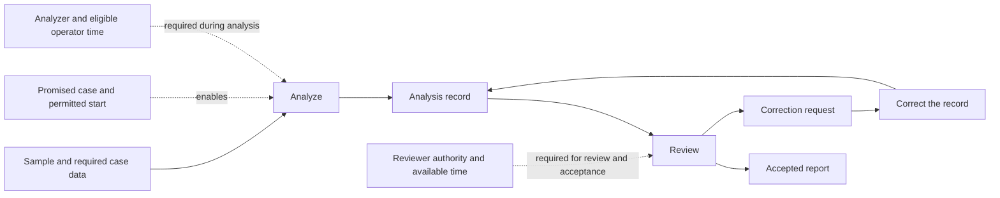
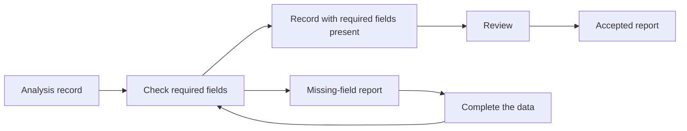

ermission and consent for the Work are checked separately. Arrangement Work under the applicable Music Method edits the identified score and produces a new arrangement artifact or version. In a later rehearsal, the intended singer and instrumentalists perform the rehearsal Work. A named observer, such as the arranger or rehearsal leader, performs observation Work and records antiphonal clarity, balance, breath, cueing, articulation, and playability under stated room and performer conditions.

The result account can state that the arrangement artifact changed and that the bounded rehearsal supported or failed the antiphonal criterion. It cannot state that the ensemble acquired durable capability, that a concert succeeded, or that a musical practice spread. If the rehearsal never occurs, the correct result is the edited artifact plus the missing representative trial.

#### MDPE.15:5.2 - Dance translation: preserve source and receiving branches

The `MDPE.6` Dance replay uses Stopgap's direct inclusive-choreography contribution to frame a selected *branch* response for a phrase under changed physicality. The change subject is not an abstract choreography. It is the identified receiving phrase or its description, related to a source phrase and intended pair.

Choreography or translation Work performed by a capable Agent under the stated authority, permission, consent, and source-use conditions produces a receiving branch while retaining source return. During the pair trial, the dancers perform representative Dance Work while a named observer performs observation Work and records effort, elevation, contact geometry, timing, partner-readable cueing, and intended expressive use. The result can support the changed phrase branch and its bounded use. It does not erase the source, make both phrases one identity, establish another dancer's capability, or prove scene-level recognition.

If the selected branch lacks permission to alter the identified source material, create the receiving variant, or change the named source-to-receiving relation, return unavailable change even when the branch is technically performable. If the branch also calls for making a selected source or lineage-account episteme edition available, name the edition, audience, and bounded use; check separately whether the publication activity is permitted. Perform that activity under its applicable direct Method and, when it is claimed as dated Work, use `A.15.1` and `F.6` for Work and attribution. Apply `E.24.PUB` only to the distinct availability occurrence. Missing permission blocks the publication activity and the claimed availability, not an otherwise permitted alteration.

#### MDPE.15:5.3 - Recognition arrangement: a rule change is not recognition or selection

Suppose `MDPE.13` returns a bounded decision to change how one social-dance event admits battle entries: publish a revised category description, add a practitioner panel, make an appeal procedure usable, and identify who gives feedback to whom about which decision. Its `DecisionSubject` and authority for that decision are named separately from the Agent performing the change Work. Identify an assignment when it governs that Work's attribution; recheck permission, consent, resources, and capability. Event-policy and implementation Work can then change the local arrangement. A later event can supply observations about actual participation, decisions, refusals, appeals, and affected Systems.

The published rule is a direct artifact. The obtaining panel, assignments, and appeal relations are separate world-side arrangement changes. The event observations are separate again. None proves that a wider scene recognizes or retains the affected variants. If the event never runs, report the changed description and untested arrangement rather than a successful recognition change.

This is a constructed application, not a report about a named event.

#### MDPE.15:5.4 - Shimon: software or control change needs a configured performance trial

A human robot-development team may choose to change gesture timing, sensing, or control after a Shimon performance study. Treat the team as the practice-developing Agent only when its agency and capability are sufficient and it has the authority and permission needed for the attributed development Work. Shimon is the performing Agent for the bounded Music Work when it performs that Work autonomously under the tested conditions; the Music Work enacts the applicable performance Method. Engineering Work can change software, hardware, sensing, or control. Music trial Work then has to use the changed configuration under stated tempo, gesture, instrument, observer, and sound conditions.

A software commit or bench result does not establish a changed musical performance Method. A trial can support timing, synchronization, gesture, attention, noise, or plausibility observations only for its configuration. Cultural influence and autonomous practice-development authority remain unsupported unless separate evidence establishes them.

#### MDPE.15:5.5 - Teaching change: variable contexts are tested through transfer, not repetition count

A Dance teacher selects a local change from repeating one figure in one cue condition to practising the same coordination across varied partners, tempi, entry cues, floor conditions, and phrase positions. The class plan and cue descriptions can change first. Teaching and practice Work then occur. Representative later Dance Work tests whether the learner can retrieve and adapt the coordination under a held-out situation.

Context-inference and transfer hypotheses can justify the trial design, but they do not establish transfer. Human Capability Development governs the capability-development Method and transfer evidence; the `MDPE.15` result account keeps the local teaching-arrangement change, performed Work, and trial result distinct. For a robot or AI performer, use its applicable training and evaluation Method rather than copying the human mechanism claim.

In a **constructed partial attempt**, Amal selects a twenty-minute class exercise in which Noor, Li and Teo will each use the same pause-and-response phrase with two different partners. The aim is to carry the cue relation across a partner change while keeping the same recording and floor conditions. The three participants had agreed to the exercise, and Amal prepares the rotation instructions. Teo is then unavailable. Noor and Li still agree to practise together; Amal teaches and observes rather than silently taking an additional partnering role that would remove that observation.

The performed class uses the new cue explanation and produces readable responses within the Noor–Li pair, but no partner change occurs. Updating the rotation sheet did not create the missing third participant. The direct results are the revised teaching description, the performed fixed-pair practice and its bounded observations. The selected varied-partner arrangement was only partly implemented; transfer across partners remains unobserved. Amal retains the usable fixed-pair phrase and chooses to narrow the next rehearsal to that pair. If varied-partner use is still needed for the later event, the next development decision must obtain a willing, capable third participant and a suitable session, or choose another feasible arrangement. Repeating the same pair does not repair the missing receiving condition, and nobody acquires an obligation to participate from the plan.

#### MDPE.15:5.6 - Direct-Method stop

If a direct composition, choreography, arrangement, translation, teaching, rehearsal, instrument, software, robot-control, event-production, curation, or recognition-arrangement Method already returns the selected change, performed Work, changed subject or failed attempt, direct result, trial observations, limits, and later-evidence question, use it and stop. This pattern adds value only when those domain results are otherwise collapsed or omitted.

### MDPE.15:6 - Bias Annotation

| Bias risk | Likely distortion | Repair |
| --- | --- | --- |
| **Artifact bias** | A changed score, video, prompt, class plan, model, or rule stands for changed practice. | Name the artifact and any separate Method, capability, arrangement, Work, and effect claims. |
| **Success-story bias** | Failed or partial change Work is omitted. | Preserve stopped Work, actual outputs, unchanged or partly changed subject, and retry condition. |
| **Stage-production bias** | Concert, ballet, theatre, or festival production becomes the default local-change case. | Test social, paired, improvised, teaching, recorded, online, robotic, and low-resource cases. |
| **Human-only bias** | The performer, learner, observer, and practice-developing Agent are assumed to be one person. | Identify each Agent, supporting non-agent System, decision-bearing assignment, and Work attribution in human, robotic, AI, ensemble, and hybrid cases. |
| **Metric bias** | Technical improvement stands for artistic, bodily, partner, audience, or practice improvement. | Preserve non-equivalent observations, affected Systems, protected characteristics, and limits. |
| **Authority bias** | The best performer, teacher, founder, robot, platform, or audience is assumed to own the change. | Name the `DecisionSubject`, practice-developing Agent, authority, permission, consent, and the usable means by which an affected participant can refuse. |
| **Cultural-control bias** | One implementation is treated as style evolution. | Keep the later transmission, recognition, selection, retention, spread, and loss questions open. |

### MDPE.15:7 - Conformance Checklist

| Check | Passing observation |
| --- | --- |
| **CC-MDPE15-01 — Selected input** | One feasible change, decision source, selected option, basis, and current conditions are identifiable. |
| **CC-MDPE15-02 — Subject identity** | The changed Method, material, description, capability, tool, arrangement, repertoire element, or other subject and starting configuration are named. |
| **CC-MDPE15-03 — Agents and affected Systems** | The `DecisionSubject`, practice-developing Agent, Work performer, tested performer, observers, and affected Systems remain distinct where the case requires them. |
| **CC-MDPE15-04 — Authority and permission** | Authority, permission, consent, safety, resource, and stop conditions are supported rather than inferred from contribution or skill. |
| **CC-MDPE15-05 — Direct Method** | The applicable Music, Dance, teaching, event, production, or engineering change Method is named and not replaced by this framework pattern. |
| **CC-MDPE15-06 — Work actuality** | Dated change Work is separate from its WorkPlan, descriptions, calls, and account. |
| **CC-MDPE15-07 — Transformation** | The actual changed subject, new variant, partial change, unchanged subject, or failed attempt is stated through its governing relation. |
| **CC-MDPE15-08 — Trial occurrence** | The account distinguishes one Work enacting several Methods, a separately identified constituent trial, and independent Work where applicable, without duplicating occurrence or resource counts. |
| **CC-MDPE15-09 — Result discipline** | Direct result, observations, effect claim, value judgement, and later cultural claim remain separate. |
| **CC-MDPE15-10 — Alternative preservation** | Protected source return, rollback, live branches, and elimination reasons from `MDPE.16` or the decision remain visible when applicable. |
| **CC-MDPE15-12 — Practical return** | The account tells a practitioner what changed, what did not, what was observed, what remains open, and what decision can use it. |

### MDPE.15:8 - Common Failures and Repairs

| Failure | Why it fails | Repair |
| --- | --- | --- |
| “We approved the new Method.” | Approval is not Work or change. | Perform the applicable change Work and identify the later subject. |
| “The plan was implemented.” | The WorkPlan and Work are different epistemic and world-side entities. | Identify dated Work and actual outputs; otherwise report planned only. |
| “The choreography changed.” | The changed subject may be only a description, one phrase branch, one performance, or one dancer's enactment. | Reidentify the governed subject and its continuity or derivation relation. |
| “The trial succeeded.” | Success hides criterion, observer, conditions, uncertainty, and non-equivalent harms. | State observations and the bounded conclusion they support. |
| “The change caused better performance.” | Temporal order or preference is not a consequence relation. | Use an applicable comparison or causal Method, or report succession and judgement only. |
| “The robot improved its practice.” | Engineering Work, robot configuration, performance Work, and practice-development agency are collapsed. | Separate the changed System, performing Agent, Work, capability, practice-developing Agent, decision authority, Work permission, and any obtaining assignment that changes the decision. |
| “The community adopted it.” | One class, event, publication, or platform trace does not establish distributed cultural relations. | Use receiving enactment, recognition, selection, retention, and population evidence separately. |
| “Nothing changed, so there is no result.” | A failed or partial attempt can change the next decision. | Return the actual stopped Work, unchanged or partly changed subject, evidence, and retry or stop condition. |

### MDPE.15:9 - Consequences

The pattern makes local Music-or-Dance development inspectable. It prevents a proposal, choice, plan, artifact, technical reading, or enthusiastic rehearsal from standing for a changed practice. It also preserves useful failures and partial changes as decision evidence.

The cost is explicit identity and relation work. A team may discover that it changed the wrong subject, lacks representative trial conditions, or cannot support the desired effect claim. That narrower result is preferable to a broad success story because it tells the next practitioner what can actually be reused.

### MDPE.15:10 - Rationale

Music and Dance practices change through local Work long before any population-level cultural relation can be established. Locality does not make the change unimportant; it makes the claim bounded. The pattern therefore closes one gap between architecture or choice and cultural evolution: Work enacting an applicable direct Method carries one selected change into the world, and the result account preserves its direct evidence.

Both fields repeatedly change materials, embodied or instrumental Methods, performing configurations, teaching and event arrangements, and selection arrangements through trials whose observations are not equivalent. Capable Agents make those changes through Work that enacts direct Music and Dance Methods. This pattern adds the cross-domain separation and result account needed to prevent those results from collapsing.

### MDPE.15:11 - SoTA and Source Use

| Source or maintained result | Adopted contribution | Boundary |
| --- | --- | --- |
| Current FPF `C.11`, `A.15.2`, `C.24`, `A.15.1`, `A.3.4`, `A.2.8`, `A.2.8.PER`, `E.10.ROLE`, `A.2.1`, `F.6`, `A.6.RCD`, `E.23`, `A.10`, and `C.36` | Separate choice, plan, tool/call planning, performed Work, actual transformation, obligation, permission, role-word recovery, assignment occurrence, performed-Work attribution, missing-governor recovery, improvement loop, evidence reliance, and local versus cultural change. | These patterns do not supply the changed Music-or-Dance subject, direct change Method, domain trial, or paired-domain result account; no listed pattern is a generic grant of agency or decision authority. |
| `MDPE.6` source-grounded Music and Dance replays | Feasible *revise before use* and *branch* choices whose implementation and trial remain separate. | The constructed identifiers and later Work are examples, not reported occurrences or transferable effectiveness claims. |
| `MDPE.13` recognition-and-selection arrangement cases | A possible-future description is terminal until another decision; a bounded feasible change decision can supply this pattern after authority, permission, and feasibility are checked again. | Arrangement design, implementation, actual recognition or selection, and later cultural effect remain separate. |
| McCloskey et al., [automatic arrangement for monophonic instruments](https://arxiv.org/abs/2301.12084) | A direct Music Method with explicit preserved and changed score characteristics and a feasible-result boundary. | It does not establish rehearsal, balance, timbre, performer capability, concert use, or cultural effect. |
| Stopgap, [Inclusive Choreography](https://www.stopgapdance.com/inclusive-choreography/) | Direct Dance translation and inclusive-choreography distinctions that change movement, body, effort, cue, and source-return decisions. | It does not establish one universal translation Method, one material identity, capability transfer, or scene recognition. |
| Shimon project sources maintained by `MDPE.14` | Distinct engineering change, robotic performance, observation, and human-led practice-development roles. | They do not support an unreported local change occurrence, robot-held development authority, Dance transfer, or cultural continuation. |
| [COIN sensorimotor study](https://doi.org/10.1038/s41586-021-04129-3) and [contextual cues and transition statistics](https://doi.org/10.1016/j.isci.2026.116281), discussed in the Preface's learning section | A reason to test retrieval and transfer under changed cues and representative contexts rather than count repetitions in one setting. | Human motor-learning evidence does not automatically transfer to every cognitive, robotic, or AI learner and does not establish transfer in the current case. |

Mutable web-source claims are dated to 2026-08-26. Recheck only a claim that depends on a changed source, configuration, direct result, or current FPF relation. A new source does not reopen unrelated local-change accounts.

### MDPE.15:12 - Relations

- `C.11`, `MDPE.6`, `MDPE.7`, a bounded `MDPE.13` change decision, or a direct decision Method may supply the selected-change input. None performs or authorizes the Work.
- `MDPE.14 → MDPE.15` is a conditional selected-change and constraint input. `MDPE.14` returns the practice-conflict decision and representative-trial conditions; a capable Agent performs the selected change through Work that enacts the applicable direct Method, and `MDPE.15` returns the local practice-change account.
- `MDPE.16 → MDPE.15` is a conditional alternative-preservation constraint. The local trial does not silently delete branches, source return, stepping stones, or archive records.
- `MDPE.15 → MDPE.16` is revision feedback when an actual trial changes live membership, performer feasibility, retained use, stepping-stone value, or the supported reason for suspension or removal.
- `E.10.ROLE` only recovers ambiguous role wording. `A.2.1` governs an obtaining assignment occurrence and its declared species; `F.6` governs attribution when an Agent performs dated Work under that assignment. None supplies agency, capability, authority, permission, consent, resources, or successful Work.
- `A.15.2` governs a WorkPlan when one is needed; `C.24` governs tool or call planning only when that question is current; `A.15.1` governs performed Work; `A.3.4` governs bounded actual change.
- `A.15.7` governs bounded next-action steering when current facts change a live branch under an already-admitted Method. It is neither the prior choice nor a universal improvisation Method.
- `MDPE.15 → MDPE.7` is a conditional evidence input. The local result can change the next development choice; it does not make that choice.
- `MDPE.15 → MDPE.14` is revision feedback only when observations change the same conflict, candidate, comparison, residual, moved burden, or representative test.
- `MDPE.15 → MDPE.17` can supply an actual changed Method or repertoire variant with its conditions for receiving enactment. It can also supply a MethodDescription as source content. The description or a failed change attempt alone does not establish an actual changed Method or receiving enactment.
- `MDPE.12` may use later observations under its own comparison question. `MDPE.10` and Human Capability Development own capability-development and transfer results.
- `C.36`, `MDPE.17`, `MDPE.19`, and `MDPE.20` own later transmission, cultural continuation, retention or loss, and trajectory claims. One local change establishes none of them.

### MDPE.15:End

## MDPE.16 - Keep Music-or-Dance Alternatives Available for Later Use

> **Type:** DPF pattern body
>
> **Primary working result:** a **use-bounded alternative-availability result**. Each branch is live for a named later use, under selected upkeep or reconstruction, awaiting repair before trial, archive-only, suspended, or removed from this development question. A live branch has an actual bearer or arrangement, capable performer, obtaining dependencies, access, permissions, resources and usable configuration, with sufficient applicable availability evidence. Upkeep Work and a next trial are included only when needed and selected. Real rights, venue, calibration and promised-use windows remain conditions of availability; the evidence carrier's age alone does not end it.

### MDPE.16:0 - Use This When

Use this pattern when one score, format, canon, body model, technique, instrument setup, competition rule, school, market, platform signal, model score, or fashion is becoming the only development line before the important uncertainty has been reduced.

Typical warning signs are:

- a competition or platform selects what is easy to judge or display, and hard-to-display variants disappear;
- a teacher keeps only what beginners can copy quickly, removing distinctions needed for later mastery;
- a production team stabilizes one reliable arrangement before testing a musically different branch;
- a movement or music model optimizes one representation and loses variants useful to actual dancers or musicians;
- one body, instrument, venue, robot configuration, or current capability becomes the assumed norm;
- a presently weak variant is discarded although it preserves a useful contrast, source relation, future combination, or reachability into another region of the development space; or
- an archive is mistaken for a live repertoire even though nobody can currently perform, reconstruct, or use much of it.

The practical question is:

> Which materially different alternatives should remain usable for this development question, what actual conditions and available evidence support that use, and what change would require upkeep, a trial or a different disposition?

The gain is a small set of alternatives that a named Agent can still reconstruct, rehearse, perform, teach, or test when the next decision needs them.

Use a direct composition, choreography, improvisation, rehearsal, repertoire, curation, archive, production, teaching, rights, capability-development, tool, operations, or engineering Method without `MDPE.16` when one branch and its later use are already known. Use `MDPE.16` when a wider practice-development decision must keep several materially different branches usable and coordinate their different upkeep, evidence, and trials.

Do not use this pattern when:

- the task is to generate and compare a small set of performance candidates—use `MDPE.9`;
- one current `OptionSet` is ready for a bounded choice—use `C.11` or the applicable domain choice pattern;
- one change has already been chosen and only its performance and test remain—use the applicable direct Music, Dance, teaching, event, production, tool, or engineering Method;
- the task concerns archive/front stewardship without a Music-or-Dance specialization—use `C.18`;
- the task concerns a reusable pool policy without a Music-or-Dance specialization—use `C.19`;
- the task is to establish present cultural continuation or loss—use `MDPE.19` and `C.36`; or
- the named objects are complementary parts of one project rather than alternatives for the same question.

If the development question, named later use or actual branches cannot be named, return the missing value and the decision it blocks. When availability needs upkeep or restoration, also establish the capable and authorized performer and direct Method before relying on that proposed Work. An already obtaining condition does not need a newly assigned maintenance task.

#### MDPE.16:0.1 - Working Distinctions

| Name | Meaning here |
| --- | --- |
| development alternative | An identified actual or possible-future bearer or arrangement that can answer the same bounded development question through a materially different Method, structure, characteristic profile, use, or failure mode. |
| variant | A bearer related to another bearer through a stated variation, derivation, transformation, lineage, or family relation. Resemblance or a shared label is insufficient. |
| live alternative | An alternative with sufficient applicable evidence of availability for its named later use and conditions. A title, file, archive row, maintenance plan or former capability alone does not make it live. |
| branch availability | An obtaining combination of bearer or arrangement, capable performing Agent or whole, required capabilities and dependencies, access, permission, rights, resources, and usable configuration for the named later use. |
| upkeep or reconstruction result | The world-side capability, access, relationship, configuration, or other condition obtained through a direct Music, Dance, teaching, archive, rights, capability, tool, event, operations, or engineering Method. A plan or record of that Work is not the result. |
| availability evidence | Dated evidence that the branch can still be reconstructed, rehearsed, performed, taught, configured, accessed, or otherwise used as claimed under representative conditions. |
| stepping stone | An alternative kept available because it enables later generation, learning, combination, representation change, source return, or reachability, even when it is not a current performance choice. |
| repertoire | Alternatives available to named performing Agents or performing wholes in named Work, not every stored artifact under one style label. |
| selection-pressure claim | A claim that may report only an association or trace, an obtaining rule or constraint, a causal-contribution hypothesis, or a bounded causal-use result. These claim strengths support different next moves. |
| archive/front membership | Results governed by `C.18`. Recorded, non-dominated, and live-for-this-question are different membership relations. |
| current `OptionSet` | Options currently available for one `C.11` choice. The wider development set can supply candidates to it but is not one permanent `OptionSet`. |

Novelty, diversity, usefulness, style recognition, embodied accessibility, technical feasibility, and cultural continuation are different characteristics and relations. A branch can be novel and unusable, useful and ordinary, weak now but a valuable stepping stone, visible but no longer reproducible, or stored but unavailable.

### MDPE.16:1 - Problem

Music and Dance practices develop through variation, performance, comparison, repair, recombination, teaching, transmission, selective use, forgetting, and rediscovery. Early convergence can make current Work easier while shrinking what later practitioners can do.

Local arrangements often select one proxy:

- competitions select judgeable differences;
- platforms select visible and quickly recognizable differences;
- schools select teachable differences;
- production teams select reliable differences;
- models select differences represented in their data, objective, and interface; and
- present performers select differences within their current capability and access.

Those selections can be useful locally. The error is reporting their winner as the only valuable development line. Awkward, embodied, minority, low-visibility, high-learning-cost, or temporarily weak alternatives can carry source continuity, reachability, contrasting evidence, access for another performer, or a later combination.

Keeping everything is equally poor. Unbounded accumulation consumes attention and resources, while a catalogue can hide that capabilities, relationships, rights, tools, venues or teaching arrangements have disappeared. Practitioners choose which branches should remain usable and whether current evidence supports their actual conditions. Obtain or restore a condition only when needed and worthwhile; use archive-only, suspended, removed or bounded-use dispositions when later availability is unsupported or no longer warrants its full cost.

### MDPE.16:2 - Forces

| Force | Tension to preserve |
| --- | --- |
| Current usefulness and later option value | An alternative with weak current performance may be a useful contrast, source branch, training aid, or input to a future combination. |
| Diversity and bounded attention | Too little variety traps development; too much untyped variety prevents action. |
| Shared question and unlike bearers | Alternatives answer one question, while their materials, Methods, capabilities, arrangements, and performers retain different kinds. |
| Exploration and reliable current Work | Practice needs distant and niche trials while performances, classes, and events still have to work. |
| Retention and supported removal | Keeping every branch is costly; removing one can erase source return, minority practice, or future reachability. |
| Representation and embodied use | A score, video, notation, geometry, embedding, or model output preserves some distinctions and hides others. |
| Project decisions and cultural evolution | A project can govern its trials and maintained set; distributed cultural selection and retention are different relations. |

### MDPE.16:3 - Solution

Bound one Music-or-Dance development question and identify alternatives that answer it differently. Decide which should remain usable for a later decision or trial. Use the available evidence to establish each branch's actual availability and limits. Where a condition must be restored or maintained, select the worthwhile feasible upkeep or reconstruction through its direct Method and assess the obtained result. Retain sufficient current availability without a new rehearsal or generic expiry date. State actual rights, resource or qualification deadlines and other conditions that change the use. A further trial is selected only when its contribution warrants its full cost and delay. Keep archive-only, suspended, removed and use-bounded dispositions distinct, and qualify a suspected selection pressure by its actual trace, constraint, hypothesis or causal-use basis.

The following sections explain how to apply this Method. Upkeep, rehearsal, trials, ordinary performances, teaching, and revisions can overlap and use distinct Methods; the explanatory order does not imply one temporal process or one holonic level.

#### MDPE.16:3.1 - Bound the development question and later use

Name:

- the Music-or-Dance practice subject and present configuration;
- the question for which several answers remain useful;
- the later performance, teaching, reconstruction, comparison, source-return, or combination use that makes each branch worth keeping;
- the horizon and next decision;
- the practice-developing Agent responsible for the branch set;
- the Agent authorized to spend resources or change each branch's availability arrangement;
- affected Agents and Systems;
- safety, consent, permission, source, access, and other protected conditions; and
- the attention, rehearsal, equipment, venue, compute, rights, or maintenance budget.

A useful question is narrower than “preserve dance diversity.” For example: “Which partner-readable timing variants must remain usable while this Balboa phrase family is developed for social dancing at three tempo ranges?”

The practice-developing Agent need not own the alternatives, control the culture, perform every branch, or have authority to change every dependency. If required access, capability, permission or configuration does not obtain, a plan to restore it does not make the branch live. Retain a supported existing arrangement or report the affected branch as suspended or archive-only; any selected restoration still needs a capable, authorized performer.

#### MDPE.16:3.2 - Form actual alternatives for the same question

For each candidate, name the bearer or proposed arrangement and its actual kind. Then state how it answers the bounded question differently.

A score, dancer, robot, recording, Method, event format, and cultural label do not become alternatives merely because they appear in one table. They can be participants, descriptions, evidence, or components of different development branches. If they do not answer the same question under a stated alternative relation, split the set.

Seek alternatives that fail differently. Include, when useful:

- a locally reliable branch and a more distant exploratory branch;
- low- and high-fidelity variants rather than only a middling compromise;
- variants for different bodies, partners, instruments, venues, media, or receiving uses;
- a source-preserving branch and a deliberately transformed branch;
- human, robotic, AI, ensemble, equipped-human, or hybrid performance arrangements under their own capabilities; and
- a no-change branch when every intervention moves a worse burden.

#### MDPE.16:3.3 - Ground each branch in use and availability

For every branch that may remain live, identify:

- the intended Music-or-Dance Work and later receiving use;
- the actual bearer or arrangement that must remain available;
- the performing Agent or performing whole and the capabilities it must retain;
- the body, partner, instrument, cue, venue, media, equipment, software, teaching, operational, or source dependencies;
- the existing arrangement supporting availability, and the direct Music, Dance, teaching, archive, rights, capability-development, event, production, tool, operations or engineering Method when a condition needs obtaining or restoration;
- the authorized Agent responsible for any needed upkeep or reconstruction Work;
- the resource, consent, permission, attribution, access, and rights conditions;
- the applicable evidence of availability for the named conditions, and a further observation only when its result is needed and worth obtaining; and
- the premise change that would reopen availability, including a real rights, venue, calibration, resource or promised-use deadline when one applies.

A recording can support reconstruction; it is not the performance, Method, or capability. A movement animation can support a trial; it is not evidence that a dancer can use the movement with a partner. A software snapshot can support restoration; it is not evidence that licenses, hardware, performers, and venue conditions still permit use. A model score can characterize one representation; it is not performer-facing usefulness.

#### MDPE.16:3.4 - State what is observed before naming a selection pressure

One observation can support several explanations. Class enrolment, views, bookings, a competition result, a teacher's choice, or the declining use of an arrangement is first an observation with a sampling basis. Before treating it as a pressure, state which claim is available:

| Available claim | What it supports here |
| --- | --- |
| association or trace | Describes co-occurrence or change. It can inform a qualified present account or a worthwhile next observation; it does not by itself justify changing the suspected cause. |
| obtaining rule, constraint, access, capability, or resource relation | Establishes a current condition that directly admits or blocks Work. It can justify removing that condition when the Agent has authority and the other required relations are known. |
| causal-contribution hypothesis | States that an arrangement may be helping retain or remove the branch. Give its basis, serious rivals, uncertainty, decision reach and reopen condition. Select a discriminating trial only when feasible and worth its full burden; retain an adequate bounded decision when no such trial is needed. |
| bounded `C.28` causal-use result | States the causal use supported and the nearby stronger use not supported. The receiving decision still remains with this pattern or its direct Method. |

For example, “the electronic branch appeared in only one of four recent events” can fit unavailable equipment, venue restrictions, performer readiness, curation, audience response or sampling variation. The trace can motivate checking a relation when that check can change the decision at worthwhile cost. A documented venue rule establishes an access constraint. A latency-to-curator-rejection claim remains a causal-contribution hypothesis until an applicable basis supports that causal use; a current bounded availability decision can finish without settling it.

Also inspect the representation used to compare alternatives. Ask what distinctions it preserves or suppresses and whether another representation could change membership, upkeep or a selected trial. Choose any new comparison by its full contribution and cost; neither a population study nor a cheap reversible test is required merely to complete a sufficiently supported decision.

#### MDPE.16:3.5 - State every branch's current disposition

| Disposition | Practical meaning |
| --- | --- |
| live for named use | Applicable evidence supports actual availability for the named use and conditions. A calendar window is included when it bounds that availability; no generic renewal period is required. |
| upkeep or reconstruction selected | Direct Work has been selected or begun, but current availability is not yet claimed. |
| repair before trial | One named, recoverable defect blocks a useful availability check or trial. |
| archive only | Source or lineage value remains, but current usability is not claimed. |
| suspend | A named capability, evidence, permission, safety, access, rights, or resource condition is missing. |
| remove from this development set | A supported reason defeats the present use; archive or source return remains when needed. |

These dispositions describe availability for the current use; they do not establish cultural retention. A branch not chosen today can remain live. A stored branch, maintenance record, or promised rehearsal need not be live.

#### MDPE.16:3.6 - Obtain and check the conditions that keep a branch live

For every branch reported as live, show the smallest obtaining arrangement that keeps it available:

1. actual bearer or arrangement and named later use;
2. capable performing Agent or whole;
3. required dependencies, permissions, access, rights, resources, and usable configuration;
4. responsibility and authority for upkeep or reconstruction when that Work is needed;
5. direct upkeep, rehearsal, reconstruction, capability-development, relationship-maintenance, configuration-management or access Work only where maintaining or restoring availability actually needs it;
6. the obtaining condition, with the world-side result of any upkeep or reconstruction Work distinguished from its plan;
7. applicable availability evidence under representative conditions, with its date and qualification where relevant to the receiving use; and
8. the actual stop or reopen condition and any real expiry of rights, qualification, resources or a promised use window.

Use the applicable direct Method when upkeep or reconstruction is needed. A capable Agent performs that Work and the result must support the claimed availability. Existing sufficient availability evidence can instead sustain an unchanged branch without new Work. A branch can be live for rehearsal but not public performance, for one robot configuration but not another, or for one teacher and learner population but not a whole scene.

#### MDPE.16:3.7 - Choose trials that distinguish the alternatives

Select a trial or observation only when a materially uncertain branch disposition or development decision needs its result, the full contribution warrants cost and delay, and performers, capability, access, rights, resources and an opportunity window make it obtainable. Keep a live, archive-only or stepping-stone branch on sufficient available grounds without designing a trial merely to finish its record. For a selected trial, prefer a contrast that exposes different failure modes over repetition of the representation that selected the current winner.

Useful contrasts include actual performers versus notation or model scores alone; varied partners, bodies, instruments, tempi, phrases, venues, audiences, or media; held-out contexts when retrieval and transfer matter; source and receiving branches when transmission matters; and changed cue, timing, latency, noise, attention, fatigue, or operational conditions.

A selected trial belongs to its direct Method. Keep branch availability, trial plan, performed trial, observation and resulting disposition distinct. At the set level, choose to explore, stabilize, redirect, suspend or retire a branch from the current question on the basis that supports that decision. A trial plan is not a performed trial, and an availability result is not proof of the later cultural or performance outcome.

#### MDPE.16:3.8 - Remove only for a supported reason

Before removing or collapsing a branch, state the present use from which it is removed; the evidence, constraint, or decision supporting removal; whether the reason is reversible; the source, lineage, minority, recovery, contrast, or stepping-stone value that would be lost; which affected Agents and Systems bear the loss; whether archive-only retention is useful; and the condition that could reopen membership.

Do not call an alternative eliminated merely because it is not today's winner. Do not keep it live merely because deletion feels irreversible.

#### MDPE.16:3.9 - Keep the result usable

```text
Development question and next decision:
Branch and actual bearer or arrangement:
Named later use and materially different contribution:
Current disposition:
Performing Agent or whole and required capability:
Dependencies, rights, access, permission, resources, and configuration:
Responsible and authorized upkeep/reconstruction Agent, when such Work is needed:
Direct upkeep or reconstruction Method, Work, and obtained result, when needed:
Existing obtaining arrangement and availability limits:
Applicable availability evidence and conditions; relevant date or actual use/qualification deadline:
Observed association, obtaining constraint, causal hypothesis, or causal-use result:
Selected worthwhile and feasible trial or observation, if any:
Source return or archive relation when needed:
Stop or reopen condition:
```

Include upkeep and trial fields only when those actions are selected. Keep a limitation or retained reason with the substantive availability result only when it changes a later recipient's choice.

This result can supply live candidates to a current `C.11 OptionSet`, constraints to a local intervention, or inputs to direct repertoire, archive, curation, teaching, production, and engineering Methods. Each receiving Method specifies its admissible inputs and characteristic result; a capable Agent performs Work that enacts it to obtain that result.

### MDPE.16:4 - Worked Cases

#### MDPE.16:4.1 - Dance movement generation: different fidelity can preserve different value

Chédin et al. report iterative co-design involving repertoire curation, model and interface variants,
improvisation and return to tool design. The medium/high/low comparison involved Dancer-Y alone; his different
uses for outputs do not establish a multi-dancer fidelity ranking. Following the adaptation in `MDPE.9:4.1`,
a new project can compare a recognizable model output and a less faithful stimulus for its own purposes, then
retain both when their distinct uses justify the cost. That is a proposed local decision, not a disposition
transferred from the study.

The source does not establish that either branch remains available after the study. A new project establishes whether the model or movement material, permitted source use, capable dancers, usable interface and configuration support its intended use. An applicable improvisation or reconstruction observation can already establish that availability. A changed model, interface or receiving movement task may instead require a representative run; its scope follows the unresolved condition. Stored outputs without the conditions needed to use them are archive or reconstruction inputs, not a live repertoire.

#### MDPE.16:4.2 - Balboa phrase family: carrier, articulation, and partner readability

Use the timing distinctions in the [Dance profile](#mdpepreface72---dance-making-movement-usable-for-its-participants) when phrase or teaching alternatives differ in continuous movement and discrete articulation. A project can compare variants in which a salient event is related to contact onset, direction change, weight arrival, partner-readable pressure, or another justified event while keeping continuous movement visible.

A visible-footwork branch may be attractive to viewers but weak for partner readability. Another may be clear to a partner but demanding at a particular tempo. A third may work as a teaching contrast rather than a performance choice. Its availability depends on who can enact it, permitted source use, and the supported tempo and partner range. Existing pair practice can supply sufficient evidence while those conditions remain applicable. Repeated practice earns its place when a demanding capability needs upkeep; a new partner-readability check is warranted when a changed partner, tempo or sign of skill decay leaves a consequential doubt. A date alone neither renews nor defeats availability. The brushes analogy supplies another representation and comparison cue; it does not make Music and Dance variants members of one set.

#### MDPE.16:4.3 - Constructed Music case: restore a live-electronic branch before calling it available

A small ensemble wants to keep both a sparse acoustic-response arrangement and a live-generated-response arrangement for a spring performance. The electronic branch was used only once in four recent events. That trace alone does not show whether equipment access, venue rules, performer readiness, latency, curation, audience response, or sampling variation is narrowing use.

The ensemble initially reports the electronic branch as **suspended**, not live: its old plugin no longer runs on the replacement laptop and the venue has not approved the networked setup. The production lead has authority over the approved equipment budget and assigns direct configuration and rehearsal Work. An audio engineer restores the project from source stems in a supported environment, documents the changed plugin and its audible limits, obtains the venue's equipment permission, and prepares the acoustic branch as fallback. The musicians then perform a twenty-minute representative rehearsal with the replacement laptop, expected monitoring, response timing, and one simulated network failure.

The rehearsal record, measured latency trace, successful fallback, musician report, and venue permission are evidence only for this configuration and performance window. They change the electronic branch from **suspended** to **live for the spring performance**. They do not prove audience preference or cultural retention. If the same setup cannot be restored on a second machine before the stated date, the branch returns to **repair before trial**; if the rights or source project become unavailable, it becomes **archive only**. A later venue rejection would establish an access constraint, while a claim that latency causes curators to reject the branch would still need a bounded causal-use basis or a reversible trial.

In the paired unchanged case, the same musicians, restored configuration, venue permission and spring performance window remain supported, and no new relevant problem has appeared. The rehearsal record is older, but remains applicable; the electronic branch stays live without another rehearsal. If venue permission ends or the plugin again becomes incompatible, the corresponding availability fails even if that record was produced yesterday.

#### MDPE.16:4.4 - Robotic Music: social gesture and control branches

A Shimon project can compare gesture-amplitude, gesture-timing, sensing, control, and actuation arrangements. Mechanical evidence from one configuration, social-gesture evidence from another, and musical-plausibility observations from a changing-tempo trial remain configuration-bound.

For a named performance trial, Shimon can be the performing Agent. The human project team is the practice-developing Agent that changes and maintains the branch set. A branch is live while the required hardware, software, calibration, safety envelope, operators and score or improvisation interface remain available and their suitability for that use is supported. An earlier successful representative run can suffice under unchanged conditions. Recalibration, an altered control path or an applicable safety requirement can require another run before use. A configuration record that leaves an essential operating condition unsupported supplies reconstruction input rather than evidence that the robotic-Music branch is live.

#### MDPE.16:4.5 - Social-dance branches answer different questions

Choose the alternatives by the receiving work before treating familiar labels as branches. A milonga event,
a recording classified as milonga and a taught movement phrase can all matter to one project, but preserving one
does not preserve the other two. A programme advertised under a local kizomba umbrella might offer authentic
kizomba, urban kiz and tarraxo sessions; that programme neither defines a universal family tree nor specifies what
a learner must do in each session. Recover each proposed session's movement instructions, music and use.

For a concrete movement-development comparison, suppose the teacher supplies two partnering instructions,
locally called tango and tango vals, and two recordings, locally classified as tango music and waltz music.
The candidate set contains four receiving uses:

| Candidate use | What must remain available |
| --- | --- |
| Tango partnering instructions with the tango recording | Those instructions, that recording and a performer/configuration able to realize their timing relation. |
| The same tango instructions with the waltz recording | The changed musical material and any required phrasing adaptation, with the intended partnering relations preserved. |
| Tango-vals instructions with the tango recording | The different partnering instructions and their usable timing relation to the first recording. |
| Tango-vals instructions with the waltz recording | Both selected inputs and the conditions that make their combination usable. |

These are proposed branches, not four established capabilities. A change of recording alone, a change of partnering
instructions alone and a change of both answer different questions. Establish compatibility before retaining a
branch for actual use; if adapting the instructions changes a defining condition of the Method, preserve that
change in the branch instead of reporting the Method as unchanged. Keep materially different combinations when
their expected use warrants what retaining them costs.

For party programming, the alternatives are event arrangements: the playlist, teachers or hosts, floor access,
participant capability, consent and timing jointly matter. A booked milonga event is available through those
operating relations, not through the existence of a track with that name. For one dancer's development, retain
the specified coordination or partner-response variants through capability practice and appropriate receiving use.
Split the sets when their decisions differ. Ballet, university, press or competition visibility alone does not
establish that either set serves the adults in this project.


#### MDPE.16:4.6 - Constructed continuation: a small social variant becomes a usable combination

Continue the [shared-practice case](#mdpeapplication514---a-complete-constructed-case-the-evening-that-became-a-qualification-course). Sol retains a small pause-and-response phrase that two participants can already use with each other on the social floor. Ren's prepared-performance contest previously excluded it through its large-visible-change entry rule. That exclusion does not make the phrase unavailable or useless for its different receiving task. The same participants also know a larger prepared phrase used in the contest. Keeping both preserves a usable social response and a different display achievement; one is not an unfinished version of the other.

When the local challenge changes to responsive partnering, the small phrase becomes a candidate component: the performers can insert its pause-and-recovery relation into the larger phrase. This combination is not available merely because each component is. Sol uses twenty minutes of the already staffed advanced lesson to help the pair construct the transition, displacing another planned figure. In the constructed rehearsal, the first transition preserves the visible sequence but obscures the partner's pause. The pair shortens the approach and then achieves the task's timely resumption and comfortable continuation with each other. That observation supports the combined phrase for this pair and task, not arbitrary partners or a general capability.

The receiving decision now keeps three different uses: the compact social response, the prepared display, and the tested responsive combination. Ren removes the challenge's large-change entry condition and observes from close enough to see the response. This changes eligibility and observation; it does not retroactively turn the earlier contest into a test of social capability. The retained small phrase supplied something the display branch alone lacked, while the display phrase supplied a challenge its practitioners still valued.

Retention has a price. The participants permit internal teaching use of their short recordings, the teacher can explain the three uses, and Ren allocates four minutes of the event's existing briefing to the revised judging task. These resources are obtained, not assigned to an unnamed volunteer. Existing capability and observations can remain sufficient without scheduled renewal trials. If maintaining three versions begins to displace needed practice, compare that loss with the actual social, display and combination uses. A programme that now needs only the compact response can retain it live and keep the other descriptions as archive material. If a required performer leaves, the combination loses its supported availability until another pair can realize it; changing the entry rule does not restore that capability. Keeping these project alternatives makes a later choice possible, but does not establish population-level cultural retention.

### MDPE.16:5 - Recognition and Assurance

Recognize a complete first result when a practitioner can answer:

1. What bounded development question and named later use do the alternatives serve?
2. What actual bearer or arrangement constitutes each branch, and how does it differ materially?
3. Which branches are live, under upkeep, awaiting repair before trial, archive-only, suspended, or removed?
4. For every live branch, which capable Agent or whole and obtaining dependencies, rights, access, resources and configuration keep it available, with direct upkeep Work only where needed?
5. What applicable evidence supports availability, and what premise change or actual deadline changes the receiving use?
6. Is a suspected selection pressure only an observed trace, an obtaining constraint, a causal-contribution hypothesis, or a bounded causal-use result?
7. What is the supported next decision or reopen condition? If a further trial is selected, what makes it worthwhile and obtainable?

Assure the result by checking that:

- complementary project parts are not mislabeled as alternatives;
- a file, archive row, maintenance plan, former capability, or software snapshot is not reported as live availability;
- every live branch has an actual bearer, named later use, capable performer and obtaining dependencies supported by applicable availability evidence; necessary upkeep has actual authority and an obtained result, while unchanged availability creates no new Work requirement;
- live-set, archive, front, pool, selected-set, and current `OptionSet` relations remain separate;
- Music, Dance, body, partner, instrument, venue, style, source, access, capability, and production distinctions appear when they change availability, disposition, or trial;
- every claimed pressure states the observed arrangement and relation, claim strength, evidence or expert-estimate basis, uncertainty, decision reach, and reopen condition;
- weak branches kept as stepping stones name the later reachability, contrast, learning, combination, or source value;
- removal names the present use, affected Agents and Systems, lost value, and reopen condition; and
- a maintained project branch set is not reported as population-level cultural retention.

### MDPE.16:6 - Common Failures and Repairs

| Failure | Repair |
| --- | --- |
| “Keep all variants.” | Bound one question; give each branch a later use, supported current disposition and action-changing condition. Select upkeep and trials only when their contribution warrants their full burden. |
| “The maintenance record says it is preserved.” | Establish actual bearer, performer, dependencies and applicable availability evidence. If upkeep was needed, distinguish its obtained result from a plan; do not require new upkeep merely to substantiate an unchanged available branch. |
| “These files are our repertoire.” | Name the actual bearer, capable performing Agent or whole, Method, representative Work, and evidence. |
| “Its use declined, so the platform removed it.” | Report the trace; distinguish an actual constraint, causal hypothesis and supported causal-use result under `C.28`. A qualified availability decision need not settle the cause or commission a test; select further inquiry or intervention only on its own worthwhile, feasible and authorized basis. |
| “The top-scoring candidates are the answer.” | State the representation and comparison basis; preserve incomparability and must-conditions; use `C.11` for the later choice. |
| “Not selected means eliminated.” | Separate current non-use from live, upkeep, stepping-stone, source, and archive value. |
| “Popular means culturally retained.” | Recover actual receiving and reproduction relations or keep the claim as an estimate with uncertainty. |
| “All named styles belong to one space.” | Reidentify the development question and split the set when one alternative relation fails. |
| “The project kept it, so the culture retained it.” | Keep project availability separate from distributed recognition, selection, transmission, retention, and loss. |

### MDPE.16:7 - Consequences

Positive consequences:

- one current winner no longer erases useful source, minority, body-specific, low-visibility, or exploratory branches by default;
- practitioners know what each retained branch is for and what to try next;
- weak but useful stepping stones have use-bounded availability supported by named bearer, capability, access, permission, configuration, upkeep, or reconstruction relations rather than merely appearing in a list;
- representation loss, obtaining constraints, and bounded causal-use claims become inputs to development decisions;
- removal becomes a bounded decision rather than silent drift; and
- direct Music, Dance, teaching, production, archive, tool, and engineering Methods govern their respective Work.

Costs and limits:

- maintaining identities, rights, capabilities, evidence, availability, and dispositions takes attention;
- some alternatives remain incomparable;
- representative trials can require performers, partners, instruments, robots, venues, audiences, or teachers;
- some branches should move to archive-only status or leave the current set; and
- a project cannot guarantee distributed cultural continuation.

### MDPE.16:8 - Rationale and Source Use

Current FPF characterizes candidate bearers, open-ended generation, archive/front stewardship, pools, selected sets, bounded choices, causal-use claims, evidence, and cultural relations. This pattern supplies the missing Music-and-Dance specialization: it relates a branch's actual bearer, performing capability, partner or ensemble conditions, instrument or body demands, rights and access, direct upkeep Work, checked availability, observed domain constraints or causal hypotheses, and discriminating trials to one practice-development decision.

| Source or maintained result | Use here | Limit |
| --- | --- | --- |
| Current FPF `C.17`, `C.18`, `C.19`, `G.5`, `C.11`, `A.10`, `C.28`, `C.29`, and `C.36` | Characterization, generation, archive/front stewardship, pool policy, selected-set declaration, local choice, evidence, causal-use bounds, representation, and cultural relations. | Do not supply Music-or-Dance alternatives, upkeep Work, checked availability, performer-facing trials, or domain selection pressures. |
| `MDPE.9` and its direct sources | Performance-candidate kinds, performer-involving comparison, and branch or rejection dispositions. | One performance-candidate set is smaller than a continuing development set. |
| Chédin et al., [co-designing movement-generation models with Voguing and Dancehall dancers](https://doi.org/10.1145/3772318.3791515) and [repository copy](https://ualresearchonline.arts.ac.uk/id/eprint/26884/) | Practitioner collaboration, repertoire curation, model/interface variants, dancer improvisation, and the different value of high- and low-fidelity outputs in the reported case. | Does not establish a universal fidelity curve, style authority, or prevalence claim. |
| Ableton Live 12, [Comping](https://www.ableton.com/en/live-manual/12/comping/) | Direct Music-production Method for retaining and auditioning takes while preserving source material. | A tool lane is not a universal alternative kind, repertoire, or development decision. |
| Timing examples in the [Dance profile](#mdpepreface72---dance-making-movement-usable-for-its-participants) and the local Balboa cases | Continuous carrier, discrete articulation, several perceived timing centers, partner-readable timing, and candidate teaching and movement variants. | Supplies Method-design input, not a demonstrated universal Balboa repertoire or cultural-retention result. |
| Shimon project sources maintained by `MDPE.14` | Configuration-bound musical, gesture, timing, attention, noise, and control distinctions for robotic Music trials. | Separate studies do not form one comparable evidence set or establish cultural continuation. |

Reconsider the affected availability use when a source premise, configuration, performer population, right, intended use or other relevant condition changes. Retain applicable support when only the evidence carrier's age or an immaterial publication detail changes. A justified review policy and actual use deadlines still apply.

### MDPE.16:9 - Relations

| Related result | Use here |
| --- | --- |
| `MDPE.8` | Supplies the bounded development focus when the current subject, intended later use, live alternatives or material uncertainty changes which branches should remain available. |
| `MDPE.9` | Can supply performance candidates and trial observations; wider development membership remains a separate decision. |
| `C.17`–`C.19`, `G.5`, and `C.11` | Supply characterization, archive/front, pool, selected-set, and local-choice results without being replaced here. |
| `MDPE.13` | Supplies a recognition-and-selection arrangement only when its pressure changes branch dispositions or trials. |
| `MDPE.14` | Can return split use or another practice-conflict decision that requires selected alternatives to remain available. |
| Applicable direct Music, Dance, teaching, archive, rights, capability-development, event, production, tool, operations, or engineering Method | Obtains the selected upkeep, reconstruction, access, permission, capability, configuration, rehearsal, or trial result and supplies its evidence. `MDPE.16` relates that result to branch availability and the wider development decision. |
| `MDPE.7` | Can consume the supported live alternatives and their limits for a current choice or recommendation. |
| `MDPE.20` | Uses alternatives with their supported availability conditions to construct competing trajectories. A retained current result need not be refreshed or trialled merely to become this input. |
| `MDPE.17`, `MDPE.18`, and `MDPE.19` | Separately govern receiving enactment, usable cultural memory, and present continuation or loss. |
| Direct composition, choreography, improvisation, repertoire, teaching, rehearsal, curation, event, tool, and engineering Methods | Use them for domain Work; capable Agents perform that Work and obtain its results. |

### MDPE.16:End

## MDPE.20 - Forecast How a Music-or-Dance Practice May Develop

> **Type:** DPF pattern body
>
> **Primary working result:** a **qualified trajectory and development decision** for one named Music-or-Dance practice. It contains the serious trajectories relevant to the decision, their available evidence or expert-estimate basis, distinguishing implications, uncertainty and conditions, and the supported preparation, continuation, change or stop. It can be complete without a new observation or observation plan. An **empirical update** additionally names the observation actually obtained, including applicable published evidence, and what it changed or left unresolved. Each trajectory remains qualified by its practice subject, population, place, period, horizon, mechanisms, structures and representations.

### MDPE.20:0 - Use This When

Use this pattern when a practice-developing Agent must decide what to change, preserve, test, teach, publish, or prepare for, but the same present observations support several materially different developments of a Music-or-Dance practice.

Typical situations include:

- one popular rhythm, movement, performance format, teaching form, or platform trend is called the future;
- a geometric prototype, statistical cluster, reconstructed lineage, prevalence estimate, or repeated transmission result is called an attractor without a dynamics model;
- one creator, book, school, competition, festival, platform, or technical tool is credited with determining later culture;
- a team assumes that current recognition, streaming, enrolment, or press visibility establishes future reproduction;
- a style-switching or style-mixing observation is explained by one memory or learning model without rival explanations;
- one local success is expected to spread through a scene despite unknown teaching, partner, venue, recognition, selection, and retention relations; or
- an intervention is selected before anyone states what later observation would make the forecast wrong or change the decision.

The practical question is:

> What serious developments fit the available basis, what differs among them, and what can the project now do, prepare, retain or stop within its supported conditions?

The gain is a usable present forecast and decision with conditions for revision. When an observation is actually obtained, the project can carry it through to a bounded update while preserving serious rivals and transfer limits.

Use current FPF and a direct field Method without `MDPE.20` when they already supply the practice-specific trajectories, observations, and development decision. Use `MDPE.20` when generic hypotheses and cultural relations still leave Music-or-Dance performers, materials, structures, recognition tasks, transmission mechanisms, scene conditions, and domain probes unspecified.

Do not use this pattern for:

- one local performance-candidate disposition—use `MDPE.9`;
- one lineage or source-recovery question—use `MDPE.18`;
- one present continuation or loss question—use `MDPE.19`;
- one chosen local change without competing future trajectories—use the applicable direct Music, Dance, teaching, event, platform, or engineering Method;
- a geometric, rhythmic, statistical, or active-inference model whose receiving use is not cultural development—use its direct modelling Method and current FPF; or
- a future claim for which no present decision, preparation, observation, or stop would change.

#### MDPE.20:0.1 - Working Distinctions

| Claim or subject | Keep separate here |
| --- | --- |
| possible trajectory | A conditional episteme about how a named practice or distribution may change; not the future practice itself. |
| geometric prototype or centrality | A relation in one declared representation and candidate space; not a dynamical attractor by itself. |
| statistical cluster | A pattern in observations or represented cases; not a transformation mechanism or future. |
| reconstruction bias | A tendency in repeated perception, memory, imitation, teaching, or reproduction under stated conditions; not population selection by itself. |
| increasing frequency or prevalence | A population characteristic over a period and sampling basis; not necessarily retention, equilibrium, value, or causal mechanism. |
| lineage or reconstructed ancestor | A historical relation or hypothesis; not a prediction of later change. |
| dynamics attractor | A claim requiring a state space, transition relation or law, conditions, and basin or stability evidence under `A.3.3`; not a synonym for recognizable style. |
| project choice | A decision by an admitted Agent within authority; not later recognition, selection, transmission, retention, or loss in a practitioner population. |
| publication of a forecast | Work that can itself change attention and later observations; not an intervention effect merely because influence is possible. |

Use *Agent* for a dancer, musician, teacher, organizer, curator, human development team, robot or AI participant when agency is relevant and supported for the named contribution. Name instruments, bodies, floors, venues, software and platforms as the actual participants needed by the forecast. Use *System* when the referent is a physical or operational whole that satisfies that kind’s conditions; absence of agency does not establish System membership. A record’s carrier and playback equipment differ from its represented observations, instructions or claims. Keep ordinary names when they suffice, and use `C.2.1` when the identity of claim-bearing content changes the forecast or its evidential basis.

### MDPE.20:1 - Problem

Music and Dance practices change through many relations at once. Performers vary material and Methods. Bodies, instruments, robots, media, venues, and tools make some variants easier. Teachers and peers reconstruct what they receive. Audiences, partners, judges, curators, platforms, and communities recognize and select different features. Some variants reproduce, split, hybridize, become niche, or disappear. Published descriptions and forecasts can alter attention and copying.

The same present pattern can therefore arise from different mechanisms. A rhythm family may become concentrated because listeners reconstruct it toward familiar ratios, performers prefer what their bodies can coordinate, teachers simplify it, a platform amplifies it, a competition rewards it, or the sampling method sees only one scene. Selective transmission and biased transformation can also fit similar population observations.

Projects nevertheless collapse these possibilities into one attractive story. “It is central in the geometry,” “the creator was influential,” “it went viral,” “the dancers remember by context,” or “the style is an attractor” then substitutes for a forecast. The project cannot say what evidence would distinguish the stories, which change it can make, what burden might move, or when to stop relying on the forecast.

The opposite failure is an unbounded scenario list. If trajectories name no mechanisms, expected observations, decision, or update condition, they preserve uncertainty but do not guide Work.

### MDPE.20:2 - Forces

| Force | Tension to preserve |
| --- | --- |
| Action and uncertainty | A project needs a next move while several futures remain serious. |
| Domain detail and overfitting | Performer, partner, scene, rhythm, body, instrument, platform, and teaching detail can change the forecast; one local case must not become a universal law. |
| Structural regularity and mechanism | A useful representation can expose a regularity without explaining how practice changes. |
| Individual change and population change | Retrieval, learning, preference, or reproduction by one Agent can contribute to but does not establish a scene trajectory. |
| Deliberate development and distributed culture | A team can change a school, event, tool, or publication; wider recognition and retention remain distributed. |
| Prediction and reflexivity | Publishing or teaching a forecast can change the practice being forecast, but not every forecast has a material effect. |
| Informative probes and participant burden | Better discrimination can require performers, partners, teachers, audiences, venues, or communities whose time, consent, and risk matter. |
| Open alternatives and usable decisions | Drift and no-attractor cases must remain possible without turning the result into an endless list. |

### MDPE.20:3 - Solution

Name the practice, population, horizon and receiving decision; recover the available evidence or qualified expert basis; construct the serious trajectories and their distinguishing implications; then return the preparation, continuation, change or stop that this basis supports. Keep drift or no stable attractor among the possibilities when relevant. Select further observation only when its contribution warrants its full cost and delay and it is obtainable. An empirical update uses the observation actually obtained; an adequate current forecast is not an unfinished experiment plan.

The sections below explain how to apply the forecasting Method; they do not describe stages of cultural change.

#### MDPE.20:3.1 - Name what may change and why the forecast is needed

State:

- the Music-or-Dance practice, variant family, repertoire, performance form, teaching arrangement, event practice, or other changing subject;
- the practitioner population or scene, place, and current period;
- the forecast horizon and relevant scale;
- the characteristic or relation expected to change—for example transformation of material, variant distribution, recognition, participation, reproduction, retention, splitting, hybridization, or loss;
- the deciding Agent and the decision, preparation, or later Work that may use the forecast;
- the Agent's authority and the separate permissions needed for any proposed intervention; and
- the conditions under which no forecast is worth further effort.

Do not forecast “the future of dance” when the decision concerns whether one school should test two teaching arrangements during the next season. Do not use one local population as though it were every practitioner carrying the same label.

#### MDPE.20:3.2 - Recover present practice without turning one trace into prevalence

Use only current results that can change the trajectories or decision. Possible inputs include:

- the bounded practice and project focus from `MDPE.8` and `MDPE.1`;
- live variants and alternatives from `MDPE.9` and `MDPE.16`;
- performer capability and context sensitivity from `MDPE.10`;
- observations from `MDPE.12`;
- recognition-and-selection arrangements from `MDPE.13`;
- practice-conflict decisions from `MDPE.14`;
- receiving enactment and transmission from `MDPE.17`;
- cultural memory and lineage evidence from `MDPE.18`;
- present continuation tests from `MDPE.19`; and
- support arrangements from `MDPE.22`.

These are conditional inputs, not a lifecycle or mandatory checklist. A lineage story, archive count, enrolment figure, streaming trace, competition result, platform impression, press corpus, university syllabus, or expert estimate may be useful evidence for a named claim. None alone establishes enacted prevalence or continued reproduction.

When direct evidence is too costly or absent, use the best available expert estimate with its basis, uncertainty, and update condition. Do not demand an infeasible population study merely to avoid making a bounded decision.

#### MDPE.20:3.3 - Choose structures and representations for the forecast question

Name the world-side subject before choosing a representation. In a rhythm case, identify the actual Music or Dance material, Work, continuous carrier, events, positions, and temporal relations needed by the question. In a movement case, identify bodies, partners, movement and contact relations, figures, phrases, or performances. In a scene case, identify practitioners, events, schools, media, variants, and reproduction relations.

Then state:

- the selected structure and characteristics;
- the representation—such as notation, timing trace, video annotation, geometric rhythm space, movement features, repertoire relation, interaction graph, distribution, or historical tree;
- the operations it supports;
- the distinctions preserved and lost; and
- the population and observations to which it is tied.

Changing the representation can change which regularities and candidate mechanisms are visible. Geometry is one representation family. Centrality, symmetry, distance, a local optimum, and a dynamical basin remain different relations even when drawn in one picture.

#### MDPE.20:3.4 - Construct trajectories from different mechanism families

Build a small set of serious, materially different trajectories. Use only mechanism families relevant to the case. These can include:

- **perceptual or reconstructive:** listeners, dancers, teachers, or imitators systematically transform material toward familiar or easier structures;
- **motor, bodily, instrumental, or robotic:** coordination, effort, morphology, control, latency, or instrument constraints make some variants easier to perform and reproduce;
- **contextual retrieval and interference:** cues, partners, music, venues, body state, or transition history change which learned repertoire is expressed;
- **capability development:** teaching, rehearsal, feedback, context variation, and transfer change who can enact or recognize the variants;
- **motivation and interest:** some challenges, surprises, identities, affiliations, or rewards attract attention and repeated practice under a named population and use;
- **material and ecological:** floors, venues, instruments, media, tools, schedules, cost, access, and safety change feasible Work;
- **mediation and network:** teachers, peers, events, recordings, platforms, recommendation, and network topology change exposure and reconstruction chains;
- **recognition and selection:** partners, audiences, judges, curators, schools, organizers, and communities amplify or reject different features;
- **transmission, retention, and loss:** variants reproduce with transformation, remain locally available, split across populations, or cease to be enacted; and
- **drift, branching, or no stable attractor:** change has no stable basin under the selected horizon, or several branches remain viable.

Keep serious rivals whose differences matter to the forecast or its receiving use. The same preparation can be warranted across remaining trajectories; do not invent an action-changing rival merely to force another probe.

For each trajectory, state the mechanism claim, conditions, expected direction or distribution, uncertainty, and observations that would be surprising under it. Use `A.3.3` only when an actual state-space and transition-law claim is made. Use `C.28` only when the decision relies on a causal contribution.

#### MDPE.20:3.5 - Derive observations that distinguish the trajectories

Ask what would differ if the practice developed along one trajectory rather than another. Useful observations can include reproduction errors across iterated teaching or imitation chains; return, interference, or transfer under changed cues, partners, music, venues, or transition orders; performer success and burden across bodies, instruments, tempi, phrase structures, and configurations; recognition by partners, teachers, audiences, judges, or sensors; continued enactment across events and periods; distribution changes across populations; responses to changed network, recommendation, judging, teaching, or access arrangements; and persistence, reversal, splitting, or disappearance after a pressure is removed.

First decide whether a further observation is needed for the receiving judgement, worth its full design, acquisition and participant burden, and obtainable with actual capability, consent, access, resources and a useful window. If selected, specify:

- which rival trajectories predict different outcomes;
- the capable Agent, bounded observation Work, and direct Music, Dance, teaching, experiment-design, active-learning, event, platform, cultural-evolution, or engineering Method that the Work will enact;
- the population, setting, comparison, representation, and time window;
- the sampling, measurement, transfer, consent, and burden limits;
- what result would retain, narrow, reject, replace, or add a trajectory; and
- what decision may change.

Prefer a selected observation that can discriminate among mechanisms over one that merely adds compatible evidence. Ground relied-on observations through `A.10`; state characteristics and temporal limits through `C.16` and `C.27`. An inconclusive observation is a complete empirical result with its limits. A qualified current forecast or preparation/stop decision can also be complete without commissioning an observation.

#### MDPE.20:3.6 - Choose the supported response and obtain observations when selected

During ongoing Work, use `A.15.7` to select the next action. Use `C.11` for a bounded choice from available options, including a choice already supported by existing evidence or expert judgement. Further observation is a separate option only when its marginal contribution warrants total cost, delay and displaced Work, and a capable performer, access, authority, resources and window make it feasible. If selected, a capable Agent performs the observation through its direct Method. Use the obtained result to revise the trajectories and development decision; no observation is invented when that Work is unavailable or not selected.

Possible next Work includes observing one discriminating event; running a bounded trial under changed context, representation, teaching, network, event, or selection conditions; preparing for two trajectories because both remain consequential; keeping alternatives available through `MDPE.16`; selecting a reversible response through `MDPE.14`; changing a support arrangement through `MDPE.22`; or stopping because no remaining distinction changes current Work.

For an intervention, name the changed subject, intended receiving use, authorized Agent, affected Agents and Systems, expected local result, possible cultural consequences, and observation that could defeat the relied-on causal claim. Project selection does not establish later cultural selection. Do not call a proposed probe a test result or a future observation obtained.

#### MDPE.20:3.7 - Include the forecast's possible influence

Publishing, teaching, funding, platforming, or institutional endorsement of a forecast can change attention, recognition, imitation, selection, or measurement. Include this as a trajectory condition or rival mechanism when it can change the decision.

Do not assume influence from publication alone. Keep the forecast episteme, publication or teaching Work, carrier made available, receiving encounters, later practice changes, and evidence of causal contribution as separate subjects and relations.

#### MDPE.20:3.8 - Return the qualified decision and distinguish an empirical update

Return the qualified forecast and its receiving decision on the available basis. Use the observation fields only for an empirical update:

```text
Initial practice, population, horizon, and decision:
Serious rival trajectories and their differing expected observations:
Available evidence or qualified expert-estimate basis, conditions, and uncertainty:
For an empirical update: obtained observation, direct Method or source, source-to-claim relation, uncertainty, and transfer limits:
Trajectory retained, narrowed, rejected, replaced, or added, and why:
Changed or unchanged preparation, intervention, or stop:
Authorized Agent and affected burden when action changes:
Smallest reopen condition:
```

Retain trajectories that remain useful and not defeated under their conditions. Narrow their population, horizon, representation or mechanism when the evidence supports only a smaller claim. Reject or replace a trajectory when a discriminating result defeats it; add a rival when the basis reveals another mechanism. Preserve the earlier forecast and observation dates and their scope. Their continued applicability depends on the receiving claim and premises, not on replacing an old date with a new one.

One observation seldom identifies a population future. Use the weakest update justified by the evidence. A source from another population can narrow a mechanism claim or change a local probe while remaining too distant to justify a local intervention. A useful result can be qualitative or inconclusive. Its precision comes from specifying the decision, subjects, relations, conditions, evidence, and reopen condition.

### MDPE.20:4 - Worked Cases

#### MDPE.20:4.1 - A rhythmic family: complete one forecast update

During its current term, a city social-dance school notices that one rhythm family appears increasingly often in adult beginner and intermediate classes and social events. It must decide whether to standardize a central pattern for the next term, keep teaching several variants, or first change how it observes transmission.

It starts with four serious trajectories:

1. reconstruction during listening, remembering, singing, drumming, or teaching pulls variants toward population-specific rhythmic priors;
2. performer, tempo, partner, or instrument constraints select variants that are easier to enact;
3. network topology, teachers, event programming, and media exposure interact with which variants are selected and how they are reproduced; or
4. the apparent center is local branching or sampling drift rather than a stable attractor.

Toussaint's geometries help state rhythm structures, equivalences, distances, transformations, and candidate neighborhoods. They do not choose among these trajectories. The initial geometric observation therefore supports no curriculum change by itself.

**Obtained observation and update.** This is a constructed school decision using a published experiment as external evidence, not a report of a completed school experiment. Marjieh et al. placed participants in controlled social networks where they chose and sang melodies from neighbors. The study reports differences across network topologies and reports that those differences diminished when selection or reproduction bias was removed. That result favors an interaction among topology, selection, and reproduction in the experimental singing networks. It gives the school's third trajectory a bounded external basis: the observed topology differences depended on selection and reproduction in the source experiment. It does not establish which trajectory governs this school, its dancers, or its rhythm family.

For this constructed case, suppose two short teaching-chain sessions are obtainable within the team's scheduling authority and participant consent, and their expected decision contribution warrants the added learner and teacher time and displaced teaching. The team selects that bounded probe rather than a curriculum-wide change. It plans to compare selected and reproduced variants, partner readability and performer burden under two peer-exposure arrangements. The external result and its transfer limit can inform this probe choice; they do not establish a local cultural mechanism or report the proposed sessions as already performed.

The interaction trajectory now has this qualified external support; reconstruction, performability, branching and sampling explanations remain live for the school. Reopen the curriculum decision when the selected local probe obtains or a relevant population, representation or other premise changes. An inconclusive probe can support keeping several variants without automatically commissioning the next observation.

**Paired present-use case.** Keep the same serious trajectories, available evidence and qualified teacher judgement, but suppose extra sessions cannot fit the current term and their missing result does not prevent a bounded choice: continue the supported teaching scope and decline a larger festival investment. The conditional forecast and that preparation decision are complete. Do not invent another investigator or trial. If the learner population changes or a real venue/rights window closes, reconsider the affected choice. If only the forecast carrier's date changes and the relevant premises still hold, retain the qualified result without renewal.

#### MDPE.20:4.2 - Multidance switching: separated styles, blending, loss, or context-bound expression

In this constructed planning case, a school observes different results when learners move between two specified
partnering tasks taught in its tango and kizomba classes. Some keep the requested movement organization; others
blend the sequences or cannot carry a selected torso cue into the second task. The school wants to choose next
term's teaching. The class labels alone do not identify the changing conditions.

Use the A and B movement instructions from `MDPE.10:4.2` for the first comparison, retaining the same usable
recording, tempo and partner. A later comparison may change the recording while retaining the movement task.
Changing task and recording together is a third case, whose result cannot be attributed to only one of them.
An urban-kiz class, another recording or a new event is an additional receiving condition to specify, not another
automatically equivalent observation.

Serious rivals include:

- capabilities for the specified movement tasks remain available but latent-context inference gates their expression, so the earlier coordination returns under earlier cues;
- a target coordination was never developed robustly enough, so changed context exposes a capability limit rather than retrieval;
- music, partner, cue, or transition history creates interference;
- dancers deliberately develop a hybrid practice that receiving partners and events may recognize or reject; and
- teaching and event arrangements select clean switching, blending, or dominance of one branch over time.

The COIN model supplies one testable explanation for contextual expression and updating of several human sensorimotor memories. Keep capability, interference, deliberate hybridization and scene-level selection as relevant rivals. An individual `A → B → A` or cue/order probe through `MDPE.10`, and later partner, teaching or event observations, are selected only when their contribution and full burden warrant the obtainable Work. Existing qualified evidence can already support a bounded teaching decision. A stronger scene-level forecast retains its population and transfer requirements; neither a recovered movement nor a COIN label supplies them.

Different results justify different Work: vary context and transfer practice, repair missing capability, change partner cues, preserve deliberate hybrid branches, or change the event and teaching arrangement. One dancer's recovered movement does not establish a population trajectory.

#### MDPE.20:4.3 - Short video: discovery aid, selection pressure, or measurement artifact

A dance school sees short camera-facing clips gaining views while its partner-response and long-form improvisation material appears less often in classes. It considers increasing short-form production.

The project compares trajectories in which clips merely aid discovery, clips select front-facing and quickly legible movement, teachers counterbalance the medium through uncued partner Work, different populations split between media-facing and social practice, or the observed change is a measurement artifact caused by comparing views with actual enactment.

Distinguishing observations can concern class and social-floor use, partner recognition, curriculum, continued enactment or differences between exposed and unexposed settings. Select such observation only when worthwhile and obtainable. `MDPE.22` can address an actual support-environment change and `MDPE.14` a split-use response. A qualified present forecast and bounded production decision may be complete on the available basis; unperformed changes supply no observations or cultural-effect evidence.

#### MDPE.20:4.4 - Live coding and Algorave: a label does not forecast a practice

A team sees tools, live-code performances, a manifesto, events, recordings, teaching, and an audience community developing together. It asks whether a local Algorave series will become a continuing practice, merge with another electronic-music scene, remain an event format, or disappear after organizer and venue support ends.

The forecast distinguishes tool accessibility, performer capability, live-performance recognition, event operations, publication, community reproduction, and dependence on named organizers and venues. Observations include independent new performers, repeated events without the original team, transformed but recognizable Methods, audience and curator recognition, and survival under changed tools or venue conditions.

If the question becomes whether these relations constitute a new cultural whole rather than a branch or event format, use `MDPE.24`. A coined name, manifesto, or successful series alone does not answer either question.

#### MDPE.20:4.5 - Constructed feedback: teaching can change what selection recognizes

In the [shared-practice case](#mdpeapplication514---a-complete-constructed-case-the-evening-that-became-a-qualification-course), Mara and Ren prepare the next three events. A small pause-and-response variation is useful to partners but excluded by the challenge's large-visible-change rule. A forecast that simply extrapolates the earlier winners would favor ever larger changes. It would treat the current criterion and the observers' recognition capability as fixed.

Compare two explanations before committing the programme. In a **fixed-preference account**, observers can already distinguish the relevant partner recovery, but continue to value visible display more highly for this event. Better instruction or a closer view need not change their selection; separate display and social opportunities may remain useful. In a **learning-and-selection feedback account**, observers initially miss the small recovery relation or judge it through the display task. Teaching the contrast and making it observable can change which variants they recognize as successful; changed eligibility then gives those variants more encounters, from which performers may construct further variations. This is a conditional loop, not a prediction that teaching inevitably reforms taste or a whole scene.

The accounts suggest different longer-term programmes, but both support the present bounded move: preserve the social task, explain what its challenge recognizes, keep the prepared-display achievement available for its own use, and avoid spending a whole season on a presumed change of taste. Sol's existing clinic and Ren's already allocated briefing can supply this preparation. Another research session is not needed to authorize it. No attendee is required to prefer social recovery or take an instructional role.

In a constructed return, the same observers first reject the small variation under the inherited entry rule. After the recovery contrast is demonstrated, close viewing makes its timing visible and partner reports make comfortable continuation available to judgement. They now admit it under the revised rule. Some still prefer the larger display. Ren therefore drops the forecast that these observers' recognition and selection will remain wholly unchanged. He retains uncertainty about their preferences and about the contribution of teaching, viewing position, explicit criteria and the changed invitation: these changed together. The result supports continuing the bounded challenge and a distinct display opportunity; it does not establish that teaching caused a stable population preference or that the admitted variation will persist.

The feedback account itself can fail in use. If observers recognize the small response but the performers cannot reproduce it with receiving partners, more publicity or a revised rubric will not supply that capability. Return to the relevant practice task and preserve the recognition result at its scope. If adequate observation and explanation leave display preference intact, the fixed-preference account remains consequential and the programme may keep different occasions. If a costly expansion really depends on identifying a mechanism, use the specialist theory-to-observation construction to specify competing generative assumptions, observations that separate them and an obtainable comparison. Do not commission it when the supported programme decision remains the same under both accounts.

### MDPE.20:5 - Recognition and Assurance

Recognize a complete first result when a practitioner can answer:

1. What Music-or-Dance practice, population, place, period, horizon, and decision does the forecast concern?
2. What structures and representations support the current observations, and what do they lose?
3. What materially different mechanisms produce the competing trajectories, including drift or no stable attractor?
4. Which distinguishing implications make the serious trajectories different, and what available basis or possible observation could narrow or defeat them?
5. What available evidence or qualified expert basis supports the forecast and decision? If an empirical update is claimed, which obtained observation supports it, from which direct Method or source and with what limits?
6. Which trajectory was retained, narrowed, rejected, replaced, or added?
7. What preparation, intervention, or stop changed or remained unchanged, and what would reopen it?

Assure the qualified result and, when claimed, the empirical update by checking that:

- individual transformation, population distribution, prevalence, retention, and loss are not merged;
- prototype, centrality, cluster, reconstruction bias, lineage, increasing frequency, and dynamics attractor remain different claims;
- actual practice, representation, model, forecast, future occurrence, project decision, intervention, and later cultural effect remain different subjects or results;
- the relevant trajectories have conditions and distinguishing implications; serious rivals are preserved without inventing an extra rival or a probe-design task merely to finish the forecast;
- an empirical update cites the observation actually obtained, its direct Method or source, evidence basis, source-to-claim relation, population, setting, uncertainty and transfer limit;
- the available basis supports the stated trajectory dispositions and receiving decision, including qualified retention, robust preparation, a stop or an inconclusive result; no new experiment is required merely for completion;
- Music-or-Dance performers, materials, structures, Methods, scenes, recognition tasks, and probes remain visible after FPF reuse;
- expert estimates show basis, uncertainty, and update condition;
- publication, standards, universities, media, and platform attention are not substituted for enacted prevalence or continuation;
- intervention authority, permission, affected Agents and Systems, and moved burdens are visible; and
- a numerical probability appears only when a supported model and evidence justify it.

### MDPE.20:6 - Common Failures and Repairs

| Failure | Repair |
| --- | --- |
| “This rhythm is central, so it is the attractor.” | State the representation and centrality relation; construct rival reconstruction, performance, selection, branching, and drift trajectories. |
| “The style is popular, so it will persist.” | Name population, sampling basis, reproduction relations, horizon, and observations after the current pressure changes. |
| “The creator caused the culture.” | Separate creation, publication, recognition, copying, transformation, selection, and retention; use causal language only for supported contributions. |
| “COIN explains style evolution.” | Keep COIN as one bounded sensorimotor-context hypothesis and preserve relevant capability, interference, partner, teaching, selection and population rivals. Choose additional tests by their actual contribution and whole cost. |
| “The model predicts 72%.” | Name the model, variables, population, horizon, calibration, evidence, and decision; use qualitative branches when numbers are unsupported. |
| “We have many scenarios.” | Make the serious mechanisms, distinguishing implications, available basis and supported preparation/stop decision clear. Use an obtained observation for a claimed empirical update; do not require new Work to complete a qualified current forecast. |
| “Publishing the forecast will make it true.” | Treat publication influence as a rival causal claim and observe receiving and later change separately. |
| “Our intervention selects the future.” | Keep project choice separate from distributed cultural recognition, selection, transmission, retention, and loss. |

### MDPE.20:7 - Consequences

Positive consequences:

- projects replace one fashionable future story with several testable developments;
- structural, perceptual, motor, teaching, media, recognition, selection, and retention mechanisms can compete without being collapsed;
- drift, branching, and no-attractor possibilities remain visible;
- any new observation or intervention is selected for decision contribution worth its full burden under feasible conditions;
- expert judgement remains usable with its limits distinguished from population measurement;
- forecasts can prepare a project for several developments; and
- direct Music, Dance, research, teaching, event, platform, and engineering Methods govern their respective Work.

Costs and limits:

- several trajectories require more thought than one extrapolation;
- observations can be slow, distributed, ethically sensitive, or confounded by the forecast itself;
- a bounded project rarely measures a whole cultural population;
- some mechanisms remain observationally hard to distinguish;
- interventions can move burden or change the practice being studied; and
- a forecast's horizon bounds the claim it makes. Extending that claim needs an applicable basis; it does not invariably require fresh evidence. Reconsider the affected use when a relied-on premise changes, a justified review is due or an actual rights, resource or promised-use window ends. An older carrier alone creates no renewal obligation.

### MDPE.20:8 - Rationale and Source Use

The current FPF supplies rival-hypothesis construction, dynamics and causal-use discipline, evidence, measurement, temporal limits, next-action choice, and the general cultural relations of generation, transmission, recognition, selection, retention, loss, mediation, and deliberate influence. `MDPE.20` adds the Music-and-Dance mechanisms, structures, performers, scenes, evidence, probes, interventions, and consequences that change an actual development decision.

| Source or maintained result | Use here | Limit |
| --- | --- | --- |
| Current FPF `B.5`, `B.5.2`, `A.3.3`, `C.28`, `A.15.7`, `C.11`, `A.10`, `C.16`, `C.27`, `C.29`, and `C.36` | Rival hypotheses, actual dynamics and causal-use claims, next action and bounded choice, evidence, measurement, time, mathematical representations, and cultural relations. | Do not supply the domain trajectories, structures, observations, probes, intervention choices, or consequences. |
| Buskell, [What are cultural attractors?](https://pmc.ncbi.nlm.nih.gov/articles/PMC5491627/) | Separates transformation tendency, cluster point, increasing frequency, and equilibrium uses of *attractor*. | The word *attractor* or one regularity does not identify a mechanism or future. |
| Alex Mesoudi, [Cultural selection and biased transformation: two dynamics of cultural evolution](https://pmc.ncbi.nlm.nih.gov/articles/PMC8126458/) | Shows why selective transmission and biased transformation can fit similar observations. | Similar distributions do not establish one process. |
| Deffner et al., [Bridging theory and data: A computational workflow for cultural evolution](https://pmc.ncbi.nlm.nih.gov/articles/PMC11621747/) | Supplies a specialist theory-to-data Method with generative assumptions, estimands, synthetic validation, and empirical comparison. | The complete research Method is not mandatory for every first-use practitioner forecast. |
| Jacoby et al., [Cross-cultural comparison of rhythm priors in 15 countries](https://www.nature.com/articles/s41562-023-01800-9), and Ravignani et al., [Musical evolution in the lab exhibits rhythmic universals](https://www.nature.com/articles/s41562-016-0007) | Supply iterated-reproduction evidence for structured, population-sensitive rhythmic reconstruction. | Laboratory reconstruction is not the whole historical or social selection process. |
| Spiech et al., [4/4 and more](https://www.nature.com/articles/s44271-025-00360-0) | In three experiments with Western listeners, the relation between rhythmic complexity and reported groove differed between 4/4 and non-4/4 excerpts. | Familiarity with the metrical organization was inferred from cultural background rather than directly measured; enculturation remains a proposed explanation alongside an innate binary preference. Reported urge to move and pleasure do not establish actual partnering use, a universal interest curve or a future practice trajectory. |
| Toussaint, *The Geometry of Musical Rhythm*, 2nd ed. (2020), especially chapters 8, 17–18, 36, and 39–42 | Supplies rhythm representations, metrics, transformations, similarity, complexity, genealogical hypotheses, and transmission cases. | The constructions do not constitute a universal rhythm ontology or causal theory of cultural attractors. |
| Heald, Lengyel, and Wolpert, [Contextual inference underlies the learning of sensorimotor repertoires](https://doi.org/10.1038/s41586-021-04129-3) | Supplies a testable human sensorimotor model of context-sensitive creation, expression, and updating of multiple motor memories. | Wider Music, Dance, cognition, robot, AI, and cultural use remains a rival-bearing hypothesis. |
| Marjieh et al., [Characterizing the Interaction of Cultural Evolution Mechanisms in Experimental Social Networks](https://arxiv.org/abs/2502.12847) | In controlled singing networks, topology differences diminished when selection or reproduction bias was removed; use the result to construct and update rival trajectories involving topology, selection, and reproduction together. | The source population and Work are controlled melody choice and singing, not a universal cultural law, a Dance scene, or evidence that the same interaction governs another population. |

Use source editions and case conditions that can change the current trajectories, observation, or decision. A newer or more popular model does not displace a better-grounded local hypothesis by status alone.

### MDPE.20:9 - Relations

| Related result | Use here |
| --- | --- |
| `MDPE.8` and `MDPE.1` | Supply a bounded practice and development decision when current. |
| `MDPE.7` | Can consume a qualified current forecast and its limits for preparation, continuation, change or stop. An empirical update is a separate stronger claim with its actual observation, not a mandatory input. |
| `MDPE.9`, `MDPE.10`, `MDPE.12`, `MDPE.13`, and `MDPE.16` | Can supply variants, capability and context observations, recognition-and-selection arrangements, and live alternatives only when they change trajectories or probes. |
| `MDPE.14` and `MDPE.22` | `MDPE.14` can return a bounded practice-conflict decision; `MDPE.22` can return a tested support-environment change decision. A capable Agent performs any further intervention through Work that enacts the applicable direct Method. Neither result establishes the later cultural effect. |
| `MDPE.17`, `MDPE.18`, and `MDPE.19` | Supply receiving enactment, usable cultural memory, and present continuation evidence without becoming forecasts by themselves. |
| `MDPE.24` | Reopens the subject boundary only when a trajectory depends on whether a new cultural whole has formed. |
| Applicable Rhythmics Methods and direct rhythm sources | Supply rhythm structures, representations, performance and learning observations, and cultural-change hypotheses when they change the whole Music-or-Dance decision. |
| Direct Music, Dance, teaching, experimental-design, active-learning, cultural-evolution, event, platform, and engineering Methods | Use them for their respective Work, models, probes, interventions, and specialist evidence; capable Agents perform the Work. |

### MDPE.20:End

## MDPE.7 - Choose the Next Music-or-Dance Development Work

> **Type:** DPF pattern body
>
> **Primary working result:** a **next Music-or-Dance development decision account**. It cites one lawful `C.11 ChoiceResult` or a direct domain decision and identifies the `DecisionSubject` and the independently supported authority for that bounded choice. For **choose now**, it identifies the intended development Work and its conditions. For **probe again**, it identifies the bounded probe Work. For **reject the current set**, it records why no current option survives. When **another question is current**, it names that question and the Method or pattern that can answer it rather than inventing Work that was not selected. It also states protected conditions, affected Systems, and the revisit or retry condition.

### MDPE.7:0 - Use This When

Use this pattern when Music-or-Dance observations have accumulated but the next bounded development Work is still unclear. A new artifact, performance, class, event, intervention, tool, or growing scene may have succeeded or failed, yet that result alone does not say whether to:

- generate or compare another material or performance candidate;
- develop performer capability;
- reconfigure a performing whole or choose a response to a supported practice conflict;
- make and test one local practice change;
- keep several alternatives open;
- obtain receiving enactment or improve a teaching and receiving-enactment arrangement;
- repair a cultural-memory or lineage account;
- perform bounded reconstruction, teaching, archival, or retirement Work after the applicable continuation result;
- run one discriminating observation or trajectory probe;
- perform or present one bounded Music-or-Dance occurrence under its direct Method;
- make one selected episteme edition available for a named use under `E.24.PUB`;
- stabilize an identified practice subject in a named configuration, or make that subject available for a named use under the applicable direct Method and relation.

`Reject current set`, `probe again`, and `another question is current` are possible `ChoiceResult` forms. The last form says that the present issue is not resolved by choosing among this `OptionSet`; it names the question that now needs an answer. Refusal of the present set and waiting for a stated revisit condition are not additional development-Work options merely because they can be written in the same list.

Start with one current `DecisionSubject` and only the live options that answer the same development question. Bring in results from other MDPE patterns or direct Methods only when they can change this choice. The pattern is not a final checklist over the whole DPF.

A compact first-use mantra begins by stating:

> **[DecisionSubject]** must now choose among **[bounded development options]** for **[named Music-or-Dance practice subject and use]**. The choice can change only if **[named evidence, conflict, capability, authority, or consequence]** changes.

Then apply an explicit `ChoiceRule` and obtain one lawful `ChoiceResult`. This walkthrough is a teaching aid. A live comparison may revisit its options, basis, and probe as observations change. If the Agent carrying out the comparison lacks authority to make the bounded choice, return a recommendation to the named `DecisionSubject`; if no current `DecisionSubject` and supporting authority relation can be identified, return an unavailable-decision statement. Keep permission and the other Work-entry conditions separate from the choice.

The practical gain is a bounded next-development decision. For selected Work, the account identifies one intended occurrence, a capable Agent, and stated authority, permission, resources, and entry conditions, or names the missing condition that makes the Work unavailable. A successful performance no longer silently becomes a decision to scale, canonize, or preserve. A failed trial no longer silently becomes abandonment.

Use `A.15.7` rather than this pattern when an already-admitted Method is being enacted and current facts merely require one bounded next action inside its live branch. Use a direct Music, Dance, teaching, curation, event, production, strategy, or engineering decision Method when it already returns the complete result. Do not use this pattern when:

- the development subject and question are still hidden—use `MDPE.8`;
- candidate generation is still the current question—use `MDPE.9`, `C.18`, or the direct generator;
- one fixed `C.11 OptionSet` already has a complete domain choice rule and result—use that result directly;
- a chosen option only needs a WorkPlan or tool/call sequence—use `A.15.2` or `C.24`;
- one selected local change must be performed—use `MDPE.15`;
- the current task is to establish cultural recognition, transmission, retention, or loss rather than choose project Work—use `C.36` and the applicable domain Method.

#### MDPE.7:0.1 - Precision Restoration

| Word or phrase | Recover before relying on it |
| --- | --- |
| *next development Work* | One intended bounded `U.Work` whole with a named result, capable performing Agent, supporting non-agent Systems when needed, and conditions. *Next* names the current decision, not a universal lifecycle position. |
| *development* | A bounded intended change in material, Method, capability, performing arrangement, performance evidence, repertoire, teaching, recognition arrangement, cultural account, continuation, or another named practice subject. It does not mean growth by default. |
| `DecisionSubject` | The person, team, organization, committee, pair, ensemble, or other sufficiently agentic collective that carries the local choice. It need not perform the later Work. |
| *practice-developing Agent* | An admitted Agent that performs the attributed development Work. If role wording is ambiguous, `E.10.ROLE` recovers the intended claim. `A.2.1` governs an obtaining occurrence of a declared assignment species; `F.6` governs attribution when dated Work is performed under that assignment. Assignment does not establish agency, capability, authority, permission, or successful Work. |
| *authority* and *permission* | Separate obtaining relations. Decision authority supports the bounded choice under its direct governor; `A.2.8.PER` governs permission and non-prohibition for the relevant action. Skill, authorship, fame, contribution, ownership of a tool, a role label, or audience response establishes neither. |
| `ChoiceResult` | The `C.11` result: choose now, reject the current set, probe again, or state that another named question is current. The fourth form changes the question being answered and names the Method that can answer it. A `ChoiceResult` is not authorization, commitment, plan, Work, or effect. |
| *recommendation* | An episteme advising a choice without the authority relation needed to make that bounded decision. Keep it distinct from a decision made under independently supported authority. |
| *revisit condition* | An observable change in evidence, configuration, capability, pressure, affected-System consequence, authority, or use that can change the present result. |

A development decision can concern an episteme, material, Method, capability, System, arrangement, or later Work. Name the governed subject rather than saying *develop the dance*, *improve the music*, or *grow the culture*. When the subject or chooser changes scale, reidentify it and its relations.

### MDPE.7:1 - Problem Frame

Music and Dance projects produce heterogeneous evidence. A performer feels more fluent, a partner can read a cue, a technical metric improves, an audience responds, a judge recognizes a style, a platform amplifies a clip, a class reproduces a phrase, or an archive preserves a source. These are not interchangeable results and do not imply the same next Work.

Without a bounded choice, projects either repeat the most recent activity or jump to a grand cultural intervention. A good performance triggers publication and scaling before capability and transfer are understood. A failed rehearsal kills a branch that only needed another performer or context. A visible trend displaces local repertoire. An interesting lineage claim consumes effort even though it cannot change the next creation decision.

The pattern connects current domain results to one accountable choice.

### MDPE.7:2 - Problem

Five shortcuts repeatedly waste development effort.

1. **Latest-result rule.** The most recent success, failure, metric, or opinion selects the next Work.
2. **Whole-suite checklist.** Every available pattern result is gathered even when most cannot change the choice.
3. **Performer-for-chooser substitution.** The person or robot that performed is assumed to own the practice-development decision.
4. **Choice-for-authority substitution.** A technically preferred option is reported as a decision made under authority although the supporting relation is missing.
5. **Project-for-culture substitution.** A local team chooses Work as though it could directly make a population recognize, select, retain, or spread a variant.

The result is either unbounded planning, premature scaling, analysis without action, or action whose authority and intended consequence cannot be recovered.

### MDPE.7:3 - Forces

| Force | Tension to preserve |
| --- | --- |
| **Enough evidence vs timely action** | More observations may help; a probe must be obtainable, capable of changing the choice, and worth its full cost and delay. |
| **Local result vs wider horizon** | One occurrence can guide the next trial; it rarely establishes transfer, retention, or trajectory. |
| **Creative exploration vs bounded commitment** | A practice needs alternatives; one current Work decision still needs a finite `OptionSet`. |
| **Expert judgement vs inspectability** | Practitioners can act under sparse evidence; the basis, uncertainty, affected Systems, and update condition must stay visible. |
| **Performing agency vs development authority** | A capable performer or autonomous performance can coexist with human, team, organizational, or shared development authority. |
| **Coordination vs process fiction** | Results from many patterns can inform one choice without forming one lifecycle or mandatory sequence. |
| **Present action vs cultural evolution** | Local Work can alter conditions and variants; later cultural relations remain distributed and uncertain. |

### MDPE.7:4 - Solution

Construct a small Music-or-Dance development `OptionSet`, compare it under one explicit domain `ChoiceRule`, obtain a lawful `ChoiceResult`, and relate that result to independently supported authority, permission, capability, and intended Work. The sections below present an ordinary first-use walkthrough of the MethodDescription. They expose the main relations and decision branches. A `ChoiceResult` depends on the current `OptionSet` and `ChoiceRule` from which it was obtained; other checks can overlap or recur. When the branching and return structure itself must be selected, persisted, or compared, represent it under `A.22.CGUS`.

#### MDPE.7:4.1 - Name the chooser, subject, and decision extent

Identify:

- the `DecisionSubject` and `DecisionSubjectGranularity`;
- the Agent expected to perform later development Work, when different from the `DecisionSubject`, and any assignment that changes the decision or that Work's attribution;
- the Music-or-Dance practice subject and current configuration;
- the current intended consequence and affected Systems;
- the decision horizon and resource limit; and
- the authority, permission, consent, safety, and refusal relations that obtain or remain missing.

Use local system-role kinds and assignments when attribution matters. Do not infer that a dancer decides for a pair, a bandleader for an ensemble, a teacher for a scene, a founder for a style, a robot for its development team, a platform for its users, or a statistical majority for a community.

#### MDPE.7:4.2 - Recover only results that can change this choice

Possible inputs include:

| Result | Use only when it changes |
| --- | --- |
| `MDPE.8` development focus | subject, scope, affected Systems, or current question |
| `MDPE.1` creation basis | intended use, material, performer, style-bearing constraint, or creation decision |
| `MDPE.9` candidate dispositions | which material or performance branches remain feasible |
| `MDPE.10` capability evidence | which performer-involving Work is feasible or what development is needed |
| `MDPE.3` performing configuration | whether constituents, interfaces, timing, space, sensing, or coordination support the option |
| `MDPE.11` performed-result and `MDPE.5` occurrence results | which interpretation or material was realized, which occurrence was presented, and under which conditions |
| `MDPE.12` observations | which technical, bodily, partner, audience, recognition, or cultural claims change the comparison |
| `MDPE.13` arrangement result | whether recognition-and-selection design or local implementation is current |
| `MDPE.6` changed-condition choice | whether one result can be used, revised, branched, stopped, probed, or whether another question is current |
| `MDPE.14` practice-conflict decision | which selected change, preserved tension, split use, next observation, moved burdens, and residuals remain |
| `MDPE.15` local-change result | what actually changed or failed, the observations that support that result, and which later question remains |
| `MDPE.16` use-bounded alternative-availability result | which branches, stepping stones, repair needs, or tests remain live for the named later use |
| `MDPE.17`–`MDPE.20` cultural results | whether receiving enactment, lineage, continuation, loss, or trajectory evidence changes the present project choice |

No row is mandatory. A direct Method result can supply the needed input. If a result is unavailable and cannot change the choice, omit it rather than open a research project.

#### MDPE.7:4.3 - Construct a finite domain `OptionSet`

Build only options that the current `DecisionSubject` can actually choose or probe now. Useful option families include:

- continue or vary creation Work;
- run one performer-involving trial or observation;
- develop a named capability for representative Work;
- reconfigure a performing whole, Method relation, interface, or event arrangement;
- make one selected local change;
- retain, repair, suspend, or remove a development alternative;
- teach or obtain receiving enactment;
- improve a recognition or selection arrangement;
- repair a lineage or continuation account;
- perform bounded reconstruction, teaching, archival, or retirement Work after the applicable later result;
- run one trajectory-discriminating probe;
- perform or present one bounded Music-or-Dance occurrence under its direct Method;
- make one selected episteme edition available for a named use under `E.24.PUB`;
- stabilize an identified practice subject in a named configuration, or make that subject available for a named use under the applicable direct Method and relation.

These are families, not a compulsory menu. Define each concrete option by its intended Work, performing Agent, supporting non-agent Systems when needed, direct Method, intended result, conditions, resource demand, affected Systems, and stop or rollback condition. A concrete inquiry or problem-framing option names its bounded Work and intended result; the question to be answered is not itself Work. Options that belong to different choosers or decisions go into different `OptionSet` instances. Rejecting the current set is a `ChoiceResult`; `another question is current` identifies a different question and its applicable Method; a revisit condition says when to open the choice again. None is silently added as another Work option.

#### MDPE.7:4.4 - State the Music-or-Dance comparison basis

Use the characteristics and consequences that can reverse the present choice. Depending on the case, these can include:

- musical or movement value for the intended use;
- performer, partner, ensemble, audience, or participant effects;
- rhythmic, bodily, instrumental, spatial, interactive, or expressive constraints;
- safety, consent, accessibility, injury, fatigue, and refusal;
- capability, transfer, setup, venue, tool, latency, production, and resource demands;
- source continuity, attribution, rights, repertoire loss, and alternative-space value;
- recognition, participation, transmission, continuation, and cultural uncertainty; and
- information value of the next feasible trial or observation.

Use `A.19.CPM` when a formal comparison relation is needed. Keep incomparability, ties, must-constraints, and missing evidence visible. Do not make one score, applause count, follower count, standard, publication volume, or institutional claim stand for all consequences.

#### MDPE.7:4.5 - Apply one explicit `ChoiceRule`

Use `C.11` to state the rule by which the current basis supports one of four results:

- **choose now** — one option or lawful tie-set survives and no further feasible probe is worth its cost;
- **reject the current set** — no current option survives; when more Work follows, name the question that becomes current;
- **probe again** — one obtainable observation can still change which option survives or whether the set is rejected, and that contribution warrants its full burden; or
- **another question is current** — the present issue is generation, pool policy, selected-set declaration, planning, enactment, cultural inquiry, or another named problem rather than local choice among the current options.

The domain `ChoiceRule` should say how protected Music-or-Dance characteristics, affected Systems, live alternatives, transfer horizon, cultural uncertainty, and present resource limits bear on the result. Expert judgement is allowed; hidden judgement is not.

#### MDPE.7:4.6 - Connect the choice to authority and intended Work

A `ChoiceResult` does not authorize or plan Work. Relate it to the conditions needed for use:

- the direct authority relation that independently supports the bounded choice; if no current direct governor exists, return the `A.6.RCD` missing-governor result rather than inferring authority from a job title or assignment;
- the practice-developing Agent and, when different, the Agent that can perform the intended Work, with supporting non-agent Systems named separately;
- permission or non-prohibition through `A.2.8.PER` when applicable, without treating it as authority, capability, readiness, or success;
- the intended bounded Work and result, without claiming that the Work occurred;
- a `U.WorkPlan` under `A.15.2` only when planning is current; and
- a tool or call plan under `C.24` only when that planning is current.

This is a relation inventory, not a first–then Work sequence. Some relations may already obtain before the comparison; others can remain missing after a lawful choice.

If the System that compared the options lacks decision authority, return a recommendation to the named `DecisionSubject`. If no current authority relation supports the bounded choice, return an unavailable-decision account with the blocked decision and retry condition. If a decision under supported authority exists but permission, capability, resources, or another Work-entry condition is missing, keep the choice and return the unavailable-Work condition separately. Do not widen the chooser label to make either gap disappear.

#### MDPE.7:4.7 - State revisit, stop, and rollback conditions

Name observations that can reopen the decision, such as:

- a representative performer or pair cannot perform the representative Work under the selected branch;
- safety, consent, accessibility, effort, partner readability, musical plausibility, or another must-constraint fails;
- a changed configuration invalidates evidence;
- a retained alternative becomes feasible or a selected one loses source return;
- the receiving population or event conditions change;
- another bounded probe can now reverse the choice;
- authority, permission, capability, or resources change; or
- the question crosses from local project Work to transmission, retention, loss, or trajectory inquiry.

State rollback or safe-stop treatment when the selected Work can damage a bearer, performer, repertoire, event, or relationship.

#### MDPE.7:4.8 - Return the next-development decision account

Return a readable account containing:

```text
Next Music-or-Dance development decision account:
  DecisionSubject and granularity:
  practice subject, configuration, use, and affected Systems:
  current OptionSet:
  admitted source results and limits:
  comparison basis and domain ChoiceRule:
  lawful ChoiceResult and reason:
  another current question and applicable Method, when needed:
  authority, permission, consent, and refusal boundary:
  practice-developing Agent or intended Work performer:
  intended bounded Work and result:
  protected characteristics and retained alternatives:
  resource, capability, safety, and evidence limits:
  revisit, stop, rollback, or retry condition:
```

If `ChoiceResult = probe again`, the next bounded development Work can be the named probe when authority and capability obtain. If `ChoiceResult = another question is current`, name that question and its applicable pattern or direct Method; do not wrap the question change in an invented Work decision.

#### MDPE.7:4.9 - What Changes in Practice

Before this pattern, a project reacts to the latest performance, metric, opinion, or trend. After it, the `DecisionSubject` can show the bounded options, the domain rule, the evidence that matters, the authority boundary, the intended Work, and the condition that would reopen the choice. The next step becomes small enough to perform and informative enough to develop the named practice.

### MDPE.7:5 - Worked Cases and Boundaries

#### MDPE.7:5.1 - Music arrangement: presentation or another rehearsal

Suppose `MDPE.15` reports that an arrangement artifact was revised to restore an antiphonal relation and that one bounded rehearsal supports improved clarity while one articulation judgement remains uncertain. The current `DecisionSubject` is the production team. Performing in the ensemble does not by itself establish authority for this decision.

The live options may be: present under the tested conditions, run one additional rehearsal with the intended room and singer, revise articulation first, or perform maintenance Work that retains the acoustic branch and suspends the electronic branch. The current set can instead be rejected for the present concert use. If the room-and-singer rehearsal can still reverse whether presentation is safe and musically plausible, `ChoiceResult = probe again` can select that rehearsal as the next bounded Work. If it cannot change the survivor relation, choose now rather than demand more analysis.

The rehearsal schedule, venue permission, and any WorkPlan remain separate from the choice.

For a completed choice, see the [constructed social-dance and live-music application](#mdpeapplication1---a-constructed-social-dance-and-live-music-development-decision). Its organizing team selects an unfamiliar-partner transfer trial and keeps the current event block for one month; the observations do not yet support the larger festival investment.

#### MDPE.7:5.2 - Social dance: do not scale a phrase after one fluent pair trial

A pair trial reports that one Urban Kiz phrase is fluent for the participating dancers but partner readability degrades at a faster tempo and in denser floor traffic. A teacher or event team should not infer that the phrase is ready for a general class or party programme.

For a teaching-development decision, live options can include another varied-partner transfer trial, a slower-tempo cue repair, a branch for advanced participants, or a teaching format limited to lower floor density. The current set can instead be rejected for the proposed crowded-floor use. Distinguish the teacher or school making this choice, the participating dancers and their pair performance, the venue conditions, and the relevant practitioner population and relations. A scene label does not establish one System; use that kind only when its conditions are independently supported. A bounded varied-partner trial may be the next Work when it can change whether the branch remains live and its contribution warrants the obtainable time, effort and displaced practice.

This is a constructed application; it does not report a named class, pair, or event.

#### MDPE.7:5.3 - Movement-generation project: return to practitioner comparison, not platform release

The reported Chédin et al. comparison by Dancer-Y motivates distinguishing the uses of model outputs; it does
not supply a multi-dancer fidelity ranking or the new project's dispositions. Use the explicit adaptation in
`MDPE.9:4.1` when a new performer comparison is needed. A maintained alternative account can then record the
locally selected branches, their proposed uses and the evidence about availability.

Before choosing another dancer-involving comparison, a model or interface repair, or maintenance Work for the low-fidelity stimulus branch, establish that the relevant branch is available for the named practitioner use: its output or bearer can be obtained; a capable and permitted Agent can use it; and the required model, interface, configuration, access, and upkeep relations obtain. If only the account survives, choose reconstruction or upkeep Work, or let `C.11` return `reject current set`; stopping is not disguised as another development-Work option.

The project team or other named `DecisionSubject` makes the next decision only under an independently supported authority relation. Release, cultural recognition, and transmission need separate results. A new model score that cannot change the performer-facing decision is not a reason to postpone the choice.

#### MDPE.7:5.4 - Shimon: the team chooses a configured trial; the robot performs it

After a changing-tempo performance trial, the human project team may compare: adjust gesture timing, change sensing, accept a bounded synchronization loss, run another observer task, or perform the documentation and configuration Work needed to retire the present branch. Shimon can perform Music Work autonomously within the demonstrated configuration. The human team is the reported practice-developing Agent; this account names it as `DecisionSubject` only for project-local choices covered by an independently supported authority relation.

The selected next Work identifies its robot configuration, tempo conditions, observer task, musical criteria, noise and gesture constraints, authority, and stop rule. A technical speed result from another configuration enters only if it changes this comparison. One trial does not establish cultural adoption or robot-held authority.

#### MDPE.7:5.5 - Cultural continuation is a different question, not invented project authority

A group of organizers observes that a social-dance variant appears less often at their event and considers declaring it lost or launching a restoration programme. Their event trace does not establish population-level loss, and their organizational authority may not extend beyond the event.

The lawful local result can identify `MDPE.19` for a qualified account of the supported continuation and its limits, including a decision to continue only the current event or retire that local arrangement. A representative continuation test, `probe again` with a receiving-enactment observation, or a local event experiment is a separate choice when the Work is obtainable and its contribution warrants the full burden under the organizers’ actual authority. The result cannot be “the community will restore the style” unless a named chooser, authority, Work, population and later cultural relations support that claim.

#### MDPE.7:5.6 - Constructed choice: a useful available trial costs too much for this use

An eight-player ensemble must choose a five-minute item for one concert. Its familiar arrangement A is already playable under the booked conditions. Arrangement B could offer a more responsive antiphonal exchange, but whether the new allocation preserves clarity with this ensemble remains uncertain. The director can use the last ninety-minute rehearsal either for a full-programme run with A or for learning and comparing B. The players, director, room and permissions are available for either use; the comparison is feasible, and success could change the selected item.

The director nevertheless chooses A. Testing B would use twelve player-hours plus ninety minutes of directing and replace the full-programme run. The intended gain concerns one optional five-minute item, while the complete programme still benefits from coordinated transitions. On the director's stated musical and preparation judgement, the possible improvement does not warrant that lost rehearsal. This does not show that B is inferior or that its test would be uninformative. It supports the present choice under one-concert conditions, retaining B's description as a candidate rather than claiming it as a live performed branch.

If the ensemble later books a twenty-concert tour, the repeated use can change the comparison: the same learning and trial cost may become worthwhile. Reopen that decision with the actual bookings, available performers and preparation window. A longer horizon does not itself demonstrate B's quality or authorize spending. The first decision remains complete without an extra experiment to establish that no conceivable inquiry would help.

#### MDPE.7:5.7 - Direct-decision and live-branch stops

Use a direct artistic, rehearsal, teaching, event, curation, operations, strategy, or engineering decision Method when it already supplies the bounded options, comparison, chooser, authority, intended Work, and revisit condition. Use `A.15.7` when a current fact changes only the next action inside ongoing Work under an admitted Method. `MDPE.7` adds no value by renaming either result as practice development.

### MDPE.7:6 - Bias Annotation

| Bias risk | Likely distortion | Repair |
| --- | --- | --- |
| **Latest-result bias** | The newest applause, failure, score, or opinion selects the next Work. | Compare only current options under a declared basis and reopen condition. |
| **Scale-up bias** | A local success triggers publication, standardization, teaching, or cultural intervention. | Ask what the local evidence supports and which later relation is still missing. |
| **Stage and ballet bias** | Concert, ballet, theatre, or festival production defines development for all Music and Dance. | Include social, improvised, partnered, class, recorded, online, robotic, community, and low-resource cases when relevant. |
| **Human-only bias** | Performer, chooser, developer, observer, and affected System are assumed to be one human. | Name the actual performer, chooser, observer and support contributions in human, robotic, AI, ensemble and hybrid cases. Recover the obtaining decision or Work relation; add a role kind or assignment only when it changes attribution. |
| **Founder or expert authority bias** | Artistic contribution or skill becomes a decision right. | Name the obtaining authority and permission; otherwise return a recommendation. |
| **Institutional-source bias** | Standards, universities, press, platforms, competitions, or archives stand for actual practice use and value. | Use field evidence or bounded expert judgement with uncertainty and update conditions. |
| **Cultural-control bias** | One team selects Work for a whole practitioner population. | Bound local authority and use the cultural patterns for distributed relations. |
| **Analysis bias** | Every missing result triggers another study. | Probe only when an obtainable observation can change the choice and its contribution warrants cost, delay and displaced work. |

### MDPE.7:7 - Conformance Checklist

| Check | Passing observation |
| --- | --- |
| **CC-MDPE7-01 — Recognizable choice** | One current Music-or-Dance development difficulty and finite decision extent are visible. |
| **CC-MDPE7-02 — Chooser identity** | `DecisionSubject`, granularity, practice-developing Agent, later Work performer, and affected Systems are separated where needed. |
| **CC-MDPE7-03 — Bounded OptionSet** | Every option answers the same current question and is feasible, probe-able, rejectable, or explicitly unavailable. |
| **CC-MDPE7-04 — Selective input use** | Only source results that can change the choice are admitted with their subjects, conditions, limits, and currentness. |
| **CC-MDPE7-05 — Domain ChoiceRule** | The rule exposes Music-or-Dance characteristics, must-constraints, affected Systems, uncertainty, probe value, and alternative loss that matter. |
| **CC-MDPE7-06 — Lawful ChoiceResult** | The result is choose now, reject current set, probe again, or another named question is current, with the reason it follows. |
| **CC-MDPE7-07 — Authority separation** | Choice, recommendation, authority, permission, consent, commitment, planning, and Work remain distinct. |
| **CC-MDPE7-08 — Intended Work** | When Work is selected, the bounded Work, capable performer or Agent, direct Method, intended result, and conditions are identifiable without claiming occurrence. |
| **CC-MDPE7-09 — Cultural boundary** | Local Work and authority are not reported as transmission, recognition, selection, retention, spread, or loss. |
| **CC-MDPE7-10 — Probe discipline** | A further probe is selected only when obtainable, able to change the present result, and worth its full burden. |
| **CC-MDPE7-12 — Practical return** | The reader can identify what to do next, who may decide and act, what result is sought, and when to revisit or stop. |

### MDPE.7:8 - Common Failures and Repairs

| Failure | Why it fails | Repair |
| --- | --- | --- |
| “The last performance went well, so scale it.” | One occurrence does not establish capability transfer, wider use, or cultural effect. | Construct live options and select the smallest next Work the evidence supports. |
| “Run every pattern before deciding.” | Reader order and pattern membership are not a process. | Use only results that can change the present choice. |
| “The artist decides.” | Performer, creator, practice-developing Agent, `DecisionSubject`, and authority holder can differ. | Identify who performed, who can make this choice, and the obtaining relation supporting that claim. Use a role or assignment account when it changes attribution; contribution alone does not confer authority. |
| “The robot chose its next development.” | Autonomous performance does not establish development authority or choice Work. | Name the actual chooser and evidence; narrow the claim if the robot only performed. |
| “The community wants this.” | No bounded population, representation, chooser, authority, or evidence is named. | State the local `DecisionSubject` or run the appropriate participation and cultural inquiry. |
| “More data would help.” | Every uncertain case becomes endless analysis. | Compare the contribution of an obtainable decision-changing probe with its full burden; otherwise choose on the available basis, reject the current set, or name the other current question. |
| “The decision is the plan.” | Choice, commitment, WorkPlan, tool/call plan, and Work are different. | Return the choice and authority account; hand planning to its direct Method. |
| “Next means the next lifecycle stage.” | The pattern does not prescribe one sequence across Music and Dance. | Define *next* relative to the current bounded chooser and question. |

### MDPE.7:9 - Consequences

The pattern turns heterogeneous Music-or-Dance evidence into one bounded, accountable next-development choice. It prevents recent success, institutional visibility, performer skill, or cultural rhetoric from silently selecting Work. It also lets practitioners use expert judgement with visible evidence gaps.

The cost is a disciplined stop. Some results remain unavailable because the chooser, authority, capability, safe option, or discriminating evidence is missing. Some interesting observations are omitted because they cannot change the choice. That reduction protects attention and keeps the next Work small enough to perform and learn from.

### MDPE.7:10 - Rationale

Developing practices do not follow one lifecycle. Composition, capability, configuration, performance, teaching, event operation, cultural memory, transmission, retention, and inquiry can proceed, overlap, pause, or recur under different Methods and authorities. The shared need is one decision that selects the next bounded Work from the present situation.

Music and Dance choices must preserve body, instrument, partner, ensemble, rhythm, material, performance, event, repertoire, style, and cultural distinctions that change which Work is informative or harmful. `C.11` supplies the general choice result; this pattern constructs and interprets the Music-or-Dance development options and return.

### MDPE.7:11 - SoTA and Source Use

| Source or maintained result | Adopted contribution | Boundary |
| --- | --- | --- |
| Current FPF `C.11`, `A.19.CPM`, `A.15.7`, `A.15.2`, `C.24`, `A.2.8`, `A.2.8.PER`, `E.10.ROLE`, `A.2.1`, `F.6`, `A.6.RCD`, `A.10`, and `C.36` | Local choice, comparison, live next-action steering, planning, obligation/prohibition, permission/non-prohibition, role-word recovery, assignment occurrence, performed-Work attribution, missing-governor return, evidence, and local-versus-cultural relations. | FPF supplies no generic authority relation by job title or assignment. Use the applicable direct authority governor or return its missing-governor result. These patterns do not construct the domain option families, Music-or-Dance `ChoiceRule`, or practitioner-facing next-development account. |
| Published MDPE results selected in §4.2 | Conditional inputs from creation, candidates, capability, configuration, enactment, performance, observations, changed-condition choice, conflict architecture, local change, alternatives, transmission, lineage, continuation, and trajectories. | Adjacency and reader order supply nothing; each input is used only when its subject, conditions, and limits change the current choice. |
| Chédin et al., [co-designing movement-generation models with Voguing and Dancehall dancers](https://doi.org/10.1145/3772318.3791515) | Practitioner collaboration, unlike model/interface variants, dancer-involving comparison, and bounded return to another design question. | The study does not establish authority for platform release, define one universal Dance choice rule, or establish cultural adoption. |
| Timing examples in the [Dance profile](#mdpepreface72---dance-making-movement-usable-for-its-participants) and the local Balboa cases | Partner-readable timing, continuous carrier, articulation, p-centers, bodily criteria, and concrete next-trial questions. | It is Method-design input, not a demonstrated capability result, authority source, or universal teaching sequence. |
| Shimon project sources maintained by `MDPE.14` | Configured robotic Music performance, distinct human practice-development roles, and unlike technical, gesture, attention, noise, and musical criteria. | The sources do not establish one general robot-development choice Method, Dance transfer, robot-held authority, or cultural continuation. |

Mutable web-source claims are dated to 2026-08-26. Recheck the affected choice only when a source, configuration, direct result, option, authority relation, or intended use on which it relies changes.

### MDPE.7:12 - Relations

- `C.11` supplies the local `ChoiceResult`. `A.19.CPM` supplies comparison relations when needed. Neither grants authority, commits, plans, or performs Work.
- `A.15.7` is the preferred entry for bounded next-action steering inside ongoing Work when current facts change a live branch under an already-admitted Method. It does not replace the broader development choice here.
- `MDPE.12`, `MDPE.15`, `MDPE.16`, and later `MDPE.20` are common conditional inputs. The full result table in `MDPE.7:4.2` is a selection aid, not a required unfolding or Work order.
- `MDPE.15 → MDPE.7` is evidence input only when the local changed subject, failed attempt, direct result, or bounded observations change the next decision.
- `MDPE.16 → MDPE.7` is decision input only when live branches, stepping stones, repair needs, tests, or removal reasons change the current `OptionSet` or comparison.
- `MDPE.7 → MDPE.15` occurs only when the `ChoiceResult` selects one feasible local change. The decision authority supporting that choice, the practice-developing Agent, an assignment when Work attribution needs it, applicable permission, capability, resources, and other Work-entry conditions remain separate; the chosen Work remains unperformed.
- `A.2.8` governs obligations and prohibitions; `A.2.8.PER` governs permission and non-prohibition. `E.10.ROLE` only recovers ambiguous role wording; `A.2.1` governs an obtaining assignment occurrence and its declared species; `F.6` governs attribution when an Agent later performs Work under that assignment. Decision authority uses its applicable direct governor or an `A.6.RCD` missing-governor result. A recommendation is not silently upgraded to a decision under authority.
- `A.15.2` governs a WorkPlan after choice when one is needed. `C.24` governs tool or call planning. `A.15.1` governs any later Work occurrence.
- `C.36` and `MDPE.17`–`MDPE.20` govern receiving and cultural claims. The project chooses only Work within its supported authority.

### MDPE.7:End

# Cross-Pattern Application

Use these connected methods and examples when the useful result depends on several contributions together. The [social-dance and live-music decision](#mdpeapplication1---a-constructed-social-dance-and-live-music-development-decision) connects a showcase to receiving practice. The movement inquiries below develop physical and compositional constructions. [Construct a rhythmic part](#mdpeapplication4---construct-a-rhythmic-part-from-a-seed-phase-and-action-rule) joins an explicit seed calculation, phase, hand allocation and changed-phrase return. [Participation, learning, recognition and renewal](#mdpeapplication5---participation-learning-recognition-and-renewal-in-music-and-movement-practices) develops an event, school and recognition arrangement through changed conditions, followed by domain meaning restoration and the connection between Method structure and acquisition.


## MDPE.Application:1 - A constructed social-dance and live-music development decision

This constructed case illustrates one bounded use of the pattern language. Its collective and observations are
illustrative; popularity and formation of a new style remain untested.

An organizing team runs a monthly partner-Dance practice with live-coded Music. The team can act as the
practice-developing Agent for scheduling trials and choosing the next local investment; the dancers and musician
remain the performing Agents for their own Work. One rehearsed pair and one live coder produced an exciting
showcase. The team is about to buy a larger festival slot, although unfamiliar pairs have not yet sustained the
coordination and the musician's rapid changes have not been tested on a social floor.


### MDPE.Application:1.1 - Enter through the costly difficulty

`MDPE.8` keeps four subjects separate: the successful showcase Work, the candidate partner-coordination Method,
the proposed recurring social practice, and a possible later style line. The present project concerns the
recurring practice inside one twenty-minute event block. It does not concern city-wide cultural adoption.

`MDPE.21` compares two materially different style-development architectures. The showcase architecture joins a
rehearsed pair, live coder, screen, sound system, and spectators around a repeatable presentation. The social
practice architecture joins varied pairs, partner-readable timing, a live musician, a host, floor and sound
conditions, observation, later teaching, and another event opportunity. Because the intended use is partner
Dance among unfamiliar participants, the team selects the social-practice architecture. Its first test concerns
the relation between live musical articulation and partner-readable coordination under event sound and floor
conditions.


### MDPE.Application:1.2 - Keep simultaneous Work separate from the decision unfolding

During the trial, the musician performs Music Work, eight pairs perform Dance Work, the organizer operates the
event block, and two observers obtain decision-relevant indications. These Work occurrences overlap. They are
not levels in a Method stack. The project account nevertheless has a first–then dependency: select the test,
perform it, obtain observations, and only then choose the next investment. That dependency is a useful teaching
and decision unfolding, not the architecture of the simultaneous Work.


### MDPE.Application:1.3 - Test the support relation and the performed Work

Using `MDPE.22`, the team selects one small change to the surroundings: a protected twenty-minute
social-practice block with a host, admitted participants, a usable floor, event-volume sound, and permission for
the live coder. The organizer performs the scheduling and event-change Work; the musician and sound operator use
their direct Methods to configure the musical and sound conditions. The trial now has its event block, floor,
permission, and host. Having these conditions does not yet show that participants perform the intended Dance practice.

`MDPE.5` integrates the direct Dance, live-coding Music, sound, and event results for one representative pair's
two-minute Dance Work inside the larger trial. `MDPE.12` then compares observations from all eight pairs. In the
first round, three pairs preserve partner-responsive timing through the live-coded changes. Five pairs revert to
a memorized phrase after a dense accent change, and four pairs on the far side report that the pulse becomes
hard to locate. The observation supports a local integration failure under these conditions. Applause and a
short video do not answer the partner-use question.


### MDPE.Application:1.4 - Choose and perform one local change

The team first proposes a longer verbal explanation. `MDPE.14` exposes this as a poor candidate: it moves burden
to participants but does not change the simultaneous Music–Dance relation that failed. The team compares three
responses: keep the showcase configuration, constrain musical changes during partner-cue intervals, or keep
different configurations for showcase and social-practice use. It selects the split-use response and a bounded
trial of the social-practice configuration. The decision preserves the showcase branch instead of calling it
wrong for every use.

`MDPE.15` now carries the selected response into actual Work. The live coder changes the social-practice
configuration so that large accent changes do not coincide with the partner-cue interval, and the sound operator
re-aims the monitor toward the social floor. In a second round, six of eight pairs preserve partner-responsive
timing; two still depend on teacher cues. The configuration and sound relation changed, and the later observation
is usable for the next decision. Because two changes occurred together and the pairs had already experienced the
material, the team records causal contribution as not tested. It does not report that the intervention improved
the practice as a general fact.


### MDPE.Application:1.5 - Choose the next Work and stop before a cultural claim

`MDPE.7` compares four live options: buy the festival slot, repeat the social-practice trial with unfamiliar
partners and reversed round order, return the two cue-dependent pairs to capability development, or stop the
social branch while retaining the showcase branch. The comparison uses the intended social use, partner
readability, safety, performer burden, available time, and what another observation can change. The team chooses
one unfamiliar-partner transfer trial and keeps the present event block for one month. It does not buy the larger
slot yet.

The first useful result from using these patterns is a bounded practice-development decision. The team has a bounded practice subject,
a selected architecture, one support-environment change result, one observed integration failure, one performed
local change with limited observations, and one next-development decision. It can now run the next trial.
Video views, applause, one event, and the changed configuration do not establish transmission, continuation,
cultural selection, or a new whole.

The case stops without `MDPE.17`, `MDPE.19`, or `MDPE.24`: no second receiving group, delayed reproduction, or
independently persistent whole is yet part of the decision. If the team asks whether another receiving group can
perform representative Work that enacts the received Method, whether the practice continues after a season, or
whether a new cultural whole has formed, the team opens the corresponding pattern to state what the available
evidence supports and what a stronger claim still needs. Further observation follows that pattern's actual
conditions for inquiry. Unused patterns are not incomplete stages.


## MDPE.Application:2 - Investigate movement through physics, bodily experience and composition

Use this application when a dance-and-science session produces formulas, sensations and interesting movement, but participants cannot yet use them to explain, change or compose anything. It connects several independently useful activities: investigating a familiar movement, obtaining a physical explanation, developing an available action, generating material and making a composition. Choose the connection needed by the question; doing every activity is not a condition of success.

The starting question might be “Why does the support force change while I continue downward?”, “Which condition should the stage technician change?”, “What movement does this image let me discover?” or “What does another person perceive in this arrangement?” These questions need different results. A correct calculation can answer the first without teaching a technique. An exploratory score can generate material without establishing a physical law. A composition can be complete without making its scientific origin recognizable to the audience.

Coates and Demers' *Physics and Dance* (2019) develops these connections through mechanics, movement explorations, artistic examples and its workbook. Its principal artistic setting is Western concert, modern and postmodern dance. The account below develops usable connections to PHY, SOM, RHY, HCD and MDPE; it does not reproduce the complete teaching practices of the artists discussed in the book. Familiar, suitable movement and competent instruction are inputs when bodily performance is required. A recording, diagram or tabletop representation can support some inquiries when those inputs are unavailable, but cannot establish the corresponding bodily capability.

Use the complete supplying explanations in [Physical Thinking](https://github.com/ailev/FPF/blob/main/Foundational%20Thinking%20DPF%20Suite/PHYSICAL-THINKING-DPF.md), [Somatic Practice](SOMATIC-MOVEMENT-MODELING-PRINCIPLES-FRAMEWORK.md), [Embodied Rhythmics](EMBODIED-RHYTHMICS-PRINCIPLES-FRAMEWORK.md) and [Human Capability Development](../Development%20DPF%20Suite/HUMAN-CAPABILITY-DEVELOPMENT-PRINCIPLES-FRAMEWORK.md) at the particular returns named below.


### MDPE.Application:2.1 - Choose what the movement is doing in the inquiry

Begin with a consequential question and an encounter participants can actually attend to. A dancer may supply a familiar movement; a learner may bring a puzzling sensation; a maker may select an image. Preserve the participants' own description before translating it into technical terms. “Heavy”, for example, may name a sensation, a movement quality, a mass or a viewer's interpretation. Ask what changed and how it was noticed before selecting a measurement or an explanation.

| Intended result | What the movement contributes | What makes the next action possible |
| --- | --- | --- |
| A physical explanation or prediction | An observed event with selected system, phases, contacts and conditions | Relate the observation to a model and a quantity that can distinguish explanations. PHY.5–.6 supplies physical modeling; PHY.9 supplies the measurement construction; PHY.10 supplies a discriminating experiment. |
| A more available bodily action | A familiar task in which a difference can be felt and used | SOM.1–.5 develops the perceptible contrast, regulation and return to the whole; HCD.6 and HCD.9 organize an attainable attempt and informative feedback. |
| New movement material | A bounded task, question or image that directs attention while moving | Keep the generative constraint long enough to find alternatives, then recover material worth developing. An existing phrase is optional at this entry. |
| A composition | Material whose relations, transitions and presentation can be changed | Develop and compare whole candidates with MDPE.9; specify prepared and live choices with MDPE.11. The following application develops two complete fixed scores. |
| A changed understanding of perception or representation | A performance, encounter or trace seen from a stated position | Compare what performers and observers can notice, interpret or recover; change the arrangement or representation in response. MDPE.5 and MDPE.18 supply presentation and memory questions. |

These are useful alternatives and connections, not levels of one compulsory lesson. For example, an observation can motivate a calculation, whose surprising implication motivates another movement exploration. A scientific idea can instead begin as an image for making material. In that case, checking the source idea prevents misdescription, but does not require the dance to serve as a physics demonstration.


### MDPE.Application:2.2 - From an encountered difference to a physical explanation

Choose a short interval whose beginning, changes and end can be recovered. Before giving the explanation, ask the participant to describe, sketch or enact the difference they noticed. This gives the teacher something to work with: the learner may distinguish the event through gesture while not yet possessing its disciplinary vocabulary. HCD.6.1 supplies development of a needed perceptual distinction; it does not require treating a guessed term as understanding.

Next formulate a physical question about that interval. Identify the body or collection being modeled, the reference frame, relevant phase and contacts. Draw only the forces acting **on** that system in a free-body diagram. Put interactions with the floor, a partner or a support into the model when they matter. A drawing of one instant does not determine the body's velocity. PHY.6 connects the chosen physical relations, constitutive assumptions and preparation to the result being sought.

Make a discriminating prediction. If two accounts predict the same observation, that observation cannot choose between them. Connect the predicted quantity to what the instrument or recording actually supplies. A force plate reports contact force; a video supplies image positions at recorded times, from which suitably qualified kinematics may be estimated. Neither measures the performer's experience. Compare alternative ways of obtaining the needed quantity by their assumptions, resolution, accessibility and effect on the movement. Use PHY.9 for measurement construction and PHY.10 for a discriminating experiment, rather than treating a sketch of an apparatus as a completed observation.

Return the result in the form needed by the participant. Explain which account survives, under what conditions, what remains unresolved and which change would matter. A technician may need to change a particular contact material; a choreographer may need to alter a timing demand; a learner may need a contrasting instance that separates speed from acceleration. If the observation disagrees with the prediction, inspect the phase, contacts, recorded quantity and assumptions before attributing the difference to poor movement. A bodily report that differs from the prediction can reveal a different question rather than a failed law.

**Constructed teaching case: downward motion and support force.** A class examines a prepared, idealized vertical center-of-mass trace for a 60 kg person, initially at rest. The feet remain in contact with a horizontal force plate; there is no other support. Up is positive, g = 9.8 m/s², and air resistance is neglected. The trace is a mathematical teaching object, not measured data or a requested bodily maneuver. Its three consecutive phases are:

| Phase | Duration | Vertical acceleration | Velocity, beginning → end | Vertical displacement | Predicted upward plate force N |
| --- | --- | --- | --- | --- | --- |
| Begin descent | 0.25 s | −0.4 m/s² | 0 → −0.1 m/s | −0.0125 m | 564 N |
| Continue descent | 0.25 s | 0 | −0.1 → −0.1 m/s | −0.025 m | 588 N |
| Finish descent | 0.25 s | +0.4 m/s² | −0.1 → 0 m/s | −0.0125 m | 612 N |

The balance N − mg = ma_y gives each force. Integrating each constant acceleration over its phase gives the velocities and displacements; the trace descends 0.05 m in 0.75 s and ends at rest. Idealized changes of acceleration at the phase boundaries stand for transitions that a real observation must resolve. The table makes a particular distinction available: downward velocity occurs with negative, zero and positive acceleration. “Moving down” alone cannot select a plate force.

Ask learners to predict which phase has N greater than body weight, then let them explain by arrows, the trace, gestures or equations. A claim that all three forces are smaller because all three phases descend identifies the distinction to work on. Compare the middle and last phases: both are downward, but one maintains speed and the other loses downward speed. Revisit the learner's explanation after that contrast. Correctly labeling this table supports recognition in this prepared case; ask for a differently ordered or upward-moving case before claiming a wider distinction. Reproducing a phrase remains a separate capability question.

Now add an upward handrail force R during the last phase while retaining the same center-of-mass trace. The relation becomes N + R − mg = ma_y. If R = 30 N, the model predicts an upward plate force of 582 N, although acceleration is still upward. A learner who equates N below mg with downward acceleration would now fail. Retain the force balance and change the contact account. If R is not known, the plate alone cannot establish acceleration; obtain the missing force or qualified kinematics, or keep the result conditional. Removing the rail to rescue the simpler explanation would change the support arrangement and is not required by this inquiry.

This example returns a usable explanation and a discriminating changed condition. It does not establish an effective teaching intervention, a person's balance or safe technique. For actual movement learning, use a teacher-supplied suitable task, SOM's contrasts and HCD's observation and feedback. Keep scientific understanding, bodily regulation and the resulting performance separately observable.


### MDPE.Application:2.3 - Discover material before there is a phrase

When the result sought is exploration, do not demand a finished phrase first. Set a limited task that leaves meaningful choices open: follow a contact sensation, let a selected image change movement quality, or translate visible geometry into motion. Specify the space, available movement, attention and an attainable duration. The duration keeps the inquiry from ending at its first familiar answer; it is adjustable, not a universal dose. Participants may pause or change an unsuitable arrangement. The investigator needs enough continuity to notice alternatives, not maximal effort or an imposed dangerous action.

Keep the difference between an open exploration and a controlled comparison. During exploration, several features may change together as an unexpected continuation becomes available. It can generate useful material without isolating a cause. To learn whether one changed condition matters, recover a short instance and compare it with a suitable contrast while preserving the relevant conditions. SOM.2 supplies that bodily contrast; a physical causal claim requires its own adequate observation or experiment.

For example, borrow the book's room-writing construction: notice a geometric feature in the room and translate it into familiar movement. The performer may trace an edge with a hand, punctuate its corners or let the torso suggest its outline. Keep attending to the chosen geometry while moving; do not require an observer to guess the object. Then change the imagined volume within which the translation occurs. A smaller volume may change the path, timing and perceived intimacy. It is an artistic manipulation, not literal relativistic contraction. Select and recover one resulting sequence only when there is material worth retaining: identify how it begins, continues and ends, and which relation made it useful.

An image can similarly organize attention without prescribing an exact shape. Ask what actions “floating” or “condensing” makes available, then examine the resulting movement. Do not infer microscopic physiology or mechanical energy from the words. If the image closes down movement or produces only a repeated cliché, change the question, scale, moving part or environment. If it yields useful variation, retain the image as a performance instruction or turn one discovered instance into fixed material. These are different choices under MDPE.11. The book's descriptions of Gaga, Hay and Forsythe illustrate such possibilities; they do not supply complete training in those practices.


### MDPE.Application:2.4 - Change quality and relationships, not only positions

Once material exists, select what must remain identifiable while it changes. The same phrase can retain its order and temporal landmarks while varying attack, continuity or scale. Marking can preserve chosen spatial and temporal organization at reduced execution demand; it is not specified by halving physical joules. When a reduced version omits something needed by the later performance, restore and test that contribution before relying on it. HCD.6 constructs the practice task, HCD.9 uses the response, and HCD.12 tests the relevant later use. Marking may also be the final artistic choice rather than a temporary rehearsal aid.

For a group, construct the relationships that make the whole possible. Ask where another person's location, response or support is required, which cues make that requirement available, and what happens while someone waits. Equal durations do not establish compatible paths or support. Repeating a velocity score does not guarantee return to the same place: moving forward at v for one second and backward at v for three seconds yields a −2v s displacement per cycle. Change the score or available space when that drift conflicts with the composition; do not hide a reset between cycles. RHY supplies the temporal relationship and MDPE.3 the coordinated performing whole. Any actual shared weight or contact requires its own competent technique and suitable conditions.

**Constructed response duet.** Two seated performers have separate, non-overlapping comfortable hand areas and no bodily contact. They already know a small four-second hand motif that starts and ends at home. They select two available qualities, one continuous and one interrupted, without changing its four-second duration. The artistic question is whether a contrast can read as one participant answering another.

In each eight-second exchange, A performs one chosen quality during seconds 0–4; B watches, then performs the other quality during seconds 4–8 while A rests. A may choose either quality at the beginning of each exchange. After three exchanges, both return to home and end. The prepared rule fixes turn order, duration, the contrasting response and ending; the choice of A's quality remains live. This is a twenty-four-second responsive score, unlike the fixed duet below.

First compare it with a same-quality response under the same timing and seating. Ask observers what relation they noticed and where it became apparent; do not announce the intended contrast before collecting that account. Ask performers separately whether the cue was recognizable in time and whether the response was available. MDPE.9 can retain the contrasting version for the brief while recording an unclear audience effect or an unavailable response as different findings.

Suppose B recognizes the quality only after the fourth second and consistently enters late. More forceful execution does not directly solve that timing problem. One option adds an agreed visible cue early in A's motif; another adds a two-second observation interval, producing ten-second exchanges and a thirty-second whole. Compare what each changes: the early cue may make the exchange conspicuously signaled, whereas the gap may weaken immediacy but permit the response. If twenty-four seconds is a firm requirement, the second option is unavailable without changing the brief. RHY.10 helps establish usable shared landmarks; HCD.6.1 addresses recognition if B cannot distinguish the qualities even without time pressure. When recognition is adequate but performance fails, return to HCD/SOM practice or select another available response. Do not silently replace the live choice with a memorized sequence and keep claiming that the same response capability was demonstrated.


### MDPE.Application:2.5 - Investigate what is perceived and what a trace preserves

MDPE.12 supplies the observation and comparison method for this inquiry. A maker can investigate perception before deciding on a finished composition. Choose a recoverable arrangement: a familiar gesture followed by stillness, or the same material seen from two positions. Keep the compared change clear. Collect the performer's account of attention and duration separately from the observer's account of what appeared to change, matter or remain ambiguous. Differences are material for an artistic decision; they need not be errors to eliminate. Change ordering, duration, viewing position or context, then return to the whole encounter.

For example, a short hand gesture followed by a long quiet interval may be experienced as sustained activity by the performer and as waiting by one observer. Compare an otherwise identical version that repeats the gesture halfway through. It changes expectation and possible attention without proving a universal meaning of stillness. If the work seeks ambiguity, preserve supported differing interpretations rather than treating agreement as the success criterion. If a demonstration is intended to communicate a scientific distinction, ask participants how they relate its features to that distinction; an evocative performance alone does not establish their understanding.

Ask the analogous question of a recording or notation: what must the receiving person be able to recover? A point trajectory may preserve timing and path while losing contact, effort, gaze, sound or social context. MDPE.18 helps select and qualify memory; MDPE.17 tests receiving enactment when that is the intended use. Add another view, account or demonstration only for what the receiver needs. Conversely, a transformed trace may be material for a new work rather than a failed archive. State that use, and judge the new composition accordingly.


### MDPE.Application:2.6 - Keep the useful result when the next question changes

Return selectively. An impossible physical requirement reopens the model, means or brief; an unnoticed cue reopens recognition and presentation; recognized but unavailable action reopens practice or selection; an unclear artistic relation reopens composition or its intended effect. Preserve a valid calculation when changing the choreography, and preserve useful movement material when abandoning an inaccurate analogy. A single rating of “successful workshop” would erase these different results.

For an actual teaching design, select the learners, accessible encounters, support and evidence with HCD, and use MDPE.17 when the claim concerns transmission of a dance method. Later work on [embodied physics learning](https://doi.org/10.1080/10508406.2021.2023543) and [formative assessment](https://doi.org/10.1080/10508406.2025.2569583) treats learners' movement, language and cultural experience as resources for expressing and revising ideas. This reinforces asking participants to explain their meaning rather than assigning it from a gesture. It does not make this application an evaluated curriculum or guarantee transfer from artistic activity to scientific understanding. The constructive source here remains Coates and Demers' book; the following fixed-score cases develop one of its composition branches in greater detail.


## MDPE.Application:3 - Compose movement from a physical relation or a scientific image

Use this application when a physical idea has produced an interesting gesture but not yet a phrase or composition. It develops a technique used in Western concert, contemporary and postmodern choreography: make movement material under a constraint, investigate transformations, then compose the resulting material through transitions, development and viewer placement. It does not prescribe how every dance tradition creates material.

Coates and Demers' *Physics and Dance* (Yale University Press, 2019, ISBN 9780300195835), particularly its choreographic studies on printed pages 177–180, supplies this construction. The cases below are new, fully specified teaching examples. Their conditions and choices are stipulated; they report no dancers, learning experiment or safe-performance qualification. They can first be inspected as scores or animated traces. Any embodied realization uses familiar, individually suitable movement and appropriate instruction; no jump, fall, lift or maximal movement is prescribed.


### MDPE.Application:3.1 - Make the source useful to a composition

First decide what the source contributes. A mechanical relation can exclude a movement under named conditions. A scientific image can suggest a movement without explaining its physical mechanism. Keep that decision visible when making the phrase.

Choose a short, recoverable movement seed. Specify its beginning, changes and ending, including what happens between positions. Select a relation worth retaining: an arrival, order of changes, continuing path, response between performers or contrast visible to a viewer. Then change one feature that matters to the intended composition. The same seed can acquire another spatial path, duration distribution or quality. Compare the whole variants, including how each leaves the next action possible.

Use MDPE.9 to make a retain, revise, branch or reject decision for these variants. It supplies the comparison; the phrase construction here supplies the domain generation method. Use MDPE.11 to state what is fixed beforehand and what may be interpreted or generated while performing. Compose a beginning that establishes the relation, a development that changes something consequential and an ending that resolves or deliberately suspends it. Return to movement technique or learning only for a contribution the selected composition actually needs.


### MDPE.Application:3.2 - Case A — Keep an apex in the music without demanding a longer flight

**Situation and physical decision.** A maker has a four-second motif: rise and return during its first second, wait during its second, extend sideways during its third and return during its fourth. The intended effect is a brief visible summit at 0.5 seconds followed by a longer low interval. The initial idea assigns the entire first second to a dancer's airborne center of mass. Its idealization neglects air resistance and uses equal takeoff and landing COM heights.

For flight duration T, v_y = gT/2 and the rise is h = gT²/8. At T = 1 s, these are 4.9 m/s and 1.225 m. The supplied capability basis for this fictional brief permits only the already familiar 0.2-second flight variant, not one second. Its idealized rise is 0.049 m. The timing change therefore increases the modeled height twenty-fivefold; slowing the music does not merely slow the same jump. Neither number is a training prescription.

Compare three candidates:

| Candidate | What it retains | What changes the decision |
| --- | --- | --- |
| Stretch the airborne interval to one second | The proposed flight and midpoint apex | Reject for the supplied capability basis; the required movement is unsupported. |
| Place the familiar 0.2-second flight from 0.4 to 0.6 s | The 0.5 s apex and available flight duration | Keep as a separate branch if actual flight matters. It changes the full-second rise-and-return contour. |
| Keep the body supported and assign the contour to a small hand path | The full-second contour, midpoint summit and following low interval | Select for this brief, which values the visible contour rather than flight itself. |

The selected variant is a changed choreography, not proof that supported hand motion is physically equivalent to an airborne body. If the brief requires actual flight, this selection is unavailable; return to timing, means or the brief.

**Selected phrase.** Use a comfortable supported position with no partner contact and no required weight transfer. For the score, let H be an individually chosen familiar hand-height change and W a familiar sideways reach. Coordinates are relative to the hand's low home position, not prescribed anatomical dimensions. The other hand remains at home.

| Time in the four-second motif | Right-hand path |
| --- | --- |
| 0–0.5 s | Rise from (0,0) to (0,H). |
| 0.5–1 s | Descend to (0,0). |
| 1–2 s | Remain at home. |
| 2–3 s | Travel horizontally to (W,0). |
| 3–4 s | Return to home. |

Join each moving interval with a smooth start and finish; for a drawing or animation, q(u) = 3u² − 2u³, 0 ≤ u ≤ 1, specifies the interpolation between its two endpoints. It is a controlled trajectory with zero endpoint speed, not a ballistic path. The hold is an intentional interruption between the vertical and horizontal gestures. At four seconds the phrase is ready to recur. Repeat the motif with the left hand and the opposite sideways direction to obtain an eight-second phrase A.

Now make phrase B by changing the vertical path into a diagonal: during each rise travel from (0,0) to (W/2,H), then return along that diagonal. Retain every duration, the summit at 0.5 s of each motif and the later horizontal out-and-back. B develops spatial reach without requiring a higher summit or faster sequence. Reject an alternative that moves the summit to one second: it removes the brief's midpoint arrival.

**Composition and continuation.** The selected twenty-four-second score is A, then B, then A with half the hand-path dimensions. The last eight seconds retain timing while contracting visible scale. Each four-second motif ends at home with zero prescribed hand velocity, so the next hand can begin without an unspecified reset. The last return at 24 s is the ending; do not add an unscored retreat. The viewer sits in front with both hands visible. The form establishes a vertical gesture, opens it diagonally and recalls it at reduced scale. Those are chosen compositional relations; whether viewers find the effect compelling remains a receiving-use question.

**Specific practice need.** Suppose a later realization can produce the rise and the horizontal reach separately but rushes the 1–2 s hold. RHY.12 can keep one complete four-second motif, including that hold and the following reach, while making its durations recoverable through a timed demonstration. HCD.9 supplies feedback on the premature reach and a retry; additional strength work does not answer that timing error. If the hand contour instead causes unwanted whole-body bracing, SOM.2–.4 supplies a small perceptible contrast and reintegration under a qualified teacher, while the chosen support stays unchanged. Keep the needed support in the final arrangement. A correct animation settles the score's times and joins, not the performer's ability.


### MDPE.Application:3.3 - Case B — Use relativity to generate a spatial duet, not to explain the dancers' bodies

**Situation and source choice.** A maker wants a duet whose spatial organization becomes unfamiliar while its phrasing remains recognizable. The source is the distinction between proper length and a moving frame's simultaneous length measurement. In the ideal relativistic calculation L = L_0 sqrt(1 − v²/c²); a half-length corresponds to v/c = sqrt(3)/2, approximately 0.866. This is a mathematical source relation. No dancer approaches that speed, and a viewer walking to another seat does not perform that Lorentz measurement.

Take only an artistic operation from it: halve one chosen spatial dimension while preserving the other dimension and the times of arrival. The choice is explicit, so the scientific source can be explained accurately even if the finished dance no longer resembles a textbook diagram.

**Generate the phrase.** Work first with a hand trace in a plane in front of a comfortably supported performer. Choose familiar half-width W and height H. All coordinates below are scaled to that person's chosen range. Make an eight-second closed phrase S through five positions:

| Time | Position (x,y) |
| --- | --- |
| 0 s | (−W,0), left-low |
| 2 s | (+W,0), right-low |
| 4 s | (+W,H), right-high |
| 6 s | (−W,H), left-high |
| 8 s | (−W,0), left-low |

Use the same smooth interpolation q(u) = 3u² − 2u³ on each two-second segment. The selected phrase therefore draws a rectangle with brief zero-speed arrivals, then is ready to repeat. This is one deliberately chosen organization, not a claim that all phrases consist of poses.

Produce C by replacing every x coordinate with x/2. Keep the y coordinates and all five arrival times. Its width becomes W instead of 2W; horizontal path speed and acceleration scale by one half for the same interpolation, while the vertical segments remain unchanged. This construction retains ordering, closure and the two-second arrivals. It is not uniform shrinking.

Compare C with U, which halves both x and y, and F, which traverses S in four seconds. Select C for the brief: it changes only the chosen spatial dimension while retaining the phrase's timing and height. U loses the retained height; F loses the eight-second duration and increases movement-rate demands. They remain possible material for other briefs, not errors in all choreography.

**Compose the duet.** Place two performers in separate non-overlapping hand-reach areas, visible side by side from the front. They share eight-second beginnings but do not touch or exchange weight. Use this thirty-two-second fixed score:

| Interval | Performer A | Performer B | Compositional consequence |
| --- | --- | --- | --- |
| 0–8 s | S | S | Establish the common rectangle and arrival times. |
| 8–16 s | S | S-to-C transition phrase | One width changes while height and shared arrivals persist. |
| 16–24 s | S | C | Sustain the difference so it can be compared. |
| 24–32 s | S-to-C transition phrase | C | Resolve into the same compressed phrase; end at its left-low point. |

Define the transition phrase rather than asking performers to jump from one left-low starting point to another. It starts at (−W,0), arrives at (+W/2,0) after two seconds, then (+W/2,H), (−W/2,H), and ends at (−W/2,0), each after another two seconds. This first horizontal segment changes the width and starting offset together; it is not a pure scaled copy of S. Its explicit purpose is to join S's ending to C's starting position. Every segment again has zero prescribed endpoint speed. At the boundary between 16 and 24 s, B's compressed ending already equals C's beginning; A's final transition ends at the same normalized position at 32 s. No hidden repositioning remains.

The maker has chosen establishment, divergence, sustained comparison and convergence, with an exact ending. MDPE.11 keeps this fixed score separate from interpretation: performers may select familiar small ranges before beginning, but they do not improvise new arrival times or path order during this version. Changing ranges independently does not promise equal absolute widths; the retained comparison is within each performer's earlier and later phrase. If equal absolute geometry matters to the brief, select compatible ranges and a common spatial reference before rehearsal.

**Specific practice and observation need.** A useful first reading is an animation or plotted trace of both parts, checking the boundary positions and timing. It can expose an incorrect transition without asking a person to perform it. In bodily practice, suppose a performer makes C by rushing its shorter horizontal segments and waiting early at the corners. The path endpoints are right, but its two-second moving intervals are lost. RHY.3 helps preserve the continuing path; RHY.10 supplies shared landmarks without requiring continuous mutual imitation. HCD.6 constructs one eight-second attempt in which both the segment durations and width change are visible, and HCD.9 gives feedback on the early arrival. If the issue is not timing but inability to vary reach without bracing, use SOM's bodily contrast and return to the same phrase. Removing music or a teacher's count is a separate support change, relevant only if the intended performance omits it.

A front-view trace can confirm the designed geometry; a performer report can inform ease and attention; an audience response can inform the intended perceptual effect. None of those alone establishes the others. The first completed result here is the two selected phrases, the necessary transition, the full score and the next discriminating practice question. Claims about actual performance, learning or artistic success await their corresponding observations.


### MDPE.Application:3.4 - Adapt the construction without losing its distinction

When reusing either case, change the seed, retained relation or receiving conditions deliberately. Recompute a physical constraint when mass, contact, height or timing changes. Reconstruct transitions when a transformation changes the state from which the next phrase begins. If the wanted artistic relation survives a different realization, compare that realization rather than treating the original body action as mandatory.

The joint use of PHY, SOM, RHY and HCD is conditional on the difficulty: physical modeling, bodily regulation, rhythmic coordination and human learning supply different results. Use an adequate direct dance or teaching method when it already supplies the needed result. The examples need no new universal hierarchy of those methods, and no single success judgement can substitute for physical correctness, usable movement and the intended artistic effect.


## MDPE.Application:4 - Construct a rhythmic part from a seed, phase and action rule

Use this construction when a performer or arranger needs a playable rhythmic part with specified temporal and ensemble relations, but a promising geometric pattern still leaves its phase, sound and action allocation undecided. It connects generation, arrangement and receiving performance. If an existing part already serves the musical task, use it.

The construction below adapts Toussaint's *The Geometry of Musical Rhythm*, second edition (2020): chapter 21, Figure 21.2 for a three-onset/eight-pulse seed; chapter 31's alternating-hands method; and chapter 32, Figures 32.1–32.2 for pulse-wise alternation and extension. The ensemble, constraints and rehearsal outcomes are constructed examples. The book supplies the mathematical and action constructions, not evidence about these performers or a universal ranking of musical quality.

### MDPE.Application:4.1 - Generate the small seed and choose its phase

An ensemble wants three audible attacks in a repeating eight-pulse span. Its pulse 0 is fixed by the accompaniment. Another instrument has a cue at pulse 6, where this new part should remain audibly silent. The percussionist has a low-sounding instrument for the right hand and a contrasting high-sounding instrument for the left. The first musical question is whether a two-cycle timbral exchange works with the accompaniment.

Use `x` for an audible onset and `.` for a silent pulse. For this specific seed, begin with three onset columns and five silent pulses. Give each onset one silent pulse, leaving two; append the remaining two to the first two columns. Read each column downwards and concatenate:

```text
initial groups:       [x]   [x]   [x]     remaining: . . . . .
after first sharing:  [x .] [x .] [x .]   remaining: . .
after second sharing: [x . .] [x . .] [x .]
concatenated:         x . . x . . x .
positions:            0 1 2 3 4 5 6 7
```

The onsets are 0, 3 and 6. Their cyclic gaps are 3, 3 and 2, including the return from 6 to the next cycle's 0. There are three onsets, eight positions and gaps differing by at most one pulse. These facts establish the selected construction, not its musical value. For a different number of onsets or pulses, use the chapter-21 repeated-distribution algorithm or an already qualified seed; the particular two-sharing calculation above is not a general formula for every pair of counts.

The seed places an attack on the other instrument's cue at 6. Rotate every onset forward by two positions, wrapping at 8: 0 becomes 2, 3 becomes 5, and 6 becomes 0. The ordered result is 0, 2, 5, with gaps 2, 3, 3. It preserves the cyclic spacing family and attack count, includes the fixed pulse 0 and leaves pulse 6 silent. This rotation changes the relation to the accompaniment even though a comparison of unanchored cyclic shapes treats the two patterns as equivalent. Merely rotating the diagram's labels would not change the performed phase.

### MDPE.Application:4.2 - Turn the onsets into actual hand and sound parts

First alternate hands on **audible attacks only**. Begin with the right hand and continue alternation across the cycle boundary; do not restart the rule at each bar. Three is odd, so the next cycle starts with the other hand.

| Eight-pulse span | Pulse 0 | 1 | 2 | 3 | 4 | 5 | 6 | 7 |
| --- | --- | --- | --- | --- | --- | --- | --- | --- |
| First cycle | R | . | L | . | . | R | . | . |
| Second cycle | L | . | R | . | . | L | . | . |

Here R and L are audible strokes on the respective instruments. The combined onset pattern repeats after eight pulses, but the hand and timbre assignment repeats after sixteen. In one sixteen-pulse span, right-hand attacks are at 0, 5 and 10, and left-hand attacks at 2, 8 and 13. Those two parts were generated by an action rule; they were not inferred from the onset polygon alone.

The ensemble compares this with playing all three attacks on one sound. The single-sound alternative preserves timing and costs less coordination but removes the proposed timbral exchange. In the constructed rehearsal, the percussionist can perform the alternating-attack version at the agreed 72 pulses per minute with the audible reference retained, and the partner musician reports that pulse 6 remains clear. The ensemble keeps it for the next rehearsal because the two-cycle exchange serves that arrangement. This is a stipulated bounded receiving decision, not a measured long-run reliability or a causal claim that the generation algorithm improved music.

### MDPE.Application:4.3 - Change the receiving condition without confusing the two action rules

The accompaniment is revised: the low right-hand sound must now mark pulse 0 **of every eight-pulse cycle**. The alternating-attack version fails this condition by construction, even when played perfectly. More practice of that same rule cannot fix the alternating first sound.

Compare a second action rule from chapter 32. Alternate the hands on **every pulse**, including silent motions, and sound only positions 0, 2 and 5. Capitals below mean audible strokes; lowercase letters mean the indicated hand moves without an audible attack, stopping short or using an appropriately silent motion.

```text
pulse:   0 1 2 3 4 5 6 7
motion:  R l R l r L r l
sound:   x . x . . x . .
```

Eight is even, so this hand allocation repeats at the next cycle. The first two audible attacks are right-hand strokes and the last is left-hand: it is the chapter-32 smooth-toggle seed. The audible spacing and silence at 6 remain; the timbral organization and movement demand change. Instead of three audible strokes with alternation between them, the performer maintains eight alternating pulse motions. That can help one performer and burden another. Silent movement is not a silent instruction to skip the movement.

In the constructed return, the percussionist first sounds an unintended stroke at 4. The ensemble slows the passage, separates audible from silent motions, then returns to the same receiving tempo and accompaniment. Once the required sound pattern and entry are demonstrated under those conditions, it selects this version for that use and retains the two-cycle version for the earlier arrangement. If the performer cannot obtain the required silent motion reliably in the available preparation time, choose a playable allocation or change the instrumentation, entry demand or rehearsal commitment. A correct table supplies no missing capability.

### MDPE.Application:4.4 - Extend the phrase while preserving a chosen action relation

Suppose a later arrangement has a twelve-pulse span and still wants a block of right-hand attacks followed by a block of left-hand attacks, with the same three-pulse gaps at the two transitions. Stretching every old interval by 1.5 would move the attacks off the new unit-pulse grid. Adding four rests would keep the old onsets but break the chosen transition spacing. Neither operation supplies the requested relation.

Use chapter 32's splice instead. Cut the eight-pulse motion after position 3. Copy its four-pulse transition segment at original positions 2–5, then insert that copy between the two halves:

```text
first half       inserted transition    second half
R l R l          R l r L                r L r l

new positions:   0 1 2 3 4 5 6 7 8 9 10 11
new motion:      R l R l R l r L r L r  l
```

The result has right-hand attacks at 0, 2 and 4 and left-hand attacks at 7 and 9. Its cyclic gaps are 2, 2, 3, 2, 3. Five attacks replace three, the span becomes twelve, and the selected hand blocks and three-pulse transitions remain. Inserting an even number of pulses preserves the parity of the shifted hand motions. This is an explicit preservation claim about this construction, not proof that every stylistic or perceived quality survived.

The new part still needs its relation to the revised accompaniment and the performer's capability. If the accompaniment actually keeps an eight-pulse landmark, the twelve-pulse construction is not an adequate replacement merely because the arithmetic works. Retain the eight-pulse part or reconsider the joint arrangement. If twelve pulses are intended, try the new part with those receiving landmarks and compare the audible transition, effort and entry rather than declaring a score of five attacks more complex or better in every sense.

### MDPE.Application:4.5 - Return the useful part and its limits

The usable result identifies the onset pattern and fixed origin, hand/action rule, instruments and audible differences, receiving accompaniment, demonstrated conditions and selected alternative. Timing geometry, a Method for generating or performing it, understanding the construction and acquiring the performance remain different results. The [style and acquisition account](#mdpeapplication53---connect-style-method-structure-and-acquisition) explains this distinction when teaching the operation.

`MDPE.9` can use the generated alternatives, `MDPE.3` their performed combination and `MDPE.10` a missing capability. For broader rhythmic comparison, transformation or coordination, use Rhythmics RHY.7, RHY.8 and RHY.11 or the applicable specialist method. Stop at the playable part and bounded receiving result when no wider practice-development decision is waiting.


## MDPE.Application:5 - Participation, learning, recognition and renewal in music and movement practices

A school can teach better, a competition can become more impressive, and the social occasion that originally made both worthwhile can deteriorate. The difficulty concerns their connections. More difficult figures may retain experienced participants while making newcomers less willing to join; a visible competition result may reward something that partners do not value during a whole evening; protecting a recognizable tradition may also exclude a useful variation.

This account connects six contributions to developing music and movement practices:

- **Renew a shared practice** constructs a response across participation, teaching, recognition and continued use.
- **Recover the subject of a music or movement claim** resolves consequential ambiguity before a decision relies on words such as *dance*, *kizomba*, *school* or *style*.
- **Connect stylistic distinctions to Method structure and acquisition** explains what may survive a variation, what a particular observer can recover, and what a performer can learn to do.
- **Obtain and change a movement organization for partnered performance** connects feasible bodily means, attention and a transition that both participants can continue.
- **End voluntary partnered performance** connects a decision to stop with usable bodily support, released contact and an available exit.
- **Receive a declined invitation and find an available next action** connects the actual answer to disengagement, a wanted continuation and the help it needs.

Start with renewal when the difficulty lies in the relations among participation, learning and recognition. Use claim recovery when ambiguous wording blocks a decision, and Method reconstruction when a stylistic difference lacks an explanation of how to obtain it. Use movement organization when a pair needs a wanted movement quality or a workable transition under changing musical or partner conditions. Use the ending method when participation is finishing, and the refusal method when an invitation has been declined. These are situational entries; several contributions may be needed for one task.

### MDPE.Application:5.1 - Renew a shared practice without losing what makes participation worthwhile

#### MDPE.Application:5.1.1 - Use this when

Use this method when an organizer, teacher, ensemble, association or collaborating group can change part of a music or movement practice, but improving that part repeatedly impairs another valued use. The relevant whole might be a local event series with its classes and recognition arrangements, rather than an entire cultural population.

A typical trigger is a concrete mismatch: participants can reproduce increasingly difficult sequences in class but cannot enjoy an evening with unfamiliar partners; a competition retains expert participants but makes the main social floor inaccessible; a new phrase is usable and appreciated yet excluded by an inherited criterion that nobody can explain in terms of the current event's purpose.

The gain is an attainable arrangement that preserves the required participation, supports worthwhile development and gives variants a way to be tried, recognized and retained. It can include a deliberate separation of activities. A remaining conflict can justify a narrower arrangement or a stop.

Use a direct teaching, rehearsal, production or event method when it already supplies the needed result and no consequential connection remains unresolved. Use MDPE.20 for a forecast without a waiting arrangement change. This method does not require a new competition, school, study or cultural institution.

#### MDPE.Application:5.1.2 - Problem and forces

The progression from informal participation to schools, qualifications and competitions is one possible development. It is not a law that every community must follow, nor a claim that every competition rewards display at the expense of interaction.

Each activity has its own useful results. Participants may want an enjoyable evening, teachers a learnable progression and sustainable work, skilled performers challenging partners and visible achievement, organizers a viable recurring event, and tradition bearers continued access to a meaningful repertoire. The same person can have several of these interests. Their practical compatibility must be established; an invitation to discuss them supplies no missing time, teaching capacity or decision power.

The following tensions commonly require construction rather than a single better score.

| Useful contribution | What can be impaired | Question that changes the response |
| --- | --- | --- |
| A short entry into social participation | Preparation for difficult or unfamiliar situations | What must a newcomer do on this floor, and what can be learned later? |
| A demanding school progression | Time and money for participation; variation that the syllabus does not teach | Which exercises improve the receiving activity, and which serve another legitimate aim? |
| Competition, recognition and visible progress | Partner responsiveness, access across experience groups, willingness to experiment | What is actually rewarded, who can perceive it, and what later opportunities depend on the result? |
| Stable exemplars and stylistic continuity | Useful novelty and recognition of its contributors | Which distinctions must remain, for which use, and who can revise that claim? |
| Shared provision and a common event | Independent development of incompatible activities | What should be shared, what should have a separate setting, and what connecting opportunity is worth maintaining? |

A conflict of interests is not automatically a misunderstanding. A better explanation may leave a teacher with less income, an organizer with more work or a participant without a desired competitive outlet. Such a response needs an actual change in provision, an agreed trade-off, or rejection.

#### MDPE.Application:5.1.3 - Solution

##### MDPE.Application:5.1.3.1 - 1. Start from the participation that should remain possible

Choose one representative occasion and follow what people are trying to do. For a social evening, this might be: arrive without a regular partner, find willing partners, sustain enjoyable interaction, recover from an unfamiliar response, and leave wanting to return. For a performance ensemble, it might be: retain its recognizable sound while allowing a new member to contribute a variation.

State the preparation, access and support that the occasion genuinely requires. Someone attending a party need not first qualify for a stage competition. Someone entering a demanding competition may need preparation beyond the party's entry threshold. Keep both promises where both are wanted.

Name the time, space, money and capabilities that constrain the arrangement. Include who can alter the timetable, teaching offer, selection criteria, access and payment. A teacher's expertise does not give that teacher the organizer's control of the floor. A competition result does not itself authorize a change to another event.

An existing satisfactory arrangement can be retained. Start changing it only where a concrete failed use or worthwhile opportunity warrants the burden.

##### MDPE.Application:5.1.3.2 - 2. Follow the connections that produce the difficulty

Take an actual episode or a clearly marked constructed example. Follow it backward to the preparation, selection or support that produced it, and forward to its consequences.

For example, a learner performs a memorized sequence successfully with the instructor but interrupts an unfamiliar partner who pauses. The instructor was supplying an unnoticed cue; the lesson rewarded completion of the sequence; the local contest gives the learner a reason to perfect a fixed routine. These are candidate explanations until the episode supplies their grounds. Distinguish them from insufficient practice, an unclear signal, an unsuitable track or the unfamiliar partner choosing a different activity.

Follow the connections far enough to find a changeable relation:

- a classroom result is used as evidence for a different receiving capability;
- a judge sees amplitude but cannot observe the partner response on which the social use depends;
- contest recognition controls teaching invitations, so changing the contest can also change someone's livelihood;
- a long teaching block occupies the only social floor;
- participants learn from a record that omits the condition under which a movement should be varied or stopped;
- a retained label groups music, movement and events, and the project mistakenly treats them as one unchanged subject.

Write the causal claim at the scope the evidence permits. An observed association can direct the next inquiry without establishing that a school or contest caused a population change. A source account of one city and period does not establish the present local relation.

Keep an action-changing rival when it would require a different repair. Do not manufacture an extra investigation if available evidence already selects a sufficiently robust response.

##### MDPE.Application:5.1.3.3 - 3. Construct an arrangement by working backward from its receiving use

First identify what the desired occasion needs to receive. Then ask which available contribution can supply it, and what must change where they do not join.

If the social floor needs partners who can notice and respond to a pause, replace or supplement an uninterrupted sequence drill with practice in noticing a cue, choosing a continuation and recovering when the expected response does not arrive. Use the same musical and spatial conditions that matter to the receiving use, or explain the transfer from a simplified setting. A teacher must possess the corresponding instructional method; writing “provide coaching” does not supply it.

If recognition is selecting a different result, decide whether to change the evaluation task, its observation conditions, the consequence of its result, or the relationship between activities. Four responses can be materially different:

1. Retain a stage contest for its own audience, but stop using its result as a qualification for social partnering or teaching an unrelated capability.
2. Use an improvisational task with unfamiliar partners and music when the sought result is responsive partnering. Explain what observers can assess and what still needs the partner's account.
3. Add a separate opportunity for experiments, with its own stated conditions, so an unfamiliar variant need not first win under criteria designed for the established repertoire.
4. Keep distinct event or teaching branches where their desired results cannot be met in one setting, and deliberately preserve a useful connection between them.

These are alternatives and can combine. They are not a maturity ladder. Random pairing by itself does not establish enjoyable partnering, fair access or an unbiased assessment.

When continuity matters, state the retained distinction and allowed variation. “Preserve the tradition” is insufficient if nobody can say whether the concern is musical phrasing, a partnering relation, historical attribution, a repertoire or the social occasion. The later contribution on style and Method structure supplies a way to make this comparison.

##### MDPE.Application:5.1.3.4 - 4. Compare whole arrangements, including who bears the change

Follow each serious candidate through the complete occasion. Compare it with retaining the current arrangement.

Count a shared room or teaching contribution once, but include simultaneous demands and the work of making it available. A second room helps only if it has a floor, sound, staff and affordable access. Moving advanced practice to another day can preserve social time while excluding people who cannot attend twice. Asking skilled participants to welcome newcomers can create a valuable connection and an unpaid burden.

Do not require one scalar score. Preserve conditions whose violation would defeat the promised use. Then compare the remaining differences in effort, access, desired achievement, continuity and opportunities for development. State a trade-off instead of reporting that “everyone wins.”

A technically suitable proposal can remain unattainable because its provider or affected participant does not agree. Negotiate the actual task, compensation or allocation with the person who can change it. If that fails, use a feasible smaller arrangement, retain independent activities or return the unsolved provision problem. More facilitated discussion is useful only if it can change such a result.

##### MDPE.Application:5.1.3.5 - 5. Arrange acquisition and provision at the point where they are needed

Distinguish four repairs: explain a missing connection; develop a performer's capability; restore access to an already capable contributor; change the task or environment. They can interact, but one does not prove that another occurred.

For example, a newcomer may need a clearer explanation of a pause-and-response relation, assisted practice that exposes the cue, or access to a willing partner at the event. These are different contributions. An experienced performer may already possess the response but fail in the noisy room. Removing noise can restore use without teaching a new method.

Where learning is selected, establish what the receiver can currently do, which help is supplied, and the later condition for which acquisition is wanted. Keep useful continuing support when the receiving activity permits it. Remove assistance only when independent performance is actually the intended result.

Preserve the receiving opportunity. More classes cannot answer the absence of a place to use what was learned. Conversely, organizing a party cannot supply every missing instructional or performing capability. C.36.RP develops this distinction between retaining an answer, making a method obtainable and keeping its later use available.

##### MDPE.Application:5.1.3.6 - 6. Carry out the change and follow its consequences through receiving use

When the assignment is to propose a change, finish with a proposal whose feasibility and unresolved conditions are stated. When implementation is assigned, obtain the agreed resources and carry out the changed teaching, event, selection or support work.

Use observations that can decide whether the arrangement should continue. A class demonstration answers a classroom question. An evening with unfamiliar partners answers a different question. A result obtained with the instructor continuously supplying cues does not establish later unassisted use. Declining participation can have several causes; record the relevant conditions before attributing it to one intervention.

Look for the original gain and the new complications. A separate advanced room may retain expert participants while removing them from the shared floor. A novel award may attract performers while inviting them to optimize for the award's newest visible cue. A shorter class may preserve social time but leave an essential entry condition untaught.

Return to the failed connection. Retain the parts whose receiving conditions still hold. Do not undo successful teaching merely because a second room became unaffordable.

##### MDPE.Application:5.1.3.7 - 7. Renew the criteria as well as the selected repertoire

Keep a route by which a useful variant can challenge the current criteria. Obtain an example, state which intended use it supports and which existing condition it violates, and compare three possibilities:

- the variant fails a still-necessary condition;
- the condition described the predecessor too narrowly and should change;
- the variant serves a different valuable use and should remain a separate branch.

Try the consequential receiving use when the available basis does not decide among them and such a trial is worth its cost. Include people who can observe the contested contribution. A distant spectator, a partner and a teacher may have access to different evidence. Combining their observations needs a stated rule; adding their scores does not supply one.

Preserve the historical account when the present canon changes. A formerly excluded variant can become common without making the earlier repertoire worthless or erasing its contributors. State where a new rule applies; adoption by one event does not settle the whole field.

Finish when the supported arrangement or bounded decision supplies the current use. Reopen it when a receiving failure, changed resource, new participant group or useful excluded variant defeats a relied-on condition. The continuing possibility of renewal does not require perpetual assessment of a satisfactory evening.

#### MDPE.Application:5.1.4 - A complete constructed case: the evening that became a qualification course

The following people, quantities and outcomes are stipulated to explain construction and adaptation. They are not observations from a study.

Mara organizes a four-hour Friday event. Sol teaches the introductory class, Jules is available to teach the advanced class, and Ren administers its small contest. The same main floor must accommodate a 90-minute class, 90 minutes of contest activity including changes between rounds, and 60 minutes of open social participation. Advanced performers value the contest and the school gains students from it. Newcomers say they have paid for an evening but spend most of it watching or taking instruction.

The immediate purpose is to restore at least 150 minutes on the shared social floor while retaining an attainable challenge for experienced participants. This is a local event promise, not a universal optimum. An existing side studio is available during the first 90 minutes; its use and the instructors' paid time fit the organizer's current budget. Whether the side studio has suitable sound and enough space is checked before relying on it.

Mara first suggests a longer beginner course. Following one newcomer's evening changes the diagnosis: the person already manages the entry exercise, but the main floor is unavailable and the class's familiar partner supplies cues that are absent later. The proposed longer course would consume more of the resource whose absence is the problem.

The group compares three arrangements. Retaining the present schedule preserves the contest but fails the social-time promise. Cancelling the contest supplies time but removes a valued challenge and a source of recognition. The selected trial puts the 90-minute advanced class in the side studio, runs a 30-minute optional entry clinic on the main floor, then a 60-minute contest, then 150 minutes of open social participation. Main-floor use is 30 + 60 + 150 = 240 minutes. The advanced class and the clinic/contest overlap; their simultaneous staffing is explicitly available, and participants who enter the contest cannot also attend the whole advanced class. Those alternatives are advertised honestly.

A second connection still fails. The contest originally rewards a fixed prepared sequence, while the event promise concerns responsive partnering. Ren explains that this trial evening replaces the fixed-sequence contest with an optional improvisational challenge. The earlier contest results retain their meaning for prepared performance; running that contest on another occasion would require its own timetable and resources. The trial initially retains an inherited entry rule: a submitted variation must include a large visible change, which the organizers expect to make judging possible. Within that entry condition, the task asks performers to sustain a phrase, respond to a partner's pause and resume together with music selected for the event. The observer watches timing and recovery; the partner reports whether the response permitted comfortable continuation. For this trial task, a successful response requires both a timely resumption observed in the phrase and the partner's report of comfortable continuation. A disagreement leaves that episode unresolved and calls for closer observation if a decision is still needed. The challenge recognizes this bounded achievement without ranking overall mastery or granting a general licence to teach.

Sol changes the clinic's worked task. The teacher demonstrates a short phrase with a clearly visible pause, asks the learner to identify the cue, and then changes when it occurs. The learner first tries with a counted cue, then with a partner's cue in the musical phrase. When the receiving event permits a count or other explicit signal, that support can remain; otherwise the learner needs a trial under the intended unaided condition. Failure can return to cue recognition, response timing, the explanation or the environment. It does not automatically call for another difficult figure.

The group also asks willing experienced participants to offer a ten-minute welcoming interaction at the start of the open floor. This is a separately agreed contribution, with a limited duration. The event does not assign every advanced performer an obligation to instruct newcomers or require any participant to accept a partner.

Suppose the first trial yields these observations: the advertised 150-minute social period occurs; more newcomers remain to its end; some experienced participants stay with their familiar group after the side class and newcomers report little contact with them; several learners recover from a pause with the clinic partner but not with a different partner. The first observation establishes the timetable result. The others guide another choice; they do not establish that the whole intervention caused improved retention or that a learner acquired a general capability.

The next repair keeps the recovered social time. Sol practices the response with a changed cue and partner before expanding the sequence repertoire. Mara and the willing hosts split their agreed ten minutes into two announced five-minute opportunities during the open floor, making another entry possible after groups have settled. The additional interruption is a cost to compare; the hosts' participation remains agreed. Ren keeps the contest result bounded to its task. No further redesign is needed merely to produce more data.

Now a participant introduces a very small pause-and-response variant. From the back of the room it looks unimpressive, but partners report that it improves their ability to rejoin after an unexpected pause. The inherited entry rule excludes the variant because its visible change is too small. The group asks what that criterion was for. For a stage spectacle it can remain useful. For responsive social partnering it excludes part of the promised result. Ren removes the local challenge's large-change entry condition and changes the observation position so smaller responses can be seen. He retains the two-part recovery criterion, preserves what the earlier stage-display result established, and keeps both examples with their uses and contributors. The changed criterion itself becomes open to later contrary examples.

Finally, change one premise: the side studio becomes unavailable. The same timetable no longer fits. The class cannot silently move onto the main floor while the contest uses it. The group compares another paid occasion, an alternating programme, and a smaller single-room event. If an additional occasion is unaffordable, it can alternate a social-practice evening and a competition-focused evening, each with a clear promise and price, while keeping a smaller entry clinic where it fits. This loses simultaneous access to all activities; that loss is stated. The improved clinic task and the corrected distinction between contest achievement and social capability remain useful.

The whole method has made several actions depend on the same receiving result. It changed the schedule, instructional task, use of recognition, provision and criterion for renewal together. None of these individual repairs alone would have supplied the four-hour event's result.

#### MDPE.Application:5.1.5 - What makes this one composite method

Its reusable action is to construct and, where assigned, realize a response to a conflict among the contributions that sustain a shared practice. It takes a named receiving use, evidence or explicit hypotheses about a failed connection, attainable means and a boundary on what participants can change.

Its constituent methods characterize the situation, construct and compare arrangements, obtain support or acquisition, enact a selected local change, examine receiving results and revise the affected arrangement or criterion. Characterization supplies the conditions that arrangement comparison consumes. A proposed teaching change must supply what receiving performance needs; an access change must make its provider obtainable. Parallel activities join only if their simultaneous resource demands and receiving conditions hold. A failed trial returns the affected contribution to development, while qualified independent uses continue.

Its useful result is a supported local arrangement or qualified proposal, with the required contributions obtainable to the extent asserted, or a precise unsolved connection and a usable narrower continuation. A claimed realized change additionally requires the performed work and resulting observations. Calling a proposal useful does not establish implementation.

The method preserves the declared participation purpose, material limits, honest result meanings and the ability to revise an inadequate criterion. Different schedules and providers can be variants when they preserve those bases. Changing the purpose from accessible social participation to selecting a stage spectacle changes the comparison's basis; similarity of the activities does not make their methods interchangeable.

The method exposes the receiving result, required contribution, feasibility and consequence of the response. It does not require its user to expose every teaching exercise or internal administrative detail when a qualified provider can supply the contribution. It stops at a sufficient continuation, an unattainable required contribution or an explicit change of purpose.

#### MDPE.Application:5.1.6 - Recognition and assurance

For recognition, start with the episode in which an improvement has made a valued receiving activity worse. Identify what each affected person needs to obtain and one relation the group can change.

For assurance of a proposed arrangement, follow its actual joins, resource limits, affected interests and changed condition. For assurance of an implemented result, inspect the performed receiving use and the evidence for each claimed change. Classroom success, an altered timetable, participant satisfaction, retained membership and a cultural trajectory are different results. They need the evidence appropriate to the claim; none stands in for all the others.

Reject an account that merely lists teaching, competitions and culture. It must explain the decision, why the selected actions fit together, what happens when a needed contribution is unavailable and which complication returns the work to development.

#### MDPE.Application:5.1.7 - Grounds, alternatives and limits

The construction uses current FPF C.36 for the cultural relations, C.39 and E.4.CM for developing the missing connections, A.3.1 and B.1.5 for Method identity and composition, and C.2.8 and capability-development methods where understanding and learning matter. MDPE.13, MDPE.14, MDPE.15, MDPE.17, MDPE.20, MDPE.21 and MDPE.22 supply the corresponding domain decisions. Their results are connected here; they are not a required tour.

Jiménez Sedano's historical research supplies concrete reasons to inspect these connections. Her 2019 ethnography describes classroom codification that changed the movement practice, access through existing salsa networks, contests affecting professional recognition, and teaching communities that needed local social occasions. Her 2020 account separates circulation of recorded music from adaptation of movement and treats event labels as socially situated. Neither study validates the intervention above or supplies a current worldwide taxonomy. [2019 study](https://doi.org/10.1016/j.poetic.2019.04.001); [2020 study](https://doi.org/10.1080/14788810.2019.1696081).

A serious alternative already exists to the assumption that every contest selects only a prepared spectacle. Lisbon Westie Fest's published rules describe random partners, changes of partner, DJ-selected music and teamwork among the judging criteria. This makes a different comparison task obtainable in an actual event format; it does not establish its effects on long-term participation or remove observer and incentive problems. [Organizer's competition rules](https://lisbonwestiefest.com/competition-rules/).

The selected answer is conditional coupling or separation around the intended receiving use. Keeping all activities together is cheaper when their requirements fit. Separating them protects distinct purposes but costs access, staffing and connecting opportunities. Local evidence, a better-supported arrangement or a changed receiving purpose can reverse the choice.

### MDPE.Application:5.2 - Recover the subject of a music or movement claim

#### MDPE.Application:5.2.1 - Use this when

Use this precision-restoration method when a familiar label recurs but the action depends on which subject or relation it names. The same word may name musical material, a way of moving or interacting, a performed occurrence, a recognition category, a teaching organization or a social event. The trouble is consequential when it changes what is taught, measured, selected, organized or said to persist.

Ordinary language can remain when the reader can recover the intended claim. A quotation can preserve its source's wording. Neither a capital letter nor translation into English resolves an ambiguous subject.

#### MDPE.Application:5.2.2 - The recurring failure

“Teach kizomba,” “the dance became more difficult” and “preserve the style” can hide different proposed changes. A musical classification alone is then taken to specify the movement to teach; an event's popularity becomes evidence of acquired capability; a stage category is treated as a description of all social performance.

The cost of precision is extra explanation. The cost of omitting it is changing the wrong subject. Resolve only the distinction on which the claim or action relies.

#### MDPE.Application:5.2.3 - Solution

Read the whole claim and its receiving use before inspecting individual labels. State what the sentence asks someone to believe or do. Identify the subject, the relevant action or relation, and the observation or example that distinguishes the intended sense.

Use the existing domain account where it supplies that meaning. If the intended meaning is absent or disputed in a way that changes the answer, return to the source or construct the needed semantic comparison. A precision-restoration pattern cannot invent a missing domain claim. Keep the unresolved alternatives visible until the decision has a basis.

The following entries recover different uses of recurring labels. They are not a universal vocabulary or a classification of all music and movement traditions.

| Trigger in a claim | Recover for the current use | A useful restored claim and its continuation |
| --- | --- | --- |
| “a dance,” “this dance,” “Dance” | Does the claim concern a particular performed episode, a reusable movement or partnering method, a score, a broad activity category or an event? | “This pair completed the phrase with the counted cue; the task is to determine whether they can respond to an unfamiliar partner's cue.” Use MDPE.10 for the capability question. |
| “tango,” “tango vals,” “waltz,” “vals” | Which musical material or musical classification, and which movement or partnering method, are meant? Which timing relation connects them? | “Use the specified tango-based partnering method with this waltz track, adapting phrasing to the track's meter.” This does not rename the music or prove that every tango method transfers. Use MDPE.6 for the actual adaptation. |
| “milonga” | In this sentence, is it a social event, musical material/category, or a movement practice? | “Book the room for the milonga event” and “select a track classified here as milonga” prescribe different work. Preserve the local source and criteria if the classification matters. |
| “kizomba” | Is it this event's advertised umbrella, a musical category, a movement/partnering method or a historical claim? | “This organizer's programme uses ‘kizomba’ for a mixed event; the clinic teaches the separately specified partnering method.” State the actual programme rather than inferring a universal family tree. |
| “style,” “authentic,” “traditional” | Which distinctions, examples, participants and comparison conditions support recognition or continuity? Is the claim historical, prescriptive or about current use? | “This event retains the stated phrasing and partner-response relation while allowing these movement variations.” Use the next contribution for comparison and MDPE.18 for a relied-on historical account. |
| “school,” “level,” “master” | Organization, course, taught lineage, contest division or capability under a specified task? | “Entry into this contest division follows its rules; it does not establish ability to teach this beginner task.” Use the actual selection or acquisition method. |
| “transmitted,” “learned,” “kept alive” | A published record, reconstructed description, assisted performance, acquired capability or continued use across participants and occasions? | “The receiver reconstructed the response rule and performed it in the receiving setting; later retention remains unobserved.” Use MDPE.17 and MDPE.19 for their respective claims. |

An event can advertise several forms under an umbrella while teachers distinguish them more narrowly. For example, an organizer may include authentic kizomba, urban kiz, tarraxo, semba, compa and an afro-animation segment under a local event label. That programme is not evidence that the names denote disjoint movement kinds, that every name denotes the same kind of subject, or that every community accepts the umbrella. Recover the exact programme and the claim before using such a list.

Write the shortest ordinary sentence that preserves the needed distinctions and the useful action. Then return to that action. Do not require a learner or organizer to complete an ontology form before booking a room or trying a clearly specified phrase.

#### MDPE.Application:5.2.4 - Apply the restoration to a cross-combination

Suppose a teacher proposes comparing two specified ways of performing a partnering task, taught locally as *tango* and *tango vals*. Two recordings are available, one classified locally as tango music and one as waltz music. Keep the actual partnering instructions and recordings with the comparison; their labels alone do not specify either the movement or the musical timing.

| Partnering way used | Tango recording | Waltz recording |
| --- | --- | --- |
| The specified tango partnering way | First receiving case | Same partnering way with a different recording; determine the needed phrasing adaptation |
| The specified tango-vals partnering way | Different partnering way with the first recording; determine the needed phrasing adaptation | Fourth receiving case, with both the tango-vals instructions and the waltz recording identified |

Each cell is a proposed use whose compatibility must be established. It is not a claim that every method bearing the label works with every recording in that musical category.

A comparison along a row changes the recording while retaining the selected partnering way to the extent its applicability permits. A comparison down a column changes the partnering way with the recording held fixed. A diagonal comparison changes both; its result cannot be attributed to just one hidden change. If adapting to the recording also changes a defining condition of the partnering Method, state that change rather than claiming that the Method was held fixed.

Thus “switch from tango to tango vals” is still insufficient. Say which instructions and which recording changed, what receiving result is sought, and what remains applicable. When the task is to book a milonga event, none of these four performance comparisons is required merely because the event shares a label with a musical or movement category.

#### MDPE.Application:5.2.5 - Worked repair


Consider: “Kizomba is easy, but schools must make the dance harder to keep it alive.”

The initial wording leaves the learner, task, form of difficulty and meaning of continuity unstated. In the event case above, the relevant claim can instead be:

“Newcomers can attempt this event's entry partnering task after the short clinic. The school proposes an optional advanced class to retain participants seeking more demanding work. Check whether the class supplies that challenge and whether its schedule leaves the promised social floor and affordable entry available.”

The repair retains the development proposal. It removes the inference from a general label to an intrinsic difficulty and from greater difficulty to continued participation. It permits the advanced class while making its contribution and complication inspectable. If those case facts are unavailable, keep the statement a proposal requiring them rather than manufacturing them through wording.

R9.3:1 explicitly explains why its teaching avoids bare “танец”: occurrence, style/pattern and broad activity category are easily confused. This is a useful recognition example, not a proof that one replacement word has a fixed meaning everywhere. A work method still needs its action, applicability and result; a cultural label can have another legitimate use.

#### MDPE.Application:5.2.6 - Assurance and boundaries

For recognition, ask what would be changed if the other plausible sense were intended. For assurance, follow the restored claim to its source meaning and the actual receiving action. A stylistic rewrite that changes neither understanding nor action may need only F.19. A newly developed semantic claim needs domain grounds before wording can make it usable.

The method succeeds when the intended reader can distinguish the consequential senses, preserve the useful claim and continue or identify the missing fact. Recovering what a claim means and establishing whether it is true remain separate questions.

C.36.P supplies the general cultural wording routes. The domain entries above add the music/material/movement/event distinctions needed by this practice. E.10.ARCH governs the construction and placement of such reusable restoration guidance; practitioners use the guidance at its recognition cue, rather than treating E.10.ARCH as a lexical inspection checklist.

### MDPE.Application:5.3 - Connect style, Method structure and acquisition

#### MDPE.Application:5.3.1 - Begin with the difference the work needs

Use this method when a project can recognize a style or reproduce an example but cannot explain which distinctions should survive a change, how a method produces them, or which part a receiving performer can acquire.

Three questions can concern the same phrase without sharing an answer:

1. Which stylistic distinctions remain recognizable under the selected changes?
2. Which reusable operations, conditions and interactions produce or preserve them?
3. What can this observer recover, and what can this performer learn and later do, with the available preparation, help and time?

A recording can answer the first question partly while concealing the second. A correct explanation can expose the second while leaving the third dependent on practice and provision.

#### MDPE.Application:5.3.2 - Compare a style through declared changes and distinctions

Choose the material and the receiving use. Name the distinctions that matter there and the changes under which they should remain. Then compare an example, a varied example and a consequential counterexample.

For a performed movement phrase, changing the camera may preserve the action but hide the cue from an observer. Changing the partner can preserve the intended partnering method while making its application harder. Slowing the music can make a cue available for longer and alter the expressive result. Mirroring may change the interaction convention. These operations must be examined separately; none is a universal harmless distortion.

Chong and Forsyth's GANs N' Roses defines a content/style split relative to chosen image augmentations and uses consistency, reconstruction and diversity constraints together. That supplies a constructive analogy: declare what is varied and what must remain, rather than treating style as an unexplained label. Its learned latent variables and image benchmarks are not an ontology of human artistic practice or a measure of skill acquisition. [Paper, §§3–5](https://arxiv.org/abs/2106.06561).

Do not assume musical material, movement content and style can always be independently recombined. A musical accent may help define a movement's phrasing; a partner-response relation may itself be part of the stylistic distinction. If a proposed variation breaks that relation, revise the comparison or accept a different variant. A failed separation is useful information.

#### MDPE.Application:5.3.3 - Restore the Method behind a stylistic result

A recognized family of performed works is not automatically one Method. Recover the reusable way only when the question needs it: what the performer attends to, chooses and does, under which conditions, toward what result, with which permitted variation and stop.

For example, “pause after the partner's cue, preserve a shared pulse and offer a continuation when the partner responds” describes an interaction to develop. “Looks like the recorded performance” describes a comparison result. The latter does not supply the former's control conditions.

One Method can permit several stylistic results; several Methods can produce results that a coarse comparison groups together. A style can also name a convention for recognizing and selecting a family. Use A.3.1's identity conditions to decide whether a change stays within one Method, refines it for a narrower use or requires another way. Neither a shared label nor visual resemblance makes the decision.

To reconstruct a useful method, follow the desired result backward to the required actions and conditions, then forward through a complete case. Ask the performer or inspect a revealing attempt when the record does not expose the choice. Keep what was inferred or supplied by that inquiry separate from what the original record already made recoverable.

#### MDPE.Application:5.3.4 - Make granularity a declared comparison choice

Choose enough detail to distinguish the action-changing alternatives. More detail is not invariably more useful.

Suppose a response begins within the first beat after a partner's cue. A coarse account records only that fact. Two performances with delays of 0.25 and 0.75 beats both satisfy it. A finer receiving task requires the response within 0.5 beats: the first qualifies and the second does not. This is a constructed timing example, not a universal criterion of good partnering.

A reader who extracts only “within one beat” has not recovered the finer condition. A recording that cannot reveal the cue does not support either delay estimate. Conversely, when the only decision concerns whether a phrase has a response at all, sub-beat distinctions may add work without changing the answer.

State what each comparison retains. A coarser classification can group distinct methods; a finer observation can distinguish performances of the same Method. Neither operation determines a general hierarchy of styles or proves that one performer has greater mastery overall.

#### MDPE.Application:5.3.5 - Separate recoverable structure from acquired capability

C.2.8 characterizes selected structure extractable from an expressed episteme through its publication form by a specified observer under stated conditions. It can be used for a MethodDescription: which branches, dependencies or reasons the reader correctly recovers, with what preparation, accessible help and budget.

Applying the Method is another result. A reader may recover the instruction for response timing without acquiring the coordination needed to enact it. A skilled performer may already enact a relation that they cannot yet explain from the supplied description. Better access to an expert may make an operation obtainable without transferring it to the receiving person.

For the current learning question, name the particular relations and operations being acquired. Keep the evidence at the resolution that changes the instructional decision:

| Selected contribution | Evidence about understanding | Evidence about receiving performance | Possible repair |
| --- | --- | --- | --- |
| Identify when the partner's cue calls for a response | The learner distinguishes a cue from a coincidental movement in the supplied examples | The learner notices it during the relevant interaction | Improve the contrast or observation conditions before adding sequence difficulty. |
| Choose a continuation or a pause | The learner can explain the branch in a changed example | The learner selects an appropriate branch with the actual partner | Practice the decision at an attainable pace; check what help is being supplied. |
| Coordinate the response in time | The learner recovers the timing relation | The response occurs within the local receiving criterion | Develop coordination or change support; another verbal explanation alone may be insufficient. |
| Adapt after an unfamiliar response | The learner reconstructs why the original continuation no longer fits | A changed partner or condition yields a usable recovery | Work on the missing adaptation and return to the whole interaction. |

The table is an optional explanation of the gap. It is not a universal scale, required student record or diagnosis from a single failure. Select the contributions that matter to the particular use.

#### MDPE.Application:5.3.6 - A worked acquisition contrast

Consider two participants learning a constructed eight-pulse operation. The demonstrated onset positions are 0, 3 and 6. The receiving task is to shift every onset by two positions, wrapping at the end of the eight-pulse cycle. The result is 2, 5 and 0, or the ordered onset set 0, 2 and 5.

Ira can read the expression “add two modulo eight,” obtains the correct set, and explains why position 6 becomes 0. Ira nevertheless cannot yet clap the shifted phrase with the ensemble. The structural explanation has supplied a useful relation; the bodily coordination remains unavailable in this receiving performance.

Toni accurately copies the original recording but cannot construct the shifted phrase. Slower repetition of the original can preserve that performance without supplying the missing operation. The teacher instead marks the eight positions, performs the original and changed phrases, and asks Toni to shift a different onset set. That attempt can reveal whether the transformation was recovered. The ensemble then tries the changed phrase as music, because a correct written set alone does not establish performed integration.

Suppose both later succeed while following the teacher's audible count. This establishes performance with that support in the observed task. If the concert arrangement retains the count, it can be an adequate solution. If it requires unaided entry after another player's cue, try that receiving condition; do not remove support merely to satisfy a general preference for independence.

A later successful varied performance may support a stronger acquisition claim. A failed attempt can instead concern cue access, execution, fatigue, an unfamiliar ensemble relation or the explanation. Its interpretation needs the conditions that discriminate those repairs.

This connects a Method's structure, a description's recoverable relations and acquisition without treating them as one amount. Different agents can acquire different useful portions, or reach the same capability through different means. Counts become comparable only after their units, granularity, selected set, criteria and conditions are fixed.

#### MDPE.Application:5.3.7 - Use assisted reach as a question, not a permanent rank

The familiar distinction between what a learner can do without help, can do with suitable help and cannot yet do under the available arrangement is useful here. Each result is relative to the task, preparation, kind of assistance and budget. It is not a permanent level of the person.

The interesting development question is what the assistance changes. It may expose a distinction, supply an operation, let the learner practice it, or merely perform the difficult part for them. Those cases call for different next moves. Close collaboration can therefore help discover a method or acquire a capability, but it can also remain a justified part of the eventual work. The desired receiving arrangement decides whether to reduce dependence.

This resembles the question raised by the zone of proximal development, while preserving a wider range of agents, assistance and intended results. It does not turn a reported assisted success into a measure of a learner's maximum potential.

#### MDPE.Application:5.3.8 - Where an epiplexity analogy is useful

Computational epiplexity, as treated in C.2.8, uses a bounded model class and a two-part coding criterion to distinguish model structure from residual unpredictability. A mathematical application must state what represents the account, observer, prior knowledge and extraction operation.

For method acquisition, a comparable research question would ask which reusable organization of action a specified learner can acquire from specified material and assistance within a budget, and how that acquisition changes later performance. That question is useful without an established universal numerical characteristic.

Begin with the explicit structure and acquisition contrasts above. Reusing C.2.8 for description recovery and capability-development methods for learning preserves their different bearers and evidence. A new general characteristic, or a conditional epiplexity model of learning, needs additional construction: units of Method structure, correspondence to the learner's representation, an acquisition criterion, time and assistance conditions, and an account of transfer. A count of instructions, perceived intricacy or hours of lessons supplies none of these by itself.

An agent can extract more already familiar structure without learning anything new. Learning can also change future extraction. That reciprocal relation is one reason to keep prior preparation and the timing of the comparison explicit. It is also a reason not to assign a single intrinsic “learnability” number to a Method independently of its learner and learning arrangement.

#### MDPE.Application:5.3.9 - Return the distinction to the shared practice

The event's organizer can now ask a concrete question: is the difficulty an unavailable opportunity, an unreadable stylistic cue, a missing response operation, unacquired coordination, an incompatible partner convention or a selection rule that rewards another result?

The answer changes where to intervene. It may change the clinic, the receiving floor, the task used in a competition, the available help or the claim about what an award establishes. Learning observations can also expose a richer structure than the original style account described, reopening that account and its methods.

This is the connection between cultural renewal and acquisition: the methods and distinctions that a practice makes available affect what participants can learn and use; their attempts and innovations can, in turn, change the repertoire and the criteria by which it is recognized. A project can work on those relations while keeping its contribution and its claims within the reach of the actual participants.

### MDPE.Application:5.4 - Obtain and change a movement organization for partnered performance

Use this method when a pair can perform some familiar movements but cannot yet obtain a wanted movement quality, respond to a musical change or enter another movement organization while continuing together. A teacher can use the same construction to find what the pair needs to acquire. Begin with a short passage that the participants can comfortably attempt, with an agreed way to pause. A workable shared passage is a sufficient result when nothing in the receiving use requires further change.

Here **movement organization** means the way a performer supports the body, prepares and combines movements, and makes the resulting action available to a partner. Two performances can follow the same foot positions and still differ in when weight moves, whether the torso travels continuously, and how the other participant can respond. A remembered figure sequence therefore leaves a real construction question. The historical expression *style engine* points toward a prepared bodily capability that can produce a range of such performances; it does not identify a musical genre, a figure list or the Method used to develop that capability. Use section 5.3 when the stylistic distinction or the Method behind an example first needs reconstruction.

The method below connects receiving requirements, bodily means, attention and transition. It is a source-informed construction for bounded partnered passages, with worked examples.

#### MDPE.Application:5.4.1 - Start from the continuation the participants want

Choose a concrete relation that the passage must produce. For example, both participants should continue a small shared trajectory, perceive when a weight transfer permits the next direction, and respond to a quieter musical phrase without increasing travel. Say which contribution is required and which is optional. An optional flourish can be omitted; a required offbeat cannot be silently removed to make a difficult task appear solved.

Identify the musical material actually used: the pulse or phrase boundary, a selected voice, a change of accent or texture, and the movement relation wanted in response. A change of track or a label such as *tango* leaves these choices unresolved. If the musical relation is unclear, listen to a short passage and mark the event to which the movement should respond. When the purpose permits selecting music, choose or prepare material that makes the intended relation available; MDPE.Application:4 develops rhythmic construction. When the music is given, develop the movement against that material.

Begin from what both participants can presently do together. Agree on an attainable range of movement and a recognizable request to continue, change or pause. That agreement can use sight, touch or speech during preparation; bodily contact is not a prerequisite for every form of partnering. Consider the space actually available around the pair. A trajectory usable in an empty studio may need a smaller extent or another direction among other participants.

#### MDPE.Application:5.4.2 - Use a small joint attempt to find the limiting relation

Try the simplest passage that still contains the wanted relation. Observe where continuation first becomes unavailable. Ask each participant what they detected and intended; an observer's view of foot placement cannot determine what the partner felt. Then change the condition that could distinguish the next repair.

| Observation in the attempt | A discriminating next attempt | What the result can change |
| --- | --- | --- |
| The intended action cannot be produced even with an understood cue and time to prepare | Isolate its failed portion: entering support, preparing the moving part or completing the transfer. Try a shorter path or more preparation time while retaining the wanted effect. | Develop or replace the unavailable bodily means before requiring that same action in a harder phrase. |
| Each participant can perform the movement, but the partner starts the next action at the wrong event | Keep the passage and vary the disputed signal: make the preparation distinguishable from the completed transfer, or expose the cue through an agreed available channel. Ask what was detected. | Repair signal production, access or interpretation; extra repetition of the figure alone may preserve the ambiguity. |
| Two passages work separately but the join fails | Stop the first at its actual exit state and compare it with what the second needs to begin. Then try a connecting action that supplies the missing condition. | Change the exit, entry or connecting action, rather than assuming that knowing both passages supplies the transition. |
| The movement works only while its details occupy attention, and consequential partner or musical changes are missed | Repeat a smaller viable passage with one relevant change to notice and answer. | Develop the combined task or keep suitable support; isolated movement success has not yet supplied responsive performance. |

These observations locate candidate explanations. A failure with an unfamiliar partner can concern an unfamiliar convention, fatigue or unavailable support as well as a missing capability. Compare the conditions that would change the repair.

#### MDPE.Application:5.4.3 - Construct usable bodily means at the scale of the gap

Work backward from the failed moment. Which body support and moving part must be available, where must the body be going, and what must the partner be able to detect before acting? Then work forward from the participant's present state. Use an already available means when it supplies that result; otherwise modify a small movement and test what the modification obtains.

For a compact travelling step, first establish which foot carries support and which foot can move. Prepare a reachable placement for the moving foot, carry the body into the intended transfer, and release the previous support only as the new support becomes usable. Compare a shorter step with the original if reaching the foot ahead leaves the body behind and makes the subsequent transfer abrupt. The useful change is the resulting body travel and readable transfer, not shorter distance by itself.

For a continuous torso path interrupted at each footfall, distribute the travel through the interval between transfers instead of saving the whole displacement for the next landing. Keep the familiar transfer timing during this comparison. Reduce the excursion if the participant cannot maintain that path with their own support. A partner can report whether the change makes continuation easier, but should not have to drag the other body through an unavailable movement. If the wanted style instead requires a deliberate arrest or sharp articulation, continuous travel is the wrong target: construct and test that arrest under its own support and continuation conditions.

For an articulation within continuing support, separate the part maintaining support from the part making the articulation, and recover the latter's preparation and return. MDPE.11:4.5.2 supplies a developed Balboa realization and the corresponding drum-brush contrast; RHY.11:4.4.1 explains how pulse and accents can disturb one another. Use those operations intact when this is the limiting relation.

Change one consequential relation first, then restore the whole passage. Candidate changes include beginning preparation earlier, reducing an excursion, taking a different available path or allocating an articulation to a part that is free. Reject a change that removes the very quality or timing required by the receiving use. If the needed action remains unavailable, name that action and obtain suitable instruction, assistance or another means; then retry the passage. A request such as “prepare the free foot and return it before the transfer while support continues” gives instruction a receiving task. “Improve the whole body first” does not yet identify the needed contribution.

The floor and footwear belong to these conditions. If a previously usable step now catches or slides unexpectedly, stop that attempt and reassess the surface, footwear or movement with appropriate assistance.

#### MDPE.Application:5.4.4 - Make attention available for the next consequential change

Select what must be noticed during the next attempt: for example, the partner's readiness for a transfer or the entrance of a musical voice that calls for a change. Keep a viable supporting movement while foregrounding that cue. Try whether the participant detects it, chooses a usable response and continues the passage. Merely reporting that the basic movement feels automatic does not establish that this combined task works.

If attention to a foot detail makes the partner's response disappear from notice, return temporarily to the simpler shared passage. Work on the foot detail in a portion where the interaction remains manageable, and then restore the partner or musical decision. If the cue is inaccessible, change its presentation or the interaction arrangement before prescribing more concentration. If it is perceived but its meaning is unfamiliar, clarify and practise the choice.

The performer can also deliberately return attention to a familiar detail to change movement quality. Familiarity and conscious attention are resources to allocate for this task. Keep assistance when the receiving performance allows it; reduce it when the receiving task requires action without that help. The usable result is the observed ability to maintain the passage and respond under the named conditions.

#### MDPE.Application:5.4.5 - Build the transition from the next entry back to the present movement

Find the entry conditions of the proposed organization: support and free body parts, direction and ongoing motion, available partner cue, and musical time. Compare them with the current passage's actual exit. The relation must work for both participants. The same foot label can refer to different roles in the two bodies.

If the exit already supplies the entry, prepare and signal the change before the partner must respond. If it does not, construct a connecting action: a weight transfer, a return of the articulating part, a change of facing or a supported continuation that supplies time to prepare. Put that action into the musical phrase and test it with the pair.

Check the whole interval across the change. Did the partner detect the relevant preparation in time? Did both arrive with usable support? Did the new movement preserve the selected musical relation, and was a further continuation available? Compare felt clarity, movement and musical timing separately when they lead to different conclusions.

During a performance, use a prepared continuation or recovery that fits the actual response. If the partner is not ready, retain a viable movement or pause rather than forcing the planned entry. An optional change can wait. When the exact change and boundary are required, this fallback preserves what it can but does not fulfil that requirement: seek an earlier preparation, another compatible means or a revised arrangement before claiming the transition solved.

Recalibrate when the partner changes. Establish a small shared movement and a legible change before reusing a transition whose success depended on the previous partner's responses. When musical material changes, reopen the timing or expressive relation it actually alters.

#### MDPE.Application:5.4.6 - Derive learning from the execution that is missing

Use the failed relation to choose practice, following MDPE.10. A learner who does not distinguish preparation from transfer first needs accessible contrasting attempts and feedback on what they detected. A learner who recognizes the transfer but cannot produce the action needs practice of the unavailable support or coordination. A pair whose separate passages work needs practice of the join and the choice to enter it.

Start with a supported joint attempt whenever that is already feasible. Move temporarily to a smaller portion when it makes the limiting action obtainable: for example, prepare the free foot during a supported hold, return it before transferring, then enact the same operation in the shared phrase. The return matters because an isolated success can rely on extra time or attention absent from the performance.

Next, vary the choice within the range already made available. The partner can offer either of two familiar continuations; the performer must notice which is available and respond while the supporting passage continues. Retain feedback on the failed contribution, then try again without an extra cue if the receiving use requires that independence. MDPE.10:4.6 supplies the detailed practice for pulse–accent interference; MDPE.10:4.2 supplies A–B–A comparisons when learned movement organizations become confused across contexts.

Finally, try a consequential change of musical passage or partner, and later return to the task if retained capability is the claim. Change conditions in an order that lets the participants understand the difficulty. Distinguish understanding the construction, performing with the present help and retaining its use under changed conditions. A correct explanation supplies only the first of these.

#### MDPE.Application:5.4.7 - Two connected constructed cases

**Connection through a small travelling passage.** Maya and Lin want comfortable continuous travel over four musical pulses and a readable change of direction at the next phrase. Both can already step and pause together. Maya copies the foot positions from a demonstration, but reaches far ahead, leaves the torso behind and then pulls through the contact to catch up. Lin reports detecting that pull as the instruction to turn before Maya has completed the transfer.

The pair keeps the four transfer times and reduces the step extent. Maya prepares a reachable placement and carries the torso through each interval as the weight changes, without the extra catch-up pull. They first compare one transfer, then restore all four and the direction change. In the stipulated result, Lin can distinguish the transfer from the subsequent change and both continue. This is a change in the organization producing the passage, although the figure names and coarse foot sequence remain the same.

The first success requires Maya to watch the feet throughout. When a quieter musical phrase begins, Maya misses it and keeps travelling at the earlier extent. The task is therefore still incomplete. They repeat the smaller shared passage with a prepared choice: continue the same extent or make the next phrase more compact when that musical change occurs. Lin's response remains part of each attempt. With feedback and a manageable passage, Maya later makes the choice while retaining readable transfer. This stipulated improvement illustrates the target of practice.

Another partner reports the change as abrupt. Maya returns to a small shared passage and adjusts preparation with that partner before reusing the direction change. The earlier result remains useful for Lin; it did not establish universal readability. Either partner may also report a feeling of unity, but that experience is a further result, not a measurement of the transfer mechanism.

**Fusion through a prepared change of bodily roles.** Maya and Lin can travel with continuous torso motion and a full weight transfer on each pulse. Separately, they can stop on their own support, maintain a small regular body pulse over the supporting leg, articulate two events with the free foot and resume travelling. Their chosen response to a new phrase keeps that pulse while the accompaniment becomes sustained, marks two short events on counts 5½ and 6½, and resumes travel with a full transfer on 7. This response requires both accents and the continuing pulse; it permits holding support on 4 and makes a free-foot touch on 4 optional.

The initial join fails. After the transfer on 3, Maya is supported on the left foot and Lin on the right. Their usual full transfer on 4 would load Maya's right and Lin's left foot—the feet with which they learned the next articulations. They change that particular transfer. First they shorten the step onto the supports used on 3 and finish the forward travel before 4. On 4, each touches the free foot to the floor without putting weight onto it, then returns it beside the supporting leg before the first accent. Maya remains supported on the left and Lin on the right. Their already available supported body pulse continues through the hold. After the second accent, they prepare a reachable placement for the full transfer on 7. A version requiring a full transfer on 4 would need a different construction.

They also obtain a timely cue. During preparation, both agree that Maya's small palm-up gesture means “keep this support on the next pulse”; Lin's nod confirms receipt. Both have a free hand and an available sight line. They first try this with one transfer and the following hold. Maya presents the gesture on 3, after reaching support; Lin must perceive it and confirm before the expected transfer on 4. They compare a cue arriving after Lin has begun that transfer with one arriving while Lin can still choose the hold. They ask what Lin detected and observe which action followed. In the stipulated timely attempt, both retain the intended support. If confirmation is absent, Maya uses their prepared continuation instead of assuming that the planned hold has become available.

They now restore the complete phrase at an attainable tempo: approach, cue and confirmation, unweighted touch and return, held pulse with the two accents, then transfer on 7 and continued travel. RHY.11:4.4.1 and MDPE.11:4.5.2 supply the selective timing work inside the hold. The transition supplies those operations' support, free foot and cue, and connects their result to travel. In this constructed successful attempt, both accents occur, support remains usable and both participants resume together.

A faster passage then places the first required accent on 4¼. The optional touch on 4 now leaves too little time for either free foot to return to its prepared position before that accent. They remove that touch: after the transfer on 3, each brings the free foot directly to the accent's prepared position before 4. The held support and regular body pulse continue; the agreed cue still has to be perceived before 4. In the changed trial, both can make the earlier accent, retain the second accent and transfer on 7. If the receiving choreography also required the touch on 4, removing it would fail that task; they would need another obtainable preparation or articulation and a new whole-phrase attempt.

These cases use one construction at different failure points: obtain a movement relation, make the partner's response available within it, supply the entry conditions of a changed organization, and return learning to that whole. They do not establish that the resulting passage belongs to a recognized style. Section 5.3 supplies that separate comparison, and section 5.1 addresses what happens when a community adopts, rewards or rejects the variant.

#### MDPE.Application:5.4.8 - Grounds, evidence and limits

Levenchuk's [account of kizomba connection](https://ailev.livejournal.com/1315064.html) supplies practice observations linking torso and leg action, readable weight, attention, musical voices and partner response. Its technical proposals are school- and situation-dependent, and it also allows interaction without touch. The [style-engine example](https://ailev.livejournal.com/1373388.html), [movement holarchy](https://ailev.livejournal.com/1371120.html) and [multidance discussion](https://ailev.livejournal.com/1370125.html) motivate prepared bodily means and their use through changing material. They leave arbitrary style design and rapid acquisition open. The connected method and the cases above are a new construction developing that question.

Keep the posts' explanations about particular muscles, myofascial chains, tensegrity and NLP separate from their useful practical proposals. The present construction does not depend on those explanations. A claim about which tissue or neural process causes a result needs evidence beyond visual resemblance or a participant's description of felt unity.

[Fitch and Barnstaple (2024)](https://doi.org/10.1186/s12868-024-00894-9) propose both automatization and deliberate renewed attention to movement details; their account is a theoretical perspective with testable predictions. [Wiese, Ambegaonkar and Martin's review (2024)](https://doi.org/10.1123/jsr.2023-0047) reports mixed results from four studies of attentional focus in movement performance. [Zeng, Zhang and Wang (2026)](https://doi.org/10.3389/fpsyg.2026.1916455) examine heterogeneous study-level effects in the broader attentional-focus literature, and explain why study-level summaries do not establish an individual participant's response. These accounts support considering the specific task and observed response; they do not select one attention cue for every partnered passage.

[Charbonneau, Andrade Chavez and Mombaur (2024), §§V–VIII](https://arxiv.org/abs/2408.05301) compared haptic, visual and spoken signals in a robot-led box-step interaction. Participants' confidence and comfort did not always favour the same signal. The study had no music and limited reciprocal interaction, so its findings cannot validate human fusion or the method above. It offers a useful empirical contrast for checking readability and comfort separately.

Recognizing one of these difficulties is enough to choose a small inquiry. Assurance for a particular pair requires observing the passage, the transition and its continuation under the conditions being claimed. Successful reading, a constructed case or a solo demonstration cannot substitute for that joint performance. Reopen the affected choice when the intended musical relation, partner response, available bodily means or performing conditions change.

### MDPE.Application:5.5 - End voluntary partnered performance

Use this method when either participant wants to finish a voluntary partnered encounter and the pair needs to turn that decision into an actual ending. A track may continue, a partner may offer another figure, or a held contact may outlast the movement. The useful result is an ended interaction: further figures are no longer being offered, both people have usable bodily support, unwanted contact has ended, and each has an available onward action.

The ordinary case here is a pair moving on the floor with each person supporting their own weight. Both already have an available small movement and way to stop. A lift, dependent lean or other action in which one person supports the other's weight needs its own practiced disengagement technique. Establish that contribution before rehearsing such an ending; an instruction to release contact does not supply it.

Use Application:3 for a composed musical or movement ending. Use Application:5.4 when the pair lacks the movement organization or transition needed to stop. MDPE.5 supplies usable floor and exit conditions. Those contributions can be needed together: a beautiful final shape can leave a partner held in place, while an ordinary mid-track stop can complete voluntary participation successfully.

#### MDPE.Application:5.5.1 - Construct the ending from the present situation

Begin with the decision that changes the next action: finish at a chosen musical point, or finish participation now. A chosen musical ending can guide preparation while both want to continue. Either person's present decision to stop removes that continuation from the joint task. Their right to stop is already present; communication makes the decision usable by the other person.

For the ordinary case, connect these actions:

1. **Make the finish legible.** Stop proposing another figure. Give the ending information while the partner can still change the continuation. For a chosen musical endpoint, name it: “Let's finish at the end of this phrase.” For an immediate ending, say “I need to stop now.” A previously agreed signal can supply the same distinction when both participants can perceive it. A slowed phrase alone may be read as preparation for the next figure. When the partner asks to stop, acknowledge the request and change your action immediately.
2. **Use the stopping action that is available now.** Reduce the movement to the pair's familiar small transfer or halt, allowing each person to keep their own support and avoid nearby people. Retain only the motion needed to settle and disengage. Waiting for a favourite ending, another figure or the end of the song would add participation after the decision to stop. In a support-dependent action, use the available technique for returning each person to their own support.
3. **End contact and the expectation of continuation.** Once contact is no longer supplying necessary support, release it without drawing the partner into another action. A brief acknowledgement or thanks can make an ordinary ending clear. Releasing a hand does not oblige either person to accept a new handhold, an escort or further conversation.
4. **Take an available onward route.** Notice nearby movement and use a clear route to the edge or other chosen place. If the route is temporarily occupied, remain out of moving traffic where possible and leave when passage is available. Participation can already have ended while the people are still near one another.

Musical closure, cessation of movement, release of contact and departure from the performing area have different completion conditions. Their connection explains the order above: the partner needs usable information to stop offering movement; stopping must preserve bodily support; release makes separation possible; an actual path makes departure possible. Some actions can overlap. A current request to stop changes the continuation at once even when physical disengagement takes a short available movement.

If the other person deliberately prevents release or departure, the ordinary cooperative method has met a different problem. Use the event's available assistance.

#### MDPE.Application:5.5.2 - Learn the connection that failed

Start with a short passage the pair can already perform, including its ending and exit. Each participant can choose to end. Agree that practice itself is voluntary and that a stop ends the attempt. The teacher observes the whole encounter before selecting a correction.

| What happened | Contribution to develop | Return to the whole |
| --- | --- | --- |
| One person stopped while the other offered another figure. | Compare the cue the partner actually received with the intended finish. Demonstrate an audible or otherwise usable ending signal, then let the learner use it. | Resume a short passage and let its participant choose the ending without the teacher supplying the final cue. |
| Both noticed the ending, but the stopping movement pulled one person off support. | Return to the available stopping action and its entry through Application:5.4. Reduce travel or change the preceding action if that makes the halt usable. | Restore the preceding passage and check both participants' support through the stop. |
| Movement ended, but a handhold drew the partner back or kept them waiting. | Practice ending the contact and making departure available. Distinguish a courteous optional offer from a continued demand. | Include release and each person's onward action in the next complete attempt. |
| Both were ready to leave, but the exit was blocked by the arrangement. | Change the floor or exit provision through its organizer, using MDPE.5. | Try the exit with representative traffic; individual repetition cannot supply missing space. |

Feedback names the observed failure and lets the learner retry its missing contribution. Then restore the whole passage. Change one condition that matters: continuous music, an earlier requested finish, an unfamiliar partner or another available exit. Ask the participants what they perceived and compare that with their actions. A partner who followed the teacher's gesture has not yet shown that the participant's own ending was usable.

#### MDPE.Application:5.5.3 - A constructed case with a changed ending

Lena and Omar can perform a short side-to-side passage and stop with their weight on their own feet. At a social evening Lena wants to finish after the present phrase. She reduces her movement, but Omar reads that reduction as a pause before a new turn. He offers the turn and she follows reluctantly. The difficulty is the information connecting her decision to his next action.

In an agreed practice attempt Lena says “Let's finish at the end of this phrase” while Omar can still change the continuation. Omar acknowledges her, stops offering the turn and uses their familiar small stopping action. They settle, release hands and each looks for a clear way off the floor. They have completed the encounter even though the DJ has mixed directly into another track. The continuous music supplies no new agreement to perform together.

For the changed attempt, Omar asks to stop halfway through the phrase. Lena abandons the planned phrase ending; they use the stopping action available at that moment, settle and release. A nearby pair temporarily occupies the way to the edge. They wait clear of that pair's movement and then depart. Insisting on the earlier musical endpoint would fail this attempt. So would declaring failure merely because departure took longer than release.

The next learning question comes from what actually failed. If Lena hears the request but cannot enter the small stop from the current travelling action, practice that transition. If the route remains unavailable under ordinary floor use, change the provision. These are different repairs of the same wanted ending.

#### MDPE.Application:5.5.4 - Grounds and use limits

Primary community guidance supplies the participation conditions. [WSDC's Social Etiquette](https://worldsdc.com/social-etiquette/), updated in 2019, discusses considerate floor exit, thanking a partner and stopping when uncomfortable or at risk. Its customary hand-connected exit is one local practice; wanted contact remains a condition of using it. The [Victoria Latin Dance Association's code](https://vlda.ca/about/code-of-conduct/) permits ending participation for any reason and calls for clear communication. [NAWCSA's code, section 2.1](https://www.northalabamawcs.org/code-of-conduct), requires a requested stop to be honoured immediately.

The method connects those participation conditions to the stopping and transition construction in Application:5.4, the actual provision in MDPE.5, and the attempt–correction–return logic in MDPE.10. This changes practice from rehearsing an attractive final movement to rehearsing the complete voluntary ending. The case illustrates that construction; it does not report a tested teaching intervention.

A description of the sequence lets a reader recognize and prepare the use. Evidence that a particular pair can perform it requires the joint attempt, including the changed condition and the partner's experience. A different support relation, communication channel or floor arrangement reopens the affected contribution. Preserve a usable ending where those conditions remain the same.

### MDPE.Application:5.6 - Receive a declined invitation and find an available next action

Use this method when an invitation to voluntary partnered performance has been declined and the inviter needs to end that invitation and decide what to do next. A familiar failure is to keep negotiating after a clear answer. Another occurs after a courteous response: the person wants to continue their evening but cannot yet take the chosen action.

The method seeks two distinguishable results: the other person is free from further pressure about this invitation, and the inviter has obtained a wanted, available next action or identified the particular help still missing. Disappointment can remain. Reducing its intensity or duration is a further aim whose means and evidence need separate attention.

This is an ordinary participation and learning method. It assumes that the invitation can be ended and that any continuing help is voluntary. Use the event's support when its arrangements obstruct participation or someone prevents disengagement. The method gives no entitlement to another person's company or reassurance.

#### MDPE.Application:5.6.1 - Let the actual answer end the invitation

Use the answer that was given. With a clear refusal, acknowledge it briefly and stop making the invitation: “Okay” or “Thank you for letting me know” is sufficient. Leave the other person's space and choices available. Asking for reasons, bargaining for a shorter encounter or waiting beside them for a changed answer prolongs the demand.

An unclear answer gives no basis to start partnered performance. Allow the person to decline and disengage; an unenthusiastic exchange need not be turned into an interrogation. If the person volunteers “maybe later”, retain that information as a possibility. A later encounter still requires a wanted invitation and a fresh answer. The inviter may also choose another activity.

Follow the event's concrete participation rules. For example, NAWCSA:2.1 prohibits asking the same person again during the same song after a refusal, and says to stop asking them for that evening after several refusals. These are that community's stated limits. Do not turn a permitted later opportunity into an obligation for either person.

#### MDPE.Application:5.6.2 - Obtain a next action from what is actually available

After disengaging, distinguish the known event from an added interpretation. “Ren declined this invitation” records the event. “Nobody here wants to perform with me” adds a claim about people who have not answered. Possible reasons for refusal remain possibilities unless the person supplied them. Inventing a reassuring reason does not give the inviter new information.

Notice what you want and can currently do. A useful next action can be listening to a piece, taking a break, talking with a willing companion, making a different appropriate invitation or leaving the event. Pick a small action with an actual place, means and permission where those are needed. “Enjoy the evening” is too broad to enact; “sit in the available chair and listen to the next piece” can be tried. A new invitation is one option, and brings another person's independent choice into the situation.

Try the chosen action and use its result. If you can take the wanted break while disappointed, the continuation has become available. You can decide again afterwards. If the action cannot be carried out, keep the specific difficulty visible. A person may know what to do while lacking the conditions or help to do it.

#### MDPE.Application:5.6.3 - Supply the missing contribution without demanding a different feeling

The next move depends on where the connection failed:

| Present difficulty | Available way to work on it | What this can establish |
| --- | --- | --- |
| The inviter keeps asking after a clear refusal. | Demonstrate an acknowledgement and disengagement, compare it with bargaining, then let the learner retry the complete invitation and answer. | The invitation can end without further pressure under the tried conditions. |
| The inviter wants another activity but has not selected an executable one. | Compare the activities actually available now. Choose one modest action and try it. | A wanted continuation has been selected and, if performed, made usable. |
| The selected break or departure has no accessible place or route. | Ask the organizer or another responsible provider to make that condition available, or choose a genuinely available alternative. | A provision change or different action can remove the external obstacle. |
| The person knows the action and has access, but cannot begin it alone. | Ask whether they want help with that particular action. A willing companion can offer to walk with them to the chosen place, or an agreed reminder can mark the first step. Try the supported action only if the person wants it. | Actual use can show that this support makes this action available; it does not establish independent coping or reduced distress. |
| The wanted action remains unavailable despite the help tried, or the aim is less intense or shorter distress. | End the exercise if the learner wants to stop. Describe the remaining difficulty with them and obtain help suited to that difficulty before claiming a method for it. | The current participation method has a specific unresolved limit. Repeating staged refusals supplies no missing emotional-help method. |

Support belongs to the available situation: a willing companion may be occupied or absent, and an offered reminder may be unhelpful. Let the person decline the proposed support or select leaving as their next action. Another participant's refusal remains binding throughout. Their reconsideration cannot be made the required means of the inviter's recovery.

If repeated events suggest that the participation arrangement itself excludes people, investigate that arrangement through Application:5.1 and MDPE.5. Keep the evidence for that question separate from guesses about one person's reasons. Improving an event's access and reciprocity still preserves every participant's voluntary choice.

#### MDPE.Application:5.6.4 - A constructed case: a courteous reply leaves another task

Alex invites Ren, who says “No, thank you.” Alex replies, “Why? Just one piece.” That response keeps the invitation open. In an agreed role-play, a teacher demonstrates a brief acknowledgement, stepping away from the exchange and leaving Ren free to choose what to do. Alex tries again and ends the invitation.

Alex then says, “That proves the evening is a failure.” The teacher and Alex separate what happened from the added conclusion. Alex chooses to sit at the edge and listen to one piece. In one attempt that is already possible; Alex takes the break and still feels disappointed. The observed action establishes a usable continuation. It supplies no observation that the feeling has become weaker.

In another attempt Alex already knows the chosen action but remains standing and repeatedly rehearses what to say to Ren. Repeating the polite reply addresses a contribution already available. Alex wants help leaving the exchange; a willing friend offers to walk to the seat together. They do so, without returning to Ren. The useful result is the supported break. If Alex still cannot take it, or does not want that help, the example has reached its limit: another suitable contribution remains to be obtained with Alex.

Now change the conditions. The usual friend is absent and the seating area is closed. Alex cannot simply reuse the previous arrangement. Alex can ask an available event volunteer about a place to pause, choose another wanted activity or arrange to leave. If none is presently usable, that is the remaining problem. It is not evidence that the previously demonstrated acknowledgement was lost.

In a further exchange Ren volunteers “maybe later”. Alex can retain the possibility without waiting beside Ren or treating it as a promise. At a later appropriate opportunity, a new invitation has a new answer. This variation tests whether Alex uses the actual information while preserving both people's choices.

#### MDPE.Application:5.6.5 - Derive practice and evidence from the missing action

Use consensual role-play when the learner wants to practise the invitation, answer and subsequent choice. Both participants know the purpose and can stop. Do not recruit unsuspecting people to create refusals for an exercise. Begin with the whole interaction so that a polite sentence does not hide continued bargaining, blocked departure or an unavailable next action.

Compare a successful attempt with the specific failed connection. Demonstrate or discuss the missing operation, let the learner retry it, and restore the whole encounter. Change an answer, timing, partner or available support that affects the decision. The learner chooses the continuation; the teacher does not supply an unnoticed cue or require an immediate second invitation. MDPE.10 and HCD.6/HCD.9 provide the general construction of a representative task, help, attempt, feedback and return. The participation conditions and distinctions in this application supply the domain criteria.

Keep three kinds of evidence separate. An observer can describe the answer, continued pressure, available space and action actually taken. The learner can report their interpretation, wanted activity and experienced disappointment. Later experience can show whether the action remains available at a real event, with its different uncertainty and emotional significance. A role-play that evokes no disappointment can still teach the outward interaction; it leaves emotional use untested.

Agree on the learning aim with the learner. If it is a usable next action, observe that action and the support it required. If it is reduced intensity or duration of distress, obtain a suitable way of helping and evidence about that experience over the relevant period. Neither a smile nor compliance with a teacher establishes that second result.

#### MDPE.Application:5.6.6 - Grounds, alternatives and limits

The participation grounds come from the community instructions cited in Application:5.5.4. WSDC describes accepting a decline and acknowledges possible reasons; those reasons do not identify the reason in a particular encounter. NAWCSA gives concrete limits on repeated invitations. Its conduct instruction about pouting cannot establish that a participant must cease feeling sad. VLDA preserves voluntary participation. These sources guide interaction; they do not validate an emotional-learning intervention.

The construction here connects receiving the actual answer, ending the demand, distinguishing event from interpretation, trying a wanted continuation and obtaining support for the contribution that remains unavailable. Compared with “accept the refusal and move on”, it exposes what moving on requires. Compared with repeating an etiquette line, it changes the next practice when the reply already works. Its help examples are proposed ordinary support arrangements whose usefulness must be checked with the person.

A recent primary study helps bound the emotional claim. [Engelskirchen, Asbrand and Tuschen-Caffier (2025)](https://www.nature.com/articles/s41598-025-09565-z) studied online ostracism in 73 young people aged 14–21. Both groups had previously received instruction in noticing and allowing their own unpleasant thoughts and feelings, called *acceptance* in the study. Later, one group was prompted to apply that approach for three minutes after the exclusion task; the comparison group reflected on the profiles without a specific regulation instruction. The corrected group-by-time analysis did not establish an affective advantage of that application condition. This does not settle the effectiveness of acceptance generally or provide a tested method for an adult's declined invitation.

The present method supports a bounded participation use and exposes the missing help when it cannot supply the desired continuation. A change in local participation rules, available support or evidence about a proposed emotional-help method reopens the corresponding action or claim. Keep an observed respectful response, an available supported action and an emotional outcome distinct when deciding what to retain or develop next.

## MDPE.Application:End

# Framework Boundary and Refresh


## MDPE.Reference:1 - Intended use and ordinary non-use

Use this framework for recurring engineering difficulties in creating, performing, developing, transmitting,
sustaining, recognizing, selecting, or deliberately changing Music or Dance practice under evolving stylistic
conditions. Use a direct Music, Dance, teaching, rehearsal, production, event, platform, robotics,
machine-learning, or other specialist Method when it already supplies the complete move, result, check, and
return needed now. Use FPF directly when the question is transdisciplinary and no Music-or-Dance specialization
changes action.


## MDPE.Reference:2 - PatternID and reader order

`MDPE.*` identifies patterns in this Music and Dance Practice Engineering Principles Framework. A PatternID is a
stable local address for one authoritative pattern body in this product. Its number does not encode reader order,
lifecycle stage, Method composition, level, or dependency. The five Parts group patterns for reading; the practical entries connect them for selected working situations.
Neither imposes a project sequence or a Method hierarchy.


## MDPE.Reference:3 - Source use and currentness

Each pattern records the sources that change its move, result, test, or return and states what those sources do
not establish. Academic attention, institutional endorsement, press coverage, standardization, popularity of a
label, and availability of an artifact do not by themselves show current practice, effectiveness, prevalence,
transmission, or retention. When direct evidence is sparse, use an explicit expert estimate and its revision
condition rather than fabricating a measurement programme.

Refresh only the affected pattern, relation, practical entry, or source use when a direct source changes, a new
Music-or-Dance Method alters the recommended move, an FPF result used below changes, or representative reader and
practitioner use reveals a costly omission. Reopen the pattern-language architecture only when that evidence
changes a pattern identity, split or merge, material result relation, problem-family coverage, or product
boundary.


## MDPE.Reference:4 - External result use

This release has one framework-edition dependency. It uses the [First Principles Framework Core Conceptual
Specification, September 2026](https://github.com/ailev/FPF), specifically the use-specific assurance and
currentness edition `FPF@2026-09-07-EA03-ASSURANCE-CURRENTNESS`. Use that edition's named PatternIDs below;
its B.3.3 assurance criteria, B.3.4 evidence-applicability result and G.11 currentness result supply the
MDPE.16/20 receiving use in the second row. The public FPF repository supplies the discovery route; the
edition designation identifies the content relied on, not whichever revision is newest. FPF remains
external: this DPF does not copy it or make FPF depend on this domain framework.

| Relied-on FPF results | Receiving use in this edition | Why this is a dependency | Reopen condition |
| --- | --- | --- | --- |
| `A.1`, `A.2`, `A.2.1`, `A.3.1`, `A.3.2`, `A.15.1`, and `C.2.1` | Keep Systems, Agents, Methods, MethodDescriptions, Work, results, assignments, and epistemes distinct across all `MDPE.*` patterns. | Removing or materially changing these distinctions would invalidate pattern subjects, result forms, or worked cases. | Recheck only the affected MDPE claims when one of these relied-on FPF results changes for the same use. |
| `A.10`, `B.3.3`, `B.3.4`, `C.11`, `C.28`, and `G.11` | Qualify evidence and assurance for the receiving use, make bounded choices, separate observation from causal contribution, and reconsider affected currentness. | MDPE.16/20 may retain sufficient availability evidence or a qualified forecast without a new check; actual rights, calibration, configuration and promised-use conditions still apply. | Recheck only the receiving relation whose claim, use or relevant premise changes. Preserve the minimum limitation needed by a later recipient. |
| `A.22`, `C.30`, `C.32.MWA`, `C.32.MLAO`, and `C.36` | Describe several architectures, reduce conflicts among structures and holon positions, and separate cultural generation, enactment, recognition, selection, transmission, retention, and loss. | `MDPE.13`, `.14`, `.17`, `.19`, `.20`, `.21`, `.22`, and `.24` use these distinctions to avoid collapsing unlike world-side relations. | Recheck only the receiving architecture or cultural-evolution result whose governing FPF distinction changes. |
| `E.23.CDI` | Develop a named holder's capability and test representative transfer in `MDPE.10` and `.23`; keep the result distinct from the later performance in `MDPE.5`. | An unsupported ability or transfer claim returns to the applicable development Method and evidence. | Recheck when the holder, receiving demand or relied-on capability result changes. |
| `E.24.PUB` | Distinguish publication of a claim-bearing episteme edition, such as an accompanying programme note, from the performance and recording in `MDPE.5`. | A master released only for listening uses its direct Music/distribution Method; release does not by itself make the audio artifact an episteme. | Recheck the relied-on episteme-publication result when its edition, audience, use or availability changes. |

Systems Engineering, Human Capability Development, Method Engineering, Organization Engineering, Operations
Management, and Rhythmics are external specialization boundaries, not assumed dependencies of this edition. A
pattern may use a published result from one of those DPFs when the pattern names the receiving use and the result
is available and current for it. Until then, use the named direct Systems Engineering, teaching, organization,
operations, rhythm, Music, or Dance Method and the pattern's direct sources. A sibling product name, shared Suite
membership, or a planned pattern establishes no dependency, compatibility, authority, or availability.

If a Music-or-Dance case exposes a working move that remains useful after all Music-and-Dance distinctions are
removed, return a bounded amendment proposal to FPF. The proposal must name the recurring situation, changed
action, first useful result, what remains after subtracting the contribution of current FPF, evidence, and reopen condition. The domain observation does
not become a Core result until the separate FPF decision accepts it, and FPF does not acquire a reverse
dependency merely because the discovery began here.


## MDPE.Reference:5 - Edition return

**The version date shown above** is the public designation of the framework episteme expressed by this Readme, the Table of
Contents, Preface, the twenty-two pattern bodies named in that table, the shared cross-pattern methods and constructed
applications, and this boundary-and-refresh unit. The pattern bodies and these named support units are the
claim-bearing source of the edition. The all-in-one Markdown publication is a presentation of the same selected
content and must agree with it.

The designation identifies the edition content. Support each claim about admission, publication, currentness,
availability, access, or actual use with the decision, occurrence, or relation and evidence that establishes that
particular claim. Record each claim once in its appropriate publication or use account, separately from pattern
bodies and ToC rows. A public locator belongs beside the edition cue only when a publication relation makes that
return usable.


## MDPE.Reference:6 - Publication boundary

This edition contains its Readme, Table of Contents, Preface, twenty-two pattern bodies, shared cross-pattern
methods and constructed applications, and boundary-and-refresh material. Source citations point to external works; the
edition does not reproduce those works or the software that assembles this file.

## MDPE.Reference:End


# SOURCE_FILE: Engineering DPF Suite/OPERATIONS-MANAGEMENT-PRINCIPLES-FRAMEWORK.md
---
# Operations Management Principles Framework


> A domain pattern language for admission, continuation, coordination, service, quality, improvement and performance decisions in continuing operation.

- **Author:** Anatoly Levenchuk, with AI-assisted development and review
- **Version:** 12 October 2026
- **Status:** Eternal alpha: the current Methods can be used for their stated operating questions and conditions; the framework continues to develop as practice and evidence change.
- **License:** [CC BY 4.0](https://creativecommons.org/licenses/by/4.0/) for original framework content; third-party material retains its own terms.
- **Publication:** [FPF repository](https://github.com/ailev/FPF)

Start with the [Readme](#operations-management-principles-framework-readme) for a working difficulty or the [Table of Contents](#table-of-contents) for a familiar question or PatternID. Open the smallest useful pattern, reuse current matching inputs and stop at its sufficient result. For references to this version, use the [Citation](#opsreference11---citation).

# Table of Contents

Use the Readme for worked connections across several operating questions. Use this Table of Contents to find an individual method by difficulty, needed result or PatternID. Pattern bodies contain the authoritative moves, cases, evidence limits, and stops.

`OPS.*` is this framework's PatternID namespace. Numbers are stable addresses; the Parts give reader order and do not prescribe Work order.

## Public units

| Unit | Reader use |
| :--- | :--- |
| [Operations Management Principles Framework Readme](#operations-management-principles-framework-readme) | Connect readiness, capacity, commitments, service results and changes to operating practice; follow the consequences of a changed condition. |
| [Preface](#preface) | Keep Work, actual structures, subjects, commitments and units distinct when interpreting views, records and accounts; identify when control relations change an operating decision. |
| [OPS.Application - Cross-Pattern Application](#cross-pattern-application) | Follow PumpWorks, public-hospital and AI-assisted cases through local coordination, human conditions, service commitments, operating consequences, accounts, Method improvement, quality responses, simultaneous Work and cultural continuation. |
| [OPS.Reference - Framework Boundary and Refresh](#framework-boundary-and-refresh) | Check available packages, FPF dependency, sibling returns, source limits, representative cases, and edition boundary. |

## Part I — Bound the Operation and Select Coordination Views

| § | ID & Title | Status | Keywords & Search Queries | Dependencies |
| :--- | :--- | :--- | :--- | :--- |
| 1 | [OPS.1 - Identify the Operating System, Commitments, and Flow Units](#ops1---identify-the-operating-system-commitments-and-flow-units) |  | Which actual operation, commitments, subjects, and units should orient this decision? | FPF A.1.SCR, A.6.REL, C.2.1, A.10 |
| 2 | [OPS.2 - Select Work-Management Views and Coordination Methods](#ops2---select-work-management-views-and-coordination-methods) |  | Which project, process, case, queueing, control, or mixed views and coordination Methods answer the current questions? | OPS.1; FPF A.22, C.29; conditional C.30.LCA, B.2.5, C.27.TA |

## Part II — Recover Operating Subjects and Maintain Current State

| § | ID & Title | Status | Keywords & Search Queries | Dependencies |
| :--- | :--- | :--- | :--- | :--- |
| 3 | [OPS.3 - Distinguish Operating Subjects, Cases, Queues, Resources, and Records](#ops3---distinguish-operating-subjects-cases-queues-resources-and-records) |  | Which exact subjects and relations sit behind the cases, Work items, queues, resources, events, and records? | OPS.1, OPS.2; FPF A.6.REL, C.2.1; conditional B.2.5 |
| 4 | [OPS.4 - Keep Current Operating State Recoverable Across Participants](#ops4---keep-current-operating-state-recoverable-across-participants) |  | Which qualified current claims let named participants decide, resume, and coordinate? | OPS.2, OPS.3; FPF C.2.1, A.10, A.15.8; conditional C.30.LCA |

## Part III — Admit Demand and Continue Cases

| § | ID & Title | Status | Keywords & Search Queries | Dependencies |
| :--- | :--- | :--- | :--- | :--- |
| 5 | [OPS.5 - Admit Work and Limit Starts](#ops5---admit-work-and-limit-starts) |  | Which exact eligible demand may enter now under bounded start conditions? | OPS.2, OPS.3, OPS.4; FPF C.11, A.10 |
| 6 | [OPS.6 - Continue Cases and Handle Exceptions](#ops6---continue-cases-and-handle-exceptions) |  | What Work may happen next in this admitted case, and what evidence supports progression? | OPS.5; FPF A.15.7, C.11, A.10 |

## Part IV — Revise Priority and Existing Commitments

| § | ID & Title | Status | Keywords & Search Queries | Dependencies |
| :--- | :--- | :--- | :--- | :--- |
| 7 | [OPS.7 - Manage Aging, Urgency, and Service Commitments](#ops7---manage-aging-urgency-and-service-commitments) |  | Does temporal or consequence evidence revise current priority or an existing bounded commitment? | OPS.6 evidence; FPF C.27.TA; conditional C.27, C.11 |

## Part V — Coordinate Queues and Treat the Current Constraint

| § | ID & Title | Status | Keywords & Search Queries | Dependencies |
| :--- | :--- | :--- | :--- | :--- |
| 8 | [OPS.8 - Coordinate Queues and Buffers](#ops8---coordinate-queues-and-buffers) |  | What is ready for which service, and what should release and protection policy control? | OPS.3, OPS.4; conditional OPS.9–OPS.11; FPF C.16, A.22, E.18 |
| 9 | [OPS.8.1 - Choose Work-Release Rules When Earlier Work Can Return](#ops81---choose-work-release-rules-when-earlier-work-can-return) | Stable | When may new work start if an earlier result can return, and what resource time must remain available? | OPS.8, OPS.5; conditional OPS.10.1/.2, OPS.15.1, MMP.8/.8.SD |
| 10 | [OPS.8.2 - Use Protective Capacity While Keeping It Available](#ops82---use-protective-capacity-while-keeping-it-available) | Stable | Which auxiliary work can use idle reserve while its completion or interruption preserves the required service? | OPS.8; conditional OPS.10.1/.2, OPS.12, DOCA.1/.4, HCD.2, ME.1/.11 |
| 11 | [OPS.9 - Diagnose and Treat the Current Operating Constraint](#ops9---diagnose-and-treat-the-current-operating-constraint) |  | Which current limiting relation and treatment are supported against a serious rival? | OPS.3, OPS.4; conditional OPS.8, OPS.10, OPS.11; FPF C.16, C.28, C.11.CRC |

## Part VI — Qualify Capacity and Coordinate Operating Structures

| § | ID & Title | Status | Keywords & Search Queries | Dependencies |
| :--- | :--- | :--- | :--- | :--- |
| 12 | [OPS.10 - Qualify Operating Capacity Under Variability](#ops10---qualify-operating-capacity-under-variability) |  | What fits usable resource windows, and what service claim does the variability basis support? | OPS.3, OPS.4; conditional OPS.8, OPS.9, OPS.11; FPF C.16, C.27.TA, C.11.CRC |
| 13 | [OPS.10.1 - Construct and Compare Operating Capacity Models](#ops101---construct-and-compare-operating-capacity-models) | Stable | Which service model answers the capacity question, and how do variation, dependence and the completion criterion change the comparison? | OPS.10, OPS.11.1, OPS.15.1; conditional OPS.10.2, MMP.7/.13, CMP.9; FPF C.29, C.11.CRC |
| 14 | [OPS.10.2 - Construct and Revise a Feasible Deadline Schedule](#ops102---construct-and-revise-a-feasible-deadline-schedule) | Stable | How can a schedule meet the deadline with precedence, shared resources and calendar gaps; which starts can be delayed, and what must change after a disruption? | OPS.10, OPS.11.1, OPS.15.1; conditional OPS.10.1, OPS.7/.8, MMP.10, CMP.4/.5; FPF C.29 |
| 15 | [OPS.11 - Coordinate Interacting Operating Structures](#ops11---coordinate-interacting-operating-structures) |  | Which actual couplings can defeat a local plan, and which decisions must be coordinated? | OPS.3, OPS.4; conditional OPS.8–OPS.10; FPF A.22, E.18.NET, C.11.CRC |
| 16 | [OPS.11.1 - Construct and Reconcile Operating Models Across Scales](#ops111---construct-and-reconcile-operating-models-across-scales) | Stable | How can local routes, shared resources and order-level completion be modeled together without losing the conditions that decide the plan? | OPS.11, OPS.19; conditional OPS.15.1, MMP.10/.18; FPF A.22.CGUS, E.18.3, C.29 |

## Part VII — Protect Human Conditions and Establish Service Commitments

| § | ID & Title | Status | Keywords & Search Queries | Dependencies |
| :--- | :--- | :--- | :--- | :--- |
| 17 | [OPS.12 - Protect Human Conditions in Operating Decisions](#ops12---protect-human-conditions-in-operating-decisions) |  | Which feasible operating intervention protects affected people and supports the service? | OPS.3; conditional OPS.10, OPS.13–OPS.15; FPF C.16, A.10, A.11.OP |
| 18 | [OPS.13 - Align Commitments, Resources, and Service Outcomes](#ops13---align-commitments-resources-and-service-outcomes) |  | What service can the authorized parties agree under actual resources, evidence and conditions? | conditional OPS.10, OPS.12, OPS.14, OPS.15, OPS.18; FPF A.10, C.16 |

## Part VIII — Compare Operating Consequences and Build Useful Accounts

| § | ID & Title | Status | Keywords & Search Queries | Dependencies |
| :--- | :--- | :--- | :--- | :--- |
| 19 | [OPS.14 - Relate Throughput, Cash, and Operating Consequences](#ops14---relate-throughput-cash-and-operating-consequences) |  | What service, resource, payment and receipt differences change the operating choice? | conditional OPS.10, OPS.12, OPS.13, OPS.15; FPF C.16, A.10, A.11.OP |
| 20 | [OPS.15 - Build a Decision-Specific Operating Account](#ops15---build-a-decision-specific-operating-account) |  | Which observations and meanings support the receiving operating decision? | OPS.3; conditional OPS.4, OPS.12–OPS.14, OPS.18; FPF C.16, A.10, E.13, A.11.OP |
| 21 | [OPS.15.1 - Derive Operating Quantities from Events](#ops151---derive-operating-quantities-from-events) | Stable | How do events yield waiting, resource occupancy and completion quantities when work overlaps, returns or remains unfinished at the cutoff? | OPS.15; conditional OPS.11.1; FPF C.16, C.29; MMP.7 for an observation model |

## Part IX — Improve Methods, Control Quality, Reconcile Work, and Continue Practice

| § | ID & Title | Status | Keywords & Search Queries | Dependencies |
| :--- | :--- | :--- | :--- | :--- |
| 22 | [OPS.16 - Decide Whether and How to Change an Operating Method](#ops16---decide-whether-and-how-to-change-an-operating-method) |  | What does bounded evidence support: adopting, revising or branching an admitted operating Method; retaining or revising a candidate account; testing Method identity; stopping; or further observation? | OPS.15/.17/.18; applicable OPS.10–OPS.13, OPS.19; conditional OPS.11.1, OCE.11; ME.11–ME.15 and IS.4; FPF A.3.1.MR, A.3.1, A.3.2, A.15.1, A.15.2, A.10, C.16 |
| 23 | [OPS.17 - Compare and Refresh Operations Methods](#ops17---compare-and-refresh-operations-methods) |  | Which operating moves fit this Work family, and what change reopens their use? | ME.15; conditional OPS.5–OPS.15, OPS.18, ME.11, ME.13, ME.14; FPF A.3.1, A.3.2, C.16, G.5, A.11.OP |
| 24 | [OPS.18 - Control Operating Quality and Reliability](#ops18---control-operating-quality-and-reliability) |  | What continuation, acceptance, containment or recovery action does the evidence support? | conditional OPS.12–OPS.15, OPS.17; FPF C.16, A.10, A.11.OP |
| 25 | [OPS.19 - Reconcile Simultaneous Operating Work Across Cases and Scales](#ops19---reconcile-simultaneous-operating-work-across-cases-and-scales) |  | Which cross-scale reconfiguration, bounded continuation, or exact unresolved conflict preserves the simultaneous operating results that matter? | OPS.1, OPS.3; conditional OPS.11, OPS.12, OPS.15, OPS.17; FPF C.32.MWA, C.11 |
| 26 | [OPS.20 - Deliberately Continue and Change Operations Culture](#ops20---deliberately-continue-and-change-operations-culture) |  | How do practitioners in the named population transmit, independently enact, select, retain or lose an Operations practice, and what continuation, change or uncertainty does the evidence support? | OPS.16, OPS.17, OPS.19; FPF C.36; ME.17 |

## Part X — Choose Operating Aims and Interpret Performance

| § | ID & Title | Status | Keywords & Search Queries | Dependencies |
| :--- | :--- | :--- | :--- | :--- |
| 27 | [OPS.21 - Choose Operating Aims, Targets and Comparisons](#ops21---choose-operating-aims-targets-and-comparisons) | Stable | What useful improvement should this team pursue, and which target or comparison would make it meaningful? | conditional OPS.1, OPS.10, OPS.13, OPS.15, OPS.19, STR.5/.8, MA.1/.2/.5/.6, OCE.10 |
| 28 | [OPS.22 - Interpret Operating Performance and Decide the Response](#ops22---interpret-operating-performance-and-decide-the-response) | Stable | What does this result mean given target difficulty, changed conditions and joint work, and what response follows? | conditional OPS.13, OPS.15, OPS.19, OPS.21, MA.7/.9, OCE.10; HCD.11 and CGOV.13 for distinct receiving questions |

# Operations Management Principles Framework Readme

## Practical entries

Operations Management connects decisions about continuing service: what may start, what a case needs next, what the available resources can support, what can be promised, and what must change when results fail. These decisions use different results. A capacity calculation can constrain admission; an incident can change priorities; a service promise can remain unresolved after a feasible schedule has been found.

These selected examples show how to combine the methods around a current difficulty; they are not a catalogue or a boundary of the field. Enter where adequate inputs are available and stop at the result the decision needs. The Table of Contents gives direct access to OPS.1–OPS.22 and their nested methods. The [Preface](#preface), including its [conditions on a whole combination](#opspreface10---conditions-on-a-whole-combination), explains why individually useful operating moves can conflict when they use the same resources, authority or evidence.

You can ask an assisting agent to explain a pattern or comment on your case in ordinary language, without framework jargon.

The numbers in these applications are constructed. Their professional premises are supplied for the example; actual clinical, safety, financial and release decisions need the corresponding qualified inputs.

### OPS-PUMPWORKS — Find the next supported controller-service decision

- **Situation:** PumpWorks must continue controller test service and incident response while incomplete inputs, rig access, operator recovery and field-release decisions interact.

- **Question:** What can start and finish within the available window, and which other decision must change if the plan changes?

- **First useful result or blocker:** A readiness and capacity basis for a supported operating plan, with deferred demand and the permission, staffing or funding result still needed.

- **Start with:** [OPS.8 - Coordinate Queues and Buffers](#ops8---coordinate-queues-and-buffers) when the immediate difficulty is ready work and incomplete inputs. Reuse an adequate operating account; recover a missing subject or commitment only if it can change this decision.

- **Stop or return:** Return changed feasibility to admission and affected commitments. A supported test-service plan does not supply field-release evidence or authority.

1. **Keep the same subjects across the needed views.** [OPS.1 - Identify the Operating System, Commitments, and Flow Units](#ops1---identify-the-operating-system-commitments-and-flow-units) bounds the continuing control-service operation. [OPS.3 - Distinguish Operating Subjects, Cases, Queues, Resources, and Records](#ops3---distinguish-operating-subjects-cases-queues-resources-and-records) separates a release candidate, incident, rig request and test attempt. [OPS.2 - Select Work-Management Views and Coordination Methods](#ops2---select-work-management-views-and-coordination-methods) can use case, recurring-process and queueing views for their different questions. [OPS.4 - Keep Current Operating State Recoverable Across Participants](#ops4---keep-current-operating-state-recoverable-across-participants) makes the relevant evidence, unresolved conditions and next decisions recoverable to the participants; they need not share one screen.
2. **Establish readiness for the next action.** In the [PumpWorks application](#opsapplication1---app-ops-01--pumpworks-continuing-control-service-operation), twelve matters appear on boards but only four are ready test packages. OPS.8 identifies what the test can use now. The test's future output is not its own prerequisite. If laboratory permission is current and the unresolved safety question concerns only field release, the test may proceed while release remains held. A safety condition that also governs testing changes that conclusion.
3. **Distinguish missing inputs from insufficient usable time.** Across forty rig-access hours, the example records twenty testing, four setup, four unavailable and twelve without eligible work. [OPS.9 - Diagnose and Treat the Current Operating Constraint](#ops9---diagnose-and-treat-the-current-operating-constraint) uses eligibility and service histories to distinguish late prerequisites from a resource deficit in the required window. The historical starvation does not settle the next window: [OPS.10 - Qualify Operating Capacity Under Variability](#ops10---qualify-operating-capacity-under-variability) finds six usable rig-hours and four packages needing two consecutive hours each. All four require eight hours and cannot fit.
4. **Make the adverse case and other demands part of the plan.** Suppose one planned package requires an immediate two-hour repeat and then passes, while the other planned packages pass first time. Two completions plus that repeat use six hours; three plus the repeat need eight. [OPS.12 - Protect Human Conditions in Operating Decisions](#ops12---protect-human-conditions-in-operating-decisions) preserves the operator's required recovery and incident coverage after hour six. Extra rig access needs qualified relief as well as the resource owner's decision. The full application also compares advance funding and a later slot; an extra window alone does not make the whole extension feasible.
5. **Use the combined result to decide starts and returns.** [OPS.19 - Reconcile Simultaneous Operating Work Across Cases and Scales](#ops19---reconcile-simultaneous-operating-work-across-cases-and-scales) retains the feasible two-package plan, defers the third to its qualified later slot and keeps a competing trial closed in the same six-hour window. [OPS.5 - Admit Work and Limit Starts](#ops5---admit-work-and-limit-starts) gives each considered item its disposition. [OPS.7 - Manage Aging, Urgency, and Service Commitments](#ops7---manage-aging-urgency-and-service-commitments) handles the affected local priority or existing promise under the appropriate authority. [OPS.11 - Coordinate Interacting Operating Structures](#ops11---coordinate-interacting-operating-structures) checks that access and evidence still concern the required interval and configuration.

If an extra window, qualified relief and the other required conditions later become available, reopen the affected plan and offer. Keep the useful readiness rule and unchanged evidence. Within an already admitted incident, [OPS.6 - Continue Cases and Handle Exceptions](#ops6---continue-cases-and-handle-exceptions) can instead apply a sufficient current rule directly; report progression only when the performed work and result support it.

### OPS-SERVICE-WINDOW — Offer service that rooms, people and commitments can support together

- **Situation:** A recipient requests additional service. Visible space appears sufficient, but qualified staff, existing commitments, support work and recovery share the same window.

- **Question:** What can the parties credibly agree without moving the shortage or burden out of view?

- **First useful result or blocker:** A supported smaller offer, another feasible resource or timing arrangement, a refusal, or the particular professional or authority result still missing.

- **Start with:** [OPS.13 - Align Commitments, Resources, and Service Outcomes](#ops13---align-commitments-resources-and-service-outcomes), distinguishing the requested target, forecast and actual undertaking.

- **Stop or return:** Obtain the parties' decision on a changed promise. Internal replanning does not discharge an existing commitment; an unresolved professional condition remains with its responsible practitioner.

1. **Use the resource that actually limits this service.** In the constructed [hospital application](#opsapplication2---app-ops-02--public-hospital-emergency-flow-probe), two rooms each have four available hours, but one qualified team has four usable hours. Supplied clinical and operating assumptions require thirty minutes per routine visit, including turnover, and reserve one team-hour for the stated urgent-case scenario. OPS.10 therefore supports six routine visits in total, not sixteen from the room count.
2. **Subtract what is already promised.** Two visits are committed and six additional visits are requested. The supported proposal is four additional routine visits under the stated reserve. Serving all six additional requests needs another qualified arrangement or an agreed later time. Eligibility, clinical priority and protected conditions remain supplied professional decisions.
3. **Make the schedule usable for everyone who supplies it.** OPS.12 follows the support team's other duty and recovery. Where the supplied windows permit two groups of three visits, that arrangement can preserve both service and support duties. If the reserve changes from one to two team-hours, only four routine visits fit: after the two existing commitments, the additional offer falls to two. Return that changed resource result to OPS.13 before confirming the larger offer.
4. **Use an account that retains unfinished obligations.** [OPS.15 - Build a Decision-Specific Operating Account](#ops15---build-a-decision-specific-operating-account) distinguishes the historical due-request cohort from completed visits. Twenty-seven timely, three late-completed and ten still-open requests give timely service of `27/40 = 67.5%`. The completed-only `27/30 = 90%` answers another question. Use the due-cohort result for overdue service, while the clinical evidence determines clinical action.

[OPS.14 - Relate Throughput, Cash, and Operating Consequences](#ops14---relate-throughput-cash-and-operating-consequences) enters when paid cover, displaced service or funding changes the choice. It compares actual differing payments and receipts over the decision horizon. An allocated share of an unchanged room or salary cost is not an avoided payment, and a later receipt cannot fund an earlier expense without an available financing arrangement.

### OPS-ACCEPTED-RESULT — Faster generation still leaves the promised result unavailable

- **Situation:** An AI-assisted software operation produces more drafts at lower unit cost, but qualified review, acceptance and deployed-service conditions limit what the recipient can rely on.

- **Question:** Which operating change improves the needed result, rather than merely increasing attempts or moving work to reviewers?

- **First useful result or blocker:** A supported admission or service change, a comparison of feasible alternatives, or a quality response with the evidence needed for continuation.

- **Start with:** OPS.15 to recover the requested result and its population, then OPS.10 when the actual acceptance-resource bound decides the immediate question.

- **Stop or return:** Retain the distinction between drafts, review decisions, accepted changes and authorized deployments. A settled resource bound can answer the current request without an additional model or experiment.

1. **Follow generation to acceptance.** In the constructed [software application](#opsapplication3---app-ops-03--ai-assisted-software-operation-probe), sixty drafts can be generated per day but qualified staffing supports six individual review decisions. Each accepted output needs its own decision. Ten accepted outputs tomorrow are therefore excluded under the current arrangement. Recent days with four to six accepted outputs do not supply a probability for tomorrow, or a guarantee that all six reviews will accept.
2. **Compare changes at the receiving result.** [OPS.17 - Compare and Refresh Operations Methods](#ops17---compare-and-refresh-operations-methods) compares limiting starts, obtaining qualified review capacity and changing preparation or acceptance. OPS.12 follows review, rework, interruptions and recovery; OPS.13 uses the resulting capacity and conditions to form a later or narrower offer. If the recipient accepts a review service instead of accepted output, make that changed result explicit.
3. **Keep payment and service consequences together.** A separate constructed day in the application has four accepted outputs due. Both alternatives generate sixty charged drafts, use six reviews and pay the same salary of 240. The current alternative pays 60 for drafts and accepts four outputs: total payments 300. The cheaper-generation alternative pays 30 plus 10 for rework and accepts two: total 280. Its 20 payment reduction leaves two due outputs unaccepted. OPS.14 compares that service consequence before treating the lower generation price as an improvement.
4. **Use deployed-service evidence for the deployed-service decision.** [OPS.18 - Control Operating Quality and Reliability](#ops18---control-operating-quality-and-reliability) uses a separately defined population of one million eligible service requests with a 99.9% success objective. The permitted failure amount is 1,000; 1,500 unsuccessful requests consume 150% of it. Under the example's authorized response policy, discretionary feature releases pause while permitted urgent recovery and security work continue. Restart needs the agreed service evidence. Accepted code and a fresh reporting period do not establish restored service.

When recovery, review and testing compete for the same people or environment, OPS.19 uses their separate results to change starts or allocations while preserving the required service. Software assurance, security and release authority remain inputs from their responsible practices.

### OPS-PRACTICE-CHANGE — Change the way of working without treating publication as successful use

- **Situation:** A new admission or handover method looks promising, but testing it competes with continuing service, and a local success is being used to justify wider adoption.

- **Question:** What can be retained or changed now, and which later-use claim does the evidence actually support?

- **First useful result or blocker:** A supported local method-use decision or revised candidate account, followed only when needed by a separate conclusion about the named practitioners' use.

- **Start with:** OPS.17 when alternatives need comparison, or [OPS.16 - Decide Whether and How to Change an Operating Method](#ops16---decide-whether-and-how-to-change-an-operating-method) when the question concerns one method or proposed way of working.

- **Stop or return:** Keep a sufficient current result. Treat the proposed way as a candidate when its status as a reusable method is still unresolved; publication, attendance and tool use do not establish independent later application.

1. **Select the changed operating contribution.** Compare the proposed action and result with current practice and a simpler sufficient correction. Readiness-based admission, protection of an established constraint and extra capacity solve different problems. Use the constraint diagnosis from OPS.9, retaining an unresolved rival explanation when it could change the treatment.
2. **Establish that the trial can coexist with service.** OPS.19 can keep a trial closed when two package completions and a possible repeat already occupy all six rig-hours. OPS.16 uses an actual coexistence result, including incident coverage, support, permission, fallback and the return to continuing service, before relying on a later trial window. A plan to obtain those conditions is not their availability.
3. **Limit the local conclusion to what was done.** In the later constructed PumpWorks interval, the already admitted method `PW-TestAdmission-v2` is tried on two packages. One is correctly admitted; the other is correctly held for missing permission, while service and recovery remain protected. OPS.16 retains that method for the specified package family and conditions, keeps the earlier method for the unaffected family and leaves provider-unavailability use unresolved. This does not establish general superiority or wider independent use.
4. **Ask a different question when another group must use it.** [OPS.20 - Deliberately Continue and Change Operations Culture](#ops20---deliberately-continue-and-change-operations-culture) bounds the practitioners, practice and interval. In the six-week example, two coordinators use the method correctly in familiar eligible cases; a third starts a case without required provider support. Preserve the supported familiar use and revise the failed branch. The other named shift and longer retention remain unknown. The current conclusion can finish without a new experiment; a later receiving use may justify a feasible protected replay of the unresolved branch.

### OPS-RELEASE-AND-WAIT - Change admission without losing the customer's wait

- **Situation:** The reported time from internal admission to completion falls after a limit on work in progress, but customers receive their orders no earlier.
- **Question:** What improved, and what waiting did the internal measure leave out?
- **First useful result or blocker:** A comparison that keeps the resource arrangement, release rule and customer's waiting origin together.
- **Start with:** [OPS.11.1 - Construct and Reconcile Operating Models Across Scales](#ops111---construct-and-reconcile-operating-models-across-scales) for the arrangement being changed, and [OPS.15.1 - Derive Operating Quantities from Events](#ops151---derive-operating-quantities-from-events) for the observations used to compare it.
- **Stop or return:** Keep a sufficient comparison. Return a changed service limit to admission and commitments; investigate further only if a remaining uncertainty can change that decision.

1. **Construct the alternatives on the same operation.** Four orders arrive at time zero. Each needs one hour at A and then two hours at B. The two stations have independent resources, work in order and start as soon as permitted; there are no setups, failures or returns. OPS.11.1 keeps these premises and the customer's completion event while OPS.8 supplies the admission and transfer policy. With individual transfer and all orders admitted at zero, B finishes at hours 3, 5, 7 and 9.
2. **Apply the changed admission rule.** With at most two orders admitted but unfinished, admit another immediately when a completion frees a place. Admissions occur at 0, 0, 3 and 5; the same resource calculation gives the same four completions. [OPS.10.2 - Construct and Revise a Feasible Deadline Schedule](#ops102---construct-and-revise-a-feasible-deadline-schedule) places the operations under that admission rule and the unchanged resource conditions. OPS.10 uses the resulting schedule for its capacity and service question. The last order is still ready at hour 9.
3. **Measure both waits from their own events.** OPS.15.1 derives a mean internal residence of four hours and a mean customer wait of six. Across the empty-to-empty nine-hour interval, the corresponding count-time areas are 16 and 24 order-hours. Eight order-hours moved outside the admission boundary. OPS.15 presents that distinction to the decision maker; a lower internal average alone does not establish earlier delivery.
4. **Return a changed physical premise to the plan.** If one operator must instead perform every A and B operation without overlap, the four orders require twelve operator-hours. The previous nine-hour plan is infeasible. OPS.11.1 revises the shared-resource account; [OPS.10.1 - Construct and Compare Operating Capacity Models](#ops101---construct-and-compare-operating-capacity-models) derives the resource-time obstruction, and OPS.19 reconciles competing work. A promise to deliver all four by hour 10 needs a changed arrangement or a revised commitment through OPS.13.

The [Foundational Thinking Suite Reference](https://github.com/ailev/FPF/blob/main/Foundational%20Thinking%20DPF%20Suite/FOUNDATIONAL-THINKING-DPF-SUITE-REFERENCE.md#foundationalreference38---change-an-operating-flow-without-hiding-its-waiting) develops this constructed example through the mathematical formulation and its computation. A real WIP limit can improve service through reduced interference or rework; that conclusion needs the corresponding mechanism and comparison.

### OPS-PROTECT-AND-DEVELOP - Prepare or learn while preserving promised service

- **Situation:** A specialist has finished a first pass and could start new work, but an earlier result may return for correction. Some of the waiting interval could be used for preparation or learning.
- **Question:** Which new work can proceed while the promised service remains feasible, and what counts as improvement?
- **First useful result or blocker:** An operating choice that preserves the required correction window, identifies a useful auxiliary unit and retains the customer's whole waiting interval.
- **Start with:** OPS.11.1 to recover the work and shared resources; then combine OPS.8.1, OPS.8.2 and the capacity, scheduling and quantity methods for the consequences that affect the choice.
- **Stop or return:** Use a sufficient arrangement. Return an impossible promise to its conditions or OPS.13; return the value of the proposed learning or improvement to HCD, DOCA or ME.

1. **Keep the unfinished service in the operating model.** In this constructed case, report X arrived at hour −2 and its first pass finished at zero. At hour one, a separate reviewer either accepts it or supplies a correction requiring two uninterrupted specialist-hours. If correction is needed, its completion supplies the promised result, required by hour three. New session Y needs the same specialist for four uninterrupted hours, is ready at zero and must finish by seven. OPS.11.1 retains the shared specialist and feedback event; OPS.15.1 distinguishes first-pass completion from delivery of the required result.
2. **Construct a response that can use the actual feedback.** Two hours of correction and four hours for Y fit within seven available hours, but that total does not settle their placement. OPS.10.2 shows that starting Y at zero would postpone correction until 4–6, too late for X. [OPS.8.1 - Choose Work-Release Rules When Earlier Work Can Return](#ops81---choose-work-release-rules-when-earlier-work-can-return) preserves the 1–3 correction window. If X is accepted at one, run Y at 1–5; if it returns, correct X at 1–3 and run Y at 3–7. This rule uses information available at the choice and meets both stated requirements.
3. **Use only an auxiliary unit that leaves the protected action ready.** Suppose a prepared exercise takes half an hour and its closure and restoration of the specialist's work context take another quarter-hour. No earlier recall is included in this case, and the required resources remain available. [OPS.8.2 - Use Protective Capacity While Keeping It Available](#ops82---use-protective-capacity-while-keeping-it-available) fits the unit at 0–0.75, before the feedback at one. A longer indivisible lesson could consume the correction window. HCD.2 still has to supply meaningful practice and feedback; the timing calculation alone establishes no learning gain. DOCA.1/.4 or ME.1/.11 can instead develop a preparation opportunity or method trial with its own full burden.
4. **Measure the promised result and compare the cost.** OPS.15.1 retains X's wait from −2: three hours if accepted at one and five if corrected by three. Y waits five or seven hours from its own arrival. The exercise neither erases that waiting nor creates an additional accepted customer result. OPS.14 can compare its incremental financial consequences when that changes the choice; HCD or ME establishes its intended development contribution.
5. **Reopen the affected relation when the condition changes.** Move the review to hour two and retain the two-hour correction and deadline three. Even an idle specialist can finish only at four. OPS.10.1 identifies that finite timing obstruction; holding all new work cannot remove it. Obtain earlier usable feedback, a correction method that actually fits, or a revised commitment through OPS.13. Preserve the unaffected resource and waiting definitions.

### OPS-PREPARE-AND-RESPOND - Prepare useful work and keep a response possible

- **Situation:** A requested result needs preparation, several participants and a timely decision. More starts or more status messages are consuming the same attention needed to finish it.
- **Question:** What should be prepared, promised and started, and how soon must a consequential change reach someone who can act?
- **First useful result or blocker:** A feasible service arrangement, including the needed preparation and response, or a specific condition that requires a different offer.
- **Start with:** OPS.1 and OPS.13 for the recipient's result; use OPS.11.1, OPS.10.2, OPS.4 and OPS.14 to connect the work, response and financial consequences.
- **Stop or return:** Use the arrangement while its assumptions hold. Obtain any missing professional contribution and agree changes to the promise with the responsible parties.

1. **Choose a useful whole result before dividing the work.** In the constructed [report case](#ops1355---a-review-must-leave-time-for-the-response), the recipient needs an accepted comparison by hour fourteen. Input recovery, analysis and release contribute to one report. Two teams recording their contributions do not create two accepted reports. OPS.1 fixes this result and its completion event; OPS.11.1 connects the contributions. If a smaller comparison would serve the recipient, OPS.13 can offer it explicitly. Omitting a relation that the decision needs would instead leave an unfinished result.
2. **Prepare what the selected work will need.** Recover the input, capabilities and resource windows with OPS.13:4.2. A prerequisite may already be available or have a supported arrival before its consuming operation starts. When an unresolved fact could change the offer, use C.11.DUA to compare a useful inquiry with a conditional offer or accepting the stated uncertainty, where the service permits those choices. Count any selected inquiry or trial as work with its own burden. OPS.5 then distinguishes an offer, an agreed commitment and permission to start. OPS.8.1 updates release choices when earlier work returns, and OPS.8.2 can place preparation in spare time that the planned return permits.
3. **Make the information arrive while a remedy can still work.** The report needs its input by ten. At seven, recovery takes two hours after authorization, so authorization is needed by eight. A review at nine loses the opportunity. [OPS.13:4.5](#ops1345---observe-early-enough-to-act) constructs the detection, decision and recovery timing; in its example, a response starts by 7.5 and delivery occurs by 13.5. OPS.4 supplies the relevant state to the participant who can decide. If recovery cannot start before ten, the same signal instead leads to a changed remedy or service offer.
4. **Keep the four accounts connected and distinct.** The work account counts the accepted report and the operations it requires. The information account follows when the input failure becomes known and usable for a decision. The attention account preserves the analyst's three uninterrupted hours and includes the coordination and recovery burden; extra messages can disrupt that interval. The financial account follows the payments and receipts changed by the choice. OPS.15.1 supplies the event and interval definitions, OPS.12 the human conditions, and OPS.14 the financial comparison. Sharing a diagram does not give these quantities one conservation law.
5. **Check funding and the next admission against the changed arrangement.** Suppose immediate input recovery requires a payment of 120 currency units, only 100 is available, and the report would bring 300 the following day. At the required payment time, available funds fall short by twenty. Obtain that funding in time or change the plan; its eventual positive balance cannot fund an earlier payment. Once recovery occupies a resource, include that occupation before admitting another job. A favorable status color supplies neither that resource nor the money.

### OPS-ADVICE-IN-USE - Follow an operating explanation into the user's work

- **Situation:** Reports and lessons are being produced, but their recipients still cannot choose or adapt the described operating method, or different teams offer incompatible advice.
- **Question:** Is the obstruction in the operating claim, its explanation, the learning arrangement or the later application?
- **First useful result or blocker:** A corrected claim or explanation, usable support for the recipient's next action, or a clearly bounded learning or transfer question.
- **Start with:** OPS.1 for the service result, then [EXD.4](https://github.com/ailev/FPF/blob/main/Engineering%20DPF%20Suite/EXPLANATION-DESIGN-PRINCIPLES-FRAMEWORK.md#exd4---co-construct-and-repair-an-explanation-in-dialogue), [ME.12](https://github.com/ailev/FPF/blob/main/Engineering%20DPF%20Suite/METHOD-ENGINEERING-PRINCIPLES-FRAMEWORK.md#me12---verify-method-and-methoddescription-coherence), [HCD.19](https://github.com/ailev/FPF/blob/main/Development%20DPF%20Suite/HUMAN-CAPABILITY-DEVELOPMENT-PRINCIPLES-FRAMEWORK.md#hcd19---evaluate-instructional-material-through-representative-reader-work-and-diagnose-its-repair) or [HCD.12](https://github.com/ailev/FPF/blob/main/Development%20DPF%20Suite/HUMAN-CAPABILITY-DEVELOPMENT-PRINCIPLES-FRAMEWORK.md#hcd12--test-transfer-to-unfamiliar-work-or-learning-from-a-new-source) according to the difficulty actually found.
- **Stop or return:** Stop when the intended use is supported. Publishing a correct text, understanding it with help and applying it independently later are different results; pursue the one the service promises.

1. **Follow the recipient's question.** In [the admission example](#ops-release-and-wait---change-admission-without-losing-the-customers-wait), mean internal time is four hours while mean customer waiting remains six. Suppose a reader asks why. EXD.4 uses that question to explain the two starting events: the two-hour average before admission remains part of the customer's wait. The useful result is a correctly bounded comparison, from which the reader can reject an apparent delivery improvement caused only by moving the counting boundary.
2. **Repair the claim or the explanation where it fails.** If a second team's advice equates arrival-to-delivery time with processing time in this same queued operation, ME.12 locates the contradicted claim and its dependent calculation. If the teams simply measure different intervals, retain their definitions and relate them through OPS.15.1 instead. If the account is correct but the reader cannot recover the omitted waiting interval, EXD.4 supplies the missing relation. HCD.19 distinguishes what the published material supplied from what a teacher later explained, so a successful helped response does not hide a missing explanation in the material.
3. **Test the intended further use.** For a claim about transfer, HCD.12 uses a materially unfamiliar condition whose consequence is already understood by the assessor. Sharing a previously independent resource can invalidate the old completion schedule; the reader must reconstruct the relevant occupations with OPS.10.2. A worked variant already shown to that reader tests supported reuse, so choose another unrehearsed condition when independent adaptation is the claim. These constructed examples explain the test; they report no observed learner result.
4. **Coordinate production and receiving support.** Count publication when the agreed publication result is delivered. If the service also includes explanation, practice or later application, OPS.11.1 includes their work, resources and completion conditions; OPS.10.1 compares the support demand with available capacity. A growing queue of requests for clarification may call for one material repair under HCD.19 rather than more publications. OPS.14 compares the consequential costs. Preserve a useful completed publication without claiming that it has already changed anyone's capability.

The long applications add case-specific conditions and returns. Use the common Operations methods whose results the current decision needs, together with the qualified contributions of the relevant professional practice.

### OPS-AIMS-AND-PERFORMANCE — Set a meaningful aim and interpret what follows

- **Situation:** A target gives little guidance, a peer ranking hides different work, or a missed aim prompts judgement before the changed conditions and joint result are examined.
- **Question:** What contribution is worth pursuing, how will it be compared, and what should the later result change?
- **First useful result or blocker:** A meaningful aim and next action, or a reasoned operating assessment and authorized response with its actual limits.
- **Start with:** [OPS.21](#ops21---choose-operating-aims-targets-and-comparisons) when the aim or comparison is missing; [OPS.22](#ops22---interpret-operating-performance-and-decide-the-response) when the result needs interpretation. Use an adequate supplied basis directly.
- **Stop or return:** A target does not authorize a service promise or spending. Return a changed premise to the aim, forecast, provision, commitment or consequence rule it affects.

In the [repair cooperative example](ENGINEERING-DPF-SUITE-REFERENCE.md#engineeringreference7---how-should-we-set-a-target-and-judge-a-miss-after-conditions-change), twelve known useful opportunities justify considering an ambition of twelve while bookings and warranted further demand support a forecast of eight. OPS.21 constructs that distinction and chooses what evidence would show a useful result. MA.5–6 preserve the outlook; the operating and financial methods expose staffing and cash conditions before OPS.13 establishes promises. When work becomes harder, OPS.13 and OPS.19 obtain an agreed response rather than merely lowering a number. OPS.22 then retains the factual miss, examines difficulty and shared consequences, and distinguishes the useful response from an unsupported team ranking. An effective change in the local review rule makes the adverse forecast usable for action; changing its label alone would leave the conflict intact.

# Preface

Operations Management begins when the current question is how to coordinate continuing Work, cases, demand, commitments, resources, service, evidence, and decisions in an actual operating System.

The framework begins before optimization. OPS.1–OPS.4 identify the operation and commitments, select views for the current questions, distinguish subjects from records and maintain a usable current account. OPS.5–OPS.7 guide admission, case continuation and local priority or existing commitments. OPS.8–OPS.11 connect those decisions to queues, constraints, capacity and interacting structures. OPS.12–OPS.18 add human-condition interventions, credible service commitments, operating-financial comparisons, decision-specific accounts, evidence-bounded Method improvement, Method-repertoire choices and quality/reliability control. OPS.19 reconciles simultaneous operating results across cases and scales. OPS.20 tests deliberate continuation or change of Operations practice in a bounded practitioner population.

## OPS.Preface:1 - Start from a difficulty in continuing operation


A production coordinator can have a busy cell while promised orders remain unfulfilled. A service lead can see an improving completed-case average while difficult requests remain open. A software team can generate changes faster while qualified review, incident recovery and delivery to users fall behind. In each situation, the question is what the operation can do next while preserving the results people already depend on.

Use OPS when continuing Work needs an admission, continuation, coordination, service, quality or improvement decision. The first useful result may be very small: one request deferred with a clear reconsideration condition, one permissible next action in an admitted case, a corrected service denominator, or a feasible response to a conflicting duty. When the required inputs are already clear, use the corresponding Method directly. Otherwise, OPS.1–OPS.4 recover only the operating focus, subjects, views or current claims that the decision needs.

The recurring difficulty is that a locally reasonable move can lose its purpose at the receiving boundary. Starting more work can consume the time needed to finish existing commitments. A completed test may still lack the configuration correspondence needed for release. A cheaper method may shift unpaid checking to another participant. Calling all of these situations a flow problem leaves some decisive questions unanswered; ignoring their resource and timing relations can make the proposed service impossible.

## OPS.Preface:2 - Competing demands on one operation


Operations practitioners choose among consequences that are useful on different subjects and horizons. Earlier service may cost more. A larger ready buffer can protect a scarce resource while increasing waiting and holding burden. A small batch can expose defects sooner while consuming more setup. A Method trial can improve later practice while using the same expertise that current incident recovery needs. OPS keeps those differences visible long enough for the responsible participants to make the choice.

Three conditions shape that choice throughout the repertoire. First, only usable capacity at the required time can support a promise; nominal hours, equipment counts and available money answer different questions. Second, existing commitments and protected human, service and specialist conditions limit which alternatives are feasible. Third, the evidence must fit the claim: a load bound, observed event, forecast and causal explanation support different decisions. Within the feasible alternatives, the responsible decision maker can state a preference for earlier service, lower payment, greater resilience or another relevant gain. The framework supplies no common score that converts every consequence into the same value.

## OPS.Preface:3 - Work, descriptions, structures, and records remain distinct


Work is admitted under its own conditions. Project, programme, process, case, queueing, and control views describe or coordinate Work for different questions; they do not create rival Work kinds. A selected actual structure consists of its actual constituents and obtaining relations. A board, diagram, mathematical graph, event log, case file, model, or dashboard is a representation or record with a bounded use.

Name the actual structure that changes the decision: transformation-flow, queue/resource-dependency, commitment, event, case-state, control, or another exact structure. Do not call every connected arrangement a graph. A graph is one mathematical lens after its nodes, edges, semantics, and receiving use are selected.

## OPS.Preface:4 - Demand, commitments, subjects, and units remain distinct


Demand can enter before Work is admitted. A commitment has parties, content, conditions, horizon, authority, status, and evidence limits. A subject can be a customer, case subject, physical item, release candidate, incident, material, service relation, account, or another exact entity. A Work item, case, batch, transaction, physical item, result, and commitment are not one “flow unit” by default.

Every counted unit needs an identity rule and receiving use. Every measure and queue policy inherits that unit. The foundation patterns therefore make identity and relation gaps visible before later flow, constraint, capacity, quality, or financial decisions use them.

## OPS.Preface:5 - Several management views can coexist on the same Work


A project view can expose time-bounded commitments, WorkPlan content, decisions, dates, allocations, and closure. A process view can expose recurring Method, inputs, results, order, and controls. A case view can expose changing subject state, new facts, exceptions, permissible next Work, and closure. A queueing view can expose membership, waiting, order or service relation, and resource demand. A control-structure view can expose observation, actuation, reference, supervision, feedback, and unlike rates.

These views need not be isomorphic. Co-use requires subject and grain correspondence, governing commitments, state correspondence, handoff or coexistence conditions, update and decision rules, conflicts, and stops. The Table of Contents order is a reader route, not a claim that actual Work must follow these views or patterns in order.

**Constituent actions in ongoing work.** For example, inspecting a returned item can constitute part of resolving its service case, while resolving that case constitutes part of operating a repair service. All three can be under way during the inspection. A change from cosmetic acceptance to a requirement about intermittent failure changes the inspection needed in that case; faster visual checks alone cannot establish the new result. The operative must have the diagnostic capability and access the case requires, and shared test equipment must fit the combined operating demand. OPS.19 examines simultaneous work and conflicts, using FPF B.1.5.EW to recover these constituent connections when needed. The service commitment is not met merely because one inspection ends.

## OPS.Preface:6 - Shared attention is stronger than visibility and weaker than consensus


A current operating account carries qualified claims about exact subjects and commitments for named decisions. It includes evidence and provenance, uncertainty and disagreement, permissions and authority, next decisions or permissible Work, and refresh or expiry conditions. Different participants may use different views while preserving subject and claim correspondence.

One source of truth is not required. A visible dashboard is not sufficient. The useful result is that participants can recover what is claimed, by whom or from which source, for which horizon and decision, with which uncertainty and authority, and what must happen next.

## OPS.Preface:7 - The control branch is conditional


Observer, controller, plant, supervisor, observation, actuation, feedback, and rate distinctions enter an Operations decision only when they change its coordination choice. Current FPF supplies generic control relations, selected control-structure views, and rate/dynamics claim discipline. Operations retains the decision-specific operating System, commitments, current state, intervention, authority and evidence for that intervention, and service or production consequences.

A controller product, loop diagram, feedback label, or control room does not make every operation a control loop. A selected control view establishes neither feedback closure, rate adequacy, stability, safety, authority, evidence sufficiency, nor an Operations Method.

## OPS.Preface:8 - Pattern relations do not prescribe an operating lifecycle


`OPS.1 → OPS.2`, `OPS.1 → OPS.3`, `OPS.2 + OPS.3 → OPS.4`, `OPS.2 + OPS.3 + OPS.4 → OPS.5`, `OPS.5 → OPS.6`, and `OPS.6 → OPS.7` are useful result dependencies only where a matching current input changes the receiving decision. They are not a mandatory calendar sequence. A subject account can be repaired while a view is selected; a stale claim can be refreshed without reopening the operating System; admission can start from current OPS.1–OPS.4 inputs; an already admitted case can enter OPS.6 directly; and a temporal or consequence question can enter OPS.7 when its evidence and authority exist.

`OPS.5` permission applies only to the same admitted matter and effective conditions and does not establish performed Work. `OPS.6` progression or unmet condition is evidence input to `OPS.7`, not authority to revise priority or a commitment. The bodies may repeat, reopen, branch, stop, or return without forming a lifecycle or universal case-state machine.

OPS.8–OPS.11 likewise have conditional result relations: queue policy can require a constraint or capacity result; diagnosis can require a capacity bound or a coupled-structure explanation; a capacity change can require another owner's decision. Their useful results can return to OPS.5–OPS.7 without making the available patterns a sequence.

The service and Method decisions also have conditional relations. OPS.12 helps preserve the required human conditions when choosing a feasible operating arrangement; OPS.13 can expose the resource decision that a promise needs; OPS.14 compares the consequential payments and receipts; OPS.15 makes the receiving claim inspectable. OPS.16 improves one exact admitted Method or status-preserved candidate way from bounded evidence, OPS.17 selects or refreshes a Method repertoire, and OPS.18 governs the response to quality and reliability evidence. Each can be entered directly when its question is live and the needed inputs exist.

Use OPS.18:4.4 to reconstruct an incident, develop explanations of its contributing conditions and choose supported prevention. Keep containment, restart, completion of a correction and later recurrence evidence distinct. OPS.16 receives a resulting operating Method-change question; OPS.17 receives a repertoire comparison. B.5.2 and C.28 help with explanation and causal support, while C.11/C.11.CRC govern the preventive choice and its whole burden. Use C.11.DUA if the value or feasibility of further inquiry remains in question.

OPS.19 opens only when several otherwise valid operating results conflict across subjects, scopes, or horizons; its result can constrain an OPS.16 trial without deciding the later Method change. OPS.16, OPS.17 and OPS.19 may supply a practice variation or operating consequence to OPS.20. That pattern independently supports its population, predicate and continuation decision; sufficient current grounds can finish it, while a selected intervention or claimed later result has its own authority and evidence. These dependencies do not form an improvement lifecycle.

Use the smallest pattern whose result can change the current decision. Stop when the result is sufficient or when the next needed result belongs to another specialist practice or remains unsupported by the current evidence and authority.

## OPS.Preface:9 - Use the Methods together where their results meet


OPS is a repertoire of related Methods. The Parts group their descriptions for reading; they do not declare one composite Method that every operation must perform. The useful connection is a result needed by another decision. Keep that result's subject, conditions, horizon and evidence when reusing it, and obtain only the missing contribution. The following combinations illustrate where more than one result matters.

| Current difficulty | Contributions that can cooperate | Decision-changing branch |
| --- | --- | --- |
| An admitted case cannot take its planned next step. | OPS.6 refreshes the case and selects permissible continuation. OPS.7 uses the resulting delay or unmet condition if current priority or an existing commitment needs a separate decision. | If the current domain rule supplies the next action, use it. If several permissible actions remain, compare them. A changed case fact need not reopen queue or capacity policy. |
| Ready work waits while a resource sometimes has nothing usable to process. | OPS.8 recovers readiness and protection; OPS.9 distinguishes missing inputs from insufficient usable time; OPS.10 supplies a bound or suitable service analysis when that question can change treatment. | An existing readiness rule may settle dispatch immediately. A new constraint buffer needs a supported limiting relation; more capacity is a separate alternative for a demonstrated window deficit. |
| A recipient requests more service than the present arrangement supports. | OPS.13 forms the promise question and uses the relevant resource result from OPS.10, human-condition comparison from OPS.12, financial difference from OPS.14 and observations from OPS.15. | The parties may change timing, scope or resources, refuse the request, or keep a missing result explicit. A feasible schedule supplies only one premise of the service agreement. |
| Quality or service evidence requires action now. | OPS.18 selects monitoring, service control, acceptance or recovery and develops incident explanations when prevention needs them. OPS.15 repairs an unclear observation; OPS.12 and OPS.13 address affected duties or continuing service. | Apply a qualified response already settled by the evidence and authority. Further discrimination is unnecessary for prevention when the remaining explanations support the same available correction; keep any limit on the causal claim. |
| Locally supported decisions interfere, or the way of working needs change. | OPS.19 reconciles simultaneous operating results; OPS.17 compares reusable moves; OPS.16 evaluates one bounded Method trial; OPS.20 tests one population relation about continued practice. | Open only the relevant question. A cross-scale decision can keep a trial closed; a trial decision can support one local use while wider receiving enactment or retention remains unknown. |

OPS.11 connects any of these uses to an actual coupling that can defeat it: for example, resource access granted for another interval or test evidence for another configuration. OPS.4 keeps the necessary claims recoverable for the participating decision makers. Neither requires building a complete enterprise model. The detailed input and return conditions remain in the cited bodies' Solutions and Relations.

## OPS.Preface:10 - Conditions on a whole combination


When several operating moves are to be used together, judge their combined demands against the same actual operation and interval. OPS.10:4.2–4.4 supplies the resource and timing questions; OPS.12:4.4 supplies the comparison by affected group; OPS.13:4.2–4.4 preserves service and commitment conditions; OPS.14:4.4 preserves payment timing; OPS.17:4.4 and OPS.19:4.4–4.7 resolve consequential co-use conflicts. The whole chosen arrangement must fit the resources actually available, preserve each protected condition, comply with applicable rules and use evidence adequate for the claims on which it relies.

For each shared resource needed over a time window, combine the remaining demand from continuing Work with the additional setup, coordination, observation, recovery and trial work that the proposed moves require in that window. Keep setup, rework and reserves separate only when they are not already included in the service-time estimate. Compare the combined load with usable time under the required capability, configuration and access. Passing this necessary load bound still needs a feasible sequence where arrivals, precedence or simultaneous resource use matter. Check cash when payments fall due as well as at the end of the comparison horizon. A later receipt cannot fund an earlier payment unless an actual financing arrangement supplies that possibility.

Check the policies together too. A permitted incident exception can displace another start, reserve or commitment; identify that displaced consequence and the participant entitled to decide it. A local start policy, service objective, safety stop and provider permission can all constrain one action without having the same authority. Resolve an incompatible demand through the appropriate holders, or retain a bounded action plus the unresolved return. A favorable total throughput or financial result does not offset a breached protected service class or human condition.

The evidence used by the combination must refer to the same subjects, configurations, populations and relevant intervals, or state the qualified correspondence. A forecast of visits cannot be substituted for accepted packages, and evidence from an earlier provider arrangement may not support the current one. Separate what is already established from what an authorized intervention must still produce. The common result is a supported operating decision; performance, acceptance and subsequent effect are observed afterward under their own criteria.

PumpWorks makes the whole condition tangible. In its stated repeat scenario, two test completions plus the possible two-hour repeat use all six usable rig-hours. If a proposed Method trial also needs that rig in the same window, its demand must join that total. A separately feasible trial and a separately feasible service plan do not establish their coexistence. Extra rig access alone also leaves qualified relief, incident coverage, advance funding and field-release evidence to be established. The application therefore retains the six-hour service plan, defers the third package under its qualified later slot, and keeps the trial closed until its distinct coexistence conditions obtain. The later OPS.16 trial belongs to a later interval with those conditions supplied.

If a shared condition changes, reopen each combination that relied on it and the specific local result made stale by the change. Keep independent results whose subjects and conditions still match. A new resource window can alter admission and a service offer while leaving a valid subject account and a useful readiness rule available.

## OPS.Preface:11 - Check the combined decision and its result


Recognizing that one local gain can damage another result is enough to find a useful entry. Relying on a combined decision requires answers to the following substantive questions. Use the selected bodies' existing answers when they match; investigate a question only where its missing or changed answer can affect this use.

- **What must continue, for whom, and under which conditions?** Recover the operating System, result, subjects, demand and commitments through OPS.1 and OPS.3. Preserve the recipient's waiting and acceptance boundary when another view counts different events.
- **What does each Method contribute to this decision?** Recover its first useful result, current inputs and stopping condition from its body. If a direct rule already answers the question, use that result without adding a repertoire comparison.
- **Can the whole arrangement obtain under its shared conditions?** Apply the preceding whole-combination condition to the combined resource use, policy interaction, protected results, funding and evidence. Use OPS.19 when reconciling the conflict is itself the missing operating result.
- **What may the participants decide and perform now?** Distinguish a proposal, admission, authorized intervention, performed Work and accepted result. OPS.5, OPS.6, OPS.13 and OPS.18 supply their different decision and evidence boundaries; the service or specialist authority remains explicit.
- **Which observation would reverse this decision?** Keep the relevant refresh or stop from the used body. For Method improvement, distinguish the local trial decision in OPS.16 from the population predicate and later interval in OPS.20.

The cases document three consequential misreadings of combined use. Moving incomplete matters out of the ready queue improves that queue's appearance while leaving the recipient's waiting unresolved; OPS.8 retains the earlier waiting origin. Reporting only completed requests can hide due but still-open commitments; OPS.15 reconstructs the receiving population. Extending the rig operator's duty can improve utilization while consuming protected recovery and incident coverage; OPS.12 and OPS.19 change the operating arrangement. These are reasons to inspect the receiving result and affected people in an actual case, not reasons to add every possible measure to every decision.

## OPS.Preface:12 - Architectural Rationale


The repertoire is organized around questions that can close separately. Admission can be decided while a later Work occurrence is still unperformed. A capacity bound can be established while service agreement remains open. An account can be correct while a quality response is undecided. A local Method change can be supported while wider retention remains unknown. Giving each result a direct entry makes those useful stopping points available and lets changed facts reopen only their real consumers.

Other arrangements are serious alternatives at a suitable scope.

| Alternative | When it is useful | Why this framework retains another choice |
| --- | --- | --- |
| Use a current local rule or FPF plus one direct professional source. | One well-bounded question already has an adequate answer and no new operating synthesis is needed. | Across recurring operating questions, repeatedly reconstructing the domain units, service consequences and professional returns costs effort. OPS makes that shared reasoning available; it still preserves the cheap direct use. |
| Adopt a connected Kanban, TOC, TameFlow, BPM or SRE arrangement. | Its Methods, evidence and objectives fit the operation and the practitioners can sustain them. | A school can supply useful combinations, but the operation also has commitments, case facts and protected consequences outside a selected school mechanism. OPS.17 compares the actual reusable moves and retains a whole arrangement only to its supported scope. |
| Coordinate through one project plan or process model. | Work and dependencies are sufficiently predictable and the chosen description answers the receiving questions. | Changing cases, recurring subprocedures, shared-resource queues and time-bounded changes can need different views of the same Work. OPS.2 preserves their correspondence without requiring every operation to use every view. |
| Optimize one formal resource or financial model. | The modeled feasible set, objective, resource relations and assumptions fit the actual decision. | The optimizer cannot supply omitted acceptance, permission or protection conditions. OPS.10 and OPS.14 use its qualified result; OPS.11 and OPS.19 preserve consequential relations outside that model. |
| Manage from one common dashboard. | Its observations, access and refresh are adequate for the participants' decisions. | Displaying one account is a representation choice. OPS.3–OPS.4 preserve subject and claim meaning; OPS.15 can construct another decision-specific account, and OPS.18 separately decides the response. |
| Use one continuous-improvement cycle for all change. | It provides a useful local learning rhythm without merging the claims it handles. | Operating reconfiguration, a Method trial, repertoire maintenance and population continuation have different subjects and evidence. OPS.19, OPS.16, OPS.17 and OPS.20 retain those differences while sharing results conditionally. |

The control branch follows the same choice. FPF supplies control relations, views and temporal-claim discipline; OPS supplies the operating reason to use them and the resulting intervention question. A production controller, a service supervisor and a human decision maker can participate in different relations. Their presence does not require one feedback model for the whole operation. Prefer the simpler coordination account when no control relation changes the decision.

OPS.11.1 and OPS.15.1 develop two constructions used by these decisions: an operating model connecting resource use, activities and order completion, and quantities calculated from the corresponding events. They retain shared resource use, branch joins, repeated work and unfinished cases where those change the answer. The model can then be compared with observations without mistaking a changed boundary or denominator for better service. Use the construction that supplies the missing model or quantity; reuse one that is already adequate.

## OPS.Preface:13 - Apply the repertoire in production and service settings


The framework has one cross-domain Operations scope. Its three applications are worked uses, not separate factory, healthcare or software profiles. They inherit the same distinction among demand, commitment, Work, accepted result and evidence, the same conditional entry rule, and the same whole-combination condition. What changes is the operating subject, the practical gain, the necessary professional premises and the evidence that can support the result.

| Setting and exact return | Domain-specific gain | Conditions that change from another setting |
| --- | --- | --- |
| Production and controller test service — APP-OPS-01 and OPS.8–OPS.14 | Match eligible packages to real equipment windows, account for setup and repeated attempts, and compare a completion date with its accepted evidence and cash consequences. | Material/configuration correspondence, equipment access, qualified operators, product acceptance and field-release decisions matter. Busy equipment and additional attempts alone do not establish accepted service. |
| Public-hospital emergency service — APP-OPS-02 and OPS.12–OPS.15 | Coordinate the service that the supplied clinical decisions require, preserve cases still waiting, and expose conflicts between rooms, qualified team time, support work and recovery. | Clinical eligibility, priority, treatment, consent and protection are supplied professional results. A common service measure must retain consequential patient groups; the numerical probe supplies no clinical threshold or patient-outcome claim. |
| AI-assisted software operation — APP-OPS-03 and OPS.13–OPS.19 | Relate faster generation to qualified acceptance, incident recovery, test capacity and the actual user promise, while counting attempts, accepted changes and deployed-service events separately. | Provider/model conditions, review burden, configuration-specific evidence, security, software assurance and deployment authority can reverse the choice. Changed generation cost or episode count does not supply added acceptance capacity. |

Coordinator, performer, service recipient, resource provider and acceptance authority name participants through their contribution or authority in the case. The same participant can coordinate a case and accept its result when both responsibilities and the necessary authority are established. Count that person's existing assignments against their actual available resources. Changing their case allocation or dispatch order within current authority is an operating decision.

OPS.11.1 connects the product transformations, resource use, enabling conditions and commitment or authority relations needed for that decision. Its report-route example compares a new completeness check with unchanged acceptance authority, then contrasts changing who may accept the report. OPS.16 uses such a comparison to bound an improvement or trial. A proposed organization change can require new contribution, assignment or support relations; OCE supplies that work at its own scope. Acquiring and sustaining a new practice can also require development and introduction methods even when job titles stay unchanged. Their actual work competes for resources and belongs in the operating account.

## OPS.Preface:14 - Gains, burden and limits of combined use


The combined use makes an operating choice explainable: which result it protects, which demand waits, which resource or authority is missing, what another participant must supply, and what observation will change the decision. It supports a truthful refusal or narrower service offer as well as a new start. Its costs are the observations, correspondence work, coordination and occasionally specialist analysis needed to make those claims. Reuse a current account or direct rule when it already answers the question; a larger model earns its effort only through a decision, assurance or recovery use.

The examples favor operations where cases, commitments, resource windows and result evidence can be recovered. Real operations can have incomplete records, unequal access to information and affected people whose burden is absent from the official account. OPS.12 asks those affected about displaced work and conditions; OPS.15 preserves missing observations and omitted populations. A manager's account alone can therefore be insufficient even when its arithmetic is correct. Retain disagreement and professional limits instead of treating missing information as zero burden or permission to proceed.

The three constructed applications demonstrate the reasoning and its branches. They do not establish comparative effectiveness across domains, future service probabilities, clinical or engineering outcomes, causal superiority of a Method, or sustained population retention. A result that needs any of those claims requires evidence for that use. The [source and refresh account](#opsreference4---source-use-and-currentness) identifies what to reconsider when a professional premise changes.

## OPS.Preface:15 - What this publication covers and leaves outside


The patterns cover independently enterable questions about operating focus, views, subjects, current state, admission, continuation, priority, queues, constraints, capacity and structural coordination. They connect that work to affected people, supported promises, operating and financial consequences, useful accounts, bounded Method improvement, Method-repertoire selection, quality/reliability responses, reconciliation of simultaneous operating results, and deliberate cultural continuation. OPS.21–22 add the construction of meaningful operating aims and the interpretation of performance under changed conditions, while keeping service promises, capability assessments and reward decisions distinct.

A plan or calculation does not establish performed Work, accepted service, a health effect, field release, Method identity, causal improvement or later use by a practitioner population. Those claims require their own evidence, conditions, authority and specialist results. The package table keeps the Operations questions distinct.

## OPS.Preface:End


# Part I — Bound the Operation and Select Coordination Views

## OPS.1 - Identify the Operating System, Commitments, and Flow Units


### OPS.1:0 - Use This When

Use this pattern when people want to improve a process, clear a backlog, raise utilization, accelerate flow, or redesign a board but cannot yet name the operation whose result must continue. Typical warning signs are an organization name used as the operating boundary, one ticket called the customer need, a queue column treated as the Work, or a service promise discussed without its parties, conditions, or horizon.

The first useful move is to write one bounded operating-focus statement:

> For this decision and horizon, `OperatingSystem-X` must continue supplying `Result-or-Service-Y`; current demand and commitments are `...`; the decision-bearing subjects and counted units are `...` under these identity rules; the unresolved boundary, authority, evidence, or control question is `...`.

That statement is useful before a workflow, target, priority, or policy is chosen. It gives `OPS.2` a real coordination question and gives `OPS.3` exact subjects to distinguish.

Recognition is cheap: enter when a practical decision cannot name its operating System, continuing result, commitments, or tracked unit. Assurance is claim-specific: System identity, commitment, Work, subject identity, authority, evidence, safety, value, and effectiveness use their own governing patterns and specialist Methods before reliance.

Do not use OPS.1 merely to rename an already bounded operation, classify every object as a System, approve a strategy, design a product, authorize Work, or choose an improvement Method. If the current blocker is a product or asset change, organization change, one person's capability, finance, law, safety, or another specialist result, obtain that result and return only if it changes the operating focus.

#### OPS.1:0.1 - Working Distinctions

| Name used here | Meaning |
| --- | --- |
| operating System | One actual System whose continuing operation and results are current for the decision. It is not inferred from an organization name, process diagram, product label, software tool, or reporting boundary. |
| continuing result or service | The result, service, or preserved condition the operation must keep supplying to a named receiver under stated conditions. Continuation does not prove value, quality, acceptance, or fulfilment. |
| demand | A request, need, condition, candidate Work claim, arrival, or other input entering the operating decision. Demand is not automatically admitted Work or a commitment. |
| commitment | A promise or obligation with parties, promised result or service, conditions, horizon, authority, and current status. A due date or priority label alone is not a commitment. |
| operating subject | The exact System, item, case subject, material, service relation, account, or other entity whose state or relation can change the operating decision. |
| flow or case unit | A decision-specific counted or tracked unit with an identity rule and receiving use. Treat Work items, cases, physical items, batches, transactions, commitments, and results as different units unless their identity rules and evidence establish that the labels denote the same counted or tracked unit for this use. |
| operating boundary | The included subjects, Work, resources, relations, environments, and time horizon needed for this decision, plus explicit exclusions and specialist returns. |
| control-relevant operating concern | A question in which observation, decision, actuation, supervision, feedback, or unlike rates can change current coordination. It is an entry cue for an FPF control view, not a kind of operation. |
| operating-focus result | The bounded result returned by OPS.1: operating System, continuing result, demand, commitments, subjects and units, boundary, evidence or authority gaps, next pattern, and reopen condition. |

### OPS.1:1 - Problem Frame

Operations work begins in the middle. Demand has arrived, commitments already exist, cases are open, resources are shared, records disagree, and service must continue while changes are considered. Familiar representations make that situation look simpler than it is. A board foregrounds Work items, an organization chart foregrounds positions, a process map foregrounds recurring order, and a product model foregrounds the engineered object.

Answering the operating question may require several of these representations. A useful starting boundary therefore comes from the continuing result and present decision, then identifies the actual operating System, commitments, subjects, and units needed to decide.

### OPS.1:2 - Problem

Without an operating focus, later optimization can improve the representation while degrading the operation. A team can shorten one board column while customer cases age, increase resource utilization while service commitments fail, count ticket closures while the field condition persists, or optimize product-control performance while release and incident-response Work remain blocked.

The failure propagates. Queue, constraint, capacity, quality, service, finance, and Method-improvement decisions inherit the wrong boundary and unit.

### OPS.1:3 - Forces

| Force | Tension |
| --- | --- |
| Urgency | A visible backlog invites immediate action, while an incorrect operating boundary makes the action locally efficient and globally harmful. |
| Familiar names | Company, team, product, service, platform, and process names help orientation, while none alone identifies the operating System. |
| Several commitments | Customer, safety, provider, release, support, and financial commitments can coexist without one being the universal priority. |
| Countability | Boards and logs offer convenient units, while convenience does not establish identity or receiving use. |
| Continuing service | The operation must act with incomplete evidence, while uncertainty does not license invented state or authority. |
| Bounded entry | The first result must be affordable, while later decisions need enough identity and boundary precision to avoid rework. |

### OPS.1:4 - Solution

Limit the operating focus to what the current decision needs; identify the actual System, continuing result, relevant commitments, and subject/unit boundary. Begin from the result that must continue, not from a preferred board, workflow, metric, or school.

#### OPS.1:4.1 - Pattern-Use Unfolding

1. **Name the first user and decision.** State who needs the focus, what decision it enables, the relevant horizon, and the first useful result or honest blocker.
2. **List materially different operating-System candidates.** Consider the whole organization, a service operation, production cell, development operation, hospital function, supply relation, personal operation, product or asset, and coordination software when each is plausible. Use `A.1.SCR` only when System identity changes the decision; otherwise name the actual subject and leave through its pattern.
3. **State the continuing result or service.** Name its receiver, conditions, horizon, and the observation that would show interruption or degradation. Keep value, quality, acceptance, fulfilment, safety, and causal effect as separate claims.
4. **Recover demand and commitments.** Distinguish requests and candidate Work from admitted Work. For each decision-bearing commitment, name parties, promised result or service, conditions, horizon, authority, current status, and evidence gap.
5. **Name operating subjects.** Identify the customers, cases, physical items, release candidates, incidents, transactions, materials, services, accounts, or other subjects whose state or relation changes action.
6. **Define every tracked unit.** State the unit's identity rule, start and finish when it is a Work item, subject/result relation, counted interval, and receiving use. Do not call every unit a flow item merely because a board counts it.
7. **Draw the operating boundary.** Include only the Work, resources, relations, environments, and time horizon needed by the decision. Name excluded product, organization, asset, finance, legal, safety, capability, and other specialist questions with their return conditions.
8. **Check the control branch.** If observation, decision, actuation, supervision, feedback, or rate separation can change coordination, record the control-relevant operating concern for `OPS.2`. Do not construct a control view or infer a feedback relation here.
9. **Recover authority and evidence limits.** Name who may use the focus for which decision, what evidence supports it, what remains uncertain, and which missing fact blocks reliance.
10. **Return, dispose, and reopen.** State the selected operating focus, rejected candidates, next pattern, truthful stop, and one observable change that reopens the boundary, commitment, subject, or unit. When a change reopens any focus field, list the known downstream views, accounts, policies, and later decisions that consumed that field; mark each `recheck`, `still usable`, or `return`, and give the decision-local reason. Leave an unrelated consumer intact.

Use an existing workflow or service account when it already identifies the needed result, receiver, promise and return. Add only a missing distinction that can alter the current decision; selecting an operating focus need not create a new document.

#### OPS.1:4.2 - Record the Result

| Result position | Required content |
| --- | --- |
| use boundary | First user, decision, horizon, first useful result, and truthful stop. |
| operating-System candidates | Candidate referents, decisive identity and boundary facts, selected System or subject-pattern return, and rejected alternatives. |
| continuing result or service | Receiver, result or preserved condition, operating conditions, interruption observation, and unresolved value, quality, safety, or acceptance claims. |
| demand and commitments | Demand classes; commitment parties, contents, conditions, horizons, authority, status, and evidence gaps. |
| subjects and units | Exact subjects, unit identity rules, Work-item start/finish where relevant, subject/result relations, and receiving uses. |
| boundary and returns | Included Work, resources, relations, environments, horizon, exclusions, and specialist results needed. |
| control concern | The decision-changing observation, actuation, supervision, feedback, or rate question, or an explicit `not current` result. |
| continuation | Next useful pattern and an observable reopen condition. |
| downstream disposition | Every known view, account, policy, or later decision that consumed a changed focus field, marked `recheck`, `still usable`, or `return` with its reason; unrelated consumers remain intact. |

#### OPS.1:4.3 - What Changes in Practice

The practitioner stops treating “the process”, backlog, service label, or reporting unit as self-evident. Every later view, queue, capacity measure, or intervention must refer to one operating System, a continuing result, explicit commitments, and units whose identity and use are known. A missing boundary or commitment becomes a useful blocker before a policy change accumulates cost.

### OPS.1:5 - Archetypal Grounding — PumpWorks Continuing Control Service

PumpWorks must continue weekly evidenced controller releases while field incidents, provider changes, test-rig access, safety questions, and service commitments coexist.

| Candidate | Disposition for this decision |
| --- | --- |
| PumpWorks company | Too broad; corporate, financial, and legal questions remain specialist returns. |
| controller product | An engineered product and possible plant/controller participant, not the operation coordinating its continuing service. |
| field installation | A product-use and service subject whose state matters, not the whole release-and-incident operation. |
| board and issue tracker | Representations and records used by the operation; neither acts as the operating System. |
| `PumpWorks-ControlServiceOps` | Selected operating System because its continuing Work coordinates evidenced releases, incident response, provider change, rig access, and service commitments. |

The continuing results are usable evidenced releases and truthful incident/service responses, not card movement or software deployment alone. Current demand includes `ReleaseCandidate-R42`, `FieldIncident-I73`, `SafetyQuestion-S19`, `ProviderChange-P8`, and test-rig requests. They are not one unit kind.

The weekly release commitment names the product/service receivers, required evidence, release horizon, release authority, and hold conditions. Incident response has different parties and horizons. Provider access and safety review have their own commitments and authority. OPS.1 records each without ranking them by label.

The operating subjects include the release candidate, field installation, incident case, safety question, provider change, rig booking, evidence results, and service relation. A release-candidate Work item may be counted for one workflow; the incident case and field pump remain separately identified. The selected boundary excludes product redesign, safety acceptance, corporate finance, and provider-contract decisions except as named returns.

Unlike rates make a control concern current: sub-second product control, minute-to-hour field observation, daily incident triage, weekly release, and slower provider change can affect the release decision. OPS.1 passes that concern to OPS.2 without declaring a control structure, feedback closure, stability, safety, or a universal control Method.

Reopen the focus if the operation's continuing result changes, field-service Work makes another System the decision bearer, a commitment's parties or authority change, or the current units cannot preserve subject identity across the next decision.

Suppose `ProviderChange-P8` becomes a separately authorized provider-transition operation rather than Work inside `PumpWorks-ControlServiceOps`. Recheck the OPS.2 migration-project view and the OPS.4 provider-access and authority claims because they consumed that boundary. Keep the release-validation process view and the `FieldIncident-I73` case account usable while their subjects, commitments, and relations remain unchanged. Return provider-contract authority to its specialist owner. The focus record carries these three dispositions instead of discarding every downstream result.

### OPS.1:6 - Bias-Annotation

| Recurring bias | Likely drift | Repair |
| --- | --- | --- |
| process-name bias | “The release process” becomes the operating System. | Start from the continuing result and compare exact System candidates. |
| organization-boundary bias | A department or company name fixes the operation. | Recover the Work and relations that make the bounded operation relevant. |
| ticket-as-subject bias | The record becomes the customer, product, incident, or commitment. | Name the represented subject and the record relation separately. |
| commitment-by-date bias | A due date or service target is treated as an obtaining promise or authority. | Recover parties, content, conditions, horizon, status, and authority. |
| unit-of-value bias | Every counted item is called value or flow. | State identity and receiving use; use the source-local term only within its boundary. |
| controller-name bias | A controller product makes every operating question a control question. | Enter the control branch only when control relations or rates change coordination. |

### OPS.1:7 - Conformance Checklist

- [ ] The opening names a first user, operating decision, horizon, and useful stop.
- [ ] The operating System is selected from materially different candidates or the result truthfully returns to another subject pattern.
- [ ] The continuing result or service names its receiver and conditions without declaring value, quality, safety, acceptance, or fulfilment by wording.
- [ ] Demand, commitments, admitted Work, subjects, records, and units remain distinct.
- [ ] Every decision-bearing commitment names parties, content, conditions, horizon, authority, status, and evidence limits.
- [ ] Every counted or tracked unit has an identity rule and receiving use.
- [ ] The boundary names included Work and relations, exclusions, specialist returns, and evidence or authority gaps.
- [ ] A control concern is recorded only when it can change the decision; no diagram or controller label establishes it.
- [ ] The next pattern and one observable reopen condition are explicit.
- [ ] A reopened focus gives every known consumer of the changed field a `recheck`, `still usable`, or `return` disposition and leaves unrelated consumers intact.

### OPS.1:8 - Common Anti-Patterns and How to Avoid Them

| Anti-pattern | Repair |
| --- | --- |
| “Optimize the whole value stream.” | Name the operating System, receiver, result, subjects, and exact selected transformation-flow structure before optimizing. |
| “The backlog is demand.” | Distinguish external demand, candidate Work claims, admitted Work, deferred demand, and records. |
| “One ticket equals one customer outcome.” | Recover the customer or service subject, case, Work items, results, and record relations. |
| “All urgent items have commitments.” | Recover the actual promise or obligation and its authority; urgency and queue rank are separate. |
| “The board is our operating model.” | Treat the board as a representation; select the operation and decision before choosing views. |
| “The controller is the operation.” | Keep the engineered controller, controlled plant, service operation, control structure, and operating account distinct. |

### OPS.1:9 - Consequences

The pattern prevents premature optimization and gives later patterns stable subjects, commitments, units, and return conditions. It also exposes when the useful next result belongs to product engineering, organization change, maintenance, finance, safety, law, capability development, or another specialist practice.

The cost is early boundary and identity work. Some urgent requests stop because no one can support the operating System, commitment, unit, authority, or evidence claim. That is cheaper than optimizing a proxy whose relation to the continuing result is unknown.

### OPS.1:10 - Rationale

Continuing operation is coordinated through actual Systems, Work, relations, commitments, and results. A board, process description, metric, or school can help only after its subject and use are fixed. Beginning from the continuing result and decision makes the boundary small enough to use while preserving the distinctions later queue, constraint, capacity, quality, service, and improvement decisions consume.

### OPS.1:11 - SoTA-Echoing

The decision is where to place the operating boundary before changing coordination. A capable incumbent is an explicit Definition of Workflow with meaningful start and finish, receiving stakeholders, policies, service expectations and flow observations. [The Kanban Guide 2025.5](https://kanbanguides.org/the-kanban-guide/2025.5/) supplies that bounded construction; it is not merely a board. TameFlow's preparation and commitment discussions add the recipient's useful package and the distinction between an option and committed work. OPS adopts those contributions rather than replacing them with a new preliminary form.

Compare the same PumpWorks decision. A well-maintained release workflow can already identify its validation work, completion criteria, WIP and promised delivery. If that is the decision's whole reach, reuse it as the operating focus. If the question is whether the service can release R42 while continuing incident I73, however, finishing validation and restoring the field installation are different results. A single workflow may deliberately exclude the field receiver, the safety decision and provider-access commitments. Sections 4.1–4.2 add only the missing relation to those subjects and the participant who can answer it. The gain is a changed boundary and return: a completed lab package can be available while field restoration or release permission remains unresolved. Kanban can represent these distinctions too; OPS does not claim that its notation prevents them.

For another use, consider a competent travel-office workflow whose finished item is an issued ticket. The receiver now needs arrival before a site-access window. OPS.1 asks whether the current promise is ticket issuance or a usable travel arrangement, and who supplies the access and timing conditions. The result may remain a bounded travel service with a returned access question, rather than expanding its responsibility to the success of the whole visit. If the existing workflow already captures that receiving use and return, nothing must be added.

The additional burden is interviewing or consulting the affected receiver, establishing one missing subject/commitment correspondence, and maintaining it when conditions change. It is justified only if that distinction can change admission, continuation, a promise or an intervention. Duplicating the workflow's complete item history, drawing the whole enterprise or maintaining a second status account adds no such gain. This is why section 4.1 starts with a decision and section 4.2 permits a bounded return.

FPF's `A.1.SCR`, `A.6.REL`, `C.2.1` and `A.10` govern System recognition, relations, accounts and evidence. The historical DEMO production/coordination distinction helps inspect commitments and participants; neither source selects the operating boundary or assigns local authority. The selected OPS synthesis is conditional, not evidence of comparative effectiveness. Reopen it when an omitted receiving relation changes a decision, or when the incumbent already preserves the same result and return at lower total maintenance cost.

### OPS.1:12 - Relations

- `A.1.SCR` governs conditional System recognition; OPS.1 consumes that result and adds the operating continuation, commitment, subject, and unit boundary.
- `A.6.REL` and direct subject patterns govern obtaining relations. `C.2.1` governs persisted claim-bearing accounts; a focus statement creates neither relation nor world state.
- `OPS.2` consumes the operating System, commitments, subjects, units, decision questions, and any control-relevant concern. `OPS.3` consumes subject candidates, commitments, evidence questions, and identity gaps.
- `OPS.5` later consumes the eligible demand and current commitments for admission; `OPS.15`, `OPS.17`, and `OPS.19` later consume the operating scope for account, repertoire, and simultaneous-Work decisions.
- Product engineering, OCE, Maintenance, HCD, finance, governance, administration, safety, law, medicine, and other specialists retain their subjects, Methods, evidence, and authority.

### OPS.1:End

## OPS.2 - Select Work-Management Views and Coordination Methods


### OPS.2:0 - Use This When

Use this pattern when the same continuing Work is being called a project, process, case, workflow, queue, programme, or control loop and that choice changes coordination. Enter when one view hides a decision that another exposes: a process map may not show a permissible next action for an exceptional case, a project plan hides recurring service, a case file hides aggregate load, a queue hides commitments and subject state, or a loop diagram hides the operating account.

The first useful move is a question-to-view decision:

> For decision `D` about subjects `S` at grain `G`, use view `V` and coordination Method `M` under conditions `C`; relate it to views `V2...` through these subject correspondences, commitments, handoffs, coexistence rules, and stop conditions.

This result need not select one permanent mode. It may choose one view, several compatible views, or no new view when the existing coordination already answers the question.

Recognition is cheap: enter when practitioners disagree about “what kind of Work this is” or cannot answer a current question from the existing view. Assurance is heavier: selected structures, direct relations, Work, Methods, planning claims, control claims, rates, authority, safety, and evidence keep their own FPF or specialist tests.

Do not use OPS.2 to classify Work into a universal natural kind, infer performed Work from a plan, select a structure by diagram appearance, or prescribe one lifecycle. If the question concerns only the identity of an already selected structure, mathematical lens, or architecture view, use `A.22`, `C.29`, or `C.30.LCA` directly.

#### OPS.2:0.1 - Working Distinctions

| Name used here | Meaning |
| --- | --- |
| Work | Intended or performed activity under its governing FPF pattern. A management view describes or coordinates Work; it does not create another Work occurrence. |
| viewpoint question | The exact question a view must answer for a named user and decision, such as dates and allocation, repeatability, changing subject state, aggregate waiting, or feedback and rate separation. |
| Work-management mode | The selected use of one or more descriptions and coordination Methods for the current Work and questions. It is a decision result, not a Work kind or maturity stage. |
| project view | A description emphasizing a time-bounded undertaking, commitments, intended results, decisions, dates, WorkPlan content, allocation, dependencies, and closure conditions. |
| programme view | A description coordinating several projects or change commitments and their dependencies or intended contributions. The label does not create a containing System, benefit, or authority. |
| process view | A description emphasizing a recurring Method, inputs, results, repeated order or constraints, and control points. It does not prove that every occurrence follows the description. |
| case view | A description organized around a changing subject, current facts, commitments, discretionary or constrained next Work, exceptions, and closure conditions. The case is not its file. |
| queueing view | A description of eligible items, membership, order or service relation, waiting, arrival, departure, resource demand, and policy for one receiving question. The queue is not a board column. |
| control-structure view | A current FPF description of one selected control structure and its actual observation, actuation, reference, supervision, feedback, and rate-relevant relations. It is conditional, not an Operations default. |
| coordination Method | A reusable way of coordinating the Work under stated conditions. A view can expose what the Method needs without being that Method. |
| mixed-mode decision | An explicit co-use account stating subject correspondence, scope and grain, commitments, handoff or coexistence conditions, decision rules, conflicts, and stops among unlike views and Methods. |

### OPS.2:1 - Problem Frame

Project, process, and case management are often offered as competing descriptions of reality. Operations practice then chooses a tool or school and lets its default object model decide what exists. Yet one release operation can have a project for platform migration, a recurring process for validation, cases for field incidents, a queue for a scarce test rig, and a control view for observation and intervention at unlike rates.

These views are useful when they supply information needed by the receiving decision. They need not be isomorphic. Select each for the question it can answer and preserve correspondence where decisions cross them.

### OPS.2:2 - Problem

One-mode selection loses information. A process-only account can force evolving cases through a route whose next Work depends on new facts. A case-only account can hide repeatable validation and shared capacity. A project-only account can treat continuing service as a temporary deliverable. A queue-only account can optimize waiting while breaking a commitment. A control-only account can turn observation and actuation into a complete management Method.

The opposite failure is an ungoverned hybrid: every tool and view is kept, but subjects, grains, states, and decisions disagree. Participants spend more effort reconciling records than coordinating Work.

### OPS.2:3 - Forces

| Force | Tension |
| --- | --- |
| Familiar methods | Teams can act quickly with a known project or process Method, while familiarity can hide the wrong question. |
| Several truths | Unlike views can all be useful, while their subjects and state claims may conflict. |
| Runtime discretion | Some Work can be planned, while new facts require case-responsive continuation. |
| Aggregate coordination | Individual cases need attention, while shared queues and resources require a population view. |
| Control language | Feedback and rate distinctions can change coordination, while a loop diagram can overclaim stability, safety, or authority. |
| Affordability | A full multi-model account is expensive, while one view may omit the next decision. |

### OPS.2:4 - Solution

Select views and coordination Methods from the operating questions they must answer. Preserve Work identity across views, select actual structures independently, and combine only those views whose distinct information changes the decision.

#### OPS.2:4.1 - Pattern-Use Unfolding

1. **Recover the operating input.** Start from the OPS.1 operating System, continuing result, commitments, subjects, units, horizon, and decision. Stop if the mode question is only a label preference.
2. **List the viewpoint questions.** Name each user, decision, subject, grain, horizon, and missing information. Separate planning, recurring execution, case continuation, aggregate waiting/capacity, and control questions.
3. **Generate serious view candidates.** Include project or programme, process, case, queueing, and control-structure views only where their questions are current. Include the incumbent as the no-change option, and a simpler view when it is a plausible alternative.
4. **Compare fit to the current Work.** Examine predictability, recurrence, subject identity, decision latency, runtime discretion, plannability, shared-resource coupling, exception frequency, evidence refresh, and authority. These are comparison prompts, not a universal scoring formula.
5. **Select the coordination Method separately.** Recover the actual rule or reusable way currently used: what fact permits a start or continuation, who applies it, what it orders, what evidence it needs and when it stops. Use `OPS.17:4.1`–`OPS.17:4.4` when a real alternative or combination must be chosen. Compare the incumbent with that alternative at the same operating decision and include application and maintenance effort. Retain the incumbent when adequate. A notation, board, model or view alone is not this rule.
6. **Select actual structures independently.** Use `A.22` when a transformation-flow, queue/resource-dependency, commitment, event, case-state, control, or other actual structure changes the decision. A mathematical graph or diagram remains a representation.
7. **Use the control branch conditionally.** When observation, decision, actuation, supervision, feedback, or rate separation changes coordination, use `A.22` and `C.30.LCA` to identify one selected control structure and recover the needed view. Use `B.2.5` only for an obtaining two-sided supervisor relation and `C.27.TA`, `C.27`, or `A.3.3` for the exact rate, temporal, or dynamics claim. Stop without a control view when no control relation changes the decision.
8. **Compose views explicitly.** State the shared subjects, relevant grain and horizon, state and evidence correspondence, governing commitments, receiving decisions, handoff and update rules. If Methods coexist, settle which rule governs a disputed permission, ordering, resource or stop decision; retain the other rule where its conditions still hold. Use the existing `OPS.17:4.4` composition result where current. An unresolved conflict returns to its authority; a “hybrid” label does not settle it.
9. **Work one consequential change.** In a bounded replay, change an input that the selected rule actually uses, apply the resulting permitted action or stop, and identify the unaffected subwork. A new fact may retire one exception without changing the recurring procedure, the case identity or every view. Record what the next participant can still rely on.
10. **Return and reopen.** Record selected and rejected views, coordination Methods, unresolved correspondences, next subject-account need, and one observation that reopens the decision.

#### OPS.2:4.2 - Record the Result

| Result position | Required content |
| --- | --- |
| use boundary | Users, decisions, subjects, grains, horizons, and useful stop. |
| viewpoint questions | The planning, recurrence, case-state, aggregate waiting/capacity, control, or other exact questions that remain current. |
| candidate views | Incumbent (no change), serious alternatives, selection reasons, rejected uses, and missing evidence. |
| coordination Methods | Named Methods, applicability, burden, evidence, authority, and stops; no identity with the view or tool. |
| selected structures | Exact actual structures and direct relations relied on, plus representation and mathematical-lens boundaries. |
| mixed-mode correspondences | Subjects, grains, commitments, state correspondence, handoffs/coexistence, update and decision rules, conflicts, and stops. |
| control branch | Selected FPF control view and relied-on relations/rate claims, or an explicit `not current` or return result. |
| continuation | Inputs supplied to OPS.3/OPS.4 and an observable reopen condition. |

#### OPS.2:4.3 - What Changes in Practice

The team stops asking whether Work “is” a project, process, or case. It asks which descriptions and coordination Methods answer each decision, then relates them through exact subjects and commitments. A view can be added, narrowed, or retired without retyping the Work or rebuilding every other view.

### OPS.2:5 - Archetypal Grounding — PumpWorks Mixed Operating Views

#### OPS.2:5.1 - Identify the useful views

`PumpWorks-ControlServiceOps` coordinates several unlike questions:

| Current question | Useful view | Boundary |
| --- | --- | --- |
| How should `FieldIncident-I73` continue after new field evidence? | Case view over the field installation, incident state, commitments, evidence, authority, and permissible next Work. | The ticket is a record; safety and product decisions retain their owners. |
| How is release evidence repeatedly produced and checked? | Process view of the recurring validation Method and its input/result relations. | A process description does not establish that an occurrence happened or conformed. |
| How is a time-bounded provider-platform migration coordinated? | Project and, when several projects are coordinated, programme views of commitments, WorkPlan content, decisions, allocations, and closure. | The plan is not performed Work, adoption, or benefit. |
| How is scarce rig access coordinated across eligible requests? | Queueing view over exact request membership, order/service relation, waiting, resource access, and policy. | Establish request membership, service order, and resource access for this queueing view; a board column alone does not establish them. |
| Which observations and interventions matter at unlike rates? | Conditional control-structure views for the product-side plant/controller/observer/supervisor relations and the operating-supervision relation. | FPF owns the generic structures and rate claims; the diagram is neither the account nor the Operations Method. |

The views preserve correspondences to `ReleaseCandidate-R42`, `FieldIncident-I73`, `SafetyQuestion-S19`, `ProviderChange-P8`, the test rig, commitments, evidence results, and decisions. The incident case can request a validation-process occurrence; that occurrence can consume rig capacity; its evidence can inform the weekly release decision; a platform-migration project can change provider access. None of these relations makes the views one structure.

The product-control structure has `FieldPumpInstallation-P4` as plant, `FieldTelemetryObserver-O4`, `DeployedController-C17`, and `FieldModeSupervisor-S1` only where their direct relations obtain. The operating-supervision structure has `ReleaseSupervisorTeam-S2` receive operating-state reports and return release, hold, rollback, or permitted-mode constraints to the operating System. The timing claims remain separate: sub-second product control, minute-to-hour field observation, daily incident triage, weekly release, and slower provider change. OPS.2 selects their use; it establishes no feedback closure, stability, safety, or authority.

#### OPS.2:5.2 - Choose and combine actual coordination rules

In a constructed 09:00–11:00 window, PumpWorks permits at most two active engineering work packages under its existing staffing and recovery policy. T8 is already running. Incident diagnosis I73-D and the older provider-preparation package P8-P are both ready and permitted; both would need engineer E18. I73 has a field-contact window closing at 11:00, while P8-P can wait until the afternoon without violating a promise. The recurring T8 validation procedure is adequate and remains unchanged.

The incumbent rule starts the oldest ready package when a slot and performer are free. Its virtue is predictable order with little coordination. The incident rule allows a ready package to precede that order when a named response window would otherwise be lost, provided the incident lead authorizes the exception, the resource owner confirms it, displaced work remains feasible and the active limit is respected. These are supplied local rules, not universal properties of either a case view or Kanban.

Using `OPS.17:4.2`–`OPS.17:4.4`, the coordinator compares the two rules at this decision. Starting the noninterruptible two-hour P8-P would remove E18 from the incident's remaining evidence-and-response interval. The exception instead starts I73-D, defers P8-P to an authorized afternoon review and leaves T8 running. Its extra cost is one bounded confirmation and a follow-up on the deferred package; it avoids no demonstrated cost outside this window. The composition says exactly: readiness and permission govern eligibility, the incident exception governs order among eligible packages, the two-package limit still governs starts, and validation controls its own safe completion. No extra active slot is created.

At 09:50 the field contact becomes unavailable. The exception no longer justifies reserving E18 for live verification. The incident remains a case with a partial diagnostic result, but the live continuation returns for access and permission. T8's completed evidence and the independently permitted T9 validation remain usable; the coordinator reconsiders ready demand without reopening every view. `OPS.5:5.1`, `OPS.6:5.1` and `OPS.7:5.1` develop the admission, observation and commitment decisions for this same constructed matter. They can also be used independently.

The lesson is not to install all five views. It is to keep the existing process where its rule fits and add the case, queue or commitment relation only for a decision it changes.

Reopen the mode decision when a new subject cannot be related across views, a plan repeatedly fails after new facts, queue policy changes a commitment, a control relation becomes decisive, or maintaining one view costs more than the decision value it supplies.

### OPS.2:6 - Bias-Annotation

| Recurring bias | Likely drift | Repair |
| --- | --- | --- |
| one-true-kind bias | Work is declared inherently project, process, or case. | Recover the question, subject, and selected view; preserve Work identity. |
| tool ontology bias | The tracker schema decides which objects and states exist. | Identify subjects and relations first; treat the schema as representation. |
| hybrid-label bias | “Hybrid” hides missing correspondences and decision rules. | State subject/grain mappings, commitments, coexistence, conflicts, and stops. |
| process-normality bias | Exceptions are forced back into the designed route. | Use a case view when new facts change permissible next Work. |
| project-temporariness bias | Continuing operation is treated as a project deliverable. | Keep the time-bounded change view separate from ongoing service Work. |
| loop-as-method bias | A feedback diagram becomes the whole Operations Method. | Use the conditional FPF control branch and retain the operating decision separately. |

### OPS.2:7 - Conformance Checklist

- [ ] The decision begins with an OPS.1 operating focus and exact viewpoint questions.
- [ ] Work identity is preserved across every selected view.
- [ ] Project, programme, process, case, queueing, and control are selected for questions rather than declared natural Work kinds.
- [ ] Coordination Methods, views, actual structures, diagrams, and tools remain distinct.
- [ ] Selection considers predictability, recurrence, subject identity, decision latency, runtime discretion, plannability, and relevant coupling without pretending to use a universal score.
- [ ] Every mixed-mode use states subject and grain correspondence, commitments, coexistence or handoff, update and decision rules, conflicts, and stops.
- [ ] The control branch names actual participants and direct relations only where they obtain and returns rate/dynamics claims to their FPF owners.
- [ ] A changed case or cross-view probe can expose a failed selection or correspondence.
- [ ] Rejected views, unresolved gaps, next inputs, and a reopen condition are explicit.

### OPS.2:8 - Common Anti-Patterns and How to Avoid Them

| Anti-pattern | Repair |
| --- | --- |
| “Everything is a process.” | Identify changing subjects and ask whether discretionary or constrained case continuation is needed. |
| “Every initiative is a project.” | Separate time-bounded change commitments from recurring and continuing operation. |
| “Case management means no process.” | Retain reusable Methods and recurring subwork while letting subject state govern permissible next Work. |
| “Put all work in one queue.” | Name eligibility, service/resource relation, commitment effects, and the subjects that must remain separate. |
| “Use one integrated model.” | Preserve non-isomorphic views and relate only the claims the decision consumes. |
| “The loop proves control.” | Recover actual relations and use direct rate, dynamics, evidence, safety, and assurance patterns. |

### OPS.2:9 - Consequences

The pattern lets an operation combine familiar management practices without letting any one practice define the ontology. It makes view debt visible: missing correspondences, duplicated state, stale mappings, and coordination cost become explicit decision inputs.

The cost is maintaining subject and state correspondence where several views are genuinely useful. Some integrations are rejected because the views answer no different question or cannot preserve identity and commitments reliably.

### OPS.2:10 - Rationale

Different views earn their place by changing a decision. Project, process, case, queueing, and control descriptions foreground unlike structures, times, and questions. Treating them as views preserves their strengths and avoids a false taxonomy of Work. Explicit mixed-mode rules then make coexistence testable without requiring one universal model.

### OPS.2:11 - SoTA-Echoing

The question is how to coordinate evolving case work with recurring procedures and shared resources. A strong alternative already integrates them. [CMMN 1.1, §4.1 and §5.4.9](https://www.omg.org/spec/CMMN/1.1/PDF) supports runtime case planning, procedural subwork and authorized planning roles. An adaptive project arrangement can likewise revise its plan when facts change. Neither should be represented as an inflexible taxonomy.

At PumpWorks, such an arrangement can retain T8's procedure while a case manager selects incident diagnosis. If its case file, resource policy and decision rights also settle the shared E18 allocation and preserve the field-contact window, use it unchanged. OPS adds no gain by displaying the same decision in more tools. The remaining question arises when the case manager's chosen action, the queue's oldest-ready rule and the resource owner's active limit produce incompatible starts. Sections 4.1.5 and 4.1.8 connect to OPS.17 to recover and compose the actual rules; section 5.2 makes the incident exception govern order without overriding eligibility or increasing the limit. The changed contact condition retires that exception while recurring validation survives.

This synthesis costs rule recovery, agreement on the one disputed decision, mapping of the shared subject and evidence, and maintenance of that correspondence. It can be more expensive than using a capable integrated case model, especially when one owner already maintains all relevant policies. Its conditional gain is avoiding an unsupported cross-view action when those policies were separately governed. Stop adding views when their answers cannot change a decision; retire a duplicate view rather than paying its synchronization cost.

OPS adopts CMMN's coexistence of planned and discretionary work, and the DCR tradition's explicit conditions and responses, without claiming that either source automatically gives domain evidence or external authority. The [Kanban Guide](https://kanbanguides.org/the-kanban-guide/2025.5/) supplies the bounded flow-policy contribution. FPF `A.22`, `C.29`, `C.30.LCA` and the applicable temporal patterns govern selected structures, representations and control claims; a control view is still conditional. Reopen when the integrated incumbent already settles the same conflicts more simply, or a new case defeats a relied-on composition rule.

### OPS.2:12 - Relations

- `OPS.1` supplies the operating System, continuing result, commitments, subjects, units, horizon, and control concern.
- `A.22` governs selected structures; `C.29` governs mathematical-lens use; `C.30.LCA`, `B.2.5`, `C.27.TA`, `C.27`, and `A.3.3` govern the conditional control branch.
- `OPS.3` receives selected subjects, grains, view correspondences, direct-relation questions, and representation gaps. `OPS.4` receives the selected participant views and their state-correspondence obligations.
- `OPS.5` later consumes the selected coordination form for admission. `OPS.6` later consumes case-state and continuation needs. `OPS.8`–`OPS.11` later consume queue, constraint, capacity, and interacting-structure questions without making those structures values of one mode taxonomy.
- Project Management, case management, BPM, Kanban, SRE, and other practices offer candidate coordination Methods. Select a particular Method using its applicability conditions and evidence.

### OPS.2:End

# Part II — Recover Operating Subjects and Maintain Current State

## OPS.3 - Distinguish Operating Subjects, Cases, Queues, Resources, and Records


### OPS.3:0 - Use This When

Use this pattern when one card, ticket, order, object identifier, case file, event row, or status label is being asked to stand for several different things. Enter when a measure cannot say what it measures, a queue cannot say what waits, an incident record is treated as the incident, a resource is treated as its availability, or two views cannot agree because they identify their subjects differently.

The first useful move is to choose one decision-bearing subject and write:

> Subject `S` is of `kind K`, with identity condition `I`. The decision-bearing claim `Q` about `S` and its relations `R` to Work and commitments is qualified for time or horizon `T`, supported by evidence `E`, and represented in record or view `V`. Missing identity or relation governor: `G`.

Repeat only for items whose distinction changes the decision. The result is a small operating-subject account, not a universal data model.

Recognition is cheap: enter when a record label, metric denominator, queue item, or “work object” has several plausible referents. Assurance is claim-specific: entity kinds, Work, relations, commitments, state, evidence, event occurrence, control participation, resource availability, and representation each retain their FPF or specialist tests.

Do not use OPS.3 to model every object in the operation, redesign a database, declare an event log complete, infer a case from a ticket, or create a catch-all `operational object` kind. If an existing subject pattern already answers the identity or relation question, use it and record only the Operations correspondence needed here.

#### OPS.3:0.1 - Working Distinctions

| Name used here | Meaning |
| --- | --- |
| operating subject | The exact entity, relation, case subject, material, service, account, or other concern whose state or relation changes the operating decision. This is a reading position, not a new universal kind. |
| case | One bounded continuing Work situation organized around a named subject, commitments, current facts, evidence, authority, permissible next Work, and closure conditions. The case is neither its file nor every Work item within it. |
| Work occurrence | Actual dated Work admitted through its governing pattern. A ticket, plan, or event record does not establish that Work occurred. |
| Work item | A bounded item admitted to a selected workflow or coordination account with stated start, finish, subject/result relation, and receiving use. |
| queue membership | An obtaining relation placing one eligible item in one named waiting or service order under a policy and time window. A column or list is a representation. |
| buffer membership | An obtaining relation to a bounded protective or coordination reserve with purpose, policy, extent, and receiving use. It is not inferred from spare inventory or a board column. |
| resource relation | The exact availability, access, consumption, support, allocation, or other relation through which a System, capability, material, information, time, or condition is used by Work. The resource and relation remain distinct. |
| event | An occurrence or change under its subject rule and time boundary. An event record or timestamp is evidence about it, not the event by identity. |
| record or trace | A claim-bearing episteme about subjects, Work, events, relations, or decisions, recorded on an identified carrier. Its claims have stated sources and scope limits. |
| state claim | A qualified claim about one subject at a stated time or horizon with provenance, uncertainty, conditions, and authority. A status label is one possible representation. |
| control participant meaning | Observer, controller, plant, or supervisor as the participant meaning in one actual direct relation and selected control structure. The label is not a universal kind or proof that the relation obtains. |
| operating-subject account | The smallest relation-specific set of identities, direct relations, records, state claims, and explicit gaps needed by the current operating decision. |

### OPS.3:1 - Problem Frame

Operational tools compress the world so people can coordinate. That compression is useful until one row is read as the customer, order, case, Work, queue position, resource claim, event history, and current state at once. Object-centric and case-responsive approaches repair parts of this problem, but their own records and identifiers still need receiving-use limits.

The practitioner needs a small account that restores identity and obtaining relations before measures and policies are applied. The account can use several records and views while keeping the world-side subjects and claim-bearing epistemes distinct.

### OPS.3:2 - Problem

When identities collapse, flow measures acquire false denominators, cases close while the conditions they were meant to resolve persist, queue policies compare unlike items, resources are double-counted, and events are reconstructed into Work that may never have occurred. A record update can then masquerade as an operational change.

The opposite failure is an enterprise ontology project. It delays action, imports tool categories as truth, and still may omit the few direct relations that the current decision consumes.

### OPS.3:3 - Forces

| Force | Tension |
| --- | --- |
| Coordination shorthand | One ticket or identifier is affordable, while it can hide several subjects and relations. |
| Measurement | Stable units enable comparison, while identity changes and joins can silently change the measured population. |
| Several records | Logs, trackers, files, and physical observations can complement one another, while their claims may conflict. |
| Runtime change | Cases and subjects evolve, while records arrive late or use stale identity rules. |
| Resource scarcity | Capacity decisions need resource relations, while people and machines must not be reduced to scalar capacity. |
| Minimality | The operation needs decisive distinctions now, while a complete domain model is expensive and brittle. |

### OPS.3:4 - Solution

Build the smallest operating-subject account that preserves exact identities, obtaining relations, time, evidence, and representation for the current decision. Start from the subjects and views selected by OPS.1 and OPS.2; add no item merely because a source schema contains it.

#### OPS.3:4.1 - Pattern-Use Unfolding

1. **Name the receiving decision and suspected compression.** Name the two items being treated as the same, the measure, queue, case continuation, commitment, control question, or account use that depends on that identity assumption, and what fails if the assumption is false.
2. **Select the primary subject.** Name the entity or relation whose state changes action and its identity condition across time. Use its direct subject pattern when kind membership is load-bearing.
3. **Separate case, Work, and Work item.** Name the case subject and closure conditions; admit actual Work independently; define each coordination Work item by start, finish, subject/result relation, and receiving use.
4. **Recover queue and buffer relations.** Name eligible item, queue or buffer, membership interval, order or protective purpose, policy, resource/service relation, and evidence. A drawn position creates none of these facts.
5. **Recover resources through exact relations.** Distinguish the System, capability, material, information, access condition, or time from availability, access, allocation, support, consumption, or other obtaining relation. Preserve authority and human-condition questions.
6. **Separate events, records, and state claims.** Identify the occurrence or changed subject and the records supporting it. For a consequential time, distinguish occurrence, observation, receipt and later correction; recover the clock and field meaning actually used. A later upload does not move the occurrence or reset its waiting time. State the supported claim and its uncertainty. Event order alone does not establish performed Work.
7. **Recover commitments and direct relations.** Use `A.6.REL` or the direct governor for each relied-on relation. Keep promise, obligation, fulfilment, responsibility, authority, assignment, and evidence distinct.
8. **Apply the control branch only when selected.** Preserve actual Systems or holons and direct observation, actuation, reference, supervision, and feedback relations. Treat observer, controller, plant, and supervisor as relation-specific meanings. Use `B.2.5` only when both observation/report and returned influence/constraint sides obtain.
9. **Reconcile records by subject and claim, not by row.** When a relation or timestamp is disputed, identify the source that can settle that particular meaning and the person authorized to correct its account. Preserve the original observation and explain the correction. Recompute only the state, elapsed time, queue membership or other decision that used the defective relation. Keep an unresolved association unusable for that inference; do not guess a replacement. Retain independently supported claims and ongoing work. A correction to a record does not itself change permission or undo performed Work.
10. **Stop at the smallest sufficient account.** Return exact subjects, direct relations, records, state claims, gaps, and reopen conditions to OPS.4. Leave unrelated objects outside.

#### OPS.3:4.2 - Record the Result

| Result position | Required content |
| --- | --- |
| use boundary | User, decision, horizon, suspected compression, and useful stop. |
| subjects and identity | Exact primary and related subjects, governing kinds or predicates, identity conditions, and unresolved referents. |
| cases and Work | Case subject and closure; actual Work basis; Work-item start/finish, subject/result relation, and receiving use. |
| queue, buffer, and resource relations | Participants, membership or access interval, purpose/policy, order or extent, direct relation, and evidence. |
| events and records | Occurrences, claim-bearing records and carriers, source, scope, time, uncertainty, and non-admissible inferences. |
| state and commitments | Qualified state claims, commitment relations, provenance, authority, conflicts, and currentness. |
| control relations, when the control branch is selected | The actual participants and decision-bearing observation, actuation, reference or supervision relations. Omit this row for an account that makes no control claim. |
| continuation | Account content supplied to OPS.4, explicit gaps, and observable reopen conditions. |

#### OPS.3:4.3 - What Changes in Practice

Measures, queues, and dashboards acquire named subjects and relation semantics. A card move updates the record. Separately establish any change in the subject or relation that the updated record represents. Teams can keep several tools while knowing which claim each can support and where a missing identity or relation blocks action.

### OPS.3:5 - Archetypal Grounding — PumpWorks Subject Account

The weekly release decision initially sees four cards and a rig calendar. OPS.3 expands only the distinctions that change action:

| Visible item | Recovered subject or relation | Record boundary |
| --- | --- | --- |
| `ReleaseCandidate-R42` card | A release-candidate subject and its candidate contents, required evidence results, release Work items, and receiving release decision. | The card and commit identifiers are records; moving the card does not change deployed field state or satisfy the release commitment. |
| `FieldIncident-I73` ticket | A case organized around `FieldPumpInstallation-P4`, reported symptoms, service commitments, evidence, authority, permissible next Work, and closure conditions. | Ticket closure does not establish restored field condition or fulfilled service. |
| `SafetyQuestion-S19` issue | A question episteme, related evidence needs, specialist safety decision, and any Work items created to obtain that result. | A red label is neither a safety state nor authority to accept risk. |
| `ProviderChange-P8` epic | A time-bounded change subject with provider relations, access conditions, project WorkPlan content, affected release cases, and decisions. | The epic does not make the provider part of PumpWorks or prove performed migration Work. |
| test-rig booking row | Queue membership of an exact eligible request for resource relation to `TestRig-2`, with interval, order/policy, access condition, and status evidence. | The booking row records planned access. Establish request eligibility, allocation authority, performed test Work, and test completion separately. |

Records remain distinct: ticket, trace, source commit, build result, test result, service log, field-engineer report, telemetry record, and release decision each support bounded claims. A multi-object event record may relate one event to several subjects, but it does not identify those subjects with one case or prove the represented Work.

Consider a later, constructed PumpWorks reconciliation. An imported test event L17 has been associated with both R41 and R42 because their records share a release folder. The board consequently removes R42's test request from the ready queue and reports “tested at 10:20.” That conclusion consumes two unsupported assumptions: that L17 tested R42, and that 10:20 is test completion rather than receipt of the message.

The lab's signed execution record identifies the tested build as R41 and completion at 09:50; the intake trace identifies 10:20 as message receipt. The lab engineer confirms those meanings, and the authorized record maintainer replaces the false R42 association with the supported R41 association while retaining the original import and the correction's basis. R42's completion claim is withdrawn. After confirming that R42's independently established inputs and permission still hold, the scheduler restores its waiting eligibility and the priority justified by the current queue rule and original waiting history. Correction time does not restart its age or revoke work already permitted or performed on other requests. L17 supports the stated R41 test result, not R41's wider release or field condition.

S19's unresolved safety question, I73's field observations and the independently permitted work on them remain as they were. The correction reaches OPS.4's R42 state and OPS.8's test population because those uses consumed the bad link; it does not invalidate the entire operating account. If the execution record cannot identify the tested build, neither R41 nor R42 acquires test completion from L17. Return the missing applicability result to the lab and keep any otherwise permissible work running. This small reconciliation is sufficient when those are the only affected uses; a full data-model migration would add cost without changing the decision.

For the product-side control view, `FieldPumpInstallation-P4`, `FieldTelemetryObserver-O4`, `DeployedController-C17`, and `FieldModeSupervisor-S1` retain their relation-specific meanings. For operating supervision, `ReleaseSupervisorTeam-S2` is an admitted acting System only where supported and the two-sided report/constraint relation to `PumpWorks-ControlServiceOps` is recorded only if both sides obtain. The diagram, participants, relations, state claims, and operating account remain distinct.

The result supplies OPS.4 with exact subjects, records, current claims, conflicts, permissions and refresh needs. Reopen only the affected identity or relation when a release candidate is superseded, an incident splits or merges under an explicit rule, a queue membership changes, a record source becomes stale, or a claimed control relation loses one side.

### OPS.3:6 - Bias-Annotation

| Recurring bias | Likely drift | Repair |
| --- | --- | --- |
| card-identity bias | Card, case, Work item, and subject become one thing. | State separate identities and direct relations. |
| case-file bias | The file becomes the continuing case. | Name the subject, commitments, current facts, permissible Work, and closure conditions. |
| queue-container bias | A column or list is treated as an obtaining queue. | Recover membership, order/service relation, policy, interval, and evidence. |
| resource-scalar bias | A person, machine, or capability is reduced to available hours. | Preserve the subject and exact access, support, allocation, or use relation. |
| event-log realism | A log is treated as complete performed Work. | Preserve source limits and admit Work independently. |
| object-centric collapse | Multi-object linkage is read as one universal case or process. | Keep subjects, event relations, records, views, and receiving uses distinct. |
| control-role reification | Observer, controller, plant, or supervisor labels become permanent kinds. | Recover participant meanings in exact obtaining relations. |

### OPS.3:7 - Conformance Checklist

- [ ] The account begins from one receiving decision and a named suspected compression.
- [ ] Each decision-bearing subject has an identity condition and direct subject governor when needed.
- [ ] Case, actual Work, Work item, queue membership, buffer membership, resource, event, record, and state claim remain distinct.
- [ ] Work items state start, finish, subject/result relation, and receiving use.
- [ ] Queue, buffer, and resource claims name exact participants, purpose or policy, interval, and obtaining relation.
- [ ] Records state source, carrier, claim scope, time, uncertainty, and non-admissible inference.
- [ ] Direct relations use current governors; a representation or co-occurrence creates none.
- [ ] Control participants and two-sided feedback are recorded only where actual relations obtain.
- [ ] The result is the smallest account sufficient for the decision and names gaps and reopen conditions.

### OPS.3:8 - Common Anti-Patterns and How to Avoid Them

| Anti-pattern | Repair |
| --- | --- |
| “One issue equals one unit of value.” | Name the represented subject, Work item, result relation, identity rule, and receiving decision. |
| “The customer is in the queue.” | State whether the queued participant is a request, case, Work item, physical subject, or another exact entity. |
| “The resource is 80% utilized.” | Identify the resource subject, availability/allocation/use relation, time window, Work, and decision. |
| “The event log shows the process.” | State the logged events, object relations, source coverage, reconstruction rule, and missing Work evidence. |
| “Status Done means fulfilled.” | Recover the commitment, supplied result, acceptance or fulfilment evidence, and authority separately. |
| “The dashboard closes the feedback loop.” | Recover both in-life relation sides and keep the display, claims, rates, and proof separate. |

### OPS.3:9 - Consequences

The pattern produces trustworthy units for measurement and policy and makes cross-view reconciliation possible. It also localizes repairs: a stale record source, changed identity rule, missing relation, or uncertain state claim can reopen without rebuilding the whole operating account.

The cost is refusing convenient conflations. Some metrics and historical analyses become unusable because their unit identity or source coverage cannot be recovered. That loss is explicit rather than hidden in a precise-looking chart.

### OPS.3:10 - Rationale

Operations decisions act on subjects and obtaining relations, while coordination normally uses records and representations. Keeping those layers distinct preserves practical speed without allowing tool schemas to decide ontology. A minimal relation-specific account is enough when it names what can change the decision and what remains unsupported.

### OPS.3:11 - SoTA-Echoing

The question is which subjects, relations and times must be recovered before an operating decision can trust its records. A capable object-centric account already relates events to several objects, retains histories and distinguishes relation meanings. OPS adapts that contribution. It does not compare multi-object analysis only with a badly used ticket identifier.

[OCEL](https://www.ocel-standard.org/specification/overview/) supplies an exchange model for that account. The [2026 object-centric process management manifesto](https://publications.rwth-aachen.de/record/1036372/files/1036372.pdf), particularly §2.3 and §3, distinguishes execution data from their representations and identifies changing relations as a limitation of OCEL 2.0. The [2026 object-centric data-quality study](https://link.springer.com/article/10.1007/s44311-026-00043-x), “Relationship-based quality issues” and its practitioner cases, shows why a well-formed multi-object log can still have wrong or insufficiently qualified links and changing timestamp meanings. These are grounds for the correction in :4.1.6,9 and :5, not proof of its field effectiveness or a complete data-engineering method.

In the L17 choice, a competent data-quality procedure that already checks the build, timestamp meaning, correction provenance and affected consumers is sufficient. Use it unchanged. Where it repairs the log but leaves the operating consequence undecided, OPS adds the narrow return: withdraw the unsupported R42 completion, recompute only dependent membership and age, and retain the independently supported work. The extra cost is consulting the responsible source and following the faulty relation into its actual consumers. Recreating every object or copying all histories into a second account is unnecessary. An unresolved relation can block one inference without blocking the rest of the operation.

Current FPF `A.6.REL` governs the direct relations relied on; distinguish relation occurrences only when the receiving use must tell repeated occurrences apart. `C.2.1` governs claim-bearing accounts and `B.2.5` the selected two-sided supervision relation. Subject-specific identity and specialist evidence remain with their direct governors. [CMMN 1.1](https://www.omg.org/spec/CMMN/1.1/PDF), [DCR](https://doi.org/10.4204/EPTCS.69.5) and DEMO's bounded commitment/coordination account retain their case-planning and relation contributions; none makes record closure proof of physical completion. Integrated network descriptions can retain unlike coupled relations without identifying their subjects.

Reopen this choice when the record's meaning, relation history, clock, consumer or correction authority changes, or when the incumbent supplies the same bounded correction and operating return at lower effort. Use specialist data engineering for a larger migration; no universal Operations schema follows.

### OPS.3:12 - Relations

- `OPS.1` supplies operating scope, subject candidates, commitments, units, and evidence questions. `OPS.2` supplies selected views, grains, correspondences, and conditional control questions.
- `A.6.REL` and direct subject patterns govern obtaining relations and identities; `C.2.1` governs claim-bearing accounts; `B.2.5` and `C.30.LCA` govern the conditional control relation/view boundary.
- `OPS.4` consumes exact subjects, direct relations, records, state claims, provenance, conflicts, permissions, and gaps.
- `OPS.8`, `OPS.9`, `OPS.10`, `OPS.11`, `OPS.12`, and `OPS.18` later consume the exact subjects and relations whose queue, constraint, capacity, interaction, human-condition, or quality claim is current.
- Data engineering, process mining, product engineering, safety, finance, law, medicine, and other specialists retain their schemas, inference Methods, evidence, and authority.

### OPS.3:End

## OPS.4 - Keep Current Operating State Recoverable Across Participants


### OPS.4:0 - Use This When

Use this pattern when people must coordinate continuing Work but act from stale, partial, conflicting, differently authorized, or differently grained accounts of the same operating subjects. Typical cues are “we need one source of truth”, a control room with no claim provenance, a board that hides field state, a case handoff that loses the next decision, or a dashboard whose users cannot tell what they may change.

The first useful move is to create or repair one participant-usable account for one decision:

> For subjects `S` and commitments `C`, current claims are `Q` at horizons `T`, supported by `E` with provenance and uncertainty `P`; participants may read or change `...`; disagreements and gaps are `G`; next decisions or permissible Work are `N`; refresh or expiry occurs under `R`.

Aligned attention does not require identical screens or consensus. It requires that participants can recover the subjects, qualified claims, evidence, permissions, disagreements, and next decision relevant to their Work.

Recognition is cheap: enter when a participant cannot resume, decide, or explain a material disagreement from the maintained account. Assurance is claim-specific: world state, evidence, authority, permission, Work, safety, stability, causal effect, and release or acceptance decisions keep their own governing patterns.

Do not use OPS.4 to build a generic dashboard, mandate transparency, create one shared mental model, replace specialist records, or declare state true because it is visible. If the current problem is a Work-performance configuration or recovery dependency after interruption or support loss, use `A.15.8` for that general question and keep the operation-specific state and commitments here.

#### OPS.4:0.1 - Working Distinctions

| Name used here | Meaning |
| --- | --- |
| current operating account | A participant-usable set of qualified claims tied to exact operating subjects, commitments, evidence, permissions, decisions, and refresh conditions. It is neither the operating System nor a universal database. |
| subject-state claim | A claim about one exact subject or relation at a stated time or horizon, with scheme, conditions, provenance, uncertainty, and authority. |
| currentness | The condition under which a claim remains usable for a named decision and horizon. Recent timestamps alone do not establish it. |
| provenance | The source, observation, transformation, record, and responsibility facts needed to judge the claim's receiving use. Provenance does not make the claim true by itself. |
| uncertainty | Missing, estimated, conflicting, stale, or bounded information whose reach can change action. |
| disagreement | Two or more recoverable claims, interpretations, or decisions that cannot yet be used as one result. Visibility of disagreement is compatible with aligned attention. |
| permission and change authority | Separately supported relations governing who may read, write, approve, hold, release, or otherwise use account content. Visibility, responsibility, assignment, and capability imply none of one another. |
| next decision or permissible Work | The decision or Work option currently enabled, blocked, or awaiting a named condition. The account does not perform or authorize it by display. |
| participant view | A use-bounded representation of selected account claims for one participant action. Several views may coexist when subject and claim correspondence remain recoverable. |
| control representation | A view, loop diagram, dashboard, or control-room display representing selected control structures, relations, rates, or account claims. It establishes none of those facts by appearance. |
| attention-maintenance result | The smallest repaired current account, participant views, gaps, refresh rules, and next-decision returns that let the named participants coordinate. |

### OPS.4:1 - Problem Frame

Continuing operation needs a present account because the operation outlives one meeting, screen, shift, or model session. Claims arrive at different rates from field observations, cases, tests, providers, plans, queues, and specialist decisions. Different participants need different slices and hold different authority.

The aim is therefore not one display or total agreement. It is recoverable correspondence between exact subjects, qualified claims, evidence, permissions, disagreements, and the next decisions each participant must make.

### OPS.4:2 - Problem

Visibility without claim discipline amplifies error. A fresh dashboard can repeat stale field state, a green board can hide an unresolved service commitment, and an integrated twin can merge observations with predictions and planned states. Participants appear aligned until a decision exposes different referents, time horizons, or authority.

The opposite failure stores every record and overwhelms users. Important gaps, conflicts, and expiry conditions disappear in detail, so people reconstruct state from memory or private channels.

### OPS.4:3 - Forces

| Force | Tension |
| --- | --- |
| Speed | Participants need a quick current view, while rushed aggregation can erase provenance and uncertainty. |
| Several horizons | Field control, incident response, release, provider change, and finance update at unlike rates. |
| Several participants | People need different views and permissions, while divergence can hide conflicting claims. |
| Continuing Work | Handoffs and interruptions require recoverability, while an account cannot guarantee capability or performance. |
| Disagreement | Teams want one answer, while preserving a qualified conflict can be safer than premature consensus. |
| Representation | Dashboards and control rooms improve attention, while appearance can be mistaken for state, authority, or proof. |

### OPS.4:4 - Solution

Maintain the smallest decision-specific account that lets named participants recover exact subjects, current qualified claims, commitments, evidence, uncertainty, permissions, disagreements, next decisions, and refresh conditions. Present several views when needed, but keep claim and subject correspondence explicit.

#### OPS.4:4.1 - Pattern-Use Unfolding

1. **Name participants and decisions.** State who must resume, coordinate, hold, release, escalate, or perform next Work; name the horizon and useful stop for each action.
2. **Import exact subjects and relations.** Use the OPS.3 operating-subject account. Do not let a dashboard row, case file, queue position, or control diagram replace the subject or obtaining relation.
3. **Select only decision-changing claims.** For each subject or commitment, state the current claim, effective scheme, conditions, time or horizon, and action it can change.
4. **Attach evidence and provenance.** Name source, observation or result, carrier, transformation, version, evidence reach, and uncertainty needed for reliance. Keep prediction, plan, observation, and decision claims distinct.
5. **Expose conflict and absence.** Preserve incompatible claims, missing observations, stale evidence, unknown authority, and unresolved specialist returns. Do not average them into false agreement.
6. **Recover permissions and authority.** State who may read, write, annotate, accept, hold, release, or change each relied-on claim or decision. Keep assignment, capability, responsibility, permission, and authority separate.
7. **State next decisions and permissible Work.** Name what is enabled, blocked, awaiting evidence, or returned to a specialist; include the condition and participant that can advance it.
8. **Construct participant views.** Select the smallest representation for each action. Preserve subject identity and claim correspondence; show what the view omits and where claims conflict, and provide a return to the owning account. Do not require one screen.
9. **Qualify a selected control view.** Relate its depicted observation and intervention to the actual participants, evidence and authority. Obtain stronger control claims, such as stability or rate adequacy, from their direct analysis; the picture cannot supply them.
10. **Test interruption and handoff when current.** Use `A.15.8` for the general Work or WorkPlan performance-configuration question. Ask a representative next participant to recover the bounded question, current claims, evidence, disagreements, permissions, next Work, and stop without private memory.
11. **Refresh, expire, and reopen.** State update sources, expected cadence or event, expiry rule, supersession and conflict handling, and the observation that reopens only the affected claim, view, or decision.

#### OPS.4:4.2 - Record the Result

| Result position | Required content |
| --- | --- |
| use boundary | Participants, actions or decisions, horizons, first useful result, and truthful stops. |
| subjects and commitments | Exact OPS.3 subjects and direct relations; commitment parties, content, conditions, status, and authority. |
| current claims | Claim content, effective scheme, time/horizon, conditions, uncertainty, and receiving action. |
| evidence and provenance | Sources, observations/results, carriers, transformations, versions, reach, and missing evidence. |
| permissions and authority | Read, write, annotate, accept, hold, release, and change relations with their scope and basis. |
| disagreement and gaps | Conflicting or missing claims, affected decisions, specialist returns, and non-admissible compression. |
| next decisions and Work | Enabled, blocked, awaiting, or returned actions; required condition and responsible participant. |
| participant views | Selected claims, subject correspondence, explicit scope of omitted material, conflict cues, return route, and access limits. |
| refresh and recovery | Update or expiry conditions, handoff/recovery observation when current, and smallest reopen rule. |

#### OPS.4:4.3 - What Changes in Practice

Participants stop asking whether everyone sees the same dashboard. They ask whether each participant can recover the exact subjects, claims, evidence, permissions, disagreements, and next action needed for that participant's decision. A visible conflict or honest unknown becomes a usable coordination result. A record update no longer masquerades as changed world state.

### OPS.4:5 - Archetypal Grounding — PumpWorks Current Operating Account

The weekly release decision uses a small account rather than one status board:

| Account claim | Evidence, uncertainty, and authority | Next decision or Work |
| --- | --- | --- |
| `FieldIncident-I73` may affect controller behavior at `FieldPumpInstallation-P4`. | Field-engineer report and telemetry record are current to different times; lab reproduction is absent; service-impact extent is disputed. Field service may update observations but cannot accept product safety. | Continue bounded diagnosis, obtain lab evidence, and keep release effect unresolved. |
| `ReleaseCandidate-R42` passed tests `T1–T8`; `T9` remains blocked by rig access. | Signed test results identify candidate and fixture versions; the test-rig booking is current but does not prove a completed test. Release authority remains separate. | Await exact rig access and `T9`; no release from card status. |
| `SafetyQuestion-S19` has no current specialist decision. | The issue record contains a question and evidence request, not a safety verdict. Only the named safety authority can return the needed result. | Hold the affected release use or narrow its scope under the current authority rule. |
| `ProviderChange-P8` changes model-artifact access after the current window. | Contract and technical-access records disagree on effective date. | Resolve the access relation or choose the supported incumbent route. |
| Weekly evidenced-release commitment is at risk. | Incident, test, provider, and release claims have different horizons and authority. The account displays the relation without collapsing them into one status. | Release, hold, rollback, narrow, or renegotiate only through the corresponding authority and evidence. |

The product-side control view separately represents `FieldTelemetryObserver-O4`, `DeployedController-C17`, plant `FieldPumpInstallation-P4`, `FieldModeSupervisor-S1`, and their direct relations where supported. The operating-supervision view separately represents reports from `PumpWorks-ControlServiceOps` and constraints returned by `ReleaseSupervisorTeam-S2`. The separately qualified temporal claims concern sub-second product control, minute-to-hour field observation, daily incident triage, weekly release, and slower provider change.

For a shift or model-session handoff, the next participant must recover the operating question, five subject claims above, evidence versions, unresolved conflicts, permissions, next permissible Work, and stop. If recovery requires private memory or an unrecorded chat, `A.15.8` returns the exact missing carrier, update/use relation, cue, or support condition. OPS.4 then repairs the operation-specific account claim or view.

Reopen only the affected claim when new telemetry arrives, `T9` completes, safety authority returns a decision, provider access changes, a commitment is renegotiated, or a participant view can no longer support its action.

#### OPS.4:5.1 - Recover after a late observation

At 10:10 a participant receives a field report observed at 09:00. Its stated currentness window ended at 10:00. It cannot replace a 10:05 observation merely because it arrived later. The incident lead keeps the report as evidence about 09:00, marks the present field condition unknown where no current observation exists, and asks the field owner for a refresh. T1–T8's laboratory evidence remains valid for its separate tested configuration and claim.

The next coordinator cannot open the raw field source. The handoff therefore includes the qualified claim, observation and receipt times, the source owner's reachable confirmation route and the unverified present condition. The receiver acknowledges that the live-field decision is blocked; read access to the shared document does not resolve it. If the maintained incident document already carries these facts and this handoff, it is the OPS.4 account—no parallel register is required.

### OPS.4:6 - Bias-Annotation

| Recurring bias | Likely drift | Repair |
| --- | --- | --- |
| single-source-of-truth bias | One database or screen is treated as the world and final authority. | Preserve exact claims, provenance, conflicts, permissions, and receiving decisions. |
| visibility-as-alignment bias | Everyone can see the board, so coordination is assumed. | Test whether each participant can recover the next decision and disagreement. |
| consensus bias | Conflicting qualified claims are forced into one status. | Keep disagreement explicit with evidence reach and resolution condition. |
| freshness bias | The newest timestamp is assumed current for every horizon. | State claim-specific currentness and expiry for the receiving use. |
| access-authority bias | The ability to edit or view is treated as authority to decide. | Recover permission and decision authority separately. |
| representation-as-control bias | A loop or control room is treated as feedback closure or operating Method. | Recover actual relations and keep view, account, rates, and stronger claims distinct. |
| memory-repair bias | People or models are told to remember more after handoff failure. | Use A.15.8 to recover the missing state, carrier, update/use relation, cue, or support condition. |

### OPS.4:7 - Conformance Checklist

- [ ] The account begins from named participants, decisions/actions, horizons, and useful stops.
- [ ] Exact OPS.3 subjects, commitments, and direct relations remain recoverable in every relied-on view.
- [ ] Each current claim states content, scheme, time/horizon, conditions, evidence/provenance, uncertainty, and receiving action.
- [ ] Observation, prediction, plan, record, decision, and world-state claims remain distinct.
- [ ] Disagreements, missing observations, stale evidence, and specialist returns remain visible with their decision reach.
- [ ] Read, write, annotate, accept, hold, release, responsibility, capability, and authority relations are not inferred from one another.
- [ ] Next decisions and permissible Work name their enabling or blocking conditions.
- [ ] Participant views preserve subject and claim correspondence, make omitted scope and claim conflicts visible, and provide a return to the owning account.
- [ ] Any selected control view returns to the actual observation/intervention relations and to the direct support for its stronger claims.
- [ ] Refresh, expiry, supersession, handoff/recovery observation when current, and smallest reopen rules are explicit.

### OPS.4:8 - Common Anti-Patterns and How to Avoid Them

| Anti-pattern | Repair |
| --- | --- |
| “Build one dashboard for everyone.” | Start from participant actions and select claims and views for each, with correspondence and return. |
| “Green means done.” | Recover the subject state, commitment, evidence, acceptance or fulfilment result, and authority. |
| “Latest update wins.” | Apply claim-specific currentness, source reach, conflict, and supersession rules. |
| “Make everyone agree.” | Preserve qualified disagreement and name the evidence or authority needed for resolution. |
| “If it is editable, the team owns it.” | Separate access, permission, responsibility, assignment, and decision authority. |
| “The control room closes the loop.” | Recover the in-life relation sides and rate claims; treat the display as a representation. |
| “The handoff failed because attention was low.” | Identify the missing subject claim, carrier, update/use relation, cue, permission, or stop. |

### OPS.4:9 - Consequences

The pattern improves continuation across shifts, tools, teams, and interruptions without requiring one representation or consensus. It makes uncertainty and disagreement actionable and lets views change without losing subject identity.

The cost is explicit provenance, permission, conflict, and refresh maintenance. Some attractive dashboards become secondary because they cannot preserve the claim and authority distinctions needed by the decision.

### OPS.4:10 - Rationale

Shared attention is an operating achievement when participants can coordinate from qualified claims about the same subjects and commitments. That achievement is weaker than universal agreement and stronger than common visibility. A small decision-specific account preserves the distinction, while FPF continues to govern epistemes, evidence, Work-performance recovery, structures, and control claims.

### OPS.4:11 - SoTA-Echoing

The question is whether the next participant can act from a current, qualified operating account. A competent incumbent is SRE incident practice with separated responsibilities, a maintained live incident document, communications and an acknowledged handoff. [Google SRE, “Managing Incidents”](https://sre.google/sre-book/managing-incidents/) develops those mechanisms, including a usable document when the affected service cannot host it. OPS adopts this arrangement; a neglected dashboard is not the serious comparator.

At PumpWorks, a good incident document can already identify I73, its commander, current actions and next handoff. When that account also distinguishes field-observation time from receipt time, laboratory evidence from current installation state, and release authority from document access, it suffices. Sections 4.1–4.3 ask for those distinctions only where they affect a recipient's action. The residual in section 5.1 is concrete: an expired field claim cannot supply the current evidence required for a live intervention, yet the laboratory results remain usable. A receiver lacking raw-source access needs an effective confirmation or an explicit blocker, not a second copy labelled current.

The extra work is qualifying the few decision-bearing claims, maintaining their different expiry conditions, and testing that the recipient can recover them. Frequent rechecking can itself consume scarce attention and delay response. Use the shortest refresh and handoff arrangement that preserves the decision, keep a qualified unknown instead of fabricating certainty, and reuse the incumbent's document and roles. If those provisions already exist, adding an OPS template would be pure maintenance burden.

FPF `C.2.1`, `A.15.8`, `A.10` and `C.27.TA` supply account, recovery, evidence and temporal distinctions. [OCEL](https://www.ocel-standard.org/specification/overview/) and object-centric methods help retain different event-object histories, but a log cannot alone establish current state. Control relations matter only for an actual observation-and-intervention question. DORA and agent-runtime sources remain bounded software-use comparisons, not a general theory of attention. Reopen this selection when a stronger existing account gives the same recoverable decisions more cheaply, or a failed handoff exposes an omitted claim, permission or source-access condition.

### OPS.4:12 - Relations

- `OPS.3` supplies exact subjects, direct relations, records, state claims, provenance, conflicts, permissions, and gaps. `OPS.2` supplies selected participant and control views plus correspondence obligations.
- `C.2.1` governs the claim-bearing account episteme; `A.10` governs evidence reliance; `A.15.8` governs the general Work/WorkPlan performance-configuration and recovery question.
- `C.30.LCA`, `B.2.5`, `C.27.TA`, `C.27`, and `A.3.3` govern the conditional control structure, relation, and rate/dynamics claims. OPS.4 retains operation-specific commitments, state, intervention, authority/evidence, and consequences.
- `OPS.5` later consumes current eligible demand, commitments, and uncertainty for admission. `OPS.6` consumes case state and permissible next Work. `OPS.15` and `OPS.18` remain separate inspectability and operating quality/reliability decisions.
- Security, privacy, law, safety, medicine, product engineering, finance, governance, and other specialists retain their evidence, permission, authority, and decision results.

### OPS.4:End

# Part III — Admit Demand and Continue Cases

## OPS.5 - Admit Work and Limit Starts


### OPS.5:0 - Use This When

Use this pattern when exact eligible operating demand may be explicitly started or committed now, but the operating System cannot honestly start everything that appears ready. Typical cues are “pull the next item”, “approve this case”, “the card is top priority”, “the agent is free”, “the rig has an opening”, or “we already selected it” without a current admission decision, start permission, or explicit start limit.

The first useful result is one bounded admission account:

> For eligible demand `D` serving operating result or commitment `R`, under criteria and non-negotiable conditions `K`, explicit-start limit `L`, deciding authority `A`, configuration and horizon `H`, each considered item is `admitted`, `deferred`, `rejected`, or `returned`; an admitted item has effective start conditions and an authorized starter where one exists; residual demand and the next review or return remain visible.

Recognition asks whether this demand may enter now. Assurance establishes its admission criteria, start permission and effective bound; any later performance or fulfilment claim needs its own evidence.

Do not use OPS.5 to design a queue or buffer policy, identify or exploit the current constraint, size capacity under variability, coordinate interacting structures, or make a whole-service commitment credible. Return those questions to `OPS.8`–`OPS.13` when their results are available, or to a qualified direct source. If the current problem is continuing an already admitted case after facts changed, use `OPS.6`. If age, dependency, risk, or consequence may revise priority or an existing commitment, use `OPS.7`.

#### OPS.5:0.1 - Working Distinctions

| Name used here | Meaning |
| --- | --- |
| eligible demand | An exact demand item, such as a request, need, condition, case, or candidate Work item, that may be considered for current admission. Identify the demand claim and the subject it concerns separately. Eligibility makes it a candidate for this decision, not a permitted start. |
| option or request | A possible demand item presented for consideration. Its presence in a list or account creates no right to admission. |
| admission decision | A bounded decision about whether exact demand may enter the selected current coordination account under stated criteria, limits, horizon, and authority. |
| admitted item | Eligible demand whose admission conditions obtain for the stated configuration and horizon. Admission permits a further start decision under its conditions; it does not establish start or result. |
| deferred item | Demand not admitted now, with the observation, condition, horizon, or changed fact that would make reconsideration useful. |
| rejected item | Demand declined for this operating use, with its reason and any receiving return that another owner can answer. |
| returned item | Demand for which a named missing, stale, unsupported, or externally owned condition prevents this admission decision. |
| start permission | An obtaining permission or authorization for the admitted matter under effective conditions. A comparison or selected answer is not permission unless the deciding System also has and exercises the required authority. |
| explicit-start limit | A stated bound on what may be started now for this operating use. It is not a universal WIP number, capacity model, queue policy, or constraint-buffer design. |
| commitment | A promise or obligation with parties, content, conditions, horizon, authority, and status. Admission can rely on or create a bounded commitment only where the relevant authority is present. |
| authorized starter | The System permitted to initiate the admitted Work under the effective conditions. Responsibility, capability, availability, and permission remain separate. |
| Work occurrence | Dated Work whose occurrence is established from performance evidence, independently of the demand-admission decision. A card move, approval, selected item, plan, agent invocation, or generated artifact does not establish that Work occurred. |
| residual demand | Every considered or still-relevant demand item not in the admitted set, with enough identity and disposition to avoid hidden starts or silent loss. |
| admission result | The dispositions, reasons, conditions, authority, horizon, starter relations, residual demand, and next review or return that make the admission decision usable. |

### OPS.5:1 - Problem Frame

Continuing operation usually receives more apparent demand than it can honestly start. Requests arrive through customers, incidents, clinical cases, release candidates, providers, planned changes, automated agents, and internal commitments. Each item may be valuable, urgent, visible, or technically ready while still lacking the identity, evidence, permission, access, authority, or explicit-start condition required now.

The practical problem is not merely choosing the highest-ranked item. It is deciding which exact demand may cross into current operating coordination without hiding residual demand or treating selection alone as evidence that Work occurred.

### OPS.5:2 - Problem

Boards and intake systems compress unlike truth states. “Ready”, “selected”, “approved”, “assigned”, and “in progress” become interchangeable labels. A high priority is treated as permission; an available performer as authority; a scheduled slot as capacity; a generated change as started Work; and an admission decision as a fulfilled commitment.

The opposite failure keeps every item nominally open. Nothing is explicitly rejected, deferred, or returned, so the operation accumulates hidden commitments and starts. Practitioners cannot recover which demand was considered, why it did not enter, or what would justify another look.

### OPS.5:3 - Forces

| Force | Tension |
| --- | --- |
| responsiveness versus truthful starts | Delay can harm service, but premature starts create hidden Work, interruption, or unsafe continuation. |
| common intake versus unlike subjects | A shared account aids coordination, but incidents, patients, release candidates, provider changes, and rig requests retain different identities and conditions. |
| comparison versus direct rule | Several live alternatives may need choice, while mandatory or recognition-based conditions should not be converted into an artificial option contest. |
| local limit versus wider policy | One explicit-start bound can close the current decision without claiming a complete queue, capacity, or constraint Method. |
| visibility versus authority | Making demand and evidence visible helps, but neither visibility nor rank grants permission or commitment authority. |
| fast admission versus adequate evidence | A short-horizon answer is useful only if evidence currentness, conditions, and reopen triggers remain explicit. |
| focus versus residual demand | A bounded admitted set reduces active burden, but deferred, rejected, and returned demand must not disappear. |

### OPS.5:4 - Solution

#### OPS.5:4.1 - Recover only the action-changing operating inputs

Name the deciding operating System, receiving result or commitment, configuration, and horizon. Reuse matching current `OPS.2`, `OPS.3`, and `OPS.4` results only where the selected coordination form, exact subjects and relations, current claims, uncertainty, permissions, commitments, or gaps can change admission. If an input is stale, mismatched, or absent, repair or return that exact blocker; do not reconstruct the whole operation by default.

#### OPS.5:4.2 - Name each exact demand item and its proposed use

For every item under consideration, state the demand subject, claimant or source, proposed operating result, relevant commitment, and why admission is current. Keep a request, option, candidate Work item, admitted item, commitment, start permission, and performed Work separate even when one record represents several of them.

#### OPS.5:4.3 - State criteria, non-negotiable conditions, and the explicit-start limit

Record the conditions that can change the admission decision. Test exact identity; relevant readiness and evidence; required authority or permission; intended receiving use; safety, legal, clinical, security, or other specialist returns; performer and access conditions; current commitments; and the capacity, resource access, bounded concurrency, or explicit-start limit that matters now.

Judge readiness for the proposed consuming operation, not for every eventual use. `OPS.8:4.2` supplies receiver-ready work; `OPS.13:4.2` connects preparation to a promised result. Recover the applicable prerequisites and the person who can confirm them. Name the start bound's unit, interval and counting rule, including how safe stops and suspended work count. A supplied justified bound can be applied here; deriving its value is a capacity or policy question.

Do not translate these into a universal score. Some conditions are mandatory, some admit qualified comparison, and some require a return to another owner.

#### OPS.5:4.4 - Choose only where a real choice exists

When a direct domain rule, mandatory condition, or recognition branch gives the answer, apply it and record the basis. When several live admissible alternatives genuinely require comparison, form a stable current OptionSet and comparison basis and use `C.11`. If the options or comparison facts are insufficient, choose a bounded probe only when it can change the decision, or return the missing condition. Do not manufacture an OptionSet merely to make admission look analytical.

#### OPS.5:4.5 - Give every item a usable disposition

Return each considered item as:

- **admitted**, with reason, effective conditions and horizon, governing authority, authorized starter where established, and next review;
- **deferred**, with the condition, observation, horizon, or changed fact that makes reconsideration useful;
- **rejected**, with the reason and receiving return where another owner can answer the need; or
- **returned**, with the exact missing or externally owned result, what it blocks, safe stop, and retry condition.

Keep the residual demand visible. Record no start merely because the item is admitted.

#### OPS.5:4.6 - Close the local decision and expose wider returns

State the admitted set, current explicit-start limit, unresolved or residual demand, next review, and the facts that reopen this admission. If the answer now depends on queue ordering, buffer design, a current constraint, capacity under variability, interacting structures, credible whole-service commitments, clinical triage, safety acceptance, release, law, finance, or another specialist result, return to that owner without filling the gap locally.

### OPS.5:5 - Archetypal Grounding — Three Admission Replays

#### OPS.5:5.1 - PumpWorks controller service

The following observations and permissions are constructed case inputs, not reported field performance. At 09:00, PumpWorks has an established limit of **two active engineering work packages** for the 09:00–11:00 window. The staffing owner has justified this bound from available performers and protected recovery work; OPS.5 applies it without deriving a universal WIP value. A package counts from actual start until completion or a documented safe stop. Waiting demand is not counted as active. T8 is already running with engineer E17 until its expected safe completion at 09:30, so one slot is free.

| Proposed work | Obtaining conditions at 09:00 | Disposition and next action |
| --- | --- | --- |
| I73-D: inspect the captured incident logs | Exact installation and log identity confirmed; engineer E18 available; incident lead authorizes read-only diagnosis until 11:00; local copies and diagnostic procedure ready. | Admit I73-D under the incident-order exception in OPS.2:5.2. E18 starts at 09:05. With T8, there are now two active packages. No live setting change or release is permitted. |
| R42-T9: final laboratory validation | Lab testing is permitted independently of field release, but the signed fixture check is missing and the rig is occupied by T8. | Defer until the fixture check and rig access obtain; recheck at 09:40. An empty active slot alone is insufficient. |
| S19: resolve the safety question | The operating coordinator is not the safety authority. | Return the exact question and supporting material to the safety owner. Release remains blocked pending the safety decision; unrelated permitted diagnosis may continue. |
| P8-P: provider preparation | Inputs and permission exist, but it competes for E18; the resource owner confirms an afternoon review can preserve its existing obligation. | Defer to 13:00 rather than silently remove it from demand. Reopen earlier if that obligation or E18's availability changes. |

At 09:25 E18 safely completes the bounded log inspection, as developed in OPS.6:5.1. One active slot is freed, but the incident case is not resolved. At 09:30 T8 completes. At 09:40 the fixture owner supplies the missing signed check; the rig owner and E17 confirm access, and the coordinator admits R42-T9. E17 starts its permitted laboratory procedure. This is a new bounded admission, not permission for field release.

At 09:50 the field contact becomes unavailable. The next live I73 verification is returned for restored access and matching permission rather than being counted as started. R42-T9's independent lab permission and fixture evidence still hold, so that Work continues. The admission return records the permitted starts separately from the supplied observations of actual starts, with the active count at each time, the still-open S19 and I73 returns, and P8-P's afternoon reconsideration. `OPS.7:5.1` shows the resulting promise decision.

#### OPS.5:5.2 - Public-hospital emergency-care operation

One emergency-care operating function considers operating Work around exact patient and clinical-case subjects, changing observations, waiting, bed relations, service horizons, and current clinical and operating evidence. OPS.5 can return a bounded operating admission disposition only from authorized inputs. It does not turn a patient into a generic Work item or infer clinical priority from waiting age.

If consent, clinical evidence, competence, medical-safety, privacy, statutory permission, or another specialist condition is missing, the result names that blocker and its owner. Operations neither supplies treatment authority nor overrides clinical judgement. The first useful result is an authorized operating admission or an exact returned condition, not a dashboard state or automatic triage result.

#### OPS.5:5.3 - AI-assisted software operation

One software operation considers user issues, agent episodes, candidate changes, harness and tool access, traces, test results, human decisions, and release commitments. OPS.5 uses current context and tool capacity, bounded concurrency, integration burden, evidence needs, and established human or other authority to decide what may start.

A model score, available agent, free context window, generated patch, or scheduled episode does not by itself establish admission, permission, performed Work, or release. The result admits only the exact bounded Work whose identity, conditions, evidence, access, authority, and start limit obtain; it defers or returns the rest with retry conditions. Security, software assurance, provider capability, agenthood, and release authorization remain direct specialist returns.

### OPS.5:6 - Bias-Annotation

| Bias or pressure | How it distorts admission | Countermeasure |
| --- | --- | --- |
| visibility and rank bias | The top visible item appears authorized and ready. | Test identity, evidence, permission, authority, and start conditions separately. |
| sunk-commitment pressure | Earlier planning or public promise is used to force admission. | Recover the actual commitment parties, conditions, authority, and current status. |
| utilization pressure | Every available person, rig, tool, or model is filled immediately. | State the bounded receiving result and explicit-start limit; preserve deliberate non-start. |
| automation bias | A model recommendation or generated artifact is treated as admission or Work. | Require a separate admission result, authorized starter, performance evidence, and later result evidence. |
| urgency leakage | Age or consequence language becomes automatic admission order. | Leave priority and commitment revision to `OPS.7`; use only the current admission criteria here. |
| silent-rejection pressure | Deferred or rejected demand disappears from the account. | Preserve identity, disposition, reason, retry or return, and residual demand. |
| source-school anchoring | A familiar board, backlog, buffer, or WIP rule supplies the whole Method. | Adopt only the bounded mechanism that changes this decision and keep its limits explicit. |

### OPS.5:7 - Conformance Checklist

- [ ] The exact operating System, receiving result or commitment, configuration, and horizon are named.
- [ ] Every considered demand item has an identity and proposed receiving use.
- [ ] Matching `OPS.2`, `OPS.3`, and `OPS.4` inputs are reused only where action-changing and current.
- [ ] Admission criteria and non-negotiable conditions include relevant evidence, authority, permissions, access, specialist returns, and currentness.
- [ ] The explicit-start limit is bounded to this use and is not presented as a universal queue, capacity, or constraint policy.
- [ ] `C.11` is used only for several real live alternatives on a stable comparison basis.
- [ ] Every item is admitted, deferred, rejected, or returned with reason, conditions, horizon, and next review or return.
- [ ] The authorized starter is named only where that relation is established.
- [ ] Residual demand remains visible.
- [ ] Admission is not claimed as started or completed Work.
- [ ] Wider Operations and specialist questions return to their direct owners.

### OPS.5:8 - Common Anti-Patterns and How to Avoid Them

| Anti-pattern | Failure | Repair |
| --- | --- | --- |
| top card means start | Rank substitutes for authority and permission. | Record admission, permission, starter, and start conditions separately. |
| everything is “in progress” | Hidden starts erase residual demand and overload the operation. | Apply an explicit-start limit and give every item a disposition. |
| availability implies capacity | A free slot, worker, rig, tool, or model is treated as a complete capability and access result. | Recover the exact performer, resource relation, capability, permission, and configuration. |
| choose-first option set | An artificial score replaces mandatory conditions or direct rules. | Use the direct branch; compare only genuine admissible alternatives. |
| admission by artifact | Ticket creation, assignment, plan, model output, or code generation becomes “Work started”. | Establish whether Work occurred from independent performance evidence; decide admission and permission before the prospective start. |
| rejection without return | Demand silently disappears or repeatedly re-enters. | Keep the reason, residual identity, owner, and retry condition. |
| local rule claims the system | One start limit becomes a universal WIP, queue, capacity, or constraint Method. | Bound the result and return wider policy questions. |

### OPS.5:9 - Consequences

The operation gains a truthful boundary between demand and current starts. Participants can see what entered, what did not, why, under whose authority, for which horizon, and what should be reviewed. Hidden starts and silent residual demand become easier to challenge.

The cost is explicit identity, evidence, conditions, authority, and disposition work. Some demand remains visibly deferred or returned rather than cosmetically “active”. This pattern does not promise optimal throughput, maximum utilization, service fulfilment, or a complete queue, capacity, or constraint design.

### OPS.5:10 - Rationale

Admission is valuable because it protects the boundary between possible demand and authorized current Work. Combining it with queue design, performed Work, or service assurance would make a locally usable decision depend on much wider results and would hide exactly where permission and evidence are needed.

The four dispositions prevent the false binary “start or lose”. Direct rules remain direct, genuine alternatives can be compared, and residual demand stays available for reconsideration or specialist return. The pattern therefore closes the smallest decision that lets a continuing operation limit starts while leaving unresolved queue, constraint, capacity, interacting-structure, and whole-service questions for their own decisions.

### OPS.5:11 - SoTA-Echoing

The question is which prepared work may start now. The serious comparator is competent policy-governed pull, not a ranked list masquerading as permission. The [Kanban Guide 2025.5](https://kanbanguides.org/the-kanban-guide/2025.5/) already provides explicit workflow policies and active-work control; TameFlow's preparation account adds useful-package readiness and distinguishes optional from committed demand. OPS adopts these contributions.

Apply both approaches to section 5.1. A capable pull policy sees one free slot, keeps the WIP bound, applies the authorized incident exception and starts I73-D. It does not need OPS to discover that starting everything overloads the operation. The possible residual is narrower: the fixture readiness required for R42-T9 differs from the safety decision required for release, and the operating coordinator cannot manufacture the latter. Sections 4.3–4.6 distinguish those consuming uses, apply the existing bound and return S19 to its owner while retaining permissible work. If the incumbent's policies and records already do this, they are the adequate admission arrangement.

The addition costs a check of current prerequisites and permission, an exact return for a missing condition, and follow-up on deferred demand. Where eligibility rarely changes and one authority already covers the operation, a separate per-item OPS form costs more without altering starts. Reuse the existing policy and item record; do not duplicate its queue history. Where multiple authorities or prerequisites differ by action, that bounded work can prevent a ready-looking item from acquiring a permission it lacks. This is a conditional practical reason, not a measured claim that OPS outperforms pull.

FPF `C.11` supplies comparison among genuine admissible alternatives; it neither sets the bound nor grants permission. Reinertsen's historical queue and economic mechanisms inform policy questions returned to OPS.8–OPS.10. No universal WIP value, service guarantee or proof of completed Work is imported. Reopen when the unit or counting rule, readiness, authority or protected capacity changes, or when the incumbent supplies the same dispositions with less total work.

### OPS.5:12 - Relations

- `OPS.2` supplies a selected coordination-form decision where that form changes admission. `OPS.3` supplies exact operating subjects and direct relations. `OPS.4` supplies current claims, evidence, permissions, commitments, uncertainty, and gaps. None of those results admits demand by itself.
- `C.11` governs comparison only when several live admissible alternatives require choice. `A.10` governs evidence reliance; `A.15.8` governs performance-configuration and recovery questions when they become the actual blocker.
- `OPS.6` consumes the applicable admission and independently supported current permission for the same matter and conditions; an admission account may carry both results.
- `OPS.7` separately governs current priority or bounded commitment revision. `OPS.8`–`OPS.13` retain queue, buffer, constraint, capacity, interacting-structure, and wider commitment questions.
- Clinical, safety, legal, privacy, security, finance, product release, capability, and other specialist practices retain their subjects, evidence, permission, authority, and conclusions.
- Pattern order is not Work order. Practitioners may enter OPS.5 directly when matching current inputs already exist, repeat it as demand changes, or stop after its result.

### OPS.5:End

## OPS.6 - Continue Cases and Handle Exceptions


### OPS.6:0 - Use This When

Use this pattern during one admitted continuing case when current facts, an exception, or a changed condition makes the standard next action uncertain. Typical cues are “the normal route no longer fits”, “the ticket moved but nothing changed”, “the model recommends a fix”, “we are waiting for one more result”, or “who may act now?” while the case subject, permission, performer, evidence, and next permissible Work are unclear.

The first useful result has one of two forms:

> **Progression:** for case subject `S` in qualified state `Q` at configuration and horizon `H`, matching permission `P` and domain Method `M` support next Work `W` by responsible performer `R`, with stop or fallback `F` and expected evidence `E`; after independently supported performance, report the progressed state `Q'` and its evidence to the participant responsible for the next operating decision under return conditions `N`.
>
> **Blocker:** condition `K` is missing, stale, contradicted, unauthorized, unsafe, unsupported, or unavailable; owner or source `O` must supply the bounded result; safe fallback or stop is `F`; retry when `T` obtains.

Recognition concerns a next action left uncertain by current case facts. Before action, assurance establishes the needed permission and performance conditions. After action, any progression claim needs performance evidence and support for the reported state.

Do not use OPS.6 to design one universal workflow or case lifecycle, reconstruct a reusable Method from event data, infer progress from a ticket, plan, model, trace, or record update, or revise priority merely because the case is old. Use `A.15.7` for the general situation-responsive next-action Method, `A.3.1.MR` when reusable Method recovery from several performances is the actual question, and `OPS.7` when temporal or consequence evidence can change priority or an existing commitment.

#### OPS.6:0.1 - Working Distinctions

| Name used here | Meaning |
| --- | --- |
| case | One bounded continuing Work situation organized around an exact subject, state, commitments, evidence, authority, and permissible next Work. It is not its file, ticket, queue position, or every Work item within it. |
| case subject | The patient, incident, user issue, release candidate, service relation, request, physical item, or other exact subject around which continuation is being coordinated. |
| case-state claim | A qualified claim about the case subject and relevant relations at a stated time or horizon. It changes only from adequate evidence. |
| exception | A fact or condition for which the standard continuation branch is absent, contradicted, no longer adequate, or requires bounded choice or return. It is not automatically an error or rare event. |
| matching admission and permission | The applicable case admission and independently supported current permission for the same matter, effective conditions, configuration, and horizon. A valid `OPS.5` result may carry both; admission alone is not permission. |
| deciding System | The System authorized to select or confirm the next permissible Work. It may differ from the responsible performer. |
| responsible performer | The System assigned and capable for the selected Work under its conditions. Assignment, capability, permission, authority, and performance remain distinct. |
| next permissible Work | The exact Work that may occur next under the applicable domain Method, permission, obligations, evidence, and stop conditions. A task description or tool call alone does not show that this Work was performed. |
| action choice | A selected next Work, probe, fallback, stop, or return. Choice does not perform the Work or progress the case. |
| Work occurrence | Dated performance admitted from direct evidence under the relevant configuration. Intention, assignment, invocation, trace presence, or artifact creation does not establish it alone. |
| evidence expected from performance | The observations, produced results, or records needed to judge what occurred. State the claim each supports, including any claim of a changed subject state or a failure. |
| record update | A change to a ticket, case file, plan, model, trace, database, or dashboard. It may carry evidence but is not the case-state change by itself. |
| unmet condition | The exact missing, stale, contradicted, unauthorized, unsafe, unsupported, or unavailable condition that prevents a truthful next action or progressed state, together with its return or stop. |
| progression result | Either an evidenced progressed case state with its next return, or an unmet-condition return with owner, fallback or stop, and retry condition. |

### OPS.6:1 - Problem Frame

Continuing cases do not simply advance because a standard sequence exists. New observations, dependency failures, changed permissions, resource relations, specialist decisions, or unexpected outcomes can make yesterday's next action unsafe, impossible, or irrelevant. The operation still needs a bounded way to continue without replacing the applicable clinical, engineering, legal, safety, security, or other domain Method.

The practical problem is to select the next permissible Work from the current situation and then admit progression only after performance and evidence, while returning exact blockers rather than fabricating a state transition.

### OPS.6:2 - Problem

Workflow systems encourage a false equation: transition selected equals Work performed equals case progressed. A case-file state, agent loop, plan update, model recommendation, or “done” ticket appears to settle the case even when no authorized performer acted or the resulting subject state is unknown.

The opposite failure treats every exception as improvisation. Practitioners bypass mandatory domain branches, create an ungoverned OptionSet, or keep analyzing without a responsible performer, stop, evidence expectation, or return. Cases then drift between records while obligations and commitments remain unresolved.

### OPS.6:3 - Forces

| Force | Tension |
| --- | --- |
| responsiveness versus currentness | Cases need timely continuation, but stale facts or permission can make the selected action inapplicable or harmful. |
| domain Method versus local exception | The applicable Method constrains permissible Work, yet current facts may require recognition, adaptation, comparison, probe, or return. |
| chooser versus performer | The System that decides may not perform; collapsing them hides assignment, capability, permission, and responsibility. |
| action versus evidence | Selecting a good action is useful, but it does not show that Work occurred or the case changed. |
| recordability versus subject truth | Files and transitions support coordination, but they represent rather than constitute the case subject and state. |
| automation speed versus authority | Automated episodes can run quickly, but tool access and output do not establish permission, software assurance, release, or accountable continuation. |
| progress pressure versus honest blocker | A visible “next state” is attractive, while naming an unmet condition may be the only truthful result. |

### OPS.6:4 - Solution

#### OPS.6:4.1 - Confirm the case and matching permission

Name the exact case subject, current configuration and horizon, and the demand or commitment being served. Recover the applicable admission and the required current permission for the same matter and conditions. A valid `OPS.5` result may carry both; admission by itself does not establish permission. If the required permission is absent, expired, or contradicted, return that blocker to the authority or source that can resolve it; do not select Work or claim progression under a merely similar item, earlier approval, queue rank, or general mandate.

#### OPS.6:4.2 - Refresh the action-changing situation

Recover the current qualified case state, applicable domain Method, obligations and operating commitments, action-changing evidence and its currentness, relevant permissions and authority, and the condition that made continuation uncertain. Follow only the reach that can change the next action; unaffected case claims remain reusable under their conditions.

#### OPS.6:4.3 - Separate decision, performance, records, and state

Name the deciding System, responsible performer, required permission or authority, available actions, actual Work to be performed, records used or changed, and the state claims the result may support. Do not infer one relation from another. If performer capability, assignment, access, permission, or authority is missing, return that exact condition.

#### OPS.6:4.4 - Use the least elaborate adequate steering branch

Apply the direct mandatory branch when a current rule and facts determine the next permissible Work. Use recognition when one current situation clearly matches a governed action. Adapt within the applicable domain Method when a bounded variation is authorized. Use `C.11` only when several admissible live actions genuinely require comparison. Select a bounded probe only when its expected information can change the decision. If no permissible action exists, generate candidates through the owning practice or return the missing result instead of improvising an ungoverned action.

#### OPS.6:4.5 - Specify the executable continuation contract

State the selected next Work, responsible performer, permission and effective conditions, stop or fallback, expected evidence, and the return to continuing operation. Name the observable change that would invalidate the action and require refresh. An existing plan, instruction, prompt, ticket-transition record, or model recommendation can carry this contract if it states these terms and identifies the required authorization.

#### OPS.6:4.6 - Admit performance and update state separately

After the Work, recover direct performance evidence, the changed subject or result, failures and limits, and the claim each observation supports. Update the case-state claim only when the relevant Work and resulting evidence are independently adequate. If Work did not occur or evidence is insufficient, retain only earlier claims whose support still holds and return the unmet condition. A contradicted or expired claim becomes unsupported or unknown; it is not restored merely because a new result is missing. Never use a record update, successful invocation, generated artifact, or selected action as automatic progression evidence.

#### OPS.6:4.7 - Return one usable result

Return either:

- an evidenced progressed case state, its evidence and limits, fulfilled or still-open obligations, and next return; or
- the unmet condition, direct owner or source of the needed result, safe fallback or stop, and exact retry condition.

Return a required priority, commitment or policy decision to its Operations owner, and a specialist decision to the practice that can supply it. The continuation result does not inherit their authority.

### OPS.6:5 - Archetypal Grounding — Three Continuing-Case Replays

#### OPS.6:5.1 - PumpWorks field incident

Continue the constructed matter in OPS.5:5.1. At 09:05, incident I73 remains unresolved on installation P4. A field report describes intermittent pressure readings; neither their cause nor correction is known. The incident lead has authorized engineer E18 to inspect the identified captured logs until 11:00. The permission allows reading and diagnosis, not altering the deployed controller, declaring safety or releasing R42.

The applicable diagnostic procedure says: compare the captured sensor and controller timestamps; if the discrepancy persists in the captured interval, retain the discrepancy claim and request live verification; if identity fails or the data are corrupt, stop and return to the log owner. This direct rule is sufficient—no alternative-ranking exercise is needed. The incident lead chooses the bounded continuation; E18 performs it. The expected evidence is the identified input, execution trace, comparison result and its time interval.

The supplied observations are: E18 performed the comparison from 09:05 to 09:25; the retained trace identifies the P4 capture and comparison; a timestamp mismatch occurs in that capture; no live verification or controller change was performed. The defensible update is **“discrepancy established in the captured interval; live cause and present field condition unresolved.”** It is progress in diagnosis, not restoration of the installation. E18 returns the trace and this limited claim to the incident lead, closes I73-D at a safe stop and requests observational live verification in the 10:00–11:00 contact window. At 09:30 the field owner confirms access and the required permission for that bounded observation, without authorizing a setting change.

At 09:50 the field contact withdraws availability. The lead cannot start live verification under the earlier access assumption. The result becomes a returned access-and-permission condition, with the field owner as recipient and confirmed contact plus matching permission as the retry condition. Offline analysis of the already authorized capture remains allowed. The separate R42-T9 lab procedure, fixture check and performer are unaffected and remain in use; its result at 10:10 can support only its laboratory criterion. The operation does not erase the captured discrepancy or assert a current safe field state from the lack of a new report.

The next participant receives the bounded diagnostic result, the live-verification blocker, still-permitted work and the next useful contact action. OPS.7 uses those facts for priority and promise decisions without treating the diagnostic return as authority to change either.

#### OPS.6:5.2 - Public-hospital clinical case

One admitted clinical case continues from the exact patient and clinical-case subjects, current observations, applicable clinical and operating Methods, authorized practitioners, bed and resource relations, service obligations, and current consent, privacy, safety, and statutory conditions. A qualified clinical System retains medical decisions.

OPS.6 can state the next authorized clinical or operating Work, responsible performer, stop or fallback, and evidence needed before the case-state claim changes. Missing consent, clinical evidence, bed relation, competence, medical-safety return, or statutory permission remains an unmet condition, not an Operations workaround. A record closure, bed-board move, or elapsed wait does not establish treatment, patient change, or clinical resolution.

#### OPS.6:5.3 - AI-assisted user issue

An admitted user issue encounters a changed trace, tool result, provider condition, model input, candidate change, or harness state. The operation refreshes evidence and applies the software domain Method and current established authority. It distinguishes the human or other deciding System, the responsible performer, agent episode, tool invocation, candidate change, test evidence, issue record, and release decision.

The continuation contract may authorize one bounded diagnostic, test, or repair Work with context and tool limits, stop, fallback, evidence expectation, and human return. Report issue or candidate progression only after performance evidence supports it. A successful episode, green local test, visible trace, automated loop, or generated patch does not by itself establish issue progression, an integrated change, software assurance, a security result, or release permission.

### OPS.6:6 - Bias-Annotation

| Bias or pressure | How it distorts continuation | Countermeasure |
| --- | --- | --- |
| workflow-state bias | A configured transition becomes the case truth. | Recover the exact case subject, performance evidence, and qualified state separately. |
| action bias | Selecting any next step feels better than returning a blocker. | Use direct mandatory and recognition branches first; return when no permissible action exists. |
| automation bias | A successful agent episode or model output is treated as progress. | Separate invocation, Work, artifact, evidence, integration, and case-state claims. |
| plan-completion bias | Updating a plan or checklist appears to satisfy the obligation. | Name the actual Work, responsible performer, result, and evidence expected. |
| stale-permission bias | Earlier permission is reused after conditions changed. | Match matter, conditions, configuration, horizon, and authority before selection. |
| expert-shadowing bias | Operations quietly substitutes for clinical, safety, legal, or engineering judgement. | Return the bounded specialist result and keep the receiving coordination decision local. |
| exception novelty bias | Every surprising event is treated as unprecedented improvisation. | Reuse the applicable domain Method and choose the least elaborate adequate branch. |

### OPS.6:7 - Conformance Checklist

- [ ] The exact case subject, configuration, horizon, and served demand or commitment are named.
- [ ] The required current permission is supported for the same matter and conditions; admission alone is not treated as that permission.
- [ ] Current case state, domain Method, obligations, commitments, evidence, and exception are recovered.
- [ ] The authorized chooser and capable, assigned performer are identified; neither selection nor a record update is reported as performance or case change.
- [ ] Direct mandatory or recognition branches are used when adequate.
- [ ] `C.11` is used only when several admissible live actions genuinely require comparison.
- [ ] The continuation contract names Work, performer, conditions, stop or fallback, expected evidence, refresh, and return.
- [ ] Case progression is reported only after independently supported Work and adequate resulting evidence.
- [ ] The result is either evidenced progression or an exact unmet-condition return with owner, fallback or stop, and retry.
- [ ] Specialist and wider Operations results remain with their owners.

### OPS.6:8 - Common Anti-Patterns and How to Avoid Them

| Anti-pattern | Failure | Repair |
| --- | --- | --- |
| workflow transition equals progress | A representation substitutes for changed case state. | Require independently supported Work and resulting evidence. |
| selected action equals Work | A choice or instruction becomes a performance claim. | Name performer and admit the dated Work separately. |
| agent ran, therefore case advanced | Invocation and output hide authority, integration, and subject evidence. | Preserve episode, Work, artifact, test, integration, decision, and state distinctions. |
| generic exception handler | One fallback overrides domain Methods and specialist returns. | Recover the applicable Method and exact unmet condition. |
| chooser-performer collapse | Decision authority, assignment, capability, and performance become one relation. | Name and support each relation independently. |
| stale authorization carryover | Permission survives changed conditions by default. | Revalidate exact matter, configuration, horizon, and effective conditions. |
| endless analysis | No responsible performer, stop, evidence expectation, or return is stated. | Produce the executable continuation contract or a blocker return. |

### OPS.6:9 - Consequences

The operation gains a defensible continuation move for exceptional and changing cases. Practitioners can tell what may happen next, who should perform it, what evidence will count, when to stop, and whether the case truly progressed or remains blocked.

The cost is that visible motion no longer counts as progress by default. In some cases, the account cannot yet report progression while an unmet condition is returned. The pattern does not promise a universal workflow, automated resolution, clinical or engineering correctness, release, service fulfilment, or evidence that the selected Method is generally effective.

### OPS.6:10 - Rationale

Case continuation sits between permission and evidence. If it collapses into admission, selection appears to perform Work. If it collapses into priority or commitment management, elapsed time or consequence pressure can bypass the applicable domain Method. Keeping the continuation contract and the later state update separate makes exceptions usable without inventing a lifecycle.

The two-result form is deliberate. An exact unmet condition with owner, safe fallback, and retry can be the complete useful Operations result. It prevents administrative state changes from hiding missing permission, capability, evidence, or specialist conclusions.

### OPS.6:11 - SoTA-Echoing

The decision is how to continue a case after new facts while reporting a defensible result. A strong incumbent combines authorized case planning with outcome-aware execution. [CMMN 1.1, §4.1 and §5.4.9](https://www.omg.org/spec/CMMN/1.1/PDF) supplies runtime discretion, procedural subwork and planning authorization. Current [DCR robot documentation](https://documentation.dcr.design/documentation/dcr-robots/) distinguishes effect success, failure and timeout and the associated continuation. OPS adopts these useful mechanisms; competent executable case management is not just a ticket transition.

In I73, such an arrangement can authorize log inspection, execute a diagnostic activity and route a failed or unavailable live verification. If its case contract already states the capture identity, evidence interval, external subject claim and receiving authority, it produces the same adequate continuation as OPS.6. A second contract would only add synchronization work. The residual arises when an engine's successful diagnostic activity is used as evidence that the physical installation is now restored. Sections 4.5–4.7 bind the operation's observation to its warranted subject-state claim: the capture shows a discrepancy; present field condition remains unresolved. Loss of contact stops the dependent action without invalidating independent laboratory work.

That addition costs the domain mapping from execution outcome to observation and subject claim, a check of current permission, and a return the next participant can use. It does not require a new case model or a probe whenever a direct procedure is sufficient. More detailed logging can delay a time-sensitive response; collect the evidence needed by the actual receiving decision, not every available event. The worked case illustrates the distinction and burden, not a measured superiority over CMMN or DCR.

FPF `A.15.7` supplies situation-responsive steering and `C.11` the conditional comparison branch. DEMO helps distinguish production and coordination; software-runtime sources inform bounded automation and stopping. Their execution semantics, source-local roles and software evidence do not grant external domain authority. Reopen when the incumbent already preserves the same physical-subject and permission distinctions more cheaply, or changed evidence, permission or execution semantics defeats the current continuation.

### OPS.6:12 - Relations

- `OPS.5` supplies admission and may carry independently grounded start permission for the same matter and effective conditions.
- `A.15.7` governs the general situation-responsive steering Method. `A.3.1.MR` separately governs candidate reusable Method recovery from several performances or other direct evidence.
- `C.11` governs comparison only where several admissible live actions require choice. `A.10` governs evidence reliance; `A.15.8` governs the performance configuration or recovery dependency when that is current.
- `OPS.7` may consume an evidenced progressed state or unmet condition only as evidence where it changes priority or an existing commitment. It does not inherit revision authority.
- `OPS.8`–`OPS.13` retain wider queue, capacity, interacting-structure, and commitment-account questions.
- Clinical, medical-safety, consent, privacy, legal, software assurance, security, release, provider, capability, and other specialist practices retain their decisions and evidence.
- Pattern order is not a case lifecycle. Practitioners may enter OPS.6 directly with matching valid permission for an admitted case, repeat it as facts change, stop at a blocker, or return to another current pattern.

### OPS.6:End

# Part IV — Revise Priority and Existing Commitments

## OPS.7 - Manage Aging, Urgency, and Service Commitments


### OPS.7:0 - Use This When

Use this pattern when age, time remaining, a promised horizon, dependency change, new risk or consequence evidence, a progressed case state, or an unmet condition can change current priority or an existing bounded operating commitment. Typical cues are “this is old, so put it first”, “the deadline means we must release”, “the queue score escalated it”, “the patient has waited longest”, or “the issue is urgent” without a named consequence, authority, commitment, or decision horizon.

The first useful result is one bounded priority-and-commitment disposition:

> For exact subject or case `S` in qualified state `Q`, temporal claim `T`, existing commitment `C` with parties, conditions, horizon, and commitment authority `A_C`, and decision-bearing dependency, risk, consequence, recovery, and evidence `E`, current priority is `P` for coordination use `U` under priority authority `A_P`; commitment disposition is `K` when it changes; immediate coordination action or truthful blocker is `N`; affected parties, effective horizon, evidence limits, and next review are explicit.

Name the Systems holding `A_P` and `A_C`; the same System may hold both. Record any missing required authority in blocker `N`.

Recognition asks whether delay can change this decision. Assurance needs the temporal evidence, consequence and the distinct authority for priority, promise revision and any specialist action.

Do not use OPS.7 to sort every queue by age, create a universal urgency scale, identify the current constraint, size capacity, design service levels, perform clinical triage, authorize release, or establish a credible whole-service commitment account. Return those results to `OPS.8`–`OPS.13`, `OPS.18`, or their specialist owners. Use `C.27` only when the claim concerns intervention-sensitive rate, rhythm, recovery, or regime change; ordinary state, age, rate, or trend readings do not require it.

#### OPS.7:0.1 - Working Distinctions

| Name used here | Meaning |
| --- | --- |
| exact subject or case | The incident, patient case, user issue, release candidate, service relation, request, or other subject whose temporal and consequence claims matter. It is not automatically the queue item or record. |
| state claim | A qualified claim about the subject and relevant relations at a stated time or horizon. |
| age | Elapsed time since a defined event for an exact subject under a stated clock and conditions. Age is not urgency, priority, or rank. |
| time remaining | The interval between the current reference time and one relevant horizon under stated assumptions. A deadline alone creates no permission. |
| rate or trend | A relation concerning change per interval or a supported direction across observations. It is not an intervention effect by default. |
| intervention-sensitive temporal claim | A claim that an intervention changes a rate, rhythm, recovery, inertia, or regime. It requires the stronger discipline of `C.27`. |
| urgency | A decision-relative judgement that delay can change a named consequence, commitment, risk, recoverability, or supported use. It is not a durable kind or scalar by default. |
| priority | A current relation used for one coordination decision. It may inform but does not automatically equal queue position, admission order, clinical triage, economic value, authority, or service promise. |
| queue rank | A position under one queue policy and unit definition. It is not the universal expression of priority and can remain outside this pattern. |
| bounded commitment | An existing promise or obligation with parties, result or service, conditions, horizon, authority, and current status. |
| commitment disposition | Preserve, clarify, renegotiate, or withdraw an existing bounded commitment under the applicable authority and conditions. |
| whole-service commitment account | A wider account relating demand, resources, capability, uncertainty, service outcomes, and credible promises. It remains with `OPS.13`, not OPS.7. |
| priority-and-commitment result | The current priority disposition and reason, changed commitment disposition where authorized, immediate coordination action or blocker, parties, horizon, evidence, and next review. |

### OPS.7:1 - Problem Frame

Time matters in operations because delay can alter consequences, commitments, dependencies, recoverability, and the usefulness of later action. Yet the same elapsed time can mean different things for an incident, patient, release candidate, provider change, user issue, maintenance condition, or administrative request.

The practical problem is to make the temporal claim decision-bearing without converting it into automatic urgency, rank, or authority. The operation needs a current disposition that can preserve or revise priority and, where authority exists, maintain or change one bounded existing commitment.

### OPS.7:2 - Problem

Age dashboards and escalation scores compress distinct claims. The oldest item appears most urgent; urgency appears to dictate queue position; a missed horizon appears to authorize release, treatment, staffing, or spending; and one local reprioritization appears to settle a system-wide service promise.

The opposite failure treats time as display-only. Practitioners notice age or deterioration but do not connect it to consequence, recovery burden, dependency, affected parties, existing commitment, authority, or next review. Avoidable delay then becomes visible only after a promise or protected condition has failed.

### OPS.7:3 - Forces

| Force | Tension |
| --- | --- |
| simple age signal versus decision relevance | Age is cheap to compute, while consequence and commitment meaning depends on subject, conditions, and horizon. |
| fast escalation versus authority | Delay can demand attention, but priority and commitment changes require their respective authorized Systems. |
| local coordination versus system policy | One priority disposition can change immediate Work without designing queue order, capacity, constraint, or whole-service promises. |
| current evidence versus forecast | Deterioration, delay cost, and recovery burden may be uncertain; unsupported projections should not become urgency facts. |
| fairness versus unlike consequences | A common waiting rule can be legible, while clinical, safety, service, economic, and recovery consequences remain unlike and separately governed. |
| preserving promises versus truthful renegotiation | Keeping a commitment can matter, but hiding infeasibility harms affected parties and later recovery. |
| measurement versus intervention claim | State, age, rate, and trend can be observed directly; claimed intervention effects require stronger temporal and causal discipline. |

### OPS.7:4 - Solution

#### OPS.7:4.1 - Recover the exact subject, state, and existing commitment

Name the exact subject or case, its current qualified state, configuration and horizon, and the existing bounded commitment. Record the commitment's parties, promised result or service, conditions, horizon, authority, current status, and evidence limits. If no such commitment exists, do not create one by calling a target, service label, or desired date a promise.

Treat a matching `OPS.6` progressed state or unmet condition as evidence input only where it remains current for this decision. It neither authorizes nor entails priority or commitment revision.

#### OPS.7:4.2 - Qualify the temporal claim before interpreting it

State the defining event, clock, observation time, horizon, and conditions. Decide whether the claim is current state, age, time remaining, rate, trend, or an intervention-sensitive temporal claim. Keep ordinary readings ordinary. Use `C.27` only when an intervention is claimed to change rate, rhythm, recovery, inertia, or regime; keep the `C.27.TA` time-window, cadence, and currentness discipline for all temporal uses.

#### OPS.7:4.3 - Relate time to the decision-bearing consequences

Recover only what can change this decision: promised service, dependency state, risk, consequence of further delay, reversibility, recovery burden, affected parties, evidence and uncertainty, current comparison basis, and any feasible probe that could still reverse the result. Name clinical, safety, legal, security, financial, or other specialist claims without replacing their owners.

Relate the remaining useful interval to the whole response: detecting the change, reaching a decision, obtaining any required agreement, and performing or communicating the remedy. Use the supported response account in `OPS.13:4.4`–`OPS.13:4.5`; do not infer a feasible response from an alert alone.

Age alone does not prove urgency. Express urgency as “delay can change `X` for decision `Y` under evidence `Z`”, or leave it unsupported.

#### OPS.7:4.4 - Separate priority authority from commitment authority

Name the System authorized to maintain or change priority for the selected coordination use. Separately name the System authorized to preserve, renegotiate, withdraw, or otherwise alter the existing commitment. A coordinator may have one authority but not the other. Rank, expertise, responsibility, impact, and visibility grant neither by themselves.

#### OPS.7:4.5 - Decide the bounded dispositions

For priority, preserve, raise, or lower it only when current evidence is sufficient and the decision is authorized; state the reason and intended coordination use. If the decision cannot be made, name the unresolved priority question, its intended recipient, and the condition for resuming the decision.

For the commitment, preserve it when support and conditions remain adequate; otherwise trigger authorized clarification, renegotiation, or withdrawal. When escalation or specialist return is needed, send the unresolved priority or commitment question to the participant with the relevant authority and state the decision expected from that participant. Include each unresolved question in the immediate coordination action or truthful blocker recorded in `OPS.7:4.6`.

A proposal to revise a promise is not the revised promise. Keep the old obligation and its current risk visible while the required parties decide; record the effective agreement, refusal or unresolved response. If continued fulfilment is no longer possible, report that fact through the authorized relation without silently substituting a new date. Apply any existing withdrawal or emergency rule on its own authority.

Use `C.11` only where several real admissible dispositions need comparison. A bounded probe is suitable only when it can change the disposition before the relevant horizon.

#### OPS.7:4.6 - State immediate action, parties, horizon, and review

Record the current priority disposition, commitment disposition when one changes, immediate coordination action or truthful blocker, affected parties, effective horizon, supporting evidence and uncertainty, and next review or reopen trigger. Notify or coordinate with affected parties through the established relation; this pattern does not invent notification authority or prove receipt.

Choose the review time early enough that a discovered adverse condition can still receive a useful response. When supported durations are additive, subtract their total from the latest useful action time, then allow for uncertainty; when they overlap or vary, use the applicable response model instead. If no useful interval remains, act or return the blocker now rather than schedule a review after the consequence.

#### OPS.7:4.7 - Return wider policy and specialist questions

Return a shared queue, constraint, capacity or service-design question to `OPS.8`–`OPS.13`, and a quality/reliability response to `OPS.18`. Obtain clinical, legal, safety or release decisions from their competent owners; a local priority disposition supplies none of their authority.

### OPS.7:5 - Archetypal Grounding — Three Aging and Commitment Replays

#### OPS.7:5.1 - PumpWorks incident and release horizon

Continue the constructed matter in OPS.5:5.1 and OPS.6:5.1. At 09:30, I73 is one hour old from its 08:30 opening, while R42 has awaited its final evidence for 36 hours. I73's age is lower, but the field representative is available from 10:00 to 11:00 and has confirmed the required permission for observational live verification; losing that contact would prevent the planned verification today. R42's current promise is an authorized evidenced-release package to the service recipient by 17:00, conditional on the stated safety and field checks. Lab validation alone cannot fulfil it.

The representative needs the decided response before contact closes at 11:00. For this incident, the supplied response estimate is 20 minutes for live verification, 10 for the authorized decision and 10 for communicating its result: 40 minutes in sequence. The latest review that leaves that response possible is 10:20. The incident lead chooses 10:00 to retain 20 minutes of margin for the stated uncertainty. This is a case-specific planning bound, not a probabilistic service guarantee. The priority authority gives the incident contact action precedence over the older provider-preparation package; the resource owner retains the active-work limit. This priority leaves R42-T9's independently permitted 09:40 laboratory start unchanged.

At 09:50 the field representative reports loss of access, with the earliest supported replacement contact at 09:00 next day. The lead acts immediately instead of waiting for 10:00: live verification is blocked, the customer liaison sends a truthful partial-result notice by 10:00, and the service owner checks the consequence for R42. No unsupported field correction or fulfilment is reported. The 10:10 laboratory result still counts for its test, and the captured incident discrepancy remains established.

The incident lead can change diagnostic priority but cannot change the customer's promise. At 10:05 the service owner, who has that authority, proposes delivery by 10:00 next day, on the supplied replacement-contact reservation, remaining safety decision and one-hour completion-and-return allowance confirmed by their owners. The recipient has not yet agreed: the old 17:00 obligation remains visible as at risk, and the proposed date is labelled a proposal. At 10:20 the authorized recipient explicitly accepts the changed conditional result and date; the service owner records the agreement and sends it to the affected performers. Only then is the commitment revised. A refusal would have left the old obligation and an unresolved authorized service decision, not licensed a local date edit.

The return contains the priority actually applied, partial result and live-access blocker, effective revised promise, conditions still open and next review at 08:30 next day. The owners supply a ten-minute allowance to obtain current contact/permission confirmation and any already-produced safety result, ten minutes to decide and communicate which 09:00 work may start and whether the conditional 10:00 promise remains supportable, and ten minutes of contingency. Thus 08:30 + 10 + 10 + 10 minutes reaches 09:00. This is time to recover and use a qualified result, not an allowance for inventing a safety verdict. If the result or contact remains unavailable at 08:40, return that exact blocker while a service decision is still possible. A missing safety result blocks reliance on the release promise; observational work can continue when its own permission and inputs hold. Lost contact blocks live verification without erasing the completed laboratory result. A newly lost condition reopens the response immediately. P8-P retains its 13:00 reconsideration, and neither agreement nor priority grants field-release or safety authority.

#### OPS.7:5.2 - Public-hospital waiting and deterioration

One clinical case has a defined waiting age, current observations, possible deterioration evidence, dependencies on clinicians, beds and other resources, a service horizon, affected patient and care participants, and explicit clinical and operating authorities. OPS.7 makes those relations available to the authorized priority and commitment decision.

It does not equate waiting age with clinical urgency or triage. A qualified clinical System retains medical judgement and treatment authority. The Operations result may preserve or change the current coordination priority and prompt an authorized service-commitment return, but queue redesign, staffing and capacity, consent, privacy, medical safety, statutory permission, treatment efficacy, and patient outcome remain with their direct owners.

#### OPS.7:5.3 - AI-assisted software issue and service promise

One user issue has an exact age and state, user and service consequence, dependency on tool or model access, current trace and test evidence, integration load, recovery burden, bounded concurrency, and a promised horizon. OPS.7 relates those facts without treating model score, episode count, or dashboard severity as automatic urgency.

The authorized System may revise the issue's coordination priority or trigger an authorized commitment renegotiation, with an immediate check, integration action, fallback, or stop and next review. The result does not establish software assurance, security, model capability, provider authority, agenthood, causal effectiveness, integration, release permission, or service fulfilment.

### OPS.7:6 - Bias-Annotation

| Bias or pressure | How it distorts temporal decisions | Countermeasure |
| --- | --- | --- |
| age-equals-urgency bias | Elapsed time substitutes for consequence and decision context. | Relate delay to one named risk, commitment, dependency, recovery, or supported use. |
| score reification | A severity or priority number appears to be an objective property. | Recover the comparison basis, intended coordination use, evidence, and authority. |
| deadline authority | A date is treated as permission to release, treat, spend, or bypass a condition. | Keep commitment horizon, priority, and specialist permission separate. |
| queue-rank collapse | Current priority becomes one universal queue position. | Bound the disposition and return queue policy to its owner. |
| commitment-preservation bias | An earlier promise is preserved despite unsupported conditions. | Revalidate parties, content, conditions, horizon, authority, and feasibility evidence. |
| local-to-system overreach | One reprioritization is reported as a service-wide promise or capacity result. | State the local result and return to `OPS.13` or the wider owner. |
| intervention-story bias | A change in rate or recovery is attributed to the chosen action without adequate temporal support. | Apply `C.27` only to the intervention-sensitive claim and preserve evidence limits. |

### OPS.7:7 - Conformance Checklist

- [ ] The exact subject or case, qualified state, configuration, and horizon are named.
- [ ] The existing commitment has parties, content, conditions, horizon, authority, status, and evidence limits.
- [ ] Any `OPS.6` result is used as evidence only at the matching configuration and horizon.
- [ ] State, age, time remaining, rate, trend, and intervention-sensitive temporal claims are distinguished.
- [ ] `C.27` is used only for an intervention-sensitive rate, rhythm, recovery, inertia, or regime claim.
- [ ] Urgency names the consequence, commitment, risk, recovery, or supported use that delay can change.
- [ ] Priority, queue rank, clinical triage, economic value, permission, and commitment remain distinct.
- [ ] Priority authority and commitment authority are separately established.
- [ ] The current comparison basis and any useful probe are explicit.
- [ ] Priority and commitment dispositions, immediate action or blocker, parties, horizon, evidence, and next review are recorded.
- [ ] Any wider policy, service or specialist question has a usable return to the participant who can answer it.

### OPS.7:8 - Common Anti-Patterns and How to Avoid Them

| Anti-pattern | Failure | Repair |
| --- | --- | --- |
| oldest first by nature | Age becomes a universal priority rule. | State the subject, consequence, commitment, comparison basis, and policy owner. |
| urgency score as fact | A representation hides assumptions, evidence, and receiving use. | Reconstruct the decision-relative claim and uncertainty. |
| deadline grants permission | Commitment pressure bypasses clinical, safety, legal, security, or release authority. | Keep horizon, priority, and permission as separate results. |
| local escalation becomes queue policy | One disposition silently reorders every item. | Bound the coordination result and return the queue decision. |
| promise by label | A service target or desired date is treated as an obtaining commitment. | Recover parties, content, conditions, authority, and status. |
| record change becomes stakeholder agreement | A revised field is treated as renegotiation or receipt. | Use the established commitment and communication relations and preserve evidence of acceptance. |
| temporal overanalysis | Ordinary age or rate triggers unnecessary dynamics modelling. | Keep ordinary temporal claims ordinary; use `C.27` only when the intervention-sensitive claim is current. |

### OPS.7:9 - Consequences

The operation gains a disciplined way to act before avoidable delay becomes failure while resisting automatic escalation. Practitioners can explain why priority changed, whether a bounded commitment changed, who held each authority, which parties are affected, and when the result must be reviewed.

The cost is obtaining the consequence and authority information that one convenient age score omits. Some cases must return to another decision owner before their priority or promise can change; actual fulfilment is observed later.

### OPS.7:10 - Rationale

Temporal facts become useful only through a receiving decision. Age is broadly observable, but urgency depends on what delay changes; priority depends on one coordination use; and commitment alteration depends on parties, conditions, and authority. Keeping these relations separate prevents time pressure from becoming unearned permission.

The pattern is intentionally local. It can preserve or revise one current priority and one existing bounded commitment without waiting for a complete queue, capacity, or service-design account. Explicit returns keep queue, buffer, constraint, capacity, service-design, whole-service commitment, and specialist questions with their governing patterns or competent participants.

### OPS.7:11 - SoTA-Echoing

The question is how a temporal change alters present action and an existing promise. Competent flow practice already compares consequences, not just age. The [Open Guide to Kanban, July 2025, prioritization appendix](https://kanbanguides.org/open-guide-to-kanban/2025.7/) discusses service classes, delay-cost rates, cumulative delay cost and opportunity cost, with cautions about uncertain estimates and reprioritizing started work. Reinertsen's historical economic-flow treatment and TameFlow's commitment and signal reasoning supply related mechanisms. OPS adopts that consequential comparison; it does not claim to invent urgency beyond oldest-first ranking.

For section 5.1, a capable fixed-date or expedite policy can already prefer the younger incident because the field-contact opportunity expires. Both approaches can preserve the ongoing laboratory work rather than interrupt it. The residual OPS contribution is the connection between unlike clocks, the remaining whole response, and the distinct authority to change the promise. A local severity or queue decision cannot make the proposed next-day date effective. Sections 4.3–4.6 keep the 17:00 obligation visible until agreement and select a review early enough for action; the case shows the adverse change before that review and the actual agreement afterward.

If the incumbent service policy already records the response window, the affected recipients and effective agreement, use it unchanged. The additional burden otherwise is estimating the relevant response, obtaining the missing authorized decision and maintaining one current promise—not building a second priority scale. Those calls and confirmations consume time too; include them in feasibility and prefer a direct rule when it settles the matter. No precise score compensates for absent safety, clinical or legal authority.

FPF `C.27.TA` qualifies event, interval and currentness claims; `C.27` applies only to a consequential intervention-sensitive temporal claim. DEMO's commitment distinctions help inspect parties and agreement without assigning their authority. OPS.13 supplies service-level support and response construction. Reopen when consequence, required response, parties or agreement conditions change, or an incumbent achieves the same action and truthful promise account at lower total effort. The constructed timing example establishes neither universal lead times nor comparative operating effectiveness.

### OPS.7:12 - Relations

- `OPS.6` supplies a progressed state or unmet condition only as evidence where it changes this decision at the same configuration and horizon. It does not authorize a priority or commitment revision.
- `C.27.TA` governs temporal aspect, window, cadence, and currentness. `C.27` governs intervention-sensitive rate, rhythm, recovery, inertia, or regime claims; neither supplies Operations priority or authority.
- `C.11` governs comparison only when several admissible live dispositions require choice. `A.10` governs evidence reliance.
- `OPS.5` retains admission and explicit-start conditions. A current priority relation neither admits demand nor establishes start permission or Work.
- `OPS.8`–`OPS.11` retain queue, buffer, constraint, capacity, variability, and interacting-structure decisions. `OPS.13` retains the credible whole-service commitment account. `OPS.18` retains operating quality and reliability questions.
- Clinical triage, consent, medical safety, law, privacy, security, finance, product assurance, release, provider authority, and other specialist results remain with their direct owners.
- Pattern order is not a lifecycle. Practitioners may enter OPS.7 directly when its current evidence and authority exist, repeat it as conditions change, or return without using OPS.5 or OPS.6 in the same episode.

### OPS.7:End

# Part V — Coordinate Queues and Treat the Current Constraint

## OPS.8 - Coordinate Queues and Buffers


### OPS.8:0 - Use This When

Use this Method when items wait across service or resource boundaries, a downstream activity is starved despite full boards, or release and buffer rules need to change for the continuing result of an operation. It is especially useful when teams optimize their own columns while unfinished inputs accumulate elsewhere.

Start by asking: **what is ready for which service, what is waiting for something else, and what loss should a buffer prevent?** The first useful result is a bounded queue-and-buffer policy: eligible population, ordering and release rules, protective purpose and amount where justified, replenishment action, exception authority, and a condition for reconsideration. A useful result can establish eligibility and release rules while returning an unresolved sizing question.

Use OPS.5 for one admission decision, OPS.6 for the next permissible Work in an admitted case, and OPS.7 for a local priority or existing-commitment decision when the shared policy remains adequate. Recover confused subjects through OPS.3. A numerical service or protection claim whose uncertainty matters also needs OPS.10.

### OPS.8:1 - Problem frame

An operation may contain several queues and joins. A release needs a tested configuration, a safety result and an authorized decision; a shipment needs product and documents; a case may need more than one specialist contribution. Completing one contribution does not make the whole result ready.

A queue is a selected waiting population eligible for a named service, ordered under a stated policy. A buffer protects or decouples something against a specified disturbance. A board column can describe either, both under separate rules, or neither. The policy question concerns the actual waiting and protection arrangements, not the appearance of that column.

### OPS.8:2 - Problem

Local limits can hide unfinished Work beyond a board boundary. Conversely, removing every visible queue can eliminate the ready supply that protects a costly or time-critical activity. Starting more items may increase incomplete kits while the activity needed for completion still lacks usable inputs.

The operation therefore needs to coordinate release, readiness, ordering and protection together, while preserving the distinction between a customer's waiting time and the waiting visible at one service station.

### OPS.8:3 - Forces

| Force | Practical tension |
| --- | --- |
| less started Work and reliable replenishment | A small started population can reduce congestion, but too little eligible supply can leave an important resource idle. |
| local autonomy and joins | A team can finish its own contribution while the receiving activity still waits for the rest of its kit. |
| small batches and setup burden | Smaller transfers can expose problems sooner; frequent setups or transactions can consume scarce time. |
| pooling and differentiated service | Sharing eligible demand can reduce idle capacity while changing failure exposure, priority, tail delay or fairness. |
| simple rules and protected conditions | A common dispatch rule is easy to use, but clinical, safety, compatibility and contractual conditions may require distinct treatment. |

### OPS.8:4 - Solution

#### OPS.8:4.1 - Fix the result, service boundary and population

Name the continuing result and its acceptance conditions, the service or resource in question, and the horizon. Reuse the operating focus and current subject account when they fit. Distinguish demand, an admitted matter, a work item, a service visit, a batch and an accepted result. One matter can require several visits; failed or repeated visits are not additional accepted matters.

State the event from which end-to-end waiting is counted. Define ready-queue membership by the inputs, permission, capability and access required for the next service. Keep upstream waiting, blocked matters and work already in progress visible under their own rules; excluding an item from the ready queue does not erase it from the operation's load or commitments.

#### OPS.8:4.2 - Recover incomplete joins and ready supply

At each consequential handoff, ask what the receiver can actually use now. Match the required inputs to the same configuration, case or result. Record the missing input and its supplier when the kit is incomplete. Inspect arrivals and eligibility changes over time, not just one queue snapshot.

A complete kit is relative to the next action. A test can be ready because its configuration, equipment, procedure and permission are available even though its test result does not yet exist. That result may be a prerequisite for later release. Requiring the future output as an input would prevent the action that produces it.

Where several actual structures interact, use OPS.11 to recover the relevant coupling. A local “Done” label is insufficient evidence that a receiving service has its inputs.

#### OPS.8:4.3 - State what each buffer protects

Select only the protection needed for the operating question.

| Arrangement | What its policy controls or protects | Useful quantity |
| --- | --- | --- |
| ready-work buffer before a selected service | service continuity during replenishment delay | eligible service load, related to the resource's operating calendar |
| inventory reserve | availability of specified material under replenishment and consumption uncertainty | usable quantity by material, location and condition |
| capacity reserve | response or recovery when load or availability changes | usable resource time with the necessary capability and access |
| limit on started items | congestion and exposure from concurrent unfinished matters | items under an explicit start/finish boundary, with load differences retained |

For the selected arrangement, state the shortage or disturbance, the consequence of failure, who replenishes it, what consumes it, and what signal changes action. A customer's commitment has its own parties and conditions; it does not automatically put the item in a protective buffer.

Do not infer continuing protection from the initial contents alone. Work backward from the next shortage: when must replenishment become eligible, how long do recognition, request, authorization, supply and receiving checks take, and what other work uses the same people or resources? Choose a trigger that leaves that whole response available. Distinguish material ordered, delivered and actually ready. A late-response signal must lead to a permitted alternative, such as a different supplier, protected capacity or an explicit service revision; changing the displayed buffer level supplies none of them.

#### OPS.8:4.4 - Compare policies by their operating mechanism

Compare the current policy with one material alternative before adding a more elaborate policy family.

- If incomplete kits create downstream starvation, coordinate the missing inputs and release into the receiving service only when its kit is ready.
- If excess starts congest the relevant operation, compare a whole-boundary release limit with the existing local limits. Count unfinished matters that crossed local board boundaries.
- If a supported constraint needs protection, relate release and replenishment to its usable pace. Use OPS.9 when the constraint itself is uncertain.
- If pooling is proposed, test service compatibility, routing, resource failures, priority and the service criterion that matters. Also ask whether ownership, visibility of waiting work or interruption changes the performer's processing and checking behavior. Hold service quality and protected classes fixed when comparing those observations. Fixed service-time analysis remains useful when that premise is supported; otherwise price a bounded behavior-sensitive comparison before rollout.
- If batch size is the lever, compare setup or transaction burden with waiting, holding, feedback and rework consequences. Transfer batch and processing batch may differ.

Keep the end-to-end result and waiting origin fixed in the comparison. Reducing a downstream queue by holding demand just outside its measured boundary is not an end-to-end improvement.

When earlier work can revisit a resource after the release signal, [OPS.8.1 - Choose Work-Release Rules When Earlier Work Can Return](#ops81---choose-work-release-rules-when-earlier-work-can-return) constructs the release decision with that remaining or contingent demand. When auxiliary work could occupy an idle reserve, [OPS.8.2 - Use Protective Capacity While Keeping It Available](#ops82---use-protective-capacity-while-keeping-it-available) constructs its interruption or completion and the return to protected service. Reuse an adequate existing arrangement when the proposed use changes none of its relevant conditions.

#### OPS.8:4.5 - Size protection only to the supported use

Translate plausible replenishment delays into the amount consumed during those delays, using the protected activity's calendar and rate. For example, a rig consuming one rig-hour of eligible load per open hour needs two ready rig-hours to cover a stated two-open-hour replenishment interruption. This protects that scenario under those assumptions; it is not a probability guarantee.

Compare the carrying, delay and attention costs of more protection with the consequences of shortage. Include unusable or expired stock, changing case mix, correlated demand, failures, recovery and competing service classes where they change the choice. Use OPS.10 for a capacity/service comparison or a model-qualified distributional claim.

A relation among average population, arrival rate and time can check consistent units and accounting. It cannot determine a protective percentile or establish that a buffer never empties. If replenishment behavior or shortage consequences are unknown, keep the part of the policy that is supported and return the exact missing sizing input.

#### OPS.8:4.6 - Return and operate the bounded policy

State the eligible population, ordering rule, release condition, selected protective amount or unresolved amount, replenishment signal and action, exception authority, affected commitments, and review condition. Use the operation's existing account when it can carry that information.

For a trial, state its horizon, monitored consequences and withdrawal condition. Observe whether the policy changes accepted results, total waiting, starvation, rework, burden and protected service classes—not just the number of cards in one column. A demand, eligibility, replenishment, access or acceptance change can reopen the policy before the scheduled review.

### OPS.8:5 - Archetypal Grounding

#### OPS.8:5.1 - PumpWorks: twelve matters, four ready test packages

In this constructed case, PumpWorks coordinates weekly evidenced controller releases and incident response. Across five eight-hour rig-access windows, its history shows 20 hours of test execution, 4 of setup, 4 of unavailability and 12 with no eligible job. The final board snapshot contains twelve matters. Four test packages are ready and require eight rig-hours under their current estimates.

The practitioner obtains two different results from these inputs. The snapshot supports a ready queue of four packages with eight rig-hours of estimated load. The history shows lost open time with no eligible job. Neither establishes that twelve matters form one service queue or that rig capacity limits accepted releases.

The immediate policy is to book and dispatch only packages whose next-test inputs, permission and access are current; track the remaining matters by their missing inputs; and retain their waiting in the end-to-end account. The existing authorized priority rule orders the eligible packages. No new buffer quantity is claimed until replenishment and shortage consequences are known.

ReleaseCandidate-R42 lacks test evidence T9. If the inputs and lab-test permission for T9 are current, that missing output is not a reason to mark the test itself ineligible. SafetyQuestion-S19 and release authority remain separate conditions for the later release decision.

The return to OPS.9 is precise: distinguish late readiness from insufficient usable rig time as explanations for lost accepted releases. The return to OPS.10 is the eligible-load and access-window comparison, including recovery and rework. OPS.11 handles ProviderChange-P8 when its access decision changes those windows. The first policy can be used while those wider questions remain bounded and explicit.

#### OPS.8:5.2 - A small protection calculation

A service has one qualified resource, consuming one unit of ready service load per open hour. Its coordinator has a supported planning scenario in which replenishment can be interrupted for two open hours, and no other resource can serve that class. A two-unit ready buffer covers that interruption if service demand and eligibility remain as stated.

Keeping only one unit leaves one open hour exposed in that scenario. Keeping four units adds no protection needed for the specified two-hour interruption, although another supported disturbance might justify it. If the replenishment gap can instead be four hours, the two-unit conclusion reopens. The result is a scenario-qualified policy choice; a service-probability claim would need a different basis.

Make the continuing response concrete. In a two-hour planning scenario, each ready unit is a one-hour job. At hour 0, A and B are eligible; replenishment is authorized and requested before A starts. The rule requests the next two jobs when two unstarted jobs remain immediately before dispatch and no earlier request is outstanding. The supplier must make the next pair eligible by the time the current pair finishes, not merely report that it has been sent. Setup, receiving checks and access are included in that two-hour bound; they use separately available support, not the protected resource.

The supplied trace is: A runs 0–1, B runs 1–2; C and D arrive and pass their receiving checks at 1.5. Although no unstarted job remains from 1 to 1.5, B is still running: there is no service starvation. At 2, C and D are ready, the earlier request is closed, and the next pair is requested before C starts. It becomes ready at 3.5; C and D run 2–3 and 3–4. This return demonstrates two cycles under the supplied trace. The observation burden is one request/acknowledgement and one eligibility confirmation per pair; an existing dispatch record can carry both.

Now, at 1.25 the supplier reports that C and D cannot be ready before 2.5. The coordinator has no approved substitute. A and B still finish by 2; service then waits half an hour, and C cannot finish before 3.5. A promise of three completions by 3 is therefore at risk and needs the OPS.13 service decision. Neither early notification nor four names on a board fills the gap. For subsequent cycles, a supported 2.5-hour gap would require at least three one-hour jobs of initial coverage, earlier supply or another authorized response; their carrying and coordination cost must be compared. The earlier two-unit conclusion remains valid for its two-hour scenario only.

#### OPS.8:5.3 - Patient waiting is not one interchangeable queue

A hospital coordinator receives qualified clinical eligibility and priority for a particular resource class. The operating queue includes only cases that can use that service under those conditions. Patients awaiting a different clinical decision or capability remain visible in the wider waiting account.

OPS.8 can coordinate the resource queue and readiness information. It does not supply the clinical eligibility, triage rule, consent or treatment decision. Pooling unlike service classes is not justified merely because the combined list is shorter.

#### OPS.8:5.4 - Pooling can change how people serve the queue

Consider two qualified diagnostic practitioners serving interchangeable routine requests for two hours. A separate protected urgent-service arrangement and the same diagnostic acceptance criteria remain unchanged. With two assigned requests each, the supplied dedicated-queue trace takes 60 minutes per request and completes four accepted results by hour 2. A fixed-rate pooling calculation predicts the same four, with potential benefit when the assignment becomes unbalanced.

The proposed common queue removes each practitioner's visible pending count and makes assignment negotiation part of every pickup. In a constructed matched replay, each request now consumes 60 minutes of diagnosis plus 12 minutes of that coordination; checking is unchanged. Only two results finish by hour 2; all four finish by 2.4. The change has not provided four timely accepted results, even though the jobs remain compatible and total demand is unchanged. Do not rollout that policy for the four-result commitment. Retain the current arrangement, or test a pooled policy with explicit pickup ownership and visible pending load before claiming that it preserves the earlier rate.

The comparison itself needs time: here 30 minutes to agree the comparable requests and quality check, and 10 minutes of independent observation per arrangement, in addition to the observed service work. Those supplied costs belong to the choice, as do transition and training if a revised pool is tried. In live use, preserve mix, staffing and quality, account for learning/carryover, and inspect whether the observed change supports the claimed cause. This constructed trace proves no general causal effect. When automated service has a stable rate and dispatch changes none of these behaviors, the fixed-rate model can be sufficient; do not impose an extra behavioral experiment without an action-changing premise.

### OPS.8:6 - Bias-Annotation

| Bias | Consequence | Countermeasure |
| --- | --- | --- |
| board-boundary bias | Waiting disappears when an item leaves a local column. | Retain the operation's population and waiting origin. |
| zero-buffer ideal | Protection is removed together with avoidable congestion. | State the disturbance and shortage consequence before changing the amount. |
| complete-kit absolutism | Every future result is demanded before any useful action can start. | Define readiness for the next service, not for the whole case's eventual completion. |
| local-utilization pressure | More starts create incomplete kits and downstream waiting. | Inspect the accepted result and receiver-ready inputs. |
| pooling optimism | Mean efficiency hides class-specific or failure-related loss. | Compare the actual service criterion and resource assumptions. |

### OPS.8:7 - Conformance Checklist

1. Can the reader identify the operating result, service boundary, eligible queue members and wider unfinished population?
2. Does readiness describe inputs for the next service without requiring that service's future output?
3. Does every selected buffer have a protective purpose, units, replenishment action and shortage consequence?
4. Is the chosen policy compared with the current arrangement using total waiting and accepted results?
5. Is its amount justified for the stated scenario or distributional claim, or returned as an exact unresolved question?
6. Are exception authority, affected commitments, monitored consequences and reopening conditions usable by the participants?

These questions recognize a constructible policy. Assurance additionally requires the case evidence, capability, permission, load and uncertainty basis needed for the particular protection or service claim.

### OPS.8:8 - Common Anti-Patterns and How to Avoid Them

| Anti-pattern | Why it fails | Repair |
| --- | --- | --- |
| Count every board item as ready supply. | Some items lack prerequisites or use another service. | Recover membership and missing-input populations. |
| Treat commitment as buffer membership. | A promise does not establish eligibility or physical protection. | State the two relations separately. |
| Size a “never empty” buffer from averages. | A mean relation does not establish the shortage tail. | Qualify replenishment scenarios and consequences through OPS.10. |
| Improve the metric by moving its start boundary. | The customer can wait just as long outside the reported queue. | Preserve the end-to-end origin and show local waiting separately. |
| Use one pooling or batch rule everywhere. | Compatibility, failure, setup and service objectives differ. | Compare the concrete alternative under the receiving operation's conditions. |

### OPS.8:9 - Consequences

The operation can reduce avoidable congestion while retaining justified protection. Participants can see whether the next useful action is to replenish a kit, dispatch eligible work, restrict starts, obtain capacity evidence or coordinate another structure.

The cost is maintaining consequential eligibility and replenishment information. A more precise ready queue can initially look smaller without any improvement in the wider operation. The practical benefit is a better policy decision; realized improvement still requires the operating evidence.

### OPS.8:10 - Rationale

Queue coordination works at the receiver's service boundary and at the wider result boundary together. The first prevents dispatch of unusable inputs; the second prevents hidden waiting and local improvement from replacing the actual purpose.

Protection and concurrency control are therefore selected by their effects, not by a shared label or a management school. A cheap eligibility rule can be useful before a numerical buffer study, while a numerical guarantee cannot borrow that rule's adequacy.

### OPS.8:11 - SoTA-Echoing

| Practice question and selected line | Serious alternative, trade-off and pattern change | Source roles, limits and reopen condition |
| --- | --- | --- |
| How should local completion and downstream readiness be coordinated? **Adapt** whole-operation ready-supply and complete-kit reasoning. | Local column limits are cheaper but can miss joins; a complete-kit rule applied to the whole case can block useful investigation. Sections 4.1–4.4 and 5.1 instead bind readiness to the next service while retaining total waiting. The added input matching is justified when it changes dispatch or starvation. | Tendon, *The Book of TameFlow* (2022), complete-kit example and time-buffer discussion, printed pp. 135–137 and 141–143, is a mechanism candidate. [The Kanban Guide 2025.5](https://kanbanguides.org/the-kanban-guide/2025.5/) is the serious workflow-policy comparator. Neither establishes one policy for every operation. Reopen when the join, eligibility or receiving result changes. |
| How much protection or batching is useful? **Adapt** disturbance-specific protection and the setup-versus-delay comparison. | Minimizing every queue or batch ignores the cost of shortage or repeated setup. Sections 4.3–4.5 and 5.2 require a purpose and supported scenario instead of a universal optimum. This costs an explicit consumption/replenishment account, not necessarily a full optimizer. | Tendon's time-buffer account and Reinertsen, *The Principles of Product Development Flow* (2009), E6–E9 and Figure 5-4, supply competing mechanism candidates. Their models do not establish a protection tail or transferable batch optimum. Reopen when setup, replenishment, feedback or shortage consequences change. |
| Should eligible demand be pooled? **Adapt** model- and service-criterion-specific comparison. | Pooling can improve one mean measure while worsening a protected tail or class. Section 4.4 keeps the service criterion and failure assumptions explicit; no pool-all default is selected. | [Andradóttir, Ayhan and Down (2017)](https://doi.org/10.1016/j.ejor.2016.05.009) and [Cao et al. (2021)](https://doi.org/10.1287/opre.2019.1976) supply counterexamples under different modeled conditions. Their results do not prescribe a rig or clinical queue. Reopen for the actual routing, failure, abandonment or service-class change. |

[Song, Armony and Roels (2024)](https://doi.org/10.1287/msom.2023.0202) report two online experiments in a healthcare-delivery context in which queue configuration, ownership and awareness of queue length interact with processing behavior. Their abstract supports questioning a fixed-service-time premise, not importing an effect size, clinical conclusion or dedicated-queue rule. Sections 4.4 and 5.4 adapt that question to a same-result comparison and include observation cost. Keep a capable pooling model when its behavioral assumptions fit; reopen when the arrangement changes attention, quality, ownership or the protected population.

### OPS.8:12 - Relations

OPS.3 and OPS.4 supply matching subject and current-state accounts. OPS.5 consumes the applicable admission or release limit; OPS.6 uses the policy for permissible case continuation; OPS.7 supplies local priority under its authority without redesigning the queue.

OPS.9 supplies a supported constraint account when protection depends on that diagnosis. OPS.10 qualifies load, capacity and protection/service uncertainty. OPS.11 coordinates couplings that a local queue rule cannot resolve.

Current FPF C.16 and C.27.TA govern measurement and time use. A.22 and E.18 govern relevant structures; E.18.NET applies only to independently identified flow structures with obtaining cross-flow relations. Clinical, safety, legal and other specialist permission remains with the practice that supplies it.

### OPS.8:End

## OPS.8.1 - Choose Work-Release Rules When Earlier Work Can Return

> **Type:** Method pattern
> **Status:** Stable
> **Normativity:** Normative

### OPS.8.1:1 - Problem frame

**Use this when** finishing one operation can trigger new work even though the previous result may still need correction, another visit or downstream acceptance. A specialist finishes an analysis and begins a long client session; the analysis then returns for urgent revision. A part leaves a machine but may return after inspection. An admission limit frees a place at local completion while later work still needs the same resources.

Choose what event should permit another start, what remaining and possible work that start must accommodate, and how the decision changes when feedback arrives. The result is a release rule that can be operated: a signal, eligible next work, a load or time condition, treatment of returns and a response when the conditions no longer fit.

Start with the result and resource that the rule must protect. If the existing rule already handles these returns adequately, use it through OPS.5 rather than reconstruct it for every admission. Identifying the resource that limits throughput, when that is uncertain, is a separate contribution from OPS.9.

### OPS.8.1:2 - Problem

A completion signal establishes that something finished within its stated boundary. The next start can nevertheless displace work still needed for the previous customer's result. A rule that waits for all possible later claims can create the opposite loss: useful resources remain idle while a completed item awaits a response that uses none of them.

The operator needs to compare these consequences before selecting a signal. The signal, the population limited by a card or count, the resource load and the customer's completion event may have different boundaries.

### OPS.8.1:3 - Forces

| Force | Practical tension |
| --- | --- |
| Earlier release and correction capacity | Starting sooner can advance new work but occupy the resource needed when an earlier result returns. |
| Simple counts and unequal demands | One freed place is easy to recognize; the returning and incoming jobs may require very different resources and times. |
| Protection and useful idle time | Holding capacity can preserve a deadline; excessive protection postpones work without improving the required service. |
| Feedback timing and decisions | Waiting can reveal whether a return is needed, but that information may arrive too late to protect the result. |
| Local pace and the receiving result | A constraint's completion can regulate replenishment while another resource or downstream join determines customer delivery. |

### OPS.8.1:4 - Solution

**Working sequence:** choose the receiving result → locate the proposed release signal → recover work that remains or can return → compare the next admission with the capacity it would leave → choose the rule and its response to feedback → operate it and reconsider the changed conditions.

The capacity comparison can return to the proposed signal, job selection, resource arrangement or commitment. A signal that works for one product mix may fail for another.

#### OPS.8.1:4.1 - Choose the completion and release events separately

Name the service to be protected, its receiving result and relevant horizon or deadline. Retain the event from which the customer has been waiting. Then identify the event currently proposed to permit another start: an operation completes, the selected constraint consumes its next ready job, a job leaves a controlled loop, acceptance arrives, or the remaining workload falls below a limit.

For a count limit, identify what enters and leaves its population. For a replenishment signal, identify the activity and ready supply it serves. Define readiness for the next operation using OPS.8; future outputs need not already exist.

Ask what obligation or operating work survives the signal. Trace it to the resource that would perform it. A card may be returned when a job leaves one loop even though that job still contributes load to another resource or a later visit. Preserve those contributions in the comparison.

#### OPS.8.1:4.2 - Recover known work and possible returns

For each resource that can change the release decision, establish the unfinished operations already assigned to it, their remaining occupancy, calendars and required times. Include known later visits by the same job. Count the resource use of each visit, while retaining one customer's result and waiting history.

For work that may return, identify the event that reveals the need, when the resource could be needed and the possible amount and kind of work. A supported bound, a small set of scenarios or a joint probability model can be enough, depending on the receiving question. Preserve shared causes: the same defect may return several jobs together.

Separate work already known to remain from allowance for work that is still contingent. If a return becomes known, replace its contingent allowance with the actual remaining work; do not add both for the same visit. When acceptance or another suitable event excludes that return within the selected horizon, release the corresponding allowance. An acceptance event does not remove separately retained warranty or other later service obligations.

When the possible return cannot yet be quantified, keep the supported comparison and identify which promised service remains unsupported. Further observation is useful when it can change the release choice. The responsible person can choose to release despite the unresolved possibility; distinguish that choice from a claim that the earlier service is protected.

#### OPS.8.1:4.3 - Test what capacity the next start leaves

Begin with the simplest consequence that can decide the question. In a fixed horizon, the known remaining occupancy, the proposed job's occupancy and a chosen allowance for returns can be compared with usable resource time.

For example, a resource with five usable hours cannot complete two hours of existing work, two hours of a protected return and two hours of new work within that horizon. Passing the total-hours comparison is only a necessary condition: readiness, precedence, joint resources and uninterrupted windows may still prevent placement. OPS.10.2 constructs that schedule or obstruction.

Match the comparison to the promised protection:

- For a stated return scenario, place that return and the new work with their readiness, access and deadlines.
- For protection over a bounded family, show that the selected response can handle every member of that family.
- For a probability requirement, use the joint model and the operating policy through OPS.10.1; a mean return load alone does not determine a service probability.

A policy that reacts to feedback must use information available at the time of its choice. If release is allowed before inspection, the policy needs an executable response when inspection later requires a return. It cannot choose an early start only in retrospect for the outcomes in which no correction was needed.

A workload-control norm can instead be a calibrated congestion-control quantity. Retain its definition and units: a route-position-weighted load is not the same quantity as occupied hours available before a deadline. Use its operating comparison for its intended purpose, and a finite schedule when the deadline question requires one.

#### OPS.8.1:4.4 - Compare signals and their return treatment

Compare the existing rule with a material alternative on the same arrivals, resources, receiving result and waiting origin. Keep the rule's actual mechanism visible.

| Candidate rule | What permits new work | What to resolve about returns |
| --- | --- | --- |
| Completion at a selected constrained activity triggers replenishment | That activity consumes the next ready supply and calls for its replacement. | Which later work can revisit this resource or occupy another resource needed for delivery? What ready supply and remaining capacity protect those visits? |
| A job's departure frees a place in a limited loop | The controlled population falls below its limit. | Is a return inside that loop, or admitted through another rule after departure? Retain its load wherever it will be served. |
| Remaining workload fits the selected norms | The candidate's contributions fit the resource-specific load rule. | Include repeated visits under that rule, distinguish known work from uncertain returns, and define what happens when feedback changes the load. |
| Acceptance permits the next start | The selected receiving event closes the exposure being protected. | Does waiting for this event preserve useful capacity, or unnecessarily hold a place while acceptance uses another resource? |

The names Drum-Buffer-Rope, CONWIP and workload control locate families of these methods; they do not settle the particular boundaries or exception rules. A rule can combine a replenishment signal with a return allowance or use a separate return queue. Evaluate that combination rather than assuming that choosing a name determines its behavior.

Compare the delay imposed on new work with the protected earlier result. If holding one job would starve an important resource, consider another ready job with compatible resource use, a smaller independently useful unit, another capable resource or a different start window. Any exception that spends protected capacity changes what the rule can support. OPS.7 and OPS.13 supply priority and commitment decisions when the two services cannot both be retained.

#### OPS.8.1:4.5 - Define the actions at release and feedback

Choose the next eligible work and the condition under which it can start. Make the condition usable in the operation's existing account: for example a freed loop place together with a reserved correction window, or a remaining-load calculation updated at inspection.

At a return, restore the work's readiness and resource demand, replace the corresponding allowance, and apply the selected priority and placement rule. Keep the original customer clock. A repeated service visit may restart a station's own interval without restarting the customer's wait.

At no-return confirmation, remove only the allowance that the event actually resolves, then reconsider held work. At late or ambiguous feedback, update the possible demand and the time left; absence of a message alone does not establish acceptance.

Observe whether the rule changes completion, total waiting, resource starvation, actual correction burden and displaced work. Reopen it when the return route, feedback time, service duration, resource access, product mix or receiving requirement changes. Stop redesigning once the existing inputs support a usable rule or a specific choice requiring changed conditions.

### OPS.8.1:5 - Archetypal Grounding

#### OPS.8.1:5.1 - An analysis returns during the next client session

A specialist finishes report X at hour zero. A review at hour one will either accept it or identify a correction requiring two uninterrupted specialist-hours. If a correction is needed, the corrected report is required by hour three. These are the two stated possibilities; the correction input becomes usable at hour one.

New job Y is a four-hour live session using the same specialist throughout. It is ready at zero, can start at any suitable time, must finish by hour seven and cannot be paused to perform X. Other resources do not change these conditions.

Releasing Y to run at 0–4 on X's first completion gives X no correction window before three. In the return case, the earliest correction is 4–6. The completion signal did not remove X's possible resource need.

A rule that preserves X's 1–3 correction window works as follows:

| Feedback at hour one | Specialist's next work | Completion of Y |
| --- | --- | ---: |
| X accepted | Start Y at 1 and finish at 5. | 5 |
| X needs correction | Correct X at 1–3; run Y at 3–7. | 7 |

The same observable rule handles both possibilities. It costs one hour of delayed Y completion in the no-return case relative to starting at zero. Holding a loop place until review and returning the place earlier while separately preserving the correction window can implement the same resource decision.

If Y instead needs one uninterrupted hour, with the other conditions unchanged, it can run at 0–1 and leave the same 1–3 correction window. Waiting for review before starting that Y would add delay without improving the stated protection of X.

Change the review time to hour two while retaining X's deadline three and its two-hour correction. Even an idle specialist can now finish that correction only at four. Keeping Y outside the system does not repair this obstruction. The operation needs earlier usable feedback, a genuinely shorter correction or a changed commitment.

#### OPS.8.1:5.2 - A free place and a full receiving resource

A manufacturing resource S is available continuously from 0 to 5. Job A is already running there from 0 to 2. A part X undergoing inspection elsewhere may need one additional two-hour visit to S; the answer becomes available at hour one, and any such visit must be complete by five.

A new job Y would require two uninterrupted hours at S and is also wanted by five. Its upstream activity has space and emits a release signal. There are no other operations needed for these completions.

Protecting the stated return and promising Y requires 2 + 2 + 2 = 6 hours in a five-hour window. The free upstream place does not remove this obstruction.

At hour one, one hour of A remains. If X is accepted, the remaining requirement is one hour of A plus two of Y; A finishes at two and Y runs 2–4. If X returns, its visit can run 2–4, but Y cannot also finish by five. Replacing the two-hour return allowance with X's known visit preserves this result; adding both would falsely claim eight original hours of demand.

This example uses full occupied hours and a finite deadline. A workload norm based on a different weighted quantity would need its own interpretation. If Y instead used an independent resource, holding it because of S's protected hours would require another reason.

#### OPS.8.1:5.3 - Waiting for an event that cannot consume the resource

An operation completes a job inside a machining loop. The remaining customer acknowledgment will use a separate administrative service, and the operating arrangement excludes any further use of the machining loop for this job in the horizon under consideration. The next eligible part has the required resources and fits the loop's release rule.

Keeping the machining-loop card until that acknowledgment would postpone the part without protecting any machining work in the stated horizon. Return the card at the loop's completion and retain the customer's outstanding acknowledgment in its own account. If inspection can instead return the part to that machine, this premise is lost and the release decision reopens.

### OPS.8.1:6 - Bias-Annotation

A board or card encourages attention to visible membership. Keep the resource work that survives a boundary crossing. Conversely, a policy designed around a painful return can retain every item until remote final acceptance; test whether that event can still change the protected resource use.

Expected load can make correlated returns appear manageable. Use the return pattern needed for the actual consequence. The cases above establish conditional consequences under stated inputs; they do not estimate how often corrections occur in a real operation.

### OPS.8.1:7 - Conformance Checklist

- The receiving result, its time requirement and the proposed release event are distinguishable.
- Known remaining operations and possible returns retain their resource use, readiness and customer waiting origin.
- Any claimed protection states its scenario, bounded family or probability interpretation; an unresolved risk remains visible in the release choice.
- A total-load screen is followed by placement when calendars, precedence or uninterrupted work can change feasibility.
- Feedback replaces or releases the relevant allowance; it does not count the same return twice.
- The selected rule states what happens to both returning work and the next candidate, including conflicts that need a changed priority or commitment.
- A changed feedback time or return route can reopen the decision.

### OPS.8.1:8 - Common Anti-Patterns and How to Avoid Them

| Mistake | Consequence | Repair |
| --- | --- | --- |
| Treating a local completion as the end of resource responsibility | A new long job displaces an earlier correction. | Retain the remaining and contingent resource demands after that event. |
| Holding every place until remote final acceptance | Unrelated acknowledgment delays useful service. | Choose the controlled loop and retain obligations outside it in their own account. |
| Reserving for a return and then adding the same work again | Artificial overload blocks usable capacity. | Replace the matching allowance when the return becomes known. |
| Calling a mean return load protective | A burst or correlated return defeats the promised deadline. | Test the scenario, bounded family or joint probability required by that promise. |
| Resetting the customer's clock when work returns | A policy appears faster by losing earlier waiting. | Separate visit intervals from the original receiving interval. |

### OPS.8.1:9 - Consequences

The release rule can exploit available capacity while retaining the demand that may return. Its price is the information and coordination needed to distinguish the relevant events and resource contributions. A small deterministic comparison may suffice; larger operations can need the capacity and scheduling constructions.

Some conflicts remain real. Protecting an earlier correction can delay new work, and waiting for information can itself make the earlier result unattainable. The method exposes those choices for the responsible operating decision.

### OPS.8.1:10 - Architectural Rationale

A release rule can permit new work at local completion while the customer's result still requires another resource or a later visit. The method therefore couples that event with the work still needed and with the consequence of the next start.

The comparison works in both directions. Requirements of the receiving result constrain local starts; actual readiness and resource windows constrain the delivery that can be supported. A specialist's service, a loop's population and the customer's result can retain different boundaries without becoming inconsistent.

The rule need not model every future complaint. Its horizon and service question determine which returns matter. Distinguishing a known visit, a contingent allowance and new work makes updates local and keeps counts from replacing the work they are intended to regulate.

### OPS.8.1:11 - SoTA-Echoing

For the question “may this new job start while earlier work can return?”, the selected line combines a defined release signal with the remaining resource demand and the required service. Two simpler alternatives are one-in/one-out counting and waiting for final acceptance. The first can omit consequential load; the second can delay work without protecting that service. Sections 4.1–4.5 add the event, load, timing and feedback operations needed to decide between them. Cases 5.1–5.3 demonstrate different outcomes, including a condition under which holding capacity cannot help.

Hopp and Spearman, *Factory Physics*, third edition, §10.4 and §§14.3.1–14.3.2, supply CONWIP's controlled-loop construction and the distinction between counting jobs and accounting for unequal resource demands. Adopt the loop boundary and adapt the treatment of work diverted for rework: freeing a card requires retaining whichever other admission and load rules govern that work. No universal final-customer-acceptance boundary is inferred.

Steve Tendon, *The Book of TameFlow* (2022), printed pp. 117 and 138, supplies a concrete contrast: a constrained team's completion triggers replenishment, while the teaching exercise also permits a customer return for reprocessing and retains elapsed project time. Adopt the separate signal and customer-clock operations. Adapt the release choice to the actual return resource and timing through sections 4.2–4.5; the exercise does not establish that every operation can absorb any later correction.

[Thürer and Stevenson, *Workload Control in Job Shops with Re-entrant Flows: An Assessment by Simulation*](https://eprints.lancs.ac.uk/id/eprint/78334/1/Thurer_and_Stevenson_IJPR_Manuscript_Text_Figures_and_Tables.pdf), §§3.2 and 4.3–4.4, compare load accounting and release behavior for known repeated visits. Their corrected load weights route positions, and a starvation-triggered exception can exceed a norm. Adopt explicit repeated-visit accounting; distinguish that congestion policy from the finite occupied-hours test in 4.3. The study does not supply the timing or distribution of an as-yet-undiscovered correction.

[Prabhu and colleagues (2024)](https://doi.org/10.2478/mspe-2024-0014), the REM subsection on printed p. 149 and comparison on pp. 152–153, combine regular and re-entrant workload in a release rule. Adapt that combined-load comparison in 4.2–4.3: possible corrections still awaiting discovery need an allowance or scenario in addition to known visits, and resource-specific time limits remain. The study's rankings differ for flow time, throughput and modeled profit, supporting the receiving-question comparison in 4.4. Its rotor-blade simulation does not select a universally best rule. The occupied-hours screen here is an accounting bound followed by placement, rather than a protection claim inferred from an average population-time relation.

Reopen the selection when another signal or accounting method supports the same receiving result with less delay, information or coordination, or when returns, resource sharing, interruption, feedback timing or service requirements change. Compare outcomes at the original customer boundary; changing that boundary is not evidence that the rule improved service.

### OPS.8.1:12 - Relations

OPS.8 supplies the queue, readiness and protective-policy context. OPS.5 applies the resulting rule to a particular admission; OPS.6 continues an admitted case; OPS.7 and OPS.13 handle priority and commitment changes.

OPS.11.1 supplies the operating arrangement and resource relationships. OPS.15.1 constructs the visit, occupancy and customer-time quantities. OPS.10.1 compares capacity and uncertain service; OPS.10.2 constructs the finite schedule and revises it after feedback. These contributions let the release rule remain about when to start work rather than redefining the underlying quantities or scheduling method.

MMP.8 and MMP.8.SD supply sequential information and consequence reasoning when the choice depends on what can be learned before acting. C.11 supports choice under the actual alternatives and resources; C.29 retains correspondence between the modeled load and the operating work.

### OPS.8.1:End

## OPS.8.2 - Use Protective Capacity While Keeping It Available

> **Type:** Method pattern
> **Status:** Stable
> **Normativity:** Normative

### OPS.8.2:1 - Problem frame

**Use this when** a person, machine or computing resource has idle intervals reserved for another service, and useful auxiliary work could occupy those intervals. An operator could prepare the next job or practise a skill. A machine could run an experimental batch. A computing resource could run a background analysis. Each choice is useful only if its interruption or completion leaves the required service available on the terms being protected.

Construct a usable arrangement: eligible auxiliary work, conditions for starting it, what triggers its end or interruption, and how the resource becomes ready for the protected work. The first result can be a short timing comparison that accepts one candidate and rejects another.

Start from the protection already selected through OPS.8: what work needs which capability, amount of resource, response time and access. If an existing arrangement meets those conditions and the proposed auxiliary work changes none of them, apply it. Choosing a learning goal or an improvement experiment belongs to the corresponding development method; this pattern establishes whether its execution fits the operation.

### OPS.8.2:2 - Problem

“No work is running” and “this capacity can be promised elsewhere” describe different conditions. An auxiliary job can consume the time needed to resume the protected service, retain a required resource after suspension, or create another commitment that prevents recall.

Keeping all such intervals empty can also forgo useful preparation and development. The practitioner needs to distinguish work that preserves the selected protection from work that spends it, and to compare the useful contribution with the costs of interruption and recovery.

### OPS.8.2:3 - Forces

| Force | Practical tension |
| --- | --- |
| Useful preparation and availability | Auxiliary work can improve later service while obstructing a call that arrives now. |
| Short fragments and retained progress | Smaller units can be easier to stop, but repeated saving, switching and reconstruction can consume their value. |
| Nominal priority and actual release | A priority rule can demand a return while the required person, machine state or memory remains unavailable. |
| Development and present capability | Learning may expand future options; the protected work still needs capability available today. |
| One return and sustained service | A quick first response can conceal exhaustion, displaced recovery or insufficient capacity for subsequent calls. |

### OPS.8.2:4 - Solution

**Working sequence:** recover the protected service → choose an auxiliary unit → construct its interruption or completion and the return to service → compare the preserved service and useful gain → operate the arrangement and revise changed conditions.

#### OPS.8.2:4.1 - Recover what must remain available

Name the protected work, the event that can call the resource, and the condition that counts as ready. Readiness includes the capability, access, configuration and inputs needed for the next protected action. Moving a person back to a workstation may precede readiness if the person still needs a handover or must reconstruct the situation.

Distinguish two common requirements:

- Be ready by a known time, with no earlier call included in the selected protection.
- Be ready within a stated delay after a call that can arrive while auxiliary work is running.

A job that fits the first requirement may fail the second. Also retain the amount and duration of protected service needed after the return; a prompt start alone may not satisfy the commitment.

Separate capacity needed for this protection from capacity left over after it. An idle interval does not establish either amount. If several services rely on the same reserve, retain their relevant joint demand through OPS.10.1. OPS.12 supplies the human capability, fatigue, rest and relief conditions that the allocation must preserve.

#### OPS.8.2:4.2 - Choose a unit that can yield the required resources

Identify a useful auxiliary contribution and its actual execution conditions. Preparation, learning, research, an improvement trial and an ordinary lower-priority job can all qualify. Compare the unit that can be stopped or completed, not the whole project name.

For that unit, establish how progress and resources can be released:

| Auxiliary arrangement | What must be established |
| --- | --- |
| Finish before a known protected start | The unit, cleanup and restoration fit the available calendars before that start. |
| Pause and resume later | A permissible stopping point can be reached; the needed resources are released; sufficient state remains for resumption. |
| Abandon and later restart | Abandonment is permissible, resources can be recovered in time, and lost work and any remaining effects are included in the choice. |
| Transfer the auxiliary work | A capable recipient is available, the handover fits, and the transfer does not consume another resource needed by the protected service. |

For human work, a short note of the current state, next step and unresolved difficulty can reduce later reconstruction when that information would otherwise be lost. Use the existing work materials when adequate. Include the time to leave that note and the effort of repeated transitions; a mandatory elaborate record can consume the benefit.

For equipment, recover the work needed to leave a usable state: for example completing an indivisible cycle, removing material, cleaning or restoring a fixture. For computing, distinguish pausing execution from releasing the memory, accelerator, license or other allocation the protected job needs. A saved computation can help auxiliary resumption without itself preparing the protected job.

Retain effects outside the suspended activity. Stopping an AI computation does not undo a request it already sent to a person or another service. Establish what has occurred before deciding how to resume or repeat that activity.

#### OPS.8.2:4.3 - Construct the return to protected work

Starting from a possible call, follow the actual operations until the protected resource is ready. Include detection, remaining work before a permissible interruption, preservation or disposal of auxiliary work, resource release, movement or handover, and restoration of the protected configuration or context.

For a simple serial return with immediately available supporting resources, the elapsed time is:

**return delay = detection delay + remaining time to interruption + release time + transfer time + protected-work restoration time.**

Use each duration once. For example, a stop procedure that already saves and releases the auxiliary state does not need a second saving allowance.

Where operations can overlap or must wait for a person, tool or calendar window, construct their precedence and resource placement through OPS.10.2. Adding durations alone then does not determine the return time. The resulting schedule must end at protected-work readiness, rather than at the pause command or departure from the auxiliary task.

Compare the resulting readiness with the protected requirement. For an anytime-call claim, cover the states in which the auxiliary work may be interrupted, including its longest indivisible segment and consequential calls during setup. For a known-time requirement, place completion and restoration before that time. Keep the information available when each decision must be made; an arrangement cannot choose the right auxiliary start using a later call's timing.

Use a bound, a finite set of scenarios or a joint probability model according to the service question. A typical transition time does not establish a maximum or a percentile. OPS.10.1 supplies the corresponding uncertain-capacity comparison. If a material duration remains unknown, retain what the comparison does establish and decide whether learning it can change the choice.

Finally, check that the returned resources can perform the protected work for its required duration. If the arrangement fails, change the auxiliary unit, preparation, recall timing or supporting allocation, or leave this capacity available. Spending some protection is a different operating choice that requires reconsidering the affected commitment through OPS.7 or OPS.13.

#### OPS.8.2:4.4 - Compare useful gain with the whole interruption cost

Compare feasible auxiliary candidates with leaving the interval unused. Retain the result each candidate could supply and the work needed to obtain it, including preparation, interruptions, lost partial progress, later auxiliary resumption and any new obligations.

An already-paid salary does not make those consequences vanish. Use OPS.14 for a financial comparison when it can change the decision. Use OPS.12 when repeated transitions can impair continuing human service. Observe a trial through OPS.16 or ME.11 when an unresolved operating effect justifies one; do not demand a new experiment when the available comparison already settles the choice.

If development is the intended gain, DOCA.1 and DOCA.4 construct the opportunity and transition. HCD.2 adds the practice, feedback and support needed for a human capability gain. An interruptible activity can fit the reserve and still teach little. ME.1 and ME.11 support a method-improvement question and its trial. These contributions establish the value being sought; the return construction establishes compatibility with the operation.

Choose the simplest adequate arrangement. The choice may favor a short useful unit, preparation outside the protected resource, another resource, a later window or continued availability. Extra work is not automatically the best use of every interval.

#### OPS.8.2:4.5 - Operate the start, recall and resumption conditions

Before starting, establish that the protected service is covered under the selected conditions, the auxiliary unit can use the interval, and the recall or finish signal will reach the performer or controller in time. The existing queue and work instructions can carry the arrangement.

On recall, execute the selected interruption and restoration, then start the protected action when its inputs are ready. If the supporting resource or restoration condition has changed, use the corresponding alternative or revise the affected commitment; repeating the old timing estimate cannot restore availability.

When protected work permits auxiliary resumption, recover its actual state and any changes that occurred during the interruption. Continue from a still-valid checkpoint, revise the plan, restart or discard the unit according to the chosen arrangement. Preserve already incurred work and effects in that decision.

Reopen the arrangement when call timing, service demand, resource access, capability, auxiliary stopping behavior, restoration or repeated interruption costs change. Stop elaborating once the operation has a usable choice under the conditions it needs to protect.

### OPS.8.2:5 - Archetypal Grounding

#### OPS.8.2:5.1 - Practice during an operator's reserve interval

An already-qualified operator has a 45-minute interval during which a call can require a return to protected service within five minutes. Once back, the operator and required equipment can sustain that service. A proposed practice exercise uses an independent training setup and can be stopped at short points.

The constructed timing assumptions are maximum durations under this arrangement:

| Return operation | Minutes |
| --- | ---: |
| Detect the call | 1 |
| Reach a stopping point and leave the needed resumption note | 1 |
| Move to the protected workstation | 1 |
| Recover its current situation and prepare the next action | 2 |
| Total, with these operations serial and no additional waiting | 5 |

This exercise fits the stated response requirement. The calculation does not establish its learning value; its practice and feedback still need to serve the selected development question.

A live lesson with a 25-minute segment that cannot be left can exceed the entire five-minute allowance before transfer or restoration begins. Its fit within the 45-minute interval does not make it suitable for this anytime-call protection.

Now change the workstation's restoration to five minutes. The former exercise gives 1 + 1 + 1 + 5 = 8 minutes and no longer preserves the response. Preparing a usable handover in advance might reduce restoration, but that is a changed arrangement whose time and burden must be included. Otherwise choose another activity or preserve readiness.

#### OPS.8.2:5.2 - A free machine but an unavailable setter

A machine must be ready for its protected job at 09:30. There is no earlier-call requirement in this case. An auxiliary trial needs five minutes of setup by a setter, twenty minutes of unattended machine time and five minutes of restoration by that setter. The setter is available from 09:00 to 09:20 and then from 09:40. The protected job's operator is available at 09:30.

The duration sum is thirty minutes. But setup at 09:00–09:05 and running at 09:05–09:25 leave restoration waiting until 09:40–09:45. The trial does not fit the protected start.

If a separately useful ten-minute trial is available, setup at 09:00–09:05, running at 09:05–09:15 and restoration at 09:15–09:20 fit both calendars. The machine is ready before 09:30. Alternatively, prepare a different unit or obtain another qualified setter; merely labeling the trial low priority changes none of these times.

This arrangement protects the named start. It has not established immediate recall during the trial's indivisible machine cycle.

#### OPS.8.2:5.3 - Suspending a background AI job leaves its accelerator occupied

A protected computation needs an accelerator and its memory. A background job uses that allocation while the protected queue is empty. The scheduler can suspend the job's execution, but under this configuration suspension retains the accelerator allocation. Starting the protected job requires that allocation to be released.

A “suspend on arrival” rule therefore fails to provide the needed resource even if the suspension command is immediate. For example, Slurm's generic-resource documentation states that resources allocated to a suspended job remain unavailable to other jobs. Use a release mechanism supported by the actual application and scheduler, such as checkpointing followed by termination and later restart.

For a constructed alternative, allow one minute to receive the call, checkpoint and terminate; one minute to release and clean up the allocation; and one minute to load the protected computation. With those serial bounds and resources available, the three-minute return fits a three-minute start requirement. The protected computation's subsequent capacity needs are also assumed to fit.

An extra cleanup wait breaks that bound. Keeping the allocation free may then be the usable choice. Separately retain the cost of restarting the auxiliary computation and any external actions that its earlier execution already caused.

### OPS.8.2:6 - Bias-Annotation

A utilization display makes idle time conspicuous while the protection it supplies may be invisible. Conversely, a label such as “reserve” can discourage useful work even when its full return fits the service requirement.

A successful short return can hide later costs. Repeated interruption may waste auxiliary progress, exhaust a person or occupy supporting resources. Judge the arrangement at the receiving service and the intended auxiliary result, rather than by occupied minutes alone.

The numerical cases are constructed timing comparisons. They establish conditional consequences, not measured interruption times for people, machines or AI systems.

### OPS.8.2:7 - Conformance Checklist

- The protected work has a recognizable readiness condition, response or start requirement, and sufficient continuing service.
- The auxiliary unit has a usable completion, interruption, transfer or abandonment mechanism.
- The return includes consequential resource release, supporting calendars and restoration.
- The claimed protection covers the relevant call times and auxiliary states under the selected bound, scenario or probability model.
- Auxiliary benefit is compared with transition, restart and continuing-service costs.
- New commitments and external effects survive the accounting of suspension and resumption.
- A changed return condition can change the start or recall decision.

### OPS.8.2:8 - Common Anti-Patterns and How to Avoid Them

| Mistake | What fails | Repair |
| --- | --- | --- |
| Filling every idle interval | Protection disappears when the call arrives. | Recover the protected service and fit the whole return before promising the interval. |
| Treating priority as interruptibility | An indivisible operation or retained allocation prevents recall. | Identify the actual stopping and resource-release mechanism. |
| Ending the calculation at “paused” | Travel, cleanup or restoration delays readiness. | Calculate through the first ready protected action. |
| Fitting duration without fitting calendars | A needed setter or handover participant is unavailable. | Place return operations with their required resources. |
| Treating an easy-to-stop lesson as capability gained | An operating fit substitutes for practice and transfer. | Retain HCD's learning and capability question separately. |
| Counting only the first successful return | Repeated transitions damage auxiliary progress or sustained service. | Compare the whole relevant operating interval and its actual burden. |

### OPS.8.2:9 - Consequences

Useful preparation and development can occupy otherwise idle intervals without spending the selected protection. This requires an arrangement whose return fits, not a universal permission to fill reserve time.

The construction can also justify leaving an interval empty. It exposes which change would make another use feasible: a smaller auxiliary unit, earlier preparation, a different resource, faster restoration or a revised service commitment.

### OPS.8.2:10 - Architectural Rationale

Protective capacity is useful through the work it can perform when needed. Its availability depends on capability, timing, location, access and state. The same idle machine or person can therefore be available for one protected service and unavailable for another.

The auxiliary unit, its interruption and the restoration form one operating construction. Keeping them together prevents an attractive auxiliary result from hiding the work needed to resume service. Preserving the auxiliary state and restoring the protected state remain separate contributions.

The method uses ordinary scheduling and capacity comparisons for the return. Its particular contribution is selecting and operating auxiliary work around that return, including the effects that remain after interruption. The comparison retains both the encompassing service and the smaller actions through which availability is restored.

### OPS.8.2:11 - SoTA-Echoing

The selected approach compares a complete return with the protected service, then evaluates the auxiliary contribution and its burden. Simpler alternatives remain useful: keep the resource ready, or use only capacity established as excess to protection. Temporarily occupying protective capacity needs the additional construction in sections 4.2–4.5.

Steve Tendon, *The Book of TameFlow* (2022), printed pp. 226–229, distinguishes productive, protective and excess capacity and uses excess capacity for preparation and development. Adopt that distinction. Applying it to temporary use of the reserve adds an explicit interruption and restoration construction; the source's use of excess capacity does not itself establish that permission. Its fixed-expense argument also leaves transition burden, consumables, lost alternatives and changed service consequences to the receiving comparison.

Hopp and Spearman, *Factory Physics*, third edition, §4.4.3 and §§7.4.2–7.4.3, supplies two useful constructions: move eligible preparation outside machine downtime, and use already-capable workers where work needs them. The simple worker-transfer equivalence assumes no handoff delay. Adapt preparation and transfer to the actual return calendars in 4.2–4.3; training and zero-time handover cannot silently replace present operating capability.

[Van Zoonen and Scharp, *Managing Daily Work Intrusions* (2025)](https://doi.org/10.1037/str0000362), describes a ready-to-resume planning intervention. Adopt the small state-and-continuation aid when it reduces reconstruction. Their field study reports reduced attention residue alongside increased general exhaustion, so include the intervention's burden and do not infer a universal response-time benefit. Sections 4.2 and 4.4 keep those two effects in the choice.

The Slurm documentation makes computational resource release concrete: [suspension](https://slurm.schedmd.com/preempt.html) can retain memory and licenses, and [generic resources](https://slurm.schedmd.com/gres.html) remain allocated to suspended jobs. [Requeueing](https://slurm.schedmd.com/sbatch.html) restarts the batch script, so application recovery must be supplied separately. [Backfill scheduling](https://slurm.schedmd.com/sched_config.html) protects expected starts using runtime limits; that is a different timing requirement from an unknown call. [Prolog and epilog behavior](https://slurm.schedmd.com/prolog_epilog.html) adds real preparation, cleanup and failure conditions. Adapt these mechanisms to the selected configuration rather than inferring released capacity from a generic pause command.

Reopen the arrangement when a different auxiliary unit or return mechanism improves useful service at acceptable cost, or when call timing, allocations, interruption behavior or restoration changes.

### OPS.8.2:12 - Relations

OPS.8 selects the protection and its operating purpose. OPS.5 applies a start rule; OPS.7 and OPS.13 handle an incompatible priority or commitment. OPS.8.1 treats earlier work that can return after a release; this method treats the auxiliary work occupying resources needed for protection.

OPS.10.1 supplies capacity and uncertainty comparisons; OPS.10.2 places interruption and restoration with precedence and calendars. OPS.11.1 recovers the operating arrangement, and OPS.15.1 keeps occupancy and waiting intervals distinct.

OPS.12 supplies human capability and workload conditions, OPS.14 the financial comparison, and OPS.16 the operating trial. DOCA.1/.4, HCD.2 and ME.1/.11 supply development choices, practice and method trials when those are the auxiliary contribution.

C.11 supports the choice between useful gain, retained protection and unresolved risk. MMP.10 and CMP supply the constraint and obtaining methods used by the scheduling contribution when the simple comparison no longer suffices.

### OPS.8.2:End

## OPS.9 - Diagnose and Treat the Current Operating Constraint


### OPS.9:0 - Use This When

Use this Method when an operation is not producing its accepted result as required and someone proposes to remove a bottleneck, increase capacity, automate a step or accelerate a team. The question is which relation currently limits completion, and what treatment the evidence supports.

The first useful result is a bounded constraint account: the lost result and observation window, relevant observations, a candidate explanation and a serious rival, discriminating support or an exact probe request, and a treatment or hold decision. It can conclude that the proposed resource addition is unsupported while specifying a useful readiness or measurement action.

Use OPS.8 when a queue policy can be repaired without settling a wider constraint claim. Use OPS.10 when the immediate question is a load/capacity/service comparison with an already adequate causal basis. A safety, clinical, engineering or financial diagnosis remains with the qualified practice that supplies it.

### OPS.9:1 - Problem frame

A queue can be long because service capacity is scarce, inputs arrive in bursts, prerequisites are incomplete, acceptance is delayed, or earlier defects return as rework. Several of these mechanisms can obtain together. A resource may be idle for much of a week and still constrain a short critical window.

Here a current constraint is a supported limiting relation for one operating result under a stated arrangement and horizon. It can concern usable capacity, readiness, sequence, quality, access, a decision or another condition. It is not a permanent label attached to the busiest person or machine.

### OPS.9:2 - Problem

Local speed and utilization are easy to observe. The causal relation to accepted operating results is harder. An improvement can halve touch time while leaving completion unchanged because work still waits for acceptance, a complementary input or another resource.

The opposite error demands a complete causal model before making any useful decision. A small feasibility bound, a discriminating observation or a reversible probe can sometimes rule out a proposed treatment at much lower effort.

### OPS.9:3 - Forces

| Force | Practical tension |
| --- | --- |
| urgent treatment and adequate diagnosis | Delay can be costly, but the wrong treatment consumes resources and can move congestion elsewhere. |
| one focal constraint and distributed delay | Focusing effort helps, while several short waits or alternating regimes can defeat one-resource explanations. |
| local measures and accepted results | Touch time, busy time and queue length can change without changing what the operation delivers. |
| useful probes and protected conditions | A probe can discriminate explanations only while preserving the relevant professional, acceptance and comparison conditions. |
| learning and migration | A useful treatment changes the arrangement; its success can make the former constraint cease to be current. |

### OPS.9:4 - Solution

#### OPS.9:4.1 - Fix the result and the shortfall

Name the operating result, its accepted unit, demand or commitment being compared, relevant subjects, horizon and acceptance criteria. Reuse current OPS.1–OPS.4 inputs where they fit. Distinguish accepted demand, service attempts and accepted results; a failed test or reopened case can consume capacity without adding a result.

State the shortfall in terms that can change a decision: fewer accepted results, unacceptable time to result, missed qualified service conditions, or another explicit operating consequence. Preserve the result definition and case mix in later comparisons. A changed definition reopens the account rather than silently improving the metric.

#### OPS.9:4.2 - Reconstruct where completion is lost

Follow representative matters through the relevant services and joins. Recover entry, eligibility, start, completion, return and acceptance events. Distinguish processing, setup, starvation, blocking, unavailability and rework only where they can explain the shortfall.

Use the event sequence and the resource calendar together. A snapshot identifies a population at one time; it does not explain a week of waiting. A utilization average can hide a critical peak. Record uncertainty and missing events before calculating a causal-looking rate.

If the result is delayed by many small waits, inspect cadence, handoff and decision timing across the path rather than forcing one scarce-resource answer.

Choose the time question before choosing the bottleneck measure. Sustained accepted output, the first accepted result by a deadline and the elapsed wait of a particular case can have different useful treatments. For accumulated delay, sum the actual waits along the consequential path and identify which can be removed together without merely moving work into another queue. A nonlimiting resource can still govern a first-result deadline; a faster sustained pace need not produce that first result sooner.

#### OPS.9:4.3 - State a mechanism and a rival

Express the candidate explanation as a relation: “Under this demand and access pattern, the final test cannot process the required eligible load before the horizon,” or “Late prerequisite delivery leaves the booked rig without eligible packages.”

Name an alternative that could produce the same observation and change treatment. Examples are insufficient usable rig time versus incomplete kits; scarce acceptance effort versus evidence repeatedly missing at acceptance; or slow processing versus arrivals concentrated near the deadline.

Give each explanation an expected observation and a possible defeater. If both predict the same data, the present observation cannot choose between them. Do not rename a queue “the constraint” to close that gap.

#### OPS.9:4.4 - Obtain the least burdensome discriminating basis

Select the basis appropriate to the claim and decision:

- A resource/precedence bound can establish infeasibility under explicit demand, capability, calendar and acceptance assumptions. Show a feasible schedule as well when claiming that a proposed treatment makes the result achievable.
- Event-history replay can reveal starvation, blocking, rework and timing relations. Its observational explanation remains limited by event quality and unobserved conditions.
- A bounded field probe changes one consequential mechanism under the applicable professional Method and permission. State the comparison cases or windows, preserved conditions, interference, expected observations and stopping rule.
- A specialist causal or scheduling analysis is warranted when uncertainty, confounding or coupled behavior can reverse a consequential decision and the simpler basis cannot resolve it.

For a probe, keep the same accepted-result criteria and record demand, mix, resource availability and consequential conditions. Shared queues or common providers can affect nominal comparison cases too. Use an appropriate time-blocked, matched or other justified comparison; a convenient before/after label does not remove interference or confounding.

Current FPF C.16 governs the measurement chain and C.28 governs what causal use the basis supports. The operation still has to supply the actual measurement or probe, the professional premises and its observations.

Compare a capable diagnostic method, not only a utilization ranking. Active-period analysis can expose shifting production bottlenecks from a qualified history of machine states; sensitivity analysis can compare throughput response under a validated model. Obtain their actual state definitions, time resolution, observation window and performance criterion before interpreting the result. Price instrumentation, event reconciliation, missing/censored intervals, implementation and validation, as well as continuing observation. A five-job feasibility bound may settle a fixed deadline without any of that apparatus. Repeated regime changes that make one aggregate ranking misleading can justify it. The diagnostic return identifies where to examine or probe a treatment; it does not by itself establish the effect of the proposed investment.

#### OPS.9:4.5 - Compare treatments from the current arrangement

Compare the incumbent with a finite change that acts on the supported mechanism. Candidate treatments include protecting usable constraint time, changing release or dispatch, completing prerequisites earlier, reducing avoidable setup or rework, obtaining capacity, or changing a domain Method.

Account for implementation effort, transition loss, displaced work, downstream congestion, affected commitments and reversibility. Use C.11.CRC for the finite comparison and C.11 for the choice when several admissible alternatives remain. Resource acquisition is not preferred merely because it is easy to count.

A treatment is supported only to the scope of the evidence. A deterministic scenario can show feasibility; it does not establish actual field effectiveness. A probe can support a bounded effect without showing that the same treatment remains useful under another demand regime.

#### OPS.9:4.6 - Return the decision and remeasure

Return the result definition and window, observations, supported explanation or unresolved rival, basis and limits, selected treatment or probe/hold decision, authority, affected decisions and the next observation that can change the conclusion.

After a treatment, inspect the accepted result and the actual load, waiting, quality and resource consequences. Reopen when demand, mix, eligibility, access, acceptance, recovery or a coupled structure changes. Do not keep “improving the bottleneck” after the relation that justified the label has disappeared.

### OPS.9:5 - Archetypal Grounding

#### OPS.9:5.1 - PumpWorks: readiness or rig capacity?

PumpWorks coordinates weekly evidenced releases. In the constructed history, five eight-hour rig-access windows contain 20 test hours, 4 setup hours, 4 unavailable hours and 12 hours with no eligible job. Twelve matters appear on local boards at the final snapshot, but only four ready test packages require eight rig-hours.

A proposal to buy more rig time cites the twelve cards. The practitioner identifies the claimed result—accepted evidence-complete releases—and distinguishes it from test attempts and ready packages. The history supports a late-readiness explanation, but it does not rule out insufficient rig time in a later peak window.

The initial account is:

| Element | Bounded result |
| --- | --- |
| observed loss | twelve open hours without an eligible job; accepted-release shortfall still requires its own event and acceptance account |
| candidate explanation | prerequisite delivery misses usable rig windows |
| serious rival | eligible demand exceeds usable rig time in the relevant deadline windows |
| discriminating next observation | timestamp package eligibility, usable rig slots, starts, results, returns and final acceptance for the same release population |
| bounded probe | where engineering and test permissions allow, prepare the next-test inputs earlier for a comparable class; preserve test/acceptance criteria and record mix, access and shared-resource effects |
| present decision | do not infer a rig-capacity treatment from card count; operate the supported ready-queue policy and obtain the missing discriminatory basis |

If earlier readiness reduces starvation but accepted releases remain unchanged, that result does not establish completion improvement. Inspect acceptance waiting, rework and the next consequential coupling. If usable access is then reduced by ProviderChange-P8, re-evaluate the capacity explanation under the new window.

This is a completed diagnostic/probe decision. It is not a claim that the constructed probe has been performed or that late readiness has already been established as the sole cause.

#### OPS.9:5.2 - A narrow capacity treatment with a feasible witness

A different constructed service must finish five ready jobs within twelve hours. All upstream inputs are complete. Each job requires two hours of final verification and then ten minutes of certification; the certificate service has reserved slots after each possible verification completion. Acceptance requires both results, with no failures or rework in this stated scenario.

The verifier is available for eight hours. Verification completions occur at hours 2, 4, 6 and 8, so no more than four jobs can be accepted. Extra upstream processing capacity cannot change that bound: the five inputs are already ready.

The resource owner can supply two additional verifier-hours within the same twelve-hour horizon. With that change, the fifth verification completes at hour 10 and certification at hour 10 plus ten minutes. The comparison therefore returns a feasible five-job treatment candidate under the stated conditions. Its selection still uses the supplied resource cost, permission and protected consequences.

If certification availability later falls to two reserved slots, the old verifier treatment no longer supports five accepted jobs. The same result definition now exposes another limiting relation. Adding further verifier time cannot repair that missing certification capacity.

#### OPS.9:5.3 - Faster automation without more accepted cases

An operation automates a repeatable step and halves its touch time, but the same accepted-case rate remains. The practitioner keeps the accepted-case criteria, mix and observation window fixed and inspects waiting and returns at acceptance.

If cases repeatedly lack the evidence the acceptor needs, “hire more acceptors” and “complete evidence before presenting the case” are distinct treatments. The next result is the smallest justified comparison that separates those explanations. A model score or automation benchmark does not settle it.

#### OPS.9:5.4 - The first result and sustained output choose different changes

Three independent serial resources A, B and C take 3, 5 and 2 hours per job. Inputs are ready at 0; transfers are immediate; buffers and downstream acceptance do not restrict this constructed deterministic case. A job is accepted only after C. The first completion is at 10; subsequent completions are five hours apart, so the fifth is at 30.

Two qualified arrangements are available before the window. An upstream fixture reduces A to 2 hours, leaving 5 and 2 elsewhere. Alternatively, moving qualified assistance from C to B produces durations 3, 4 and 4. Each has supplied permission and preserves the same accepted result; the move's slower C is part of its actual cost, not an omitted side effect.

| Arrangement | First accepted result | Fifth accepted result | Preparation burden outside the service window |
| --- | --- | --- | --- |
| Current 3/5/2 | 10 | 30 | none |
| Upstream fixture 2/5/2 | 9 | 29 | two qualified staff-hours, with a reversible fixture change |
| Reassigned assistance 3/4/4 | 11 | 27 | three staff-hours of preparation and a changed C assignment |

For one accepted result due by 9, select the fixture if its preparation can actually be supplied without displacing protected work. It changes the deadline result although B still limits the sustained pace. If the receiving requirement changes to five results by 28, that fixture is insufficient and the reassigned arrangement supplies a feasible alternative. Neither timing table is a financial ranking or a stochastic service guarantee.

Accumulated waits can make another noncapacity treatment useful. Add four evidenced 15-minute handoff waits before acceptance of the first current job: it now finishes at 11. A coordinated handoff arrangement that removes those four waits returns completion to 10 without changing B's five-hour rate. If the required first-result deadline is 10 and the supplied coordination/cover burden is half a staff-hour outside the service window, this can be preferable to the two-hour fixture preparation. If a wait is instead required for a qualified acceptance observation, it is not removable by dispatch policy; retain it and redo the comparison. The useful intervention follows the actual path and permissible waits, not the label “nonconstraint.”

#### OPS.9:5.5 - Choose diagnostic effort for a changing production regime

The fixed five-job case in :5.2 needs durations, readiness and reserved calendars. Those inputs already prove that eight verifier-hours cannot supply ten required hours. A new continuous machine-state feed would not improve that conclusion. Reuse the bound and its feasible extension.

A recurring production service instead alternates its limiting behavior. The question is where movable qualified assistance could help accepted output in each regime. A competent event-history account identifies jobs, accepted outputs and losses, but its weekly totals do not distinguish the shifting intervals. The supplied instrumentation can recover complete active intervals for machines A and B using a specialist-confirmed active/passive definition, including how blocking, starvation and unavailable states are classified. That definition, synchronized times and observed interval ends are prerequisites; a generic “busy” field is insufficient.

In a small constructed diagnostic return, A's complete active interval is 0–6 and B's is 4–10, with no other active intervals in that ten-hour window. Both have six-hour durations. The active-period analysis returns A alone over 0–4, shared/shifting involvement over 4–6 and B alone over 6–10. Each is involved for six of ten hours; the two 60% figures include the same overlap and must not be normalized into a single winner. These are descriptive shares of this trace, not confidence levels or a forecast for next week.

The analyst needs two hours to qualify and align the existing events, three to implement and check the duration-based analysis, and fifteen minutes per shift to examine missing states and the operating return. These are supplied local effort estimates. They are worth comparing with the cost of a permanent one-machine intervention and with a simpler manual replay if shifts are rare. Use the return to design a permitted regime-specific assistance probe and inspect accepted output, quality and interference. Do not buy permanent extra A capacity from an equal weekly total or from the diagnostic label alone. A model-based sensitivity study becomes the stronger supplier when a proposed finite change alters both machines and their buffers; it must represent that coupling and the relevant regime, rather than extrapolate a local derivative into the whole investment effect.

### OPS.9:6 - Bias-Annotation

| Bias | How it misdirects treatment | Countermeasure |
| --- | --- | --- |
| busy-resource attribution | High utilization becomes the causal explanation. | Relate usable capacity and timing to the accepted-result shortfall. |
| queue-length attribution | Visible waiting is treated as sufficient proof of the constraint. | Test eligibility, arrivals, returns and a serious rival. |
| preferred-solution bias | Automation, hiring or acquisition is selected before diagnosis. | State a defeater and compare a treatment that acts on another plausible mechanism. |
| before/after confidence | Coincident changes are attributed to the intervention. | Preserve comparison conditions and account for interference and confounding. |
| permanent-bottleneck identity | Attention remains on a resource after conditions change. | Remeasure the current limiting relation and accepted result. |

### OPS.9:7 - Conformance Checklist

1. Is the accepted result and shortfall fixed for the relevant population and horizon?
2. Do observations distinguish the mechanisms that could change treatment?
3. Is there a serious rival with a discriminatory observation or defeater?
4. Does the selected bound, replay, probe or specialist analysis support the claim actually made?
5. Does the treatment act on that mechanism and include consequential interactions and transition costs?
6. Can participants act on the treatment, hold or exact probe request and recognize when it must reopen?

These questions recognize an inspectable diagnosis and decision. Assurance depends on the actual observation quality, comparison validity, professional premises and authority; a complete account is not itself causal evidence.

### OPS.9:8 - Common Anti-Patterns and How to Avoid Them

| Anti-pattern | Failure | Repair |
| --- | --- | --- |
| Every operation has one permanently named bottleneck. | Distributed delay and changing regimes are excluded before observation. | State the result-relative limiting relation and allow unresolved or multiple mechanisms. |
| A fast local step proves whole-operation improvement. | Acceptance, joins and rework may dominate the result. | Preserve the accepted unit and inspect the whole relevant path. |
| A capacity ratio is a feasible schedule. | Precedence, access and simultaneous-resource conditions can defeat it. | Supply the timed witness or retain an infeasibility bound only. |
| A generic causal checklist replaces the field probe. | No actual admissible change or observation is specified. | Name the professional Method, changed action, comparison and stop. |
| A successful treatment remains the answer forever. | The arrangement and limiting relation have changed. | Reopen the account after the material change. |

### OPS.9:9 - Consequences

Effort can be directed to a mechanism that affects accepted results. An exact “not yet justified” treatment decision can prevent waste while leaving a cheap useful policy or probe available.

The cost is some additional measurement and comparison discipline. The appropriate depth depends on the consequence of error: a reversible readiness trial and a major capacity acquisition need not carry the same evidence burden.

### OPS.9:10 - Rationale

A constraint claim connects an arrangement to an operating result. Its meaning therefore depends on demand, acceptance, time and complementary resources. A resource label cannot retain that meaning when those conditions change.

Diagnosis and treatment belong together, but they are different conclusions. Keeping the rival and evidence limit visible permits action at the smallest justified scope without turning either caution or urgency into a universal rule.

### OPS.9:11 - SoTA-Echoing

| Practice question and selected line | Serious alternative, trade-off and pattern change | Source roles, limits and reopen condition |
| --- | --- | --- |
| What should be treated when local speed does not improve accepted output? **Adapt** result-relative diagnosis followed by mechanism-specific treatment. | Constraint-focused improvement is useful, but a forced single-resource answer can miss many waits or incomplete inputs. Sections 4.1–4.3 and 5.1/5.3 preserve the accepted result and require a serious rival. The extra event discrimination is worthwhile when it can reverse treatment. | Tendon, *The Book of TameFlow* (2022), constraint and complete-kit reasoning, is a mechanism candidate. Reinertsen, *The Principles of Product Development Flow* (2009), E8's accumulated small waits, is the action-changing rival. Neither proves the current case's cause. Reopen for a different waiting mechanism or demand regime. |
| How much evidence is enough before acting? **Adapt** the least burdensome bound, replay or admissible probe that can distinguish the live alternatives. | Pure utilization ranking is cheaper but cannot support the causal move; a complete optimizer or experiment is unnecessarily costly for some bounded decisions. Sections 4.4–4.6 and 5.2 separate infeasibility, feasible scenario and actual effect. | Current FPF C.16 and C.28 supply measurement and causal-use discipline; C.11.CRC supplies finite comparison. The professional operational data, probe and authority remain case inputs. Reopen when confounding, interference or consequence makes the selected basis insufficient. |
| Should the former constraint keep receiving improvement effort? **Adopt** remeasurement of the accepted result and current arrangement after change. | A fixed improvement programme can keep optimizing a relation that no longer limits completion. Section 4.6 and the changed certification case make migration observable at modest extra comparison effort. | The constraint-refocusing line in Tendon and the changing-information reasoning in Reinertsen are compatible mechanism candidates, not guarantees of improvement. Reopen if the result, acceptance conditions or connected resources change. |

The first-result/steady-pace distinction in :5.4 adapts the deterministic timing comparison in TameFlow (2022), printed p.92, and Reinertsen's E8 accumulated-wait argument. It rejects the stronger claim that only the sustained-throughput constraint can be worth improving: a finite deadline is a different receiving result, and removing waits has a real coordination cost.

For the diagnostic choice in :4.4/:5.5, [Roser et al. (2021), §§2–3](https://doi.org/10.1007/978-3-030-85874-2_74), supplies a capable active-period method and duration-aware matrix construction. Its [author manuscript](https://research.chalmers.se/publication/526180/file/526180_Fulltext.pdf) makes state preparation and irregular timestamp handling explicit. OPS adapts its supplier return, not a universal bottleneck detector: state semantics and observation effort matter, and detected involvement is not the causal effect of a treatment. [Calvo (2026), §5](https://doi.org/10.1007/s00170-025-17322-9), compares throughput-oriented state, queue and sensitivity criteria under a serial-line model. It is a serious modeled alternative, not evidence that its steady-regime selection solves a finite deadline or arbitrary changing service. Reopen when the performance criterion, state coverage, coupling or regime makes the cheaper diagnosis insufficient.

### OPS.9:12 - Relations

OPS.1–OPS.4 supply matching operating focus, subject identities and current observations. OPS.8 supplies relevant queue, readiness and buffer policy; OPS.10 supplies usable-capacity and service comparisons; OPS.11 exposes couplings that can sustain or move a limiting relation.

OPS.5–OPS.7 consume supported operating-policy consequences under their own admission, continuation, priority and commitment authority. A domain Method change returns to its owner. OPS.16 is available for the separate local operating-Method-improvement question but is not a prerequisite for diagnosing the current constraint.

Current FPF C.16, C.27.TA/C.27, C.28, C.11.CRC and C.11 govern measurement, temporal and causal claims, finite contribution and choice. They do not supply a clinical, engineering, safety, labor or financial diagnosis merely by being cited.

### OPS.9:End

# Part VI — Qualify Capacity and Coordinate Operating Structures

## OPS.10 - Qualify Operating Capacity Under Variability


### OPS.10:0 - Use This When

Use this Method when demand, a proposed commitment, a queue policy or a resource change requires an answer about what the operation can support. Typical cues are “we have enough hours on average,” “the system is only eighty percent utilized,” “add another person,” or “this buffer should guarantee the deadline.”

The first useful result is a capacity-and-service comparison for the actual demand, resource arrangement and horizon. It states usable resource time, required load, relevant variation, feasible alternatives, supported service consequences and uncertainty. It returns a bounded option or the exact missing input needed to decide.

Start with a simple load/time bound and add only the analysis that the service question requires. Use OPS.9 when the limiting mechanism is itself unresolved. Use OPS.5 for an individual admission decision under an adequate capacity basis. A clinical staffing rule, engineering capability, labor condition or financial authorization is supplied by its own qualified practice.

When the needed calculation is missing, OPS.10.1 - Construct and Compare Operating Capacity Models develops finite, mean or probabilistic service consequences from the operating conditions. OPS.10.2 - Construct and Revise a Feasible Deadline Schedule develops resource sequencing, calendar placement and conditional time reserve for a finite delivery. Reuse an adequate calculation without repeating these constructions.

### OPS.10:1 - Problem frame

Capacity is useful only relative to a service, resource capability, operating conditions and time window. Nominal resource hours, accessible hours, hours usable by the required skill or configuration, completed service visits and accepted operating results are different quantities.

Variability matters even when totals fit. Demand can arrive together, service can take longer, a provider can withdraw access, a qualified person can be absent, or failed work can return. The operation may have enough total hours and still miss a deadline because the needed hours occur at the wrong time or require incompatible resources.

### OPS.10:2 - Problem

Average load divided by nominal capacity can conceal unusable time, setup, recovery, skill restrictions and rework. A favorable mean can also conceal long waits or losses for a protected service class.

The opposite response applies a sophisticated queueing model to every decision. That creates calculation effort and apparent precision without improving a bounded choice that a transparent schedule or stress scenario could already settle.

### OPS.10:3 - Forces

| Force | Practical tension |
| --- | --- |
| utilization and timely service | Keeping a resource busy can consume the slack needed to absorb a burst or recover. |
| simple estimates and changing conditions | A mean estimate is cheap; its validity can disappear when mix, timing or availability changes. |
| pooling and capability | Shared time can help only where the resource can perform the required service under its conditions. |
| capacity and reversibility | Extra capacity can be costly or slow to obtain; scheduling and batch changes can be cheaper but have their own consequences. |
| explicit reserve and apparent waste | Unused capacity can look inefficient while protecting a specified response or recovery scenario. |

### OPS.10:4 - Solution

#### OPS.10:4.1 - State the demand and service question

Name the accepted result, population, demand profile, horizon and service criterion. Distinguish a service-visit queue from the operation's final accepted-result population. State whether the question concerns a hard deadline for known jobs, a mean delay, a probability of completion, a protected response class or a bounded overload scenario.

Recover the initial unfinished work and its remaining service requirements. Preserve the customer's waiting origin when local release times differ. If a target is an existing commitment, keep its parties and authority; a calculated service scenario does not create a promise.

#### OPS.10:4.2 - Recover usable time and required load

For each necessary resource, identify capability, access, calendar, location, configuration and skill conditions. Deduct known unusable intervals only where they actually remove the needed service. Keep uncertainty about outages or absence separate from known deductions.

Translate each demand class into resource-time requirements under the supplied Method. Include normal setup, joint-resource occupancy, expected or scenario-specific rework, recovery and other consequential load. State which effects are already included in a service-time estimate so they are not counted again as lost capacity.

Use compatible units. Two hours of a specialist and two hours of a general resource are not four hours of interchangeable service. A test attempt and an accepted release are not two interchangeable outputs.

The first calculation is a necessary bound: required load cannot exceed usable time for a resource within the required window. Passing that bound is not enough when precedence, arrival timing, simultaneous resources or non-interchangeable classes can prevent a schedule.

#### OPS.10:4.3 - Choose the smallest adequate service analysis

| Receiving question | Appropriate first analysis | What it can establish |
| --- | --- | --- |
| Can these known jobs fit the actual windows? | A finite schedule using arrival, readiness, service, calendar and precedence data, or a necessary time/resource bound. | A feasible assignment; impossibility only when a necessary bound or complete valid search excludes the deadline. |
| What is a useful mean steady-state screen? | A queueing approximation whose population, service, routing, stability and dependence assumptions fit. | A qualified mean estimate, not a tail guarantee. |
| What happens under a specified disruption or burst? | A trace replay or explicit stress schedule, with actual policy and resources. | A conditional scenario result, not its probability of occurrence. |
| Does a changing or coupled operation meet a probabilistic service target? | A stochastic model or simulation of the relevant inputs and policy, retaining parameter and model uncertainty. | A conditional service probability; reliance on actual service additionally needs the corresponding input and model basis. |

For a single continuously available compatible server operating first-come, first-served, a finite calculation can be very small. For each job in arrival order, start is the later of its arrival and the previous finish; finish is start plus service time; wait is start minus arrival. This assumes no other setup, interruption, precedence or resource requirement. Add those conditions to the schedule when they apply.

Do not use a steady-state approximation for a finite overload or changing regime merely because it yields a number. Correlated bursts, feedback, blocking, priorities and skill classes may require a different model. A specialist analysis is a named input with a receiving use, not a substitute for stating the operating question.

#### OPS.10:4.4 - Test variability and the proposed change

Compare the current arrangement with the smallest material alternatives: demand/admission changes, timing, usable access, skill coverage, batch/setup changes, pooling or segregation, reserve, recovery and capacity acquisition.

Keep the result and service criterion fixed. Inspect arrival patterns as well as total demand, service and recovery variation as well as average duration, and common-cause losses as well as independent failures. Test the plausible adverse conditions that can reverse the choice.

A batching change may reduce setup time while delaying the first result or defect feedback. A pooled resource may improve a mean while changing a tail or protected class. A reserve must name the disturbance and capability it covers. A proposed schedule must not claim improvement by moving waiting outside the measured start boundary.

Use C.11.CRC for the finite comparison of consequences, resource cost, transition, reversibility and affected options. Keep a recommendation, provision of the resource, authority to use it and the resulting performance separate.

#### OPS.10:4.5 - State exactly what the result supports

Name each result as a hard bound, a feasible schedule under stated inputs, a stress scenario, an estimated mean, a percentile/probability forecast or an unresolved question. Attach the relevant uncertainty, data window and model limitations. Historical coverage of a target is not automatically its future probability.

For a consistently defined population with stable compatible averages, Little's relation L = λW connects mean in-system count, effective flow rate and mean time. Returns, rework, abandonment and finite-window boundary terms need correct population accounting. The arrival/exit rate of service visits is not necessarily the rate of accepted final results. The relation is useful for consistency; it neither supplies a delay distribution nor makes a protective buffer sufficient.

If the available basis supports only a load bound, return that bound and the exact missing service information. A missing distribution does not prevent a known infeasibility result or a useful conditional stress comparison.

#### OPS.10:4.6 - Return the operating decision and refresh basis

Return demand and result units, horizon, usable capacity and load assumptions, the selected analysis, alternative consequences, chosen option or exact blocker, provision/decision authority, residual demand and reopening conditions.

OPS.5 can use this basis for admission. OPS.8 can use it for release and protection. OPS.7 can use changed feasibility evidence for an existing commitment. Use OPS.13, or an appropriate method from the responsible service practice, to establish a wider credible service offer; the local capacity result alone does not supply it.

Reopen when mix, arrivals, access, capability, absence, failure/rework, resource coupling or the service criterion changes. Retain observations of actual performance so the next decision can test, rather than silently inherit, the previous model.

### OPS.10:5 - Archetypal Grounding

#### OPS.10:5.1 - PumpWorks: fit, reserve and a deferred package

In this constructed extension, four eligible test packages each require two consecutive rig-hours, including their normal setup, under the current estimate. In the next eight-hour horizon, this operation has access during hours 0–6; hours 6–8 are currently reserved for another use. This gives six continuous usable rig-hours. Permission and required configuration for the tests are current; release authority and SafetyQuestion-S19 remain separate.

The initial load is eight rig-hours, so all four packages cannot fit the six usable hours even before uncertain recovery. More ready packages or a larger buffer cannot remove that deficit.

For comparison, assume one adverse scenario: one of the planned packages needs a single consecutive two-hour repeat, after which it passes. The failed attempt is identified on completion and its repeat can run next under the current test conditions. This is a supplied scenario, not an estimated failure probability. The resource owner can offer hours 6–8 to this operation through a separate access and cost decision that accounts for the displaced use.

| Option | Usable rig-hours | Planned packages | Explicit reserve | Accepted test packages without repeat | Accepted packages in the one-repeat scenario |
| --- | ---: | ---: | ---: | ---: | ---: |
| current access, plan three | 6 | 3 | 0 | 3 | 2, with unfinished load returned |
| extra access, plan three | 8 | 3 | 2 | 3 | 3 |
| extra access, plan four | 8 | 4 | 0 | 4 | 3, with unfinished load returned |

If the operating decision requires three completed packages in both stated scenarios, the second option supports that comparison; the first does not. If the decision instead values four nominal completions and can accept the stated adverse shortfall, the third is a different choice. Cost, permission and affected commitments remain explicit rather than being hidden in “maximum utilization.”

The first useful return can therefore be: obtain the authorized extra access, admit three packages for this plan, reserve two hours for the named repeat scenario, and return the fourth package to OPS.5 and any affected existing commitment to OPS.7. If the extra access is not obtained, use the six-hour result instead.

No probability or release guarantee is claimed. More than one repeat, a longer repeat, changed configuration or another loss reopens the comparison. A passed test package still does not settle the release decision for R42.

#### OPS.10:5.2 - Equal total load, different waiting

One continuously available server processes four one-hour jobs. There is no setup, failure, other resource or initial backlog.

| Scenario | Arrival times in hours | Start times | Waiting times |
| --- | --- | --- | --- |
| one burst | 0, 0, 0, 0 | 0, 1, 2, 3 | 0, 1, 2, 3 |
| one job per hour | 0, 1, 2, 3 | 0, 1, 2, 3 | 0, 0, 0, 0 |

Both consume four server-hours and finish the last job at hour 4. If the criterion is completion within two hours of arrival, two of four jobs meet it in the burst scenario and all four in the second. The difference follows from the stated arrival scenarios, not from shifting the measurement origin or claiming a forward probability.

This result tells the practitioner why total hours alone cannot settle service. It does not authorize delaying already arrived demand and then starting its clock later.

#### OPS.10:5.3 - Nominal beds and qualified capacity

A hospital's bed count is not the capacity for every care requirement. The receiving question may depend on the supplied clinical class, staffing qualification, equipment, cleaning readiness, access and synchronized availability.

OPS.10 can compare operating arrangements from those qualified inputs and state a resource-time or scenario result. If the clinical eligibility or staffing Method is missing, it returns that exact input. It does not invent a clinical staffing ratio or treat every empty bed as usable service capacity.

### OPS.10:6 - Bias-Annotation

| Bias | Consequence | Countermeasure |
| --- | --- | --- |
| nominal-capacity bias | Calendar presence substitutes for usable capability and access. | Recover the relevant service and resource conditions. |
| average sufficiency | Equal totals are treated as equal service. | Inspect arrival timing, variation and the actual service criterion. |
| double-counted loss | A failure is included in service time and again deducted from capacity. | State each estimate's contents and count the effect once. |
| precise-number confidence | A sophisticated model hides poor premises. | Match model scope to the question and qualify the result kind. |
| reserve-as-waste bias | Recovery capacity is removed to increase utilization. | Compare the named disturbance and service consequence. |

### OPS.10:7 - Conformance Checklist

1. Are demand, service visits, accepted results and the waiting origin distinct where they affect the calculation?
2. Does usable capacity include the actual capability, access, calendar and joint-resource conditions?
3. Does required load include relevant setup, recovery and rework without double counting?
4. Does the chosen analysis fit the finite/steady, deterministic/stochastic and dependence conditions?
5. Are the service criterion, uncertainty and adverse scenarios explicit in the option comparison?
6. Does the result distinguish its supported claim from resource provision, authority and a service promise?
7. Can the receiving admission, queue or commitment decision use the result and identify its reopening condition?

The calculation is recognizable when another practitioner can reproduce its inputs and outputs. Assurance requires the empirical and professional basis appropriate to the claimed bound, model or forecast.

### OPS.10:8 - Common Anti-Patterns and How to Avoid Them

| Anti-pattern | Failure | Repair |
| --- | --- | --- |
| Total demand is below total hours, so the deadline is safe. | Timing, precedence or incompatible capability can prevent a schedule. | Recover the actual resource windows and a feasible witness. |
| Use mean utilization as a service guarantee. | The wait distribution and relevant tail remain unknown. | State the intended service criterion and select a suitable analysis. |
| Treat a scenario as a probability. | No occurrence model or calibrated data supplies that probability. | Label the conditional result and return the missing probabilistic basis. |
| Treat every person or machine-hour as interchangeable. | Capability, configuration and access differ. | Compare usable service capacity by the relevant class. |
| Count repeats as additional delivered results. | Attempts and accepted outputs have different identities. | Keep load and result populations separate. |
| Buy capacity before establishing the limiting mechanism. | The added resource may not change completion. | Use OPS.9 where the treatment basis is unresolved. |

### OPS.10:9 - Consequences

The operation can distinguish known infeasibility, conditional feasibility and supported service uncertainty. Admission and protection decisions can use reserve deliberately rather than treating all unused time as waste.

The cost is maintaining resource and workload premises that can change. A modest schedule can be enough for a small finite decision; a consequential probabilistic promise may need substantial specialist modeling and evidence.

### OPS.10:10 - Rationale

Usable capacity, workload and service are related but different. A load bound answers whether enough required resource time exists. A schedule answers whether that time can be used as needed. A service forecast adds a claim about uncertain outcomes. Keeping these questions separate prevents a cheap answer to one from being mistaken for an answer to all three.

### OPS.10:11 - SoTA-Echoing

| Practice question and selected line | Serious alternative, trade-off and pattern change | Source roles, limits and reopen condition |
| --- | --- | --- |
| Can average population and flow data establish timely service? **Adopt** compatible population accounting; **reject** using a mean identity as a tail guarantee. | Mean utilization cannot distinguish the two arrival scenarios in 5.2. A mean-flow identity can recover different mean times from compatible population data, but does not establish their two-hour completion fractions. Sections 4.1, 4.3 and 4.5 retain the service criterion and result kind. | [Little (2011)](https://doi.org/10.1287/opre.1110.0940) supplies the mature mean-relation basis, not a deadline model. The finite example provides the decision-changing contrast at comparable calculation effort. Reopen when the population, boundary, returns or required service claim changes. |
| What model should handle dependent arrivals and feedback? **Adapt** model selection to the actual temporal and network dependence. | A simple independent-input mean approximation is easier but can omit consequential burst structure. Sections 4.3–4.5 call for a suitable specialist model only when that omission can reverse the decision. | [Whitt and You (2022)](https://doi.org/10.1002/nav.22010) is a bounded model candidate: a single-class open single-server network with Markovian routing, nonrenewal arrivals and feedback, estimating mean steady-state performance through dispersion functions. It does not supply every service tail or transient solution. Reopen for nonmatching routing, classes, regime or service criterion. |
| Should the response be more capacity, pooling, or a different batch policy? **Adapt** finite comparison of setup, waiting, reliability and service effects. | Capacity additions can be lumpy; smaller batches and pooling can have different protected consequences. Sections 4.2–4.4 and 5.1 retain those costs and scenarios rather than selecting a universal utilization or pooling rule. | Reinertsen (2009), batch-size trade-offs, supplies a mechanism candidate. [Andradóttir et al. (2017)](https://doi.org/10.1016/j.ejor.2016.05.009) and [Cao et al. (2021)](https://doi.org/10.1287/opre.2019.1976) supply conditional pooling counterexamples. Their studied conditions are not transferable staffing or rig prescriptions. Reopen when capability, failures, batching or the service criterion changes. |

### OPS.10:12 - Relations

OPS.3 and OPS.4 supply the matching subjects, resource relations and qualified current observations. OPS.8 supplies the release/queue/buffer policy whose consequences are analyzed. OPS.9 supplies a supported limiting mechanism when choosing a capacity treatment depends on it. OPS.11 handles consequential cross-structure constraints.

OPS.5 consumes an adequate capacity basis for admission; OPS.6 continues permitted Work without treating the plan as performance; OPS.7 uses changed feasibility for an existing bounded commitment. OPS.13 and OPS.14 use the capacity basis with their own service and financial inputs to address the wider commitment and operating-consequence decisions.

Current FPF C.16, C.27.TA/C.27, C.11.CRC and C.11 govern measurement, temporal interpretation, finite comparison and choice. Field specialists supply the capability, labor, engineering, clinical, safety and financial premises for their respective uses.

### OPS.10:End

## OPS.10.1 - Construct and Compare Operating Capacity Models

> **Type:** Method pattern
> **Status:** Stable
> **Normativity:** Normative

### OPS.10.1:1 - Problem frame

**Use this when** a capacity decision has a service question and an operating arrangement, but the calculation needed to compare its alternatives is missing or misleading. A faster machine produces longer queues. Two staffing plans have the same average hours but different completion risks. A workload controller changes an aggregate smoothly while the customer is waiting for one complete order.

Model how the available resources produce the required result, then calculate the consequence of each proposed change. Keep the arrival, service, resource and completion meanings attached to the quantities. The result can be a finite schedule, an obstruction, a mean estimate, a conditional probability or a useful bound.

**First useful move.** Select one result and its time criterion. Recover who or what must serve it, what is already waiting and what prevents the next service from starting. A resource-time shortfall may settle the question immediately.

The reader needs to interpret rates, durations and elementary probability for the branches used. A practitioner can obtain a specialist calculation while retaining the operating assumptions and result interpretation. Use an adequate existing model directly; reconstruct it when a changed resource, arrival process or question invalidates a needed relation. OPS.10 selects the wider capacity/service decision. This method develops the model used in that decision.

### OPS.10.1:2 - Problem

Dividing mean demand by nominal capacity suppresses the arrangement that makes service possible. It can hide shared attention, interrupted availability, burst arrivals and visits that fail to produce a final result. A mean waiting-time formula can then be used to promise a deadline it never calculated.

At the other extreme, a full simulation can consume effort while leaving a simpler decisive bound unused. The difficulty is to model enough of the service process to answer the question and identify which assumption or relation needs revision when the model is insufficient.

### OPS.10.1:3 - Forces

| Force | Practical tension |
| --- | --- |
| Amount and timing | Enough total resource time may exist, yet be unavailable when a job needs it. |
| Detail and useful consequence | A richer model can retain a lost dependency, but also cost more to build and maintain. |
| Average performance and individual service | A mean can compare recurring load without determining a completion probability or hard deadline. |
| Local change and shared work | Speeding one activity can move waiting or consume a resource needed elsewhere. |

### OPS.10.1:4 - Solution

Model how work arrives, uses resources and reaches completion. Calculate each alternative against the same service question. If an assumption fails, revise it and the results that depend on it. Enter at a later step when its inputs are already adequate.

#### OPS.10.1:4.1 - Define the completion question and its clock

Choose the operating population, arrival event, completion event and horizon. Keep an order, its visits and its accepted result distinct. For each alternative, measure customer waiting from the same event unless the question concerns that starting event.

State the output needed: all listed jobs finished by a date; a mean residence time in a continuing regime; a fraction completed within a duration; a probability under a specified model; or protection against a stated disturbance. Recover the initial unfinished work and its remaining requirements. A system started empty is a different input from a busy operation observed halfway through a shift.

For example, “the two jobs need four hours on average” does not yet answer “with what probability will both be complete by hour four?” Section 5.2 constructs both answers from the same service assumptions.

#### OPS.10.1:4.2 - Construct usable service and a first load bound

Use the operating model to identify the resources needed by each activity, including simultaneous needs. Recover usable calendars, capabilities, access, setup, interruption, restart and return rules. An unattended machine interval may occupy the machine while releasing its operator.

For a finite horizon, sum the required remaining occupancy separately for each resource. Compare it with the time in which that resource can perform this work. If the requirement exceeds that time, the proposed completion is impossible under those inputs. If it fits, timing, precedence or resource compatibility may still prevent a schedule.

For recurring demand, a useful first load expression is:

```text
resource demand per unit time =
    sum over arriving classes of
    (class arrival rate * expected resource time used by one arrival)
```

Expected resource time includes the modeled visits, setups and recovery attributable to that arrival. A return may require another visit without producing another delivered order. If return behavior depends on congestion or policy, recover that dependence before reusing the old expectation.

Divide this demand by the usable resource time supplied per unit time to obtain an offered-load ratio. It can exceed one: the work offered exceeds that capacity. The observed fraction of time busy remains at most one. Both measures can be useful, but they answer different questions.

Define service time for the chosen server. Include an interruption in effective service when the model treats it as extending that server's service; otherwise represent the unavailable interval separately. Count its loss once. Waiting for another team or for permission is not automatically occupancy of this server. A batch's shared machine time is also different from the sum of its parts' elapsed times. OPS.11.1 and OPS.15.1 supply these resource and event constructions.

#### OPS.10.1:4.3 - Build the finite or changing-regime account

For a continuously available single server, first-come service, known arrivals and service durations, construct each start and finish in arrival order:

```text
start[i]  = max(arrival[i], finish[i-1])
finish[i] = start[i] + service[i]
wait[i]   = start[i] - arrival[i]
```

The initial finish represents the server's remaining occupied time; it is zero for an empty system available at zero. This recurrence obtains the earliest schedule under that fixed policy. It does not choose a better job order.

When a job needs an uninterrupted usable interval, replace the proposed start by the first interval that fits its duration and required resources. If work can pause, account for the work completed before each interruption and the permitted restart, including lost setup or recovery. Construct precedence and resource choices explicitly when several activities interact. OPS.10.2 develops this finite schedule, including calendar windows and conditional time reserve. A feasible candidate demonstrates its own schedule; a failed search does not demonstrate that all schedules fail.

For a changing regime, begin with the actual initial state and advance arrivals, completions, failures, returns and control actions using their event rules. A model of continuous aggregate quantities can use fewer variables when amounts and rates are the required outputs: write its accumulation balance and the rule that determines outflow. Retain any capacity, nonnegativity and delay constraints of that rule. Section 5.3 shows why a proportional outflow and a constant service rate give different completion accounts.

A feedback policy can be part of either an event or continuous model. Its requested capacity change must correspond to an obtainable operating change, such as an available shift, machine setting or additional resource.

#### OPS.10.1:4.4 - Construct a continuing-regime mean when that is the question

First establish the modeled regime: arrival process, service order, number of servers, availability, initial transients, return behavior and relevant dependence. Long-run parameters do not describe an arbitrary finite overload merely because their units fit.

For one continuously available first-come server, consider independent, identically distributed interarrival intervals and independent, identically distributed service times, with the two sequences independent. Let `lambda` be the arrival rate, `E[S]` the mean service duration and `rho = lambda * E[S]`. With finite second moments and `rho < 1`, a useful two-moment approximation is:

```text
mean queue wait ≈ ((ca² + cs²) / 2) * rho / (1-rho) * E[S]
mean residence  ≈ mean queue wait + E[S]
```

Here `ca²` is interarrival variance divided by squared mean interarrival time; `cs²` is service-time variance divided by squared mean service time. The factor `rho/(1-rho)` retains the sharp rise near saturation. Both arrival and service variation matter.

Use this as a qualified mean calculation under those premises. In the Poisson-arrival case, the displayed mean wait equals the established single-server result for a general independent service distribution with finite second moment. Section 5.1 uses that special case. Neither use supplies a wait percentile.

Temporal dependence can defeat a description consisting of two moments. Count arrivals in windows at time scales relevant to the queue; examine whether their variance relative to mean changes with window length. Retain that dependence in a richer queue model or in simulated arrival paths when it can change the choice. Dispersion-based queueing analysis supplies one such mean-performance alternative; it retains its own stationarity and service assumptions.

Do not substitute the one-server formula after pooling servers, adding priorities, introducing blocking or changing the dependence. Reconstruct the model of service. A deterministic arrival every hour and a one-hour uninterrupted service can operate continuously without a queue; its feasible timing is not invalidated by a stochastic formula singular at `rho = 1`.

#### OPS.10.1:4.5 - Obtain the needed probability or protective bound

For a finite probability question, specify the joint uncertain inputs, initial state and operating policy. When a policy adapts during execution, base each choice on information available at that time. Separate schedules chosen after each complete outcome is known do not establish one policy that can be executed. When there are few combinations of uncertain inputs, enumerate them; otherwise generate paths from that joint model and apply the event rules to each path. For each path, test the stated service predicate, such as both named orders complete by hour four. Aggregate by the paths' probabilities, or estimate the probability with the sampling uncertainty needed by the decision. MMP.7/.13 and CMP.9 supply observation, inference and sampling methods when those contributions are needed.

Preserve dependence between arrivals, service durations, outages and returns. Equal marginal means or distributions do not make different joint models equivalent. Section 5.2 changes only service dependence and changes the probability while preserving the mean completion time.

A scenario without probabilities supports a conditional consequence. A family of bounded disturbances can support a protective bound if the response is shown to work for every disturbance in that family. One successful replay supplies only its case. A mean replenishment time multiplied by a consumption rate gives no such worst-case or probability statement by itself.

Include the starting backlog and horizon for a transient service question. Use a continuing-regime mean only for the mean question it answers. For an empirical claim, interpret source coverage and input/model uncertainty as well as calculation or sampling error. Obtain another observation only if the unresolved difference can alter the receiving decision.

#### OPS.10.1:4.6 - Compare operating changes and return their consequences

Change the modeled mechanism of each alternative: service requirement, resource access, setup, interruption, release, route or policy. Recalculate the affected consequence while preserving unaffected inputs and the common service question.

Compare the relevant results separately: completion, waiting, resource demand, cost, burden and recovery. Use the existing finite-comparison or portfolio methods when these consequences compete. A faster nominal operation can lose to a more predictable one on mean residence, yet remain preferable at another arrival rate or cost.

Distinguish waiting moved before admission from service made faster by reduced interference. The first can improve an internal measure without earlier delivery; the second needs the changed service mechanism in the model. Return the result to admission, release/protection or commitments together with the conditions that can change it. A modeled resource does not establish that it has been provided or authorized.

Stop with the answer the decision needs: a usable alternative, demonstrated shortfall, sufficient bound or an identified unresolved relation. Reopen the affected calculation when arrivals, mix, service, access, dependence or the requested service criterion changes.

### OPS.10.1:5 - Archetypal Grounding

#### OPS.10.1:5.1 - A slower machine gives a better mean, within its capacity

Jobs arrive as a Poisson process at one job per three hours. A continuously available first-come machine serves one job at a time; its service durations are independent across jobs and of arrivals. Service includes all job-specific recovery. There is no other setup, loss, resource or return. These are constructed alternatives, not fitted claims about two products.

Machine A takes one hour with probability 0.9 and eleven hours with probability 0.1. Its mean service is two hours, its variance is nine squared hours and `cs² = 2.25`. Machine B always takes 2.2 hours, so its service variance is zero. Poisson arrivals give `ca² = 1`.

| Result | A | B |
| --- | ---: | ---: |
| Mean service, hours | 2 | 2.2 |
| Offered-load ratio | 2/3 | 11/15 |
| Mean queue wait, hours | 6.5 | 3.025 |
| Mean arrival-to-completion time, hours | 8.5 | 5.225 |

For example, A's mean wait is `((1+2.25)/2) * ((2/3)/(1/3)) * 2 = 6.5`. The special-case mean relation applies to these stated service laws. B has the larger mean service duration and higher load ratio, yet the smaller mean residence. Its absence of service variation changes the queue consequence.

If the decision needs a mean residence below six hours, B meets that modeled criterion and A does not. Cost and actual availability still affect the operating choice. No percentile or empirical improvement is established.

Change the arrival rate to 0.48 jobs per hour. A's mean service rate is 0.5 and B's is about 0.455. A has load ratio 0.96, while B has 1.056. The former comparison cannot justify B for that continuing arrival regime. Return the increased demand to capacity or admission instead of inserting a ratio above one into the steady-mean formula.

#### OPS.10.1:5.2 - Four hours on average, with a missed-deadline risk

Two independent jobs are ready at time zero. One server processes them in fixed order without interruption. Each service takes one or three hours with probability one half, independently of the other service. Both jobs must be complete by hour four.

| Service durations, hours | Last completion, hour | Probability | Both complete by four? |
| --- | ---: | ---: | --- |
| 1, 1 | 2 | 1/4 | Yes |
| 1, 3 | 4 | 1/4 | Yes |
| 3, 1 | 4 | 1/4 | Yes |
| 3, 3 | 6 | 1/4 | No |

Mean last completion is four hours; the probability of meeting the deadline is three quarters. Replacing both durations by their mean of two hours would produce a single on-time schedule and discard that risk.

An additional independent server capable of the same work would allow both to start at zero and finish by three in every listed case. That is a conditional alternative; obtaining it is another operating action. Without it, a deadline of six covers all cases in this bounded model.

Now keep both marginal service distributions but make their durations equal, perhaps because a shared job condition affects both. The only outcomes are (1,1) and (3,3), each with probability one half. Mean last completion remains four; deadline probability falls to one half. The changed dependence reopens the probability result without changing the two means.

#### OPS.10.1:5.3 - An aggregate curve and a completed job

A controller represents remaining workload `q` in job-equivalents, starting at one with no new arrivals. Its assumed output rate is `k*q`, with `k = 1 per hour`. The balance gives `q(t) = exp(-t)`: after one hour, about 0.368 job-equivalents remain. This model can support an aggregate regulation question where that outflow law fits.

A different operating account says one indivisible job takes exactly one uninterrupted hour on the available resource. Its completion event occurs at hour one. A constant-rate fluid balance, stopped at zero, also gives `q(t) = max(1-t,0)` in job-equivalents, but its intermediate fractions do not make the actual job partially delivered.

Even the exponential curve permits another interpretation under different premises. For one exponentially distributed service duration with mean one hour, it is the expected number of unfinished jobs; completion by one hour then has probability about 0.632. It is not a deterministic promise.

The practitioner chooses the account by the receiving question and the operating service law, not by whether the display uses a curve or discrete events. For the fixed one-hour deadline, use the completion event. For aggregate feedback, establish the outflow relation and how a commanded rate change can be realized. A new capacity setting without a corresponding operating mechanism leaves the proposed intervention unsupported.

### OPS.10.1:6 - Bias-Annotation

Nominal speed attracts attention because it is easy to compare. Section 5.1 keeps recovery variation and queue consequences visible. A smooth trajectory can be equally persuasive: section 5.3 recovers what the curve represents before interpreting it as a completed result.

A familiar formula can survive after its regime disappears. Reconstruct the changed arrival, service or dependence relation rather than preserving the number merely because the formula still accepts the inputs.

### OPS.10.1:7 - Conformance Checklist

1. Are the completion event, clock and service criterion clear before the calculation?
2. Are usable resources and each job's demands represented, with shared occupancy and losses counted once?
3. Does a finite schedule preserve the initial backlog, policy, calendars and precedence it uses?
4. Does a continuing-regime calculation retain its arrival, service, dependence and stability premises?
5. Is a probability derived from the joint uncertain model, and a protective bound from its stated disturbance family?
6. Does the comparison distinguish a changed service mechanism from a changed measurement boundary?
7. Can admission, protection or commitment use the result and identify what would reopen it?

**Recognition and assurance.** A reproducible conditional calculation is a model result. For reliance on actual service, establish the resource availability and input assumptions that can change the decision, at the assurance level the work requires. Missing information may leave a probability unknown while a resource bound still settles the decision.

### OPS.10.1:8 - Common Anti-Patterns and How to Avoid Them

| Tempting move | Consequence | Repair |
| --- | --- | --- |
| Replace the utilization factor by the busy fraction alone. | The rise in waiting near saturation disappears from the mean calculation. | Retain `rho/(1-rho)` with the selected model's premises. |
| Put mean durations into one schedule and report its deadline as assured. | Different uncertain paths collapse into an unrepresentative outcome. | Calculate the required predicate over the joint paths or derive an applicable bound. |
| Deduct interruption time after already including it in effective service. | The same capacity loss is counted twice. | Choose a consistent service/availability representation. |
| Apply the old one-server model after pooling resources or changing service dependence. | The mathematical account no longer describes the proposal. | Reconstruct the affected service mechanism before comparing its result. |

### OPS.10.1:9 - Consequences

The practitioner can obtain a capacity comparison from the smallest sufficient construction and see which operating change would alter its conclusion. Mean, scenario, deadline and probability questions remain connected without substituting one answer for another.

The cost grows when dependence, calendars or uncertain service matter. A bounded decision may finish with an elementary obstruction; a probability-sensitive decision may need richer modeling and input support. The method makes that additional work conditional on the receiving question.

### OPS.10.1:10 - Architectural Rationale

To compare capacity choices, explain how available resources perform activities under a policy and produce the required results. Measurement supplies the quantities, mathematics supplies relations and computing obtains consequences. Their correspondence to the operating work determines what a calculation answers.

The construction therefore separates what the resources must do, how their service evolves and which result is requested. The same arrangement can need a finite deadline model today and a continuing mean model for another decision. Cases 5.1–5.3 show changes of variation, dependence and interpretation that a single scalar capacity value cannot retain.

Common model construction, inference and comparison remain in their supplying Methods. This pattern supplies the service laws and operating assumptions needed to use those Methods for a capacity decision.

### OPS.10.1:11 - SoTA-Echoing

For a quick mean comparison of one continuing first-come server, **adopt** the service-process and two-moment construction in [Hopp and Spearman, Factory Physics, third edition](https://www.waveland.com/browse.php?t=587), §8.6.5, equations 8.25–8.26. A utilization-only calculation is cheaper but loses the action-changing service variation in section 5.1. Sections 4.2 and 4.4 retain both variance contributions, the saturation factor and their premises. The formula is a mature approximation with a useful exact Poisson-arrival special case, not a universal service law. Its low calculation cost is accepted for the mean question; a changed operating regime or a required deadline probability reopens the choice.

For dependent traffic, **adapt** the richer description developed by [Whitt and You (2022)](https://www.columbia.edu/~ww2040/RQNA_pub.pdf), §§2.1–2.2: count dispersion over time retains variability a fixed two-moment description can lose. This costs additional traffic characterization. Section 4.4 selects that effort when the lost dependence matters. Their robust-queueing construction approximates mean performance in a steady regime under its stationarity and independent-service assumptions. Although the derivation uses a worst-case construction, the returned result estimates a mean; it does not guarantee an upper bound on individual waits. Changed dependence, routing or the requested result reopens that use.

For changing aggregate workload, [Oliveira, Sagawa and Mušič (2025)](https://apem-journal.org/Archives/2025/APEM20-1_029-042.pdf), §§3–4, supplies a current continuous feedback-control alternative. **Adapt** its explicit accumulation and capacity-response account for a suitable aggregate question; **reject** treating continuous versus discrete representation as the test for whether feedback is possible. Sections 4.3 and 5.3 retain the outflow law, completion interpretation and obtainable capacity change. An event model requires individual timing detail and is preferable when that detail decides the deadline. The paper's simulated control response does not establish physical access or every individual completion. Reopen when a changed service law or required completion event invalidates the chosen correspondence.

The finite probability and changed-dependence case is a direct construction from its stated premises. It avoids a simulation project for four enumerable outcomes. Use a larger probabilistic construction when the joint inputs or the risk question being answered require it.

### OPS.10.1:12 - Relations

OPS.10 selects the capacity/service decision. OPS.10.2 constructs the detailed deadline schedule and its conditional reserve. OPS.11.1 supplies the shared-resource and completion model; OPS.15.1 constructs the operating quantities. OPS.9 diagnoses an unresolved limiting mechanism. OPS.5/.8/.13 use capacity results in admission, protection and commitments; OPS.19 reconciles simultaneous operating work.

MMP.10 supplies constraint construction, MMP.11 the response formulation and MMP.7/.13 the observation and inference contributions. CMP.9 supplies a randomized estimator when enumeration is insufficient. C.29 qualifies returning a mathematical result to its operating subject; C.16 preserves quantity meaning, and C.11/C.11.CRC supply common comparison and decision-use discipline.

### OPS.10.1:End

## OPS.10.2 - Construct and Revise a Feasible Deadline Schedule

> **Type:** Method pattern
> **Status:** Stable
> **Normativity:** Normative

### OPS.10.2:1 - Problem frame

**Use this when** a team must deliver particular results by particular times, but a list of tasks and estimated durations does not establish whether the work fits. Two ready tasks compete for one specialist. A test needs an uninterrupted window. A delayed input changes which remaining operation can now postpone delivery.

Construct a finite schedule: assign the required operations to times and resources under their actual conditions. Use it to identify a feasible way to meet the deadline, an obstruction that excludes the deadline, or the choice still unresolved. Then determine which delays the plan can absorb and revise it when a consequential condition changes.

**First useful move.** Name the recipient's completion event and deadline. Trace the remaining operations to that event, including required handovers and acceptance. Mark the people, equipment and calendar windows they share. OPS.11.1 supplies that operating account; OPS.15.1 supplies event and clock interpretation.

**Practical gain.** The planner can state what should start when, which reservations matter, how much postponement is still possible under the chosen arrangement, and what change could recover a threatened commitment.

This method addresses finite delivery timing within the broader capacity and service question of OPS.10. Its subject is the proposed schedule, not the performed work or a new customer promise. Use an adequate existing schedule directly when its conditions still answer the question. Use OPS.10's demand and capacity analysis when the question instead concerns sustained throughput or a distribution of future delays.

The elementary cases need time intervals, arithmetic and a dependency diagram or equivalent list. A large search may need a scheduling specialist. Known jobs with known durations do not require a probability model.

### OPS.10.2:2 - Problem

A dependency diagram can allow work to proceed in parallel while the same person must perform both branches. A resource total can fit a day while a continuous operation fits none of its open windows. A priority rule can produce a late plan even though another order meets the deadline.

A second error arises after a plan has been obtained. Its apparent spare time is spent independently by several participants, or a once-critical sequence continues to determine priorities after resource access has changed. The practitioner needs a construction that connects the proposed times, their feasibility, the reserve being used and the conditions requiring revision.

### OPS.10.2:3 - Forces

| Force | Tension |
| --- | --- |
| Early results and shared resources | Advancing one result can postpone another. |
| Compact model and consequential detail | Whole-operation durations are convenient, but attendance phases or calendar gaps can decide feasibility. |
| Fast plan and strong conclusion | A useful candidate may be easy to obtain; optimality or impossibility needs an additional argument. |
| Deferred starts and protection | Waiting can reduce aging or premature work while consuming opportunities to recover delay. |
| Stable coordination and changed facts | Keeping appointments has value, but preserving an invalid order can lose the delivery. |

### OPS.10.2:4 - Solution

**Working mantra.** Recover the recipient's result and deadline; pass them to a description of the remaining operations and the events that enable each one. Carry that description into shared resource occupations and usable calendar windows. Use those conditions to choose a sequence and place operations, returning a complete feasible plan or the reason a proposed placement fails. Compare the plan with a necessary bound before claiming that earlier completion is impossible. Pass the feasible plan to a calculation of conditional start windows and delivery reserve. Use those windows to compare early work, postponement and deliberate protection. When a condition changes, retain completed facts, reopen the affected dependencies and resource competition, obtain the revised plan, and return its delivery consequences to the people choosing priorities and release.

#### OPS.10.2:4.1 - Recover the delivery question and remaining work

State the result that must be available, its deadline and its waiting origin. An internal completion can precede transport, approval or receiving acceptance. Include those operations when the promise needs them.

Separate hard requirements from preferences. "Meet all three dates" asks for feasibility. "Finish the last order as early as possible" minimizes the last completion. "Obtain the first result sooner" can prefer a different order. If competing recipients cannot all receive their earliest possible result, OPS.7 supplies the priority and commitment choice.

For each remaining operation, recover its readiness event, required predecessors, duration or bounded scenario, eligible resources, and whether it can be interrupted. Include setups, transfers and known return work when they consume relevant time. Retain completed operations and work already under way as facts; estimate only their remaining requirements.

Keep the finite work list at the detail the decision needs. If a task requires an operator only during loading, recover that phase without decomposing every machine movement. If an unknown duration could reverse the decision, compare supported bounds or obtain that particular input. A full event history is unnecessary when the supplied conditions already settle the schedule.

#### OPS.10.2:4.2 - Construct precedence, occupation and calendar conditions

A precedence relation states which event must occur before another operation may begin. For a continuous operation i of duration p_i, finish f_i equals start s_i plus p_i. A finish-to-start relation from i to j with required delay l requires s_j >= f_i + l. At a join, every required predecessor must satisfy its relation. An actual partial handover can use an earlier event, provided the downstream work can use that partial result.

Resource sharing adds a different condition. Two operations requiring the same exclusive resource cannot occupy it at the same time. Their order is a choice unless the operation already fixes it. For a pool, check how many eligible members are needed simultaneously; one free but unqualified person does not supply the required capability.

Recover each occupation separately. A machine may hold an order for three hours while its operator is needed only in the first hour. Represent the machine interval and that operator interval with their common start. Apply each resource's capacity and calendar to its own intervals. Use half-open intervals, including the start and excluding the finish, when a resource can pass immediately to the next operation.

Distinguish three calendar conditions that require different placements:

- A continuous occupation must fit wholly inside an available window.
- Work that may pause can accumulate processing across open windows, with any restart cost included.
- A machine may continue through an operator's absence when that phase needs no attendance.

A rule allowing an operation to start during working hours does not establish that its later occupied hours are available. Where several resources are needed together, find a window in which their required occupations are jointly possible.

Check that the precedence relations can be satisfied. A finish-to-start cycle with positive total required duration and delay is an obstruction. When the work actually revisits a station, represent the later visit as a later operation rather than requiring one operation to precede itself.

MMP.10 supplies the joint formulation. Keep the operational reason for a condition recoverable: actual precedence, chosen resource order, calendar closure, admission policy or deadline. A chosen order can be reconsidered without pretending the technological route changed.

#### OPS.10.2:4.3 - Place the work and distinguish the resulting conclusions

For a small case, start with operations whose required predecessors have been placed. Choose an eligible operation, find its earliest jointly available placement after readiness, reserve the required intervals, and continue. Several reservations may be made within one long machine operation when its attendance phases allow other work.

At a resource conflict, compare the competing orders. A near deadline or a long downstream continuation can guide the first attempt; neither is a universal priority theorem. Preserve alternatives when that first attempt fails or gives an inadequate result. Inserting work into a gap, leaving a resource temporarily idle, or changing an uncommitted order can permit a schedule that a simple dispatch rule misses.

Once the relevant orders are fixed, calculate the earliest times consistent with them. With continuous availability and finish-to-start relations, each start is the maximum of its readiness and predecessor finishes plus their required intervening delays. Chosen resource-order relations also contribute predecessors. For partial attendance, connect the occupied phases, not the finish of an unrelated unattended phase. With calendars, move each proposed occupation to the next jointly permitted window and propagate the resulting finish.

Check the complete candidate against every required operation, precedence, occupation, calendar and completion event. A feasible assignment is a witness that the modeled work fits; the participants must still have the stated access and capability.

Use cheap necessary bounds before a larger search. A required dependency chain cannot finish faster than its ordered work permits. A resource cannot supply more mandatory occupation than its available capacity in the required window. A continuous operation cannot use several disjoint short windows as one long window. Passing these bounds does not construct a schedule.

Return the actual strength of the result:

| Obtained result | Supported conclusion |
| --- | --- |
| Complete feasible schedule meeting the dates | Those dates are attainable under the stated conditions. |
| Feasible completion C and lower bound L on the earliest possible completion | The optimum lies between L and C. Equality establishes an earliest completion. |
| Necessary condition incompatible with the deadline, or a complete valid search excluding every permitted schedule | The deadline is impossible within that modeled arrangement. |
| A failed priority rule, restricted sequence or interrupted search | That attempt found no satisfactory plan; other permitted schedules remain unresolved. |

CMP.4 supplies justified search when the operational choices remain numerous. CMP.5 supplies relaxations and bounds. Give the specialist the actual resource and calendar conditions and the conclusion needed; the name of a solver does not determine either.

Stop when a suitable plan or sufficient obstruction answers the decision. Further optimization is useful only when its possible improvement matters.

#### OPS.10.2:4.4 - Derive time reserve and conditional criticality

First state the event against which reserve is measured. If the proposed final completion is C and its deadline is D, D-C is the plan's final margin. A negative value shows that this plan misses the deadline; it does not by itself exclude another plan.

For a precedence network with fixed durations, continuous calendars and no binding resource contention, calculate early starts forward and latest starts backward. Start the backward pass from the selected final time T, retaining any earlier hard intermediate deadlines. For each successor, subtract the required intervening delay from that successor's latest start. The earliest of those bounds and any deadline on the operation gives its latest finish; subtract its duration to obtain its latest start. Latest start minus early start is its total float relative to those targets. Free float is the delay that leaves the successors' early starts unchanged, including their required intervening delays.

When only the final event governs this calculation, setting T to the earliest final completion identifies zero-float paths controlling that completion. An earlier intermediate deadline can instead give zero float to work protecting that intermediate event; identify which event the result concerns. Using a later final deadline adds delivery margin where other commitments permit it, so an operation on the longest precedence path can have positive deadline float. Several longest paths can exist. Serial operations may draw on the same margin, so their individual floats are not independent allowances to add together.

With shared resources, retain the selected allocations and orders when making the timing calculation. For whole-operation exclusive occupations, add the chosen resource-order relations to the precedence network; its timing is conditional on those orders. For partial occupations or calendars, use the corresponding phase and window constraints. A different allowed order or calendar can change the controlling sequence.

To assess a proposed postponement, hold the stated commitments fixed, delay that start, and refit the affected work. Identify the latest feasible placement or the set of feasible start windows that still meets the protected event. Calendar gaps can make intermediate start times infeasible even when a later window exists. A backward arithmetic pass that ignores those gaps supplies no usable postponement permission.

Call a sequence critical only with its plan, resource choices and target event recoverable. Test a claimed critical operation by changing its duration or availability and recalculating the consequence at that scope. An operating bottleneck concerns the mechanism limiting sustained flow under a workload; it need not be an operation controlling this finite deadline. OPS.9 supplies that diagnosis.

#### OPS.10.2:4.5 - Choose early work, deferred starts and protection

Compare start policies inside the feasible windows. Starting earlier can reveal problems and retain recovery time. Deferring can avoid aging, premature expenditure or work invalidated by a later input. Retain the recipient's original waiting boundary in either comparison.

When protection is needed, name the event and disturbance to be absorbed. Choose an internal target earlier than the commitment, or reserve time before a consequential join. Determine its amount from the delay scenario, supported bound or risk model that matters to the decision. A final margin is available time; calling it a buffer adds a policy for preserving and using it.

For known deterministic conditions, the feasible schedule can be enough. To protect against a stated extra hour of review, add that hour to the appropriate operation and recompute the plan. This answers the scenario without inventing its probability. A service-probability claim needs the corresponding duration and dependence model; OPS.10.1 supplies that construction.

After inserting protection, recheck resource and calendar feasibility. Moving a feeding operation earlier can take another task's reservation. Keeping two hours before final delivery does not make those hours usable before an earlier calendar closure. Do not allocate the same margin to several independent promises without checking their combined delay.

Return the selected target times, reserved intervals and response to reserve consumption to OPS.8 for release and protection. OPS.7 uses the delivery consequences for priorities; OPS.14 supplies financial comparison when it can change the start policy.

#### OPS.10.2:4.6 - Reconstruct the affected remainder after a change

At the current time, retain actual starts, completions and ongoing occupations. Replace the changed duration, readiness, access window, required operation or commitment. Do not restart completed work or shorten an uninterrupted operation merely to recover the former finish date.

Follow the changed operation through both its successors and the resources it shares. A task outside its precedence descendants can still lose a resource window. Include resulting admission changes and downstream joins; widen the affected set until its remaining boundary conditions are unchanged.

Try retaining unaffected reservations and the useful parts of the former plan. Refit the affected work under those commitments. If that restricted repair fails, identify which still-changeable reservation or resource order could matter and compare a broader rearrangement with its coordination cost. Failure while preserving the old order excludes only that restricted repair.

Recompute completion times, feasible postponement windows and protected reserve. Compare them with the same recipient events and deadlines. Return the actionable difference: a changed start or allocation, reserve consumed, an obtainable operating remedy, a commitment needing reconsideration, or an unresolved scheduling choice. Retain unaffected model and calculation results whose premises still hold.

### OPS.10.2:5 - Archetypal Grounding

#### OPS.10.2:5.1 - A deliverable with a join and shared deadline margin

A report needs preparation P, taking four hours, and evidence extraction E, taking two. Different people can perform them concurrently from time zero. Review V takes three hours after both finish; release R takes one hour after review. These resources are independently available, durations are known, and release completes delivery. The deadline is hour ten.

| Operation | Predecessors | Earliest interval | Latest start for delivery at 10 | Total float |
| --- | --- | --- | ---: | ---: |
| P | None | 0-4 | 2 | 2 |
| E | None | 0-2 | 4 | 4 |
| V | P and E | 4-7 | 6 | 2 |
| R | V | 7-8 | 9 | 2 |

The precedence path P-V-R takes eight hours and controls earliest delivery. E has two hours of free float before its delay moves V's early start. Starting E at hour two preserves delivery at eight and may avoid producing an input earlier than useful. Starting it at four instead gives V at 6-9 and R at 9-10, consuming all final margin.

P, V and R each have two hours of total float against ten, but they share those hours. Delaying P by two moves V to six and R to nine; another two-hour delay of V would miss the deadline.

To preserve one hour before the external deadline, use an internal delivery target of nine. The latest starts become P at one, E at three, V at five and R at eight. They jointly give one feasible deferred plan with the intended final reserve.

Return to execution of the earliest-start plan. At hour two, preparation is found to need three further hours instead of two. E is already complete. Continue P to five, then V at 5-8 and R at 8-9. The new final margin is one hour. The changed input reopens preparation and its successors; E's completed result remains available.

#### OPS.10.2:5.2 - A failed short-task priority is not an impossible deadline

Two jobs are ready at zero. U needs three hours of one specialist followed by seven hours of unattended equipment work. V needs two hours of that specialist followed by one unattended hour. The equipment is different for the two jobs, all resources are continuously available, and both results are required by hour ten.

Doing the shorter specialist task first gives V at 0-2, its equipment at 2-3, U at 2-5 and its equipment at 5-12. That plan misses the deadline.

Doing U first gives specialist intervals U at 0-3 and V at 3-5. U's equipment runs at 3-10 and V's at 5-6. Both dates are met. U's own required chain takes ten hours, so the plan also attains the lower bound for the last completion.

In the first plan, the chosen resource relation V-before-U makes V part of the sequence controlling the final finish. In the second plan, V can finish well before U. That criticality was a consequence of the selected order. Five hours of specialist demand alone revealed neither the successful order nor the ten-hour completion.

#### OPS.10.2:5.3 - Shared attendance still permits machine overlap

Five orders arrive at zero. Each needs A for two hours and then B for three, with order 1-5 on each station. Each station has one continuously available machine; there are no setups, returns or other work. B completion makes an order ready for its customer. No operation is interrupted. Admit the first two at zero and the next order immediately when a B completion frees one of the two places.

With independent station resources, earliest A intervals are 0-2, 2-4, 5-7, 8-10 and 11-13. B finishes at 5, 8, 11, 14 and 17.

Now both stations use one operator. A requires continuous attendance; B requires attendance only in its first hour and holds its machine for all three hours. The old A intervals conflict with B attendance. Recovering the phases yields this revised plan:

| Order | Admission | A with operator | B with operator | B unattended | Completion |
| --- | ---: | --- | --- | --- | ---: |
| 1 | 0 | 0-2 | 2-3 | 3-5 | 5 |
| 2 | 0 | 3-5 | 5-6 | 6-8 | 8 |
| 3 | 5 | 6-8 | 8-9 | 9-11 | 11 |
| 4 | 8 | 9-11 | 11-12 | 12-14 | 14 |
| 5 | 11 | 12-14 | 14-15 | 15-17 | 17 |

At hour two, start B1 before A2; then place A2 inside B1's unattended phase. Repeating that choice keeps B working continuously. The operator's intervals do not overlap, and no more than two orders are admitted and unfinished.

B cannot begin before hour two and must process five orders sequentially for three hours each. Every completion therefore satisfies f_Bi >= 2+3i; the plan attains all five bounds. The shared operator changes starts at A without delaying any recipient result.

Customer times average eleven hours. Internal times are 5, 8, 6, 6 and 6 hours, averaging 6.2; the remaining average 4.8 hours occurs before admission. These quantities retain their different event boundaries.

#### OPS.10.2:5.4 - A calendar gap makes final margin unusable for a test

A maintenance test becomes ready at hour two. It needs a rig and an engineer together for three uninterrupted hours. A separate analyst then needs one hour to issue the acceptance result and is available throughout. The rig is available from two to ten; the engineer from zero to five and from six to ten. Acceptance is due at eight.

The test fits at 2-5 and acceptance work at 5-6. The final margin is two hours, but the test cannot be postponed by one hour: 3-6 crosses the engineer's absence. The next complete test window starts at six, giving acceptance at ten. Within the original deadline, the margin can postpone the analyst's work, not the test.

Before execution, the engineer's first window is shortened to end at four. Common availability before the latest possible test finish at seven is 2-4 and 6-7: three hours in total, but no continuous three-hour interval. This excludes acceptance by eight. The earliest remaining test is 6-9 followed by acceptance at 9-10.

The obstruction identifies a useful remedy to investigate: restore attendance through five or obtain another qualified continuous window ending by seven. Merely reporting three available engineer-hours, or silently allowing the test to pause, does not answer the stated operation.

These examples are constructed scheduling cases. Their conclusions follow from the stated intervals and bounds, not from measured industrial performance.

### OPS.10.2:6 - Bias-Annotation

Finite deterministic schedules favor work whose remaining operations and durations can be specified. Discovery work or frequent unplanned returns can require scenarios, rolling revision or a different service model. Keep that uncertainty visible without withholding a useful known-date bound.

The examples assume that named people and machines are interchangeable only where stated. Human fatigue, location, recovery and skill conditions can change available occupation. Recover them when they alter the proposed plan rather than treating a calendar reservation as supplied capability.

### OPS.10.2:7 - Conformance Checklist

- The completion event, waiting origin, deadlines and any optimization preference are explicit.
- Required operations, precedence and partial resource occupations describe the work being planned.
- Resource sharing, capability, calendars and interruption conditions are jointly respected.
- A claimed feasible result includes an executable assignment of the required work.
- An impossibility or optimality conclusion has the necessary bound or complete-search basis.
- Float, feasible postponement windows and final margin retain their target and resource-order conditions.
- Protection has a named event, burden and delay basis, and the protected plan remains feasible.
- Revision follows shared-resource competition as well as precedence and preserves completed facts.

### OPS.10.2:8 - Common Anti-Patterns and How to Avoid Them

| Mistake | Consequence | Repair |
| --- | --- | --- |
| Schedule each department's copy of one person independently | The plan double-books the actual person. | Constrain that person's combined occupied intervals. |
| Keep the first priority rule after it misses a date | A poor sequence is presented as an impossible commitment. | Reconsider permitted orders or obtain an impossibility argument. |
| Spend each task's float independently | Several tasks consume the same delivery margin. | Recompute their joint postponement. |
| Treat the original critical sequence as permanent | New resource competition or delay is missed. | Recalculate conditional criticality from the changed arrangement. |
| Deduct closed hours while allowing a continuous task to span them | A nominal working-time calculation produces an impossible operation. | Place the complete required occupation in a permitted window. |
| Add a buffer without rescheduling its feeders | Earlier work competes with existing reservations. | Check the full protected assignment. |

### OPS.10.2:9 - Consequences

The method produces a usable temporal arrangement or a specific obstacle instead of an unsupported date. Conditional reserve also gives release and priority decisions something concrete to use.

Detailed scheduling costs inquiry and maintenance, and optimization may consume more effort than its possible benefit. A feasible plan remains dependent on the supplied work and access conditions. Reusing unaffected assignments and reopening consequential changes limits that burden without treating the first plan as permanent.

### OPS.10.2:10 - Architectural Rationale

Precedence, resource competition and calendars enter together because each can exclude a superficially plausible plan. The precedence-only calculation remains a useful reduced case and lower bound when resources are relaxed. It becomes the full answer only when the omitted conditions do not invalidate its assignment.

Feasibility precedes reserve use: a gap in an impossible plan is no protection. Reserve is then interpreted against a specific event and selected choices, allowing early and deferred policies to be compared without claiming that one always improves delivery.

The operating construction supplies phase occupations, appointments, available windows, receiving deadlines and the changed remainder. MMP.10 and CMP provide general formulation and search; repeating their algorithms would not recover these operating facts. Keeping criticality conditional also lets a planner revise a local sequence without mistaking it for the sustained-flow constraint of the whole service.

### OPS.10.2:11 - SoTA-Echoing

For the question "Can this finite work meet its dates with shared resources?", adopt explicit interval feasibility and sequence choices. The [OR-Tools Job Shop account, variables and constraints](https://developers.google.com/optimization/scheduling/job_shop) supplies precedence and exclusive-resource alternatives; its [CP-SAT result definitions](https://developers.google.com/optimization/cp/cp_solver#cp-sat_return_values) distinguish a feasible answer, a proven optimum, proven infeasibility and an unresolved stop. Adapt these constructions in :4.2-4.3 to operating attendance phases and recipient deadlines. A precedence-only forward pass is cheaper and sufficient when resources do not bind. In :5.2 it cannot choose the specialist order, so explicit resource choices earn their added effort. These sources support the formulation and answer distinctions, not a claim that one solver is best for every operation. Reconsider the formulation or search method when problem size or new operating constraints make its cost or representation inadequate.

For calendar feasibility, adopt the explicit distinction between elapsed interval and working duration in [IBM's Scheduling Tutorial, chapter 4](https://ibmdecisionoptimization.github.io/tutorials/html/Scheduling_Tutorial.html#Chapter-4.-Adding-calendars-to-the-house-building-problem). Its example permits suspension during days off and explains separate restrictions on starts, ends and occupied extent. Adapt :4.2 and :4.4 to choose the rule from the operation: :5.4 requires a whole uninterrupted occupation. Combining open hours would answer a different permitted-work question. The extra interval check is small and decides the example; the tutorial does not establish whether a real test may pause. Reopen when interruption, attendance or calendar rules change.

For a known schedule or a named delay scenario, compare an explicit feasible plan with tested reserve against fixed critical-chain and percentage-buffer prescriptions. [Herroelen and Leus, On the Merits and Pitfalls of Critical Chain Scheduling, PMI conference paper (2000)](https://www.pmi.org/learning/library/merits-pitfalls-critical-chain-scheduling-1102), sections on critical sequences, buffers and computational experiments, supplies historical counterexample and experimental evidence. Adapt its attention to resource-dependent sequences and schedule revision; reject treating an initially selected chain or a fixed percentage as sufficient protection. This changes :4.4-4.6: preserve useful reservations, compare the delay actually being protected, and recheck resource feasibility after buffer placement. The cost is a more explicit comparison and possible coordination changes. The paper's old software comparisons and experimental percentages are not present-day performance claims. Reopen when an applicable protection policy meets the same delivery and coordination requirements with better supported burden or outcomes; probabilistic protection requires its own uncertainty basis.

### OPS.10.2:12 - Relations

OPS.10 selects the deadline or service question. OPS.10.1 constructs the capacity, mean or probability account when that question requires it. OPS.11.1 supplies the operating arrangement and resource identities; OPS.15.1 supplies event-defined time and occupancy quantities.

OPS.7 uses changed delivery consequences for priorities and commitments. OPS.8 uses feasible release times and protection; OPS.9 diagnoses throughput-limiting mechanisms. OPS.14 contributes financial consequences when early or deferred work changes the decision.

MMP.10 supplies the constraint formulation and its interpretation. CMP.4 supplies search with justified exclusions and CMP.5 supplies relaxation and bound reasoning when needed. C.29 returns the calculated schedule to its operating meaning; B.5.MPC coordinates changed subject premises, mathematics and computation. A.22.CGUS helps recover enabled alternatives before a sequence is fixed.

### OPS.10.2:End

## OPS.11 - Coordinate Interacting Operating Structures


### OPS.11:0 - Use This When

Use this Method when a local operating change depends on, or changes, another arrangement: material processing and order transactions, test work and release evidence, resource access and service commitments, or observation and supervisory decisions. Typical symptoms are a feasible local plan that cannot be completed in practice, a faster resource followed by more waiting elsewhere, or incompatible decisions by people responsible for different parts of the operation.

The first useful result is a bounded coordination decision: the affected structures and concrete couplings, feasible alternatives and consequences, decisions required from their respective owners, unresolved relations, and a return condition. Start from one operating question or proposed change, not from a map of the whole enterprise.

Use OPS.8 for a queue-policy question that does not require wider coordination, OPS.9 for an unresolved constraint diagnosis, and OPS.10 for a capacity/service calculation. Product or organization redesign belongs to the corresponding engineering practice when that is the object being changed.

### OPS.11:1 - Problem frame

An operation depends on several actual structures. Its resource participation, material transformation, case and commitment relations, information production/use, financial settlement and decisions may be described in different views. Those structures overlap through particular subjects and relations; the views need not be isomorphic.

Here the Method governs coordination of an operating change across the selected structures. It does not make their diagrams into the structures, reduce them to one “flow,” or give one coordinator authority over every participating decision.

### OPS.11:2 - Problem

A local plan can omit a necessary coupling. Product is made but goods cannot be issued without documents. Tests complete but the evidence does not apply to the release configuration. Capacity exists but access is not granted in the required window. A resource-saving change transfers cost, risk or burden to another participant.

The opposite error builds an elaborate network description without changing any decision. The operation needs the smallest set of actual couplings that can reverse the proposed action, together with a usable coordination result.

### OPS.11:3 - Forces

| Force | Practical tension |
| --- | --- |
| local clarity and cross-structure effects | A narrow view makes one decision easy while hiding a prerequisite or consequence elsewhere. |
| end-to-end coordination and independent authority | The result depends on several decisions, but their authority does not merge. |
| unlike quantities and comparison | Material, time, money, risk and human burden can all matter without having one valid scalar measure. |
| model detail and useful action | More represented relations can increase effort without improving the current choice. |
| stable agreements and changing conditions | A coordinated plan can become infeasible after access, evidence, demand or commitment changes. |

### OPS.11:4 - Solution

#### OPS.11:4.1 - Start from the proposed operating change

Name the operating result, current arrangement, proposed change and horizon. State which consequence would make the change useful or unacceptable. Reuse the current OPS.1–OPS.4 account and a matching OPS.8–OPS.10 result where available.

Select the affected Systems and participants by the actual consequences, not by the organizational chart alone. A supplier, customer, operator or neighboring service can matter without appearing inside the local department boundary.

If one direct pattern already settles the decision and no cross-structure relation can change it, use that result and stop.

#### OPS.11:4.2 - Identify the structures needed for this question

For each selected structure, recover the actual constituents, obtaining relations, applied constraints and use. Say what the current view shows and which material features it omits.

Use A.22 for the general structural question. Use E.18 for one transformation-flow structure and E.18.2 for a mathematical description when that lens is useful. Select an E.18.NET network only when at least two transformation-flow structures are independently identified and obtaining cross-flow relations connect their positions under the applicable constraints and use frame.

A branching process, several views of one flow, and several independently identified flows are different cases. Financial or decision relations need not be reclassified as a transformation flow to be relevant. If a required relation or identity cannot be recovered, retain the proposed description and name the missing basis.

#### OPS.11:4.3 - Recover each decision-changing coupling

For each coupling, state what depends on what, through which relation, under what condition and timing. Keep subject correspondence separate from production, supply, permission, evidence support, commitment or causal influence.

A useful working statement is: “This shipment can use this product only after these required documents are available”; “this test result applies to this configuration”; or “this provider grant permits this resource use during this interval.” Name the basis and responsible decision-maker when reliance on that statement matters.

Distinguish a missing fact from evidence that a proposed relation does not obtain. Missing permission does not establish forbiddenness; it means the action lacks the required permission basis. Conversely, a positive relation claim can still be unusable when an endpoint, scope or time binding is missing.

Follow only the couplings that can change the current decision. If another step is unaffected, leave its details with its own account rather than reconstructing it here.

#### OPS.11:4.4 - Compare coordinated alternatives

Trace the finite change through the selected couplings. Compare the current arrangement with feasible alternatives, preserving the operating-result unit, horizon, acceptance conditions and protected consequences.

Include resource demand, service effects, financial timing, recovery, human burden and other consequences only when they can change the choice. Obtain financial quantities from the responsible financial Method and assumptions; a generic “value” label cannot stand in for cash, cost, obligation or benefit. Do not add unlike quantities into one score without an applicable comparison rule.

Check that the proposed decisions can coexist. A new release limit can overload a shared acceptance activity; a batch change can delay the information needed for another decision; an earlier delivery can require funding or access that has not been supplied. Use OPS.10 for the relevant load/service question and OPS.9 when the claimed limiting mechanism is still uncertain.

When the operating model itself needs to be built or reconciled, use OPS.11.1 to connect activities, shared resources, branch joins and completion at the required scales. Reuse an adequate model when the needed couplings are already represented.

Keep modeling assumptions and evidence limits visible. A simulation can compare its modeled alternatives; it does not establish that the actual operation has the same relations or effects.

#### OPS.11:4.5 - Obtain or return the coordinated decisions

Name which operating policies can change within existing authority, which decisions must be obtained from other holders, and what remains held until an unresolved result is supplied. Distinguish an agreed coordinated plan, a proposed plan awaiting decisions, and the observed implementation.

Return the smallest actionable account: the selected change or alternatives, operative couplings, affected decision-makers, conditions and sequence needed for compatibility, protected consequences, unresolved inputs and next review. Use the existing operating account where it can carry that meaning.

A coordination result can be a partial agreement plus an exact missing return. Do not hide a missing clinical, safety, legal, financial, capability or release decision behind a complete-looking network diagram.

#### OPS.11:4.6 - Observe the consequences and reopen the affected part

After authorized implementation, inspect the accepted result and the affected coupling assumptions. Reopen the relevant decision when a provider changes access, evidence applies to another configuration, an acceptance condition changes, a resource becomes unavailable or an affected party's commitment changes.

When observation, actuation, supervision or feedback changes the operating choice, recover those actual relations and their delays through the current FPF control and temporal patterns. A shared dashboard does not establish the two-sided relations or response properties.

An organization-design, capability-realization or product/service-engineering change returns to its owning practice. Keep a bounded operating adjustment local when that larger change is not needed.

### OPS.11:5 - Archetypal Grounding

#### OPS.11:5.1 - PumpWorks: a rig plan is not a release decision

PumpWorks continues weekly evidenced controller releases while incident I73, release candidate R42, safety question S19 and provider change P8 coexist. In this constructed use, the four ready test packages carry eight rig-hours of estimated load. The current capacity comparison names actual usable rig windows rather than the number of board cards.

The question is whether a changed readiness and rig-access plan can support the release work without losing another necessary condition.

| Selected structure or relation set | Concrete coupling needed for the decision | Receiving action |
| --- | --- | --- |
| rig-use arrangement | provider access, qualified operator and configuration jointly permit the specified test during the booked window | choose only feasible slots and return changed access to OPS.10 |
| test-evidence relations | T9's result must concern the configuration used for R42's release decision | preserve configuration/result correspondence; a result for another version does not close the evidence gap |
| release-supervision relations | ReleaseSupervisorTeam-S2 uses the required evidence and safety result to issue its authorized release, hold or other decision | obtain that decision separately from completing the test |
| existing service commitments | the evidenced-release horizon has parties, conditions and authority for revision | return changed feasibility to OPS.7 and the commitment holder |

Suppose lab-test permission is current and S19 concerns field release. The coordinated result can permit T9 within its actual test conditions, keep the field release held pending S19 and the release decision, and request the needed provider access. If S19 also governs the lab test, that test lacks a sufficient permission basis and remains held too; the diagram cannot decide that scope.

OPS.8 maintains the ready queue and keeps incomplete matters visible. OPS.9 distinguishes readiness loss from an unsupported rig-bottleneck claim. OPS.10 compares the usable windows with eligible load and recovery scenarios. OPS.11 returns the compatible decisions and the missing safety or provider result to the appropriate owner.

If P8 reduces available rig time, reopen the capacity and dependent admission/release-policy decisions. Do not reinterpret a completed test as approval to bypass S19 or as evidence that the weekly service commitment has been fulfilled.

This case does not require claiming that every row is an independent flow structure. The selected permission, evidence, supervision and commitment relations are sufficient for the stated coordination question.

#### OPS.11:5.2 - Chemical make-to-order: material completion and document work

In a chemical make-to-order setting, goods issue depends on both available product and required commercial documents. The same order-processing resource can be needed for new-order transactions and invoicing. A material-only plan can therefore produce stock that cannot be shipped under the actual transaction conditions.

The first coordination result names that shared-resource and shipment-prerequisite coupling, then compares a compatible transaction/release policy with the local manufacturing plan. Actual commercial rules, financial consequences and authorization remain supplied inputs. The [Perez et al. (2023) model](https://doi.org/10.1016/j.compchemeng.2023.108363) is a worked comparison of this kind, not proof of a particular plant's realized improvement.

#### OPS.11:5.3 - AI-assisted operation: generation, acceptance and deployment

An AI-assisted software operation can generate candidate changes faster while human acceptance, test environments or deployment permissions remain unchanged. Candidate changes, tool calls, episodes, evidence and accepted releases have different identities and resource demands.

The practitioner follows only the relevant couplings: which configuration a test supports, who can accept the change, which provider/tool access is available, and what deployment conditions apply. A useful result might reduce admissions to the acceptance capacity, reserve a compatible test environment and return an unresolved release decision. It does not infer agent capability or software assurance from a higher generation count.

### OPS.11:6 - Bias-Annotation

| Bias | Consequence | Countermeasure |
| --- | --- | --- |
| diagram realism | A represented connection is treated as an obtaining relation. | Recover participants, relation basis, constraints and use. |
| one-flow reduction | Money, decisions, materials and evidence are merged because all are drawn as arrows. | State each relation and quantity under its own meaning. |
| department-boundary bias | A provider, customer or neighboring service consequence is omitted. | Select affected participants by the operating consequence. |
| local optimum confidence | A feasible local plan is treated as a feasible end-to-end plan. | Trace the necessary cross-structure conditions and shared resources. |
| authority aggregation | One coordinator appears able to grant every participating decision. | Obtain or return decisions to their actual authority holders. |

### OPS.11:7 - Conformance Checklist

1. Is one operating change or conflict and its intended result clear?
2. Are the selected actual structures distinguished from their views and mathematical descriptions?
3. Does each consequential coupling have recoverable participants, relation, conditions, timing and basis?
4. Are incompatible units and protected consequences retained in the comparison?
5. Can the proposed decisions coexist under the actual resource, evidence and authority conditions?
6. Does the result distinguish agreed change, proposed change, missing return and implementation evidence?
7. Is the next change that reopens each affected decision explicit?

Recognition means a practitioner can produce this bounded coordination result. Assurance requires the obtaining relations, qualified consequences and authority on which the chosen action relies; a complete map supplies none of them by itself.

### OPS.11:8 - Common Anti-Patterns and How to Avoid Them

| Anti-pattern | Failure | Repair |
| --- | --- | --- |
| Call every connected diagram a flow network. | Different structures and descriptions are collapsed. | Apply A.22/E.18/E.18.NET only to the object that meets the corresponding conditions. |
| Optimize material production while ignoring transaction prerequisites. | Product can accumulate without an admissible shipment. | Recover the actual goods-issue and shared-resource coupling. |
| Use evidence from the wrong configuration. | A completed test does not support the current release claim. | Bind the result to the exact subject and conditions. |
| Turn missing information into a negative world claim. | Lack of evidence is mistaken for evidence of absence. | Return the exact unresolved basis and its consequence for use. |
| Treat a coordinated diagram as permission. | The relevant decision-maker may not have authorized the action. | Obtain or return the required decision explicitly. |
| Map the enterprise before answering a small question. | Modeling effort displaces the useful operating result. | Select only relations that can reverse the current choice. |

### OPS.11:9 - Consequences

The operation can coordinate a change without making local gains invisible to affected participants. A small coupling account can prevent incompatible schedules, unsupported release claims and displaced costs.

The cost is recovering the relations and obtaining decisions across boundaries. Some outcomes remain partial because another practice owns a necessary result. That partial result is useful when it identifies the exact next decision and preserves what can already proceed.

### OPS.11:10 - Rationale

Cross-structure coordination is needed because one operating result can depend on relations that no single view preserves. The useful unit is not the biggest possible model; it is the set of couplings that can change a concrete decision.

Retaining different relation meanings also preserves responsibility. A financial consequence, a safety permission and a causal explanation can all constrain the same plan while requiring different evidence and different decisions.

### OPS.11:11 - SoTA-Echoing

| Practice question and selected line | Serious alternative, trade-off and pattern change | Source roles, limits and reopen condition |
| --- | --- | --- |
| How can a locally feasible plan fail at completion? **Adapt** coordination of actual material, transaction and shared-resource prerequisites. | A material-only or transaction-only plan is cheaper but can omit a condition that makes its result unusable. Sections 4.3–4.5 and 5.2 retain the coupling and compare only the detail needed for the decision. | [Perez et al. (2023)](https://doi.org/10.1016/j.compchemeng.2023.108363) supplies a coupled-scheduling candidate and modeled failure evidence. Its chemical-supply-chain simulations do not validate every operation or a universal financial objective. Reopen when the business rule, shared resource or material/transaction coupling changes. |
| How much cross-structure representation is useful? **Adapt** a question-relative selection of obtaining relations at the relevant scales. | One universal flow diagram loses relation meaning; an exhaustive enterprise map costs more than some local decisions warrant. Sections 4.1–4.3 and 5.1 use a small actual-coupling account and keep descriptions separate. | [Wassick and Perez (2025)](https://doi.org/10.1002/aic.18688), §§3.2–3.5, supplies the current network-of-networks perspective. A.22 and E.18.NET supply the exact structural distinction. The perspective does not establish realized autonomous coordination or make every relation a flow. Reopen for a missing decision-changing structure or a simpler adequate representation. |
| Can faster software generation be treated as faster service? **Adopt** subject-correct coupling of generation, evidence, acceptance and permission. | Counting episodes or artifacts is cheaper but can omit acceptance capacity and deployment conditions. Section 5.3 retains the accepted-result boundary while 4.4 traces resource and permission consequences. | The existing Operations subject/current-account Methods and current FPF evidence and relation patterns supply the governing distinctions. They do not establish model capability, software assurance or field performance. Reopen when the actual acceptance path, provider constraint or evidence binding changes. |

### OPS.11:12 - Relations

OPS.1–OPS.4 supply the operating focus, relevant views, subject distinctions and qualified current claims. OPS.8–OPS.10 supply queue, diagnostic and capacity results that can require coordination. OPS.5–OPS.7 consume the resulting conditions within their own admission, continuation, priority and commitment questions.

Current FPF A.22, E.18, E.18.2 and E.18.NET govern selected structures and their descriptions; A.6.REL governs direct relation questions. C.11.CRC and C.11 govern finite comparison and choice. B.2.5 and the current control/temporal patterns apply when actual supervision, feedback and response timing affect the choice.

Organization Change Engineering supplies a relevant organization or coexistence Method only at its current scope; a case-specific result still has to exist. Engineering, clinical, safety, labor, legal, financial and other practices retain their direct decisions. OPS.12–OPS.18 provide their own human-condition, service, financial, account, Method-improvement, repertoire and quality Methods. OPS.19 consumes an OPS.11 coupling result only when several otherwise valid operating results conflict across subjects, scales, or horizons. OPS.16 local Method improvement and OPS.20 cultural continuation remain separate questions with their own evidence and authority.

### OPS.11:End

## OPS.11.1 - Construct and Reconcile Operating Models Across Scales

> **Type:** Method pattern
> **Status:** Stable
> **Normativity:** Normative

### OPS.11.1:1 - Problem frame

**Use this when** an operating change looks useful in one account of the work but its consequence cannot be recovered in another. A department appears to have spare capacity while the person doing its work is already occupied elsewhere. A laboratory reports completed samples while the customer needs a complete order. A team can describe individual tasks but cannot explain what controls delivery by the wider service.

Construct the operating arrangement needed for the decision, then connect its local and wider accounts. Here a model is a description used to obtain an answer about the operation. A drawing, a set of conditions, a calculation or a simulation can serve that use. The operation is the work being described.

**First useful move.** Choose one proposed change and one recipient's result. Follow a case through the resources and completion conditions that the change can affect. Where two descriptions refer to the same worker, order or event, bring those references together before calculating.

**Practical gain.** The manager can compare feasible arrangements without mistaking local capacity for available shared capacity or local completion for delivery. The result may also identify the particular coupling that makes a proposed change fail.

The reader needs to understand the work well enough to identify its participants and events, or work with someone who does. The elementary cases below need arithmetic and time intervals. A more demanding calculation can be obtained from a modeling specialist.

Use an adequate existing operating model directly when its assumptions and retained detail answer the present question. A staffing total alone may settle a proposed start. This method is useful when choosing or reconciling the model changes the answer; it does not require a description of the whole enterprise.

### OPS.11.1:2 - Problem

Descriptions at different scopes can each look reasonable while making incompatible assumptions about the same operation. A resource appears once in each departmental plan and is then treated as two resources. An internal exit becomes the completion event of an external service, although acceptance still takes time. Several samples are aggregated to one order without retaining which sample prevents delivery.

Adding detail everywhere makes the account harder to build, interpret and maintain. Keeping only totals can erase the dependence that matters. The practitioner needs a way to find and retain that dependence while leaving irrelevant detail out.

### OPS.11.1:3 - Forces

| Force | Tension |
| --- | --- |
| Local understanding and shared operation | Each team knows its work; a common resource or receiving condition crosses team boundaries. |
| Compactness and useful distinction | An aggregate is easy to use until two cases with the same aggregate require different decisions. |
| Stable account and changing policy | A useful service approximation can cease to apply after routing, release or staffing changes. |
| Several working questions | An order deadline, machine load and cash receipt concern related but different subjects and events. |
| Timely decision and additional inquiry | An unresolved premise can matter, but obtaining more detail costs time and may leave the decision unchanged. |

### OPS.11.1:4 - Solution

Construct the needed outside result, recover the work that obtains it, reconcile shared participants, and connect the quantities and events at each useful scale. Refine an account when its omitted distinction can change the proposed action. Return the resulting comparison with the conditions on which it depends.

#### OPS.11.1:4.1 - Fix the receiving result and the proposed change

State what the recipient must obtain and which event makes it available. For an order, this may require accepted components, transport and permission to use the result. For a machine service, it may be restored operation. Use the completion condition of the present service.

Name the alternative under consideration: another release time, a different allocation, a larger transfer batch, changed routing or another operating method. Identify the quantities that would make the alternative preferable and any conditions it must preserve. OPS.1 supplies the operating focus and OPS.19 the wider reconciliation when several results govern the choice.

Retain the difference between a fixed input and a decision variable. If a contractor's two-day turnaround is a commitment that cannot change, the present model can use it as an input. If the proposal changes how that contractor is used, recover the response to that change rather than assuming the same turnaround.

#### OPS.11.1:4.2 - Recover what obtains the result

Follow one case from its relevant arrival to its receiving completion. At each step, identify the required input, what can happen next, the condition that enables it and what the step produces. Include external work when the result depends on it, even if that work is absent from the organization chart.

Separate the route from the resources used along it. For each consequential operation, determine which resources it holds and for how long. A machine may hold a part throughout a cycle while needing an operator only for loading and unloading. A person may be shared between apparently separate stations. A pool may provide alternatives only when the members have the needed capability and access.

Recover joins and returns. Two component outputs may both be needed before acceptance; a correction may revisit a resource already assigned to new work. A release rule must then account for unfinished obligations as well as newly admitted cases.

Represent the relevant network of transformations and conditions. Distinguish an input or result passed to another operation, a resource used by several operations, and a condition that enables an operation. Label those relations in a diagram or state them in a table. An arrow without a stated meaning can hide whether a result is needed, a person is occupied or someone must authorize the action. A route may branch, join or return; it need not be one predetermined sequence.

Connect that network to the commitments and authority on which it relies. Identify who can request, promise, declare completion and accept the relevant result. Those acts can themselves take time and consume resources. Their organizational meaning and their resource demand answer different questions. Counting a person's existing assignments establishes demand on that person; it does not establish or redesign the person's authority.

Compare an alternative by stating what changes: a transformation, its required inputs or outputs, an enabling rule, resource occupancy, a commitment or an authority relation. Keep unchanged relations available for reuse. A changed release limit or route does not by itself establish a change to the organization's roles. Conversely, leaving the boxes and job titles unchanged does not establish that people can exercise a newly assigned responsibility.

A.22.CGUS helps express available continuations and their conditions before fixing a sequence. OPS.8 supplies readiness and release policy. Use the existing description of those relations when it already conveys them; the work does not require a particular diagram.

#### OPS.11.1:4.3 - Reconcile shared participants and operating conditions

Compare the local accounts at their connections. Establish whether two resource names denote the same resource, interchangeable members of a pool, or different resources. Do the same for cases, batches, deliveries and completion events.

Apply the constraint once to the actual shared participant. If one operator serves two stations, both demands compete for that person's available intervals. If one vehicle carries several orders together, those orders share the trip; their inclusion does not create several vehicle trips.

Compare calendars and eligibility. Six hours of available labor and six hours of eligible work can remain incompatible when they occur at different times or require different skills. Conversely, an unattended stage can permit another operation during part of the same elapsed interval.

Keep different receiving questions distinct. The project sponsor's completed result, the performer's completed assignment and the administrator's settled expense can have different boundaries. Connect the relevant events instead of treating the shared word “completed” as an identity. OPS.3 supplies subject recovery; F.0.1 and F.9 help when local meanings or their correspondence remain unresolved.

#### OPS.11.1:4.4 - Connect the quantities and events across scales

Choose the relationship needed between the accounts. Sometimes a wider quantity is a sum of disjoint local quantities. Sometimes it is a union, a maximum, a rate over an interval or a conditional response. Derive that operation from the receiving question.

For example, an order requiring every component becomes ready at the latest required component completion, provided no further work remains. Adding component completion times would describe neither that event nor the elapsed time. Parts processed together in a feasible machine batch share its occupation; take the union of that machine's occupied intervals when calculating its busy time.

When aggregating, preserve the condition under which the summary is usable. A department's average service rate may help a sustained-load question but leave the deadline of a particular batch unresolved. A sample-count summary may omit which order is waiting for its final sample.

To construct a sufficient summary, first express the requested result in the quantities you propose to retain. Derive the answer from those quantities and their stated conditions. If an omitted detail still enters the answer, look for two allowed arrangements with the same summary and different answers. Such a pair disproves sufficiency; failing to find one does not establish it. Retain the distinguishing relation, derive a useful bound, or restrict the answer. In the laboratory case below, the sample-to-order relation and the latest required completion provide the order's completion event; sample totals alone cannot. C.29.1 develops this construction and preservation question. MMP.18 constructs compatible exchanges when mathematical models must be coupled, including shared quantities, time scales, feedback and uncertainty.

#### OPS.11.1:4.5 - Refine the part that can reverse the choice

Start from the smallest available account that addresses the question. Open a local part when a consequential result depends on its hidden timing, sharing, variation, return or completion condition.

A service block described by a fixed delay can be adequate for a question that leaves its load and resources unchanged. If the proposed release creates congestion inside that block, replace the fixed delay with the load-sensitive account needed for the comparison. Keep unaffected neighboring blocks at their sufficient level of detail.

Changing scope and changing detail are different moves. Adding a subcontractor widens the modeled operation. Showing the subcontractor's internal batching adds detail. The first can be necessary while the second is irrelevant because the contract already supplies the required response.

Identify uncertainty separately from a deliberate simplification. “The loading time is unknown” calls for an estimate, range or observation if the answer depends on it. “We combine identical loading steps” is a modeling choice whose effect can be compared. C.11.DUA governs whether resolving an uncertainty is worth more than a restricted answer or a different action.

#### OPS.11.1:4.6 - Obtain and interpret the operating alternatives

Translate the recovered conditions into a form from which the requested result can be obtained. MMP.10 constructs constraints; OPS.10 selects the service and capacity question. Use a hand calculation when it suffices, or choose a computational procedure under C.29.2 and the relevant CMP methods.

Check the obtained alternative against the operating arrangement. Can the people and equipment occupy the proposed intervals? Are the receiving inputs available together? Does the calculated final event make the result usable? A schedule can satisfy a mistaken model, so successful computation alone does not settle these questions.

For a comparison across scales, return the local change and its wider consequence together. Explain where a delay, burden or unfinished obligation moves. OPS.14 supplies financial consequences when they can change the choice; their quantities need their own interpretation.

Stop with a sufficient comparison or the missing contribution that prevents one. Retain the assumptions a recipient needs to use the result. When routing, resources, calendars or acceptance changes, revise the affected account and propagate the change through the relationships that consumed it.

### OPS.11.1:5 - Archetypal Grounding

#### OPS.11.1:5.1 - Two departments share one operator

Three units need preparation and then inspection. Each step takes two hours of one operator's attention. Preparation and inspection are shown as separate departments, each with an eight-hour day. A departmental summary assigns six hours to each and appears to permit same-day completion.

Recovering the resource references shows that the same person performs both steps. The work needs twelve operator-hours. This excludes completion within eight hours under the stated arrangement, without needing a detailed simulation. Preparing and inspecting each unit in turn attains twelve hours if no other restrictions apply.

Now inspection changes: its first half-hour requires the operator, followed by one and a half hours of unattended machine operation. The operator demand becomes 7.5 hours, but that total alone does not prove an eight-hour schedule. With one inspection machine, a feasible sequence is:

| Unit | Preparation | Inspection with operator | Inspection unattended | Completion |
| --- | --- | --- | --- | ---: |
| 1 | 0–2 | 2–2.5 | 2.5–4 | 4 |
| 2 | 2.5–4.5 | 4.5–5 | 5–6.5 | 6.5 |
| 3 | 5–7 | 7–7.5 | 7.5–9 | 9 |

The machine's final unattended interval extends beyond the operator's work. Completion by hour eight is still impossible: preparing all three units and starting all three inspections needs 7.5 operator-hours, followed by the last inspection's 1.5 unattended hours. The schedule attains that nine-hour bound. Separating resource occupancy from elapsed processing gives the next design question: what can shorten or overlap that final tail?

#### OPS.11.1:5.2 - Sample throughput does not determine order completion

A laboratory has one machine that processes up to two samples in a four-hour batch. Order U needs samples u1 and u2; both are ready at zero. Order V needs v1, ready at hour three. No other work remains after the required samples finish.

Starting U's two samples at zero completes U at four. Processing V next completes V at eight. Waiting until hour three and batching u1 with v1 completes those samples at seven; u2 then completes at eleven. Both alternatives use two machine cycles and process three samples, yet the order completions differ: (4,8) versus (11,7).

For a promise U by five and V by nine, only the first alternative meets both. The model must retain the sample-to-order relation and the all-required completion condition. A total sample count cannot answer that promise. If partial results become useful to the customer, revise the receiving result rather than assuming the same all-required condition.

#### OPS.11.1:5.3 - An outside service can remain compact

A team must release a report by Friday. An external reviewer undertakes to return comments within one working day for the proposed submission class and volume. The team's comparison changes its internal preparation sequence but leaves that submission within the commitment.

The model needs the external review step, its working calendar and the team's response to comments. It can use the promised response as a conditional input without modeling the reviewer's internal allocation. If the proposal instead triples submissions beyond the commitment, that input no longer answers the changed use. Return to the external capacity or commitment question before relying on the old delay.

#### OPS.11.1:5.4 - Change a report route while retaining its acceptance authority

A laboratory has promised an accepted report. Its operator produces an analysis record; a qualified reviewer examines that record and can require correction. Only the reviewer's acceptance makes the report available for the promised use. The same person may hold both roles if the applicable rules allow it; their occupied intervals must then be reconciled as one person's demand.

The solid arrows below pass named work products. The dotted links state conditions supplied by commitments, authority or resources; they do not pass the report or prescribe a sequence.



Suppose incomplete case data repeatedly occupy reviewer time. One proposal inserts an automated completeness check between the analysis record and review:



This second diagram shows only the changed route. The first diagram's start conditions, review authority, substantive correction return and resource constraints still apply. The automated check establishes field presence, not correctness or acceptance. Add its computing demand and the operator's completion work to the resource account; compare the saved review work with that added demand. The new route can be worse if it moves the bottleneck to a scarce operator. A simulation or trial is useful only if the remaining uncertainty can change the choice.

These proposals change different things:

| Proposal | What changes and what must be obtained |
| --- | --- |
| Give an already qualified and authorized reviewer a different case or time slot. | Reconcile that person's existing assignments and commitments through OPS.10–OPS.13 and OPS.19. The allocation need not change any authority relation. |
| Insert the completeness check under existing permission. | Compare the changed route and its resource consequences. OPS.16 can govern a useful trial; a locally usable operating arrangement can supply its conditions. |
| Let the operator accept reports without the previously required reviewer. | The proposed completion and authority relations change. Obtain the relevant professional acceptance decision and organization-design/assignment result before relying on the proposal. A faster route does not authorize it. |
| Introduce the route where staff cannot yet perform or sustain it. | Establish the needed capability, practice and support. Use the relevant development, Method-introduction or organization-change methods for that question; put their actual learning and support work into the same resource account. An unchanged organization chart does not supply those capabilities. |

The result is a comparison of identified changes and their consequences, with any missing decision left visible. It need not become a redesign of the whole organization.

These are constructed operating cases, not measured performance claims.

### OPS.11.1:6 - Bias-Annotation

The examples favor discrete cases and identifiable completion events. Continuous production can require amounts and rates; an incident service can require continuing availability rather than a final case exit. Choose the modeled subjects from the receiving result. Do not force every operation into orders moving through a line.

The method also favors consequential detail. That can miss an effect outside the initially named decision. When a participant identifies a plausible displaced burden or failure, include the affected relation before treating the local comparison as sufficient.

### OPS.11.1:7 - Conformance Checklist

- The model answers a named operating question and uses the recipient's completion or service condition.
- Routes, resource occupancy, calendars and eligibility are distinguishable where they change feasibility.
- Shared participants remain shared across local accounts.
- Product dependencies, resource use, enabling conditions and authority relations retain their meanings; a proposed change identifies which of them changes.
- Each aggregate or cross-scale relationship has an operation and conditions appropriate to its receiving use.
- A refinement recovers an answer-changing distinction; unaffected detail can remain compact.
- The returned result distinguishes the computed consequence from the assumptions about the operation that support it.
- A changed premise identifies the affected account and receiving consequences.

### OPS.11.1:8 - Common Anti-Patterns and How to Avoid Them

| Observed or text-invited mistake | Consequence | Repair |
| --- | --- | --- |
| Give each departmental box its own copy of a shared worker | Individually feasible plans compete for the same hours. | Reconcile resource references and impose the common occupancy constraint. |
| Sum or average local completions to obtain delivery | The result ignores joins and the final required contribution. | Derive the receiving completion event and its relation to local events. |
| Preserve a fixed service delay after changing its load | The comparison suppresses the congestion it may cause. | Reopen that service response under the proposed conditions. |
| Treat a changed route or a new assignment as proof of organizational redesign | Resource regulation becomes confused with changing who may promise or accept a result. | Compare the product, resource, commitment and authority relations separately, then obtain the result needed for each actual change. |
| Expand every box before comparing an alternative | Modeling consumes resources without improving the decision. | Refine the part whose omitted distinction can reverse the comparison. |

### OPS.11.1:9 - Consequences

Local operating proposals become comparable at the scope where their consequences matter. The account also gives collaborators a definite contribution to obtain: an occupancy interval, service response, completion relation or calculation.

The result remains conditional on the work description and model choices. A more detailed account can cost more without improving the decision; an omitted interaction can invalidate it. Keeping the relationships between accounts visible makes a later correction localizable.

### OPS.11.1:10 - Architectural Rationale

Coordination uses several descriptions because the work supports several questions. Forcing them into a single hierarchy hides shared resources and cross-cutting relations. Leaving them disconnected permits incompatible assumptions. This method connects the quantities and participants needed for one operating decision while allowing the accounts to retain different purposes.

The outside result selects useful internal detail. The same principle also permits a return from an internal obstruction to a changed promise or wider arrangement. The direction is therefore iterative rather than a one-time decomposition.

The operating contribution is the construction of routes, resource use, joins, calendars and completion relations. General mathematical coupling, constraint formulation and computation remain available through their own methods. This keeps the domain method usable without creating a second general modeling language.

### OPS.11.1:11 - SoTA-Echoing

To compare a change involving shared resources or several contributors to one result, choose the model's scope and detail from the receiving question. Adopt that purpose-led selection from [Robinson's conceptual-modeling tutorial (2017), §§2–6](https://informs-sim.org/wsc17papers/includes/files/041.pdf), and adapt it to the route, resource and completion construction in :4.2–4.5. The selected answer retains the relations that determine the requested consequence and leaves the rest compact. Robinson supplies the distinction between scope, detail, assumptions and simplifications; the operating constructions here make that selection usable before deciding whether computer simulation is needed.

A serious default is to combine departmental capacity and output totals. In :5.1 those totals conceal competition for one person; in :5.2 total sample throughput does not determine either order's completion. Recovering the shared resource and the sample-to-order join corrects those answers without describing every internal action. It costs an inquiry into the relevant identities and timing, but the first case can already be rejected by an arithmetic bound. Conversely, a detailed schedule of every supplier would add inquiry and maintenance without changing :5.3's comparison: its conditional one-day commitment is sufficient. Sections :4.4–4.5 therefore construct or test a sufficient summary and refine only a consequential omission.

[Hopp and Spearman, Factory Physics, third edition](https://www.waveland.com/browse.php?t=587), supplies production reasoning about batches, capacity and variability for identifying these dependencies. Applying one of its relations to another kind of operation still requires recovering the corresponding subjects and events. [Oliveira, Sagawa and Mušič (2025)](https://apem-journal.org/Archives/2025/APEM20-1_029-042.pdf) offers a continuous, feedback-controlled workload account as another choice. For sustained aggregate regulation, a compact continuous account can avoid event-level detail; use it when its flow relation and capacity-control mechanism fit the operation. For an individual deadline, retain the individual completion relation or obtain a justified bound; continuous draining alone does not determine that event. Neither the production relations nor the control paper establishes adequacy for every service.

Dietz and Mulder's *Enterprise Ontology* (2020), §§4.4.4–4.4.6, distinguishes acts that produce a result from acts that establish and discharge commitments, and distinguishes their coordination structure from one sequential flow. The useful contribution here is to preserve request, promise and acceptance relations while calculating the work and resources that carry them. This method does not adopt a universal tree structure, human-only agency or a claim that the organizational model alone determines every operating consequence. Section :5.4 keeps an unchanged authority arrangement while changing the product route; a different proposal changes the acceptance relation and therefore needs another supplying method.

Anderson's *Kanban* (2010), chapter 1 and chapter 10's capacity-allocation discussion, combines regulation of work in progress with an approach to introducing changed practice. The [Kanban change principles](https://kanban.university/kanbans-change-management-principles/) explicitly distinguish change management from service delivery. Use the relevant operating rule and assess its introduction separately. In particular, allocating WIP slots among work classes does not by itself establish staffing, elapsed service time or the authority to change a commitment. Those remain modeled conditions.

Reconsider this choice when a changed promise, resource or policy makes an omitted relation affect the answer, or when an alternative construction obtains the same required answers with less inquiry and maintenance. A newly observed coupling reopens the affected account, not every part of the operation.

### OPS.11.1:12 - Relations

OPS.11 identifies interacting operating structures; this method constructs and reconciles the accounts needed to reason about their consequences. OPS.19 uses the result when several work scopes and outcomes constrain one choice.

OPS.3 recovers operating subjects. OPS.8 supplies readiness, release and protection; OPS.10 addresses capacity and service; OPS.15 and OPS.15.1 supply the event-defined account. OPS.16 uses the current and proposed operating networks to bound an improvement or trial. OCE.4 and OCE.6 supply contribution design and effective assignments when those organizational relations must change; OCE.11 coordinates an organization change with continuing service. Existing assignments and their resource consequences can be modeled here without redesigning those relations.

C.32.MWA supplies practice-architecture synthesis. C.29 connects mathematical descriptions to their subjects; C.29.1 develops result preservation between mathematical accounts. MMP.18 constructs mathematical coupling, MMP.10 the joint constraints, and C.29.2 the computational formulation. B.5.MPC and its revision method coordinate a change crossing these contributions.

### OPS.11.1:End

# Part VII — Protect Human Conditions and Establish Service Commitments

## OPS.12 - Protect Human Conditions in Operating Decisions


### OPS.12:1 - Problem frame

**Use this when** an operating choice changes people's workload, exposure, attention, discretion, support or recovery. Typical situations include extending a service window, adding an urgent job, automating preparation, changing handovers or asking the same people to cover several services. It also applies when planning one's own work and the usable time depends on an ordinary recovery arrangement that has yet to be found.

Begin with the affected work and the people who perform, receive and support it. Ask where the proposed gain creates additional work or removes a protected condition. The first useful result is an authorized operating intervention, or a bounded proposal awaiting the specific authority or evidence it needs, with its service effect and human consequences made explicit.

Operations practitioners can change demand, schedules, task arrangements and support within their authority. This pattern governs those operating interventions. Health assessment, clinical judgment, capability development, employment conditions and organization design require their own qualified work when the choice depends on them. An ordinary schedule correction under established conditions can proceed without a general assessment of people's wellbeing. When the missing input is an ordinary, personally chosen arrangement of work and rest, §4.3.1 explains how to obtain and reconsider it. A supplied protection or clinical conclusion is preserved within that work.

In PumpWorks, an extra two hours of rig access is useful only if qualified people can cover it. Extending the same operator's work would consume protected recovery and the preparation for incident duty. The practical choice is qualified relief, a different service promise or another feasible arrangement.

### OPS.12:2 - Problem

An operating plan often counts the visible task while omitting the attention needed for interruptions, rework, coordination and recovery. A local gain then appears as spare capacity even though another service or group supplies the effort.

Averages can conceal that transfer. Lower mean workload can coexist with an unacceptable burden for the small group handling exceptions. Asking people to cope better leaves the operating source of the burden intact when demand, scheduling or missing support causes it.

### OPS.12:3 - Forces

| Force | Practical tension |
| --- | --- |
| service demand and protected conditions | Urgent work may matter greatly while the proposed staffing arrangement remains infeasible. |
| aggregate benefit and affected groups | A faster main queue can increase effort for support staff, customers or people handling exceptions. |
| immediate relief and sustainable work | Temporary cover can contain a current problem while its recurring cause still requires a different arrangement. |
| useful evidence and collection burden | Existing records and participant accounts may settle the choice; a broad survey can delay action and create more work. |
| local discretion and professional judgment | An operating practitioner can revise a plan within authority while needing a specialist result for a disputed protection or capability claim. |

### OPS.12:4 - Solution

#### OPS.12:4.1 - Recover the affected work and applicable conditions

Name the operating decision, service horizon, tasks and affected groups. Follow the work beyond the visible queue: who prepares inputs, handles failures, answers interruptions, supplies handovers and receives incomplete results? Include the work the proposed intervention would displace.

Recover the applicable conditions from current assignments, service arrangements and qualified protection or capability results. These may concern recovery, exposure, supervision, safe staffing, access to help or a limit on simultaneous responsibilities. Keep their scope clear. A condition supplied for one task, person group or environment may need reconsideration under another.

Use ordinary descriptions first. A roster, service log and conversation with affected practitioners can be enough to identify that an extra task overlaps existing duty. If a protection is known to be breached, take the permitted containment action and seek the required authority promptly; collecting a wider score is not a prerequisite for that response.

#### OPS.12:4.2 - Inspect actual demand and burden

Compare planned work with what people have to do under normal and consequential adverse conditions. Distinguish assigned hours, time actually worked, interruptions, recovery opportunities and work left to someone else. Ask affected people what the schedule or system record omits.

Use existing permitted observations at the level needed by the decision. An exception log may show that a new intake policy creates repeated calls to one specialist. A participant's report may identify an exposure or conflict that has not yet been measured. Preserve that report's reach while deciding what action or further inquiry it warrants.

State the claim the evidence supports. A record of missed recovery is an operating observation. A report of exhaustion is the person's account of their condition. A health diagnosis or a general causal estimate requires the appropriate professional method. A narrow uncertainty about health effects does not erase a supplied operating limit or an observed service conflict.

If the choice depends on a missing result, ask for the specific answer: for example, whether a proposed task arrangement satisfies a named protection for the affected group over the next shift. State the receiving decision and needed time. Continue work whose conditions are already established.

#### OPS.12:4.3 - Develop alternatives that change the source of burden

Begin with alternatives that reduce unnecessary demands or change the operating arrangement. Compare at least the serious feasible alternative to current practice; do not generate a large menu when one bounded correction settles the problem.

| Source of burden | Useful operating alternative | Condition to preserve |
| --- | --- | --- |
| Collection or coordination work has no current use. | Remove or simplify the unnecessary work after checking its receiving decision, assurance and recovery use. | Retain the information or action that a real consumer still needs. |
| Admitted demand exceeds supported service. | Limit new admissions, change scope or renegotiate the service time. | Preserve existing commitments until the authorized parties revise them. |
| One person must serve incompatible duties. | Provide qualified relief, separate the duties or change their timing. | The relief must have the capability, assignment and support the receiving task requires. |
| Rework and handovers create repeated interruptions. | Repair the input, handover or support arrangement that creates the interruption. | Keep consequential exceptions visible and ensure that someone can handle them. |
| A changed task exceeds current capability. | Change the task or support and obtain the needed capability-development result. | A training proposal must fit the actual learning need and available time. |

Personal support can be valuable when it answers a real need. It is inadequate as the sole response to an operating arrangement that continues to violate a protected condition. Where a structural change to the organization is needed, formulate that change question and its required consequence comparison for the responsible practitioners.

##### OPS.12:4.3.1 - Obtain an ordinary work-and-recovery arrangement when it is not yet known

Use this branch when a person can see nominally free time but does not yet know what arrangement of work, rest and other activities is manageable for the intended work. The result is a provisional arrangement with evidence for its use and conditions for reconsideration. It is not an estimate of the person's maximum capacity. A person can use it for their own work; someone arranging others' work must preserve their discretion over private leisure and obtain only the information needed for the operating decision.

**Recover a few relevant occasions.** Begin with the decision that is waiting: whether to add an evening session, retain an existing commitment or change when demanding work occurs. Use existing records or brief notes from occasions that expose that question. Recover actual starts and finishes, interruptions, remaining duties, rest or leisure that occurred, and the person's account before and after it. Include preparation, travel and any burden shifted to someone else. A short description such as “answered service messages through the intended break; restarted twice; left the review unfinished” can be more useful than a general energy score. Choose observation length from the variation that matters, such as ordinary days and days with late duty. Do not maintain a detailed time diary when a few observations already settle the decision.

**Find what can change.** Separate an unavailable opportunity for recovery from an available activity that the person did not find helpful. If work keeps occupying the intended time, compare reducing or moving that work, changing the response arrangement or obtaining real cover. Asking for a better leisure activity leaves that conflict unresolved. Where a genuine choice remains, ask what the person seeks: quiet, relief from work-related demands, enjoyable movement, company, or an activity they choose for its own interest. Use familiar, accessible options and consider a new one when it offers a plausible benefit worth trying. These are reasons to form alternatives, not guaranteed effects of an activity. Intellectual work does not by itself prescribe physical leisure, and an active hobby can add effort rather than relieve it.

**Construct one feasible change and its continuation.** Specify the proposed activity or work arrangement, an actual opportunity for it, the effort of preparing it, and the work that will be reduced, moved or left unpromised. Include affected household or service arrangements; another person's unagreed extra work is not free capacity. Compare the proposal with keeping the feasible current arrangement and with the serious alternative that changes the source of burden. Preserve supplied protection, clinical advice and other binding conditions. If no feasible trial fits, reduce the proposed commitment or seek the particular support or decision needed to make one possible. Do not fill an uncertain recovery need with new work while waiting for proof of harm.

For a modest trial, choose the smallest change likely to answer the practical question. A person might reserve a familiar break before one kind of evening task, or move that task to an existing daytime window. Agree the occasions to try, what will be observed and when to reconsider. Prefer one material change when learning which change helps matters. If several changes must be made together, the observation concerns that whole arrangement; it does not identify the separate effect of each part.

**Observe both the experience and the receiving work.** Check whether the opportunity and chosen activity actually occurred, whether the person found them restorative or otherwise worthwhile, and what happened in the relevant work: a completed usable result, repeated corrections, an interrupted attempt or work left for later. Keep these observations separate. Feeling better does not establish unchanged error rates or justify increasing workload. Rest and leisure may also be worthwhile without raising output. A missed trial is evidence about access or the arrangement, not evidence that the activity failed.

**Revise the commitment at the reach of the evidence.** A workable trial can support continuing the same bounded arrangement under comparable conditions. It does not establish that the activity caused an improvement, supply a clinical conclusion or warrant adding more hours. Retain a margin for the uncertainty that matters. If recovery remains insufficient or work still fails, return to the relevant alternative: less demand, another timing or activity, better support, or inquiry into a different cause. Keep an established useful part while changing the failed one.

Return the resulting actual work windows, retained recovery opportunities, remaining uncertainty and reconsideration condition to OPS.10 and OPS.10.2 before making a service or development commitment. If a needed conclusion concerns health, obtain it through the appropriate qualified practitioner; persistent difficulties need not be diagnosed from the diary. In particular, a known protection breach requires the response in §4.1 rather than completion of this trial. Reconsider when duty, household demands, access, task difficulty or the person's reported condition changes. Once the arrangement is adequate for the decision, stop unnecessary observation.

#### OPS.12:4.4 - Compare the consequences by affected group

Test protected conditions before weighing optional gains. Reject an alternative that violates an applicable condition. The decision maker can then compare the remaining service, burden, resource and financial consequences with an explicit preference.

For each material affected group, ask what work increases or decreases, when it occurs, what recovery or support remains, and what consequence would change the decision. This need not become a universal personnel score. A short comparison of two rosters can reveal the decisive conflict.

Consider adverse conditions that bear on the choice: an incident during the extension, a missing relief worker, additional rework or a failure in automated support. Keep the scenario's assumptions visible. An arrangement that works only if no exception occurs can be selected only for a use whose required protection allows that condition.

Use OPS.13 for the resulting service commitment and OPS.14 when payment, displaced contribution or funding changes the choice. A financial benefit is one consequence among those that remain after feasibility has been established.

#### OPS.12:4.5 - Authorize, observe and revise the intervention

Make the next action clear: who may authorize it, who can perform it, what work changes, when it starts and how existing service is handled. State the protected conditions and the observable event that would require stopping, reversing or obtaining another decision. Use the operation's existing means of communicating changes.

Choose a proportionate observation for the uncertainty that remains. Check, for example, that relief actually arrives, incident coverage obtains and the planned recovery can occur. A favorable report from one shift supports a claim about that shift and participating group. Broader continuation or causal claims need evidence appropriate to those uses.

Reopen the intervention when the demand, affected group, task, support, protection or observed burden changes. If the same problem recurs, return the failed operating-method assumption to OPS.17 or the responsible method-change work. Temporary relief can remain useful while that separate question is addressed.

### OPS.12:5 - Archetypal Grounding

#### OPS.12:5.1 - PumpWorks obtains relief or changes the promise

This constructed case concerns four ready test packages, each requiring two rig-hours. Six hours are available. In the adverse scenario, one planned package needs one additional two-hour test and then passes; all other planned packages pass first time. Two completions and the repeat fit six hours. Three completions and the repeat need eight.

The resource owner offers two more rig-hours. The supplied staffing arrangement requires the current operator to leave rig duty after hour six so that protected recovery and subsequent incident duty remain possible. The operation must maintain its stated incident coverage. These are conditions of this case, not a universal safe-hours rule.

| Alternative | Human and service consequence | Decision |
| --- | --- | --- |
| Keep the current six-hour window. | The operator's recovery and incident arrangement remain intact; the adverse scenario supports two completions. | Use this baseline while another feasible arrangement is unresolved. |
| Extend rig work using the same operator. | The extension conflicts with the supplied recovery and incident-duty conditions. | Reject this staffing arrangement. More completed tests cannot compensate for the conflict. |
| Extend to eight hours with qualified relief for the extra work. | The original operator's conditions can remain intact, and three completions fit the stated adverse scenario. | Return a feasible staffing proposal, conditional on confirmed relief, the required handover, access and financial authorization. |

The operating practitioner first asks the staffing authority for qualified cover of the extension and confirms that the handover fits the stated plan. If cover or authorization is unavailable, the service promise must use a feasible plan. Four completions with one repeat still require ten rig-hours.

For the extended plan, the immediate observations concern the actual relief, handover, recovery and incident coverage. A report that the shift was manageable adds one observation to the continuation decision, alongside evidence of actual cover and recovery. It cannot by itself establish a health effect or general safety of longer shifts.

Laboratory test permission and field release remain separate decisions. The extra person supplies operating capability; that assignment does not decide safety question S19 or authorize release candidate R42.

#### OPS.12:5.2 - A hospital changes an admission batch

In a constructed hospital operation, six already qualified routine service cases are scheduled to arrive together. The visible preparation task fits the main team's hours, but the receiving support team reports that the batch overlaps another required duty and removes its planned recovery. Existing shift records confirm the overlap.

The coordinator compares adding qualified support, staggering the cases within their permitted service windows, and retaining the batch. Clinical priority and each patient's care requirements are supplied by the responsible practitioners. Two groups of three can satisfy those conditions and the support arrangement; changing the timetable is within the coordinator's authority.

The selected intervention staggers the arrivals and communicates the new times to the receiving team and affected service users. The next observation checks actual arrivals, support work and any delayed cases. An urgent clinical change returns to the qualified clinical decision and may reopen the operating plan. The result is a feasible service arrangement; it makes no clinical claim about the patients.

#### OPS.12:5.3 - AI preparation transfers effort to readers

An assisted service triples draft production while keeping the same acceptance team. Readers report more interruptions and unfinished reviews. The relevant operating work includes checking outputs, resolving errors and answering requests, so draft count does not represent the whole burden.

The practitioner compares limiting generated drafts to the acceptance rate, obtaining qualified review capacity, and changing preparation so that fewer unusable drafts reach readers. An immediate admission limit can reduce the growing backlog under the existing service authority. A changed preparation method needs evidence that it preserves the required output quality; additional review capacity needs a real capability and staffing result.

The observation follows accepted results, rework, interruptions and the readers' accounts over the chosen window. If fewer drafts leave service commitments unsupported, use OPS.13 to obtain the needed service decision from the responsible parties. Requiring readers to clear every generated draft by extending their work would recreate the original burden.

#### OPS.12:5.4 - A person obtains usable work windows before promising them

In this constructed case, a specialist sees eight apparently free hours: Monday and Wednesday 18:00–20:00 and Saturday and Sunday 10:00–12:00. They want to add development work and prepare a professional proposal. Current work and household commitments are otherwise arranged, but evening service messages often continue after 18:00. The person does not yet know whether the nominal evening windows support the new work.

Brief records from the relevant evenings show two different problems: messages occupy part of the intended break, and uninterrupted evening attempts still involve repeated restarts. The person reports wanting time away from work before starting another task. Neither observation diagnoses the cause of fatigue. They are enough to reject promising all eight hours as new work.

Within the current service agreement, the specialist can hand over unresolved messages before 18:00 and leave later routine messages for the next service window; urgent cover is already assigned elsewhere. This removes the spillover without silently dropping a service obligation. They compare two personal options: reserve the first evening hour for a familiar enjoyable walk or quiet reading, or leave evenings free, retain the existing weekend work and defer the new development commitment. The former preserves two short evening opportunities, but its usefulness is still to be tried. Travel and preparation fit the reserved hour; the choice creates no new household duty for another person.

For the next comparable week the person chooses the first option. The reserved hour is a case-specific proposal, not a recommended recovery dose. Their four hours of planned work comprise a first attempt on Monday 19:00–20:00, feedback and correction on Wednesday 19:00–20:00, a fresh attempt on Saturday 10:00–11:00 and proposal preparation on Sunday 10:00–11:00. The needed feedback is available in its stated window. Two separate weekend hours remain unpromised. The apparent eight hours now contain two hours reserved for recovery, four hours of work and two hours of margin. The split margin cannot cover an operation requiring two continuous hours.

The person notes whether the handover and chosen activity happened, their experience, and whether the planned work produced the specified usable result. Suppose the activities occurred and felt worthwhile, while Wednesday's correction still needed another half-hour when its window ended at 20:00. The one-hour duration assumed for correction was inadequate: satisfaction with the break cannot make the extra time available. The person retains the enjoyable activity, examines the correction task and uses OPS.10.2 to move or reduce the remaining work within actual available windows. A different observation in which the work fits supports continuing this same arrangement provisionally; neither observation establishes its general effectiveness.

Now an additional household duty occupies Monday 19:00–20:00. The old arrangement no longer supplies that work hour. The person keeps the useful recovery choice where it remains available and reconstructs the remaining three work hours, or moves the missed attempt into a genuinely available weekend margin. If the needed feedback or order of work cannot fit, they defer the dependent proposal rather than compressing recovery automatically. This changed condition returns to scheduling and commitment, not to a conclusion that the person has lost capability.

### OPS.12:6 - Bias-Annotation

People with little control over schedules may find it difficult to report a conflict, while a manager sees only completed output. Use an appropriate way to obtain their account and compare it with the work arrangement; silence is weak evidence that no burden exists.

A productivity measure also favors the group whose work it counts. Follow exception handling and displaced work to the affected recipients before describing the intervention as a gain. Keep unlike observations visible when they support different decisions.

### OPS.12:7 - Conformance Checklist

| Check | Evidence sufficient for the declared use |
| --- | --- |
| The intervention concerns actual operating work. | Tasks, affected groups, demand, displaced work and horizon are recoverable. |
| Protected conditions have a valid basis. | Their source, scope and consequence for the proposed arrangement are clear. |
| Evidence has an appropriate reach. | Operating observations, participant accounts and professional conclusions remain distinguishable. |
| Alternatives change the relevant arrangement. | The comparison includes a source-level intervention or explains the specific result needed to create one. |
| The choice preserves affected groups. | Service benefit and transferred burden are visible, and protected conditions are checked before preference. |
| The action can be carried out and revised. | Authority, capability, communication, observations and stop or reversal conditions fit the chosen intervention. |
| An unknown ordinary recovery arrangement has not been assumed. | Where this input matters, an available trial connects actual opportunities, the person's experience and relevant work results to a provisional commitment and its reconsideration. |

### OPS.12:8 - Common Anti-Patterns and How to Avoid Them

| Misuse | Working repair |
| --- | --- |
| Treat unused calendar hours as available effort. | Recover actual duties, interruptions, required recovery and support for that time; use §4.3.1 when the ordinary recovery arrangement is still unknown. |
| Use feeling better as proof that more work can be promised. | Keep the person's experience and the actual work result distinct; revise the commitment only at the reach of the evidence. |
| Average away the burden on the exception team. | Compare the material consequences for that team and the service it supplies. |
| Wait for a wellbeing survey before correcting a known breached condition. | Take the permitted operating response from the established condition and seek any missing authority. |
| Offer resilience training while leaving the incompatible assignment in place. | Repair demand, timing, duty or support; add learning work when an actual capability need calls for it. |
| Generalize a successful shift to all people and conditions. | Preserve the observed group and conditions, and obtain further evidence only for the broader intended use. |

### OPS.12:9 - Consequences

Human conditions become explicit inputs to an operating choice. The service plan can use qualified relief, reduced demand or a different arrangement before hidden burden appears as delay, rework or loss of support. For personal work with an unknown recovery arrangement, a bounded trial can supply a provisional basis for the next commitment instead of assuming that every empty hour is usable.

A feasible intervention may reduce near-term completions or require additional resources. Participant inquiry and observation also consume time. Focusing on the actual choice and using existing evidence limits that effort while preserving necessary protection.

### OPS.12:10 - Rationale

The operating arrangement is a practical point of intervention because it determines what work is admitted, who must handle it and what happens during exceptions. Following those consequences by affected group exposes transfers that an average throughput measure can conceal.

The separation between protection and preference keeps a necessary condition intact while leaving room for legitimate choices about service and resources. Separating observed burden from professional health claims permits useful operating action without inventing an unsupported diagnosis.

### OPS.12:11 - SoTA-Echoing

The practice question is how to improve service when the proposed change alters people's working conditions. For this question, the strongest supported starting line changes harmful demands and work arrangements at their source, then evaluates the actual consequences. It improves on an individual-coping response in the PumpWorks case because only a different duty arrangement preserves both recovery and service coverage.

[HSE's guidance on work demands](https://www.hse.gov.uk/stress/standards/demands.htm) relates workload and work patterns to capability and reported concerns. [NIOSH's hierarchy of controls for Total Worker Health](https://www.cdc.gov/niosh/twh/php/hierarchy/index.html), published in 2024, prioritizes eliminating, substituting or redesigning harmful conditions before relying on education and individual behavior. Sections 4.1–4.3 adapt these moves to a bounded operating decision. The sources do not supply one safe workload threshold for all people, tasks and jurisdictions; the applicable condition must come from the current professional and operating basis.

The serious alternative is a broader organizational intervention where authority, contribution arrangements or recurring staffing allocation cause the conflict. OCE.13's consequence comparison helps when that is the actual subject. The local operating correction remains appropriate when it can resolve the problem within current authority at lower effort. Escalate the specific unresolved arrangement rather than making every schedule decision depend on organization redesign.

For an unknown ordinary recovery arrangement, two research results limit the operating promise. [Albulescu and colleagues' 2022 meta-analysis of micro-breaks](https://journals.plos.org/plosone/article?id=10.1371/journal.pone.0272460) distinguishes reported vigor and fatigue from performance; the overall performance result did not establish a general benefit, and task differences matter. It does not supply a universal break duration or establish an appropriate off-work routine. [Kujanpää and Olafsen's 2024 daily-diary study](https://doi.org/10.1007/s10869-024-09978-z) distinguishes shaping recovery activities from the experiences people report. Its associations among Norwegian knowledge workers, measured by self-report, do not establish that prescribing a particular activity causes recovery or better task performance.

Section 4.3.1 therefore uses accessible activities and personal preferences to construct a bounded operating trial, and keeps experience, actual opportunity and receiving-work results distinct. This is an operating synthesis, not a validated clinical intervention. The serious alternative of reserving a fixed generic break is simpler when its adequacy is already established for the work. When it is unknown, that rule leaves both fit and usable workload assumed. Conversely, a detailed personal experiment is unnecessary when removing an observed schedule conflict already settles the decision. The selected trial gains a revisable basis for the remaining choice at the cost of observation and delayed commitment; it does not promise an optimal regime.

The case comparisons are constructed demonstrations, not effectiveness estimates. Reopen the selected intervention when a changed population, demand pattern, protection result or better-supported method changes its feasible consequences.

### OPS.12:12 - Relations

OPS.5 and OPS.7 supply admission and priority choices whose human consequences may need examination. Use OPS.10 to qualify capacity and OPS.10.2 to place remaining work in the actual available windows. The work and recovery arrangement obtained here supplies conditions for those calculations, not additional hours to count twice. Use OPS.13 to establish a supported service commitment with the authorized parties when that is the receiving need. OPS.14 supplies decision-specific financial consequences, and OPS.15 can provide the necessary operating account.

OPS.18 governs the continuation or recovery action when quality and reliability are at risk. OPS.17 helps reconsider the method whose assumptions created recurring burden. OCE.13 applies when the subject is an organization change; a Human Capability Development method is needed when the unresolved result concerns capability development. HCD.7 and HCD.15 can use the resulting work windows, retained recovery and reconsideration conditions when arranging support or continuing development. A changed available window reopens that arrangement without itself establishing a change in the person's capability.

FPF C.16 supports measurement whose basis matters to the decision. A.10 keeps evidence reach distinct from the claim being made. A.11.OP helps remove work that has no contribution to the current decision, required assurance or recovery.

### OPS.12:End

## OPS.13 - Align Commitments, Resources, and Service Outcomes


### OPS.13:1 - Problem frame

**Use this when** someone needs a credible service promise, an existing commitment has become doubtful, or a resource change could alter what the operation can deliver. The question may concern test evidence by Friday, timely patient service, an incident response or accepted outputs from an assisted workflow.

Begin with the result the recipient needs and the promise being considered. Recover its scope and deadline, then test what work, resources and outside results it requires. The first useful result is a supported commitment agreed by the authorized parties, an explicit revision or refusal, or the precise missing decision that prevents agreement.

This pattern concerns service commitments within continuing operations. Capacity analysis supplies one input; the promise also depends on acceptance, protected conditions, dependencies and authority. If an individual job fits an already supported service arrangement, use the ordinary admission method. A disputed engineering, clinical, staffing or safety result requires the corresponding qualified practitioner.

PumpWorks has four ready packages needing eight rig-hours and a six-hour window. Even extra rig access leaves questions about repeats, qualified cover and acceptance. A promise of test completion also has a narrower result than permission to release the controller into the field.

### OPS.13:2 - Problem

A target can become a promise in conversation without the parties deciding what is included or whether the operation can support it. Average capacity can hide a missed time window, an unavailable skill or a downstream acceptance delay.

The reverse failure treats any uncertainty as a reason to avoid a useful commitment. The operation needs a promise whose scope and conditions fit the evidence, together with a clear action if those conditions change.

### OPS.13:3 - Forces

| Force | Practical tension |
| --- | --- |
| recipient need and feasible service | The desired result can exceed the available work, resources or authority. |
| nominal capacity and usable windows | Enough total hours can coexist with an impossible sequence or conflicting assignments. |
| efficiency and recovery | Fully loading normal work can consume the reserve needed for an accepted adverse scenario. |
| stable promises and changing conditions | Resource loss or rework can require timely renegotiation while the existing obligation remains in force. |
| useful commitment and uncertainty | A bounded scenario can support a conditional plan; a probability claim needs a matching forecasting basis. |

### OPS.13:4 - Solution

#### OPS.13:4.1 - Recover the service and the parties' current position

Identify the promising party, recipient, accepted result, eligible demand, start and end events, horizon, required service level and any agreed exceptions. Use the recipient's service boundary. Waiting that begins before an internal queue is visible can still matter to the promise.

Keep three statements distinguishable:

| Statement | Meaning and required basis |
| --- | --- |
| Forecast | An estimate of what may happen under stated demand, method and conditions, with uncertainty appropriate to the use. |
| Service objective | The level of service the relevant parties want the operation to achieve. |
| Commitment | An undertaking by identified parties, to an identified recipient, for a result under agreed conditions and authority. |

Recover outstanding commitments, including work already admitted and obligations to other recipients that a new plan would displace. A newly requested target does not silently replace them. When an existing promise is wider than the currently supportable result, keep the unresolved part explicit.

If the desired improvement or its comparison is still arbitrary, use [OPS.21](#ops21---choose-operating-aims-targets-and-comparisons) to construct a meaningful aim. An ambition can exceed the current expectation while exposing a worthwhile improvement question. Establish its actual service promise here only after the work, resources and parties support it.

Ask what acceptance requires. A completed test attempt, a passed test with applicable evidence, the customer's acceptance of that evidence and an authorized product release can occur at different times and under different authorities.

#### OPS.13:4.2 - Obtain the work, resource and dependency basis

Map the required work far enough to identify consequential dependencies and timing. Recover the remaining work on already admitted items, upstream readiness, actual resource windows, needed skills and configurations, setup, handover, recovery and downstream acceptance. Use OPS.10 when the capacity comparison needs development.

Check the resources' availability for the required time, assignment and use. A provider's offer remains conditional until its resource decision is made. A person already assigned elsewhere supplies no additional simultaneous capacity merely because their skill is suitable.

Use OPS.12 where the proposed arrangement changes human conditions. Obtain the exact professional result needed by a disputed capability, protection or release claim. A forecast can state an unresolved condition, while a commitment that depends on it needs either the result or an explicit agreement about that condition.

Keep existing evidence when it fits this demand, configuration and horizon. If a historical service forecast excludes stalled items or concerns a different work mix, inspect that limitation before relying on it. OPS.15 helps reconstruct the eligible population and observation basis.

#### OPS.13:4.3 - Test the proposed promise at the required level

Start with a transparent load and time-window bound. If known work already exceeds usable resources before the deadline, select another plan or resource decision before adding a sophisticated model. Where order matters, lay out a feasible sequence with the required resources available together.

Compare the normal case with adverse and changed-condition cases that can alter this service decision. Include relevant repeats, absence, arrival bursts, failed inputs or delayed acceptance. State how each case consumes resources and which result it supports. Reserve time protects a named scenario only while its location, capability and availability fit that scenario.

A finite set of cases establishes what those cases show. A time-plus-probability promise needs a defensible forecast for the eligible population under sufficiently matching conditions. Inspect model assumptions, data coverage, dependence and the consequence of errors. Obtain appropriate forecasting or statistical expertise when that claim exceeds the available method.

Preserve customer classes or conditions whose losses matter separately. A favorable overall service proportion can coexist with an unacceptable result for a protected class. The target and the permitted consequence come from the service decision; the forecast supplies evidence for that decision.

#### OPS.13:4.4 - Choose and agree a supported response

Select among the supported alternatives: keep the proposed promise, change its scope or time, change the resource arrangement, refuse the request or obtain a missing result. Compare consequential financial differences with OPS.14 when payment, displaced use or funding changes feasibility or preference.

State the selected result in the parties' ordinary service terms. Include the conditions on which they rely, the relevant uncertainty and the observation that would require another decision. Make any requested recipient action explicit, such as timely provision of an input or acceptance by a specified date.

For an existing promise, obtain an authorized acceptance or refusal of the proposed revision. Until that agreement changes, continue to report the old obligation and its current risk. Record an unresolved position as unresolved. Internal replanning alone cannot discharge the promise.

A short confirmation in the existing service account can be sufficient. Add detail where the commitment's consequences require it, such as several recipients, contractual terms or a consequential uncertainty. Qualified legal or commercial work supplies those terms when needed.

#### OPS.13:4.5 - Observe early enough to act

Choose the observations and review point from how quickly the plan can become infeasible and how long recovery takes. Confirm resource decisions before they are needed. Follow readiness, actual progress, repeats, acceptance and protected conditions where a change would affect the promise.

Work backward from the last time a useful response can start. Include the delay before detecting the problem, conveying it to someone who can decide, making that decision and obtaining the remedy. Use OPS.10.2 when resource windows or other work affect the remedy's timing. For a response intended to preserve the promise, the whole detection-to-remedy sequence must fit the remaining usable window. If no such response fits, use the early information to compare another remedy or a service revision. A percentage of reserve consumed can help direct attention; it supplies neither a delay probability nor the resources needed to respond.

Use this response timing to choose a periodic review, an event signal or both. A report of a consequential change can require action before a dashboard threshold is crossed. Where the current account supports continuation and no shared decision is needed, a status meeting need not interrupt the work. Preserve other purposes for meeting, such as learning or resolving an actual disagreement.

Compare the whole observation-and-response arrangement. For periodic review, count the reviews, the conditions that can be missed between them and the resulting latest response. For an event policy, obtain coverage, delivery and acknowledgement behavior, false or repeated notifications, reset behavior and the capacity needed to triage them. Include setup, maintenance and interruption of other work. In a recurring event service, a qualified multiwindow burn-rate policy can distinguish fast serious loss from slower deterioration; it needs a meaningful eligible-event population and service-specific parameters. A sparse discrete delivery may be better served by a direct readiness check. Retain the cheaper adequate policy, and reopen it when alert load or response availability defeats its timing.

When the basis changes, calculate the affected service consequence and contact the responsible parties while a useful choice remains. Preserve what can still be performed under existing authority. Use observed delivery and acceptance to determine which promised results were fulfilled, and retain any remaining obligation. A changed forecast records the new outlook.

### OPS.13:5 - Archetypal Grounding

#### OPS.13:5.1 - PumpWorks states what the rig plan supports

This constructed case concerns four ready packages requiring two consecutive rig-hours each, including normal setup. Rig access currently covers hours 0–6. Hours 6–8 are reserved for another use, and their owner can make a separate access decision that accounts for displacement.

The normal case has no repeat. In the adverse case, exactly one planned package needs one immediately available two-hour repeat and then passes; all other planned packages pass first time. The repeat need is known when its first attempt ends. Test permission and configuration are current. The stated schedules also require qualified coverage and any handover to fit within the available plan.

| Plan | Normal case | One-repeat case | Service consequence |
| --- | --- | --- | --- |
| Six hours; plan two packages and retain two hours for the repeat. | Two completions use four hours. | Two completions plus the repeat use six hours. | Two completions fit both stated cases. |
| Six hours; plan three packages with no reserve. | Three completions use six hours. | Three completions plus the repeat require eight hours. | The three-completion promise is unsupported for the stated adverse case. |
| Eight hours; plan three packages and retain two hours for the repeat. | Three completions use six hours. | Three completions plus the repeat use eight hours. | Three completions fit both cases if extra access and coverage are authorized. |
| Ten hours; plan four packages and retain two hours for the repeat. | Four completions use eight hours. | Four completions plus the repeat use ten hours. | This requires a further resource arrangement; it is not supplied by the two-hour extension. |

Reserve remains available for the repeat whenever it becomes necessary. Since all packages are ready, the repeat can follow its failed attempt without another dependency delay. A longer repeat, more than one repeat, later permission or lost access reopens these schedules.

OPS.12's staffing comparison requires qualified relief for an extension that would otherwise consume the original operator's protected recovery and incident coverage. The responsible parties must also settle the extension's payment and funding. These inputs determine whether the eight-hour alternative is available for commitment.

Suppose the test-service authority and customer accept the two-case basis, the three-package scope and the evidence required for a completed test package. Once the additional access, relief and other prerequisites are confirmed, they can agree the three-completion service under those stated conditions. Before confirmation, that result remains a proposal. If only the six-hour arrangement is available, the supported proposal covers two completions under the same adverse-case requirement.

The calculation supplies no probability of the adverse event and no guarantee beyond its conditions. A customer requiring a quantified delivery probability needs a matching forecasting basis. An existing four-completion promise remains a live obligation until the authorized parties accept a revision.

#### OPS.13:5.2 - A test promise and a field-release promise differ

Field release of candidate R42 requires applicable T9 test evidence, the result of safety question S19 and the authorized release decision. A test-service commitment can establish when the agreed test result should be available. Its acceptance criteria concern that test service.

If S19 is still unresolved or T9 evidence does not apply to the configuration proposed for release, the release practitioner lacks a result needed for the wider promise. The operating response is to state that dependency and obtain the missing decision. The test work can continue where its laboratory permission and other conditions allow it.

If an earlier commitment promised field release, agreeing a narrower test service does not close it. The recipient needs an explicit revision, refusal or unresolved release position from the parties authorized to make that decision.

#### OPS.13:5.3 - Hospital room capacity and staffing support different counts

In a constructed routine service, two rooms are each available for four hours. One qualified team is available for four hours and each planned visit uses thirty minutes of that team's time, including the required turnover work. The responsible clinical practitioners supply the eligible cases and the planning durations. Two visits are already committed.

Eight room-hours would appear to allow sixteen visits. The qualified-team bound allows eight in total and at most six additional visits under the normal assumptions. A supplied adverse scenario reserves one team-hour for an urgent case, reducing the plan to six routine visits in total and four additional visits.

The coordinator can propose four additional routine visits under both stated cases, obtain another qualified arrangement, or offer later appointments with the affected recipients' agreement. A room booking alone cannot support the larger promise. The service decision preserves clinical priority and the team's protected conditions; a changed clinical need can reopen the plan.

#### OPS.13:5.4 - An assisted service promises a review result

An assisted production service can generate sixty drafts per day. Each accepted output requires its own review decision, and staffing supports six such decisions per day. In the recent matching work mix, those reviews yielded four to six accepted outputs. A recipient requests ten accepted outputs tomorrow.

Even the normal review bound excludes ten accepted outputs from that staffing arrangement. Increasing generation cannot resolve the deficit. The service provider can propose a later accepted-output target, obtain qualified acceptance capacity, or offer six review decisions if that narrower result is useful to the recipient. The recent four-to-six range describes those observations; it supplies no stated probability for tomorrow.

If the recipient accepts the review service, the parties specify what a completed review includes and how rejected or revised drafts continue. They preserve the original accepted-output request as refused, revised or unresolved rather than counting review completion as acceptance.

#### OPS.13:5.5 - A review must leave time for the response

An accepted report is due at hour fourteen. Once its validated input is available, analysis needs three uninterrupted hours and release needs one more. These operations and their resources are available in that order until fourteen. The latest usable input is therefore hour ten.

At hour seven, an input failure occurs. A supplied recovery method needs two hours after authorization; its qualified performer and resources are available immediately. Authorization must occur by eight if recovery is to supply the input by ten. The next routine review at nine is too late: even immediate authorization then gives input at eleven, leaving analysis until fourteen and requiring release from fourteen to fifteen, outside its available window.

Instead, suppose detection takes at most fifteen minutes and conveying the result and deciding together take another fifteen. Recovery can start by 7.5, finish by 9.5, and be followed by analysis until 12.5 and release until 13.5. The response preserves half an hour before the deadline under these stated bounds. The signal needs to reach the person who can authorize recovery; an updated chart that nobody uses would not supply this response.

Now change one fact: the recovery resource cannot start before ten. Recovery could supply input at twelve, but the three-hour analysis would already overrun its availability until fourteen; release would require a further hour. Sixteen is only the arithmetic end if those windows were extended, not a supported delivery time. Faster notification alone cannot restore the promise. Obtain a different workable remedy or an agreed service revision. The earlier calculation remains valid only with its earlier availability premise.

These times illustrate a constructed operating choice, not a measured service probability.

#### OPS.13:5.6 - Compare the cost of obtaining a usable warning

Keep :5.5's report, hour-14 deadline, two-hour recovery and four hours after input recovery. Consider ten daily repetitions with the same qualified resource windows. In this bounded planning comparison, an input failure is persistent until repaired and can arise only between 7 and 7.5. One readiness inspection completed at 7.5 finds it; communication and authorization then take at most fifteen minutes. Recovery starts by 7.75 and the report finishes by 13.75. This periodic policy is sufficient for these supplied conditions; detecting every failure as quickly as an event mechanism could is unnecessary for this promise.

Each inspection costs three staff-minutes, or thirty over ten days. A capable alternative uses the service's existing event mechanism, checked to cover these failures and deliver an actionable warning within five minutes, with acknowledgement and escalation. Its adaptation takes 120 staff-minutes once, with qualified preparation time available before the ten-day service window; health/coverage checks take two per day. The supplied comparison trace also contains three nonactionable or repeated notifications per day after the policy's normal grouping/reset handling, at four minutes each to triage. In that trace, the notifications are separated and the true-incident decision maker remains available. Its additional observation burden is therefore 120 + 10 × (2 + 12) = 260 minutes. The same true-incident decision and recovery work is required under both policies and is counted in their resource plans, not treated as a saving. Retain periodic inspection for this sparse service. These counts are constructed inputs, not estimated false-alarm probabilities.

Now the same service undertakes twelve independently checked reports per day with staggered windows. Qualified analysis, recovery and release resources have been supplied for that population; this assumption cannot be inferred from having more alerts. Manual inspection still needs three minutes per report: 36 per day. A qualified shared event arrangement retains the five-minute delivery bound, combined two-minute daily health check and the stated twelve-minute triage burden across that population. Over ten days, 360 observation minutes compare with 260, including the event policy's setup. With only thirty daily minutes available for these observation tasks, the shared event policy is the usable candidate; staffing and protected response work must remain feasible as well. A burn-rate policy is a serious further option only if the promised service and its eligible-event volume support a loss-rate objective. A failed discrete report must not disappear in a favorable aggregate.

Test the changed condition that defeats this choice. Three spurious alerts queued ahead of a true one can consume twelve minutes; five-minute delivery plus twelve-minute triage wait plus fifteen-minute communication/decision gives 32 minutes. A failure at 7.5 would then be authorized after 8, too late for the original remedy. The operating owner needs an effective priority/triage arrangement, additional cover, an earlier direct check or another service decision. Muting notifications or copying a published burn-rate threshold does not restore the missing response. Verify the actual response queue and affected report, retain unrelated reports whose basis still holds, and use the existing promise-revision authority if no workable response remains.

### OPS.13:6 - Bias-Annotation

Urgency and commercial pressure can make a desired date feel like an established promise. Read back the result and conditions to the actual parties, and distinguish an offer from their agreement.

Resource counts also favor what is easy to see: rooms, machines or generated drafts. Follow the binding skill, acceptance and time conditions before describing the service as feasible. Preserve the interests of recipients whose existing work would be displaced.

### OPS.13:7 - Conformance Checklist

| Check | Evidence sufficient for the declared use |
| --- | --- |
| The service has a recoverable meaning. | Parties, recipient, eligible demand, accepted result, time basis, level and conditions are clear. |
| Existing obligations remain visible. | Affected commitments and the authority to revise them can be identified. |
| Capacity is usable for this service. | Resources, capability, windows, sequence, dependencies and protected conditions support the plan. |
| Uncertainty matches the claim. | Scenario conclusions stay within their cases; probability claims have an appropriate forecasting basis. |
| The result is an actual decision or a clear gap. | Acceptance, refusal, requested revision or unresolved input is distinguished from the internal plan. |
| Change can be handled in time. | Observations and response points preserve a useful choice before the promise fails. |

### OPS.13:8 - Common Anti-Patterns and How to Avoid Them

| Misuse | Working repair |
| --- | --- |
| Turn a historical service forecast into a promise without agreement. | Recover the recipient, conditions and commitment authority, then test the receiving use. |
| Add nominal hours while the required skill is unavailable. | Use the time in which all required resources and conditions obtain together. |
| Count reserve twice, as both normal work capacity and protection against repeats. | Show the sequence and load for the actual normal and adverse cases. |
| Treat a planning update as release from an existing promise. | Obtain the authorized parties' decision and retain any unresolved obligation. |
| Count a narrower result as the promised outcome. | Keep test, customer acceptance, review decision and field release distinct wherever the service depends on them. |

### OPS.13:9 - Consequences

The responsible parties can make a useful promise with explicit grounds, or offer a concrete alternative that the recipient can decide. Capacity, protected human conditions and acceptance become parts of one service choice.

The supported promise may be narrower, later or more expensive than the requested target. Some uncertainty can remain even after a sound decision. Timely observation and agreed responses make that uncertainty manageable without presenting the forecast as certainty.

### OPS.13:10 - Rationale

A resource calculation answers what work can fit under its assumptions. A commitment also establishes who undertakes what for whom. Connecting these claims preserves both the practical scheduling evidence and the parties' decision.

Starting with a simple bound prevents needless forecasting when the plan is already impossible. Adding scenario or statistical depth only for the required claim preserves an affordable first result while allowing stronger assurance where the consequence needs it.

### OPS.13:11 - SoTA-Echoing

The practice question is how to make service commitments under uncertain demand and constrained resources. The selected best-known line combines explicit work and time boundaries, a forecast appropriate to the claim, and a service decision by the responsible parties. Compared with a plan based on average utilization or an unqualified target, it exposes the answer-changing deficits shown by PumpWorks and the hospital case.

[The Kanban Guide 2025.5](https://kanbanguides.org/the-kanban-guide/2025.5/) describes a service-level expectation through elapsed time and probability, informed by the relevant cycle-time history. Section 4.3 adopts that explicit forecast shape when a probabilistic claim is needed. It also asks whether the observed population and operating conditions fit the new promise. The guide's workflow forecast does not itself provide resource authority or customer agreement.

The [SRE Workbook's service-objective guidance](https://sre.google/workbook/implementing-slos/) (2018) starts from user-relevant service behavior and distinguishes the intended indicator from how it is measured. Sections 4.1 and 4.2 adapt that distinction to the promised result, eligibility and acceptance evidence. This is a useful alternative to a resource-only account, while a software-service indicator remains insufficient for a clinical or engineering acceptance decision.

Steve Tendon, *The Book of TameFlow* (2022), printed pp. 215-220 and 259-269, connects reserve consumption, progress and management attention. Adopt its use of changing conditions to focus intervention, including information that arrives before a formal alarm. Section 4.5 adds the time and resource construction that tests whether a response can preserve the promise and exposes the need for another remedy or a revised agreement. The book's heuristic conversion from a duration fraction to a delivery probability (p. 212), and its use of mean flow time as the 50th-percentile cutoff (p. 220), do not establish those probabilities. A probabilistic promise needs the applicable distribution; an alarm needs a workable response. Retain periodic meetings where they perform another needed function. Reconsider the observation policy when detection, authority, remedy duration or resource availability changes.

The [SRE Workbook's alerting comparison](https://sre.google/workbook/alerting-on-slos/), chapter 5, supplies a capable alternative: choose for detection, precision, recall and reset behavior, using several windows/burn rates when the service signal supports them. It also exposes low-traffic and response-time limits. Sections 4.5 and 5.6 adapt that whole-choice reasoning to a discrete promise and price notifications and response capacity. They retain cheaper periodic inspection when it is adequate; software defaults do not become universal Operations thresholds.

For a small known job set, a feasible sequence and explicit adverse case can answer the commitment question at lower effort than a stochastic model. PumpWorks uses that branch. A changed demand distribution, recurring service-level claim or consequential tail risk can justify the stronger forecasting work. Reopen the basis when work mix, windows, resources, acceptance or the promised result changes.

### OPS.13:12 - Relations

OPS.5 guides admission under an existing service arrangement, and OPS.7 guides decisions about aging work and commitments that need attention. Use OPS.10 to qualify capacity, OPS.12 to compare human consequences and OPS.14 to compare operating and financial alternatives relevant to the promise.

OPS.15 helps construct an account whose event population and time basis support the service claim. OPS.18 guides the operating response to quality and reliability evidence. OPS.17 helps select or refresh the operating method when its assumptions no longer support the service.

FPF A.10 governs the fit between evidence and the claim relied on. C.16 supports the exact measure and uncertainty where those matter, while A.11.OP limits additional analysis to what can change the decision or supply required assurance or recovery.

### OPS.13:End

# Part VIII — Compare Operating Consequences and Build Useful Accounts

## OPS.14 - Relate Throughput, Cash, and Operating Consequences


### OPS.14:1 - Problem frame

**Use this when** an operating alternative appears worthwhile because it raises output, lowers unit cost, releases capacity or brings money sooner. Examples include buying an extra resource window, changing a service mix, deferring work or automating preparation.

Begin with the actual alternatives and the horizon of the decision. Ask which accepted service, resource use, payments and receipts differ. The first useful result is a comparison that lets the responsible practitioner choose a feasible alternative, make an explicit trade-off or request the missing financial or resource decision.

This pattern governs the operating and financial consequences of a bounded operations choice. Use financial statements, investment appraisals or funding decisions supplied by qualified practitioners when the comparison needs them. If producing one of those results is the main unresolved work, obtain it for the named choice. An operating throughput calculation cannot settle them by itself.

In PumpWorks, completing a third test package now yields positive eventual net cash. Deferring the same package can yield more net cash over the same horizon, and the immediate option can still lack money for its advance payments. The comparison must make all three statements visible.

### OPS.14:2 - Problem

A local efficiency measure can hide what the operation gains or loses. More completed attempts may create no accepted output; accepted output may have no paying demand; recognized revenue may arrive before cash; and lower allocated cost per unit may leave every actual payment unchanged.

Comparing only one attractive option compounds the problem. Its positive net cash gives no answer about the alternative, while a short horizon can make delayed receipts disappear from view.

### OPS.14:3 - Forces

| Force | Practical tension |
| --- | --- |
| local output and accepted value | A faster resource can create unfinished work, rework or output the recipient does not accept. |
| resource contribution and complete feasibility | A useful contribution-per-hour ranking can fail when jobs are indivisible or several resources are scarce. |
| eventual net cash and funding | A positive result can require payments before the operation has authority or cash to make them. |
| current horizon and later consequences | A short decision window can obscure delayed receipts, commitments and recurring costs. |
| money and other operating conditions | Cash consequences matter within the service, human and quality conditions governing the choice. |

### OPS.14:4 - Solution

#### OPS.14:4.1 - Name the alternatives and the operating change

State the decision, recipient of the comparison, alternatives and horizon. Include current practice or deferral when either is a real option. Establish which alternatives satisfy applicable service, protection and authority conditions; use OPS.12/.13 where those conditions need development.

Describe the operational difference: what accepted result changes, which demand it serves, what work and resources it requires, which work is delayed or displaced, and what happens after failure. Use a schedule or bounded scenarios when timing matters. Keep unresolved assumptions visible.

Follow the proposed gain to its receiving use. Saving preparation time can matter because it changes a payment, frees a resource for another accepted job or protects service. Name the actual consequence before attaching a monetary value to the saved time.

#### OPS.14:4.2 - Choose quantities that answer the decision

Keep the accounting basis with the quantity being compared.

| Quantity | What the practitioner needs to recover |
| --- | --- |
| Physical throughput | The physical output counted, its unit and period, keeping completed service results separate from the attempts needed to obtain them. |
| Monetary throughput or contribution | The selected model of proceeds less specified variable costs, with its cost assumptions and demand basis. |
| Recognized revenue or accounting profit | The accounting period and recognition rules supplied for that purpose. |
| Cash receipts and payments | The amounts that actually enter or leave, their timing, conditions and authority. |
| Released resource capacity | The usable time or capability released and the next service or avoided payment that could use it. |

Choose only the quantities whose difference can change the decision. A throughput-accounting model can be useful for a short-horizon product or service mix when one resource is limiting and its assumptions fit. The common direct-material treatment presumes that other costs remain largely fixed over that horizon. Per-use cloud charges, contracted labor or changed support costs can defeat that presumption.

For a suitable model, compare contribution per unit of the scarce resource together with demand limits. With coupled resources, indivisible jobs, sequencing requirements or binding commitments, obtain the feasible schedule or corresponding optimization result. A ranking alone does not determine the feasible mix.

#### OPS.14:4.3 - Build the incremental financial comparison

For each alternative, identify future payments and receipts that differ because of the choice. State amount, time and the condition that produces the flow. The same unchanged amount in both alternatives cancels in their difference; keep it elsewhere if the receiving account needs the whole operation's cash position.

Inspect avoidability. A historical payment is not saved by declining future work. An allocated share of rent may remain unchanged, whereas an additional contracted shift or per-use charge can be avoidable. A cost that is fixed this week can become avoidable at a later renewal, so use the decision's actual horizon.

Include displaced use when it is real. Identify the best relevant foregone alternative and its consequence, or state the qualified premise that no material contribution is displaced. Count that loss once. If the cash comparison already includes the missing receipts and avoided costs of displaced work, do not subtract the same foregone contribution again as an extra opportunity cost.

Connect receipts to demand, delivered service, acceptance and payment conditions. Consider the adverse cases that can change the choice: repeat work, delayed acceptance, nonpayment or a lost resource window. A claimed receipt needs its stated basis even when its arithmetic is simple.

When a reported contribution deducts labor that will still be paid after redeployment, recover the receipts and genuinely avoided payments behind it before using it as the foregone amount. Otherwise the comparison can treat a retained salary as if it were saved. A competent relevant-cost account already makes this correction; reuse it rather than adding another opportunity-cost line.

#### OPS.14:4.4 - Check timing, funding and horizon effects

Calculate each alternative's net cash within the horizon, then the difference between alternatives. State the direction: completing now minus deferring, for example. Keep this difference distinct from the net cash of either option.

Lay out consequential advance payments and later receipts. Determine whether available authorized funds cover each payment when due, taking prior payments, receipt dates and other obligations on the same funds into account. A favorable final balance can coexist with an earlier funding gap.

Show material flows just outside the horizon and test whether extending it changes the conclusion. A timing advantage can be useful for the receiving cash decision; describe its duration and effect. For longer-lived assets, financing, taxes, discounting or statutory accounting, request the qualified result needed by that use. The simple undiscounted comparison below does not answer those questions.

A fixed annual allocation can be an inadequate description of current need. Refresh the operating forecast and request a resource or funding decision where conditions have changed. A revised forecast itself grants no spending authority.

#### OPS.14:4.5 - Return the choice, trade-off or exact missing result

Present the feasible alternatives with the consequential service, resource, human, quality and financial differences. State the assumptions that could reverse the comparison and the observation or decision that would resolve them.

If one alternative is better on the receiving decision's criteria, recommend it with that basis. If earlier service costs more, make the price of that service visible to the authorized decision maker. Preserve mandatory conditions before comparing preferences.

The result can be a short operating account rather than a permanent dashboard. Use OPS.15 when the source events or definitions need repair. After action, compare actual flows and operating results with the assumptions needed for continuation; reopen the affected method or service decision if they change.

### OPS.14:5 - Archetypal Grounding

#### OPS.14:5.1 - PumpWorks compares the same third package on one horizon

This constructed comparison runs from the start of month 1 through the end of month 2. Four test packages are ready. Each needs two rig-hours. In the supplied adverse case, one of the two packages retained in both alternatives needs one immediately available two-hour repeat and then passes. The third package passes first time in either alternative.

The two retained packages have the same costs and receipts in both alternatives, so they cancel in this incremental comparison. Their work uses the current six-hour window, including the repeat. The decision concerns when to complete the third package.

The customer permits either date below. It pays 900 currency units at the end of month 2 if the third package's evidence meets the stated test-service acceptance criteria by day 20 of that month. Laboratory permission is supplied. Customer acceptance of this test service has its own scope; R42's field release still requires applicable T9 evidence, S19's safety result and release authority.

| Alternative | Work and acceptance | Payments that differ | Receipt | Net cash through month 2 |
| --- | --- | --- | --- | --- |
| Complete now. | Extend from six to eight rig-hours in month 1; complete the two retained packages, their repeat and the third package. The third package's evidence is accepted in month 1. | Pay 300 for extra rig access, 400 for qualified relief and 100 for consumables before the extra work in month 1: 800 total. | Receive 900 at the end of month 2. | 900 − 800 = +100. |
| Defer the third package. | Complete the two retained packages and repeat in the six-hour window. Use a confirmed two-hour spare slot on day 10 of month 2 for the third package; its evidence is accepted by day 20. | Pay 100 for consumables before the deferred test. The supplied resource account confirms that already-paid rig/staff arrangements stay unchanged and the spare slot displaces no accepted job or other foregone contribution. | Receive 900 at the end of month 2. | 900 − 100 = +800. |

Completing now minus deferring gives +100 − (+800) = **−700 currency units** over the stated horizon. Earlier test service costs 700 more under these assumptions. The financial comparison favors deferral; the responsible practitioner may still value earlier service enough to justify that cost if the governing conditions allow the choice.

The immediate option needs 800 before any receipt. Only 500 is currently available under the supplied cash allowance, so this option has a **300 funding gap**. Its eventual +100 net cash does not fill that earlier gap. The practitioner must obtain the additional authorized funding or choose a funded alternative. The deferred option still requires its 100 payment when due.

Qualified relief preserves the original operator's recovery and incident coverage in the proposed extension. Its 400 payment is part of making that alternative feasible. The resource owner's access and displaced-use decision is also required. Paying the fee cannot supply either the staffing result or permission to release the product.

#### OPS.14:5.2 - A moved receipt changes the short-horizon result

Now suppose the deferred package misses the month-2 acceptance cutoff and its 900 receipt moves to month 3. Keep every other fact the same.

| Comparison horizon | Complete now | Defer with month-3 receipt | Now minus defer |
| --- | --- | --- | --- |
| Start of month 1 through end of month 2 | +100 | −100 | +200 |
| Start of month 1 through end of month 3 | +100 | +800 | −700 |

The +200 difference is a cash-timing advantage inside the shorter horizon. The account shows the excluded 900 receipt and the cost of completing earlier. Extending the horizon reveals the original −700 difference; no lasting gain was created by ending the account sooner.

If the immediate package instead misses acceptance or payment, its 900 receipt also moves or disappears while the spent 800 remains. The practitioner therefore checks the acceptance and payment premise for both alternatives. A new failure or financing consequence requires a changed comparison rather than reuse of these totals.

#### OPS.14:5.3 - One resource can still require a discrete choice

Suppose two indivisible jobs compete for three usable machine-hours. Under the stated contribution model, job A yields 70 currency units and needs two hours; job B yields 100 and needs three. Demand exists for one of each, both are otherwise feasible, and partial jobs have no accepted result.

A has the higher ratio: 35 per hour versus approximately 33.33. Choosing A leaves one unusable hour and yields 70. Choosing B yields 100. The feasible alternatives, not the ratio order alone, settle this decision.

With several scarce resources or service obligations, the practitioner uses the appropriate scheduling or optimization method. This small example establishes the effect of indivisibility; it supplies no general optimal scheduling algorithm.

#### OPS.14:5.4 - Hospital and assisted-service choices retain their purpose

A hospital can compare the payments required for two qualified staffing arrangements after the responsible practitioners establish clinical priority, care requirements and protected conditions. If one arrangement violates a required condition, a lower payment cannot make it feasible. If both satisfy the service, their resource and financial consequences can inform the operating choice. The comparison supports the hospital's stated service purpose.

Consider one constructed working day with four accepted outputs due. Both options produce sixty charged drafts for the same demand under unchanged human and acceptance conditions; the salaried team completes six individual review decisions. All payments use the same currency.

| Generator | Generation payment | Additional rework payment | Accepted / rejected after six reviews |
| --- | --- | --- | --- |
| Current | 60 at 1 per draft | 0 | 4 / 2 |
| Alternative | 30 at 0.5 per draft | 10 | 2 / 4 |

Both leave fifty-four drafts unreviewed; rejected work and the paid rework remain unaccepted. The same 240 salary is paid today, with no other payment or receipt. Total payments are 300 versus 280: the alternative saves 20 cash, while payments per output accepted that day rise from 75 to 140. These are daily payment ratios; they do not close the unfinished work. The unchanged salary yields no cash saving, and qualified review capacity remains six decisions per day. Retain the current arrangement for the four due outputs under confirmed funding and decision authority; qualify any later generator or service change before relying on it.

#### OPS.14:5.5 - The deferred slot displaces an accepted job

Change :5.1's no-displacement premise. The month-2 slot is now the only available way to complete previously committed job J on time. J would bring 1,100 at the end of month 2 and needs 200 of avoidable consumables before its service. The same 300 salary is paid in both alternatives, even if J is not performed. That unchanged payment has separate reserved funding; the 500 allowance in :5.1 remains available for the extension's differing payments. No other contribution uses the slot. All figures use the earlier common horizon and currency.

Completing the third package now leaves the slot for J. Deferring it uses that slot and loses J's receipt while avoiding J's 200 consumables. For this comparison, J's recipient has authorized cancellation without penalty if the slot is withdrawn; without that permission, the deferral is not an admissible choice merely because its cash total is attractive. Preserve the actual commitment until its agreed cancellation takes effect.

| Cash component through month 2 | Complete the third package now; perform J | Defer the third package; cancel J |
| --- | --- | --- |
| Third package, unchanged from :5.1 | +100 | +800 |
| J receipt less its avoidable consumables | 1,100 − 200 = +900 | 0 |
| Salary retained in both alternatives | −300 | −300 |
| Total for these components | +700 | +500 |

Now minus defer is **+200**, so the financial preference reverses in favor of completing now, conditional on feasible service and funding. The same answer is the earlier −700 difference plus 900 of foregone J cash. A reported J contribution of 600 that already deducted the retained salary would understate the displacement by 300. The table includes J's lost receipt and avoided consumables once; subtracting a further 900 “opportunity cost” would count the same loss twice.

The earlier 300 advance-funding gap for the immediate option remains. J's later 200 payment also needs funds when due; the month-end receipts do not pre-fund it. If funding or cancellation authority is absent, return that constraint before acting. If J's receipt is only 800 with the same 200 avoidable payment, its foregone cash is 600 and now minus defer becomes −100: the financial preference returns to deferral. This is a changed demand/payment premise, not a salary saving.

### OPS.14:6 - Bias-Annotation

An attractive option is easier to defend when its comparator is absent. Describe the same service result, horizon and changed flows for every serious alternative, including deferral where it is real.

A budget category or unit-cost display can also dominate attention because it is already reported. Recover the amount that actually changes and the authority needed to act. Show a material delayed receipt even when it lies outside the chosen reporting window.

### OPS.14:7 - Conformance Checklist

| Check | Evidence sufficient for the declared use |
| --- | --- |
| The comparison has a real choice. | Alternatives, receiving decision, service result and horizon are explicit. |
| Quantities retain their meaning. | Physical output, contribution, accounting amounts, cash and released capacity have their own units and basis. |
| Operating feasibility is preserved. | Demand, resource windows, human conditions, acceptance, rework and displacement fit each alternative. |
| The incremental account is causal enough for the choice. | Changed payments and receipts follow from stated actions and conditions; unchanged amounts cancel only in the difference. |
| Timing is visible. | Advance payments, receipts, funding gaps and material flows outside the horizon are shown. |
| The result supports the actual decision. | The preference or trade-off, uncertainty, authority gap and reopen condition can be recovered. |

### OPS.14:8 - Common Anti-Patterns and How to Avoid Them

| Misuse | Working repair |
| --- | --- |
| Recommend an option because its own net cash is positive. | Calculate the same result for the actual alternatives over a common horizon. |
| Call reduced allocated cost an avoidable payment. | Recover what payment changes, when it changes and why. |
| Rank indivisible jobs only by contribution per hour. | Compare feasible whole-job combinations or obtain the needed scheduling result. |
| Subtract displaced contribution twice. | Trace whether the lost receipts and avoided costs already appear in the comparison. |
| Use an eventual receipt to justify an unfunded advance payment. | Identify the amount and authority required before work starts. |
| Treat a receipt outside the horizon as permanently lost. | Show its expected date and test a horizon adequate to the receiving decision. |

### OPS.14:9 - Consequences

The practitioner can explain why an operating alternative changes service, resources or money and what premise could reverse the choice. A worthwhile release of capacity remains visible even when it does not immediately reduce payments.

The comparison can require information from resource owners, customers or finance. A wider horizon may need a different model. Keeping the account bounded to the live decision reduces unnecessary work while preserving material later consequences.

### OPS.14:10 - Rationale

Accepted operating results, accounting recognition and cash occur through different events and rules. Following the actual consequences between them prevents a local production measure from standing in for the receiving financial decision.

Comparing alternatives on one basis makes an incremental claim intelligible. Separating final net cash from timing and funding then preserves the conditions under which the chosen work can actually begin.

### OPS.14:11 - SoTA-Echoing

The practice question is how to choose operating work when output, scarce resources and financial timing interact. The selected strongest line uses relevant future differences between feasible alternatives, with a constrained-throughput model only where its assumptions fit. Compared with a single unit-cost or utilization figure, this line explains both PumpWorks' cheaper deferred service and the immediate funding gap.

[ACCA's treatment of relevant costs](https://www.accaglobal.com/my/en/student/exam-support-resources/fundamentals-exams-study-resources/f5/technical-articles/relevant-costs.html) supplies the future incremental cash and opportunity-cost reasoning used in sections 4.3–4.4. PumpWorks adapts that reasoning to explicit acceptance dates and two alternatives. Section 5.5 additionally works the source's redeployed-labor distinction: recover the retained payment before using a reported contribution, and count displaced cash once. The instructional model does not supply tax, financing permission, discounting or statutory recognition rules.

[ACCA's throughput-accounting treatment](https://www.accaglobal.com/gb/en/student/exam-support-resources/fundamentals-exams-study-resources/f5/technical-articles/throughput-constraints2.html) contributes the scarce-resource mix question under short-horizon cost assumptions. Section 4.2 retains the useful contribution comparison while the whole-job case shows a limit of using the ratio as a decision rule. Variable cloud or labor payments require the actual cost model.

The [Beyond Budgeting principles](https://www.afponline.org/docs/librariesprovider7/default-document-library/bb-principles-handout-2020-%281%29.pdf?sfvrsn=157d3a6b_2), in a 2020-named handout citing Hope, Bunce and Röösli's 2011 work, support resource decisions responsive to current need. Section 4.4 adapts that move when a fixed allocation no longer describes the operating situation. It preserves the separate funding decision; a refreshed forecast is not authorization. The source is practitioner guidance, not proof that every operation benefits from the whole management model.

For a money-bearing choice with significant long-term or financing effects, a qualified investment or financial model is the stronger alternative to this simple account. Use it when those consequences can change the decision. Reopen the comparison when demand, avoidability, acceptance, displacement, funding or horizon changes.

### OPS.14:12 - Relations

OPS.10 helps establish the feasible resource alternatives. OPS.12 supplies a method for comparing human conditions, and OPS.13 guides the commitment and resource decisions that can make an alternative usable. OPS.15 helps construct the operating account where events or definitions need reconciliation.

OPS.18 guides action when quality or reliability changes the expected result or recovery work. OPS.17 helps select a different operating or financial method when the current model's assumptions fail. Qualified finance and accounting practitioners supply the result needed for investment, financing, tax or statutory use.

FPF C.16 preserves comparison characteristics, units and model assumptions; A.10 keeps their evidence reach explicit. A.11.OP limits account detail to what contributes to the decision, required assurance or recovery.

### OPS.14:End

## OPS.15 - Build a Decision-Specific Operating Account


### OPS.15:1 - Problem frame

**Use this when** an operating decision cannot be supported by the available account: figures disagree, a denominator excludes important work, events from different services are combined, or a dashboard does not show the fact that could change the next action.

Begin by writing the decision and the observation that could change it. Then recover the actual subject, population and time basis. The first useful result is an operating account: the selected observations, their meaning and limits, and the claim they support for that decision. It can be a short table, an existing record or a view in the current tool.

This pattern governs the construction and maintenance of that account within continuing operations. It does not choose every action the account can inform. Use an adequate existing account directly when its meaning and evidence fit. Statistical estimation, causal investigation or a professional acceptance judgment needs its own method when the receiving claim requires it.

Suppose forty service requests have all reached their due dates. Twenty-seven finished on time, three finished late and ten remain open. Reporting 27 out of 30 completed requests as “90% on time” leaves the overdue open work out of the service judgment. The due-request account shows 27 out of 40, or 67.5%. Recovering the question changes which of these true calculations is useful.

### OPS.15:2 - Problem

Available records often reflect the tool that generated them. A board counts matters, a rig log counts attempts, an invoice records an amount due and a payment account records a receipt. Combining them without their subject and event meanings can produce an apparently precise but unusable conclusion.

More collection can make the problem worse when it increases reporting effort without resolving the choice. The practitioner needs enough evidence to support the actual decision and preserve necessary assurance or recovery.

### OPS.15:3 - Forces

| Force | Practical tension |
| --- | --- |
| useful summary and retained meaning | A compact number can hide the population, exceptions or source loss that determines its use. |
| common subjects and unlike views | Several readers can need different accounts of the same operation. |
| current information and collection cost | Fast refresh matters only where the decision or evidence can change quickly enough to use it. |
| comparable values and changed conditions | A new definition, work mix or measurement method can make old and new values incomparable. |
| sufficient decision evidence and unresolved detail | A bound can settle the choice even while some observations remain unknown. |

### OPS.15:4 - Solution

#### OPS.15:4.1 - Start from the receiving decision

Name who needs to decide, what choice is open and when the answer can still change action. State the fact or comparison that would distinguish the choices. “Should we retain this service promise?” requires different evidence from “Which rig should receive the next ready package?”

Identify the operating subject and the result of concern. For each needed claim, recover its population: requests, test attempts, accepted packages, shifts, incidents or another explicitly defined set. Preserve the service boundary relevant to the recipient, including work that waits before entering the visible internal workflow.

Inspect existing accounts and observations before adding collection. Reuse one whose subject, conditions, time and definition fit. If a current qualified result already determines the next action, return it with its limit. Building a new dashboard is unnecessary for that choice.

#### OPS.15:4.2 - Define the claims and measures

For each decision-bearing quantity, make its meaning recoverable. A ratio needs its numerator, denominator and eligibility rule. A duration needs its start, end, unit and treatment of unfinished cases. A count needs its event or result identity, observation window and duplication rule.

Choose the interpretation with the receiving use. Completed-only cycle time may describe completed work; it cannot by itself describe how all admitted work is progressing. A due-date cohort contains work whose required completion date falls within the selected period. Open work whose deadline has passed differs from open work whose deadline lies in the future.

Use the following questions only where their answers affect the claim:

| Question | Consequence for the account |
| --- | --- |
| What belongs to the population? | Inclusion, exclusion, cancellations, diverted work and service classes change the denominator or reach. |
| When is the event observed? | Clock origin, cutoff, timezone where material, and reporting delay change the time claim. |
| What constitutes completion or acceptance? | Attempts, completed work, accepted service and a later release can be counted differently. |
| How is the value obtained? | Source, measurement rule, sampling and missing data determine what the number supports. |
| Can the values be compared? | Changed definitions, methods, mix or conditions may require recalculation on a common basis. |

Keep uncertainty explicit when it can change the decision. Use an interval, separate unknown category or qualified estimate appropriate to the claim. A precise display does not remove missing observations.

#### OPS.15:4.3 - Reconcile source events and subjects

Trace the quantities to the events or observations that establish them. Recover which request, case, configuration, test, resource and result an event concerns. One event can concern several subjects, and one subject can have many events. Use their actual relationships when joining accounts. If the decision depends on which configuration or provider relation held at a particular time, obtain evidence for that interval; a relation record alone may not supply it.

For example, a second test attempt may add rig-hours while leaving the number of accepted test packages unchanged. Issuing an invoice for a package and receiving its payment are different events. A release can depend on several test results and a safety decision. Counting these records as interchangeable “completed items” loses the question the account must answer.

Inspect material gaps at the boundary of the measuring system. Server logs can omit failures that occurred before a request reached the server. A queue view can omit rejected, diverted or blocked requests. Obtain another source or narrow the claim where that loss matters.

Use OPS.15.1 when the account needs intervals or aggregates derived from those events. Its construction retains shared batch occupancy, repeated visits, cancellations and the portions of unfinished visits inside an observation window. Reuse a quantity already derived on the required population and boundary.

Reconcile disagreement before aggregating it away. Recover whether two totals use different cutoffs, populations or definitions. If the underlying observations permit it, recalculate on a common basis. Otherwise preserve the disagreement and state the narrower supported comparison or missing result.

#### OPS.15:4.4 - Present the account for its actual readers

Lead with the claim supported for the decision, then show the observations and qualifications needed to assess it. Retain the source and time basis in the existing account at the detail the use requires. Distinguish observed state, an interpretation, a forecast and the decision made from them.

Several views can be useful. A coordinator needs current readiness and service risk; a finance practitioner needs accepted service, payable amounts and receipts; a release practitioner needs evidence applicable to a particular configuration. Keep the correspondence between their subjects explicit where the decision crosses views.

A shared table is appropriate when it preserves these meanings. Separate views are appropriate when they answer different questions. The account's form follows its use; an attractive common display cannot make unlike quantities interchangeable.

#### OPS.15:4.5 - Stop collection at the decision-relevant boundary and refresh on change

Ask whether unresolved detail can still change the decision. If even the favorable bound misses the criterion, the uncertainty need not be resolved for that conclusion. Other work may still need the detail for recovery, fairness, required assurance or a different decision; keep those uses separate.

Choose refresh timing from the decision window, rate of relevant change, observation delay and cost of stale information. A live incident can require rapid updates. A stable resource decision may need an update only when demand, configuration, access or another relied-on condition changes.

Remove recurring collection that has no current decision, assurance or recovery use, applying A.11.OP. Before stopping it, identify any real consumer that would lose a necessary result. Reuse a current observation only for the conditions and claims it still supports.

Return the account with the supported claim, remaining action-changing uncertainty and next useful observation. Use the appropriate operating method to decide admission, commitment, financial choice or control action from it.

### OPS.15:5 - Archetypal Grounding

#### OPS.15:5.1 - Forty requests produce two different service measures

In this constructed case, all forty uncancelled requests in the selected cohort have reached their due dates. At the observation cutoff, twenty-seven finished on time, three finished late and ten remain open. The local service objective concerns timely completion of this due-date cohort and is 90%.

| Observation or calculation | Value | Supported meaning |
| --- | --- | --- |
| Requests completed by the cutoff | 27 + 3 = 30 | Thirty members of the cohort have a completion event. |
| On-time proportion among completed requests | 27 / 30 = 90% | Ninety percent of the completed members finished on time. |
| On-time proportion among all requests due | 27 / 40 = 67.5% | The cohort received timely service on twenty-seven of its forty requests. |
| Still-open requests whose deadlines passed | 10 | These members have already missed the timely-service condition. |

The corrected account says that the due-date cohort missed its 90% objective. It retains the completed-only measure where someone actually needs that narrower description. The ten open requests remain visible for recovery and the recipients' current service decisions.

A later completion of an overdue request changes its open/closed state but cannot make its original completion timely. If the parties revise a future commitment, preserve the original deadline where the historical comparison needs it. New requests with future deadlines belong to a separately defined current-work view, so they do not silently dilute this cohort's result.

Use the existing service method to handle the overdue work and affected commitments. The account supports the missed-objective claim. It does not identify why the service failed or prove that a proposed staffing change will fix it.

#### OPS.15:5.2 - A favorable bound can settle the reporting decision

Consider a separate forty-request cohort with the same 90% objective. Thirty-one are known timely, seven are known late, and two have unresolved completion timestamps. The most favorable result is 33 / 40 = 82.5%, if both unknown requests were timely.

The cohort missed the objective under either interpretation of those two timestamps. Further lookup cannot change that classification. The practitioner reports the supported result and the remaining range, from 31 / 40 = 77.5% to 82.5%.

The missing timestamps may still matter to contacting those recipients, recovering service or correcting a source defect. Continue that work for its stated use without making it a prerequisite for the already settled cohort judgment.

#### OPS.15:5.3 - PumpWorks keeps four views connected

The operation's board includes release candidate R42, incident I73, safety question S19 and provider change P8. A rig history records attempts and setup. The test service records completed packages and customer acceptance. Finance records invoices, payments and receipts. These accounts concern related work, but their rows do not share one universal item identity.

| Reader and decision | Account needed | Correspondence that must remain clear |
| --- | --- | --- |
| Rig coordinator choosing the next slot | Eligible packages, required rig time, configuration and access | A repeat refers to its package and adds resource demand without adding another completed package. |
| Service coordinator handling a promise | The promised test result, recipient, due time, completion and acceptance | A package can be complete at the rig while the customer's evidence acceptance remains pending. |
| Finance practitioner comparing now with deferral | The same third package, payments, acceptance condition and receipt date | The receipt follows the stated payment terms; completion in month 1 does not put cash in month 1. |
| Release practitioner deciding field use | T9 evidence applicable to R42's configuration, S19's result and release authority | Customer acceptance of a test service does not settle the separate release decision. |

For the immediate financial alternative in OPS.14, the third package is accepted in month 1 and its 900 receipt is due at the end of month 2. The account can show both events without calling them the same completion. The rig view retains the repeat among the two earlier packages, so the third package's financial comparison does not acquire an extra test by a mistaken join.

If P8 changes a provider window, update the affected capacity and service claim. If the release configuration changes, reconsider applicability of T9 evidence. The relevant refresh follows the changed subject and claim rather than a requirement to rebuild every view.

#### OPS.15:5.4 - Hospital and assisted-service accounts expose omitted work

A hospital coordinator asks whether all routine cases due today received the agreed service. A department's completed-visit report omits patients transferred before the visit and cases still waiting. Recover the service definition and each case's disposition from the qualified care and operating records. A transfer may count as fulfilled, redirected or unresolved depending on the actual agreed service; the report cannot choose that meaning by omission.

The resulting account preserves the eligible cases and reasons for unlike dispositions. It can support service coordination while clinical outcome claims remain with qualified clinical evidence. A different clinical priority can require a different operating action without erasing the earlier service history.

In an assisted production service, the system reports sixty generated drafts and six review decisions. The recipient asks for accepted outputs. Recover which review concerns which draft and request, whether revision created another attempt, and which results actually met acceptance. Counting generated versions or repeated reviews as new accepted results would overstate service.

A useful account shows current review decisions, accepted outputs, rework and outstanding requests with their own time bases. The capacity conclusion can then use review effort, while the recipient's service claim uses accepted outputs. OPS.13 guides the commitment decision and OPS.18 guides a quality response when the evidence requires one.

### OPS.15:6 - Bias-Annotation

Completed cases and successful transactions are easier to observe than abandoned, diverted or still-open work. Begin with the population the decision concerns and inspect the places where observation can lose its members.

A measure already reported can also become the default objective. State the intended service value and why the selected observation bears on it. Keep a useful proxy qualified where direct observation is unavailable, and revisit it when its relationship to the value changes.

### OPS.15:7 - Conformance Checklist

| Check | Evidence sufficient for the declared use |
| --- | --- |
| The account serves a live decision. | The choice, recipient, time for action and distinguishing observation are clear. |
| Subjects and populations are stable. | The relevant work, events, results, inclusions and exclusions can be recovered. |
| Quantities have a meaning. | Units, numerator/denominator where needed, start/end rules, cutoff and interpretation are explicit. |
| Sources support the claim. | Observation method, missingness, delay and comparability fit the receiving use. |
| Views can be related without conflation. | Shared subjects and unlike event meanings are preserved where decisions cross views. |
| Collection and refresh have a purpose. | Each retained observation serves the decision, necessary assurance or recovery, with a relevant change or expiry condition. |

### OPS.15:8 - Common Anti-Patterns and How to Avoid Them

| Misuse | Working repair |
| --- | --- |
| Use completed-only data to describe every due request. | Recover the due population and retain overdue open work in the service denominator. |
| Join every event to one arbitrary case identifier. | Preserve the actual relationships among requests, attempts, configurations and accepted results. |
| Add a second dashboard to reconcile a definition conflict. | Resolve the differing populations, dates or meanings before choosing a presentation. |
| Treat a current file as current evidence. | Recover the observation time and the conditions under which it remains applicable. |
| Collect every unresolved detail before making any decision. | Test whether its possible values can change this choice, while preserving other necessary uses. |
| Infer the cause of a failure from a descriptive difference. | Use the account to frame the causal question and obtain the appropriate investigation result. |

### OPS.15:9 - Consequences

The reader can recover what a reported value says about the operating decision. Different practitioners can use unlike views of the same work while retaining the connections needed for a service, resource or release choice.

Some apparent disagreements remain after their meanings are clarified because the evidence is incomplete or incomparable. The account exposes that limit. A smaller set of relevant observations can reduce recurring effort, although repairing a lost event population may require work on the source system.

### OPS.15:10 - Rationale

A measure is useful through the claim it supports for a decision. Starting with that claim makes eligibility, event identity and time rules practical necessities rather than optional metadata.

Separate views preserve the different consequences of one piece of work. Bounds and directed refresh then reduce collection whose answer cannot affect the current choice, while retaining the observations needed for another real use.

### OPS.15:11 - SoTA-Echoing

The practice question is how to obtain a trustworthy operating account without measuring everything. The selected strongest line starts from the receiving decision, qualifies the observation's population and implementation, and preserves event relationships across views. Compared with one universal dashboard, it explains both the forty-request discrepancy and PumpWorks' different service, resource and cash events.

The [SRE Workbook's guidance on service indicators](https://sre.google/workbook/implementing-slos/) distinguishes what service behavior an indicator should represent from how the measurement is implemented. Sections 4.2–4.3 adopt that distinction: a server log or completed-item table can omit events belonging to the service question. The source is a 2018 software-service treatment; the method here applies its observation-boundary reasoning to the constructed operating cases without deriving clinical or financial conclusions from it.

[Kanban's flow measures](https://kanbanguides.org/the-kanban-guide/2025.5/) make work boundaries and elapsed-time evidence explicit. The account retains their useful defined-population discipline while choosing measures for the present decision. The due-cohort example uses a service-deadline population that must be defined separately from a completed-item cycle-time population.

The [OCEL 2.0 specification](https://www.ocel-standard.org/2.0/ocel20_specification.pdf), sections 3–4, and [van der Aalst's 2023 account of object-centric process mining](https://www.mdpi.com/2227-7390/11/12/2691) support preserving events' relationships to several objects. Section 4.3 adopts that representation choice where one case identifier would lose the PumpWorks relationships. These sources describe representation and analysis; they do not establish the operating decision or the validity time of every relation. A larger measurement or process-mining system is appropriate when its result changes the decision; the simple account remains preferable where existing observations and a transparent bound suffice.

FPF A.11.OP supplies the contribution test used in section 4.5: keep collection for its actual decision, assurance or recovery use. The examples demonstrate the reasoning, not an empirical claim that smaller accounts always outperform richer ones. Reopen the chosen account when the decision, population, event meaning, source coverage or observation method changes.

### OPS.15:12 - Relations

OPS.4 guides shared operating attention using qualified state claims; this pattern helps construct the account when those claims are not yet supported. OPS.3 helps identify the operating subjects that source events concern.

OPS.5–OPS.10 provide admission, continuation, aging, queue, constraint and capacity questions that can select the account's observations. OPS.12–OPS.14 provide human-condition, commitment and financial uses. OPS.18 guides the control action based on quality and reliability evidence, while OPS.17 helps reconsider a failed method assumption.

FPF C.16 governs the measurement characteristics, units and comparison basis used here. A.10 keeps evidence reach explicit, and E.13 helps examine a proxy when its relationship to the intended value is in question. A.11.OP limits recurring account work to its actual contribution.

### OPS.15:End

## OPS.15.1 - Derive Operating Quantities from Events

> **Type:** Method pattern
> **Status:** Stable
> **Normativity:** Normative

### OPS.15.1:1 - Problem frame

**Use this when** a decision depends on waiting, unfinished work, output or resource use, but the available totals do not make clear what was counted. Two teams report different “cycle times”. A batch completion appears against several orders and inflates machine use. A short observation window excludes unfinished cases and makes service look faster.

Choose the operating subject and boundary events, construct the relevant intervals or counts, and aggregate them under a common clock and population rule. The first useful result can be a corrected comparison or a bound showing that an unknown event cannot change the decision.

**Start with one case.** Identify the events that would start and end the proposed measurement, then locate what the records actually establish about them. A database timestamp can mark entry of a record rather than occurrence of the work event.

**Practical gain.** The practitioner can tell a change in service from a change in counting, find which records are needed for a particular decision, and use partial observations without inventing a complete history.

The reader needs to identify the operation's subjects and events and understand elementary intervals, rates and averages. Statistical inference requires additional methods when the intended claim goes beyond the observed cases.

Use an existing quantity directly when its definition and observations already fit the receiving question. This pattern does not require a new log format or complete event capture before an operating decision.

### OPS.15.1:2 - Problem

An operating name can conceal several measurement constructions. Time from customer request, internal release, service start or approval produces different intervals. Counting orders, visits, samples or occupied resources produces different populations. A shared event can belong to several accounts without becoming several occurrences.

Aggregation can hide these differences. A mean over completed cases omits those still waiting. Summed task durations double-count overlapping occupation. Missing end events are silently treated as zero or as completion at the observation cutoff. The resulting number may be calculated correctly from the records while answering another question.

### OPS.15.1:3 - Forces

| Force | Tension |
| --- | --- |
| Common indicators and different decisions | One familiar name is convenient, but recipients can need different event boundaries. |
| Case detail and shared work | Individual cases need their own histories while a batch or resource episode occurs once. |
| Timely feedback and unfinished cases | A short window supports prompt action but cuts through residence and service intervals. |
| Comparable aggregates and heterogeneous work | Counts are simple while resource demand, routes and acceptance conditions differ. |
| Additional observation and useful action | A missing timestamp may matter or may be irrelevant to the decision already supported. |

### OPS.15.1:4 - Solution

Define the quantity from the operating question, reconstruct the events and their subjects, derive the intervals or count changes, and then aggregate. Keep incomplete observation visible in the result. Return the number with enough meaning to use or recompute it.

#### OPS.15.1:4.1 - Choose what the decision needs to measure

Name the subject and the consequence being compared. A customer's time to an accepted result, a machine's occupied time and the number of service visits answer different questions even when they concern the same order.

Define membership of the counted population. State when a subject enters and leaves that population. For unfinished orders, choose the arrival and completion events for the service being considered. For a ready queue, include the conditions that make the next operation possible.

Separate unique cases from visits. A return for correction may create another visit to a station while the same customer case remains unfinished. If the case is closed and later reopened, decide whether the receiving question concerns separate episodes or one extended service. Use its operating meaning; do not decide from the number of log rows.

OPS.15 supplies the decision-specific account, and OPS.3 helps identify its subjects. A short statement of the chosen quantity is enough when it removes the ambiguity.

#### OPS.15.1:4.2 - Relate the records to the operating events

For the events used in the calculation, recover the subject, event meaning and occurrence time as far as the available information supports them. Distinguish occurrence time from recording time when their difference affects the result. Reconcile time zones, clock offsets and timestamp precision before comparing events from different systems.

Recover the relationships needed by the question. A dispatch can concern several order lines; one machine cycle can process several parts; one invoice can cover charges for several deliveries. Keep the common event identifiable while following each related subject. A row per event-subject relation is a useful representation, but its row count is not automatically an event count.

Check what the recorded label establishes. “Completed” may mean that a worker reported completion, that inspection accepted the result or that the customer received it. If the receiving comparison needs a later event, either obtain it or report the result under the available boundary.

Use MMP.7 when selection, censoring or the recording procedure affects an inference. Missing records do not by themselves show that the corresponding work did not occur.

#### OPS.15.1:4.3 - Construct the intervals and count changes

For each relevant subject or visit, pair the boundary events belonging to that episode. Its elapsed residence is end time minus start time. If only a range for an endpoint is known, propagate that range instead of selecting an unsupported point.

For resource use, reconstruct the intervals during which the resource is occupied under the chosen meaning. Occupied machine time, operator attention and reservation can differ. A machine can run unattended while its operator serves another machine.

Combine intervals according to the quantity. For a single resource's occupied fraction, take the duration of the union of its occupied intervals; overlapping descriptions of the same occupation are counted once. To measure total occupied resource-hours across distinct resources, sum those resource-specific durations. To measure part residence during batch processing, retain each part's interval.

Calendar time and available working time are also different quantities. For working time, intersect the interval with the relevant open-calendar intervals before adding durations. A calendar conversion does not remove a customer's overnight wait from elapsed service time.

For counts, follow entries and exits of the chosen population. With fixed case identity and no splitting or merging, ending population equals starting population plus entries minus exits. Include cancellations or other exits under their own meanings. If the subject is split or combined, recover the changed counting unit before using that balance.

#### OPS.15.1:4.4 - Respect the observation window

Choose a positive-duration observation window for a time-average quantity. Include the subjects already present at its beginning and those still present at its end.

For a subject entering at a and leaving at d, its contribution within the window [u,v] is:

~~~
overlap = max(0, min(d,v) - max(a,u)).
~~~

For a subject known to remain present through v, use v as the overlap endpoint without asserting completion at v. An unknown arrival before u similarly contributes from u while leaving the full residence unresolved.

Add these overlaps to obtain the population-time area. Divide by v-u to obtain the mean population during that window. This is the area under the population count: each present subject contributes one unit for each unit of time it remains present.

For a fixed counting unit without splitting or merging, an empty-to-empty interval gives a useful relation. Its population-time area equals the sum of residence times of all episodes that leave. With at least one departure, mean population equals departure rate multiplied by mean residence of those same episodes. The departure rate is the successful completion rate only when every departure meets the chosen completion condition. If no episode occurs, the area and mean population are zero; a mean residence over zero departures is undefined.

For example, three cases enter at zero. One is cancelled at hour one; the others complete successfully at hours two and three. Area is 1+2+3=6 case-hours over three hours, so mean population is two. All three departures contribute to that relation. The two successful completions remain a separate result count.

On an arbitrary cut window, the departed-episode mean and departure rate alone generally omit the partial intervals. Calculate each present episode's overlap with the window, including episodes still unfinished at its end.

This finite observation identity does not estimate an unseen tail, establish a long-run regime or explain what caused waiting. OPS.10 uses the appropriate capacity or queueing model when those further questions matter.

#### OPS.15.1:4.5 - Aggregate only compatible observations

Keep the population, event pair, clock and weighting rule consistent within the reported aggregate. Combine totals before dividing when group sizes differ. An unweighted mean of departmental means gives each department equal weight, not each case equal weight.

Choose the weighting from the question. A case-weighted mean describes a typical counted case. Resource-demand weighting describes a different burden. Retain classes when the proposed change affects them differently or an aggregate conceals a service commitment.

To compare policies, use the same recipient boundary unless changing that boundary is the point of the decision. If internal admission moves later, report upstream waiting together with internal residence before concluding that customers receive results sooner.

For uncertain or incomplete observations, derive the consequence still supported. A residence known to be between four and ten hours cannot decide an eight-hour criterion. It can already satisfy an upper limit of twelve hours under the same assumptions. Choose further observation through C.11.DUA; a complete history is not a prerequisite for every comparison.

#### OPS.15.1:4.6 - Return the quantity to the operating decision

Explain the result in terms the recipient uses: for example, “the machine was occupied for forty of the sixty available minutes” or “the shorter internal time excludes four hours of waiting before admission”.

Retain the definition and observations needed to reproduce a consequential quantity, using the existing account when it suffices. Distinguish a direct calculation from a model-based estimate or forecast. MMP.13 supplies inference when the result must generalize beyond the observed population.

When a check fails, localize the repair: a subject was counted twice, a boundary event was misidentified, a clock was shifted, an unfinished interval was excluded, or the aggregation rule answered another question. Correct that construction and the decisions that used it. A changed route, acceptance event or recording procedure reopens the affected quantity.

### OPS.15.1:5 - Archetypal Grounding

#### OPS.15.1:5.1 - A window cuts through unfinished work

Observe an operation from hour zero to hour eight. Case A arrived at minus three and leaves at two. B arrives at one and leaves at four. C arrives at six and is still present at eight.

| Case | Full known residence | Residence inside [0,8] |
| --- | --- | ---: |
| A | 5 hours | 2 hours |
| B | 3 hours | 3 hours |
| C | At least 2 hours; unfinished | 2 hours |

The population-time area is seven case-hours, so mean population is 7/8. Counting departures gives two in eight hours. Their full residence mean is four hours; multiplying 2/8 by four gives one, not 7/8.

There is no contradiction. The departure cohort includes three hours of A before the observation window and excludes C's two observed hours. Computing the clipped intervals answers the window question. C's eventual completion is unnecessary for that result.

Now the question changes to the mean full residence of all three cases. C's endpoint matters. If no later information is available, the sum is at least ten hours and the mean at least 10/3, with no supported finite upper bound. The earlier mean population does not fill that missing endpoint.

#### OPS.15.1:5.2 - One batch, several parts, one machine

A machine processes three parts together from minute zero to thirty. The completion event is linked to all three parts. The machine is otherwise available throughout a sixty-minute observation window.

The batch occupies thirty machine-minutes: utilization under this occupied-time definition is 30/60. The parts accumulate ninety part-minutes of batch residence. Copying the cycle interval into three part records preserves each part's history but does not create ninety machine-minutes.

Part 2 requires another ten-minute cycle from minute forty to fifty. Machine occupation becomes forty minutes and utilization 40/60. There are three distinct parts and four processing visits. The returned part's additional visit consumes capacity while its customer-level completion follows the acceptance rule.

If an operator attends only loading and unloading, machine occupation does not establish operator attention time. Recover those intervals before making a staffing claim.

#### OPS.15.1:5.3 - An unknown endpoint need not stop the decision

One uninterrupted processing episode starts at hour ten. A reliable observation shows it still in progress at fourteen and a later observation shows completion by twenty. The elapsed processing duration is bounded by four and ten hours; its precise endpoint is unknown.

A question about completion by eighteen remains unresolved. A question about completion by twenty-two is already settled by the observation at twenty. The second decision needs no search for the precise endpoint. If the claim instead concerns uninterrupted duration and interruption was possible but unobserved, that premise must be revisited before using the duration bound.

These cases are constructed demonstrations of the measurement operations.

### OPS.15.1:6 - Bias-Annotation

Event logs privilege what the information system records. Unrecorded work, informal coordination and off-system waiting can disappear from an apparently complete account. Compare the chosen event meaning with the work when that omission could alter the decision.

Case counting also privileges discrete populations. For continuous material, the corresponding subject may be an amount with changing inflow and outflow. Retain its unit and balance; a row count cannot replace the measured amount.

### OPS.15.1:7 - Conformance Checklist

- The quantity has a subject, population, event boundaries, clock and receiving question.
- Common events remain identifiable when related to several subjects.
- Case, visit, part and resource counts are distinguished where their consequences differ.
- Interval combinations match the question, including overlap and calendars.
- A cut observation window retains initially present and unfinished subjects.
- Aggregation uses compatible definitions and an appropriate weighting rule.
- Missing observations produce supported bounds or an unresolved contribution rather than invented completion.
- A claimed service improvement retains the recipient's waiting origin.

### OPS.15.1:8 - Common Anti-Patterns and How to Avoid Them

| Mistake invited by ordinary records | Consequence | Repair |
| --- | --- | --- |
| Count one event-subject row as one event | A shared batch or delivery is multiplied. | Count distinct occurrences or the intended subject relations explicitly. |
| Treat the observation cutoff as completion | Unfinished work receives a false short duration. | Clip its exposure to the window and retain its unresolved endpoint. |
| Sum overlapping resource intervals | Recorded occupation can exceed possible available time. | Form the union for each resource before calculating its occupied fraction. |
| Compare internal time after moving admission | A counting change appears as faster customer service. | Include upstream waiting under the unchanged recipient boundary. |
| Use a mean without its population and weights | Different mixtures masquerade as changed performance. | Reconstruct the aggregate from compatible totals and counts. |

### OPS.15.1:9 - Consequences

Operating comparisons become reproducible and many apparent disagreements resolve into different measurement constructions. Partial observations can still support a useful decision.

Recovering event meaning can require domain knowledge that a data export does not contain. Some questions remain underdetermined, and some aggregations intentionally discard detail. Retaining those limits prevents an observed quantity from silently becoming a prediction or explanation.

### OPS.15.1:10 - Architectural Rationale

Events establish boundaries from which intervals and populations can be constructed. The receiving question then determines how to combine them. This ordering lets one set of observations support several accounts without forcing all participants to use one completion event.

The method distinguishes an occurrence, its record and its participation in several subjects' histories. That distinction preserves common work while avoiding duplicate counts. Window clipping follows the same principle: retain the part actually observed without inventing the unobserved rest.

General measurement and inference methods supply the epistemic conditions. The operating contribution is how arrivals, service, returns, delivery and resource occupation produce the quantities used by operating decisions.

### OPS.15.1:11 - SoTA-Echoing

When a decision needs comparable quantities from shared events or a cut observation window, derive the interval contributions before averaging. Adopt the sample-path area construction from [Sigman's notes on Little's Law](https://www.columbia.edu/~ks20/stochastic-I/stochastic-I-LL.pdf) and adapt the shared-event representation of [OCEL 2.0, §§2–4](https://www.ocel-standard.org/2.0/ocel20_specification.pdf). This is preferable to a completed-only average when a window cuts through visits: :5.1 obtains 7/8 for mean population where the departure shortcut gives one. Sections :4.3–4.4 retain partial exposure and all relevant exits. Sigman's area argument supports that finite calculation; estimating an unseen tail or a long-run regime requires additional premises.

A second serious default is to copy a shared processing interval into each case's row and sum those durations as machine time. In :5.2 this would turn thirty machine-minutes into ninety. Keeping the common cycle identifiable while following its three parts preserves both the machine occupation and part residence. OCEL supplies qualified event-to-object and object-to-object relations and changing attributes. Its instantaneous records still require the interval interpretation in :4.2–4.3; the standard does not establish how much work occurred or whether a policy improved service.

The added effort is to recover a shared relationship or an interval boundary when the receiving quantity depends on it. A simple case table remains sufficient when events belong to one case and the table retains the boundaries needed for the calculation. A few shared-event references can handle a small batch; full OCEL serialization is unnecessary. Sections :4.2–4.5 retain only the relationships, window contributions and weighting needed by the question. This avoids both a misleading flattened total and a log-format project that leaves the measurement question unanswered.

[Hopp and Spearman, Factory Physics](https://www.waveland.com/browse.php?t=587), supplies the operating uses of flow, cycle-time and capacity quantities. This pattern reconstructs their populations and boundaries before applying those relations; a compatible average alone does not establish a cause. Reopen the construction when an event changes meaning, a recording change affects an interval or shared occurrence, the decision needs another population, or a simpler construction preserves the same required distinctions. The affected event relation or aggregate is the place to revise.

### OPS.15.1:12 - Relations

OPS.15 chooses the decision-specific account; this method constructs its operating quantities. OPS.3 supplies subject distinctions, OPS.8 consumes readiness and waiting quantities, and OPS.10 uses them in capacity and service models.

OPS.11.1 reconciles operating models whose inputs and outputs use these quantities. C.16 supplies common measurement, and F.0.1/F.9 recover and relate local meanings when needed.

MMP.7 accounts for the observation and recording law; MMP.13 supplies inference. C.11.DUA governs the worth of another observation. C.29 qualifies using a mathematical relation to answer the operating question.

### OPS.15.1:End

# Part IX — Improve Methods, Control Quality, Reconcile Work, and Continue Practice

## OPS.16 - Decide Whether and How to Change an Operating Method


### OPS.16:0 - Use This When

Use this Method when repeated delay, rework, blockage, burden, quality failure, or a changed condition makes one operating way current for an evidence-bearing change decision. Enter through one of two branches: an operating Method already admitted as `U.Method`, or a provisionally identified reusable way carried only by a source-traceable `A.3.1.MR` candidate-account episteme.

The first useful result preserves that starting status. For an admitted Method, it names the exact Method and relied-on version or `U.MethodDescription`, the operating use, proposed change, bounded trial question, evidence status and decision that the evidence can change. Before admission, it names the candidate reusable way only through its source-traceable account, real rivals, gaps and explicit absence of `U.Method` and `U.MethodDescription` status. A distinguishing question is included only when it changes the receiving use. The account can support an identity test, revision, comparison, stop or selected further observation without an automatic future-study commitment.

Use `OPS.17` when the current question is which operating Method or candidate from a repertoire deserves comparison. Use `OPS.18` when existing evidence already calls for one quality or reliability control response. Use `OPS.19` when simultaneous Work across cases or scales must first establish a feasible trial and protected conditions. Use current `ME.11`–`ME.15` and `IS.4` when the specialist question is trial design, coherence, fit, worth, lineage, introduction, or revision without the receiving Operations decision.

Recognition concerns a recurring way of working rather than only one case. Assurance establishes the selected status branch and the evidence for its bounded decision. A claimed trial must have a prospective plan, independently supported actual Work and observations qualified for that use.

### OPS.16:1 - Problem frame

Operating Methods need revision when demand, services, constraints, technologies, participants, or protection conditions change. Local evidence can make that revision practical, but only if the team can tell what was intended, what was actually done, which Method was enacted, what changed, and which decision the observations support.

Improvement language often collapses those distinctions. A proposed way is named as a new version before its reusable semantics have been admitted. A trial schedule is reported as completed Work. A tool output is treated as the operating result. One successful case becomes proof of effectiveness or transfer. The resulting decision can widen an unsupported practice or discard a useful incumbent for the wrong reason.

The Operations question is narrower and more actionable: given an admitted Method or a status-preserved candidate account, what bounded operating decision is justified by the actual trial Work and qualified consequences now available?

### OPS.16:2 - Problem

An operating team needs to improve one way of working without turning local learning into an uncontrolled change. The team must preserve service, reliability, human recovery, permission, and other protected conditions while obtaining evidence that can distinguish current, revised, branched, stopped, and still-uncertain alternatives.

The evidence rarely arrives as one result. Actual Work can show that a readiness rule was followed, while service evidence remains too short to establish reliability, fit elsewhere is unknown, burden is only partly observed, and a changed provider invalidates a description. Combining these observations into one improvement score hides the decision boundary.

Before Method admission, a candidate account can guide a distinguishing observation while its reusable-way identity remains unsettled. Preserve that uncertainty instead of reporting Method adoption.

### OPS.16:3 - Forces

| Force | Practical tension |
| --- | --- |
| learning and continuity | A trial must expose a useful difference while the continuing operation still needs service, recovery, safety, and support. |
| status and action | Practitioners need to act on a promising way, while a candidate account cannot be treated as an admitted Method. |
| plan and occurrence | A prospective plan makes observation possible, while only actual Work can supply occurrence evidence. |
| local evidence and wider use | One bounded trial can settle a local choice while leaving transfer, general reliability, practical worth, and causality unresolved. |
| change and lineage | A reusable semantic change can require a Method variant, while a changed tool, description, support, or departure may leave Method identity unchanged. |
| speed and assurance | A small trial can reduce delay, but it must stop if the required authority is missing or a protection condition no longer holds. |
| one decision and many observations | Service, flow, human condition, finance, burden, side effects, and missing evidence can all matter without becoming one score. |

### OPS.16:4 - Solution

Build one status-preserving evidence chain from the operating question to the supported decision. In the pre-admission branch, a current account revision, retention, comparison or stop can finish under `A.3.1.MR` without another question, trial plan or performed trial. If a trial is selected, state the change hypothesis and alternatives, establish its actual conditions, keep planned and actual Work distinct, type observations and qualify their reach through the current owners. Return only the decision supported by the evidence and actual authority.

#### OPS.16:4.1 - Fix the operating question and status branch

Name the operating System, Work family or service, current difficulty, receiving decision, decision maker, horizon, and protected conditions. Then select the branch from evidence already available; the desired outcome does not select it.

| Starting branch | Required identity | First decision-facing statement |
| --- | --- | --- |
| admitted Method | Exact `U.Method`, exact relied-on Method version or separately classified `U.MethodDescription`, current operating use, maintained claim, and evidence window | What local `adopt`, `revise`, `branch`, `stop`, or `further observation` decision could this evidence support? |
| pre-admission candidate | Exact `A.3.1.MR` candidate-account episteme for the provisionally distinguished reusable way, source support, real rivals, gaps, use limits and explicit non-admission; a distinguishing question only when it changes use | Which identity-test, account-revision, comparison, stop or selected further-observation result can this basis support? |

A candidate label such as “v2”, a checklist, a repeated local habit, or a repository entry does not move the second row into the first. Independently apply `A.3.1` to admit a Method and `A.3.2` to classify a separate description episteme. If those results are unavailable, retain the candidate branch.

Start with the existing improvement account. A competent PDSA record may already distinguish prediction, proposed test, actual observations, adaptation and later implementation. Reuse it. For the branch selected above, reuse any established identity and status; supply the missing Method or candidate-account distinctions needed by the receiving decision. Qualify a stronger evidence claim only when the decision uses it. Include the cost of maintaining these distinctions, obtaining support and displacing service in the comparison.

#### OPS.16:4.2 - State a bounded change hypothesis and alternatives

Write the hypothesis in operating terms: for the named use and interval, changing the specified action or condition is expected to alter a named operating result without violating stated protections. Name the observation that could defeat the hypothesis and the decision it would change.

Use OPS.11.1 when the question requires reconstructing the current and proposed networks of transformations, resources and enabling conditions. State which operation, input, output, release rule, resource assignment or receiving commitment changes. Preserve the distinction between changing the operating route, changing the reusable way described, and establishing changed relations or capabilities in the organization. A change in one does not establish the other two.

Keep materially different, status-preserved alternatives in view:

- continue the current admitted Method or current observed practice for its supported use;
- use a revised admitted Method where its identity and description are already established;
- retain or test a candidate account without calling it a Method;
- branch an admitted Method by a real applicability or semantic difference;
- stop the proposed change or seek another observation.

Use `OPS.17` when serious candidates must be recovered or compared. Consume an `OPS.19` result only when its cross-scale decision changes feasible trial Work or a protected trial condition. A trial need not compare every named alternative; it must preserve the alternatives that can still change the receiving decision.

#### OPS.16:4.3 - Establish the conditions for running the trial

Recover the service, reliability, human-condition, access, permission, support, recovery, and resource conditions on which the trial relies. State the basis, interval and responsible party for each condition. Use existing resource, schedule and service results from OPS.10–OPS.13 or OPS.19 where they establish the required arrangement. Count existing assignments, trial work, learning and support against the same actual resources.

Obtain ordinary access, support and work allocations from their existing providers under the current arrangements. Use an organization-change result when the proposal needs to change the contribution, responsibility or authority arrangement itself, rather than use it for another case. Granting already-permitted tool access can be an administration service; transferring responsibility for accepting a result needs the corresponding organizational and professional decisions. Use a sufficient authorized result directly; OCE supplies design or coordination where that question remains unresolved, and OCE.11 coordinates the organization change with continuing service when needed. Unchanged job titles do not make a proposed arrangement effective. Obtain any missing capability or practice support from its appropriate development or introduction method.

A conditional WorkPlan can name a missing arrangement and the decision needed to establish it. Before starting the dependent trial Work, confirm that its allocation, permitted overlap, service protection, support, recovery and hand-back conditions hold for the required interval. A prospective plan does not establish their availability. If a condition is missing, keep the affected trial Work closed, as an OPS.19 decision may require, and state what can still proceed.

#### OPS.16:4.4 - Write a prospective trial WorkPlan

Plan the smallest trial whose observations can change the receiving decision. Name intended tasks, proposed performers, admitted constituent Methods expected to be enacted, supports, protected conditions, observations, burdens, stop rules, hand-back, and later receiving uses. Keep the plan prospective and identify the interval during which its premises must remain current.

A compact plan can use these positions:

| Position | What to state |
| --- | --- |
| status-preserved subject | Exact admitted Method and relied-on description, or exact candidate account and its missing admission basis |
| operating question | Current use, proposed change, comparison, decision maker, and decision-changing observation |
| intended Work | Tasks, proposed performers, expected admitted constituent Methods, containing System, and temporal window |
| conditions and stops | Authority, permission, support, service, recovery, human protection, fallback, and hand-back |
| observations | Direct subjects, measures or descriptions, collection point, burden, and later receiving use |
| return | Decision branches, unsupported stronger uses, next observation, and reopen condition |

`A.15.2` governs this prospective `WorkPlan`; section 4.5 establishes what actually occurred.

#### OPS.16:4.5 - Admit actual trial Work and direct results separately

After the trial interval, identify only Work that actually occurred. For each Work occurrence, recover the actual performer, temporal extent, containing System, enacted admitted Methods, and departures under `A.15.1`. Identify each direct result through its relevant domain owner. Keep later service Work, recovery Work, observation Work, and decision Work as separate wholes where their identities require it.

Never record the candidate reusable way or its candidate account as enacted. In the pre-admission branch, actual Work may enact independently admitted constituent Methods and may supply observations relevant to the candidate account. It does not enact the candidate whole.

A completed task also does not prove a Method change. A changed board, prompt, tool, description, support arrangement, or local departure changes Method identity only when reusable Method semantics change under `A.3.1`. Keep the changed object and direct relation instead when they do not.

#### OPS.16:4.6 - Type observations by subject and receiving use

Separate every observation that can change the decision. Do not combine them into a single improvement score.

| Observation position | Direct subject and use | Unsupported stronger reading to avoid |
| --- | --- | --- |
| operating result | The named Work or operating System result for the selected interval | The changed Method caused a general improvement. |
| service or reliability | Eligible service events, accepted results, loss, recovery, or reliability condition | One completed case establishes broad reliability. |
| human condition | Affected participants, exposure, recovery, load, or support | Reported completion means burden was acceptable. |
| queue or constraint | Waiting, eligibility, admission, resource use, blockage, or displacement on its own population | Local utilization proves total-flow gain. |
| financial consequence | Incremental payment, receipt, cost, contribution, or horizon-specific consequence | A favorable accounting value authorizes the change. |
| side effect | A separately identified beneficial or harmful consequence | An observed side effect explains the whole result. |
| burden | Time, attention, coordination, training, observation, or apparatus required | Small trial effort proves affordable sustained use. |
| missing evidence | The absent observation, affected decision, and next way to obtain or stop | Absence may be filled by a nearby proxy. |
| Method or description claim | The exact reusable semantic or description claim that observations support or contradict | Every tool, wording, support, or local-use change creates a Method variant. |

Use `OPS.15` when the observation population or event correspondence is not yet trustworthy. Use `OPS.18` when the evidence calls for a quality or reliability control decision. Those results retain their own subjects and authority.

#### OPS.16:4.7 - Qualify the evidence through its current owners

Ask only the specialist questions that the receiving decision needs. Current `ME.11` supplies representative and discriminating trial evidence; `ME.12` examines coherence; `ME.13` examines situational fit or transfer; `ME.14` examines practical worth; `ME.15` maintains Method lineage and variant claims; and `IS.4` separates target, introduction strategy, actual Work, observations, and bounded revision. Reuse their current results instead of recreating them inside Operations.

Use `A.10` for evidence reliance, `C.16` for measurement validity, and `C.27.TA` for the temporal window. Use `C.27` when the receiving use requires a temporal-claim adequacy check, and the `C.28` causal-use result when the decision relies on a causal claim. Return temporal order, association or direct occurrence evidence at its supported strength, keeping the limits needed by the decision in the existing operating return. A favorable occurrence automatically establishes none of coherence, transfer, practical worth, sustained effectiveness, or causality.

Increase assurance effort only where it can change the decision. The extra identity and evidence distinctions are worthwhile when they prevent an unsupported start, branch, or stop. If a simpler observation settles the same bounded choice under the same protections, use it and leave stronger claims unresolved.

#### OPS.16:4.8 - Compare alternatives under authority and protected conditions

Compare the current, revised, branched, stopped, and still-uncertain alternatives that remain feasible. Use the same operating use, interval, result definition, and protected conditions. Carry uncertainty as an explicit interval, scenario, or missing claim. Preserve alternatives that remain non-dominated for materially different uses or conditions.

Identify the Agent authorized to make the local operating decision and the predicate, scope, and basis of that authority. Clinical, safety, release, financial, employment, security, and other specialist decisions remain with their owners. Expertise, sponsorship, assignment, access, and a tool recommendation do not transfer authority.

A favorable result cannot make an infeasible alternative feasible. Stop or narrow the trial when permission, qualified support, fallback, recovery, evidence validity, or another protected condition is absent.

#### OPS.16:4.9 - Return a status-preserving operating decision

Use the branch selected in section 4.1.

| Branch | Permitted return | Required boundary |
| --- | --- | --- |
| admitted Method | `adopt`, `revise`, `branch`, `stop`, or `further observation` | Bind the decision to the exact admitted Method and relied-on version or description, named operating use, conditions, evidence window, and authority. |
| pre-admission candidate | continue to the separate `A.3.1` identity test; revise or retain competing candidate accounts; stop; or seek further observation | Keep the candidate reusable way inside its candidate-account episteme. Return no Method adoption, Method branch, or `U.MethodDescription` claim. |

For either branch, return the exact operating use, supported evidence, unsupported stronger use, protected conditions, decision maker and relevant repertoire, lineage or reopen consequence. Include a next observation only for a selected further inquiry; a completed candidate-account revision or stop needs none. When the decision consumes a returned value from a governed operation application, `A.6.1` binds that exact value and `C.2.1` identifies its separate result episteme. Do not turn it into a generic Work result or produced entity. Keep the decision and any Method-lineage update separate from trial Work.

An `adopt` or `branch` return makes an admitted Method available only for the named operating use and conditions. It does not establish organization-wide adoption, cultural selection or retention, causal superiority, a new capability, or authorization elsewhere. Send a result to `OPS.20` only as an admitted local Method variant with its exact relied-on description and bounded evidence, or as a status-preserved candidate-account or observed-practice variation.

#### OPS.16:4.10 - Keep the return short enough to decide from

A useful return lets the responsible practitioner answer four questions quickly: which admitted Method or candidate account was considered; which available sources support the result and, if a trial is claimed, what actual Work and observations occurred; what current account or decision is supported; and what remains unsupported or reopens the decision. Attach detailed evidence through its owning account rather than restating it.

What changes in practice: the team can finish a supported current account or make a bounded change decision without inflating a candidate, a planned trial or a favorable episode. Service and authority conditions remain binding.

### OPS.16:5 - Archetypal Grounding

#### OPS.16:5.1 - PumpWorks branches an admitted package-admission Method

This constructed case continues the PumpWorks control-service operation. The incumbent package-admission Method is admitted `PW-TestAdmission-v1`. A source-traceable `A.3.1.MR` candidate-account episteme proposed adding current package readiness, required permission, qualified support, a downstream acceptance path, and a stop on new starts when incident margin is consumed. Before this trial, its EntityOfConcern was independently admitted as `PW-TestAdmission-v2 : U.Method`. Separate episteme `PW-TestAdmission-Description-e2 : U.MethodDescription` passed `A.3.2` and is the exact description relied on here. The candidate account, admitted Method, and MethodDescription remain different objects.

The local hypothesis is that `v2` will reduce avoidable setup and unsupported starts for the named control-service package family without damaging incident response or protected recovery. The alternatives are retain `v1` for the whole family, use `v2` for the named family, branch by an applicability condition, stop the change, or obtain further evidence. The control-service operations lead holds the local package-admission authority; safety and field-release decisions remain with their existing holders.

The prior OPS.19 result keeps the trial closed while incident coverage, recovery, support, permission or feasible rig use is absent. In the later trial interval, the service and resource owners confirm permitted overlap, retained incident coverage, manual fallback, a qualified support window, the stop on new starts and hand-back. Those conditions make a two-package trial feasible. The earlier plan could describe them while they were still unavailable; it could not authorize an unsupported start.

The two-package trial begins as a `WorkPlan`. It names two intended package-admission decisions, proposed coordinators, `v2` as the admitted Method expected to be enacted, support and fallback, the service and recovery protections, the readiness and permission observations, the burden to record, and the stop. In the constructed later week, `Coordinator-C17` performs `PW-Admission-A-1` from 09:10 to 09:18 and `Coordinator-C22` performs `PW-Admission-B-1` from 10:05 to 10:12, both inside `PumpWorks-ControlServiceOps`. Each is separately admitted Work and enacts admitted `v2`.

| Actual occurrence | Work and direct result | Decision-relevant observation |
| --- | --- | --- |
| package A admission | In `PW-Admission-A-1`, `Coordinator-C17` confirms readiness and current permission and admits the package. Separate admitted test Work `PW-Test-A-1` later completes and returns its accepted test result. | The readiness and permission branch is usable for this occurrence; the package result does not by itself establish why it succeeded. |
| package B admission | In `PW-Admission-B-1`, `Coordinator-C22` finds that the permission basis is not current and holds the package. No test Work starts and no test result exists for this package. | The explicit hold prevents an unsupported start while preserving the package as pending demand. |
| continuing service | Incident coverage, manual fallback, and protected recovery remain available through the trial interval and hand-back. | The trial stayed within its supplied conditions; broader reliability remains untested. |
| burden and description | The account retains the additional readiness and permission checks, support use, departures, and exact description edition separately. | The bounded burden is visible; sustained affordability and description adequacy outside this use remain open. |

The observations support the readiness and permission branch for these two decisions. They do not establish transfer to another service, causal superiority over `v1`, general reliability, or practical worth across a broader horizon. The operating decision can rely on the actual occurrences, available service protection and observed hold. If a later decision asks whether `v2` causes fewer unsupported starts than `v1`, these observations do not supply the needed `C.28` comparison and inference basis. Return that causal-support gap while preserving the independently supported branch decision.

The selected return is `branch`. Retain admitted `PW-TestAdmission-v2` under `PW-TestAdmission-Description-e2` for the named control-service package family and the supplied support and service conditions. Keep admitted `v1` for an unaffected family whose current facts still fit. Before widening the `v2` branch, require a discriminating observation under provider unavailability. Record the authorized operating decision, Method-lineage update, and repertoire return separately from the trial Work. Reopen when permission, provider support, incident margin, package family, relied-on description, or the next discriminating observation changes.

Compare this same return with competent PDSA. A PDSA team can predict fewer unsupported starts, conduct the two bounded tests, observe A's usable result and B's proper hold, preserve service and adapt before wider implementation. Those are shared contributions. OPS.16 adds a useful result only for the receiving question that PDSA's ordinary local report might leave open: which admitted reusable way and exact description may another package family rely on, and which family stays on v1? If that report already records the same identity, applicability, conditions and evidence limits, it is sufficient. The lineage and repertoire return then reuse it. Their ongoing maintenance and any extra qualifying observation must earn their cost; two observations do not make that cost disappear or prove v2's superiority.

#### OPS.16:5.2 - A hospital keeps a proposed readiness way pre-admission

A public-hospital emergency-flow team observes repeated handover clarification and proposes a reusable readiness way for transferring a patient case between clinical areas. The provisionally distinguished way is carried by candidate account `ED-Handover-Readiness-CA1`. The account retains two serious explanations: missing readiness information may cause avoidable repeat work, while changing clinical priority or diagnostic uncertainty may explain the same delay. It names the missing identity evidence and the observation that could distinguish those accounts. No `U.Method` or `U.MethodDescription` has been admitted.

A bounded `WorkPlan` proposes observing two handover intervals under current staffing and safety conditions. It names the intended information check, qualified participants, privacy protection, stop, and the later identity decision. When actual clinical and coordination Work occurs, it is admitted separately. Only independently admitted triage, clinical-assessment, and handover Methods may be recorded as enacted. The candidate whole and its account are not enacted.

Suppose one repeated clarification follows missing readiness information while another follows a new clinical finding despite complete information. The first observation supports part of `ED-Handover-Readiness-CA1`; the second preserves the rival and shows that one fixed readiness rule cannot explain every delay. Patient, clinical case, `WorkPlan`, actual Work, information observations, safety conditions, and clinical decisions remain separate.

The current return is a revised candidate account with the rival and missing identity evidence retained. That revision is complete; it is not `adopt` or `branch`. If the later receiving decision needs Method identification, further discrimination may be needed before the separate `A.3.1` test; select the inquiry only when its obtainable contribution warrants its whole burden. An unavailable observation leaves the identity claim unsupported without erasing the current account. Medical priority, consent, privacy, safety, staffing and worker-health decisions remain with their qualified owners.

#### OPS.16:5.3 - An AI-assisted software operation stops at a provider boundary

A software operations group has independently admitted `AI-ReleasePrep-v3 : U.Method` for one release-preparation family. Exact `AI-ReleasePrep-Description-e4 : U.MethodDescription` states the human review, evidence capture, security check, fallback, and release-authority boundary. A prompt repository, model endpoint, and usage counter are supporting Systems or records; none is the Method or proof of enactment.

The trial `WorkPlan` compares the current human preparation route with admitted `v3` for a small set of eligible low-risk changes. It names actual human reviewers, the admitted Method expected to be enacted, model and provider condition, security and software-assurance checks, fallback, review burden, evidence window, and a stop if the provider or model condition changes. Actual release-preparation and review Work is admitted separately. Model calls, traces, generated text, test results, security observations, human decisions, and release authorization retain their own subjects.

For eligible cases under the qualified provider and model condition, the observations can support a bounded `adopt` or `branch` decision if human review, assurance, service, and burden conditions remain current. If the provider changes the model to an unqualified edition during the interval, the existing evidence no longer supports that branch. The team stops AI-assisted starts for the changed condition and uses the named fallback while qualification is unresolved.

The return preserves the admitted Method and its exact description while narrowing its applicable branch. It establishes neither model capability in general, causal superiority, release authority for the tool, nor transfer to high-risk changes. Security, software assurance, model capability, employment, and release decisions remain with their owners.

### OPS.16:6 - Bias-Annotation

| Recurring bias | Likely drift | Working repair |
| --- | --- | --- |
| novelty and solution bias | The proposed change is named as a Method version before identity is established. | Begin from the admitted-Method or candidate-account branch and preserve it through the return. |
| success-story bias | One completed or favorable case becomes proof of effectiveness, fit, or worth. | Type the direct observations and state each unsupported stronger use. |
| plan-completion bias | A scheduled trial or configured tool is reported as performed Work. | Keep `WorkPlan`, actual Work, supporting Systems, and direct results separate. |
| survivorship bias | Held, stopped, failed, or missing-evidence cases disappear from the trial account. | Retain every trial-eligible disposition and the reason it did not produce a result. |
| measurement availability bias | A visible cycle-time or usage measure becomes the improvement objective. | Start from the operating decision and qualify the measure's subject and use. |
| rollout bias | Publication, training, access, or local use becomes organization-wide adoption. | Limit the return to the named operating use; use `OPS.20` only for a separate population-level cultural question. |
| tool-change bias | A prompt, board field, model, or support change is called a new Method. | Apply the reusable-semantics identity test and retain the actual changed object otherwise. |

### OPS.16:7 - Conformance Checklist

- [ ] The operating System, use, difficulty, receiving decision, decision maker, horizon, and protected conditions are explicit.
- [ ] The starting branch names either an exact admitted `U.Method` and relied-on version or `U.MethodDescription`, or an exact `A.3.1.MR` candidate account with source support, real rivals, gaps and explicit non-admission. A distinguishing question is required only when it changes the receiving use.
- [ ] For a selected trial, the bounded hypothesis, current alternative, material change or branch, stop and decision-changing observation preserve every Method or candidate status; a supported current candidate account does not create that trial.
- [ ] The trial uses applicable resource and service results; OCE.11 is selected for coexistence around an organization change. Conditions needed for the trial hold when its dependent Work starts; a conditional plan preserves any remaining gap.
- [ ] A selected trial's `WorkPlan` names intended tasks, proposed performers, expected admitted constituent Methods, supports, observations, burdens, protections, stops, hand-back and later use without claiming actual Work.
- [ ] Every actual Work occurrence has actual performers, enacted admitted Methods, extent, containing System, departures, and direct results. No candidate whole or candidate account is enacted.
- [ ] Operating, service or reliability, human-condition, queue or constraint, financial, side-effect, burden, missing-evidence, and Method or description observations retain their direct subjects and uses.
- [ ] Coherence, fit or transfer, worth, evidence reliance, measurement validity, temporal window, and causal reach are qualified only where the receiving decision needs them and through their current owners.
- [ ] Alternatives use the same operating basis, preserve protected conditions, carry uncertainty, and remain within named authority.
- [ ] The return uses the permitted branch vocabulary, exact use, evidence window and limits, and relevant repertoire, lineage and reopen consequences. A next observation belongs only to a selected further inquiry, not to every completed account revision or stop.
- [ ] A board, prompt, tool, description, support, or local departure changes Method identity only when reusable Method semantics changed under `A.3.1`.
- [ ] Any proposed wider use has its own cultural, causal, capability or authority basis; the local decision is not that basis.

### OPS.16:8 - Common Anti-Patterns and How to Avoid Them

| Misuse | Working repair |
| --- | --- |
| “We trialled candidate v2, so the team enacted it.” | Keep the reusable way in its candidate account; record only actual Work and independently admitted constituent Methods as enacted. |
| “The rollout finished, therefore the new Method is adopted.” | Separate introduction Work, later operating Work, local decision, and any population-level cultural claim. |
| “The package passed, so the Method works.” | Retain the package result, service conditions, comparison, evidence window, and unsupported causal or transfer claim. |
| “The dashboard improved after the change.” | Recover the observation population, covarying conditions, validity window, and decision that the value can support. |
| “The new tool created a new Method.” | Test whether reusable inputs, operations, applicability, or result semantics changed; otherwise record the tool or description change directly. |
| “The trial must continue because learning is valuable.” | Stop when protection, authority, evidence validity, or a decision-changing comparison is absent. |
| “One standard branch should replace every local variant.” | Retain non-dominated variants for materially different uses and conditions. |
| “No adverse event occurred, so reliability is established.” | State the exposure and observation window; keep broader reliability unresolved. |

### OPS.16:9 - Consequences

Practitioners can improve an operating Method without losing track of what was planned, performed, observed, or decided. The two status branches let teams learn from a candidate reusable way before admission while preventing candidate language from becoming an enactment or adoption claim.

The method adds explicit identity, evidence, and authority work. That effort is concentrated on distinctions that can change an operating start, branch, or stop. Some useful trials end with further observation, a revised candidate account, or a narrower branch rather than a general improvement claim.

A bounded decision also preserves later learning. Lineage, repertoire, service evidence, and an `OPS.20` cultural question can receive the exact result they need without inheriting a stronger claim.

### OPS.16:10 - Rationale

An operating improvement is a decision about a way of working under actual service conditions. Its evidence becomes usable only when the object under change, performed Work, direct observations, and receiving authority remain identifiable.

The status split prevents circular proof: a candidate is not admitted because a plan calls it a Method, and actual Work is not said to enact a candidate whose identity remains unsettled. The typed observation and specialist-return steps prevent one favorable outcome from silently supplying coherence, fit, worth, reliability, or causality.

Local decisions remain valuable even when stronger claims are open. A branch that works for one package family under one support condition can improve operation now while preserving the evidence needed to reconsider transfer or cultural continuation later.

### OPS.16:11 - SoTA-Echoing

The question is what to change in a reusable way of operating, and what the evidence actually supports. The serious comparator is competent PDSA. The Institute for Healthcare Improvement's [testing guidance](https://www.ihi.org/library/model-for-improvement/testing-changes) includes predictions, small tests, actual observations, unexpected effects, refinement and tests under varied conditions. Its [implementation guidance](https://www.ihi.org/library/model-for-improvement/implementing-changes) distinguishes learning from a change from making it a lasting part of work. OPS adopts these contributions; a generic plan–success–adopt sequence is not an adequate rival.

At the PumpWorks decision in section 5.1, both arrangements can retain A's successful use, value B's refusal to start without current permission, protect service and withhold a broader implementation claim. PDSA need not confuse a plan with an occurrence or infer causality from a dashboard. The residual OPS contribution arises when another service must recover the exact reusable way, distinguish its description from a changed tool or local adjustment, and decide which applicability branch it may use. Sections 4.1 and 4.5–4.9 connect that receiving decision to Method Engineering and FPF's identity, occurrence, measurement and evidence distinctions. A candidate account can also finish with a supported revision or comparison without inventing a trial or asserting Method admission.

The whole added burden includes recovering Method identity, relating observations to the claims actually consumed, maintaining description and lineage, informing later users, and any specialist qualification or additional observation required by a stronger claim. Those tasks can exceed the cost of the local improvement test. Use the incumbent PDSA record as the carrier and omit distinctions that cannot change a branch, stop, receiving claim or later use. When it already preserves those distinctions, it is sufficient and OPS should add no parallel bookkeeping. The conditional gain is a recoverable bounded reuse decision, not a claim that OPS improves PDSA's experimental effectiveness.

Method Engineering's trial, coherence, fit, worth, lineage and introduction contributions remain the direct suppliers. FPF `A.3.1.MR`, `A.3.1`, `A.3.2`, `A.15.1`, `A.15.2`, `A.10`, `C.16`, `C.27.TA`, `C.28` and `C.11` qualify the corresponding identity, Work, evidence and comparison questions; they do not set the operation's service consequence or authority. An operating allocation can supply trial conditions without an organization change; OCE.11 is used when changed organizational relations require coexistence with continuing service.

For rapid feedback, DORA's [continuous integration](https://dora.dev/capabilities/continuous-integration/), [continuous delivery](https://dora.dev/capabilities/continuous-delivery/) and [risk-sensitive approval](https://dora.dev/capabilities/streamlining-change-approval/) guidance supplies software contributions. The [SRE error-budget example](https://sre.google/workbook/error-budget-policy/) supplies a reliability stop. Zampetti et al., [“Continuous Integration and Delivery Practices for Cyber-Physical Systems”](https://doi.org/10.1145/3571854) (2022), provides transfer limits from heterogeneous pipelines. Sections 4.3–4.8 adapt feedback and protection to actual supports; they reject universal cadence, complete automation and removal of independent assurance. Reopen when a changed family, observation window, candidate identity, support condition or capable incumbent changes the reuse decision or its total cost.

### OPS.16:12 - Relations

Introduction and later-use support are supplied by [IS.4 in the Implementation Support Principles Framework](https://github.com/ailev/FPF/blob/main/Development%20DPF%20Suite/PRACTICE-IMPLEMENTATION-SUPPORT-PRINCIPLES-FRAMEWORK.md#is4---introduce-a-method-into-practice-and-decide-what-to-keep-or-change). Its result keeps the target practice, introduction strategy and support distinct.


`OPS.15` supplies a decision-specific account when observations, populations, or event relations are not yet trustworthy. `OPS.17` supplies status-preserved admitted Methods, repertoire claims, or candidate-account alternatives. `OPS.18` supplies quality or reliability evidence and its control result.

OPS.10–OPS.13 supply the needed resource, schedule, human-condition and service contributions; OPS.19 supplies a cross-scale decision when it changes feasible trial Work or protected conditions. OCE.11 supplies coexistence around an organization change. Use each result within its supported scope and confirm the conditions needed for execution; a prospective arrangement remains conditional.

Current `ME.11`–`ME.15` and `IS.4` govern representative trial evidence, coherence, fit or transfer, worth, lineage, introduction, observation, and bounded revision. `A.3.1.MR`, `A.3.1`, `A.3.2`, `A.3.4`, `A.15.2`, `A.15.1`, `A.6.1`, `C.2.1`, `A.10`, `C.16`, `C.27.TA`, `C.27`, `C.28`, `C.11`, and `E.23` retain their direct identity, Work, result, evidence, choice, and improvement questions. This pattern composes their results for one Operations decision; it creates no second generic trial object or replacement specialist test.

`OPS.20` may receive an admitted local Method variant with its exact relied-on description and bounded evidence, or a status-preserved candidate-account or observed-practice variation. It independently supports the practitioner population, cultural predicate and bounded continuation decision. A new intervention or later observation is required only for the claim or selected work that needs it, with its own authority and evidence. One local decision supplies no cultural continuation claim.

### OPS.16:End

## OPS.17 - Compare and Refresh Operations Methods


### OPS.17:1 - Problem frame

**Use this when** the current way of running an operation repeatedly misses its purpose, a changed condition defeats one of its assumptions, or a serious alternative could improve a live operating decision. You may need to choose how ready work enters a queue, how an exceptional case continues, or how a service responds to failures.

Start with that decision and one family of Work: the actual work people and other systems perform to produce the operating result. Recover what the present method does, where it fails and what result an alternative must improve. The first useful result is a small repertoire of operating methods with their applicable uses, evidence, costs and reasons to reconsider them. A repertoire is a maintained selection of ways of working, with enough guidance to choose among them.

Operations management is the wider practice. This pattern governs the choice and maintenance of reusable operating methods within it. If an existing method already fits the situation and its conditions still hold, use it for the current decision. Replacing a display, repairing a tool or resolving one unusual case may need only that bounded action. A present comparison or traceable candidate account can be complete while a stronger operating-effect claim remains unsupported. Developing or testing that claim is separate work, selected only when its attainable contribution is worth the whole burden.

A PumpWorks board contains twelve matters, yet only four test packages are ready for the rig. Buying more rig time, restricting work in progress and repairing readiness can all sound like remedies. Their value depends on why work waits. Comparing their operating moves makes that question answerable before the team commits to a school or tool.

### OPS.17:2 - Problem

A named approach often bundles useful operations with assumptions about demand, resources, evidence and the purpose of the organization. Adopting the bundle can import an unsuitable objective or omit a condition that made its source example work. A local success also gives weak grounds for general use if the team cannot recover what was actually changed.

A catalogue creates a different difficulty: it preserves names but leaves every practitioner to reconstruct applicability. The needed knowledge is what each method lets the operation do, what it requires, and what observable change would defeat the claim.

### OPS.17:3 - Forces

| Force | Practical tension |
| --- | --- |
| reuse and fit | A known method saves invention, while local demand, authority or capability can invalidate its assumptions. |
| improvement and adoption cost | A stronger response can consume training, observation and coordination effort that a simpler adequate response avoids. |
| local gain and operating result | Faster preparation can move unfinished work to acceptance or consume incident cover elsewhere. |
| comparison and preference | Several feasible methods can remain worthwhile for different service, burden and financial consequences. |
| consistency and exception | A stable work policy helps coordination; a justified urgent exception can require explicit displacement and recovery. |

### OPS.17:4 - Solution

#### OPS.17:4.1 - Frame the choice in operating terms

Name the Work family, the result served, the receiving decision and its horizon. Describe the current method through a recent representative case: what triggered action, what inputs and resources were used, what people did, what result was accepted and where work or information waited. Use existing evidence first.

State the consequential discrepancy. “The board has twelve cards” is an observation. “Four ready packages cannot receive their required two-hour rig visits before Friday” names a service problem. If the mechanism is unresolved, state how that uncertainty affects the current choice. OPS.9 helps with a disputed constraint; OPS.15 helps when the existing account cannot make the distinction.

Keep current practice and the least costly adequate response in the comparison. A corrected readiness check may be enough when a wholesale planning change offers no further decision-relevant benefit.

#### OPS.17:4.2 - Recover candidate operations from their sources

Read each candidate at the level that could actually be reused. Recover its input, sequence or conditional rules, first useful result, required capability and support, evidence for the claimed effect, and conditions for stopping or changing its use. Retain the source and its relevant version or date when that changes the meaning.

For example, an explicit limit on started work requires a start/end definition and a policy for reaching the limit. A rule protecting a scarce resource requires evidence of the resource's limiting role for the named demand and horizon. A case method requires conditions under which a practitioner may choose or change the next action. These are different claims even when one tool presents them together.

The following repertoire supplies starting comparisons. Select only the row needed by the operating question.

| Operating question | Candidate move | Evidence and limit that change its use |
| --- | --- | --- |
| Too much work starts while eligible work waits | Define readiness, control work in progress and pull new work when the stated capacity is available, using the Kanban line. | Recover item boundaries, actual waiting and the start policy. A limit must protect the receiving service; its value is not inferred from the number of board cards. |
| A particular resource or dependency limits the result | Protect its useful time and feed it appropriately, using bounded moves from the Theory of Constraints (TOC) and TameFlow. | Establish the current limiting mechanism. Historical average utilization alone can miss starvation or short peak overloads. |
| New information changes an admitted case | Choose or revise the next action under case conditions, using CMMN case planning or declarative condition/response rules. | Recover prerequisites, pending obligations and practitioner discretion. A recurring subprocedure can remain fixed inside the case. |
| A customer-relevant service objective is missed | Relate eligible service events, observed loss and an authorized response through a service-level objective (SLO) and an error-budget policy that connects permitted loss to action. | Check event coverage and response timing. An aggregate can hide a severe short incident or an affected customer group. |
| Repeated production results change or a lot needs disposition | Use statistical monitoring for variation, or an acceptance plan for the particular lot. | The population, sampling basis and decision differ. A monitoring signal does not supply a lot-disposition decision. |
| More output appears financially worthwhile | Compare contribution per scarce resource under a suitable model, and compare actual incremental payments and receipts over the decision horizon. | Recover demand, variable costs, displacement, acceptance and timing. Coupled constraints and indivisible jobs can defeat a simple ranking. |
| Extra service consumes human recovery or attention | Remove avoidable demand, redesign the work pattern or provide qualified coverage before relying on individual coping. | Recover affected groups and supplied protection conditions. Use OPS.12 to choose the intervention. |

A source's example is evidence for what it demonstrates. Treat a proposed combination as a candidate whose compatibility and fit still need examination. A tool's changed version is a reason to inspect its effect on the method, rather than sufficient evidence of a new Method variant.

#### OPS.17:4.3 - Compare feasible ways of working

First exclude options that violate a supplied protection, authority limit or necessary operating condition. For the remaining options, compare the consequences that could change the decision: accepted service, resource demand, delay, quality, human burden, financial effect and the effort to introduce and sustain the method.

Use the same Work family, horizon and result definition for each option. Carry uncertainty as an interval, scenario or unresolved claim suitable for the use. Separate an observed result from a forecast or causal explanation. A method that worked in one team may still be a useful candidate elsewhere; the evidence for that receiving use must remain visible.

An option is dominated when another feasible option is at least as good on all consequential comparison characteristics and better on at least one, under the stated comparison. Keep non-dominated options when the preference remains unresolved. The authorized decision maker can choose among them by an explicit priority or justified trade-off. For example, earlier service may justify a higher payment; a weighted score cannot make a breached recovery condition acceptable.

Increase comparison effort only where it can change the choice. If every proposed option depends on the same unresolved mandatory staffing condition, obtain that missing result before refining their service scores.

#### OPS.17:4.4 - Compose compatible moves and state the usable result

Several moves can serve one operation. Readiness-based admission can coexist with case discretion and a reliability stop rule. Check the shared subject and the points at which one rule changes another rule's permission, priority, resource use or stopping condition.

Resolve a consequential conflict before using the combination. An urgent incident may override a WIP policy under an existing service authority. The exception needs the displaced work, remaining protected conditions and recovery action to be clear. A general “urgent” label cannot supply those facts.

Return the selected use and the actual level of support: an applicable established method, a conditional alternative, a traceable candidate account with an unresolved operating claim, or an unsuitable use with its reason. On the available basis, the repertoire can retain current practice, keep or revise a candidate account, or reject a proposed use. Preserve the gap needed by a later stronger use in that same return. Keep any selected first action, its conditions and evidence limits, burden and reason to reopen close to the consequential choice. An existing operating note or method description can hold this result; maintaining a second catalogue adds value only if someone uses it to choose work.

#### OPS.17:4.5 - Refresh the affected method claim

Reconsider a method when a relied-on condition changes, its operating result deteriorates, or a credible alternative changes the comparison. Locate the failed claim before replacing the whole repertoire. A change in customer acceptance can affect a service forecast while leaving readiness checks useful.

Use ME.15 when the reusable semantics change: inputs, operations, applicability or result may define a Method variant. Keep changes to the description, supporting tool and one local departure distinguishable. Preserve evidence only for the claims and conditions it still supports. A combination of previously admitted methods needs its own evidence where their interaction changes the claimed result.

Use the available qualified evidence, estimates and judgement to complete the comparison needed by the decision maker, or to document the proposed method's origins and unresolved claims. Retain the adequate incumbent or bounded candidate account with its actual gap when no further inquiry can make a worthwhile attainable contribution. Use ME.7 for the status of a proposed whole and ME.14 for its practical worth. Maintaining an account or choosing a repertoire supplies no additional Method admission, compatibility, empirical fit or transfer evidence, or permission for operating use.

When an unresolved operating effect could change the decision, compare the attainable contribution of a new trial question or evidence acquisition with its whole burden: design, performance, interpretation, delay and displaced operating Work. Select it only when that contribution is obtainable and worth the burden. For a selected trial, return the effect to observe, protected conditions, authority, stop and comparison basis. When the question concerns competing explanations, include the observation that could distinguish them. ME.11 can guide that trial. The repertoire choice itself establishes neither that the candidate was performed nor that it improved service.

### OPS.17:5 - Archetypal Grounding

#### OPS.17:5.1 - PumpWorks chooses what to change

This constructed case concerns the engineering test service, `PumpWorks-ControlServiceOps`. Its board includes release candidate R42, incident I73, safety question S19 and provider change P8. They are unlike matters requiring different actions. Four packages are ready for testing and need eight rig-hours.

A historical forty-hour rig log contains twenty execution hours, four setup hours, four unavailable hours and twelve hours with no eligible job. The next service window has six usable rig-hours. The team compares three responses:

| Response | What the evidence supports | Result of the comparison |
| --- | --- | --- |
| Extend the rig window immediately | The four ready packages exceed the current window; more usable time could help this peak. Historical idle time does not remove that fact. | Keep a capacity alternative for OPS.10/.13, conditional on actual access, qualified cover, rework and the service horizon. |
| Admit only test-ready packages to the rig queue and make the next eligible package visible | The board count mixes unlike matters; the log also shows lost opportunities when no eligible package was available. | Select the existing readiness criteria for queue admission and make readiness timestamps available for the next operating review. |
| Treat the rig as the persistent constraint and impose a new protective buffer | The supplied log does not settle whether readiness failures, peak demand or rig access limits accepted service over the relevant horizon. | Return the constraint question to OPS.9 before choosing the buffer policy. |

The result combines a usable admission move with an unresolved capacity choice. It does not erase the four-package peak. Readiness and rig-access evidence answer different parts of the problem, so both remain in the repertoire.

The resulting instruction for the next window is concrete: use the established readiness criteria to populate the test queue; compare the six-hour plan with any authorized extension using OPS.13; reopen constraint protection if matched demand, readiness and rig-use histories show the rig consistently limiting accepted service. S19's field-release decision remains with the authorized safety and release practitioners. A permission for laboratory testing has the scope supplied by those practitioners.

#### OPS.17:5.2 - A hospital continues an evolving discharge case

In a constructed hospital service, a standard checklist works for the recurring discharge subprocedure, but a newly discovered home-support need changes one patient's case. Repeating the checklist cannot decide the next action. The practitioner compares a fixed sequence with conditional case planning.

The local care plan requires a qualified clinical decision and confirmation of necessary home support before discharge. The selected case rule allows the responsible practitioner to arrange assessment and support in the order the situation permits, while keeping both conditions visible. A change in support can reopen planning. The standard medication-check subprocedure remains applicable when the case reaches it.

This is a method comparison about continuing the case. The clinical judgment and the patient's actual readiness come from their own qualified work. The case account supplies the conditions and the evidence needed by the operating decision.

#### OPS.17:5.3 - Faster AI drafting changes the constraint

Suppose an assisted drafting service generates twenty candidates per day while qualified readers can accept six. A tool update raises generation to sixty; the acceptance capability stays at six. The old rule of keeping every generator busy now increases waiting and review burden.

Compare a controlled generation rate, extra qualified acceptance capacity, and a changed acceptance method. Limiting starts to the demonstrated acceptance capacity can be a current operating response. The other two choices need capability, burden and quality evidence. OPS.12 checks the transferred reading burden, OPS.13 qualifies the service commitment and OPS.18 supplies the acceptance and reliability conditions.

The repertoire refresh concerns the claim that more generation improves accepted throughput. ME.15 distinguishes a changed generation method from a support-only update. That distinction preserves what existing evidence still supports without assuming that either kind of update improves the whole service.

#### OPS.17:5.4 - A current comparison and a later worthwhile trial

For a later PumpWorks decision, admitted Method R continues to meet the package-admission requirements for the same permitted use. Proposed N combines its readiness check with a different sequencing rule. The sources and proposed interaction are traceable, but whether N preserves the permission-expiry hold while reducing repeat checks remains unsupported. No rig slot or trial permission is available before the decision window. The operating note retains R for current use and N as a candidate account with that precise gap. This completes the current comparison and lineage return.

Later, twenty-four planned package admissions make the repeated checking burden consequential. N now has a credible estimated saving of ten to fifteen minutes per admission, but preservation of the permission-expiry hold is still uncertain. A comparison of R and N on representative ordinary and expired-permission inputs can change the choice. A rig slot, qualified people and the appropriate trial permission are available. Design, performance, interpretation and return together need three of five available hours and displace no required operating Work; the potential four to six hours saved across the planned admissions makes that inquiry worthwhile.

The team selects the bounded comparison, with the permission-expiry hold as a required result and a stop if supplied support or permission ceases. R remains selected pending the result. The trial permission does not supply Method admission or authority for normal service use. Any later fit, transfer or causal claim still needs evidence adequate for that claim.

#### OPS.17:5.5 - An incident exception that does not repeal the start limit

Use the constructed PumpWorks choice in `OPS.2:5.2`. Recover the two rules before combining their labels. The normal rule chooses the oldest ready package; the incident rule changes order only when a supported response window would otherwise be lost. Both still require current readiness, permission, an available performer and room under the active-work limit.

At 09:00, T8 occupies one of two slots. I73-D can use the other with E18, while older P8-P can wait until its authorized afternoon review. The incident lead approves the exception and the resource owner confirms the displacement. The combination therefore starts I73-D without interrupting T8 or creating a third slot. If both slots were already occupied, the exception alone would not authorize another start: a safe, permitted completion or stop and a new capacity decision would be needed. Merely moving a suspended card out of sight would not free a still-occupied resource.

At 09:50, unavailable field contact removes the ground for reserving E18 for live verification. Keep the readiness and WIP rules, close only the unsupported exception and reconsider the eligible work. The combination costs the exception decision and its expiry check; when ordinary ready order already preserves the response window, keep that cheaper rule. This is a usable composition and return, not a new universal incident policy.

### OPS.17:6 - Bias-Annotation

People who have invested in a school or tool can find its benefits easier to see than its operating costs. Include current practice and a simpler adequate response, and ask affected practitioners where the proposed gain creates additional work.

Available telemetry also favors measurable activity over accepted service. Inspect omitted work, blocked cases and receiving practitioners' effort before choosing comparison characteristics. The repertoire can remain small when those observations identify the only live choice.

### OPS.17:7 - Conformance Checklist

| Check | Evidence sufficient for the declared use |
| --- | --- |
| The choice has a working purpose. | The Work family, receiving decision, discrepancy and horizon can be recovered. |
| Candidate content is actionable. | Inputs, operating moves, first result, needed capability/support and source limits are clear. |
| The comparison preserves feasibility and preference. | Protected conditions are checked before trade-offs; consequential differences and unresolved preferences remain visible. |
| Composition is usable. | Shared conditions, exceptions, displacement and stops are compatible for the selected use. |
| The returned claim has appropriate support. | Supported uses, current candidate accounts, actual evidence gaps and any selected worthwhile attainable trial are distinguished. |
| Refresh can be directed. | A changed condition can be traced to the affected method claim and its receiving decision. |

### OPS.17:8 - Common Anti-Patterns and How to Avoid Them

| Misuse | Working repair |
| --- | --- |
| Choose a school from a general maturity score. | Compare its actual moves against the current service problem at comparable adoption effort. |
| Protect the apparently busiest resource. | Establish which mechanism limits the named accepted result and horizon before choosing the protection. |
| Add an expedite lane while claiming an unchanged WIP policy. | State the exception authority, displaced work and recovery, and requalify the combined policy. |
| Keep evidence attached to a method name after its conditions change. | Reassess the affected applicability or effect claim and retain unaffected evidence. |
| Call a promising combination proven because its components are familiar. | Examine the available interaction evidence and keep the unproved claim as a gap in the current candidate account. Obtain more operating evidence only when its attainable contribution is worth the whole burden for the receiving decision. |

### OPS.17:9 - Consequences

Practitioners can reuse a bounded operating move without importing a whole school's objective or record system. The repertoire also makes changed conditions easier to address: the team can revise one admission rule or acceptance assumption while retaining useful neighboring methods.

The comparison takes effort, and some effect claims remain uncertain until local use. Maintaining only decision-relevant alternatives and finishing the supported comparison limits that cost. Further inquiry is selected for the contribution it can make at its full cost. Broader comparative effectiveness remains an empirical question.

### OPS.17:10 - Rationale

Method-level comparison preserves the connection between a working problem and the action intended to change it. It is especially useful where several traditions overlap in vocabulary but act on different objects: a ready queue, a case, a scarce resource, a service-event population or a cash consequence.

The separate feasibility and preference steps preserve non-negotiable conditions while allowing a real choice among useful alternatives. Directed refresh then follows the claim that failed, making evidence reuse possible without treating the method as timeless.

### OPS.17:11 - SoTA-Echoing

The practice question is how to select and maintain operating methods when demand, constraints and evidence change. The best-supported line for the uses shown here is a conditional composition of explicit work control, case continuation and decision-specific evidence. Its advantage over whole-school adoption is recoverable in the cases: it retains the ready-queue move, the peak-capacity question, case discretion and the new acceptance bottleneck separately. This is a reasoned synthesis for those uses; comparative superiority across all operations has not been established.

| Source contribution | Adopted or adapted move and serious alternative | Change in this pattern and limit |
| --- | --- | --- |
| [The Kanban Guide 2025.5](https://kanbanguides.org/the-kanban-guide/2025.5/) | Adopt explicit workflow boundaries, WIP control and elapsed-time evidence; compare with an unrestricted start policy. | Sections 4.2–4.4 require the item boundary and the consequence protected by a limit. The guide's knowledge-work metric set is not imposed on every method. |
| Steve Tendon's *The Book of TameFlow* (2022), pp. 25–27, 135 and 142, and Donald Reinertsen's *The Principles of Product Development Flow* (2009), chapters 2–9 | Adapt constraint protection and cost-of-delay questions; compare with maximizing each resource's utilization. | The PumpWorks comparison needs a diagnosed limiting mechanism and an actual service horizon. These are historical mechanisms; their age or continued use does not establish superiority. |
| [CMMN 1.1](https://www.omg.org/spec/CMMN/1.1/PDF) and the [DCR condition/response line](https://doi.org/10.4204/EPTCS.69.5) | Adopt explicit case conditions and permitted discretion where a fixed sequence cannot cover the evolving facts. | The hospital case preserves obligatory conditions while allowing a different next action. A notation does not supply clinical authority or evidence. |
| [SRE service objectives](https://sre.google/workbook/implementing-slos/), [NIST process monitoring](https://www.itl.nist.gov/div898/handbook/pmc/section3/pmc332.htm) and [lot acceptance](https://www.itl.nist.gov/div898/handbook/pmc/section2/pmc21.htm) | Select evidence by the operating question; compare with one aggregate quality dashboard. | Section 4.2 distinguishes service loss, recurring variation and lot disposition, with OPS.18 as the receiving control method. |
| [ACCA relevant-cost comparison](https://www.accaglobal.com/my/en/student/exam-support-resources/fundamentals-exams-study-resources/f5/technical-articles/relevant-costs.html) and [throughput accounting](https://www.accaglobal.com/gb/en/student/exam-support-resources/fundamentals-exams-study-resources/f5/technical-articles/throughput-constraints2.html) | Retain constrained-resource contribution and incremental cash as different comparisons; compare with a general local-efficiency ranking. | Section 4.3 preserves horizon, actual costs and accepted demand. OPS.14 develops the financial consequence; statutory or investment uses need their own methods. |
| [NIOSH's hierarchy of controls for Total Worker Health](https://www.cdc.gov/niosh/twh/php/hierarchy/index.html) | Prefer removal or redesign of harmful conditions to relying first on individual coping. | Feasibility and the OPS.12 receiving result preserve affected groups and supplied protections. |

These sources contribute different strengths: formal rules, practitioner guidance, technical models and worked financial reasoning. The repertoire preserves those evidence limits. Reopen a selected claim when a better-supported competing move, changed source meaning or changed operating condition affects the choice.

### OPS.17:12 - Relations

OPS.5, OPS.6, OPS.8 and OPS.9 supply the concrete admission, continuation, queue and constraint questions for which a repertoire entry can be selected. OPS.12–OPS.15 and OPS.18 supply human-condition, service, financial, account and control results needed by particular comparisons. Their use follows the live question.

ME.15 guides maintenance of Method variants and the evidence they can reuse. ME.11 supplies a trial method for a selected worthwhile and attainable local comparison; ME.13 and ME.14 address fit and worth where those judgments are required. The full operating-Method-change question of OPS.16 and cultural continuation question of OPS.20 remain distinct from maintaining this repertoire.

FPF A.3.1/A.3.2 distinguish performed Work, a Method and its description when the comparison relies on those claims. C.16 and G.5 support meaningful comparison characteristics and selection among alternatives. A.11.OP limits additional collection or apparatus to what contributes to the decision, needed assurance or recovery.

### OPS.17:End

## OPS.18 - Control Operating Quality and Reliability


### OPS.18:1 - Problem frame

**Use this when** an operating result may no longer meet its requirement, observed service failures exceed the agreed allowance, a recurring process changes, a lot needs acceptance or an incident raises a containment, recovery or recurrence-prevention question.

Begin with the result at risk, the affected population or configuration, and the action someone is authorized to take. Select the evidence method for that question. The first useful result is a decision about the affected work, service or output, together with the next action and the evidence and conditions needed to support it.

This pattern governs operating decisions about quality and reliability. A monitoring account is one input. A qualified product requirement, clinical decision, statistical method or engineering acceptance result may be another. If the question is only how to define and reconcile observations, use OPS.15. If a current response policy and adequate evidence already settle the action, apply them directly.

For example, twelve nonconforming items in a sample can trigger investigation under a process-monitoring rule. A lot-disposition decision still needs its own acceptance basis. Likewise, exhausting a software service's error budget can pause discretionary changes while urgent restoration continues under the responsible authority.

### OPS.18:2 - Problem

Different quality questions are often compressed into one status: the process looks stable, the customer objective was met, the lot passed or the service is restored. Each statement needs different evidence and supports a different action.

A dashboard can therefore look satisfactory while the actual service remains impaired. The opposite failure reacts to every fluctuation as a process change, consuming effort and destabilizing work without a suitable monitoring basis.

### OPS.18:3 - Forces

| Force | Practical tension |
| --- | --- |
| prompt response and false signals | Earlier detection can help containment while unsuitable thresholds create unnecessary interventions. |
| stability and acceptability | A stable process can repeatedly produce results that fail the requirement. |
| aggregate service and local consequence | A good average can hide an affected customer group or a short severe incident. |
| restoration and causal understanding | Service may be recoverable before the cause is fully established, while recurrence prevention still needs investigation. |
| continuity and protected conditions | Urgent recovery work requires the capability, authority and protections of its actual operation. |

### OPS.18:4 - Solution

#### OPS.18:4.1 - Recover the result, requirement and available action

State the operating result at risk: conforming output, correct responses, timely service, availability or restored operation. Recover the relevant population, configuration, period, requirement and consequence of failure. Name the authority for continuation, containment, acceptance and restart where those decisions differ.

Use the actual requirement. A product specification, an agreed service objective and a statistical control limit answer different questions. A control limit describes variation under its model. A requirement states what the result must satisfy. Recover each from its appropriate basis.

If a known violation already calls for a protective action, take that action under the current authority while obtaining the missing diagnosis or recovery result. A broad data analysis is unnecessary before a response already required by the observed condition.

#### OPS.18:4.2 - Select the evidence branch

| Current question | Evidence method | First operating use |
| --- | --- | --- |
| Has a recurring process changed from its established behavior? | A suitable statistical monitor with a qualified baseline, sampling rule and response policy. | Continue observation or investigate and contain the affected process/result. |
| Is event-based service meeting its objective? | Good/eligible event definitions, observation coverage, window, permitted loss and a response policy. | Adjust continuation or change activity under the service decision. |
| Should a particular lot or result be accepted? | Its qualified acceptance plan, defect definitions, sampling basis and relevant risks. | Accept, reject, segregate, rework or obtain the missing acceptance result. |
| Can an impaired service be restored or restarted? | Evidence of the failure, containment or repair, and the required restart conditions. | Restore service under the appropriate authority and continue any unresolved investigation. |
| What prevention does an incident or near miss need? | Reconstructed events, material explanations and sufficient support for feasible protective measures. | Select and verify prevention under :4.4, retaining the limits on the causal conclusion. |

Branches can be complementary. Select each because its answer changes the current action. A favorable result from one branch cannot supply the evidence required by another.

For recurring variation, recover whether observations are comparable, whether the baseline is appropriate and whether the selected model fits the data. Independence, changing sample size, seasonality, clustering or rare events can change the required monitor. A simple chart should yield to a qualified statistical method when its assumptions or detection performance are inadequate. Make that request usable: supply the defect/result definition, sampling and grouping, time order, baseline provenance, plausible dependence or drift, losses from false and missed signals, and the latest useful response. Ask for the population and model to which the return applies, detection and false-signal performance at specified changes, observation burden, and a rule the operator can execute. “Use EWMA” or a new control limit without those conditions is not the needed return.

For an event-based service, define the good and eligible events from the recipient's experience. Check omitted events, important subgroups and observation delay. A fast failure can require a timely alert before an end-of-window aggregate is available.

For acceptance, recover the lot or item, what counts as a defect, the sampling/inspection method, and the consequences of accepting unacceptable output or rejecting acceptable output. Obtain the qualified plan where it is missing. An operating practitioner can use a supplied plan without deriving its statistical design anew.

#### OPS.18:4.3 - Interpret the observation within its evidence limits

Calculate the selected quantity from its declared population. Use OPS.15 when event identity, coverage, time or missing observations need repair. Preserve any consequential uncertainty in the control decision.

A process-monitoring signal supports the action specified by its policy; it does not identify the cause by itself. An observation within the limits can still violate a product requirement. A capability claim needs the relevant stable-process and specification basis.

An error budget expresses permitted service loss for a stated objective and population. Compare observed loss with that allowance, then apply the authorized policy. Protected safety, human or clinical conditions remain applicable regardless of budget remaining.

A sample acceptance result supports the named lot decision under its plan and risks. It does not establish that every item conforms, that the process is stable or that a known failure mechanism has been corrected.

#### OPS.18:4.4 - Carry out containment or recovery and preserve continuing service

Select an action within the available authority: continue with observation, segregate affected output, pause a risky change, adjust admission, restore a known workable configuration, rework a lot or request the needed professional decision. State the affected scope and any service that must continue.

Obtain the capability, access and protected human conditions required for the action. Use OPS.12/.13 if recovery competes with existing service or relies on extra cover. An urgent label can identify priority; the actual assignment and authority determine who may act.

Where containment restores service before the cause is known, state what remains unresolved. Enter the following inquiry when prevention still needs an explanation. Extending a correction to new operating conditions requires support for its protective effect there; a stronger causal claim needs evidence for that claim. Reuse sufficient existing results, and apply a qualified correction directly when they settle the action.

1. **Reconstruct the incident.** Recover the failed result and requirement, affected occurrences and configurations, sequence, effects and containment already performed. Obtain the relevant participants' knowledge and permitted records. Distinguish observations from inferred links and identify missing facts that could matter to prevention.
2. **Develop the material explanations.** Follow contributing conditions beyond the immediate symptom, allowing several interacting conditions or rival accounts. Use B.5.2 when plausible explanations still need to be developed. For a disputed link, identify the existing observation, established mechanism or attainable test that could support or challenge it. C.28 helps qualify the causal conclusion; domain knowledge and evidence must supply the links in this incident.
3. **Choose supported prevention.** Compare retaining adequate protection, a narrow configuration or access correction, a change to the reusable way of working and a larger redesign where these are credible alternatives. Assess future exposure and avoidable consequences together with the full effort, delay, displaced service and other burden of each change. C.11 governs the choice; use C.11.CRC when the contribution of a finite change to the present arrangement needs that comparison. Zero loss in a near miss does not remove the exposed future consequence.
4. **Assign and verify the chosen change.** Name who will deliver it, the required result and its completion conditions. A recurring operating Method change belongs to OPS.16; choosing among ways to retain in an operating repertoire belongs to OPS.17. A local configuration, access or maintenance correction can finish as that correction. Verify completion separately from the restart conditions and later recurrence observations in :4.5.

Require sufficient support for the proposed protection under the relevant explanations that remain plausible. If they all support the same available correction, choosing a final causal account is unnecessary for that prevention decision. Retain the unresolved explanation wherever it limits a claim or later use. Obtain another observation when it can change the prevention, its permissibility or burden, or what the evidence warrants saying. If the worth or feasibility of that inquiry is itself unsettled, use C.11.DUA. Applicable protection and evidence requirements continue to govern the action.

#### OPS.18:4.5 - Verify restart and choose the next observation

Recover the condition under which service, normal production or discretionary change may resume. Obtain the observation that actually establishes it: applicable test evidence, a confirmed working configuration, restored service behavior, qualified acceptance or another required result.

Check the observation's scope and time. A restarted process, a new reporting period or an empty incident queue is not itself evidence that the defect was corrected. Preserve residual uncertainty and a response if the condition fails again.

Choose follow-up from the consequence and detection need. Large isolated departures, small persistent drift and rapid incidents may need different observation rules. Retain enough evidence for the continuing decision, and end collection that no longer contributes to a decision, required assurance or recovery.

Return the action, its evidence, affected population/configuration, authority and restart or next-observation conditions in the existing operating account. The selected control decision is the result; the chart or dashboard makes its basis inspectable.

### OPS.18:5 - Archetypal Grounding

#### OPS.18:5.1 - A process signal calls for containment and investigation

In this constructed recurring inspection operation, the supplied stable reference proportion of nonconforming items is p₀ = 0.02. Samples contain n = 200 independent, comparable items under the stated binomial basis. The local monitoring policy uses a three-standard-deviation p-chart rule and calls for segregation of the affected output and investigation when the upper limit is exceeded.

The upper limit is p₀ + 3√(p₀(1 − p₀)/n) = 0.02 + 3√(0.02 × 0.98 / 200), approximately **0.0497**, or 4.97%. The corresponding lower value is negative and is truncated to zero.

The next sample contains twelve nonconforming items: 12 / 200 = **0.06**, or 6%. This exceeds the specified upper limit. The practitioner applies the policy's containment and investigation response and identifies the sampled output, source process and current configuration.

The arithmetic establishes the signal under that rule. It does not identify why the items failed, determine another lot's disposition or show that the process is capable of meeting a product specification. The three-standard-deviation calculation defines the limit for this rule; it does not supply an exact confidence or false-alarm probability. With this low reference rate, a claim about false-alarm or missed-detection probability needs an appropriately qualified binomial or other statistical design.

Suppose the investigation finds a changed setup condition. Returning to the earlier setup and obtaining the required process and output evidence can support restart under the responsible authority. A single subsequent point below the limit is insufficient to establish every one of those claims. A persistent smaller shift may call for a monitor such as an exponentially weighted moving average (EWMA), which retains information from successive observations, if its detection properties fit the need.

Change the sampling premise. The 200 inspected items now come as fifty groups of four, sharing one setup within each group. In this constructed return, the qualified statistical supplier establishes a bounded model for the defect being monitored: all four items in a group share its conforming/nonconforming state; different sampled groups are independent; the stable reference probability is 0.02 per group. The sample's twelve defects occupy three groups. The count is therefore 3 of 50 independent group outcomes, not 12 of 200 independent item outcomes. The original 4.97% limit is inapplicable. With this model, its apparent trigger would correspond to at least three defective groups, with a baseline false-signal probability of about 7.84% per sample. More rows did not provide more independent information.

The operating owner needs to protect this finite campaign and decide whether a recurring-shift monitor adds a useful further result. The current product rule already holds any known defective group's output. The supplier is asked to compare early detection with the available inspection and response time, including a persistent rise from 2% to 6% defective groups. It returns these two explicit candidate rules under the stated independent-group model and fixed baseline:

| Candidate monitoring rule | Baseline false-signal probability | Detection probability if the group rate is 6% throughout the tested observations | Delay and use |
| --- | --- | --- | --- |
| Investigate at five or more defective groups in one fixed sample of 50. | approximately 0.321% per sample | approximately 17.94% per sample | Available after that sample; often misses this small persistent shift. |
| Investigate at ten or more in one prespecified, nonoverlapping block of four such samples, 200 different groups in total. | approximately 0.748% per block | approximately 76.57% per block | Uses four rounds of evidence; it does not provide an earlier warning. |

These exact-binomial tail calculations are a constructed statistical return, conditional on the supplied model; they are not lifetime false-alarm guarantees. Repeated blocks create repeated opportunities to signal. They do not authorize changing the baseline after seeing unfavorable observations or treating overlapping blocks as independent.

Suppose the next four rounds contain three defective groups each. No individual sample triggers the first rule; twelve of 200 groups triggers the second at the fourth round. The authorized response is a wider process investigation and containment at the supported scope. Each known defective group was held when found under the independent product rule; waiting for the fourth-round monitoring result cannot authorize its release. Unaffected output still uses its own acceptance basis.

Include the whole price and reuse observations already obtained. In this finite campaign each round's fifty groups are all its output. A qualified full screen costs forty staff-minutes per round, 160 over four rounds, and fits the service window. That adequate product-protection rule applies with or without a process monitor; the monitoring rule does not replace it. Its observations already supply the group outcomes, so do not charge for a second sample. The monitor adds two minutes per round for group/time reconciliation, 120 once for qualification/setup and twenty for the wider investigation in the supplied signal trace: 148 additional minutes, or 308 including inspection, apart from unchanged protective handling. Retain direct protection alone for this one-off use when no continuing exposure or other decision needs the separate recurring-shift answer. Where that answer is useful, compare its expected contribution with these added costs, actual signal workload and missed-loss consequences. The full screen protects this output without itself establishing the process-change claim. If action is needed before four rounds, request a qualified sequential design; the ordinary normal-data EWMA limits cannot simply be pasted onto these rare grouped counts. Correlation between groups, a changed defect mechanism or an unrepresentative baseline reopens this statistical return without canceling already supported containment.

#### OPS.18:5.2 - Service loss exceeds the agreed budget

In a constructed software service, the objective is **99.9% successful requests** over the defined window. The account includes 1,000,000 eligible requests, with success and eligibility measured at the service boundary relevant to users. The allowance is:

- 1,000,000 × (1 − 0.999) = **1,000 unsuccessful requests**;
- observed unsuccessful requests = **1,500**;
- budget consumed = 1,500 / 1,000 = **150%**.

The observed success proportion is 99.85%. The service has exceeded the stated allowance by 500 unsuccessful requests.

Its previously authorized local policy pauses discretionary feature releases when the budget is exceeded, permits the specified urgent recovery and security work, and requires investigation of the affected service. The practitioner applies that policy, names the eligible population and affected service, and directs the authorized recovery work. This is the policy of the constructed case; another service needs its own objective and permitted response.

A total of 1,500 also needs timely interpretation. If most failures occurred in the last few minutes or affected one important user group, the aggregate alone can understate the current incident. Inspect the relevant time and group breakdown where it changes containment.

Now suppose a calendar boundary starts a new reporting window while the failing request path remains impaired. The operation still lacks restoration evidence. Later, the recovery team restores a known working configuration, verifies the previously failing user path and obtains the live observations required by the agreed restart criteria. The responsible service owner can then decide whether to resume discretionary changes. Keep any unresolved causal or recurrence question visible.

The responsible owner uses budget consumption in the stated service policy. Independent safety and acceptance conditions still apply, and recovery work requires qualified people with the appropriate assignment.

#### OPS.18:5.3 - The lot decision uses its own plan

A separate constructed supplier lot arrives after the process signal above. The supplied product-acceptance plan defines the lot, defects, sampling and disposition authority. For this illustration, it specifies a random sample of fifty items and acceptance only if at most one is nonconforming. Its qualification for the actual product and producer/consumer risks belongs to the supplied plan.

The sample contains two nonconforming items. The acceptance practitioner rejects or segregates the lot as the plan requires and obtains the prescribed rework or supplier response. Even if a process chart for that producer has no current signal, the lot fails this stated acceptance rule.

If the lot had passed, the result would support its disposition under the plan's risks. It would not settle the earlier process investigation. If the plan or its risk qualification is missing for the actual use, obtain that result before relying on this sample rule; these illustrative numbers do not provide a general acceptance plan.

#### OPS.18:5.4 - Human service and AI assistance need their actual result

In a hospital operation, the due-request account can show missed service times while clinical priority changes the permissible response. The operating coordinator uses qualified clinical decisions and the current service authority to choose additional cover, rescheduling or another permitted intervention. A low average waiting time cannot clear an individual case whose required condition is unmet.

After an intervention, the coordinator observes the affected service and support work under the selected continuation conditions. A clinical outcome or health-effect claim requires its own evidence. OPS.12 helps preserve human conditions when recovery work adds demand.

In an assisted production service, a monitor may show fewer detected defects after a model change while the current sample excludes difficult requests. Recover that population before interpreting the improvement. Continue or contain the affected use according to the requirement and policy for accepted outputs.

A changed model can also alter the relevant failure modes. Qualification of the current acceptance method, actual accepted results and any affected customer promises may therefore need reconsideration. A passed sample from the earlier version is reusable only for the claims and conditions it still supports.

#### OPS.18:5.5 - An unresolved cause need not delay a supported correction

In this constructed print-shop incident, the customer approved proof P2, but the booklets reproduce P1. Records and participant accounts establish that the operator followed the work card containing P1; P2 was unavailable at the station, and the admission check asked only whether a proof was attached. The quality rule requires the affected order to be held.

Trace how P1 reached the station and why P2 was unavailable. Two explanations remain plausible: the preparer copied the earlier attachment, or the station received it from a stale synchronized folder. The records do not distinguish those paths. Both leave the same exposed condition: production can start without checking the proof against the customer's approved edition.

For this case, a qualified proof-control procedure is available for both paths: retrieve the approved proof through the authorized source, check its edition at the station and require first-article acceptance before releasing the order. The responsible production manager has authority and the necessary staff and access to apply it; its effort fits the continuing service commitments. These are supplied premises of the example, not results inferred merely because both explanations sound plausible.

The manager applies that correction. Staff verify that P2 is available, perform the edition check and obtain the required first-article acceptance for restart. Selecting between the copying and synchronization explanations is not a prerequisite to this adequately supported response. Their difference would become relevant if, for example, a proposed automatic retrieval change protected only one path; that proposal would need the missing discrimination or a protection covering both.

OPS.16 addresses any resulting decision to change the recurring operating Method; OPS.17 is needed only for a repertoire choice among competing ways. Completion of the proof-control change is observed separately from recurrence over the later orders and exposure that the prevention claim covers. A clean first article does not establish a long-term recurrence rate.

If the edition check catches P1 before printing, no booklets are spoiled: the check has protected this order. Whether further change is needed depends on the remaining exposure and available protection.

### OPS.18:6 - Bias-Annotation

Visible control limits can look authoritative even when their model or baseline does not fit the operation. Keep the required product or service result beside the monitoring claim and inspect the assumptions before extending its use.

A recent repair can also encourage early closure. Verify restored service at the affected scope, and distinguish that result from identification of the cause and evidence about recurrence. Acknowledging the remaining question allows useful recovery without overstating it.

### OPS.18:7 - Conformance Checklist

| Check | Evidence sufficient for the declared use |
| --- | --- |
| The result and possible action are clear. | Requirement, affected population/configuration, consequence and response authority are recoverable. |
| The evidence method answers that question. | Monitoring, service-objective, acceptance, recovery and prevention uses retain their distinct bases. |
| The observation is interpretable. | Baseline, sample or event population, coverage, time, model and uncertainty fit the claim. |
| The action follows the applicable rule. | Continuation, containment, acceptance, restoration or Method change uses the actual policy and protected conditions. |
| Restart has real evidence. | The required result is established at the relevant scope and time; a reporting reset does not stand in for it. |
| Remaining work is directed. | Unresolved cause, recurrence risk, missing professional result or changed method assumption has a concrete receiving use. |
| Prevention has sufficient support. | Further discrimination changes prevention, permissibility, burden or a supported claim; a common adequately supported correction can proceed with the remaining explanation explicit. |

### OPS.18:8 - Common Anti-Patterns and How to Avoid Them

| Misuse | Working repair |
| --- | --- |
| Treat statistical stability as product conformity. | Compare output with its requirement and obtain the applicable capability or acceptance result. |
| Use a chart signal as proof of a specific cause. | Contain as required and investigate the actual mechanism. |
| Let an error budget authorize every kind of loss. | Preserve independent safety, human, clinical and acceptance conditions. |
| Accept a lot because the process chart looks normal. | Apply the lot's qualified acceptance plan and risks. |
| Resume normal work when the reporting window resets. | Verify the actual restart conditions and obtain the authorized continuation decision. |
| Reuse an old monitor after the population or failure modes change. | Requalify the affected observation and detection method for the new use. |

### OPS.18:9 - Consequences

The practitioner can connect quality and reliability evidence to a concrete operating response. The action remains scoped to the affected output, service or configuration, while necessary service can continue under its own conditions.

Monitoring and acceptance can incur false alarms, missed failures, inspection cost or delayed service. Recovery can restore operation while leaving a cause unresolved. Selecting the method and evidence by consequence makes these trade-offs visible instead of hiding them in a single green status.

### OPS.18:10 - Rationale

Monitoring, acceptance, restoration and prevention regulate different moves. Selecting the evidence from the current decision preserves the meaning of a statistical limit, a product requirement, a service objective and a supported protective change.

The separation between containment, restored service and causal knowledge also supports proportionate action. A practitioner can act on sufficient operating evidence while obtaining the stronger result needed for prevention, wider use or a more consequential commitment.

### OPS.18:11 - SoTA-Echoing

The practice question is how to control operating quality and reliability from evidence suited to the required action. The selected best-known line uses qualified statistical monitoring, user-relevant service indicators and explicit acceptance or recovery criteria. Compared with one aggregate quality status, it exposes the distinct decisions in the worked cases.

| Source and practice question | Selected move and alternative | Operative contribution and limit |
| --- | --- | --- |
| [NIST proportions control charts](https://www.itl.nist.gov/div898/handbook/pmc/section3/pmc332.htm) and [process stability](https://www.itl.nist.gov/div898/handbook/ppc/section4/ppc45.htm) | Use a monitor suited to recurring variation, instead of reacting to every raw fluctuation. | Sections 4.2–4.3 and 5.1 preserve baseline, population and model. The original three-sigma signal and the changed group-count return answer different sampling conditions; exact tail risks are stated only for the latter's supplied model. |
| [NIST EWMA guidance](https://www.itl.nist.gov/div898/handbook/pmc/section3/pmc324.htm) | Consider a memory-bearing monitor when persistent small shifts matter more than one large point. | Sections 4.5 and 5.1 retain detection delay and assumptions as reasons to change the method. NIST's ordinary EWMA limits assume independent data and their tabulated design assumes normality; grouped rare-event monitoring needs a qualified design, not merely the chart name. |
| [NIST process capability](https://www.itl.nist.gov/div898/handbook/pmc/section1/pmc16.htm) and [acceptance sampling](https://www.itl.nist.gov/div898/handbook/pmc/section2/pmc21.htm) | Select specification/capability or lot-disposition evidence for that question, instead of reusing a monitoring verdict. | Sections 4.2–4.3 and 5.3 keep the lot, defect and producer/consumer risk basis separate. |
| [SRE service objectives](https://sre.google/workbook/implementing-slos/), [error-budget policy](https://sre.google/workbook/error-budget-policy/) and [alerting on SLOs](https://sre.google/workbook/alerting-on-slos/) | Relate user-relevant observed loss to an agreed action and timely detection, instead of using infrastructure availability alone. | The service case adopts the loss calculation and policy relation. Local targets, exceptions, authority and restart evidence are supplied for the actual service. |
| Ries, *The Lean Startup* (2011), chapter 11; [Lean Enterprise Institute, Five Whys](https://www.lean.org/lexicon-terms/5-whys/); [Google SRE, Postmortem Culture](https://sre.google/sre-book/postmortem-culture/) (2016) | Recover contributing conditions and assign supported prevention, instead of stopping at the first symptom or treating a question count as causal proof. | Sections 4.4 and 5.5 adapt incident reconstruction, knowledgeable participation, countermeasure selection and follow-up. The historical accounts and practice guidance do not prove a particular causal chain or a recurrence reduction; those claims need their own evidence. |

The NIST handbook provides standing technical models; retrieval dates do not make them new methods. The SRE Workbook supplies software-service guidance and a dated 2018 policy example. Their contributions are adapted to the stated operating decisions; broader effectiveness across every service is not established.

For an individual known failure, immediate qualified containment can be the stronger response than developing a new statistical monitor. For recurring uncertain behavior, a designed monitor can reduce reactive disturbance and improve timely detection. Reopen the selected method when the population, baseline, loss consequence, detection need or authorized policy changes.

### OPS.18:12 - Relations

OPS.15 helps construct the observation account when its subjects, coverage or definitions are unresolved. OPS.4 guides shared attention to qualified operating state. OPS.5–OPS.7 guide admission, continuation and attention to aging work when the control decision changes those actions.

Use OPS.12 for human conditions and OPS.13 for service commitments and resource choices affected by containment or recovery. OPS.14 helps compare consequential operating and financial alternatives. OPS.16 evaluates a change to an operating Method; OPS.17 compares and refreshes the repertoire of ways available for operating work.

B.5.2 helps develop rival explanations of the incident; C.28 qualifies their causal support. C.11 and C.11.CRC support the choice and whole-burden comparison of preventive changes. C.11.DUA enters only when the contribution or feasibility of a requested inquiry remains in question.

FPF C.16 governs the measures and statistical assumptions relied on, and A.10 preserves evidence reach. A.11.OP limits additional monitoring or records to their decision, assurance or recovery contribution. Engineering, clinical and other qualified practitioners supply the specific acceptance, protection or restoration results their domains require.

### OPS.18:End

## OPS.19 - Reconcile Simultaneous Operating Work Across Cases and Scales


### OPS.19:0 - Use This When

Use this Method when several kinds of operating Work are present together and a locally sensible choice can harm another case or service, worsen an operating result, or move a result into a horizon where its consequence changes. Typical moments include keeping a busy resource utilized while incident coverage is thinning, completing one case sooner by moving delay to a shared acceptance queue, or starting improvement Work while current commitments and human recovery still need protection.

The first useful result is a short cross-scale operating account and decision. It names the local choice, the simultaneous Work and structures that can reverse it, the conflicting results and measures on their own subjects, feasible alternatives, authority and protection conditions, the selected reconfiguration or bounded continuation, and the condition that reopens the decision. It may instead return one exact unresolved conflict when a necessary result or authority is missing.

Start here only when the decision genuinely crosses subjects, operating scopes, or time horizons. Use `OPS.8` for one queue-policy question, `OPS.9` for one current-constraint question, `OPS.10` for one capacity-and-service comparison, and `OPS.11` for one interacting-structure coordination question that those patterns can settle directly. Use current `ME.6` when the primary question is comparison of Method or candidate-account co-use rather than reconfiguration of continuing operating Work. Use `OPS.16` when the current object is one operating Method change, and `OPS.20` when the current claim concerns continuation or change of enacted practice in a practitioner population.

### OPS.19:1 - Problem frame

Continuing operation brings several Work wholes and decision structures together. Customer or patient cases progress while shifts provide service, queues and constraints are coordinated, incidents or recovery Work consume margin, financial-control Work changes the feasible horizon, and Method-improvement Work may be planned or performed. These wholes can overlap without becoming parts of one master process.

A local measure sees only its own subject and scale. Rig utilization can rise while case completion, cash timing, incident resilience, or participant recovery worsens. Faster case admission can overload inspection or release. A change programme can meet its milestone while the continuing service loses a protected condition.

Here *scale* means the subject, operating scope, or time horizon on which a result is claimed. It does not imply a universal hierarchy of team, department, organization, or enterprise levels. The Method selects only the scales and relations that can change the current operating choice.

### OPS.19:2 - Problem

Operations teams often receive several correct local accounts that recommend incompatible actions. A queue report says start now, a capacity account retains a recovery reserve, a service account says hold, a financial comparison favors deferral, and an improvement plan needs the same specialist. Combining the numbers into one dashboard does not reconcile their subjects, horizons, evidence, or authority.

The opposite failure is an exhaustive enterprise model. It can describe many structures while leaving the practitioner unable to decide what to start, hold, reconfigure, or return. The practical need is a bounded decision that preserves each material result, exposes moved burden, and stops when an indispensable premise is missing.

### OPS.19:3 - Forces

| Force | Practical tension |
| --- | --- |
| local action and wider consequence | A narrow choice is easy to execute, while its delay, risk, cash need, or burden may appear elsewhere. |
| immediate completion and retained resilience | More Work can start now only by consuming recovery, incident, or acceptance margin needed later. |
| unlike results and one decision | Service, cash, quality, human recovery, throughput, and evidence can all matter without one defensible common score. |
| simultaneous Work and sequence | Some Work has real order; other Work overlaps or remains a separate whole. One sequence can hide the conflict. |
| coordination and distributed authority | One operating decision needs several inputs, while clinical, safety, financial, service, and employment authority do not merge. |
| enough structure and timely action | Omitting a material relation makes the choice unsafe; mapping every relation delays the useful result. |
| current evidence and changing conditions | A sound decision can become false when access, demand, commitments, support, or the evidence window changes. |

### OPS.19:4 - Solution

Build the smallest truthful account that lets the authorized operating decision preserve simultaneous Work and its material consequences. Begin with the exposed local choice, recover only decision-changing structures and results, construct materially different alternatives, and return a reconfiguration, bounded continuation, or exact unresolved conflict.

#### OPS.19:4.1 - Fix the operating question and exposed local choice

Name the operating System, the useful result or service that must continue, the receiving decision, the current horizon, and the exact local choice that exposed the conflict. State the local measure or reason supporting that choice and the consequence that could defeat it.

Examples are: start a third package to keep a rig utilized; release more cases into a diagnostic queue; extend a shift to clear backlog; defer inspection to protect a shipping date; or open a Method trial while incident coverage is reduced.

Reuse a current `OPS.1` operating focus and `OPS.3` subject account when they are available. If the subject, commitment, or decision cannot be identified, return that missing basis before comparing alternatives. If no result outside the local choice can reverse it, use the direct local pattern and stop.

#### OPS.19:4.2 - Recover the simultaneous Work without forcing one whole

Identify the actual or intended Work whose relations matter to the decision. Check case Work, shift or continuing-service Work, queue or constraint coordination, incident and recovery Work, financial-control Work, and Method-improvement Work only when each can change the choice.

For actual Work, preserve each independently supported Work whole and identify any supported parts or episodes separately. Record precedence, succession, or overlap only as relations among the identified Work. For intended Work, keep the `WorkPlan` and its conditions distinct from performed Work. Shared performers, timestamps, resources, labels, or diagrams do not establish parthood.

An admission–processing–inspection–delivery order can be real for one case while service coordination and improvement Work overlap it as separate wholes. Record both facts. Do not turn all concurrent activity into one process or all ordered activity into organization levels.

#### OPS.19:4.3 - Select the structures that can reverse the choice

Select only the subjects, Work, Methods, resources, commitments, accounts, authority relations, and descriptions that can change the decision. Recover the exact obtaining relation or supported claim used from each structure.

Keep every process diagram, board, event log, financial model, and dashboard separate from what it represents. State what the representation preserves, what it omits, and which current decision uses it. Use `C.32.MWA` when a general synthesis across non-isomorphic practice structures is needed; its result is architecture evidence, not the operating decision returned here.

Inspect a capable existing integrated account before assembling another. It may already preserve subjects, participants, production and coordination, resource calendars, promises and evidence. Reuse its supported results and add only a missing relation whose answer can reverse the choice. Count the cost of keeping that addition current, including specialist returns; a more elaborate cross-scale model is not inherently better.

A compact working account can use these positions:

| Position | What to record |
| --- | --- |
| local choice | the proposed start, hold, sequence, allocation, or policy and the local reason for it |
| simultaneous Work | the independently identified Work wholes and only the part, order, episode, or overlap relations used by the choice |
| decision-changing structures | the cases, queues, constraints, resources, commitments, accounts, authority, and descriptions whose relations can reverse the choice |
| conflicting results | each result or measure with its subject, scale, horizon, evidence, and protected condition |
| alternatives | materially different feasible arrangements, including bounded continuation and a truthful stop |
| return | authorized decision or exact unresolved conflict, together with its conditions and reopen trigger |

This table is a writing aid, not a new operating record type.

#### OPS.19:4.4 - Keep results and measures on their own subjects

State each decision-relevant result on the subject and scale it actually concerns. Case completion, total flow, service, current-constraint protection, resilience, cash, participant recovery, quality, and improvement evidence do not become one result because they appear on the same dashboard.

For every relied-on measure or claim, name its subject, scheme or interpretation, time window, evidence basis, and receiving use. Distinguish a direct observation from an association, contribution claim, forecast, or causal claim. Keep an unavailable result as a gap rather than filling it with a nearby proxy.

Use `OPS.12` for human-condition evidence, `OPS.14` for operating and financial consequences, `OPS.15` for a decision-specific account, and `OPS.18` for a quality or reliability control decision when their questions are current. Their results constrain this choice; they retain their own subjects and authority.

#### OPS.19:4.5 - Construct materially different operating alternatives

Compare the current arrangement with at least one alternative that changes the decision. Include bounded continuation, reconfiguration, defer or hold, and stop only where each is feasible and materially different. Do not rename the same arrangement or vary only its presentation.

For every alternative, expose where it moves delay, burden, evidence risk, cash need, service exposure, quality risk, or recovery cost. Ask which participant or operating scope receives that moved consequence and whether the required condition or authority is current there.

Preserve protected conditions before seeking a local gain. An alternative that requires unavailable access, unsupported overtime, missing clinical authority, consumed incident margin, or evidence from the wrong configuration is not yet feasible. Return the exact missing result instead of treating the alternative as available.

#### OPS.19:4.6 - Apply authority, commitment, evidence, and currentness conditions

Identify which operating policies can change within current authority and which decisions belong to another holder. Recover commitments, permissions, protection conditions, evidence windows, and stop rules that the selected alternative relies on.

Use `C.11` for the bounded choice when the chooser, option set, rule, evidence, and authority are present. A coordination proposal, model optimum, or majority preference does not supply missing authority. A clinical, safety, legal, financial, employment, or release result remains with its professional owner.

When a required result is unavailable, decide only what can proceed without it and return the blocked remainder. A partial operating decision plus one exact missing input is preferable to a complete-looking but unauthorized reconfiguration.

#### OPS.19:4.7 - Return the cross-scale operating decision

Return one of three useful results:

1. **Cross-scale reconfiguration.** Change which Work starts or is held, or change allocation, sequence, support, or another operating relation so the material results can coexist under current authority and conditions.
2. **Bounded continuation.** Keep the current arrangement for a named scope and interval because changing it would consume a protected condition or lacks a better supported alternative.
3. **Exact unresolved conflict.** Name the incompatible results, missing evidence or authority, what can still proceed, and the result that must return before the decision can close.

Record the decision, conditions, protected consequences, deferred demand, responsible return, and reopen trigger. Do not infer implementation, later effectiveness, a changed Method, or cultural continuation from the decision.

Send the result to `OPS.16` only when it changes a feasible Method trial or protected trial condition. Send it to `OPS.20` only as a candidate practice variation or consequence; that Method independently supports its population, predicate and continuation decision. Any selected intervention, needed authority or claimed later observation keeps its own basis.

#### OPS.19:4.8 - Keep the result short enough to use

The practitioner should be able to state the conflict, alternatives, decision, and reopen condition in a brief account. Add structural detail only when it changes feasibility, consequence, authority, or evidence reach.

Recognition is the ability to spot when a local operating choice is exporting harm or consuming another scope's protected condition. Assurance requires supported Work and relation claims, qualified consequences, current authority, and explicit evidence limits. A larger model, more measures, or a cleaner diagram supplies none of those by itself.

What changes in practice: the operator stops asking which local measure should win and instead records which simultaneous results can reverse the choice, compares feasible arrangements, protects current conditions, and returns one authorized action or exact unresolved conflict.

### OPS.19:5 - Archetypal Grounding

#### OPS.19:5.1 - PumpWorks: preserve incident coverage and recovery

In this constructed continuation of the PumpWorks control-service case, four ready test packages require two rig-hours each. Six rig-hours are currently available, and the retained adverse scenario includes one immediate two-hour repeat. A field incident consumes the change interval and two hours previously available from specialist E27 while exhausting the interruption reserve. No qualified relief is available for an extension.

The local utilization proposal starts all four ready packages and therefore consumes eight rig-hours. Preserving the retained two-hour repeat would require ten rig-hours, so an eight-hour plan silently displaces that repeat. The current financial comparison says only that qualified deferral of the third package is worth 700 more within the stated two-month horizon than immediate completion, while the service account protects incident coverage and E27's recovery. No current priority, acceptance-window, or financial premise decides the fourth package.

| Decision-bearing item | Supported current fact | Conflict exposed |
| --- | --- | --- |
| package cases and test Work | four ready packages, two rig-hours each, plus one retained two-hour repeat | two selected packages can complete and the repeat can remain reserved inside six hours; the third has a qualified deferral premise, while the fourth has no supported later disposition yet |
| incident and service Work | the incident consumes the change interval and interruption reserve | an extension removes protected response and recovery margin |
| rig and specialist resource use | the rig can appear locally available while qualified specialist support is not | rig utilization alone overstates feasible Work |
| financial consequence | qualified deferral of the third package is worth 700 more in the stated horizon | immediate completion is locally visible but financially worse under the current premises |
| proposed Method trial | its support, permission, service, and recovery conditions are not yet current | starting the trial would convert missing conditions into unsupported Work |

Compare a capable bounded integrated arrangement: its transaction account identifies the package request, promise, result and receiver; its schedule distinguishes test, incident and coordination Work, the six rig-hours, specialist E27 and the repeat reserve. This arrangement already yields two packages plus the two-hour repeat. OPS.19 does not add that arithmetic or need a new enterprise model. If the same arrangement also carries the third package's qualified financial horizon and later agreement, the unresolved fourth-package disposition and E27's recovery protection, reuse its complete return.

Where only the resource schedule is current, the needed addition is those exact receiving constraints. Their owners confirm the third package's supported deferral and the absence of qualified specialist relief; the fourth package remains unresolved. These facts defeat an extension and keep the Method trial closed. Mapping them to the schedule costs source consultation, horizon checking and later refresh. That cost is warranted here because the proposed extension would consume a protected condition, not because multiple diagrams are desirable.

`OPS.19` returns a bounded cross-scale reconfiguration: preserve incident coverage and E27's recovery; complete the two selected packages and reserve the possible two-hour repeat inside six rig-hours; defer the third package to its qualified later slot; hold the fourth package's start and return its later disposition as unresolved because no qualified priority, acceptance-window, or financial premise selects it; and keep the Method trial closed until service recovery, support, permission, and trial conditions are current. Reopen if qualified relief and access become available, the financial horizon or acceptance premise changes, a qualified fourth-package disposition basis returns, or the incident or service result changes.

This result does not decide the later Method change. It supplies `OPS.16` only with the feasible trial boundary and protected conditions.

#### OPS.19:5.2 - Public-hospital emergency flow: bed occupancy is not the whole decision

A public-hospital emergency function can have a locally attractive bed-occupancy or diagnostic-throughput proposal while patient priority, diagnostic queues, room constraints, shift coverage, clinician recovery, and safety conditions recommend a different action. The pattern does not supply the missing clinical or staffing judgment.

The practitioner identifies the patient cases, current clinical decisions, queue and room relations, service commitments, staffing and recovery conditions, and the exact authority needed for the proposed change. A bounded result can reconfigure admissions or support only where those inputs permit it. If clinical priority, consent, safety, or staffing authority is missing, the result is the exact blocked decision and what can continue safely, not a utilization-driven substitute.

#### OPS.19:5.3 - AI-assisted software operation: generation rate is not release capacity

An AI-assisted software operation can raise candidate-change or ticket-completion counts while incident recovery, human review, test and assurance Work, release queues, provider or compute limits, and deployment authority remain unchanged. Model calls, tool episodes, candidate artifacts, accepted changes, release results, and user service are different subjects.

The practitioner compares the locally faster generation arrangement with alternatives that limit admission to acceptance capacity, reserve incident and recovery margin, or hold Work when provider or evidence conditions are stale. A cross-scale decision may reduce starts, reserve a compatible test environment, and return an unresolved release or assurance result. It does not infer model capability, accepted software, cultural adoption, or better service from more generated artifacts.

These unlike cases test the same decision form while preserving their professional owners. They do not establish effectiveness across the three domains.

### OPS.19:6 - Bias-Annotation

| Bias | Likely drift | Countermeasure |
| --- | --- | --- |
| utilization bias | Busy resources are treated as the operating result. | State the useful service, case, cash, resilience, quality, and recovery consequences that can defeat utilization. |
| scale collapse | Case, shift, service, operating-System, and improvement results are added or averaged as though they share one subject. | Keep subject, scope, horizon, scheme, and evidence with every claim. |
| sequence bias | All simultaneous Work is forced into one process order. | Preserve independently grounded Work wholes and their actual order, episode, part, or overlap relations. |
| dashboard realism | A visible measure or diagram is treated as the obtaining operation. | Recover the represented subjects, relations, omissions, and receiving use. |
| scalarization bias | Unlike consequences are compressed into one ungrounded score. | Compare them through the applicable decision rule and protected conditions. |
| authority aggregation | One coordinator appears able to grant clinical, safety, financial, employment, and release decisions. | Name the actual decision holder and return missing authority. |
| action bias | Starting something is preferred to a bounded hold or unresolved result. | Keep defer, hold, stop, and exact missing return as legitimate alternatives. |

### OPS.19:7 - Conformance Checklist

1. Is the operating System, useful result, receiving decision, horizon, and exposed local choice clear?
2. Are the simultaneous Work wholes and only their supported part, episode, order, or overlap relations identified?
3. Are actual Work, intended Work, Methods, subjects, structures, descriptions, and records kept distinct?
4. Does every selected structure or relation have a decision-changing use?
5. Are results and measures stated on their own subjects, scales, horizons, schemes, and evidence bases?
6. Do the alternatives differ materially and expose moved delay, burden, evidence risk, cash, service exposure, quality risk, or recovery cost?
7. Are protected conditions, commitments, authority, and currentness checked before an alternative is called feasible?
8. Does the return clearly state reconfiguration, bounded continuation, or exact unresolved conflict?
9. Are downstream Method-trial and cultural questions left to `OPS.16` and `OPS.20` under their own entry conditions?
10. Can a cold practitioner state what changes now and what reopens the decision without reconstructing an enterprise model?

Recognition passes when the practitioner can produce the short cross-scale account and distinguish the material conflict. Assurance requires the obtaining relations, evidence reach, protection conditions, and authority used by the selected decision.

### OPS.19:8 - Common Anti-Patterns and How to Avoid Them

| Anti-pattern | Failure | Repair |
| --- | --- | --- |
| Maximize the visible resource. | Local utilization consumes service, recovery, cash, or acceptance margin elsewhere. | Compare the resource choice with every material protected result and moved burden. |
| Treat a shared timeline as proof that distinct Work wholes are parts or successive steps of one process. | Overlap and separate Work identities are lost behind unsupported succession or part relations. | Recover each Work identity and the exact temporal or part relation actually used. |
| Balance everything in one score. | Unlike subjects, horizons, and uncertainties disappear behind weights. | Keep each consequence explicit and apply a grounded decision rule. |
| Let the dashboard define the situation. | Records and representations replace the operation and its missing facts. | Recover subjects, evidence, omissions, and current relations before relying on the display. |
| Map the enterprise before choosing. | Modeling cost grows while the exposed decision remains unresolved. | Select only structures that can reverse the current choice. |
| Treat a feasible model as authorization. | Another holder's permission or professional judgment is bypassed. | Obtain or return the exact authority-bearing result. |
| Call the reconfiguration a Method improvement. | One operating allocation decision silently changes Method identity. | Open `OPS.16` only when reusable Method semantics and a bounded evidence question are current. |
| Call one successful continuation cultural adoption. | Local use becomes an unsupported population claim. | Use `OPS.20` for the independently supported population and cultural predicate. Current grounds can suffice; new intervention and later evidence are conditional on the claim or selected work. |

### OPS.19:9 - Consequences

The operation gains a decision that can preserve current cases, service, resilience, cash, human recovery, quality, and improvement conditions without pretending they are one measure. A bounded hold or exact missing return becomes an actionable result rather than evidence of weak coordination.

The cost is explicit recovery of several subjects, relations, evidence windows, and authority conditions. Some decisions remain partial. This cost is proportionate when the selected structures can reverse the choice; detail that cannot do so stays with its direct owner.

### OPS.19:10 - Rationale

Simultaneous operating Work creates a domain decision beyond generic several-structure synthesis. `C.32.MWA` can produce the architecture evidence, but it does not select the operating reconfiguration, apply Operations commitments and protected conditions, or return the service, cash, quality, recovery, and authority consequences.

The Method also remains distinct from `OPS.11`. Interacting-structure coordination can settle one concrete coupling, while `OPS.19` opens when several otherwise valid operating results conflict across subjects, scopes, or horizons and must be reconciled in one authorized Operations decision.

The short result keeps the burden bounded. Coherence comes from explicit relations and qualified consequences, not from a master diagram, universal scale stack, branded school, or exhaustive model.

### OPS.19:11 - SoTA-Echoing

The decision is how to reconcile simultaneous work whose service, resource, financial and human results can disagree. A serious alternative is a bounded integrated operating arrangement, not an exhaustive enterprise diagram. DEMO distinguishes models from modeled subjects and permits a selected Scope of Interest: see the primary 2024 chapter summaries for [EE Model Theory](https://link.springer.com/chapter/10.1007/978-3-031-53361-7_6) and [DEMO Methodology](https://link.springer.com/chapter/10.1007/978-3-031-53361-7_12). Its historical production/coordination and commitment distinctions are useful inputs. Those summaries establish this comparison boundary, not mastery of the full modeling procedure.

The competent comparator in section 5.1 is a constructed arrangement using those distinctions together with a supplied resource schedule and domain policies. It retains separate work and parties, protects the possible repeat and reaches the same six-hour allocation. OPS adopts its results. The residual question is whether the qualified financial horizon, receiving agreement and specialist recovery condition are actually connected to the proposed extension. Sections 4.2–4.8 add only a missing consequence or authority relation and return an actionable bounded reconfiguration. If the incumbent already carries all of them, it is sufficient; no OPS account needs to coexist with it.

The integrated material, information and financial model of [Perez et al. (2023)](https://doi.org/10.1016/j.compchemeng.2023.108363) is another serious source line for coupled decisions. Its published scope does not make its complete optimization construction an implemented supplier here. A more detailed model can be worth its data and maintenance cost when resource interactions repeatedly change the schedule; it is not necessary for the simple arithmetic in this case. `C.32.MWA` supplies general structure selection and synthesis, while the operation retains its actual allocation, service obligations and authority.

The full incremental burden of the OPS synthesis is recovering missing owner results, aligning their subjects and horizons, checking that one benefit has not displaced another protected use, and maintaining the resulting correspondence. It can lose to a mature integrated practice that already does this. TameFlow's distinct operational, financial, informational and human concerns and the historical constraint-accounting sources help expose moved burdens, but none establishes a universal financial objective or a school-wide advantage. Reopen when a missing relation reverses an actual decision, a source assumption ceases to fit, or a simpler incumbent preserves the same commitments, protections and truthful unresolved remainder at lower total effort.

### OPS.19:12 - Relations

- **Receives from:** `OPS.1` and `OPS.3` for the operating System, commitments, subjects, cases, resources, records, and relation candidates; reidentify any subject or boundary whose current facts no longer support the earlier result.
- **Receives from:** `OPS.11`, `OPS.12`, `OPS.15`, and `OPS.17` for interacting-structure evidence, human-condition consequences, a decision-specific account, and applicable status-preserved Method or repertoire claims. An absent or stale result stays an exact gap.
- **Coordinates with:** `OPS.8`–`OPS.10`, `OPS.13`, `OPS.14`, and `OPS.18` when queue, constraint, capacity, commitment, operating-financial, quality, or reliability results can reverse the choice; each pattern retains its own subject and result.
- **Uses:** current `C.32.MWA` for general several-structure architecture evidence, `C.11` for a bounded choice when its conditions obtain, and the current FPF Work, structure, evidence, measurement, temporal, causal-use, and representation owners for the exact claims relied on here. None supplies the Operations reconfiguration or its domain authority.
- **Provides to:** `OPS.16` only where the cross-scale decision changes the feasible Method trial or protected conditions. The receiving trial independently establishes its subject status, evidence, alternatives, authority, and available return.
- **Provides to:** `OPS.20` only as a candidate practice variation or operating consequence. The cultural Method independently supports its bounded population, predicate and continuation decision; an intervention, needed authority or claimed later observation has its own basis.
- **Does not replace:** clinical, safety, legal, financial, employment, software-assurance, release, product, organization, capability, or cultural decisions owned by their direct practices.

### OPS.19:End

## OPS.20 - Deliberately Continue and Change Operations Culture


### OPS.20:0 - Use This When

Use this Method when an operation must continue or change enacted practice across a bounded population of Operations practitioners. Typical signs are that a method's author or coach will leave, two shifts use the same carrier differently, an operating rule is visible but not followed independently, or a local improvement must survive handover without becoming a compulsory rollout.

The first useful result is a bounded cultural account and a supported `continue`, `revise`, `branch`, `replace`, `stop`, or `unknown` decision. Name the Operations Management Discipline or smaller practice, practitioner population, operating setting, period and qualification window, and the exact admitted Method or status-preserved candidate/observed-practice input. State one testable cultural claim with its value, participants, applicability, positive and failed cases, current evidence and limits. Sufficient available grounds can finish the account; credible action-changing explanations remain visible, and a new intervention or observation is selected only for a useful attainable contribution.

Use `OPS.16` for one operating Method trial and local Method-change decision. Use `OPS.17` to compare or refresh a repertoire of operating Methods. Use `OPS.19` when simultaneous Work across cases or scales must first be reconciled. A publication, training event, tool rollout, local project decision, or one successful service episode stays with its direct owner unless a bounded population relation is also current.

Here *Operations culture* is ordinary practice wording for how the named population generates, transmits, recognizes, selects, remembers, retains, changes, or loses Operations practice. It is not a generic culture object, an adoption stage, or a claim that the organization acts as one participant.

Recognition concerns continuation across practitioners. Assurance supports the selected population claim, with its status, participants and interval. A new intervention additionally needs feasible authorized work; a later-result claim needs later observations. Sufficient current grounds can finish the account without another experiment.

### OPS.20:1 - Problem frame

Operations depend on practices that cross shifts, sites, providers, and generations of practitioners. Readiness checks, incident stops, acceptance rules, recovery routines, and case-specific judgment can disappear when one experienced person leaves, or persist only as a card that no longer guides actual Work.

Visible activity can overstate continuity. Handover attendance establishes participation in that event; receiving enactment requires evidence of the receiver's independent operating Work. Retention after support ends and a causal service effect need their own observations. A carrier or usage count may help find those observations, but cannot replace them.

The Operations question is practical and bounded: which relation concerning one practice is supported in this practitioner population, what may explain its positive and failed cases, and what continuation or change is justified now? A further intervention or observation earns its place from what it can change in that decision or warranted claim.

### OPS.20:2 - Problem

A team wants useful operating practice to continue and harmful or stale practice to change. It often responds with training, publication, a required field, or a tool rollout because those actions are visible and easy to count. If the team cannot state the value, participants, applicability, positive case, and failed case for one cultural predicate, those activities cannot show what changed.

Collapsing the practice, its description and the population claim also hides what remains unknown. A local successful use may be established while selection by another shift or retention after support ends is unresolved. The next observation must answer that remaining question.

Intervention adds a further boundary. An Operations lead may be permitted to change one handover or local carrier without authority over another shift, professional practice, employment condition, safety decision, or wider field. The proposed intervention, performed Work, changed subject, later cultural observation, and later operating consequence must therefore remain separately inspectable.

### OPS.20:3 - Forces

| Force | Practical tension |
| --- | --- |
| continuity and change | Stable practice supports reliable handover, while stale practice can preserve yesterday's assumptions. |
| carrier and enactment | Cards, descriptions, repositories, rules, and training make practice recoverable, while none proves independent enactment. |
| local use and population claim | One practitioner can use a Method correctly, while the relation claimed for a population needs its own participants and evidence. |
| speed and retention | Receiving enactment can be observed soon, while retention and loss need later intervals. |
| explanation and action | A visible failure invites immediate retraining, while access, recognition, authority, applicability, or Method fit may explain it better. |
| service and cultural evidence | Service, reliability, flow, toil, adoption, and human-condition consequences matter, while they are not the cultural predicate. |
| authority and participation | A local Agent can alter an assigned carrier or handover, while wider professional or organizational change may remain outside its authority. |
| common language and status | School and community names help practitioners orient, while labels do not establish Method identity, enactment, or population adoption. |

### OPS.20:4 - Solution

Bound one Operations practice and practitioner population, preserve the practice input's status, and state the cultural claim supported by the available basis. Keep the world-side claim apart from its episteme, evidence and operating consequences. Decide what can continue or must change within the actual scope, authority and protected service conditions. Compare credible action-changing explanations, and select a new observation or intervention only when its attainable contribution warrants the whole burden, delay and displaced work, including inquiry design. A supported current account need not become an experimental assignment.

#### OPS.20:4.1 - Bound the practice, population, and status branch

Name the current Operations Management Discipline result when it is available. Otherwise name the smaller practice and population under `C.36` and keep the Discipline claim unresolved. State the operating System or service, place, period, qualification window, and the people or other actual participants meant by transmitting, receiving, recognizing, selecting, remembering, retaining, generating, or losing.

Then preserve the input status:

| Starting branch | Required input | Claim still missing |
| --- | --- | --- |
| admitted Method | Exact admitted local `U.Method` variant, exact relied-on version or separately classified `U.MethodDescription`, and bounded evidence for the operating use | The practitioner population and cultural predicate remain independently supported claims. Any intervention, needed authority, or claimed later observation has its own basis. |
| candidate or observed practice | Exact candidate account or source-described practice variation, its status, actual claim-bearing materials, and independently supported Work facts | No Method, MethodDescription, enactment, or Method-culture claim is available until its direct governor succeeds. |

An `OPS.16` return may supply either row exactly. An `OPS.17` repertoire may supply current alternatives and lineage claims. An `OPS.19` result may supply a candidate variation or consequence when its cross-scale decision matters. None supplies the cultural claim by adjacency.

#### OPS.20:4.2 - Select one value and one testable cultural predicate

Choose the relation that can change the current decision. State the value, participant meanings, participants, applicability condition, positive test, and discriminating negative or failed case before naming the relation as obtaining.

| Predicate family | Operations question | Example positive and discriminating negative |
| --- | --- | --- |
| generation | Did the named practitioners originate a distinguishable operating variation during the stated interval? | A source-traceable variation and its generating Work are recoverable; the negative is a relabelled carrier with no changed practice claim. |
| receiving enactment or another transmission relation | After the source practitioner or coach is absent, does the receiver independently perform eligible Work using the admitted Method or honestly bounded observed practice? | An eligible case is handled under the exact rule and stop; the negative is a completed handover followed by an unsupported start. |
| recognition | Does the named population identify the practice or result as the one meant by the local term in applicable cases? | Practitioners distinguish the practice from its serious rival; the negative is agreement on the label with incompatible case judgments. |
| selection | Does a named selecting participant or population choose the value under an explicit applicability rule? | Actual eligible decisions designate and use the selected value; the negative is a mandatory field with no corresponding Work. |
| memory | Can the population or its identified memory arrangement recover the value and its applicability at the named interval? | Practitioners recover the current rule and stop from identified carriers; the negative is an archive entry that directs a stale or unsupported action. |
| retention | Does the same predicate remain supported after the qualification interval and relevant support change? | Independent positive cases recur after the stated interval; the negative is use only while the author or coach is present. |
| loss | Has a previously supported relation ceased for the named participants and interval? | Eligible cases now fail the earlier predicate under otherwise applicable conditions; the negative is only a missing carrier record with no observation of practice. |

Begin with the receiving practice's existing adoption or incident account. If it already identifies the eligible cases, actual independent use, failure and observation interval needed for this decision, reuse it. Add a cultural predicate only to distinguish a claim that could otherwise alter continuation, extension or withdrawal. The added observation and maintenance burden belongs in that choice.

Use the lightest truthful claim. Apply `A.6.RCD` only when a reusable or local compound predicate is needed; open `A.6.REL` occurrence identity only when a later use must distinguish relation occurrences. Other cultural claims remain explicit gaps unless independently tested.

#### OPS.20:4.3 - Separate the practice, carriers, Work, claims, and consequences

Recover what each observation establishes for the selected predicate:

| Subject or evidence | Required meaning for this use |
| --- | --- |
| admitted Method or candidate account | The exact admitted reusable way, or a source-traceable account of the provisionally distinguished way with non-admission explicit. |
| description episteme and carrier | What the separate description says, and which carrier makes it available to which participant and when. Method, description and carrier retain their different identities. |
| publication or training Work | What was actually delivered or performed and who participated. |
| operating Work | What the receiving practitioners actually did, with admitted enacted Methods where supported and the relevant performance evidence. |
| local decision or rule | What an authorized chooser selected, for which use and participants. |
| cultural claim episteme | The separately stated proposition about the value, population, relation and interval. |
| operating consequence | The service, reliability, burden or other outcome for its own subject and interval. |

For the primary predicate, relate the world-side claim to the episteme that states it and the evidence relied on. Preserve `unknown` where a required observation is absent. Publication, training and local rule selection can support their own rows without establishing receiving enactment or later retention. A later observation does not create an earlier occurrence or prove that the intervention caused the change.

#### OPS.20:4.4 - Identify only the participating subjects that change the decision

Name the carriers, Systems, Work occurrences, decision rules, forums, assignments, permissions, authority relations, support arrangements, and selected structures that the hypotheses or intervention actually use. State which participant can act through each and which condition it changes.

Do not bundle a card, board, handover, coach, rule, repository, and practice into one cultural mechanism. A carrier can improve access, a forum can supply recognition Work, an assignment can locate responsibility, and an authority predicate can permit a change; their effects and evidence differ.

Use `A.22` only when one selected organization of identified constituents and obtaining relations changes the decision. Use `C.30` only for a current architecture question. A compact plain account is enough when the intervention depends on one carrier or one Work occurrence.

#### OPS.20:4.5 - Keep action-changing explanations and select useful inquiry

Retain credible non-equivalent explanations whose different consequences could change the continuation or warranted claim. Do not invent another explanation to fill a fixed count. Common rivals include:

- the carrier and visible rule are sufficient for independent use;
- case replay, coaching, local authority, or a forum is needed for unfamiliar cases;
- practitioners cannot recognize applicability even though they can recover the content;
- required support or permission is absent;
- the Method no longer fits the changed operating condition.

For a needed comparison, state the consequences that differ and what an attainable observation could settle. Use sufficient current observations when they answer the receiving question. Select a new contrast only if its contribution warrants its whole cost, delay, practitioner burden and displaced service, including the effort of designing it; use C.11.DUA when that demand needs appraisal. Use `B.5` and `B.5.2` for a needed durable hypothesis account, `C.27` for temporal adequacy, `A.3.3` for a state-space and transition-law claim, and `C.28` for causal reliance.

If the observations cannot distinguish the explanations, retain `unknown` for that explanatory question. An independently supported current continuation or local response can finish while the explanation remains unresolved. An unavailable contrast withholds only its dependent claim; it creates no study commitment or omission record.

#### OPS.20:4.6 - Compare alternatives and bound the intended action

Compare the alternatives that remain serious for the named population:

- retain the current carrier and selection arrangement;
- change one carrier, handover, forum, rule, or selection arrangement;
- branch the arrangement for a population, setting, case, or condition;
- replace the current means;
- stop or revert the intervention;
- preserve a relevant `unknown`, selecting a discriminating observation only when it is useful and obtainable.

For the intended continuation or change where authorization is required, name the decision-making Agent and its assignment, permission, or authority predicate, participants, scope, positive basis, and protected conditions. A factual account creates no intervention to authorize. A selected change also states reversible exposure and its intended operating consequence. Expertise, sponsorship, attendance, tool ownership, assignment, permission, and authority are not interchangeable.

Keep service stops, safety, recovery, privacy, consent, security, release authority, employment conditions, and professional judgments with their current owners. A missing authority or protection returns an exact `stop` or narrower branch; it does not justify a broader rollout.

#### OPS.20:4.7 - Keep a selected change and its observed results distinct

When the task includes performing a selected change, use the direct Method under its actual authority and protections. Keep the following claims separate, using only those made by the result. A recommendation can finish as a warranted proposal; a claimed performed test or later cultural result cannot finish without its actual Work and observations.

| Claim | Basis when claimed |
| --- | --- |
| proposed intervention | Intended changed subject or relation, supported contribution, scope, needed authority, protection and stop; a later observation only for the selected inquiry or claim that needs it |
| intervention Work | Actual performers, enacted admitted Methods, history, interval, containing System, used Systems, departures, and direct result |
| actual changed subject | The card, rule, handover, assignment, forum, carrier, or other subject that actually changed |
| later cultural observation | The same testable predicate applied to named participants at the named later interval |
| later operating consequence | Service, reliability, flow, toil, adoption, human condition, burden, non-use, rejection, or another direct result for its own subject |

An intervention can be performed without changing the intended subject. A changed subject can be followed by no change in the cultural predicate. A positive cultural observation can coexist with a poor operating consequence. Admit and decide each claim through its direct owner.

#### OPS.20:4.8 - Return a bounded continuation decision

Return `continue`, `revise`, `branch`, `replace`, `stop`, a retained set, or `unknown`. Bind the result to the exact practice status, value, predicate, participants, setting, period, qualification window and evidence. Include the authority and protected conditions the intended action requires; an intervention is not a universal completion condition.

Include:

- the available positive, negative, inapplicable, unknown, or missing-information observations, including later observations when a later claim is made;
- the retained serious alternatives and explanation still live;
- separate service, reliability, flow, toil, adoption, or human-condition consequences;
- population, authority, time, transfer, and causal limits;
- a material reopen condition and, only for a selected useful attainable inquiry, its next observation.

Return a changed admitted-Method or lineage claim to `OPS.16` or `ME.15` only when that exact maintained claim is contradicted. Return repertoire implications to `OPS.17`. Return candidate or source material to its candidate account or source claim. Population spread alone changes none of those objects.

#### OPS.20:4.9 - Keep the first account small

A compact account states the bounded practice and population, honest subject status, one cultural claim with its evidence, positive and failed cases, and the continuation the current basis supports. Keep the relevant uncertainty, limits, operating consequences and grounds a later recipient needs in that same result. Add credible action-changing explanations, intervention details or later observations only when the actual claim or selected work needs them. An unselected experiment creates no empty field or separate no-experiment explanation. The account is a writing aid, not a cultural object or proof.

What changes in practice: an Operations lead can retain a supported bounded practice, repair a particular gap, or stop an unsupported branch without counting publication, attendance, fields or tool use as adoption. A selected worthwhile test still distinguishes its actual Work and results from unknown transmission, selection, retention or causality.

### OPS.20:5 - Archetypal Grounding

#### OPS.20:5.1 - PumpWorks tests receiving enactment across two shifts

This constructed case continues the PumpWorks control-service operation. The bounded practitioner population is the coordinators of the named `PW-Early` and `PW-Late` shifts during the next six weeks. The admitted input is `PW-TestAdmission-v2 : U.Method` under exact `PW-TestAdmission-Description-e2 : U.MethodDescription` and the bounded `OPS.16` evidence. That evidence includes one correct admission, one truthful hold for missing permission, preserved service conditions during the trial, and a branch decision. It establishes no population relation.

The value under test is the admitted package-admission Method for eligible control-service packages. The primary predicate is receiving enactment: after the initial author is absent, a shift coordinator independently applies `v2` to an eligible package, records a truthful hold when a required condition is absent, and preserves the service stop. The discriminating negative is a completed handover followed by an unsupported start. Apply the claim distinctions in section 4.3: handover participation and a successful package result cannot substitute for independent receiving use.

For this decision, the existing handover account identifies the admitted v2 and exact description, the card and board support, performed replay and package decisions. It distinguishes supported receiving-enactment claims from open questions for the two shifts and six-week window, with the available observations linked to the claims they support. Service results remain separately qualified.

Two explanations remain live:

- `H-PW-1`: the readiness card plus board field is sufficient for independent receiving enactment; it predicts correct unfamiliar as well as familiar decisions after access and handover.
- `H-PW-2`: replay of an incident or provider-handover case plus current local authority is needed for unfamiliar cases; it predicts correct familiar decisions but a false start or escalation failure when the unfamiliar case has not been replayed.

The control-service operations lead is the decision-making Agent for a bounded intervention. In this constructed case, current predicate `PW-Handover-Change-Authority-1` permits the lead to add one case replay to the existing `PW-Early` handover for this six-week probe. It permits no change to field-release, safety, staffing, employment, or the `PW-Late` handover. Incident coverage, manual fallback, protected recovery, required permission, qualified support, and the stop on unsupported starts remain protected. The change is reversible by removing the added replay after the probe.

The selected intervention adds one familiar-case replay to `PW-Early`'s existing handover. The proposal, performed replay Work, revised handover content, and later package decisions are recorded separately. During the later interval, two coordinators independently apply `v2` correctly in familiar eligible cases. A third coordinator starts a provider-unavailability case without the required support, satisfying the discriminating negative. The unsupported start is a failed receiving-enactment observation, not an authorized relaxation of the stop.

These observations do not isolate the card, board field, replay, authority reminder, practitioner background, or case familiarity as the cause. They also do not establish six-week retention: the observation window is still open. Service results from the three packages remain separate, and no favorable package outcome repairs the failed predicate.

Return `revise` for the unsupported provider-unavailability branch and retain the observed familiar-use contribution of the card-plus-replay arrangement for the named `PW-Early` coordinators. Keep the failed case, `PW-Late`, and longer retention distinct. For continuation limited to the supported familiar conditions, suppose another comparison would displace needed service without changing this decision: that bounded `continue` can finish without a new replay or causal explanation. The failed unsupported start remains failed and supplies no permission to repeat it.

Now suppose the next receiving use requires the provider-unavailability decision to be made independently. The current evidence does not support that extension. Select a provider-unavailability decision replay only if a qualified facilitator, participants, protected interval, and current permission for that additional replay are available and its result can change whether the extension is allowed. No unsupported operational start is part of that probe. The proposal completes the decision to test; a claimed tested extension still needs its actual result and independent later use. If the trial is unavailable or not worthwhile, withhold that extension while preserving the supported familiar branch. Reopen the affected result when the Method, description, population, authority, protection or receiving condition changes.

A capable adaptive SRE approach would also investigate the unsupported provider start, listen to the receiving coordinators and retain the useful familiar branch rather than mandate wider rollout. Compare the decisions, not the labels. OPS adds the explicit receiving-enactment predicate only if the existing adoption account cannot distinguish the two supported familiar decisions from the failed unfamiliar decision, the unobserved Late shift and unobserved retention. If it already can, it suffices. Maintaining that distinction costs eligible-case observation, follow-up and communication; a further provider replay adds design, facilitation and displaced-service cost. None of those costs is justified merely by wanting a more complete culture account.

#### OPS.20:5.2 - A hospital keeps the cultural claim on the candidate branch

A public-hospital emergency-flow team carries proposed handover way `ED-Handover-Readiness-CA1` only through its `A.3.1.MR` candidate account. A checklist, training event, mandated field, and observed clinical handovers establish neither a Method edition nor Method enactment. The bounded population is the licensed transfer coordinators for one named emergency unit and shift over four weeks; clinical practitioners, patients, and other units are not silently joined to it.

The testable value is the status-preserved readiness practice described by the candidate account, and the primary predicate is receiving use of that observed practice without a Method-culture claim. A positive case is an eligible transfer in which a coordinator independently performs the described information check and records a truthful stop when qualified clinical or support information is absent. The negative is a completed mandatory field followed by transfer Work with no recoverable check. The candidate account, checklist, field, training Work, actual clinical Work, patient case, and population claim remain separate.

Credible explanations are that the checklist and field make the practice recoverable, or that qualified case discussion and local permission are needed because changing clinical priority defeats a fixed check. Retain a current bounded receiving-use account when existing eligible-case evidence supports it, without asserting Method admission or wider culture. A new comparison of ordinary handover and qualified case replay is selected only if it can change the receiving decision and warrants feasible licensed participation, support, time and burden. Any intervention stops until current clinical and administrative authority permits it and preserves consent, privacy, safety, staffing, worker health and medical priority.

The return can be a qualified current continuation, `revise` for the candidate account, or `unknown` for the unsupported population relation. It cannot become Method adoption, Method retention, or clinical effectiveness. Return observations to the candidate account and its later `A.3.1` identity question when that question is current; clinical decisions and protections remain with their qualified owners. Missing evidence for a wider claim creates no new clinical experiment merely to finish the account.

#### OPS.20:5.3 - An AI-assisted software operation separates tool use from selection

A software operations group has admitted `AI-ReleasePrep-v3 : U.Method` and exact `AI-ReleasePrep-Description-e4 : U.MethodDescription` for one low-risk release-preparation family. A prompt repository, model endpoint, tool rollout, and usage counter are carriers, Systems, or records. They do not show that the on-call population selects or enacts `v3`.

The group bounds two named on-call rotations and one release interval. It tests one selection predicate: for an eligible low-risk change under the qualified provider and model condition, the responsible human practitioner selects `v3` only when its human review, evidence capture, security check, fallback, and release-authority conditions are current. The negative is a logged tool invocation followed by release preparation that omits one required condition.

Credible rivals are that description plus repository access is sufficient, or that a case replay and explicit recognition of the provider/model qualification boundary are needed. Existing eligible-case observations can support a bounded current selection account under the unchanged qualified provider condition. Select a reversible provider-change replay for one rotation only when its attainable result can change the decision enough to warrant the available participants, facilitator, protected window and whole burden, under current release and training authority. Actual handover, release-preparation, review, security and release Work remain separate, as do model calls, generated text, traces, test results, decisions and service consequences.

If the provider or model changes to an unqualified edition, the current branch stops and the named fallback applies. The result can retain one population-specific selection claim while returning the changed-provider branch as `unknown` or `stop`. Security, software assurance, model capability, release, employment, and governance consequences remain with their owners; usage count and one successful release establish none of them.

### OPS.20:6 - Bias-Annotation

| Recurring bias | Likely drift | Working repair |
| --- | --- | --- |
| rollout bias | Publication, training completion, access, or a configured tool becomes population adoption. | Derive one predicate with named participants, positive and failed cases, and later evidence. |
| label and school bias | A familiar community name, such as SRE or Kanban, substitutes for the practice being continued. | Recover the actual Method or candidate and the population claim needed here. |
| carrier bias | A maintained carrier is taken as evidence that the practice continues. | Recover receiving Work and the population predicate separately from access. |
| mandate bias | A required field or policy is read as selection and enactment by every practitioner. | Test actual eligible decisions and retain unsupported, copied, or bypassed cases. |
| organization-as-agent bias | “The organization adopted” hides selecting, receiving, and authorizing participants. | Bound the population and name the capable participant for each predicate and action. |
| success-story bias | A favorable service result proves transmission, retention, and causality. | Observe the cultural predicate and operating consequence separately; use `C.28` only for causal reliance. |
| intervention bias | Performing training or changing a carrier is reported as successful cultural change. | Separate proposal, Work, changed subject, later predicate, and later consequence. |
| maturity bias | Several missing relations are averaged into an adoption stage. | Return supported predicates and explicit gaps, including `unknown`. |

### OPS.20:7 - Conformance Checklist

- [ ] The Operations Management Discipline result or smaller practice boundary, operating System or service, setting, place, period, and qualification window are explicit.
- [ ] The practitioner population identifies the participants meant by transmitting, receiving, recognizing, selecting, remembering, retaining, generating, or losing.
- [ ] The input is either an exact admitted Method plus relied-on description and bounded evidence, or an exact status-preserved candidate or observed-practice account with no Method, MethodDescription, or enactment inflation.
- [ ] One value and cultural predicate have participant meanings, applicability, a positive test, and a discriminating negative or failed case.
- [ ] Other cultural predicates remain explicit gaps unless independently tested.
- [ ] The world-side claim, claim episteme, evidence and reliance, and observations at named intervals remain separate.
- [ ] Each observation is used for the subject and claim it supports in section 4.3.
- [ ] A selected structure or architecture is opened only when its organization changes the decision.
- [ ] Credible action-changing explanations and relevant uncertainty remain without a fixed hypothesis count. A new inquiry has an attainable contribution worth its whole burden, including design effort, and feasible participants, capability, access, resources, window and authorization.
- [ ] The intended action's needed Agent, assignment, permission or authority predicate, participants, scope, positive basis and protected conditions are named. A selected intervention also bounds reversible exposure; a current account creates no new change to authorize.
- [ ] The proposed intervention, performed intervention Work, actual changed subject, later cultural observation, and later operating consequence are distinct.
- [ ] Operating consequences retain their own subjects; cultural and causal conclusions have the separate evidence they require.
- [ ] The return is `continue`, `revise`, `branch`, `replace`, `stop`, a retained set, or `unknown`, with the available grounds, material alternatives, gaps, limits and reopen condition. A next observation appears only for a selected worthwhile inquiry; stronger later claims keep their own actual evidence.

### OPS.20:8 - Common Anti-Patterns and How to Avoid Them

| Misuse | Working repair |
| --- | --- |
| “Everyone attended, so the Method was transmitted.” | Observe independent eligible Work after the author or coach is absent. |
| “The field is mandatory, so the population selected the practice.” | Test whether actual eligible decisions designate and use the value rather than merely complete the field. |
| “The repository has stable editions, so the culture retained the Method.” | State the retained value, participants, interval, applicability, positive case, and failed case; test practitioner retention separately. |
| “The service improved, so the intervention changed culture.” | Keep service evidence, cultural observation, and any causal claim separate. |
| “The school is popular, so its Method fits this operation.” | Use the school as a dated source or alternative and compare the exact operating move and conditions. |
| “The operations lead owns the process and may change every shift.” | Recover the actual assignment, permission, or authority predicate and its scope. |
| “One failed unfamiliar case means the practice should be replaced.” | Compare carrier, recognition, support, authority, and Method-fit explanations before choosing revise, branch, replace, or stop. |
| “No long study exists, so no local cultural claim can be made.” | Make the smallest bounded claim supported by current observations and leave prevalence, causality, and retention unknown. |

### OPS.20:9 - Consequences

Operations practitioners can deliberately continue or change practice without treating every rollout signal as culture. A testable predicate, bounded population and current evidence support a qualified decision now; a new discriminating observation is selected when it can improve that use enough to warrant its feasible work.

The method also preserves useful local knowledge. A card, replay, field, forum, or authority reminder can remain in the retained set for the use it supports even when another shift, unfamiliar case, long-term retention, or causal explanation remains unknown.

The cost is narrower language and the evidence required by the actual claims. Retention and loss can require longer intervals, and separate service or human consequences may need specialist Work. Neither a current account nor an unavailable future observation authorizes an unsupported population change.

### OPS.20:10 - Rationale

Cultural continuation is a relation question about identified values and participants, not a property inferred from a framework name or artifact count. By making the positive and failed cases explicit, practitioners can see whether the next action should change access, recognition, support, authority, applicability, or the Method itself.

Credible action-changing explanations help prevent a ritual intervention. Carrier sufficiency and replay-plus-authority dependence can call for different observations, but distinguishing them is not required for every bounded continuation. A small reversible probe is selected when its attainable contribution warrants its burden, without claiming control of the whole practice or unsupported causality.

Keeping the Method, description, carrier, Work, claim, evidence, and consequence separate also preserves the earlier Operations results. `OPS.16` can remain a valid local Method decision while `OPS.20` finds that receiving enactment failed in one population. A population observation can inform the repertoire without silently rewriting Method identity or service authority.

### OPS.20:11 - SoTA-Echoing

The question is how to continue a useful operating practice among its receiving practitioners, and when to change its support or scope. A strong comparator is adaptive SRE practice, not compulsory rollout. Google's [organizational-change account, especially “Common Tooling Adoption in SRE”](https://sre.google/workbook/organizational-change/) describes attention to differing receiving needs, changes in staffing and support when an arrangement failed, migration cost and voluntary uptake. It also permits specialized solutions where a common one does not fit. These are practitioner case observations, not universal causal estimates.

Apply that capable approach to PumpWorks. It can keep the familiar practice, investigate the unsupported provider start, improve receiving support and avoid extending an arrangement whose local value does not justify migration. OPS adopts those moves. Its residual contribution is a more exact decision claim when “adoption” leaves the matter ambiguous: which practitioners independently enact which admitted practice in which eligible cases and interval, and which failed observation defeats the proposed extension? Sections 4.2–4.3 and 5.1 distinguish receiving enactment from participation, institutional selection, carrier availability and longer retention. Two correct familiar decisions and one failed unfamiliar decision support the bounded familiar branch, not both shifts or six-week retention.

This distinction changes the return only when the incumbent adoption account lacks it. If that account already separates eligible use, failed cases, population and interval, reuse it without a parallel cultural register. The full extra burden otherwise includes recovering the exact practice, observing relevant later decisions, retaining failures, communicating use limits and maintaining them when practitioners or support change. A new replay also needs case design, facilitation, permission and protected service time. Continued observation can cost more than the decision it might improve; section 4.5 permits a supported current decision to finish and selects further inquiry only for a worthwhile attainable contribution.

Current `C.36` supplies cultural-relation distinctions and `ME.17` supplies their Method Engineering use. OPS adapts them to operating authority, service protection and repertoire consequences. Their role is not to replace receiving support with classification. The [SRE postmortem-culture account](https://sre.google/workbook/postmortem-culture/) provides a complementary account of learning from failure and making follow-up work actionable; it supplies neither proof of a population relation nor the cause of PumpWorks' failed case. The directly cited primary accounts are the source returns for these contributions; publication or institutional endorsement of any description is not evidence of its enactment.

Reopen when a new eligible failure, changed support, authority, population or interval changes the bounded return; when evidence warrants or defeats the proposed extension; or when a capable incumbent preserves these decisions at lower total burden. The selected synthesis rejects neither ordinary adoption work nor sufficient local accounts. It makes no claim of universal uptake, causal superiority, AI learning or retention beyond observations.

### OPS.20:12 - Relations

`C.20` supplies the current Discipline result when one is needed. `C.36` governs the general cultural-evolution case, including generation, transmission, recognition, selection, memory, retention, loss, and intervention distinctions. `ME.17` supplies the general admitted-Method and candidate branches, testable-predicate intervention route, rival hypotheses, authorization boundary, interval observations, and bounded return. OPS.20 adds the Operations practitioner population, exact operating input, operating authority, service and reliability conditions, consequences, and repertoire return.

`OPS.16` can supply the admitted-Method or candidate/observed-practice input with its existing status and evidence. `OPS.17` can supply repertoire alternatives and lineage claims; `OPS.19` can supply a practice variation or operating consequence. OPS.20 establishes the receiving population claim and decision; intervention authority and later observations are obtained for the work or claim that needs them.

`OPS.12`, `OPS.13`, `OPS.14`, `OPS.15`, and `OPS.18` retain human-condition, service, financial, account, quality, and reliability questions when those consequences change the decision. An actual `OCE.11` result may supply obtaining simultaneous-Work conditions; a plan or possible-future arrangement does not.

`A.3.1` and `A.3.2` govern Method and MethodDescription status. `A.13` and `A.15.1` govern actual performers and Work. `A.6.RCD` and conditionally `A.6.REL` govern the bounded relation claim and occurrence identity. `A.10`, `C.16`, `C.27`, and `C.28` retain evidence, measurement, time, and causal questions. `B.5` and `B.5.2` govern durable hypotheses and consequences. `C.11.DUA` appraises a questionable inquiry demand, including design and whole burden; `C.11` governs an already formed bounded choice. `A.22` and `C.30` apply only when a selected structure or architecture claim changes the decision. None is activated merely because a cultural-intervention account names the subject.

### OPS.20:End

# Part X — Choose Operating Aims and Interpret Performance

## OPS.21 - Choose Operating Aims, Targets and Comparisons

> **Type:** Method
> **Status:** Stable


### OPS.21:1 - Problem frame

**Use this when** an operating team needs to decide what improvement to pursue and how to recognize it, or when a supplied target encourages the wrong work. A repair service can meet its count by selecting easy jobs while urgent equipment remains unusable. A support team can inherit a corporate cost ratio without knowing which contribution it should change.

Start with the continuing operation, its recipients and the result worth improving. Translate that result into the team's contribution, choose what to observe and a meaningful comparison, and decide whether a numerical target would help. The first useful result is an aim with an interpretable comparison and a next action, or a specific unresolved choice that prevents agreeing them. It need not be a dashboard.

The wider practice is managing operating performance. This pattern constructs the aims, targets and comparisons used in that work. [OPS.22](#ops22---interpret-operating-performance-and-decide-the-response) interprets subsequent performance; [OPS.13](#ops13---align-commitments-resources-and-service-outcomes) establishes what can actually be promised. Use an existing aim and comparison when they already answer the question. If the worthwhile direction itself remains unsettled, obtain that contribution through [Strategy](../Development%20DPF%20Suite/STRATEGY-PRINCIPLES-FRAMEWORK.md#str5---generate-strategic-directions) or [problem structuring](../Development%20DPF%20Suite/PROBLEM-STRUCTURING-AND-DECISION-SUPPORT-PRINCIPLES-FRAMEWORK.md#psd9---represent-values-and-trade-offs) before refining its indicators.

The intended reader understands the operation and can obtain its participants' evidence and decisions. The method supplies the target construction; it does not supply a missing professional acceptance criterion, authority over another team's work or permission to change pay.

### OPS.21:2 - Problem

An easily measured quantity can become the purpose of the work. Targets can also be selected by copying last year's number, dividing an organization-wide ratio or bargaining down an ambition until it is easy to exceed. These moves can produce precise numbers without an explanation of why reaching them would help the recipients.

An ambitious target creates a different difficulty. It can identify a worthwhile gap while exceeding the present forecast or resources. Treating it as a promise conceals that gap; restricting every ambition to today's expected output can conceal useful improvement. The practitioner needs to construct the aim and its use together.

### OPS.21:3 - Forces

| Force | Tension in the work |
| --- | --- |
| Direction and local knowledge | A shared purpose needs compatible contributions, while each team sees conditions that a corporate ratio omits. |
| Ambition and credible action | A demanding aim can expose an improvement opportunity; an unsupported demand can induce concealment or unsafe shortcuts. |
| Comparability and unlike work | A common measure can aid learning while differences in demand, equipment, obligations or starting conditions defeat a ranking. |
| Visibility and burden | More observations can reveal a neglected consequence, but collecting them consumes operating capacity. |
| Local recognition and joint results | A team can improve its score by moving work, delay or cost to another participant. |
| Stability and revision | A retained aim guides effort; changed needs can make it irrelevant even when its number remains attainable. |

### OPS.21:4 - Solution

#### OPS.21:4.1 - Recover the useful change and the team's contribution

Name the recipients, continuing work and time horizon. Ask what should become better for them, what is already adequate and what must remain protected. Use a recent case to distinguish the recipient's result from internal activity: restored equipment from closed repair tickets, for example. [OPS.1](#ops1---identify-the-operating-system-commitments-and-flow-units) supplies a missing operating boundary.

Translate the wider direction through the actual contribution. If the organization needs dependable repairs, reception may improve the completeness of requests, technicians may reduce avoidable returns, and a shared specialist may supply difficult diagnosis. These are related contributions, not smaller numerical copies of one corporate target. Ask the neighboring participants whether the proposed contribution helps their receiving work and what it would require from them.

Keep an adequate condition as a condition to monitor when no useful improvement is needed. Turn it into an improvement aim if evidence shows a consequential deterioration. This prevents the mere availability of a measure from creating a demand to increase it continually.

#### OPS.21:4.2 - Choose evidence that could distinguish improvement from a better score

Describe an observable good result and a plausible case in which the proposed indicator improves but that result does not. A higher completed-job count can coexist with unaccepted work, repeated failures or delayed complex jobs. Retain the observation that distinguishes these cases: acceptance, later return, case mix or waiting of the affected cohort. [OPS.15](#ops15---build-a-decision-specific-operating-account) develops the observation account when its population or meaning is missing.

State what is counted, whose cases are included, when observation begins and ends, and how unfinished work remains visible. Choose the horizon from the recipient's need and the time in which action could change the result. An annual reporting date can remain while an urgent operating response needs a shorter interval.

Select only observations that can change interpretation or action. An early indicator can prompt intervention; a later result can test whether the intended benefit obtained. Where a numerical proxy is inadequate, describe the result to be examined and the evidence and competent judgement needed to recognize it. Do not invent a score to replace an unavailable professional criterion.

#### OPS.21:4.3 - Choose the comparison before choosing the number

Use the comparison whose meaning fits the aim and available evidence.

| Comparison | When it helps | What must remain visible |
| --- | --- | --- |
| An absolute result by a relevant date | A known population, recipient need or required service gives the number a useful meaning. | Eligibility, quality, timing and the work needed to reach the result. |
| A range or a qualified milestone | Precision would exceed the available knowledge, or progress is better demonstrated through a usable contribution. | What counts as adequate progress, what uncertainty remains and what decision follows each material outcome. |
| A ratio such as accepted work per usable hour | The relation between input and output answers the operating question. | Definitions of both quantities, omitted quality and shifted work; a ratio is not a comparison with peers. |
| Comparison with other operations | Their work, constraints and receiving results are sufficiently comparable for the intended inference. | Differences in mix, assets, starting conditions, shared support and observation coverage that could reverse that inference. |
| Improvement from a relevant earlier condition | Absolute peer levels would conceal important structural differences. | The original basis and changes in it. A low starting point can make improvement easier; percentages alone do not equalize opportunities. |
| Observation without a numerical improvement target | A condition is already adequate, the work is exploratory, or a quota would distort the useful contribution. | The condition or contribution to examine and the event that calls for a response. |

Challenge a proposed comparison with an affected participant and one plausible unlike case. If a league table cannot distinguish superior work from easier conditions, use it to ask a learning question or narrow the comparison; do not use it to allocate credit. A complex adjustment is worthwhile only if its grounds are adequate and it can change the decision. An unexplained adjustment can hide the same unfairness as the raw number.

#### OPS.21:4.4 - Construct an ambition and expose what attaining it would require

Generate candidate aims from the useful change: the recipient need that remains unmet, a demonstrated improvement opportunity or a relevant comparison. Contrast them with continuing current performance. For each serious candidate, explain why the difference is worth pursuing and which action might produce it. Include displacement, quality and continuing-service conditions.

Select the degree of ambition through that comparison and discussion with the people whose contributions it needs. A target can exceed the current expectation when there is a worthwhile, intelligible gap to work on. There is no generally correct percentage of stretch. A high number without a plausible way to achieve it is a demand for further construction, not an executable operating instruction. Where the way is unknown, a bounded learning contribution can be the current aim.

Keep the conditional forecast honest through [MA.5](MANAGEMENT-ACCOUNTING-PRINCIPLES-FRAMEWORK.md#ma5---construct-and-update-an-operating-forecast). Use [MA.1](MANAGEMENT-ACCOUNTING-PRINCIPLES-FRAMEWORK.md#ma1---build-the-resource-consumption-and-cost-model) and [MA.2](MANAGEMENT-ACCOUNTING-PRINCIPLES-FRAMEWORK.md#ma2---explain-the-cost-and-use-of-capacity) and [OPS.10](#ops10---qualify-operating-capacity-under-variability) to expose resource and payment implications. A target of twelve repairs, an expectation of eight and resources for ten can be jointly intelligible: the differences locate work and decisions. They do not authorize promising twelve.

#### OPS.21:4.5 - Reconcile contributions and decide how the aim will be used

Check the consequential joins with other participants. Two teams can each claim a feasible target while relying on the same specialist window. A reception target can accelerate incomplete requests and burden technicians. Use [OPS.19](#ops19---reconcile-simultaneous-operating-work-across-cases-and-scales) for a joint demand or displaced contribution; return an unresolved direction conflict to the people responsible for that choice.

Identify who can choose the aim, assign work, provide resources, change a service promise and decide assessment consequences. These may be different people. Finance can supply an expectation without authorizing staffing. HR can advise on an assessment arrangement without controlling the jobs through which the target could be achieved. Obtain the specific decision from its actual holder; agreement in a meeting supplies only the agreements the participants can make.

Agree the intended interpretation while the grounds are available: the aim, comparison, difficulty, material assumptions, protected conditions, proposed action and reason to reconsider. Explain what an unwelcome forecast will trigger. It should expose a response decision, not silently become a lower target or an automatic adverse judgement of the reporter. If an existing consequence rule defeats that use, take the conflict and proposed change to the person who can change the rule, using [OCE.10](ORGANIZATION-CHANGE-ENGINEERING-PRINCIPLES-FRAMEWORK.md#oce10---choose-a-response-to-participation-or-working-culture-difficulties-in-the-target-organization) when the arrangement needs development. Retain the honest account and the unresolved authority condition until that change is effective.

Use the ordinary working record or discussion that can carry these distinctions. No particular scorecard, software or extra annual process is required. The result may be an agreed aim, a proposal conditional on another participant's decision, or a justified choice to monitor without a new target.

#### OPS.21:4.6 - Revise the affected object when conditions change

Ask which premise changed and what used it. New demand evidence changes the forecast. A resource decision changes available provision when it is actually implemented. A changed recipient need or an invalid comparison can justify revising the aim. A service commitment changes through the parties' applicable agreement under OPS.13. None of these changes automatically performs the others.

A difficult but still useful ambition can remain while the team changes its action or requests support. An aim whose purpose disappeared should be replaced even if it remains easy to hit. Keep the earlier aim and its basis available for [OPS.22](#ops22---interpret-operating-performance-and-decide-the-response); a justified revision helps interpret performance but does not turn a previous miss into a hit. Revisit only the affected contribution and preserve adequate neighboring work.

### OPS.21:5 - Archetypal Grounding

#### OPS.21:5.1 - Derive a repair aim before negotiating resources

This constructed cooperative has twelve identified customers whose equipment could usefully return to service this month. Five have booked; seven have received qualified offers, and the available nonoverlapping demand evidence supports three further acceptances. The expected demand is eight. All twelve needs are suitable for the cooperative's standard repair; each customer retains the choice to accept or decline. Restoring useful equipment, with customer acceptance and no omitted quality work, is the receiving result.

The team considers eight, ten, twelve and fourteen accepted repairs. Eight is the current expectation and leaves four identified needs beyond the expected result. Ten would serve two more needs and fits the base provision calculated below. Twelve would meet the complete known opportunity if all customers accept and the work can be supported. Fourteen has neither identified demand nor a way to achieve additional useful work in this case. The team provisionally selects twelve as a conditional ambition, with prompt clarification of the seven offers as its first action. It retains eight as the forecast. If customers decline because repair no longer serves them, manufacturing a repair sale would defeat the purpose; reconsider the affected aim.

The base arrangement supplies 36 usable hours after protecting continuing service. Setup needs six hours and each standard repair three. Eight repairs need 30 hours, ten need 36, and twelve need 42. One obtainable extra block of eight hours would give 44. The ambition exposes a resource decision; it does not establish that the block is staffed or funded. The dated financial comparison shows that twelve repairs with this block would leave 20 less in closing cash than ten using the base provision. The cooperative decides that serving the two additional customers is worth that difference, provided the funding needed before customers pay is obtained and continuing service remains protected. This explicit judgement sustains the ambition; if the difference were not worthwhile, ten would be a reasoned alternative. The resource holder still has to authorize and provide the block before anyone promises the additional work. The [connected repair example](ENGINEERING-DPF-SUITE-REFERENCE.md#engineeringreference7---how-should-we-set-a-target-and-judge-a-miss-after-conditions-change) carries this result through provision, cash, changed work and assessment.

#### OPS.21:5.2 - Decline a misleading ranking

Two archive teams report requests completed per hour. One receives indexed digital material; the other also locates damaged, incompletely described records and assists the first team with difficult cases. Ranking their ratios as performance would conflate different work and hide the shared contribution.

They retain the quantities for understanding demand, compare like cases only where that comparison has a sound basis, and examine whether recipients obtained usable material within the relevant dates. The second team's improvement from its own earlier condition remains interpretable only with changes in mix and assistance visible. They choose a concrete improvement in unresolved locating work, while monitoring an already adequate response condition without a higher quota.

### OPS.21:6 - Bias-Annotation

People who set targets may prefer what their own reporting can observe. Participants may negotiate an easy baseline or omit burdens borne by neighbors. Ask the receiving parties about those effects. Participation can improve the construction without establishing equal influence or eliminating conflicts of interest.

Ambition is a judgement about worthwhile effort under uncertainty. It is not evidence that people will be motivated, that an expected improvement is attainable or that a more demanding number is always better.

### OPS.21:7 - Conformance Checklist

- The intended improvement refers to a recipient's result and the team's actual contribution.
- An adequate condition can remain monitored without a new improvement target.
- The observation and comparison preserve relevant population, timing, quality and unequal conditions.
- The selected ambition has a reason and exposes the work, support or inquiry it needs.
- Forecast, target, resource decision and service commitment keep their own meanings and revision conditions.
- A conflict over shared resources or assessment consequences reaches the participant able to act.
- A changed condition can revise the affected aim without rewriting its earlier basis.

### OPS.21:8 - Common Anti-Patterns and How to Avoid Them

| Failure | Practical repair |
| --- | --- |
| Divide the corporate ratio into team quotas | Translate the wider result through each team's contribution and its dependencies. |
| Choose the indicator because its data are free | Test whether it distinguishes useful improvement from a better score. |
| Make every target equal the forecast | Retain the gap and decide whether action, support, inquiry or a different ambition is worthwhile. |
| Make every forecast equal the target | Preserve the supported expectation so that a response can be chosen in time. |
| Treat a peer table as a fair ranking | Establish comparability for that inference or use a narrower learning comparison. |
| Lower the target after observing a miss | Preserve the original result and explain any warranted revision and its effective use. |

### OPS.21:9 - Consequences

The team can choose what improvement matters, explain why its comparison is useful and return an exposed gap to a real decision. A supplied good target remains usable without repeating the construction. The work can also end with a monitoring condition or a bounded learning aim.

This demands discussion and some knowledge of the receiving work. Detailed comparison can cost more than it changes; retain a sufficient simple basis. Better target construction alone cannot supply resources or repair a consequence rule that the responsible participants leave unchanged.

### OPS.21:10 - Architectural Rationale

Direction, observation, ambition and response are connected because each can defeat the others: a useful purpose can be measured badly, a sound measure can receive an arbitrary target, and a meaningful target can be used as an unsupported promise. The construction keeps these joins visible while allowing an adequate supplied result to enter directly.

A fixed quota is simpler when a stable, meaningful requirement and its use are already settled. A peer comparison can reveal opportunities that an internal baseline misses. A non-numerical contribution can guide work whose useful result is poorly represented by a count. Choose among them by the receiving decision and evidence, rather than making any one a universal management system.

### OPS.21:11 - SoTA-Echoing

Bjarte Bogsnes, *Implementing Beyond Budgeting*, second edition (2016), chapter 4, printed pp.142–159, develops translation from direction to local contributions, indicator selection, target difficulty, peer comparison and the possibility of working without numerical targets. Those historical practice accounts inform §§4.1–4.5. This pattern retains their constructive questions while making comparison limits, shared provision and the first supported action explicit. The book supplies neither a universally correct stretch level nor evidence that one scorecard works for every operation.

The [shared source discussion](#opsreference41---operating-aims-and-performance-sources) qualifies this line with the later study of budgets and forecasts. Keep a budget or reporting rhythm when its function remains useful. Reopen the selected construction when ordinary use shows that the aim no longer guides a useful contribution, the comparison conceals changed conditions, or its actual consequences again suppress the information needed for action.

### OPS.21:12 - Relations

[STR.5](../Development%20DPF%20Suite/STRATEGY-PRINCIPLES-FRAMEWORK.md#str5---generate-strategic-directions) and [STR.8](../Development%20DPF%20Suite/STRATEGY-PRINCIPLES-FRAMEWORK.md#str8---relate-capabilities-dependencies-business-models-and-initiatives) supply a worthwhile direction and related contributions when these are unresolved. OPS.15 supplies observation meaning; OPS.10 and OPS.19 supply capacity and joint-work comparisons. MA.5–6 preserve the conditional outlook and distinguish its use from ambition and authorization. OPS.13 establishes service commitments. OPS.22 interprets later performance against the retained basis. OCE supplies an actual organizational change when the needed response exceeds the current arrangement.

### OPS.21:End

## OPS.22 - Interpret Operating Performance and Decide the Response

> **Type:** Method
> **Status:** Stable


### OPS.22:1 - Problem frame

**Use this when** an operating result must inform a judgement and response, but a target-attainment ratio or dashboard color cannot explain the contribution. One team may narrowly miss a demanding aim while another exceeds an easy one. A favorable total can conceal deferred work, deteriorating quality or another team's unpaid effort. An adverse forecast may be treated as evidence of poor performance before its conditions are examined.

Begin with the decision the assessment must support and recover the aim, observations, relevant conditions and participants' actions. Return a reasoned assessment with the response it warrants, its uncertainty and the person able to act. A conclusion can be mixed: the intended result was not fully obtained, while a timely corrective action was useful and an attribution remains unresolved.

This pattern governs interpretation of operating performance. It does not determine a person's capability, corporate liability or a pay entitlement from an output total. [HCD.11](../Development%20DPF%20Suite/HUMAN-CAPABILITY-DEVELOPMENT-PRINCIPLES-FRAMEWORK.md#hcd11--assess-human-performance-in-representative-work) supplies a capability-assessment contribution; [CGOV.13](CORPORATE-GOVERNANCE-PRINCIPLES-FRAMEWORK.md#cgov13---monitor-corporate-performance-and-require-an-account) supplies corporate oversight when that is the actual decision. A sufficient established interpretation can be used directly. An ordinary service-acceptance decision with an applicable clear rule can finish through [OPS.18](#ops18---control-operating-quality-and-reliability).

The reader needs access to the relevant operating evidence and participants, and enough domain competence to understand the result. Use another qualified contributor for a missing technical or financial judgement; the assessment must not manufacture that competence.

### OPS.22:2 - Problem

An observed outcome depends on the work performed, its support, prior conditions and events that participants did not control. A target adds a judgement of ambition; its attainment ratio therefore combines result and target choice. Counting that ratio as performance can reward easy targets, favorable circumstances or transferred burdens.

Replacing a formula with an unexplained managerial impression creates another failure. Participants cannot correct mistakes or understand what contribution matters. The needed interpretation must expose its grounds and uncertainty, including evidence that weakens a favorable account as well as evidence that qualifies a miss.

### OPS.22:3 - Forces

| Force | Tension in the work |
| --- | --- |
| Accountability and uncertainty | An answer is needed while causal attribution may remain incomplete. |
| Ambition and comparability | A demanding aim can motivate useful work, while attainment percentages favor an easier target. |
| Joint work and individual consequences | A result may require several contributors whose shares cannot be inferred from the output count. |
| Timely learning and consequential judgement | Prompt feedback helps correction; reward or formal accountability decisions may need different evidence and authority. |
| Context and favoritism | Circumstances change interpretation; selective excuses or hindsight can make judgement arbitrary. |
| Present results and continuing capability | A short-term gain can consume maintenance, recovery or customer trust needed for later work. |

### OPS.22:4 - Solution

#### OPS.22:4.1 - Name the receiving decision and recover the comparison

Ask what this judgement should change: the next operating action, a resource arrangement, an aim, feedback and development, recognition, or a decision under an existing reward or governing rule. Separate these questions when they need different evidence or powers. A useful learning conversation should not silently create a new compensation decision.

Recover the original aim and comparison from [OPS.21](#ops21---choose-operating-aims-targets-and-comparisons) or a sufficient existing basis: intended contribution, population, horizon, difficulty, assumptions and protected conditions. Retain authorized changes with their timing and reasons. If the basis was never settled, say so and reconstruct what can be established from the actual undertaking; do not invent a retrospective promise.

Keep an ambition, forecast, resource authorization and service commitment distinct. Ten deliveries can miss an original ambition of twelve and satisfy ten legitimately revised promises. Both facts matter. The revision does not delete the original ambition or prove that the response was good.

#### OPS.22:4.2 - Establish what was obtained and what remains

Compare observed results with that basis. Keep unfinished cases, excluded populations, quality, timing and relevant later returns visible. Check whether a changed denominator, early closing or transferred task created the apparent gain. [OPS.15](#ops15---build-a-decision-specific-operating-account) develops a missing operating account; [MA.7](MANAGEMENT-ACCOUNTING-PRINCIPLES-FRAMEWORK.md#ma7---explain-a-cost-or-margin-difference) explains a monetary difference without deciding personal merit.

Follow the result into its intended use. Were repairs accepted and useful, or merely marked complete? Did a faster handover require the receiving team to redo it? Include a delayed consequence when it can change the assessment. A known current result can support action before every future consequence is observed; state what later evidence could reopen the judgement.

Record the gap plainly. Context can change what the gap implies; it does not change the observed count or discharge an outstanding obligation.

#### OPS.22:4.3 - Examine conditions, choices and the contribution to the whole

Use the following questions to explain the consequential difference, following the evidence that can change the receiving decision.

1. **Did the result contribute to the intended aim?** Compare the indicator with the recipient's actual result and the conditions it omitted. A financial gain obtained by postponing required maintenance can weaken an initially favorable assessment.
2. **How demanding was the aim on its original grounds?** Compare the opportunity, starting condition, work mix and proposed way to achieve it. A low attainment percentage against an ambitious target is not directly comparable with a high percentage against an easy one. Ambition alone also earns no credit for ineffective action.
3. **What changed, favorably or adversely?** Recover when the change became knowable, who could respond and which premise it affected. A market windfall needs the same scrutiny as an external disruption. Separate changed circumstances from a claimed causal effect of the team's intervention.
4. **What did the participants do with the information and means available then?** Examine promised and necessary actions, requests for support, timely warning, available alternatives and actual follow-through. Use what was reasonably available at the time; knowledge obtained later does not prove that an earlier choice was unreasonable.
5. **What did the result require from other work, and can it continue?** Include shared assistance, displacement, quality losses, deferred obligations and consumed protection. Helpful cooperation can reduce one team's local count while improving the joint result; taking another team's resource does not create additional capacity.

For a consequential explanation, compare a plausible rival. More completions could follow from a simpler work mix, overtime, transferred work or a better method. Use available evidence to distinguish them far enough for the decision. A modeled counterfactual remains conditional; a plausible story is not a measured contribution. Preserve unresolved attribution instead of assigning every residual to effort or competence.

#### OPS.22:4.4 - Form a judgement that the affected participants can examine

State the observed result, how it compares with the aim, which contextual findings change interpretation and what remains uncertain. Distinguish at least the findings that lead to different actions. An unmet receiving need calls for a response even when the team acted competently; a favorable outcome does not excuse concealment of a material risk.

Compare teams only at the scope the evidence supports. If different work or shared contributions prevent a ranking, assess each against its meaningful aim and compare specific practices for learning. Do not repair an invalid ranking by inventing weights or a difficulty multiplier. Use an established qualified comparison when one is available.

Give affected participants a real opportunity to correct consequential facts and explain their choices. Resolve a material disagreement against the evidence and agreed purpose, not by counting agreeing voices. Where the assessor's interest or a disputed ground can change a consequential decision, obtain an appropriately independent competent judgement through the existing arrangement. The result can remain qualified or contested; the person with authority must identify what can be decided on that basis.

A single score may be required by an existing system. Explain the translation and preserve the separate findings that the score cannot carry. Do not let the score silently determine every later development, recognition and reward decision.

#### OPS.22:4.5 - Choose and enact the response under the actual authority

Use the findings to choose the smallest adequate response. Examples include correcting a report, completing deferred service, retaining a useful action, changing an assignment or provision, revising an irrelevant aim, improving a method, or obtaining a needed capability-development result. Select the method for that change rather than asking people to try harder regardless of the cause.

Where the consequence arrangement is itself producing distorted forecasts or easy targets, identify its operative rule and holder. [MA.9](MANAGEMENT-ACCOUNTING-PRINCIPLES-FRAMEWORK.md#ma9---examine-the-behavioral-effects-of-management-accounting-information) examines the account's behavioral contribution; [OCE.10](ORGANIZATION-CHANGE-ENGINEERING-PRINCIPLES-FRAMEWORK.md#oce10---choose-a-response-to-participation-or-working-culture-difficulties-in-the-target-organization) develops an authorized change in access, workload, incentives or consequences. An adviser can propose the change without being able to make it effective.

Keep the operating assessment separate from the applicable reward decision. Use its relevant findings under the actual rule and authority; where that rule prevents the intended response, return the required rule change or exception to its competent holder. A favorable operating assessment creates no payment right by itself, and a framework paragraph cannot waive an existing obligation. Capability development likewise needs its own evidence and work through HCD.

For an unwelcome forecast, obtain the authorized operating response while preserving the supported forecast and its earlier basis. Address a demonstrated concealment or unsupported claim on its evidence. Do not punish the numerical decrease alone, or award automatic credit merely for reporting it. Both shortcuts replace judgement with a different indicator.

#### OPS.22:4.6 - Observe the response and reopen the affected judgement

Name the action, responsible participant and next useful observation. Establish whether the promised assignment, protection or consequence change occurred and whether the receiving work improved. A revised form or policy statement does not establish changed practice.

Keep sound earlier findings when new evidence changes only one part. Later returns can invalidate a quality conclusion; a recovered resource decision can alter attribution; a changed recipient need can reopen the next aim. Use the retained original basis to explain the change. End this assessment when it supports its receiving decision at warranted confidence, leaving any specific dependent question explicit. Continue normal operating attention without requiring an indefinite inquiry into every cause.

### OPS.22:5 - Archetypal Grounding

#### OPS.22:5.1 - Ten repairs after the work becomes harder

In the constructed case continued from OPS.21, all twelve customers eventually accept. One staffed eight-hour block is authorized and made available, giving 44 hours including six hours of setup. Three repairs then require five hours each instead of three. Twelve repairs would need 48 hours; no additional block can arrive before the promised dates. The coordinator reports the changed work promptly and obtains agreement to defer two standard repairs. Ten remaining repairs need 6 + 7 × 3 + 3 × 5 = 42 hours. Later arrangements retain the two deferred cases, their work and financial obligations.

Suppose acceptance evidence confirms all ten repairs and no omitted quality work. The initial assessment is a miss against the twelve-repair ambition, with two identified needs still outstanding. The work became six hours more demanding for the original twelve. The timely warning and agreed response preserved a feasible service arrangement; the revised promises did not retrospectively achieve the original ambition. Whether another response was better depends on the alternatives actually available then.

A second team reports ten standard repairs against a target of eight. Its 125% and the first team's roughly 83% do not establish a performance ranking. The first team's ten repairs required 42 hours with setup; the second team's ten would require 36 under the same setup assumption. These hours explain a relevant difference in demand, not a complete value or effort score. Recover the second team's original opportunity, means, quality and any assistance before making a consequential comparison.

The manager decides to keep the factual miss and recognize the first team's supported corrective action in the operating account. Completion of the deferred work remains an action. If a reward policy nevertheless mandates a different consequence, this judgement is an input to that separate authorized decision, not a power to replace it.

#### OPS.22:5.2 - A favorable count obtained by borrowing protected support

An archive team exceeds its completion target after using a shared specialist for six extra hours. The initial report calls this an efficiency gain. Examination shows unchanged time per comparable request; the extra output came from the specialist's time, and another team's two due requests were postponed without its agreement.

The assessment retains the actual completions but rejects the unsupported efficiency claim and includes the displaced service. The resource holder arranges recovery of the affected requests and corrects the rule under which that time was taken. If the same assistance had instead been authorized, displaced no protected commitment and improved the joint result, cooperation could be a positive contribution. The local count alone cannot choose between those conclusions.

### OPS.22:6 - Bias-Annotation

Hindsight can make an uncertain past choice appear obvious. Favoritism can make the same circumstance an excuse for one team and evidence against another. Apply the questions to favorable and adverse results, retain the evidence available at the time, and expose consequential disagreements.

Participants with less authority may bear burdens absent from the official account. Obtain their relevant evidence. A discussion is not proof that they could safely disagree or that every causal share is now known.

### OPS.22:7 - Conformance Checklist

- The assessment serves an identified decision, with its evidence and authority needs.
- Original aims, forecasts, commitments and later revisions remain distinguishable.
- Observed results include the consequential unfinished work, quality and receiving effects.
- Difficulty, changed conditions and available actions are examined in both favorable and adverse cases.
- Shared contributions and displaced work affect the judgement where they change the whole result.
- Affected participants can correct consequential facts; unsupported attribution and rankings remain qualified.
- The assessment, reward decision and capability inference retain their distinct grounds.
- The response is actually performed and its useful consequence is checked at an appropriate occasion.

### OPS.22:8 - Common Anti-Patterns and How to Avoid Them

| Failure | Practical repair |
| --- | --- |
| Rank teams by actual divided by target | Recover difficulty and comparable work, then qualify or decline the ranking. |
| Treat context as an excuse for every miss | Preserve the miss, test the explanation and examine available action. |
| Credit every gain to the manager | Examine favorable circumstances, shared work and rival explanations. |
| Replace the formula with an unexplained impression | State the evidence, interpretation, uncertainty and consequence. |
| Treat a lower forecast as poor performance | Examine its grounds and the response; retain earlier forecasts for learning. |
| Let a good narrative erase outstanding work | Keep the receiving need and obligations in the next operating action. |

### OPS.22:9 - Consequences

The manager can distinguish a useful response under difficult conditions from a favorable number produced by easier work or transferred burden. The result supports an actual next action while preserving accountability for the unmet need. It can also justify retaining an adequate interpretation without additional analysis.

The method requires judgement and access to relevant evidence. It cannot eliminate uncertainty, conflict or deliberate distortion. Use inquiry proportional to the decision; a modest correction need not wait for a complete causal explanation.

### OPS.22:10 - Architectural Rationale

The interpretation connects the original purpose, observations, contextual explanation and response because each answers a different question. Keeping only the ratio loses difficulty and joint work; keeping only a contextual narrative loses the actual result. The response remains subject to the powers and conditions of the decision it serves.

Targets and subsequent assessments are independently usable contributions. A team can start here with an adequate target supplied elsewhere, while OPS.21 can finish after constructing a next aim. Shared conditions and selective returns connect them without requiring every operating decision to pass through an annual appraisal cycle.

### OPS.22:11 - SoTA-Echoing

Bogsnes, *Implementing Beyond Budgeting*, second edition (2016), printed pp.182–190, develops interpretation of indicator results through objectives, target difficulty, changed assumptions, responsive action and sustainability, together with the tensions among development and reward uses. Sections 4.2–4.5 adapt that connected historical treatment. The source's particular rating scale, delivery/behavior weighting and bonus arrangements are not requirements of this method.

The adaptation retains uncertainty about causation and attribution after the event, and makes the affected participant's evidence and the response authority explicit. The [shared source discussion](#opsreference41---operating-aims-and-performance-sources) explains why changing budgeting labels alone cannot establish changed use. Reopen the method or its support when repeated use still rewards transferred burdens, hides missed needs or leaves a consequential judgement unexplainable to its recipients.

### OPS.22:12 - Relations

OPS.21 constructs aims and comparisons. OPS.15 and MA.7 develop operating and monetary accounts. OPS.13 preserves service obligations; OPS.19 reconciles affected joint work. MA.9 investigates behavioral effects of accounts, while OCE.10 changes the organizational conditions of a response. HCD.11 concerns demonstrated human capability under its own criteria. CGOV.13 supplies a governing response when the question belongs to corporate oversight. None of these results automatically substitutes for the others.

### OPS.22:End

# Cross-Pattern Application


## OPS.Application:1 - APP-OPS-01 — PumpWorks continuing control-service operation

PumpWorks must continue weekly evidenced controller releases while field incidents, provider changes, test-rig access, safety questions, and service commitments coexist. The application is constructed to demonstrate connected operating decisions; it is not evidence that an intervention succeeded.

`OPS.1` selects `PumpWorks-ControlServiceOps` as the operating System rather than the whole company, controller product, field installation, or coordination software. It states the continuing evidenced-release and incident-response results, exact demand and commitments, unlike subjects and units, boundary, authority and evidence gaps, and a control-relevant concern caused by unlike rates.

`OPS.2` selects a case view for `FieldIncident-I73`, a process view for recurring release validation, a project/programme view for the time-bounded provider-platform migration, a queueing view for rig demand, and conditional control views. It preserves correspondences to the same subjects and commitments rather than calling the Work one true mode.

`OPS.3` distinguishes `ReleaseCandidate-R42`, `FieldIncident-I73`, `SafetyQuestion-S19`, `ProviderChange-P8`, test-rig requests, Work items, queue membership, resource access, records, events, state claims, and direct relations. Ticket, trace, commit, test result, service log, and dashboard remain claim-bearing records and representations under their limits.

`OPS.4` maintains a current account of incident impact, release evidence, missing test `T9`, safety-return gap, provider-access conflict, release authority, service consequence, next permissible Work, and refresh conditions. Participants may see different authorized views, while subject and claim correspondence remains recoverable.

`OPS.5` considers `ReleaseCandidate-R42`, `FieldIncident-I73`, `SafetyQuestion-S19`, `ProviderChange-P8`, and competing test-rig requests separately. It admits only demand whose identity, evidence, permission, authority, access, commitment, and explicit-start conditions obtain; defers or rejects other demand with reasons and reconsideration conditions; and returns `SafetyQuestion-S19` to the competent safety authority. A high rank, rig request, weekly horizon, or selected release candidate creates neither capacity, permission, Work, nor release.

`OPS.6` continues the admitted `FieldIncident-I73` case under its current incident Method. It refreshes incident, deployed-controller, telemetry, `T9`, rig-access, provider, safety, and release evidence; separates chooser, responsible performer, authorities, next Work, performance, records, and case state; and returns either an evidenced progressed incident state or the exact unmet condition. A ticket move, agent run, recommendation, or code change does not by itself establish progression or release.

`OPS.7` relates the incident age and weekly evidenced-release horizon to service consequence, dependencies, current evidence, reversibility, recovery burden, and the existing commitments. It returns a bounded priority and commitment disposition by the respective authorized Systems. Age does not dictate rig queue rank, and the horizon creates no release permission; the local result supplies no rig policy, constraint identity, capacity, safety acceptance, release, or credible whole-service commitment account.

The wider operating question now concerns readiness, usable rig time and their coupling to the release decision. Across five eight-hour rig-access windows, the constructed log records 20 hours of test execution, 4 of setup, 4 of unavailability and 12 with no eligible job. At the final snapshot, twelve matters appear on local boards; four ready test packages require eight rig-hours. Snapshot membership and interval history remain different observations.

OPS.8 separates the four eligible packages from incomplete matters and selects readiness for the next test as the booking/dispatch condition. Future test evidence is not an input to the test that produces it. In the branch where lab-test permission for T9 is current and S19 concerns field release, T9 may enter the ready queue while R42's release remains held. If S19 also governs the lab test, the test needs that permission basis too. Upstream and blocked waiting remains visible.

OPS.9 keeps the accepted-release result separate from test attempts and asks whether late prerequisites, insufficient usable rig time in a deadline window, or another relation explains the loss. The first return is a discriminating observation/probe: timestamp eligibility, access, starts, results, returns and acceptance under comparable conditions. Twelve cards do not establish a rig constraint, and twelve starvation hours do not rule out a later peak capacity deficit.

OPS.10 compares the next actual resource window. Suppose the operation has continuous rig access during hours 0–6 of an eight-hour horizon; hours 6–8 are reserved for another use. Four packages at two consecutive rig-hours each require eight usable hours, so all four cannot fit the six available hours. Under a supplied scenario in which one planned package needs an immediately available two-hour repeat and then passes, planning three packages plus that recovery reserve requires eight usable hours. If the resource owner supplies hours 6–8 through an access decision that accounts for the displaced use, and the operating choice is to support three completions in both stated scenarios, three packages can be planned and the fourth returned to OPS.5; affected existing commitments return to OPS.7. This is scenario-qualified test capacity, not a probability or release guarantee.

OPS.11 connects the plan to provider access, configuration/evidence correspondence, release supervision and existing commitments. A result for another configuration does not close R42's T9 gap. A changed P8 access decision reopens the capacity and dependent policy; an unresolved S19 or missing release decision keeps the affected release held. The coordination result identifies which operating change can proceed and which professional return is still needed.

The product-side control view has plant `FieldPumpInstallation-P4`, `FieldTelemetryObserver-O4`, `DeployedController-C17`, and `FieldModeSupervisor-S1` only where their direct relations obtain. The operating-supervision view has reports from `PumpWorks-ControlServiceOps` and release, hold, rollback, or mode constraints returned by `ReleaseSupervisorTeam-S2` only where both sides obtain. The timing claims remain separately governed: sub-second product control, minute-to-hour field observation, daily incident triage, weekly release, and slower provider change. Neither view is the operating account or Operations Method.

The next connected choice is whether to promise test completion, buy more resource time or change how the operation works. OPS.17 compares readiness-based admission, constraint protection and an extra rig window. Existing readiness criteria can be used now. A new constraint buffer needs the discriminating evidence from OPS.9; a peak-capacity alternative remains relevant even though earlier rig time was lost for lack of eligible work.

OPS.12 follows the staffing consequences. The supplied arrangement requires the current rig operator to stop that duty after hour six so protected recovery and subsequent incident coverage remain possible. Extending the same person's rig work is infeasible under those conditions. Qualified relief can make the extension a usable staffing proposal; if relief is unavailable, use the shorter feasible plan. Confirm handover, access and financial authority before treating the proposal as available.

OPS.13 distinguishes the desired objective, a forecast and the parties' commitment. In the stated one-repeat case, two completions and the repeat use six rig-hours; three completions and the repeat use eight; four completions and the repeat use ten. The repeat is immediately available after its failed attempt and then passes, while every other planned package passes first time. The two-hour extension therefore supports three completions under that case only when the staffing and other prerequisites obtain. A probability claim needs its own forecasting basis. Any existing wider promise requires the authorized parties' explicit decision; a new test-service promise leaves R42's field release dependent on applicable T9 evidence, S19 and release authority.

OPS.14 compares the same third package from the start of month 1 through the end of month 2. In this financial case, the repeat occurs among the two packages retained in both alternatives; their costs and receipts cancel in the difference. The third package passes first time in either alternative. The customer permits either completion date and pays 900 at the end of month 2 for test evidence accepted by day 20 of month 2.

| Financial alternative | Work, acceptance and cash | Result through month 2 |
| --- | --- | --- |
| Complete the third package now. | Extend to eight hours in month 1; pay 300 for rig access, 400 for qualified relief and 100 for consumables before the extra work. The third package's evidence is accepted in month 1; receive 900 at the end of month 2. | Net +100. The 800 advance payment exceeds the available 500 allowance by 300. |
| Defer the third package. | Use six hours for two packages and the repeat. Complete the third in a confirmed two-hour spare slot on day 10 of month 2 and obtain acceptance by day 20. Pay 100 for consumables and receive 900 in month 2. The supplied resource account confirms unchanged already-paid rig/staff arrangements and no displaced accepted job or other foregone contribution. | Net +800. The incremental cash of completing now is −700. |

Earlier service must justify that extra 700 under the receiving decision. If the deferred receipt moves to month 3, its net cash through month 2 becomes −100 and the short-horizon difference becomes +200. Extending the account through month 3 restores −700, with all other facts unchanged. Delayed or failed acceptance of the immediate package likewise moves or removes its 900 receipt while the spent 800 remains. Resource, funding and field-release authorities retain their separate decisions.

OPS.15 connects the rig, service, finance and release views through their actual subjects and events. A repeat adds rig work without creating another accepted package. Test completion, customer acceptance, an invoice, a receipt and field release have different time and evidence bases. For a separate historical due-request cohort, forty requests have reached their deadlines: twenty-seven timely, three late-completed and ten still open. The completed-only measure is 90%; timely service to that due cohort is 67.5%. The latter answers the cohort service question.

OPS.18 selects the quality or reliability response needed for the affected result. Test acceptance uses its qualified criteria; statistical monitoring addresses recurring variation; an incident needs containment and restoration evidence. If the release-related service fails a requirement, the permitted response and restart conditions follow that service and authority. Neither a passing test nor a new reporting window supplies the remaining safety or release result.

OPS.19 now reconciles the simultaneous incident, package, rig, specialist, recovery, financial, and Method-trial results. It preserves incident coverage and E27's recovery; completes the two selected packages while retaining the possible two-hour repeat inside six rig-hours; defers the third package to its qualified later slot; holds the fourth package because no current priority, acceptance-window, or financial premise selects it; and keeps the Method trial closed until service recovery, support, permission, and trial conditions are current. This is a bounded cross-scale reconfiguration, not a utilization target or a later Method decision.

In a later interval, OPS.16 takes admitted `PW-TestAdmission-v2 : U.Method` under exact `PW-TestAdmission-Description-e2 : U.MethodDescription` and coexistence conditions confirmed by the service and resource owners: incident coverage, fallback, qualified support, the stop on new starts and hand-back. The two-package actual trial returns one correct admission and one truthful hold for missing permission while service and recovery remain protected. OPS.16 returns `branch`: retain `v2` for the named control-service package family and supplied conditions, keep admitted `v1` for the unaffected family, and require a provider-unavailability observation before widening. The result establishes neither transfer, causal superiority, general reliability, nor population continuation.

OPS.20 bounds the coordinators of `PW-Early` and `PW-Late` over six weeks and examines receiving enactment of admitted `v2`, including a truthful stop when a required condition is absent. The constructed authorized replay remains limited to `PW-Early`. Two coordinators later use `v2` correctly in familiar eligible cases; a third starts a provider-unavailability case without required support. Retain the supported familiar-use contribution and return `revise` for the failed branch, keeping `PW-Late` and longer retention `unknown`. That bounded current continuation needs no new experiment. Select a provider-unavailability decision replay only when a changed receiving use warrants its feasible, protected and authorized work; no unsupported operational start is part of it. Neither the current account nor a selected probe repairs the failed past predicate or establishes causality.

The application can enter or stop after any matching pattern and reuse current inputs without replaying earlier bodies. Simultaneous operating reconciliation, local Method improvement, and cultural continuation remain linked but distinct decisions. Other professional questions retain their direct owners.


## OPS.Application:2 - APP-OPS-02 — Public-hospital emergency flow probe

| Probe position | Reused result | Boundary retained |
| --- | --- | --- |
| operating focus | One emergency-care operating function, service commitments, patient and clinical-case subjects, horizon, authority, and evidence gaps. | A hospital, department label, queue, or information system does not automatically identify the operating System. |
| views | Case view for changing patient state, process view for recurring clinical/support Methods, queueing view for waiting and scarce beds/resources, project view for a time-bounded service change. | Clinical priority, treatment, consent, privacy, medical safety, and statutory authority remain specialist results. |
| subjects | Patient, clinical case, intervention Work, triage queue membership, bed/resource relation, clinician System, observation, record, and state claim remain distinct. | A patient is not a ticket or queue unit for every use; record closure is not clinical resolution. |
| current account | Qualified patient/case claims, evidence, uncertainty, permissions, disagreements, next decisions, and refresh. | Shared visibility grants no treatment authority and proves no medical outcome. |
| admission | `OPS.5` returns a bounded operating admission disposition for exact patient and clinical-case subjects from current authorized clinical and operating inputs, or names the missing specialist condition. | Waiting age is not clinical priority; Operations supplies no treatment, consent, privacy, medical-safety, labor, or statutory authority. |
| case continuation | `OPS.6` states the next permissible clinical or operating Work, responsible performer, permission, stop or fallback, and evidence needed before the case-state claim changes. | A bed-board move, record transition, selected action, or elapsed wait proves no treatment, patient change, or clinical resolution. |
| aging and commitment | `OPS.7` relates waiting age, deterioration evidence, service horizon, dependencies, consequences, and current commitments for the separately authorized priority and commitment decisions. | It does not equate age with triage or supply queue redesign, staffing/capacity, treatment efficacy, privacy, legal permission, medical safety, or patient outcome. |
| queues and buffers | OPS.8 coordinates a queue for a supplied clinical/service class and keeps patients awaiting other inputs visible in the wider account. | Queue membership does not supply clinical eligibility, triage, consent or treatment permission. |
| current constraint | OPS.9 distinguishes insufficient qualified service from delayed prerequisites, returns or timing using an admissible professional observation or probe. | A long wait or occupied bed is not a diagnosis or permission to change clinical work. |
| capacity and variability | OPS.10 compares usable resource windows, staffing/capability inputs, arrivals and recovery under the supplied service requirement. | A nominal bed count is not every care class's capacity; clinical and labor premises remain qualified inputs. |
| interacting structures | OPS.11 coordinates the consequential bed, clinical/support, information and decision relations for one operating change. | A combined view grants no medical, privacy or statutory authority and establishes no patient outcome. |
| human conditions | OPS.12 compares actual duties, support work and recovery before selecting cover or a different arrival schedule. | Qualified clinical and human-condition inputs determine the feasible operating alternatives. |
| service commitments | OPS.13 relates the promised service to usable rooms, qualified team time, existing appointments and an urgent-case reserve. | The responsible parties decide any changed promise; clinical eligibility and priority remain supplied inputs. |
| operating consequences | OPS.14 compares the actual payments and displaced service of feasible staffing or timing alternatives. | The hospital's service purpose and protected conditions govern the choice alongside cash consequences. |
| decision-specific account | OPS.15 recovers the due cases, transferred or still-waiting cases, completion events and the service definition. | A completed-visit measure and a due-cohort service measure answer different questions. |
| method improvement | OPS.16 keeps proposed handover way `ED-Handover-Readiness-CA1` on its source-traceable candidate-account branch, separates a prospective observation plan from actual clinical and coordination Work, and returns revision plus a later identity question. | No admitted Method, enacted candidate whole, causal improvement, or clinical-effectiveness result is inferred; identity, clinical priority, consent, privacy, safety, staffing, and worker health retain their owners. |
| method repertoire | OPS.17 compares recurring subprocedures with conditional case planning when new patient or support facts alter the next action. | The selected operating method preserves the required clinical decisions and case conditions. |
| quality and reliability | OPS.18 connects missed service or recurring operating failures to a permitted response and actual continuation evidence. | Clinical outcomes, product acceptance and operating service evidence retain their own qualified methods. |
| simultaneous operating Work | OPS.19 reconciles patient cases, queues, rooms and qualified team time, service commitments, support burden, and recovery conditions for one bounded operating change. | Bed occupancy or diagnostic throughput cannot substitute for missing clinical priority, consent, safety, staffing, or authority. |
| cultural continuation | OPS.20 returns the receiving-use claim supported for licensed transfer coordinators in the named unit, shift and interval, preserving the handover candidate's status and truthful stop. A new comparison is selected only for a useful attainable contribution within clinical and administrative authority. | No Method-culture claim, wider adoption, retention, clinical effectiveness or transfer is inferred; a selected test is not performed evidence. |


In a constructed extension, two rooms are each available for four hours. One qualified team has four usable hours, and each planned routine visit requires thirty minutes including turnover work. The responsible practitioners supply eligibility, duration assumptions, clinical priority and protected conditions. Two visits are already committed, and six more are requested. Reserving one team-hour for the supplied urgent-case scenario leaves six routine visits in total: two existing commitments and four additional visits.

OPS.13 therefore supports a proposal for four additional routine visits under both the normal and stated adverse cases. Serving all six additional requests would need another qualified resource arrangement or an agreed later time. A room count cannot supply the missing team capacity. Any proposed deferral still needs to fit the clinical result and the recipient's service agreement.

OPS.12 follows the support team's work. Suppose the six routine visits can occur in two groups of three within their permitted windows, preserving the support team's other duty and recovery. The coordinator can select that authorized schedule and observe actual arrivals, support work and delayed cases. OPS.14 compares the real payments and displaced service if the alternative is extra qualified cover. An allocated share of existing room or salary cost alone does not establish an avoidable payment.

OPS.15 makes the service report answer the recipient's question. For a separate historical due-date cohort with twenty-seven timely, three late-completed and ten still-open requests, timely service is 27/40 = 67.5%; 27/30 = 90% describes only completed requests. Transfer and cancellation meanings come from the actual service agreement. The coordinator uses that account to handle overdue service while retaining any required clinical inquiry.

OPS.17 selects conditional case planning where changed clinical or home-support facts make the fixed next step inadequate; the recurring qualified subprocedure remains usable inside the case. OPS.18 selects the operating response to a missed service requirement and checks continuation conditions after the intervention. Those results coordinate the service; clinical assessment and treatment evidence come from the responsible practitioners.

OPS.16 can keep the proposed handover way pre-admission while observations distinguish missing readiness information from changing clinical facts. OPS.19 can reconfigure only the operating relations supported by current clinical, staffing, service and recovery inputs. OPS.20 can finish a qualified current cultural account within its licensed population and candidate branch; any new receiving-use probe must warrant its obtainable work under current authority. A checklist, training event, occupied bed or improved local count establishes none of the retained specialist results.


## OPS.Application:3 - APP-OPS-03 — AI-assisted software-operation probe

| Probe position | Reused result | Boundary retained |
| --- | --- | --- |
| operating focus | One software operation, user/service commitments, issues and candidate changes, bounded concurrency, evidence, and stop. | A model, provider, harness, tool, agent episode, trace, and operating Agent are not one System or unit. |
| views | Case view for user issue, process view for recurring validation/release, queueing view for tool/context capacity, project view for a migration, conditional control view for observation/intervention loops. | Software engineering assurance, security, model capability, provider authority, and human authority retain their owners. |
| subjects | Issue, agent episode, candidate change, Work item, tool access, trace event, test result, human decision, and release record remain distinct. | An event trace does not establish performed Work, causal effect, or complete state. |
| current account | Current candidate/evidence correspondence, uncertainty, permissions, next decision, bounded context and concurrency, refresh and handoff recovery. | A successful model run, visible trace, or automated loop proves no release, transfer, safety, or effectiveness. |
| admission | `OPS.5` uses current context and tool capacity, bounded concurrency, integration burden, evidence needs, and established authority to decide which exact issue, episode, diagnostic, test, or change Work may start. | A model score, available agent, free context window, generated change, or scheduled episode does not by itself establish admission, permission, performed Work, integration, or release. |
| case continuation | `OPS.6` handles an admitted issue under the software Method, selects or returns the next permissible Work, and reports issue or candidate progression only after performance evidence supports it. | A successful episode, green local test, trace, loop, or generated patch does not by itself establish issue progression, software assurance, a security result, integration, or release. |
| aging and commitment | `OPS.7` relates issue age, user and service consequence, dependencies, evidence, integration load, recovery burden, bounded concurrency, and promised horizon to a local priority or commitment disposition. | It supplies no model capability, provider authority, agenthood, causal effectiveness, security, release permission, fulfilled service, queue, or capacity result. |
| queues and buffers | OPS.8 distinguishes ready issues or test packages from matters awaiting inputs, and states the tool-access and protection conditions for the selected service. | Episode counts and board columns are not one interchangeable queue or delivered-result population. |
| current constraint | OPS.9 tests generation speed, acceptance capacity, missing evidence and rework as different explanations of lost accepted results. | A local benchmark or faster artifact generation does not establish whole-service improvement. |
| capacity and variability | OPS.10 compares usable tool/provider, test and acceptance capacity with burst, retry and recovery load. | Token/context limits, accessible hours and qualified human acceptance are different constraints; a scenario is not a service promise. |
| interacting structures | OPS.11 coordinates configuration/evidence bindings, provider access, acceptance and deployment decisions. | A passing run or complete dependency diagram grants no integration, security or release authority. |
| human conditions | OPS.12 follows review, rework, interruptions and support burden created by faster generation. | Protected recovery and capability remain inputs to any extra acceptance capacity. |
| service commitments | OPS.13 distinguishes draft production, review decisions, accepted outputs and the result promised to the recipient. | A larger generation rate supplies no additional qualified review time or automatic revision of an existing promise. |
| operating consequences | OPS.14 compares charges, actual additional payments, released qualified time and accepted results over one horizon. | A lower cost per generated draft can coexist with higher cost or burden per accepted result. |
| decision-specific account | OPS.15 relates requests, episodes, candidate versions, reviews, tests, acceptance and deployment through their actual subjects. | Repeated attempts remain distinguishable from new accepted service results. |
| method improvement | OPS.16 trials exact admitted `AI-ReleasePrep-v3` under its relied-on description only for eligible low-risk changes and records actual release-preparation, review, evidence, burden, fallback, and stop conditions separately. | A provider or model change to an unqualified edition stops that branch; no general capability, causal superiority, high-risk transfer, security, assurance, or release authority is inferred. |
| method repertoire | OPS.17 compares controlled generation, additional qualified acceptance capacity and a changed preparation or acceptance method. | A support change and a semantic Method variant have different evidence-reuse consequences. |
| quality and reliability | OPS.18 selects the acceptance, service-monitoring or recovery question and applies its authorized response. | Software assurance, security, field effect and release authority remain separately established where needed. |
| simultaneous operating Work | OPS.19 reconciles generation, incident recovery, human review, test and assurance Work, release queues, provider limits, and deployment authority for one bounded change. | Draft, episode, or ticket counts do not establish accepted changes, releases, service improvement, or authority. |
| cultural continuation | OPS.20 returns the selection claim supported across the two named rotations and release interval, preserving human review, evidence, security, fallback and release conditions. A provider-change replay is selected only for a useful feasible inquiry; current evidence can suffice for an unchanged qualified branch. | Repository access, tool use and counts establish neither enacted Method culture nor a valid changed-provider branch. |


In a constructed extension, an assisted software-production service can generate sixty candidate drafts per day. Each accepted output requires its own review decision, and qualified staffing supports six such decisions per day. Recent matching days produced four to six accepted outputs from those reviews. A recipient asks for ten accepted outputs tomorrow. The review bound already excludes that request under the present arrangement; the observed range supplies no probability for tomorrow.

OPS.17 compares the current generation policy with limiting starts to supported acceptance work, obtaining qualified review capacity and changing preparation or acceptance. OPS.12 checks how each alternative changes reading, rework, interruption and recovery demands. Use an existing adequate admission policy for the immediate bound; a changed method needs evidence for the effect it claims.

With OPS.13, the responsible parties can offer a later accepted-output target, obtain another qualified arrangement or agree a narrower review service if it is useful to the recipient. They retain the original request as revised, refused or unresolved. Six review decisions are not six accepted changes or six authorized deployments.

For OPS.14, take a separate constructed day with four accepted outputs due. Each option generates sixty charged drafts for the same demand and uses six individual reviews. The current option costs 1 per draft with no extra rework payment; four outputs are accepted and two rejected. The alternative costs 0.5 per draft plus a 10 rework payment; two are accepted and four rejected. With the same 240 salary and no other payments or receipts that day, payments are 300 versus 280, or 75 versus 140 per output accepted that day. Both leave fifty-four drafts unreviewed; rejected work and paid rework remain unaccepted. The 20 cash saving adds no review capacity. Retain the current arrangement for the four due outputs under the existing human, acceptance, funding and authority conditions.

OPS.15 keeps the request, generated version, review attempt, test result, accepted output and deployment event related without counting them as one result. It also recovers difficult or rejected requests omitted by an apparently favorable acceptance sample.

For a deployed software service, suppose a separately defined account contains one million eligible requests against a 99.9% success objective, and 1,500 of those requests were unsuccessful. OPS.18 identifies a 1,000-request failure allowance consumed at 150%. Under the constructed authorized policy, discretionary feature releases pause while permitted urgent recovery and security work continues. Restart depends on actual service evidence under the agreed criteria. This event-based service result is distinct from acceptance of generated code; each retains its own population, requirement and authority.

OPS.19 can therefore reduce starts, reserve a compatible test environment, or hold release Work while preserving incident recovery and qualified review. OPS.16 can retain an admitted low-risk Method branch only under the exact provider and model condition; a changed edition triggers its stop and fallback. OPS.20 may retain a supported selection account for the named rotations without a new trial, but tool use is not cultural continuation and the changed-provider branch remains `unknown` or `stop` until qualified. Any new inquiry is selected for its useful attainable contribution; security, assurance, capability, release, employment and governance remain with their owners.

## OPS.Application:End


# Framework Boundary and Refresh


## OPS.Reference:1 - Intended use and ordinary non-use

Use this framework when a decision about continuing Work needs a better operating basis: the operation or subjects are unclear, current evidence cannot support admission or continuation, queues and resources conflict, human conditions, service, financial consequences, Method choice or quality require a decision, several operating results must be reconciled, a bounded population relation about continued practice must be tested, or the operation needs a meaningful aim or a reasoned performance assessment. Use the one pattern or small cooperating set whose result answers that question.

Do not use it merely because a project exists, a process is documented, a board has cards, a dashboard is visible, a controller exists, or a management school is familiar. Return product or asset engineering, organization change, one human's capability, strategy, finance, governance, administration, safety, legal, medical, ecological, security, and other specialist results to their owners.


## OPS.Reference:2 - PatternID and reader order

`OPS.*` is this framework's PatternID namespace. The numbers are stable addresses. The ten Parts organize twenty-eight pattern bodies for reading, including six nested methods. A result dependency applies when one decision needs the matching result; actual Work can overlap, branch, repeat or start from existing inputs.


## OPS.Reference:3 - Practical entry forms

The following stable example keys select ordinary practical entries in the Readme. Each appears there once. They support direct choice and explicit worked continuations; no Practical-Use Card or separate mantra is selected. Questions outside these examples use the Table of Contents and the full pattern bodies.

| Example key | Form |
| --- | --- |
| `OPS-PUMPWORKS` | Ordinary practical entry |
| `OPS-SERVICE-WINDOW` | Ordinary practical entry |
| `OPS-ACCEPTED-RESULT` | Ordinary practical entry |
| `OPS-PRACTICE-CHANGE` | Ordinary practical entry |
| `OPS-RELEASE-AND-WAIT` | Ordinary practical entry |
| `OPS-PROTECT-AND-DEVELOP` | Ordinary practical entry |
| `OPS-PREPARE-AND-RESPOND` | Ordinary practical entry |
| `OPS-ADVICE-IN-USE` | Ordinary practical entry |
| `OPS-AIMS-AND-PERFORMANCE` | Ordinary practical entry |


## OPS.Reference:4 - Source use and currentness

The framework connects Methods and Work with resources, transformation flows, queues, constraints and descriptions. Project, process, case, queueing, issue-tracking and operations-management viewpoints can concern the same Work. Changing conditions, improvement cycles and the scale at which a change is made affect which diagnostic and coordination results are useful. Each pattern develops the contribution needed for its operating question.

The Kanban Guide 2025.5, TameFlow sources, Reinertsen, Throughput Accounting and TOC, DEMO, integrated relation-specific structures, CMMN, DCR, OCEL, object-centric process management, layered control and LCA, statistical process control and SRE, DORA, harness engineering, and loop engineering each contribute bounded questions or Methods. No source school organizes the framework. Each body names the contribution it uses, its current limit, and the observation that reopens that use.

The comparisons in `OPS.1:11` through `OPS.7:11` start with capable incumbent arrangements: an explicit workflow, governed case/process integration, subject-correct histories, maintained incident coordination, policy-governed pull, outcome-aware case execution and consequence-aware service policies. OPS.3 retains its separate event/object question. The other bodies identify the decision their added receiving-result, permission, evidence or agreement distinction can change, its full maintenance cost and the sufficient-incumbent boundary. OPS.2 connects actual rule selection and composition to OPS.17; the constructed OPS.5–7 matter connects a permitted start, limited diagnostic result, changed access and effective promise agreement without imposing a lifecycle. Each comparison names its governed loci and smallest reopen condition. The further comparisons in OPS.8:11–OPS.11:11 concern receiver-ready supply and purpose-specific protection, rival-based constraint diagnosis, variability-appropriate capacity/service analysis, and actual cross-structure coordination. Primary queueing and coupled-scheduling sources qualify those uses; the published Whitt–You 2022 model supplies the same bounded network-analysis line as its 2020 preprint. These comparisons do not rank one source family across all eleven questions.

Refresh the affected pattern when a source changes its practitioner action, identity, relation, view, account, or stop. Use the comparison conditions in that pattern's SoTA-Echoing section to decide whether a proposed source change improves the current guidance.

The comparisons in OPS.12:11–OPS.18:11 extend this basis to changes in work demands, staffing and support, supported service promises, incremental cash and constrained-resource models, observation populations, bounded Method trials, conditional Method composition, quality-control questions and incident prevention. HSE and NIOSH contribute work-demand and intervention guidance; ACCA contributes relevant-cost and throughput-accounting reasoning; the SRE Workbook and NIST handbook contribute service-indicator, monitoring, capability and acceptance distinctions. OPS.18 also adapts Ries's chapter 11, LEI's Five Whys guidance and the 2016 SRE postmortem chapter for reconstructing contributing conditions and choosing supported prevention. Their assumptions and professional limits remain explicit in the bodies. Historical methods are identified as such; a source's date or maintained status alone does not establish the strongest answer for the operating question.

OPS.16:11 compares its exact Method or candidate-account return with competent PDSA, preserving prediction, observation, adaptation and the separate implementation decision. OPS.19:11 compares the same cross-scale allocation with a capable bounded integrated arrangement. OPS.20:11 compares bounded cultural continuation with adaptive SRE practice, including receiving support, migration burden and voluntary uptake. Each may reuse a sufficient incumbent account; its added distinctions need a decision-changing contribution worth their total cost. They use several-structure, operating-financial, improvement and service-change sources only at their stated reading and applicability limits. None of these patterns claims a universal school, comparative effectiveness across domains, or transfer beyond the named conditions; each body states the observation that reopens its source use.

OPS.11.1 draws on conceptual modeling to choose scope and detail while representing shared resources and order completion. OPS.15.1 uses relationships between events and their participants to construct intervals and aggregates. Their source discussions distinguish finite event histories from steady means, and modeled capacity from the work and resources actually available.

Queueing and scheduling provide complementary constructions in OPS.10.1/.2. A mean comparison can distinguish fast but variable service from slower predictable service; it does not settle an individual deadline. A finite schedule can establish attainability under shared resources and calendars; protection against uncertain delay additionally needs a disturbance or probability account. The bodies compare these source contributions at the question they answer, retaining the cost and limits of a richer model.

OPS.8.1 compares release signals while retaining known visits and possible returns. OPS.8.2 distinguishes capacity left over after protection from temporarily used reserve, then constructs its return to service. Factory Physics, TameFlow, workload-control studies, interruption research and computational preemption contribute different mechanisms and limits. Together, the two bodies connect the release decision to feasible recovery; they do not make final acceptance a universal release signal or idle time universally available for development.


### OPS.Reference:4.1 - Operating aims and performance sources

Bjarte Bogsnes, *Implementing Beyond Budgeting: Unlocking the Performance Potential*, second edition (Wiley, 2016), chapter 4, printed pp.142–159 and 182–190, supplies the developed historical practice account used in OPS.21–22. Jeremy Hope and Robin Fraser, *Beyond Budgeting* (Harvard Business School Press, 2003), chapters 4–5, pp.69–116, connects targets, current outlook, provision, coordinated action and assessment, including implementation failures when the wider management uses remain unchanged. The adopted connection does not prescribe either source's complete organizational model.

[Bukh, Ringgaard and Sandalgaard, “Moving beyond Beyond Budgeting” (2025)](https://doi.org/10.1080/09638180.2024.2362681), pp.1221–1244, examines one Scandinavian bank that abandoned and later reinstated budgets. Its retrospective interviews and documents show changing uses of forecasts alongside retained or restored budget controls. This supports inspecting actual uses and permitting qualified combinations, not a universal verdict for or against budgeting. One author disclosed a board position. The case supplies no general causal estimate of performance gains. OPS.21–22 retain the functional distinctions and reopen the arrangement when practice contradicts its intended use.

The [forecasting text's distinction between forecasting, goals and planning](https://otexts.com/fpp3/planning.html) supports keeping expectation, intended result and action separate. It does not choose the operation's aim or settle an assessment. The repertoire therefore combines those supplied distinctions with a developed construction of the aim and subsequent judgement, rather than asking a forecast to perform every management function.


### OPS.Reference:4.2 - Shared source choices for the repertoire

The shared architectural choice is to combine source contributions by the operating question they answer. The following comparisons explain that choice across several bodies; each cited body's SoTA-Echoing section retains the more specific mechanism, worked distinction and reopen condition.

| Professional answer | Contribution adopted or adapted in OPS | Alternative, limit and reason to reconsider |
| --- | --- | --- |
| [The Kanban Guide 2025.5](https://kanbanguides.org/the-kanban-guide/2025.5/) defines a workflow, controls started work and relates a service expectation to elapsed time and probability. | OPS.5, OPS.8, OPS.13 and OPS.17 use explicit boundaries and policies for admission, waiting and forecasts. | Retain a bounded Kanban use where it answers the question. For a wider operating decision, also recover case facts, commitment authority and resource conditions. Reconsider the selected policy when item boundaries, demand or the service population change. |
| TameFlow's complete-kit and constraint-protection mechanisms, Reinertsen's economic flow trade-offs, and the queueing comparisons in OPS.8:11–OPS.10:11 answer different waiting questions. | OPS adapts receiver-ready supply, rival-based diagnosis and analysis chosen for the required service claim. | Replenishment must arrive in time to preserve protection. A pooling change can alter processing behavior; a finite deadline or accumulated waits can favor treatment away from the sustained-throughput constraint. OPS.8–OPS.9 compare these choices and the effort of stronger diagnostics. Retain the cheaper adequate policy or bound, and reopen when behavior, regime or the receiving result changes. |
| [CMMN 1.1](https://www.omg.org/spec/CMMN/1.1/PDF), the [DCR execution documentation](https://documentation.dcr.design/documentation/dcr-robots/) and [OCEL](https://www.ocel-standard.org/specification/overview/) contribute authorized case planning, outcome-aware execution and multi-object evidence. | OPS.2 and OPS.6 reuse a competent integrated contract and add only a missing subject-state, permission or rule-composition distinction; OPS.3 and OPS.15 retain their event/object contributions. | A fixed subprocedure or sufficient case contract remains in use. An execution outcome supports only the external subject claim justified by its evidence. OPS.3 uses current object-centric data-quality work to correct a faulty relation or time meaning locally, preserving unaffected claims. Reopen when changed facts, permission or a missing relation can alter continuation. |
| The coupled-scheduling and several-network sources discussed in OPS.11:11 connect material and transaction requirements to shared resources. | OPS.11 and OPS.19 retain a coupling only when it can reverse the operating decision, then coordinate the affected choices. | A full network model may be useful for strongly coupled scheduling; one simple binding condition can suffice for a local decision. The cited industrial models and perspectives do not establish an obtaining relation or autonomous coordination in another operation. |
| [HSE's work-demand guidance](https://www.hse.gov.uk/stress/standards/demands.htm) and [NIOSH's Total Worker Health hierarchy](https://www.cdc.gov/niosh/twh/php/hierarchy/index.html) address the demands and arrangements that produce human burden. | OPS.12 adapts changing the source of burden; OPS.13, OPS.17 and OPS.19 preserve supplied human conditions in the combined choice. | Individual support can help, but cannot resolve incompatible duties by itself. The sources supply no universal workload threshold. Reconsider the intervention when the affected people, demands, support or qualified protection change. |
| [ACCA's relevant-cost reasoning](https://www.accaglobal.com/my/en/student/exam-support-resources/fundamentals-exams-study-resources/f5/technical-articles/relevant-costs.html) compares cash consequences that differ because of a choice. | OPS.14 connects incremental payments and receipts to accepted service, displaced uses and timing; OPS.13 and OPS.19 use the resulting financial premise. | A short-horizon throughput model can help with a fitting resource-mix question. Funding, long-lived investment or accounting recognition can require another qualified result. Reopen when avoidability, displacement, acceptance or the horizon changes. |
| The [SRE Workbook's service-indicator treatment](https://sre.google/workbook/implementing-slos/) distinguishes user-relevant behavior from its measurement; the [NIST process-monitoring and control handbook](https://www.itl.nist.gov/div898/handbook/pmc/pmc.htm) separates statistical monitoring and acceptance questions. | OPS.13, OPS.15 and OPS.18 adapt the observation boundary and select the evidence branch needed for a service, process, lot or recovery decision. | A supplied acceptance rule or direct protection can suffice. A monitoring choice also pays for inspection, false/repeated signals and the actual response; grouped observations or drift can change its detection basis. OPS.13 and OPS.18 work those returns without treating software error budgets as safety permission. Reconsider when the population, response or required decision changes. |

Anderson's *Kanban* (2010) combines operating mechanisms with an approach to evolutionary change; later Kanban principles explicitly distinguish service delivery and change management. OPS uses their contribution to admission, release, queues and flow while separately considering how a changed practice can become usable. Dietz and Mulder's *Enterprise Ontology* (2020), §§4.4.4–4.4.6, helps distinguish product-making from request, promise and acceptance relations. OPS.11.1 retains those relations in the operating model without treating every new assignment as a new authority structure. A source's single programme can therefore contribute to several domains; its title does not allocate all of its methods to one DPF.

Tendon and Doiron's *Tame your Work Flow* (2020), chapters 6–8, connects a proposed production improvement to a package that customers can use and to its financial consequences. OPS.1 and OPS.13 retain the receiving result and commitment; OPS.14 compares the future payments and receipts that differ between feasible alternatives. Shared contributions belong in one combined comparison, with each receipt and payment counted once. The book's instructional cases do not establish that higher physical throughput necessarily increases financial throughput, or that one accounting model resolves participants' disagreements.

Chapter 21 presents its starter patterns as prototypes and an illustrative route. Its organizational vertical slice connects performers and successive management responsibilities; it is a different relation from a method's constituent and encompassing methods. OPS.17 selects usable operating moves and their conditions, while OPS.20 addresses their continuation among practitioners. OPS.13 and OPS.18 connect signals to response timing and supported corrective action. The full starter sequence, CEO participation and financial throughput as a single objective apply only where that organizational arrangement and purpose fit; they are not prerequisites for an ordinary local operating decision.

Tendon's *The Book of TameFlow* (2022), pp. 194-203 and 241-247, contributes the connection between a useful outcome, its work package and preparation involving the people who will perform it. OPS-PREPARE-AND-RESPOND combines that contribution with the current service, resource and financial methods. The package boundary follows the recipient's needed result; a financial throughput measure is useful only where its assumptions fit that decision. Pages 249-269 connect execution changes to future admissions and focused management attention. OPS.13 supplies response timing, and OPS.8.2 checks whether a proposed assisting resource can actually be released and restored. Source-specific prescriptions about immutable queue positions, a compulsory common deadline or a universal ban on concurrent work are replaced by comparison of the affected commitments and feasible arrangements.

These correspondences are source-supported reasons for the Methods' organization, not evidence that the complete OPS repertoire outperforms every other arrangement. A stronger professional result can replace one analysis or coordination contribution while preserving the other Methods. Reopen the architecture itself when repeated use shows that the question boundaries systematically hide a needed operating result, or when an integrated alternative preserves the relevant subjects, commitments, protections and evidence at lower total burden. A changed source title or publication date alone does not establish that gain.

Competent improvement and adoption practices are also reusable sources. [IHI's PDSA testing guidance](https://www.ihi.org/library/model-for-improvement/testing-changes) and [implementation guidance](https://www.ihi.org/library/model-for-improvement/implementing-changes) supply the improvement comparison in OPS.16. [Google SRE's incident management](https://sre.google/sre-book/managing-incidents/) and [organizational-change account](https://sre.google/workbook/organizational-change/) supply maintained coordination and adaptive receiving support for OPS.4 and OPS.20. These contributions may already suffice. OPS adds no separate account unless a missing distinction can change the receiving decision.


### OPS.Reference:4.3 - Bibliographic returns for shared sources

The source comparisons above and in the bodies use the following works. The dates identify the editions consulted; the contribution and applicability of each work are explained beside its use.

- **Flow and operating trade-offs:** Steve Tendon and Daniel Doiron, *Tame your Work Flow* (2020), and Steve Tendon, *The Book of TameFlow* (2022, ISBN 978-99957-44-13-7); Donald G. Reinertsen, *The Principles of Product Development Flow* (2009, ISBN 978-1-935401-00-1). The [TameFlow publication page](https://leanpub.com/tameflow) also carries later revisions. OPS uses the consulted books' option, commitment, constraint and economic-flow mechanisms.
- **Operating and financial consequences:** Steven M. Bragg, *Throughput Accounting: A Guide to Constraint Management* (Wiley, 2007), and John A. Caspari and Pamela Caspari, *Management Dynamics: Merging Constraints Accounting to Drive Improvement* (Wiley, 2004). These historical sources explain the constraint-accounting mechanisms compared in OPS.14 and OPS.19.
- **Organizational transactions:** Jan L. G. Dietz and Hans B. F. Mulder, *Enterprise Ontology: A Human-Centric Approach to Understanding the Essence of Organisation*, first edition (2020) and [second edition](https://link.springer.com/book/10.1007/978-3-031-53361-7) (2024). OPS draws on its production, coordination and commitment distinctions.
- **Coupled operating structures:** Hector D. Perez, Kyle C. Harshbarger, John M. Wassick and Ignacio E. Grossmann, [“Integrating information, financial, and material flows in a chemical supply chain”](https://doi.org/10.1016/j.compchemeng.2023.108363), *Computers & Chemical Engineering* 178 (2023), 108363. Its integrated supply-chain model supports the comparison of connected structures under the case's assumptions.
- **Case conditions and responses:** Thomas Hildebrandt and Raghava Rao Mukkamala, [“Declarative Event-Based Workflow as Distributed Dynamic Condition Response Graphs”](https://doi.org/10.4204/EPTCS.69.5), EPTCS 69 (2011), 59–73, and the [DCR documentation](https://documentation.dcr.design/documentation/). Read these alongside CMMN's planning model when selecting a representation for case continuation.
- **Layered control:** Mung Chiang, Steven H. Low, A. Robert Calderbank and John C. Doyle, [“Layering as Optimization Decomposition”](https://doi.org/10.1109/JPROC.2006.887322) (2007); Gautam Goel, Niangjun Chen and Adam Wierman, [“Thinking Fast and Slow: Optimization Decomposition Across Timescales”](https://arxiv.org/abs/1704.07785) (2017); Nikolai Matni, Aaron D. Ames and John C. Doyle, [“Towards a Theory of Control Architecture”](https://arxiv.org/abs/2401.15185v1) (2024). These papers supply models of decomposition and operating rates. Figure's [Helix report](https://www.figure.ai/news/helix) (2025) describes its own humanoid-control system.
- **AI-assisted operation:** DORA, [*State of AI-assisted Software Development*](https://dora.dev/research/2025/dora-report/) (2025.2; see the [errata](https://dora.dev/research/2025/errata/)); Hailin Zhong and Shengxin Zhu, [*AI Harness Engineering: A Runtime Substrate for Foundation-Model Software Agents*](https://arxiv.org/abs/2605.13357v1) (2026, v1); Ivan Belcic and Cole Stryker, [“What Is Loop Engineering?”](https://www.ibm.com/think/topics/loop-engineering) (17 July 2026). OPS compares the report, research proposal and provider explanation for their distinct contributions to context, tools, feedback and stopping in software work.


## OPS.Reference:5 - FPF dependency and compatibility

The OPS methods are described in their pattern bodies. The Table of Contents, SoTA-Echoing and Relations identify their external FPF contributions and receiving uses. For an OPS use that requires an FPF contribution, open the [current FPF edition](https://github.com/ailev/FPF/blob/main/FPF-Spec.md), identify the needed pattern edition, and check that its content and use conditions provide the stated contribution. Retain a permanent link or copy of the edition actually used. If the contribution is unavailable or no longer fits, keep the dependent use open and reconsider the affected OPS pattern and dependent conclusions. Unaffected results remain reusable.

**Direct uses.** FPF supplies System recognition, direct relation and selected-structure governors, Work and WorkPlan distinctions, Methods and descriptions, claim-bearing accounts, evidence and provenance, time and currentness, mathematical-lens use, control relations and views, Work-performance recovery, comparison, choice, simultaneous Work, and culture mechanics. Operations Management retains operating subjects, commitments, domain quantities and Methods, evidence, authority, interventions, service and production consequences, and receiving decisions.

**Compatibility.** A compatible FPF change leaves unaffected OPS results reusable. A changed relied-on kind, relation, Solution, predicate, or result form reopens the consuming OPS pattern and its dependency claim. Qualify that affected use before relying on the changed contribution.

**Authority direction.** FPF does not depend on this DPF for its transdisciplinary results. A transdisciplinary discovery returns to FPF through its own decision and review. An Operations-specific remainder found in FPF returns to this DPF and is removed from the general host rather than duplicated.


## OPS.Reference:6 - Sibling-domain returns and availability

The patterns have no mandatory sibling-DPF result for every displayed use. The FPF contributions and direct Operations sources needed for each displayed use are named in its pattern body. Clinical, safety, legal, privacy, security, finance, product-release, capability, and other domain results remain direct returns rather than sibling frameworks silently imported into the edition.

OPS.16 uses the published Method Engineering trial, coherence, fit, worth, lineage and bounded-introduction guidance. OPS.11.1 models the affected transformation network and its proposed change; OPS.10–OPS.13 and OPS.19 can establish the resource and service conditions its trial needs. OCE supplies changed organizational relations and their realization when those are needed, with OCE.11 coordinating change and continuing service. Existing assignments and authorized operating allocations remain inputs to the Operations resource account. OPS.17 uses the published Method Engineering repertoire guidance. OPS.20 uses the current FPF and Method Engineering cultural-continuation contributions while retaining the Operations population, predicate, supported continuation, evidence and needed authority; intervention is conditional on the selected work. OPS.12 can use Organization Change Engineering's consequence comparison when the intervention changes the organization. The supplying methods are available at their own scope. A case-specific capability, staffing, coexistence, cultural, or consequence result must still be established for the receiving Operations decision.

Strategy retains direction and strategic commitments; Corporate Finance financial decisions; Corporate Governance and law authority; Organization Administration enabling conditions; Maintenance restored asset functioning; Systems Engineering product/service engineering and assurance; Human Capability Development one human's capability development; and other specialists their own subjects, Methods, evidence, and authority. Use an available current return, a qualified direct source, or an explicit missing-result blocker.

The following direct returns help when the operating question exposes work owned by a neighboring framework. They are conditional discovery routes, not additional prerequisites for every OPS use. The supplied guidance remains external to this edition; a case-specific result must still satisfy the receiving OPS conditions.

| Missing result in the operating situation | External guidance and practical return |
| --- | --- |
| An organization change competes with continuing service for coverage and support. | [OCE.11](https://github.com/ailev/FPF/blob/main/Engineering%20DPF%20Suite/ORGANIZATION-CHANGE-ENGINEERING-PRINCIPLES-FRAMEWORK.md#oce11---coordinate-organization-change-work-with-continuing-service) establishes and operates a bounded coexistence arrangement. OPS.16 uses the actual arrangement and observations for its trial conditions; a possible-future plan remains prospective. [OCE.13](https://github.com/ailev/FPF/blob/main/Engineering%20DPF%20Suite/ORGANIZATION-CHANGE-ENGINEERING-PRINCIPLES-FRAMEWORK.md#oce13---observe-and-compare-organization-change-consequences) supplies consequence comparison when the changed subject is the organization arrangement. |
| The required contribution of one human is unclear, or a training proposal is being used as a capacity answer. | [HCD.1](https://github.com/ailev/FPF/blob/main/Development%20DPF%20Suite/HUMAN-CAPABILITY-DEVELOPMENT-PRINCIPLES-FRAMEWORK.md#hcd1--derive-human-capability-demand-from-representative-later-work) derives demand from that person's representative later Work and returns diagnosis, profile or non-training questions as appropriate. A demand account supplies neither present capability nor usable staffed capacity; OPS retains the current service and allocation decision. |
| A changed prompt, tool, procedure or support arrangement may change the reusable Method. | [ME.15](https://github.com/ailev/FPF/blob/main/Engineering%20DPF%20Suite/METHOD-ENGINEERING-PRINCIPLES-FRAMEWORK.md#me15---maintain-method-variants-provenance-and-reuse) distinguishes reusable semantic change from description, support and local-Work changes and preserves candidate status. OPS.16–OPS.17 retain the operating effect, feasible use and repertoire decision. |
| The operation needs a separately prepared inquiry, comparison or recommendation, and the support engagement is unclear. | [PSD.1](https://github.com/ailev/FPF/blob/main/Development%20DPF%20Suite/PROBLEM-STRUCTURING-AND-DECISION-SUPPORT-PRINCIPLES-FRAMEWORK.md#psd1---bound-the-decision-support-engagement-and-authority-boundary) bounds the support return, recipient and later choice owner. A formed operating choice with adequate inputs can stay with its direct OPS Method and applicable choice rule. |
| A wish to develop the operation precedes any clear worthwhile contribution or adequate alternatives. | [DOCA.1](https://github.com/ailev/FPF/blob/main/Development%20DPF%20Suite/DEVELOPMENT-AND-SELF-DEVELOPMENT-PRACTICE-PRINCIPLES-FRAMEWORK.md#doca1---bound-the-development-opportunity-inquiry) bounds the subject, receiving use, horizon and affordable opportunity inquiry. If the operating difficulty and adequate alternatives already exist, use the direct operating or decision-support result. The opportunity inquiry grants no service commitment or implementation authority. |

Use the linked contribution only while its current content still supplies the stated result and boundaries. Keep the edition or copy actually used with a consequential receiving result. If a supplier's content, availability or case conditions change, requalify the affected return; unrelated OPS uses remain available.


## OPS.Reference:7 - Available packages

| Package | PatternIDs | Availability in this edition |
| --- | --- | --- |
| `OPS-A — Identify operating subjects and coordination form` | `OPS.1`–`OPS.4` | Available authoritative bodies in this edition. |
| `OPS-B — Admit and progress continuing Work` | `OPS.5`–`OPS.7` | Available authoritative bodies in this edition. |
| `OPS-C1 — Queue, buffer, and current-constraint decisions` | `OPS.8`, `OPS.8.1`–`OPS.8.2`, `OPS.9` | Available authoritative bodies in this edition. |
| `OPS-C2 — Capacity, variability, and interacting-structure decisions` | `OPS.10`, `OPS.10.1`–`OPS.10.2`, `OPS.11`, `OPS.11.1` | Available authoritative bodies in this edition. |
| `OPS-C4 — Human condition, commitment, consequence, account, and operating control` | `OPS.12`–`OPS.15`, `OPS.15.1`, `OPS.18` | Available authoritative bodies in this edition. |
| `OPS-E1 — Local operating-Method improvement` | `OPS.16` | Available authoritative body in this edition. |
| `OPS-E2 — Operations Method repertoire` | `OPS.17` | Available authoritative body in this edition. |
| `OPS-E3 — Simultaneous operating Work` | `OPS.19` | Available authoritative body in this edition. |
| `OPS-E4 — Operations cultural continuation` | `OPS.20` | Available authoritative body in this edition. |
| `OPS-F — Operating aims and performance interpretation` | `OPS.21`–`OPS.22` | Bodies with their stated use conditions in this edition. |

These package labels keep the questions and returned results distinct. They do not prescribe an operating lifecycle, maturity ladder, or reader sequence; start from the current question and use the smallest body or exact cooperating set that can change the decision.


## OPS.Reference:8 - Representative case coverage

| Case | What it tests | Boundary retained |
| --- | --- | --- |
| PumpWorks continuing controller service | mixed releases and incidents, readiness, rig windows, constraint rivals, recovery reserve, provider/evidence/release couplings, protected human conditions, test-service promises, incremental cash, decision-specific accounts, quality responses, cross-scale reconfiguration, bounded Method trial, and population-level receiving enactment. | Constructed decisions, trials, and observations; no general effectiveness, causal superiority, transfer, performed field release, safety, stability, service fulfilment, or cultural retention is established. |
| Public-hospital emergency flow | patient/case/queue/resource boundaries, qualified readiness and capacity, case continuation, support burden, service promises, financial alternatives, due-cohort evidence, operating recovery, a pre-admission Method candidate, cross-scale coordination, and bounded receiving-use observation. | Operations supplies no clinical triage, treatment, medical-safety, consent, privacy, legal, labor, patient-outcome, Method-identity, or Method-culture result. |
| AI-assisted software operation | user issue, candidate and episode distinctions; eligible queues, provider/test/acceptance capacity, retries, human review burden, Method trial and refresh, accepted-output promises, financial consequences, service reliability, cross-scale release coordination, and bounded on-call selection. | System/Agent recognition, security, software assurance, provider/model capability, causal effect, integration, release, human authority, high-risk transfer, and cultural continuation outside the named population retain their owners. |


## OPS.Reference:9 - Edition return

This publication contains the Readme, Table of Contents, Preface, ten Parts, nine connected practical entries, three extended applications, framework boundary and the pattern bodies listed in the contents.

Use any of the twenty-eight patterns whose working question and conditions match your situation. Combine them when one needs another's result. Each body states the professional contributions, evidence and authority its use requires.

Use the package table and each body's conditions to locate the Operations result that can change the current decision.


## OPS.Reference:10 - Publication boundary

Pattern bodies are the authoritative working references. The Readme, Preface, Table of Contents, practical entries, and applications help readers enter and combine them; they do not replace conditions, evidence boundaries, stops, or specialist returns.

This is a domain framework Reference carrier. It is neither an educational Guide nor the Engineering DPF Suite Reference. A Guide is organized for learning and memory formation; this Reference is organized for lookup and direct pattern use.


## OPS.Reference:11 - Citation

```text
Anatoly Levenchuk, with AI-assisted development and review.
Operations Management Principles Framework.
12 October 2026.
GitHub repository: https://github.com/ailev/FPF
```

## OPS.Reference:End


# SOURCE_FILE: Engineering DPF Suite/ORGANIZATION-ADMINISTRATION-PRINCIPLES-FRAMEWORK.md
---
# Organization Administration Principles Framework

**Author:** Anatoly Levenchuk, with AI-assisted development and review\
**Release date:** 20 September 2026\
**Status:** Eternal alpha — an evolving framework, revised as methods and evidence improve.

ADM helps administrators examine administrative requests, give justified refusals and provide usable results under the organization's rules. Its fifteen patterns also help improve the arrangements supporting this work by connecting organizational rules, participants, permissions, work and records. Establish any permission required for the action being taken; specialist decisions remain with the people authorized to make them.

[First edition and source basis](#admreference1---first-edition)

# Table of Contents

**Reader entry**

| § | Publication unit | Use |
| --- | --- | --- |
| R | [Organization Administration Readme](#organization-administration-readme) | Connect institutional conditions, usable provision, recovery and arrangement change. |
| P | [Preface](#preface) | Understand the administrative field, its connected methods and their limits. |

**Part A - Identify the Work and the Organizational Condition**

| § | ID & Title | Status | Keywords & Search Queries | Dependencies |
| :--- | :--- | :--- | :--- | :--- |
| A.1 | [ADM.1 - Frame the Administrative Condition Needed for the Work](#adm1---frame-the-administrative-condition-needed-for-the-work) | Stable | What is this request for?; trip complete; business result; service boundary | [OPS.3][OPS] and [C.32.MWA][MWA] for a disputed work or structure boundary. |
| A.2 | [ADM.2 - Establish the Relevant Participants and Relations for an Administrative Action](#adm2---establish-the-relevant-participants-and-relations-for-an-administrative-action) | Stable | Who receives?; who decides?; assignment; counterparty; authority | [A.6.REL][REL]; an adequate assignment may come from [OCE.6][OCE]. |
| A.3 | [ADM.3 - Determine What Changed in Administrative Relations and When It Takes Effect](#adm3---determine-what-changed-in-administrative-relations-and-when-it-takes-effect) | Stable | Effective date; future appointment; suspension; record correction | [A.6.REL][REL]; ADM.2 when the relevant relation is unclear. |
| A.4 | [ADM.4 - Reconcile Participant-Relative Administrative Accounts](#adm4---reconcile-participant-relative-administrative-accounts) | Stable | Payer and recipient; same transfer; different records; conflicting claims | [SIE.4–6][SIE] for unresolved cross-source meaning or identity; ADM.3 when effectivity matters. |

**Part B - Design the Repeated Case, Resolve Exceptions and Supply the Result**

| § | ID & Title | Status | Keywords & Search Queries | Dependencies |
| :--- | :--- | :--- | :--- | :--- |
| B.1 | [ADM.5 - Design Reusable Instructions for Administrative Requests](#adm5---design-reusable-instructions-for-administrative-requests) | Stable | Repeated request; service instruction; approval and provision; ordinary correction | ADM.1–3 for unsettled inputs; ADM.6–10 for the needed handling actions; [OPS.5–6][OPS]. |
| B.2 | [ADM.6 - Resolve an Administrative Exception](#adm6---resolve-an-administrative-exception) | Stable | Opaque refusal; missing authority; conflicting requirement; competent return | ADM.7–9 for the missing claim, permission or provision; [OPS.6][OPS] for situated continuation. |
| B.3 | [ADM.7 - Check the Claim Needed for This Administrative Decision](#adm7---check-the-claim-needed-for-this-administrative-decision) | Stable | Evidence reuse; wrong test; insufficient evidence; unavailable checker | [A.10][A10] for source-to-use recovery; [SYSE.28][SYSE] when check placement needs design. |
| B.4 | [ADM.8 - Establish and Exercise the Required Permission for an Administrative Action](#adm8---establish-and-exercise-the-required-permission-for-an-administrative-action) | Stable | Standing grant; spending authority; read versus download; conflicting restriction | [A.2.8.PER][PER]; ADM.2–3 for participant or effective-time questions. |
| B.5 | [ADM.9 - Provide a Usable Administrative Result](#adm9---provide-a-usable-administrative-result) | Stable | Approved but unusable; failed access; partial effect; safe recovery | ADM.8 for an unresolved permission; [SYSE.26][SYSE] when supported interaction or recovery needs design. |
| B.6 | [ADM.10 - Reconcile Administrative Obligations, Performance and Records](#adm10---reconcile-administrative-obligations-performance-and-records) | Stable | Unconfirmed payment; obligation; fulfillment; record correction; gross and net | ADM.3–4 for time and correspondence; ADM.7–9 for a needed check, permission or provision; [OPS.15][OPS]. |

**Part C - Engineer the Administrative Arrangement**

| § | ID & Title | Status | Keywords & Search Queries | Dependencies |
| :--- | :--- | :--- | :--- | :--- |
| C.1 | [ADM.11 - Join Providers Around the Administrative Result](#adm11---join-providers-around-the-administrative-result) | Stable | Provider handoff; local completion; receiving prerequisites; failed join | [SYSE.8][SYSE] and [OPS.8][OPS]; ADM.2–3 and ADM.8 for institutional inputs; [SYSE.24][SYSE] for a complete obtaining choice. |
| C.2 | [ADM.13 - Keep Administrative Records Fit for Their Uses](#adm13---keep-administrative-records-fit-for-their-uses) | Stable | Earlier decision; correction history; retention; disposal; authorized retrieval | ADM.3–4; [A.10][A10] and [SIE.4–6][SIE] for source, meaning and identity questions. |
| C.3 | [ADM.14 - Connect an Administrative Control to Its Purpose and Competent Decision](#adm14---connect-an-administrative-control-to-its-purpose-and-competent-decision) | Stable | Control purpose; rule owner; wrong proxy; qualified check; remedy | [SYSE.9][SYSE] and [SYSE.28][SYSE]; ADM.6–8 for case use; ADM.15 for consequences. |

**Part D - Assess and Change the Arrangement**

| § | ID & Title | Status | Keywords & Search Queries | Dependencies |
| :--- | :--- | :--- | :--- | :--- |
| D.1 | [ADM.15 - Judge Administrative Consequences](#adm15---judge-administrative-consequences) | Stable | Usable result; mistaken refusal; pre-entry failure; T+N; shifted effort | ADM.1 and ADM.7–10; [OPS.12–15][OPS] and [OCE.13][OCE] for the relevant consequence question. |
| D.2 | [ADM.16 - Decide Whether and How to Change an Administrative Arrangement Without Losing Open Cases](#adm16---decide-whether-and-how-to-change-an-administrative-arrangement-without-losing-open-cases) | Stable | Old and new terms; transition authority; open claim; retention; independent handling | ADM.13–15; [SYSE.29][SYSE] for technical transition; [ME.15][ME] for method variants; [ME.17][ME] for Method Engineering culture. |

**Source return**

| § | Publication unit | Use |
| --- | --- | --- |
| S | [ADM.Reference - Sources and direct returns](#sources-and-direct-returns) | Recover the applied instructions, source arguments and their limits. |

# Organization Administration Readme

## Practical entries

Organization Administration connects the condition someone needs for their work with the people, rules and providers that can supply it. A correct eligibility result can be reused by a permission decision; that decision gives a provider the bounds of the action; evidence of the actual effect lets the participants determine what was supplied and what remains owed. A failure or changed condition returns to the particular question it affects.

ADM-E2, ADM-E3 and ADM-E7 are ordinary practical entries showing these connections. They are selected examples, not a catalogue or a sequence for every request. An ordinary request with adequate inputs can use its existing instruction directly. For a small ambiguity, [ADM.1 - Frame the Administrative Condition Needed for the Work](#adm1---frame-the-administrative-condition-needed-for-the-work) may suffice: arranged transport and accommodation can be complete even when the traveller's negotiations fail. The next negotiating decision belongs to the person responsible for that work.

Use the Table of Contents for other questions. You can ask an assisting agent to explain a pattern or comment on your case in ordinary language, without framework jargon. In `ADM.15:4.3`, `15` identifies the pattern and `4.3` its section; the Parts and `§` positions give publication order.

### ADM-E2 — A future appointment is being used for today's access request

- **Situation:** A researcher needs archive access by a particular date. The appointment, read grant, technical configuration and provider capacity concern the same request but establish different conditions.

- **Question:** Which condition is already established, and what must the next participant supply for access to become usable?

- **First useful result or blocker:** An answer about the supplied eligibility basis, followed by the applicable service response; when the institutional conditions hold, usable authorized access or the unresolved provision task.

- **Start with:** [ADM.3 - Determine What Changed in Administrative Relations and When It Takes Effect](#adm3---determine-what-changed-in-administrative-relations-and-when-it-takes-effect) for the date question. Use [ADM.2 - Establish the Relevant Participants and Relations for an Administrative Action](#adm2---establish-the-relevant-participants-and-relations-for-an-administrative-action) if the beneficiary, deciding person, grant or provider responsibility is unclear.

- **Stop or return:** Apply the service rule to an established positive or negative condition. Send only an actual unresolved basis to the source or person able to resolve it; keep adequate earlier results.

1. **Match the basis to the intended use.** In the constructed archive case, the supplied appointment begins on 1 October and the rule requires an effective appointment. It therefore does not satisfy that condition for 25 September. A directory entry made earlier does not advance the effective date. This negative result settles the question about this appointment; another inquiry is needed only if a different basis is actually claimed or another relevant condition remains unresolved.
2. **Pass the established conditions to provision.** Change the requested use to 2 October. Suppose the appointment now covers the work, an accepted identity result exists, and the custodian has granted reading of document D that day. [ADM.8 - Establish and Exercise the Required Permission for an Administrative Action](#adm8---establish-and-exercise-the-required-permission-for-an-administrative-action) supplies the bounds for the actual performer and action. It does not substitute an appointment or a working credential for the read grant.
3. **Find the failed provider contribution.** If the researcher cannot open D, [ADM.9 - Provide a Usable Administrative Result](#adm9---provide-a-usable-administrative-result) uses the grant and failed attempt to direct recovery. In its case, the provider corrects an account mapping and the researcher then opens D. That result supports the named use; an administrator's successful login would not establish the same fact. A permitted alternative reading channel may suffice, while a download falls outside a read-only grant.
4. **Return a changed condition to the decision it affects.** If recovery moves use to 4 October, the 2 October grant no longer answers the permission question. If two otherwise ready cases instead need the same specialist's two-hour window and each requires two hours, [ADM.11 - Join Providers Around the Administrative Result](#adm11---join-providers-around-the-administrative-result) exposes the four-hour demand. The responsible parties must change timing, priorities or qualified provision before promising both. The valid appointments and grants need not be reconstructed unless that change affects their conditions.

### ADM-E3 — One party says “payment” and the other says “receipt”

- **Situation:** Participants' records describe a payment differently, and a closed case or lost provider response leaves fulfillment uncertain.

- **Question:** What was owed, what effect occurred, and which correction is now justified without paying twice?

- **First useful result or blocker:** A correspondence between the participant accounts and a supported fulfillment conclusion, or the particular unknown effect that the provider must recover.

- **Start with:** [ADM.4 - Reconcile Participant-Relative Administrative Accounts](#adm4---reconcile-participant-relative-administrative-accounts) when meanings or event identity differ. If those are already adequate, proceed directly to the outstanding effect or fulfillment question.

- **Stop or return:** Retain both correct accounts of one event. Correct a record through its authorized procedure, supply established missing performance under the applicable permission, or preserve an unknown effect before a potentially duplicate action.

1. **Determine what each account asserts.** An outgoing payment and an incoming receipt can describe one transfer from different positions. An issued instruction, a credited amount and discharge of an obligation are different facts. ADM.4 establishes the correspondence using the participants, event evidence, amount, time and relevant local meanings; the shared word “paid” cannot supply it.
2. **Ask for the fact that can change the next action.** In the constructed case of 1,000 units owed, 600 are confirmed credited and a second instruction for 400 has an unknown effect. [ADM.7 - Check the Claim Needed for This Administrative Decision](#adm7---check-the-claim-needed-for-this-administrative-decision) isolates the missing claim: whether that second attempt credited the intended account. Another receipt upload or a changed status label would not answer it. ADM.9 sends the original attempt reference through the provider's recovery channel.
3. **Use the recovered effect under the actual terms.** [ADM.10 - Reconcile Administrative Obligations, Performance and Records](#adm10---reconcile-administrative-obligations-performance-and-records) applies the supplied rule that credited amounts discharge the corresponding obligation. Confirmed credit of the 400 establishes full fulfillment. Confirmed failure before credit leaves 400 outstanding and permits the applicable authorized continuation. Continued uncertainty establishes neither full fulfillment nor a definitely unpaid 400.
4. **Preserve the history needed for correction.** A provider report arriving on 12 September can establish that credit occurred on 10 September. [ADM.13 - Keep Administrative Records Fit for Their Uses](#adm13---keep-administrative-records-fit-for-their-uses) preserves the earlier grounds, later evidence and their correspondence. Correcting the account neither repeats the credit nor changes its event time. A new fee or allocation dispute returns to the terms and competent interpretation it affects.

### ADM-E7 — A new policy starts while earlier cases remain open

- **Situation:** A service owner is introducing an allowance while receipt-based journeys, unsettled payments and disputed claims remain.

- **Question:** How can the authorized change become usable without losing the conditions that still govern earlier cases?

- **First useful result or blocker:** A decision by the authorized policy owner and usable handling for the affected cases, or the missing policy, provider or evidence contribution; adequate evidence may instead support retaining the arrangement.

- **Start with:** [ADM.16 - Decide Whether and How to Change an Administrative Arrangement Without Losing Open Cases](#adm16---decide-whether-and-how-to-change-an-administrative-arrangement-without-losing-open-cases), using the actual retention or change question and one case whose treatment could differ.

- **Stop or return:** Finish the selected change with the promised provision and continued support for the earlier cases that still need it; identify any unresolved cases and their next responsible action. A new form, successful data import or quiet old queue does not settle a grant, obligation or required historical use.

1. **Use consequences to select the change, not merely a closure count.** [ADM.15 - Judge Administrative Consequences](#adm15---judge-administrative-consequences) separates usable provision, correct and mistaken refusal, unresolved effects and work shifted to applicants. Its access-service case has 70 closures among 80 registered requests, but only 60 confirmed provisions; twenty additional requests failed before registration. Such an account can justify correcting an established defect without waiting for a general effectiveness study. A proposed policy change still needs its own grounds and competent decision.
2. **Apply the adopted transition to the fact that selects the regime.** In ADM.16's constructed allowance case, journeys authorized before 1 November retain receipt-based terms; later authorizations use the allowance. A journey authorized on 28 October, performed on 3 November and claimed on 6 November therefore keeps the earlier terms. A recorded election before disbursement can select the permitted variant only with the confirmation required by the adopted rule. Unknown authorization or election facts remain specific questions, not guesses from the form version.
3. **Turn that decision into usable handling.** [ADM.5 - Design Reusable Instructions for Administrative Requests](#adm5---design-reusable-instructions-for-administrative-requests) consumes the policy and transition conditions to specify the minimum request, necessary checks, competent decision, provider action, completion evidence and exceptions. ADM.11 obtains the provider contributions and resolves their joins. If a control gives the wrong response, [ADM.14 - Connect an Administrative Control to Its Purpose and Competent Decision](#adm14---connect-an-administrative-control-to-its-purpose-and-competent-decision) distinguishes a defective test or implementation from a policy requiring authorized change.
4. **Establish usable handling and preserve unresolved effects.** For the changed provision, perform the bounded trial or rehearsal required before widening reliance: include an old-regime case, a new-regime case and the consequential election or unknown-payment branch. The recipient must obtain the promised result; a converted record is only one input. For an unchanged use, reuse adequate existing observations. A new staff exercise is needed only if its result can change the assignment or support decision. ADM.9/.10 recover an earlier payment effect before another payment or conversion that could duplicate it. ADM.13 retains the grounds needed for active disputes and legitimate historical use. Ending new requests through an old form does not by itself authorize disposal of those records.

The [Preface](#preface) explains the common boundaries and the wider provider relationships. When ordinary handling cannot resolve a missing rule, authority or effect, [ADM.6 - Resolve an Administrative Exception](#adm6---resolve-an-administrative-exception) sends an answerable question to the competent participant while preserving independent permitted work.

# Preface

## ADM.Preface:1 - The working problem

Organization Administration concerns the institutional conditions and services through which people can do organizational work. A researcher needs legitimate access to an archive. A traveller needs an approved journey and usable accommodation. A supplier needs the agreed payment to arrive. The administrator's useful result is the particular condition supplied to the relevant participant under the applicable rules.

The work enabled can have a different outcome. A correctly administered journey can end in unsuccessful negotiations. Conversely, someone may complete the business task despite a failed administrative service by spending personal time or obtaining an improvised workaround. Judging only the business result conceals the service failure; judging only closed requests conceals the burden on the person trying to work.

The practical difficulty is often smaller than “redesign administration”. A handler may need to establish which person is entitled to receive a result, whether an appointment is effective yet, or whether two records describe the same event. A service owner may instead need to design a repeatable handling instruction or coordinate several providers. Selecting the actual question keeps each inquiry proportionate.

## ADM.Preface:2 - How the contributions connect

The four patterns in Part A provide different first results. ADM.1 identifies the administrative condition needed for particular work. ADM.2 identifies the participants and organizational relations that determine who may receive, decide or perform an action. ADM.3 determines the relevant change and its effective time. ADM.4 establishes how participant accounts correspond and which disagreements remain.

Part B connects those results to design and actual handling. ADM.5 produces a reusable case instruction when one is missing. A handler uses ADM.6 for a genuine obstacle, ADM.7 for a needed claim check and ADM.8 for the particular permission. ADM.9 connects authorized performance to the beneficiary's usable condition. ADM.10 reconciles an obligation, its actual fulfillment and the participant records. These are different entry questions; an ordinary case with adequate inputs and an existing instruction can proceed directly.

Part C concerns the arrangement that supplies those cases. ADM.11 joins provider contributions around the recipient's result and the actual undertakings that support it. ADM.13 keeps records fit for their legitimate current and historical uses. ADM.14 connects a reusable control to its purpose, qualified check, competent decision and remedy. Use these questions when an existing arrangement is insufficient; a routine handler can apply adequate provider and control instructions directly.

Part D supports retention and change. ADM.15 examines provision, correctness, restrictions, recovery and burden for the population the decision concerns. ADM.16 uses the relevant evidence to retain the arrangement or obtain and implement its competent transition decision. Open cases, active permissions, obligations and record uses retain the conditions that actually govern them until those conditions are validly changed.

Use a result when the next question needs it. An existing, adequate appointment can be used directly; a handler does not repeat an organizational investigation for every request. An unexplained effective date calls for ADM.3. An amount mismatch between records may start at ADM.4. The publication order is a finding aid; these questions do not require four stages for every case.

For example, a researcher asks for archive access on 25 September to prepare an experiment. ADM.1 identifies the needed condition as usable access by that date. ADM.2 finds that the supplied access rule requires an effective appointment and a distinct read grant. ADM.3 establishes that the offered appointment begins on 1 October, so it does not satisfy the appointment condition on 25 September. That negative result settles the time question for the supplied basis. The handler applies the service rule to that result; a further eligibility inquiry is not needed merely because the result is negative.

If the researcher separately claims an earlier appointment whose decision and scope are unavailable, that is a different unresolved basis. The issuing appointment office receives the specific question of whether that appointment covers the researcher, relevant work and September date. For a request on 2 October, an effective appointment and valid read grant may already be supplied; if login fails, the next task is to repair provision under that grant.

These results also supply administrative inputs to wider work. ADM.5 helps a service owner design a repeatable instruction for receiving, checking, deciding, providing and recording requests. Its result is the instruction; it neither decides a particular request nor performs its provision. During actual handling, OPS.5–6 can resolve admission or situated continuation questions. When a project must choose how to obtain replacement provision, SYSE.24 compares the complete arrangements using adequate administrative permissions, responsibilities and provider conditions. A routine request through an established provider can use its existing instruction directly.

The same distinction matters when a record says “paid” but an earlier payment's effect is unknown. ADM.7 identifies the missing effect claim, ADM.9 recovers the provider attempt, and ADM.10 applies the actual fulfillment rule to the evidenced credit. These are connected questions in that case, not compulsory stages for every payment. A confirmed adequate result can be reused. A sent instruction or a corrected record cannot create a missing credit.

A service owner can then use the recurring evidence at a different scale. Repeated lost payment responses may reveal a provider join to repair through ADM.11, a claim check to reconsider through ADM.14 or a consequence account to examine through ADM.15. ADM.13 preserves the grounds needed to recover those events. If a changed arrangement is selected, ADM.16 keeps the old cases and unresolved effects connected to their applicable conditions. One adequately resolved case does not automatically establish a service-wide improvement.

## ADM.Preface:3 - Different things, different accounts and different structures

First establish what each statement concerns. “The trip” may mean a journey, negotiating work or the administrative handling that enabled both. Those are related subjects with different completion conditions. By contrast, the payer's disbursement and the recipient's receipt can be correct accounts of one transfer. A useful common account preserves the correspondence between them.

An organizational relation also differs from a claim about it. An appointment can already be effective although a directory has not been updated. A future appointment can already be recorded although it is not effective today. Some rules make registration part of constitution; in those cases the record-related act matters because the rule makes it matter. The practitioner determines which situation applies from the supplied rule and facts.

Several arrangements can concern the same people without becoming one hierarchy. One service may support several projects; one administrative case may require several specialist decisions and providers. A shared record can help the participants coordinate while their responsibilities remain distinct. Use the actual enabling, provision, assignment and evidence relations. When a decision depends on comparing several structures, C.32.MWA supplies that comparison; the common label or shared people do not establish parthood.

Consider two projects whose researchers need archive access during the same morning. In this constructed case, each request has an adequate appointment, identity result and valid grant, but each still needs an account mapping before the archive provider can configure usable access. That mapping is a prerequisite of configuration; it is not a prerequisite of the identity check that has already supplied its result.

Both requests are ready for mapping. The same qualified specialist has one two-hour window, and each mapping requires two hours of that specialist's work under the supplied method. Each request fits alone; together they require four hours. The responsible service parties must resolve priorities, timing or qualified additional provision under their actual commitments before promising both in that window. ADM.11 identifies the shared contribution and its receiving inputs. ADM.9 establishes the usable access after provision, and ADM.15 accounts for the recipients' waiting and any displaced work.

The projects, requests, providers and grants therefore have different boundaries. The appointment and grant results can remain adequate while the combined provider promise is unsupported. A larger window or qualified additional capacity changes that promise question; reuse earlier results only within their scope and effective time. If the revised use exceeds those conditions, return to ADM.3 or ADM.8 for the relevant time or permission question. Use C.32.MWA when the decision needs a fuller comparison of such structures.

There is also the question of what a handler is doing through an operation. Comparing the relevant dates can perform the temporal part of checking an appointment condition, which performs part of examining an access request. The applicable rule and the facts selected for it connect these descriptions of the work. ADM.3's worked case shows how this connection can fail despite correct date comparison. Use [B.1.5.EW][EW] when you need to recover that connection or identify an operation to learn, obtain or correct; use an already understood connection directly.

## ADM.Preface:4 - Correct use and its cost

The first pass can fit in an ordinary request or note: name the action or condition, the participants it concerns, the governing rule when one matters, the relevant time, the available grounds and the next action. Add a timeline, comparison table or explicit event identity only when the receiving decision requires it. A service-level inquiry also names its population and the consequence that could change the decision.

For a consequential use, examine whether the result distinguishes the requested condition from its evidence, identifies who may resolve a missing condition, and preserves any limitation that changes the next action. A claim of completed provision needs the promised usable effect. A supported relation claim needs the applicable rule and facts. A common event account needs enough correspondence to distinguish it from another event. These are different questions, and an adequate answer to one can be reused without pretending that it answers the others.

Elapsed delay, labor and money also answer different questions. The laboratory's T+N shorthand needs an explicit starting event and administrative result; reducing that delay can still worsen correctness or shift effort to the applicant. Include relevant unfinished and pre-entry cases before treating a portal indicator as the service outcome. A bounded observed defect may support a correction while a general effectiveness or causal claim remains unresolved.

This approach can reduce repeated checking, opaque refusals and unnecessary reconciliation. It also requires access to people and evidence that a portal may hide. A participant's account can remain unresolved when a needed source or qualified decision is unavailable. State the missing result and who can supply it; useful administrative framing can finish with that actionable gap.

## ADM.Preface:5 - Why use this language

General operations methods already organize cases and current work; semantic-integration methods already align meanings and identities. The recurring administrative difficulty is connecting those results to institutional eligibility, authority, effectivity and the condition owed to a participant. Keeping those questions together helps a handler choose the next action without replacing the specialist's rules.

A complete legal, tax, financial, employment or security determination remains with the qualified source and competent decision maker for that question. These patterns explain how to identify, request and use such a result. They do not supply a jurisdiction's substantive rule merely by naming its subject.

A single portal or ledger is a possible implementation. It can reduce duplicate entry but can also conceal distinct meanings, authorities or unresolved provider effects. A whole-problem service boundary is useful when it follows the participant's needed result; it becomes costly when it expands into every related organizational problem. Choose the smallest arrangement that retains the needed relations and practical returns.

## ADM.Preface:6 - Sources, evidence and changed conditions

The administrative laboratory discussions contribute concrete failures and distinctions: an enabling service versus the enabled work, an organizational relation versus a record, and an opaque refusal versus an actionable condition. The framework connects the service to the participant's work and examines the burden of obtaining it. Its proposed methods and constructed cases explain how to address these questions; assess a particular service's performance from its actual use.

The Readme selects a few first questions from this field; the Preface connects institutional conditions, case handling, provider contributions and participant accounts. These entries shorten the full pattern instructions and omit case-specific rule details and specialist tests. Return to the relevant Solution before applying a branch whose conditions matter. The pattern bodies retain ordinary correction, established refusal, unresolved evidence and failure recovery as different outcomes.

The source discussions also contain broader accounting ontologies, technology proposals and particular reported incidents. This publication keeps the distinctions needed for administrative decisions and the resulting actions; it does not reproduce those complete source structures. Use the direct sources below when an interpretation, assumption or proposed extension depends on material that the pattern's stated use leaves outside. A local legal, financial, employment or security decision still requires its competent rule and evidence.

The strongest useful synthesis here combines those distinctions with the actual relation, permission, operations and semantic-integration instructions named in the patterns. The Partridge accounting and agentology arguments support preserving participant-relative meanings after event identity is established. Their full ontology and one-database proposals are not needed for that result. NIST's digital-identity guidance contributes a bounded distinction between identity processes and other eligibility or permission questions; its institutional authority does not determine a local entitlement.

The worked cases below are constructed. They state the policy and facts needed to reason through the next action. A successful construction shows how the instruction applies under those conditions. A walkthrough of a proposed transition, actual receiving use and later independent handling support different claims. Current adequate evidence can justify retaining the arrangement; an additional observation is selected for the decision it can change. Demonstrating organizational effectiveness requires observations of the actual service and affected participants, including failures, unfinished cases and displaced effort.

Revisit the affected result when the requested action, participant, rule, effective time, source meaning or evidence changes. Reuse unaffected results within their conditions. A corrected directory entry can justify a new account without creating another appointment; a valid policy change can alter later handling even if the old form remains unchanged.

## ADM.Preface:End

# Part A - Identify the Work and the Organizational Condition

## ADM.1 - Frame the Administrative Condition Needed for the Work

**Type:** Architectural\
**Status:** Stable

### ADM.1:0 - Use this when

Use this pattern when an administrative request is hard to interpret, several providers call their part “done”, or one word such as “trip” hides different results. Begin with the person trying to do something and the condition the administration is expected to supply.

The pattern governs the relation between the work intended and its needed administrative condition. Its first result is a bounded enabling question: what condition is needed, for whom, from whom and by when. This lets the handler select the relevant service instruction or return a business question to the person responsible for that work.

If those facts are already clear and an adequate instruction covers the request, apply that instruction. A complete map of the organization adds nothing to a straightforward request.

### ADM.1:1 - Problem frame

A participant asks for travel, access, reimbursement, an appointment or another administrative result because it makes some work possible. The request may name a form or portal operation instead of the needed condition: “close the ticket”, “create an account”, or “approve the trip”. A local provider can perform that operation while the participant still cannot do the intended work.

The relevant participants may belong to different units or organizations. A research group requests access, an archive owner decides eligibility, and a technical provider provisions a credential. The administrative question connects their contributions to the needed condition across those unit or organizational boundaries.

### ADM.1:2 - Problem

How can a handler establish what administration is expected to supply, and recognize its completion, without confusing that result with the outcome of the work it enables?

A vague completion label has practical costs. It can send a failed negotiation to a travel desk, close an unusable access request, or make a service owner claim that administrative success guarantees a business outcome.

### ADM.1:3 - Forces

The handler needs enough context to identify the real result, but asking for the whole business plan can delay a simple service. Providers need precise boundaries for their commitments, while the participant needs a condition that works across those boundaries. An early answer should enable action, yet a superficially complete record can hide a missing permission or a failed provision.

These pressures favour a small explicit question. Expand it only where a missing distinction could change the provider, the applicable rule, the expected result or the next action.

### ADM.1:4 - Solution

#### ADM.1:4.1 - Recover the needed condition from the request

Ask what the participant intends to do and what administrative condition is missing. Use the participant's ordinary description first. “I need to examine the archive before the experiment” is more useful than beginning with the account-creation form.

Then name the condition that would make the administrative part usable. For archive work this may be permitted read access for the named researcher during the necessary interval. For a journey it may be authorized travel with usable transport and accommodation. Keep additional conditions only when they change the requested use.

Distinguish the condition from its usual evidence. A booking confirmation supports a claim about accommodation; the traveller still needs accommodation that can actually be used. Once the authorized decision maker approves the stated journey and expenditure under the travel rule, that authorization is established. The providers still have to supply usable transport and accommodation.

#### ADM.1:4.2 - Separate the subjects hidden by the label

For each completion or failure statement, ask what happened to what. “The trip succeeded” could concern the journey, the negotiating work, the administrative case or the records supporting expense settlement. State the relevant subject and its result before combining the statements.

Use a short comparison when several meanings are active. Different subjects may have an enabling relation, a contribution relation or some other connection. Determine that connection from the actual work. If the statements instead concern one event from different participants' positions, use ADM.4 to preserve their correct correspondence.

When an operations account is genuinely unclear about cases, work, resources or descriptions, OPS.3 supplies those distinctions. When several selected structures change the decision, use C.32.MWA. A routine enabling question does not require either inquiry to be repeated.

#### ADM.1:4.3 - Bound the administrative promise

Name the participant who needs the condition, the provider or providers expected to supply it, the relevant time and the supplied conditions for its use. Recover the applicable authority or eligibility through ADM.2 only when it is unresolved. Use ADM.3 when timing or change affects the answer.

Write a first result in ordinary language, for example:

> The archive service needs to provide Mara with usable, permitted read access to collection R by 25 September so that she can prepare experiment E. The archive owner decides eligibility; the access provider supplies the technical means. The experiment's outcome remains with the research team.

That statement is sufficient to locate the next service or eligibility question. It need not become a new form. If the provider is unknown, the first useful result can identify the missing responsibility and the service owner who must establish it.

#### ADM.1:4.4 - Choose the next action and stop

When the requested condition, recipient, provider and needed time are identified, and the applicable service instruction's prerequisites for the next handling action are established, the handler uses that instruction to obtain or verify provision. Reuse adequate supplied facts and decisions. If a required fact or decision is unresolved, the handler sends the specific question to someone able to resolve it: the deciding authority, specialist, provider or person responsible for the substantive work.

For a missing administrative condition, state what the participant still cannot use and why the local “done” evidence is insufficient. For a failed business result after the administrative condition was supplied, return the next business decision to the responsible person. An administrative provider can still examine its own contribution if new evidence connects it to that failure.

Framing finishes when the receiving person can act on the bounded question or identified gap. It does not have to wait for all the enabled work to finish.

#### ADM.1:4.5 - What changes in practice

The request becomes about a usable condition and a responsible next action. The handler can distinguish an incomplete service from an unsuccessful business task, and providers can see which joins matter to the participant's use. An already adequate request proceeds directly.

### ADM.1:5 - Archetypal Grounding

#### ADM.1:5.1 - A completed journey and an unsuccessful negotiation

In this constructed case, an employee travels to negotiate a supply agreement. The supplied travel rule requires an eligible traveller, authorized expenditure, usable transport and accommodation, and settlement of the required expenses. Those conditions are satisfied. The parties nevertheless fail to reach the intended agreement.

| Subject | Stipulated result | Next action |
| --- | --- | --- |
| Journey and stay | The employee travelled and used the accommodation. | Retain the relevant provision evidence for its intended administrative use. |
| Negotiating work | The parties reached no agreement. | The person responsible for the negotiating work decides whether to revise the offer, continue negotiations or stop. |
| Administrative handling | The stated travel conditions and required expense settlement were satisfied. | The handler may report that administrative result complete under the supplied rule. |

The first useful account names these results separately. It does not repair a failed negotiation by reopening a completed hotel booking. If the accommodation had been unusable and the employee had arranged a replacement personally, the administrative account would instead retain that failure and the displaced effort even if the negotiations later succeeded.

#### ADM.1:5.2 - An ordinary request that needs no reframing

A requester identifies the eligible traveller, destination, permitted dates and existing booking instruction. The provider and completion condition are clear. The handler uses that instruction. Asking for another description of the organizational architecture would add effort without changing the next action.

### ADM.1:6 - Bias-Annotation

An internal service view can privilege the provider's queue over the participant's actual work. Ask the participant what condition is usable and include a justified failed or abandoned request when it changes the service account. The business owner can also misattribute every failed outcome to administration; keep the claimed causal contribution separate from the observed service failure.

A participant may be unable to disclose the full business purpose. Request only enough permitted context to determine the needed condition and applicable rule.

### ADM.1:7 - Conformance Checklist

For the actual enabling question, examine whether:

1. The participant's intended work and the administrative condition are identifiable in ordinary language.
2. Each completion or failure claim refers to the relevant subject.
3. The recipient, provider, needed time and action-changing use conditions are supplied or named as unresolved.
4. Evidence such as an approval or provider message is interpreted against the promised condition.
5. The next action reaches someone able to resolve the remaining question, and an adequate ordinary request can proceed without a wider investigation.

These questions assess the framing. Whether the service was actually supplied requires evidence of that result under its applicable conditions.

### ADM.1:8 - Common Anti-Patterns and How to Avoid Them

**Closing the form while the condition is absent.** An account-creation ticket says “done”, but the person cannot read the authorized material. Return the usable-access question to the provider with the actual failed use and applicable grant.

**Treating one label as one subject.** A report counts “completed trips” without distinguishing journeys, business results and administrative cases. State which result is counted and retain any correspondence needed for the decision.

**Expanding every request into service redesign.** A handler sends an eligible ordinary request into a discovery workshop. Use the adequate existing instruction; reserve redesign for a repeated or unresolved arrangement problem.

### ADM.1:9 - Consequences

The handler gains a clearer service boundary and a smaller next task. This can make hidden provider failures and participant burden visible. It also prevents a service result from being used as evidence of an unrelated business success.

The result is limited by the available service conditions and context. If an organization has not assigned responsibility for the needed condition, identifying that gap is useful but does not supply the missing provider commitment.

### ADM.1:10 - Architectural Rationale

The enabled work is the starting point because it explains why the administrative condition matters. The administrative result remains separate because it has its own applicability, provider and completion evidence. This separation supports both a simple direct request and a service spanning several providers.

A department-first boundary can be adequate when one provider already supplies the entire needed condition. It becomes inadequate when a local completion leaves the participant unable to work. A whole-business boundary has the opposite cost: it can make administration responsible for results it neither decides nor supplies. The bounded enabling relation retains the useful connection without either expansion.

### ADM.1:11 - SoTA-Echoing

The practice question is how to define an administrative result at enough scope to help the participant without absorbing the whole business task. Keep the enabling administrative service distinct from the participant's business work, and use OPS.3 to distinguish cases, work and descriptions. Use C.32.MWA when competing structures change the answer.

The serious default is a department or catalogue item whose completion defines success. GOV.UK's whole-problem service guidance is a useful comparator because it expands attention to the user's needed outcome while cautioning against an oversized service. Here that contribution changes §§4.1–4.3: start from the needed condition, follow the relevant provider joins, and keep the business outcome separate. At the same first-pass effort, one condition sentence can expose a missing result that a ticket label conceals; a wider service inquiry is accepted only when that distinction changes action.

The July laboratory, especially 11:56–14:59 and 20:37–30:49, supplies reported situations and conceptual distinctions used in this synthesis. The GOV.UK guidance supplies a service-design comparison. The organization's rules determine local administrative authority; observations of the service are needed to judge an improvement claim.

Reconsider this selection if actual cases show that the stated condition fails to distinguish administrative completion from the enabled result, or if a smaller existing service instruction gives the same needed boundary more reliably.

### ADM.1:12 - Relations

ADM.2 supplies participants and organizational relations when those facts determine the request. ADM.3 resolves effectivity or change; ADM.4 compares accounts after their subjects are identified. These are conditional result uses, not steps required for every case.

OPS.3 supplies the general case/work/description distinction. C.32.MWA supplies a comparison of several structures when their non-matching boundaries affect the decision. The administrative handler uses the applicable service instruction for the next administrative action on the bounded question. The person responsible for the substantive work receives a business question.

### ADM.1:End

## ADM.2 - Establish the Relevant Participants and Relations for an Administrative Action

**Type:** Architectural\
**Status:** Stable

### ADM.2:0 - Use this when

Use this pattern when an administrative action depends on who the people or organizations are to one another: who may receive a service, who is responsible for it, who may decide, or who may perform the resulting action. Typical signals are “the employee is in the directory”, “management approved”, or “the administrator can do it” without the relation needed for this request.

The subject is the organizational relation that changes the administrative action. The first result names its participants, applicable conditions and grounds, or the exact missing relation that a competent person must resolve.

Reuse an adequate supplied assignment, entitlement or grant. If the only problem is a failed technical action under already established conditions, pass that problem to the provider using the existing instruction.

### ADM.2:1 - Problem frame

An administrator works with people in several capacities. The requester can act for a beneficiary. An organization's policy owner can define service conditions while another person decides an individual request. A technical operator can implement that decision. The relevant relations may connect people, organizations, resources and particular actions.

A role title is a useful clue to the source of those relations. It is insufficient when the intended action depends on a particular appointment, delegation, permission or obligation. A person can also fill several functions, each under its own conditions. The inquiry concerns the relation required for the action, rather than a count of departments or job titles.

### ADM.2:2 - Problem

How can a handler identify the participants and organizational standing that actually determine an administrative action?

If the handler substitutes an authenticated identity or a familiar role label for the relevant relation, the service may be provided to an ineligible recipient or refused to someone whose valid relation is missing from the convenient record. If decision authority and technical capability are conflated, an implementation action can silently replace a required decision.

### ADM.2:3 - Forces

Ordinary handling should reuse reliable facts and familiar responsibilities. A consequential action may nevertheless depend on a narrower grant or a different effective interval. An organizational chart makes people findable, but it may not show the counterparty, covered action or authority that this case needs.

The handler also needs a usable return when a relation cannot be established. Collecting more identity documents will not resolve every missing delegation or eligibility condition.

### ADM.2:4 - Solution

#### ADM.2:4.1 - Name the action and the participants it requires

Start with the proposed administrative action or needed condition. Identify the participant who would receive it and the person or organization expected to supply it. Distinguish the requester from the beneficiary when that difference affects the rule.

Then identify who may decide the unresolved question and who may perform the decided action. Keep only participants that change the result. A direct request with one authorized provider may require only a short sentence; a delegated payment may require the principal, delegate, payee and responsible treasury performer.

If a name, identifier or account may select the wrong person or organization, resolve that identity question before attaching organizational standing to it. SIE.5 supplies cross-source identity work when ordinary supplied evidence is inadequate.

#### ADM.2:4.2 - Recover the relation needed for this use

State the relation in ordinary language with its participants: “Mara holds the appointment covered by the archive eligibility rule”, “the archive custodian may grant read access to collection R”, or “Lee may configure the access that the custodian has granted”.

Recover the applicable source and conditions. Ask what establishes the relation, what action or resource it covers, when it applies, and what relevant restriction or ending condition can change the present use. A supplied current assignment can answer this inquiry directly. OCE.6 provides assignment results for an organizational-change question; reuse one only for the participants and responsibilities it actually establishes.

A.6.REL governs the underlying distinction between a relation obtaining and someone asserting or recording that it obtains. Its ordinary branch permits a readable relation statement. Add an occurrence identifier or a full relation model only when later work needs to distinguish another occurrence of that relation, including a later episode with the same participants.

#### ADM.2:4.3 - Keep eligibility, decision authority and performance distinct

For the intended action, ask which relation supplies each necessary condition. An effective appointment can make a person eligible to request access. A valid grant can permit a particular read action. A separate assignment and permission can allow a technical operator to configure the resource.

These facts can be supplied together in a well-designed service instruction. Keep them separately recoverable when a failure, restriction or later use depends on the difference. A.2.8.PER supplies the distinctions between granted permission, actual exercise and a finding of non-prohibition. A finding that no prohibition was located cannot fill a missing grant where the applicable rule requires one.

When a grant and another governing requirement imply incompatible conclusions for the same participant's action, identify the conflicting claims and their overlapping scope and time. First apply an existing precedence rule when its stated conditions select which claim governs that use. If the rule does not settle the conflict, reuse an adequate existing authorized decision or ask the person whose authority covers this conflict to decide which claim governs the specified action, scope and interval. Until a rule or such a decision settles it, return that question as unresolved. Do not infer precedence from record recency, seniority or technical capability.

#### ADM.2:4.4 - Return the usable participant account or the specific gap

The first result can be a short statement attached to the request. Name the relevant participants, the relation needed for each action, its effective conditions and the grounds that the receiving decision needs. Keep an unsupported relation claim explicit as a claim requiring resolution.

For example, “the supplied appointment establishes eligibility from 1 October; a read grant is still needed from the archive custodian” is actionable. “More approvals required” conceals the missing result and the person who can supply it.

A missing fact goes to a source or checker able to establish it. A missing grant or disputed rule application goes to the competent decision maker. If a valid condition is already met and provision failed, send the provider the authorized action and actual failure. Identification of a gap does not itself resolve it.

#### ADM.2:4.5 - What changes in practice

The handler asks the right person for the particular missing result and reuses adequate relations already supplied. Identity checking, eligibility, authority and technical performance no longer substitute for one another. The request can proceed as soon as its actual conditions are established.

### ADM.2:5 - Archetypal Grounding

#### ADM.2:5.1 - One access request, three different grounds

This constructed case concerns Mara reading collection R on 2 October for experiment E. The supplied archive rule makes an effective research appointment an eligibility condition. It authorizes the archive custodian to grant access and assigns technical configuration of an approved grant to Lee. The following case facts are supplied:

| Relevant relation | Supplied fact | Administrative consequence |
| --- | --- | --- |
| Research appointment | Mara's appointment is effective from 1 October and covers experiment E. | The appointment satisfies this case's stated appointment condition on 2 October. |
| Read grant | The custodian's valid grant permits Mara to read collection R during October. It excludes downloading. | The permitted action is reading within that scope and interval. |
| Configuration responsibility and permission | Lee is assigned and permitted to configure the granted access. | Lee can perform that configuration; a different access decision remains with the custodian. |

The handler can now ask Lee to repair Mara's failed login under the read grant. The result of this pattern is the participant and relation account that makes that request legitimate and precise. Whether Mara can actually read the collection still depends on successful provision.

A download request is a different action. The handler can state that it falls outside the supplied grant and return it through the archive's applicable decision route. The read grant is not widened by the technical availability of a download button.

#### ADM.2:5.2 - A familiar name identifies the wrong person

A directory contains two people named Mara. The appointment refers to one and the account request to the other. The handler first establishes the participant identity using the relevant sources. The appointment cannot be applied to the second person merely because the name matches.

If the identity and appointment were already unambiguous in an adequate request, the handler would reuse them. This pattern does not impose duplicate identity checking on every case.

#### ADM.2:5.3 - An applicable rule and an unresolved conflict

In both branches of this constructed case, Mara has the valid October read grant for collection R. A current security restriction prohibits reading that collection from 09:00 to 11:00 local time on 2 October. Her intended read is at 09:30. The grant and restriction therefore give incompatible conclusions about the same participant, action, collection and interval. The supplied authority account names the archive policy owner as the person authorized to resolve this kind of conflict.

In the first branch, an applicable policy explicitly gives that temporary security restriction precedence over read grants during the stated interval. The handler applies the rule and returns its result: the restriction governs Mara's 09:30 read, so that action cannot proceed under the grant. No further discretionary decision is needed to settle this inquiry. The result concerns the stated overlap; it does not rewrite the October grant.

In the second branch, the same grant, restriction, intended action and decision authority are supplied, but no applicable precedence rule or existing resolving decision is available. The handler returns the particular unresolved question to the archive policy owner: which claim governs Mara's read of R at 09:30 within the 09:00–11:00 restriction? Naming that person does not supply the answer. The handler does not authorize the disputed read from these inputs.

### ADM.2:6 - Bias-Annotation

Organizational charts and provider tools tend to foreground staff and ignore claimants, contractors, external counterparties or people represented by someone else. Include a participant when their relation changes the requested action, even if the convenient tool has no field for it.

Visible seniority can also bias a handler toward assuming authority. Recover the action-specific basis when it matters; expertise, employment, ownership and permission can have different implications under the supplied rule.

### ADM.2:7 - Conformance Checklist

For the named action, examine whether:

1. The requester, beneficiary, provider and decision maker are distinguished where their difference matters.
2. The needed relation is stated with its participants and applicable rule or adequate supplied result.
3. Its action, resource, interval and relevant restriction fit this use.
4. A role title, authenticated identity or technical capability has not replaced a missing institutional condition.
5. The result distinguishes an established relation, an unresolved claim and a missing decision.
6. The next request names both the missing result and someone competent to supply it.

The participant account supports the receiving action only within those conditions. It does not establish that the action was performed.

### ADM.2:8 - Common Anti-Patterns and How to Avoid Them

**Using the organizational chart as a universal permission table.** A person's department is known, but the requested expenditure exceeds the supplied delegation. Recover the delegation for that action and return the uncovered decision to its competent holder.

**Asking the technical operator to decide entitlement.** A provisioning team receives “please make it work” although eligibility is unresolved. Obtain that decision first, then give the operator the resulting action and scope.

**Repeating the wrong check.** Another identity check is requested when the actual missing fact is whether an appointment is effective. Reuse adequate identity evidence and resolve the relation or time question.

### ADM.2:9 - Consequences

A precise participant account can reduce misdirected questions and make delegated actions intelligible. It also exposes places where an organization has no clear deciding or provision responsibility.

The account may require qualified interpretation of a policy or relation. That can limit the dependent action. A supported eligibility result can remain useful while a distinct permission question is unresolved.

### ADM.2:10 - Architectural Rationale

The pattern begins with the action because that determines which relations matter. Starting from every relation a person has would make an ordinary service request unnecessarily large. Starting from a job title alone would lose the conditions that justify the action.

General relation and permission instructions remain with their FPF suppliers. The administrative contribution is the use-specific join: whose institutional standing supplies the requested condition, whose decision is needed, and which provider can act on it. That join can remain a readable sentence when the inputs are adequate.

### ADM.2:11 - SoTA-Echoing

The practice question is how to use organizational standing without confusing identity, eligibility, decision authority and provision. The selected line adopts A.6.REL's obtaining-versus-assertion distinction and A.2.8.PER's granted-permission distinctions, and adapts the laboratory's rule-owner, handler and provider separation to the administrative request.

The serious default is to infer entitlement from a directory identity, organizational title or technical account. NIST SP 800-63-4 is a bounded comparator: its identity-proofing, authentication and federation model helps identify what a digital-identity result actually establishes. It does not decide this archive's eligibility or read grant. That comparison changes §§4.1–4.3 and the access case: retain the supplied identity result and obtain only the different relation that remains missing. The extra explicitness is justified when that difference changes the action; adequate combined inputs can still be reused directly.

The May and June laboratory discussions provide failure examples and the specialist/handler distinction. OCE.6 supplies an actual assignment method for its own organizational-change question. Neither a reported incident nor an identity standard proves that a local authority relation obtains; the supplied rule and case facts do that work.

Reconsider how the handler establishes participant standing and authority for the intended action if a different institutional regime changes who can decide, if a grant's beneficiary or scope cannot be resolved by these instructions, or if a simpler available method preserves the same action-changing relations more reliably.

### ADM.2:12 - Relations

ADM.1 supplies the needed administrative condition when the action is unclear. ADM.3 determines the relevant effective time or relation change. ADM.4 handles incompatible or differently organized accounts of the participant or relation.

A.6.REL supplies relation obtaining and conditional occurrence identity. A.2.8.PER supplies the permission distinctions. OCE.6 can supply an adequate effective assignment; SIE.5 supplies identity resolution when sources do not select the participant reliably. The case's existing service instruction uses the resulting facts for its own decision and provision.

### ADM.2:End

## ADM.3 - Determine What Changed in Administrative Relations and When It Takes Effect

**Type:** Architectural\
**Status:** Stable

### ADM.3:0 - Use this when

Use this pattern when an administrative decision depends on whether an appointment, grant, obligation or other organizational condition has begun, continues, is suspended or has ended. It also applies when a changed record is being treated as a changed relation.

The subject is the particular organizational relation or condition at the time relevant to the action. The first result states what changed, when the change matters and what that permits the handler to conclude. A missing rule or fact remains an explicit question to the person able to resolve it.

If an adequate supplied result already establishes the condition for the intended time, use it. Reconstruct a history only when another date, episode or disputed change can alter the decision.

### ADM.3:1 - Problem frame

An organization can approve an appointment before it takes effect. A directory can be updated before or after that date. A handler can learn about the appointment later still. These moments matter to different claims.

The same issue occurs with payment, delegation, cancellation and suspension. A payment instruction can exist before its effect is known. A corrected amount in a report can change what the organization claims without changing the earlier transfer. Some governing rules, however, make a particular registration or notice part of the act that changes the relation. The handler must recover that rule rather than assume that records are always constitutive or always merely descriptive.

### ADM.3:2 - Problem

How can a handler determine the organizational condition applicable to one action without turning a record date, a later discovery or an intended future change into a present fact?

The wrong time can cause premature access, an incorrect refusal or a claim that a later correction retrospectively supplied missing authority. A useful answer identifies both the relevant state and the next action warranted by the available basis.

### ADM.3:3 - Forces

Current handling needs a quick usable answer. Historical disputes may require a more precise account of what was effective and what participants could then know. A convenient latest record reduces search but can conceal future applicability or a gap between two episodes.

Time detail also has a cost. Dates, time zones and interval boundaries matter only as finely as the receiving decision requires. The governing rule determines the relevant precision; adding timestamps without identifying the changed relation creates false exactness.

### ADM.3:4 - Solution

#### ADM.3:4.1 - Fix the relation and the time of the intended use

State the condition the administrative action depends on. If the relation or participants are unclear, use ADM.2. Name the time being asked about: eligibility for a request on 25 September, a grant during a session, or an outstanding obligation after a particular payment.

Keep the time of the intended action separate from the time at which someone now examines the case. Later evidence may improve a historical account. It does not by itself change which rule or relation applied at the earlier moment.

#### ADM.3:4.2 - Recover what can make the condition change

Use the applicable rule to identify the relevant act or event and its conditions. The rule may make an authorized decision effective on a stated date, require another participant's acceptance, require a registration, or give a cancellation effect only after notice. Obtain the qualified interpretation when that requirement is unresolved.

Recover the actual case facts needed by that rule. An appointment document may be adequate evidence of its stated decision and effective date. A future plan supplies an intended change, not a completed change. An unconfirmed event remains unresolved for any conclusion that depends on it.

A.6.REL supplies the distinction between relation change and assertion or description change. Apply the direct relation's obtaining and continuity conditions; the record's location or revision date does not replace them.

#### ADM.3:4.3 - Separate the relevant times

Distinguish these times when their difference can change the next action:

| Time question | What it identifies |
| --- | --- |
| When did the relevant act or event happen? | The decision, notice, transfer or other occurrence relied on. |
| When does the relation or condition begin, change or end? | The effective boundary under the applicable rule. |
| When was the event observed or learned about? | The evidence or participant knowledge available at that moment. |
| When was the record created or corrected? | The history of the assertion or description used to represent the condition. |

This is a set of different questions, not a requirement to create four database fields. If the same supplied fact answers several of them and no distinction changes the use, say so simply. Where a deadline crosses time zones or a suspension begins within a day, recover the rule's actual time basis before judging the boundary.

#### ADM.3:4.4 - Determine whether the condition holds at the requested time

Apply the rule to the facts for the requested time. State whether the relevant condition holds, does not hold, or remains unresolved on the available basis. A supported negative result settles that condition for the stated participants, basis and time. Do not relabel it as unresolved merely because the requested action cannot proceed on that basis. Conversely, an unresolved claim is not a positive or negative finding about the relation merely because the form requires one status value.

For a later history that must distinguish episodes, use the direct same-versus-new-occurrence rule under A.6.REL. The same person and role can participate again after an earlier appointment ended. A new record alone does not establish another episode; a reused identifier alone does not establish continuity.

When only the description was corrected, update the account and retain the correction history needed for its use. A claimed cancellation, suspension or new grant requires the corresponding governing act and conditions.

#### ADM.3:4.5 - Return the effect on the actual request

Give the handler the conclusion for the relevant action and time, its decisive basis and any remaining condition. A small timeline is useful when the ordering itself explains the answer.

Return the established positive or negative result to the handler, who applies the service rule for the response or case decision it actually requires. If another basis, a disputed interpretation or an exception is a live unresolved question, name that question and the source or authorized person able to resolve it. The negative result alone does not create such a question. Correcting the account and deciding whether any earlier handling needs a remedy are separate tasks; the appropriate policy owner or decision maker supplies a remedy when the applicable conditions call for one.

This inquiry can finish with an established positive or negative result, or a precisely bounded unresolved claim. A later eligibility or transition decision is a distinct result when the actual service or change question requires one.

#### ADM.3:4.6 - What changes in practice

When a familiar operation does not give a usable temporal answer, recover how it performs the required check. [B.1.5.EW][EW] helps identify that connection, its conditions and a constituent operation to learn, obtain or correct. The worked case in §5.4 applies this question to choosing and comparing dates. An understood connection can be used directly.

The handler can use a future appointment for the interval it actually covers, preserve a valid relation despite delayed recording, and distinguish a corrected report from a changed institutional condition. The next question concerns the missing rule, event or effective boundary instead of an undirected request for more documents.

### ADM.3:5 - Archetypal Grounding

#### ADM.3:5.1 - An appointment recorded before it is effective

In this constructed case, the supplied appointment rule makes an authorized appointment effective on the date stated in the decision; entry in the directory reports it. The archive's eligibility rule requires an effective appointment. The case supplies these facts:

| Local date | Fact | Consequence for the access question |
| --- | --- | --- |
| 20 September | The competent person makes Mara's appointment decision, stating an effective date of 1 October. | The decision exists; its stated appointment condition concerns the later interval. |
| 22 September | The directory is updated with that appointment and effective date. | The record is available; updating it has not advanced the stated effective date. |
| 25 September | Mara requests access for that day. | The supplied appointment does not satisfy the effective-appointment condition for this date. |
| 1 October | The appointment becomes effective under the supplied rule and facts. | It can supply the appointment condition for a later request within its scope. |

The handler returns: “This appointment begins on 1 October and does not meet the effective-appointment condition for 25 September.” With only the supplied appointment and rule, that negative result completes the temporal inquiry. The handler uses the applicable service instruction for the required response to the request. The appointment's effective date is not an unresolved question, and the temporal result does not itself replace any separately required service decision.

Now add a different fact: Mara claims a second appointment, said to begin on 20 September, but its issuing decision and scope are unavailable. The October appointment's negative result remains established. The handler asks the issuing appointment office to confirm whether the separately claimed appointment covers Mara, the relevant work and 25 September. This request concerns the missing alternative basis; it is not a mandatory further inquiry in the first case.

For a request on 2 October, the appointment condition can be adequate. A separate valid read grant and actual usable access still matter to that action. If both institutional inputs are already supplied and login fails, the provider receives the technical provision problem.

#### ADM.3:5.2 - A late record and a constitutive registration are different cases

Suppose the same appointment rule applies, but the directory is not updated until 3 October. The authorized decision and its 1 October effective date are adequately evidenced. The handler can establish the appointment condition for 2 October and correct the directory's account. The delay in recording does not move the appointment's effective date under this rule.

Now consider a different, explicitly supplied rule for a resource reservation: the reservation becomes effective only when the authorized allocation is entered into the designated registry. The case supplies an approved allocation at 12:00 and the required registration at 13:00, with all other conditions met. Before 13:00 the rule's constitutive condition is incomplete; afterward it is complete. Here registration matters because the rule assigns it that role.

The handler therefore asks what the actual rule makes effective. “The record is missing” alone cannot distinguish absent evidence, incomplete constitution and a reporting defect.

#### ADM.3:5.3 - The same participants after a gap

A history query asks whether Mara was appointed continuously through November. The supplied rule and records establish an appointment ending on 31 October and a later appointment beginning on 1 December. The same person, organization and role do not fill the November gap. The handler retains the separate intervals needed for the historical decision and obtains any different claimed basis for November instead of inferring continuity from the matching name.

#### ADM.3:5.4 - The date comparison within request examination

While examining Mara's 25 September request, the handler compares that date with the appointment's 1 October effective date. This comparison performs the temporal part of checking the required appointment condition. Through that check, the handler performs part of examining the access request. The supplied rule, Mara's appointment and the time of intended use connect those operations.

A handler might instead compare 25 September with the directory's 22 September entry. The calendar comparison can be correct while failing to answer whether the appointment condition holds. The repair is to recover which event and date the applicable rule makes decisive, then repeat the temporal check using that basis. Reuse the already adequate appointment decision. Someone who cannot make this rule-to-fact connection needs to learn that operation or obtain a qualified interpretation they can use in the check.

The reservation case in §5.2 changes the connection: its supplied rule makes registration at 13:00 decisive. Copying the appointment case's treatment of registration would now produce the wrong condition. Being able to compare times does not supply the ability to identify their institutional meaning.

These are connected descriptions of the handler's work; count that work once. A permission decision can subsequently use the temporal conclusion. The archive provider's configuration and the researcher's work with the document have their own relations to the handling; neither explains how the handler performs this check.

### ADM.3:6 - Bias-Annotation

The latest convenient record can dominate the account even when it describes a future state or was corrected late. Conversely, a participant's recollection can be treated as decisive without the applicable rule. Keep both the facts needed to determine the relation and the evidence limits needed to rely on the account.

A retrospective reader has knowledge that the original handler may not have had. Distinguish the relation that applied then from the information available then when judging the earlier action.

### ADM.3:7 - Conformance Checklist

For the requested time, examine whether:

1. The relation or condition and its participants are clear.
2. The applicable rule identifies what makes it begin, change, continue or end.
3. The relevant act or event and its effective boundary are supported or explicitly unresolved.
4. Observation and record times remain separate where they change interpretation.
5. A later correction, repeated name or reused identifier has not supplied an unsupported continuity or historical-authority claim.
6. The return states the consequence for the actual request and identifies any missing result and competent resolver.

The same result can be reused while the relation, time, governing conditions and relied-on facts remain adequate.

### ADM.3:8 - Common Anti-Patterns and How to Avoid Them

**Treating future registration as present eligibility.** A directory shows next month's appointment. Apply the effective date to the intended action.

**Assuming that every record merely reports.** A reservation rule expressly requires entry in a designated registry before the reservation is effective. Inspect that constitutive condition rather than copying an appointment example's different rule.

**Repairing history by overwriting the latest row.** A corrected report makes an earlier decision appear authorized without identifying any valid earlier basis. Preserve the difference between correcting the account and establishing what actually applied.

**Inferring continuity from the same participants.** A later appointment repeats the same person and role after a gap. Apply the relation's episode rule for the history being asked about.

### ADM.3:9 - Consequences

A time-specific answer can prevent premature action and avoid refusing a valid current relation merely because its usual record lags. It makes historical disagreement more precise: a dispute can concern the effective event, the evidence available then or a later description.

The cost is recovering the rule and enough history for the receiving decision. When that basis is missing, a precise unresolved condition is the truthful result. The pattern does not create the authority to change or retrospectively validate the relation.

### ADM.3:10 - Architectural Rationale

The relation and requested time come first because they select which events and records matter. A full chronology would otherwise collect details that cannot change the action. Separate time questions become useful only when their answers differ consequentially.

Using the latest status alone is adequate when it reliably states the condition for the relevant interval and no live contrary fact remains. It is inadequate for future changes, delayed reporting or contested episodes. The additional timeline is a response to those difficulties, not a universal administrative data model.

### ADM.3:11 - SoTA-Echoing

The practice question is how to distinguish an effective organizational change from a change in what participants know or record. The selected line adopts A.6.REL's direct obtaining and continuity rules, and adapts the laboratories' relation/record distinction to administrative applicability.

The serious default is “use the latest row as the current state”. Its advantage is low handling effort. Its defect appears when that row contains a future appointment, when recording lags, or when registration is itself constitutive. Sections 4.2–4.4 and the paired registration cases retain the rule that determines which interpretation applies. The practitioner can still use an adequate latest account directly; a timeline is added only when it resolves an action-changing difference.

The May laboratory's relation/record discussion and the later ADM source pack's effective-condition distinctions supply failure reasoning and synthesis inputs. A.6.REL supplies the general method for relation change and optional occurrence identity. [B.1.5.EW][EW] supplies the explanation of constituent and encompassing work applied in §5.4. This is a selected practical comparison, not empirical proof that one temporal database design is best.

Reconsider the instruction when a governing relation uses an additional constitutive condition, when repeated episodes cannot be distinguished for the required history, or when a new record arrangement changes what evidence a handler can obtain.

### ADM.3:12 - Relations

ADM.2 supplies the relevant participants and relation when those are not already established. ADM.4 receives a source-account disagreement that remains after the time questions are explicit. ADM.1 supplies the intended administrative condition and deadline when they are unclear.

A.6.REL supplies the relation's obtaining, continuity and conditional occurrence-identity discipline. The qualified policy or relation source supplies the actual constitutive and effective conditions. The existing service instruction receives the result for the requested time; a competent decision maker receives any unresolved eligibility or remedy question.

### ADM.3:End

## ADM.4 - Reconcile Participant-Relative Administrative Accounts

**Type:** Architectural\
**Status:** Stable

### ADM.4:0 - Use this when

Use this pattern when participants describe an administrative event or condition differently and that difference affects what someone should do. “We paid”, “we received”, “the account is active” and “the case is closed” can each be correct within one purpose while leaving another participant's question unanswered.

The subject is the administrative event or relation being described, together with the participant accounts needed for the receiving action. The first result is a usable correspondence that preserves each correct meaning, or a precise unresolved claim and its next resolver.

If the records already concern an unambiguous subject and supply adequate compatible facts for the action, use them directly. Reconciling accounts does not require a common database or a redesign of every source schema.

### ADM.4:1 - Problem frame

Several participants can be involved in one transfer, appointment or provision. Each keeps records for its own decisions. A payer records an outgoing payment; a recipient records an incoming receipt. An appointment owner records an effective assignment; a service provider records technical access. The first pair may describe one event differently, while the second pair may describe different related conditions.

A shared label, identifier or screen can conceal that distinction. A useful account identifies the subject, the claim made about it, the participant's position, the relevant time and the action for which the claim is used.

### ADM.4:2 - Problem

How can participants use their accounts together without erasing a correct difference or inventing agreement about an unresolved fact?

Forcing every record into one meaning can remove the creditor's claim or the specialist's qualification. Preserving every wording difference without examining its subject can leave an ordinary administrative action blocked. The practitioner needs a bounded correspondence, not either extreme.

### ADM.4:3 - Forces

A common event account helps coordination and reduces contradictory copying. Local accounts retain purposes, authority and distinctions that the shared representation may omit. The practitioner needs to proceed with an adequate subset of facts while preserving any uncertainty that can change the decision.

The comparison must also separate representation from effect. A consistent set of records does not itself transfer money, grant access or establish a relation. Conversely, different entry times need not mean that participants describe different events.

### ADM.4:4 - Solution

#### ADM.4:4.1 - Start from the receiving action

State what each relevant participant needs to decide or perform. A payer may need to establish whether an obligation is discharged; a recipient may need to allocate a receipt to an invoice. The administrative correspondence serves those actions.

Recover each source statement in its own terms. Ask what the participant means by “paid”: an instruction was issued, a transfer settled, or a particular obligation was discharged under an applicable rule. Retain the author, source, intended use and time when those facts affect interpretation. The exact authority of a source matters to the claim for which it is used.

Do not demand a universal vocabulary before an ordinary action can proceed. If a supplied statement is already clear and adequate, use it.

#### ADM.4:4.2 - Identify the subjects before comparing the claims

Determine whether the statements concern one subject, different subjects, or subjects whose identity remains unresolved. Use the information appropriate to the actual event or relation: participant identities, the relevant action, source reference and its issuer, amount and currency where applicable, effective time and supporting evidence.

A matching local identifier is evidence to interpret within its source scheme. It does not alone prove event identity. Repeated participants can also take part in another event. Use SIE.5 when the cross-source identity question cannot be resolved from adequate supplied facts; SIE.4 and SIE.6 supply the needed alignment and claim-composition methods for a substantive meaning problem.

For a relation history, use ADM.3 and the direct A.6.REL identity rule only as far as the receiving use needs. A different edition of a claim can still describe the same relation.

#### ADM.4:4.3 - Choose the correct comparison result

Distinguish three situations:

| Situation | Result and next move |
| --- | --- |
| Correct participant-relative accounts of one subject | Preserve each account's meaning and state the correspondence needed for the participant actions. An outgoing payment and an incoming receipt can both describe the same transfer. |
| Different or related subjects | State the relation between them and use the appropriate facts for each question. A payment instruction, the resulting transfer and an obligation are different subjects; a label such as “payment” can refer to any of them. |
| Incompatible claims or an unresolved fact about the relevant subject | Preserve the exact claim and uncertainty. Obtain the evidence, qualified interpretation or authorized correction that can resolve it before relying on that disputed conclusion. |

These situations are distinguished by the case facts and meanings, not by a preference for agreement. Several can occur in one case: the parties can identify the same transfer and still disagree about the fee or its effect on an obligation.

#### ADM.4:4.4 - Retain only the correspondence needed for use

State the common subject and how each local account refers to it. Keep the local purpose, participant-relative meaning, effective time and authority or evidence qualification that changes the receiving action. A short joined explanation can be enough.

For the payer/recipient case, retain that A17 calls transfer T a disbursement by P and B82 calls T a receipt by Q. The shared event description can say that 300 moved from P to Q at the evidenced time. P and Q then apply their supplied conditions to their different administrative decisions.

Correct a source record only through the source's appropriate authority and procedure. A useful cross-source explanation does not authorize overwriting a participant's account or silently replacing its rule.

#### ADM.4:4.5 - Return the remaining question and stop

If the correspondence and supplied facts answer the receiving question, let the participant act under the applicable instruction. Record the useful correspondence where that action needs it.

If an amount, time or effect remains unknown, state the exact missing fact and request it from a source or checker able to establish it. If institutional applicability is disputed, return it to the competent decision maker. A technical retry is appropriate only after the state and applicable recovery rule are adequate; a missing settlement confirmation is not a reason to issue a potentially duplicate payment.

The reconciliation can finish with a correspondence plus one bounded unresolved claim. It need not make every source identical or settle questions outside the receiving use.

#### ADM.4:4.6 - What changes in practice

Participants can retain different correct descriptions and still coordinate. A handler can also distinguish a meaning problem from an unknown effect, a wrong identity or a rule question and request the right next result. Consistent wording becomes a means of understanding the event, rather than a substitute for establishing it.

### ADM.4:5 - Archetypal Grounding

#### ADM.4:5.1 - One transfer, two correct administrative accounts

In this constructed case, organization P makes one authorized transfer T of 300 currency units to hotel Q for invoice I. The case supplies bank evidence that the full amount was credited to Q at 13:00 on 10 September, with no fee deducted. The supplied invoice terms make the full 300 credit to this destination discharge P's 300 obligation. Q's supplied allocation rule applies a matching identified receipt to I. These conditions, including the authority for the payment and record actions, are inputs to the example.

P enters record A17 at 13:05 and calls T an outgoing payment or disbursement. Q enters B82 at 15:20 and calls T an incoming payment or receipt. The local record-entry events differ. Both records describe the same settled transfer at 13:00.

The handler establishes the correspondence using the bank reference with its issuer, the payer and recipient, destination, amount, currency, effective time and settlement evidence. The result is:

| Account retained | Correspondence | Action it supports |
| --- | --- | --- |
| P's A17: disbursement of 300 to Q for I | A17 describes transfer T from the payer's position. | P's responsible handler records the outgoing payment and, under the supplied invoice conditions, records the 300 obligation as discharged. |
| Q's B82: receipt of 300 from P for I | B82 describes T from the recipient's position. | Q's responsible handler allocates the receipt to I and updates the outstanding receivable under Q's supplied conditions. |

Both descriptions survive because their different directions are correct relative to different participants. The common event description supplies neither spending authority nor the rule for discharge or allocation; those are explicit inputs in this case. The participants can use this correspondence without replacing their ledgers or local record identifiers.

#### ADM.4:5.2 - The amount differs

Now suppose P's account concerns 300 and Q reports a credit of 290. The handler first asks what each amount measures. A fee, a gross-versus-net distinction, another transfer or a genuinely incorrect claim could change the answer.

If evidence establishes a 300 gross transfer and a 10 fee, those quantities can be compatible descriptions. Whether the payer's obligation is discharged still depends on the applicable payment conditions. If the evidence is unavailable, the handler preserves the unresolved credit or fee claim and obtains the needed source result. Neither a shared reference nor a familiar payment status settles it.

#### ADM.4:5.3 - The same label names different subjects

A traveller says “the trip was unsuccessful”; the travel desk says “the trip is complete”. The traveller means the negotiations produced no agreement. The desk means the travel conditions were supplied and the expense handling completed. ADM.1 separates those subjects and their connection. Treating them as two conflicting measurements of one result would send the next action to the wrong person.

In another case, two records both show “reference 17”, but the numbers belong to different issuing systems. The handler cannot combine them until identity is established. The shared numeral is insufficient correspondence.

### ADM.4:6 - Bias-Annotation

A common representation often adopts the vocabulary of the party that owns the tool. That party's purpose and authority can then appear universal. Ask whose decision each claim supports and which local qualification would be lost by the proposed common wording.

Access can also be asymmetric. One participant may have settlement evidence that another cannot inspect. Preserve the resulting reliance limit and request an adequate permitted source return; apparent silence or lack of access is not itself proof that the event failed.

### ADM.4:7 - Conformance Checklist

For the receiving administrative use, examine whether:

1. The participant actions and the subjects of the source statements are identifiable.
2. A claimed common identity is supported beyond an ambiguous shared label or reference.
3. The comparison distinguishes compatible participant-relative meanings, different subjects and incompatible or unresolved claims.
4. Relevant quantities, times, source meanings and institutional qualifications survive the correspondence.
5. Each participant can identify what the result supports and what it leaves unresolved.
6. A needed correction, evidence request or qualified decision reaches the appropriate source or responsible person.

These questions assess the usable correspondence. A separate claim that an obligation was discharged or an action was permitted still uses its governing conditions.

### ADM.4:8 - Common Anti-Patterns and How to Avoid Them

**Forcing correct directions to agree.** A common ledger replaces both “disbursement” and “receipt” with one participant's term. Preserve the common transfer and each participant's relation to it.

**Making the identifier do every job.** A matching reference is used as proof of identity, amount, settlement and authority. Establish the correspondence, then retain the separate facts each conclusion requires.

**Resolving missing effect by copying a status.** A payer's “sent” field is copied as “received” in another account. Obtain evidence of the relevant effect and preserve uncertainty until that evidence or the applicable recovery decision is adequate.

**Reconciling different subjects as contradictory views.** Negotiating work and travel administration are treated as one result. Identify their subjects and use the appropriate next action for each.

### ADM.4:9 - Consequences

A bounded correspondence can make participant accounts jointly usable while retaining their correct differences. It can reduce unnecessary schema redesign and make the unresolved question easier to route.

The result may remain partial because some meaning, evidence or institutional condition is unavailable. That limitation is useful when it isolates the exact conclusion that cannot yet be relied on. It does not require withholding every independently supported fact.

### ADM.4:10 - Architectural Rationale

The receiving action comes first because it determines which correspondence matters. Subject identity precedes comparison of participant meanings because a viewpoint label cannot establish that two statements concern the same thing. Institutional consequence follows separately because a common event description cannot determine a rule it does not contain.

The serious alternatives are full normalization into one account and leaving every source separate. Normalization can be economical when meanings and authority already match. It loses useful content when participant-relative meanings or decision conditions differ. Separate sources can remain adequate when one action needs only one account; a bounded correspondence is worthwhile when the participants must act together.

### ADM.4:11 - SoTA-Echoing

The practice question is how to preserve correct participant-relative accounts while producing an administrative result the parties can use. The selected line adopts SIE.4–6 for real alignment, identity and claim-composition work, and adapts the Partridge accounting and agentology comparison after the administrative subject is established.

The serious rival is one normalized representation whose terminology replaces all local accounts. The Partridge papers distinguish organizing an account around a participant from describing the common represented event, and separately examine how direction is represented. That contribution changes §§4.2–4.4 and the payer/recipient case: establish the common event, retain how each participant describes it, and keep the next institutional action under its supplied rule. The full BORO ontology and one-database infrastructure are not selected for this bounded result.

Thoroughly Modern Accounting, especially PDF pp. 9–10 and 13–14, and Ontology then Agentology, PDF pp. 5–8, supply conceptual arguments and worked representations. They do not establish the facts of a particular transfer or empirical superiority in every administrative setting. The July laboratory and later source pack supply the distinction between different subjects and different accounts of one subject. Both contributions are needed to avoid treating every disagreement as a viewpoint difference.

At comparable handling effort, a small explicit correspondence retains action-changing meaning without a full schema merger. Maintaining it has a cost when source meanings change. Reconsider the selected correspondence when a new participant, source scheme, quantity, effective-time rule or institutional decision makes the retained distinctions insufficient, or when an existing integrated account already supplies them adequately.

### ADM.4:12 - Relations

ADM.1 separates the enabled work and administrative result when a broad label hides different subjects. ADM.2 supplies participant standing and authority; ADM.3 supplies effective conditions and relation history. Use their results only when the receiving comparison needs them.

SIE.4–6 supply alignment, identity and claim composition for unresolved semantic integration. OPS.4 supplies usable current claims for ongoing handling. A.6.REL governs a relation occurrence and its distinction from revised descriptions when that history matters.

The responsible handler uses the correspondence with the applicable service or specialist instruction. In the transfer case, P's handler applies the supplied obligation-discharge condition and Q's handler applies the receipt-allocation rule. If a payment or other provision is still needed, the assigned and authorized provider follows the applicable instruction for that action. The provider performs it only when that instruction's prerequisites are met. The handler sends an unresolved substantive question to the specialist or decision maker competent to answer it.

### ADM.4:End

# Part B - Design the Repeated Case, Resolve Exceptions and Supply the Result

## ADM.5 - Design Reusable Instructions for Administrative Requests

**Type:** Architectural

**Status:** Stable

### ADM.5:0 - Use this when

Use this pattern when a service owner has an administrative result to supply repeatedly and the applicable policy, but handlers lack a usable instruction for receiving, checking, deciding, providing and closing individual requests. A new reimbursement service, for example, needs more than a form and a list of approvers.

The first useful result is an instruction that a handler and the relevant specialists can apply to an ordinary request, including the action to take when a needed condition fails. Start with one representative request and the condition promised to its recipient. Follow it far enough to identify the decision, actual provision and evidence of completion.

Use an adequate existing instruction directly. This pattern is unnecessary for each later request and does not itself approve a request, appoint a provider or authorize an exception. A missing substantive policy belongs to the person competent to supply it; a form designer cannot fill that gap by choosing convenient fields.

### ADM.5:1 - Problem frame

The designer is working on how a class of administrative requests will be handled. The enabled work and requested condition are already sufficiently clear, or ADM.1 can establish them. The supplied policy determines such matters as eligibility, permitted amounts, deciding authority and any mandatory evidence. Actual service participants supply the remaining operational constraints.

The reusable instruction and an individual case have different results. The instruction describes what the handler, decision maker and provider do under stated conditions. In a particular case, those people apply it to actual facts, make any required decision and perform the provision. A completed design cannot establish that any claimant has received a result.

The relevant scope may be small: reimbursing one category of travel expense for one employee population. Add a variant only when it changes the needed input, authority, action or result. A single instruction need not absorb every service that happens to share a portal.

### ADM.5:2 - Problem

A service often begins with an application form. Each department adds fields and approvals, yet nobody establishes how the approved request produces a usable result. Handlers then improvise missing evidence rules; applicants repeat information; providers close requests after issuing instructions whose effects remain unknown.

The opposite response leaves all handling discretionary. Skilled staff may resolve familiar cases, but a new handler cannot tell which decisions are already settled by policy, which require a qualified person and which information is actually needed.

### ADM.5:3 - Forces

| Force | Tension |
| --- | --- |
| Repeatability | An instruction should support consistent handling while retaining legitimate variations and exception conditions. |
| Minimum burden | Reuse known facts and decisions while obtaining the evidence the actual decision needs. |
| Institutional authority | A designer can describe a decision and its recipient without possessing the authority to make or delegate it. |
| Usable completion | A provider's intermediate activity is easy to record; the promised effect may require a different observation. |
| Practical size | One short instruction can be sufficient, while a diagram that omits refusal, uncertainty or recovery is incomplete for those cases. |

### ADM.5:4 - Solution

#### ADM.5:4.1 - Fix the supported result and governing inputs

Name the condition to be supplied, its recipient, applicable time and supported request class. Recover the actual policy and the people authorized to decide, perform and correct the relevant actions. Distinguish a supplied rule from an assumption that still needs its competent source.

Keep the work enabled separate. A travel reimbursement service supplies an authorized reimbursement; it does not determine whether the traveller's negotiations succeeded. If the policy makes a particular business condition relevant, include that condition and the person or evidence that can establish it.

An unavailable policy, unassigned payment provider or missing qualified test is a design gap. State the exact missing contribution and who can supply it before promising the affected result.

#### ADM.5:4.2 - Work backwards to the minimum request

For each action-changing condition, identify the fact, evidence or existing result that the handler needs. Reuse a sufficiently current assignment, permission or prior check within its actual scope. Ask the applicant only for information that cannot adequately be recovered and that matters to handling.

Specify how the handler relates the evidence to the actual claimant and request. A receipt must concern this expense; an assignment must cover the relevant person and time. “Upload documents” leaves these questions unanswered. ADM.7 supplies the case check when the correspondence or support is disputed.

Specify where the request enters, how the applicant can correct an ordinary omission, and what the handler returns when the request is outside the supported class. Collect and expose personal information only for the stated handling need under the applicable information rules.

#### ADM.5:4.3 - Identify the actual decisions and actions

For each consequential branch, name who applies the rule or makes the decision, the conditions used, and what the next participant receives. A direct policy rule may already determine the required response. A case-specific approval remains a decision when the policy requires an authorized person to make it.

Keep the handler's preparation, a specialist's judgment, the competent person's authorization and the provider's performance distinct. Completing a checklist neither transfers approval authority nor performs payment. ADM.8 resolves a permission question; OPS.5–6 can supply admission or situated continuation when actual handling needs one.

State which independent action may proceed while another condition is pending. An instruction for obtaining a price quote need not inherit the spending authorization required for a later booking unless the applicable rule makes that authorization a condition of the inquiry.

#### ADM.5:4.4 - Connect authorization to provision and completion

Identify the provider who will perform the authorized action and the input that provider needs. Define completion from the recipient's promised use: access that works under the grant, accommodation that can be occupied, or funds credited under the applicable payment terms.

Choose evidence adequate for that effect. An issued instruction may establish that the provider was asked to act; it may leave performance unknown. ADM.9 supplies the needed provision and recovery inquiry. ADM.10 reconciles a discrepancy among the obligation, performance and records.

Specify the record returned to each participant: the relevant decision, actual result, effective conditions and any unresolved next action. Use an existing case record where it suffices. Participants need enough correspondence to recover the same case; they need not adopt one universal description of every event.

#### ADM.5:4.5 - Describe ordinary correction and genuine exceptions

Give the handler the existing response for a correctable omission or an established negative condition. A missing receipt may receive the policy's correction request. A clearly excluded expense may receive its reasoned refusal and applicable challenge route. Neither outcome requires inventing another discretionary decision.

Use ADM.6 when an actual gap prevents ordinary handling: conflicting facts, an inapplicable rule, unresolved authority, incompatible requirements or provision whose effect cannot be established. Name the competent destination and the bounded question. A transfer to “support” without anyone assigned to resolve it is still a gap.

For potentially duplicate actions, include recovery of the earlier attempt before repetition. The instruction should state what remains permitted while the uncertain effect is investigated, rather than calling the entire service complete or restarting it blindly.

#### ADM.5:4.6 - Exercise and publish the usable instruction

Walk through a representative supported request with its prospective handler, deciding person, provider and result consumer. Add variations that exercise the actual branches: a correctable omission, a decisive negative condition, an authority gap and an uncertain provider effect.

Ask each participant to recover their next action from the instruction. Repair missing joins and unnecessary requests. A desk walkthrough establishes that the described handling is intelligible under the supplied facts; a trial of actual provision is needed to establish that the provider can deliver the promised condition.

Return the instruction with its supported class, applicable policy, effective conditions and known gaps. Use the organization's existing place for such instructions. The first real request then uses the applicable instruction; it does not reopen the design without a changed condition or observed defect.

### ADM.5:5 - Archetypal Grounding

#### ADM.5:5.1 - A reimbursement instruction

Suppose policy P permits reimbursement of documented business-travel expenses up to 500 units for employees with an effective relevant assignment. P requires a named finance approver's case decision; treasury is authorized to pay approved claims. The payment terms define the promised effect as the approved amount credited to the claimant's designated account. These are supplied conditions for this example, not universal reimbursement rules.

The service owner and participants develop this instruction:

| Question | Instruction for the supported class |
| --- | --- |
| What enters? | Receive the claimant's identity, expense, amount, business purpose, receipt and relevant assignment reference. Recover adequate information already held. |
| What is checked? | The handler establishes claimant/assignment/expense correspondence, the applicable category and amount, and whether this expense has already been reimbursed. A disputed claim uses ADM.7. |
| What ordinary correction applies? | Return a missing receipt for the correction P allows. Apply P's response to an established excluded category, including the available challenge route. |
| Who decides? | The finance approver applies P and makes the required decision for the exact claim and amount. The handler's completed preparation supplies input to that person. |
| Who performs? | Treasury receives the approved claim and the account information through the authorized channel, then issues the permitted payment. |
| When is provision complete? | Adequate provider evidence establishes the approved credit to the intended account. An instruction acknowledgement alone leaves the effect to be established. |
| What is returned? | The claimant receives the decision and actual provision result or precise remaining condition. Finance and treasury retain the corresponding evidence needed for their duties. |
| What requires resolution? | Conflicting assignment evidence, unclear approving authority or an unknown earlier payment effect goes to its competent resolver through ADM.6. Recover the earlier effect before a possible duplicate payment. |

Later an employee claims 200 units. The supplied assignment and receipt support eligibility, and adequate records establish no earlier reimbursement. The handler prepares the case, the finance approver approves it, and treasury performs payment. Evidence of the credit supports completion and the returned record. The existing instruction has been enacted; it has not been redesigned.

#### ADM.5:5.2 - A variant outside the supplied policy

A contractor submits an otherwise identical receipt. P covers employees, and no contractor rule is supplied. The handler follows the instruction's outside-scope response and identifies the missing contractor-policy question to its competent source. The service owner cannot extend P by adding a contractor checkbox. If another applicable instruction already covers contractors, the request can use it.

### ADM.5:6 - Bias-Annotation

Designers tend to optimize the fields and handoffs they can see, while applicants bear repeated entry, waiting and inaccessible channels. Exercise the instruction from the recipient's attempt to obtain the condition as well as from each provider's task.

The example assumes an explicit policy and identifiable decision makers. An informal service may use a short agreed instruction, but informality does not create missing authority. The pattern also assumes that the substantive policy is supplied; it offers no independent judgment that the policy is lawful or desirable.

### ADM.5:7 - Conformance Checklist

**Recognition.** The result is a reusable instruction for a bounded class. It connects entry and evidence to actual deciding and performing participants, a usable completion condition, the returned account and meaningful failure branches.

**Assurance for reliance.** Trace a supported request and a relevant failing variation. Can the participants recover their own next action without inventing authority, supplying a needless fact or mistaking an intermediate acknowledgement for completion? Check any consequential dependency against its actual policy, source or provider capability. Describe a walkthrough and an operational trial according to what each establishes.

### ADM.5:8 - Common Anti-Patterns and How to Avoid Them

A **form presented as a service** specifies inputs but leaves the decision and actual provision unassigned. Follow one request through to the recipient's usable condition.

**Design on every request** repeats the architecture inquiry despite an adequate instruction. Apply the existing instruction; reopen only the defective or changed condition.

**Every refusal becomes an escalation** sends settled cases to another decider. Retain the policy's ordinary response and challenge route; reserve exception resolution for the actual unresolved question.

### ADM.5:9 - Consequences

Handlers can begin ordinary cases with less improvisation, while specialists receive specific questions and providers receive actionable decisions. Applicants can distinguish a correction request, a reasoned refusal and unfinished provision.

Design costs become visible: someone must obtain missing policy, test correspondence and agree how to observe completion. More detailed documentation is useful only while it changes handling. The instruction's successful construction does not establish service effectiveness; that requires evidence from actual cases and participants.

### ADM.5:10 - Architectural Rationale

The reusable object is the handling instruction. Authority remains with the actual participants, and successful provision remains an effect of their work. Keeping these distinct lets the service reuse its design without treating a model, approval or record as the beneficiary's result.

Conditional connections are sufficient. A settled case need not visit every specialist; an uncertain effect does need its qualified recovery. This preserves both efficient ordinary handling and accountable exceptional handling.

### ADM.5:11 - SoTA-Echoing

The working question is how to make an administrative service repeatable while keeping institutional decisions and actual provision connected. The June laboratory and ADM source pack distinguish developing a service from using it. Part of this question is how the service supports the participant's intended work and what effort it requires from them. The laboratory material supplies reported situations; assess service effectiveness from its actual use.

The selected synthesis uses the actual [OPS.5–6][OPS] instructions for admission and continuation during handling, with ADM's explicit evidence, authority and usable-result joins. [CMMN 1.1][CMMN], §§4.1–4.3, supplies a serious case-model alternative: work toward an outcome can use evolving information and discretionary planning. Its model does not supply the local eligibility policy, appoint the decider or establish real provision.

An adequate existing service instruction is the strongest low-cost alternative and should be used directly. A process diagram or case model is also sufficient when it already carries the needed conditions and returns. Sections 4.2–4.5 become necessary where the representation omits those joins; no particular notation or CMMN conformance is required.

Reopen the affected design when policy, supported population, deciding authority, provider capability or a demonstrated handling failure changes it. A new form or software feature alone is not a new administrative result.

### ADM.5:12 - Relations

ADM.1 supplies the condition the service enables; ADM.2–3 supply participants and effective relations when those are unsettled. The handler uses ADM.7 for a needed claim check, ADM.8 for permission, ADM.9 for usable provision and ADM.10 for reconciliation. A genuine obstacle returns through ADM.6 to the person able to resolve it.

[OPS.5–6][OPS] supply decisions during actual handling. [SYSE.26][SYSE] supplies the design of a supported interaction and its failure recovery when that engineering question is live. Neither return is a mandatory preliminary to using an adequate administrative instruction.

### ADM.5:End

## ADM.6 - Resolve an Administrative Exception

**Type:** Architectural

**Status:** Stable

### ADM.6:0 - Use this when

Use this pattern when a real obstacle prevents the applicable administrative instruction from producing its ordinary result: a needed fact is disputed, the rule does not cover the case, requirements conflict, authority is unresolved or provision has failed in a way the ordinary recovery cannot resolve.

The first useful move is to state the exact condition preventing the next action and identify the person or source able to resolve it. The result is a resolved condition and usable continuation, or a reasoned disposition with the applicable correction or challenge route. A request for resolution is an intermediate result when the answer is still unavailable.

Apply a sufficient existing rule or recovery instruction directly. An ordinary missing-field correction or a negative condition already settled by policy is not automatically an exception. This pattern grants no authority to waive a requirement, invent evidence or extend a permission.

### ADM.6:1 - Problem frame

A handler is working on a particular request for an administrative condition. The relevant action, participant and intended time are known well enough to locate what is blocked. The handler may have a service instruction, prior decisions and evidence from the provider.

The obstacle belongs to a particular question. A missing identity result, an unresolved eligibility rule, an unavailable authorized decider and an unknown payment effect call for different work. They can occur in one case without becoming interchangeable reasons to “escalate”.

Resolution also has several possible stopping points. Finding the competent source creates an actionable request; receiving its answer may settle the condition; an authorized provider must still perform any resulting provision. The handler states which result is actually available.

### ADM.6:2 - Problem

An opaque refusal leaves the participant unable to correct the case. Repeated transfers between departments can move the request without moving the unresolved question. A handler may compensate by improvising a waiver, treating technical access as permission, or repeating a payment whose earlier effect remains unknown.

At the other extreme, every negative answer is sent to a discretionary decision maker. This delays cases whose governing rule already supplies the response and obscures the genuinely unresolved alternatives that do need judgment.

### ADM.6:3 - Forces

| Force | Tension |
| --- | --- |
| Continuity | The participant needs a next move, while some missing results require qualified work that the handler cannot perform. |
| Competence | A reachable person is useful only if they can supply the needed fact, interpretation, decision or provision. |
| Direct resolution | A matching rule or prior result may settle the question without a new choice. |
| Legitimate alternatives | A permitted alternative can restore use; convenience cannot create permission to bypass a restriction. |
| Accurate progress | A sent request, received decision and usable effect must remain distinguishable. |

### ADM.6:4 - Solution

#### ADM.6:4.1 - Recover the blocked action and the actual obstacle

State the intended action, its participant, applicable time and the condition that is not established. Use the existing case facts; reopen ADM.1–3 only when the requested result, relevant relation or effective time is itself unclear.

Separate what is known from what is missing. “No appointment is effective on this date under the supplied decision” is an established result. “An earlier appointment is claimed but its decision cannot be recovered” is a separate unresolved basis. A provider's failure message may establish that a login attempt failed while leaving institutional permission intact.

If the applicable rule already determines the response, apply it. A policy-defined refusal can finish that bounded inquiry and still expose the available correction or challenge route. The existence of that route does not make a challenge mandatory.

#### ADM.6:4.2 - Identify the smallest resolution task

Locate the missing contribution before choosing a recipient.

| Actual obstacle | Needed contribution |
| --- | --- |
| A material claim is unsupported or disputed | Evidence or a competent check of that exact claim; ADM.7 helps specify it. |
| The rule's application or scope is unresolved | Interpretation from the source or person authorized to settle that question. |
| Requirements yield incompatible conclusions | A matching precedence rule or adequate resolving decision; ADM.8 keeps the permission question bounded. |
| A required authority is absent or unclear | A decision or assignment by the person permitted to provide it, if the governing arrangement allows one. |
| Authorized provision failed or its effect is unknown | Investigation and recovery by the provider able to establish or change that effect; ADM.9 applies. |

A named department is not yet a resolution mechanism. Identify an actual receiving function or person and the result they can supply. If no such assignment exists, return that gap to the person authorized to arrange it. Do not fabricate a specialist answer to keep the case moving.

#### ADM.6:4.3 - Reuse what already resolves the question

First apply a matching rule, adequate evidence or existing authorized decision within its conditions. Confirm the relevant subject, scope and time; a nearby case's answer may concern a different person or action.

When more than one legitimate continuation remains, use the applicable decision method to select among them. [OPS.6][OPS] supplies the situated continuation: direct rule or recognition first, a real choice only when alternatives remain, and a bounded probe only if its answer can change the action.

An authorized exception can permit a bounded action under its actual conditions. It does not make a failed factual claim true. Record or communicate the condition that was waived or varied separately from the evidence that remains absent or negative.

#### ADM.6:4.4 - Send an answerable question and preserve permitted work

Give the resolver the question, relevant facts, actual conflict or gap, intended use of the answer, and any time condition that changes its usefulness. Use existing evidence references and protect information according to the applicable rules. Avoid forwarding an entire personal file when a narrower account suffices.

State who will consume the result and perform the next action. Obtain a usable return arrangement through the existing service channel; do not assume that sending a message appointed the recipient or established a response commitment.

Continue independent permitted work when its own prerequisites hold. A spending-approval question can block booking while a permitted price inquiry proceeds. An unresolved earlier payment effect blocks a potentially duplicate payment, but may leave an evidence inquiry fully permitted.

#### ADM.6:4.5 - Apply the actual answer or issue the reasoned disposition

On return, check that the answer concerns this subject, action, scope and time. Apply a settled condition under the service instruction. A new authorization supplies a permission result; the provider still needs to perform the authorized provision.

For a refusal, explain the action-changing reason and the correction, alternative or challenge route that the applicable arrangement actually provides. A competent refusal may be the correct case disposition while the requested condition remains unprovided. Do not report the beneficiary's service as supplied merely because the administrative inquiry ended.

If the answer or effect is still unavailable, preserve the specific uncertainty, the responsible next action and any applicable time or stop condition. The useful completed result may be an actionable resolution request, with the dependent provision still unfinished.

### ADM.6:5 - Archetypal Grounding

#### ADM.6:5.1 - A valid read grant and a failed identity route

A visiting researcher has an effective appointment and a valid archive read grant for 2 October. The supplied access policy additionally requires an accepted identity result for the person using the service. The portal's device credential succeeds, but its identity service cannot complete the required person check.

The handler establishes three facts: the grant is valid, the requested use is within it, and the person-check result is unavailable. The device result cannot answer the missing person question. The handler has no authority to remove that requirement.

The supplied support instruction permits the identity support officer to perform a qualified attended check through a protected channel. The handler sends that officer the specific failed attempt and needed identity question. This is a resolution request; the researcher does not yet have usable archive access.

The officer performs the prescribed check and returns an accepted result for this person and attempt. The archive provider then completes the authorized access setup. The researcher successfully opens the permitted archive material, supplying evidence of usable provision through ADM.9. These are three distinct results: the check, its use in handling, and access that actually works.

If the attended route is unavailable too, the handler reports the unavailable check and the existing support or challenge route. The valid grant is preserved; it does not supply missing identity evidence. A different service that does not depend on that check may proceed under its own conditions.

#### ADM.6:5.2 - A settled negative and a genuine alternative basis

A request for 25 September cites only an appointment effective on 1 October. The service rule requires an effective appointment at use and prescribes a response explaining the failed condition. ADM.3 supplies the negative temporal result; the handler issues that response. No further eligibility decision is needed for the supplied appointment.

The requester then identifies a different appointment said to begin on 1 September, but the relevant decision and scope are unavailable. The new question goes to its issuing office: does that appointment cover this person, work and requested date? If an adequate existing decision is recovered, use it. If it is not recovered, preserve the gap. The later descriptive record of a valid September appointment would not itself make that appointment begin later.

### ADM.6:6 - Bias-Annotation

Handlers often classify an unusual participant as an invalid request or assume that every exception deserves special permission. First distinguish a valid unsupported case, a settled negative condition and a genuine uncertainty.

A digital route can conceal barriers experienced by people who cannot use that channel. The pattern requires an actual permitted support or redress arrangement when one is supplied; it does not presume universal availability or let the handler invent it.

### ADM.6:7 - Conformance Checklist

**Recognition.** The handler can name the blocked action, exact obstacle, needed contribution and competent destination. A settled result is applied; an unresolved question remains explicit.

**Assurance for reliance.** Trace the actual response back to its authority or evidence and forward to the next action. Verify that an alternative preserves the relevant conditions, that independent permitted work is not blocked by association, and that a request for resolution has not been reported as the received answer or completed provision.

### ADM.6:8 - Common Anti-Patterns and How to Avoid Them

**Escalation by forwarding** moves the case but supplies no question or capable recipient. Identify the smallest missing contribution and who can return it.

**A negative answer treated as uncertainty** repeats a decision already supplied by the rule. Apply its ordinary response; investigate only a separately live alternative or challenge.

**An exception that rewrites the facts** describes absent evidence as a passed check. Keep the authorized variation and the unresolved or negative fact distinct.

### ADM.6:9 - Consequences

Participants receive an intelligible next action instead of an unexplained transfer. Handlers can use existing rules and answers more quickly while reserving specialist attention for unresolved questions.

Some cases remain blocked because the competent contribution is unavailable. Making that condition explicit is useful, but it does not provide the requested service. Evidence from actual handling is needed to establish whether resolution reduces delay or displaced effort.

### ADM.6:10 - Architectural Rationale

The unit of resolution is the action-changing question. That unit connects the case to the source or participant able to answer it without making the handler a universal authority. Separating the answer from its later execution preserves accountability when several people contribute to one administrative result.

### ADM.6:11 - SoTA-Echoing

The working question is how to restore legitimate continuation when ordinary administrative handling cannot supply its result. The May and June laboratories expose opaque refusal, specialist judgment and execution gaps. The selected method joins those domain distinctions to the actual direct-rule, recognition and continuation instructions in [OPS.6][OPS].

[NIST SP 800-63-4][NIST]'s redress treatment supplies a bounded comparison for digital-identity failures: accessible issue handling, review, correction and human support. It does not determine a local appointment or entitlement. That limit shapes §§4.2 and 5.1: a qualified identity result is requested from its proper source and then used by the service.

[CMMN 1.1][CMMN] provides a serious alternative for adaptive case planning. Its information and discretionary-work constructs can carry the handling arrangement, but do not by themselves settle institutional authority. An adequate ordinary instruction is the cheaper alternative and remains sufficient when it already resolves the condition.

Reopen the affected instruction when repeated exceptions reveal a missing ordinary branch, an unavailable competent provider or a changed governing rule. Repetition alone does not justify waiving the condition.

### ADM.6:12 - Relations

ADM.1–3 establish the needed condition and relevant effective relations when those are unclear. ADM.7 specifies the needed factual check; ADM.8 resolves permission within the applicable rule. The handler uses the returned result in continuing the case, while the authorized provider performs provision under ADM.9. ADM.10 supplies reconciliation when an obligation or recorded effect remains disputed.

ADM.5 is used when the recurring instruction itself needs repair. [OPS.6][OPS] supplies a current continuation decision without requiring redesign of that instruction for every exception.

### ADM.6:End

## ADM.7 - Check the Claim Needed for This Administrative Decision

**Type:** Architectural

**Status:** Stable

### ADM.7:0 - Use this when

Use this pattern when an administrative action depends on a particular claim and the handler needs to establish whether available evidence adequately supports that claim for this use. Examples include an effective assignment, an expense's eligibility, the identity of the person requesting access or the effect of an earlier payment.

Start by writing the claim and the action that depends on it. The first useful result is a supported answer, a supported negative answer, or the exact missing evidence or competent check. Reuse a sufficient existing result within its conditions.

Do not run an additional check merely because a form has a field for it. A settled decision whose applicable rule requires no further check can use its established basis. This pattern applies an existing qualified check to a case; redesigning a control or inventing a specialist test is a separate task.

### ADM.7:1 - Problem frame

A handler, deciding person or provider is about to rely on a claim. The claim concerns an identified participant, event, relation, amount or condition at a relevant time. The governing service rule supplies the criterion where one is needed.

A check can establish different things: that a document came from its stated issuer, that a receipt concerns this expense, that a condition holds under a policy, or that a provider effect occurred. A successful check of one thing cannot silently answer another. An authentic assignment record can describe a future appointment; a successful credential operation can leave the person's eligibility unestablished.

The handler specifies and uses the needed result. The person or mechanism competent to perform the check supplies its evidence or judgment. Administrative responsibility for the case does not confer every specialist competence.

### ADM.7:2 - Problem

Administrative checks often follow available documents instead of the decision. Staff confirm that a file exists, a signature is valid or an automated service returned green, then treat that observation as proof of entitlement or completion.

Repeating all checks can also be harmful. It imposes burden without improving the answer, particularly when an adequate result already exists or when the checked fact cannot change the decision. Meanwhile, a consequential missing claim can remain hidden behind several successful but irrelevant checks.

### ADM.7:3 - Forces

| Force | Tension |
| --- | --- |
| Claim precision | A broad label such as “verified” is convenient but conceals what was actually established. |
| Proportionate effort | A wrong answer can matter greatly, while unnecessary checking delays legitimate work and collects avoidable information. |
| Reuse | A prior result may remain adequate, or may concern a different subject, rule, condition or time. |
| Competence | A general evidence account can expose a gap without supplying the qualified domain test. |
| Distinct outcomes | False, unsupported, inapplicable and unavailable can require different next actions. |

### ADM.7:4 - Solution

#### ADM.7:4.1 - State the claim and receiving action

Specify what needs to be true, for whom or what, under which relevant rule and time, and which action depends on the answer. Split a compound claim only when its components need different sources or can lead to different actions.

Ask what a wrong positive or negative answer would change. That consequence helps identify the applicable evidence requirement and any needed specialist contribution; it does not authorize the handler to invent a numerical confidence threshold.

For example, proving that a claimant has an effective assignment does not prove that a particular expense falls under it. Checking the expense's category does not establish that it has not already been reimbursed. Select only the claims actually required for the receiving action.

#### ADM.7:4.2 - Match available evidence to the claim

Recover an existing result before commissioning another check. Identify the actual subject, source, criterion, relevant time and stated limitations. Establish enough correspondence to know that the result concerns this person, expense, grant or provider attempt.

Distinguish the source's identity from the truth of its content. A signed record can support an origin claim while leaving scope, effective date or substantive correctness disputed. [A.10][A10] supplies source recovery and bounded reliance when that account needs to remain inspectable; it does not perform the domain check.

Use ADM.3 for a live effective-time question and ADM.4 when participant accounts or cross-source identity prevent the match. Do not build a larger evidence record when the ordinary source and its conditions already answer the question.

#### ADM.7:4.3 - Reuse the result or perform the smallest competent check

Reuse a result while its subject, criterion and action-changing conditions match the current use. Name the specific change that would defeat reuse: a different person, a revised policy, a revoked grant, an altered subject or a later time outside the result's scope.

When evidence is insufficient, select the qualified procedure or competent person that can answer the remaining question. A records custodian may recover a decision; the authorized specialist may interpret a rule; the payment provider may establish an attempt's effect. A new generic document request cannot replace any of these.

If a domain method is missing, return that method gap through ADM.6. If a separately required assurance claim is current, [B.3][B3] supplies the argument about that exact claim and use. Consequence alone does not require constructing such an assurance claim.

#### ADM.7:4.4 - Preserve each action-changing outcome

Return the substantive result in ordinary language and retain distinctions the next action needs.

| Outcome | Meaning and continuation |
| --- | --- |
| The claim is supported for the stated use | The deciding person or handler may use that result under the applicable rule; the check itself does not grant permission or perform provision. |
| Evidence supports the negative condition | Apply the service rule's response to that established negative result. |
| The evidence is insufficient or conflicting | Preserve the unresolved claim and request the particular additional evidence or judgment needed. |
| The chosen check is inapplicable | Choose the check that actually answers the claim, or return the missing method; an irrelevant test supplies no positive or negative answer. |
| The check cannot currently be performed | Use an adequate existing result or separately permitted alternative if available; otherwise report the unavailable check and dependent action. |

An unavailable mechanism is a fact about checking, not a negative answer about the claimant. A policy may prescribe refusal or deferral when evidence is missing, but that disposition still differs from proof that the claim is false.

#### ADM.7:4.5 - Bind the result to the actual use

Return the claim, its answer, the material basis and any limitation that changes action. Add enough identity and timing to prevent substitution between check and use. If a payment instruction can change after approval, verify that the provider receives the approved amount and destination under the applicable procedure.

A historical observation cannot establish an indefinitely changing condition. [SYSE.28][SYSE] supplies the engineering question of where a check or enforcement mechanism must act when later changes can defeat it. Use an adequate existing control directly in a case; do not redesign its placement merely because a request arrived.

The consuming person then applies the governing rule or makes the required decision. Keep that decision and subsequent performance separate from the check. Reopen only a result affected by a material changed condition.

### ADM.7:5 - Archetypal Grounding

#### ADM.7:5.1 - An eligible expense, with one missing answer

Use the reimbursement policy P from ADM.5. Elena claims 200 units for travel on 10 September. P requires an effective relevant assignment, a receipt corresponding to an eligible business-travel expense, and no earlier reimbursement of the same expense. In this constructed case, P accepts the assigned manager's confirmation of business purpose.

The existing appointment decision covers Elena and the trip date. The handler reuses that temporal result. The receipt identifies Elena's actual journey and amount; the accepted manager confirmation supplies its business purpose. Those results support the corresponding eligibility claims without another appointment inquiry or purpose interview.

The payment log contains an earlier instruction for the same expense, but its effect is unknown. The missing claim is now precise: was that expense already reimbursed by this attempt? A bank or payment-provider effect inquiry can answer it. Another receipt upload cannot.

The provider confirms that the earlier instruction failed before any credit. That result supports the negative answer to “already reimbursed by this attempt”; the handler still checks the actual policy's required coverage of any other possible reimbursement. Suppose the adequate case records establish none. The finance approver can now make the required decision. The provider then performs any authorized payment. The check neither approved the claim nor paid it.

If the earlier effect remains unknown, the handler preserves that uncertainty. A potentially duplicate payment waits for recovery under ADM.9–10.

#### ADM.7:5.2 - The wrong test and an unavailable test

An archive requires an accepted person-identity result and a valid read grant. A device credential succeeds. That observation supports the device operation it actually checked; the handler cannot use it as the required person result or read grant.

If the person checker is unavailable, the outcome is unavailable checking. The existing approved alternative may supply a qualified person check through ADM.6. If the person check instead establishes that the person is different from the grant beneficiary, that is a substantive negative correspondence result, and the applicable service rule supplies the response.

These cases require different next actions despite each sometimes being displayed as “verification failed”.

### ADM.7:6 - Bias-Annotation

Available data and automated scores can dominate the question even when they concern convenient proxies. Start with the actual claim and inspect what the selected check can establish.

The pattern assumes access to applicable criteria and qualified sources. It cannot infer those from institutional prestige, a familiar interface or an applicant's ability to produce more documents. Additional collection should have an action-changing purpose and follow the actual information rules.

### ADM.7:7 - Conformance Checklist

**Recognition.** A reader can recover the exact claim, dependent action, applicable criterion, subject correspondence and substantive outcome. Existing adequate evidence has an explicit scope of reuse.

**Assurance for reliance.** Examine the actual source and check for this claim. Try a relevant subject substitution, changed effective time or unavailable-check case. Confirm that each produces the correct limitation or next action under the rule. Use the qualified domain procedure for consequential correctness; a well-filled evidence table alone cannot establish it.

### ADM.7:8 - Common Anti-Patterns and How to Avoid Them

**Green means eligible** substitutes a successful technical operation for the required institutional claim. State the property actually checked and recover the missing result.

**Unknown means false** turns unavailable evidence into an accusation or an incorrect case account. Preserve uncertainty while applying the policy's actual response to missing evidence.

**Check everything again** ignores adequate existing results. Recheck only a claim whose receiving use or relevant condition has changed.

### ADM.7:9 - Consequences

The handler can reduce irrelevant requests and direct missing-evidence work to the source that can answer it. Decisions receive more precise inputs, and a refusal can distinguish a failed condition from an unavailable check.

This may expose a previously hidden method or evidence gap. More precise uncertainty is not a successful check, but it prevents unsupported permission, denial or duplicate action. Actual service observations are needed to establish the effect on errors and participant burden.

### ADM.7:10 - Architectural Rationale

The organizing relation is between one claim, its evidence and its receiving use. That relation allows a source result to be reused where it remains adequate and limited where it does not. Institutional decisions and provider actions retain their own conditions instead of being collapsed into a generic “verified” status.

### ADM.7:11 - SoTA-Echoing

The working question is how to check the administrative claim that matters to a particular decision without replacing it by an available proxy. The May laboratory's control-purpose problem supplies the domain failure. [A.10][A10], especially §§4.1–4.2 and 4.5–4.6, supplies source and bounded-use recovery; [B.3][B3] is retained only for an actual separately named assurance question.

The selected synthesis applies that evidence discipline with [SYSE.28][SYSE]'s actual reuse, outcome and change-before-use instructions. A generic checklist is the serious low-cost alternative: it suffices when its items already match the case claims and preserve consequential outcomes. It fails when one “pass/fail” field hides an inapplicable or unavailable check, which motivates §§4.1 and 4.4.

[NIST SP 800-63-4][NIST]'s separation of digital-identity functions supports the bounded identity example. It does not supply an expense rule or a universal permission test. The cases are constructed applications, not estimates of checking accuracy.

Reopen a result when its relevant subject, rule, evidence or use changes. Reopen the reusable checking design when actual failures show that the test cannot answer the claimed question or cannot protect the interval before reliance.

### ADM.7:12 - Relations

ADM.2–4 supply participant, relation, time and account correspondence when needed. The handler uses the check result in the actual permission or case decision; ADM.8 governs the permission question, and ADM.9 governs provision. An unavailable competent check returns through ADM.6.

ADM.10 uses effect evidence to reconcile an obligation and performance. [A.10][A10] retains the source-to-use account; [B.3][B3] addresses an actual assurance claim; [SYSE.28][SYSE] designs or repairs a check's placement when that separate question is live.

### ADM.7:End

## ADM.8 - Establish and Exercise the Required Permission for an Administrative Action

**Type:** Architectural

**Status:** Stable

### ADM.8:0 - Use this when

Use this pattern when an intended administrative action needs a permission and the performer must establish the applicable grant, its conditions or a material conflict before acting. Examples include approving expenditure, booking a journey, reading an archive or instructing a payment.

Start with the actual performer and intended action, including the resource, extent and time that matter. The first useful result is the applicable permission and its conditions, an established lack of the required permission, or the precise unresolved authority question. When the current work includes performance, the performer then acts within the established bounds.

Use an adequate standing grant directly. The pattern does not require a fresh approval for every exercise. Technical ability, an appointment or an absence of known prohibition can be relevant inputs; each supplies only the condition it actually establishes.

### ADM.8:1 - Problem frame

A person or organization proposes an action for which the applicable institutional arrangement requires authority. The beneficiary of a grant may perform the action or may act through another participant whose own authority must be established. Approval of expenditure, delegation to an agent, access to a technical system and actual performance can therefore concern different actions.

The permission question is bounded. Permission to ask for a quote may already exist while permission to incur expenditure is still missing. Permission to read a collection does not necessarily cover downloading or disclosing it.

The local policy, agreement or competent decision supplies the substantive grant and conflict rules. This pattern establishes and uses their application to the case; it does not invent the institution's authority structure.

### ADM.8:2 - Problem

Administrative handling often treats all successful preparatory steps as “approval”. A directory entry, supervisor endorsement or enabled button is then used as if it granted the exact action. Conversely, staff repeatedly seek approval already supplied by a standing grant.

Conflicts create a further error. A handler may assume that a permit overrides a prohibition, or ask another decider despite an applicable precedence rule already settling the case. Both responses lose the actual authority and scope of the decision.

### ADM.8:3 - Forces

| Force | Tension |
| --- | --- |
| Usable authority | A performer needs an actionable answer, while broad labels conceal resource, purpose, amount and time limits. |
| Reuse | Standing grants reduce repeated decisions, but cannot cover changed actions or expired conditions. |
| Conflict | An applicable rule can settle incompatible conclusions; unresolved cases require a competent result. |
| Technical enforcement | A mechanism can block or enable an action without constituting institutional permission. |
| Performance | Permission supports an action but does not establish that the action occurred or its promised result was supplied. |

### ADM.8:4 - Solution

#### ADM.8:4.1 - Name the action and actual participants

Specify who intends to do what, to which resource or recipient, for what relevant purpose, extent and time. Identify whose grant is being used and whether the performer acts for another participant. Add a delegation question only when the action depends on one.

Separate neighboring actions when their permission conditions differ. A manager's authorization to approve a travel expense does not automatically authorize the travel handler to approve it; the handler may instead be authorized to prepare the claim or issue a booking after that approval.

Use ADM.2 for an unclear participant or relation and ADM.3 for uncertain effectivity. Use already adequate results without rebuilding the organizational account.

#### ADM.8:4.2 - Recover the required positive basis and conditions

Obtain the applicable grant or rule-derived permission and the source that establishes it. Match the beneficiary, action, resource, extent and effective conditions to the proposed exercise. Check a relevant revocation, suspension or unmet prerequisite when it can alter this use.

Establish separately any eligibility condition required by the grant. A valid appointment can meet an appointment condition while leaving the required read grant absent. A technical credential can support authentication without supplying spending authority.

If the governing arrangement requires a positive grant, a non-prohibition finding alone is insufficient. If the rule itself permits the action under specified conditions, apply that rule; do not manufacture a separate approval requirement.

#### ADM.8:4.3 - Resolve only the conflict that actually applies

Determine whether the apparently competing conclusions concern the same beneficiary and action with overlapping scope and time. A download restriction may leave a permitted read untouched. A restriction from 09:00 to 11:00 does not by itself govern an action at noon.

For an actual conflict, follow [A.2.8.PER][PER]'s distinction. First apply a matching current precedence rule when it selects the applicable conclusion. Otherwise reuse an adequate authorized resolving decision for this scope and time. Only a remaining unresolved conflict calls for the competent person to decide the exact question.

The title of an office, the presence of two records or the handler's preferred outcome supplies no precedence. Preserve the unresolved condition if the authorized answer is unavailable. An authorized variation does not retroactively make a failed factual prerequisite true.

#### ADM.8:4.4 - Return the bounded permission result

State which action by which performer is permitted, under what action-changing conditions, or why the required basis is absent or unresolved. Include the relevant source or decision reference where the recipient needs it to rely on the result.

Apply the ordinary service response to an established negative condition. If a distinct alternative basis is actually claimed, investigate that question. A missing grant, conflicting evidence and a settled prohibition need not receive the same response.

Keep a request for permission separate from the received grant. Use ADM.6 to obtain a missing competent answer or resolve an unavailable authority arrangement. The handler does not acquire the authority by documenting the gap.

#### ADM.8:4.5 - Exercise within the established bounds

If the present task is only to answer the permission question, stop with that answer and its conditions. When the task includes the action, the authorized performer carries it out under those conditions and obtains the evidence of actual performance needed by its consumer.

Before a delayed exercise, revisit only facts that can change the permission: expiration, revocation, changed amount, resource, purpose or performer. A permission for one date does not extend because provision was late. A different permitted action may proceed while a separate grant remains pending.

Technical enforcement implements its specified rule. A successful operation supplies evidence about the operation and effect it actually achieved. Use ADM.9 when the beneficiary's promised condition still needs to be provided or established; use ADM.10 when performance and records disagree.

### ADM.8:5 - Archetypal Grounding

#### ADM.8:5.1 - A quote and a booking have different prerequisites

A travel handler is permitted by the supplied service policy to request nonbinding prices. The same policy permits booking only after a named budget holder authorizes the expenditure. A traveller supplies a destination and date, but the budget authorization is pending.

The intended first action is a nonbinding price inquiry. The standing permission covers the handler, inquiry and relevant provider; the stipulated other conditions hold. The handler can obtain a quote now. That action does not create the budget holder's approval or commit the organization to the booking.

After the budget holder authorizes a specified booking up to 300 units for the named trip, the handler receives a 280-unit offer within those conditions. The existing booking instruction and grant permit the handler to book it. An otherwise similar 340-unit offer is outside the supplied amount condition and needs its applicable response or a new competent decision.

The budget holder's decision, handler's booking action and traveller's usable travel arrangements remain separately recoverable.

#### ADM.8:5.2 - A grant, a temporary restriction and an unresolved variant

A researcher has a valid read grant for collection R on 2 October. A security instruction restricts that same read action from 09:00 to 11:00. The supplied policy explicitly gives this temporary security restriction precedence during that interval. At 09:30 the handler applies that rule: the read action is restricted, and no additional discretionary decision is needed.

At noon the temporary restriction no longer covers the requested action. Suppose the grant and all its other conditions still hold and no other applicable restriction is present. The researcher can exercise the read permission. The earlier conflict does not create an all-day ban.

Now change the case: both conclusions apply at 09:30, but no matching precedence rule or adequate resolving decision is available. The handler returns the exact conflict to the authorized security/access decision maker and preserves the unresolved permission question. Naming that person is not the resolving decision.

#### ADM.8:5.3 - Permission survives a provider failure within its conditions

For a permitted read at noon, the portal fails to open collection R. The grant is still valid. The provider investigates the failed use under ADM.9, using any permitted existing recovery route.

The provider may not silently give download access when the grant covers reading only. If recovery is delayed beyond the grant's effective day, the permission question reopens for the later use. Repairing software neither broadens the action nor extends its time.

### ADM.8:6 - Bias-Annotation

Organizational status, familiarity and a powerful interface can be mistaken for authority. Examine the actual grant and action instead of the participant's prestige or technical capability.

A permission account can also become needlessly restrictive by carrying every neighboring action's prerequisites into the present one. Keep the bounded action visible, including ordinary permitted inquiry and correction.

### ADM.8:7 - Conformance Checklist

**Recognition.** The result identifies the action, performer, positive basis where required, material conditions and any applicable conflict. It distinguishes the grant, its exercise and a non-prohibition finding.

**Assurance for reliance.** Compare the actual grant and rule to a changed amount, action or time that could alter the answer. For a conflict, establish the scope overlap and the rule or authorized result that settles it. For performance, obtain evidence of what the performer actually did; a permission record alone cannot supply that evidence.

### ADM.8:8 - Common Anti-Patterns and How to Avoid Them

**The button grants authority** treats technical capability as institutional permission. Recover the rule or grant required for the action.

**Approval everywhere** repeats a standing authorization or blocks inquiry behind an unrelated spending prerequisite. Match the condition to the particular action.

**Permit always wins** invents conflict precedence. Apply the actual matching rule or adequate resolving decision; return only the unresolved question.

**A repair enlarges the grant** supplies an excluded action or later use as a convenient workaround. Recover permission for the changed action before relying on it.

### ADM.8:9 - Consequences

The performer can use established authority without needless reapproval, while material limits remain explicit. Handlers can give a precise response to absent permission and keep technical repair separate from institutional decision.

This requires access to the operative grant and conflict rules. Some actions remain unresolved when those sources or decisions are unavailable. An intelligible permission account improves the basis for action; it does not prove that the later provision succeeded.

### ADM.8:10 - Architectural Rationale

A permission is a relation under particular conditions, its exercise is an action, and the provider's usable result may be a further effect. Preserving those distinctions lets the handler reuse a grant, identify a real conflict and repair a failed provision without accidentally changing institutional authority.

### ADM.8:11 - SoTA-Echoing

The working question is how to make an administrative action legitimate and executable without confusing grant, eligibility, enforcement and performance. The selected instruction follows the actual [A.2.8.PER][PER] grant, exercise, non-prohibition and conflict distinctions, especially §4.6. The laboratories supply the administrative cases in which device permission, institutional conditions and usable access diverge.

[OASIS XACML 3.0][XACML], terminology and §7.2, supplies a serious policy-decision/enforcement comparison. Its architecture separates information, decisions and enforcement; it requires defined handling of inapplicable or indeterminate outcomes. Sections 4.2–4.5 retain that separation without prescribing XML or importing an XACML enforcement operation as a general legal obligation.

A direct standing rule is the strongest simpler alternative and is sufficient when its conditions settle the action. A universal approval workflow adds cost and can misclassify independent actions; an allow/deny interface alone can conceal the missing institutional basis. The constructed cases test these distinctions under supplied rules, not the legality of an actual organization.

Reopen the affected permission when its beneficiary, action, scope, rule or effective conditions change. Changes to a technical implementation require reconsidering permission only where they change those conditions or the action being performed.

### ADM.8:12 - Relations

ADM.2–3 establish the relevant participants and effective relations; ADM.7 checks a needed claim without granting permission. ADM.6 supplies a competent return for a genuine unresolved question. The authorized performer uses the applicable permission in acting, and ADM.9 establishes the promised usable condition when provision is the next task.

[A.2.8.PER][PER] governs the grant/exercise/non-prohibition distinction. [OPS.6][OPS] supplies situated continuation when a legitimate next action still needs to be selected.

### ADM.8:End

## ADM.9 - Provide a Usable Administrative Result

**Type:** Architectural

**Status:** Stable

### ADM.9:0 - Use this when

Use this pattern when a participant needs an authorized administrative condition to become usable, or when an approval or completion message does not establish that the promised result is available. Typical cases are access that still fails, accommodation that cannot be occupied or a payment instruction whose effect is unknown.

Start with what the recipient must be able to do and the provider action expected to make that possible. The first useful result is the promised usable condition with adequate evidence, or the exact remaining provision failure and accountable next action.

Use an adequate existing provision and recovery instruction directly. A request only for a permission answer can finish under ADM.8; a service whose promised result is a booking can finish with a usable booking. The completion criterion follows the actual promise, not a universal demand to prove all later business outcomes.

### ADM.9:1 - Problem frame

A beneficiary, relevant permission and intended administrative condition are known sufficiently to act, or the outstanding prerequisite is explicit. A provider has the ability and assignment to perform the needed action. The handler connects that provider's work to the condition the participant will use.

Several results may occur on the way: a request is accepted, a decision is issued, work is scheduled, a provider acts and an effect becomes usable. Each may be valuable for its own purpose. The handler must determine which one satisfies the particular service promise.

Provision can be synchronous and simple. A participant may immediately receive the required document through an authorized channel. Delayed or externally effected provision may instead require enough attempt identity and observation to recover a failure without duplicating work.

### ADM.9:2 - Problem

A service reports completion when its internal task ends. The recipient then discovers that access still fails, the reservation is unusable or funds have not been confirmed. The unresolved work moves to the recipient, while the service's record appears successful.

A blind retry can make matters worse. An unobserved payment may already have occurred; an interrupted account change may be partly applied. Repeating the instruction without knowing its effect can produce duplication or contradictory conditions.

### ADM.9:3 - Forces

| Force | Tension |
| --- | --- |
| Recipient use | The beneficiary needs a practical condition, while provider systems expose intermediate activity more readily. |
| Permission | The authorized action may be clear even when provision fails; a workaround may change its scope. |
| Recovery | Fast retries can help reversible operations but can duplicate uncertain external effects. |
| Evidence | Adequate confirmation should support the promised use without demanding an unnecessary ceremony from every recipient. |
| Continuity | An honest partial or unknown result needs a next action, not merely an accurate failure label. |

### ADM.9:4 - Solution

#### ADM.9:4.1 - Recover the promised usable condition

Name the recipient, condition, relevant time and intended use. Recover the applicable authorization and provider assignment from existing results. Use ADM.1 or ADM.8 only for an actual unresolved framing or permission question.

Describe completion so the handler and recipient can distinguish it from a preparatory step. “The researcher can retrieve the permitted document on the intended day” is different from “the administrator entered an access rule”. Conversely, when the requested result is a reservation that can later be used, occupied accommodation is not the immediate completion criterion.

State any prerequisite whose absence still prevents provision. An approved service plan does not establish that a provider has been assigned or can deliver it.

#### ADM.9:4.2 - Give the capable provider an executable request

Use the existing supported channel and instruction. Supply the authorized action, actual recipient, relevant resource or destination, effective conditions and information needed to perform it. Preserve sensitive information through the applicable protected mechanism.

For a simple immediate action, the ordinary request and result may suffice. When delay, cancellation or uncertain external effects matter, preserve an identifier and evidence that allow the provider and handler to recover the same attempt. Do not create a separate job-tracking scheme for every trivial request.

Identify who can investigate or repair the effect. A generic support link is insufficient if no provider is actually assigned to answer the relevant question. ADM.6 can obtain the missing contribution.

#### ADM.9:4.3 - Establish the effect needed for this use

The provider performs the authorized action. The handler then uses evidence adequate for the promised effect: a recipient's successful use, a qualified provider confirmation or another observation accepted by the applicable arrangement.

Match that evidence to this beneficiary, resource, amount, configuration and time where those distinctions matter. A successful test with an administrator's account cannot automatically establish the beneficiary's access. One document successfully opened establishes only the scope that the observation and supporting conditions carry.

Keep the result proportionate. An ordinary confirmed delivery need not provoke a new independent test unless the promise or actual uncertainty requires it. An “instruction accepted” response cannot establish a downstream effect that the provider has not yet observed.

#### ADM.9:4.4 - Distinguish failure, partial effect and unknown effect

Locate what actually happened before choosing recovery.

| Observed situation | Next provision question |
| --- | --- |
| No effect occurred and the cause is established | Can the provider correct that cause and retry under the existing authorization and recovery instruction? |
| Part of the effect occurred | What remains needed, what must be preserved, and would another action duplicate or contradict the completed part? |
| The effect may have occurred but cannot yet be established | How can the provider recover the earlier attempt's actual state before a potentially duplicate action? |
| The promised condition is usable | Does the available evidence support the requested completion statement within its scope? |

A failed response channel does not prove that the provider action failed. Look up or investigate the same attempt when possible. If the provider cannot establish its effect, preserve that uncertainty and restrict the dependent repeat action according to the applicable recovery rule.

For a payment, ADM.10 connects the recovered effect to the obligation and records. Technical data or software recovery stays with its qualified engineering method; this pattern does not invent a rollback procedure.

#### ADM.9:4.5 - Recover a permitted path and return the actual result

Apply an adequate existing recovery instruction or permitted alternative. Confirm that it supplies the promised condition within the same relevant authorization. An alternative read channel can be sufficient; sending a downloadable copy may be outside the read grant.

If the action, amount, recipient, resource or effective time changes materially, obtain the required permission result through ADM.8. An expired grant cannot be extended by treating the later use as completion of an earlier support ticket.

Return the usable result and relevant limitations, or the remaining condition, competent next action and applicable time or stop condition. Distinguish successful provision, a partial usable result and an unresolved effect. Ending an investigation with a reasoned refusal is a possible case disposition, but it does not mean the requested condition was supplied.

Use [SYSE.26][SYSE] when the supported interaction or failure recovery itself needs design. A single failed request with an adequate recovery path needs that path applied, not a new portal.

### ADM.9:5 - Archetypal Grounding

#### ADM.9:5.1 - The read grant is valid and the service still fails

A researcher has an effective appointment, an accepted identity result and a valid grant to read document D from archive R on 2 October. The provider has been assigned to supply that access. These prerequisites are stipulated as adequate for the example.

An administrator installs the expected access rule and marks the request complete. The researcher attempts to open D under their actual account and receives an access error. The installation is an observed provider action; the promised condition is still unavailable.

The existing support instruction lets the archive provider inspect the account/resource mapping for that attempt. The provider finds that the rule was associated with a different account identifier. It corrects the mapping under its assigned authority. The researcher then opens D through the permitted channel, and the evidence supports completion for the named document and time.

If the service promise instead covered a larger collection, this single opening would need the applicable additional evidence of that scope. The handler does not promote a narrow observation into a whole-collection result.

If the ordinary channel remains unavailable, a supplied authorized attended-reading route may provide the same permitted use. A downloadable copy is not a substitute when the grant excludes downloading. If the usable access cannot be supplied until 4 October, the grant for 2 October does not cover that later use; the permission question reopens.

#### ADM.9:5.2 - A payment response disappeared

Treasury is authorized to transfer 400 units to a specified recipient. The payment provider receives an instruction, but the response connection fails. The available observation is “the response was lost”; it does not establish whether funds were credited.

The handler preserves the original attempt reference and requests its effect through the provider's authorized inquiry channel. The provider confirms credit to the intended account. Under the supplied payment terms, that evidence establishes the promised effect; no second payment is needed.

If the provider instead confirms failure before any credit, treasury can use its applicable authorized retry instruction. If the effect remains unknown, the handler returns that uncertainty and the effect-recovery task. ADM.10 determines what can then be said about the obligation and records.

### ADM.9:6 - Bias-Annotation

Provider dashboards favor events inside the provider's control. Recipients may experience a failure after every internal task has succeeded. Observe the condition relevant to the recipient's use without assuming that one person's feedback represents every user or future attempt.

The pattern also resists a universal requirement that every recipient perform a ceremonial acceptance test. Use the evidence adequate for the actual promise, uncertainty and receiving decision.

### ADM.9:7 - Conformance Checklist

**Recognition.** The result names the beneficiary's promised usable condition, actual provider action and evidence of effect. A partial or unknown result identifies what remains and who can act.

**Assurance for reliance.** Compare the evidence with the actual recipient, resource and effective conditions. Exercise an uncertain-effect or partial-effect case where repetition could cause harm, using the existing qualified recovery method. Establish that the alternative or retry stays within its permission and does not silently duplicate completed provision.

### ADM.9:8 - Common Anti-Patterns and How to Avoid Them

**Closed means supplied** equates an internal record with the beneficiary's condition. Recover the actual promised effect and its evidence.

**Retry to discover what happened** uses another consequential action as a diagnostic for the first. Recover the earlier effect through a suitable observation or qualified recovery.

**Any workaround is equivalent** ignores scope or permission changes. Compare the alternative's actual use with the promise and grant.

### ADM.9:9 - Consequences

Completion becomes meaningful to the participant who needs to work. Failed provision can retain its valid authorization and receive focused provider recovery, while unknown effects are less likely to trigger duplicate actions.

The cost is access to evidence beyond the provider's immediate task status and, sometimes, cooperation across providers. A bounded successful use establishes that result under its conditions; service-wide reliability requires broader observations.

### ADM.9:10 - Architectural Rationale

Authorization, provider action and beneficiary effect are connected but distinct. The first allows an action, the second occurs through performance, and the third determines whether the promised condition was supplied. This separation makes recovery local: repair the failed contribution without inventing another permission or erasing an already completed effect.

### ADM.9:11 - SoTA-Echoing

The working question is how administrative handling reaches the participant's usable condition, including recovery after ambiguous provider effects. The May and July laboratories supply the access and enabling-service failures. Include the participant's effort in obtaining the service when judging whether provision is usable.

The selected instruction uses [SYSE.26][SYSE], §§4.1–4.5: begin with the user's undertaking, distinguish progress from result and uncertainty, recover the same attempt before a consequential replay, and keep support connected to failed use. ADM adds the explicit institutional grant, promised condition and beneficiary correspondence.

A provider completion response is the serious simpler alternative. It is sufficient when its actual semantics and evidence establish the promised effect; it is insufficient when it only acknowledges receipt of an instruction. This comparison determines §§4.3–4.4. No particular portal, persistent job model or universal recipient test is selected.

Reopen the affected provision or recovery instruction when the promised use, authorization, provider capability or effect evidence changes, or an actual failure reveals an unsupported transition. The constructed cases establish an intelligible application, not measured service reliability.

### ADM.9:12 - Relations

ADM.1 supplies the enabled condition and ADM.8 the relevant permission when either is unresolved. ADM.7 checks a needed effect claim; ADM.6 obtains a missing competent contribution. ADM.10 connects the actual effect to an obligation and participant records.

The handler applies an existing service instruction from ADM.5 where one is needed. [SYSE.26][SYSE] supplies supported-interaction and recovery design for a genuine engineering question; engineering realization itself remains with its qualified provider and method.

### ADM.9:End

## ADM.10 - Reconcile Administrative Obligations, Performance and Records

**Type:** Architectural

**Status:** Stable

### ADM.10:0 - Use this when

Use this pattern when participants need to determine whether an administrative obligation was fulfilled, yet the obligation, actual performance and records do not line up clearly. A payment record may be closed while part of the credit remains unconfirmed; an access obligation may be recorded as fulfilled while the recipient could not use the permitted resource.

Start with the particular obligation and its applicable fulfillment rule, then compare the performance evidence and records for that same subject and time. The first useful result is a supported reconciliation, or the exact remaining discrepancy and competent next action.

Use a sufficient existing reconciliation directly. An isolated spelling correction with no effect on meaning does not require this inquiry. The pattern does not supply statutory accounting, tax, valuation, treasury or legal discharge rules; use the rule actually governing the obligation and obtain a qualified interpretation when that rule is unresolved.

### ADM.10:1 - Problem frame

The handler is comparing what one participant owed another, what actually happened and what the participants recorded. Those may be three different claims about related subjects. A record may describe an instruction, debit, credit, allocation or case closure; each can have a different effective or recording time.

The obligation's fulfillment condition must be known. Issuing an instruction, crediting a recipient, accepting a deliverable and making a resource usable can be different conditions. The handler cannot infer which condition discharges an obligation from the most convenient system status.

Participant-relative descriptions remain legitimate. A payer's outgoing payment and a recipient's incoming receipt can concern the same transfer. ADM.4 supplies their correspondence when needed; this pattern then determines what that event establishes about the particular obligation.

### ADM.10:2 - Problem

A handler compares two totals or status fields without establishing their meaning, scope or time. Apparent equality is then reported as settlement, or a harmless difference in recording time is treated as failed performance.

A more serious error turns missing evidence into another payment. The record says 400 remains, so someone instructs 400 again, although the earlier instruction may already have credited the recipient. Correcting the account requires recovering the event before changing the world.

### ADM.10:3 - Forces

| Force | Tension |
| --- | --- |
| Comparable claims | Common amounts and labels can conceal different events, quantities, purposes or periods. |
| Institutional effect | Actual performance matters under a supplied fulfillment rule; the handler cannot invent that rule. |
| Honest uncertainty | Unconfirmed effect differs from known nonperformance and may prevent a safe repeat action. |
| Participant accounts | Several correct records can coexist while their correspondence needs to remain recoverable. |
| Corrective authority | A record correction, additional provision and change to an obligation can require different authority. |

### ADM.10:4 - Solution

#### ADM.10:4.1 - Fix the obligation and the question being answered

Identify who owes what to whom, for which subject, quantity or usable condition, purpose and relevant time. Recover the operative agreement, decision or rule and its actual fulfillment condition. Include a change, suspension, allocation or permitted offset only when it matters to this obligation.

State the receiving question: whether the obligation was fulfilled by a particular date, what is still established as outstanding, why two accounts differ, or which corrective action is now needed. A historical statement and a present payment decision may require different evidence.

If the fulfillment rule is unavailable or disputed, obtain its competent interpretation. A ledger label cannot supply the missing rule. Use ADM.3 for a material effective-time question.

#### ADM.10:4.2 - Align the claims before comparing them

Recover what each record asserts and what evidence supports actual performance. Establish event identity and participant correspondence through ADM.4 when needed. Use [SIE.4–6][SIE] for a genuine unresolved source-meaning or identity question.

Match quantities, units, direction, gross or net basis, allocation, observation time and coverage where those distinctions can change the conclusion. A debit from the payer and a credit to the recipient may be different observations of a transfer. Two identical amounts may instead belong to two different transfers.

[OPS.15][OPS] supplies comparison of observations for matching subjects and bases when that operational comparison is needed. It does not determine the obligation's fulfillment rule. Once the claims are adequately aligned, compare them directly without constructing an unnecessary shared database.

#### ADM.10:4.3 - Apply the fulfillment rule to established performance

Determine which evidenced effects satisfy which part of the obligation under the supplied rule. Keep the actual event, evidence of it and institutional consequence distinct. A later report can improve knowledge of an earlier credit without making the credit occur on the report date.

Distinguish at least the differences that change the next action:

| Difference | What must be resolved |
| --- | --- |
| Meaning or identity | Whether the records concern comparable claims about the same subject or event. |
| Time or coverage | Whether one account is earlier, later or covers a different interval or subset. |
| Quantity or condition | Whether established performance meets the amount or usable condition actually owed. |
| Authority or allocation | Whether the governing decision permits the claimed change, correction, offset or application. |
| Unknown effect | Whether an earlier action actually supplied any of the condition; missing evidence is not proof of nonperformance. |

A known fulfilled part and an uncertain remainder can coexist. Report each with its basis. Do not infer that a whole obligation is settled merely because the case record is closed, or that an uncertain remainder is definitely unpaid.

#### ADM.10:4.4 - Select the correction that matches the discrepancy

For a recording defect with adequate performance evidence, obtain the authorized correction and retain the needed connection to the original event and prior account. Correcting a description does not undo or repeat the historical action. If the governing rule gives a recording act a constitutive effect, apply that rule explicitly.

For established missing performance, identify the provider action and permission actually required to complete it. ADM.8 supplies a live permission inquiry; ADM.9 supplies provision. A handler authorized to edit a case record is not thereby authorized to issue payment or amend the obligation.

For an unknown earlier effect, first recover the same attempt through its competent provider. If the effect occurred, reconcile and correct the account. If it did not occur, use the applicable authorized continuation. If it remains unknown, preserve that uncertainty and the next recovery action before any repetition that could duplicate performance.

A real dispute about the obligation or its interpretation returns through ADM.6 to its competent decision maker. The reconciliation cannot settle that dispute by choosing one participant's preferred record.

#### ADM.10:4.5 - Return the reconciled account and remaining action

Give the participants the bounded conclusion, material basis and any unresolved difference. Retain each participant's correct account and explain its correspondence where a common event is used.

A small case may finish with a short note: the named obligation was fulfilled by the confirmed effect at the relevant time, and the record has been corrected by the authorized handler. An unresolved case needs the precise missing claim, its competent recipient and the action that depends on it.

Reopen only the affected conclusion when new evidence, a corrected meaning, a valid changed obligation or a relevant effective-time fact arrives. Do not reopen unrelated reconciled cases merely because the same provider supplied the new information.

### ADM.10:5 - Archetypal Grounding

#### ADM.10:5.1 - One thousand owed, six hundred confirmed, four hundred unknown

Organization P owes supplier Q 1,000 units for invoice I. The supplied terms say that amounts credited to Q's designated account discharge the corresponding portion of this obligation. For this example there are no fees, offsets, other credits or changes to I.

Evidence confirms a 600-unit credit to that account. A second instruction for 400 units was issued, but its effect is unknown. The case record says “paid 1,000” because both instructions were sent.

The handler establishes that the confirmed 600 discharges that portion under the supplied terms. The second instruction establishes an attempted payment, not its credit. The remaining 400 has an unresolved effect; the available evidence does not establish whether the actual outstanding amount is now 400 or zero. The record's closed status cannot settle the question.

The handler uses the original second-attempt reference to ask the payment provider whether and when Q's account was credited. The possible returns have different consequences:

| Provider result | Reconciliation and next action |
| --- | --- |
| The 400 was credited to Q's designated account | The supplied terms establish full fulfillment. The authorized handler corrects the account or evidence linkage as needed; there is no remaining payment to issue. |
| The attempt failed without a credit | The available evidence establishes 400 still outstanding under the stated assumptions. The competent participants arrange the properly authorized remaining provision. |
| The effect still cannot be established | Retain the confirmed 600 and the 400-unit uncertainty. Continue the assigned effect inquiry before any potentially duplicate payment. |

Suppose the confirmed second credit occurred on 10 September but the provider's report arrived on 12 September. The event time remains 10 September. A report made on 11 September with only the earlier evidence should have stated uncertainty. The later evidence supports a better historical account, not a new credit on 12 September.

#### ADM.10:5.2 - Compare debit, credit and fee before deciding fulfillment

In a different case, P's account shows a 1,000-unit debit, while Q's account shows a 990-unit credit and a separate fee claim. Before inferring an unpaid balance, the handler establishes the event correspondence, quantity bases and actual fee allocation.

If the supplied terms require a net 1,000 credit to Q, the 990 credit alone does not establish full performance of that condition. If a different applicable term assigns the fee differently, its competent interpretation determines the institutional consequence. The two record totals cannot choose the term.

Likewise, a 1,000-unit receipt allocated to another invoice cannot automatically close I. The handler needs the actual allocation basis and authority before applying the receipt to this obligation.

### ADM.10:6 - Bias-Annotation

The most accessible ledger can appear to be the truth for every question. Inspect whether it records instructions, effects, obligations or a participant's classification before relying on it.

Financial examples make quantities visible, but administrative fulfillment can concern usable access or another condition. Do not force every such condition into a monetary balance. The pattern also does not equate one common event account with one mandatory database.

### ADM.10:7 - Conformance Checklist

**Recognition.** The result distinguishes the obligation, its fulfillment rule, evidenced performance and records. It states what is established, what remains uncertain and which correction or provision is actually needed.

**Assurance for reliance.** Trace the conclusion through actual event correspondence, comparable quantities and times, and the governing rule. Examine a missing-effect, changed-allocation or delayed-evidence case that could alter the next action. Verify that a record correction and any new provision use their own authority, and that uncertainty has not become an invented settlement or duplicate action.

### ADM.10:8 - Common Anti-Patterns and How to Avoid Them

**The ledger is closed, therefore the obligation is discharged** substitutes record status for the applicable fulfillment condition. Apply the rule to evidenced performance.

**The totals match, therefore the accounts agree** ignores gross/net basis, identity, allocation or time. Align the claims before comparing amounts.

**Unconfirmed means unpaid** turns missing evidence into an instruction to repeat. Recover the earlier effect and retain uncertainty until the result supports a continuation.

**Correcting history by changing the event** treats a revised account as another payment or a retroactive obligation change. Distinguish authorized description correction from actual provision and constitutive acts.

### ADM.10:9 - Consequences

Participants can see which portion of a claim is established, why apparently different accounts may both be correct and what work remains. Reconciliation can avoid duplicate provision and direct corrections to the person with the right authority.

The process depends on adequate event evidence and an applicable fulfillment rule. A precise unresolved account may be the only supportable result. Broader accounting correctness and operational effectiveness require their own qualified evidence.

### ADM.10:10 - Architectural Rationale

The obligation, performance and record have different change conditions. Their connection is established through event correspondence and the operative institutional rule. Keeping those conditions separate permits a later correction of knowledge without changing the event, and a legitimate additional action without treating every discrepancy as missing performance.

### ADM.10:11 - SoTA-Echoing

The working question is how to determine fulfillment across participant accounts without confusing instructions, effects and records. The July laboratory supplies the administrative problem. Use an account suited to the decision while preserving accounts needed for other purposes. Partridge and colleagues' [accounting][PARTRIDGE-A] and [agentology][PARTRIDGE-B] arguments support preserving participant-relative meanings around an established common subject.

The selected synthesis combines that representational contribution with [OPS.15][OPS]'s comparable-observation question, [SIE.4–6][SIE]'s meaning and identity work, and [SYSE.26][SYSE]'s recovery of uncertain provider effects. The substantive fulfillment rule remains an explicit local input.

Direct matching of two records is the serious simpler alternative and suffices when their semantics, coverage and evidence already support the requested conclusion. A universal ledger or wholesale ontology replacement adds no needed result to the worked cases. Sections 4.1–4.4 instead make the institutional rule and unresolved effect visible while retaining adequate existing records.

The 2018 representation arguments are conceptual sources, not current evidence that a particular accounting system is superior. Reopen the affected reconciliation when the obligation, source meaning, allocation, evidence or effective-time basis changes. A broader financial or accounting claim needs its qualified method and evidence.

### ADM.10:12 - Relations

ADM.3 supplies material effectivity distinctions; ADM.4 establishes participant-relative correspondence before this pattern determines what performance fulfills. ADM.7 supplies a missing claim check. ADM.8 establishes any needed permission, and the provider performs remaining provision through ADM.9. ADM.6 returns an unresolved substantive question to its competent source.

[SIE.4–6][SIE] and [OPS.15][OPS] supply meaning, identity and observation comparison within their scopes. The handler uses those results under the actual fulfillment rule; none of those methods creates the obligation or authorizes payment merely by describing it.

### ADM.10:End

# Part C - Engineer the Administrative Arrangement

## ADM.11 - Join Providers Around the Administrative Result

**Type:** Architectural

**Status:** Stable

### ADM.11:0 - Use this when

Use this pattern when several providers contribute to an administrative condition and their local completions do not yet give the recipient a usable result. A new colleague may have an appointment, identity confirmation and an access approval while still being unable to use the required archive.

Start at one consequential join: what does the receiving provider need for its next action, what is actually available, and who can supply the missing contribution? The first useful result is a workable connection between the contributions, including the responsibility and recovery arrangements needed to fulfill the service promise.

Use adequate existing joins directly. A routine case does not require remapping the whole service. If the open question is which complete arrangement a project should use to obtain provision, use SYSE.24 with the relevant administrative conditions; this pattern supplies those conditions and identifies gaps.

### ADM.11:1 - Problem frame

The practitioner is arranging contributions to a particular administrative result or a bounded class of such results. Relevant participants include the recipient, specialist decision makers, providers who perform provision, and whoever has undertaken to arrange the combined result.

The contributions can have different subjects and authorities. An appointment decision, identity result, permission grant, technical configuration and successful use remain distinct even when they concern one researcher. A service catalogue groups descriptions; it does not establish the authority, commitments or working connections among the providers.

The service owner needs enough of the arrangement to explain how the recipient's condition will be supplied, who handles a failed join and which uncertainty prevents a promise. The account can be a short instruction or a few entries in an existing service description.

### ADM.11:2 - Problem

Each provider reports completion against its local criterion. The next provider receives the wrong identifier, an expired result or a decision that does not authorize the required action. The recipient then becomes the investigator and coordinator of a service that was presented as one result.

Centralizing the form does not necessarily repair these joins. It can hide the distinct decisions or move unresolved work into another queue. Conversely, duplicating every specialist function inside one service can be costly and may exceed the service owner's authority.

### ADM.11:3 - Forces

| Force | Tension |
| --- | --- |
| Recipient result | One usable condition may require several separately governed contributions. |
| Local competence | Each provider must retain its qualified judgment while returning something another participant can use. |
| Readiness | Prerequisites belong to the next action; a later result must not be demanded before the action that produces it. |
| Responsibility | Coordination, performance, ownership, permission and commitment can belong to different participants. |
| Proportion | One failed join may need one correction; a genuinely different obtaining arrangement requires a wider comparison. |

### ADM.11:4 - Solution

#### ADM.11:4.1 - Recover the promised condition and actual undertakings

Name the recipient's condition, scope, time and completion evidence. Recover who has undertaken to supply or arrange it and under which terms. Keep a desired target, a forecast and an actual commitment distinct; OPS.13 supplies a live promise question.

Identify only the provider contributions that can change this result. Use existing assignments, permissions and adequate decisions from ADM.2–3 and ADM.8. An unassigned future provider is a proposal, not available capacity or a current undertaking.

When nobody is responsible for resolving a combined-service failure, return that assignment or commitment question to the person authorized to settle it. Naming a coordinator in a diagram does not create the missing responsibility.

#### ADM.11:4.2 - Inspect what each receiving action needs

At a consequential join, state the receiving action and the input it can use. Match the input to the actual person, case, resource, configuration and effective conditions where those distinctions matter.

Use [OPS.8][OPS]'s next-action readiness rule. An identity check can begin when its required information, capable checker and permission are available; the identity result is an output of that action. The later grant decision may need that result. Requiring the final grant before the check would create a false circular dependency.

A local completion label is useful only through what it establishes. Determine whether the receiver has the evidence, decision, resource or actual condition needed next. Retain legitimate participant descriptions and use ADM.4 or SIE when their correspondence is unresolved.

#### ADM.11:4.3 - Make the consequential joins executable

For each unresolved join, obtain the missing agreement or qualified contribution. State who supplies what, who receives and uses it, the conditions of use, and how a mismatch returns to someone able to resolve it.

Use the existing channel when it carries the needed result. A new portal or common record is an implementation choice. Providers may retain separate records if the receiving correspondence is adequate and the required information remains accessible under its applicable restrictions.

Distinguish transferred work from transferred responsibility. A provider may finish an assigned check while another participant retains the obligation to arrange usable access. A change to that obligation requires its actual authorized basis; forwarding the request does not supply one.

#### ADM.11:4.4 - Arrange continuity and recovery where failure matters

Identify the failure that can defeat the combined result: a missing specialist answer, invalid scope, delayed provider, lost correspondence or uncertain earlier effect. Assign the resolution task to the participant capable and authorized to supply it, with the return needed by the next action.

Preserve independent permitted work. A ready price inquiry may proceed while booking authority is pending. Preserve completed contributions within their supported conditions instead of restarting every provider after a local failure.

For overlapping cases, inspect relevant resource windows, priorities, repeated work and existing commitments. OPS.8 supplies operational joins and protection; OPS.12–13 supply material burden and promise questions. A shared specialist already committed elsewhere is not additional simultaneous capacity.

Unknown external effects require the provider recovery in ADM.9–10 before a potentially duplicate action. The combined service retains a precise unfinished condition even when every internal queue would prefer to close its own item.

#### ADM.11:4.5 - Exercise the join and choose the next arrangement decision

Walk one supported case through the actual contributions and a material failing join. Ask the receiving provider to recover its next action from the supplied result, and ask the recipient whether the promised condition has been established.

A description walkthrough tests the arrangement's intelligibility. A bounded operational trial can establish actual transfer, performance and use under its observed conditions. Neither establishes every future provider's reliability.

Return the usable join, its governing undertakings and limitations, or the exact missing provider result. If the existing arrangement cannot supply the condition and a complete obtaining choice is now live, pass these administrative facts to [SYSE.24][SYSE]. That comparison may retain, adapt or replace the arrangement; the join diagnosis does not predetermine centralization or outsourcing.

### ADM.11:5 - Archetypal Grounding

#### ADM.11:5.1 - Three completed contributions and a missing account correspondence

An organization undertakes to arrange Mira's access to document D by 10:00 on 2 October. The service coordinator has the supplied assignment to resolve cross-provider gaps until that condition is established. The appointment office, identity service, authorized grant maker and archive provider retain their distinct responsibilities.

The appointment office supplies a decision effective on 1 October. The identity service returns the accepted person result for institutional identifier M. The grant maker issues a valid read grant for M and D on 2 October. The archive provider requires the corresponding account identifier to configure access.

The first three contributions are adequate within their stated conditions. The missing input is the correspondence between M and the account that will actually read D. “Identity complete” does not establish that correspondence. The coordinator sends the bounded mapping question to the assigned access provider, which can recover the account binding through its authorized directory procedure.

After establishing that binding, the archive provider configures the permitted account. Mira opens D, and the available evidence supports the promised condition. The service did not need another appointment decision, identity interview or grant merely because the mapping was missing.

| Join | What the receiver actually uses |
| --- | --- |
| Appointment to grant decision | The relevant person, effective assignment and scope required by the supplied access rule. |
| Identity result to grant decision | The accepted person result for that beneficiary under the rule's conditions. |
| Grant to archive provision | The permitted action and resource, effective time, beneficiary and supported account correspondence. |
| Archive provision to service completion | Evidence that the intended recipient can use D within the grant. |

If the provider cannot recover the mapping, the service retains that precise gap and the accountable recovery action. The coordinator's assignment does not authorize inventing a mapping or broadening the grant.

#### ADM.11:5.2 - Shared provision does not establish shared capacity

Two services rely on the same specialist during a two-hour window. Each local plan assumes that the specialist is available for its full two-hour job. The assignments reveal an overlap; a common catalogue has not doubled capacity.

The responsible parties use the actual service priorities and commitments to resolve the resource question. They may change timing or obtain qualified additional provision where authorized. The administrative join account supplies the affected cases, needed specialist results and obligations. A claim that a new shared-service arrangement will solve the problem remains conditional until its actual capability and timing are established.

### ADM.11:6 - Bias-Annotation

The service owner can overvalue the part visible inside their own department. Follow the recipient's failed use and the receiving provider's actual prerequisites.

The pattern can also overfit a single coordinator. Coordination is needed where an unresolved join requires it; an adequate direct provider arrangement may operate without another intermediary. No fixed departmental structure is implied.

### ADM.11:7 - Conformance Checklist

**Recognition.** The account connects the promised condition to consequential provider contributions, actual receiving prerequisites and capable failure returns. It distinguishes coordination from the authority and commitments of the participants.

**Assurance for reliance.** Exercise a normal join and a relevant mismatch or unavailable-contribution case. Establish that the next action receives the right subject and effective result, completed work is preserved within its conditions, and someone has the actual undertaking to resolve the remaining service failure. Qualify wider reliability or capacity claims through their proper methods.

### ADM.11:8 - Common Anti-Patterns and How to Avoid Them

**Every department is done** reports local completions while the recipient still lacks the result. Inspect the missing receiving input or usable effect.

**The future output is an entry condition** prevents a check from starting because its result is demanded first. Recover the prerequisites of the actual next action.

**A common catalogue creates one provider** substitutes publication grouping for capability and responsibility. Identify the actual contributions and obtaining relations.

### ADM.11:9 - Consequences

The recipient can obtain coordinated provision with fewer unexplained returns, and providers receive narrower, usable requests. Existing specialist results can remain useful through a local failure.

The arrangement requires access to real commitments, resource conditions and recovery capabilities. It may reveal that a promised result is unsupported. That finding enables an honest service or obtaining decision; it is not itself the missing provision.

### ADM.11:10 - Architectural Rationale

The administrative result is connected through contribution, evidence, permission, performance and responsibility relations. Those relations need not form one hierarchy or one composite method. Identifying them at the consequential joins preserves specialist authority while making the undertakings that support the beneficiary's result explicit.

### ADM.11:11 - SoTA-Echoing

The working question is how separate providers supply one administrative condition without losing the institutional decisions and failure responsibilities between them. The June laboratory distinguishes developing this service arrangement from using it. Judge the arrangement also by the effort it requires from the participant.

The selected synthesis uses the actual [SYSE.8][SYSE] provider-arrangement distinctions, [OPS.8][OPS]'s receiving-action readiness and [OPS.13][OPS]'s separation of forecasts, objectives and commitments. [GOV.UK Service Standard point 2][GOVUK] contributes a whole-user-problem comparison by analogy; it supplies no local authority or provider commitment.

An adequate direct arrangement is the strongest simpler alternative and remains sufficient. A central portal can improve entry but does not necessarily repair result correspondence or failure responsibility. Sections 4.2–4.4 retain those joins; a whole obtaining comparison stays with SYSE.24 rather than being inferred from a preference for centralization.

Reopen an affected join when a provider, required input, permission, commitment, capability or recipient use changes. The constructed cases explain the method under supplied arrangements and make no general cost-saving claim.

### ADM.11:12 - Relations

ADM.1 supplies the administrative condition; ADM.2–4 supply participants, effectivity and correspondence when unsettled. ADM.5 carries reusable handling, and ADM.6 returns a genuine provider gap to its competent resolver. The authorized providers use ADM.7–10 for needed checks, permission, provision and reconciliation.

[SYSE.8][SYSE] develops provider concepts, [OPS.8][OPS] supplies operational joins, and [SYSE.24][SYSE] selects a complete obtaining arrangement when that question is live. ADM.15 examines the resulting consequences; ADM.16 governs an actual institutional transition.

### ADM.11:End

## ADM.13 - Keep Administrative Records Fit for Their Uses

**Type:** Architectural

**Status:** Stable

### ADM.13:0 - Use this when

Use this pattern when someone must later establish an administrative relation, decision or provision, and the retained records may not support that use. A handler may need to explain an earlier refusal, recover the terms that governed an open claim, correct a mistaken account or decide what can be disclosed or disposed of.

Start with the later question and its legitimate reader. The first useful result is the smallest adequate record arrangement for that use, including its interpretation, access, correction and retention conditions, or the exact missing source or competent decision.

Use an adequate record directly. Do not reconstruct every historical event for an ordinary request that already has a sufficient basis. This pattern supplies no universal retention period, disclosure right or legal priority; apply the governing rule and obtain the qualified answer when its application is unresolved.

### ADM.13:1 - Problem frame

The practitioner is maintaining records used in administration. A record may contain a request, rule edition, decision, grant, provider instruction, observed effect or participant account. It may be stored in one system or recovered from several adequate sources.

What is recorded and what occurred have different conditions. An appointment may already be effective before a directory is updated. A rule may instead make a particular registration act part of constitution. The handler must preserve the distinction applicable to the actual case.

Future readers also differ. A recipient needs an intelligible response; a dispute resolver needs the relevant grounds; a provider may need only the current authorized instruction. Fit for one use does not imply unrestricted access or fitness for every other use.

### ADM.13:2 - Problem

A current status overwrites the earlier decision and its grounds. Later staff cannot explain why an action was taken, which terms applied or whether a payment was actually made. Alternatively, an organization keeps every document indefinitely while losing the interpretation or access route needed to use it.

Correction, restricted use and disposal are often treated as one operation. Someone deletes an old account to fix a current display, or keeps exposing information because another legitimate purpose requires retaining it. Both errors substitute a storage action for the actual institutional question.

### ADM.13:3 - Forces

| Force | Tension |
| --- | --- |
| Future use | Enough grounds must remain recoverable without collecting every available fact. |
| Historical accuracy | A corrected account should improve the answer while retaining material earlier decisions and their basis. |
| Access | A record needed for one authorized use may contain information unnecessary for another reader. |
| Retention | Continuing obligations or disputes can require records while other information has reached its disposal condition. |
| Representation | Several correct participant accounts can coexist; a common storage location does not make their meanings identical. |

### ADM.13:4 - Solution

#### ADM.13:4.1 - Name the uses the record must support

Identify who must establish what, for which subject, purpose and time. Include only uses that the applicable service, authority, obligation, recovery or record rule actually requires.

For an earlier refusal, the needed answer may be the request assessed, the applicable rule, the grounds then used and the response given. For a current provider action, the necessary record may be much smaller: an adequate current authorization and its relevant conditions.

Distinguish a required future use from speculative convenience. If an existing source can reliably supply the needed grounds within its authorized access and retention conditions, a second full copy may add no useful result.

#### ADM.13:4.2 - Retain the content and correspondence needed by those uses

Keep the relevant source, decision or event identity, meaning, effective time and recording time where those distinctions change the answer. Identify the material rule or instruction edition used in an earlier decision.

Separate what the source asserts, what the handler established and what action occurred. A provider instruction record does not establish its effect. A copied decision retains only the scope its actual authority and conditions support.

Use [A.10][A10] when the source-to-use account must remain recoverable and contestable. Use ADM.3–4 or SIE for a material temporal or cross-source correspondence question. An ordinary case reference and relevant source can suffice; a complete provenance graph is not a prerequisite for every record.

#### ADM.13:4.3 - Make authorized retrieval and interpretation workable

Arrange a usable return to the record for each required reader. Confirm that the reader can recover the content and understand its meaning under the relevant conditions, rather than merely finding an export filename.

Apply the actual access and disclosure rules. Give a participant the information needed for the legitimate use through an appropriate protected channel. Separate the ability to retain a record from permission to disclose all of its contents.

Where an old format or system is being retired, identify the reading capability, context and identity that must survive. A conversion that preserves visible words but loses the relation between decision, beneficiary and effective date may defeat the needed use. Technical conversion and restoration use their qualified methods.

#### ADM.13:4.4 - Correct the right thing

Determine whether the defect concerns a description, an absent evidential link, an actual institutional act or missing provision. Select the corresponding authorized correction.

For a mistaken description, preserve enough of the original and correction to support the required historical use. State what was corrected and the effective facts the new account describes. A spelling correction does not constitute another appointment or move its effective date.

If the governing rule makes a registration act constitutive, apply that rule to the actual act and its timing. Editing a descriptive field cannot silently perform the required registration. If payment was not performed, a corrected “paid” field cannot supply it; use ADM.9–10.

A later source may change what can now be established about an earlier event. Preserve both the earlier decision's actual grounds and the later qualified account. The competent case procedure determines any resulting revision or remedy.

#### ADM.13:4.5 - Separate new use, disclosure, retention and disposal

For a proposed change, identify which action is being considered. Stopping new requests through an old form, restricting access, correcting a record, ending reliance on an obsolete rule and disposing of retained data are different actions.

Recover the applicable retention and disposal conditions, including a live dispute or hold when one exists. Match them to the actual record class and use. Obtain a qualified interpretation when restrictions conflict; do not invent precedence from the oldest or most convenient instruction.

Apply authorized disposal only to the eligible scope. Retention for one continuing purpose does not authorize unrelated new use or unrestricted disclosure. Conversely, stopping ordinary use does not establish that every required historical record can be deleted.

#### ADM.13:4.6 - Exercise the needed retrieval and return the arrangement

Try the question that made the record necessary: recover the earlier grounds, identify the effect of a correction, or supply the permitted extract. Include a relevant adverse case such as a changed identifier, unavailable old reader or disputed source.

Return the record arrangement and its applicable limits, or the exact missing capability, source or decision. A representative retrieval establishes that use under its conditions; it does not establish every legal or historical claim concerning the repository.

Reopen the affected arrangement when a required use, rule, reader, record meaning, dispute or provider capability changes.

### ADM.13:5 - Archetypal Grounding

#### ADM.13:5.1 - Explaining the earlier access response

On 25 September a researcher requests archive access using an appointment effective on 1 October. Policy P requires an effective appointment at the requested time. The handler establishes that the supplied appointment does not meet that condition and gives P's prescribed response.

For a later explanation, the relevant record retains the assessed request and date, appointment decision and effective date, policy P, the negative temporal result and the actual response. The record does not state that every possible earlier appointment was disproved, or that a separate read grant was checked, when neither inquiry occurred.

A later directory correction fixes the spelling of the researcher's name while preserving identity and the appointment's effective date. The authorized record maintainer corrects the current display. The historical account still explains the September response, and no new appointment or retrospective date is invented.

Now suppose the researcher presents a different, earlier appointment decision. That new source may change the current eligibility account. The handler retains the earlier assessment's actual basis and sends the new source through the applicable case procedure. ADM.3 establishes the temporal claim; ADM.8 supplies any still-required read-permission question. The record of the earlier response is not silently replaced by a fiction that the new source was used at the time.

#### ADM.13:5.2 - A dispute hold and an obsolete service form

Suppose the organization's supplied record rule requires the decision and material grounds for a disputed claim to remain available to the authorized resolver until the hold is released. A separate instruction ends new requests through an old form on 1 November. The old system also contains routine diagnostic records with their own disposal conditions.

The service owner can stop new use of the form under that instruction. The active dispute's decision and grounds still need their permitted retrieval route. The resolver receives the relevant protected account; other readers do not receive unrestricted access merely because retention continues.

Before withdrawing the old reader, the provider demonstrates that the retained decision, source meaning and correction history can be recovered through the authorized replacement. The service owner applies the separate disposal conditions to eligible diagnostic material. If the scope of a restriction or hold is unclear, its competent source receives that question.

Neither keeping the entire old system forever nor deleting it at form closure follows from the supplied rules.

### ADM.13:6 - Bias-Annotation

Current-system designers tend to privilege present fields over historical explanation. Future-use advocates can make the opposite error and retain everything without a defined legitimate purpose. Begin with the concrete uses and rules.

Records also reflect the perspective of their producer. Preserve participant correspondence and material disagreement instead of assuming the most centralized account is correct for every question.

### ADM.13:7 - Conformance Checklist

**Recognition.** The record arrangement names the required use and reader, necessary content and meaning, applicable access, and the distinct correction and retention conditions. It separates a description from any constituting act or actual provision.

**Assurance for reliance.** Recover the actual answer through the intended reader and channel. Check a relevant correction, changed identifier, retention hold or system-withdrawal case. Establish that the needed grounds remain interpretable and that disclosure or disposal follows its own applicable authority. A successful export job alone cannot establish those claims.

### ADM.13:8 - Common Anti-Patterns and How to Avoid Them

**Current status replaces the past** destroys the grounds for an earlier decision. Preserve the material earlier account and the correction needed by later uses.

**The record creates the event** treats an edited field as appointment, authorization or payment. Identify whether the actual rule makes a recording act constitutive and whether that act occurred.

**Retain means disclose** extends a legitimate retention purpose into unrestricted access. Apply the disclosure rule to the reader's particular use.

### ADM.13:9 - Consequences

Participants can explain decisions, recover obligations and correct descriptions without inventing events. Service changes can preserve necessary history while allowing eligible obsolete material to be removed.

The cost is maintaining the access and interpretation needed by actual uses, not merely storage. An unresolved restriction or unavailable historical source can still limit a conclusion. The pattern makes that gap actionable without claiming universal record compliance.

### ADM.13:10 - Architectural Rationale

Records connect participants to claims about relations, decisions and performance. Their usefulness depends on recoverable meaning, legitimate access and the time at which the claim matters. Distinguishing these uses from storage operations prevents correction, cessation and disposal from becoming one accidental action.

### ADM.13:11 - SoTA-Echoing

The working question is how administrative records remain usable for current and historical institutional questions. The May and June laboratories and the qualified ADM source pack supply the relation/record, correction and execution distinctions. [A.10][A10] and [SIE.4–6][SIE] supply bounded source recovery and meaning correspondence.

[ISO 15489-1:2016][ISO]'s public abstract connects records, metadata, responsibilities, business context and controls. That conceptual scope informs §§4.1–4.5. The full paid standard and its clauses are not used here; no retention period or compliance conclusion is derived from the abstract.

A current case database with adequate history and retrieval is the serious simpler alternative and should be used directly. A universal immutable archive or one shared ontology does not by itself answer authorized access, correction or disposal. The selected method follows the actual institutional use and its rule rather than choosing one storage architecture.

Reopen the affected arrangement when its legitimate use, governing restriction, source interpretation or recovery capability changes. The worked examples are stipulated record situations, not jurisdictional advice or measured evidence of a particular system's superiority.

### ADM.13:12 - Relations

ADM.2–4 establish the relevant relation, time and participant account; ADM.7 supplies a needed evidence check. ADM.9–10 distinguish actual provision from the recorded account. ADM.6 returns an unresolved restriction or authority question to its competent source.

ADM.5 specifies what an ordinary case returns, and ADM.16 preserves required records during transition. [A.10][A10] supplies source-to-use recovery; [SIE.4–6][SIE] supplies unresolved meaning or identity work; [SYSE.29][SYSE] supplies the technical provision-retirement question.

### ADM.13:End

## ADM.14 - Connect an Administrative Control to Its Purpose and Competent Decision

**Type:** Architectural

**Status:** Stable

### ADM.14:0 - Use this when

Use this pattern when an administrative check or restriction is disputed, ineffective or burdensome, and its purpose, governing requirement, competent owner or remedy is unclear. A mandatory field may reject legitimate requests while failing to prevent the problem it was meant to address.

Start with the action the control checks or prevents and the condition that justifies doing so. The first useful result is a defensible connection from the institutional requirement to the needed claim, qualified check, deciding authority and usable failure response, or an exact missing contribution.

Apply an adequate existing control directly in a case through ADM.7–8. Do not redesign it for every request. A costly or inconvenient control is not thereby invalid, and discovering a questionable requirement does not authorize the handler to suspend it.

### ADM.14:1 - Problem frame

The practitioner is examining a reusable control arrangement. Its purpose may be to prevent unauthorized expenditure, establish eligibility, avoid duplicate provision or protect a required access condition. The actual rule and affected participants determine which interest or obligation is at stake.

The requirement, test, observation, administrative decision and enforcing mechanism can be different objects. A policy owner can require an eligible expense to be paid once; a competent checker establishes the expense and prior effect; treasury uses the result in a payment decision; software may enforce a corresponding restriction.

The service owner needs to know whether these contributions actually connect. A committee decision or a green technical test cannot stand in for every one of them.

### ADM.14:2 - Problem

A control survives because the form or system requires it. Its original purpose is lost, the responsible owner cannot be found and the only available response is “the system will not allow it”. Staff add workarounds or more approvals while the underlying risk remains.

Another failure removes the control to reduce delay without establishing what it protected. The service becomes faster by losing a valid restriction, shifting the check to the applicant or making later recovery impossible.

### ADM.14:3 - Forces

| Force | Tension |
| --- | --- |
| Purpose | A control needs an actual institutional reason, while its technical form may outlive that reason. |
| Competence | The rule owner, qualified tester, case decider and software provider can be different participants. |
| Burden | Checking can prevent loss while also excluding valid cases or creating unnecessary effort. |
| Evidence | A test must answer the relevant claim for the actual subject at the point of reliance. |
| Revision | A better design can be proposed before it has been authorized or implemented. |

### ADM.14:4 - Solution

#### ADM.14:4.1 - Recover the requirement and its competent owner

Name the controlled action, affected participant and condition to be checked or preserved. Recover the actual policy, commitment or other governing source, its scope and effective time, and who is responsible for maintaining or authorizing a change to it.

Ask what failure the requirement addresses and whose interest or obligation that failure affects. Retain an unavailable purpose or disputed applicability as an explicit question. A form field's presence does not establish the requirement; an observer's inability to explain it does not establish that it has no valid use.

Apply a matching rule or adequate existing interpretation directly. If the rule itself is disputed or incomplete, ADM.6 supplies the bounded return to the competent owner. Continue independent work under its own established conditions.

#### ADM.14:4.2 - State the claim and decision the control must serve

Translate the requirement into the actual case question: whether this beneficiary is eligible at use, whether this action has the necessary authority, or whether this expense has already been reimbursed.

Distinguish the factual result from the decision made with it. An unavailable identity check is not proof of ineligibility. An authorized exception can permit a bounded action while the failed or absent factual result remains as it was.

Identify who needs the result and how it changes action. If the existing test answers another claim, name the gap. Do not choose a convenient measurement merely because the system can produce it.

#### ADM.14:4.3 - Obtain the needed qualified method and placement

Reuse an adequate qualified procedure or specialist result within its conditions. [SYSE.9][SYSE] supplies the acquisition question when a missing expert contribution can change the design: specify the needed answer, its use and the attainable work rather than requesting generic approval.

Use [SYSE.28][SYSE] when the test's placement or enforcement needs design. Determine where the checked property can change, where another subject can be substituted, and where the result can still prevent the prohibited reliance. An earlier successful check may remain sufficient through controlled steps that cannot defeat it.

Keep test qualification, implementation and authority distinct. A software provider can implement a supplied rule without being competent to define its legal or security criterion. A specialist result can qualify a test without appointing the person authorized to waive the requirement.

#### ADM.14:4.4 - Provide an intelligible response for each consequential outcome

Specify what the handler or mechanism returns when the condition is satisfied, contradicted, unsupported, inapplicable or currently uncheckable. Use only the distinctions that change action, but preserve those distinctions through the actual interface.

For each failure or uncertainty, name the permitted correction, competent review, existing alternative or reasoned refusal. A technical block should affect the dependent action; it need not cancel an unrelated permitted inquiry or evidence-recovery request.

Connect the returned reason to the source and condition the participant can act on. “Rejected by validation” is insufficient when the participant needs to correct a specific mismatch or challenge the relevant rule. ADM.6–8 supply the case-level resolution, check and permission uses.

#### ADM.14:4.5 - Compare and authorize a change to the right contribution

Compare retaining the current arrangement with the material feasible alternative: clarify a response, reuse an adequate result, change the qualified test or its placement, repair implementation, or ask the authorized rule owner to revise the requirement.

Keep protected conditions visible before weighing optional speed or cost. Include false rejection, missed violations, unavailable checking, displaced work and recovery where they can alter the choice. ADM.15 supplies the consequence comparison.

Choose the smallest supported change. A correct policy with a defective implementation may need technical repair; a genuinely obsolete policy needs its authorized revision. A proposal or committee discussion does not establish adoption. A case handler uses the current applicable rule or an actual authorized exception while that decision remains open.

#### ADM.14:4.6 - Exercise the changed control in its receiving use

For a selected change, exercise a supported case, a known violating case and the relevant uncertainty or unavailable-check branch. Include a changed subject or post-check change when it can defeat reliance. Use the qualified domain procedure for the actual assurance claim.

Confirm that the intended decision receives the correct result and that the failure response reaches someone able to act. A desk comparison supports the design account; a trial of the real implementation supports only the behavior actually observed.

Return the retained or changed control arrangement, its governing basis, actual evidence and remaining gaps. Use ADM.5 for an affected reusable handling instruction and ADM.16 when the authorized change alters open cases, grants or records.

### ADM.14:5 - Archetypal Grounding

#### ADM.14:5.1 - Duplicate expense control checks the wrong identity

Policy P requires eligible expenses to be reimbursed once. The qualified case procedure establishes the actual expense and checks its earlier reimbursement effects. A portal has implemented a shortcut that compares only uploaded image hashes.

A claimant uploads a new photograph of an expense whose reimbursement is already confirmed. The image hash differs, so the shortcut does not identify the earlier payment. The controlling claim is “this expense has already been reimbursed”, not “this file has previously been uploaded”.

The service owner recovers P and the adequate existing expense-correspondence procedure. For the actual case, the handler uses the qualified source and effect evidence to establish the earlier reimbursement and applies P's response. That bounded result can be used immediately; it does not depend on completing a new platform design.

For the reusable repair, the assigned provider implements the supplied correspondence and effect check where the payment decision uses it. The design retains the actual expense identity and evidence needed by the qualified procedure. It does not prescribe an arbitrary universal key or treat equal amounts as one expense.

The exercise includes the same expense with a different photograph, two distinct expenses with equal amounts, and an unavailable prior-payment source. The first must retain the earlier reimbursement result; the second must preserve the distinct expenses; the third must return the missing effect evidence rather than pass the check. These are stated completion conditions for the design and trial, not claims that an implementation has already passed them.

#### ADM.14:5.2 - A paper requirement and an existing policy answer

A service form requests an original paper receipt. The operative policy explicitly permits a qualified electronic receipt for the same expense class, and an adequate existing interpretation covers the submitted receipt. The handler can apply that supplied policy result; another policy decision is unnecessary. The service owner sends the inconsistent form or implementation to its authorized maintainer for repair.

Change the situation: the operative policy actually requires the original for this class and its purpose is disputed. The handler cannot remove the condition by editing the form. The competent owner receives the requirement question and the evidence about burden and alternatives. An existing permitted exception may be used within its scope; otherwise the current rule supplies the case response until it is validly changed.

### ADM.14:6 - Bias-Annotation

Control advocates can interpret every delay as the price of protection, while service-improvement advocates can interpret every restriction as waste. Neither view supplies the actual requirement or evidence of effectiveness.

Digital implementations favor conditions that are easy to count. Inspect whether the convenient property is the one the institutional decision needs, and include the participant who bears a mistaken rejection or extra collection task.

### ADM.14:7 - Conformance Checklist

**Recognition.** The control account identifies its purpose and governing source, the competent rule owner, needed claim, qualified checking contribution, consuming decision and failure response.

**Assurance for reliance.** Use the qualified procedure to examine a valid, violating and relevant unavailable or changed-subject case at the point of use. Establish that the proposed repair changes the intended contribution under actual authority, preserves protected conditions and gives the participant an actionable return. A policy signature and a technical test remain evidence for different claims.

### ADM.14:8 - Common Anti-Patterns and How to Avoid Them

**The form is the policy** treats a mandatory field as sufficient authority. Recover the operative requirement and its actual scope.

**The proxy is the protected condition** substitutes an image hash or document presence for the decision's claim. Identify and test the actual correspondence.

**Faster means better** removes checking without examining its consequence. Compare the permitted alternatives and retained protection.

### ADM.14:9 - Consequences

Handlers can apply settled rules directly, participants receive more intelligible responses and recurring control defects reach the contribution that can be repaired. A valid restriction can remain effective while unnecessary implementation burden is removed.

The inquiry may expose a missing qualified test or unavailable rule owner. Those gaps can prevent a particular change without invalidating every current control or requiring a general redesign.

### ADM.14:10 - Architectural Rationale

The institutional requirement, factual check, administrative decision and enforcing mechanism each have their own conditions and responsible participants. Connecting them explicitly lets a repair stay local and prevents a successful result in one place from acquiring the authority or meaning of another.

### ADM.14:11 - SoTA-Echoing

The working question is how a control remains justified and usable as the administrative situation changes. The May and June laboratories supply the purpose, competent-owner and opaque-refusal failures. The selected synthesis uses [SYSE.9][SYSE] for a worthwhile missing specialist contribution and [SYSE.28][SYSE] for meaningful placement, reuse and consequential outcomes.

[OASIS XACML 3.0][XACML]'s decision/enforcement distinction is a bounded technical comparison. It helps keep an unresolved or inapplicable outcome separate from the policy that governs the response; it does not determine a local requirement or turn an enforcement operation into an institutional duty.

An adequate existing rule and qualified check are the strongest simpler alternative and should be applied. Adding another approval or a more elaborate technical block fails when the actual defect is wrong claim correspondence or missing remedy. Sections 4.1–4.5 therefore locate the governed contribution before choosing a repair.

Reopen the affected arrangement when the protected condition, rule, capable source, test applicability, implementation or observed consequences change. The constructed cases demonstrate the distinctions; they do not establish an empirical false-acceptance rate.

### ADM.14:12 - Relations

ADM.7 applies the established check to a case, ADM.8 supplies its actual permission question and ADM.6 returns a genuine unresolved condition. ADM.13 retains the grounds needed for explanation and correction.

[SYSE.9][SYSE] qualifies a needed specialist contribution and [SYSE.28][SYSE] places a supplied control. ADM.15 supplies the administrative consequence question, ADM.5 updates the affected handling instruction, and ADM.16 governs an authorized transition.

### ADM.14:End

# Part D - Assess and Change the Arrangement

## ADM.15 - Judge Administrative Consequences

**Type:** Architectural

**Status:** Stable

### ADM.15:0 - Use this when

Use this pattern when a decision about an administrative service depends on its actual consequences: whether to retain a promise, repair a control, change a provider arrangement or investigate a reported burden. A high closure rate or shorter provider handling time may conceal unusable results, mistaken refusals or work shifted to applicants.

Start with the decision and the consequence that could change it. The first useful result is a bounded account of provision, correctness, restrictions, recovery and participant effort relevant to that decision, or the exact missing observation.

Use adequate current evidence directly. A known protection breach or supported case defect can justify its applicable response without waiting for a new dashboard. This pattern does not make one speed, cost or satisfaction measure the universal objective of administration.

### ADM.15:1 - Problem frame

The practitioner is assessing a service or proposed change for an identified population, arrangement and period. Relevant participants include recipients, handlers, specialist providers, people who recover failures and others whose work is displaced.

The service's result is institutionally defined. A legitimate refusal can be a correct disposition while the requested condition remains unprovided. A technically successful action can still be unauthorized or unusable. The enabled business work has its own outcome, as ADM.1 establishes.

The receiving decision determines the evidence needed. Describing this week's observed cases, forecasting a future service level and claiming that a redesign caused improvement are different questions.

### ADM.15:2 - Problem

Service reports often count completed tickets and average their duration. Requests abandoned before registration, unresolved cases and participants who supplied unrecorded effort disappear from the account. A local gain is then presented as a whole-service improvement.

Financial and time claims can drift too. Freed staff minutes are reported as cash savings even when no payment changes, or a faster administrative service is credited with the success of the business activity it enabled. These claims can lead the decision maker to retain the wrong arrangement.

### ADM.15:3 - Forces

| Force | Tension |
| --- | --- |
| Decision relevance | Evidence should change a real choice without becoming a permanent collection burden. |
| Population | Completed cases are easy to observe, while excluded, abandoned and unfinished needs may reveal the decisive loss. |
| Several consequences | Speed, correctness, protection, effort and money can move in different directions. |
| Claim strength | A descriptive contrast can be useful while causal and population-wide claims need stronger support. |
| Authority | An observer can reveal a trade-off without having authority to relax a protected condition or change the service. |

### ADM.15:4 - Solution

#### ADM.15:4.1 - Fix the decision, service result and affected population

Name who needs to decide what and when the answer can still change action. Recover the applicable service promise, eligibility and permission conditions, protected interests and actual condition the recipient needs.

Define the cases or attempts relevant to that use. Include unfinished and abandoned cases, repeated attempts and pre-entry failures where omitting them changes the conclusion. Distinguish these subjects rather than adding every log row to one denominator.

Ask affected participants what the visible service record omits. An account of repeated form failure may identify a missing population even before its size is established. Preserve that limited observation while deciding which further evidence matters.

#### ADM.15:4.2 - Choose the observations that can alter the decision

Use existing [OPS.12–15][OPS] and [OCE.13][OCE] results when they match the administrative question. Select only the relevant consequences; the following are discovery questions rather than compulsory metrics.

| Question | Necessary distinction |
| --- | --- |
| Was the condition supplied? | Promised usable effect versus approval, instruction or local closure. |
| Was the handling correct? | Legitimate refusal, mistaken refusal, unsupported approval and unresolved condition. |
| Was a restriction preserved? | Authorized use versus a successful action outside its permission or required protection. |
| What happened after failure? | Recovery, repeated work, unknown effect, abandonment and work shifted to another participant. |
| What time and effort changed? | Elapsed delay, each participant's work, interruptions and displaced work. |
| What financial consequence matters? | Actual or conditional payment, released capacity and the receiving use of that capacity. |

Use the qualified domain result for a substantive correctness or protection claim. A satisfaction answer can report the participant's experience; it cannot alone establish that the decision followed the governing rule.

#### ADM.15:4.3 - Make timing, counts and comparisons interpretable

For each chosen quantity, recover the subject, unit or category, observation period, inclusion rule and source. Ratios need a numerator and denominator; durations need a start, end and treatment of unfinished cases. OPS.15 supplies this observation discipline.

For the laboratory shorthand `T+N`, choose the start T for the receiving question. A recipient's need-to-result delay begins at that person's observed or reported onset of need; registered handling begins when the identified request enters the service's register. Name the selected event, its source and its supported time or interval. Keep the time of a report separate from the onset it reports. If the question instead concerns delay after a request became eligible or an action became permitted, identify the applicable rule, relevant facts and event that met its condition. A reported need alone does not establish that condition.

Define the usable ending condition and the evidence for its time. State the time unit and calendar; retain a missing time as unknown or as a supported bound. For an unprovided result, report elapsed time to a stated observation cutoff with its unfinished status. N measures elapsed time, not the sum of provider and recipient labor.

For a constructed access example, the owner wants to see how much delay a registered-handling report leaves outside its scope. Use elapsed hours on a 24-hour calendar; all dates are in October 2026 and all times are UTC+03:00. In an interview at 16:00 on 5 October, Noor reports that the need for document D began between 09:00 and 10:00 that day. The portal log records registration at 09:00 on 6 October. The selected usable end is the first confirmed successful read under Noor's valid grant: a test with Noor and the archive log establish it at 12:00 on 7 October.

| Duration question | Selected start and source | Elapsed time to that usable end |
| --- | --- | --- |
| Need-to-result | Noor's reported onset, 5 October 09:00–10:00, retained separately from the interview's 16:00 timestamp. | 50–51 hours, conditional on that reported onset interval. |
| Registered handling | Portal registration, 6 October 09:00, from the request log. | 27 hours; the 23–24 hours from reported need to registration are outside this clock. |

If this request's earlier need time were unavailable, the account would retain 27 registered hours and an unknown need-to-result duration; it would not turn unobserved earlier time into zero. If the access test instead established that provision was still unfinished at the 7 October 12:00 cutoff, the account would show 50–51 hours since the reported need and 27 hours since registration, both to that cutoff. Neither would be reported as a completed-result duration.

A shorter N is useful only alongside the relevant correctness, protection, recovery and effort conditions. Moving waiting outside the portal's clock is not evidence of shorter whole-service delay. The aspiration of immediate provision does not establish that zero delay is feasible or preferable for every service.

Align definitions and conditions before comparing arrangements or periods. Preserve material differences in case mix, eligibility, staffing, concurrent changes and missing observations. Recalculate on a common basis when the source permits; otherwise state the narrower comparison.

#### ADM.15:4.4 - Obtain or reuse proportionate evidence

Begin with existing case records, provider effects, qualified checks and participant observations. Match their scope and time to the current question. A recent report can contain old data; two records can repeat the same omission.

Obtain a missing observation only when its attainable answer can change the decision or a required claim enough to warrant collection and participant burden. Use permitted sources and avoid exposing identities unnecessarily.

Keep a walkthrough estimate, observed count, participant report, forecast and causal explanation distinct. [OCE.13][OCE] supplies the corresponding consequence comparison. A causal claim requires its actual causal method and domain evidence; a before/after display or plausible story does not supply that result.

#### ADM.15:4.5 - Compare the consequences and return an actionable conclusion

State what improved, worsened, stayed unchanged or remains unknown for the affected participants. Preserve valid restrictions and obligations before comparing optional gains. A shorter queue does not compensate for a protected condition by arithmetic.

For a financial choice, use [OPS.14][OPS] with the actual alternatives and horizon. Freed capacity has a financial consequence only through the relevant avoided payment, supported additional use or other qualified receiving account. A revised forecast does not grant spending authority.

Return the supported comparison and its limits to the authorized decision maker. A precise defect may justify a bounded repair while a broader effectiveness claim remains unresolved. Use ADM.14 for a control question, ADM.11 for a provider join or ADM.16 for a warranted transition.

Stop collection when unresolved detail cannot change this use and no other actual decision, assurance or recovery use requires it. Reopen only the affected claim when the population, rule, promise, evidence or arrangement changes.

### ADM.15:5 - Archetypal Grounding

#### ADM.15:5.1 - The portal reports closure and misses twenty requests

For a constructed weekly account, a service owner identifies 100 distinct access requests from the portal, help channel and a bounded requester follow-up. Repeated attempts are linked to their original request. The account's cutoff is the requested-use date for this cohort.

Eighty requests reached the portal. Sixty received the promised usable access. Ten received refusals; a qualified case review under policy P establishes that six followed P and four were mistaken. Ten entered requests remained unprovided at the cutoff. Twenty additional requests encountered entry failure and never reached the portal; their eligibility and possible eventual outcomes are not established by that failure.

| Observed group | What the account supports |
| --- | --- |
| 60 with usable access | Confirmed provision for those requests under the examined conditions. |
| 6 refusals consistent with P | Correct negative dispositions; the requested access was not supplied. |
| 4 refusals contrary to P | Specific handling defects with their applicable correction or remedy. |
| 10 entered but still unprovided | Open outcomes requiring their own timing, reason and next-action account. |
| 20 entry failures | A material omitted population; failed entry does not itself prove ineligibility. |

A report of 70 closed portal requests out of 80 is arithmetically consistent with the local closure convention. It does not establish 70 usable results or whole-population success. The broader evidence supports 60 confirmed provisions and six correct refusals as different result kinds.

The service owner can act on the four established mistaken refusals through the applicable case procedure and investigate the entry failure affecting the omitted group. A new general cost study is unnecessary for those bounded responses. The evidence still does not establish that the portal caused every failure or that the next cohort will have the same proportions.

#### ADM.15:5.2 - Freed provider time and additional applicant work

A walkthrough compares two feasible handling arrangements for the same stated expense class. Its scoped estimates are 10 provider minutes and 3 applicant minutes per case in the current arrangement, versus 6 provider minutes and 9 applicant minutes in the proposed self-service arrangement.

Under that estimation basis, provider effort falls by 4 minutes while applicant effort rises by 6. The estimated combined labor rises from 13 to 15 person-minutes. This sum is meaningful only for the declared labor boundary and compatible units; it is not elapsed service time or a financial net benefit.

Suppose no staffing payment changes within the decision horizon. The freed provider time may still be useful for another supported service, but it is not automatically a cash saving. OPS.14 asks what actual payment or displaced use changes. The authorized owner compares that consequence with applicant burden and the service's required conditions.

These are walkthrough estimates, not observations of an implemented change. If a material uncertainty remains and a feasible observation could change the decision, the owner selects that inquiry. Adequate existing evidence can instead justify retaining the current arrangement.

### ADM.15:6 - Bias-Annotation

The provider's boundary and successful cases tend to dominate reporting. Include relevant non-entry, refusal, unfinished work and recovery before treating a local indicator as the service's result.

The observer can also collect excessive detail or convert every uncertainty into a study. Bound collection by the actual decision and retain supported local action even when a wider claim remains unknown.

### ADM.15:7 - Conformance Checklist

**Recognition.** The account names the decision, institutionally defined result, observed population and material consequences for affected participants. It distinguishes usable provision, correct refusal, uncertainty, elapsed time, labor and financial effect.

**Assurance for reliance.** Trace a decision-bearing count or duration to its actual population and source, including a consequential omitted or unfinished case. Check comparability and the qualified basis of correctness claims. Obtain stronger domain, forecasting or causal evidence only for the stronger claim actually being made.

### ADM.15:8 - Common Anti-Patterns and How to Avoid Them

**Closed requests define success** erases unusable provision and legitimate versus mistaken refusal. Report the result kinds the decision needs.

**The clock starts when the queue sees it** hides earlier service waiting. Use the receiving boundary and state excluded time explicitly.

**Minutes saved are money saved** skips the actual payment or use consequence. Apply the financial comparison for the real horizon and alternative.

### ADM.15:9 - Consequences

The decision maker can retain an observed benefit, correct a specific loss and limit an unsupported claim without treating the whole service as one success or failure. Participant effort and unresolved outcomes become visible where they affect the choice.

The cost is reconstructing a sufficient observation boundary and, sometimes, obtaining qualified correctness evidence. The result can remain partial. A truthful bounded comparison is more useful than a precise aggregate that answers another question.

### ADM.15:10 - Architectural Rationale

Administrative consequences attach to different subjects: the recipient's condition, a decision's correctness, a restriction, a person's work and a financial account. Their correspondence supports comparison, but it does not make their measures interchangeable. Keeping those subjects and the receiving decision explicit prevents one convenient indicator from deciding the service's worth.

### ADM.15:11 - SoTA-Echoing

The working question is whether an administrative arrangement supplies its institutional result with acceptable consequences for the affected participants. The May laboratory's T+N discussion and the dependent ADM source pack contribute the delay question and its reliability and burden conditions. [OPS.15:4.2–4.3][OPS] supplies the operational start, end, source and uncertainty discipline used in §4.3. Compare delay, reliability and participant burden for the work the service enables. The historical aspiration of immediate administration is not adopted as a universal objective.

The selected method uses [OPS.12–15][OPS] for burden, commitments, financial comparison and observation, together with [OCE.13][OCE] for bounded consequence claims and actual causal-use limits. The TameFlow sources contribute through those qualified operational instructions rather than a universal profit or single-metric rule.

A dashboard of completed requests is the serious cheaper alternative and can answer a completed-request question. It fails for the broader service when entry failures, mistaken refusals or shifted effort change the decision. Sections 4.1–4.5 therefore preserve the actual population and unlike consequences. The [2025 shared-service cost review's author-institution abstract][SSC] also cautions against a general cost-reduction conclusion from weak or unclear company-wide baselines; its full article is not used here.

Reopen only the affected comparison when the rule, population, service boundary, evidence or receiving decision changes. The constructed counts and estimates demonstrate interpretation; they do not establish organizational effectiveness.

### ADM.15:12 - Relations

ADM.1 distinguishes the enabled work and administrative condition. ADM.7–10 supply relevant correctness, permission, effect and reconciliation results, while ADM.13 keeps needed grounds recoverable.

[OPS.12–15][OPS] and [OCE.13][OCE] supply the actual consequence and measurement instructions. The authorized owner uses the resulting evidence to repair a control through ADM.14, a provider join through ADM.11 or a selected arrangement through ADM.16.

### ADM.15:End

## ADM.16 - Decide Whether and How to Change an Administrative Arrangement Without Losing Open Cases

**Type:** Architectural

**Status:** Stable

### ADM.16:0 - Use this when

Use this pattern when evidence supports a decision about retaining or changing an administrative arrangement, and existing cases, grants, obligations or records could be affected. A new allowance policy, provider or portal can leave earlier requests governed by different conditions.

Start with the actual decision and one affected case whose treatment could change. The first useful result is a warranted retention decision, an authorized transition with usable case dispositions, or a bounded proposal and the missing competent decision. A proposed change is not an adopted rule or completed migration.

Use the current arrangement directly when adequate evidence supports continuation under its applicable authority. A new trial is unnecessary for that conclusion. This pattern is not needed to process an ordinary request under an adequate existing instruction.

### ADM.16:1 - Problem frame

The practitioner is considering or implementing a change to a policy, control, provider arrangement, handling instruction or supporting system. These objects can change separately. A revised form does not necessarily change the institutional rule; a rule change may require changes in several providers and records.

Open work can depend on several effective regimes. The relevant grouping may follow the date of an authorization, the date an obligation arose, a participant's valid election or another condition supplied by the transition decision. Submission date and software version are not universal cohort rules.

The policy owner or other competent participant decides the institutional change. The service owner and providers arrange its actual application and recovery. Preparing the proposal, authorizing it, performing the change and establishing later usable provision remain different results.

### ADM.16:2 - Problem

A service switches to a new form or rule and treats every visible request as new. Earlier promises, valid grants, pending effects and disputes lose their governing conditions. Alternatively, the old arrangement is retained indefinitely because nobody identifies which remaining uses actually need it.

Training and publication can create a further illusion. Staff have received the new instruction, but later handling does not distinguish an ordinary case, a legitimate old-regime variant and an erroneous workaround. A successful rehearsal is then reported as established independent retention.

### ADM.16:3 - Forces

| Force | Tension |
| --- | --- |
| Improvement | A proposed gain can justify change, while adequate current practice may be the better continuation. |
| Institutional continuity | Existing cases can retain different conditions until an authorized decision actually changes them. |
| Operational feasibility | A valid policy needs capable providers, usable instructions and supported coexistence or recovery. |
| Historical use | Stopping new requests differs from ending obligations or disposing of records. |
| Learning | Publication and coached success can support change without establishing later independent use or its cause. |

### ADM.16:4 - Solution

#### ADM.16:4.1 - State what could change the continuation decision

Recover the current arrangement, observed consequences, relevant commitments and protected conditions. Use ADM.14–15 results when they answer the live control or consequence question.

Compare retention with the material feasible change. If the current arrangement already meets the relevant conditions and the proposed gain does not warrant its burden, the authorized decision maker can retain it on adequate existing evidence. Do not commission a new trial merely to justify continuing what is already supported.

For a change proposal, identify the actual object and intended difference: rule, control, provider, instruction, record or software. Use [ME.15][ME] only when maintaining an actual method variant or repertoire is the question. Changed wording, technical support or institutional authority does not by itself establish a new method.

#### ADM.16:4.2 - Recover affected uses and institutional conditions

Identify the materially different open and foreseeable case groups, active grants, obligations, unresolved effects, disputes and required historical uses. Use actual dependency evidence as well as current traffic; a quiet week does not establish absence of infrequent use.

For each action-changing group, recover the old conditions, intended new result, relevant authority and the fact that will determine its treatment. Preserve an unknown cohort classification when that determining fact is unavailable.

Use ADM.2–3 for a live relation or effectivity question and ADM.13 for required record use. An inventory label is not evidence that a grant expired, an obligation ended or a disputed claim was resolved.

#### ADM.16:4.3 - Obtain the competent transition decision

The authorized owner decides whether to adopt the institutional change and which conditions apply to which cases. Obtain the qualified legal, tax, contractual, security or other contribution only where that substantive question matters and is not already adequately answered.

State the actual effective conditions and any permitted election, exception, coexistence or termination. Neither automatic retroactivity nor universal preservation of old terms is assumed. Apply the supplied transition rule to the actual case facts.

Keep a proposal, received decision and implementation distinct. Until a valid decision changes an existing condition, the handler continues to apply the condition that governs that case. An internal forecast or deployment date does not revise a participant's right or obligation.

#### ADM.16:4.4 - Make one authorized next increment executable

The service owner arranges the providers, supported instructions and records needed for the selected transition. Name the source and receiving conditions, affected participants, actual action, required permission, completion evidence and recovery boundary.

Use [SYSE.29][SYSE] when technical provision changes or is retired. Retaining an old path, restoring an executable, restoring data and repairing forward have different conditions. A rollback option is usable only if it preserves the relevant state and obligations.

Explain the change where participants act. Give the applicable instruction, the fact that selects it and the competent support return. A notice or training invitation does not supply the new provider capability.

Preserve independent unaffected work. For an uncertain payment or other consequential effect, recover what already occurred through ADM.9–10 before repeating, converting or discarding the attempt.

#### ADM.16:4.5 - Establish the receiving use and its important failure branch

For an actual transition into changed provision, perform the bounded trial or clearly labelled rehearsal required by its governing method before widening reliance. Include the relevant old state, new ordinary case, legitimate variant and partial or unresolved effect.

The receiving participant must obtain the promised condition; a successful conversion job alone is insufficient. Identify the observation that would stop expansion or require repair, and who can authorize the corresponding continuation.

When the remaining question concerns staff handling the administrative cases independently or retaining that ability later, name the handling practice, staff, applicable rule and interval. State the behavior the evidence must establish: correct ordinary disposition, recognition of the relevant legitimate exception, and return of a genuine unresolved condition to its competent owner.

Reuse adequate existing observations within their scope. Select a new observation only when its attainable result could change the decision or warranted claim enough to justify the work and burden. Publication, attendance and coached performance retain their actual evidence value; they do not automatically establish independent later handling or a causal improvement.

Here the named population and interval, independent-use evidence, supported continuation and selective inquiry are an administrative adaptation of [ME.17][ME] §§4.1 and 4.4. ME.17 itself governs Method Engineering practice. Use it directly when the question concerns how method engineers transmit or retain their practice of constructing, checking or revising methods; apply the administrative instruction above to staff handling the cases.

#### ADM.16:4.6 - Complete the selected scope and retain honest residual work

Apply the authorized disposition to each materially different remaining use: continued bounded support, qualified transfer, an adequate outside result or an authorized end with its consequences understood.

Separate cessation of new requests, withdrawal of a served interface, ending an undertaking, restricting access and disposing of records. ADM.13 supplies the record-use question. A disabled button or quiet queue does not establish that every obligation and historical use has ended.

Return the actual completed change, supported continued uses, unresolved cases and next responsible action. Reopen the smallest affected condition when later evidence defeats the transition basis. A remaining local gap need not invalidate unaffected provision, but it must not be reported as completed migration.

### ADM.16:5 - Archetypal Grounding

#### ADM.16:5.1 - An allowance begins while earlier journeys remain open

A service owner proposes replacing receipt-by-receipt handling with a travel allowance. The authorized expense-policy owner, using the needed qualified inputs, adopts the following transition for this constructed case:

- Journeys authorized before 1 November retain the earlier receipt-based terms.
- Journeys authorized from 1 November use the specified allowance.
- A pre-November journey may use the allowance only through a recorded election before disbursement, with the confirmation required by the adopted transition rule.
- Existing unresolved payment effects and disputed claims retain their applicable recovery and record conditions.

The proposal alone supplied none of these permissions; the stated owner decision does. The service owner must now arrange actual handling.

| Case | Applicable continuation under the supplied decision |
| --- | --- |
| Journey authorized on 28 October, performed on 3 November, claim submitted on 6 November | Use the earlier terms unless the permitted election is actually established. The submission date does not select the new regime. |
| Journey authorized on 2 November | Use the allowance instruction with its actual eligibility and payment conditions. |
| Earlier journey with a valid recorded election and required confirmation before disbursement | Apply that authorized variant; it is not an erroneous workaround merely because the ordinary earlier terms differ. |
| Authorization date or election basis cannot be established | Recover the specific missing decision or fact through the competent source. Do not infer it from the form's version. |
| Payment instruction already issued, effect unknown | Recover that attempt's effect before another payment or a conversion that could duplicate it. |

The provider's initial proposal disables the receipt route on 1 November. The case comparison shows that the route still serves an authorized population. The responsible parties arrange bounded old-regime support or a qualified replacement that preserves its required inputs, decisions and recovery. They do not infer indefinite retention of the whole old platform.

A receiving-use trial exercises one old-regime claim, one new-regime claim and the relevant election or unknown-effect branch. The trial's actual observations qualify those uses; they are not replaced by a green data-import status. Historical grounds and active disputes remain retrievable under ADM.13.

#### ADM.16:5.2 - Retention is supported, while a new staff claim needs evidence

Suppose adequate current observations show that two handlers apply the adopted authorization-date rule, recognize its permitted election and return an unknown decision to the issuing office without the instruction's author choosing the answer. For continuation with those handlers under the same conditions, the responsible owner can use that evidence and retain the arrangement.

Now a different receiving use requires a new relief handler to work independently. Existing attendance at a presentation does not answer that question. A bounded practice exercise is feasible before the assignment, and its result can change the supported work the handler receives. The maintainer selects an equivalent case that preserves the old/new-regime distinction and the applicable return, and observes the handler's unaided disposition.

A correct result supports that observed application with the available instruction and prior preparation. It does not isolate the cause of success or establish long-term retention. An error selecting by submission date calls for a focused correction to the instruction, support or learning contribution that actually failed. A legitimate election under the transition rule must remain distinguishable from that error.

If the present decision only concerned the two already supported handlers, the new exercise would not be required merely to populate a training report.

### ADM.16:6 - Bias-Annotation

Change advocates can privilege the new arrangement's visible users and overlook old cases, disputes or infrequent recovery. Defenders of the old arrangement can treat every reference to it as a live dependency. Recover the actual use and its governing condition.

The pattern also guards against treating staff compliance or repeated use as proof of independent understanding. Name the behavior, population and interval the evidence actually covers.

### ADM.16:7 - Conformance Checklist

**Recognition.** The result identifies retention or the actual changed object, the competent decision, affected case conditions, executable provider actions and residual uses. It distinguishes proposal, authorization, performance and later evidence.

**Assurance for reliance.** Apply the transition to the relevant old, new, permitted-variant and unresolved-effect cases. Establish actual receiving use and the recovery boundary required by the selected change. For an independent-handling or retention claim, use observations that test that claim in the named population and interval; reuse adequate current evidence without manufacturing another experiment.

### ADM.16:8 - Common Anti-Patterns and How to Avoid Them

**New form, new terms for everyone** changes institutional conditions through a software date. Apply the actual authorized cohort rule.

**The old queue is empty, so everything can be deleted** confuses present traffic with remaining obligations and record uses. Give those uses their own supported disposition.

**Training happened, so the practice is retained** substitutes an event for later independent behavior. State and test only the claim the receiving decision needs.

### ADM.16:9 - Consequences

An organization can improve an arrangement while keeping open cases, effective permissions and historical grounds intelligible. Adequate current practice can also continue without unnecessary trial work.

The cost is temporary coexistence, qualified recovery or additional support where the transition actually needs it. Some uses can remain unresolved. The result states their real disposition instead of declaring universal migration success.

### ADM.16:10 - Architectural Rationale

Changes to rules, instructions, providers, records and technical systems have different effects on current work. An authorized transition connects those changes through the conditions governing actual cases. Separating continuation evidence from change performance also prevents a sound decision to retain practice from becoming an invented intervention.

### ADM.16:11 - SoTA-Echoing

The working question is how an administrative arrangement changes without losing the conditions that govern open work. The laboratories and ADM source pack distinguish changes to rules, service instructions and performed work. Evaluate the changed service by the work it enables and the burden it places on participants.

The selected synthesis uses [SYSE.29][SYSE]'s actual-use, coexistence, receiving-result and retirement instructions, with ADM's explicit grants, obligations, case cohorts and competent transition decision. [ME.15][ME] preserves the distinction between a method variant and changes to description, support or other governed objects.

[ME.17][ME] supplies source distinctions about a bounded population and interval, independent-use evidence, sufficient continuation and worthwhile inquiry. Section 4.5 adapts them to administrative case handling under the governing rule; ME.17's full method remains a direct return for a Method Engineering practice question. The adaptation preserves the limits on claims of later retention or causal improvement.

A retained arrangement with adequate current evidence is the strongest simpler alternative. A one-date cutover can also suffice when its actual conditions cover every affected use. It fails when authorization dates, valid elections, unresolved effects or record duties still distinguish cases; §§4.2–4.6 preserve those differences.

The historical TameFlow contributions are reused through qualified operations instructions, including revisable readiness and commitments. No universal meeting rule, irreversible commitment or untested cultural effect is adopted. Reopen the affected decision when the rule, population, evidence, capability or actual transition consequence changes.

### ADM.16:12 - Relations

ADM.14–15 supply control and consequence questions; ADM.2–3 establish relevant participants and effectivity. ADM.5 carries the changed reusable instruction, ADM.11 connects providers, and ADM.13 preserves required record uses. ADM.6–10 continue individual cases under their actual conditions.

[SYSE.29][SYSE] governs technical transition and retirement; [SYSE.24][SYSE] answers a still-open complete obtaining choice. [ME.15][ME] supplies the actual method-variant question. Section 4.5 adapts selected [ME.17][ME] distinctions to administrative independent handling; direct ME.17 use concerns Method Engineering practice. These contributions leave the institutional transition decision with its competent owner.

### ADM.16:End

# Sources and direct returns


## ADM.Reference:1 - First edition

This is the first edition of the **Organization Administration Principles Framework**, with reference code **ADM** and fifteen patterns: ADM.1–11 and ADM.13–16. It offers prospective practitioner guidance for administrative conditions, cases and arrangements under the actual rules of the organization. Its constructed cases explain the instructions; claims about a particular service's effectiveness require that service's evidence.

Cite the framework name, release date and PatternID when the wording or source basis matters. A pattern address continues across editions only while its practical answer continues. The ToC's Part and position locate the current presentation.

Copyright © Anatoly Levenchuk. The original framework text and worked examples are licensed under [Creative Commons Attribution 4.0 International (CC BY 4.0)](https://creativecommons.org/licenses/by/4.0/). The [licensing notice](https://github.com/ailev/FPF/blob/main/LICENSING.md) states the scope and attribution terms. Referenced third-party works retain their own terms.


### ADM.Reference:1.1 - External source states and refresh

Use the following source states when checking a source change or reconstructing this edition's basis. The applied-instruction table and source arguments below name the exact sections, contributions and limits used. The hashes identify the source texts used.

ADM relies on the cited FPF relation, permission, evidence and structure distinctions and on the named OPS, OCE, SIE, SYSE and ME instructions for their stated receiving uses. Those texts remain external to ADM. Removing a needed contribution or changing its meaning can invalidate the corresponding ADM instruction or return; it reopens that use.

| External source text | SHA-256 of the relied-on source state |
| --- | --- |
| [FPF A.6.REL][REL] | `7cc6e809db555cfda2f2d9373614810fff7f4cd411218f94b5a1e3a1315bf89f` |
| [FPF A.2.8.PER][PER] | `c940642c546f44de1e4ec1a139a78fe6757f377ba2a7762d688074f2deaf6bc7` |
| [FPF C.32.MWA][MWA] | `4cc2acb560b37dff68a9f6607b1957d373f4ee3968940d77309d59c032aab4be` |
| [FPF A.10][A10] | `376994b9f2837d55724e83cc9c1b6d798c6f139abbd6adbe01a614c1f3bcfea4` |
| [FPF B.3][B3] | `d9b76ef38ce2f46339fe7bd10bf88a3d77ba499a1497f54ea19009496786748b` |
| [Operations Management][OPS] | `3db33a91206c05eb21b83b51a613e1cbfb73a5925338b95fd968a4e64d548bbe` |
| [Organization Change Engineering][OCE] | `768881ebd8655e9736f49c5d01c53816d22cfb897b8f728c2a6928203b8c9bf4` |
| [Semantic Integration Engineering][SIE] | `24caed612eaec96e21b59062bf6c8e6df081b75485b4a3eea00c8756c4845a31` |
| [Systems Engineering][SYSE] | `d82c411414e50a001fa9f018b1b8c1039e701435e8cf1b6d8242b229ffed7b87` |
| [Method Engineering][ME] | `c7f791f9f6f7ef9899f287335204a2727e35a4bf4a54b611e174c9f79dd5076c` |

A changed source file calls for comparison of the relied-on sections. Unchanged contributions remain usable within their conditions. If a needed external instruction or its source cannot be recovered, retain the exact missing contribution and continue only the questions that do not depend on it. A citation supplies neither the organization's rule nor permission to act.

Revisit an affected pattern when a real use exposes an unclear action, a missed case, unsupported evidence or an excessive burden. Revisit the connected explanation when an individual result no longer supports the next question it promises to answer. A changed source meaning, organizational rule, population or operating condition reopens only the claims that depend on it. The relevant pattern's source return and stopping conditions identify the first place to work.


## ADM.Reference:2 - Applied framework instructions

The cited methods retain their own scope. Use the named contribution when it answers a live question; the citation is not a requirement to read every framework before handling a request.

| Source | Contribution used here |
| --- | --- |
| [FPF A.6.REL — Relation Obtaining and Individuation: Distinguish Occurrences When Needed][REL], §§4.2–4.7 | Readable relation use; obtaining versus assertion; occurrence identity only for a receiving use that needs to distinguish episodes; relation change versus description change. ADM.2–4 apply these distinctions to the actual administrative rule and facts. |
| [FPF A.2.8.PER — Granted Permission, Exercise and Non-Prohibition][PER], §§4.1 and 4.3–4.6 | Keep a grant, its exercise and a non-prohibition finding distinct; apply a matching conflict rule or adequate resolving decision before returning a genuine gap. ADM.2 and ADM.8 apply these distinctions to the named administrative action. |
| [Operations Management][OPS], OPS.3–6, OPS.8 and OPS.12–15 | OPS.3–4 distinguish operating subjects and usable claims; OPS.5–6 supply admission and continuation. OPS.8 supplies receiving-action readiness and operational joins. OPS.12–15 supply burden, promises, financial comparison and observations for the actual decision. Administrative eligibility, authority and fulfillment rules remain explicit inputs. |
| [FPF A.10 — Evidence Graph Referring][A10], §§4.1–4.2 and 4.5–4.6; [B.3 — Trust and Assurance Calculus][B3], §§4.1–4.2 | A.10 recovers the exact claim, source and bounded reliance without supplying the domain result. B.3 is used only for an actual named assurance claim; consequence alone does not create one. ADM.7 retains these limits. |
| [Organization Change Engineering][OCE], OCE.6 and OCE.13 | OCE.6 supplies an effective assignment for its organizational-change question. OCE.13 supplies bounded consequence comparison, population and evidence distinctions, and the limits of a descriptive or causal claim. Adequate results are reused within their actual scope. |
| [Semantic Integration Engineering][SIE], SIE.4–6 | Supplies alignment, cross-source identity and claim composition when the administrative accounts cannot be combined directly. |
| [FPF C.32.MWA — Practice-Architecture Synthesis from Several Structures][MWA] | Compares several structures when their differing boundaries or relations change the practice decision. |
| [FPF B.1.5.EW — Recover How Constituent Actions Enact Encompassing Work][EW] | Recovers how an operation performs encompassing work and which conditions connect them. ADM.3:5.4 applies it to temporal checking within request examination. |
| [Systems Engineering][SYSE], SYSE.24 §§4.1–4.9 | Compares complete obtaining arrangements for a project result. Adequate administrative permissions, responsibilities and provider conditions are inputs; the choice does not itself perform the later provision. |
| [Systems Engineering][SYSE], SYSE.26 §§4.1–4.5 and SYSE.28 §§4.1–4.5 | SYSE.26 supplies supported interaction, usable result and recovery of uncertain effects. SYSE.28 supplies check placement, condition-bound reuse and distinct outcomes. ADM.7 and ADM.9 use these results without requiring control or platform redesign for each case. |
| [Systems Engineering][SYSE], SYSE.8–9 and SYSE.29 | SYSE.8 develops provider arrangements with distinct contributions and undertakings; SYSE.9 uses adequate expert results or qualifies worthwhile missing contributions. SYSE.29 supplies actual-use transition, coexistence, recovery and retirement. ADM.11, ADM.14 and ADM.16 connect these results to institutional conditions. |
| [Method Engineering][ME], ME.15 and ME.17 §§0, 4.1 and 4.4 | ME.15 distinguishes actual method variants from changed descriptions, support or other governed objects. ME.17 governs Method Engineering practice. ADM.16:4.5 adapts its population, interval, independent-use, supported-continuation and selective-inquiry distinctions to administrative case handling, retaining their evidence limits. Direct ME.17 use concerns a Method Engineering culture question. |


## ADM.Reference:3 - Administrative and representation sources

The following source arguments shaped the working distinctions. The constructed cases in this publication are applications of those distinctions with supplied facts; they are not reports of observed ADM deployments.


### ADM.Reference:3.1 - Administration laboratories and synthesis

The dated laboratory transcripts and ADM-Lab synthesis are working source materials with no public full-text return supplied in this edition. The following accounts give their selected contributions, original locators and limits; the receiving ADM instructions are available in this publication.

- **Administration laboratory, 1 July 2023.** The transcript, especially 11:56–14:59 and 20:37–30:49, distinguishes the journey, work at the destination and administrative case; 30:52–42:21 develops participant and payment descriptions. ADM.1 and ADM.4 retain the subject and participant distinctions; ADM.9–10 connect them to usable provision and reconciliation. Reported situations and proposed ontologies do not establish universal administrative laws.
- **Administration laboratory, 27 May 2023.** The transcript, especially 14:53–19:40, 49:40–64:24 and 69:14–77:50, connects controls to their purpose, distinguishes relation state from records, and examines usable provision. ADM.2–3 retain the action-changing rule and record distinctions; ADM.6–9 apply the competent-check, permission and usable-provision questions. The T+N discussion at 69:14–77:50 supplies ADM.15's qualified elapsed-delay question.
- **Administration laboratory, 17 June 2023.** The transcript, especially 44:18–56:43 and 62:15–78:22, separates developing a service from using it and connects substantive judgments, execution and exception resolution. This supports the Preface's design/handling distinction, ADM.2's competent return and ADM.5–6's reusable instruction and exception resolution. ADM.11 and ADM.13–16 extend the corresponding provider, record, control and transition questions.
- **ADM-Lab source pack v0.1, 15 July 2026.** The synthesis, especially §§13–21 and 23–27, qualifies the earlier discussions. Section 15 supports the same-subject/participant-account comparison; §§20.1–20.2 propose the T+N delay question and qualify speed by reliability and participant burden. ADM.15 uses OPS.15:4.2–4.3 to make the selected start, usable end, source and time uncertainty recoverable. This is a dependent synthesis and authorial clarification, not independent corroboration.


### ADM.Reference:3.2 - Enabling provision and decision accounts

The administrative contribution is to make the organizational condition support the participant's intended work and to examine the burden of obtaining that support. The accounting contribution is to choose an account that answers the operating decision while retaining accounts required for other purposes. ADM.1, ADM.9 and ADM.15 make the enabling result and participant burden explicit; [OPS.14–15][OPS] supply the financial comparison and observation methods used here.


### ADM.Reference:3.3 - Accounting representations and TameFlow

- **Partridge and colleagues, Thoroughly Modern Accounting: Shifting to a de re Conceptual Pattern for Debits and Credits, 2018.** Published in *Advances in Conceptual Modeling, ER 2018*, LNCS 11158, pp. 134–148; [public bibliographic record and abstract][PARTRIDGE-A], DOI 10.1007/978-3-030-01391-2_20. The consulted preprint, PDF pp. 9–10 and 13–14, figures 7–8, supports the comparison of participant-relative and common representations and transaction direction. ADM.4 and ADM.10 adapt the representational contribution after event identity is established, while fulfillment remains governed by the actual obligation. The record identifies the work; its full-text download is restricted.
- **Partridge and colleagues, Ontology then Agentology, 2018.** The [paper][PARTRIDGE-B], especially PDF pp. 5–8, table 2 and figures 2–4, distinguishes the common represented subject from an actor's position and meaning. ADM.2 and ADM.4 retain the useful correspondence. The conceptual examples do not establish empirical superiority of one database or require adopting the complete source ontology.
- **Tendon and Doiron, Tame your Work Flow, 2020; Tendon, The Book of TameFlow, version 17 January 2022.** The consulted 2020 book, chapters 6–8 and 21, and the consulted 2022 book, chapters 15–16 and chapter 17 pp. 267–276, supply historical operating arguments about readiness, commitment, financial contribution and recurring problems. ADM.11 and ADM.15–16 use the qualified OPS instructions rather than universal single-metric, fixed-cost or cultural-effect claims. [OPS.14–15][OPS] supply the financial comparison and observation methods used here. Public returns are the publisher's [Tame your Work Flow catalogue page](https://leanpub.com/workflow) and [The Book of TameFlow page](https://leanpub.com/tameflow). The first is retired from sale; the second presents the continuing edition. These pages identify the works; the chapter and page locators above refer to the consulted editions.


### ADM.Reference:3.4 - Using operational accounts

Use an account suited to the operating decision, relate workload and capacity to financial consequences, and refresh assumptions when the decision changes. Preserve other accounts for their respective purposes. [OPS.14–15][OPS] describe the corresponding comparison and observation methods.

For ADM.15, use the relevant receipts, payments, time and participant burdens on the declared comparison basis. This qualified reuse supplies no universal monetary objective, no rule that all allocated cost is useless, and no general equivalence between ROI or ROMI and a customer-value-to-acquisition-cost ratio. A cash comparison uses its declared incremental receipts and payments; a broader investment or customer-value claim requires the applicable finance or accounting method.


## ADM.Reference:4 - Bounded current comparisons

[GOV.UK's Service Standard, point 2][GOVUK] supplies the whole-problem service comparison used in ADM.1 and ADM.11. Its user-problem boundary is useful here; it does not establish the authority, applicability or outcome of a local administrative service.

[NIST SP 800-63-4, Digital Identity Guidelines, July 2025][NIST], particularly its digital-identity model and Redress section, distinguishes identity proofing, authentication and federation and supplies bounded issue-handling and correction guidance. ADM.2 and ADM.6–7 retain the distinction between the needed identity result and a separate eligibility or permission condition. The federal digital-identity scope does not determine local entitlement.

[OMG CMMN 1.1, 2016][CMMN], §§4.1–4.3, supplies the case-outcome, information and model/execution comparison used in ADM.5–6. It does not supply institutional authority or imply CMMN conformance here.

[OASIS XACML 3.0, 2013][XACML], terminology and §7.2, supplies the policy-decision/enforcement comparison in ADM.8 and ADM.14. Its enforcement obligations are operations within that architecture; they are not imported as general legal duties.

[ISO 15489-1:2016][ISO]'s public abstract supplies the records, metadata, responsibilities, business-context and controls comparison in ADM.13. The full paid standard and its individual clauses were not inspected; the abstract supplies no local retention period or compliance conclusion.

[Goth, Catala-Perez and Hedderich's 2025 shared-service cost review][SSC] is used through its author-institution abstract. Its qualified concern about weak or unclear company-wide financial baselines limits a general administrative-cost-reduction claim in ADM.15. The full article was not read; the finding does not establish that shared services never save cost.

[REL]: ../FPF-Spec.md#a6rel---relation-obtaining-and-individuation-distinguish-occurrences-when-needed
[PER]: ../FPF-Spec.md#a28per---granted-permission-exercise-and-non-prohibition
[MWA]: ../FPF-Spec.md#c32mwa---synthesize-an-architecture-account-of-methods-and-their-use
[EW]: ../FPF-Spec.md#b15ew---recover-how-constituent-actions-enact-encompassing-work
[OPS]: OPERATIONS-MANAGEMENT-PRINCIPLES-FRAMEWORK.md
[OCE]: ORGANIZATION-CHANGE-ENGINEERING-PRINCIPLES-FRAMEWORK.md
[SIE]: SEMANTIC-INTEGRATION-ENGINEERING-PRINCIPLES-FRAMEWORK.md
[SYSE]: SYSTEMS-ENGINEERING-PRINCIPLES-FRAMEWORK.md
[PARTRIDGE-A]: https://biblio.ugent.be/publication/8577441
[PARTRIDGE-B]: https://www.scitepress.org/papers/2018/66063/66063.pdf
[GOVUK]: https://www.gov.uk/service-manual/service-standard/point-2-solve-a-whole-problem
[NIST]: https://pages.nist.gov/800-63-4/sp800-63.html
[A10]: ../FPF-Spec.md#a10---evidence-graph-referring-claim-bound-evidence-and-provenance-graph
[B3]: ../FPF-Spec.md#b3---is-this-claim-supported-for-this-use--trust-and-assurance-calculus
[CMMN]: https://www.omg.org/spec/CMMN/1.1/PDF
[XACML]: https://docs.oasis-open.org/xacml/3.0/xacml-3.0-core-spec-os-en.html
[ME]: METHOD-ENGINEERING-PRINCIPLES-FRAMEWORK.md
[ISO]: https://www.iso.org/standard/62542.html
[SSC]: https://forschung.hs-ansbach.de/de/publikationen/1447-shared-service-centers-sscs-and-administrative-cost-reduction-a-systematic-review-and-research-agenda

## ADM.Reference:End


# SOURCE_FILE: Engineering DPF Suite/ORGANIZATION-CHANGE-ENGINEERING-PRINCIPLES-FRAMEWORK.md
---
# Organization Change Engineering Principles Framework

> A domain pattern language for changing an organization's contributions, working relations, and capability while its work continues.

- **Author:** Anatoly Levenchuk, with AI-assisted development and review
- **Version:** 12 October 2026
- **Status:** Eternal alpha: a published working framework, already used in analyses and worked applications, while continuing to evolve.
- **License:** [CC BY 4.0](https://creativecommons.org/licenses/by/4.0/) for original framework content; third-party material retains its own terms.
- **Publication:** [FPF repository](https://github.com/ailev/FPF)

Begin with the organization-change difficulty that blocks useful work: the contribution to make, a relation to establish or revise, a work arrangement to compare, or a capability to realize.

Search the Table of Contents by a familiar term or working question to find the relevant PatternID. Use that pattern's Problem frame, Solution, worked cases, and checklist for your organization and decision. Start with the smallest result that changes the decision; follow another pattern when its contribution is needed.

The Readme offers selected practical entries. The Preface explains recurring distinctions, and the cross-pattern applications show how several contributions can be used together. The complete Table of Contents also serves questions outside those examples. For references to this version, use the [Citation](#citation).


# Table of Contents

Search the Keywords & Search Queries column for a difficulty, subject, or result you recognize. Each row links to the full pattern. The Readme offers selected starting examples; use this complete index for other working questions.

`OCE.*` is this framework's PatternID namespace. Numbers are stable addresses; the Parts give reader order and do not prescribe Work order.

## Public units

| Unit | Reader use |
| :--- | :--- |
| [Organization Change Engineering Principles Framework Readme](#organization-change-engineering-principles-framework-readme) | Follow connected methods through arrangement design, consequences, coordinated changes and continuing practice. |
| [Citation](#citation) | Cite the framework or one pattern with its author, title, release date, and publication address. |
| [Preface](#preface) | Distinguish actual arrangements from proposed ones and choose the structures relevant to the decision. |
| [OCE.Application - Cross-Pattern Application](#cross-pattern-application) | Work through PumpWorks, a hospital, a member-governed association, and OCE practice across practitioners. |
| [OCE.Reference - Framework Boundary and Refresh](#framework-boundary-and-refresh) | Find scope limits, edition and series identity, dependencies, source use, related practices, and refresh conditions. |

**Part I - Frame the Change and Compare Organization Concepts**

| § | ID & Title | Status | Keywords & Search Queries | Dependencies |
| :--- | :--- | :--- | :--- | :--- |
| 1 | [OCE.1 - Identify the Changed Organization and Intended Contribution](#oce1---identify-the-changed-organization-and-intended-contribution) | Stable | *Keywords:* change focus, organization boundary, outside contribution. *Question:* Which organization are we changing, and what contribution should guide the change? | FPF A.1.SCR, A.1.CSD, A.15.6 |
| 2 | [OCE.2 - Recover Current Organization Work and Arrangement](#oce2---recover-current-organization-work-and-arrangement) | Stable | *Keywords:* current organization, actual Work, formal and informal arrangements. *Question:* How does the organization get work done, and which relations support or obstruct it? | OCE.1; FPF A.22, A.2.1, A.13, A.15.1 |
| 3 | [OCE.3 - Generate and Compare Organization Concepts](#oce3---generate-and-compare-organization-concepts) | Stable | *Keywords:* organization concepts, alternatives, exploration. *Question:* Which materially different organization concepts are worth comparing? | OCE.1, OCE.2; FPF A.22, C.17, conditional C.18, C.11 |

**Part II - Design Organization Relations and Work Arrangements**

| § | ID & Title | Status | Keywords & Search Queries | Dependencies |
| :--- | :--- | :--- | :--- | :--- |
| 4 | [OCE.4 - Design an Organization's Contribution Architecture](#oce4---design-an-organizations-contribution-architecture) | Stable | *Keywords:* contribution architecture, specialization, boundary crossings. *Question:* How should contributions be distributed and connected across specialization boundaries? | OCE.1-OCE.3; FPF A.22, C.30, C.32.PAD |
| 5 | [OCE.5 - Define Organization Positions](#oce5---define-organization-positions) | Stable | *Keywords:* institutional position, vacancy, continuity. *Question:* Is a stable organization position needed, and what establishes its identity? | OCE.1; conditional OCE.4; FPF A.2.1, A.6.REL |
| 6 | [OCE.6 - Establish Holder Assignments and Enabling Relations for Organization Change](#oce6---establish-holder-assignments-and-enabling-relations-for-organization-change) | Stable | *Keywords:* assignment, holder, authority, access, responsibility. *Question:* Who is assigned to contribute, with what authority and access, and which enabling relations are missing? | OCE.4; conditional OCE.5; FPF A.2.1, A.2.2, A.6.REL |
| 7 | [OCE.7 - Coordinate Product-or-Service and Organization Architecture Decisions](#oce7---coordinate-product-or-service-and-organization-architecture-decisions) | Stable | *Keywords:* product and organization architecture, Conway, alignment, mismatch. *Question:* How should the two architecture decisions constrain one another, including an intentional mismatch? | OCE.3, OCE.4; FPF C.30, C.32.CONWAY, C.32.PAD |
| 8 | [OCE.8 - Compare Human, AI, Robotic, and Provider Arrangements for the Same Organizational Work Result](#oce8---compare-human-ai-robotic-and-provider-arrangements-for-the-same-organizational-work-result) | Stable | *Keywords:* train, hire, provider, AI, robot, hybrid, whole work arrangement. *Question:* Which complete arrangement enables participants to obtain the same bounded result? | OCE.1-OCE.3; FPF A.15.8, A.2.2, E.23.CDI, C.38, C.11 |

**Part III - Realize Change While Work Continues**

| § | ID & Title | Status | Keywords & Search Queries | Dependencies |
| :--- | :--- | :--- | :--- | :--- |
| 9 | [OCE.9 - Realize a Bounded Organization-Capability Increment](#oce9---realize-a-bounded-organization-capability-increment) | Stable | *Keywords:* capability increment, representative work, integration, exception return. *Question:* How can the organization obtain the selected contribution beyond an isolated demonstration? | OCE.4/OCE.8 decision; OCE.6; qualified integration, learning and service results |
| 10 | [OCE.10 - Choose a Response to Participation or Working Culture Difficulties in the Target Organization](#oce10---choose-a-response-to-participation-or-working-culture-difficulties-in-the-target-organization) | Stable | *Keywords:* participation, resistance, working culture, intervention. *Question:* Why is a needed contribution not occurring, and what response is warranted by the available evidence? | OCE.6; applicable HCD.1/HCD.3/HCD.4 or direct professional results; C.36; conditional C.28 |
| 11 | [OCE.11 - Coordinate Organization-Change Work with Continuing Service](#oce11---coordinate-organization-change-work-with-continuing-service) | Stable | *Keywords:* continuing service, capacity, dual operation, recovery, hand-back. *Question:* How can change work overlap with service without breaching its protected conditions? | ME.6; applicable OPS admission, resource and service results; conditional OPS.11.1/OPS.19, OCE.8/OCE.16; direct protection results |
| 12 | [OCE.18 - Arrange Capability Development and Receiving Work in an Organizational Transition](#oce18---arrange-capability-development-and-receiving-work-in-an-organizational-transition) | Candidate | *Keywords:* receiving work, career transition, qualified preparation, shared obligations, later use, appointment. *Question:* How can a person prepare for and use a new work contribution while the organization supplies the opportunity and preserves continuing commitments? | HCD capability-development and support Methods; OCE.6/OCE.9/OCE.11; Leadership for a missing leadership contribution |

**Part IV - Observe Consequences and Revise the Organization**

| § | ID & Title | Status | Keywords & Search Queries | Dependencies |
| :--- | :--- | :--- | :--- | :--- |
| 13 | [OCE.13 - Observe and Compare Organization-Change Consequences](#oce13---observe-and-compare-organization-change-consequences) | Stable | *Keywords:* consequences, observation, comparison, gains, losses, causal limits. *Question:* What changed, for whom, and which comparison can change the next organization decision? | Qualified observation and measurement results; FPF C.16, A.10; C.28 when causal reliance is needed |
| 14 | [OCE.14 - Decide Whether and How to Revise the Organization from Qualified Results](#oce14---decide-whether-and-how-to-revise-the-organization-from-qualified-results) | Stable | *Keywords:* organization revision, retention, repair, reversal, authority. *Question:* Should the challenged organization relation be retained or changed, and under whose authority? | OCE.13 or a current direct result; actual authority; FPF C.11; conditional OCE.3–OCE.11/OCE.16/OCE.18; LDR.1 |

**Part V - Sustain Methods, Cross-Change Coordination, and OCE Practice**

| § | ID & Title | Status | Keywords & Search Queries | Dependencies |
| :--- | :--- | :--- | :--- | :--- |
| 15 | [OCE.15 - Choose, Develop, or Refresh Organization-Change Methods](#oce15---choose-develop-or-refresh-organization-change-methods) | Stable | *Keywords:* Method repertoire, candidate Method, local adaptation, refresh. *Question:* Which existing Method or source contribution serves this use, and what repertoire repair or candidate construction is needed? | Method Engineering ME.1–ME.15; Practice Implementation Support IS.4, as applicable; FPF A.3.1, A.10 |
| 16 | [OCE.16 - Reconcile Simultaneous Organization-Change Work](#oce16---reconcile-simultaneous-organization-change-work) | Stable | *Keywords:* simultaneous changes, dependency, support retirement, direct return. *Question:* Does another separately managed change still need the condition we propose to alter? | ME.6; applicable OCE, OPS.1-OPS.7, A.15, C.32.MWA, and direct domain results |
| 17 | [OCE.17 - Continue and Renew Organization-Change Engineering Practice](#oce17---continue-and-renew-organization-change-engineering-practice) | Stable | *Keywords:* OCE practice, practitioner population, continuation, renewal. *Question:* Which practices continue across practitioners, and what makes them easier or harder to use? | FPF C.36; actual OCE cases; OCE.15/Method Engineering for Method repair; applicable HCD and direct conditions |

# Organization Change Engineering Principles Framework Readme

## Practical entries

Organization Change Engineering connects a proposed contribution with the relations that let an organization obtain it. A design states who should supply what to whom; assignments, access and authority determine which actions can occur; representative work shows whether the receiving result can be obtained. Observed consequences can then change a particular relation while useful parts of the arrangement continue.

These are selected examples of the language at work, not a catalogue or a prescribed transformation sequence. Enter where you have adequate inputs, and stop at the result your decision needs. The [Table of Contents](#table-of-contents) gives direct access to the methods; the [Preface](#preface) explains their boundaries and shared conditions. You can ask an assisting agent to explain a pattern or comment on your case in the language of your work, without framework jargon.

The cases are constructed illustrations. Their authority, service, learning and protection results are supplied premises, not evidence about actual organizations. In a real application, obtain the professional contribution or decision from the participant who can supply it.

### OCE-PUMPWORKS - Compare weekly AI-inspection work arrangements while service continues

- **Situation:** PumpWorks produces an inspection package with supporting evidence quarterly and needs the same bounded package weekly. Staffing, platform and provider proposals do not yet describe complete ways of obtaining it.
- **Question:** Which whole arrangement can produce the weekly contribution, and what is still needed before a trial or continuing use can rely on it?
- **First useful result or blocker:** A comparison of complete alternatives for the same result, with a decision or probe recommendation at its supported scope and the authority, access, support or protection still needed.
- **Start with:** [OCE.8 - Compare Human, AI, Robotic, and Provider Arrangements for the Same Organizational Work Result](#oce8---compare-human-ai-robotic-and-provider-arrangements-for-the-same-organizational-work-result), using the current organization, contribution and relation accounts. Reopen those inputs only where the comparison exposes a gap.
- **Stop or return:** Keep the initial recommendation, a later trial authorization and an observed capability result distinct. A changed support or service condition returns to the action and decision that rely on it.

1. **Recover what the comparison is meant to change.** In the [PumpWorks application](#oceapplication1---app-oce-01---pumpworks-weekly-ai-inspection-releases), [OCE.1 - Identify the Changed Organization and Intended Contribution](#oce1---identify-the-changed-organization-and-intended-contribution) bounds the engineering organization and its intended contribution. [OCE.2 - Recover Current Organization Work and Arrangement](#oce2---recover-current-organization-work-and-arrangement) recovers actual evidence supply, receiving decisions, provider support and service commitments. [OCE.3 - Generate and Compare Organization Concepts](#oce3---generate-and-compare-organization-concepts) uses participant knowledge to generate functional repair, changed stream/enabling relations and a provider hybrid.
2. **Make the contributions and their conditions explicit.** [OCE.4 - Design an Organization's Contribution Architecture](#oce4---design-an-organizations-contribution-architecture) specifies Electrical's evidence supply, Integration's source check and the return of unsupported claims. Safety acceptance and release remain separate decisions. [OCE.6 - Establish Holder Assignments and Enabling Relations for Organization Change](#oce6---establish-holder-assignments-and-enabling-relations-for-organization-change) establishes which appointment and access conditions are effective: E27's appointment and rig access obtain in the stated interval, while provider-repository access is decided but not effective. The separate claim of coordination responsibility lacks the rule and participant information needed to establish it. That distinction tells the practitioner which work can proceed.
3. **Compare whole ways for the same weekly result.** OCE.8 completes internal-platform, dual-holder and hybrid-trace alternatives around their performers, support, acceptance, burden and recovery. The quarterly baseline is useful comparison evidence but does not meet the weekly target. The result is a recommendation to probe the hybrid, with missing trial authority, effective provider access and protection/recovery evidence. It is not yet a choice of the hybrid or permission to run the probe.
4. **Use later supplied conditions without rewriting the earlier result.** The application's separate hypothetical continuation supplies trial authorization, effective permitted access, qualified learning support and service/recovery conditions. [OCE.9 - Realize a Bounded Organization-Capability Increment](#oce9---realize-a-bounded-organization-capability-increment) can then exercise the contribution through source/version checking, challenge, acceptance and an exception return. An ambiguous version cue defeats a rehearsal; its owner repairs it, and a qualified learning provider supplies practice, feedback and an uncoached assessment. The probe informs a separate bounded choice of limited hybrid use. Three later episodes, including provider-failure recovery and one without the initiating facilitator, support only the stated configuration, participants, release family and period.
5. **Include the whole change burden in continuing service.** [OCE.11 - Coordinate Organization-Change Work with Continuing Service](#oce11---coordinate-organization-change-work-with-continuing-service) uses the supplied forty-hour week: twenty-four hours of service, six of other commitments and four of interruption reserve leave at most six for all change work. A six-hour incident uses the reserve and two of those hours, leaving four. Learning, setup, extra review and debrief must fit together; the owners reduce starts, and the displaced probe remains unperformed. A larger incident or lost support reopens the remaining allowance.
6. **Repair the actual participation difficulty.** [OCE.10 - Choose a Response to Participation or Working Culture Difficulties in the Target Organization](#oce10---choose-a-response-to-participation-or-working-culture-difficulties-in-the-target-organization) distinguishes ineffective access from discouragement of early challenge through blame or date-only recognition. Access repair and an authorized challenge-and-response change are different actions. [LDR.1 - Obtain and Continue the Leadership Contribution Needed for Joint Work](https://github.com/ailev/FPF/blob/main/Development%20DPF%20Suite/LEADERSHIP-PRINCIPLES-FRAMEWORK.md#ldr1---obtain-and-continue-the-leadership-contribution-needed-for-joint-work) obtains the needed brief, role support, feedback and debrief from capable participants; the manager's allocation of time does not replace a learning provider's assessment. Later peer use can support a local participation result, while wider cultural or causal claims remain open.

If another change proposes retiring an evidence-return channel still needed for challenged packages, use OCE.16 as shown below. Migration completion alone does not end that receiving need. Apply an adequate retention or replacement result in the service arrangement without repeating its comparison.

### OCE-CONSEQUENCES - Keep a useful contribution while repairing the service it disrupts

- **Situation:** The intended contribution improves, but another service deteriorates and the same support holder may be committed in incompatible windows.
- **Question:** What do the observations establish, and which relation can the responsible owner change now?
- **First useful result or blocker:** A comparison preserving both gain and loss, then a justified authorized revision or the particular missing relation, protection or authority result.
- **Start with:** [OCE.13 - Observe and Compare Organization-Change Consequences](#oce13---observe-and-compare-organization-change-consequences) for the unresolved consequence question. If an adequate result already identifies the challenged relation, enter [OCE.14 - Decide Whether and How to Revise the Organization from Qualified Results](#oce14---decide-whether-and-how-to-revise-the-organization-from-qualified-results) directly.
- **Stop or return:** Preserve a descriptive contrast at its supported scope. An authorized allocation change still needs effective assignments, usable support and the relevant receiving observations.

1. **Compare like observations and retain unlike consequences.** In the later, separately constructed PumpWorks episode, matching eligibility and counting rules apply to two eight-week windows. Late evidence returns fall from 8/40 (20%) to 3/40 (7.5%). Late service follow-ups rise from 2/20 (10%) to 6/20 (30%). Reports of extra checking after hours have no comparable earlier report set. OCE.13 retains all three results at their actual reach; staffing, incident and product mix still prevent attribution to the hybrid arrangement.
2. **Obtain the fact that changes the revision choice.** Suppose the assignment and work account separately confirms that one support holder is committed in incompatible windows. Qualified service and employment contributions establish protected coverage and feasible substitution. That result supports a bounded repair question without first proving the overall causal effect of the organization design.
3. **Compare the real revision alternatives.** OCE.14 compares the current assignment, a repaired support interval with qualified substitution, and suspension of the affected hybrid contribution with an available manual recovery. Under the supplied service constraint, unchanged double allocation cannot continue. The authorized owner selects support repair and accepts less time for other change work. Independent Safety acceptance and release authority remain unchanged.
4. **Make the decision usable and return its consequences.** After the required allocation and holder-acceptance acts occur, OCE.6 supplies the changed effective relation. OCE.9 establishes the still-missing support integration; OCE.11 protects the overlap and return to service; OCE.13 supplies the next comparison when it can change continuation. If protected coverage is unavailable, the dependent repair stops. The observed contrasts and unaffected contributions remain usable.

The [hospital application](#oceapplication2---app-oce-02---public-hospital-emergency-flow-change) changes the receiving question: shorter waiting among admitted cases can coexist with more severe-case diversion and missing follow-up. Obtain the clinical and measurement result needed for the intended patient claim. A qualified protection requirement can justify an authorized pause before overall causal attribution is settled; OCE does not supply the clinical judgement or that authority.

### OCE-ASSOCIATION - Preserve contribution and authority across membership and service changes

- **Situation:** A distributed association depends on volunteers, employers, publication services and bylaw-governed decisions. A chair's term or another change can remove a condition needed by continuing work.
- **Question:** Which relations remain effective, which contribution can continue, and which direct decision must return to each affected change?
- **First useful result or blocker:** The position and assignment facts needed for the next action, coordinated architecture decisions or a supported cross-change dependency with its direct result still needed.
- **Start with:** OCE.6 for an enabling condition, [OCE.5 - Define Organization Positions](#oce5---define-organization-positions) when position continuity or vacancy matters, or [OCE.16 - Reconcile Simultaneous Organization-Change Work](#oce16---reconcile-simultaneous-organization-change-work) for a condition changed by a separate initiative.
- **Stop or return:** Stop the action whose authority or support has expired; keep unaffected permitted work. A referral to governance is not its decision, and OCE.16 creates no authority over the participating organizations.

1. **Separate a continuing position from its present holder.** In the [association application](#oceapplication3---app-oce-03---distributed-member-governed-standards-association), OCE.5 describes the editorial-chair position already established by the effective bylaw, with its expected contribution and eligibility. If that basis is missing, the description remains a proposal or the position claim remains unresolved. Vacancy or a replacement holder need not create a different position. OCE.6 separately obtains the required election or appointment acts, volunteer acceptance, publication access and any employer permission. When no continuing position is needed, a direct assignment can suffice.
2. **Coordinate structures without forcing them to match.** [OCE.7 - Coordinate Product-or-Service and Organization Architecture Decisions](#oce7---coordinate-product-or-service-and-organization-architecture-decisions) compares organization-side, publication-service-side, joint changes and a bounded mismatch. Ballot rules, repositories, language communities and employer arrangements can justify different structures and timetables. Each responsible owner makes its own decision and states the contribution, accepted burden and condition that reopens it.
3. **Use the arrangement for a bounded receiving result.** With qualified participants, lawful source use, translation and repository support supplied, OCE.9 exercises an amendment packet through submission, challenge and correction. LDR.1 can supply peer facilitation and feedback. Packet preparation is not adoption of the standard. If the chair's term expires, OCE.11 stops the action needing that officeholder's authority; an OCE.14 reassignment remains a proposal until the body authorized by the current rules decides it.
4. **Follow one consequential dependency between changes.** Suppose a credential change expects authorization from an incoming chair, while the election change expects new credentials before the ballot establishing that chair. OCE.16 checks the alleged circle against the actual bylaws, authority, credential evidence and windows. Method Engineering ME.6 can compare the relevant order and support arrangements; OCE.4 and OCE.6 supply contribution and enabling-relation results; the association's governance body supplies the bylaw-authority judgement. Return each resulting condition, or the missing result, to both changes. An expired term remains expired, and a sufficient direct answer ends this coordination question.

### OCE-PRACTICE-CONTINUATION - Keep useful practice when names, examples and opportunities differ

- **Situation:** Practitioners use different labels for organization mapping; some recover useful relations, some fill charts, and others have no permitted case on which to act.
- **Question:** What is continuing, what needs repair, and what would another practitioner need to produce a usable result?
- **First useful result or blocker:** An account of observed use, a supported repair to its example or conditions for further use, or a specific method, capability, opportunity or access question.
- **Start with:** [OCE.17 - Continue and Renew Organization-Change Engineering Practice](#oce17---continue-and-renew-organization-change-engineering-practice) and one consequential episode.
- **Stop or return:** Use adequate current practice and qualified support directly. An additional clinic or handover needs a distinct receiving benefit worth its whole burden; a ready answer or lost opportunity can cancel it. Changed terminology, attendance and lack of opportunity do not by themselves establish either learning or loss of the method's useful action.

1. **Recover the action behind the label.** In the [practitioner application](#oceapplication4---app-oce-04---oce-practice-across-a-practitioner-population), eight practitioners work across three organizations. Four observed cases recover actual work, evidence supply and receiving decisions under different titles; two show charts without the needed relation; two lack a suitable permitted case. These are continued use, a gap to examine and unobserved use respectively.
2. **Use the sufficient current response.** Comparing a usable case with the shared example reveals that its recognition question rewards completed department boxes. Existing qualified case help can perform the needed critique and example/feedback repair within the group's permission. Use that provision and retain useful variants. Account for preparation, participation and follow-up; do not add a duplicate clinic. Later feedback asks which supplied contribution and receiving decision the practitioner recovered.
3. **Use another method only for its distinct question.** If the actual OCE method already contains the needed move, repairing its example need not create a variant. [OCE.15 - Choose, Develop, or Refresh Organization-Change Methods](#oce15---choose-develop-or-refresh-organization-change-methods) enters when the reusable method or available repertoire lacks an answer; it returns an account of available methods and remaining gaps, or an OCE candidate requiring the applicable Method Engineering qualification. Use qualified HCD or learning help when distinguishing a human difficulty from conditions of use would change the action. Use OCE.10 for participation in the target organization, which is a different question from continuation of OCE practice.
4. **Keep the later observation within its reach.** In the fictional follow-up, one practitioner recovers the contribution and authority in another case; another cannot obtain permitted evidence access. Retain the observed use and return the access gap to its owner. This does not establish the intervention's causal effect or lasting retention across the profession. A later changed case or lost support reopens the particular conclusion it affects.

## Citation

If you use this framework, cite it as below and add the version date shown above:

```text
Levenchuk, Anatoly. Organization Change Engineering Principles Framework.
GitHub repository: https://github.com/ailev/FPF
```

For a particular pattern, add its PatternID and title, for example: Organization Change Engineering Principles Framework, OCE.1 - Identify the Changed Organization and Intended Contribution. Retain the release date, and include a permanent link or stored copy when the exact wording matters.

# Preface


Use Organization Change Engineering when the decision is how to change an organization's relations or capability to make an intended contribution. For other management decisions, use their responsible practices.

Start outside-in with the contribution needed or the condition to preserve. Recover how the organization gets work done and the relations that make that possible, including effects on continuing service and other Systems. A chart can help locate a question; inspect the organization and Work it depicts.

The recurring difficulty is that a change proposal can name a desirable organization model while leaving the work of making it useful unspecified. An approved chart can coexist with inaccessible evidence; a capable employee can lack an effective assignment; faster internal work can shift delay to service users. OCE helps practitioners identify the particular relation or capability at issue, compare ways to change it, and obtain a result that another participant can use. A smaller repair or an explicit missing condition may answer the immediate question.

The language offers related Methods that can be used in different combinations. Its seventeen patterns retain separate entries because an organization concept, an effective assignment, an operating contribution, a consequence comparison and a revised arrangement answer different questions. The [pattern selection and result relations](#ocereference4---pattern-selection-and-result-relations) identify those first results. To recognize a useful entry, start with a concrete difficulty in work; obtain the stronger evidence and authority only for the claim or action that will rely on them.

## OCE.Preface:1 - From a bounded change to continuing organization development

Continuing organization development concerns how an organization can keep making worthwhile contributions as its situation changes. OCE supplies the deliberate change of organization relations and capability within that broader work. Strategy can change the intended direction; Operations can reveal an unworkable commitment; human learning can supply a needed capability; product or platform engineering can change what support is possible. Each contribution retains its own result and professional basis.

A bounded increment can therefore lead to further development without turning into one indefinitely continuing project. In the [PumpWorks application](#oceapplication1---app-oce-01---pumpworks-weekly-ai-inspection-releases), weekly evidence work becomes possible under additional conditions. Later observations show fewer late evidence returns alongside more late service follow-ups. The next change concerns a support assignment and its work interval. The organization can retain the useful contribution while repairing that relation, then observe what follows. A revisable programme can connect such efforts through actual commitments and dependencies; its description does not make future work performed or require a fixed maturity ladder.

Keep the subject of development explicit:

| Subject and practical question | Needed result and connection |
| --- | --- |
| A person must perform a contribution under stated conditions. | Human Capability Development supplies the human demand, diagnosis, intervention, assessment or later-use evidence actually needed. OCE can change assignment, access, support and work opportunity around that person. Their development and the organization's ability to obtain a joint contribution remain separate claims. |
| An organization must obtain a contribution through several participants and supports. | OCE.9 first uses a sufficient current realization result; where the organizational claim remains unsupported, it establishes and exercises the missing relations in representative work, including exception and recovery paths. Individual demonstrations are inputs; the receiving claim concerns what the organization can obtain under its actual conditions. |
| Participants in the changed organization repeatedly avoid or distort a needed contribution. | OCE.10 examines the cause in concrete episodes and changes a supported participation or working-culture condition. Access, workload, authority, learning and recognition can require different interventions. |
| OCE practitioners must continue a useful way of doing organization-change work across cases. | OCE.17 examines how the operative Method is encountered, criticized, selected, enacted, retained or lost. OCE.15 and Method Engineering receive a Method defect; HCD receives a human-development question. A source collection or workshop can support continuation, but later practice supplies its evidence. |

Use these distinctions to connect development contributions: later work can expose a learning need, improved support can make existing capability usable, and criticism of an OCE case can improve the Method. The relevant result crosses between practices only when it changes the receiving question.

## OCE.Preface:2 - Actual, formal, and possible claims remain distinct

Sources differ in what they can establish. Use a chart, policy, position description, process map, interview, Work trace or service record for the bounded claim it supports. Check whether the asserted organization relation actually holds in the relevant situation and time window.

An organization concept describes possible relations; choosing it does not establish them. A WorkPlan describes intended change Work. Support claims about performed Work, changed relations, organization capability, participation, adoption, implementation outcomes, organization results, retention and culture with the evidence each claim needs.

## OCE.Preface:3 - Several structures and several views can coexist

For the current decision, select the structure and direct relation you need to inspect. Relevant structures may concern contributions, Work, assignments, authority, resource access, information use, material transfer, service provision, coordination, capability, providers or culture. They need not be isomorphic. Do not call every connected arrangement a graph; a mathematical graph is one possible lens after its nodes, edges, relation meanings and intended use are selected.

Project, process, and case views can expose different claims about the same Work. A project viewpoint foregrounds commitments, allocations, and decision slots; a process viewpoint recurring contributions and controls; a case viewpoint changing evidence, exceptions, and next decisions.

**Constituent actions in ongoing work.** During a rehearsal of a proposed work arrangement, eliciting a handoff from one participant can be part of testing the new coordination Method, within the team's ongoing adoption work. If the intended arrangement requires colleagues to notice an exception without a manager's prompt, the facilitator's prompt changes the evidence obtained. Participants can know their individual tasks yet lack the intermediate coordination that makes the arrangement work. Make the needed practice and available support explicit before extending the change. FPF B.1.5.EW recovers the constituent connection; successful performance in this rehearsal remains distinct from sustained organizational capability.

[Connect contributions, concerns and consequences across a whole project](ENGINEERING-DPF-SUITE-REFERENCE.md#engineeringreference6---connect-contributions-concerns-and-consequences-across-a-whole-project) develops the connection from engineering an offering to changing the organization that supplies its professional work. The module-and-laboratory case joins contribution design, positions, assignments, authority, capability and provision, then exercises the arrangement and returns changed conditions to the responsible practice.

## OCE.Preface:4 - Pattern relations do not prescribe a lifecycle

`OCE.1 → OCE.2 → OCE.3` shows the result dependencies when the change focus, current-organization account and concept alternatives must all be developed. It is not a calendar sequence. A current account can be repaired while a repertoire is refreshed; a known concept can enter downstream design without repeating every earlier result; changed evidence reopens only defeated claims.

Use the smallest pattern whose result can change the decision. Follow a prescribed sequence when the selected Method requires it. The PumpWorks application is a worked example, the Table of Contents gives reading order, and a return to another practice asks for a needed specialist result.

## OCE.Preface:5 - How the contributions connect

The patterns connect organization design and realization with consequence comparison, revision, Method development and continuation of OCE practice. The [Table of Contents](#table-of-contents) identifies the specific question addressed by each pattern.

Use OCE.13 to assemble decision-relevant observations and compare consequences; causal attribution needs its own support. Use OCE.14 to decide how to revise organization relations within the decision-maker's authority and identify the work still needed. OCE.9–OCE.11 retain the local observation, correction and continuation tests used in realization, participation and service work. OCE.18 connects capability preparation with actual receiving work in an organizational transition. LDR.1 supplies the leadership contribution when that is the missing result.

Use `OCE.10` for a participation or adoption gap in the target organization's working culture, with `LDR.1` for leadership contributions and `C.36` for culture mechanics. Use OCE.17 to follow how OCE Methods are encountered, criticized, selected, enacted, retained or lost among practitioners. Distinguish that practice from its description and carrier, and identify the actual uses within the practitioner population. Treating that population as one System or capability holder requires a separate basis.

Continuing organization development can combine these contributions with Strategy, Operations, Administration, human learning, research and product engineering. A comparison can remain useful when a proposed revision cannot proceed. An authorized revision still needs realization and later observation.

## OCE.Preface:6 - Conditions for using the contributions together

A combination must fit the actual organization and interval in which its results are needed. Preparing participants, practising, installing support, running old and new arrangements together, reviewing exceptions, observing consequences and recovering service can all consume the same person's time or depend on the same provider. Individually plausible contributions can therefore be unavailable together. Establish the joint feasibility of the selected contributions with the participants whose work or support is required, including capability, access, authority and protection conditions that hours alone cannot express. When change work overlaps with a continuing service, use OCE.11 to recover the complete overlap with the affected participants and service owner.

OCE.11's constructed PumpWorks case makes this condition concrete. In E27's supplied forty-hour week, continuing service uses twenty-four hours, other commitments six and interruption reserve four, leaving at most six for all change-related work. A six-hour incident consumes the reserve and two change hours, leaving at most four. Learning, setup, extra review and debrief must fit that remainder together. The responsible owners reduce the change start; the displaced probe remains unperformed. This is a qualified case input, not a general capacity formula. Another specialist's availability and the provider's support require their own basis. A larger incident can invalidate the remaining allowance.

The same joint question applies to relations as well as resources. A repository change may retire an evidence return while another change still needs it. OCE.16 finds that consequential dependency between separately managed changes and returns the direct result to each. ME.6 supplies a needed Method co-use comparison; OCE.8 supplies a whole work-arrangement comparison; Operations and other responsible practices supply the operating and professional decisions. Where the interaction affects continuing service, OCE.11 applies the relevant results to that bounded overlap and hand-back. Once a sufficient result exists, use it within its conditions.

When an interval, support, protection or authority condition changes, reconsider the combinations that depend on it. The change need not invalidate an independent organization account, comparison or retained Method. This permits continued useful work while a defeated branch waits for the result it needs.

## OCE.Preface:7 - Architectural Rationale

OCE is organized around recurring organization-change difficulties and the results that answer them. FPF supplies the shared distinctions for Systems, relations, capability, Work, evidence, Methods, comparison and choice. The OCE contribution is to use them in organization-change work: generate organization concepts, design contribution and position arrangements, establish assignments and enabling relations, realize a contribution while service continues, examine consequences, revise the organization, and continue the practice of doing that work. Using FPF and direct sources alone is sufficient for a question they already answer; the connected OCE language makes the recurring domain work available without reconstructing it each time.

The separation among patterns follows consequential choices in practice:

| Architectural choice | Serious alternative and when it can help | Why the distinction changes OCE use |
| --- | --- | --- |
| Separate contribution design, position identity, effective assignment and realization. | A chart or position description can give a compact view. A direct arrangement can suffice where vacancy and position continuity do not matter. | OCE.4 describes proposed contribution relations. OCE.5 establishes a continuing position when needed. OCE.6 establishes or checks the assignment and enabling relations; OCE.9 uses sufficient existing evidence or tests the still-unsupported organization contribution. A proposed design, appointment and installed tool can be useful before the capability exists. |
| Coordinate organization and product/service architectures through separate decisions. | Similar boundaries can reduce a demonstrated coordination burden. | OCE.7 compares organization-side change, product/service-side change, joint change and a bounded mismatch. Shared platforms, scarce capability, independent assurance, regulation and provider relations can justify unlike structures. Each decision still needs its own authority and evidence. |
| Compare complete work arrangements for the same result. | A learning, staffing, provider, platform, automation or robotic proposal can be a useful candidate contribution. | OCE.8 completes each serious option around one result, use, horizon and acceptance basis before comparison. Supporting work, recovery, participant consequences and professional conditions can reverse a component's apparent advantage. A human–AI synergy claim needs comparison with the applicable solo alternatives and representative evidence. |
| Connect realization, participation, service coexistence and work transitions with their direct Leadership supplier. | Competent implementation can already supply a qualified whole result, including participation, support and evaluation. | Use that result where it is sufficient. For a remaining difficulty, OCE.9–OCE.11 and LDR.1 answer different causes and return different first results. A participation gap may need access repair; a service conflict may need a smaller change interval; a leadership contribution may need practice and support. The same word “implementation” does not determine those actions. |
| Keep consequence comparison separate from organization revision. | A local observe-and-correct Method can already close a bounded problem. | OCE.13 can produce a useful comparison when nobody present can authorize a revision. OCE.14 can use a direct service, safety or authority result without a broader observation exercise. Causal evaluation is needed where causal reliance changes the decision; a qualified descriptive result can support a narrower response. |
| Distinguish Method maintenance, working culture in the target organization and OCE practice across practitioners. | One combined learning or culture account can show their connections. | OCE.15 can repair a Method even when it is popular; OCE.17 can investigate why a sound Method no longer gets used. OCE.10 acts on a target organization's participation and recurrent work. A change in any one can supply evidence to the others without settling their claims. |

A fixed change-stage model is useful when a selected Method actually requires that sequence. The language as a whole instead preserves direct entries, conditional returns and simultaneous work. Its Parts group reading, and its pattern relations explain how one result can support another. Neither relation imposes a complete route on every use.

## OCE.Preface:8 - Applying the language in different settings

The shared questions about contribution, actual work, relations, realization and consequences stay available as the setting narrows. The existing applications show which assumptions must change:

| Setting | What changes in the use | First result that remains useful at the boundary |
| --- | --- | --- |
| Engineering organization with AI and provider support | Same-result comparison must include the actual support, evidence, provider-access and recovery configuration. Safety acceptance and release authority can remain separately held. | PumpWorks first returns an arrangement recommendation with a precise reroute. Only the later episode's additional authority, access and professional conditions permit its bounded probe. |
| Public hospital with uninterrupted clinical service | Clinical competence, licensure, patient protection, privacy, staffing and case mix qualify the organization-change work. Product-team assumptions need their own justification. | A contribution or arrangement comparison can expose the professional result still missing. Observations about admitted cases do not answer for diverted or unobserved patients. |
| Member-governed standards association | Bylaws, independent employers, voluntary work windows and expiring officeholder authority replace assumptions of one executive and freely allocable staff. | A qualified editorial arrangement or revision proposal remains useful while a binding decision waits for its actual authority. |

These applications use shared Methods with changed conditions; they do not establish transfer of a clinical, engineering or governance result between the settings. The [practitioner-population application](#oceapplication4---app-oce-04---oce-practice-across-a-practitioner-population) changes the subject again: it concerns OCE continuation across practitioners, including observations outside one organization's control. It needs evidence about their actual cases and opportunities, rather than treating the population as one organization or capability holder.

## OCE.Preface:9 - Practical gains, costs and limits

The practical gain is a more precise next change: retain what works, identify the relation that prevents the intended contribution, obtain its missing professional result, or stop an unsupported action. The consequence comparison keeps an observed local improvement visible beside transferred burden. Revision can change the failing relation without discarding the whole arrangement. The cost is work to recover current conditions, involve knowledgeable participants, compare serious alternatives and observe use. Even a small intervention can consume scarce learning, support and recovery time.

The sources and cases bring perspectives with different limits. A sponsor can see formal milestones while workers experience hidden coordination or displaced work. Available records can omit dissenting, departed or peripheral participants and people without permitted evidence access. Ask whose missing account could change the diagnosis or comparison, and preserve uncertainty when it cannot be obtained. Healthcare implementation research, software service practice and technical-product examples require qualification when used in another setting. The constructed applications illustrate the Methods; they supply no estimate of OCE's comparative effectiveness or enduring organizational improvement.

## OCE.Preface:10 - Questions before relying on a combined result

For the current use, ask:

- Which organization, contribution and changed relation does this result concern, and what can the receiving participant now do?
- Which claims describe possibilities, effective relations, performed work or demonstrated capability, and what supports the distinction?
- Do the necessary contributions fit together under the actual time, support, authority and protection conditions?
- Which observations include benefits, displaced burden, affected participants and material uncertainty? Does the proposed reliance need stronger evidence?
- Which result still has to come from another practice, and which action depends on it?
- What changed condition would reopen this conclusion while leaving the other results usable?

Use the selected bodies' checklists for their specific questions. Recognition of an OCE difficulty needs less than assurance of an organization capability, authorized revision or causal effect; the claimed result determines the further evidence.

## OCE.Preface:End


# Part I - Frame the Change and Compare Organization Concepts

## OCE.1 - Identify the Changed Organization and Intended Contribution

> **Type:** Method pattern
> **Status:** Stable
>
> **Primary working result:** a **bounded organization-change focus** naming the actual organization System, intended outside contribution, changed Work and capability questions, consequence-bearing Systems, decision and authority boundary, evidence gaps, next result, and one observation that reopens the focus.

### OCE.1:0 - Use This When

Use this pattern when a request says “transform the organization”, “change the operating model”, “reorganize the team”, or “become AI-first”, but nobody can yet state which organization is changing or what outside contribution should improve. Enter when a chart, programme name, leader’s remit, or population label is standing in for the organization and the affected Work.

Begin with the decision that needs the focus and the contribution expected outside the organization boundary. Identify the actual organization System when systemhood matters. Keep the actual organization distinct from a possible future organization, a target chart and the programme for changing it. Treat a coalition, provider network or list of people as that organization only when the required System and relation claims are supported.

The first useful result is small: one organization, one intended outside contribution, the Work and capability questions that may need to change, the authority under which the focus can be used, and a bounded affected-System account or explicit discovery gap.

Do not use OCE.1 to choose strategy, grant corporate or legal authority, manage continuing operations, design a product, develop one person’s capability, or decide a target organization. Obtain the specialist result when it is the current blocker. Return to OCE.1 only if it changes the organization, contribution, affected Work, authority, or consequence boundary.

#### OCE.1:0.1 - Working Distinctions

| Name used here | Meaning |
| --- | --- |
| changed organization | The actual organization System selected for one change decision. A business-unit name or chart box may help locate it but does not establish its boundary or relations. |
| intended outside contribution | The contribution the organization is intended to make to a containing, using, receiving, or neighboring System under stated conditions. It orients change; assess its value and achievement separately. |
| changed Work question | A question about the actual or intended Work whose result, performer, coordination or conditions may need to change. Distinguish this Work from the Work of the change programme. |
| organization capability question | A question about the named organization’s ability to perform a named Work family under stated conditions. Capability is not a position, tool, training event, resource, assignment, or isolated result. |
| decision-relevant organization facts | Separately governed claims about actual Work occurrences or intended Work, supplied results and contributions, holder assignments, decision authority, resource access, information use, material transfer, service provision, coordination, and participation. These fact questions help choose what to investigate next. |
| affected-System account | The ordinary `A.1.CSD` result for Systems whose decision-relevant characteristics may change through supported relations or modal paths. Assess harm, benefit, interest and causal effect separately. |
| authority boundary | The independently supported relation under which a named System may issue or use the current organization-change decision. Sponsorship, responsibility, capability, budget, and assignment do not imply it. |
| organization-change focus | The bounded result returned by this pattern. It selects attention and downstream questions; it does not select an organization concept or authorize change Work. |

### OCE.1:1 - Problem Frame

Organization change is often named from the inside: a reporting line, function, headcount, technology introduction, merger programme, or leadership concern. Yet the reason for changing usually lies in a contribution outside that description: safer service, shorter evidenced delivery, restored reliability, a different customer outcome, or a new regulatory result.

Starting from the inside hides cross-boundary Work and can smuggle the preferred intervention into the problem. A bounded focus keeps the contribution, organization, affected Work, authority, and consequences visible before concepts are generated.

### OCE.1:2 - Problem

Without a bounded focus, every later result can be locally polished and globally misplaced. A team can optimize one handoff while the intended contribution depends on another organization; call a provider part of the organization without a supported relation; treat employees as the only affected Systems; or widen an executive request into authority for every downstream decision.

The change effort then has no truthful stop because neither the receiving contribution nor the changed organization was fixed.

### OCE.1:3 - Forces

| Force | Tension |
| --- | --- |
| Urgency | Leaders want a target quickly, while a false organization boundary makes later speed expensive. |
| Familiar labels | Charts and programme names aid orientation, while they can hide the actual System and relations. |
| Outside contribution | One contribution should orient the focus, while an organization can make several contributions to several receivers. |
| Consequence breadth | Employees and customers are visible, while providers, service Systems, products, natural Systems and future users may also bear consequences. |
| Authority | A bounded decision needs a legitimate issuer, while responsibility, influence, sponsorship, and access can be mistaken for authority. |
| Reopening | The focus must be useful now, while evidence about Work, contribution, authority, or affected Systems can defeat it. |

### OCE.1:4 - Solution

Select the smallest organization-and-contribution focus that can orient the current change decision. Recover the actual organization through `A.1.SCR` when needed, use `A.1.CSD` for affected-System discovery, then state the intended contribution, Work and capability questions, authority, participation questions and result needed by downstream patterns.

Use an adequate existing strategy or organization-change brief as input. If it already establishes the contribution, organization, authority and consequence boundary needed here, reuse that content. Obtain a strategy result when the direction itself is disputed; only a changed organization question returns here.

An ambiguous transformation request is enough to enter when the receiving decision lacks a clear organization or contribution. Before relying on the focus, obtain evidence for its claims about System identity, Work, contribution, assignment, authority, access, participation, capability and consequences.

#### OCE.1:4.1 - Pattern-Use Unfolding

1. **Name the receiving decision and first user.** State who needs the focus, what decision it enables, the horizon, and what useful result permits a stop.
2. **List materially different organization candidates.** Consider a formal entity or unit, an organization spanning cross-boundary Work, or one including providers when each is plausible. Keep a return to a non-organization question available. Use `A.1.SCR` only when System identity changes the decision.
3. **State the intended outside contribution.** Name the receiver, relevant conditions, and supplied result or preserved condition. Keep strategy, value, benefit, and performance as separate questions.
4. **Recover changed Work and capability questions.** Name the Work families, result or contribution relations, performer or coordination facts, and capability claims that could change. Do not infer them from a chart, proposed position, plan, or tool.
5. **Name other decision-relevant organization facts.** Ask which holder assignments, authority relations, resource-access relations, information-use relations, material transfers, service provisions, coordination occurrences, and participation facts must be recovered next. If a source calls these an “interface”, select the boundary and direct relations before relying on it.
6. **Discover consequence-bearing Systems.** Use `A.1.CSD` from the organization, contribution, affected Work, horizon, and decision. Include employees, providers, customers, products, service Systems, neighboring organizations and other material Systems when supported.
7. **Recover authority and specialist returns.** Name the authority subject, decision scope, window, and basis. Return unresolved strategy, governance, legal, safety, labor, operations, engineering, finance, or person-capability results to their owners.
8. **Select, return, and reopen.** State the organization, contribution, included questions, affected-System scope, exclusions, rejected candidates, next result, and one observation that reopens the focus.

#### OCE.1:4.2 - Record the Result

| Result position | Required content |
| --- | --- |
| use boundary | First user, receiving decision, horizon, and useful stop. |
| organization candidates | Candidate Systems or intended referents, supporting and missing relations, rejected alternatives, and selected organization. |
| intended contribution | Receiver, contribution claim, conditions, and unresolved value or performance questions. |
| changed Work and capability | Work families, current or intended status, supplied-result or contribution relations, and capability questions. |
| organization facts to recover | Named assignment, authority, access, information-use, transfer, service, coordination, and participation questions; no catch-all relation. |
| affected Systems | `A.1.CSD` reference or bounded Systems, supported relations or modal paths, possible changed characteristics, gaps, and specialist returns. |
| authority | Subject, decision scope, window, basis, and evidence boundary; otherwise an authority blocker. |
| continuation | Next useful result and one observable reopen condition. |

#### OCE.1:4.3 - What Changes in Practice

The practitioner stops treating “the organization” as self-evident. Every downstream concept or intervention must answer to one contribution, actual Work and capability questions, affected Systems, and a real authority boundary. The focus remains small without erasing providers, customers, continuing service, or specialist constraints.

### OCE.1:5 - Archetypal Grounding -- PumpWorks AI-Inspection Releases

PumpWorks wants weekly evidenced AI-inspection releases while field service and support continue. The initial request says “make Engineering product-oriented and AI-first.” The chart does not decide whether the changed organization is all of PumpWorks, the Engineering organization, a release coalition, or a provider-inclusive whole.

| Candidate | Current disposition |
| --- | --- |
| `PumpWorks` legal and operating company | Too broad for this organization-design decision; corporate and legal questions remain specialist returns. |
| `PumpWorks-EngineeringOrg` | Selected actual organization System because the named Work and decision concern its cross-functional engineering contribution. |
| “AI release team” | Not an actual organization System; retain as a possible future concept label. |
| AI provider plus PumpWorks Engineering | A possible cross-boundary configuration, not an obtaining organization whole. Provider relations must be recovered directly. |

The intended outside contribution is that `PumpWorks-EngineeringOrg` enables weekly evidenced AI-inspection releases usable by the product and service organization while current field service and support continue. Its value, feasibility, safety and achievement remain separate questions.

Changed Work questions concern product definition, electrical and software integration, safety evidence, model-artifact supply, release decisions, and field-service information returns. The capability question asks whether Engineering can repeatedly produce the evidenced release under those conditions. A plan, AI tool, or isolated build does not establish that capability.

Affected-System discovery includes the contributing practitioners, provider, customers and service personnel, released products, service Systems, and other Systems reached through supported safety, information, Work, or use relations. The focus records unknown customer-use and provider-authority paths.

The engineering director’s sponsorship is not universal authority. The next `OCE.2` account must recover actual Work, supplied-result and information-use relations, holder assignments, safety and release authority, rig access, provider service and support relations, participation, and evidence windows. Reopen the focus if field-service or provider Work makes another organization System the decision-bearing subject.

### OCE.1:6 - Bias-Annotation

| Recurring bias | Likely drift | Repair |
| --- | --- | --- |
| chart-boundary bias | A box becomes the changed organization. | Test System identity and the relations needed by the decision. |
| intervention-first bias | “Agile”, “AI-first”, or a target operating model becomes the contribution. | State the outside contribution and changed Work first. |
| employee-only bias | Only people inside the formal unit are treated as affected. | Trace supported relations to consequence-bearing Systems without inferring value or harm. |
| sponsor-authority bias | A visible sponsor is assumed to hold every decision right. | Recover subject, scope, window, basis, and evidence for authority. |
| capability-by-resource bias | A tool, hire, training event, or budget is reported as capability. | Name the Work family and conditions and obtain capability evidence. |
| whole-by-cooperation bias | Repeated cooperation with a provider creates one organization. | Keep Systems and their obtaining relations distinct. |

### OCE.1:7 - Conformance Checklist

- [ ] The opening names a receiving decision, first user, horizon, and useful stop.
- [ ] The changed organization is selected from materially different candidates with supported System status.
- [ ] The intended contribution names its receiver and conditions without claiming value or achievement by declaration.
- [ ] Work, capability, assignment, authority, access, participation, and supplied-result claims remain separately governed.
- [ ] Affected-System discovery uses supported relations or modal paths and states uncertainty and specialist returns.
- [ ] Claims about assignment, responsibility, sponsorship, permission, capability and authority have their respective support; none is inferred from another category alone.
- [ ] An “interface” is never used instead of the selected boundary and direct relations.
- [ ] Exclusions, next result, and an observable reopen condition are explicit.

### OCE.1:8 - Common Anti-Patterns and How to Avoid Them

| Anti-pattern | Repair |
| --- | --- |
| “The whole company is transforming.” | Name the decision and compare organization candidates at the smallest decision-changing grain. |
| “Our goal is to implement Team Topologies.” | Treat the topology as a possible concept; recover the contribution first. |
| “Employees are the stakeholders.” | Discover consequence-bearing Systems and keep interest, representation, protection, benefit, and harm separate. |
| “The executive asked for it, so authority is covered.” | Recover the authority relation for each relied-on decision scope. |
| “Training the team creates the capability.” | Treat training as a possible intervention and evaluate capability for the Work family separately. |

### OCE.1:9 - Consequences

The focus makes later recovery and concept generation answerable and reveals when the useful next result belongs outside OCE. Some requests narrow sharply or stop because the contribution, organization, authority, or consequence path is unsupported.

The cost is early disagreement about boundaries and evidence. That disagreement occurs before a target organization accumulates commitment and sunk cost.

### OCE.1:10 - Rationale

An organization-change decision concerns the relations that need to change among actual Systems and Work. Beginning with outside contribution protects the reason for change while System and consequence recovery prevent an inside-only view. The pattern stops before concept generation because a bounded focus is already useful.

### OCE.1:11 - SoTA-Echoing

**Practice question.** What is the smallest defensible focus for an organization-change decision before a target configuration is chosen? The selected answer combines an intended outside contribution with a supported organization boundary, decision authority and consequential outside relations. Its gain is a usable focus even when an executive label, provider boundary or affected population is misleading; it does not supply the strategy itself.

A serious alternative is the strategy-led framing in Galbraith's [Star Model](https://jaygalbraith.com/wp-content/uploads/2024/03/StarModel.pdf), especially its Strategy and Implications sections. It starts from direction and criteria for design trade-offs, then coordinates structure, processes, rewards and people. This remains a substantive practitioner alternative although the text is historical; its current hosting date does not make it new research. **Adopt** deriving organization-design criteria from the contribution and direction. **Adapt** that framing in OCE.1:4.1, steps 1–4 and 7, by separately establishing the organization and authority to which the change applies. **Reject** treating a sponsor's remit as sufficient evidence for every needed decision.

Compare the two on the same bounded task, with the same existing strategy, permitted records, participants and decision deadline. Either can identify the weekly evidenced release in the PumpWorks case. OCE.1:5 additionally makes the competing organization referents and separate safety/release authority inspectable before the concept is built. This is useful where those claims are unsettled; it costs explicit boundary and evidence work. A strategy-led inquiry is shorter when those premises are already clear, and an adequate result from it is reused under OCE.1:4. The selection accepts the extra work only when it can change the focus. The constructed comparison establishes that distinction, not measured superiority in organizations.

[Albert's 2023 online/2024 issue account](https://doi.org/10.1007/s41469-023-00152-y) supplies another serious starting point: choose among activity, decision-representation and legal-entity perspectives. **Adopt** their possible divergence and **adapt** them to the candidate-boundary questions in OCE.1:4.1, steps 2 and 5. A perspective-led focus can suffice for a known entity. For a provider-spanning proposal, the selected OCE answer adds the System question from `A.1.SCR` and consequence discovery from `A.1.CSD`, rather than inferring a whole from one representation. Albert's point-of-view argument is not an exhaustive organization ontology or empirical validation of this method; requiring all three perspectives for every small use is rejected.

The [work-design review by Fraccaroli, Zaniboni and Truxillo](https://doi.org/10.1146/annurev-orgpsych-081722-053704) provides a consequential limit on a focus confined to output and structure: the work people perform and their outcomes also matter. **Adapt** that concern in OCE.1:4.1, steps 4 and 6, through separate Work and affected-System questions. The accessible abstract of [Aust et al. (2023)](https://doi.org/10.5271/sjweh.4097) supports outcome-specific caution, not a ranking of interventions. Neither source turns consequence discovery into proof of benefit or effectiveness; OCE.1:0 and :5 keep those questions separate. No fuller Aust result is relied on here.

Reopen when a recurring case cannot be bounded this way, a credible alternative obtains an equally usable focus with less total work, or new evidence about organization identity, authority or consequences changes the receiving decision.

### OCE.1:12 - Relations

- `A.1.SCR` governs System recognition when systemhood is load-bearing; `A.1.CSD` governs affected-System discovery. Use their results to define the organization and consequence boundary for OCE.1.
- `A.15.6` keeps project System, use, Work, Method, support, and development subjects distinct; `A.10` governs evidence reliance.
- Strategy supplies direction and strategic commitments. Corporate Governance and specialist legal practices supply their authority results. Obtain the applicable authority result before relying on the focus for that decision.
- `OCE.2` consumes the selected organization, contribution, Work questions, named organization-fact questions, affected-System gaps, and authority boundary. `OCE.3` receives the focus only with a grounded current account or explicit tolerated gap.
- Use `OCE.10` for target-organization working-culture questions arising from participation or adoption gaps; use `OCE.17` for the culture of OCE practice among practitioners.

### OCE.1:End

## OCE.2 - Recover Current Organization Work and Arrangement

> **Type:** Method pattern
> **Status:** Stable
>
> **Primary working result:** a **grounded current-organization account** that identifies the actual Work, supplied results, holder assignments, authority, responsibilities, resource access, information use, material transfer, service provision, coordination, participation, and results needed by one organization-change decision, while keeping formal, observed, contradicted, and unknown claims distinct.

### OCE.2:0 - Use This When

Use this pattern when a chart, process map, job catalogue, policy, target operating model, or leader interview is being used as a complete account of the current organization. Enter when a decision depends on how Work actually proceeds, who contributes, which assignments and authority relations obtain, what resources are accessible, or where formal and observed claims diverge.

Begin with a compatible `OCE.1` focus or equivalent content. Select only the Work and direct relations that can change the decision.

The first useful result is a bounded account with each claim's source, status, window and uncertainty. Stop when it supports the decision or identifies the gap that prevents it.

Do not use OCE.2 to invent target positions, assign holders, redesign contribution boundaries, or judge an informal relation defective merely because it differs from policy. Use `OCE.3` for concepts and the owning downstream pattern for design or assignment.

#### OCE.2:0.1 - Working Distinctions

| Name used here | Meaning |
| --- | --- |
| actual Work | A dated performed occurrence admitted under `A.15.1`, with the performers' `A.13` basis, an enacted Method, time interval and containing System. If that basis is incomplete, keep the supported observations and the unresolved Work claim. A schedule, workflow description or recurring label is not Work. |
| supplied result and contribution | A result or preserved condition supplied to a receiving System or Work through a named relation. A duty statement does not prove supply. |
| organization position | An organization-dependent institutional position governed by OCE.5. Its identity depends on the owning organization, an effective establishment basis, and identity-bearing expected-contribution and assignment-eligibility criteria. It continues only while that basis remains in force and those criteria remain the same. It is neither a System, system-role kind, assignment, holder, nor description. |
| position description | An episteme describing a position, its expected contributions, eligibility, and applicability. A description does not establish the position or an assignment. |
| system-role kind | A local classification usable by a declared assignment species. Support any assignment, capability, responsibility, authority or performed-Work claim separately. |
| assignment | An obtaining occurrence of a declared species under `U.SystemRoleAssignment`. Its holder, assigned system-role kind, scope, window, and any real position participant remain recoverable. Identify the actual performer separately. |
| authority | A direct relation under which a named System may issue a named decision result within a scope, window, and basis. It is not inferred from assignment, responsibility, seniority, or participation. |
| resource-access relation | The relation by which Work or a System can use a named resource under stated conditions. Resource presence, budget, and licence are different claims. |
| boundary relations | Named contribution, information-use, material-transfer, decision, service-provision, access, or coordination relations across a selected organization boundary. “Interface” may be retained as ordinary shorthand only after the boundary, selected structure, members, and direct relations are stated. |
| formal/observed claim pair | Two separately sourced claims about what should obtain and what evidence says obtains. Their difference is a finding, not automatic failure. |
| current-organization account | The bounded episteme returned for one decision use, describing the supported Work and organization-relation claims and their gaps. |

If an existing organization-position claim lacks an effective establishment basis or the OCE.5 identity criteria, do not infer a position from a title or description. Record the expected-contribution claim, eligibility claim, holder, and assignment separately, plus the missing position-establishment or identity basis.

### OCE.2:1 - Problem Frame

Formal descriptions support authorization, communication, administration, or staffing. Observed Work exposes who resolves exceptions, which evidence reaches a decision, where providers enter, what resource is scarce, and which informal coordination preserves service. Both can matter; neither replaces the other.

Select separate contribution, Work, assignment, authority, resource-access, information-use, material-transfer, service-provision, and coordination structures for the decision. They can overlap without being isomorphic. A mathematical graph is an optional lens only after its nodes, edges, semantics, and use are selected.

### OCE.2:2 - Problem

When the chart stands for the organization, a designer can move boxes while leaving the actual bottleneck untouched. When observation stands alone, a temporary workaround can be mistaken for a reusable arrangement and formal authority or safety obligations can disappear.

The resulting concept has no defensible baseline. Later claims cannot say which relation changed, whether it obtained before, or who bore the burden.

### OCE.2:3 - Forces

| Force | Tension |
| --- | --- |
| Economy | A fast baseline is needed, while collecting everything produces an unusable inventory. |
| Formal and observed truth | Formal claims matter, while actual Work can differ and either branch can be stale. |
| Sensitive evidence | Interviews and traces reveal hidden Work, while they expose people, power, and provider relations. |
| Several structures | Contributions, Work, authority, and access answer different questions, while one diagram is easier. |
| Attribution | Practitioners need to know who performed Work and issued decisions, while assignment, authority, and performance are easy to collapse. |
| Currentness | Relations change during recovery, while false precision can outlive its evidence window. |

### OCE.2:4 - Solution

Recover the smallest evidence-bearing set of actual Work and direct organization relations that can change the decision. Use `A.22` to select each structure and the direct FPF or domain governor for each relation. Preserve formal, observed, contradicted, and unknown statuses, evidence provenance, and currentness.

One decision-changing difference between a formal description and observed Work is enough to enter. Support each Work, supply, assignment, authority, access, information-use, transfer, service-provision or coordination claim with evidence appropriate to its meaning and time window.

#### OCE.2:4.1 - Pattern-Use Unfolding

1. **Bound the recovery use.** State the organization, intended contribution, receiving decision and horizon. Select a result or preserved condition whose current production or use can change that decision. Begin with an available episode, including an unsuccessful attempt; extend the sample only where another condition could change the account.
2. **Reconstruct the episode from permitted sources.** Follow the result from the receiving use back to its contributors, then forward through the actual use and any exception return. Use the source-to-claim moves below. Ask participants to show what they used, supplied or decided on that occasion; retain their explanation and the supporting or conflicting trace separately.
3. **Identify Work at its supported precision.** For a relied-on Work claim, recover the performers' `A.13` basis and the `A.15.1` occurrence basis. Keep plans, routine descriptions, schedules and reports distinct from the occurrences they describe. When the basis is incomplete, preserve the observations and name the unresolved occurrence claim. Use `B.1.5.EW:4.1–4.5` when the connection between a constituent action and the receiving whole is unclear; it helps explain what that action performs, supplies or supports.
4. **Recover the decision-bearing relations.** Use `A.22:4–4.1` to select the structures needed by this question and `A.6.REL` or the direct relation governor to keep each predicate and its participants explicit. Recover supplied results, information use, material transfer, decisions, service provision, access and coordination as the episode requires. A carrier such as a ticket can supply evidence for several different relations.
5. **Check the institutional basis where it matters.** For a position, obtain the establishment and continuation basis under OCE.5; otherwise retain only the supported description, contribution, eligibility and holder claims. Use `A.2.1` for obtaining assignments. Establish authority, responsibility and resource access separately, with their scope, window and basis. Ask the participant or owner who can supply the missing evidence; hierarchy or a budget entry cannot settle another relation's claim.
6. **Match formal and observed claims.** Compare the same action or relation, participants, conditions and time window. Resolve an apparent difference by inspecting its basis, or retain the contradiction and competing explanations. The account distinguishes `agree`, `contradict`, `unknown` and `changed-window`; the worked procedure below explains their use.
7. **Return a bounded account or a specific gap.** Include omitted participants or burdens that can change the decision, the supported result path and its uncertainty. Use OCE.10:4.1–4.3 for a consequential participation gap, including its participant explanation and discriminating contrast. Stop when the account supports the receiving use or exposes the precise missing contribution. Reopen the affected claim when a new occurrence, source edition, participant account, provider condition, authority decision or service result defeats it.

##### OCE.2:4.1.1 - Turn an episode into a result path

Choose the episode from the receiving question. For a delayed acceptance decision, begin with the evidence that acceptance needed; for an unreliable service return, begin with the result the service user could or could not use. A conveniently documented meeting is a useful starting point only if it connects to that result. An ordinary completed episode can expose the usual path. A relevant exception, failed attempt or other contrast can expose a condition concealed by success. Neither is a statistical sample of the whole organization merely because it is concrete.

Put the permitted materials beside one another: the applicable rule or commitment; the result and its revisions; traces of request, supply, use and decision; and accounts from the people who performed or received the contribution. Ask ordinary questions: What did you need at this moment? What did you receive? What did you actually do with it? What happened when it was missing or unusable? Whom did you ask next? Ask the next consequential supplier or receiver to inspect that part of the account. This follows a result across a real boundary without requiring interviews with everyone.

Construct a short path in verbs, for example: Electrical supplied a compatibility report; Integration used it to challenge a package claim; Electrical returned a corrected result; Safety accepted the evidence; the release director decided release. Follow both the normal route and the exception that changes the decision. If a contribution serves two receiving uses, keep their different conditions visible. Use `B.1.5.EW` to settle whether an observed action is part of the encompassing performance or supplies separate support; temporal order alone does not settle that connection.

For each consequential link, inspect what the evidence establishes. A repository entry can establish that a version was present; it does not by itself show who interpreted it or whether a receiver used it. A decision record can show an issued result; the effective rule or delegation supplies its authority basis. A participant can explain an undocumented action; another trace or participant may corroborate, qualify or dispute that account. Write the supported claim at this stage, including a reported but uncorroborated action when that is all that is available. Keep a missing link visible instead of completing the expected route from the procedure manual.

##### OCE.2:4.1.2 - Match claims and resolve only consequential differences

Translate the relevant formal statement into the same concrete question as the observation. “Software owns the package” may concern package assembly, while “Electrical supplied the evidence” concerns the source of one input. Both can hold. Ask which action, result, participants and conditions each sentence names before marking contradiction. A policy that applied before a temporary delegation and an observation after it form a `changed-window` pair until the effective window is recovered.

When two claims really concern the same case and predicate, inspect the source closest to the disputed fact and an account from a participant affected by it. A newer chart is not automatically stronger than a dated transaction; an event log is not automatically stronger than the rule defining authority. Record which claim changes and why. If the source supports supply but receiving use is unobserved, that use remains `unknown`. If an applicable rule requires a prior acceptance and the inspected release record precedes the acceptance, retain a `contradict` pair at that scope; separately investigate its explanation and consequences.

Keep alternatives when they imply different repairs. A late return may result from unavailable rig access, a missing request, an unrecognized obligation or an incomplete log. Look for the smallest available contrast that can distinguish the live alternatives, such as the request and access state in another comparable episode. Use OCE.10 for the participation branch and the direct service or resource owner for the corresponding condition. A majority of interviewees agreeing does not remove contrary evidence, and a disagreement need not prevent an account that honestly preserves it.

##### OCE.2:4.1.3 - Stop in proportion to the decision

Ask which unresolved claim could reverse the next decision or make its use unsupported. Obtain another permitted observation only when it can change that decision, its warranted claim or its conditions enough to justify retrieval, participant effort and delay; use `C.11.DUA` when that appraisal is itself difficult. A sufficient existing result can end the inquiry. If neither rival explanation changes the current concept boundary, carry both into OCE.3 and stop. If a missing authority basis prevents an intervention, stop that intervention while preserving the account and permitted design work.

The result can be a few linked claims with a stated missing path. It need not be a census, a complete model, agreement among all participants or an admitted Work occurrence for every observation. Protect personal and commercially sensitive material according to the actual permission and professional conditions. If a source cannot be used, retain the resulting evidence limit; do not fill it with an inference from an unrelated case.

#### OCE.2:4.2 - Record the Result

| Result position | Required content |
| --- | --- |
| use boundary | Organization, contribution, receiving decision, horizon, selected structures, and exclusions. |
| source evidence | Permitted source or observation, the episode/result path it supports, claim kind, scope/window, sensitivity, and evidential limit. |
| actual Work | Supported occurrences, performers and their A.13 basis, enacted Methods, time intervals, conditions, containing Systems, associated results and limits; otherwise the observations and unresolved occurrence claim. |
| supplied results and boundary relations | Participants, direct predicate, result/content/resource, conditions, carrier/support distinction, evidence, and status. |
| position-related claims and assignments | Position establishment/continuation basis when available; otherwise separate description, expected-contribution, eligibility, holder, and assignment facts plus the missing establishment or identity basis. |
| authority, responsibility, resources | Direct relations, subjects, scopes, windows, bases, evidence, and blockers. |
| formal/observed comparison | Matched claims with `agree`, `contradict`, `unknown`, or `changed-window`; the reasoning resolving an apparent difference; surviving explanations and the decision consequence. |
| participation/consequences | Missing participants, hidden burden, affected-System questions, protection needs, and specialist returns. |
| return | Grounded account, unresolved gaps, constraints for `OCE.3` or `OCE.11`, stop, and reopen triggers. |

#### OCE.2:4.3 - What Changes in Practice

The organization is no longer represented by one chart. Practitioners can see which Work and relations matter, where formal and observed claims differ, what remains unknown, and which gap must be resolved before a concept or coexistence decision can be trusted.

### OCE.2:5 - Archetypal Grounding -- PumpWorks Current Relations

The `OCE.1` focus selects `PumpWorks-EngineeringOrg` and weekly evidenced AI-inspection releases while service continues. Recovery is limited to release Work, result supply and use, decision authority, provider service, rig access, and field-service information return.

The following inputs are stipulated for this constructed case. They show how an account is obtained, rather than supplying evidence about a real company. The recovery question is whether weekly package preparation should change its contribution boundaries. The practitioner obtains the current quarterly release procedure, the packages and permitted review records for a routine release R41 and a challenged release R42, the effective safety delegation, a rig-booking extract, and short accounts from the integrator, Electrical contributor and service liaison.

**Start at the receiving use.** The integrator identifies the compatibility claim needed for accepting R42's package. The package history points to Electrical's report E7, while the procedure says that Software prepares the integrated package. Reading these as source and assembly claims removes the apparent contradiction: Software assembled the package using evidence supplied by Electrical. The review's challenge refers to E7 and Electrical's corrected E8; this supports receiving use and exception return, not merely the files' presence. The participants identify the relevant actions, intervals and containing organization. A separate provider upload uses a shared account, however: the artifact's presence is supported while the precise performer and Work basis remain unresolved.

**Separate decisions and match windows.** The record contains a safety-evidence acceptance and a later release decision issued by different people. The effective delegation confirms their distinct scopes. The everyday phrase “Safety signs the release” is therefore replaced with two claims. For a meeting held before that delegation became effective, the same authority basis cannot be assumed; that earlier claim remains a separate window question.

**Work through a real mismatch.** The release plan claims rig access on Thursday; the booking extract and the integrator's account show that service diagnostics occupied the required interval. Those claims concern the same rig and interval, so access is contradicted although Engineering's general permission remains supported. A later timestamp also shows that the field-service fault summary arrived after R42's review. The liaison reports that a service incident delayed it; the integrator recalls requesting it late. The available records do not distinguish these explanations. Both justify keeping the information-return relation and its timing visible; neither establishes a general causal bottleneck or poor motivation.

**Choose the next observation or stop.** The request timestamp and the liaison's permitted allocation record could distinguish late request from service displacement. For the present concept comparison, either explanation requires an explicit information-return and exception arrangement, so the practitioner carries both forward without expanding the inquiry. A decision to reallocate liaison time would need that missing distinction and the service owner's conditions. The unsampled release families remain outside the account. The table below summarizes the supported claims and gaps; it is produced by this reconstruction, not inferred from the chart.

| Selected claim | Formal claim | Observed or current evidence | Current disposition |
| --- | --- | --- | --- |
| integrated-release evidence | Software prepares the integrated package at the quarterly checkpoint | Electrical engineers supply compatibility evidence used in a recurring cross-functional review with Software | Both supplied-result and information-use relations obtain in sampled occurrences; the chart does not show them |
| safety and release decisions | “Safety signs the release” | A named safety reviewer issues an evidence-acceptance result; the release director issues the release decision | Preserve two decision and authority relations |
| field-service information return | Field Service supplies quarterly feedback | Fault-pattern information reaches Product through a service liaison; completeness and window are unknown | Retain the observed information-supply/use relations and evidence gap |
| provider contribution | Provider supplies inspection models | Provider supplies model artifacts and remote support; access, exception handling, assurance, and decision authority differ by case | Recover each supply, service, access and authority relation separately; a claim that both parties form one organization needs its own basis |
| inspection-rig access | Engineering has the rig | The rig is shared with service diagnostics and unavailable in some release windows | Resource presence is supported; decision-window access is not |
| “release team” | A cross-functional release team performs releases | No maintained team assignment or position-establishment basis is supported; named people contribute through several assignments and coordination occurrences | Keep the phrase as a view label; recover holders, assignments, Work, and authority separately |

The account records sampled occurrences and source windows. Organization capability and causal-bottleneck claims need additional evidence appropriate to those claims. The rig-access gap, separate safety and release decisions, informal service return, and provider exception path constrain `OCE.3` and a future `OCE.11` decision.

### OCE.2:6 - Bias-Annotation

| Recurring bias | Likely drift | Repair |
| --- | --- | --- |
| chart realism | Formal reporting relations become all organization relations. | Select each decision-changing structure and recover its relations. |
| observation realism | One workaround becomes a stable arrangement. | State occurrence, scope, recurrence evidence, and currentness. |
| title-to-position bias | A title identifies a position, system-role kind, assignment, capability, and authority. | Require the position basis or keep every supported claim separate. |
| carrier-as-relation bias | A meeting, ticket, API, or document becomes the contribution relation. | Name participants, direct predicate, result or content, conditions, and carrier use. |
| deviation-as-defect bias | Any formal/observed mismatch is called resistance. | Ask what result and consequence the difference produces. |
| complete-model bias | Recovery expands until every relation is mapped. | Stop at the receiving decision or blocker. |

### OCE.2:7 - Conformance Checklist

- [ ] The account names one decision, horizon, selected structures, and exclusions.
- [ ] The account shows how permitted traces and participant accounts support the consequential links of a selected episode, with scope, window, sensitivity and evidential limits.
- [ ] Actual Work is separate from plans, routines, process descriptions, and reports.
- [ ] Contribution supply, information use, material transfer, decision, service provision, access, and coordination remain distinct.
- [ ] A position claim has an establishment/continuation basis, or only its separately supported neighboring facts are recorded.
- [ ] Job title, position, system-role kind, holder, assignment, capability, responsibility, participation, and authority remain distinct.
- [ ] Every authority and access relation names its participants, scope, window, basis, and evidence.
- [ ] Formal/observed differences have explicit status and are not judged by mismatch alone.
- [ ] An unresolved difference is retained with its competing explanations or missing basis; further inquiry is selected by what it can change.
- [ ] The result stops before target design and supplies usable constraints.

### OCE.2:8 - Common Anti-Patterns and How to Avoid Them

| Anti-pattern | Repair |
| --- | --- |
| “The org chart is the as-is architecture.” | Recover the Work and direct relations needed by the decision. |
| “The process map proves this is how work happens.” | Treat it as an episteme; identify actual occurrences and evidence. |
| “The product owner owns the decision.” | Recover the authority or ownership relation; the word “owner” supplies neither. |
| “Everyone works around the process, so adoption is low.” | Name the formal/observed relation difference, result, burden, and reason first. |
| “We need a complete digital twin.” | Recover only the structures and currentness needed by the decision. |

### OCE.2:9 - Consequences

The baseline can support concept generation because claims are tied to subjects, relations, evidence, and windows. It can also preserve valuable informal contributions that a target design might destroy.

The cost is plural representation. Contribution, authority, Work, access, and information-use structures may need different views. Their non-isomorphism is a finding.

### OCE.2:10 - Rationale

Ground the account in observed Work and supported direct relations. Separating formal and observed claims makes discrepancies inspectable. Requiring a position-establishment basis prevents a title or description from becoming an organization object by wording alone.

### OCE.2:11 - SoTA-Echoing

**Practice question.** How can a practitioner obtain a bounded current-organization account from heterogeneous permitted records and participant explanations, including disagreement and missing evidence? The selected answer is the episode reconstruction in OCE.2:4.1.1–4.1.3: follow a needed result through supply, use, decision and exception; match formal and observed claims at compatible scope and time; resolve only consequential differences and preserve the rest. `A.22`, `A.6.REL`, `A.2.1`, `A.13`, `A.15.1` and `B.1.5.EW` supply the distinct structure, relation, assignment and performance operations. The source-to-account connection is the OCE synthesis.

The serious alternative considered here is an experienced practitioner organizing a trace/interview walkthrough with [Albert's activity, decision and legal-entity perspectives](https://doi.org/10.1007/s41469-023-00152-y) (2023 online/2024 issue). Albert supplies those perspectives and explains their different implications; the trace/interview combination is specified here as a practical comparator, not attributed to that paper as a complete protocol. Both answers use the same available episodes, permitted documents and bounded participant access. The alternative can expose a structure absent from the chart and may already supply an adequate account. Such a result can be used directly.

The selected OCE answer makes the intermediate inferences explicit for a reader who must construct the account. In OCE.2:5, package assembly and evidence supply cease to look contradictory, the rig claim is matched to its actual interval, and a late request remains a rival to service displacement. Those distinctions affect different possible repairs even though the same high-level organization views could describe all of them. The added cost is claim matching and returning to a source when the receiving decision depends on it; no larger sample is prescribed. This is a constructive reason to select the developed method for this use, not an empirical finding that experienced reconstruction is inferior.

**Adopt** Albert's plural perspectives; **adapt** their use in OCE.2:4.1, steps 1 and 4, to structures that can change this decision; **reject** a requirement to recover every perspective before retaining a useful observation. The paper acknowledges other structures and permits a sufficient single perspective. OCE.2:4.1.2 adds its own formal/observed comparison, while :4.1.3 prevents that precision from becoming an organization census. When the missing link concerns participation, OCE.10:4.1–4.3 supplies the episode/participant/contrast inquiry; its result is reused at that narrower scope.

The [work-design review by Fraccaroli, Zaniboni and Truxillo (2024)](https://doi.org/10.1146/annurev-orgpsych-081722-053704) supports **adapting** the account to actual work characteristics and affected-person outcomes, reflected in OCE.2:4.1, step 7. It supplies no authority or capability conclusion for the organization being examined. [Grote et al., ISSE 2025](https://doi.org/10.1109/ISSE65546.2025.11370103), is an abstract-only contribution-bundle cue here: it can prompt investigation beyond job titles in step 5. The full method and results have not been established in this comparison, so that cue neither proves local assignments nor ranks a workshop method against this reconstruction. A fuller applicable treatment could change the comparison.

Reopen when the method loses a consequential informal contribution, cannot keep incompatible source windows apart, demands more inquiry than the decision can justify, or a developed rival supports the same distinctions with less total reconstruction work.

### OCE.2:12 - Relations

- `OCE.1` supplies organization, contribution, Work/capability questions, affected-System gaps, authority boundary, and horizon.
- `A.22` governs selected structure identity; direct relation patterns govern supplied-result, assignment, authority, access, information-use, transfer, service, and coordination claims.
- Use `A.13` for the performer basis, then `A.15.1` for actual Work; use `A.2.1` for assignments. Support each claim needed by the receiving decision.
- `OCE.5` governs organization-position identity and descriptions; `OCE.6` governs holder assignments and enabling relations. Until their needed result is available, record the missing position-establishment or identity basis rather than inferring a position.
- `B.1.5.EW` explains constituent/encompassing performance when needed; `OCE.10:4.1–4.3` supplies the participation-gap inquiry; `C.11.DUA` appraises additional inquiry when its worth is unresolved.
- `OCE.3` consumes the grounded Work and direct-relation account. `OCE.11` consumes it for change/continuing-Work coexistence.

### OCE.2:End

## OCE.3 - Generate and Compare Organization Concepts

> **Type:** Method pattern
> **Status:** Stable
>
> **Primary working result:** a **bounded organization-concept comparison** stating how alternatives differ in contribution, Work, assignment eligibility, authority, resource access, information use, service, coordination, capability, provider involvement, coexistence and burden; which participant contributions or missing voices matter; the decision or honest stop; and evidence that reopens the comparison.

### OCE.3:0 - Use This When

Use this pattern when one incumbent arrangement, target operating model, topology, reporting-line change, centralization/decentralization slogan, or provider proposal is being treated as inevitable. Enter when the organization and intended contribution are bounded and enough current Work and relation evidence exists to generate serious alternatives.

Begin with a compatible `OCE.1` focus and `OCE.2` current account or equivalent content. State which gaps are tolerated and which block comparison.

The first useful result is a small decision set of materially different possible organization concepts. Describe each concept with its assumptions, participant input, supporting evidence, trade-offs and authority conditions. A rejected concept remains useful when it exposes a hidden contribution or burden.

Do not use OCE.3 to realize the proposed configuration, establish a position, assign holders, establish capability, authorize change Work, or prove adoption or effectiveness. Send selected design questions to `OCE.4`–`OCE.8` and realization to `OCE.9`.

#### OCE.3:0.1 - Working Distinctions

| Name used here | Meaning |
| --- | --- |
| organization concept | A possible organization configuration described far enough to answer one decision. Its Work and relations remain possible until realized and observed. |
| concept alternative | A materially different way to satisfy or revise the intended contribution, including repairing the incumbent configuration. |
| selected structure | Constituents and relations selected for a comparison use, such as contribution, Work, assignment, authority, resource-access, information-use, service, coordination, or capability structure. |
| view | A description produced under a viewpoint. Project, process and case viewpoints ask different questions; charts, maps or models can present the resulting descriptions. |
| bounded generation move | The OCE.3 move that varies decision-bearing relations through incumbent repair, changed specialization/contribution/authority, and boundary/provider or human–AI alternatives, then stops at a small serious set. |
| participant contribution | Evidence or a proposed alternative supplied by people or other Agents whose knowledge of actual Work, burden, authority, safety, service or providers can change the set or comparison. Participation is not consensus or veto. |
| concept assumption | A claim that must hold for feasibility or worth but is not established. |
| coexistence and change burden | The demands and risks of changing while continuing Work shares the same conditions. These include learning and migration effort, provider and governance demands, service interruption, opportunity costs, and the effort or risk of reversal. |
| organization-concept comparison | Alternatives, criteria, evidence, uncertainty, consequences, decision or stop, and reopen conditions. It is not a target organization by itself. |

### OCE.3:1 - Problem Frame

Organization concepts arrive with persuasive forms. Charts foreground reporting; team topologies interaction; provider proposals service boundaries; process views recurring contributions. Each can expose a question, but none contains every authority, capability, resource, contribution, or consequence relation.

Concept generation must vary decision-bearing relations rather than redraw one configuration. It must include incumbent repair and obtain design knowledge from participants whose Work or burden is otherwise hidden.

### OCE.3:2 - Problem

A favored concept turns evidence collection into confirmation. Practitioners compare names instead of relations, infer capability from a proposed position, infer authority from hierarchy, and hide the burden of continuing service.

Several diagrams may still be views of one concept. Without a serious alternative and participant contribution, the decision cannot expose which assumption makes the preferred concept better.

### OCE.3:3 - Forces

| Force | Tension |
| --- | --- |
| Diversity | Serious alternatives reveal assumptions, while decorative variants waste attention. |
| Comparability | Shared concerns aid comparison, while concepts allocate contributions and burden through unlike structures. |
| Participation | Actual Work knowledge can change alternatives, while participation can be burdensome, unsafe, or outside authority. |
| Novelty and continuity | New relations may unlock capability, while incumbent relations carry memory, authority, and service continuity. |
| Product/organization alignment | Mirroring can reduce some coordination, while one-to-one correspondence is contingent. |
| Decision speed | A bounded selection is useful, while scalar scores create false precision. |

### OCE.3:4 - Solution

Generate a small decision set by changing the relations that matter to the contribution. Begin from the incumbent and current relation account; vary specialization, supplied-result, authority, assignment, access, coordination, provider, and human–AI relations; include affected participants whose knowledge can change a candidate; and stop when the set contains serious alternatives that challenge the favored concept's assumptions, or a generation gap is explicit.

Use `C.17` only after candidates exist, and only for novelty, diversity, value, or comparison characteristics actually judged. Use `C.18` only when retained or open-ended exploration -- including its Archive, Front, descriptors, telemetry or lineage -- is part of the working question. Use `C.11` or another applicable decision Method after alternatives, non-negotiables, uncertainty, and authority are explicit.

#### OCE.3:4.1 - Pattern-Use Unfolding

1. **Bind the comparison.** Name organization, contribution, decision authority, horizon, current account, non-negotiables, and tolerated or blocking gaps.
2. **Explain the difficulty before choosing a form.** From OCE.2, state which needed contribution is delayed, unusable, missing or unnecessarily burdensome, under which conditions, and which explanations remain possible. Name the relations that a change could affect. Preserve the product/service, authority, protection and continuing-work conditions against which a candidate must be compared.
3. **Choose bounded participants.** Invite or otherwise obtain contributions from participants whose knowledge of actual Work, burden, local adaptation, authority, safety, service or providers can alter the candidate set or comparison. Record missing participation and protection limits; preserve decision authority separately.
4. **Construct combinations from that difficulty.** Use §4.1.1 to connect contribution, specialization and allocation with the information, decisions, participation and support that would make each candidate work. Include incumbent-plus-repair; a changed specialization, contribution or authority configuration; and a boundary/provider or human–AI alternative when plausible. Explain why each combination could change the difficulty and what could defeat it. Stop generation when another variant changes no live assumption or criterion, or record the unmet generation need.
5. **Decide whether retained exploration is current.** For a one-time small decision set, proceed without Archive/Front apparatus. Use `C.18` only for retained or open-ended exploration; use `C.17` only to characterize candidates already present.
6. **Describe the whole candidate at the needed grain.** Use C.32:4 for the candidate palette, with the organization-specific reasons developed below. Name the selected structures, changed relations, expected gain and loss. Use charts, maps, scenarios, prototypes or mathematical lenses for the question each can answer and state their losses.
7. **Expose feasibility assumptions.** State required capabilities, effective authority, resource access, provider commitments, product/service claims, participation conditions and continuing-service constraints. Use the direct suppliers in §4.1.2 for a still-missing combination, replacement or coexistence result.
8. **Compare contributions, interactions and burdens.** Follow §4.1.2 through a condition that can defeat the proposed mechanism. Retain useful parts, revise the combination or reject it. Compare intended contribution, coordination, resilience, affected-System consequences, participant burden, service interruption, reversibility and uncertainty without hiding unlike outcomes in a score.
9. **Choose, narrow, probe, or stop.** Select under named authority, retain ties, or request the specialist result that changes the comparison. Selection does not establish organization relations.
10. **Return constraints and reopen evidence.** Supply the selected questions and assumptions to downstream patterns and name observations that reopen them.

##### OCE.3:4.1.1 - Derive an organizational combination

Begin with a short explanation of the work: the receiver needs a particular result under certain conditions; current contributors attempt to obtain it in a known way; a recovered difficulty prevents or burdens that contribution. Keep an explanation that remains uncertain as a hypothesis. If the difficulty is merely a missing permission or an isolated execution error, repairing that condition may be the serious incumbent option. Larger regrouping needs a reason that the local repair leaves unanswered.

**Find the contribution that must change.** Follow the receiving result back through the necessary subject work, using `B.1.5.EW` if its constituent connections are unclear. Obtain the relevant professional explanation when “prepare evidence”, “support users” or another label conceals work the designer does not understand. Identify where the current way creates delay, repeated interpretation, loss of information, incompatible demands or another supported difficulty. This yields a concrete design question, such as how Electrical's changing compatibility evidence can reach package assembly early enough, rather than an instruction to become more cross-functional.

**Give a reason for grouping and allocation together.** Use the specialization reasons and contribution-crossing specification in `OCE.4:4.0–4.1` to develop the candidate. Close, frequent mutual adjustment can favor bringing contributors together around a result. Scarce expertise, shared equipment, professional development or independent judgement can favor retaining a specialization and improving its contribution to several receivers. Compare those reasons in this case. Name who would supply each needed result, who would receive it, and how an unusable result returns. A proposed group with an unfilled contribution remains incomplete. C.32:4 supplies functional allocation, retargeting and bearer-feasibility repairs when needed. The draft concept can be refined through OCE.4; a full contribution-architecture decision need not precede generating it.

**Make information and decisions fit that allocation.** Ask what each deciding participant would need to know, when it would arrive and who could respond to an exception. If knowledge stays distributed, alternatives include supplying it to an integrator, enabling local decisions under compatible conditions, or changing the work so that fewer decisions need joint information. Choose a candidate reason, not a universal preference for centralization. Keep safety acceptance, release, resource allocation and other independently governed decisions separate where their bases require it. Grouping people together does not change those bases. Use `OCE.7` and `C.32.CONWAY` when product/service and organization choices constrain one another; retain a justified mismatch.

**Make participation and support fit the expected contribution.** Ask which accepted work a contributor would have to interrupt, which local success criterion the contribution might conflict with, and what access, capability, response or protection it requires. Obtain OCE.10's account when a participation difficulty needs explanation. Use that result to change the candidate: for example, pair an earlier evidence-return obligation with an accepted allocation and recognition of useful challenge, rather than expecting extra hidden work. The relevant owner must establish any changed condition. Required capability may be supplied by an existing contributor, development or another arrangement; it is not supplied by naming the group. OCE.11 provides the shared service/change conditions when the same people or support would be occupied.

**State the mechanism of the combination.** Explain how the changes would affect the recovered difficulty: “earlier electrical input lets Integration detect an incompatible claim before assembly closes; a reserved response interval lets Electrical correct it; separate Safety acceptance preserves the required judgement.” Name the expected observable difference and a condition under which it would not appear. This explanation shows which parts depend on one another and gives the comparison something to challenge. It remains a proposed mechanism; the attractive configuration and its eventual causal effect are different claims.

Generate another serious combination by changing a consequential premise of that mechanism. Retaining specialists with a reliable crossing, grouping recurring contributors around a receiving result, and obtaining a contribution from a provider can respond differently to scarcity or delay. A provider/AI branch is useful only when a plausible supplied contribution exists; OCE.8 develops the complete work arrangement. A cosmetic reporting change that leaves the causal difficulty and relevant relations untouched adds no alternative.

##### OCE.3:4.1.2 - Challenge the combination and change it

Bring each candidate's prospective result path and assumptions to the general method that answers the unresolved question. `C.30.ASV:4.5a` distinguishes Method composition, work, information, support and other structures when that distinction changes the design; `C.32.MWA:4.1–4.4` combines those accounts and exposes conflict or burden moved between them. Enter MWA with a prospective case for a proposed organization of Method use. Existing observed relations keep their own evidence; missing Work identity does not become an invented obtaining occurrence.

For the finite change from the incumbent to a candidate, use `C.11.CRC:4` to compare effects under the same horizon, scenarios and protected conditions, including interactions. Use `B.1.5.RS:4` when replacing a contribution: follow it through every receiving whole that can change the choice, including an adapter or fallback the replacement needs. Reuse a sufficient comparison. OCE.11:4.1–4.3 supplies the time and resource overlap with continuing service; the concept uses those conditions instead of constructing another capacity account.

The organization question supplied to these methods is whether the proposed specialization, allocation, decisions, information and participation can jointly deliver the contribution. For example, a common integration queue may reduce duplicated interpretation yet delay local corrections. Keeping local output targets while adding a shared evidence obligation may make the apparently available contributors unavailable in practice. Such an interaction gives a reason to change a relation or support condition, retain a bounded exception, reduce the demand, or reject the candidate. A compensating policy is part of the candidate, with its burden and authority conditions, rather than a free remedy added after comparison.

Retain an incumbent repair when it satisfies the needed result at acceptable burden. Retain a tie when the observations do not distinguish the serious configurations. Request only the next result that could change the choice, and return a specific feasibility or authority gap when no candidate can meet the current conditions. Concept comparison can finish with that honest stop; it does not require a workshop, organization-wide agreement or an experiment for every alternative.

#### OCE.3:4.2 - Record the Result

| Result position | Required content |
| --- | --- |
| comparison boundary | Organization, contribution, decision, authority, horizon, non-negotiables, and tolerated/blocked gaps. |
| generation account | Difficulty and surviving explanations; reasons for each combination and its proposed mechanism; changed relations, adverse interaction and revision/rejection; generation stop and any conditional `C.18` use. |
| participant contribution | Participants sought, contribution used, missing voice, protection/burden limit, and effect on alternatives or comparison. |
| concept structures | Possible supplied-result, Work, eligibility/assignment, authority, access, information-use, service, coordination, capability, and provider relations. |
| assumptions | Capability, authority, access, commitment, product/service, participation, and service-continuity claims with status. |
| comparison | Contribution, coordination, resilience, affected Systems, participation, coexistence, burden, reversibility, and uncertainty. |
| specialist returns | Needed result, owning practice, scope, and effect on the comparison. |
| decision or stop | Selection, narrowed question, probe, or stop; basis, alternatives, ties, and authority. |
| continuation | Downstream constraints and evidence that reopens the comparison. |

#### OCE.3:4.3 - What Changes in Practice

Teams compare possible organization relations rather than fashionable names. The incumbent can be repaired, product and organization structures can differ deliberately, participants can change the alternatives without receiving an automatic veto, and provider or AI contributions can be designed without pretending that outsourcing or automation supplies authority, capability, or results.

### OCE.3:5 - Archetypal Grounding -- PumpWorks Concepts

The comparison uses `PumpWorks-EngineeringOrg`, weekly evidenced AI-inspection releases, the `OCE.2` account, and non-negotiable safety authority, evidence traceability, and continuing service.

Product, Electrical, Software, Safety, Field Service, platform, provider, and service-liaison participants contribute knowledge of actual Work, scarcity, burden, authority, exceptions and provider conditions. Missing customer-use evidence remains visible; participation does not transfer the release decision.

**Derive the repair from the current difficulty.** OCE.2's R42 reconstruction shows that Electrical's evidence is used during package challenge, that a planned rig interval can be displaced by service, and that field-service information can arrive too late. The cause of the last delay remains unresolved. The design therefore starts with timely usable evidence and a working exception return. It cannot yet justify a blanket claim that departments cause the delay.

For `OC-PW-FUNCTIONAL-REPAIR`, keep specialist contribution in Electrical and assembly in Integration. Use OCE.4's crossing to specify which configuration the evidence concerns, when Integration needs it and how a challenged claim returns. Pair that contribution with a prospective rig-access arrangement and a known escalation path for missed information. Safety still accepts evidence; the director still decides release. The mechanism hypothesis is that an explicit earlier request and response can remove avoidable coordination delay while preserving expertise and independent judgement. This candidate is serious even if no reporting line changes. Its limit is that a crossing agreement cannot create an unavailable expert or rig interval.

**Construct and challenge a different combination.** If frequent mutual correction is the unresolved pressure, propose a stable release integration group with recurring Electrical and Software contributions and platform support. This is the reason for the stream/enabling candidate: participants can resolve a changing compatibility question in the same working interval. It does not require moving independent Safety into the group's release authority or abandoning functional capability homes.

Suppose the bounded participant discussion now adds that Electrical is judged on its own completed design tasks and that its specialist also covers service diagnostics. The service owner confirms that the proposed response interval is already committed to protected diagnostics and no substitute is available. Moving evidence preparation into a common queue while retaining that commitment defeats the assumed response interval; the local output criterion creates a further participation question. The group could improve package assembly while leaving Electrical's answers later or displacing protected service. Apply MWA to expose this conflict and OCE.11 to obtain the service/participation conditions; the unrepaired stream candidate is rejected for this use.

A revised candidate would pair the recurring group with a different specialist response interval under qualified service coverage, recognition of the cross-group contribution by the relevant manager, and a fallback to the existing exception route when service interrupts. These changes still need the relevant owners' decisions and effective conditions. Its extra coordination, setup and displaced work belong in the CRC comparison. If the service owner cannot supply the required coverage, narrow the release demand or keep the functional repair; a nominal allocation cannot make the revised candidate feasible. RS governs any proposed replacement of the old evidence-return contribution, including its other service users. OCE.10 is used only if the participation explanation still changes the intervention.

The provider-hybrid candidate changes another premise: an outside contributor might supply model-operation and evidence-preparation work. OCE.8 must develop its receiving use, exception, access and recovery conditions. The missing provider commitment and acceptance basis keep its capacity gain hypothetical. The resulting comparison can now use the following compact descriptions.

| Concept | Possible relation changes | Main promise | Main burden and uncertainty |
| --- | --- | --- | --- |
| `OC-PW-FUNCTIONAL-REPAIR` | Retain functional assignments; establish named electrical-evidence supply and use, safety acceptance, release decision, rig-access priority, and field-service information-return relations | Preserves specialist depth, current authority, and low migration burden | Coordination load may remain high; weekly recurrence is unproved |
| `OC-PW-STREAM-ENABLING` | Combine recurring release integration with specialist response intervals, compatible contribution recognition, independent Safety and platform support; retain functional capability homes and an exception fallback | Could shorten mutual correction by making the required contributors available together | Depends on accepted allocation and service coverage; unrepaired double commitment rejects the candidate, and the compensation adds burden |
| `OC-PW-PROVIDER-HYBRID` | Expand provider model-operation and evidence-preparation contributions while PumpWorks retains safety, release, exception, recovery, and service decisions | May increase specialist capacity | Commitment, access, assurance, recovery, knowledge retention, and authority remain unresolved |

A chart view can show possible position descriptions; a process view recurring release contributions; a case view one release’s evidence and next decision; and a project view transition commitments and conflicts. These are views of possible or actual Work and relations, not four concepts.

The small set needs no Archive or Front. `C.17` may characterize diversity or novelty after the three concepts exist. If later exploration retains many variants and lineage across decisions, that new use can invoke `C.18`.

If the authorized decision-maker must decide before provider and capacity evidence arrives, the honest result is a narrowed choice between functional repair and stream/enabling plus named probes. Selection supplies design constraints; realization and observation must establish the proposed configuration.

**Change the setting and the available evidence.** In a member-governed standards association, the comparable difficulty may be late cross-language evidence in an amendment packet. Missing volunteer activity logs leave the source of delay uncertain, but permitted packet revisions and two contributor accounts show repeated requests for clarification. Retaining language specialists with an explicit clarification return is an incumbent repair. A shared editorial group is another candidate only if volunteers can contribute in compatible windows and the relevant body can establish the proposed arrangement. Suppose the bylaws reserve acceptance to voting members. Giving that decision to a paid coordinator would violate the authority condition; concentrating clarification in one language could also suppress other language groups' concerns. Retain those decisions, compare a bounded editorial contribution with the distributed repair, and carry the unresolved delay explanation forward. The same constructive reasoning yields different arrangements because authority, participation and receiving use differ.

### OCE.3:6 - Bias-Annotation

| Recurring bias | Likely drift | Repair |
| --- | --- | --- |
| topology prestige | A fashionable form becomes the only serious concept. | Generate alternatives by changing named relations, including incumbent repair. |
| diagram diversity | Several views count as several concepts. | Compare underlying possible relations. |
| expert-only design | Designer knowledge excludes actual Work and burden. | Obtain bounded participant contributions and record missing voices. |
| mirroring determinism | Product architecture dictates organization structure one-for-one. | Test named correspondences and deliberate non-mirroring. |
| resource invisibility | A concept moves scarce capability or burden without showing it. | Compare participants, resource windows, and transferred burden. |
| selection-as-reality | The chosen concept is reported as the new organization. | Preserve possible status until realization and observation. |

### OCE.3:7 - Conformance Checklist

- [ ] The comparison has a compatible focus and grounded current account or explicit blocking gaps.
- [ ] Comparison dimensions distinguish proposed relations, arrangements, capability, coexistence conditions and burden before forms are chosen.
- [ ] Participants whose Work or burden can change the alternatives contribute under bounded protection and authority.
- [ ] The set contains materially different combinations and an incumbent-repair branch, with a reason linking each to the recovered difficulty.
- [ ] Each serious combination has a mechanism hypothesis; a consequential interaction has been examined and its compensation, limit or rejection is visible.
- [ ] `C.17` characterizes existing candidates; `C.18` appears only when retained or open-ended exploration is current.
- [ ] Each concept names possible direct relations; views remain descriptions.
- [ ] Capability, authority, access, provider commitment, and continuity assumptions remain explicit.
- [ ] The decision does not convert selection into an obtaining organization.
- [ ] Downstream constraints and reopen evidence are explicit.

### OCE.3:8 - Common Anti-Patterns and How to Avoid Them

| Anti-pattern | Repair |
| --- | --- |
| “Choose between functional, matrix, and product.” | Name the contribution, authority, access, service, coordination, capability, and burden relations that differ. |
| “Team Topologies is the target architecture.” | Use its concepts for one candidate and compare unlike alternatives. |
| “Organization should mirror product architecture.” | State the proposed correspondence and test exceptions and burden. |
| “The provider owns the AI part.” | Recover contribution, commitment, access, assurance, recovery, responsibility, and authority separately. |
| “The workshop generated options, so participation is covered.” | Show whose knowledge changed which alternative and whose absence remains material. |
| “The highest weighted score wins.” | Preserve non-negotiables, uncertainty, incompatible measures, and authority. |

### OCE.3:9 - Consequences

A target organization is no longer a picture selected by familiarity. Practitioners obtain alternatives with visible participant knowledge, feasibility, consequences, and transition burden.

The cost is that a favored concept can remain unresolved. More evidence or a smaller probe may be required before selection.

### OCE.3:10 - Rationale

Organization concepts are possible relation structures for a named contribution. Several views can help, but the decision turns on relations and consequences. A bounded domain generation move avoids importing open-ended search apparatus into every design while keeping that option available when retained exploration is real.

### OCE.3:11 - SoTA-Echoing

**Practice question.** How can a practitioner construct a small set of coherent organization alternatives from a needed contribution and a recovered difficulty? The selected answer is the domain synthesis in OCE.3:4.1.1: derive a reason for specialization and allocation, connect it to information and decisions, make participation and support compatible with the expected work, and state how the combination could change the difficulty. OCE.3:4.1.2 uses the existing C.32, MWA, CRC, RS and OCE suppliers for synthesis, interactions, replacement and continuing-service conditions. This connection is an authored answer; it is not a new generic architecture or comparison method.

| Serious alternative at comparable effort | Selection, source use and accepted trade-off | Exact consequence in this pattern |
| --- | --- | --- |
| Galbraith's [Star Model](https://jaygalbraith.com/wp-content/uploads/2024/03/StarModel.pdf), especially its policy-fit and Overcoming Negatives Through Design explanation, develops a configuration by relating strategy, structure, processes, rewards and people. Compare two or three bounded candidates with the same participant access and available evidence, not a whole-company exercise against an OCE note. | **Adopt** constructing policies together and compensating a structure's adverse effects. **Adapt** the management-policy framing to separately held authority, outside providers and supported current/prospective relations. A sufficient Star-Model design remains usable. OCE's selected connection adds explicit reconstruction of which contribution each choice serves and which conditions are still missing. Its cost is more explanation and returns to the supplying methods; no measured general superiority is claimed. The historical text's current hosting date supplies no newer validation. | OCE.3:4.1.1 connects allocation, decisions, participation and support; :4.1.2 makes compensation part of the compared candidate. In :5, the initial integration group fails on the protected service interval, while the revised combination needs a different qualified interval and recognition of its contribution. |
| The current [Team Topologies public concepts](https://teamtopologies.com/key-concepts) offer stream alignment, enabling and platform contributions, specialist subsystems, explicit interaction modes and cognitive-load limits. This is a developed conditional rival for a team-of-teams flow problem, not merely a chart label. | **Adopt** team interaction and cognitive-load questions; **adapt** them as candidates when the organization's result is obtained through those team relations. Compare on the same result and burden. The broader OCE synthesis is selected when independent acceptance, service obligations, provider boundaries or another receiving whole changes the design. **Reject** making the public catalogue exhaustive for that wider question. The comparison uses the available official explanation, not a claimed full reading or validation of either book edition. | OCE.3:4.1, steps 3–4, and :4.1.1 preserve a serious stream/enabling branch, incumbent repair and a conditional provider branch. OCE.3:5 retains functional capability homes and independent Safety, and its association variation changes the grouping and decision combination. |

[Joseph and Sengul's 2024 online/2025 issue review](https://doi.org/10.1177/01492063241271242) strengthens the comparison beyond a single favored form: configuration, control, attention/information and coordination expose different dependencies. **Adapt** its internal/external-fit and decision-context questions in OCE.3:4.1.1's mechanism explanation and :4.1.2's interaction question. The review is a current synthesis informing the candidate, not a recipe or evidence that the PumpWorks design works. OCE.3:5 therefore separates the proposed gain, the known conflicting commitment and the still-unqualified compensation.

[Heusinkveld and Smits (2025)](https://doi.org/10.1007/s41469-024-00176-y) distinguishes perspectives on the development and translation of organization-design knowledge. **Adopt** that challenge to choosing by popularity in OCE.3:2 and :6; source uptake does not decide local worth. The accessible abstract of [Schulze-Meeßen and Hamborg (2023)](https://doi.org/10.1016/j.apergo.2023.104012) supports using participant-facing representations as an aid to recognition and acceptance. **Adapt** that limited contribution in :4.1, steps 3 and 6. The full experimental method and results are not relied on here; improved representation does not establish the organization relations, capability or effectiveness excluded by :0.

Reopen when a recurring contribution cannot be constructed through these branches, a serious alternative supplies the same usable combination at lower total effort, a participant reveals an omitted interaction, or realization defeats the stated mechanism or protected condition. A new source changes this selection only through such a substantive difference.

### OCE.3:12 - Relations

- `OCE.1` supplies organization, contribution, authority boundary, and affected-System scope. `OCE.2` supplies actual Work, direct relation evidence, and gaps.
- OCE.3 supplies bounded organization-concept generation. `C.17` characterizes candidates already present; `C.18` governs retained/open-ended exploration only when current; `C.11` governs bounded choice.
- `A.22` governs selected structures; `C.32:4` supplies architecture synthesis. `C.30.ASV:4.5a` selects Method/use structures and `C.32.MWA:4.1–4.4` synthesizes them when conflict or moved burden matters. `C.32.CONWAY` and `OCE.7` govern the paired-architecture question.
- `C.11.CRC:4` supplies the finite configuration comparison; `B.1.5.RS:4` supplies replacement by receiving use. `OCE.4:4.0–4.1`, `OCE.10:4.1–4.3` and `OCE.11:4.1–4.3` supply contribution-boundary, participation and coexistence results at the points of need.
- `OCE.4`, `OCE.5`, `OCE.7`, and `OCE.8` consume selected constraints for specialization, positions, product/service alignment, and human–AI/provider configurations. `OCE.11` consumes current and possible relations for coexistence.
- Use `OCE.9` to realize the selected concept; identify performed Work and changed organization relations from their evidence.

### OCE.3:End

# Part II - Design Organization Relations and Work Arrangements

## OCE.4 - Design an Organization's Contribution Architecture

> **Type:** Method pattern
> **Status:** Stable
>
> **Primary working result:** an **inspectable contribution-architecture design**: a decision and possible-future description recording selected specialization boundaries, contribution-relation specifications, acceptance and exception conditions, affected burdens, receiving decisions, and the evidence needed to establish which direct relations later obtain.

### OCE.4:0 - Use This When

Use this pattern when an organization concept has been selected or narrowed, but its chart, topology, or operating-model label still does not say how contributions reach their receivers. Enter when specialization boundaries, supplied results, information use, decisions, services, resource access, or coordination must be designed before positions or assignments can be settled.

Begin with a compatible `OCE.1` focus, `OCE.2` current account, and `OCE.3` concept comparison or equivalent content. Name any tolerated evidence gap and any gap that blocks design.

The first useful result is small: one organization concept, a few decision-bearing contribution-relation specifications, their intended suppliers and receivers, the selected specialization boundaries, and the conditions under which later Work may realize or reopen them.

Use `C.30` directly when the question is only whether one actual or candidate structure is architecture-relevant. Use `OCE.5` for position identity, `OCE.6` for holder assignments and enabling relations, `OCE.7` for paired product-or-service and organization architecture decisions, and `OCE.9` for realization and organization-capability evidence.

#### OCE.4:0.1 - Working Distinctions

| Name used here | Meaning |
| --- | --- |
| specialization boundary | A selected boundary between domains of organization contribution or Work for the current design use. Decide separately which organization units, positions, assignments, and authority relations are needed at that boundary. |
| contribution-relation specification | Possible-future design content naming an intended direct relation kind or predicate, supplier and receiver, result or preserved condition, applicability, acceptance or use condition, exception return, scope, horizon, and evidence need. The specified relation remains proposed until its obtaining conditions are met. |
| contribution relation occurrence | One obtaining occurrence of the admitted direct relation named by a specification or current account. Its predicate, participants, applicability, interval, and evidence must be recoverable independently of the design. |
| contribution structure | An actual `A.22` structure selecting obtaining contribution relation occurrences and their participants for one declared use. Describe a candidate contribution structure as possible-future content until the selected occurrences obtain. Information-use, decision, access, service, coordination, legal-entity, and Work structures can remain separate. |
| contribution architecture | The way selected structures organize the named organization for its intended contribution, qualified under `C.30`. Actual architecture requires the applicable subject relations and architecture relation to obtain; candidate or desired architecture remains claim or description content. |
| position-design need | A need to decide whether one or more expected contributions warrant a stable organization position. `OCE.5` makes that decision and, when warranted, defines the position. |
| acceptance condition | The condition under which a receiver can use or accept the supplied result for the named decision. State the condition in the specification or claim, then use the applicable predicate and evidence to test whether it is met. |
| exception and escalation relation | An obtaining direct relation for returning an unusable result, resolving a conflict, or issuing a decision when ordinary contribution cannot continue. Specify that relation explicitly when designing a possible future. |
| contribution-architecture decision | A decision selecting possible-future organization structures, relation specifications, constraints, and open refinements for later change Work. It does not make those structures or relations actual. |

### OCE.4:1 - Problem Frame

Organization design often begins with grouping: functions, products, customers, regions, programmes, professions, or platforms. Grouping helps attention, yet the organization contributes through relations that cross those groups. Evidence is supplied and used, decisions are issued and accepted, materials move, services are provided, resources are accessed, and exceptions return.

A contribution-architecture description makes intended relation specifications, any obtaining occurrences, and their receiving decisions visible while distinguishing proposed from actual relations. It may use several structures because activity grouping, decision representation, legal entities, information use, and service provision answer different questions. The design can then state which boundaries should change and which cross-boundary contributions must remain.

### OCE.4:2 - Problem

A target chart can move boxes while preserving the failed contribution path. A topology can give every group a familiar label while leaving the result, receiver, acceptance condition, or exception owner unknown. A generic “interface” can hide that one boundary carries evidence supply, a separate release decision, resource access, provider service, and field information.

The design then cannot guide position definition or realization. Teams infer authority from placement, capability from staffing, and acceptance from handoff. When problems appear, nobody can tell whether the missing element is Work, an assignment, access, an authority relation, a contribution predicate, or evidence that the relation obtains.

### OCE.4:3 - Forces

| Force | Tension |
| --- | --- |
| Specialization | Concentrated knowledge and equipment can improve contribution, while every boundary creates coordination and return needs. |
| Stable ownership | Receivers need reliable contribution, while fixed boxes can preserve obsolete Work and authority assumptions. |
| Several structures | One picture is easy to communicate, while contribution, decision, access, service, legal, and Work structures need not coincide. |
| Participant knowledge | People performing Work and using its results can expose hidden relations, while participation does not transfer design authority. |
| Provider boundaries | External provision can add capability and scale, while contracts, access, recovery, evidence, and decision authority remain separate. |
| Realization | Designers need a usable possible-future account now; later Work may realize the relations, and observations can support claims that they obtain. |

### OCE.4:4 - Solution

Design from the intended contribution and the relations needed to produce, use, accept, and return results. Select the few structures that change the current decision. State possible-future crossings as contribution-relation specifications, then make a contribution-architecture decision that fixes only the boundaries and conditions later Work must realize.

Recognition is cheap: one selected organization concept whose result path cannot be stated from supplier to receiving decision is enough to enter. Assurance is relation-specific: each actual contribution, information-use, decision, service, access, material-transfer, or coordination claim needs its own predicate, participants, scope, window, and evidence.

First inspect an existing coordination model, if one is available. A competent transaction account may already explain who requests a result, who commits to supply it, what is produced and declared ready, and how the receiver accepts or returns it. Reuse that account when the specialization boundaries and other enabling conditions can stay fixed. Broaden the design when changing a boundary could alter access, decision independence, support or another receiving contribution. Compare those effects with the people who provide and receive them; add only the structures needed to settle the choice. Also ask whether the policies supporting the exchange fit together. For example, participants may report that early mismatch returns are penalized while nominal completion is rewarded. Compare a change to that recognition policy with moving the boundary; the policy owner must decide the change, and later use must test the expected improvement. Reuse the compatible policy and participant results from `OCE.3`. Section 11 explains this choice against transaction modeling and interacting organization-design policies.

#### OCE.4:4.0 - One bounded first design

For a small first use, keep the selected concept and already qualified constraints fixed and resolve one troublesome contribution crossing. Suppose a small engineering organization has the authority and participant inputs needed to decide how compatibility evidence reaches its release integrator. A short design note can state:

> Electrical supplies a configuration-C7 compatibility-evidence package to Integration for Friday's review. Each claimed interface must have a traceable source and test; Integration returns an unsupported claim to Electrical before evidence closure. The design decision keeps electrical expertise with Electrical and package assembly with Integration, using the agreed review time rather than merging the two specializations. Safety acceptance and release remain separate decisions. A missing source or an unworkable review burden reopens this design. Use the first package to test whether the planned supply and exception return actually work.

This is one bounded design result, not evidence that the supply relation already obtains. Reuse the supporting focus, current account, participant correction and decision basis instead of restating them. Add another structure, alternative or specialist return when it can change this decision; a missing authority or protection premise remains a blocker. The same short note can carry the needed content listed below. Elaborate the questions that remain open rather than turning this first use into a full-organization redesign.

#### OCE.4:4.1 - Pattern-Use Unfolding

1. **Bind the design question.** Name the organization, intended outside contribution, selected concept, decision subject, authority, horizon, affected Systems, and first receiving use of the result.
2. **Recover the current relation basis.** Carry forward current Work and direct-relation evidence from `OCE.2`, plus constraints, participants, assumptions, and burdens from `OCE.3`. Record unavailable or incompatible inputs explicitly.
3. **Select structures by question.** Choose contribution, Work, decision, information-use, material-transfer, service, access, coordination, legal-entity, or other structures only when each changes the design. Use process, project, and case viewpoints on the same Work to expose different Method, coordination, state, and authority constraints. Retain the account of obtaining occurrences unless new evidence warrants revision; keep proposed structures and crossings modal. Preserve differences among the selected structures when those differences matter to the decision.
4. **Set specialization boundaries.** Group contribution or Work where shared knowledge, equipment, evidence, decision, locality, customer, product, service, or provider conditions justify it. State the condition and the burden moved by each boundary.
5. **Write contribution-relation specifications.** For every decision-bearing crossing, name the intended direct relation kind or predicate, supplier and receiver Systems, result or preserved condition, applicability, acceptance or use condition, exception return, scope, horizon, and evidence need. Use “interface” only as an orientation label after this content is visible. Do not report an occurrence before its predicate is satisfied. Where participants must negotiate a contribution, distinguish a request, the accepted commitment, production of the result, its declaration and receiving acceptance. Use `LDR.2` for the cooperation that obtains agreed terms and `OPS.13` when a promise must be established or changed. A changed request or withdrawn support returns to the affected participants; it does not silently change their existing commitments.
6. **Obtain participant corrections.** Use participant-facing views to test actual Work, burden, accessibility, safety, provider, and service-continuity assumptions. Record whose contribution changed the design and which material voice is missing.
7. **Compare whole structures.** Compare how each candidate handles intended contribution, coordination load, decision latency, evidence, scarce capability, resilience, provider dependence, affected Systems, reversibility, and change burden. Keep unlike characteristics separate unless a justified aggregation Method exists. Include a repair that retains the present specialization and improves its coordination. Compare total effort: recovering the existing model, participant inquiry, making the decision, establishing changed relations, maintaining descriptions and handling exceptions. A more detailed model earns its cost only through a decision or receiving use that needs it.
8. **Make the architecture decision.** Use `C.32.PAD`, `C.11`, or the applicable decision pattern for the claim being made. State selected structures, accepted losses, fixed constraints, open refinements, rejected alternatives, and reopen observations. Preserve modal status.
9. **Return position and paired-architecture questions.** Send stable expected-contribution and eligibility needs to `OCE.5`. Send organization/product-or-service correspondence pressure to `OCE.7`. Keep holder, authority, capability, and realization questions with their owners.
10. **Specify realization evidence.** Name which later Work and observations can show that each specified relation obtains, fails, or remains unresolved. Supply design constraints to `OCE.9` without reporting organization capability.
11. **Stop at contribution sufficiency.** Return when affected practitioners can name the contribution path, boundaries, contribution-relation specifications, accepted burdens, open refinements, and observations that reopen the design.

The steps are a reasoning aid. Existing structures may be repaired, new boundaries may be tried, and participant evidence may reopen an earlier decision at any time.

#### OCE.4:4.2 - Record the Result

| Result position | Required content |
| --- | --- |
| design boundary | Organization, contribution, concept, authority, horizon, first receiver, and affected Systems. |
| selected structures | Structure kind, constituents, occurrence refs when actual, modal structure or relation claims when proposed, declared use, and known losses. |
| specialization decisions | Boundary, reason, expected gain, burden moved, retained cross-boundary contribution, and open refinement. |
| contribution-relation specifications | Intended direct relation kind or predicate, supplier, receiver, result or preserved condition, applicability, acceptance/use, exception return, scope, horizon, and evidence need; occurrence ref only when independently established. |
| participant corrections | Participants sought, design change made, missing voice, burden or protection limit, and unresolved claim. |
| architecture decision | Selected option, fixed constraints, accepted losses, rejected or retained alternatives, modal or actual status, and decision basis. |
| downstream returns | Position needs, paired product/service questions, realization constraints, specialist results, and missing governors. |
| continuation | Realization observations, evidence windows, and the smallest event that reopens the decision. |

#### OCE.4:4.3 - What Changes in Practice

Practitioners design the contribution path before finalizing boxes. Every stable boundary has a reason, every decision-bearing crossing has an explicit relation specification, and every target relation retains its modal status until its direct predicate is satisfied. Position, assignment, capability, authority, and provider questions remain available for their own decisions instead of being hidden in the chart.

### OCE.4:5 - Archetypal Grounding -- PumpWorks Contribution Architecture

PumpWorks continues from the `OC-PW-STREAM-ENABLING` concept. The current decision concerns weekly evidenced AI-inspection releases while field service continues. `PumpWorks-EngineeringOrg` is the organization; the proposed stream configuration and its relations remain possible-future content.

The selected design describes several proposed structures: contribution relations for supplying results to receiving decisions; decision relations that separate safety-evidence acceptance from release authorization; access relations for the test rig and model artifacts; provider-support service relations; and field-information relations for returning operating observations.

| Proposed crossing | Contribution-relation specification | Acceptance, exception, and evidence need |
| --- | --- | --- |
| Electrical → Release Integration | supply compatibility-evidence package for the named configuration | Integration can trace every claimed interface and test; unresolved mismatch returns to Electrical before evidence closure |
| Platform → Release Integration | provide qualified test environment and deployment service | Configuration and availability window match the release candidate; outage opens the fallback environment decision |
| AI provider → PumpWorks Integration | supply versioned model artifact and remote support under named access conditions | Provenance, compatibility, recovery, and access are present; provider supplies neither safety acceptance nor release authority |
| Release Integration → Safety | supply assembled evidence package and unresolved assumptions | Safety can evaluate the named release claim; rejection returns the exact missing or contradicted evidence |
| Safety → Release director | issue an evidence-acceptance result | Acceptance concerns the evidence question; the release director separately issues the release decision |
| Field Service → product and integration teams | provide incident and use-condition information | The report identifies product configuration and service episode; privacy and customer-use gaps return to their owners |

PumpWorks first considers a transaction-based repair of the Electrical–Integration exchange. Integration requests evidence for C7; Electrical can accept that request, produce the package and declare it ready; Integration checks the specified receiving conditions and accepts or returns it. This can fix an unclear handoff while keeping the two specializations. A team with an adequate existing model can reuse it without creating another account.

For the wider weekly-release decision, however, moving package assembly into Electrical would also change who challenges its claims and who needs the rig and provider support. PumpWorks therefore retains that transaction account and adds the separate decision, access and service questions represented above. It accepts the inquiry and maintenance cost of those additional views because the assembly-location choice cannot be settled from the evidence exchange alone. A competent transaction model extended with the same policy and resource answers would also be sufficient; redrawing its information in an OCE-specific format would add no gain. The design preserves independent Safety acceptance and compares the coordination burden of keeping Integration separate with the burden and conflicts a merger would introduce.

Now suppose the product team asks for C8 after Electrical has committed to C7. Electrical's declaration that the C7 package is ready does not answer the changed request. Integration returns the unmet C8 condition, and the affected participants consider a revised package and review time through `LDR.2`; the promise owner uses `OPS.13` for the resulting commitment change. The qualified C7 evidence remains useful for its own configuration. Rig access for the new interval and Safety's later acceptance still require their separate answers. This change refines one crossing; it need not reopen every specialization boundary unless the new burden makes the retained arrangement unworkable.

The design groups recurring release-integration contribution without dissolving Electrical, Safety, platform, provider, or field-service specialization. Its specifications return a position-design need for stable release-evidence integration to `OCE.5`, a holder/access question for `OCE.6`, and a product-module/organization-boundary question for `OCE.7`.

The table describes proposed relations. In later realization, use `OCE.9` to compare actual Work and independently evidenced relation occurrences with the design and determine whether a bounded organization-capability increment is supported.

#### OCE.4:5.1 - Transfer Probes

| Setting | Reusable move | Required return or changed content |
| --- | --- | --- |
| public-hospital emergency flow | Start from the patient-care contribution, separate clinical decision, diagnostic-information, transfer, access, escalation, and continuing-service structures | Use clinical rather than product-release terms; obtain statutory clinical-authority, labor, privacy, safety, bed-access, and Operations results from their owners |
| distributed standards association | Start from the standard-publication contribution, volunteer Work, editorial evidence, member decision, ballot, publication-service, and employer-resource relations | Use the association’s bylaws and elected authority; retain several employers, volunteer availability, publication, and finance conditions rather than assuming one employer hierarchy |

These are hypothetical transfer probes of the design move. Adoption and benefit would require evidence from actual use.

### OCE.4:6 - Bias-Annotation

| Recurring bias | Likely drift | Repair |
| --- | --- | --- |
| chart completion | Every required contribution receives a box, so the design appears complete. | Trace direct results to receiving decisions and exception returns. |
| interface bundling | Several unlike relations become one line. | Name each direct predicate and use a visibly reduced orientation label only afterward. |
| symmetry preference | Similar product or customer groups receive identical organization units. | Preserve differences in Work, authority, evidence, capability, provider, and service conditions. |
| informal-relation erasure | Useful observed coordination disappears because policy does not name it. | Preserve the observed relation and decide whether to formalize, support, replace, or stop relying on it. |
| participation-as-approval | A workshop is treated as design authority or adoption. | Record the knowledge contribution and keep authority and realization separate. |
| future-as-current | The selected picture is called the new organization. | Keep possible relations in claim and decision content until direct evidence shows they obtain. |

### OCE.4:7 - Conformance Checklist

- [ ] The organization, contribution, concept, authority, horizon, and first receiving use are explicit.
- [ ] Each selected structure answers a declared question and states its losses.
- [ ] Specialization boundaries name their gain and moved burden.
- [ ] Every decision-bearing crossing has a contribution-relation specification naming the intended direct relation kind or predicate, supplier, receiver, result, conditions, acceptance/use, exception return, and evidence need.
- [ ] “Interface” does not replace direct relation content.
- [ ] Participant knowledge changes or challenges identifiable design content.
- [ ] Contribution-relation specifications, modal architecture claims, and obtaining relation occurrences remain distinguishable.
- [ ] Position, holder, assignment, capability, authority, product/service, and realization questions have explicit returns.
- [ ] The decision states fixed constraints, open refinements, accepted losses, and reopen observations.

### OCE.4:8 - Common Anti-Patterns and How to Avoid Them

| Anti-pattern | Repair |
| --- | --- |
| “Create product teams and define interfaces.” | Name the contribution and Work basis for each boundary, then write separate possible-future specifications for supplied-result, decision, information-use, access, service, and coordination relations. |
| “One owner per deliverable.” | Recover the result, receiver, acceptance decision, contributing Systems, authority, and exception path; choose an ownership predicate only when it is actually governed. |
| “Put everyone involved in one team.” | Select the smallest contribution-bearing boundaries and preserve scarce capability homes, independent acceptance, providers, and continuing service where they change the decision. |
| “The matrix has two reporting lines.” | State which contribution, decision, authority, access, or coordination relation each line is intended to represent. |
| “The architecture is now implemented.” | Compare actual Work and obtaining relations after change; retain the current item as decision and possible-future description until then. |

### OCE.4:9 - Consequences

The contribution-architecture design becomes inspectable before a chart is finalized. Position design can start from expected contributions, and realization can test independently obtaining relation occurrences against explicit specifications instead of visual conformity.

The cost is that one page may no longer contain the whole answer. Several structures and evidence returns may be needed, and an attractive topology can remain undecided when a provider, authority, access, safety, or service condition is missing.

### OCE.4:10 - Rationale

An organization contributes through actual Systems, Work, and direct relation occurrences. Design-time specifications preserve why a proposed boundary exists without asserting that the relation already obtains, so later evidence can show whether the intended architecture was realized.

Several structures are expected. The activity arrangement, decision representation, legal entities, information use, access, and service provision can overlap without becoming one structure. Their non-isomorphism can expose a design risk rather than a modeling defect.

### OCE.4:11 - SoTA-Echoing

#### OCE.4:11.1 - Current-Line Selection for Contribution Design

The question is how Electrical's compatibility evidence can reach Integration in a usable form, and whether the specialization that supports that exchange should change. Compare methods on that same crossing and release horizon, including investigation, participant time, implementation, exceptions and upkeep of the account.

| Competent answer | What it supplies and when it is sufficient | Choice made here |
| --- | --- | --- |
| A bounded DEMO transaction model, including its BPMN expression | The initiator/executor exchange distinguishes coordination from production and includes rejection and allowable revocation. It can repair the evidence exchange while leaving existing boundaries intact. | **Adopt** the request-to-receiving-result distinctions in step 5 and the changed-C8 case. Reuse an adequate model. **Adapt** its questions into ordinary contribution specifications; a DEMO model and its full transaction semantics are not prerequisites for every OCE design. |
| An organization design using Galbraith's interacting policies | Strategy, structure, information/decision processes, rewards and people policies allow a designer to examine why a boundary and its coordination are or are not supported. A competent use includes lateral relations, rather than stopping at the chart. | **Adopt** the need to examine policy fit in steps 4, 6 and 7. If the problem is an unrewarded or unsupported exchange, changing the relevant policy may be sufficient; another specialization boundary is not automatically the answer. |
| The scoped combination used by OCE.4 | Keep a sufficient exchange account, then connect only the decision, access, service or other structures that can change the specialization choice. Preserve each result's acceptance and realization conditions. | **Construct** the boundary decision from these answers in steps 7–10 and the PumpWorks case. Accept additional inquiry when it prevents a boundary choice from hiding a consequential burden or independent decision. |

The combination is selected for the multi-relation PumpWorks choice, not ranked above the other methods for every use. It costs more than fixing one adequately modeled exchange and does not supply DEMO's formal protocol analysis. That is an accepted trade-off when a small, inspectable decision across unlike relations is needed and a complete formal model would have no receiving use. If an established transaction or policy-design practice already supplies those answers, use its result and stop. A bare chart that leaves the exchange unspecified is a failure case, not the serious rival.

Reopen when the extra structures do not change the decision, maintaining separate views creates inconsistent commitments, or another method supplies the same boundary and receiving-use answers at lower total effort.


#### OCE.4:11.2 - Source Contributions and Boundaries

| Source line | Retained contribution | Use boundary |
| --- | --- | --- |
| Guerreiro and Dietz, [DEMO enhanced BPMN](https://arxiv.org/abs/2410.08215) (2024), §§2 and 4–6 | Serious constructive alternative for coordination: transaction roles, production and receiving acceptance, exceptions and conditional revocation. | The paper develops a modeling construction and illustration. It does not establish comparative effectiveness for PumpWorks; OCE does not import the whole DEMO ontology or claim its protocol guarantees for plain specifications. |
| Galbraith, [Star Model](https://jaygalbraith.com/services/star-model/) and [organization-design practice](https://jaygalbraith.com/services/organization-design/) | Serious policy-design alternative: compare organization options through interacting structure, processes, rewards and people policies for the strategy. | These practitioner explanations support the policy questions, not an empirical ranking or a rule that every design needs all five policies changed. |
| Current FPF `A.22`, `C.30`, `C.30.AD`, `C.32`, and `C.32.PAD` | Selected structures, actual versus modal architecture, candidate synthesis, descriptions, and decisions remain separate. | Use these distinctions to qualify the local design; derive specialization boundaries and contribution content from the organization’s working problem. |
| Joseph and Sengul, [current organization-design review](https://doi.org/10.1177/01492063241271242) | Contemporary organization design uses complementary configuration, control, channelization, and coordination approaches; one representation or feature does not cover the field. | The review organizes research rather than selecting a local organization, relation predicate, or architecture decision. |
| Albert, [organization-structure perspectives](https://doi.org/10.1007/s41469-023-00152-y) | Activity arrangement, decision representation, and legal-entity perspectives can expose different design consequences. | Select the local organization and any additional perspective needed for its design question. |
| Grote et al., [contribution-based engineering role modeling](https://doi.org/10.1109/ISSE65546.2025.11370103) | Required contributions and stakeholder evidence can expose organization-specific contribution bundles and gaps. | The evidence covers three industrial cases and one workshop/clustering Method. Test transfer beyond those cases; decide local positions and assignments separately. |
| Fraccaroli, Zaniboni, and Truxillo, [work-design review](https://doi.org/10.1146/annurev-orgpsych-081722-053704) | Work characteristics, technology, diversity, and affected-person outcomes belong in design. | Supply the target organization and authority basis locally, and select a Method suited to its design problem. |
| Schulze-Meeßen and Hamborg, [participatory work-design representations](https://doi.org/10.1016/j.apergo.2023.104012) | Participant-facing representations can improve recognition and design knowledge. | Use representations to elicit design knowledge; test actual relations, authority, capability, and effects with the evidence appropriate to each claim. |

Reopen when representative use exposes a recurring contribution crossing the result cannot express, a serious alternative produces the same decision with less modeling burden, or a direct source changes the specialization or participant action.

### OCE.4:12 - Relations

- `OCE.1` supplies the organization, contribution, authority boundary, and affected-System scope. `OCE.2` supplies current Work and direct-relation evidence. `OCE.3` supplies candidate relation structures, assumptions, participants, and burdens.
- `A.22` governs actual selected structures; `C.30` governs possible-future structure and relation content; `A.6.REL` and the applicable domain predicates govern obtaining direct relation occurrences; `C.32.PAD` governs an architecture decision when that use is current.
- `OCE.5` consumes stable position-design needs. `OCE.6` establishes holder assignments and enabling relations. `OCE.7` consumes organization-side structure for paired product-or-service decisions.
- `OCE.9` consumes design constraints and later returns realization evidence. `LDR.1` may consume contribution architecture for leadership-contribution distribution. `LDR.2` supplies the cooperation needed to reach or revisit agreed contributions; `OPS.13` supplies establishment and authorized change of promises. Their results can refine a crossing while other architecture decisions remain in force.
- Strategy, Corporate Governance, Operations, Administration, Systems Engineering, finance, legal, labor, safety, privacy, and other specialists supply only their available compatible results or qualified direct sources.

### OCE.4:End

## OCE.5 - Define Organization Positions

> **Type:** Method pattern
> **Status:** Stable
>
> **Primary working result:** **organization-position descriptions and establishment or continuation decisions** that name the owning organization, effective establishment basis, identity-bearing expected contributions and assignment-eligibility criteria, continuation conditions, and evidence needs without asserting a holder or performed Work.

### OCE.5:0 - Use This When

Use this pattern when an organization needs a stable institutional position for expected contributions, but a title, job description, team label, or current holder is being used as the position itself. Enter when vacancy, holder replacement, eligibility, establishment, abolition, or continuation changes the decision.

Use it also when that stable-position need is undecided. Compare a position with a supported task, project or hybrid arrangement before undertaking establishment. Repeated work alone does not settle the choice.

Begin with a bounded organization and contribution need. A compatible `OCE.4` result is useful when the position follows from a new contribution architecture; an existing law, charter, bylaw, appointment scheme, or organization decision may instead supply the basis for a current position.

The first useful result names one owning organization, one position identity, its establishment and continuation basis, the expected contributions that distinguish it, the eligible system-role kinds, and a description usable by `OCE.6`. A vacant position is a complete result when no holder decision is current.

Use `A.2.1` directly when only a holder assignment is needed and no organization-position identity changes the use. Use `OCE.6` to establish assignments, authority, responsibility, resource, or access relations. Use Human Capability Development for developing a person's capability and applicable labor, legal, governance, compensation, privacy, or safety practice for their own decisions.

#### OCE.5:0.1 - Working Distinctions

| Name used here | Meaning |
| --- | --- |
| organization position | An organization-dependent institutional subject whose identity depends on one owning organization, an effective establishment basis, and identity-bearing expected-contribution and assignment-eligibility criteria. |
| establishment basis | The applicable constitutive rule and the authorized act or other facts satisfying it for the owning organization. A statute, charter, bylaw, or organization decision may supply the rule or its application basis. A document is evidence or a carrier unless the applicable rule gives its issuance constitutive effect. |
| continuation basis | The current facts and governed relation under which the position remains in force with the same identity-bearing criteria. |
| expected contribution | A possible-future contribution expected from a holder assigned through an eligible system-role kind. It is position content, not performed Work or evidence of result. |
| assignment-eligibility criteria | Criteria selecting which local system-role kinds may be assigned in relation to the position. Classify a particular System, assess its capability, and establish its assignment separately. |
| position description | An episteme describing the position, basis, expected contributions, eligibility, conditions, and neighboring requirements. Editing the description changes the episteme first. |
| holder | One actual `U.System` that may participate in an assignment concerning the position. A position can be vacant, and one System can hold several assignments. |
| title | A designation useful for recognition and retrieval. Title continuity does not prove position continuity; title change does not by itself reidentify the position. |

### OCE.5:1 - Problem Frame

Organizations need persistent contribution loci that survive ordinary holder changes. A safety-acceptance position, treasurer position, editorial-chair position, or release-integration position can remain while vacant, while different eligible Systems are assigned, or while its description is republished.

The persistent subject is institution-dependent. Its establishment, identity, and continuation depend on the owning organization and its applicable authority. Expected contributions and eligibility make the position usable for organization design, while the actual holder, assignment, capability, authority, responsibility, and Work remain separately governed.

### OCE.5:2 - Problem

When title, position, role kind, holder, and assignment are merged, ordinary changes become ambiguous. Replacing a person can appear to abolish a position. Renaming a title can appear to create one. Readers can mistake a job description for a grant of authority or proof of capability. A vacant position can disappear from the model even though the organization still relies on its expected contribution.

The reverse error models every recurring contribution or temporary assignment as a position. The organization records supposed positions without an establishment basis, and downstream users cannot tell which vacancies, appointments, or descriptions have institutional force.

### OCE.5:3 - Forces

| Force | Tension |
| --- | --- |
| Continuity | The organization needs stable contribution expectations, while holders, descriptions, and Work change. |
| Local law | Position identity depends on the organization and applicable basis, while reusable modeling needs a common working move. |
| Contribution breadth | One position can expect several contributions, while a broad bundle can hide incompatible eligibility or authority. |
| Eligibility | The position needs qualified kinds of assignee, while kind membership, capability, and assignment require separate evidence. |
| Vacancy | Planning and governance may need the position while no holder exists. |
| Description usability | Practitioners need a readable description that distinguishes the institutional position from its description and holder assignments. |

### OCE.5:4 - Solution

Define the position from its owning organization and institutional contribution, then recover the direct establishment and continuation predicates that give it force. Select only the expected contributions and eligibility criteria that distinguish the position for its current use. Publish a description after the position claim is recoverable, or publish an explicitly proposed description while establishment remains a future decision.

Recognition is cheap: enter when a decision about a position is blocked by confusion among vacancy, holder change, and description revision. Assurance is stronger: a current position claim needs its owning organization, direct establishment basis, identity-bearing criteria, continuation condition, scope, interval, and evidence.

When the organization is free to choose, compare ways to sustain the same contribution over the same horizon. A task or project arrangement can include explicit receivers, paid coordination and handover time, replacement, workload limits and access to support; do not compare a position with an unsupported labor market. Ask what must remain when the current assignment ends or its holder leaves. If current assignments and an existing institutional basis already provide the needed continuity, return that arrangement to `OCE.6`. If the organization needs a separately identifiable position through vacancy and successive appointments, recover or propose the rule that establishes it. If an applicable bylaw already requires an office, a position-free alternative would first require an authorized change to that rule.

#### OCE.5:4.0 - One first position description

Suppose a standards association's effective bylaw 8 already establishes an editorial-chair position, its expected contribution and its eligible local role kind. An organizer preparing an appointment can begin with one short description:

> The association's EditorialChair position is established by bylaw 8 and is currently vacant. It remains the same position while that basis and its identity-bearing criteria remain in force. It expects amendment-packet preparation and the return of unsupported evidence to contributors. The association's defined MemberEditorSystemRole kind is eligible for assignment. Return publication access as an enabling need for the separate appointment decision. Holder selection, authority, and effective access remain to be established.

Return that description and its bylaw basis to the person arranging the assignment. The appointment, candidate's capability and effective access remain OCE.6 or direct-owner questions. If the establishment or continuation basis is missing, return a proposed description or unresolved position claim instead.

The fuller questions below become useful when the position's identity, eligibility, contribution or institutional basis is unresolved or must change. Reuse current answers and add only the neighboring requirements that change this position or the next assignment; no separate form is required.

#### OCE.5:4.1 - Pattern-Use Unfolding

1. **Bind the position question.** Name the owning organization, intended contribution, current design or operating need, decision subject, authority, horizon, and first receiver of the position description. When establishment is still a choice, compare a supported direct arrangement with the proposed position. Include coordination, replacement, capability support, worker burden and institutional maintenance, not just the time to write either description. Stop the position branch if an adequate existing arrangement meets the receiving need.
2. **Recover candidate claims.** Collect the current charter, bylaws, organization decisions, position descriptions, title uses, contribution architecture, assignments, holder facts, and observed Work. State what each source can establish.
3. **Find the establishment predicate.** Identify the applicable domain predicate, authority, act or relation that creates the position, its effective condition, and its owning organization. If the applicable predicate or establishment basis is unavailable, retain a proposed description or unresolved position claim.
4. **Set the identity-bearing criteria.** State the expected contributions and assignment-eligibility criteria that distinguish this position. Add another criterion only when changing it would change which institutional position the organization means.
5. **Specify eligible role kinds.** Name the exact local system-role-kind domain and criteria relevant to assignment. Keep System classification, candidate-holder capability, and actual assignment as later questions.
6. **Separate neighboring relations.** State responsibility, authority, permission, resource, access, compensation, reporting, or membership requirements as separately governed needs. Include one only when it changes the position design or downstream assignment.
7. **State continuation and termination.** Name the basis remaining in force, identity-bearing criteria that must remain, effectivity window, abolition or suspension condition, and evidence that triggers re-evaluation. Holder or description change alone preserves identity unless the applicable basis says otherwise.
8. **Write the position description.** Give the title or designations, owner, basis, expected contributions, eligibility, scope, conditions, neighboring requirements, vacancy status, and source return. Mark a proposal as possible-future content.
9. **Test identity changes.** Replay vacancy, holder replacement, title change, description correction, changed expected contribution, changed eligibility, abolition, and re-establishment. State which preserve identity and which require a new or unresolved position claim.
10. **Return assignment input.** Supply position identity, eligible kinds, expected contributions, establishment/continuation facts, and enabling needs to `OCE.6`. Return capability, legal, labor, governance, compensation, privacy, or safety questions to their owners.
11. **Stop at position sufficiency.** Return when a reader can tell whether the position exists, what makes it the same position, which contributions it expects, who may be assigned by kind, and what observation reopens that account.

#### OCE.5:4.2 - Record the Result

| Result position | Required content |
| --- | --- |
| use boundary | Owning organization, contribution need, decision, authority, horizon, and first receiver. |
| position identity | Position reference or proposed reference, owning organization, direct establishment predicate and basis, identity-bearing criteria, scope, and interval. |
| expected contributions | Receivers, results or preserved conditions, applicability, acceptance needs, and relation to `OCE.4` when current. |
| eligibility | Exact local system-role kinds, criteria, exclusions justified by the contribution, and unresolved classification or capability questions. |
| neighboring requirements | Separately governed authority, responsibility, permission, access, resource, compensation, reporting, membership, legal, or safety needs that change later assignment. |
| continuation | Current basis, continuation evidence, suspension or abolition condition, and identity-changing observations. |
| description | Title/designations, content, source return, publication boundary, current or proposed status, and known losses. |
| assignment return | Inputs and gaps supplied to `OCE.6`; no holder or Work assertion. |

#### OCE.5:4.3 - What Changes in Practice

Practitioners can keep a position visible while vacant and can replace a holder without rewriting the position. They can also change a title or description without claiming an institutional change. When expected contribution or eligibility changes materially, the organization makes that identity question explicit instead of hiding it in a revised document.

### OCE.5:5 - Archetypal Grounding -- PumpWorks Release-Evidence Integration Position

The `OCE.4` design requires coordination of electrical compatibility evidence, platform test results, provider model artifacts, unresolved assumptions, and the evidence package used by Safety. PumpWorks compares two supported ways to obtain that contribution for the next twelve weekly releases.

In the project arrangement, a named integrator receives an assignment for the release sequence, with protected time, a replacement arrangement, retained evidence and a handover to the next integrator. Participants have a way to challenge overload and obtain learning support; project opportunities are allocated under the organization's applicable fair-access conditions. This is a credible way to supply the twelve releases. Repetition and the risk of absence do not by themselves defeat it.

The remaining need is continuity of the expected evidence-integration contribution between programmes: Safety and the provider must know which contribution the organization still expects while the integrator is absent or after the project ends. In this hypothetical case, no existing position has that continuing remit. The organization wants vacancy and succession to remain explicit until it changes or abolishes that remit. It selects a hybrid: one institutional position for that continuing contribution, with bounded holder assignments and project-specific work. It accepts the cost of establishing and maintaining the position, filling vacancies and revising a remit that could become obsolete. Coordination time, support and protection of participants are required under either arrangement. If an existing position already carried this remit, extending its supported assignments could be sufficient; a duplicate position would buy no continuity.

`PumpWorks-EngineeringOrg` is the owning organization. Authorized organization decision `PW-OD-2026-04` establishes `PW-ReleaseEvidenceIntegrationPosition` from 2026-10-01 while the decision remains effective. The identity-bearing expected contribution is to maintain the traceable release-evidence assembly and return unresolved mismatches to the participants supplying the underlying evidence. The eligible local system-role kinds are `SystemsIntegrationEngineerSystemRole` and `ReleaseEvidenceCoordinatorSystemRole` under the current PumpWorks role-kind scheme.

The establishment decision also permits the authorized role-scheme maintainer to update accepted evidence of qualification within either eligible local kind without changing the position. Changing the eligible kinds themselves or the position's expected contribution requires a separate continuation decision. These are supplied rules of this example, not a universal rule about eligibility.

The position description names coordination and evidence-return expectations; safety-evidence acceptance and release authority remain with their separate decision-makers. The description records test-environment and provider-artifact access as enabling needs for `OCE.6`. The position is initially vacant.

| Change | Position disposition |
| --- | --- |
| a holder is assigned on 2026-10-01 | Same position; `OCE.6` governs the assignment occurrence |
| holder leaves and the position becomes vacant | Same position while `PW-OD-2026-04` and identity-bearing criteria remain in force |
| title changes to “Release Evidence Coordinator” | Same position if the designation changes and the identity-bearing criteria do not |
| description clarifies a reporting view | Same position; the description episteme changes |
| an authorized eligibility-description update accepts an equivalent training route within the same eligible local kind | Same position under the stated continuation rule; the description changes, while a candidate still needs classification, capability and assignment evidence |
| expected contribution changes from evidence integration to issuing the release decision | Reopen identity and authority; do not silently continue the same position |
| `PW-OD-2026-04` is abolished with no continuation rule | The current position ceases; later re-establishment needs a new or explicitly continued identity basis |

The result supplied to `OCE.6` contains the position, eligible kinds, expected contribution, access needs, effectivity, and vacancy. It contains no candidate-holder selection or capability conclusion.

#### OCE.5:5.1 - Transfer Probes

| Setting | Reusable move | Required return or changed content |
| --- | --- | --- |
| public-hospital emergency flow | Define a clinical coordination or acceptance position from the hospital's applicable statutory and governance basis and its contribution | Clinical authority, licensure, labor agreement, shift assignment, privacy, and patient-safety conditions remain separate and can block assignment |
| distributed standards association | Define an editorial-chair or treasurer position from bylaws, member decision, expected contribution, eligibility, term, and continuation rules | Election, volunteer availability, employer permission, financial authority, publication access, and actual Work remain separate; no executive hierarchy is assumed |

### OCE.5:6 - Bias-Annotation

| Recurring bias | Likely drift | Repair |
| --- | --- | --- |
| title realism | A familiar title is treated as the position identity. | Recover owner, establishment basis, expected contribution, eligibility, and continuation. |
| incumbent anchoring | The current holder's skills and habits define the position. | Start from the organization contribution and keep holder-specific capability or preference outside the identity. |
| document constitution | Publishing or editing a job description is treated as establishment. | Apply the direct establishment predicate and keep the description as an episteme. |
| hierarchy default | Every position is placed in a reporting tree. | Add reporting, authority, or membership only through their direct relations and when they change use. |
| vacancy erasure | An unfilled position disappears from organization design. | Retain the position while its establishment and continuation conditions obtain. |
| durable-object inflation | Every temporary contribution or assignment becomes a position. | Require an institutional establishment basis and stable identity-bearing criteria. |

### OCE.5:7 - Conformance Checklist

- [ ] One owning organization and one current or proposed position are explicit.
- [ ] The establishment predicate, authority, basis, effectivity, and evidence are stated or a missing governor is returned.
- [ ] Identity-bearing expected contributions and eligibility criteria are distinguishable from descriptive detail.
- [ ] Eligible system-role kinds come from an exact local domain; eligibility does not classify or assign a holder.
- [ ] Vacancy, holder change, title change, description change, identity-criterion change, abolition, and re-establishment have explicit dispositions.
- [ ] Authority, responsibility, permission, access, resources, compensation, reporting, membership, capability, and Work use their own relations when current.
- [ ] The position description states current or proposed status and its source return.
- [ ] The `OCE.6` return contains no inferred assignment or capability.

### OCE.5:8 - Common Anti-Patterns and How to Avoid Them

| Anti-pattern | Repair |
| --- | --- |
| “The product manager role owns the roadmap.” | Recover whether the phrase denotes a position, role kind, assignment, authority, responsibility, contribution expectation, or current Work; establish each needed claim directly. |
| “Create a position by adding a box to the chart.” | Obtain the authorized establishment decision or other applicable constitutive basis, then publish the chart as a view. |
| “The position requires strategic thinking and leadership.” | State the expected contribution and eligible role kinds first; send measurable holder capability and person-development needs to their owners. |
| “The incumbent defines the job.” | Use observations of Work and participants’ knowledge as evidence, then decide the position from the organization’s intended contribution and institutional basis. |
| “No holder means no position.” | Check continuation conditions. Record vacancy and the assignment need separately. |

### OCE.5:9 - Consequences

Position continuity, vacancy, assignment, and description revision become manageable. Organization design can name persistent expected contributions while separately recording the actual holders and position descriptions.

The cost is local grounding. Different organizations can establish positions through different legal, governance, membership, or organization predicates. A reusable title list cannot replace that work.

### OCE.5:10 - Rationale

A position is useful because it persists across ordinary holder and Work changes. That persistence requires an organization-dependent identity rather than a label or person. Expected contribution and eligibility provide the stable organization-design content; establishment and continuation provide institutional force.

Keeping the position separate from `U.SystemRoleAssignment` also preserves cases where an assignment has no position and cases where a position is vacant. It lets `A.2.1` retain exact assignment species while OCE supplies the domain subject needed by organization design.

### OCE.5:11 - SoTA-Echoing

#### OCE.5:11.1 - Current-Line Selection for Position Design

The question is whether the same expected contribution should be sustained through supported task/project assignments or an institutional position with bounded assignments. The serious alternative is the protected form of job deconstruction discussed by Rogiers and Collings, not a title mistaken for an institution. Their accessible author explanation supports attention to worker discretion, inclusion and continuing support when work is allocated across tasks and projects.

| Decision-bearing need | Protected task/project or hybrid arrangement | Position-based arrangement and the local choice |
| --- | --- | --- |
| Adaptable contribution | Reassign work as demand and capability change, while preserving goals, resources, partners and support across the person's portfolio. | A continuing remit can make the receiving expectation easier to retain, but a rigid bundle can impede reassignment. Use direct assignments where the bundle need not persist. |
| Continuity and replacement | Name a substitute, handover and the party responsible for reallocating unfinished work. A project ending need not erase its obligations. | Preserve the same institutional subject through vacancy and successive holders when the organization needs that subject beyond current projects. Reuse an existing position when it already supplies this continuity. |
| Institutional constraints | Use the assignments allowed by the actual charter, labor or other applicable rules. | Establish a new position only through its applicable rule. A required office cannot be removed merely by choosing a task allocation scheme. |
| Coordination and worker burden | Pay for selection, switching, coordination and handover; protect access to opportunities and capability support. | Pay for establishment, vacancy handling and remit maintenance as well as the holder's coordination and support. A stable title by itself removes none of those burdens. |

**Adapt** the protected task/project line into the comparison in the Solution opening and step 1; **adopt** its worker-support questions for both arrangements. **Construct** the position/assignment separation and local continuity test in steps 3–9. For PumpWorks, a continuing evidence-integration remit beyond one programme justifies the hybrid in section 5, with an explicit institutional-maintenance cost. For a bounded release project with adequate succession and no additional institutional need, the protected project arrangement is sufficient and the position branch stops.

This is a conditional construction, not evidence that positions generally outperform deconstructed jobs. Reopen when task switching or position rigidity changes the burden, when a cheaper arrangement supplies the same continuity, or when the governing institution changes its establishment or continuation rule.

#### OCE.5:11.2 - Source Contributions and Boundaries

An organization position can persist across holders, carry several expected contributions and remain vacant. Determine which position is in force from the organization's rules for establishing and continuing it.

| Source line | Retained contribution | Use boundary |
| --- | --- | --- |
| Current FPF `A.2.1`, `A.2.2`, `A.6.REL`, `A.10`, `A.13`, and `A.15.1` | Role-kind classification, assignment, capability, relation obtaining, evidence, performer, and Work remain separately governed. | FPF does not currently define the organization-dependent institutional position. |
| Rogiers and Collings, [job-deconstruction paradoxes](https://doi.org/10.5465/amp.2022.0236) (2024), and [Rogiers’s explanation of the proposed protections](https://dobetter.esade.edu/en/end-jobs-unveiling-paradoxes-job-deconstruction) | Serious task/project alternative: retain flexibility with attention to control, inclusion and stability, including portfolio and career support. | The comparison uses the article’s abstract and this author explanation. They do not supply an institutional position-identity rule or measured comparative results for PumpWorks. Apply the protections to the actual work and local conditions. |
| Grote et al., [contribution-based engineering role modeling](https://doi.org/10.1109/ISSE65546.2025.11370103) | Deriving contribution bundles from required process contributions and stakeholder evidence can expose gaps hidden by titles. | Test transfer beyond the bounded engineering cases; establish local positions and assignments under the owning organization’s rules. |
| Albert, [organization-structure perspectives](https://doi.org/10.1007/s41469-023-00152-y) | Activity grouping, decision representation, and legal-entity perspectives can give different evidence about a position's place. | Use the perspective as evidence, then recover the position’s establishment basis and any separate authority relation. |
| Fraccaroli, Zaniboni, and Truxillo, [work-design review](https://doi.org/10.1146/annurev-orgpsych-081722-053704) | Work characteristics and affected-person outcomes must inform position design and later holder use. | Combine work-design evidence with the organization’s establishment basis; assess a proposed holder’s current capability separately when a holder decision is current. |

Reopen when a representative institutional setting cannot distinguish position identity from assignment, a stronger source changes the position-versus-direct-arrangement choice or identity-bearing criteria, or the required institutional locus must persist outside any one owning organization.

### OCE.5:12 - Relations

- `OCE.1` supplies the organization and contribution boundary. `OCE.2` supplies current descriptions, assignments, holders, Work, and gaps in the position-establishment or identity basis. `OCE.3` and `OCE.4` supply possible position needs and expected contributions.
- `A.2.1` defines direct assignment species and occurrences. `A.2.2` defines holder capability. `A.6.REL` governs direct relation obtaining and occurrence identity.
- `OCE.6` consumes position identity, eligibility, expected contributions, effectivity, and enabling needs; a position must have its own establishment basis when one is needed.
- Legal, labor, governance, compensation, privacy, safety, licensing, membership, and other domain practices govern their own predicates and decisions. An OCE position description can cite their available results without absorbing them.
- `OCE.9` later tests organization capability and actual relations. That test requires organization-level evidence beyond the holder-assignment and vacancy facts.

### OCE.5:End

## OCE.6 - Establish Holder Assignments and Enabling Relations for Organization Change

> **Type:** Method pattern
> **Status:** Stable
>
> **Primary working result:** the **obtaining holder assignments and enabling relations** needed for a bounded organization contribution, together with their predicates, participants, authority, effectivity, evidence, unresolved gaps, and any possible-future specifications that have not yet taken effect.

### OCE.6:0 - Use This When

Use this pattern when a contribution architecture or position design names who must contribute, yet the actual holder assignment, authority, responsibility, resource, access, permission, or other enabling relation is unclear or not effective. Enter when a staffing decision, appointment letter, budget, licence, roster, or tool account is being treated as proof that the complete arrangement now obtains.

Begin with a bounded contribution need and candidate holder Systems. Use an `OCE.5` position when the assignment depends on one; otherwise begin from the direct contribution and the exact local system-role kind. Recover the authority under which each change can be made.

The first useful result can be partial: one effective assignment, its exact species and interval, separately effective enabling relations, and a visible list of pending, contradicted, expired, or missing relations. A truthful blocker is useful when authority or a direct predicate is absent.

Use `A.2.1` directly when the assignment species and occurrence are already known and no OCE coordination changes the result. Use Administration for participant records, provisioning, or service cases; Human Capability Development for developing a holder's capability; Corporate Governance, legal, labor, safety, security, finance, or another specialist practice for their decisions and predicates; and `OCE.9` for organization-capability realization.

#### OCE.6:0.1 - Working Distinctions

| Name used here | Meaning |
| --- | --- |
| candidate holder | An actual `U.System` being considered for an assignment. Assess classification, eligibility, capability, consent, and assignment under the criteria applicable to the proposed contribution. |
| assignment specification | Possible-future content naming a proposed direct assignment species, participants, applicability, intended interval, and conditions. |
| assignment decision | A separately governed decision to establish, change, suspend, or end an assignment. It creates an occurrence only when the admitted species predicate gives that decision constitutive effect and every condition is satisfied. |
| assignment occurrence | One obtaining occurrence of a directly declared species under `U.SystemRoleAssignment`, with holder, exact local system-role kind, every real additional participant, predicate, applicability, and uninterrupted interval recoverable. |
| position-sensitive assignment | An assignment species whose direct predicate requires an actual `OCE.5` organization position as a participant. The position is included only because it changes predicate or identity. |
| enabling relation | Readable OCE wording for one separately admitted authority, responsibility, permission, resource-allocation, access, membership, commitment, or other relation needed for the contribution. It is not a new root relation family. |
| capability evidence | Evidence bearing on a qualified ability claim about the holder under `A.2.2`. Assignment, title, position, training, resource, or tool presence does not replace it. |
| assignment-and-enabling result | The account of direct relation claims returned by this pattern, including effective relations, proposed changes, and unresolved conditions. |

### OCE.6:1 - Problem Frame

Organization change becomes operational when actual Systems hold effective assignments and the other relations needed for their contribution obtain. An appointment can identify a holder and system-role kind, while resource access, decision authority, responsibility, equipment availability, provider commitment, and capability remain separate. Each has its own participants or bearer, governing conditions, basis, and effective interval.

The practitioner therefore coordinates a small set of direct changes rather than filling one staffing row. They decide what should become effective, obtain the acts or services required by each owner, and then verify the relations that actually obtain.

### OCE.6:2 - Problem

A chart or roster can show a name next to a position before an appointment is effective. A signed appointment can coexist with missing system access. A budget can exist without a resource-allocation relation for the Work. Responsibility can be stated without an admitted predicate. A capable person can lack authority, while an authorized holder can lack capability for the current envelope.

When these claims are bundled, later Work fails in ways that look personal or motivational. The organization cannot identify the exact missing relation, its owner, or its effective window. Conversely, a completed provisioning ticket can be mistaken for the whole organization change.

### OCE.6:3 - Forces

| Force | Tension |
| --- | --- |
| Speed | Contributions need holders quickly, while premature effectiveness claims hide blockers. |
| Exact species | Reusable assignment logic is valuable, while appointments, shifts, elected offices, provider assignments, and equipment roles have different participants and predicates. |
| Capability and authority | Both can be necessary for Work, while neither implies the other. |
| Resource readiness | Access and equipment can enable contribution, while their presence does not assign a holder or establish capability. |
| Several owners | Organization change needs a coherent result, while legal, governance, labor, security, finance, administration, and safety retain their authority. |
| Currentness | Assignment and access can expire or be suspended, while stale records remain visible. |

### OCE.6:4 - Solution

Start from the contribution and select the exact assignment species, then establish every needed neighboring relation through its own owner and predicate. Keep proposed, decided, effective, contradicted, expired, and missing states separate. Return only relations whose obtaining conditions are satisfied, along with explicit gaps that change Work entry or later realization.

Recognition is cheap: one required contribution with an ambiguous holder or missing enabling condition is enough to enter. Assurance is predicate-specific: the holder, local role kind, additional participants, authority, applicability, extent, basis, evidence, and currentness of every relied-on relation must be recoverable.

#### OCE.6:4.0 - One bounded first return

First consider an adequate service instruction plus the existing assignment result. `ADM.2:4.1–4.4` can establish which participants, grants and effective conditions an administrative action needs, return a missing condition to its owner, and reuse what is already settled. If that instruction and the owners' current results cover this contribution, reuse them; an OCE summary is not another approval gate.

For a small first use, take one contribution with a current, reusable assignment result and resolve the enabling gap that changes its next Work. In the PumpWorks case below, verify the appointment's continued effectivity and obtain the repository-access owner's current result. The practitioner can return this short account to the person arranging the integration:

> E27's release-integration appointment is effective from 2026-10-01 under PW-APPT-2026-17 and the declared PumpWorks appointment species. Its participants and uninterrupted interval are recoverable from that result. Provider-repository access is decided but not effective because identity federation is unfinished. Administration/security owns the access return. Provider-artifact integration remains blocked. The appointment still obtains; effective access and capability for provider-tool use require separate evidence.

Use the fuller coordination below when the contribution requires several changes whose results must fit together, such as an appointment interval, rig booking and provider-access window. Ask the owners what each can establish, compare the returned conditions against the same receiving Work, and return only the incompatible or missing part. Keep an existing service case as the carrier when it already supports that exchange.

Keep the existing assignment, authority and capability evidence with this account rather than reproducing it. When the access owner returns effective access, reassess the dependent Work; any other required but missing relation or capability remains a blocker. The fuller questions below are for new, unresolved or changed claims. This first use does not require re-declaring a current assignment species or surveying every possible enabling relation.

#### OCE.6:4.1 - Pattern-Use Unfolding

1. **Bind the contribution and use.** Name the organization, contribution, position when current, receiving decision or Work, scope, horizon, effectivity need, affected Systems, and first consumer of the result. Inspect the current service instruction and adequate relation results before choosing additional coordination. A routine administrative action may need only `ADM.2` and its direct providers; a changed contribution may need the coordinated establishment below.
2. **Recover authority and participation conditions.** Identify who may establish or end each assignment and enabling relation, under which predicate, basis, scope, and interval. Obtain consent, labor, election, membership, or protection results when their owners require them.
3. **Identify candidate holder Systems.** Recover each actual System, exact local system-role-kind classification when needed, relevant capability evidence, availability, conflicts, and current assignments. Keep preference and development needs separate.
4. **Select or declare the direct assignment species.** Begin with an ordinary claim, such as “E27 is appointed as release integrator under the PumpWorks appointment conditions.” Reuse an applicable species under `A.2.1`; declare one only when the needed species is missing. Recover the holder slot, exact local assigned-kind domain, every real additional participant, predicate, applicability, and occurrence-identity law. Add an `OCE.5` position participant only when the species truly depends on it. For a new species, use `A.2.1:4.1–4.4` and `A.6.REL` together with the organization's applicable assignment rules. These sources explain participants, obtaining conditions and episode identity; the organization must supply its own appointment or election rule. If that rule or a required participant kind is absent, return the missing governor for this assignment. Reuse an existing species without declaring it again. Expose an episode identifier only when the receiving use must distinguish or cite that episode.
5. **Specify the proposed assignment.** State candidate holder, assigned kind, position or locus when required, intended interval, conditions, conflicts, and basis. Preserve possible-future status.
6. **Make or obtain the assignment decision.** Use the applicable decision and authority. Determine whether and when the direct species predicate becomes satisfied; a document or record is constitutive only when that predicate says so.
7. **Establish neighboring enabling relations.** For each required authority, responsibility, permission, resource, access, membership, commitment, compensation, provider, or equipment relation, obtain the direct owner's result and satisfy its predicate. Return `missing-governor` rather than inventing a general relation.
8. **Verify effectivity and contradiction.** Observe or otherwise ground the relation occurrence, participants, interval, basis, and currentness. Classify each claim as proposed, decided-not-effective, effective, contradicted, expired, suspended, or missing. Compare the conditions needed together for the same contribution: individually effective results may cover different holders, resources, configurations or times. Give an affected owner the particular incompatibility and requested decision; retain unrelated effective results. Include inquiry, waiting, rechecking and continuing coordination in the choice of how much work to organize.
9. **Check capability separately.** Use `A.2.2` for the holder's ability under the required Work envelope. State whether a capability result supports current use, requires development, or remains unavailable. Assignment remains usable as a relation claim even when capability fit fails.
10. **Coordinate records and provision.** Use Administration for participant state, access cases, provisioning, reconciliation, and records when available. A record supports retrieval and evidence; the direct relation remains the result consumed here.
11. **Return precise downstream results.** Supply effective assignments and enabling relations to `OCE.9`. Give `ADM.2` an adequate effective holder or resource-assignment result when its particular administrative action depends on that relation. State its participants, scope, interval and grounds; permission, decision authority, access and any other required condition remain separate questions for that action. Send each gap to the owner whose action can change it.
12. **Stop at entry sufficiency.** Return when the people preparing the receiving Work or realization decision can tell which relations obtain now, which conditions block entry, which owner must act, and which observation reopens the account.

#### OCE.6:4.2 - Record the Result

| Result position | Required content |
| --- | --- |
| use boundary | Organization, contribution, position or direct need, receiving Work/decision, scope, horizon, and first consumer. |
| holder basis | Candidate Systems, local kinds and classifications when current, capability references, availability, conflicts, and evidence limits. |
| assignment species | Species, holder, assigned-kind domain, additional participants, predicate, applicability, identity law, and authority. |
| assignment branches | Proposed specification, decision, effective occurrence, interval, basis, evidence, and proposed/decided-not-effective/effective/contradicted/expired/suspended/missing disposition. |
| enabling relations | One row per direct authority, responsibility, permission, resource, access, membership, commitment, provider, equipment, or other relation actually needed; predicate, participants, basis, interval, evidence, and gap. |
| capability boundary | Required Work envelope, current capability result or unavailable return, and development or alternative-holder question. |
| records and provision | Available Administration or specialist result, record/source reference, and the direct relation it supports without replacing. |
| continuation | Work-entry effect, downstream receivers, expiring conditions, contradictions, and smallest reopen observation. |

#### OCE.6:4.3 - What Changes in Practice

Practitioners stop asking whether a position is “filled” as if that settled readiness. They can point to the exact effective assignment, authority, access, resource, and capability claims needed by the receiving Work. Missing relations become actionable returns to their owners instead of character judgments about a holder.

### OCE.6:5 - Archetypal Grounding -- PumpWorks Assignment and Access

`PW-ReleaseEvidenceIntegrationPosition` exists and is vacant. PumpWorks considers `Engineer-E27`, an actual System classified under `SystemsIntegrationEngineerSystemRole`, for the recurring release-evidence integration contribution.

The organization declares `PumpWorksReleaseIntegrationAppointment <: U.SystemRoleAssignment`. Its required participants are the holder System, one assigned role-kind value from the PumpWorks integration-role domain, and the actual `PW-ReleaseEvidenceIntegrationPosition`. Its predicate requires an effective appointment decision issued under the named PumpWorks staffing authority, an in-force position, fixed participants, the required holder acceptance, and no current suspension. One occurrence is the maximal uninterrupted interval during which that predicate remains true for those participants.

Appointment decision `PW-APPT-2026-17` becomes effective on 2026-10-01. The resulting assignment occurrence has `Engineer-E27` as holder and `SystemsIntegrationEngineerSystemRole` as assigned kind. The decision record describes and supports the occurrence because this species gives the effective decision constitutive force; the file alone is not the assignment.

| Needed relation | Current result | Consequence |
| --- | --- | --- |
| release-integration assignment | effective from 2026-10-01 under the species above | Holder and assigned kind are usable for the bounded contribution |
| test-rig access | effective rig-access occurrence under the admitted PumpWorks rig-access predicate for the named rig and release window after provisioning evidence | Integration Work may use the rig within that scope; licence or account evidence outside the interval does not establish access during it |
| provider-artifact repository access | decided but not effective because provider identity federation has not completed | Work entry remains blocked for provider-artifact integration; Administration/security owns the provisioning return |
| release-evidence coordination responsibility | source text says “responsible”, but no admitted predicate and participants are current | Return `missing-governor`; do not convert the assignment or position expectation into a responsibility occurrence |
| safety-evidence acceptance authority | the direct safety-evidence-acceptance authority relation obtains for another named Safety holder under its own predicate and basis | `Engineer-E27` coordinates evidence and cannot issue the acceptance result |
| release authority | the direct release-authority relation obtains for the release director under its own predicate and basis | The integration assignment supplies no release decision power |
| holder capability | current evidence supports the required integration Work envelope except provider-tool use | HCD or a supervised trial can address the capability gap without changing the effective appointment |

For the repository-access action alone, the existing appointment and an adequate service instruction are sufficient inputs to `ADM.2`. Administration identifies the eligible requester, the access decision maker and the permitted provisioning action, then obtains the federation result from its provider. Repeating all appointment work would add delay without helping that action. Successful provision would settle access within its returned scope; provider-tool capability remains a separate condition for integration.

Now suppose federation can be completed only after the booked rig window ends. The access owner and rig owner can each return a correct result, yet those results do not jointly enable provider-artifact integration in the planned interval. OCE.6's coordination compares the conditions against that one contribution and returns a new-window question to the rig owner and a corresponding access-window question to Administration/security. The result may be a compatible later window, a supported alternative arrangement, or no available window. Until then the appointment remains effective, the independently supported electrical-evidence preparation may continue under its own conditions, and provider-artifact integration remains blocked. The coordination does not extend a booking or grant access. If the current service case already obtains and reconciles these answers, reuse it rather than opening a parallel OCE case.

The result supplied to `OCE.9` contains one effective assignment, one effective rig-access relation, one pending provider-access relation, two separately held authority relations, a missing responsibility governor, and the bounded capability gap. Return the authorized holder/resource-assignment result to `ADM.2` for the Administration work that depends on it.

#### OCE.6:5.1 - Transfer Probes

| Setting | Reusable move | Required return or changed content |
| --- | --- | --- |
| public-hospital emergency flow | Declare the exact appointment or shift-assignment species, recover licensed holder, clinical authority, access, equipment, and current interval | Statutory authority, licensure, labor, fatigue, privacy, safety, and bed/equipment availability can each block entry; verify the required conditions from their current evidence rather than the HR roster alone |
| distributed standards association | Declare bylaw- or election-sensitive assignment species for a volunteer position and recover publication, ballot, repository, and financial access | Employer assignments, volunteer acceptance, elected term, member authority, several time zones, and employer permission remain separate; no executive staffing predicate is imported |

### OCE.6:6 - Bias-Annotation

| Recurring bias | Likely drift | Repair |
| --- | --- | --- |
| roster truth | A name in a staffing table is treated as an effective assignment. | Apply the direct species predicate and current interval. |
| title authority | Seniority or position title supplies authority. | Recover the independently obtaining authority relation. |
| budget readiness | Budget or headcount is treated as usable resource access. | Identify the resource, allocation/access predicate, scope, and effectivity. |
| capability by appointment | Selection is treated as ability. | Use holder-dependent capability evidence and fit for the Work envelope. |
| record completion | Provisioning or HR record closure is treated as organization realization. | Verify the direct relations needed by the receiving contribution. |
| universal assignment | Every appointment receives the same binary holder/kind form. | Declare exact species and every real participant that changes predicate or identity. |

### OCE.6:7 - Conformance Checklist

- [ ] The contribution, receiving Work or decision, position when current, scope, horizon, and first consumer are explicit.
- [ ] Every assignment uses one directly declared `A.2.1` species with exact participants, predicate, applicability, identity, and interval.
- [ ] The position participates only when it changes the direct assignment species.
- [ ] Proposed, decided-not-effective, effective, contradicted, expired, suspended, and missing branches remain distinguishable.
- [ ] Authority, responsibility, permission, resource, access, membership, commitment, provider, equipment, and compensation relations use direct predicates.
- [ ] Capability is holder-dependent and separately evidenced for the required Work envelope.
- [ ] Records and provisioning support but do not replace direct relations.
- [ ] Downstream results name only relations that obtain and the exact gaps that block use.

### OCE.6:8 - Common Anti-Patterns and How to Avoid Them

| Anti-pattern | Repair |
| --- | --- |
| “The position is staffed, so the team is ready.” | Recover the assignment occurrence, capability fit, authority, permissions, resources, access, provider conditions, and receiving Work separately. |
| “RACI assigns responsibility.” | Treat the matrix as a description; apply an admitted responsibility predicate or return a missing governor. |
| “The manager delegated it in chat.” | Recover the communicative Work, authority, delegation predicate, participants, scope, effectivity, acceptance, and evidence required by the applicable domain. |
| “The tool licence grants access.” | State the actual access or permission occurrence and its current scope; licence ownership can be a separate condition. |
| “The employee completed training, therefore can perform.” | Use HCD evidence and `A.2.2` to establish the holder's bounded ability and its fit to the receiving demand; training completion remains a separate result. |
| “The assignment ended because the record is stale.” | Distinguish missing current evidence from demonstrated predicate failure; record the occurrence as ended only when its direct identity law supports that conclusion. |

### OCE.6:9 - Consequences

Assignments and enabling relations become usable by later Work, Administration, and capability realization without being bundled. Expiration, suspension, partial provision, and missing authority can be handled locally.

The cost is coordination across owners. Legal authority, security permission, labor consent, finance allocation, and specialist capability require the relevant owners’ actions and evidence; the coordinated design must make those dependencies visible.

### OCE.6:10 - Rationale

An assignment answers who holds which local system-role kind under one direct species. Organization contribution often needs more: authority to decide, responsibility to respond, access to resources, provider commitments, and capability under current conditions. These requirements matter together, but each calls for its own claim and evidence.

Separating specification, decision, and effectivity also gives the practitioner an honest path from design to actuality. A partial result can guide the next action without claiming that the complete arrangement exists.

### OCE.6:11 - SoTA-Echoing

#### OCE.6:11.1 - Current-Line Selection for Assignment and Enabling Relations

The question is how to make E27's provider-artifact integration possible in the intended window. The serious direct alternative is an adequate appointment result plus a competent service instruction: `ADM.2` identifies the action and participants, distinguishes eligibility, grant and provision, and directs an exact missing condition to its owner. The relevant owners establish the conditions, including actual provision. This arrangement can settle a routine access gap without another assignment or readiness procedure.

**Adopt** that reuse in section 4.0 and step 1. The OCE coordination adds value when establishing a changed contribution requires several owner-specific results to fit together and the existing service instruction does not obtain that combination. **Adapt** the same action-specific reasoning into step 8: compare the results' holders, resources and windows for the common contribution, obtain a changed result only from the owner entitled to supply it, and preserve supported partial work. Section 5's delayed federation/rig-window case demonstrates that return.

Compare total effort for the same integration result. A maintained service instruction costs preparation, owner inquiry, provision, exception handling and upkeep; reusing it while the assignment and dependencies remain stable avoids reconstructing those settled answers. Explicit coordination adds recovery of cross-owner dependencies, joint timing inquiry, waiting and rechecking after changes. Accept that cost when no current instruction supplies the needed combination and failure would otherwise be discovered at integration. It can avoid a wasted attempt while returning a precise remaining dependency, but neither saved time nor successful capability is guaranteed. If the service arrangement already coordinates the same results and changed-condition returns, it is sufficient; OCE adds no mandatory second case, record or approval.

An appointment letter or completed account mistaken for complete readiness remains a failure example in sections 2 and 8. Waterson's human–AI function-allocation work helps reveal relevant dependencies during design; it is not the method that establishes this appointment, access or authority. Reopen the selection when coordination overhead exceeds the consequence it prevents, a service instruction covers the changed contribution adequately, or a needed relation lacks a usable governing rule.

#### OCE.6:11.2 - Source Contributions and Boundaries

| Source line | Retained contribution | Use boundary |
| --- | --- | --- |
| Current FPF `A.2.1`, `A.2.2`, `A.6.REL`, `A.13`, `A.15.1`, `F.6`, and `A.10` | Direct assignment species, holder capability, relation obtaining, performer, Work, assignment-bound attribution, and evidence remain separate. | Obtain responsibility, authority, resource, and access predicates from their owning domains; select a coordination Method for the organization’s contribution. |
| Current Organization Administration `ADM.2:4.1–4.4` | Serious direct alternative and receiving Method: recover the participants and effective relations needed by one administrative action, reuse adequate supplied results, and send an exact gap to its owner. | It can supply the whole needed inquiry for a routine action. Additional OCE coordination is justified by unresolved contribution-wide establishment, not by an assumed defect in Administration; successful provision and capability retain their own evidence. |
| Joseph and Sengul, [current organization-design review](https://doi.org/10.1177/01492063241271242) | Configuration, control, channelization, and coordination expose different organization-design features and consequences. | Use these design features to find the local assignments and enabling relations that need current evidence. |
| Grote et al., [contribution-based engineering role modeling](https://doi.org/10.1109/ISSE65546.2025.11370103) | Required contributions and stakeholder evidence can expose candidate holder/role bundles and gaps. | Use the bundles as candidate input; establish assignments and positions, recover authority, and assess capability separately. |
| Fraccaroli, Zaniboni, and Truxillo, [work-design review](https://doi.org/10.1146/annurev-orgpsych-081722-053704) | Technology, algorithmic management, diverse work arrangements, and affected-person outcomes change holder and enabling conditions. | Recover assignment identity and authority and access predicates from the applicable local rules. |
| Waterson et al., [function allocation for responsible AI](https://publications.ergonomics.org.uk/uploads/Function-Allocation-for-Responsible-Artificial-Intelligence-How-do-we-allocate-trust-and-responsibility.pdf) | Allocation should expose interdependence, joint operation, decision points, responsibility points, outcomes, authority, and dynamic trust. | The evidence comes from an early framework and small experiments. Test its fit for the local human–AI arrangement; qualify responsibility allocation and authority transfer under their own rules. |

Reopen when a recurring assignment species or enabling relation lacks an applicable definition, when a stronger direct source changes the holder/enabling action, or when actual use shows that the partial-result states cannot guide Work entry.

### OCE.6:12 - Relations

- `OCE.4` supplies contribution and enabling needs. `OCE.5` supplies position identity, eligibility, expected contributions, and effectivity when a position-sensitive assignment is current.
- `A.2.1` governs assignment species and occurrences. `A.2.2` governs capability. `A.13` and `A.15.1` govern performer and Work; `F.6` applies only when precise assignment-bound attribution is needed.
- `OCE.9` consumes effective assignments and enabling relations for realization and organization-capability evidence. `ADM.2` consumes an adequate effective holder or resource-assignment result when the administrative action needs that relation for the named participants, scope and interval. It still establishes or obtains that action’s other required permissions, authority and effective conditions separately.
- Administration can supply records, access cases, provision, and reconciliation. Corporate Governance, legal, labor, security, safety, finance, privacy, HCD, and other practices keep their predicates, decisions, and evidence.
- When a sibling result is unavailable, use a qualified direct source if it answers the needed question; otherwise retain an explicit missing result.

### OCE.6:End

## OCE.7 - Coordinate Product-or-Service and Organization Architecture Decisions

> **Type:** Method pattern
> **Status:** Stable
>
> **Primary working result:** **coordinated but separately governed product-or-service and organization architecture decisions** that name both holons and selected structures, correspondence pressure, four candidate forms, expected gains and losses, authority, evolution window, realization returns, and observations that reopen either decision.

### OCE.7:0 - Use This When

Use this pattern when a product or service architecture and an organization design constrain each other strongly enough that deciding one side alone would create avoidable coordination, evidence, provider, safety, or evolution burden. Enter when “the organization should mirror the product”, “teams own services end to end”, or “change the platform to fit the organization” is being used as the decision.

Begin with one bounded contribution and at least one organization-side structure or candidate from `OCE.3` or `OCE.4`. Recover the product-or-service focus, concept, architecture claims, and qualified specialist contributions from Systems Engineering or another owning practice when available. State missing inputs and what they block.

The first useful result can be a bounded mismatch: two separately governed decisions that say which structures will align, which will remain deliberately non-isomorphic, what burden is accepted, and what observation will reopen that choice.

Use `C.32.CONWAY` directly when only correspondence candidate synthesis is needed. Use `C.32.PAD` or the owning domain pattern for each architecture decision. Use `OCE.4` when only organization contribution structure is changing, Systems Engineering when only the engineered product architecture is current, and Operations when the question concerns managing continuing Work rather than changing the organization.

#### OCE.7:0.1 - Working Distinctions

| Name used here | Meaning |
| --- | --- |
| organization-side architecture content | Actual or modal `C.30` content about the named organization holon and selected contribution, Work, decision, information, access, service, coordination, legal, or other structures. |
| product-or-service-side architecture content | Actual or modal architecture content about the named product, service System, offering System, platform, or other exact product-or-service-side holon. For each stated directional pressure, identify whether this content describes the influence-source side or the side being changed. |
| correspondence pressure | A bounded claim that one side's selected structures influence the feasibility or burden of candidates on the other side through a named relation. It is not a universal law or automatic decision. |
| correspondence frame | The `C.32.CONWAY` synthesis frame used while either side is modal or the direct influence relation is unresolved. |
| exact correspondence row | A reusable `C.32.CONWAY` row about one obtaining direct influence relation whose two participants are obtaining `C.30` architecture-relation occurrences, with each holon and selected structure recoverable. |
| evolution window | The period and expected change range over which the correspondence decision is intended to guide Work. |
| coordinated decision set | Two or more separately governed decisions linked by shared assumptions, constraints, and reopen conditions. |
| bounded mismatch | A deliberate choice to keep selected structures non-isomorphic for the stated window while accepting and managing the resulting burden. |

### OCE.7:1 - Problem Frame

Products and services are produced, operated, supported, assured, and changed through organizations. Communication, deployment, test, approval, provider, evidence, and capability-home structures can make some product or service architectures easier to sustain. Technical dependencies can in turn create coordination and specialization pressure in the organization.

Correspondence can help without becoming one-to-one mirroring. Independent safety acceptance, scarce specialist homes, legal entities, platform services, regional operations, provider contracts, and continuing service can justify deliberate non-isomorphism. The task is to decide both sides with their gains, losses, authorities, and evolution windows visible.

### OCE.7:2 - Problem

One-sided decisions externalize burden. A modular product can be assigned to nominally independent teams that still share one test rig, safety decision, data source, or specialist. A reorganized stream can inherit a tightly coupled product that requires constant cross-stream integration. A service boundary can be redrawn without the provider authority, observability, or recovery conditions needed to operate it.

Mirroring language hides these facts when it treats similarity as adequacy or inevitability. Practitioners can also mistake an influence on the design, expressed in a chart, architecture description, or decision record, for the Work that realizes it. They then cannot tell what relation created the pressure, which System performed the Work, or which side should change.

### OCE.7:3 - Forces

| Force | Tension |
| --- | --- |
| Local autonomy | Aligned boundaries can reduce coordination, while shared safety, evidence, platform, and capability conditions can require cross-boundary relations. |
| Technical integrity | Product or service cohesion matters, while organization migration and provider arrangements constrain feasible change. |
| Specialist depth | Stable capability homes improve difficult Work, while contributors may face queues and extra handoffs across those boundaries. |
| Independent authority | Separate acceptance or governance can protect a characteristic, while it prevents full end-to-end ownership. |
| Evolution | Current alignment can be useful, while products, services, people, providers, and regulation change at different rates. |
| Evidence | Correspondence studies reveal contingent patterns, while a local decision still needs direct structures, relations, and consequences. |

### OCE.7:4 - Solution

Frame one exact organization/product-or-service architecture pair and generate four candidate forms: change the organization side, change the product-or-service side, change both, or keep a bounded mismatch. Compare complete candidates across the declared evolution window. Make the organization and product-or-service decisions under their own authorities, then connect them through explicit constraints, accepted burdens, realization returns, and shared reopen conditions.

Recognition is cheap: one architecture choice whose feasibility depends on an unlike structure on the other side is enough to enter. Assurance is stronger: actual correspondence claims require the exact holons, selected structures, direct influence predicate and occurrence, conditions, evidence, and window. Modal material remains in the synthesis frame.

Begin with the strongest applicable existing arrangement. For a software-delivery question, a competent DORA-style design may already support independent testing and deployment, clear service contracts and feasible operating support. Reuse its settled answers and qualified constraints. The paired comparison is useful when a consequential product or organization choice remains unresolved, for example whether an independent acceptance function should remain separate or a shared test resource prevents the proposed independence. Consider all four directions at the depth needed to settle that question; a disqualified form needs its reason, not a complete redesign. Count the effort of this comparison alongside the migration and continuing coordination it could change.

#### OCE.7:4.0 - One first paired decision

An instrument maker's engineering organization and inspection product form one bounded pair: two contribution groups serve two product modules that share a test setup. For the next two releases, reuse their current architecture accounts, participant corrections and qualified test, safety and service constraints. The proposed coordination pressure stays in a synthesis frame unless its direct influence relation is established.

The two authorized decision-makers can work from one short paired note:

> The organization-only candidate would merge the groups and disrupt an existing specialist-service commitment. The product-only and joint candidates require redesign that cannot fit the two-release window under the current engineering assessment. We therefore choose a bounded mismatch. The product decision retains the module and test boundaries. The organization decision retains the two groups and specifies one integration contribution and exception return per release. The gain is low migration burden; the accepted cost is shared-test coordination and no claim of independent release by each group. Reopen both decisions if the shared-test burden defeats the protected service commitment, or when the two-release window ends.

Each decision-maker records the decision for their own subject and authority. Send the needed assignment, access, test-time and service-protection requests to their owners for action before the dependent releases. Keep the existing evidence with the note. Use the fuller questions below for an unresolved claim or consequence that could change the pair, rather than rebuilding settled architecture accounts.

#### OCE.7:4.1 - Pattern-Use Unfolding

1. **Bind the paired question.** Name the intended contribution, organization holon, product-or-service holon, decision subjects, authorities, current Work, horizon, evolution window, protected characteristics, and first users of both decisions.
2. **Recover both architecture sides.** Separate actual `ArchitectureRelation` occurrences from candidate, required, desired, or expected `ArchitectureClaim` content. Name each selected structure, description source, currentness, and known loss.
3. **Recover each directional pressure relation.** State which side supplies the influence source and which side contains the changed architecture referent for this candidate; the direction can reverse between pressures. State how a communication, Work, test, deployment, approval, evidence, provider, capability-home, legal, service, or other source structure constrains the transformed-side candidate. Use the applicable direct predicate. Keep modal architecture content or unresolved facts in a `C.32.CONWAY` frame, naming what is unestablished; return `missing-governor` only when the required influence kind or predicate is absent. A false predicate excludes the claimed occurrence. A reciprocal claim requires its own reversed frame or relation occurrence.
4. **Select decision characteristics.** Name the few characteristics and burdens that can reverse the choice. Ask about the intended contribution, coordination, latency, changeability, safety, evidence, resilience, provider dependence, capability and service continuity, migration, effects on affected Systems, or another exact concern.
5. **Prepare all four candidate forms.** Change the organization side while retaining product/service content; change the product/service side while retaining organization content; change both; or keep a bounded mismatch with explicit cost and return. A form can be rejected quickly when a non-negotiable condition fails. Reuse a domain method’s existing comparison when it answers these choices at the required scope. Develop only unresolved consequences; the four forms do not require four complete alternative projects.
6. **Obtain qualified domain inputs.** Use available `SYSE.1`, `SYSE.2`, and `SYSE.9` results for engineering focus, linked use/System concepts, and professional contributions when compatible. Use qualified direct sources or return the missing result when a sibling body is unavailable.
7. **Compare whole consequences.** Include current and transition Work, provider and platform arrangements, independent authority, evidence paths, scarce capability, legal and service boundaries, affected Systems, reversibility, and the burden of preserving deliberate non-isomorphism. Include the effort to recover both sides, consult their decision makers, investigate rejected options and maintain coupled decisions. Accept that extra comparison only for a consequence that can alter the pair; retain a sufficient narrower answer when those conditions are already settled.
8. **Challenge the preferred pair.** Ask which omitted dependency, exception, configuration, operating episode, or later evolution would reverse the choice. Use prototypes, simulations, participant criticism, sampled Work, or specialist results only within their evidence limits.
9. **Make separate decisions.** Use `C.32.PAD`, `C.11`, or the owning pattern for each decision. State selected structures, fixed constraints, open refinements, accepted losses, authority, effectivity, retained alternatives, and relation to the paired decision.
10. **Specify realization and coexistence returns.** Name the organization-change Work, product/service realization Work, continuing-service conditions, assignment/access needs, and observations each owner must return. Keep the realization Work and its evidence separate from the decisions selecting it.
11. **Reopen locally or jointly.** Reconsider only the affected decision when one side changes without altering the correspondence choice. Reopen both when the pressure relation, accepted mismatch, protected characteristic, or evolution window changes materially.
12. **Stop at coordinated sufficiency.** Return when both owners know what is selected, what remains open, why structures align or differ, which burden is accepted, and what evidence can reopen the pair.

#### OCE.7:4.2 - Record the Result

| Result position | Required content |
| --- | --- |
| paired boundary | Contribution, two holons, decision subjects, authorities, current Work, horizon, evolution window, protected characteristics, and first users. |
| architecture sides | Actual relation or modal claim status, selected structures, descriptions, sources, currentness, and known losses for each side. |
| correspondence | Direction of each pressure, direct influence predicate/occurrence or synthesis frame, source and transformed architecture content, affected characteristic, evidence, and missing governor. |
| candidate forms | Organization-side change, product/service-side change, joint change, bounded mismatch, expected gain, known loss, migration burden, and rejected non-negotiables. |
| comparison | Contribution, coordination, safety, evidence, resilience, provider, capability, service, affected-System, reversibility, and uncertainty consequences that change this decision. |
| separate decisions | Selected option and structure effects, authority, fixed/open boundary, accepted losses, retained alternatives, effectivity, and cross-reference to the paired decision. |
| realization returns | Work, assignments, access, provider, coexistence, specialist, observation, and evidence results required from each owner. |
| continuation | Local and joint reopen observations, source-return conditions, and end of the evolution window. |

#### OCE.7:4.3 - What Changes in Practice

Practitioners stop treating product and organization architecture as either independent or forced copies. They can change the cheaper or more valuable side, change both, or accept a visible mismatch. Independent safety, evidence, platform, provider, capability-home, and service boundaries become design constraints rather than embarrassing exceptions to a topology slogan.

### OCE.7:5 - Archetypal Grounding -- PumpWorks Product and Organization Decisions

PumpWorks is deciding how weekly AI-inspection releases should relate to the product's module/evidence structure. The organization-side input is the `OCE.4` contribution-architecture design. The product-side input identifies field-module boundaries, model artifacts, electrical compatibility evidence, shared platform services, safety evidence, and release configuration. Both sides remain possible-future where their direct relations do not yet obtain.

The current directional pressure uses the product-side architecture as influence source and the organization-side architecture as transformed side: module and evidence dependencies influence how independently release contributions can be prepared, tested, accepted, and deployed. The synthesis stays in a `C.32.CONWAY` frame until direct influence and both actual architecture relations are available. If an organization-side structure is later claimed to constrain a product-architecture candidate, PumpWorks records a second frame or occurrence with the direction reversed; reciprocity is not inferred from the first pressure.

| Candidate form | Proposed change | Main gain | Known loss or burden |
| --- | --- | --- | --- |
| organization-side change | Create one stream-aligned release configuration around the current product/evidence couplings | Shorter recurring coordination path | Cross-stream shared rig, Safety, platform, and scarce specialists remain bottlenecks |
| product/service-side change | Refactor module and evidence-package boundaries while retaining functional contribution homes | More independent test and evidence preparation | Product migration and assurance cost; organization coordination still spans releases |
| joint change | Align selected release-evidence packages and stream contributions while keeping shared platform and independent Safety relations explicit | Reduces some repeated crossings without hiding protected independence | Requires coordinated product refactoring, new assignments/access, and transition Work |
| bounded mismatch | Retain current product and functional organization for the window; add named integration and evidence-return relations | Lowest migration burden | Continuing coordination load and slower learning are accepted and measured |

For the software portion, PumpWorks also considers a qualified DORA-style arrangement with independent evidence-package tests and deployments, explicit service contracts and supported operation. It could settle a software change whose remaining acceptance and resource conditions are already compatible. Here the shared rig, system-level evidence and independent Safety decision remain consequential, so nominal software independence alone cannot settle the whole weekly inspection release. PumpWorks reuses the proposed software tests and contracts, then compares the four forms above for the remaining coupled choice. It accepts the additional inquiry and decision coordination because the choice can move substantial migration and continuing-service burden; it does not infer that every software team needs this broader exercise.

PumpWorks selects the joint candidate for a bounded release family. The product architecture decision selects the alignment of module/evidence-package boundaries. The organization decision selects stream contribution boundaries and identifies the release-evidence integration need. Safety acceptance remains independent, platform and scarce capability homes remain shared, and provider support does not mirror a product module.

The two decisions cite the same assumptions and evolution window but retain separate authorities and realization Work. `OCE.6` supplies assignments and access; product realization remains with Systems Engineering; `OCE.9` later tests organization relations and capability; Operations supplies continuing-release and service observations. A changed safety regime, provider boundary, platform coupling, product family, or observed coordination burden reopens the affected decision pair.

The correspondence is partial. Routine package production follows the selected module boundaries, while the knowledge needed to challenge cross-module assumptions remains with a wider integration and specialist network. Safety acceptance also spans the release. The pair deliberately retains these wider relations rather than treating them as defective copies of the production structure.

In a continuation of this hypothetical case, a review discovers an omitted cross-module electrical assumption. Qualified engineering assessment finds that the product boundaries and tests remain adequate once that assumption is checked. The organization decision maker adds a specialist review relation within the available supported review interval; the product decision remains unchanged. This is a local revision because the observation changes how evidence is challenged without changing the selected product decomposition or its accepted conditions.

A later provider version introduces shared calibration state across the modules. The supplied engineering assessment now finds that the independently prepared packages no longer establish compatibility for that version. Both decisions reopen. The owners compare isolating the state, retaining it with joint test and integration work, and deferring the version. In this case isolating it exceeds the change capacity for the release window, while the qualified engineering and service results support one joint-test interval. The product decision therefore requires a jointly tested configuration for this version; the organization decision selects the corresponding integration and evidence-return contributions while keeping independent Safety acceptance. Each owner obtains the necessary realization and resource results through their own authority. If the joint-test interval becomes unavailable, the supported response is to defer or obtain another feasible arrangement, not to preserve the release merely because the earlier pair was accepted.

#### OCE.7:5.1 - Transfer Probes

| Setting | Reusable move | Required return or changed content |
| --- | --- | --- |
| public-hospital emergency flow | Pair the hospital organization structures with the emergency-service architecture: triage, diagnostics, treatment, bed flow, escalation, and information continuity | There may be no product modularity question; statutory clinical authority, privacy, labor, safety, facility, and continuing Operations can justify deliberate non-isomorphism |
| distributed standards association | Pair volunteer/editorial organization structures with the standard-development and publication-service architecture | Bylaw decisions, ballots, employer resources, volunteer availability, repositories, publication services, and language communities evolve at different rates; no single firm boundary or executive authority is assumed |

### OCE.7:6 - Bias-Annotation

| Recurring bias | Likely drift | Repair |
| --- | --- | --- |
| mirroring determinism | Structural similarity is treated as a law or quality. | Recover the exact pressure, candidate forms, gains, losses, and local decision. |
| organization-only repair | Teams move while product/service dependencies remain unchanged. | Include the product/service-side and joint candidates. |
| product-only repair | Technical modularity is expected to remove authority, evidence, or provider coordination. | Preserve organization-side structures and enabling relations. |
| autonomy prestige | End-to-end ownership hides shared safety, platform, capability, and service relations. | State protected independent/shared contributions and their burdens. |
| diagram causality | Architecture descriptions are said to create the result. | Name Systems, Work, direct influence relations, decisions, and realization separately. |
| window blindness | Current alignment is treated as permanent. | State the evolution window and asymmetric change rates. |

### OCE.7:7 - Conformance Checklist

- [ ] The contribution, two exact holons, decisions, authorities, current Work, and evolution window are explicit.
- [ ] Actual architecture relations and modal claims remain distinguishable on both sides.
- [ ] The correspondence uses a direct predicate/occurrence or an explicitly provisional `C.32.CONWAY` frame.
- [ ] Organization-side, product/service-side, joint, and bounded-mismatch candidates are considered.
- [ ] Comparison includes the characteristics, independent/shared contributions, migration, affected Systems, and uncertainty that can change this decision.
- [ ] Systems Engineering or other domain results are consumed only when available and compatible.
- [ ] The paired decisions retain separate authorities, subjects, fixed/open boundaries, and realization Work.
- [ ] Local and joint reopen observations are stated.

### OCE.7:8 - Common Anti-Patterns and How to Avoid Them

| Anti-pattern | Repair |
| --- | --- |
| “The organization must mirror the product architecture.” | State the exact structures and pressure relation, then compare all four candidate forms and accepted losses. |
| “Every service has one autonomous team.” | Recover shared platform, data, safety, evidence, provider, capability, Operations, and governance relations before deciding autonomy. |
| “Refactor the monolith and coordination will disappear.” | Name the organization Work and relations that the technical change is expected to alter, and observe them after realization. |
| “Reorganize around customer journeys.” | Identify the service and contribution structures, decision authority, shared capabilities, provider boundaries, and journeys' representation losses. |
| “The Conway workshop approved the target.” | Treat workshop output as candidate and participant evidence; make the separate architecture decisions under current authority. |

### OCE.7:9 - Consequences

Product-or-service and organization changes become one coordinated design question without losing their distinct subjects and authorities. Deliberate non-isomorphism becomes a controllable decision with visible cost.

The cost is broader evidence and coordination. Two decision owners may need different sources, and the attractive joint candidate can remain blocked by migration, safety, provider, capability, or continuing-service conditions.

### OCE.7:10 - Rationale

Mirroring is useful as a contingent hypothesis about coordination and cognitive burden. Current reviews and cases also show co-evolution, changing causal direction, value- and regulation-sensitive exceptions, and situations where deliberate non-correspondence supports search or contribution. A four-form comparison turns that evidence into constructive alternatives instead of a slogan.

Separate decisions preserve accountability and distinguish selected changes from realized ones. An organization change can be selected while product realization is still future, or a product architecture can change while the organization remains stable. Their correspondence matters only through named relations and consequences.

### OCE.7:11 - SoTA-Echoing

#### OCE.7:11.1 - Current-Line Selection for Coordinated Architectures

Compare answers for the same weekly inspection-software contribution, product family and evolution window, retaining the same safety, resource and service conditions. DORA's *Loosely coupled teams* is a serious conditional answer: it links testing and deployment independence with architecture and team design, compares architectural trade-offs, and recommends incremental change. It also exposes operating and dependency-management costs. It is more capable than universal mirroring.

**Adopt** its tests of practical software independence and **adapt** its evolutionary approach in the Solution opening and PumpWorks software slice. Where an existing software arrangement can meet the contribution and its governing conditions, that narrower answer is sufficient. Keeping a suitable small monolith or existing team arrangement can be legitimate. The practitioner need not manufacture a new paired decision just to restate it.

The OCE construction is selected when the unresolved question crosses product and organization authority or includes a consequential shared or independent relation. **Construct** the explicit organization-only, product/service-only, joint and bounded-mismatch comparison in steps 5–9 using `C.32.CONWAY` and the two owners' domain methods. It asks, for example, whether preserving independent acceptance and a shared rig is better than paying for a product redesign or organization migration. The partial-correspondence continuation in section 5 retains a wider knowledge boundary and shows why one observation revises only the organization, while changed calibration dependencies require both owners to decide again.

The extra work is recovery of two architecture accounts, consultation, investigation of alternatives and maintenance of shared assumptions. Accept it when it can avoid transferring an unresolved burden to the other side or distinguish a feasible mismatch from an infeasible alignment. This is a deliberate effort/coverage trade-off, not a claim that four-form comparison is cheaper for ordinary software changes. Compare preparation, migration, recurring operation and later revision together; reuse DORA or another established practice when it already supplies the same qualified alternatives and decisions. More candidate descriptions alone produce no benefit.

The wider comparison retains the contingent research line in section 11.2; DORA's software guidance supplies no universal institution or product-domain rule. **Reject** universal mirroring as the decision rule, while retaining it as the failure example in section 8. Reopen when added coordination does not change a decision, a sufficient narrower method becomes available, or a new product, provider or operating condition changes the accepted burden or correspondence.

#### OCE.7:11.2 - Source Contributions and Boundaries

| Source line | Retained contribution | Use boundary |
| --- | --- | --- |
| Current FPF `C.30`, `C.32`, `C.32.CONWAY`, `C.32.PAD`, `A.22`, and `A.6.REL` | Exact holons, actual and modal architecture, candidate synthesis, four correspondence forms, decisions, structures, and relation obtaining remain distinct. | Apply these distinctions while the authorized owners make the organization and product/service decisions separately. |
| Joseph and Sengul, [current organization-design review](https://doi.org/10.1177/01492063241271242) | Contemporary organization design is multi-approach and contingent; coordination and structure cannot be reduced to one representation or feature. | Select the local product/organization pair and test the relevant consequences before deciding. |
| Zani, Denicol, and Broyd, [megaproject organization-design review](https://doi.org/10.1016/j.ijproman.2024.102634) | Temporary and interorganizational boundaries evolve, and integration of product and organization architectures is a distinct design question. | Qualify transfer from megaprojects before using the evidence to choose a lifecycle, correspondence strategy, or product change in another setting. |
| Brusoni et al., [twenty-year modularity synthesis](https://doi.org/10.1093/icc/dtac054) | Product, organization, and industry architectures co-evolve; causal direction and the value of fit depend on context, evolution, and the question being asked. | Recover local authority and any claimed direct influence, then compare candidates for the declared window. |
| Burton and Galvin, [value and mirroring exceptions](https://doi.org/10.1016/j.jbusres.2022.07.023) | Regulation and value capture can make deliberate non-correspondence and stronger supplier ties preferable despite product modularity. | Treat the result as evidence from one industry case; test whether its value and regulatory conditions apply to PumpWorks. |
| Conway, [historical communication/architecture anchor](https://www.melconway.com/Home/Committees_Paper.html) | Communication arrangements can shape designed-system structure. | Use this historical anchor to ask about communication pressure; qualify the direct local relation and compare mirroring with the other candidate forms. |
| MacCormack, Rusnak, and Baldwin, [historical product/organization architecture study](https://doi.org/10.1016/j.respol.2012.04.011) | Comparable products developed under different organization forms provide evidence of architecture correspondence. | Test correspondence in the local pair and compare redesign consequences before selecting a change. |
| Colfer and Baldwin, [mirroring evidence and exceptions](https://doi.org/10.1093/icc/dtw027) | Mirroring is prevalent but not universal; exceptions and organizational forms matter. | Assess local adequacy separately; recover decision authority and, when realization is claimed, the actual performers and Work. |
| DORA, [loosely coupled teams](https://dora.dev/capabilities/loosely-coupled-teams/), “How to implement” and “Ways to improve” | Serious software-design alternative: test actual independence, compare architectural trade-offs and change incrementally with operating dependencies visible. | Apply it within software-delivery use and the actual authority and assurance conditions. The page’s particular API policies and wider causal performance claims are not adopted as universal OCE rules; the paired construction adds no empirical superiority claim. |

Reopen when a recurring organization/product-or-service case needs another decision-changing candidate form, a current source changes the correspondence answer, or observed realization shows that the selected pressure and burden variables miss the actual constraint.

### OCE.7:12 - Relations

- `OCE.3` supplies organization concepts and correspondence assumptions. `OCE.4` supplies the organization-side contribution-architecture design. `OCE.6` can supply effective assignments and enabling relations needed by realization.
- `C.32.CONWAY` supplies correspondence framing and exact rows; `C.32.PAD` supplies project architecture decisions; `C.30` and `A.22` govern architecture content and selected structures.
- Available compatible `SYSE.1`, `SYSE.2`, and `SYSE.9` results may supply engineering focus, linked use/System concepts, and qualified contributions. Systems Engineering retains product architecture and realization.
- `OCE.9` consumes organization design constraints and later returns actual relation/capability evidence. `OCE.11` can coordinate organization-change and continuing-service Work. Operations returns operating observations.
- Governance, Administration, legal, labor, safety, privacy, finance, providers, HCD, and other practices keep their decisions, predicates, evidence, and authority.

### OCE.7:End


## OCE.8 - Compare Human, AI, Robotic, and Provider Arrangements for the Same Organizational Work Result

> **Type:** Method pattern
> **Status:** Stable
>
> **Primary working result:** a **bounded same-result Work-arrangement comparison** that keeps the obtaining baseline and serious whole candidate arrangements comparable, carries decision-bearing participant knowledge and protected conditions, and returns one authorized allocation or development choice, an authorized probe, rejection of the current set, or an exact reroute.

### OCE.8:0 - Use This When

Can this organization obtain the same bounded result another way -- by repairing the current arrangement, developing a current holder, assigning another internal holder, obtaining a provider contribution, changing a Method or support arrangement, or configuring human, AI, robotic, and provider Systems together? Use OCE.8 when that is the live organization-change question and the current way is insufficient or uncertain.

First check that the governed result, receiving use, situation, horizon, and acceptance basis are current enough to hold fixed. If the real question is whether the result is still needed, affordable, correctly defined, or accepted for that use, return before comparing arrangements. Contribution deletion, demand reduction, and result redefinition are different decisions.

Begin with a bounded organization and contribution plus current-enough Work and relation evidence. Carry forward the OCE.3 alternatives, assumptions, participant contributions, missing voices, and protection limits that can change an arrangement, comparison, or return. Equivalent qualified content is sufficient; the PatternIDs are not mandatory stages.

The first useful result may be an exact blocker. A missing authority, protected-condition result, access relation, provider condition, or result premise is more useful than an invented allocation. Use OCE.9 to realize a selected design or carry out a duly authorized bounded attempt even when necessary relations are not yet effective. Before dependent Work, establish the required choice or trial authorization, access, capability, and other necessary relations on their own grounds, or return the exact gaps.

Do not use OCE.8 for routine dispatch inside an already accepted arrangement, execution-time robot control, capability development alone, procurement alone, or product/service design alone. Return those questions to Operations, the applicable human-capability, AI, robotics, provider, Systems Engineering, or other owning practice.

#### OCE.8:0.1 - Working Distinctions

| Name used here | Meaning |
| --- | --- |
| result premise | The governed contribution or result, receiving use, situation, horizon, and acceptance basis held stable enough for same-result comparison. |
| Work-arrangement description | An episteme describing one possible-future way to obtain a result through named Work, performers or providers, capabilities, assignments and enabling relations, Methods and supports, authority and decision points, interfaces, recovery or exit, protected conditions, and evidence. Identify the actual Systems and relations separately when realization is claimed. |
| obtaining baseline | The separately grounded actual Work, performers, assignments, capabilities, supports, provider/service relations, authority, access, and direct relations currently relevant to the decision. |
| representative Work family | A recurring enough Work/result class used to generate and compare possible arrangements. Use the class to generate candidates; a configuration probe requires an exact WorkPlan or actual Work occurrence with the corresponding performer and authority basis. |
| arrangement fragment | Training, staffing, provider, interface, platform, automation, or another partial intervention that is not yet one complete way to obtain the governed result. |
| whole candidate arrangement | A complete-enough possible way to obtain the result under the same use, situation, horizon, acceptance basis, evidence window, and protected conditions. |
| participant contribution | Bounded evidence or a proposed alternative from people or other Agents whose knowledge of Work, burden, adaptation, authority, safety, service, providers, or affected use can change this decision. Agreement, a veto, authority, choice, adoption, or a changed relation each needs its own basis. |
| recommendation | An episteme proposing an option or probe and its grounds. A recommendation can inform a choice; authorization, assignment, provider commitment, and Work require their own decisions or realization evidence. |
| lawful disposition | The current decision result: choose now, probe again, reject the current set, or reroute to an exact missing premise, authority, or supplier result. |
| provision and enactment | Actual provider or internal Work, supplied results, effective assignments and relations, performed change Work, and later capability evidence. These require their own direct predicates and observations. |

### OCE.8:1 - Problem Frame

A bounded organization unit cannot reliably obtain a needed contribution. Familiar responses are to recruit a specialist, train an incumbent, buy an AI service, automate a task, acquire a robot, outsource the result, add a platform, or ask current members to absorb more Work.

These proposals can hide unlike changes. The limitation may be one holder’s capability, an ineffective assignment, missing authority, an unusable interface, weak input evidence, a provider commitment, a Method defect, a shared platform bottleneck, or a recovery condition. A useful decision compares whole ways of obtaining one result rather than ranking people, tools, and suppliers as isolated substitutes.

### OCE.8:2 - Problem

Partial proposals are easy to present but may be incomparable as complete ways to obtain the result. A training course is compared with a provider service although the course does not repair the interface. A complete hybrid configuration is compared with a failing incumbent baseline. A robot demonstration is treated as a Work arrangement without assignments, safeguards, fallback, or service continuity. A provider promise is read as provision, and a recommendation is reported as a decision.

Static “human versus machine” allocation also hides distributed Work. Identify how people, AI Systems, robots, provider Systems, platforms, artifacts, authorized decision-makers, and affected participants are involved -- as performers, supports, providers, or participants in other relations, as applicable. A hybrid chosen on presumed superiority can add coordination and review burden while performing worse than the best applicable solo configuration.

### OCE.8:3 - Forces

| Force | Tension |
| --- | --- |
| same-result comparability | Candidates need one parity basis, while some attractive proposals quietly change the result, use, acceptance basis, or horizon. |
| completeness and speed | Whole arrangements expose real burdens, while an early decision may have missing inputs and limited time. |
| capability and acquisition | Developing current holders preserves knowledge, while another holder or provider may close the gap sooner. |
| automation and judgement | AI or robotic support can expand capacity, while interaction, review, control, recovery, and exception Work can erase the gain. |
| provider leverage and dependence | Providers can supply scarce capability or service, while custody, continuity, substitution, recovery, and exit can become new constraints. |
| participation and authority | Work and affected-use knowledge can change the options, while decision authority and specialist predicates remain separately held. |
| assurance and learning | A representative probe can discriminate among candidates, while a demonstration outside the receiving situation supplies false confidence. |
| continuity and change | A new arrangement may improve the target result, while migration and continuing service protect current contributions and affected Systems. |

### OCE.8:4 - Solution

Hold one result premise stable and first inspect the comparison already available. A competent joint-work or adaptive-allocation study may already compare complete ways, including dependencies, changing conditions, several costs, participant burden and recovery. If its candidate scope, receiving use, horizon, evidence and protected conditions answer this organization decision, use that result under C.38:4.4 and take it to the authorized choice owner. Do not regenerate the five families or reproduce the study in an OCE account. A domain study can also cover development, assignment or provider alternatives; its substantive coverage decides whether it is sufficient.

When a decision-changing organizational question remains, name it before extending the comparison. A study may, for example, assume one provider and a fixed support team while the organization must decide who will supply continuing support. Reuse its qualified task-allocation results. Use the five families in §4.2 to find serious ways to obtain the missing contribution, retaining the smallest adequate incumbent repair. C.38:4.1–4.4 develops comparable whole ways; its C.39 return constructs a missing obtaining connection. OCE.3:4.1.1–4.1.2 develops the grouping, allocation, information, decision, participation and support mechanism, and C.32.MWA checks conflicts and displaced burden. Keep technical allocation and control operations with their domain Methods.

Bound the extra work by the choice it could change. Reuse available participant and specialist results, identify a plausible reversal or an unresolved protected condition, and estimate the preparation, consultation and delay needed to settle it. A possible gain too small to justify that work calls for a sufficient existing result, a narrower decision or an explicit unresolved return. A binding protected condition still requires its own result. Carry participant knowledge and missing voices into the exact candidates, assumptions, conditions or returns they change.

Compare whole candidates rather than labels. Include the best applicable solo configuration whenever a human–AI or human–robotic synergy claim can change the choice. Freeze only complete-enough ways into the C.11 OptionSet, name the DecisionSubject and authority, and apply an explicit ChoiceRule. Choose, authorize a discriminating probe, reject the set, or reroute; do not promote a recommendation into a decision.

Recognition is cheap: a proposed staffing, provider, platform, automation, or hybrid answer that cannot yet be compared as one whole way is enough to enter. Assurance is stronger: a choice needs current authority, a frozen OptionSet and basis, protected-condition results, and enough evidence for the stated rule. Configuration testing additionally needs the exact A.15.8 plan-or-actual-Work input.

#### OCE.8:4.1 - Pattern-Use Unfolding

1. **Test the result premise.** State the governed result, receiving use, situation, horizon, and acceptance basis. Return to OCE.1, OCE.3, or the exact contribution, demand, affordability, product, service, or acceptance owner if one of those is the live decision.
2. **Bind the organization question.** Name the organization, contribution, representative Work family, affected Systems, decision boundary, protected conditions, evidence window, and intended user of the comparison.
3. **Carry decision-bearing participant knowledge.** For each current or missing perspective, state the bounded evidence or proposal and the exact arrangement, assumption, protected condition, OptionSet position, comparison basis, or return it changes. Preserve protection and burden limits. Keep the basis for agreement, a veto, authority, choice, adoption, and participation repair separate from these knowledge contributions.
4. **Recover the obtaining baseline and bottleneck.** Ground actual Work, performers, assignments, capabilities, supports, provider relations, authority, access, interfaces, recovery, and current evidence. Name the exact limiting contribution or relation; do not substitute a chart or tool inventory.
5. **Reuse a sufficient comparison or generate the missing alternatives.** Check the available domain comparison against this result and decision boundary. If it is sufficient, reuse it and proceed to the separate choice; no new family account is needed. Otherwise consider developing a current holder, assigning another internal holder, obtaining a provider contribution, changing a Method/interface/platform/support arrangement, and allocating bounded Work across human, AI, robotic, provider or hybrid Systems for the unresolved question. Retain the current arrangement and its smallest adequate repair. Reject a family by a decision-bearing condition, not a stereotype.
6. **Complete candidates around parity.** Give each retained way the same required result, representative Work, use, situation, acceptance basis, scope, horizon, protected conditions, and honest account of any non-equivalence. Mark a baseline or fragment as baseline-only, incomplete, dominated, rejected, or retained for combination until it is whole.
7. **Preserve governed objects and truth status.** Keep performers, supports, capabilities, assignments, provider commitments and provision, participant contributions, authority, decisions, information and asset custody, interfaces, recovery, plans, actual Work, and possible configurations distinct.
8. **Compare whole consequences and full effort.** Use only characteristics that can reverse the choice: contribution quality, latency, cost and resource use, coordination, cognitive and physical burden, autonomy, safety, security, privacy, resilience, continuing service, affected-System consequences, reversibility, uncertainty, provider dependence and capability erosion. Include the preparation and modelling of the comparison itself, learning and transition, integration and review, and continuing support, recovery and change over the same horizon. Reuse common costs visibly; do not count them twice or omit them from only one way. Compare the best applicable solo way when a synergy claim is material. Keep role-specific capacity and non-negotiable conditions separate from a total cost; state a chosen trade-off when no way is no worse on all relevant values.
9. **Freeze and decide lawfully.** Put only complete-enough ways in one frozen OptionSet. Name the DecisionSubject, current authority, comparison basis, ChoiceRule, probe value, retained alternatives, conditions precedent, and one lawful disposition. A recommendation remains separate.
10. **Return selected constraints and evidence needs.** Send only selected possible-future relation, assignment, provider, capability, Method/interface/platform, coexistence, probe, and observation needs to their direct owners and later OCE.9 use. Report authorization, provision, performed Work, changed relations, capability, adoption, and organization results only with the support required for each claim.
11. **Reopen the smallest premise or candidate.** Reopen the result premise when its use, demand, identity, horizon, acceptance basis, or affordability changes. Reopen one candidate when its supplier result changes. Reopen the OptionSet when parity, authority, a protected condition, or another decision-bearing candidate changes.
12. **Stop at decision-usable sufficiency.** Stop when the authorized decider can choose, authorize a discriminating probe, reject the set, or follow an exact reroute without confusing a proposal with an obtaining arrangement.

#### OCE.8:4.2 - Generate Serious Arrangement Families

| Arrangement family | Complete the candidate with | Return without overclaim |
| --- | --- | --- |
| develop a current holder or admitted collective | Exact holder System, target Work family, current capability envelope and evidence, limiting contribution, intervention and provider if any, protected conditions, and representative transfer check. | E.23.CDI and the direct human, AI, robotic, organizational, or domain development Method own development and transfer. Check transfer to the target Work separately from completion of training, tuning, calibration, tooling, or provider delivery. |
| recruit or assign another internal holder | Required contribution, candidate holder kind and actual System when known, capability fit, exact assignment species, authority, resource and access needs, integration Work, continuity, substitution, and evidence. | OCE.5 and OCE.6 own positions, obtaining assignments, and enabling relations. Assess capability and verify assignment effectivity separately from recruitment and titles. |
| obtain a provider contribution | Provider System, bounded Work/result/service/support, capability evidence, receiving acceptance, retained or supplied authority, information and asset custody, access, dependency, monitoring, failure return, continuity, recovery, substitution, and exit. | Procurement, contract, finance, legal, privacy, security, safety, Administration, and provider practices retain their direct results. A promise is not provision; provider success is not receiving-organization capability. |
| change a Method, contribution interface, or platform/support arrangement | Exact limiting result, Method or MethodDescription, direct contribution/interface relation, supporting System, changed burden, migration, trial, recovery, and evidence that the change addresses the bottleneck. | OCE.4, OCE.7, OCE.15, Method Engineering, Systems Engineering, Administration, Operations, or the direct platform owner retains the changed object and result. Test whether the realized change improves the named bottleneck. |
| allocate bounded Work across human, AI, robotic, provider, or hybrid Systems | Work status; separately identified performers, supports, and providers; capability evidence; assignments and permissions; authority and decision points; interfaces and coordination; control, supervision, override, escalation, recovery; and representative probe evidence. | A.15.8 owns a configuration/recovery probe only after its exact input exists. A.13 and A.15.1 own actual performers and Work. Direct AI, robotics, human-factors, safety, and domain Methods own mechanisms and thresholds. |

The obtaining baseline and these five families are generation aids, not six automatic options. One whole arrangement may combine several families. A failing baseline remains comparison evidence outside the target-result OptionSet; a partial intervention remains a component until the other required relations and conditions are supplied.

#### OCE.8:4.3 - Keep Configuration, Choice, Provision, and Enactment Separate

Use a named Work family to generate possible arrangements; identify intended performers only in the particular plan. For a prospective A.15.8 configuration or recovery probe, require one exact present WorkPlan; intended performers and configured performance stay declaration-local to that plan. For an actual baseline or probe, require one exact admitted Work occurrence and independently recover its actual performers and supports.

A recommendation can propose a preferred option or probe. Choose now additionally requires a named authorized DecisionSubject and sufficient current basis. Probe again requires an authorized reversible probe whose observations can discriminate among pending options at proportionate burden. Reject current set means no complete option survives the rule. Reroute names the exact missing premise, authority, or supplier result. After the decision, verify provision, performed Work, changed relations, capability, adoption, and organization effectiveness through the evidence appropriate to each claimed result.

#### OCE.8:4.4 - Record the Result

| Result position | Required content |
| --- | --- |
| result premise | Governed contribution/result, representative Work, receiving use, situation, acceptance conditions, scope, evidence window, horizon, and premise-return conditions. |
| organization boundary | Organization, affected Systems, decision boundary, protected conditions, and intended user of the comparison. |
| current arrangement | Actual Work, performers, assignments, capabilities, supports, provider/service relations, authority, access, interfaces, recovery, evidence, and exact bottleneck. |
| participant knowledge | Contributor or missing perspective, bounded evidence/proposal or protection limit, and exact candidate, assumption, condition, comparison position, or return changed. |
| generation account | Sufficient existing comparison and its applicability, or the unresolved question, families considered, combinations and value-based rejection reasons. Keep each fragment’s baseline-only, incomplete, dominated, rejected or retained-for-combination status. |
| whole candidates | Same-result parity, Work/configuration, capability/development, assignment/authority, Method/interface/platform, provider, protected-condition, consequence, recovery/exit, and evidence positions. |
| comparison | Decision-reversing gains, losses, full preparation and continuing-use burden, uncertainties, applicable best-solo comparator, non-negotiable conditions and any accepted trade-off. |
| choice boundary | DecisionSubject, authority, frozen OptionSet, comparison basis, ChoiceRule, probe value, retained alternatives, lawful disposition, conditions precedent, and exact blocker. |
| continuation | Direct supplier requests, selected possible-future constraints, evidence obligations, realization boundary, and local or premise-level reopen conditions. |

Reuse current accounts of Work, Systems, capability, assignments, Methods, decisions, evidence, and relations. Record only the positions needed to understand or act on this comparison.

#### OCE.8:4.5 - What Changes in Practice

Practitioners stop asking whether “AI,” “a provider,” “training,” or “another hire” is best in the abstract. They compare complete ways of obtaining one result, see whose knowledge changed the set, preserve authority and protected conditions, and can name why the honest result is a choice, a probe, rejection, or reroute. Downstream realization receives explicit constraints and evidence duties instead of an automation or outsourcing slogan.

### OCE.8:5 - Archetypal Grounding -- PumpWorks Weekly Evidence Arrangement

PumpWorks intends weekly evidenced AI-inspection releases usable by the product and service organization while field service continues. The obtaining functional handoff produces the package quarterly, so it is useful baseline evidence but does not satisfy target-result parity.

The comparison inherits OCE.3 contributions by decision effect. Product, Electrical, and Software describe their integration Work, version dependencies, incompatibility returns, trace needs, and review burden. Safety supplies independent evidence-acceptance conditions and exceptions. Field Service and the service liaison supply continuing-service, incident-return, and fallback knowledge; customer-use evidence remains missing. The platform participant contributes knowledge of shared rig capacity, access, and recovery. The provider explains artifact, support, access, assurance, failure-return, and knowledge-retention conditions. Each contribution changes named assumptions or options. Agreement, a veto, trial or release authority, a choice, and adoption each require their own basis.

Family fragments are classified before choice:

| Generation input | Disposition | Why it is not yet a target-result option |
| --- | --- | --- |
| obtaining functional handoff | baseline-only | It misses weekly cadence and repeats integration burden. |
| develop Engineer-E27 | incomplete | It does not repair inputs, interface failure, capacity, recovery, or assembly. |
| second internal holder | retained for combination | It still needs capability, assignment, access, integration, continuity, and authority. |
| provider end-to-end package | rejected | It conflicts with access/confidentiality, receiving knowledge, recovery, Safety acceptance, and release authority. |
| interface/platform repair | retained for combination | It repairs evidence flow but not review judgement or capacity. |

Three complete possible-future ways share the weekly result, bounded release family, evidence interval, OCE.4 crossings, independent Safety evidence acceptance, separate release decision, continuing service, and manual/revert need:

| Option | Whole arrangement | Decision-reversing unknowns |
| --- | --- | --- |
| PW-WA-INTERNAL-PLATFORM | Engineer-E27 manually reviews traces and assembles the package over versioned inputs, permitted automated rig collection, a provider-artifact handoff with established custody, and a manual/revert path; Safety accepts evidence and the release director decides release. | Weekly capacity, review error and time, handoff latency and provenance, service burden, and recovery. |
| PW-WA-DUAL-HOLDER | Assign a second qualified integration holder; both holders partition and cross-review Work over the same interface, rig, Safety/release, continuity, fallback, and provider-artifact conditions. | Capability and assignment, acquisition time and cost, coordination, shared access, continuity, and substitution. |
| PW-WA-HYBRID-TRACE | The provider’s AI System proposes trace links from permitted versioned content; rig support collects named results; Engineer-E27 accepts or rejects each suggestion and assembles the package after targeted development addresses only E27’s provider-tool capability gap; Safety and release decisions stay separate and a manual/revert path remains. | Effective access, confidentiality and custody, provenance, false links, mismatches, review burden, provider/model failure return, and specialist-safety conditions. |

The constructed ChoiceRule excludes a way that cannot preserve Safety and release authority, confidentiality, provenance, service continuity, or practicable failure return. The hybrid is a probe recommendation because its narrow trace-review question could discriminate false-link, burden, and recovery risk before provider commitment or another-holder acquisition. It is not selected.

No exact PumpWorks trial DecisionSubject or effective arrangement-trial authority is supplied. Engineering sponsorship, Safety acceptance authority, and release authority do not substitute. Provider repository access is decided but ineffective, and protection, recovery, burden, and specialist-safety results remain unresolved. The lawful current disposition is reroute: obtain the deciding System and authority predicate, basis, scope, horizon, and authorized probe, plus effective access, custody, provenance, recovery, and specialist-safety results.

No exact present WorkPlan or trial exists. A requested PW-TraceReview-RepresentativeProbePlan name does not make one present. If a probe is authorized, its owner first forms the exact WorkPlan and keeps intended performers declaration-local. If Work later occurs, admit that exact occurrence and independently recover actual performers. The probe can then compare applicable human-only, AI-suggestion-only, and hybrid trace results for completeness, false links, mismatches, review burden, provenance recovery, provider failure return, and protected Safety/release conditions.

#### OCE.8:5.1 - Unlike Transfer Probe -- Emergency-Department Medication Reconciliation

A public hospital emergency department considers third-party AI support from medication-history assembly through acceptance of the reconciled list and any medication-order action. Continuous service, patient and worker protection, privacy, licensed practice, and statutory authority remain in force. PumpWorks thresholds, roles, and options do not transfer.

Gather decision-bearing perspectives before drawing specialist conclusions. Clinicians and pharmacists describe actual reconciliation Work, exceptions, handoffs, suggestion-review burden, and fallback. Other emergency-department workers, Operations, and service staff supply queue, coordination, downtime, and continuity knowledge. Patients and caregivers supply evidence about medication-use, communication, privacy, and protection conditions; a missing voice qualifies only the dependent claim or option. Provider technical and service staff supply service-boundary, data/model handling, support, failure-return, substitution, knowledge-retention, and exit knowledge. Use these contributions to revise the comparison. Any clinical or legal conclusion, agreement, veto, authority, choice, or adoption claim needs its own applicable basis.

| Direct owner | What absence blocks | Result needed to reopen the affected option |
| --- | --- | --- |
| clinical governance and licensure | Any discrepancy acceptance, reconciled-list acceptance, or medication-order action assigned to provider AI/staff or an unqualified holder. | For each action and holder: allowed, conditional, or forbidden, with authority/licensure basis, scope, supervision, escalation, interval, and evidence. |
| clinical safety and target-domain practice | AI-suggestion options and their probe, not a complete clinician-only way. | Conditions for displaying, using, checking, overriding, escalating, and stopping suggestions, plus comparison, failure, and clinician-only fallback evidence. |
| privacy, information governance, and cybersecurity | Any unapproved data flow or provider service. | Permitted fields, purpose, accessors, locations, interval, provider access, custody, retention/deletion, provenance, incident return, and patient-information condition. |
| provider, procurement, contract, and service | Reliance on an unproved promise, continuity, recovery, substitution, or exit. | Bounded promise and capability evidence, continuity window, failure return, substitution, exit, and data/model/artifact/knowledge return. |
| Operations, workforce/labor, human factors, and patient/worker protection | Any arrangement or probe whose service burden or fallback cannot be compared safely. | Service window, queue/workload and coordination burden, downtime/manual fallback, staffing constraints, protection conditions, and stop/revert observations. |

For each provider contribution, use only the action and holder combination permitted by the direct authority, licensure, safety, and data-governance results. Bounded processing or suggestions can be considered within those conditions; clinical acceptance or medication-order action needs its own affirmative basis. Verify provision separately from a commitment and qualify capability for the required Work envelope separately from one successful case. Keep applicable clinician-only and AI-only comparisons visible; reject AI-only enactment when a direct authority or safety result forbids it. When a required result is absent, keep the dependent action blocked and name the request and affected option. Obtain the jurisdiction-specific predicates even when a proposal includes “human in the loop”.

#### OCE.8:5.2 - A Sufficient Comparison and a Changed Support Condition

This constructed variation supplies conditions missing from the initial PumpWorks case; it does not report that its trial or deployment occurred. Operations Director D12 receives a qualified joint-work study for eight weekly releases. This variation supplies D12 as the authorized DecisionSubject for that arrangement choice, with Safety acceptance and release authority remaining separate. The study covers representative normal and failure cases, versioned inputs, effective access, capability, role-specific capacity and continuing field service. It compares human trace review with AI-assisted review over the same interface repair and manual fallback. The supplied Safety condition requires a qualified human to accept each trace link; an AI-only trace-review way therefore fails that condition. The human trace-review way is the best applicable solo comparator here. Another-holder and provider alternatives have already been examined and offer no decision-changing advantage within this horizon.

The following person-hours are supplied planning assumptions, including all preparation, learning, coordination, review and support within the stated boundary. Provider fees and other resource costs are stipulated equal. The rule first requires the protected conditions and minimum result quality, then minimizes total effort; the qualified role capacities cannot be exchanged merely because the totals fit.

| Complete effort over eight releases | Human review with interface repair | AI suggestions with human review |
| --- | ---: | ---: |
| Completed comparison study, common to both ways | 6 | 6 |
| Common interface preparation, independent acceptance and field-service continuity | 20 | 20 |
| Additional setup and learning | 8 | 16 |
| Produce, review and integrate eight packages | 64 | 40 |
| Trace-tool support, expected recovery and fallback readiness | 8 | 12 |
| **Total person-hours** | **106** | **94** |

The decider chooses the AI-assisted way on these supplied grounds and sends its conditions to OCE.9. The study already answers the organization question. Repeating generation in OCE.8 would add work without improving this decision; selection still does not establish assignments, provision or performed Work.

Before commitment, the provider changes the support offer: PumpWorks must now retain recoverable local trace artifacts and monitor their export. The study had held that contribution fixed. Manual export and monitoring would add three hours per release to the AI-assisted way, raising its total to **118**. The unchanged human-review way remains **106**. If the domain study can qualify this amendment, its updated comparison is sufficient too.

**Choose with the present basis.** The qualified human-review way remains available at **106** hours. An unresolved AI-support question does not prevent that choice. The case supplies no credible prospect of a sufficiently cheaper support repair, or a further warranted claim needed for the current decision, to justify commissioning a four-hour extension. D12 chooses the human-review repair now and sends its conditions to OCE.9.

**Reconsider an attainable inquiry.** Compare a feasible inquiry with the available 106-hour continuation under C.11.DUA:4.1–4.4. With four inquiry hours and the original 94-hour AI-assisted way, a repair’s additional setup and continuing support would have to total **less than eight hours** merely to leave a possible effort saving. That threshold is necessary for this saving claim, not sufficient reason to inquire: the prospective result must be attainable within the decision window and worth its uncertainty, displaced work and downside. Another needed claim or protected condition could justify a different trade-off, but it would need to concern the chosen receiving use; missing custody for an unchosen AI way does not disqualify the human way.

**Conditional support construction.** If a later question warrants completing another support candidate, work backward from the recoverable package to the missing retained artifacts, then forward from the available versioned store under C.39:4.3. A platform participant proposes automatic export to that store, with Engineer-E27 checking failures and returning to manual export. This combines a platform change and support assignment while retaining the provider’s trace suggestions. The local technical result supplies the export mechanism and its failure conditions; capability, access, capacity and custody evidence require their own basis.

Suppose those contributions are qualified and completing the candidate exposes **12** additional setup/learning hours and **8** additional support hours over the original AI-assisted way: **114** in total. If four common inquiry hours had been spent, the totals would be **110** for human review, **122** for AI assistance with manual export, and **118** for AI assistance with automatic export and internal support. Human review would still be selected, at **four hours more** than choosing it on the present sufficient basis. The twelve-hour gap between the first two post-inquiry alternatives is an arrangement difference, not a saving produced by the inquiry. These conditional calculations retain the support construction without recommending its investigation now. Keep an unsupported candidate conditional; a later material change in support cost, evidence or horizon can reopen the affected comparison. OCE.9 establishes the selected arrangement’s remaining realization conditions.

### OCE.8:6 - Bias-Annotation

| Recurring bias | Likely drift | Repair |
| --- | --- | --- |
| technology-first framing | The tool or supplier becomes the decision subject. | Hold the result premise and representative Work stable, then generate whole arrangements. |
| novelty preference | The obtaining arrangement is excluded because it is familiar. | Include the baseline and its smallest serious repair. |
| fragment comparison | Training, hiring, outsourcing, platform, and automation labels are compared as if complete. | Complete each around parity or mark its non-option status. |
| hybrid optimism | Human–AI or human–robotic coupling is presumed synergistic. | Compare the best applicable solo configuration and observe interaction burden. |
| provider halo | Contract, catalogue, or demonstration is read as provision and capability. | Recover capability evidence, acceptance, custody, continuity, recovery, substitution, and exit. |
| participation theater | A workshop is said to provide consent, authority, or adoption. | Show whose knowledge changed which decision position and keep authority separate. |
| generic oversight | “Human in the loop” replaces exact decision, control, override, escalation, and evidence. | Request the direct predicates and conditions for this Work and jurisdiction. |
| recommendation inflation | A preferred probe becomes a ChoiceResult. | State the authorized DecisionSubject, rule, and lawful disposition independently. |

### OCE.8:7 - Conformance Checklist

- [ ] The governed result, receiving use, situation, horizon, and acceptance basis are stable enough for same-result comparison, or the exact premise return is named.
- [ ] The organization, contribution, representative Work family, affected Systems, authority boundary, protected conditions, and evidence window are explicit.
- [ ] The obtaining baseline and exact limiting contribution or relation are grounded.
- [ ] Current and missing participant perspectives are connected to the exact candidate, assumption, protected condition, comparison position, or return they change.
- [ ] A sufficient domain comparison is reused; otherwise the five families and incumbent repair have been considered for the unresolved question, with value-based rejection or non-option status.
- [ ] Only complete-enough whole ways under one parity basis enter the OptionSet.
- [ ] The best applicable solo configuration remains visible when a synergy claim is material; both sides include decision preparation, transition, review and continuing support at the same horizon.
- [ ] Work family, WorkPlan, actual Work, intended performers, actual performers, supports, and configuration claims remain distinct.
- [ ] Capability, assignment, authority, recommendation, choice, provider promise, provision, Work, adoption, and enactment remain distinct.
- [ ] The DecisionSubject, current authority, OptionSet, comparison basis, ChoiceRule, probe value, lawful disposition, and exact blockers are present.
- [ ] Prospective A.15.8 testing has one exact present WorkPlan; actual testing has exact admitted Work and independently recovered performers.
- [ ] Direct specialist, provider, realization, participation-repair, and OCE.9 returns name the result needed and what it changes.

### OCE.8:8 - Common Anti-Patterns and How to Avoid Them

| Anti-pattern | Repair |
| --- | --- |
| “Automate 60 percent of the process.” | Name the result and Work, then specify performer/support roles, interfaces, authority, recovery, and evidence for complete candidates. |
| “Train the current team or outsource.” | Complete both ways around capability, access, integration, provider, continuity, and transfer conditions before comparison. |
| “AI plus a reviewer is safest.” | Request the exact safety and authority results; compare human-only, AI-only when admissible, and combined performance at parity. |
| “The vendor owns the outcome.” | Separate supplied Work/result/service, receiving acceptance, retained authority, provider capability, provision, and exit. |
| “The robot passed the demo.” | Require representative Work or a present WorkPlan, applicable safety conditions, actual performers/supports, recovery, and receiving-use evidence. |
| “Participants chose the hybrid.” | Record their decision-bearing evidence or proposal and make the choice under current authority. |
| “Start the pilot and decide later.” | First name the trial DecisionSubject, authority, reversible probe, protected conditions, evidence window, and stop/revert rule. |
| “OCE.8 selected it, so the new arrangement exists.” | Return selected constraints to direct owners and OCE.9; observe actual Work, relations, capability, and results separately. |

### OCE.8:9 - Consequences

The organization can compare development, assignment, provider, Method/interface/platform, and hybrid possibilities without collapsing them into one automation scale. Baselines and fragments stay visible, participant knowledge changes explicit decision positions, and a missing authority or safety result becomes a precise return.

The cost is disciplined incompleteness. Attractive proposals may remain outside the OptionSet, and the current result may be reroute rather than a choice. Whole-candidate evidence can require specialist, provider, participant, and Operations work before a lawful probe or allocation is possible.

### OCE.8:10 - Rationale

The recurring organization problem is not “human or technology?” It is how one organization should obtain a bounded contribution through representative Work under current conditions. That frame keeps development, assignment, provider, Method/interface/platform, and hybrid branches comparable while their changed objects and direct owners remain distinct.

Current joint-work design can already handle the interactions that defeat static allocation. Dynamic human–robot planning and allocation treats changing human and robot conditions, feasibility, several objectives and reassignment; AI risk management includes costs, alternatives, third-party conditions and recovery. OCE.8 therefore accepts a sufficient domain comparison. Its additional contribution is to complete an unresolved organizational choice using the same qualified domain results, such as who supplies support and how that changes the whole obtaining way. The extra comparison consumes time too. In §5.2, accepting the original study avoids duplicate preparation; after the provider change, the available comparison already supports the human-review way at 106 hours. No further inquiry is justified on the supplied basis. The conditional support construction shows how a later comparison could proceed and why its four hours cannot be credited as an effort saving when the same qualified way was already available. A useful extension must earn its burden against that actual continuation, not against choosing a worse arrangement.

Choice remains a separate governed act. Recommendation, provider commitment, configuration testing, provision, performed Work, capability change, participation repair, adoption, and operating-organization capability each need their own truth makers.

### OCE.8:11 - SoTA-Echoing

#### OCE.8:11.1 - Current-Line Selection for Work Arrangements

| Comparison position | Selected result for practice |
| --- | --- |
| Current question | Which complete arrangement should obtain one bounded organizational result, given qualified task-allocation results and the full effort of deciding, preparing and sustaining the alternatives? |
| Selected current line | Reuse a sufficient same-result domain comparison. Extend only an unresolved organizational choice through C.38, C.39 and OCE.3, keeping the incumbent repair, applicable best solo way, participant knowledge and protected conditions visible. |
| Serious current alternative | Use a competent joint/adaptive-work design directly. Lagomarsino et al., §§3–4, explains planning and allocation with feasibility, changing conditions, multiple objectives and switching costs. For AI use, NIST AI RMF Map 3 and Manage 2.1 include benefits, costs and viable non-AI alternatives, with continuing third-party and recovery work. |
| Sufficient exit and remaining issue | When that method or its supplied result already covers the decision-bearing organizational alternatives and burdens, it is sufficient, including when it covers development or provider choice. Additional OCE work is useful when, for example, a qualified allocation study fixes a support contribution that the organization must now obtain differently. Missing scope in that particular result is the reason to extend it; a domain Method can itself supply the extension. |
| Adopt, adapt and construct | **Adopt** joint/adaptive interaction and whole-use cost questions. **Adapt** their results at the organization’s scope through §4 and steps 5–8; retain domain algorithms with their direct Methods. **Construct** only the missing whole-way connection with the stated suppliers. §5.2 works both sufficient reuse and a support change through an explicit choice rule on conditional inputs. |
| Full-effort comparison and chosen trade-off | Compare the same receiving result and horizon, using the same qualified domain evidence on both sides. Charge preparation, modelling, learning, coordination, review and continuing support to the ways that require them. Sufficient reuse adds no second account. Appraise an additional inquiry against the best currently qualified continuation, including any separately needed warranted claim. In §5.2 the 106-hour human way is already sufficient; the conditional inquiry would leave it selected at 110 hours. The case therefore stops without that extension and retains its support construction for a justified reopening. No empirical effectiveness or universal superiority is inferred. |
| Reopen | Reconsider the affected choice when a domain result covers the residual question more cheaply, a candidate or protected condition changes, or new workload, support, evidence or horizon reverses the comparison. An unchanged complete comparison needs no new family exercise. |

#### OCE.8:11.2 - Source Contributions, Limits, and Currentness

| Source line | Retained contribution | Use boundary and currentness |
| --- | --- | --- |
| Current FPF A.15.8, A.2.2, E.23.CDI, C.38→C.39, C.32.MWA and C.11; OCE.3 | **Adopt:** exact configuration inputs, holder-specific capability, sufficient-result reuse, construction of missing obtaining connections, whole-arrangement conflict checks and separate choice. | C.38:4.1–4.4 and C.39:4.3 supply comparison and construction; OCE.3:4.1.1–4.1.2 develops the organizational mechanism. Obtain local authority and realization evidence from their owners. |
| Naikar et al., [distributed and joint human–AI design](https://doi.org/10.1080/00140139.2023.2281898) | Distributed teams, artifacts, networked technologies, communication, adaptation, and self-organization replace a dyadic human-versus-machine frame. | Treat the conceptual synthesis and illustrative application as design input; qualify the local allocation Method and institutional authority separately. |
| Waterson et al., [function allocation for responsible AI](https://publications.ergonomics.org.uk/publications/function-allocation-for-responsible-artificial-intelligence-how-do-we-allocate-trust-and-responsibility) | Interdependence, joint operation, decision and responsibility points, outcomes, authority, dynamic trust, failure, and recovery extend static allocation. | The evidence comes from an early framework and small experiments. Select local responsibility predicates, legal rules, and organization-design Methods for the actual setting. |
| Vaccaro, Almaatouq, and Malone, [human–AI meta-analysis](https://doi.org/10.1038/s41562-024-02024-1) | Human-only, AI-only, and combined comparison remains visible when synergy matters; task type and the best solo alternative can reverse the answer. | The evidence covers heterogeneous experiments through June 2023. Test local comparative performance and obtain authority, safety, and provider conditions separately. |
| NASA, [Objective Function Allocation Method](https://techport.nasa.gov/projects/95457) | **Adapt:** compare joint crew, automation and robotic arrangements through work models and several performance measures, including off-nominal conditions. | The project description proposes the approach; the closeout summary reports simulations and experimental confirmation. Completed-project metadata and that summary do not qualify transfer to a local organization: obtain the relevant validation and receiving-use evidence before relying on effectiveness. |
| Lagomarsino et al., [adaptive task planning and dynamic role allocation](https://doi.org/10.1146/annurev-control-022624-013624), 2026, §§3–4 | **Adopt** as a serious current rival: planning, feasibility and adaptive allocation account for changing conditions, workload, quality and switching costs. | The review explains several methods and their limits, not one universal algorithm. Robotics control, safety thresholds and local algorithm qualification remain with engineering and Operations; §4 reuses their sufficient results. |
| ISO [6385:2016](https://www.iso.org/standard/63785.html) and ISO [10218-1/-2:2025](https://www.iso.org/committee/5915511/x/catalogue/) | Human, social, technical, equipment, workspace, environment, skill, well-being, lifecycle, and current industrial-robot safety conditions belong in applicable comparisons. | Check which edition and requirements apply to the arrangement. Use the relevant requirements in the comparison, then qualify performers, capability, authority, and safe use for the actual arrangement. |
| NIST [AI RMF 1.0 Core](https://airc.nist.gov/airmf-resources/airmf/5-sec-core/) and [human–AI interaction appendix](https://airc.nist.gov/airmf-resources/airmf/appendices/app-c-ai-risk-management-and-human-ai-interaction/) | **Adopt:** Map 3’s benefit/cost and scope questions, Manage 2.1’s viable non-AI alternatives, and third-party, monitoring, recovery and retirement conditions. These can support a sufficient domain comparison. | The voluntary 2023 framework is under revision. It supplies risk-management outcomes; the local comparison must still provide its allocation mechanism, authority, capability and provider evidence. |
| Aksin and Masini, [shared-service organization configurations](https://doi.org/10.1016/j.jom.2007.02.003) | Shared-service configurations and their effectiveness are contingent rather than one universal best practice. | Qualify transfer from administrative and business services before choosing an internal, external, engineering, clinical, robotic, AI, or mixed arrangement. |
| Goth et al., [shared-service administrative cost evidence](https://doi.org/10.1108/JSTP-10-2024-0345) | Objective cost-reduction evidence for administrative shared services is often weak or methodologically under-specified. | Require local evidence of cost gain, capability, provision, and arrangement adequacy before relying on the proposed shared service or outsourcing. |

When a changed source or specialist result alters an assumption, obligation or comparison for this arrangement, reopen the affected result premise, candidate or OptionSet. Return a missing reusable arrangement move exposed by use to OCE.15.

### OCE.8:12 - Relations

- OCE.1 supplies the bounded organization and contribution. OCE.2 supplies actual Work, direct relations, and evidence. OCE.3 supplies alternatives, assumptions, participant contributions, missing voices, and protection or burden limits that change this decision.
- OCE.4, OCE.6, and OCE.7 may supply contribution specifications, obtaining assignments and enabling relations, and paired-architecture constraints. Their PatternIDs are not mandatory stages.
- A.15.8 supplies configuration and recovery-probe discipline only after one exact present WorkPlan or admitted actual Work exists. A.13 and A.15.1 govern actual performers and Work.
- A.2.2, E.23.CAE, and E.23.CDI govern capability identity/evidence, ambiguity-resolving probes, development, and transfer. C.38 and C.11 govern same-result comparison and choice mechanics.
- OCE.5 and OCE.6 retain positions, assignments, and enabling relations. OCE.4, OCE.7, OCE.15, Method Engineering, Systems Engineering, Administration, Operations, and platform owners retain the objects and results they change.
- Provider, procurement, contract, finance, legal, labor, privacy, security, safety, human-factors, AI, robotics, target-domain, and governance practices retain their predicates, evidence, thresholds, commitments, and authority.
- OCE.9 later receives selected possible-future constraints and returns actual bounded organization-capability evidence and gaps. OCE.10 retains participation and target-working-culture repair. Use those patterns when realization or participation repair becomes the current question.

### OCE.8:End

# Part III - Realize Change While Work Continues

## OCE.9 - Realize a Bounded Organization-Capability Increment

> **Type:** Method pattern
> **Status:** Stable
>
> **Primary working result:** a tested, condition-qualified ability of an organization to obtain one contribution through representative work, or the exact unrealized condition and next repair that prevent it.

### OCE.9:0 - Use This When

The design has been selected and tools or appointments may already exist, but the organization still cannot produce the intended contribution reliably enough for the receiving use. Use OCE.9 to make one bounded organization-capability increment work: establish the necessary contribution and enabling relations, exercise them together, repair the first failure, and observe later use.

Start with one useful request-to-result path and its exception return. Ask who must actually supply, interpret, challenge and accept what. The first useful result can be a missing access, authority, learning, support or service condition; entering this Method does not require realization to have succeeded.

A selected design or an authorized bounded attempt can still contain unrealized relations. Obtain those relations through their owners before the dependent action. An arrangement recommendation alone supplies neither a choice nor trial permission.

Do not use this pattern for an isolated tool installation, one person's training, introduction of one Method, or a product-integration question that has no organization-change difficulty. Use the direct professional Method for that question. OCE.9 consumes its result when the organization contribution needs it.

### OCE.9:1 - Problem Frame

A change practitioner and the participating workers must make a designed contribution possible while the organization continues working. The difficulty often lies between otherwise competent participants: the request uses one version, a provider returns another, a holder cannot inspect the source, or nobody can accept an exception without improvising.

The governed subject is the organization's bounded capability, not the design document or the purchased platform. Here capability means an ability to obtain the stated contribution under stated conditions. The practical gain is a usable contribution with known limits, or a precise repair that replaces an undifferentiated “implementation is incomplete”.

### OCE.9:2 - Problem

Separate completion reports hide broken crossings. Staffing can be complete while access is ineffective. Training can be complete while the receiving task offers no opportunity to use it. A successful demonstration can depend on a facilitator who will not be present in ordinary work.

The organization needs evidence from the complete contribution and its failure return. It must retain which conditions were supplied, which actions occurred, and what the observed result can support.

### OCE.9:3 - Forces

| Force | Tension |
| --- | --- |
| Small increment | A small change is easier to recover from, but a fragment that never reaches a receiving use cannot demonstrate organization capability. |
| Integration | Participants must work together, while assignment, authority, access, provision, learning and acceptance remain different results. |
| Representative practice | Realistic work exposes failures, but exposure must stay within the authorized and protected envelope. |
| Continuing service | Learning, supervision and recovery require time that existing service may already consume. |
| Repetition | Later use tests dependence on special support; no fixed number of repetitions proves every capability claim. |

### OCE.9:4 - Solution

#### OCE.9:4.1 - Select a complete, small contribution

Name the changed organization, receiving user, contribution, current arrangement and either the selected design or the duly authorized bounded attempt. Hold the acceptance basis and representative work family clear enough to recognize success and failure. If the desired result itself is disputed, return to OCE.1 or the result owner. If neither a design has been selected nor an attempt authorized, return the missing arrangement or trial decision; an OCE.8 recommendation alone is insufficient.

Choose a slice that reaches an actual receiving decision or useful output. “Install the repository” is a support task. “Supply a version-bound evidence package, obtain acceptance or a reasoned return, and recover a missing-source case” is a candidate organization-capability slice.

State the permitted variation, observation window, protection and recovery conditions. Use a short existing work note if it carries these facts; no new record format is required.

First compare available implementation, integration or introduction results with this receiving use. A competent effort may already have established the contribution and its ordinary and exception paths, with current participants, support, protection and observation limits. If that result is sufficient and the receiving owner accepts its service consequences, use it and return the bounded result in step 4.6. Do not repeat tracing, practice, an integrated attempt or later observation simply to run this pattern.

Otherwise name the organizational claim still unsupported and the first additional action or relation that could settle it. Compare a competent continuation of the existing implementation with the proposed remaining work here, on the same contribution, configuration, window, protection and available results. Include participant effort, preparation, retained support, learning only if selected, service displacement, exception recovery and follow-up. Where both call for the same work, adopt one plan and its results; adding an OCE account is not another realization. Proceed only when the obtainable contribution warrants that complete burden against the available continuation or an explicitly accepted delay or narrower result. Steps 4.2–4.5 develop that residue, not a compulsory second implementation. Section 5.1.2 works both the sufficient-result and changed-support branches.

#### OCE.9:4.2 - Trace the contribution and exception paths with participants

Walk backward from the accepted result to its request, then forward through a representative exception. Ask each participant to show the input used, contribution made, next recipient and basis for accepting or returning it.

Inspect the crossings that can defeat the slice: source/version interpretation, effective assignment, decision authority, access, equipment, provider response, information custody, available time and support. A chart or a specification helps locate these questions but does not answer them.

Obtain the participants' account of the difficult parts. A receiver may know why a formally complete package is unusable; a provider may reveal a support-window limit absent from the design.

When participants can perform separate tasks but the contribution still fails, choose one action at a revealing moment. Explain what encompassing work is being performed through it now and which constituent actions make it possible. For example, interpreting a source can be part of judging support for a claim while that judgement is part of preparing an inspection package. The package's intended use changes what the interpretation must establish.

Use `B.1.5.EW` to follow those connections in both directions, only while they change performance, learning, allocation or use. Recover an unclear operation, obtain a capable contributor, or practise an understood operation under the encompassing conditions. Stop at an understood operation or an available contribution sufficient for this use. Keep the genuine earlier-result dependencies alongside this vertical. An enabling tool or external service has its own relation to the work; needing it does not by itself make its production a constituent action.

Use available knowledge to vary one whole condition and identify what must change in the selected action; then consider a limitation of that action and its effect on the whole. Distinguish the absent intermediate operation from inadequate access, a misleading cue or an infeasible demand. Further observation is useful when its attainable result can change the repair, what can be concluded about the capability or how the result may be used, and that gain warrants its full burden.

#### OCE.9:4.3 - Obtain and exercise the missing conditions

When a needed condition is missing, first use an adequate result or contribution already available. When a new outside result is needed, use `A.15.9` and `C.11.DUA` to compare its obtainable contribution and complete burden with a narrower return, another arrangement or continuation under the remaining uncertainty. For the selected request, name the participant or subject, configuration and window, missing condition, needed support for the claim, protection boundary and condition for trying again. Distinguish a promise from effective provision. If a required condition remains absent, keep the dependent action stopped and return the usable independent result.

Use OCE.6 for assignment and enabling-relation questions. Obtain actual access or support through Administration, the provider or other responsible practice. Use OCE.11 when learning, dual operation or recovery conflicts with continuing service. Use LDR.1 when the missing contribution is explanation, constructive challenge, mutual help or another leadership activity.

When a person needs development, supply the representative later-work demand and the task conditions. HCD.1, HCD.3 and HCD.4 help establish the demand, distinguish a human capability target from non-training causes, and qualify a capability profile where those questions are open. HCD.6 helps design a sufficiently whole practice task that exposes the missing action; HCD.7 arranges its support; HCD.9 conducts attempts with feedback; HCD.11 assesses what the person performed. Obtain the qualified provider and subject-specific criteria these Methods need. A described learning Method is usable guidance, while its required contribution must still be performed or supplied.

Secure the whole learning opportunity: an appropriate demonstration, practice on the difficult situation, criterion-based feedback, and later use under the receiving conditions. The learning professional qualifies that design and its assessment. The organization supplies the time, tools, access, protection and support needed to use it. Assess independent later performance in the receiving work, with any instructor assistance made explicit.

#### OCE.9:4.4 - Run a bounded integrated attempt

Before starting dependent trial work, confirm its decision and authority, protected conditions, effective access, capable participants, service coverage and recovery. Stop the defeated branch if one of these is missing. Independent preparation may continue under its own conditions.

Exercise the ordinary request, contribution, challenge, acceptance and exception return needed to settle the remaining claim, using the actual intended configuration and participants. Reuse matching observations already available. Include a relevant failure such as missing evidence or provider unavailability where its consequence remains unresolved. Keep the test small enough for the agreed recovery to remain credible.

Compare the observed contribution with its acceptance basis. Record a failed attempt as failed, including special assistance and workarounds. A receiving owner accepts only the result within that owner's remit; evidence acceptance is not automatically release or service authorization.

#### OCE.9:4.5 - Repair the first defeated crossing and observe later use

Repair the supported difficulty rather than relabel the whole change. An unsuitable design returns to OCE.4, OCE.7 or OCE.8. An ineffective relation returns to its owner. A participation or recurrent-practice difficulty enters OCE.10. Revise the trial or learning arrangement if the new observation defeats its premise.

Use the repair result and its evidence where they already settle the affected claim; otherwise exercise the repaired crossing inside the complete contribution again. Include the variation, support loss or substitution relevant to that claim. When independence from an initiating facilitator matters, observe a later episode without that person doing the work. Deliberately retained qualified support is a condition of a supported organizational ability, not an instruction to make every participant perform independently.

Choose repetition and observation strength from the consequence and variability of the receiving use. Three successful examples may justify a narrow local conclusion and still be inadequate for a reliability commitment, a substitute holder or a different product family.

#### OCE.9:4.6 - Return a bounded capability result and usable hand-back

State the contribution now supported, configuration, participants or qualified substitutions, work family, observed window, retained support, failures, limits and next reconsideration. The receiving Operations owner must accept the service and support consequences through its own decision.

Alternatively return the exact unresolved condition, who can supply it, the dependent action stopped, and the observation that permits another attempt. A useful realization result need not be positive.

Keep improvement at the right scale. A platform defect returns to its platform owner; a human target to its learning provider; a poor contribution premise to the organization decision; a recurring local norm to OCE.10. Those developments may interact without becoming one development object or a prescribed lifecycle.

#### OCE.9:4.7 - When stronger assurance is needed

For a consequential capability reliance, use A.2.2 and A.10 to qualify the capability and evidence rather than extrapolating from the demonstration. If the account asserts precise dated Work or a change attributed to the intervention, independently establish the performer through A.13 and the Work/change claim through A.15.1 and A.3.4; add assignment-bound attribution only when it is used. When Method enactment is claimed, identify the Method enacted in the actual Work.

A claim that this intervention caused the improvement requires the relevant causal-use qualification through C.28. Ordinary observation can support a narrower continuation or repair without making that causal claim.

### OCE.9:5 - Archetypal Grounding

#### OCE.9:5.1 - PumpWorks: a failed source-version rehearsal

This constructed six-week continuation begins after the appointment date in OCE.6. It is separate from OCE.8's earlier hybrid recommendation and reroute. None of its observations is empirical evidence about an actual company.

The earlier case lacks trial authority, effective provider access and protection/recovery results. The practitioner identifies the missing results and requests them from their owners; participants do not start the dependent trial until the required conditions hold. For the continuation, suppose the properly authorized change decision-maker separately defines and authorizes a bounded representative probe, the provider and security owner test permitted source access, and the service owner supplies coverage and manual-recovery conditions. E27's appointment and rig access are effective. The missing coordination-responsibility predicate remains missing.

The contribution is one weekly, version-bound inspection-evidence package. Electrical supplies source evidence; the provider’s AI System proposes trace links; E27 checks, challenges and assembles them; Safety separately accepts or returns the evidence. The provider stays outside PumpWorks-EngineeringOrg. Release remains another decision.

| Attempt or observation | What changes in practice |
| --- | --- |
| The first rehearsal includes an obsolete source revision beside the current one. The display makes their labels hard to distinguish, and the package contains an unsupported link. | E27 returns the link instead of calling the package complete. The person responsible for the tool's version display makes the old and current revision labels distinguishable. The observation also returns to the learning provider; “train harder” is not the sole repair. |
| A qualified provider demonstrates correct and incorrect binding, offers varied practice cases and criterion-based feedback, and observes a fresh case without coaching under the repaired configuration. | The learning result now answers the tool-specific demand at its stated limit. OCE.9 still needs the integrated organization contribution, not merely the individual assessment. |
| The authorized probe supplies comparison evidence. A separate, qualified OCE.8 arrangement decision then selects limited hybrid use under current protection, burden and recovery conditions. | Performing a probe has not selected an arrangement. The chosen use has its own decision basis. |
| Three later weekly package-preparation episodes exercise the revised contribution and return paths. One provider-unavailable case uses the qualified manual fallback; the last episode omits the initiating facilitator. | The receiving owner can inspect what the organization accomplished under those conditions, including retained support and the failure return. Three is a case value, not a general capability threshold. |

The resulting conclusion is bounded to that release family, configuration, participants/support and observed window. It does not establish capability for another holder, general reliability, customer benefit, release permission or enduring culture. OCE.11 carries the interruption and service account; OCE.10 follows whether early challenge becomes a recurrent local practice; LDR.1 supplies the brief, feedback and peer-support work.

If a separate repository change would retire Electrical's evidence-return support too soon, use OCE.16 for the cross-change question. Consume ME.6's or the direct owner's returned retention/replacement result; do not silently assume it from migration completion.

##### OCE.9:5.1.1 - Clear source labels with a missing interpretation skill

Consider a different failure in the same kind of contribution. The source labels and access are adequate. E27 can retrieve the current source and enter its identifier, yet cannot determine whether the source supports the claim under the package's stated configuration. At the act of comparing claim and source, that interpretation is part of assessing evidence, which is part of preparing the package for its receiving decision. Correct retrieval and transcription leave this intermediate operation unresolved.

Recover or obtain the required domain interpretation. A qualified interpreter can supply the missing contribution without waiting for E27 to master it. If developing E27's capability is also chosen, provide practice that keeps the claim, configuration and acceptance conditions together. If the package changes configuration, examine whether the same source still supplies support. If neither E27 nor that contributor can make the judgement, return the unsupported claim. The original case's misleading version cue instead calls for the person responsible for the display to make the revision labels distinguishable; these explanations lead to different actions.

##### OCE.9:5.1.2 - Use an adequate implementation; reopen changed support

Continue the interpretation variant, not the failed-label rehearsal. Suppose a competent participatory implementation has already established E27's request, a retained qualified interpreter's source judgement, Safety's separate acceptance or return, and the manual recovery path. Its evaluated ordinary and exception uses cover the present release family, configuration, four-week window and intended support. Its work account includes participant diagnosis, preparation, any selected learning, actual provision, protected exercises, service cover, recovery and later observation. These are supplied conditions of this constructed case, not consequences inferred from an implementation label.

The receiving owner accepts that bounded supported contribution. A competent implementation practitioner and an OCE.9 practitioner can both use this result now. No second path reconstruction, exercise or course is needed; there is no remaining organization-realization task merely because the work was described through another Method. E27's independent interpretation ability remains unestablished, but it is not required by the chosen supported arrangement.

Now suppose the retained interpreter becomes unavailable for the next two weekly packages. The old result remains evidence for its observed configuration; it no longer warrants those packages without that contribution. E27's retrieval and preparation remain usable. Both approaches face the same changed-support question under unchanged receiving dates, source configuration, acceptance and protection: obtain the interpretation through a qualified substitute, or defer the dependent packages. The existing implementation practitioner proposes that focused repair; competent implementation does not require restarting its whole programme.

The first added move is for E27, the receiving owner and the proposed substitute to locate the needed source judgement and establish who can supply it in that window. Suppose the substitute has the required domain capability, while access, the contribution interface and evidence of this joint use still need to be established. The following is the complete **additional** work budget for either continuation; normal package production and separate Safety review remain the same in both and remain charged in the continuing-service plan. The hours are summed person-hours, not an elapsed-time promise or interchangeable role capacity.

| Additional work in the two-week window | Person-hours in either continuation |
| --- | ---: |
| Participants and the deciding, service and receiving owners locate the affected judgement, compare available contributions and agree and authorize the bounded repair. | 1 |
| Substitute and E27 prepare the source/configuration interface; the responsible owner establishes and checks permitted access. | 2 |
| Participants perform a protected ordinary and exception attempt, including the agreed recovery and any assistance. | 2 |
| Other workers supply the service cover needed by those activities; their effort is not counted in the rows above. | 2 |
| The substitute supplies interpretation for the two later packages and participants observe the affected crossing, including use without the initiating facilitator. | 2 |
| The receiving owner and change practitioner review the resulting evidence and hand back its conditions and unresolved limits. | 1 |

Both the competent implementation continuation and this OCE.9 use require **ten additional person-hours** on these assumptions. No learning is commissioned: the substitute is already qualified, and E27's development is a separate possible choice. The authorized change decision-maker approves the bounded substitution and attempt. The service owner confirms each role's actual window and accepts deferring two hours of nonurgent service work as well as funding the cover. The receiving owner judges the two timely packages worth that burden; deferral would preserve protection but miss their receiving dates. This chooses timely delivery at the stated effort and service burden; it claims no cost advantage for OCE. If that trade-off or required protection cannot be accepted, return the affected packages for deferral rather than conceal the missing resource.

Adopt the competent implementation plan, with the organizational judgement and return explicit; do not perform it once under each Method name. If the repair and later uses succeed, the result supports the organization with this retained substitute under these conditions, not E27's unaided mastery. If an adequate current substitute-use result were already available, reuse it and omit the work it settles. Loss of the substitute, a changed source/acceptance premise or a defeated service window reopens only the dependent claim; it does not erase independent preparation or require a new course by default.

#### OCE.9:5.2 - An association's amendment packet

A member-governed association can realize a bounded evidence-preparation contribution without acquiring an employer's authority over volunteers. Suppose an editorial Method, volunteer acceptances, permitted evidence use, translation and repository support are supplied. Members submit, challenge and revise one amendment packet in two rounds.

The first useful capability result is preparing that packet under those conditions. A missing bylaw or ballot-authority result stops adoption of the standard, not independently permitted editorial preparation. Volunteer windows and publication support replace PumpWorks employment and release assumptions.

Suppose the supplied editorial rules distinguish a correction of wording from a proposed requirement change. A volunteer can copy a submission accurately but cannot yet apply that distinction. Classifying the submission is part of preparing the packet for the appropriate receiving decision, and the rules governing that decision constrain the classification. Obtain an explanation or another qualified editorial contribution; practise a contrasting pair of submissions when that can repair the limitation. Until the distinction is resolved, retain the submission without presenting it as a completed classification.

### OCE.9:6 - Bias-Annotation

A sponsor can choose an easy demonstration or hide exceptional assistance. Include the failure and support conditions that matter to the receiving use, make refusals and failed attempts reportable, and separate participant accounts from the sponsor's success claim. Do not equate slower performance during safe learning with unwillingness.

### OCE.9:7 - Conformance Checklist

- The slice reaches a named contribution and receiving use, including an exception return. An adequate current whole result is reused; additional realization answers a named remaining claim and warrants its full burden.
- The participants can distinguish selected design, effective conditions, performed attempt and capability conclusion.
- Missing assignment, access, authority, learning, service or protection results stop their dependent action.
- When adequate separate actions fail to form the intended contribution, the needed constituent/encompassing connection and the supported repair are explained.
- Failed attempts, repairs, assistance and later-use conditions remain visible.
- The conclusion states its configuration, work family, window, support and limits; stronger reliance has its own evidence.
- The receiving operation has an explicit hand-back or a named remaining gap.

### OCE.9:8 - Common Anti-Patterns and How to Avoid Them

| Anti-pattern | Better action |
| --- | --- |
| Count installations, appointments or attendance as realized capability. | Follow one contribution to its receiving use and exercise the exception path. |
| Repair the person when the source, access or task cue is defective. | Compare rival causes and repair the supported condition through its owner. |
| Treat a facilitator-assisted demonstration as normal operation. | Record the assistance and observe the claimed continuation arrangement. |
| Repeat the successful trial until it looks convincing. | Select the variations and failure conditions that can defeat the receiving claim. |

### OCE.9:9 - Consequences

The organization obtains or reuses a small contribution with inspectable limitations, and any next repair becomes specific. New realization can require participant time, suitable practice, support, displaced service and observation; those costs are not justified by the OCE name. In section 5.1.2, adequate implementation ends the work, while lost support warrants the same ten-hour repair under either approach only on the accepted service trade-off. A narrower result or deferral can be more useful than an unsupported declaration that the whole change is implemented.

### OCE.9:10 - Rationale

A complete small contribution exposes dependencies that isolated deliverables conceal. Exercising its failure return reveals who can challenge, decide and recover when the nominal path breaks. Repeated use tests whether the contribution depends on temporary assistance. Returning observations to the relevant organization, platform, Method or learning question allows development at several scales without merging their results. Competent implementation can already do this work. OCE.9 selects that constructive line and makes the organizational contribution, remaining crossing and bounded capability return explicit; it does not earn another round of implementation. The supported arrangement in section 5.1.2 is sufficient until a relied-on support condition changes. Its continuation adopts the same focused repair and full burden that competent implementation supplies.

The same action can help perform an encompassing contribution at that moment; it need not merely produce an input for a later task. This explains why knowing the separate steps can leave an intermediate interpretation or coordination unperformable. B.1.5.EW supplies the general recovery, while OCE.9 uses it to obtain a complete organizational contribution. Follow only the connections relevant to this difficulty, retaining external support and sequence relations in their own meanings.

### OCE.9:11 - SoTA-Echoing

The practice question is how to obtain a usable, condition-qualified organizational contribution, given current implementation results and any remaining difficulty. **Adopt** competent participatory, determinant-sensitive implementation where it already answers that question; **adapt** its remaining work to the contribution and return in steps 4.1–4.6. Work-linked learning is conditional on a missing human contribution, not a required implementation stage.

| Comparison and selected move | Effect here, evidence limit and reopen condition |
| --- | --- |
| **Adopt** a sufficient SYSE.11 or IS.4 result. Their actual operations include consequential relations, support, failure, later use and bounded return; either may already answer the organizational question at its declared scope. | Step 4.1 compares the supplied result with the present receiving claim before adding work. Section 5.1.2 returns the supported contribution without another exercise or course. A result covering only part of the use leaves that precise gap, not a presumed gap attached to its source framework. Reopen only when a relied-on condition or receiving claim changes. |
| **Adapt** [Implementation Mapping](https://www.frontiersin.org/journals/public-health/articles/10.3389/fpubh.2019.00158/full): participatory assessment, action and change objectives, mechanism-sensitive strategies, prepared and pretested support, and evaluation with iteration. This is the serious constructive line being used, not a course-completion foil. | Steps 4.1–4.5 keep sufficient results and bound further work to the changed contribution. In section 5.1.2 both competent Mapping-based continuation and OCE use the same ten-hour support repair; the accepted trade-off is timely packages against that effort and displaced service, not OCE superiority. The [2025 review](https://www.frontiersin.org/journals/public-health/articles/10.3389/fpubh.2025.1603178/full) reports substantial effort and no formal evaluation of Mapping's effects in the included studies. Its healthcare evidence neither validates this case nor prescribes a universal minimum sequence. Reopen the local choice on a changed support, receiving or burden premise. |
| Current [transfer research](https://www.tandfonline.com/doi/full/10.1080/1359432X.2024.2376909) and [reverse training transfer](https://doi.org/10.1016/j.ssci.2025.106920) challenge a course-completion account by connecting workplace opportunity, feedback and reciprocal learning. | Adapt steps 4.3–4.5: secure qualified practice and later use, and return work failures to learning design. Scoping and maritime evidence are not engineering effect estimates. The accepted cost is practice/support time; a receiving-task or support change reopens the learning reliance. |

### OCE.9:12 - Relations

OCE.1 supplies the organization/contribution focus; OCE.4 and OCE.8 supply design and arrangement decisions; OCE.6 supplies effective assignments and enabling relations. OCE.10 addresses supported participation and working-culture difficulties, OCE.11 service coexistence, LDR.1 leadership contributions, OCE.15 a Method-account question, and OCE.16 a consequential cross-change dependency.

Use the current SYSE.11 bounded System-use result and IS.4 introduction result for the configuration and use they support. B.1.5.EW recovers the constituent/encompassing performance when a connection inside the contribution is unclear. A.15.9 and C.11.DUA govern obtaining a needed outside result. Use the named HCD demand, diagnosis, profile, practice, support and assessment Methods for the human questions in step 4.3; HCD.12 or HCD.13 addresses unfamiliar use, delay or changed support when that separate question matters. Their actual results retain their conditions. OCE.13/OCE.14 are not prerequisites for the observations and corrections needed by this bounded Method, and this Method does not supply their general organization-observation or revision functions.

### OCE.9:End

## OCE.10 - Choose a Response to Participation or Working Culture Difficulties in the Target Organization

> **Type:** Method pattern
> **Status:** Stable
>
> **Primary working result:** a warranted participation or working-culture response, its bounded consequences when performed, or the exact unresolved explanation, professional result or stop. A response can be supported across surviving explanations without claiming a unique cause or creating a new study.

### OCE.10:0 - Use This When

People nominally support an organization change, but the needed contribution is avoided, distorted, late or unnecessarily burdensome. Begin with one concrete episode: what contribution was expected, what happened when a participant tried, and what made another action more reasonable or safer?

Use OCE.10 to investigate the organization-side conditions and choose a supported response. When the task includes performing an intervention, retain its protection and authority limits and observe the receiving work. A sufficiently supported recommendation or current continuation may finish before an intervention or new inquiry is selected. The target-working-culture branch concerns how local ways of contributing, challenging and helping are learned, recognized and repeated; it is not a programme for changing people's personalities.

The first useful result may be “repair the missing access”, “change the contradictory consequence”, “obtain qualified practice”, or “the current evidence does not distinguish these causes”. A resistance label or a culture score is not an intervention.

Do not use this pattern to settle an employment, clinical, legal or personal-welfare case, or to replace a direct task or service decision whose cause is already known. Use its qualified owner. OCE.17 concerns the culture of Organization Change Engineering practice; OCE.10 concerns the organization being changed.

### OCE.10:1 - Problem Frame

A practitioner and the affected participants need to make a selected contribution workable in the target organization. A new request may conflict with an old reward, an effective duty, workload, belonging, legitimate concern or an established local practice. Formal design and nominal consent can coexist with those conflicts.

The governed move is to choose and return a warranted response to the participation or working-culture difficulty: retain a sufficient current practice, recommend a change, or perform a bounded intervention when that work is assigned. The practical gain is a supported next action instead of repeated persuasion or a larger training order.

### OCE.10:2 - Problem

The same visible non-use can have different causes. A participant may not know how, may lack permission or access, may be overloaded, may expect punishment for raising a problem, or may see a genuine defect in the change. Acting on the wrong explanation can increase burden and concealment.

An initial helpful conversation also differs from cultural continuation. A practice can be used once because its initiator is present and disappear in the next episode.

### OCE.10:3 - Forces

| Force | Tension |
| --- | --- |
| Timely action | A bounded repair is useful now, but a convenient cause can be unsupported. |
| Participation | Affected people know their work and consequences; consultation does not automatically confer choice or authority. |
| Local culture | Recognition and repeated practice matter, while a population-wide label can hide unlike situations. |
| Protection | Candid accounts need appropriate privacy and protection; inquiry must not become covert assessment or retaliation. |
| Evidence | Small observations can guide a local repair without supporting a universal or causal claim. |

### OCE.10:4 - Solution

#### OCE.10:4.1 - Recover one consequential participation gap

Choose a missed or distorted contribution that changes the organization's result. Recover the request, participant, receiving work, situation and timing. Ask for an actual example rather than a general attitude.

With the affected participant, reconstruct what was understood, attempted, available and expected to happen next. Ask what the person stood to lose, protect or accomplish by acting differently. Compare the account with permitted task evidence, including an occasion when the contribution did work. A manager's explanation is one source, not the default truth.

Keep work-relevant evidence and personal information separate. Obtain the appropriate permission and protection for interviews, observation or shared examples. Stop that inquiry branch when its lawful or professional basis is absent.

#### OCE.10:4.2 - Distinguish explanations that imply different actions

Keep the smallest live set of rival explanations that would change the next move. The following are examples, not a closed taxonomy:

| What the episode may show | Discriminating question | Different next action |
| --- | --- | --- |
| The source cannot be inspected. | Does the same participant perform correctly when access and the task conditions are supplied? | Repair effective access through its owner. |
| The task is unfamiliar or a skill does not transfer. | Is the difficulty still present under usable task conditions, and which representative later action is affected? | Use a qualified human-target diagnosis and learning provider. |
| Contribution competes with commitments or recovery. | What work and interruption burden occupy the necessary interval? | Obtain an allocation or service/change decision, using OCE.11 where applicable. |
| Early challenge is punished or date-only compliance is rewarded. | What actually follows a challenge, and does that consequence differ from the stated policy? | Obtain an authorized change to the consequence and test its use. |
| The role or change conflicts with participants' understanding and concerns. | Can people explain the contribution and its limit, and which concern survives that explanation? | Use inquiry, role dialogue or participant co-design; revise the design when the concern is valid. |
| A recurrent norm blocks help or challenge. | How do people learn, recognize and repeat that norm in the relevant group? | Change the demonstrated practice, recognition and support, then observe recurrence. |

Current HCD.3 can help distinguish a same-person capability target from task, access and support causes. Use the appropriately qualified professional when a clinical judgement or learning intervention is actually needed. Preserve a surviving rival when evidence does not distinguish it, and withhold an unsupported unique-cause conclusion. Request a new contrast only when its attainable result could change the response or warranted claim enough to justify its whole burden, delay and displaced work. Include the effort of designing the inquiry; C.11.DUA supplies that appraisal when needed. If the response is robust across the rivals, the contrast cannot arrive in time, or its burden exceeds its contribution, finish the qualified response on the available basis.

#### OCE.10:4.3 - Choose a sufficient response and develop only what remains

First compare the available response with the work that remains. A competent participatory implementation team may already have joined the participants' actions, relevant conditions, practical support and receiving-use observations. If that result supports the requested contribution under the current window, authority, protection and burden, use it. Do not repeat its inquiry, practice or evaluation to give it an OCE description. Uncertainty that cannot change this response may remain unresolved.

When a real gap remains or a serious alternative is offered, put the current response and the proposed continuation on the same receiving task and acceptance conditions. Recover the whole work each needs: participants' preparation and use, the construction and conduct of inquiry, facilitation or translation, condition repair, support, correction and later observation. Count shared work once in each alternative; compare who carries it and what other work it displaces, as well as total effort and elapsed time. Keep unavailable authority or protection as a stop, not a burden that benefits can compensate. Choose a supported improvement at comparable whole effort, or name the gain and the disadvantage that the affected participants and responsible owners accept. If neither is warranted, retain the sufficient response, narrow the result or return the missing contribution. Section 5.2 shows why equal hours can still imply a consequential choice.

For the intervention still needed, state the intended contribution, supported condition or surviving explanations, mechanism hypothesis, participants, effort, protection and authority, expected first difference, adverse consequence and stop. Choose the actual Method or professional intervention that fits those facts. When several explanations support the same bounded response, retain that uncertainty without inventing a unique cause. A determinant name or a strategy-menu item does not supply the Method.

For a role-understanding difficulty, conduct a working conversation: reconstruct the expected result and limit with the participant; compare them with the person's goals, concerns and observed task; resolve the actionable misunderstanding or return the unresolved design conflict; agree one next contribution and how feedback will be obtained. LDR.1 can help obtain and sustain this leadership contribution.

For a challenge norm, jointly construct a usable challenge-and-response practice. Name what evidence may be challenged, how a concern reaches the receiving decision, who can respond, what protects a legitimate question, and how useful challenge will be recognized. Practise an actual difficult case so participants can test the challenge, response, and protection conditions.

For a burden, incentive, access or authority conflict, obtain the direct change from the owner who can establish it. Persuasion is not a substitute. For missing capability, obtain qualified demonstration, practice, feedback and later-use evidence. A genuinely new Method account returns through OCE.15 and Method Engineering qualification.

#### OCE.10:4.4 - Perform the intervention and observe both use and cost

Run the smallest meaningful intervention under its agreed conditions. Make the new action and receiving response available at the point where the contribution occurs. Observe use, refusal, non-use, workarounds, burden and the receiving result.

Keep changes to the target arrangement separate from changes in how it is introduced. A repaired access path, protected discussion and new practice exercise can all contribute; their joint outcome does not identify each component's causal effect.

If the intervention produces harm, overload or a new protection problem, stop or reduce it under its governing rule. If participants reveal a valid flaw in the change, return that flaw to the design or decision owner rather than inferring a capability or motivation problem in the participant.

#### OCE.10:4.5 - Follow cultural continuation only where it is claimed

For a target-working-culture question, follow the relevant practice variant through demonstration, teaching, copying, recognition, challenge, working memory and later use. Who learned it from whom? What happened when a peer used it? Did the consequences in the receiving work encourage the stated action or its opposite? What remains available for the next participant?

Look beyond the initiating meeting. Observe another work episode and, when independence is claimed, an episode without the original sponsor performing the support. Record the population, relation, situation and window; a local finding does not describe every team in the organization.

Use C.36 for the cultural relations. The decision to promote a practice and the evidence that a population has learned or repeated it are different claims. A debrief, favourable survey or new document can support inquiry but cannot alone establish changed working culture.

#### OCE.10:4.6 - Return the consequence, revise or stop

Return what the available grounds warrant now. For a performed intervention, state what changed in participation and receiving work, what remained costly or missing, and which rival explanation survives. Continue only within the support of the current observations; revise a defeated mechanism or return a professional question to its owner. A useful response can remain warranted while its isolated causal explanation is unresolved.

An intervention can be useful without being sufficient. Distinguish a bounded participation improvement, evidence of recurrent local practice, an unchanged gap and a wider causal or cultural claim.

For ordinary local action, a short account of the episode, supported response and its use limit can suffice. Include a next observation only when the inquiry has a worthwhile attainable contribution. Stronger causal reliance uses C.28 and suitable evidence. Privacy, worker protection, safety, employment authority and professional competence remain direct conditions even for a small intervention. For a wider consequence comparison, use OCE.13; for an authorized organization-relation revision, use OCE.14. This Method includes the observations and local corrections needed for a claimed performed intervention.

### OCE.10:5 - Archetypal Grounding

#### OCE.10:5.1 - PumpWorks: make early evidence challenge usable

In a constructed continuation of the weekly inspection-package change, missing source inputs are disclosed late. Do not infer this cause from the earlier OCE.8 case: its trial authority and provider-access gaps remain separate until supplied.

The participants reconstruct a disputed trace. Permitted task evidence and their accounts show two difficulties: a source-access defect and a local pattern of blaming the person who delays a release. Praise is attached to meeting the date, even when the evidence later needs repair. Another participant also needs practice in explaining a version-binding objection.

The access owner repairs the first condition. For the second, the authorized change owner establishes a protected early-challenge route and changes what is recognized in the package discussion: a timely, substantiated challenge that enables correction is a contribution, not failure to cooperate. Participants co-design the request and response using the disputed trace. A qualified provider supplies practice and feedback for the difficult explanation; the receiving task gives a real opportunity to use it.

In the next constructed episodes, a peer raises a missing-source question before package assembly, the receiver investigates it, and the discussion recognizes the useful correction. A later participant can recover the example and uses the same practice without the initiating sponsor prompting the exchange.

The supported result is a changed local participation practice in those episodes. Access repair, changed consequences and practice happened together; no isolated causal effect is claimed. A count of earlier reports is insufficient by itself: the questions must be relevant and the burden and receiving result must be inspected. The whole organization's culture, release quality and enduring adoption remain unestablished.

For a current continuation of the combined repair, suppose the existing observations support its useful contribution and acceptable burden, while a component-by-component comparison would take the qualified provider away from needed practice and could not change the decision to retain it. Continue within that scope and keep the causal alternatives unresolved. A new interview or experiment is not required to finish that response. If changed access, burden or protection makes the response differ across the surviving explanations, select an obtainable worthwhile contrast or take the warranted narrower action or stop; do not claim the missing distinction.

If available interviews instead showed that people already challenge freely but cannot obtain the needed source, the appropriate intervention would be access repair, not a culture campaign.

#### OCE.10:5.2 - Participation without common employment authority

In a constructed distributed standards association, silence may reflect language, time-zone burden, employer-owned evidence or a seniority norm. A competent team using Implementation Mapping has already obtained participant input, qualified translation, a lawful evidence-use boundary and an asynchronous challenge-and-response practice. Its prepared materials and observed use in two amendment packets support a sufficient current response: a junior member submits a permitted question, an editor answers it and the correction reaches the packet. Retain that response for the same conditions; another culture survey is not required.

A proposed live editorial clinic, with qualified facilitation and materials already available, would let contributors clarify difficult objections together and finish in one day. A volunteer objects to making common attendance a condition of having evidence considered. This is a concern about contribution and decision relations, not evidence of deficient motivation. Under the supplied bylaws, packet preparation requires specified qualified inputs and an editor's acceptance, not attendance by every contributor; the formal ballot remains separate. Both a facilitated clinic and separate submissions are lawful and available. The current question is one corrected packet within five working days, with the same technical review and evidence protections.

The following illustrative estimates are total person-hours for that packet. They include the necessary selection work, participant work, support and follow-up; they are stipulated case inputs, not measured effectiveness of either school.

| Work through receiving use | Competent live clinic | Retain the prepared asynchronous practice |
| --- | --- | --- |
| Clarify this packet and compare responses; confirm authority, protection and availability; prepare its permitted evidence | 6 | 6 |
| Contributors prepare questions and participate, including the clinic's waiting time or separate exchanges | 10 | 4 |
| Editorial facilitation, qualified translation and response routing | 5 | 11 |
| Correct the packet and inspect receiving use and burden | 3 | 3 |
| **Whole work** | **24** | **24** |

Both alternatives have the same nine hours of shared work; it is included once per alternative. The clinic finishes in one day; separate exchanges take three. The editor and support providers confirm that the extra six hours are available by postponing optional index maintenance; participants accept their individual windows. They and the publication owner choose the asynchronous practice: it moves six hours of burden away from contributors while accepting six more support hours, the postponed maintenance and slower response. It saves no total work. The objection changes the proposed organization design: separate qualified contributions can reach the accepting editor without a universal-attendance condition. A competent implementation team can make this same revision; OCE adds no second intervention to its sufficient result.

If the packet becomes due in one day, that choice no longer meets the receiving window. Reconsider the clinic with the actual participants, translation and protection conditions, or return the deadline problem. Do not demand commitment to an unavailable arrangement. Later peer use can support a narrow observation about this participation practice; these packet results do not establish a culture change across the association. Missing bylaw or publication decisions still stop their dependent action, and the association gains no authority over employer time or protected evidence.

### OCE.10:6 - Bias-Annotation

Sponsor-centred inquiry can turn valid objections into resistance. Fear of consequences can make reported agreement unreliable. Use several relevant perspectives, protect dissent and compare accounts with work evidence. Do not infer a capability deficit, personal motive or group culture from one visible non-use.

### OCE.10:7 - Conformance Checklist

- The gap concerns a concrete contribution and receiving work, not only an attitude label.
- Rival explanations that change action have been considered and uncertainty remains visible. A new contrast is selected only for a worthwhile attainable contribution, including design effort, delay and displaced work; a response supported across the rivals can finish without it.
- A sufficient current response is used directly. Any remaining intervention has a supported mechanism, suitable Method, owner, protection and stop; its comparison includes whole participant and support work, later use and any accepted disadvantage.
- A claimed performed intervention uses actual observations of use, non-use, burden and receiving consequences. A recommendation, current continuation or selected probe is not reported as a newly performed intervention.
- A cultural claim includes transmission, recognition and later use within a named population and window.
- A stronger causal or professional claim is not inferred from a local participation result.

### OCE.10:8 - Common Anti-Patterns and How to Avoid Them

| Anti-pattern | Better action |
| --- | --- |
| “People resist change; communicate more.” | Recover one episode and distinguish the causes that imply different repairs. |
| Commission training for an access, authority or workload defect. | Repair that condition and reassess the remaining human target. |
| Declare culture changed after a workshop. | Follow practice transmission, receiving consequences and later peer use. |
| Suppress objections to protect momentum. | Test whether the objection exposes a design, protection or contribution problem. |

### OCE.10:9 - Consequences

The practitioner can retain a sufficient response, develop the intervention still needed and stop an unsupported one. Participants gain a workable contribution and a way to raise valid concerns. A better fit for participants can require more support or slower completion; make that choice explicit. Inquiry, protection, practice and follow-up consume effort, and valid concerns may require changing the organization design itself.

### OCE.10:10 - Rationale

Participation arises in a working situation with capabilities, relations, interests and consequences. Changing only an explanation or a person's knowledge can leave the operative constraint intact. Cultural continuation adds a further question: whether others can learn and use the practice when the initial intervention is no longer carrying it.

### OCE.10:11 - SoTA-Echoing

The practice question is which participation response can support the needed contribution now. The selected line is to use sufficient competent participatory implementation directly, and to develop or obtain only its consequential remainder. Compare feasible responses under the same receiving conditions and whole work, retaining the determinant sensitivity and follow-up already supplied by competent implementation.

| Comparison and disposition | Pattern consequence, source limit and reopen condition |
| --- | --- |
| **Adopt and adapt** [Implementation Mapping](https://www.frontiersin.org/journals/public-health/articles/10.3389/fpubh.2019.00158/full), Tasks 1–5, as a strong constructive line: participant involvement, action and change objectives, suitable strategies, prepared support and evaluation. Its sufficient result is the serious alternative to another OCE-led intervention. | Step 4.3 accepts that result without repeating its work. In 5.2, the prepared asynchronous practice and a competent live clinic each need 24 person-hours; the chosen response reduces contributor burden at the explicit cost of support, displaced maintenance and time. This is a conditional local choice, not evidence that OCE outperforms Implementation Mapping. Reopen for a changed receiving window, burden, support or protection. The [2025 scoping review](https://www.frontiersin.org/journals/public-health/articles/10.3389/fpubh.2025.1603178/full) reports uneven application and evaluation; it supplies no ranking of these constructed alternatives. |
| **Use, with a boundary**, the [2025 CFIR guide](https://pmc.ncbi.nlm.nih.gov/articles/PMC12357348/) to select determinants and sources for a question that can change the response. It explicitly connects strategy development to participatory methods such as Implementation Mapping; use it for that determinant question. | Step 4.2 keeps the inquiry question and burden bounded; 4.3 uses an adequate existing response or obtains the actual intervention Method. More coded factors do not justify another intervention. Reopen only when an omitted or changed determinant can change the action or its warranted claim. |
| **Use a sufficient contribution from** current [ADKAR](https://www.prosci.com/methodology/adkar) or [Kotter's evolving accelerators](https://www.kotterinc.com/methodology/8-steps/). Ability and reinforcement, barrier removal and institutional continuation can already support the local participation task. Compare retaining that supported work with the proposed replacement or extra diagnosis, not with training-only or announcement-only caricatures. | Steps 4.2–4.6 retain useful support and add work only for a consequential unresolved question. If further diagnosis cannot change the warranted response, continuing that support is sufficient, as in 5.1. If a gap survives, count both alternatives' complete burden through use as in 5.2. The public descriptions bound this comparison: detailed professional techniques and comparative effectiveness remain unestablished. Reopen on a changed contribution, condition or observed consequence. |
| **Adapt bounded participant inspection** from the [sociotechnical-prototype experiment](https://doi.org/10.1016/j.apergo.2023.104012). Understandable representations can help participants inspect proposed work; whether cooperation improves must be observed in subsequent use. | Step 4.3 uses a concrete working case and participant co-design, then step 4.4 observes use. The experiment does not establish implementation effectiveness. Reopen when participants cannot understand or use the proposed arrangement. |

### OCE.10:12 - Relations

OCE.6 and the direct relation owners establish assignments, authority and enabling conditions. OCE.8 can reconsider a flawed Work arrangement. OCE.9 integrates the repaired contribution; OCE.11 addresses service/change burden; LDR.1 supplies and develops leadership contributions. OCE.15 and current Method Engineering qualify a new Method account rather than treating an intervention label as an admitted Method.

Current HCD.1/HCD.3/HCD.4 can supply demand, target-diagnosis and capability-profile results; missing learning, clinical or other professional results remain external. C.36 governs cultural relations, C.28 stronger causal use, and C.11.DUA appraisal of a questionable inquiry demand. OCE.17's OCE-discipline culture is a different subject, not a synonym for target-organization working culture.

### OCE.10:End

## OCE.11 - Coordinate Organization-Change Work with Continuing Service

> **Type:** Method pattern
> **Status:** Stable
>
> **Primary working result:** a bounded, authorized arrangement for change and continuing service to coexist, its observed consequences and hand-back, or an exact reason that no current coexistence is available.

### OCE.11:0 - Use This When

The organization must change while continuing to serve users, but learning, setup, dual operation or recovery compete with existing commitments. Use OCE.11 to make that overlap workable: identify the service conditions that must survive, account for the whole change burden, obtain the necessary decisions, operate a bounded change slice and recover before handing it back.

Begin with one impending collision in time, support or coverage. A vacant calendar slot is not evidence of service headroom. The first useful result can be a smaller change interval, retained support, deferred work or a stop at an unavailable service result.

This pattern concerns coexistence around an organization change. Its operating resource account can include assignments made under an unchanged authority structure: new work does not by itself establish organizational redesign. Conversely, a changed practice can need learning, support and new contribution relations even when job titles stay unchanged. Routine dispatch and case priority belong to Operations; a whole Work-arrangement comparison belongs to OCE.8; comparison of Method or candidate-account co-use belongs to ME.6. OCE.16 supplies the cross-change entry and per-change return when another separately managed change alters a needed condition.

### OCE.11:1 - Problem Frame

A change practitioner and the receiving service owner must agree what can change while current users still depend on the organization. A pilot may require the same scarce expert as live service. Training may consume recovery time. A temporary bridge may be removed before the receiving service owner can manage the new arrangement.

The governed move is to establish and operate a bounded coexistence arrangement. Describe its actual coverage, change exposure, support, interruption response and hand-back conditions. Qualify any whole-service capacity claim separately.

### OCE.11:2 - Problem

Change plans often count installation but omit learning, supervision, double entry, observation, exception repair, recovery and catch-up. The resulting plan allocates the same participant’s time or support resource twice.

An incident can then consume the assumed margin while the change continues unchanged. A nominal migration finish can retire support that another change or service still uses. Neither a milestone nor an approved document establishes that the overlap remains workable.

### OCE.11:3 - Forces

| Force | Tension |
| --- | --- |
| Continuing commitments | Users need service while the organization needs time to improve its ability to serve them. |
| Real burden | Learning and recovery are necessary work, not free overhead. |
| Limited exposure | A small trial reduces possible harm, but only if fallback and support are actually usable. |
| Several decisions | Allocation, admission, priority, service protection and change authority may belong to different owners. |
| Hand-back | Temporary support must eventually end, but ending it by date alone can remove a still-needed condition. |

### OCE.11:4 - Solution

#### OCE.11:4.1 - Recover the service that the change can disturb

Name the continuing contribution, receiving users, current commitments, operating configuration and interval. Ask the service owner for the applicable coverage, response, protection and recovery conditions and the evidence that supports them.

Identify the particular change contribution and the resources it can consume or interrupt. Do not substitute total staffing, average utilization or a free calendar for the qualified service result. When coverage under variability, a buffer policy or a service-credibility judgement is needed and not supplied, obtain that professional result before relying on it.

#### OCE.11:4.2 - Account for the overlap at the needed times

Begin with the current service/change arrangement. Competent release and operating practice can already cover limited exposure, participant load, interruption response, recovery and support hand-back. If its current result covers this contribution, receiving obligations, interval and protection, use it without constructing another coordination account.

Where a consequential gap remains, name the exact relation or interval whose answer can change the overlap: for example, who must answer a late challenge after a temporary support contribution is due to end. With the participating workers and service owner, extend a suitable existing account, or construct the needed account when none is suitable. Place the continuing commitments and complete change burden in the same relevant time and resource view. Include preparation, practice, coaching, dual operation, observation, extra review, exception handling, recovery, catch-up and hand-back. Count obtaining and keeping the needed account and any needed specialist returns current; that work also consumes the overlap.

Keep unlike constraints visible. A holder can have hours but lack the needed capability, authority or access. Another participant's free time may not substitute. A provider's availability can constrain the whole attempt.

Use the smallest representation that reveals the collision. A weekly allocation can suffice for one expert; a time-sensitive service may need shift-level or event-level conditions. Do not add unlike resources into one unexplained capacity number.

Use OPS.11.1 when the overlap requires reconstructing a network of transformations, resources and enabling conditions. Keep changes to the product route distinct from changes to who can request, promise or accept the result. Count the change work and its support beside continuing work wherever they occupy the same resource. Reuse an adequate operating model; this coordination method does not require another model of its own.

#### OCE.11:4.3 - Construct a bounded coexistence arrangement

Compare the competent current continuation with the proposed change on the same receiving result, authority, protected conditions and horizon through hand-back. Continued support or a qualified deferral can be a sufficient alternative. Use a current ME.6 co-use or OPS.19 operating comparison when it already answers this choice; do not rebuild it here.

For a remaining choice, compare the complete work in each continuation, not just the proposed trial. Include the account and specialist-return work in 4.2, enactment, learning, retained support, recovery and later receiving use. Count shared work once in each alternative; distinguish total effort from burden on a scarce participant, elapsed time and work displaced elsewhere. Choose an improvement without hidden loss at comparable whole effort, or the gain and disadvantage that the affected participants and responsible owners explicitly accept. An unavailable protection, assignment or authority is a stop, not a disadvantage to buy away. If the added work cannot change a worthwhile result, retain the sufficient continuation.

Combine the selected direct decisions into a workable overlap. Specify the service coverage to retain, the size and timing of change exposure, available practice/support, the bridge or fallback, the condition for reducing or stopping starts, and what the receiving service owner must obtain at hand-back.

For example, limit a trial to one package, place its protected learning interval where the qualified coach is available, retain the old evidence-return channel until its last consuming obligation ends or a qualified replacement can carry it, and defer further starts when an incident consumes the agreed margin. Each condition must have an effective owner and basis.

Do not repeat a comparison that another Method has already supplied:

- Use ME.6 for a material co-use choice involving Methods or candidate accounts, including changed order, support, allocation or burden when the Methods themselves stay unchanged.
- Use OCE.8 when the question is which whole arrangement should obtain the same result.
- Use OCE.16 when a separately managed change would remove a contribution, access path, authority or support interval needed here. Apply the returned direct result if it already answers the dependency.

If no arrangement satisfies the service and protection conditions, reduce the change, reschedule it, obtain different support, or return the decision to its authorized decision-maker. Do not make the plan feasible by silently assuming overtime or weaker protection.

#### OCE.11:4.4 - Obtain the decisions that make the arrangement usable

Before the dependent work starts, obtain the current service and change decisions, effective allocations and access, relevant admission or amended commitments, specialist protection results and recovery acceptance.

OPS.5–OPS.7 supply admission, case continuation and bounded priority or commitment decisions. OPS.8–OPS.13 and OPS.19 supply the applicable release, resource, capacity, human-condition, service and combined operating results. Use the result that answers the actual overlap question; request a missing professional result with its contribution, interval, operating conditions, basis for reliance and condition for reconsidering an unavailable input. A resource calculation does not confer authority or make a pending assignment effective.

Verify the operating conditions separately from approval of the change plan. Obtain another employer’s allocation from that employer and renewed officeholder authority under its applicable rules.

#### OCE.11:4.5 - Operate the overlap and respond to interruption

Observe service and change separately at the points that can change action. Compare actual work and support with the agreed conditions. When a signal is reached, reduce the change slice, stop new starts, use the qualified fallback or begin recovery under the applicable rule.

Treat a hard safety, rights, security or legal condition as a condition, not a spendable reliability budget. A service-specific trade-off requires that service's own rule and observations; borrowing software percentages does not establish it.

Record what actually happened. Deferred learning or a cancelled probe is not performed work. Failed attempts, missing observations, and unused reserve must remain visible rather than being counted as successful change outcomes. When an interruption invalidates a permission, access condition, support assumption or participant window, renew that input before restarting the defeated branch.

#### OCE.11:4.6 - Recover and hand back with explicit remaining obligations

Recover the affected service and re-establish the conditions required for restart before resuming the blocked change. Avoid charging the same recovery interval to both service restoration and planned change output. If the original arrangement no longer fits, return to the exact allocation, commitment or co-use decision.

At hand-back, obtain the receiving service owner’s acceptance of the actual configuration, support, capability conditions, open obligations and next reconsideration. Retire temporary support only when its agreed consuming obligations and replacement conditions are satisfied. An open obligation may pass to a qualified replacement under its effective assignment and support; transferring that obligation and closing it are different results. The owner can accept a bounded configuration while refusing removal of support that it still needs.

Return the actual overlap and service consequences, not merely the plan. An honest result can be “service recovered; the trial was deferred; this missing observation remains open”.

#### OCE.11:4.7 - Stronger assurance follows the receiving claim

Use the direct operating and professional governors for service capability, safety, fatigue, security, legal authority or reliability. A.10 governs the evidence used; C.11 governs a precise choice claim. If the account asserts dated Work, performer or transformation claims, qualify them through A.13, A.15.1 and the relevant change governor rather than inferring them from an allocation table.

For an ordinary bounded coordination decision, retain only the facts that change the allowed overlap, stop, recovery or hand-back. The Method does not require a portfolio office, a universal capacity model or a new record for every observation.

### OCE.11:5 - Archetypal Grounding

#### OCE.11:5.1 - PumpWorks: an incident consumes the change interval

This is a constructed continuation, not a completion of OCE.8's earlier reroute. Suppose trial authority, effective provider access, protection, a qualified manual fallback and the service owner's coverage/recovery result have separately been supplied for the bounded weekly-package experiment.

The service owner supplies the following forty-hour envelope for E27. It is a case input, not an OCE capacity formula. Other participants and provider support have their own qualified availability; E27's hours do not establish theirs.

| E27's weekly envelope | Normal planned week | Week with the constructed incident |
| --- | ---: | ---: |
| Continuing service | 24 hours | 30 hours, including 6 incident hours |
| Other accepted commitments | 6 hours | 6 hours |
| Interruption reserve still unconsumed | 4 hours | 0 hours |
| At most change-related work | 6 hours | 4 hours |
| Total envelope | 40 hours | 40 hours |

Learning, setup, extra review and debrief all consume the change allowance. The incident takes four reserve hours and two hours returned from change. The responsible owners reduce the planned change start and make the necessary OPS.5/OPS.7 admission or commitment dispositions. No overtime is assumed.

The service is recovered under the service owner's rule. The displaced probe remains unperformed and its observation missing, regardless of the milestone status. Before restarting, check current access, support and service conditions. If the incident exceeds the supplied recovery envelope, the four-hour change remainder is not automatically available.

During later bounded use, one provider-unavailable package uses the qualified manual return within its supplied service conditions. OCE.9 uses that observation only for its narrow organization-capability conclusion. OCE.11 returns the actual service consequence and the support/hand-back conditions; it does not declare general reliability from this episode.

#### OCE.11:5.2 - A retained support result is ready to use

Suppose repository consolidation would retire Electrical's evidence-return contribution before a challenged package is closed. OCE.16 identifies the consuming action and interval; ME.6 and the direct owners return a qualified retention arrangement through the last consuming package and a tested replacement.

Use that result in the coexistence arrangement: preserve the support interval, adjust the proposed retirement and carry the receiving obligation to hand-back. Do not open another comparison merely because a new repository option exists. If the result already answers the dependency, further inquiry that cannot change this use is unnecessary.

In a distinct pre-decision variant, no current return yet covers transferring that last obligation. The competent existing arrangement can keep Electrical's evidence-return contribution through Friday, close the challenged package and then retire the bridge. It already includes monitoring, interruption response and qualified recovery. A proposed alternative would transfer the remaining obligation to an available participant with the relevant preparation and retire the old bridge on Wednesday. The organizational remainder is who can obtain the old package's exact evidence and answer its challenge after that transfer, under which assignment, access and support interval. A successful trial on new packages does not answer it.

Both alternatives must close the same package by Friday, preserve the same continuing service and protection, and cover hand-back and an already committed five-hour diagnostic-library task by the following Wednesday. The responsible owners supply compatible participant calendars for either arrangement. The library task may use its preferred Thursday slot or an authorized following-Monday slot. These are constructed case premises, not general capacity results.

Unchanged continuing-service work and the same qualified interruption cover are held constant. The estimates below include all additional work through that common horizon, including obtaining and updating the needed account, professional returns and later use. They are stipulated person-hours, not observed savings or a forecast of every possible incident.

| Additional work through the receiving horizon | Retain the competent current arrangement | Transfer the remaining obligation earlier |
| --- | ---: | ---: |
| Common selection, service checks, package disposition, observation and recovery preparation, plus the five-hour library task | 10 | 10 |
| Obtain and maintain arrangement-specific facts and the responsible owners' returns | 1 | 5 |
| Additional preparation, coached practice and setup for the receiving participant | 0 | 5 |
| Bridge and receiving-participant support through Friday | 8 | 3 |
| Final hand-back inspection and support retirement | 1 | 1 |
| **Whole additional work** | **20** | **24** |

Under retention, Electrical supplies the eight bridge hours. Under early transfer, Electrical supplies two of the five preparation hours and one of the three support hours; the receiving participant supplies the remaining work in those rows. The five Electrical hours released from bridge work let the already-counted library task use Thursday rather than Monday. The service and support owners choose early transfer and the participants accept its allocations: they accept four more total hours to avoid that deferral. They do not claim a labour saving. A competent service/change team can produce the same relation within its existing method; use that result. The addition is useful here because it permits a different support retirement and work allocation.

The trial is nominally complete on Tuesday, but the receiving owner refuses the proposed unconditional hand-back: the receiving participant has so far handled only new packages, and the old challenged package remains open. The old route stays available. During the selected Wednesday preparation, the participant retrieves the exact old evidence under current access, works through its challenge and returns a usable response to the accepting owner. The owner checks that the effective assignment and supplied support cover further clarification through Friday. Only then does the owner accept that bounded transfer and permit retirement of Electrical's old bridge. The challenged package is still an open receiving obligation, now carried by the replacement. On Friday the package's authorized receiver accepts its disposition; the service owner can then end the temporary clarification support under the agreed condition. Neither Tuesday's trial result nor Wednesday's transfer falsely closes the package.

If the Wednesday qualification, access or support return is unavailable, early retirement stays blocked. Retention may still work, but reconsider the remaining work and commitments after any preparation already consumed; the original 20-hour estimate cannot erase that cost. If early release of Electrical no longer changes useful work and retention remains adequate, keep retention instead. An incident reopens the affected service and recovery conditions as in 5.1; its actual work must be counted, not hidden inside the no-incident estimate. A returned adequate retention or transfer result ends this choice without a fresh model or trial.

These decisions still do not establish provider access, service recovery or trial authority that they did not supply. If one of those is absent, stop its dependent action rather than reopening the answered retention question.

#### OCE.11:5.3 - Volunteer windows and an expiring chair

A standards association coordinates amendment preparation with current ballot and publication obligations. Members accept bounded volunteer windows under independent employers. The chair's term ends before a proposed binding decision.

The members and service participants negotiate the editorial overlap and protect publication support within their accepted volunteer commitments. Their agreement by itself changes neither an employer's allocation nor the chair's term. Return the authority question to Governance and stop the binding decision. Separately permitted editorial work can continue. Establish the successor’s authority under the applicable rules before resuming that decision; the project date does not renew the expiring term.

In a hospital, the equivalent service conditions include licensed competence, staffing/fatigue, medical safety and privacy. Obtain those results from the responsible professionals before a patient-facing trial.

### OCE.11:6 - Bias-Annotation

A change sponsor may count only visible project tasks, while a service owner may treat all existing demand as immutable. Recover actual commitments, displacement and hidden learning/recovery burden with the affected participants. Make deferred work visible without treating honest interruption reporting as poor performance.

### OCE.11:7 - Conformance Checklist

- Continuing users, commitments, configuration and protection/recovery conditions are explicit.
- An adequate current coexistence result is used directly. Any addition answers a consequential relation, interval or obligation, and its comparison counts account upkeep, specialist returns and whole learning, support, execution and recovery work through the receiving horizon.
- Required co-use, arrangement, admission and commitment decisions are obtained from their owners and not repeated here.
- Stop, reduction and fallback conditions change actual action.
- Interrupted or deferred work and missing observations remain visible.
- The receiving service owner accepts hand-back and the end condition for temporary support.

### OCE.11:8 - Common Anti-Patterns and How to Avoid Them

| Anti-pattern | Better action |
| --- | --- |
| Schedule change in “spare” time without service evidence. | Obtain the coverage and recovery result for the actual interval and participants. |
| Treat learning and dual operation as free. | Include their burden in the same overlap view as service commitments. |
| Spend a hard protection condition as an error budget. | Use the governing professional limit; reduce or stop the change when it does not hold. |
| Recompare a dependency already answered by a current direct result. | Apply the result and retain only genuinely open inputs. |
| End a bridge because migration is nominally complete. | End it when its consuming obligations and qualified replacement conditions are satisfied. |

### OCE.11:9 - Consequences

The organization can reduce change exposure before it defeats continuing service, and can distinguish a recovered service from a completed change. A sufficient current arrangement can finish the coordination question. A justified revision may free a scarce participant earlier while requiring more total work elsewhere; the accepted allocation and timing trade-off remain part of the result. A stop can preserve the possibility of a later useful attempt.

### OCE.11:10 - Rationale

The coexistence problem is temporal and relational: who must provide which contribution while another condition is changing? Counting all burden and applying the direct owners' results makes that overlap inspectable. Observation and hand-back keep a once-credible plan from silently becoming an unsupported operating commitment.

### OCE.11:11 - SoTA-Echoing

The practice question is which work remains necessary to sustain service through this organization change and its hand-back. The selected line adopts sufficient competent service/change coordination and adds only a consequential missing organizational relation or interval. Compare the complete continuations at their full burden and preserve the sufficient incumbent.

| Comparison and disposition | Pattern consequence, evidence limit and reopen condition |
| --- | --- |
| **Adopt** bounded exposure, suitable observation and failure return from [Canarying Releases](https://sre.google/workbook/canarying-releases/), together with actual-load reconstruction, support hand-back and training investment in [Identifying and Recovering from Overload](https://sre.google/workbook/overload/). These primary SRE treatments already supply serious service/change coordination. | Step 4.2 uses an adequate current result without another account. In 5.2, retaining the bridge needs 20 additional hours; the 24-hour transfer is selected only for its explicit earlier release of Electrical and accepted extra burden. That constructed choice establishes no empirical ranking of OCE or SRE. Reopen when the receiving obligation, participant window, support or useful timing difference changes. |
| **Reuse** ME.6 for the actual co-use choice and applicable OPS results for operating admission, allocation, capacity and service. OPS.11.1 constructs a needed operating network; OPS.19 already requires sufficient-account reuse and exact additions with their upkeep cost. | Steps 4.2–4.4 consume the result that answers the overlap, not the whole repertoire. In 5.2, the addition binds the final package's obligation to its qualified receiver and support interval; it does not duplicate the supplied comparison. Hand-back in 4.6 can accept that transfer without pretending the obligation is closed. If the same relation is already covered, reuse it; reopen only the changed premise. |
| **Adapt within its scope** the service-sensitive stop, exception and escalation choices in the [Example Error Budget Policy](https://sre.google/workbook/error-budget-policy/). Reject treating its software percentages or rollback assumptions as protection permission for people or physical systems. | Steps 4.3–4.6 retain direct service and professional conditions. The forty-hour case uses its supplied envelope and leaves the cancelled probe unperformed. The three SRE references are 2018 operational treatments, not a claim about a universal current policy, guaranteed effects or a generally adequate reserve. Changed burden, recovery or protection defeats the dependent continuation, including the apparently cheaper one. |

### OCE.11:12 - Relations

OCE.9 uses the allowed realization interval and returns its observed support needs. OCE.10 can expose a participation consequence of overload or conflicting incentives; LDR.1 needs genuine time for leadership and learning contributions. OCE.8 owns whole-arrangement comparison. OCE.16 qualifies cross-change dependencies and returns direct results; ME.6 owns any required co-use comparison.

OPS supplies the operating focus, admission and commitment decisions, resource and service results, and the combined operating decision needed for the overlap. Use OPS.11.1 if constructing or reconciling its operating model changes that decision; otherwise reuse the available account. Direct professional owners retain service capacity, protection and recovery judgements outside the supplied OPS result. Coordinating the overlap does not create a missing result. OCE.13/OCE.14's wider organization observation and revision remain outside this bounded method.

### OCE.11:End

## OCE.18 - Arrange Capability Development and Receiving Work in an Organizational Transition

> **Type:** Method pattern
> **Status:** Candidate

### OCE.18:0 - Use this when

An organizational change calls for a person to take on different work, but a course, a capability profile or an encouraging mentor has not made the transition possible. The future work, capable help, protected practice, current obligations and decision authority must fit together.

Use this Method to construct an attainable arrangement for the person to prepare for and enter the receiving work, or to identify which contribution still prevents that transition. It applies to an employee changing work, a participant entering a continuing role, or a transition across units or employers where no single manager controls all the conditions.

Begin with the person's intended direction and a representative receiving task. A training request is not yet evidence that missing human capability is the difficulty. If a qualified person already has access, time and an effective assignment sufficient for the work, use those conditions directly. When the missing result is general joint action rather than this work transition, use the Leadership Methods. Personal development without an organizational receiving arrangement returns to Development and Self-Development Practice and HCD. Clinical care, employment decisions and domain assessment remain with the appropriately qualified and authorized practitioners.

### OCE.18:1 - Problem frame

The person, current work owner, receiving work owner, learning provider and provider of shared personnel services can be different participants. A mentor may understand the task without power to change assignments. HR may arrange access without knowing what the work requires. The future work may itself still be designed. Any of these contributions can already be sufficient; the difficulty lies in the missing or incompatible contribution, not necessarily in the person's motivation.

The useful result is a feasible connection between preparation, current work, a real receiving opportunity and the decisions that permit each. A later observation can support a bounded capability claim. Appointment, learning, work performed and organizational development are separately established results.

### OCE.18:2 - Problem

A person is sent on a course because an organization needs different work. The course finishes, but the manager still allocates all available time to old delivery. A mentor recommends investigation while the performance regime rewards only rapid closure. Another unit has a suitable task but has made no commitment to supply it. An attractive training description masks a mismatch between its exercises and the later contribution.

Sending the whole question to HR, the current manager or a coach leaves it unresolved when that participant cannot provide the missing knowledge, opportunity, time or authority. Conversely, a new programme adds cost when an adequate assignment or a known access repair already permits the work.

### OCE.18:3 - Forces

| Force | Tension |
| --- | --- |
| Real receiving work | A meaningful capability target needs an actual or defensible prospective use; a job being designed cannot provide settled demand. |
| Person and organization | A useful organizational contribution must be related to the person's aims and accepted participation, without treating one as proof of the other. |
| Present and future work | Preparation needs time and support while current recipients still depend on delivery. |
| Capability and powers | A competent mentor may lack assignment authority; a manager with authority may lack instructional competence. |
| Learning and personnel decisions | Practice needs useful observation and feedback; those observations support only agreed and justified inferences. |
| Whole burden | Learning can be worthwhile despite adding work; an available competent provider can be enough when the person's own capability is not the intended result. |

### OCE.18:4 - Solution

#### OCE.18:4.1 - Establish the transition and the result that must belong to the person

Recover what changes in the person's work, who needs its result, and why this transition is being considered. Inspect a representative task with the person and the receiving work owner: what must be produced, what judgement is needed, what conditions must be handled and what help will remain available? HCD.1 and HCD.4 supply capability demand and the supported profile. A title, course name or unobserved general trait does not answer those questions.

Keep an emerging work design provisional. OCE.3–6 can supply the organizational concept, contribution relations, position and enabling relations when these are still unresolved. Do not turn an uncertain prospective job into a mandatory learning target. A bounded exploration of the work can be the next useful result.

Distinguish two receiving purposes. An organization needing a competent result may obtain it from an already qualified person, external provider or qualified AI. A person becoming able to perform and organize the work needs evidence of that person's contribution under the intended support conditions. Compare alternatives against the selected purpose; outsourced success does not satisfy a capability target by relabeling it.

#### OCE.18:4.2 - Make current work, practice and receiving opportunities jointly possible

Recover the current assignments, available time, relevant performance expectations and the receiving opportunity. Identify who understands each work contribution and who can change its conditions. In a matrix, federation or move between employers, these relations may cross several organizations. No title supplies the missing authority.

Start with a competent arrangement already available. Retain adequate help, work access and evidence. If another contribution is needed, compare the complete alternatives over the period in which the receiving work matters. Include preparation, learner and provider time, participation, access, supervision, assessment, retained fallback, delays and displaced work. Developing another participant can add work while competent delivery continues. State the additional result sought rather than pretending that every learning arrangement saves time.

Where practice displaces current work, identify the actual contribution and recipient affected, preserve required checks, and obtain an accepted change from those able to decide it. Use LDR.2 when contributions must be negotiated; use an adequate ordinary allocation directly when it already answers the question. OCE.11 supplies coexistence of change and continuing work. Obtain an actual receiving trial, supervised task or other opportunity with its conditions; a possible vacancy or a friendly promise is not yet a supplied task.

If the current work owner cannot change an adverse condition, return the request to its actual owner. A mentor can demonstrate, diagnose and critique without being made the person's manager. More managerial power does not supply missing instructional expertise. Use OCE.4 and OCE.6 to connect and establish the required organizational relations; use OCE.5 only when a continuing position is needed.

#### OCE.18:4.3 - Obtain qualified preparation and its workplace conditions

When capability is missing, give a qualified learning provider the target: who needs to perform which contribution, in what later situation, under which conditions and with what evidence of useful performance.

Obtain a learning design for that target. It may combine a demonstration, observation of a competent colleague, practice in performing the contribution in a difficult situation, feedback against stated criteria and later use without coaching. Have the provider explain how the chosen activities address the target.

Use [HCD.7](https://github.com/ailev/FPF/blob/main/Development%20DPF%20Suite/HUMAN-CAPABILITY-DEVELOPMENT-PRINCIPLES-FRAMEWORK.md#hcd7---arrange-providers-access-tools-and-ai-support-for-human-capability-development) to establish whether the proposed provider can supply the particular help with the needed preparation, time, access and assessment. Examine a representative learner difficulty: can the mentor demonstrate the operation, recognize the relevant error and give useful feedback? Agree how practice observations may be used and who may receive them. Obtain capable help, prepare the provider through suitable learning or revise the arrangement when that contribution is unavailable. A mentoring title or an available meeting slot does not establish it.

HCD.1 helps establish what the person's later work requires. HCD.3 helps identify a changeable human limitation supported by evidence, or return the question for a different remedy or missing evidence. HCD.4 helps build a capability profile across the person's simultaneous work. Obtain the learning, assessment and transfer Methods still needed from competent practitioners. An assessment of one episode supports only the capability claim its conditions and evidence justify.

With the people responsible for workplace assignments and resources, obtain protected practice time, usable tools and information, a task in which to use the capability, feedback and support. If people are penalized for making the contribution, use OCE.10 to investigate the cause or take a known adverse condition to the person authorized to change it.

Competent AI assistance can be one supplied contribution when it has the needed capability, task context, access and permitted use. Establish who supplies the remaining feedback, assessment or decision; do not retain human duplication merely because the former arrangement used it. Conversely, a fluent explanation or a generated assessment is not evidence that the help can diagnose this learner's difficulty. HCD.7 governs the provider and support question; the applicable professional Method governs its actual performance.

#### OCE.18:4.4 - Connect the career or role transition to its receiving work

Bring the development and work decisions together. HR can supply shared personnel policies, access to learning and work with the employee community. Line managers or other work owners contribute knowledge of their actual jobs and processes, opportunities for practice and the assignment decisions within their authority. Establish who controls the receiving work when the present manager does not. In a matrix or across employers, recover these relations from the actual arrangement.

For a proposed course, have the work owner identify the later task and what suitable performance would look like. A capable learning practitioner examines whether the teaching, practice and assessment address that task. HR can arrange access and procurement under the applicable rules. An administrator's preference for an attractive or familiar presentation does not settle its instructional value; complexity does not settle it either.

Construct a development path together with a realizable work opportunity. Obtain protected practice and feedback under 4.3, the receiving owner's conditions for a trial or appointment, and a feasible change to current work under 4.2. A capability profile informs the decision; it does not appoint the person. Preserve the person's aims and the agreed limits on using learning observations in employment decisions.

If no receiving work is available, retain worthwhile learning while keeping the career transition prospective. If a place exists but the required capability is unsupported, obtain the needed development or change the proposed assignment.

#### OCE.18:4.5 - Obtain the later use and distinguish its conclusions

Perform the agreed practice with its qualified support, then obtain the later receiving contribution under the intended conditions. The learning practitioner judges what the observations support about capability; the work owner judges the work result within their remit; the person with the applicable powers decides an appointment or changed assignment. A course completion record, a good trial and an appointment have different grounds.

If the person succeeds only with prompts or another performer supplying a critical judgement, retain that assistance in the account. It can be an adequate arrangement for current work without showing independent performance. Decide whether further learning is worth its cost for the desired continuation or whether competent supplied help is sufficient.

A failed attempt first locates the missing contribution: task understanding, capability, usable tools, information, time, provider help, assessment, or a work condition. Return it to HCD, the actual domain practitioner or the organizational owner. Do not interpret every failed use as resistance or every absent workplace opportunity as failed learning.

#### OCE.18:4.6 - Continue or revise the arrangement at its actual scope

Reconsider a dependency when the receiving work, assignment, time, provider capability, support or permitted observation use changes. Preserve earlier valid observations and completed contributions; they do not make the next occasion feasible by themselves. Revise the affected arrangement or defer what lacks a supplied condition.

This Method can end with a feasible transition, a bounded capability result, a sufficient supported arrangement, or an identified obstacle. None alone establishes indefinite development. Where the larger purpose is the person's or organization's continuing development, return to DOCA.9 from the changed position to form the next worthwhile attainable question. Repeating the same course or assessment is not that continuation.

### OCE.18:5 - Archetypal Grounding

#### OCE.18:5.1 - Make mentoring usable in an employee's working week

In this constructed case, an engineer wants to move into evidence integration. A mentor asks the engineer to investigate unsupported source links, but the line manager assigns forty hours of delivery and rewards package closure without distinguishing a warranted return of an unsupported claim. HR has enrolled the engineer in a generic leadership course.

The engineer and receiving work owner examine a representative integration package. The required contribution includes recognizing a configuration mismatch, returning an unsupported claim to its supplier and assembling a traceable package. They use HCD.1 and HCD.4 to establish the demand and the capability evidence still needed. A learning practitioner examines whether the proposed course teaches those operations. If it does not, they obtain suitable instruction and practice; HR arranges the corresponding access.

The manager and engineer propose thirty-six hours of delivery and four hours of protected practice within the same forty-hour week. They identify a four-hour report-presentation task that can be deferred while retaining every required evidence check. Its receiving team accepts the later date. The manager changes the allocation and establishes how a justified return of an unsupported claim will be treated in performance evaluation. If the receiving team needs the original date, obtain another feasible allocation, negotiate a different scope or postpone the practice.

The mentor prepares a configuration-mismatch case, demonstrates the operation and observes the engineer's attempt. Before counting that help as available, HCD.7 establishes that the mentor can distinguish a real mismatch from an irrelevant objection, give usable feedback and supply the preparation and observation time. The participants agree which practice observations may be used for learning and any separate employment assessment. The receiving work owner provides a supervised assignment and states what would justify a later appointment. Safety retains its separate acceptance decision.

At the joint session, the proposed acceptance claim concerns configuration C7, but its cited test used C6. The engineer exposes the changed interface and asks the responsible specialist whether the evidence remains applicable. Where applicability is unsupported, they develop a joint-test proposal: identify the relevant interaction, load, configuration, observation needed and the decision that would use it. The connected result now explains the evidence gap and a way to answer it. Agreement that everyone should communicate better would leave that result missing.

Suppose the laboratory later withdraws the required window. The account shows which tests and acceptance claims depend on it, so the engineering and allocation owners can reconsider the test, schedule or proposed release. The discussion's conclusions do not silently remain adequate under the changed condition.

Now remove the manager's four-hour practice allocation. The earlier observations and mentor preparation remain useful within their scope, but the next workplace learning episode lacks its conditions. Reallocate work, obtain a feasible later opportunity or retain only independent practice that remains worthwhile. Absence of this performance does not establish a motivation deficit. Conversely, if the time remains but the mentor cannot diagnose the task, obtain capable help or develop the provider's capability. More authority does not supply the missing instruction.

The constructed result is an arrangement that permits the needed help to reach work, followed by observations at their stated scope. Neither the arrangement nor one successful episode establishes a general capability, an appointment or a causal effect of mentoring.

#### OCE.18:5.2 - A receiving role across organizational boundaries

In this constructed variation, the same engineer wants to move to a partner's evidence-integration role. The current manager can release four weekly hours but cannot promise the partner's work, source access or appointment. The partner's work owner supplies a representative non-sensitive task and defines the contribution sought. A qualified learning practitioner can use that task to refine preparation, but protected production sources require a separate permitted arrangement.

The person, both work owners and the learning provider compare a permitted simulation with a supervised partner assignment. The simulation can develop the missing operation but does not by itself establish performance under the partner's actual constraints. The partner can provide a supervised assignment only next month. They retain useful preparation now and keep the work transition prospective. If the timing defeats the person's purpose, they reconsider the direction or another receiving opportunity rather than inventing an appointment.

A qualified AI can now help construct varied practice and diagnose the bounded error. They replace those formerly human contributions only after establishing the capability and permitted task access. The remaining supervised assignment and appointment conditions do not disappear. If the person's own integration judgement is the target, an agent completing the package alone supplies a different result. The changed arrangement is compared for its actual preparation, supervision and access burden.

### OCE.18:6 - Bias-Annotation

The account can overvalue formal courses, the current manager's knowledge or an organization's immediate demand. Recover the person's aims, actual receiving work and qualified help rather than treating any one participant as the whole owner. The opposite error is to describe self-development without the real work opportunity, resources and powers needed for this transition. A useful no-transition outcome can preserve learning while leaving the appointment prospective.

### OCE.18:7 - Conformance Checklist

- The person, intended receiving work, current obligations and sought capability or supplied result are distinguished.
- A prospective job remains a demand hypothesis where its relevant conditions are undecided.
- The help is specified as a contribution and has a capable, available provider; a title is insufficient.
- Practice and later use have feasible time, means and conditions alongside current work, including accepted displacement where needed.
- Learning observations, work judgement and appointment decisions have their actual purposes and powers.
- A sufficient existing arrangement can end the construction without an added course or mentor.
- A changed condition reopens its affected reliance while preserving valid earlier results.
- Any continuing-development claim uses the further development construction, not course completion or one successful episode alone.

### OCE.18:8 - Common Anti-Patterns and How to Avoid Them

| Failure | Why it leaves the work unresolved | Correction |
| --- | --- | --- |
| Send the problem to HR | Shared personnel services may control neither actual work nor domain instruction. | Obtain the work owner's, learning provider's and personnel-service contributions that are actually needed. |
| Add practice to a full week | The plan counts time already committed to other recipients. | Establish an accepted displacement or another feasible opportunity. |
| Appoint through a capability profile | Evidence of capability does not supply an effective assignment decision. | Obtain the decision under the actual powers and receiving conditions. |
| Treat absent use as low motivation | Access, capacity, provider help or the receiving task can be missing. | Locate the consequential unmet condition before selecting its remedy. |
| Replace the learner with AI and claim learning | The immediate output can improve without the person's capability changing. | Compare against the intended holder's result and retain appropriate evidence. |
| Turn a local transition into the whole of development | One changed assignment or mastered Method does not supply continuation. | Return the larger development question to DOCA.9 when it is the actual purpose. |

### OCE.18:9 - Consequences

The learning and work plans constrain each other early enough to expose a missing receiving opportunity or incompatible allocation. Adequate existing provision can be retained. The arrangement can also cost more than current competent delivery because it intentionally develops another performer. Its value depends on that further result and its actual use, not on having arranged training.

The Method does not guarantee promotion, employment, instructional effectiveness or a lasting culture. It makes the conditions and separate decisions obtainable and revisable at the scope of the transition.

### OCE.18:10 - Rationale

The same career or role transition crosses learning, work design and organizational powers. Keeping these direct responsibilities does not separate the problem into unrelated referrals: the intended receiving task connects the preparation, opportunity and decision. Qualified instruction can be sufficient for learning while organizational provision still blocks its use. A usable workplace opportunity can exist while the needed capability remains unsupported. Those different failures need different repairs.

This Method constructs the organizational arrangement for the transition. Leadership supplies general joint-action Methods; HCD supplies the learning Methods.

### OCE.18:11 - SoTA-Echoing

The practice question is how to connect capability preparation with a real organizational work transition. **Adapt** task-specific development with qualified help, workplace opportunity and support. A course alone is a serious cheaper alternative when the needed conditions already exist; it is insufficient when those conditions are the missing contribution. A competent current provider is sufficient when the receiving purpose is only current delivery, rather than this person's new capability.

R10, *Systems Management*, 3:6 and 11:2, contributes the problems of mentoring without control over assignments, conflicting HR and line-management contributions, and administrative course selection. The construction preserves those practical difficulties while rejecting universal organizational preferences. It connects the actual required contributions rather than prescribing that HR, a manager or a mentor must always own the whole.

The [2024 LOCI trial](https://doi.org/10.1016/j.josat.2024.209437) studies a combined clinical-services intervention with leadership feedback, training, continued coaching and support from higher organizational levels. It supports examining the whole support arrangement as an intervention choice; it does not establish a causal effect for the engineer's career transition. A qualified programme combining the needed contributions remains an alternative to assembling them separately.

[Making soft skills stick](https://www.tandfonline.com/doi/full/10.1080/1359432X.2024.2376909), 2024, examines conditions for later work use; the [reverse training transfer study](https://doi.org/10.1016/j.ssci.2025.106920), 2025, examines feedback from workplace experience to training. Their scoping-review and exploratory maritime-case grounds guide this conditional construction, not a universal effect estimate. Adapt their workplace-support and return contributions through HCD and §§4.3–4.6. Reopen the arrangement when the receiving task, support or evidence for transfer changes.

The constructed cases and arithmetic illustrate conditional choices. They are not observations of intervention effectiveness.

### OCE.18:12 - Relations

HCD.1 supplies capability demand; HCD.3 tests the proposed human limitation; HCD.4 supplies the supported capability profile; HCD.7 supplies provider, access, tools and AI support, with HCD.8 when that provider needs development. HCD's actual learning, assessment and transfer Methods remain the source of those contributions.

OCE.3–6 supplies organizational design and enabling relations; OCE.9 realizes the bounded organizational contribution; OCE.10 investigates obstacles in work; OCE.11 reconciles the transition with continuing service. OCE.17 governs development of organization-change engineering practice itself. The Leadership DPF supplies general contribution, negotiation, substantive discussion and proposal-preparation Methods, including propitka through first useful work. An adequate direct contribution may finish the local question.

The Development and Self-Development Practice DPF supplies direction, bounded advice and the connected undertaking when the subject must continue beyond this transition. C.36 governs cultural-continuation claims; C.28 governs causal claims. Applicable governing and professional practices decide their actual authorizations and judgements; the organization-change Method does not grant them.

### OCE.18:End

# Part IV - Observe Consequences and Revise the Organization

## OCE.13 - Observe and Compare Organization-Change Consequences

> **Type:** Method pattern
> **Status:** Stable
>
> **Primary working result:** a decision-useful comparison of observed organization-change consequences, stating what the evidence supports and preserving conflicting results, uncertainty, missing evidence, and the next decision or observation question.

### OCE.13:1 - Problem frame

**Use this when** a decision about an organization change needs to know what changed, for whom and under which conditions. A release handoff becomes faster, but field-service replies become later and participants report more unplanned checking. The result may justify retaining one contribution and investigating another; a single “change succeeded” score cannot tell the decision owner what to do.

Begin with the receiving decision and one finding that could change it. Name the organization arrangement, the contribution or protection that matters, the people or other Systems affected, and when the answer is needed. Inspect existing observations before commissioning more measurement.

Continuing organization development is the wider concern. This Method covers **comparison of organization-change consequences**: operating, contribution, coordination, human-condition, customer and relevant surrounding-System results as they bear on a particular decision. The primary result is a qualified comparison, not an intervention, revision authority or a causal explanation.

A descriptive comparison can be useful: fewer late evidence returns alongside more late service follow-ups. Its conditions and limits travel with it. An observation plan is an earlier useful result when evidence is missing, but remains a plan.

**Use the direct owner instead** when an already understood local defect has a sufficient correction under OCE.9–OCE.11 and LDR.1 or the receiving operation. A binding authority or protection condition can also require a direct response without a general evaluation. Use measurement or evaluation specialists for results that need their competence. OCE.13 organizes their contributions around the organization-change question; it does not replace them.

### OCE.13:2 - Problem

Local improvement is easily mistaken for an overall result. A shorter handoff can transfer work to another role, defer an exception, exclude difficult cases or depend on extra support. Favorable implementation outcomes, such as attendance or adoption, can coexist with poor customer or worker consequences.

Observations can also cease to be comparable. Demand, staffing, eligibility, the work configuration or the measurement procedure changes, but a before/after chart hides the difference. Missing observations are treated as zero problems; plausible explanations become asserted causes.

The practitioner needs to assemble the consequences that can change the decision, qualify what each observation supports and return a comparison that preserves both gains and losses.

### OCE.13:3 - Forces

| Force | Tension |
| --- | --- |
| Decision timing | An answer is needed while change is still possible, but some consequences emerge only later. |
| Comparability | A shared basis permits useful contrast, while the work, population and measurement can change. |
| Breadth and effort | Relevant transferred burdens must be found, while observing every possible consequence would stop useful work. |
| Attribution | A decision may need a causal claim, while descriptive evidence is often the available and sufficient first result. |
| Affected participants | People can expose hidden consequences, while evidence use must respect privacy, protection and the cost of contributing it. |

### OCE.13:4 - Solution

Choose the consequence questions from the receiving decision, obtain or reuse observations at their supported scope, compare them without hiding conflicting effects, and state the next usable result or gap.

Recognition needs only a consequential unanswered question. Assurance depends on how the comparison will be used. An ordinary count under an agreed procedure can support a bounded descriptive claim. A patient-effect estimate, a causal claim, a general reliability claim or an assertion about a whole population requires the corresponding professional method and evidence. More polished reporting does not strengthen the underlying claim.

#### OCE.13:4.1 - Start with the decision and what could change it

Recover the arrangement or change being examined and the actual organization it concerns. Name the intended contribution, current commitments and protected conditions. Ask the receiving owner what findings could alter retention, repair, stopping or further inquiry, and when that choice remains possible.

Do not begin by choosing a dashboard. Begin, for example, with “Should the release-support arrangement continue under its current assignment?” The relevant findings may include timely evidence, the burden placed on service work and the conditions under which the same people supply both.

Ask affected participants which consequences the initial account omits. Follow the contribution outward and the work backward: who receives the result, who supplies it, who handles failures, whose work is displaced and which surrounding System could bear a material consequence? Participant accounts can reveal a question without yet settling its answer.

Bound the inquiry by that decision. If one current service or authority result already determines the permitted next action, return it directly. A competent existing evaluation may already answer the whole consequence question, including displaced burdens and explanatory limits. Check its fit to the present arrangement and receiving use, then use that answer without commissioning another OCE comparison. If a wider observation would not change the decision, do not require it merely to fill an evaluation framework.

For a consequential gap, compare using the supported current answer with extending it or obtaining another qualified result. Keep the receiving decision, required protection and decision window fixed. Say what each continuation would let the owner decide, including an explicit deferral when that is permitted. An extension is useful when its possible findings would change that choice.

Compare the complete work required to reach and use each return. Keep common collection, interpretation and decision work in both accounts; reuse completed work rather than charging for it again. For the difference, include access and provider preparation, participants' contributions, collection and checking, reconciliation of disagreements, coordination, communication, and the support or rework needed to use the result. Count displaced commitments and continued support while waiting. Distinguish total effort, who bears it and elapsed time: a short analyst task can still require scarce participant time or miss the decision. Use available estimates or a bounded qualitative comparison; leave unknown costs visible. Agree any additional burden and delay with those who allocate and perform the work. Choose the extension only for its stated gain at that accepted cost; otherwise return the sufficient result or the narrower supported answer and its unresolved question.

#### OCE.13:4.2 - Make the consequence questions observable

Look across operating results, contribution crossings, coordination, human conditions, customers and relevant surrounding Systems. These are places to discover a missed consequence, not six compulsory metrics. Select only the questions whose answers can change the receiving use.

For each selected comparison, make the following recoverable in ordinary language or an existing measurement account:

- the exact subject and eligible episodes, including which people, recipients, failures or diverted cases are excluded;
- the arrangement, exposure and other conditions under which each observation applies;
- the observation period, relevant delay and baseline or other comparator;
- the characteristic, unit or category and the measurement or collection Method;
- missing observations, uncertainty and the basis on which the readings can be compared;
- the interpretation the receiving decision needs and the claim the evidence cannot yet support.

For a late evidence-return proportion, for example, identify the eligible requested crossings, the agreed receiving deadline, the observed return time and the rule for cases still open at the end of the window. “Late” must mean the same thing on both sides of the proposed contrast. If the rule changes, recover a common basis from the underlying observations where possible or state that the values are not comparable.

Use C.16 for the exact measurement question, including the applicable model, calibration, scale and uncertainty. Reuse a qualified measurement procedure instead of inventing a new one to suit the desired conclusion. A survey response about burden, an observed missed deadline and an inferred workload mechanism remain unlike results.

Preserve subgroup and reach differences that could change the decision. An average among completed cases may say nothing about those diverted, abandoned or never admitted. Do not enlarge the observed population merely because the decision concerns the whole organization.

#### OCE.13:4.3 - Obtain and qualify the observations

Inspect current records and existing results first. Reuse one only if its subject, arrangement, period, measurement and intended use fit this question. A current file can contain an old observation, and a recent observation can concern another configuration.

Where permitted and within competence, collect ordinary work observations through the applicable procedure. Bind a reading to its actual episode and source. For a reported experience, preserve who or what population the report represents, how it was obtained and the limits of its use without unnecessarily exposing identities.

Request the smallest missing professional result. It may be a valid denominator, a clinical interpretation, a customer observation, a worker-protection constraint, an estimate under a tested measurement model or causal support. Name the receiving question and the required scope; a request for “more evidence” alone gives the provider little to act on.

Triangulate a consequential self-report with appropriate other evidence when this can distinguish live explanations. Two sources can share the same omission or incentive. Agreement between them is not automatic independence or proof.

Keep observation, report and interpretation separate. “Six returns were late under the stated rule” differs from “participants report doing checks after hours” and from “the new assignment caused overload”. Preserve missing or incompatible evidence locally: an absent customer result may block a customer-benefit claim while leaving the evidence-return comparison usable.

#### OCE.13:4.4 - Compare consequences under their supported basis

Put the qualified values beside their common basis and important differences. State what improved, worsened, remained unchanged or cannot be compared, and who receives each consequence. Keep losses visible even when the intended contribution improves.

Test the explanations that could alter interpretation: demand and case mix, staffing, seasonal conditions, other concurrent changes, selection into the observed set, delayed effects and changes to the measurement procedure. Do not list every imaginable rival. Seek a distinguishing result only when its answer can change the claim or decision.

A before/after contrast usually leaves these alternatives open. Report that contrast as such. Do not subtract unrelated scales into a net-success score or silently let a local efficiency gain compensate for a protected condition. A lawful trade-off, if needed, is a decision for the appropriate owner, not an operation performed by the observer's spreadsheet.

If the receiving claim needs “caused by”, identify the exact causal-use question and obtain the applicable C.28 support and domain evaluation result. Different questions may call for different designs. Neither an appealing mechanism story nor the existence of a comparison group automatically supplies identification, validity or transfer to another organization.

A stronger causal study is not a universal prerequisite for a bounded response. A current assignment conflict or qualified protection result may support a specific authorized repair while the overall effect remains uncertain. Conversely, a favorable descriptive trend cannot authorize an action whose required conditions do not hold.

#### OCE.13:4.5 - Return the comparison and the next question

Give the receiving decision the supported contrasts, their subjects and periods, the conflicting benefits and burdens, incompatible or missing evidence, surviving explanations and the exact uncertainty that still changes action. Keep enough provenance to recover the observations and enough currentness information to know when they cease to apply.

A compact result can say:

> For the declared release family and observation windows, late evidence returns decreased, while late service follow-ups increased. The counting rules are aligned; staffing and case mix are not held equal. The comparison does not attribute either difference to the hybrid arrangement. The next decision-changing question is whether the current release-support assignment occupies the interval needed for service return.

Use OCE.14 when that result challenges an organization relation and a revision is the next question. Use OCE.10 for a supported participation or target-culture question, OCE.11 for a service/change conflict, or the direct measurement, safety, customer or other owner for its missing result. Give OCE.15 or OCE.17 feedback only when a reusable Method or practice-continuation question actually arises.

If the next useful output is an observation plan, name the question, procedure, permitted source, responsible provider, timing and conditions. Do not describe its proposed readings as obtained. If access fails or the result will arrive after its receiving decision, reconsider the addition with that owner: a timely narrower return, a permitted delay or a separately authorized protective response may now be preferable. Keep already supported contrasts, and commission a later observation only for a later use that still warrants its work.

What changes in practice is the choice of the next move. The organization can retain an observed gain, investigate a displaced loss and stop an unsupported claim without treating them as one all-or-nothing verdict on the change.

### OCE.13:5 - Archetypal Grounding

#### OCE.13:5.1 - PumpWorks gains and transferred burden

This is a constructed extension of the PumpWorks example. Its observations are fictional. A separately authorized limited hybrid arrangement is in use for the weekly evidenced release family.

The receiving decision is whether the current release-support assignment should continue. The example supplies permitted records and a locally qualified counting procedure. It defines an eligible evidence crossing and service follow-up, the agreed information deadline and how open cases are handled. The same definitions apply in two declared eight-week windows.

| Observation under the supplied procedure | Before | After | Supported descriptive contrast |
| --- | --- | --- | --- |
| Eligible evidence returns that missed their agreed window | 8 of 40: 20% | 3 of 40: 7.5% | The observed late proportion is lower by 12.5 percentage points. |
| Eligible field-service follow-ups that missed their agreed information window | 2 of 20: 10% | 6 of 20: 30% | The observed late proportion is higher by 20 percentage points. |
| Protected reports of unplanned cross-checking after formal hours | The supplied material does not give a comparable earlier report set. | Some interviewed participants describe additional checking. | This is a bounded report, not a measured population change or causal result. |

Staffing, incident mix and product mix may differ. The equal denominators do not make the before and after cases a controlled experiment or identical population.

OCE.13 preserves both numerical contrasts and the limited interview evidence. It does not average the two proportions, call the change a net success or infer whole-organization customer benefit. The observed return improvement remains useful even while its cause and wider effects remain open.

A competent evaluation team can already supply these contrasts, participant accounts and limits. Producing them includes permitted record extraction, checking the counting procedure, participant consultation, interpretation with qualified providers, reconciliation and a usable return. OCE does not repeat that work. The evaluator, relevant holders and receiving owner check whether its arrangement, intervals and intended use are still current. If the result also contains a qualified current assignment account that answers the overlap question, return it directly. Obtain the service owner's coverage and substitution conditions only where the receiving revision needs them. This is a sufficient evaluation result, not a reason for another observation cycle.

Now suppose the assignments changed after the observed windows. The historical contrasts remain supported, but the evaluator cannot yet say whether the current release-support and service commitments occupy incompatible intervals for the same holder. The organization owner needs a warranted basis by Friday for choosing the support arrangement for the next two weekly releases. For this choice, the direct owners separately supply a permitted temporary manual arrangement through the next scheduled review, with its staffing, service protection and recovery conditions. These are case inputs, not consequences inferred from the table.

Both continuations use the completed evaluation, its currentness check, the owner's Friday decision and the work of implementing, communicating and checking whichever disposition is authorized. Temporary support through Friday is common work. Compare what differs:

| Continuation for the Friday decision | Additional work and timing | Useful return and accepted limitation |
| --- | --- | --- |
| Use the competent current evaluation and defer the unresolved assignment decision to the scheduled review. | No new collection now. The holders and service owner arrange and perform temporary manual support for the two releases; the evaluator carries the exact gap into the existing review. Its later inquiry and participants' preparation still cost work. | The owner can choose the supplied temporary arrangement without attributing either contrast to the hybrid. The current assignment question stays open, and the hybrid-dependent contribution is deferred. |
| Extend that evaluation with a current assignment-and-work check before Friday. | The record custodian checks permitted access and extracts the relevant assignment and episode records; the affected holder and release/service leads explain actual intervals and exceptions; the evaluator reconciles them and returns a bounded conclusion by Thursday. The service owner checks what that conclusion means for coverage. Their added preparation, coordination, correction and return occupy time otherwise allocated to a non-urgent cross-team documentation review. Any resulting reassignment, substitute and follow-up remain work to be provided, not a saving credited in advance. | A confirmed conflict opens the specific OCE.14 revision question; a supported absence of that conflict removes this particular ground for repair. An inconclusive return leaves the temporary option available under its supplied conditions. No outcome identifies the hybrid's overall causal effect. |

In this case these participants and providers can complete the check and return by Thursday; they and those responsible for their allocation accept postponing the documentation review. The organization owner chooses the extension because a timely answer can settle this ground for repairing the assignment before Friday, when a supported revision can still be considered for the next releases. A usable answer creates that earlier choice; it does not guarantee a permissible revision or preservation of the hybrid's contribution. This is an accepted expenditure for a useful earlier choice, not demonstrated net economy. The temporary arrangement's work remains in the comparison; the burden of any eventual repair must be accepted separately. If the current evaluation already answered the assignment question, or the earlier choice did not matter enough to those bearing the additional work, the extension would not be selected.

Suppose the qualified check then confirms incompatible commitments. OCE.14 receives that result alongside the two descriptive contrasts, the report's limited reach and the live staffing/mix explanations. Its owner still needs current coverage, substitution and authority before changing the relation. The inquiry has supplied no such permission.

Change one condition: the custodian can release the needed records only after Friday, and no timely qualified substitute result is available. The proposed extension cannot support this Friday choice. The owner uses the already permitted temporary arrangement, with its actual burden and deferred hybrid contribution, and reconsiders the observation for the later review. If that temporary arrangement is also unavailable, return the unsupported continuation to the direct owner rather than inventing cover. Neither delay erases the two historical contrasts or turns them into an answer about the changed assignments.

#### OCE.13:5.2 - Hospital waiting time and missing severe cases

A public hospital reports shorter emergency-department waiting times after a flow change. The supplied observation covers admitted cases, while more severe cases are diverted and some have no comparable follow-up in the available material.

The first OCE result is not “patient benefit improved”. It identifies the changed population and the missing consequence of diversion. The practitioner returns the exact eligibility, observation and clinical-interpretation questions to qualified measurement and clinical owners. The current admitted-case waiting result may remain reportable at its narrow scope; it cannot stand for all arrivals or outcomes.

An authorized clinical decision-maker may separately require a protective pause. OCE.13 preserves that result and its basis; OCE.14 can carry only the actual authorized organization scope. Neither pattern supplies treatment advice or creates clinical, statutory or worker-protection authority.

#### OCE.13:5.3 - A changed counting rule

A service team reports fewer late replies, but changed the rule from elapsed hours to working hours between windows. If retained timestamps and the applicable collection procedure permit recalculation, compute both sets under one justified rule. If not, report the two observations with their different meanings and return the comparability gap.

The repair is to the comparison basis, not automatically to the organization. Demanding an organization redesign or a causal study before resolving this simple difference would miss the immediate result.

### OCE.13:6 - Bias-Annotation

Available metrics favor visible, easily counted work; ask which recipient or burden is missing. Survivor and selection bias can make the observed population easier after the change; preserve exclusions and changed eligibility. Sponsor preference can reward a favorable story; show the strongest decision-changing rival and the people bearing the loss.

Participant evidence can expose what records omit, but contributors may face unequal risks or incentives. Keep lawful evidence use, protection and the limits of each report part of the result.

### OCE.13:7 - Conformance Checklist

- [ ] The receiving decision, arrangement, affected organization, timing and decision-changing questions are explicit.
- [ ] The chosen consequences follow the contribution and affected parties rather than a compulsory metric panel.
- [ ] A sufficient current evaluation can finish the inquiry; any extension has a decision-changing result, full common/additional work, timing and an accepted burden.
- [ ] Subjects, eligible episodes, windows, conditions, measurement procedures and comparison basis are recoverable.
- [ ] Reports, observations, interpretations, uncertainty and missing evidence retain their different meanings.
- [ ] Relevant gains, losses, transferred burdens and subgroup differences remain visible.
- [ ] Live rival explanations are addressed to the degree needed by the receiving use; causal claims have separately qualified support.
- [ ] Professional, privacy and protection conditions remain with their actual owners.
- [ ] The return supplies a usable comparison or a clearly identified plan/gap, its limits and the next decision or observation question.

### OCE.13:8 - Common Anti-Patterns and How to Avoid Them

| Anti-pattern | Better move |
| --- | --- |
| “The dashboard is green, so the change succeeded.” | Recover the receiving decision, omitted consequences and who bears the costs. |
| “Before is worse than after, so the intervention caused improvement.” | Report the qualified contrast and obtain causal support only for the causal use actually needed. |
| “The averages improved for everyone.” | Inspect population reach, exclusions and decision-changing subgroup differences. |
| “No record means no adverse consequence.” | Keep missing observation separate from a measured zero. |
| “One missing measure invalidates everything.” | Stop only the dependent comparison or claim; preserve supported results. |
| “More data will solve the authority gap.” | Return the authority question to its owner; an observation result does not authorize the action. |

### OCE.13:9 - Consequences

The practitioner obtains a result that can support a specific next decision without concealing displaced work or overstating causation. A useful local contrast can survive an unresolved wider question, and a missing observation becomes an actionable request rather than a vague demand for more study.

The cost includes participants and providers as well as analysis: comparability, access, interpretation, reconciliation, return, displaced work and continued support while waiting. An existing competent result can avoid a new inquiry. An extension may instead justify greater effort for an earlier or better-supported choice, as in PumpWorks; neither its narrower scope nor its OCE label proves economy. A late or inaccessible result can make a narrower return, permitted deferral or separately authorized precaution the better continuation.

### OCE.13:10 - Rationale

Organization change alters relations through which contributions are obtained and burdens distributed. Observing only the intended local result can miss the reason a revision is needed. Beginning with the receiving decision identifies which observation could matter; comparing its complete work and timely use determines whether obtaining it is worthwhile. When a competent evaluation already supplies the answer, specialization to OCE adds no reason to repeat it.

A qualified comparison preserves the meaning of each value and the conditions under which it was obtained. That permits a decision owner to distinguish a real conflict, a measurement problem and an unresolved causal question, instead of treating every disappointing observation as proof that the whole arrangement failed.

### OCE.13:11 - SoTA-Echoing

The practice question is whether the current consequence evidence is sufficient for an organization decision, and which further evaluation, if any, is worth its work. **Adopt** competent, proportionate evaluation that relates its question, evidence and return to that decision. A sufficient existing evaluation is the principal alternative to a new OCE-led extension. Sections 4.1 and 5.1 let it finish the inquiry after its applicability has been checked.

**Adapt** the [updated MRC framework (Skivington et al., 2021)](https://doi.org/10.1136/bmj.n2061): questions about intervention/context relations, stakeholders and consequential uncertainty become questions about organization contributions and displaced burden in 4.1–4.2. It is a health-intervention research contribution, not evidence that this OCE Method produces a particular effect.

The [Magenta Book (HM Treasury, May 2026)](https://www.gov.uk/government/publications/the-magenta-book/magenta-book-central-government-guidance-on-evaluation-html), especially §§2.2.2, 3.1–3.2 and 4.2, supplies the strong evaluation line: purpose and use, feasible timing, participant burden and explicit methodological trade-offs. Sections 4.1/4.3/4.5 adapt it to the receiving organization question. Local measurement, professional interpretation and organization authority still need their actual providers.

The constructed PumpWorks comparison specializes this evaluation line for an organization decision. The competent bounded return supports a permitted temporary arrangement. A timely current-assignment check costs additional participant/provider work and displaces a documentation review, but can change which specific relation the owner considers repairing before the next releases. That accepted trade-off, including continuing support and the uncredited cost of any later repair, justifies the addition in the stated case. A sufficient current assignment result removes the need for it; late access removes its Friday payoff. Sections 4.1/4.5 and 5.1 make the choice depend on the available evidence, burden and time left to use the result.

Unchanged indicators that omit a material burden and compulsory causal research for every descriptive return remain failures to avoid, not the strongest alternatives. Obtain stronger causal evidence where the receiving claim requires it. Reopen the comparison when the decision window, available answer, population, procedure, arrangement, provider access, burden or a serious evaluation alternative changes.

### OCE.13:12 - Relations

[C.16](https://github.com/ailev/FPF/blob/main/FPF-Spec.md#c16---measurement--metrics-characterization-mmchr) supplies measurement and comparability distinctions. [A.10](https://github.com/ailev/FPF/blob/main/FPF-Spec.md#a10---evidence-graph-referring-claim-bound-evidence-and-provenance-graph) governs claim-bound provenance and gaps. [C.28](https://github.com/ailev/FPF/blob/main/FPF-Spec.md#c28---causaluse-cal-causal-use-questions-identification-and-realizability) governs the support needed for a particular causal use. The applicable domain professional still supplies the measurement, interpretation or causal result.

OCE.1/OCE.2 and the current arrangement supply the organization and actual-work question where those facts are not already known. OCE.9–OCE.11 and LDR.1 keep the observations and corrections needed for their own bounded Methods; they need not wait for a wider OCE.13 comparison.

OCE.14 receives qualified results when an organization relation may need revision. OCE.10 receives a participation or target-culture question; OCE.11 a service/change conflict. OCE.15 and OCE.17 receive feedback only when it changes a reusable Method or the continuation of OCE practice.

Strategy, Operations, human development and clinical, safety, labor, legal, privacy, financial, ecological or customer-domain owners retain their decisions and professional results. The framework's current dependency account distinguishes an available Method from a still-missing result in the case.

### OCE.13:End

## OCE.14 - Decide Whether and How to Revise the Organization from Qualified Results

> **Type:** Method pattern
> **Status:** Stable
>
> **Primary working result:** an authorized retain, repair, replace, reverse, stop or investigate disposition for identified organization relations or conditions, with its effective scope, accepted losses and remaining realization or observation work; without authority, a bounded proposal or exact authority request.

### OCE.14:1 - Problem frame

**Use this when** a qualified result challenges an organization relation or condition that was previously selected or put into use. A release-support arrangement improves evidence returns but occupies a service interval already promised to customers. The next question is which relation should change, who can change it and what useful contribution must be preserved.

Start from the challenged relation and the result that challenges it. Recover what obtains now, what was only proposed, and the current authority for a change. Use a sufficient current revision decision or comparison; form materially different bounded alternatives only for the question still open.

Continuing organization development is the wider concern. This Method covers **revision of the organization's contribution, assignment, authority, access, support, provider, participation or other relevant relations and conditions**. Strategic direction, investment, continuing Operations, human development and specialist protection decisions retain their own owners. A revisable development programme is not one indefinitely continuing work occurrence or a universal maturity ladder.

OCE.13 can supply consequence observations, but is not a mandatory predecessor. A direct service, authority, safety, provider or arrangement result may already answer the evidence question. The first useful result can be a scoped proposal or missing-authority return; a practitioner does not acquire decision authority by applying the Method.

**Use a narrower direct response** when the current design remains suitable and only its realization or an ordinary operating correction is missing. OCE.9–OCE.11 and LDR.1 or the receiving operation may already close that question. Use OCE.15 and Method Engineering for a defective reusable Method, and the appropriate owner when the intended direction itself is disputed.

### OCE.14:2 - Problem

Organizations can preserve an arrangement long after its premises fail, or replace too much after one adverse observation. The former transfers losses to less visible participants; the latter destroys useful contributions and creates unnecessary transition work.

A revised chart, a chosen option and a signed decision are also easily mistaken for the new organization. Assignments, permissions, access, support and actual capability may still be absent. An old arrangement may no longer be recoverable even when its diagram remains available.

The practitioner needs to identify a useful revision subject, compare complete alternatives under current evidence and authority, make the actual decision or relation effective within its scope, and return the work that remains.

### OCE.14:3 - Forces

| Force | Tension |
| --- | --- |
| Timely response | A loss may need action before its full causal mechanism is known, while unsupported intervention can make it worse. |
| Preservation and change | A bounded repair can retain a useful contribution, while too narrow a repair can leave the defeated premise untouched. |
| Authority | A legitimate owner can change one relation, but cannot silently change another owner's commitments or protections. |
| Continuing service | Transition and learning consume resources already committed to operating work. |
| Recovery | Reversal can limit loss, but people, access, providers and obligations may have changed since the earlier arrangement. |

### OCE.14:4 - Solution

Recover the current relation and the challenged premise; distinguish revision from direct correction; reuse a sufficient revision or develop the missing comparison; make the authorized disposition effective; and return unrealized work and future observations.

Recognition is light: one consequential result can justify examining a relation. Assurance is specific to the disposition. A proposal needs a recoverable problem and alternatives. An authorized decision needs its actual mandate and applicable decision rule. An obtaining assignment or enabling relation needs the acts and conditions that make it effective. Realized capability and causal effect require their own evidence.

#### OCE.14:4.1 - Recover what can be revised now

Name the relation or condition, its participants, the contribution it supports and the evidence of its current state. Separate an obtaining arrangement from a selected but unrealized design. If only a proposal is being changed, the result remains a revised proposal until a proper owner decides and the applicable conditions take effect.

Recover the present problem, relevant observations and limits, accepted commitments, affected parties and hard constraints. Ask which current premise is defeated or uncertain. “Performance is down” is too broad if the actual issue is one support interval that now overlaps a service obligation.

Identify the owner and scope of the contemplated decision, including its effective period. A manager's assignment authority, a provider's commitment, a safety acceptance and a member body's ballot decision can be separate. An old approval may not cover a new holder, a different configuration or a later term.

Keep the governing evidence close to the claim. If current evidence does not establish whether the relation obtains, obtain the missing result through OCE.2/OCE.6 or its direct owner. Do not redesign a relation that is only imagined to obtain.

#### OCE.14:4.2 - Choose the smallest revision subject that answers the problem

First inspect any current revision already prepared or decided through competent operating review, adaptive management or a specialist contribution. Does it answer this organization question for the same contribution, period and protected conditions, with an applicable basis? A sufficient comparison can go directly to the actual decider. A sufficient decision within current authority needs only its remaining effective acts under §4.5; an already effective disposition goes to the receiving work in §4.6. Reuse those results without regenerating alternatives, repeating observation or requiring an additional OCE approval. Remaining integration or later performance evidence does not by itself make the revision decision insufficient.

For what remains unresolved, decide what kind of result is actually missing.

| Current difficulty | First useful return |
| --- | --- |
| A selected arrangement has not yet been made usable. | OCE.9 and the direct assignment, access, support or professional owner supply realization conditions; revision is needed only if the selection itself must change. |
| A known local participation, leadership or service defect has a sufficient correction. | Use OCE.10, OCE.11, LDR.1 or the actual operating owner. |
| An organization premise or relation no longer fits the contribution or conditions. | Continue here with bounded organization-revision alternatives. |
| The reusable OCE Method lacks a needed move or no longer fits. | Return the specific problem and evidence to OCE.15 and Method Engineering. |
| Direction, investment or another external commitment is now the real question. | Return that question to its owner; preserve the organization facts it needs. |

Smallest does not mean cosmetic. Change enough of the arrangement to answer the defeated premise, while keeping useful unaffected contributions visible. If no local revision can meet the intended contribution and constraints, return the larger question explicitly.

A missing observation may justify a bounded inquiry instead of a redesign. A qualified risk may justify an authorized protective action before all explanations are settled. Preserve which of these is the current reason.

#### OCE.14:4.3 - Form materially different bounded alternatives

For the unresolved revision question, keep the current arrangement visible with its observed benefits, costs and limits. If a binding condition excludes its continued use, retain it as a reference, not as an admissible continuation option.

Try different ways of answering the problem:

- repair a failing contribution or enabling condition while keeping the successful arrangement;
- change holder assignment, authority distribution, support, work interval or provider boundary;
- isolate or stop the affected contribution while preserving other work;
- reverse to a specifically recoverable earlier arrangement;
- conduct a bounded observation or probe when it can distinguish alternatives that would change the decision.

Complete each serious alternative around the result, affected relations, people, support, authority, protection and transition it actually needs. “Add training” or “use a provider” is still a fragment until those dependencies and contributions are supplied.

Use OCE.3–OCE.8 when a concept, contribution architecture, continuing position, assignment, paired architecture or whole work arrangement must be designed or compared. Bring back that result; do not replace it with a revision label. A product-side change still needs its product or service owner.

Test reversal against the present world. Are the former holder, access, evidence, provider support and recovery conditions still available and permitted? An earlier chart does not restore them. Keep a qualified alternative with its real cost, or return the precise recovery gap.

#### OCE.14:4.4 - Compare complete options under one current basis

Compare the alternatives against the same intended contribution, decision window and current constraints. For each, expose what is retained or surrendered, who bears the loss, effects on continuing service and other commitments, transition work, recovery conditions and uncertainty.

Also distinguish choosing an organization arrangement from choosing how much work to do to obtain that choice. A sufficient competent continuation may be a bounded repair or an authorized temporary recovery while a more ambitious revision waits. Use OCE.8:4.1, especially sufficient-result reuse and the full-effort comparison, to compare that actual continuation with the proposed addition. Keep the receiving result, decision window and protected conditions the same. Name the unresolved relation or condition the addition could settle and the resulting choice it could change; the number of new alternatives is not its payoff.

Reuse the common preparation and qualified participant or provider results in both ways. Include added consultation and design, the actual decision and relation-establishment work, integration, continuing service, later observation and recovery through the same period. Ask the affected participants which other work would wait and whether the answer can arrive before it is needed. Keep their capacity and protected obligations visible even when no credible total of hours is available. Accept the addition for a stated useful difference and an explicit trade-off, or use the competent continuation. If a sufficient decision arrives or the useful window closes, withdraw the now-unneeded inquiry rather than charging its hoped-for benefit to the result. A changed mandatory condition still needs its own response.

Carry non-negotiable conditions separately from trade-offs. An organization owner cannot waive clinical, safety, legal, labor, privacy or financial conditions merely because the organization alternative looks attractive. Obtain the exact applicable result from the qualified owner.

Use C.11 after the options, chooser and comparison basis are defined. The result may be a choice, rejection of the set, further probe or reroute. A probe also needs its own permission, exposure and recovery conditions; choosing to investigate does not authorize arbitrary live work.

Request stronger evidence only where its possible result can change the choice or its permitted scope. For example, an actual double allocation can justify a scheduling repair without proving the overall causal effect of the organization design. If the choice depends on that effect, obtain the appropriate causal and domain evaluation result.

Make accepted losses explicit. A repair that protects service by reducing new change work can be preferable, but the surrendered change contribution remains a real consequence. Do not hide it in an overall success label.

If no currently admissible alternative answers the question, return that result and the smallest missing decision or condition. Do not silently select an incomplete option to keep the programme moving.

#### OCE.14:4.5 - Make the authorized disposition effective

The proper owner performs or obtains the acts required by the actual organization rule and records their result. These may establish, change, retain, revoke or time-limit a decision, assignment, permission or commitment. State the subject, scope, effective time or condition, accepted losses and remaining approvals.

Do not assume one universal authorization ceremony. A member association may need a ballot and a current office holder; an employer may require assignment acceptance and a published allocation; a provider relation may require its own agreement and provision. Apply the rule that governs the actual relation.

A decision can be issued while its operational conditions remain ineffective. Keep those facts separate. Use OCE.6 when the revision changes an assignment or enabling relation. A decision to provide access is not the provision of access, and a revised work allocation is not evidence that the contribution has succeeded.

When authority is missing, return the bounded proposal, alternatives and exact request to the proper owner. Stop the action that depends on that authority. Other unaffected work may continue only under its own existing conditions.

Use the organization's normal record when it preserves the result. The Method requires a recoverable disposition and its limits, not a new universal revision form or central register.

#### OCE.14:4.6 - Return the work and the observation that can reopen it

Give the receiving participants the effective result and the remaining work:

- OCE.9 receives the contribution still to be realized and its acceptance or failure conditions.
- OCE.10 and LDR.1 receive the actual participation, explanation, challenge, leadership or learning-support need.
- OCE.11 receives the permitted overlap, continuing-service protection, recovery and hand-back conditions.
- OCE.16 receives a consequential dependency only if another separately managed change actually uses the altered condition.
- OCE.13 receives the next observation that could change the disposition, including transferred burden or an anticipated effect that fails to appear.

These are conditional returns, not a required circuit through every pattern. A direct owner may already hold a sufficient result.

Retain the reason for the revision, the rejected alternatives and the losses needed for a later decision. Reopen the affected relation when its authority expires, a relied-on condition changes, a protection or service result fails, or observation defeats the intended contribution. Keep unrelated results usable.

What changes in practice is the scope of action: the organization can retain a demonstrated contribution, repair a particular relation and expose the cost and unfinished realization, rather than treating a new diagram as a completed change.

### OCE.14:5 - Archetypal Grounding

#### OCE.14:5.1 - Repairing PumpWorks support while preserving the release contribution

This constructed case continues only after the separately supplied conditions of limited hybrid use. Safety acceptance and release authority remain separately held; the coordination-responsibility predicate is still missing.

OCE.13 supplies a bounded comparison: late evidence returns fell from 8/40 to 3/40, while late service follow-ups rose from 2/20 to 6/20 under the same counting rules. Staffing, incident and product mix remain possible explanations. The comparison does not prove that the hybrid arrangement caused either difference.

For this revision case, additional inputs are explicitly supplied:

- a current assignment and work account confirms that one release-support specialist is committed in incompatible release-checking and service-return intervals;
- the qualified service and employment owners specify protected coverage and a feasible substitute for the delimited support contribution;
- the proper organization owner can change that allocation, but cannot change Safety acceptance or release authority;
- the direct owners confirm that a bounded manual recovery arrangement remains available under its stated conditions.

The revision subject is the support assignment and interval, not the entire organization or the reusable hybrid Method.

| Complete alternative | Retained contribution and loss | Disposition under the supplied conditions |
| --- | --- | --- |
| Keep the present assignment and observe further. | Keeps the familiar release arrangement, but leaves the confirmed interval conflict. | Rejected for the next interval where protected service coverage would fail. It remains the comparison reference. |
| Move the cross-check/support interval and obtain the qualified substitute. | Preserves the weekly release contribution and protected service coverage; reduces the allowance for additional change work. | Selected by the proper owner within its allocation authority. |
| Suspend the affected hybrid contribution and use the qualified manual recovery arrangement. | Avoids the hybrid-dependent support conflict but surrenders its expected contribution and consumes the manual recovery effort. | Retained as a recoverable alternative under the separately supplied conditions. |

The choice uses the direct assignment conflict and qualified coverage result. It does not require an unsupported claim about the hybrid arrangement's full causal effect.

Suppose the required holder acceptance and allocation acts are then performed under the organization's rules. The support interval and assignment become effective at their stated time. That is the obtained relation result. The revised support integration has not yet demonstrated capability or produced a later release result.

OCE.9 receives the remaining integration and representative-use question. OCE.11 receives protected service coverage, reduced change allowance and the hand-back conditions. OCE.13 receives the next comparable evidence-return and service-follow-up observations. If another separately managed change relies on the old support interval, OCE.16 qualifies that particular consumer and returns the direct result to it.

Now remove one supplied condition: protected service coverage is not available. The selected repair cannot take effect as proposed; no substitute is invented. The consequence comparison remains valid at its original scope. The owner must obtain the missing coverage, select another currently permitted alternative or stop the dependent work. The result is not rewritten as successful realization.

**Compare the work of obtaining this revision.** If the ordinary operating review has already delivered the middle-row decision with current coverage, substitute, authority and accepted loss, use it. Applying OCE.14 adds no second workshop or approval. The allocation acts, integration, service protection and observation above remain necessary where unfinished; they are not evidence that the comparison must be repeated.

For a different starting condition, suppose the conflict and manual recovery are qualified, but the substitute's compatibility with current obligations has not yet been established. The receiving question is a permissible support disposition for the next two weekly releases, retaining the release contribution where feasible while protecting service. Competent current management can already answer it by using manual recovery for those two cycles and reconsidering the hybrid repair at the next ordinary allocation review. That is a sufficient bounded answer, not blind rollout or a failed revision.

| Way of obtaining and using the disposition over those two cycles | Work and consequence to compare |
| --- | --- |
| Use the competent current recovery decision. | Reuse the conflict, authority and protection results; obtain any remaining recovery-allocation acts. The existing support participants perform the qualified manual checks and hand-offs, service participants maintain protected coverage, and the ordinary review uses the next evidence-return and service observations. No special substitute-design session is required. The opportunity to resume the affected hybrid contribution is deferred for two cycles; manual work and its stated limits remain real costs. |
| Complete the open support relation before the first release, with recovery if completion fails. | Reuse the same facts and use the qualified manual recovery until the new conditions actually obtain. The service planner, support specialist and proposed substitute jointly resolve compatible intervals and displaced commitments; the proper owners supply the needed coverage and allocation results. The receiving participants then prepare the revised hand-offs and obtain the required integration result before relying on the repair. This adds joint preparation, consultation and transition work, followed by support, service and observation during the same two cycles. If completion misses the cutoff or coverage fails, use the qualified recovery; the extra work is still spent. |

Suppose those participants can resolve the bounded question before the first release only by deferring a noncritical process-improvement workshop, and the owners of that work accept the deferral. The organization owner chooses this addition for the opportunity to resume the hybrid contribution within these two cycles, accepting the joint work, possible unsuccessful completion and the reduced allowance for other change that the repaired arrangement requires. No lower total cost or superior causal effect is asserted. Only if the qualified owners supply the coverage and substitute results assumed in the original branch can the owner select its middle row and proceed to the separate effective acts and realization.

If a current sufficient middle-row decision arrives before the extra session starts, cancel the duplicate session and use the result. If completion can return only after both releases, it cannot earn the stated two-cycle benefit: retain the current recovery disposition and reconsider any later proposal against its later use. In either change of condition, keep the original consequence observations and the independently held Safety and release authority unchanged.

#### OCE.14:5.2 - A good proposal after an association chair's term

A standards association has evidence that an editorial-return assignment delays member review. The proposed reassignment is reasonable, volunteers are willing and the repository can support it. The current chair's term has nevertheless ended, and the bylaws do not give that former holder the required decision authority.

OCE.14 returns a bounded proposal and the exact current authorization question to the association's governance owner. It can preserve ordinary interim work only to the extent already permitted by the applicable rules. It cannot extend the term, manufacture employer commitments or treat volunteer agreement as a substitute for the required decision.

After an authorized decision-maker supplies a current decision, use OCE.6 to establish the specific assignment and access relations where needed. Carry out the later editorial work under those effective conditions. Adopting the standard still requires its own decision.

#### OCE.14:5.3 - Protective action before causal attribution

A hospital's qualified safety owner supplies a current requirement to pause one organization-flow trial under a stated patient-protection condition. The available waiting-time comparison has changed case mix and cannot attribute an overall effect.

OCE.14 can carry the actual authorized pause and its organization scope while preserving the unresolved causal question. It cannot alter clinical treatment, statutory responsibilities or protection requirements by preference. A favorable median waiting time supplies no missing authority to continue.

### OCE.14:6 - Bias-Annotation

Action bias favors a visible redesign over a sufficient correction; ask which relation is actually defeated. Sunk-cost bias favors continuing an arrangement despite a lost premise; keep stopping and reversal visible. Restoration nostalgia treats an old arrangement as still available; verify present recovery conditions.

Sponsor power can hide burdens accepted by someone else. Identify the affected parties and the actual authority for each trade-off, keeping professional and protected conditions outside ordinary compensation.

### OCE.14:7 - Conformance Checklist

- [ ] The challenged organization relation or condition and its current evidence are identified separately from a proposed design.
- [ ] The actual decision scope, owner, effective interval and hard constraints are recovered.
- [ ] Direct correction, realization, Method repair and strategic questions are distinguished from organization revision.
- [ ] A sufficient current revision is reused; otherwise materially different complete alternatives answer the unresolved question and include an honest current reference and any feasible repair, stopping, recovery or probe branch.
- [ ] Comparison preserves contribution, losses, burden-bearers, continuing service, transition, uncertainty and recovery; any added revision work has a useful difference and accepted trade-off covering the whole effort against the competent current continuation.
- [ ] The authorized acts and any remaining ineffective conditions are stated without implying realized capability.
- [ ] Missing authority, protection or external results stop only the dependent action; no replacement or approval is invented.
- [ ] Receiving work, conditional cross-change consumers and the observation that can reopen the disposition are explicit.

### OCE.14:8 - Common Anti-Patterns and How to Avoid Them

| Anti-pattern | Better move |
| --- | --- |
| “One metric worsened; redesign the whole organization.” | Recover the challenged premise and the smallest revision that can answer it. |
| “The sponsor approved it, so every condition is satisfied.” | Separate the sponsor's scope from other authority, protection, assignment and provision results. |
| “The revised chart is now the organization.” | Identify which decisions and relations actually took effect and which contribution remains unrealized. |
| “We can always roll back.” | Qualify the former holder, access, obligations, support and present recovery conditions. |
| “Wait for full causal proof before any response.” | Match evidence to the actual decision; a qualified risk or direct relation conflict may support a bounded authorized response. |
| “The new assignment solved service and capability.” | Observe the receiving work under the changed conditions; an effective relation is not its later performance. |

### OCE.14:9 - Consequences

A useful contribution can survive a revision while its failing support or assignment changes. The decision owner sees the real losses, authority boundaries and unfinished work, and later observers know what result could defeat the disposition.

A sufficient existing revision can end the comparison without another study. Where an organization question remains, completing alternatives, obtaining relations and carrying the chosen change into use consume real participant and support work. An addition may be worth that price without being cheaper; it may also be declined in favor of a sufficient current disposition. A revision may remain a proposal, a choice with pending conditions or a stopped dependent action. Those are usable results when they make the next work clear.

### OCE.14:10 - Rationale

An organization is changed through actual relations and contributions, not merely through its description. Consequence evidence therefore has to reach a concrete revision subject and a legitimate decision, while the selected arrangement still has to become usable.

Separating comparison, authority, effectivity and realization lets a practitioner act at the justified scope. It also preserves the value of a good observation when a repair is blocked, and the need for further observation after an authorized repair. A capable existing review can supply the comparison or decision already. The reason to add work is an unresolved organization question whose answer is worth obtaining in time, not the availability of another method description. Comparing organizational options alone cannot establish that repeating their construction is worthwhile.

### OCE.14:11 - SoTA-Echoing

The practice question is how to obtain a justified, timely organization revision after consequences or changed conditions defeat a current premise. Competent adaptive management is the serious current alternative: it can use existing evidence, compare feasible repairs and recovery, involve affected participants, obtain the proper decision and return remaining work. When that practice supplies a sufficient current disposition, it is the selected answer; §4.2 and §5.1 use it without a second construction or OCE approval.

**Adapt the connection from evidence to action.** The [Magenta Book (HM Treasury, 15 May 2026), §§6.1–6.2](https://www.gov.uk/government/publications/the-magenta-book/magenta-book-central-government-guidance-on-evaluation-html) relates evidence use to the recipients, decision timing, proportionate information and their capacity to act. The [MRC update (Skivington et al., 2021)](https://doi.org/10.1136/bmj.n2061) contribution is context-sensitive, iterative reconsideration of consequential uncertainty. These sources strengthen the competent comparator; they do not supply a local organization mandate or demonstrate OCE's effectiveness. Section 4.4 retains stronger causal inquiry where it changes the decision, while direct qualified relation facts can suffice for a bounded revision.

**Add only the unresolved organization construction.** Separate the result sought from the way of obtaining it, including authority, support, first use and sacrificed work. Where an existing disposition leaves a consequential relation question open, §§4.3–4.5 connect the actual OCE.3/.6/.8 and C.11 contributions to its completion. PumpWorks compares a competent two-cycle recovery with completing a compatible support assignment in time. The latter offers an earlier opportunity to resume the hybrid contribution, but adds joint work and transition, defers another workshop and accepts reduced change allowance and the risk of unsuccessful completion. The owner accepts that trade-off; comparable total effort or general superiority is not claimed. If ordinary review already supplies the repair, or the answer would arrive after its useful window, no such extra work earns that payoff.

Blind rollout and automatic full redesign remain rejected failure modes, not substitutes for this comparison. The organization-specific contribution is to complete a missing relation and carry its actual effectivity and unfinished work to their owners. Reopen only the affected choice when a stronger available disposition, changed burden or timing, expired authority, unavailable recovery or later consequence changes its basis. Obtain local service, clinical, employment and other protected results from their qualified owners; a source-guided comparison cannot waive them.

### OCE.14:12 - Relations

[C.11](https://github.com/ailev/FPF/blob/main/FPF-Spec.md#c11---decision-theory-decsn-cal) supplies choice after the options, chooser and basis are formed. A.3.4 distinguishes the actual bounded change; A.10 and G.11 support evidence and currentness for the relied-on claims.

OCE.13 supplies a qualified consequence comparison when needed. A current direct owner result can also enter OCE.14 without a general observation exercise. OCE.1/OCE.2 recover the organization and actual relations when those are uncertain.

OCE.3–OCE.8 supply the applicable concept, contribution, position, assignment, paired-architecture or whole-arrangement result. OCE.8:4.1 supplies sufficient-comparison reuse and the comparison of common and added work for a needed extension. OCE.6 establishes obtaining assignments and enabling relations; OCE.9 realizes the contribution; OCE.10 and LDR.1 support participation and leadership; OCE.11 coordinates change with continuing service.

OCE.16 handles an actual consequential dependency on a condition another separately managed change uses. OCE.15 and Method Engineering receive a reusable-Method defect; OCE.17 can receive evidence about continuation of OCE practice. Obtain the required authority, professional evidence and actual work results from their respective owners.

### OCE.14:End

# Part V - Sustain Methods, Cross-Change Coordination, and OCE Practice

## OCE.15 - Choose, Develop, or Refresh Organization-Change Methods

> **Type:** Method pattern
> **Status:** Stable
>
> **Primary working result:** an **organization-change Method development-and-repertoire result for a named use**. It contains either a repaired named-use repertoire, a bounded OCE candidate Method account prepared for Method Engineering qualification, or both, while keeping intervention contributions, implementation functions, situation claims, mechanisms, source/evidence limits, authority/capability/support conditions, affected Systems, outcomes, and refresh triggers distinct.

### OCE.15:0 - Use This When

Use this pattern when practitioners need to choose, combine, construct, adapt, explain, or replace ways of changing an organization and the available material mixes stage models, intervention lists, implementation strategies, process models, determinant accounts, evaluation frames, local routines, consultancy packages, research findings, tools, training, and remembered practice.

Begin with the organization-change situation and the next OCE result. Choose one or both branches:

1. **Repertoire branch:** recover, qualify, compare, select, and refresh the smallest set of Methods, candidate accounts, and source contributions for the named use.
2. **Domain candidate branch:** obtain a proposed reusable way of changing an organizational contribution. Recover where a current attempt fails, work from the receiving need back to the action that could supply it, and connect that action to the participants, conditions and returns it needs. Explain why the proposed intervention should address this difficulty, what would defeat it, and what can vary on another occasion. Then use Method Engineering for the applicable qualification, trial, fit, worth, variant and introduction decisions.

A sufficient current Method or result can finish the use directly. Otherwise the first useful result can be a small inspectable repertoire, an explained candidate procedure, or an honest blocker at a named missing operation or condition. Do not use OCE.15 to declare a branded framework universally effective, turn an intervention label into a Method, infer adoption from participation, or treat a project, process, or case view as the Method.

#### OCE.15:0.1 - Working Distinctions

| Name used here | Meaning |
| --- | --- |
| organization-change Method | An independently admitted reusable way of obtaining or preserving an OCE result under stated applicability and limits. |
| candidate Method account | An episteme describing a possible reusable way of doing while identity or applicability remains open. Track admission separately from inclusion in the repertoire. |
| intervention contribution | A bounded action, support, participation, communication, reinforcement, structural, or other contribution proposed for an OCE result. A label may be too coarse to identify a Method. |
| implementation strategy | A bounded contribution intended to improve implementation of an innovation or way of working. It is neither automatically a complete Method nor the implemented result. |
| process model | A description organizing implementation activities or temporal dependencies. Recover the reusable Method and actual Work separately. |
| determinant account | Claims about conditions that may enable, hinder, or explain implementation. Obtain an action sequence and any needed causal support separately. |
| evaluation frame | Questions, characteristics, measures, and comparison rules used to evaluate implementation. It is not an intervention. |
| implementation outcome | A result such as acceptability, adoption, appropriateness, feasibility, fidelity, cost, penetration, or sustainment for a named referent and window. Report it separately from the intended outside organization contribution. |
| organization result | The operating, contribution, coordination, capability, human-condition, customer, or other affected-System result whose change matters. It remains distinct from implementation activity and outcome. |
| intended mechanism | An explanation of how a contribution could change a named condition. State whether it is a hypothesis or has qualified causal support. |
| decision-sensitive situation claims | Claims about named Systems, relations, conditions, histories, resources, authority, technologies, institutions, populations, and continuing Work that can change selection or fit. |
| situation-change account | Observed or anticipated changes in those facts and the observation that reopens a fit, mechanism, support, status, or selection claim. |
| Method repertoire | The smallest inspectable set of admitted Methods, candidate accounts, source contributions, statuses, relations, evidence limits, gaps, and selection positions for one use. |
| MethodDescription and its carrier | A description states Method content; a file, book, card, software tool, or other medium carries that description. Training can use descriptions and carriers as support. Recover the Method described separately. |
| participation and adoption | Record actual participant contributions and relations. Qualify adoption for a separate bounded referent and window; assess capability, retention, effectiveness, and culture with the evidence required for each claim. |

### OCE.15:1 - Problem Frame

Recognizable schools and recipes make communication cheap but hide unlike functions: diagnosis, participation, strategy, process guidance, determinant analysis, evaluation, training, reinforcement, structural change, resource provision, and cultural work. A complete sequence is often applied when one bounded repair would do.

A useful OCE Method result therefore preserves what each item is for, its candidate or admitted status, situation claims, mechanism hypotheses, implementation outcomes, organization results, and adaptation triggers. The harder situation is a competent current practice that obtains today's result with help, while a changed receiving contribution exposes a missing reusable move. The practitioner must decide whether to keep that adequate supported continuation, repair its conditions, or develop a different procedure. Naming the desired fields in a procedure does not make that choice or construct its actions.

### OCE.15:2 - Problem

A method base can become a shelf of brands. Popularity is treated as admission; a local success as effectiveness; a changed slide deck as a Method variant; attendance as adoption; a determinant framework as an intervention; and a favorable implementation outcome as the organization result.

When results disappoint, practitioners cannot tell whether the problem lies in Method semantics, description, performer capability, authority, support, implementation, changing conditions, measurement, or the organization concept.

### OCE.15:3 - Forces

| Force | Tension |
| --- | --- |
| Practical speed | Teams need a contribution now, while Method identity and evidence cannot be granted by a familiar label. |
| Repertoire breadth | Several mechanisms prevent recipe lock-in, while an encyclopedic catalogue is unusable. |
| Domain development | OCE must supply domain semantics, while general Method identity and qualification remain in Method Engineering. |
| Changing conditions | Stable criteria support reuse, while situation facts change during organization-change Work. |
| Bundles | Contributions can complement one another, while interactions, burden, and causal contribution are hard to isolate. |
| Participation | Involvement can improve information, while it can be symbolic, burdensome, unsafe, or outside authority. |
| Evidence | Reviews improve grounding, while heterogeneous measures and settings limit transfer and causal claims. |

### OCE.15:4 - Solution

Start from the receiving OCE result and inspect the adequate current answer before choosing the repertoire branch, domain candidate branch, or both. Preserve every item’s function and status. C.39 supplies the general way to recover, connect and change operations; the current Method Engineering Principles Framework supplies general focus, repertoire, criteria, description development, qualification, trial, fit/transfer, worth, variant/provenance and introduction/revision. Use those contributions directly where they answer the question. Sections 4.1.1–4.1.2 below fill the organizational connection: how evidence about a failed contribution changes an intervention, and when developing that intervention is worth adding to competent current work.

Recognition is cheap: a named recipe with no inspectable function, status, situation, evidence boundary, or receiving result is enough to enter. Assurance is claim-specific: Method admission, source reliance, situation fit, actual Work, contribution, implementation outcome, and organization result remain separate.

#### OCE.15:4.1 - Pattern-Use Unfolding

1. **Name the receiving OCE result.** State organization, contribution, OCE question, receiver, horizon, decision authority, and stop. Do not begin from a framework name.
2. **Try the sufficient answer, then choose the branch.** Inspect what the current procedure or supplied result lets the receiver do, including necessary assistance. Use it when it answers the named need; do not repeat its classification, construction or trial. If a consequential question remains, state whether it requires repertoire repair, domain candidate construction/adaptation, or both. Name the missing result.
3. **Recover current items and functions.** Identify admitted Methods, candidate accounts, observed routines, intervention or implementation-strategy contributions, process models, determinant accounts, evaluation frames, support, and actual Work. Preserve status and function.
4. **Qualify source contributions.** Record source and edition, population and setting, claim used, measures, evidence design, reported limits, and the OCE decision that the source can change.
5. **Record decision-sensitive situation facts and changes.** Name the Systems, relations, conditions, histories, resources, authority, technology, institutions, populations, and continuing Work that matter. Record observed or anticipated changes and the reassessment trigger.
6. **Obtain the missing reusable move.** Follow section 4.1.1 from the difficulty and competing explanations to a changed action, its receiving result and the reason for that connection. Explain a mechanism when its distinction changes the intervention or its use, retaining whether it is a hypothesis or an evidence-supported claim. Inability to perform a contribution and lack of access can require different repairs. Investigate other human or organizational conditions only when they can change this decision; do not complete a fixed factor list.
7. **Recover capability, support, authority, and protection.** State who must be capable, assigned, permitted, and authorized; needed tools, data, forums, providers, time, resources; and affected Systems needing representation or specialist protection.
8. **Recover what each account is about.** A project account may concern future commitments and resources, a process account a reusable procedure, and a case account one unresolved authority claim. Keep those subjects distinct and relate their needed contributions. When the accounts actually concern the same performed Work, project, process and case viewpoints can expose different aspects of that Work. Use A.15.6 and ME.1:4.1 for this distinction; use ME.9 only when a needed correspondence between accounts remains unclear.
9. **Compare individual items before bundles.** Ask which item can supply the remaining contribution. For a bundle, follow what each action makes possible or obstructs for the others, including simultaneous participant demands. Restrict, replace or remove a contribution that defeats the whole. Apply section 4.1.2 before paying for further development.
10. **Complete the repertoire branch.** Return the smallest qualified set, visible gaps, selection or probe, and refresh triggers. State whether the selected items remain separate or have been qualified as one composed Method.
11. **Return the explained candidate for the decision it needs.** Use ME.8 to make the obtained rule or professional judgement executable from its description. Supply the operations, reasons, conditions and unresolved claims developed below, rather than asking the recipient to invent them from a table. ME.5 can qualify the candidate; ME.11 obtains selected trial evidence; ME.13 judges fit/transfer; ME.14 compares worth; ME.15 distinguishes a semantic variant from a description or support change; IS.4 introduces and revises the selected way. Obtain only the results required by this use. A written procedure remains a candidate until the relevant qualification supports a stronger claim.
12. **Observe and refresh the smallest claim.** Bind Work, participation, implementation outcomes, organization results, and unintended consequences to the item, semantics, population, conditions, and window. Refresh only the defeated claim.

##### OCE.15:4.1.1 - Construct a procedure from the failed or needed contribution

**Recover the break in ordinary work.** Start with an instance in which someone could not take the needed next action, or with a proposed action whose prerequisite is visibly missing. Use OCE.2 to recover what was done, requested, supplied and understood, with the disagreements and evidence limits intact. Follow the receiving action: what must its holder know, receive, be able to do or be permitted to decide? Compare that requirement with what the contributor actually supplies. A late report, a refusal and an unavailable decision can have different causes. Retain competing explanations until the available evidence distinguishes them; useful observations need not wait for a complete account of the organization.

**Locate what needs changing.** Inspect the current way with the people who perform and receive the contribution. If its rule already answers the difficulty, correct its description, access, assignment, support or execution as appropriate. If the technical answer is unknown, obtain that professional contribution; an organizational workshop cannot manufacture it. A Method-development question remains when a reusable choice, joining action or return is missing or no longer fits. For example, both parties may know how to produce and interpret evidence, yet have no rule for settling which scope the receiver needs before production begins. That is a different defect from an unreadable version label on an otherwise adequate instruction.

**Work backward from the receiving result and then forward through the intervention.** Apply C.39:4.3: identify the result the receiver needs, the operation that could supply it and the mismatch between them. For an organizational handoff, recover the producer's contribution, the consumer's consequential action, the scope and timing each assumes, and the authority and continuing work that constrain their interaction. Construct the smallest action that can resolve the mismatch. It might ask the receiver to state a concrete use, have the producer test that request against what can be supplied, and return the disagreement to the person able to change the requirement or provision. Follow the answer forward: does it now let the receiver act, or does it merely add another report? OCE.3 can supply an organizational option; OCE.4 explains the proposed relations and OCE.6 obtains the actual assignments and conditions needed to realize it. Their descriptions do not themselves make those relations obtain.

**Select the intervention by the difference it can make.** Compare actions that address the live explanations. Earlier notice helps if the missing condition is preparation time; a scoped producer–consumer comparison helps if the two parties assume different required results; practice with feedback helps a learnable performance gap. Training cannot settle an absent decision right. For the selected action, explain why the observed difference makes its expected contribution plausible and which observation would contradict it. IS.4:4.5 supplies the distinction between failed delivery, an unsupported mechanism, changed conditions and hidden extra support. These alternatives determine what to observe; they are not a demand for a complete causal study or psychological diagnosis before every change.

**Construct the interaction as well as each action.** Select participants because they supply, use or can change a consequential contribution, not just because they are influential. ME.8:5.4 develops that working-dependency reasoning. Give a disagreement a usable return: who can answer which question, and what continues while it remains open? Compare the proposed joint activity with continuing service and protected work. If a workshop improves information exchange but removes the only service specialist from duty, separate the recoverable information contribution from simultaneous attendance. Obtain a permitted account first and reserve a smaller joint discussion for the unresolved dependency. If safe participation or needed evidence is unavailable, retain that gap and a feasible continuation; refusal can reveal an invalid arrangement rather than a defect in the person.

**Make the proposed way repeatable and revisable.** Distinguish the organization-change procedure from the operating routine it may introduce. The first might recover and repair an evidence handoff; the second governs the later releases. Explain the variable inputs, retained conditions, action, result and return for each claimed reuse. C.39.RO:4 supplies the move from case choices to a reusable operation. Replace a particular person's name with the contribution and decision condition the next use requires, not with an unrestricted “stakeholder”. Keep the technical acceptance rule with its qualified supplier. Follow a materially changed condition through the affected action and its consumers; preserve independent contributions. Return the resulting account to the selected ME decision with what is known, proposed and still untested. Do not infer repeatable capability or effectiveness from this construction.

##### OCE.15:4.1.2 - Decide whether to add development work

Use ME.14's comparison for the same receiving result, horizon and protected conditions. A competent current implementation effort may already identify the relevant determinants, design and adapt the intervention, pretest its materials and obtain adequate use with support. Implementation Mapping is one such constructive approach, not merely a source of labels. A sufficient result from it or another qualified Method is a real finish here. Use the resulting procedure or supported continuation directly.

When a residual question matters, compare the complete continuation with and without the proposed addition. Retain common work on both sides: source and situation recovery, relevant participants, technical and organizational design, authorization, assistance, qualification and testing, integration, continuing service, observation, upkeep and failure recovery. Add development, learning and recurring burdens where they actually arise, including work displaced for participants and providers. Do not count a facilitator's presence as free, or remove that help from the proposed line before evidence supports doing so.

Name the attainable difference and the decision it could change. An addition may warrant more effort because it can settle, before a handover, which parts of a contribution a successor can perform with specified support. That is an accepted cost for a bounded allocation decision, not an established saving or general capability. Keep the adequate current arrangement as the fallback. If an existing qualified procedure already answers the handover question, or the observation will arrive after the allocation must be made, cancel that addition for this use. A later development opportunity needs its own worthwhile receiving question.

#### OCE.15:4.2 - Record the Result

| Result position | Required content |
| --- | --- |
| named use and branch | Organization, contribution, receiving OCE result, receiver, horizon, authority, stop, and selected branch or branches. |
| item identity/status/function | Method or candidate; separate intervention strategy, process model, determinant account, evaluation frame, description, carrier, tool, training, support, WorkPlan, actual Work, and local routine. |
| domain candidate semantics | Explained transition from difficulty and evidence to changed operations and their relations; why the candidate addresses the live explanation; retained and variable conditions, stops and failure returns; participants, authority, capability, support and protection; bounded mechanism and evidence claims. |
| situation facts and changes | Decision-sensitive facts, observed or anticipated changes, and reassessment triggers. |
| implementation and organization results | Implementation outcomes with referent/window and distinct intended organization results. |
| sources/evidence | Source edition, population, setting, measures, design, used findings, limits, qualification window, and unintended-consequence questions. |
| accounts and their subjects | What each project, process or case account concerns, including any selected organizational or Method-related structure; the needed correspondence or use; common-Work viewpoints only when that Work is their shared subject; material omissions and losses. |
| alternatives/bundles | Sufficient current answer, remaining question, individual qualification, interaction, full common and additional burden, displaced work, attainable difference, accepted trade-off, uncertainty and status. |
| disposition | Repertoire, candidate return to ME, selected item/set/probe/stop, authority, alternatives, and next action. |
| refresh | Defeated claim, observation, currentness/retirement meaning, preserved history, and external return. |

#### OCE.15:4.3 - What Changes in Practice

Practitioners can finish with an adequate current way, repair a condition of its use, or obtain a proposed procedure from a specific missing organizational contribution. They can explain why a scoped comparison, changed participation arrangement or other intervention follows from the evidence, what it costs beyond competent current work, and which changed condition removes its purpose. They retain distinct strategy, process, determinant, evaluation and outcome claims, then use Method Engineering for the required general Method decisions.

### OCE.15:5 - Archetypal Grounding -- PumpWorks Method Result

PumpWorks needs ways to support current-relation recovery, concept comparison, participation, and a bounded capability increment while service continues.

| Item | Function and status | Situation/mechanism hypothesis | Evidence boundary and next use |
| --- | --- | --- | --- |
| `C-PW-PARTICIPATORY-WORK-RECOVERY` | Candidate Method account: reconstruct one release case with protected contributions from Product, Electrical, Software, Safety, Field Service, platform, and provider participants | Opportunity to contribute, meaning, and belonging may improve information quality; participation adds burden and may be unsafe | Use as an `OCE.2` evidence probe only with authority, confidentiality, and burden limits |
| `C-PW-EVIDENCE-RETURN-REPAIR-TRIAL` | Candidate organization-change procedure: recover a failed evidence handoff, compare the receiver's required scope with the supplier's available contribution, construct and rehearse a scoped request/return, and obtain the separate conditions for its bounded introduction | Making the scope mismatch discussable before integration may prevent unusable evidence returns; expert mediation remains a rival explanation of success | Constructed below; no trial result is supplied. The proposed operating routine keeps Electrical production, integration use, Safety acceptance and release authorization distinct. A successful occurrence would not establish whole-organization capability |
| `C-PW-STREAM-ENABLING-INCREMENT` | Candidate account for one stream-aligned increment with enabling Safety and platform contributions | Shorter handoffs may improve coordination; scarce-specialist overload and identity loss compete | Team Topologies is a concept source, not effectiveness proof; assignments, authority, access, coexistence, and service evidence are required |
| `C-PW-PROVIDER-HYBRID-INCREMENT` | Candidate account expanding provider contribution under named access, assurance, exception, recovery, and release-authority relations | External capacity may improve ability; dependence, knowledge loss, and authority ambiguity may worsen results | Provider commitment and authority are unresolved; selection stops until those results exist |
| `PW-QUARTERLY-HANDOFF-PRACTICE` | Observed local-practice account, not an admitted Method | Current coordination may preserve specialist assurance but contribute to delay | Keep as evidence; use ME candidate recovery only if reusable semantics are needed |

For this use, participatory Work recovery is an implementation-strategy contribution inside a candidate Method. The release-case sequence describes the process; claims about missing rig access and authority form a determinant account; the evaluation frame supplies the questions for the measurement plan. Record actual participation separately. Assess feasibility, fidelity, and sustained use as distinct implementation outcomes, and weekly evidenced releases with continuing safe service as organization results. Use the evidence appropriate to each question.

#### OCE.15:5.1 - Derive the evidence-handoff repair

Consider a stipulated continuation with qualified Electrical, integration, Safety and release holders, permitted evidence access and protected service coverage. These are case inputs, not results produced by writing the procedure. Three sampled release records show compatibility evidence supplied on time. In two, integration asked for a further configuration after Electrical had completed its check. The producer and receiver confirm that the current routine says when to upload evidence but leaves who settles its requested scope unspecified. Both can perform the technical checks. A competent facilitator currently settles the scope through separate conversations and can continue doing so for the next four weekly releases.

These observations weaken “send the report earlier” and “teach the technical check” as the first repairs. They do not prove that scope negotiation causes every delay: access, workload or an unusual technical condition may still matter. The missing reusable move is how producer and receiver settle the needed contribution before its production. The practitioner constructs the candidate as follows.

| Evidence or dependency | Operation obtained from it | Result used next, and limit |
| --- | --- | --- |
| The receiver's later request changes what evidence is needed. | Ask the integration holder to use one concrete upcoming integration decision to state the configurations and compatibility claims it must receive, using the qualified technical criteria. | Electrical receives a scoped request to compare with its planned check, not a generic request for “more communication”. |
| Electrical can perform a check but cannot promise every requested configuration in the available window. | Have Electrical return what it can supply, what the request leaves ambiguous and what would require a changed plan. Put only the unresolved difference before the holders who can change that requirement or provision. | An agreed scope or an explicit unresolved dependency. A meeting's agreement does not grant resources or release authority. |
| A supplied file previously concealed that difference until integration. | Rehearse a normal request and a changed-configuration request. The receiver compares the returned evidence scope with the intended use and returns a mismatch instead of treating upload as completion. | A concrete continuation or stop can be inspected before introduction. Safety still issues its own acceptance result; the release director still decides release. |
| The facilitator's separate conversations may be doing essential work. | Explain the comparison and return rule in the candidate, then select an ME.11 observation that records when the facilitator must resolve an unprovided judgement. | Evidence can distinguish following the supplied rule from succeeding through hidden mediation. An unresolved professional judgement is returned for development, not counted as independent use. |

This constructs two related accounts. The organization-change procedure recovers the failed dependency, elicits the paired accounts, resolves or returns their difference, rehearses the proposed routine and obtains its introduction conditions. The target operating routine asks for, produces, checks and returns evidence on the settled scope. OCE.6 supplies actual assignments, access and decisions; OCE.9 uses those conditions for bounded realization. OCE.15 has not obtained them by describing their place in the procedure. ME.8 can now develop the explanation from known actions; ME.5 and ME.11 can judge and examine a candidate with inspectable operations. The trial stops on a safety or protected-service breach and returns the dependent realization to its responsible holder.

The initial intervention proposal brought every affected participant into a standing workshop. Field Service reports that this would interrupt protected diagnostics. More participation would help recover exceptions while defeating continuing service. The practitioner therefore obtains a permitted account of the service constraint asynchronously and reserves joint discussion for the remaining producer–receiver disagreement, with a service representative only when that question requires one and coverage permits. If the decisive condition cannot be represented safely, the candidate retains the gap and supported current continuation. The refusal changed the intervention; it was not reclassified as resistance.

The reusable action is to compare a receiver's concrete needed contribution with what its producer can supply, then resolve or return the difference before relying on the contribution. The case-specific configurations, named holders and meeting format may vary. Qualified technical criteria, legitimate decisions and protected continuing work remain conditions. If inspection instead finds that the current routine already supplies this rule and the only defect is a misleading instruction, repair the instruction and cancel this Method-development proposal. If the scope comparison reveals an unsolved technical test, return that test to its professional owner and retain the useful request and uncertainty; the organizational procedure does not invent the test.

#### OCE.15:5.2 - Price the addition against a sufficient continuation

For the same four weekly evidenced releases with safe service, competent facilitator-assisted practice is sufficient. Assume a new integration holder is to take over during this window and one protected overlap period is available before the third release. The release director may retain expert attendance for all four releases; there is no requirement to develop a new Method. The optional remaining question is whether a specified scope-comparison contribution can be allocated to the incoming holder, with stated standby support, for the last two releases. This must be decided while the current holder and facilitator can still examine the attempt. Any released expert attention has a named use: two nonroutine interface reviews currently wait behind routine scope-setting. Their earlier slots must be reserved before the third release; otherwise the later schedule remains. Keeping those reviews later is acceptable, so the incumbent remains sufficient; bringing them forward is the additional benefit under consideration.

| Work and condition | Continue the competent current way | Develop and examine the proposed procedure |
| --- | --- | --- |
| Common preparation and delivery | Use the existing situation account, technical criteria, authorized holders, provider/access conditions, service coverage, ordinary handover, evidence production, Safety acceptance and release decisions. | Retain all of that work and its costs. The new description does not replace technical assurance or organizational realization. |
| Coordination and assistance | Fund the facilitator's scope-setting conversations and attendance throughout the window, including exceptions and recovery. This is a feasible complete answer. | Reserve the same assistance and fallback until the bounded observation supports a different allocation. Count every intervention by the facilitator as support used. |
| Additional development and examination | No new construction or special trial; ordinary monitoring and instruction upkeep continue. | Recover the three cases with producer and receiver; design and explain the comparison/return rule; obtain the service account; qualify the candidate; rehearse normal and changed requests; observe its use; compare results and burdens; maintain or withdraw the account. Count participants, author, facilitator, technical reviewers and any provider effort. |
| Time and displaced work | Current holders spend time on repeated mediation; the incoming holder receives the ordinary supported handover. | The protected overlap is spent on construction, practice and observation. An agreed noncritical improvement is deferred; protected service is not borrowed. Later exception handling, updating and possible return to facilitated work remain costs. |
| Attainable choice | Retain facilitated operation for the remaining releases, with the nonroutine reviews later in the window. | If the selected evidence supports the bounded contribution, allocate it to the incoming holder with specified standby support and bring the expert reviews forward; otherwise retain the facilitated operation and its schedule. General capability, sustained independence and total savings remain unestablished. |

The director accepts the additional work and the deferral of a noncritical improvement to try transferring routine scope decisions and bringing the two expert reviews forward. The observation during the unique overlap can still change that allocation; a later observation cannot recover that scheduling opportunity. This is an explicit priority trade-off with a possible bounded benefit, not a promised reduction in hours. If the evidence does not support the transfer, the development has incurred its cost without obtaining that benefit. The plan keeps the incumbent feasible even if the candidate fails. A complete current Method result that already supports this handover removes the development work. If the incoming holder or the decisive observation becomes available only after the third-release allocation, the time-specific payoff disappears: retain expert attendance and stop this inquiry for the current window. Preserve the observations for a later use without treating them as an achieved saving.

#### OCE.15:5.3 - Keep account subjects and unlike participation conditions visible

The four-release plan concerns future commitments; the new procedure account concerns a reusable way; the unresolved provider-authorization case concerns one permission claim. They are connected because the plan needs authorized provision and a usable way of coordinating it, not because they are three views of one performed Work. After a particular release actually occurs, accounts of its commitments as performed, recurring contributions and exception decisions may all concern that release Work. Recover that common subject before using the viewpoint relation.

In a professional association, the difficulty may instead be an unresolved editorial contribution: members in several time zones can review a draft but cannot attend a compulsory joint session. Recover which disputed claims the editor needs resolved and which members can supply the relevant experience. Compare written, scoped questions with a live discussion; obtain permitted extracts when the full case is confidential. Return conflicting answers to the editor with their reasons rather than treating majority attendance as agreement. An expired chair's authority cannot be replaced by member participation, so the dependent decision waits for its legitimate holder while permitted review continues. Here the same construction changes the participation form and preserves a separate authority gap; it does not import PumpWorks assignments or require a volunteer to accept an employment-like obligation.

Attendance records in either situation support an attendance claim. Decision-bearing contributions, adoption, capability and organization results require their own evidence.

### OCE.15:6 - Bias-Annotation

| Recurring bias | Likely drift | Repair |
| --- | --- | --- |
| brand-recipe bias | A framework is treated as one admitted universal Method. | Recover reusable contributions, function, status, sources, and situation limits. |
| framework-function collapse | Determinants, process, strategy, evaluation, and outcomes become interchangeable. | Record each item’s function and receiving use. |
| stage-sequence bias | A teaching or project order becomes a lifecycle. | Preserve dependencies, overlap, early stops, and several views. |
| participation-romance | More involvement is assumed beneficial and harmless. | State purpose, authority, protection, burden, missing voices, mechanism, and consequences. |
| resistance label | Capability, authority, resources, incentives, access, mastery, meaning, belonging, participation, or protection collapse into a person defect. | Diagnose the named condition or relation. |
| static-situation bias | Conditions are assessed once. | Record changed facts and reassessment triggers during change and continuing Work. |
| evidence inheritance | Findings transfer automatically to an adaptation or bundle. | Bind evidence to semantics, population, conditions, alternatives, and window. |
| carrier-as-Method | A playbook, course, tool, canvas, or workshop becomes the Method. | Keep Method, description, carrier, support, Work, and result distinct. |

### OCE.15:7 - Conformance Checklist

- [ ] The result names the receiving OCE use, authority, stop, and repertoire/candidate branch.
- [ ] Every item retains its identity, status, function, and limits of supported use.
- [ ] Candidate construction explains how the difficulty and evidence select the changed operation, why its results connect, and what defeats or alters that choice; general Method decisions return to the named ME results.
- [ ] A sufficient competent current answer can finish; any addition has a remaining question, full effort comparison and an attainable benefit or explicit accepted trade-off.
- [ ] Situation claims state the relevant facts, their observed or anticipated changes, and what those changes mean for use.
- [ ] Strategy, process model, determinant account, evaluation frame, implementation outcome, and organization result remain distinct.
- [ ] Mechanisms remain hypotheses or evidence-bearing claims.
- [ ] Capability, assignment, permission, authority, access, support, provider commitment, and protection remain distinct.
- [ ] Each project, process or case account retains its direct subject; a common-Work viewpoint claim is used only when that subject is actually shared.
- [ ] Bundles expose overlap, interactions, contradictions, burden, and status.
- [ ] Refresh names the smallest defeated claim and preserves unaffected uses and history.

### OCE.15:8 - Common Anti-Patterns and How to Avoid Them

| Anti-pattern | Repair |
| --- | --- |
| “Kotter versus ADKAR: choose one.” | Recover contributions, functions, mechanisms, situations, evidence, and smaller alternatives. |
| “Use CFIR as the change Method.” | Use a determinant account only for the bounded questions it answers; choose or construct action separately. |
| “Communication and training handle resistance.” | Identify the condition that defeats the contribution or makes participation unacceptable. Choose a repair for that condition; training requires a learnable contribution to repair. |
| “We tailored the slides, so this is our Method variant.” | Send changed reusable semantics to ME; otherwise maintain the description, support, or local Work result. |
| “Everyone attended, so adoption and success are proven.” | Obtain separate participation, implementation-outcome, organization-result, capability, retention, and culture evidence. |
| “The process view is our change Method.” | Recover what the account concerns and the actual way of acting. A diagram of performed work, a future plan and a reusable procedure need not have the same subject. |

### OCE.15:9 - Consequences

The organization can maintain plural change Methods without arbitrariness and can develop domain candidate semantics without duplicating general Method Engineering. Practitioners see why an item is present, what it can do, which conditions and mechanisms are assumed, and what outcome it can and cannot establish.

The cost includes obtaining the missing organizational knowledge, constructing and explaining the intervention, participant and specialist time, support, qualification, observation, upkeep and displaced work. A competent current way may be cheaper and sufficient. Popular interventions can remain source contributions or candidate accounts; bundles need explicit interaction reasoning; selected candidates can still fail in actual Work. Retaining a supported continuation after a failed candidate is a useful decision, not evidence that the proposed new Method worked.

### OCE.15:10 - Rationale

Organization-change Methods address changing organization relations, affected people and Systems, distributed authority, continuing service, and heterogeneous intervention evidence. These conditions change what practitioners must do. Use Method Engineering and FPF for general questions of Method identity, architecture, qualification, trial, fit, worth, variants, introduction, and culture.

Recover the relations among the Method, performed Work, descriptions, capability, instruments, roles, variants and culture. Describing an organization or a successful work result does not supply a reusable way to change it. The construction follows the receiving dependency backward and tests the proposed actions forward; it keeps a mechanism explanation separate from evidence that the mechanism operated. Project, process and case accounts retain their direct subjects, with common-Work viewpoints as one conditional use. These distinctions make the proposed procedure changeable without promoting its plan, description or first success into capability.

### OCE.15:11 - SoTA-Echoing

The current choice is to use a sufficient available way directly, and to construct only a worthwhile organizational remainder. [Implementation Mapping (Fernández et al., 2019)](https://www.frontiersin.org/journals/public-health/articles/10.3389/fpubh.2019.00158/full), especially Tasks 1–5, already links needs and implementation actors to performance/change objectives, selects methods and practical strategies, develops and pretests materials, and plans evaluation. Its theoretical methods have conditions of use; an action label alone is insufficient. [Warhurst et al.'s 2025 review](https://www.frontiersin.org/journals/public-health/articles/10.3389/fpubh.2025.1603178/full), Discussion 4–4.3, adds reported context-sensitive prioritization and reassessment, but also substantial resource demands and insufficient evidence for general effects. Its healthcare-heavy evidence does not establish an OCE procedure's effectiveness.

That is a strong alternative for PumpWorks: a competent implementation practitioner with current ME can already obtain the supported handoff or develop an adequate procedure. OCE.15 does not require adding its own construction when that result exists. Where the producer–receiver rule is still missing, sections 4.1.1 and 5.1 make the organizational join explicit: distinguish a scope mismatch from unavailable skill or authority, derive the paired request/return, and alter participation when it defeats service. C.39 and ME.8 supply the general construction and explanation, while ME.14 supplies the worth decision. The full-work comparison in 5.2 accepts extra development for a timely allocation choice and withdraws it when that choice can no longer benefit. This is a bounded domain construction, not evidence that OCE outperforms Implementation Mapping or ME.

Keep source meanings local. Implementation Mapping's performance objectives and change methods, a CFIR determinant, an OCE organizational relation and an FPF-admitted Method are not identical because their terms sound alike. Use a source operation for the result it actually obtains; inspect its conditions before connecting that result to another operation. The following sources retain their narrower roles; the 2015 taxonomy and strategy catalogue are historical anchors, not current superiority claims.

| Source | Retained contribution | Boundary and practitioner implication |
| --- | --- | --- |
| Hagl et al., [change-management intervention review](https://doi.org/10.1016/j.hrmr.2023.101000) | Intervention families and ability, motivation, and opportunity-to-contribute mechanisms support repertoire fields. | The synthesis is not a universal sequence; interactions, boundaries, measurement, and consequences remain open. |
| Ekendahl et al., [context-based adaptation](https://doi.org/10.1080/14697017.2026.2638768) | Decision conditions must be assessed and reassessed while change unfolds. | Use the study’s entity/process perspectives to inspect changing conditions; qualify the local adaptation Method separately. |
| Kamarova et al., [behavior and organizational-change synthesis](https://doi.org/10.1002/job.2832) | Mastery, meaning, belonging, and participation counter recipe and “resistance” reduction. | The synthesis is selective and primarily individual-level. |
| Wang et al., [implementation-framework scoping review](https://doi.org/10.1186/s13012-023-01296-x) and Nilsen, [taxonomy](https://doi.org/10.1186/s13012-015-0242-0) | Determinant, process, strategy, evaluation, and measurement purposes must remain distinct. | Use the taxonomies to distinguish functions, then select or construct the Method needed for the local result. |
| Powell et al., [ERIC strategies](https://doi.org/10.1186/s13012-015-0209-1) | Discrete implementation strategies can be candidate contributions. | Determine the required sequence, local fit, and effects for the selected contributions. |
| Damschroder et al., [updated CFIR](https://doi.org/10.1186/s13012-022-01245-0) and Reardon et al., [CFIR User Guide](https://doi.org/10.1186/s13012-025-01450-7) | A determinant framework requires project-specific boundary and construct operationalization. | CFIR is not designed to develop an innovation or specify the implementation process and is not a universal OCE Method. |
| Proctor et al., [implementation outcomes](https://doi.org/10.1007/s10488-010-0319-7) and [ten-year review](https://doi.org/10.1186/s13012-023-01286-z) | Implementation outcomes need named referents and remain distinct from service, client, and organization results. | Causal relations among strategies, mechanisms, implementation outcomes, and downstream outcomes remain weakly established. |
| Current Method Engineering Principles Framework | General Method results, executable explanation of supplied rules, account-subject distinctions, observation-driven revision and full-effort comparison. | OCE.15 supplies only the missing organizational construction and receiving use; account correspondence and common-Work viewpoints remain conditional. |

Reopen when a source or representative use exposes a materially different domain contribution, framework function, mechanism, situation change, outcome boundary, bundle interaction, or candidate-development need, or when Method Engineering makes an OCE move redundant.

### OCE.15:12 - Relations

- The supplying product is the current `Method Engineering Principles Framework` named in the framework dependency account. `ME.1` supplies Method focus, `ME.2` named-use repertoire structure, `ME.3` situational criteria, `ME.5` individual qualification, `ME.8` development of an executable explanation from supplied knowledge, `ME.9` needed correspondences between unlike accounts, `ME.11` trial, `ME.13` fit/transfer, `ME.14` worth, `ME.15` variants/provenance, while `IS.4` in Practice Implementation Support supplies introduction/observation/revision.
- `C.39:4.2–4.6` supplies the general recovery, construction, explanation and selective change of operations; `C.39.RO:4` supplies their development beyond one case. `A.15.6:4.0/4.2–4.4` governs direct account subjects and the conditional viewpoint branch. These contributions remain with their suppliers.
- OCE.15 supplies the organizational difficulty and its evidence, the constructed intervention and reasons for its operations and returns, participants and affected Systems, decision-sensitive conditions, authority/capability/support/protection, mechanism hypotheses, separate outcomes, whole burden and change triggers. A domain candidate remains a candidate until the applicable ME results say otherwise.
- `OCE.1` supplies organization and contribution; `OCE.2` and `OCE.3` can supply current relations and concepts. Any OCE pattern can request a named-use repertoire or domain candidate.
- `OCE.10` can consume a qualified contribution for participation or target-organization working-culture repair and return observations. `OCE.13` supplies later organization and affected-System observations. Qualify any Method-effectiveness claim against the evidence and intended use.
- `OCE.16` consumes a compatible Method/repertoire result for simultaneous Work. `OCE.17` concerns enacted OCE discipline culture and can supply bounded feedback; it is not the owner of the target organization’s culture.

### OCE.15:End

## OCE.16 - Reconcile Simultaneous Organization-Change Work

> **Type:** Method pattern
> **Status:** Stable
>
> **Primary working result:** a **qualified cross-change question and per-change return for one consequential dependency**. The question identifies separately managed changes, the organizational condition one change would alter, the other change's exact action or decision that may use it, the interaction window, the claim status and evidence, the Method needed for that question and its result owner, and any exact missing result. After that direct Method returns, OCE.16 tells each affected change which governed result it can use, what condition it must preserve or revise, and what observation reopens the question.

### OCE.16:0 - Use This When

Use this pattern when two or more separately managed organization changes may alter the same contribution, holder assignment, authority, access path, provider relation, information return, acceptance route, capability-development condition, support interval, or continuing-Work condition, but no current account yet establishes whether they form one decision question.

A recognizable entry is small: one change proposes to alter a named organizational condition and another change plausibly uses that condition for one consequential participant action or decision in an overlapping window. The first useful result can be a qualified cross-change question, a direct exit because the claimed dependency is absent or already answered, or an exact request for a missing owner result.

Do not use OCE.16 merely because initiatives run at the same time, share a dashboard, use different descriptions, or draw from one aggregate resource pool. If the exact question and its consequences for each change are already recoverable, use the direct Method and stop. OCE.16 does not compare joint architectures, select an arrangement, reschedule a portfolio, authorize Work, establish compatibility, or create a superior change authority.

#### OCE.16:0.1 - Working Distinctions

| Name used here | Meaning |
| --- | --- |
| separately managed change | A proposed or actual organization change with its own subject, intended result, status, scope, owner, evidence, and next decision. Separation does not imply independence. |
| organizational condition | A contribution, assignment, authority, permission, access path, provider or support relation, information return, acceptance route, participation condition, capability condition, or other organization relation or condition that a change may alter. |
| consequential dependency | A claim that alteration of one named condition can change another change's exact action or decision within a stated window. It is not proved by temporal overlap, a diagram, or a participant's interpretation alone. |
| participant account | A bounded report from a participant or affected System about an action, demand, consequence, or condition. Use it to locate a possible dependency, then test the claimed contradiction against current evidence and recover decision authority separately. |
| qualified cross-change question | Ordinary decision-support content naming the changes, altered condition, consumer action or decision, window, participants, evidence and claim status, direct Method, result owner, and any missing input. |
| direct Method | A Method whose result answers the qualified question within its stated applicability. For example, ME.6 compares ways of using Methods together; an appointment requires the applicable assignment Method and actual authority. |
| per-change return | A readable application of already-governed direct results to every affected change. It adds no second choice or authorization. |
| direct exit | A stop in OCE.16 because no consequential consumer exists, the dependency is unsupported, or the direct answer and its per-change consequences are already available. |

Different project, process, case, architecture, Method, organization, and operating descriptions remain different. OCE.16 asks whether one change alters a condition another actually uses; it does not force unlike subjects into one view or one programme.

### OCE.16:1 - Problem Frame

Each change can look locally plausible while the conjunction is not. One effort can promise autonomy while another introduces a new approval; a provider or repository transition can retire an evidence-return contribution that another change still needs; two changes can rely on the same holder in action windows that aggregate availability hides; or an authority change can depend on a credential contribution whose own authorization depends on the incoming authority.

The reverse error also matters. Practitioners can infer a contradiction from different language, a programme map, or one actor's prediction even though the direct relations are compatible. The useful move is therefore not a universal scan or premature joint design. It is a bounded dependency probe around one consequential action.

### OCE.16:2 - Problem

Separately maintained change accounts often stop at their own boundary. The owner of the alteration sees a completed migration, assignment, or design; the owner of the consuming change discovers the missing condition only during enactment. A central coordination layer can make the problem worse by replacing exact subjects, truth statuses, and authorities with traffic-light summaries.

Where existing coordination leaves this connection unexamined, practitioners can miss an interaction and lose an enabling condition. An added coordination pass can instead duplicate the direct comparison and let a coordination note appear to choose architecture, authority, support, or operating commitments that remain owned elsewhere.

### OCE.16:3 - Forces

| Force | Tension |
| --- | --- |
| Cheap discovery | A possible interaction should be noticed early, while exhaustive pairwise initiative comparison creates disproportionate maintenance. |
| Participant knowledge | Participants often see the consequential action first, while their account can be incomplete, interpreted, or strategically framed. |
| Local autonomy | Each change needs bounded ownership, while local closure cannot silently defeat another change's still-current premise. |
| Several structures | Project, process, case, Method, organization, and operating views can each matter, while no fixed trio or master view applies to every question. |
| Direct authority | Coordination needs a usable return, while comparison, choice, authorization, acceptance, and specialist predicates stay with their direct owners. |
| Timing | Total allocation can look feasible, while consequential actions, access, authority, or support windows still collide. |
| Evidence economy | The probe should be proportionate, while a consequential claim needs more than temporal overlap or a shared label. |

### OCE.16:4 - Solution

For one proposed organizational alteration, identify one plausible consumer in another change and qualify their exact dependency before invoking any substantive comparison. Use a Method that supplies the required result under the question's conditions, and return that result to every affected change.

Recognition is cheap: one named alteration and one plausible consumer action are enough to inspect. Assurance is use-specific: recover the changes and subjects, current statuses, altered condition, receiving action or decision, interaction window, participant accounts, direct evidence, governing Method and result owner. OCE.16 cannot assure a result the direct route has not produced.

#### OCE.16:4.1 - Five-Move Pattern-Use Unfolding

1. **Bind the separately managed changes.** Name each actual or proposed change, its subject, intended result, current status, scope, owner, next decision, and relevant window. Do not begin from a programme row or assume that two descriptions name one Work.
2. **Find one consequential dependency.** For one organizational condition a change would alter, ask: which other change uses this condition, for which exact participant action or decision, and during which window? Stop if there is no plausible consequential consumer. Do not inventory or pairwise-scan every initiative.
3. **Qualify the claim with participants and available results.** Recover the participant account and distinguish observed fact, current relation, expected consequence, proposal, interpretation, and decision. Use what is already known to examine the named condition, consumer action, timing, effectivity and alternatives. Seek a further observation or outside result only when its attainable contribution can change the next action, change which conclusion is supported or make the proposed use admissible, and that gain warrants its full burden; use `C.11.DUA` and `A.15.9` for that question. Return a supported or absent dependency, a compatible difference, an unresolved claim, or a missing fact or owner result with its effect on the proposed continuation.
4. **Use the Method for the required result.** Choose the applicable Method and result owner using the question in the table in section 4.2. Give it the smallest sufficient question and evidence. Use the comparison, selection, compatibility judgment, acceptance, or authorization returned by that Method and its actual owners.
5. **Return governed results to every affected change.** For each change, state the direct result it can use, the condition it must preserve, revise, obtain, or stop assuming, the owner and validity window, and the observation that reopens the question. Leave unaffected Work on its current basis. If the direct result is missing, return that exact absence and its consequence rather than filling it by coordination language.

Before adding qualification work in move 3, compare it with the **competent current continuation for the same receiving action and window**. Existing coordination may already have found the dependency, consulted the relevant participants, obtained the owner result and made its conditions usable by both changes. Apply that answer and finish. Do not repeat its evidence recovery or comparison merely to put it through OCE.16. If something remains unanswered, name the particular condition or consequence and why its possible answers would change a current action; do not substitute a general need for better coordination.

Price the complete continuations using C.11.DUA and A.15.9. Retain their common operating work, evidence, decisions, support and communication; work already performed to obtain a still-adequate result is neither repeated nor credited as a new saving. For the proposed addition, include participant time, access and evidence recovery, question formulation, the direct supplier's work, interpretation, each change's usable return, upkeep or recovery, delay and displaced work. Compare that addition with what the current continuation can already achieve, including a supported retention or deferral. Identify the last useful receiving window and confirm that the required people, evidence and decision can be available before it. The responsible owner may accept extra work or a displaced lower-priority activity for a named timely benefit; that is a trade-off, not proof of lower total cost or better coordination in general. An adequate available answer removes duplicate work. A late answer loses the expired benefit; keep any useful evidence and reconsider only a still-live question. Neither outcome waives a missing authority or protection condition.

#### OCE.16:4.2 - Choose the Method for the Required Result

| Qualified question | Direct route and OCE.16 boundary |
| --- | --- |
| Can admitted Methods or candidate Method accounts be co-used under materially different Work order, allocation, subject/support, provider-access, authority, evidence, burden, description, or cultural relations? | Use ME.6. It can return a relation-only arrangement while every Method remains unchanged and no composite Method is proposed. OCE.16 supplies the missed cross-change input and later per-change return only. |
| Which prospective organization synthesis preserves the relevant subjects and several structures with tolerable conflict and moved burden? | Use C.32.MWA for the prospective organization synthesis; return its result to the affected changes. |
| What contribution, crossing, position, assignment, permission, authority, access, provision, or enabling relation should be specified or established? | Use OCE.4, OCE.5, OCE.6, or the direct provider, governance, administration, or specialist result. OCE.16 preserves each truth status and authority. |
| How should product or service architecture and organization architecture be coordinated? | Use OCE.7. OCE.16 only reveals a relied-on condition altered by another change. |
| Which whole human, AI, robotic, provider, platform, or hybrid arrangement should obtain a bounded result? | Use OCE.8 to complete and compare arrangements, preserving the distinction between a probe recommendation and an authorized choice. |
| Which organization-change Method or candidate account is available for a named use? | Use OCE.15 and the applicable Method Engineering results for the repertoire, admission, or refresh question. |
| What does current operating Work require, admit, continue, interrupt, prioritize, or return? | Use the applicable current OPS.1-OPS.7 and A.15 results; obtain any missing operating or capacity decision from its direct owner. |
| What authority, safety, legal, financial, security, labor, clinical, service, or capability predicate is required? | Use the named domain owner. A referral is not the result; OCE.16 returns the exact missing predicate when it is unavailable. |

A direct route can need several suppliers. Name each requested result, its owner, and its authority and evidence conditions, then return those results to the affected changes.

#### OCE.16:4.3 - Record the Result

| Result position | Required content |
| --- | --- |
| changes and subjects | Independently identified changes, affected subjects, statuses, scopes, owners, intended results, next decisions, and windows. |
| alteration and consumer | The exact organizational condition one change would alter and the other change's consequential action or decision that may use it. |
| claim qualification | Participant accounts; observed facts; current relation/effectivity evidence; expected consequences; proposals; interpretations; decisions; uncertainty and missing facts. |
| direct route | Applicable Method, bounded question, required inputs, result owner and authority, and any unavailable result. |
| direct result | The governed comparison, relation, authority, operating, specialist, stop, or missing-result return. Do not relabel it as an OCE.16 decision. |
| per-change return | For every affected change: usable result, preserved or revised condition, next action or stop, validity window, and reopen observation. |
| continuation and exit | Any further work selected for this question, what unaffected Work remains unchanged, and whether the Method exits without further coordination. |

A short note in an existing change account can carry the result. Retain only what the affected changes need to act on the dependency.

#### OCE.16:4.4 - What Changes in Practice

Practitioners stop asking whether whole initiatives “conflict” and stop waiting for a central programme view to decide. They test one alteration against one consequential consumer action, distinguish participant interpretation from current relation evidence, reach the Method that owns the substantive result, and give that result back to every affected change.

### OCE.16:5 - Archetypal Grounding -- PumpWorks Support Retirement

PumpWorks already has an OCE.8 hybrid-trace probe recommendation, not a selected or enacted arrangement. Its trial DecisionSubject and trial authority are missing; provider repository access is decided but not effective; protection, recovery, burden, and specialist-safety results remain unresolved. Safety evidence acceptance and the release decision have separate authorities. Engineer-E27's integration assignment and rig access are also distinct from provider access.

Now suppose a separately managed repository-consolidation change proposes to retire the existing Electrical evidence-return contribution when migration is declared complete. The hybrid-trace change may still need that contribution when Engineer-E27 handles a challenged package after the nominal migration date.

Apply OCE.16:

1. **Bind.** Keep the hybrid-trace arrangement change and repository-consolidation change separate. Record their candidate/proposal statuses, owners, scopes, next decisions, and migration, probe, integration, Safety-acceptance, and release windows.
2. **Find one dependency.** Ask whether retiring the existing evidence-return contribution at migration completion can remove evidence needed for E27's challenged-package integration action before Safety acceptance and release decision.
3. **Qualify.** Treat “challenged packages can occur after migration” as an expected consequence until release history, migration scope, package provenance, current repository relation, participant accounts, and timing evidence support it. Keep decided-but-ineffective provider access, E27 assignment/rig access, Safety acceptance, release authority, protection, and recovery as separate claims. If the evidence shows that challenged packages cannot cross that boundary, return an absent dependency and exit.
4. **Route.** If the candidate accounts' co-use result depends on first-then order, evidence return, access, authority, or support, ME.6 compares retirement at migration completion, bounded retention, qualified replacement, and the incumbent. The authorized decision owner chooses, applying C.11 when a precise choice result is needed. OCE.4 specifies any changed evidence-return contribution; OCE.6 establishes assignment, access, permission, authority, or provision relations; OCE.8 retains the arrangement/probe reroute and protected-condition duties. OCE.16 makes none of those selections.
5. **Return.** Tell repository consolidation whether migration completion can also retire the contribution, what governed retention/replacement condition applies, and what observation reopens it. Tell the hybrid-trace change which evidence-return and access conditions it may rely on, which are still missing, and what stops its probe. Preserve the separate Safety and release decisions.

If ME.6 returns bounded retention until challenged packages and acceptance obligations end, use that relation arrangement under the actual decision owner’s authority. If direct owners instead establish a qualified replacement, return that result. If no lawful provider access, protection, recovery, or authority result exists, return the exact absence to both changes.

A continuing-service question takes the direct service and OPS route. Use OCE.11 for change/service coexistence and obtain the actual coexistence and service results before relying on them. Nominal completion of either change does not prove that the other's premise has survived.

**A sufficient current answer.** Consider a conditional continuation of PumpWorks, not a claim that the initial hybrid probe has become admissible. Suppose ordinary coordination has already obtained an effective owner decision to retain the existing Electrical evidence-return contribution for the two named challenged packages and their acceptance obligations. Its scope, covering assignments, access, service protection and recovery are current. E27's ordinary integration and the separate Safety and release decisions have their own qualified basis; the hybrid trial's missing conditions remain missing. The result already says: repository consolidation may complete migration but must not retire this contribution while either package still consumes it; the consuming change may rely only on the named existing return and must reopen the question if package scope or support conditions change. Apply that result in the two existing change accounts and finish. No new participant interview, ME.6 comparison or coordination artifact is needed.

**A remaining question with a useful window.** Now suppose that, before the second package's integration, a newly supplied package record suggests that its Electrical evidence was fully transferred and no further Electrical return is needed. The old retention decision remains a safe sufficient continuation, but this new record does not itself establish the narrower absence of dependency. A technical owner must qualify evidence scope and configuration, and the support decision owner must apply any resulting change to the actual reservation. A separate, already authorized fault-isolation appointment could use the Electrical specialist assigned to the second package's Thursday coverage and an available instrument slot that day, if the second reservation is released by Tuesday noon. Its qualified result could inform Friday's design review; the accepted current plan instead performs the appointment in the next agreed slot and revisits the provisional design conclusion afterwards. Neither plan violates the supplied safety or continuing-service conditions. This is a priority choice about earlier information, not a claim that migration or the hybrid probe requires the appointment.

| Continuation for the same two-package window | Complete work and consequence |
| --- | --- |
| Apply the adequate current retention result | Preserve both reservations and the qualified Electrical response whenever the packages require it. Use the existing owner updates and per-change communication; perform the fault-isolation appointment in its later agreed slot. This achieves the supported joint continuation without new qualification work and is an acceptable finish. |
| Add a bounded qualification of the second package now | Inherit the same current result and keep both reservations until a governed change is effective. The package originator and E27 reconcile the new record with the requested configuration; Electrical and the technical evidence owner examine the exact remaining return obligation. Include recovering accessible records, formulating the question, obtaining the owner's answer, interpreting its limits, updating both change accounts, communicating the effective reservation and maintaining the stop/recovery condition. If a new co-use choice remains, ME.6 supplies that comparison and its effort is part of this line; if the existing conditional result already decides it, do not repeat ME.6. The support owner then obtains any necessary changed assignment or provision result. |

Both lines retain the underlying package evidence and integration, separate Safety and release work, actual needed Electrical support, access, protection and recovery. The additional inquiry is not paid by silently removing these conditions. For this constructed choice, the relevant records and owners are available before Tuesday noon, and the extra work can be accommodated only by deferring a noncritical documentation improvement. The responsible owner accepts that deferral and the extra participant/supplier work for the possibility of obtaining the fault-isolation result before Friday's review. The evidence question can be settled within that window; its answer remains open. A negative or unresolved answer keeps the second reservation, loses the early appointment and still incurs the work already performed. This choice establishes no net time saving, effectiveness advantage or new capability.

If a current qualified answer already establishes the second package's condition, apply it and its authorized consequences without the added inquiry. If the records or owner can return only after Tuesday noon, the Thursday slot cannot be recovered by that inquiry: retain the adequate continuation, remove the expired Friday payoff from the justification and do not commission this addition for that purpose. Preserve the late record for a later question if useful. If the existing coordinator can already make this same timely qualification and return, use that work directly; OCE.16 describes the missing connection, not another layer above it. Any reduced reservation still requires the actual owner's result, and none of these returns makes the hybrid trial's missing access or authority effective.

#### OCE.16:5.1 - Unlike Transfer -- Distributed Standards Association

A distributed standards association changes its credential issuer while also changing elected committee-holder assignments. The issuer proposal expects authorization from the incoming elected chair; the election proposal assumes voters receive new credentials before the ballot that establishes that chair. Independent member organizations, bylaw authority, current term expiries, and credential and ballot obligations remain distinct.

OCE.16 binds the two proposal accounts and asks one consequential question: does the ballot action lawfully depend on credentials from the new issuer during a window in which that issuer itself lacks authorization? Participant accounts can expose the cycle, but the supplied bylaws, current authority relations, credential evidence, ballot rule, and term windows qualify it.

Use ME.6 if the proposal Methods or candidate accounts require a different order or support/authority arrangement; use OCE.4 and OCE.6 for credential contribution and enabling relations; use the actual Governance result for bylaw authority. A direct result may retain the current issuer, establish a lawfully authorized interim contribution, change order, or stop with a missing interim-authority result. OCE.16 selects none of them and cannot extend an expired term.

Return the governed credential condition to the election change and the governed authorization/order condition to the issuer change. When an already authorized independent secretariat can continue narrowly, its decision owner may retain that contribution through the named credential and ballot obligations and move cutover afterwards. When no such permission exists, return the exact missing authority and affected continuations to both changes. No universal executive, PumpWorks staffing authority, or one-firm portfolio structure transfers to this case.

### OCE.16:6 - Bias-Annotation

| Recurring bias | Likely drift | Repair |
| --- | --- | --- |
| local-completion bias | One change's milestone is treated as closure of another change's premise. | Test the altered condition against one consequential consumer action and return the direct result to both. |
| simultaneity bias | Overlapping dates are treated as a dependency. | Name the exact altered condition, consumer action, consequence, and interaction window. |
| inconsistency literalism | A participant's inconsistency claim becomes an objective contradiction. | Preserve the account, then test current relations, evidence, interpretation, and authority separately. |
| resistance attribution | A challenged conjunction is dismissed as opposition to change. | Ask what organizational prescription, action, burden, authority, or support condition the participant identifies. |
| aggregate-capacity bias | Total FTE or team count is treated as proof of feasible participation. | Inspect exact role demands, consequential actions, access, timing, informational benefit, and burden. |
| programme-superiority bias | A central view silently chooses for direct owners. | Route each substantive question to its governing Method and return its result without new authority. |
| artifact inflation | A cross-change table or dashboard becomes a control structure or compatibility certificate. | Keep the note as ordinary decision-support content and recover actual subjects and relations. |
| duplicate-decision bias | OCE.16 repeats ME.6 or an OCE comparison after routing. | Attribute the comparison and choice to the direct result; OCE.16 only qualifies entry and returns it. |

### OCE.16:7 - Conformance Checklist

- [ ] Each change, subject, status, owner, scope, result, next decision, and window is independently identified.
- [ ] One named organizational alteration is connected to one consequential action or decision, not merely to coincident dates.
- [ ] Participant accounts, facts, relations, expected consequences, proposals, interpretations, and decisions remain distinct.
- [ ] Recognition is cheap and assurance is specific to the claimed use and result.
- [ ] The selected Method answers the required question under the stated conditions; its result owner is identified before substantive alternatives are compared.
- [ ] ME.6 owns Method/candidate-account co-use, including unchanged-Method relation-only arrangements.
- [ ] OCE.16 makes no architecture selection, compatibility judgment, authorization, acceptance, readiness, priority, or capacity decision.
- [ ] Every affected change receives the governed result or exact missing result; unaffected Work keeps its current basis.
- [ ] A direct exit is used when the dependency is absent or already answered.
- [ ] Any added qualification is compared with the adequate current continuation at full common and incremental burden; its accepted gain is still attainable before the receiving window closes.
- [ ] The result requires no universal inventory, fixed project/process/case schema, dashboard, programme hierarchy, or new persistent artifact.

### OCE.16:8 - Common Anti-Patterns and How to Avoid Them

| Anti-pattern | Repair |
| --- | --- |
| “Put every initiative in the reconciliation matrix.” | Begin from one alteration and one plausible consequential consumer; stop when no decision changes. |
| “These two plans use different language, so they conflict.” | Recover the actual subjects, relations, action, condition, and window before asserting dependency. |
| “OCE.16 selects the combined arrangement.” | Route Method/candidate-account synthesis to ME.6 and organization relations to their direct OCE or domain owners. |
| “The programme owner can waive the missing access.” | Obtain the actual permission, authority, provider, security, or other direct result. |
| “The person has capacity across the quarter.” | Inspect the consequential action windows, assignment, access, authority, burden, and support. |
| “Migration is complete, so old support can end.” | Return the direct relation result to every change that still consumes the condition. |
| “The dashboard is green, therefore the changes are compatible.” | Treat the display as a carrier; recover the evidence, decision, and actual relations it describes. |
| “Create a new coordination body for every interaction.” | Use the existing owners and Methods; establish a new organization relation only through its direct design and authority results. |

### OCE.16:9 - Consequences

A practitioner can discover an interaction before one change removes another's premise, challenge an alleged inconsistency without dismissing the participant, reach the correct direct Method, and preserve the result across local change boundaries. Several authorities and unlike structures remain visible.

The qualification has a real cost: participant and supplier attention, evidence recovery, interpretation, usable returns and later upkeep can exceed the work of applying an adequate current answer. Keep shared operating and support work in both continuations. The PumpWorks addition accepts this extra work and a deferred improvement for a possible earlier diagnostic result; it does not establish a general saving. When that receiving opportunity expires, its justification expires too. The Method can also end with an unsupported dependency, a missing fact or an unavailable owner result, preserving the competent current continuation where its conditions still hold.

### OCE.16:10 - Rationale

The difficulty addressed here is finding a consequential dependency and returning its resolution across separately managed changes. ME.6 already compares Method and candidate-account co-use through order, allocation, support, access, authority, evidence, burden, and other decision-changing structures, including relation-only arrangements with unchanged Methods. OCE.4-OCE.8 and direct domain Methods already own contribution, assignment, enabling, architecture, and arrangement results.

Competent coordination can already supply the same recognition, owner result and usable return. When it does, another OCE.16 pass adds no practical gain. The retained contribution is the explicit connection from one proposed alteration to a consequential consumer action, and from the governed answer back to each separately managed change where that connection is still missing. In PumpWorks, the current retention answer finishes the original question; the changed package record opens only the narrower return obligation. A justified timely inquiry may change that reservation, but it does not replace the shared package work, the direct owner's decision or ME.6's comparison. This bounds the extra work by its receiving consequence instead of treating a smaller-than-universal inventory as sufficient evidence of worth.

### OCE.16:11 - SoTA-Echoing

For the question **what further work is worth doing before one change alters a condition another uses**, the selected line is direct use of adequate current coordination and owner results, with OCE.16's bounded entry and return only for the unresolved connection. The serious alternative is competent existing coordination, including dependency-aware portfolio practice in its applicable setting. Its sufficient answer wins in the first PumpWorks continuation. In the changed continuation, the still-unqualified second-package obligation could affect a usable Thursday appointment; the additional work is selected only under the stated availability and deliberately accepted deferral, while retention remains feasible. Use this comparison in move 3 before commissioning the extra work. It neither ranks whole frameworks nor claims that a narrowly framed probe is inherently cheaper.

| Source | Retained contribution | Boundary and practitioner implication |
| --- | --- | --- |
| Kanitz, Huy, Backmann and Hoegl, [No change is an island](https://doi.org/10.5465/amj.2019.0413) | Interacting changes can generate cognitive, normative, and procedural inconsistency judgments beyond a simple resource collision. | Inspect joint demands and organizational prescriptions. The primary abstract supports recognition of possible inconsistency; qualify local causal and effectiveness claims with further evidence. |
| Skov and Lê, [Resisting by not resisting](https://doi.org/10.1177/00187267241248529) | Actors can construct relationships and inconsistency claims between mandated changes. | Test the claimed dependency and underlying condition; neither dismiss it as resistance nor accept it automatically. Use the abstract for this recognition question; a motive diagnosis requires its own qualified evidence. |
| Rishani, Schouten and Hoever, [Navigating multiple team membership](https://doi.org/10.1111/spc3.12899) | Membership, time allocation, and variety are different, with heterogeneous relations to effectiveness. | Inspect actual role demands, action windows, informational benefit, and burden. No universal team-count or utilization threshold transfers. |
| Zhang, Li, Zhang, Deng and Yang, [Time the Surge](https://journals.aom.org/doi/abs/10.5465/amj.2024.0522?af=R) | Non-coinciding project portfolios and shared external overlap make timing of team activity consequential. | Probe whose actions coincide rather than using total allocation alone. Use the primary abstract to recognize a timing question, then obtain a schedule qualified for the actual work. |
| Martinsuo and Ahola, [Multi-project management in inter-organizational contexts](https://doi.org/10.1016/j.ijproman.2022.09.003) | Inter-organizational multi-project settings alter strategy, resource, governance, and learning questions. | Challenge one-firm authority assumptions. Use the conceptual primary abstract to recognize interorganizational questions; obtain the applicable authority and Method from their owners. |
| Fischer, Marcus and Röglinger, [A portfolio management Method for process-mining-enabled improvement projects](https://doi.org/10.1007/s12599-024-00906-2), §§4.1–4.2.5 | Adopt as a serious current comparator: dependency-aware selection is connected to implementation, resource consequences and feedback to responsible owners. | Use its sufficient applicable result directly, not only for a selection label. Its process-mining project setting bounds transfer; the added OCE question must still earn its full price. The source does not establish OCE superiority or association authority. |
| Current ME, OCE, OPS, A.15, C.32.MWA, and C.11 results | Supply the substantive Method-co-use, organization, operating, Work, synthesis, and decision results. | Use OCE.16 for discovery, qualification, access to the direct Method, and per-change return; obtain any missing substantive result from its owner. |

Reopen the addition when an adequate answer becomes available, its full burden changes, or its useful window is missed. Reopen the retained pattern when a direct supplier or existing entry supplies the same recognition, qualification, and per-change return at comparable effort; representative use finds no missed interaction that changes action; a new source defeats the consequential-action probe or participant/evidence boundary; or changed ME, OCE, OPS, or domain results make the route or promised use false.

### OCE.16:12 - Relations

- [ME.6 in the current Method Engineering Principles Framework](METHOD-ENGINEERING-PRINCIPLES-FRAMEWORK.md) owns Method and candidate-account co-use comparison, including relation-only arrangements with unchanged Methods. OCE.16 supplies a qualified cross-change input and per-change return.
- [C.32.MWA](https://github.com/ailev/FPF/blob/main/FPF-Spec.md#c32mwa---synthesize-an-architecture-account-of-methods-and-their-use) owns prospective practice-architecture synthesis after relevant structures and subjects are selected.
- [OCE.4](#oce4---design-an-organizations-contribution-architecture), OCE.5, and [OCE.6](#oce6---establish-holder-assignments-and-enabling-relations-for-organization-change) own contribution-design, position, assignment, and enabling-relation results. [OCE.7](#oce7---coordinate-product-or-service-and-organization-architecture-decisions) owns paired product/service and organization architecture decisions.
- [OCE.8](#oce8---compare-human-ai-robotic-and-provider-arrangements-for-the-same-organizational-work-result) owns whole same-result arrangement comparison and its choice, probe, rejection, or reroute result.
- OCE.15 supplies a compatible named-use Method/repertoire result. OCE.16 does not repair or admit it.
- [The current Operations Management Principles Framework](OPERATIONS-MANAGEMENT-PRINCIPLES-FRAMEWORK.md) supplies currently available operating results. A.15 supplies general Work distinctions and decisions. C.11 and direct domain governors own choices.
- Use OCE.11 for its change/service-coexistence Method; OCE.16 does not supply that Method's actual result. Use OCE.13 to compare wider organization-change consequences, OCE.14 to revise an organization relation within its authority and effectivity limits, and OCE.17 to examine continuation of OCE practice. These are optional returns for their own questions, not substitutes for the direct owner of the current cross-change result. A missing service, Strategy, Governance, Administration, HCD, safety, legal, finance, security, procurement, or provider result stays missing until its direct owner returns it.

### OCE.16:End

## OCE.17 - Continue and Renew Organization-Change Engineering Practice

> **Type:** Method pattern
> **Status:** Stable
>
> **Primary working result:** a bounded account of which OCE practice continues, how its continuation is supported or impeded, and the justified retention, intervention or return, with observed later use or an exact observation gap.

### OCE.17:1 - Problem frame

**Use this when** an organization-change practice seems to be spreading, fading or changing among practitioners, and that difference matters to their next work. A case group still teaches “organization mapping”, yet its members now submit charts without recovering who supplies an input, who uses it and who can decide. Elsewhere the old name disappears, but practitioners still make those distinctions in real cases. The useful question is what continues in the work, not which label survives.

Start with one consequential OCE move in one organization-change episode. Compare the practice claimed with the action and usable result actually recoverable there. Then examine the connections through which another practitioner could encounter, attempt, criticize and continue it.

Continuing organization development is the wider concern. This Method covers the cultural continuation of **Organization Change Engineering practice across practitioners and work settings**. Its subject is the practice and the relations through which it is transmitted, recognized, selected, enacted, retained or lost. A practitioner population is not automatically one organization, System or capability holder. A Method is a reusable way of obtaining a result. Its description, a carrier such as a file or course handout, and an occasion of using the Method are different things; teaching can use the description and carrier as support.

The first useful result may be “the operative practice continues under another name”, “the recognition rule rewards the wrong result”, or “there was no suitable opportunity to observe use”. A supported intervention can follow; a workshop or profession-wide survey is not an entry requirement.

**Use another pattern when** the question is the working culture of the organization being changed: OCE.10 supplies that branch. Use OCE.15 when the reusable OCE Method or repertoire itself needs repair. A person's learning target without a cultural-continuation question belongs with HCD or the qualified learning provider. An adequate current continuation account and the qualified help already supplying the needed practice can simply be used; no additional diagnostic, clinic or culture intervention is required.

### OCE.17:2 - Problem

Practice can disappear while its carrier thrives. People attend events, repeat a vocabulary and fill the expected forms, but no longer obtain the result that made the practice useful. Conversely, a changed tool, title or teacher can hide a practice that remains effective for its bounded use.

A generic response -- more communication, more training or tighter compliance -- misses different causes. A newcomer may misunderstand the move, lack permitted case access, be rewarded for another result, have insufficient support, or correctly reject a Method whose conditions no longer fit. Treating all these cases as loss of skill burdens people and can spread the wrong practice.

The practitioner needs to discover the operative variant and the relation that can be changed, preserve competing explanations, and observe what happens in later work.

### OCE.17:3 - Forces

| Force | Tension |
| --- | --- |
| Recognizable practice | Shared names help people find one another, while changed names and tools can conceal continuity or difference. |
| Evidence at working scale | One real case can reveal a useful gap, while one case cannot represent a whole profession. |
| Transmission and opportunity | Good explanation matters, while access, permission, time and suitable work determine whether it can be attempted. |
| Recognition and participation | Peer judgement can sustain useful distinctions, while prestige, compulsory participation and rewards for appearances can suppress them. |
| Continuity and renewal | Retaining a useful variant saves effort, while preserving a harmful or obsolete one defeats the purpose. |

### OCE.17:4 - Solution

Recover a concrete OCE move, trace its continuation conditions, distinguish the difficulty, and change only the relation the evidence supports. Observe a later suitable use before making a continuation claim.

Recognition is light: an apparent difference between claimed practice and one real OCE episode is enough to begin. Assurance is proportional to the result being used. A claim about one later use needs its case evidence; a claim about a population, lasting retention, learning or intervention effectiveness needs additional evidence suited to that claim. These are not interchangeable levels of confidence in one fact.

#### OCE.17:4.1 - Recover the operative variant from real work

Choose an episode in which an OCE move should matter. Examples include bounding the changed organization, recovering an actual contribution crossing, comparing organization concepts, distinguishing appointment from authority, protecting continuing service or revising a relation after adverse consequences. Name the receiving result: what should another person have been able to do with the work?

Inspect the permitted work products and, where needed, a work observation or the practitioner's explanation. Ask what difficulty was recognized, which distinctions changed an action, what was done, what result followed and what the recipient could use. For an OCE.2 case, “we drew the process” is not yet the answer. Recover a particular input, its supplier and user, the occasion of its use, and the evidence or decision relation that mattered.

Compare that occurrence with the relevant OCE Method and any declared local adaptation. Keep three possibilities open: the same operative move in different words; a genuinely different variant; and a familiar name with no evidence of the required move. A missing account can also be an observation gap rather than an absent practice. Ask for the smallest permitted evidence that distinguishes them.

Do not make conformity to one notation the criterion. If a short conversation and work trace make the relation recoverable, a missing chart does not defeat the result. If a polished chart cannot support the receiving decision, its presence does not supply it.

#### OCE.17:4.2 - Trace how another practitioner could continue it

Follow the connections relevant to this move. Who shows a real case? Which source and counterexample does the practitioner encounter? Who can question the result? What opportunity allows an attempt? What support, permission and evidence access are needed? Which result receives recognition? What remains available when a mentor leaves or the next case differs?

Distinguish exposure, understanding, an authorized opportunity, an attempted use, repeated use and later retention. These can have different evidence and different owners. A case bank can remain accessible while no one has time to use it; an excellent teacher can leave behind no recoverable explanation; a practitioner can understand a move but lack permission to inspect the receiving organization's work.

Inspect a supported instance alongside the doubtful one when that contrast could change the explanation. Include a peripheral, dissenting or departed participant when excluding that experience could reverse the account. This is a bounded inquiry, not a requirement to map every member or association.

Keep observed cultural selection separate from the group's decision about an intervention. Practitioners may copy a prestigious example despite the facilitator's choice, or retain a useful variant without a central decision. Neither copying nor a management decision proves that the practice is better.

#### OCE.17:4.3 - Distinguish the difficulty before choosing a remedy

Ask which explanation changes the next work. Use the evidence already available; request another contrast only when its possible answers can change the intervention or the scope of the conclusion.

| What the case suggests | Discriminating next move |
| --- | --- |
| The example omits the operative OCE distinction. | Compare it with the actual Method and a usable case. Repair the description or example if the Method already supplies the answer. |
| A practitioner encounters the right account but interprets it differently. | Have them explain and attempt the relevant move on a permitted case; identify the exact misunderstanding before selecting qualified learning support. |
| No suitable case, access, permission or work interval exists. | Return the specific opportunity or enabling gap to its owner. Do not infer a learning failure from non-use. |
| Recognition rewards a completed chart or fluent vocabulary. | Compare the rewarded product with the contribution, alternatives, authority or consequence result its recipient actually needs. Inspect what participants reasonably optimize. |
| Workload, support or protection makes the practice impracticable. | Obtain the relevant workload, service or protection result. More practice is not a substitute for it. |
| A previously qualified practitioner seems unable to perform the move. | Use an applicable HCD.3 differential when it can change the next action; preserve access, conditions, adaptation and enactment as alternatives to capability loss. |
| The Method no longer fits the problem or causes unacceptable consequences. | Return the problem, failed move, conditions and evidence to OCE.15 and the applicable Method Engineering work. Do not propagate a replacement before its qualification. |
| Later use cannot be observed. | State what remains unknown and the smallest permitted observation needed. Neither continuation nor loss has been established for that use. |

These are competing explanations, not diagnostic labels to assign to people. Several may coexist. A report of difficulty is evidence of that report; its proposed explanation may still need support. Stronger causal reliance uses the appropriate C.28 and professional result.

HCD.3's observation-first use of Candidate E.23.CAE can help separate an apparent loss from changed conditions or access when its stated conditions hold. Its result is a qualified human target, non-training return or unresolved differential, not a cultural verdict. Candidate E.23.CDI contributes to separately qualified development and transfer uses. Obtain any missing intervention, assessment or learning result from the appropriately qualified provider.

#### OCE.17:4.4 - Change the practice relation that matters

Begin with the receiving OCE result, the practitioners and cases that need it, its usable window, and the actual authority and access. Recover the strongest available continuation. Qualified current help may already compare cases, explain the consequential move, correct an example or peer-recognition question, adapt support and inspect later work. Do not remove those operations from the alternative merely because they resemble the proposed response. If an adequate answer and the needed continued provision already exist, use them and finish this question.

Name only the contribution still unavailable under those conditions. For example, a competent provider may supply the needed case result while no qualified help is obtainable during a short observation window. That is an availability question, not evidence that the provider's Method is defective or that every participant must learn it. Keeping the current arrangement, obtaining another contribution and developing a participant can remain different responses. C.36.RP:4.2–4.5 explains how to locate and obtain the missing contribution; use the relevant OCE or qualified human-development Method for its actual performance.

Compare complete continuations, not a diagnostic sample with an entire course. Keep the ordinary OCE case work, service protection and qualified support in both lines. Follow what each additionally asks of the case owner, practitioner, helper and later recipient: obtaining and protecting material; preparing and explaining the relevant case; designing and performing critique or a recognition change; arranging the later opportunity; interpreting its result; and keeping the necessary help and explanation available. Credit an existing usable result without charging its reconstruction again. Include displaced work, the timing of the burdens and who can accept them. Two inspected cases do not price the response that follows.

Choose an addition only for a useful difference it can attain in that window, or for an explicit trade-off those bearing the burden accept. A possible earlier clarification can justify more preparation without making the whole response cheaper or establishing that it will work. If current provision already gives that clarification, cancel duplicate work. If permission, support or the opportunity disappears or arrives too late, remove the dependent payoff and retain the adequate continuation, supported observations and useful partial material. Reopen only a later use that gives the remaining work a reason.

Generate a few materially different responses to the supported difficulty. The following moves construct a response when the comparison warrants it; they are not an additional programme to impose on adequate current work.

For a transmission gap, let practitioners compare an actual organization-change result with the deficient example. Make the missing distinction visible in critique, preserve the exact source and a counterexample, and arrange a later opportunity to use it. For example, compare a filled organization chart with a recoverable evidence-supply and receiving-decision relation; ask what each lets the receiving practitioner decide.

For misdirected recognition, change what the group asks contributors to show. A case can be recognized for tracing an actual contribution, exposing an authority limit, comparing serious alternatives or preserving conflicting consequences. Let practitioners challenge the judgement and show why a different form still supplies the result. A facilitator's permission to change peer feedback is not authority to change an employer's appraisal, credential or pay rule.

For a single-mentor dependency, compare continuing qualified provision with making another contribution obtainable. Obtain the selected practitioner and a recoverable explanation of the case, including why plausible alternatives failed. A name on a support roster is insufficient: the person must be willing, capable and available for the required contribution. A handover can connect an already qualified person to unfamiliar case material; it is not by itself evidence that a new capability was learned.

For an obsolete or defective Method, retain the problem evidence and return it to OCE.15. If the direct Method already contains the needed branch, repair its transmission rather than inventing a new variant. If it does not, a cultural intervention cannot supply the missing reusable answer.

Select a response only within the actual authority and participation conditions. Qualified learning, facilitation, human assessment, employment, service and protection results remain with their direct providers. A bounded case discussion can be useful without claiming to be a complete development intervention.

#### OCE.17:4.5 - Perform the intervention and look beyond the event

Obtain the commitments, lawful evidence use, work opportunity, support and qualified contributions that the selected response requires. Separate what was agreed from what was done. Record the actual case discussion, changed example, recognition decision or support contribution at the detail needed for later interpretation.

At a later suitable opportunity, inspect whether the practitioner used the relevant OCE distinctions and produced a result another participant could use. Choose a case without the original initiator, or with a changed condition, when that contrast matters to the intended continuation claim. Do not require every case to be unassisted: assistance may be a legitimate part of the practice, but its contribution must remain visible.

An event attendance record supports attendance. A later case can support a bounded enactment claim. Learning, transfer, lasting retention and the causal contribution of the intervention each need their own qualified evidence. If there was no permitted opportunity, the next result is an opportunity gap, not evidence that teaching failed.

Check the cost of the response as well as its apparent success. Did additional case work displace service, expose protected information, discourage dissent or shift the burden to an unsupported practitioner? Stop or narrow the dependent intervention when those conditions fail.

#### OCE.17:4.6 - Return the supported continuation and its limits

State which operative variant, practitioners, cases and period the account covers; what was observed; what remains inferred or missing; what changed in transmission, recognition or support; and what decision or next observation follows. Ordinary work can use a short note with the relevant case references.

Return a specific reusable-Method problem to OCE.15: the failed or adapted move, receiving OCE result, conditions, evidence and surviving alternatives. Return an organization's participation or authority question to that organization's actual owner and the applicable OCE pattern. Keep a human capability question with the qualified HCD or professional result.

Retain a useful variant without requiring a new intervention. Revise the account when a later case defeats its scope, a source changes the relied-on move, support disappears, a new burden is found or the practice is no longer needed. Keep the conclusion within its supported practitioner, case, and time scope; any wider standard requires a separate basis.

The group can now retain a usable variant, repair a demonstrated continuation gap, or return a missing condition without treating these as the same result.

### OCE.17:5 - Archetypal Grounding

#### OCE.17:5.1 - Eight practitioners and a disappearing label

This constructed case illustrates the Method; the observations are fictional, not evidence about a real community. Eight OCE practitioners from three organizations share a case collection. The collection's “organization mapping” label is disappearing. The set of practitioners is not asserted to be one System.

The supplied material includes permitted case extracts, the group's current example and recognition questions, and explanations from the practitioners. The current OCE.2 Method supplies the reusable move being examined. The case group's permission covers peer discussion of the permitted material, not employment decisions.

| Supplied case evidence | First result of the comparison |
| --- | --- |
| Four practitioners' cases, under a different title, recover actual input supply, its receiving use and the relevant decision authority. | The operative OCE.2 move is observed in those cases despite the label change. |
| Two newer cases contain filled charts but do not recover the consequential evidence crossing. Their explanations do not yet supply the missing relation. | There is a bounded practice gap to investigate; neither population-wide loss nor an individual incapability is established. |
| Two practitioners had no suitable permitted case during the period. | Use is unobserved for them. Their absence from the case set is not a failed attempt. |

The facilitator compares the chart-only cases with a usable one. In the usable case, an engineering decision-maker uses a particular maintenance observation from a field-service report; the account shows who supplies the information, who may release it, and who uses it. The chart-only example shows departments but cannot answer those questions. The group's existing recognition rule asks whether every department box is present. That is evidence of a competing recognition demand, not yet proof of its exclusive causal role.

**The competent current continuation is sufficient here.** The receiving result is a disposition for these eight practitioners' cases and support for the permitted later opportunities, not restoration of an old label. The group's existing qualified case help can compare the extracts, lead the critique, replace the deficient example and peer-feedback question, and discuss a later case. Its current participation arrangement permits those actions. Calling that same work an OCE intervention would not add a contribution.

The group therefore uses that provision. It retains the four usable variants, replaces the deficient example with a source-linked case and counterexample, and asks in later feedback for the usable contribution and decision relation. The practitioners agree a permitted later opportunity where one exists. No employer is assumed to supply time or access merely because the group chose the response.

This is not a cost-free alternative. Case owners prepare and authorize extracts; practitioners explain their work and perform the later OCE work; the helper prepares and leads the critique; the group changes its example and feedback practice; and participants interpret the follow-up and keep the changed material usable. Ordinary service and evidence protection remain in place. Those contributions already fit the agreed case-help provision and participants' available time in this constructed case. A second diagnostic or clinic would repeat them without changing the receiving result, so it is not selected. If later support were actually missing, that new question would require the comparison in section 4.4.

In the fictional follow-up, one of the two practitioners independently recovers the crossing and receiving authority in a different organization case. The other cannot access the required evidence in the later window. The result is therefore mixed: a later operative use is observed for one practitioner, and an access gap remains for the other. It is not “two people trained, one passed”; no controlled learning-effect claim was sought or supplied.

The continuation account names those cases and limits. The access question returns to its organization owner. If the critique had instead found that OCE.2 itself lacked a needed move, the facilitator would return that specific problem to OCE.15; changing peer recognition would not repair the Method.

#### OCE.17:5.2 - A useful absence and a voluntary boundary

An association sees fewer position-design diagrams and fears that its members have abandoned organization design. A permitted case shows why: the current OCE.5 question concluded that a short-lived editorial contribution needed direct assignments, not a continuing institutional position. The absence of a position diagram is appropriate use, not cultural loss. The group keeps the example and asks whether its recognition questions wrongly require the diagram.

Members work for independent employers. The association can offer a case clinic under its participation rules, but cannot promise employer evidence, assign protected work or extend an expired chair's authority. If access is denied, only the access-dependent use remains unobserved. This boundary changes what the group may do; it is not solved by calling the members a community.

#### OCE.17:5.3 - The mentor leaves, but qualified provision remains

This separate constructed case changes the support conditions. Two practitioners need usable OCE.2 accounts for two design reviews in the next month. Their usual case mentor leaves before those cases. A competent replacement provider has already agreed to brief the practitioners and review both accounts before their decisions. The provider can explain the move, challenge an account, adapt the example and help with feedback; mentor departure does not make that service inadequate. Both alternatives below must supply the same two bounded case results within the month and report how the practice was supported.

In the first case, the person who can explain a disputed maintenance record is available only during a permitted site visit. The provider can prepare questions beforehand and interpret permitted extracts afterwards, but cannot join that visit. The design review can still use a qualified account with the disputed crossing left unresolved and retain its conservative organization option. A later access window would be needed before relying on the less restrictive option. The supplied earlier case work shows that the two practitioners can follow the briefing and record answers but still need help interpreting conflicting trace histories. A local peer is already qualified in that OCE.2 work, willing and available during the visit, and has permission for these two cases; the peer has not yet recovered their particular evidence history.

**Continue the available service.** The provider's preparation, questions, explanations, two reviews, follow-up and correction remain real work. Case owners authorize and prepare the material; practitioners obtain it lawfully, construct the accounts and use the qualified results. Service protection, decision authority and the return of an unresolved crossing remain with their existing owners. This line supplies an adequate result and is the choice if earlier resolution of the disputed crossing is not worth an addition.

**Add a bounded local handover while retaining that service.** Reuse the provider's existing briefing. Before leaving, the mentor supplies only the still-missing case history: why the old chart failed and how the source-linked case and counterexample recover the supplier, permitted release and receiving decision. The peer reconstructs those relations on the permitted material; the mentor critiques that reconstruction and leaves the unresolved evidence question explicit. During the site visit the peer can then recognize an unexpected answer and ask the record's owner for the needed distinction. The provider's agreed reviews and fallback stay available; this proposal claims no saving from cancelling them. If the handover exposes an unavailable skill or permission, return that question to its qualified owner rather than call the peer ready.

The addition requires the mentor's explanation and critique, the peer's preparation, participation in the visit and later case support, the owners' preparation and protection of the handover material, and the participants' comparison of the later results. The peer agrees to keep the explanation current through these two cases, using corrections from the retained provider reviews; that upkeep also takes time. Those burdens are additional to the common case work and retained service. The willing contributors and their actual work owners accept postponing a non-urgent case-bank revision to make this possible; the group cannot allocate their employer's time. The reason is the possibility of resolving the crossing while its knowledgeable source is available, allowing the first design review to consider the less restrictive option. It is a priority trade-off for a timely option, not evidence of lower total effort, intervention efficacy or a new capability.

In a conditional follow-up, the provider's prepared question already asks which release the maintenance record describes. At the visit, its owner says the record was carried forward after an equipment change. The peer uses the recovered history to ask which assertions were checked again for the new equipment. The owner supplies a permitted trace for that distinction, and the provider's review confirms which claims the receiving comparison can use. Retain that local result. It does not prove that the handover caused it, that unassisted performance was learned, or that the second case will succeed; inspect the second case under its own conditions and retain the promised support meanwhile.

**Change the condition.** If the practitioners' existing briefing already settles the crossing, use that answer. If the provider can supply the needed critique during the visit, use that provision. Either sufficient result cancels the duplicate handover. If permission or the handover arrives only after the visit, it cannot earn the earlier clarification payoff. Continue the adequate service and the conservative option, retaining the unresolved crossing and any useful preparation without calling the sunk effort a benefit. A later handover needs a still-live receiving use; the mentor's departure alone is not one.

### OCE.17:6 - Bias-Annotation

Prestige can make a copied example appear valid; inspect the actual receiving result and a serious countercase. Survivor bias can hide departed or excluded practitioners; include their experience when it could change the account. A facilitator can prefer visible events over slow, less visible work opportunities; distinguish the event from later use and its costs.

The goal is useful continuation, not maximum conformity. Preserve dissent that reveals a poor Method, unsuitable conditions or a less burdensome valid variant.

### OCE.17:7 - Conformance Checklist

- [ ] A named operative OCE move is recovered from a real or explicitly constructed work episode and compared with its Method or declared variant.
- [ ] The practitioner and case scope is explicit; a population is not silently made one capability holder.
- [ ] Transmission, recognition, opportunity, enactment and retention are distinguished where they can change the explanation.
- [ ] Competing source, interpretation, access, support, recognition, capability and Method-fit explanations receive the evidence their use needs.
- [ ] Sufficient competent continuation is used directly; an addition has a distinct receiving benefit and a comparison of both complete continuations, including the accepted burden and the condition that cancels it.
- [ ] The selected retention or intervention is within actual authority, participation, professional and protection conditions.
- [ ] Performed work and later observations are distinguished from proposals, attendance and missing opportunities.
- [ ] Learning, transfer, causal effect and population-wide continuation are claimed only with their separately qualified evidence.
- [ ] The result names its usable scope, exact gaps, direct returns and an observation or source change that would reopen it.

### OCE.17:8 - Common Anti-Patterns and How to Avoid Them

| Anti-pattern | Better move |
| --- | --- |
| “Nobody uses the old term, so the practice is lost.” | Recover the action and receiving result across changed words and tools. |
| “Run the same course for every non-user.” | Distinguish misunderstanding, opportunity, support, recognition and Method fit before selecting learning work. |
| “The workshop restored our culture.” | Inspect later suitable cases and state exactly what their evidence supports. |
| “Everyone must use our form.” | Judge the operative OCE result; preserve a different form that makes the necessary relation recoverable. |
| “The group selected it, so it will be retained.” | Observe copying and continued use separately from the intervention decision. |
| “The practice should survive indefinitely.” | Reconsider its usefulness and conditions; return a defective or obsolete move to Method Engineering through OCE.15. |

### OCE.17:9 - Consequences

Practitioners can retain useful OCE work across changes in vocabulary, tools, teachers and settings, and can repair a specific transmission or recognition difficulty without imposing a generic programme. The account also makes legitimate non-use and missing observation visible.

Competent current help can supply this result without an extra intervention. Where an addition is warranted, its cost includes preparation, protected access, qualified explanation or critique, later work and interpretation, continued support and what contributors must defer. The added work can buy a timely opportunity while being more burdensome overall. Some conclusions remain narrow because later work, permission or evidence is absent. Losing the useful window removes the dependent reason for the addition; it does not erase an adequate case result or make the remaining uncertainty a failed learning outcome.

### OCE.17:10 - Rationale

An OCE practice matters because its distinctions change organization-change action and the result a recipient can use. Its cultural continuation depends on more than a preserved description: practitioners must encounter the move, have conditions for using it, receive meaningful criticism and recognition, and be able to continue in later work.

This makes diagnosis by case comparison practical. A preserved result under a new name, a chart rewarded for the wrong feature and an absent work opportunity lead to different actions. Keeping those differences visible permits both continuity and renewal without treating every change as loss.

### OCE.17:11 - SoTA-Echoing

The practice question is how to keep a needed OCE result obtainable when its apparent continuation changes. The serious current alternative is competent, case-sensitive implementation support that can inquire, adapt explanation and participation, obtain qualified help and reassess later use. The selected line retains that strength: use sufficient current provision directly, then compare only a missing OCE contribution under the actual case, access and timing conditions. It does not claim that adding an OCE label improves an otherwise identical operation.

**Recover the practice being continued.** Identify operative Methods across descriptions, instruments and practitioners, and examine repeated Work in unlike settings. Sections 4.1–4.2 and the cases show how exposure, support, use and continuation can differ.

**Adapt current implementation inquiry without weakening it in the comparison.** The [NPT coding manual (May et al., 2022)](https://doi.org/10.1186/s13012-022-01191-x) supports interpreting the implementation difficulty. The [NPT-derived strategy synthesis (May et al., 2025)](https://doi.org/10.1186/s13012-025-01444-5), particularly Results and “Using NPT-derived implementation strategies”, supports adaptation, participant feedback, resources and planned responsibilities. Its interpretive synthesis of 63 health/social-care studies does not establish OCE effectiveness. Sections 4.3–4.5 use these contributions for both alternatives, not just the preferred one.

**Retain the contextual challenge.** The [NPT consolidation, version 1 (May, Finch and Rapley, 2026)](https://doi.org/10.3310/nihropenres.14315.1) strengthens attention to changing conditions and distributed burdens in sections 4.2 and 4.5. It does not establish cultural-evolution or individual-learning mechanisms.

The OCE-specific construction connects the actual domain move and its receiving result to that inquiry and to C.36.RP's obtainability choice. Section 5.1 selects the sufficient existing help, with no additional clinic. Section 5.3 preserves an adequate provider continuation and prices the extra local handover, retained provider support and displaced revision against a possible earlier clarification. That limited timing benefit, not a general superiority over competent implementation practice, can justify the accepted extra work. Sections 4.4 and 9 carry the same whole-effort and lost-window conditions. **Reject** efficacy or capability claims from the conditional examples. A sufficient ready contribution, changed opportunity, better applicable rival or changed source premise reopens only the choice that relies on it.

### OCE.17:12 - Relations

[C.36](https://github.com/ailev/FPF/blob/main/FPF-Spec.md#c36---cultural-evolution-and-cultural-evolution-engineering) supplies cultural-case, transmission, recognition, selection and memory distinctions, including the difference between an intervention and observed cultural change. [C.36.RP](https://github.com/ailev/FPF/blob/main/FPF-Spec.md#c36rp---sustain-and-renew-shared-ways-of-working):4.2–4.5 supplies locating the missing contribution, choosing provision or acquisition and making it obtainable; OCE.17 retains the domain case and cultural-continuation question. A.10 supports evidence provenance; C.28 governs stronger causal reliance.

OCE.2, OCE.3, OCE.5 and other OCE Methods supply the actual domain moves recognized in cases. [OCE.15](#oce15---choose-develop-or-refresh-organization-change-methods) receives a reusable-Method or repertoire problem and uses current Method Engineering for qualification, fit, trial and variants.

OCE.10 governs participation and working culture in the organization being changed. LDR.1 can supply a concrete qualified explanation, critique or support contribution. OCE.13 can provide a consequence comparison relevant to a practice question; OCE.14 supplies an authorized organization-relation revision, not authority over a practitioner population.

Current HCD.1/HCD.3/HCD.4 supply their bounded human-demand, diagnostic and profile results. Learning design, practice, assessment, transfer and retention outside those results remain requests to qualified providers. The framework's dependency and sibling-return account states the current CAE/CDI contribution limits; the population does not become one development holder by association.

### OCE.17:End

# Cross-Pattern Application


## OCE.Application:1 - APP-OCE-01 - PumpWorks weekly AI-inspection releases

This constructed case concerns the existing PumpWorks engineering organization. PumpWorks intends weekly evidenced AI-inspection releases while field service and support continue; the case is illustrative, not empirical evidence about a company.

`OCE.1` selects `PumpWorks-EngineeringOrg` rather than the whole company, an imagined AI team, or a provider-inclusive whole. It states contribution, Work/capability questions, affected Systems, authority boundary, and reopen evidence.

`OCE.2:5` reconstructs two permitted release episodes from the procedure, package revisions, review and booking records, effective delegation and participant accounts. It distinguishes Software's assembly from Electrical's evidence supply and receiving use, separates safety acceptance from release, and finds that planned rig access conflicts with service diagnostics. Late request and service displacement remain alternative explanations for late field information. The account preserves useful observations when a provider upload lacks a precise Work basis, and leaves a position claim unresolved until its establishment and identity basis is available. The present concept comparison can continue without choosing between the two delay explanations; reallocating liaison time would require the missing distinction and service conditions.

`OCE.3:4.1.1` uses that difficulty to construct functional repair, a recurring stream/enabling combination and a conditional provider hybrid. The functional repair connects earlier evidence requests and exception return while retaining specialist contribution and independent acceptance. A first stream candidate fails when the required specialist interval is already committed to protected service. Its revision needs a different qualified interval, compatible recognition and a fallback; those conditions remain prospective. The pattern uses C.32/MWA, CRC/RS and the direct OCE suppliers to compare the whole combination and its burden. The small set needs no Archive/Front, and `C.17` can characterize candidates after generation.

`OCE.4` selects several structures and writes possible-future contribution-relation specifications for electrical and platform evidence, provider artifacts, Safety acceptance, the release decision, and field-service information return. The specifications describe proposed relations; later realization must establish whether they obtain.

`OCE.5` establishes one continuing release-evidence integration position because vacancy, holder replacement, expected contribution, and eligibility matter across releases. Safety acceptance and release authority stay outside that position.

`OCE.6` returns one effective holder assignment and rig-access relation, one provider-access relation that is decided but not effective, separately held acceptance and release authority, a missing responsibility governor, and a bounded capability gap. The receiving practitioner can act on the distinct effective and missing conditions.

`OCE.7` compares organization-side, product-side, joint, and bounded-mismatch candidates. PumpWorks selects a bounded joint change while shared platform, independent Safety, scarce capability homes, and provider support remain deliberately non-isomorphic.

`OCE.8` holds the weekly evidenced package and acceptance basis stable, keeps the quarterly functional handoff as baseline-only, and completes three whole candidates: `PW-WA-INTERNAL-PLATFORM`, `PW-WA-DUAL-HOLDER`, and `PW-WA-HYBRID-TRACE`. Participant knowledge changes named option and protection positions. The hybrid is only a probe recommendation; missing trial DecisionSubject/authority, ineffective provider access, and unresolved protection/recovery evidence make the current disposition `reroute`, not a `ChoiceResult`.

OCE.15 repairs the named-use repertoire and, when a reusable move is missing, constructs an evidence-handoff repair candidate. Its worked continuation in OCE.15:5.1 derives a scoped producer–receiver comparison from the difficulty, distinguishes it from the target operating routine, and changes participation when a workshop would interrupt service. OCE.15:5.2 compares the complete additional work with a sufficient facilitated continuation; the added inquiry stops if its allocation choice can no longer benefit. These are conditional constructions, not already performed trials. The current Method Engineering Principles Framework supplies the applicable general qualification, trial and worth decisions.

For a hypothetical simultaneous repository-consolidation change, OCE.16 asks whether retiring the existing Electrical evidence-return contribution at migration completion can remove evidence needed for Engineer-E27's challenged-package integration action. It keeps the hybrid recommendation, trial authority, provider access, E27 assignment and rig access, Safety acceptance, release authority, protection, and recovery as separate claims. ME.6 supplies comparison of retirement, bounded retention, qualified replacement, and the incumbent; authorized owners decide, applying C.11 when a precise choice result is needed, while OCE.4 and OCE.6 own changed contribution and effective-relation results. OCE.16 returns those governed results or exact gaps to both changes and makes no second selection. Its conditional support-retirement continuation shows a sufficient current answer completing the question. A new package-specific uncertainty justifies extra qualification only when its full additional work is accepted for a still-attainable receiving benefit; a ready answer or missed useful window removes that addition, without making the hybrid trial admissible.

Enter at the question relevant to the current work and stop when its needed result has been obtained. At this point, the hybrid arrangement remains a recommendation with explicit realization and evidence gaps.


### OCE.Application:1.1 - Conditioned continuation -- realization, participation, service and leadership

The following is a new hypothetical six-week continuation beginning after the OCE.6 appointment's effective date. It does not alter the initial recommendation or reroute. Suppose the properly authorized decision-maker separately authorizes a bounded representative probe; the provider and security owner make permitted access effective; qualified learning and service owners supply the practice, coverage, protection and recovery conditions. The missing coordination-responsibility predicate remains missing.

OCE.9 follows the weekly contribution from Electrical evidence through provider suggestions and E27's source/version check to separate Safety acceptance. A failed rehearsal exposes an ambiguous version cue. Its owner repairs the cue; a qualified provider supplies practice, feedback and fresh uncoached assessment. The probe supplies evidence to a separate bounded OCE.8 decision that selects limited hybrid use. Three later weekly package-preparation episodes, including a provider-failure manual return and one without the initiating facilitator, support only the stated release family, configuration, participants/support and observation window.

OCE.10 distinguishes an access defect from the discouragement of early disclosure through blame and date-only recognition. The authorized intervention changes the challenge/response and recognition practice, with qualified practice where needed; subsequent peer use supports a narrow local result, not an isolated causal effect or whole-organization culture. LDR.1 supplies the contribution brief, role support, task feedback and debrief through several capable participants, including the manager who obtains time and the learning provider who owns the assessment.

OCE.11 accounts for learning, setup, extra review and debrief inside the supplied change allowance. An incident consumes the reserve and reduces change work; the displaced probe remains unperformed. A current retention/replacement result returned through OCE.16 and ME.6 is applied to the support interval and hand-back without another comparison. The pattern bodies provide the actions, numerical service example, stops and evidence limits. General reliability, customer benefit and enduring culture would require their own observations beyond this constructed case.


### OCE.Application:1.2 - Consequence comparison and authorized support revision

The following further episode is constructed. It adds observations after the separately authorized limited use, without changing the initial reroute or the six-week continuation. A locally qualified procedure supplies two eight-week before/after windows for the same release family, with the same eligibility and counting rules.

| Supplied observation | Before | After | OCE.13 result |
| --- | --- | --- | --- |
| Late integration-evidence returns among eligible crossings | 8 of 40, or 20% | 3 of 40, or 7.5% | A lower observed late proportion under the stated rule. |
| Field-service follow-ups missing their agreed information window | 2 of 20, or 10% | 6 of 20, or 30% | A higher observed late proportion under the stated rule. |
| Protected reports of unplanned cross-checking after formal hours | No comparable earlier report set is supplied. | Some participants report additional work. | A bounded report whose population reach and causal interpretation remain limited. |

Staffing, incident and product mix remain possible explanations. OCE.13 preserves the improvement beside the service loss; it supplies neither a net-success score nor attribution of either change to the hybrid arrangement. The next question concerns the actual release-support and service assignments and their work intervals.

For the OCE.14 continuation, suppose a separately supplied assignment/Work account confirms that the same support holder is committed in incompatible windows. Qualified service and employment owners supply protected coverage and feasible substitution; the actual organization owner can change that allocation, and the direct owners confirm a recoverable manual arrangement.

OCE.14 compares retaining the current assignment with observation, repairing the support interval and qualified substitution, and suspending the affected hybrid contribution with manual recovery. Under the supplied service constraint, unchanged double allocation is not an admissible continuation. The proper owner selects the support repair and accepts a reduced allowance for other change work. Safety acceptance and release authority remain separately held; the missing coordination-responsibility predicate is not supplied by this choice.

Suppose the required allocation and holder-acceptance acts then occur. OCE.6 supplies the changed effective relation where applicable. OCE.9 receives the still-unrealized support integration, OCE.11 the protected overlap and hand-back, and OCE.13 the next comparable observations. OCE.16 is used only if another separately managed change consumes the altered condition. If protected coverage is unavailable, the dependent repair stops; the descriptive comparison and unaffected earlier results remain usable.


## OCE.Application:2 - APP-OCE-02 - Public hospital emergency-flow change

| Change question | Application |
| --- | --- |
| Situation | A public hospital emergency department must reduce unsafe waiting and handover loss while continuous clinical service, statutory authority, labor constraints, and patient protection remain in force. |
| focus and current account | `OCE.1` bounds the department and safe timely care contribution; `OCE.2` separates actual clinical Work, assignments, treatment decisions, information use, bed access, and service provision. |
| Concepts and contribution design | `OCE.3` compares incumbent repair, a cross-specialty flow configuration, and a hospital/community-provider boundary change. `OCE.4` specifies who supplies and receives diagnostic information, who transfers patients and accepts handover, and who supplies bed access, escalation decisions, treatment decisions, and continuing service. Distinguish proposed relations shown in a pathway view from relations already in effect. |
| Position and assignment branch | Use `OCE.5` to define a stable coordination or acceptance position when its establishment, vacancy, and continuation matter. Otherwise proceed directly to holder assignment under `OCE.6`. Verify the holder's license, the kind and effective interval of the shift or appointment, clinical authority, access, equipment, and labor/fatigue conditions separately. |
| Paired architectures | Use `OCE.7` to compare the selected hospital organization and emergency-service architectures. Statutory clinical authority, shared diagnostics, facility constraints, and uninterrupted Operations may justify retaining a bounded structural mismatch instead of mirroring a product-team structure. |
| Work arrangements | `OCE.8` compares complete ways to produce the same required result: for example, changing the qualified holder, improving an interface, obtaining a provider contribution, or combining clinician and AI performance. Use clinician/pharmacist, other worker/Operations, patient/caregiver, and provider knowledge to examine the options. Obtain the licensure/authority, clinical-safety, privacy/data, provider-continuity/exit, workforce, and protection results needed for each option; an absent result blocks the action that depends on it. |
| Realization and participation | OCE.9 can prepare and exercise a bounded contribution only under the necessary clinical and service conditions. OCE.10 distinguishes access, workload, role understanding and local challenge norms rather than treating every gap as resistance. |
| Continuing service and leadership | Use OCE.11 to obtain clinical coverage, staffing/fatigue, privacy, and recovery results for the planned exercise before patient-facing exposure. LDR.1 organizes a qualified brief, debrief, or learning-support contribution. Qualify clinical competence separately and establish medical decision authority under the applicable rules. |
| Consequence comparison | OCE.13 examines a shorter admitted-case waiting time alongside changed case mix, more severe-case diversion and missing follow-up. It returns the exact measurement and clinical comparison question rather than inferring patient benefit for all arrivals. |
| Authorized revision | An applicable clinical-safety requirement may justify a bounded protective pause ordered by an authorized decision-maker under OCE.14 before overall causal attribution is settled. The pause remains within that decision-maker's clinical and statutory remit and the applicable worker-protection conditions. |
| Method return | OCE.15 first uses an adequate current procedure or supported continuation. If a reusable move is missing, it follows the failed receiving contribution to a proposed action and its conditions; the clinic supplies its own clinical criteria, authority and protected care requirements. Implementation and organization outcomes remain distinct from patient, worker and service results. |
| What fails or stops | PumpWorks cadence, product-team topology, release authority, and provider assumptions do not transfer. Verify clinical Work, authority, access, and patient benefit independently of a pathway description. |
| specialist return | Clinical safety, medical authority, labor, privacy, legal, public-governance, and Operations Management results are required where they change the decision. |
| Non-transfer boundary | OCE helps organize the change and formulate requests to qualified clinical, legal, labor, and service-continuity decision-makers. Those specialists supply the substantive judgments within their respective remits. |


## OCE.Application:3 - APP-OCE-03 - Distributed member-governed standards association

| Change question | Application |
| --- | --- |
| situation | A distributed professional association wants faster evidence-backed standards revisions, but Work is performed by members across independent employers and no single executive holds universal assignment or change authority. |
| focus and current account | `OCE.1` tests whether the association, one committee, or a cross-organization coalition is the changed System. `OCE.2` recovers volunteer Work, member assignments, bylaw authority, evidence use, publication decisions, and provider services. |
| Concepts and contribution design | Use member and secretariat knowledge to generate and compare alternatives under `OCE.3`. `OCE.4` specifies evidence supply, editorial return, ballot, publication-service, employer-resource, and volunteer-coordination crossings while keeping the different legal and employer structures visible. |
| Position and assignment branch | Use `OCE.5` to define an editorial-chair or treasurer position, including its establishment rule, any required member decision, term, expected contribution, and eligibility. The position need not be an employment position. Under `OCE.6`, establish the elected or other bylaw-governed assignment through the required acts. Verify volunteer acceptance, repository/publication access, financial authority, employer permission, and the relevant effective intervals separately. |
| Paired architectures | `OCE.7` compares the selected member/editorial organization architecture with the standard-development and publication-service architectures. A bounded mismatch may be worth retaining: changes to ballot rules, repositories, publication services, and employer arrangements can follow different timetables, while language-community needs and volunteer availability constrain who can participate and when. |
| Bounded realization and participation | In a separately conditioned continuation, qualified editorial participants have volunteer acceptances, lawful evidence use, translation, and repository support. Under OCE.9 they prepare one amendment packet through submission, challenge, and correction. Under OCE.10 they try an asynchronous challenge-and-response practice; later peer use can support a narrow observation of changed participation norms. Packet preparation is not adoption of a standard. |
| Continuing service and leadership | Use OCE.11 to protect accepted volunteer and publication windows and stop a decision that requires the chair's authority when that term expires. LDR.1 organizes peer facilitation, qualified practice and feedback, and a later editorial episode in which participants can demonstrate the capability. A mentor need not be a manager. |
| Revision after changed authority | OCE.14 can return an editorial/evidence-return reassignment as a proposal when the chair's term has ended. Only the body or office-holder authorized under the current bylaws may make the required decision; any interim continuation stays within existing rules. |
| Practice continuation | Use OCE.17 to examine how members encounter and continue OCE moves under their participation and evidence conditions. Obtain any needed association-governance decisions and employer permissions separately. |
| Method return | OCE.15:5.3 derives scoped asynchronous review from the needed editorial contribution and members' participation conditions, while retaining a separate decision gap when the chair's authority has expired. Member consultation supplies neither adoption nor authority; reuse a sufficient existing procedure before developing another. |
| Simultaneous-change return | Suppose a credential-issuer change expects authorization from an incoming elected chair, while the election change expects new credentials before the ballot that establishes that chair. Under OCE.16, examine the supplied bylaws, current authority, credential evidence, ballot rules, and term windows to assess the claimed circular dependency. Use ME.6 to compare order/support arrangements and OCE.4 and OCE.6 to resolve contribution and enabling relations; obtain the bylaw-authority judgment from the association's authorized governance body. Return the resulting credential and authorization/order conditions to both changes. An expired term remains expired. |
| What fails or stops | Employer hierarchy, employee-only participation, and a single-company position or assignment model do not transfer. Missing required member, bylaw, employer, or provider authority blocks establishment or use of the dependent relation. |
| specialist return | Association governance, applicable law, publication, finance, and employer commitments remain separately owned. |
| Non-transfer boundary | Establish each organization's authority and commitments under its own rules. Use those conditions when designing and comparing organization relations and candidate change Methods across organizations. |


## OCE.Application:4 - APP-OCE-04 - OCE practice across a practitioner population

This constructed application concerns eight OCE practitioners across three organizations, not the working culture of one target organization. The population is not asserted to be one System. Supplied permitted case extracts, practitioner explanations, a shared source example and peer-recognition questions allow examination of one OCE.2 move: recovering actual contribution and receiving-decision relations.

The old “organization mapping” label is fading. Four observed cases still recover actual Work, evidence-return and decision relations under different titles. Two newer cases provide filled charts but do not recover the relevant crossing; their explanations do not yet close it. Two practitioners have no suitable permitted case in the period.

Using OCE.17, the group first separates three results: continued operative use in the four observed cases; a bounded gap to investigate in the two chart-only cases; and unobserved use for the two without opportunity. The group compares a usable crossing with the shared deficient example and finds that its recognition question rewards completed department boxes. This finding gives the group a reason to examine how the move is taught and how its use is recognized. It does not yet establish a sole cause or an individual capability deficit.

The existing qualified case-help arrangement is sufficient: within the group's permission, the facilitator and willing practitioners critique the cases, retain usable variants and replace the deficient example with a source-linked case and counterexample. Later feedback asks for the usable contribution and decision relation. The arrangement carries the owners' protected-material preparation, participants' case work, qualified explanation, later opportunity and interpretation, and upkeep of the changed example. Use it without a second diagnostic or clinic. A permitted opportunity still comes from its owner; employment, learning assessment and evidence-access decisions keep their own authorized and qualified providers.

In the fictional follow-up, one practitioner independently recovers the crossing and receiving authority in a different case; another lacks permitted evidence access. The first is an observed later use, while the second is an access gap. These observations support neither causal attribution to training nor profession-wide retention.

Return the access question to the person or body responsible for granting it. Use HCD.3 only if distinguishing a human capability, misconception, or behaviour limit from an access or work-condition gap would change the next action. Return a specific reusable-Method defect to OCE.15/Method Engineering if the critique discovers one; correcting an example does not by itself call for a new Method variant. Use OCE.10 for working-culture questions about the target organization. OCE.17 gives the complete practice sequence and an unlike association case. Its mentor-departure case also compares adequate continuing provision with an additional local handover: retain common qualified work, accept the complete increment only for the timely receiving benefit, and cancel duplicate or late preparation when that benefit disappears. These are conditional constructions, not effectiveness evidence.

## OCE.Application:End


# Framework Boundary and Refresh


## OCE.Reference:1 - Intended use and ordinary non-use

Use this framework when an intended contribution requires deliberate change to an organization's relations or capability, or when such a change creates material consequences. Enter OCE.17 when the continuation or renewal of OCE practice among practitioners is the working question. Use one pattern or a small cooperating set.

Do not use it merely because Work occurs inside an organization, a manager makes a routine decision, an operating flow needs coordination, one person needs capability development, or a product requires engineering. Use the practice that owns that question; return a result to OCE only when an organization-change decision needs it.


## OCE.Reference:2 - PatternID and reader order

`OCE.*` is the Organization Change Engineering PatternID namespace. Numbers are stable addresses, not steps. The Parts provide reader order. A dependency identifies a result needed for a particular use.


## OCE.Reference:3 - Using the available Methods

This publication contains all seventeen pattern bodies. For the selected use, gather the required case observations, obtain professional contributions, verify authority and effective relations, and check which planned results have actually been realized. If a needed Method is not provided here or in an available sibling framework, obtain a qualified contribution or stop the dependent action.


## OCE.Reference:4 - Pattern selection and result relations

| Working question | Start or continue with | First returned result | Main return or continuation |
| --- | --- | --- | --- |
| Which organization and contribution are being changed? | `OCE.1` | Bounded organization-change focus | `OCE.2`, `OCE.3`, or the direct owner of a non-OCE question |
| What Work and relations obtain now? | `OCE.2` | Grounded current organization account | `OCE.3` or the exact missing evidence/relation owner |
| Which materially different organization concepts deserve comparison? | `OCE.3` | Status-preserving concept set and decision | `OCE.4`, conditional `OCE.5`, `OCE.7`, or `OCE.8` |
| Which contribution paths and specialization boundaries should guide design? | `OCE.4` | Contribution-architecture decision and possible-future description, including relation specifications | `OCE.5`, `OCE.7`, `OCE.9` for realization, or the owner of the needed relation |
| Does a stable institutional position need to exist? | `OCE.5` | Position identity and establishment/continuation result, or direct-arrangement return | `OCE.6` or the applicable institutional owner |
| Which assignments and enabling relations obtain? | `OCE.6` | Predicate-specific effective relations and exact gaps | `OCE.9` for realization, `ADM.2`, or the relation owner |
| How should product/service and organization architectures constrain each other? | `OCE.7` | Separate coordinated decisions across four candidate forms | product/service owner, `OCE.9` for realization, or continuing Operations |
| Which complete work arrangement can produce the same bounded result? | `OCE.8` | Same-result baseline and whole-candidate comparison, followed by an authorized choice or probe, rejection, or reroute; a preliminary result may be a recommendation | Obtain the needed capability, assignment, provider, safety/domain, or Operations result from its owner. Use OCE.9 to realize missing conditions; dependent trial Work still needs its own authorization. |
| How can the selected organization contribution become usable? | OCE.9 | Bounded capability increment or exact failed/unrealized condition | OCE.6, OCE.10/OCE.11 and LDR.1, receiving operation or the direct result owner |
| Which response can repair this participation or working-culture gap? | OCE.10 | Supported response and bounded consequences when performed, or an unresolved competing explanation or gap; no new contrast when the current response is sufficiently supported across rivals | direct relation/learning owner; OCE.9, OCE.11 or LDR.1 where its result is needed |
| How can change and continuing service coexist? | OCE.11 | Authorized overlap, observed service/change consequences and hand-back, or deferral/stop | current ME.6, OPS.5–OPS.7, OCE.8/OCE.16 or the exact service/protection owner |
| How can capability preparation lead to actual receiving work in an organizational transition? | [OCE.18](#oce18---arrange-capability-development-and-receiving-work-in-an-organizational-transition) | A jointly feasible preparation, receiving-work and continuation arrangement, or its precise missing condition | qualified HCD provider, OCE.6/OCE.9/OCE.11, work/appointment owner |
| Which leadership contribution is missing or dependent on one initiator? | [LDR.1](https://github.com/ailev/FPF/blob/main/Development%20DPF%20Suite/LEADERSHIP-PRINCIPLES-FRAMEWORK.md#ldr1---obtain-and-continue-the-leadership-contribution-needed-for-joint-work) | Performed contribution and tested continuation arrangement, or exact support gap | qualified learning provider, OCE.10/OCE.11, assignment/authority owner or the direct Method owner |
| What changed, for whom and under which conditions? | OCE.13 | Qualified consequence comparison with conflicting results, competing explanations and gaps, or an observation plan | OCE.14, OCE.10/OCE.11, or the owner of the needed measurement, evaluation or affected-result judgment |
| Which organization relation should now be retained, repaired, replaced, reversed, stopped or investigated? | OCE.14 | Authorized disposition with effective scope, losses and remaining work; otherwise a proposal or authority request | OCE.6/OCE.9–OCE.11 and LDR.1, later OCE.13, and OCE.16 only for an actual cross-change consumer |
| Which organization-change Methods are usable and worth developing? | OCE.15 | Named-use repertoire or domain candidate account | Method Engineering and the exact missing OCE result owner |
| Which other separately managed change uses the organizational condition now being altered? | OCE.16 | Qualified cross-change question, direct exit, or specific missing result; then return of the resolved condition to each affected change | ME.6, C.32.MWA, the applicable OCE/OPS/A.15 Method, or the specialist responsible for the needed decision or result |
| Which OCE practice continues across practitioners and work settings? | OCE.17 | Scoped continuation account, a retained practice variant, permitted intervention, or specific return, with later observation or a named gap | OCE.15/Method Engineering for a reusable-Method problem; applicable HCD or direct opportunity, authority and evidence owners |

Choose the next pattern from the result needed, not from a presumed lifecycle. OCE.13/OCE.14 can use a direct result without repeating a wider evaluation; OCE.17 can support retaining useful practice without a new intervention.


## OCE.Reference:5 - Source use and currentness


### OCE.Reference:5.1 - Source use and conceptual synthesis

Recover a Method across descriptions, instruments, practitioners and variants while distinguishing it from performed Work and capability. Recover each project, process or case account's direct subject first: a plan, reusable procedure and unresolved authority claim can contribute to the same change without describing the same Work. Common-Work viewpoints are useful when that Work is actually their shared subject. Use only the correspondences needed for assignments, participation or capability development. Learning, professional Work, organization and platform development, and inquiry can contribute at different scales; distinguish their results when choosing or revising a change.

Each pattern's SoTA-Echoing section relates its working answer to sources, alternatives and limits. OCE.1–OCE.3 compare their focus, reconstruction and concept-generation methods at a bounded common effort and identify the affected body sections. The summaries below highlight contributions that span several decisions or impose a significant reliance boundary.

For the early design questions, the [Star Model](https://jaygalbraith.com/wp-content/uploads/2024/03/StarModel.pdf) supplies a serious policy-fit alternative. OCE.3 adapts its constructive lesson: grouping, information, decisions, participation and support must work together, and compensation for an adverse interaction belongs in the compared candidate. The [current Team Topologies concepts](https://teamtopologies.com/key-concepts) supply a serious conditional team/interaction alternative; their scope is tested against the actual contribution, independent authority and continuing-service conditions. These comparisons do not establish empirical superiority of OCE.

The shared architecture also draws on sources whose contributions span the early design and Method questions. [Albert's organization-structure account](https://doi.org/10.1007/s41469-023-00152-y) distinguishes activity, decision and legal-entity perspectives. OCE.1–OCE.7 retain several selected structures because those perspectives can expose different work and authority claims. Those perspectives provide useful views, not an exhaustive organization ontology. The [work-design review by Fraccaroli, Zaniboni and Truxillo](https://doi.org/10.1146/annurev-orgpsych-081722-053704) keeps actual work characteristics and affected-person outcomes in design. The [participatory-prototype study](https://doi.org/10.1016/j.apergo.2023.104012) supports making a proposed arrangement understandable to participants; it does not establish that the arrangement is enacted or effective.

For coordinated architectures, OCE.7 adapts the contingent line developed in [Joseph and Sengul's organization-design review](https://doi.org/10.1177/01492063241271242), the [modularity synthesis by Brusoni and colleagues](https://doi.org/10.1093/icc/dtac054) and the [value-and-mirroring case by Burton and Galvin](https://doi.org/10.1016/j.jbusres.2022.07.023). Organization and product structures can affect one another while their desirable correspondence changes with regulation, value, search and evolution. Conway's communication argument remains a historical anchor. The practitioner consequence is to compare organization-side change, product/service-side change, joint-change and bounded-mismatch candidates for the same pair and horizon, then use evidence about that pair to choose the next move. An industry case or software guideline supplies no universal organization form.

OCE.15 uses the [change-intervention review by Hagl and colleagues](https://doi.org/10.1016/j.hrmr.2023.101000) and the [implementation-framework review by Wang and colleagues](https://doi.org/10.1186/s13012-023-01296-x) to retain different intervention contributions and implementation functions. [Nilsen's 2015 taxonomy](https://doi.org/10.1186/s13012-015-0242-0) supplies a historical distinction among framework functions; [ERIC's 2015 catalogue](https://doi.org/10.1186/s13012-015-0209-1) supplies candidate implementation strategies. The [2025 CFIR User Guide](https://doi.org/10.1186/s13012-025-01450-7) strengthens situation-specific determinant inquiry; a determinant account still leaves the intervention Method to be selected or constructed. [The ten-year review of implementation outcomes](https://doi.org/10.1186/s13012-023-01286-z) also limits inference from adoption or implementation success to later service and organization results. [Implementation Mapping](https://www.frontiersin.org/journals/public-health/articles/10.3389/fpubh.2019.00158/full) supplies a serious constructive comparator; its [2025 review](https://www.frontiersin.org/journals/public-health/articles/10.3389/fpubh.2025.1603178/full) preserves context, effort and evidence limits. OCE.15:4.1.1–4.1.2 and :5 derive the organizational procedure only for the remaining question, using C.39 and current ME rather than treating a taxonomy, organization description or successful work result as the way of acting. Source-local concepts and operations retain their different subjects and conditions.

For engagement and continuation, the [ADKAR](https://www.prosci.com/methodology/adkar) and [Kotter](https://www.kotterinc.com/methodology/8-steps/) provider accounts used in this edition are serious repertoire comparators. They contribute targeted support, enabling action and reinforcement; Kotter's account also describes evolution from steps into accelerators. In the OCE case, practitioners still need to establish which organization relations obtain, whose authority applies and what service recovery or capability evidence supports the intended action. Provider descriptions are not independent evidence that one school is more effective.

For OCE.8, Naikar et al. and Waterson et al. contribute distributed sociotechnical and responsibility/recovery questions. Vaccaro et al.'s findings support comparison with the best applicable solo arrangement when synergy matters. NASA and Lagomarsino et al. contribute human/automation/robotic allocation and dynamic-reallocation questions. ISO 6385:2016 contributes ergonomic requirements and ISO 10218-1/-2:2025 industrial-robot safety requirements; check the editions and requirements applicable to the proposed work. The voluntary NIST AI RMF 1.0 contributes third-party, monitoring, incident, recovery, override, and change-management questions; check later revisions before relying on those contributions. Aksin and Masini plus Goth et al. bound shared-service configuration and cost claims. The local choice still needs authority and a whole-arrangement comparison, followed by separate provision and enactment evidence. Require a human in the loop only when the direct authority, safety, or performance basis warrants it.

For OCE.16, Kanitz et al. support inquiry into cross-initiative cognitive, normative, and procedural interference. Skov and Lê help distinguish a claimed inconsistency from established conditions. Rishani et al. distinguish membership, allocation, variety, informational benefit, and burden; Zhang et al. add participant-specific timing pressure. Martinsuo and Ahola challenge one-firm governance assumptions. Fischer et al. provide a serious bounded comparator connecting dependency-aware selection, implementation and owner feedback, not merely a portfolio label. Use an adequate current answer directly. OCE.16:4.1/:5/:9–:11 explain the priced residual qualification and per-change return, including the sufficient-answer and missed-window exits. Keep source-local subjects and authorities; the comparison is conditional and does not establish empirical OCE effectiveness.

For OCE.9–OCE.11 and LDR.1, Implementation Mapping and its 2025 review support cause-sensitive intervention with explicit limits; the 2025 CFIR guide supports inquiry into determinants, not an implementation procedure. The transfer, LOCI, and TeamSTEPPS sources connect qualified practice, feedback, workplace support, and concrete leadership contributions. Use the sociotechnical-prototype experiment to plan participant inspection; verify cooperation during actual Work. SRE examples help plan bounded exposure and recovery, but their software thresholds and trade-offs do not override the target domain's hard protection conditions. The bodies explain the alternatives, practical moves, and source limits. The constructed OCE cases illustrate those moves rather than establish their empirical effectiveness.

For OCE.17, the [NPT coding manual (2022)](https://doi.org/10.1186/s13012-022-01191-x) and [NPT-derived strategy synthesis (2025)](https://doi.org/10.1186/s13012-025-01444-5) contribute mechanism-sensitive inquiry and intervention candidates. The latter interprets 63 NPT-using health/social-care studies published through 2021, not comparative OCE effectiveness. The [2026 consolidation, version 1](https://doi.org/10.3310/nihropenres.14315.1), with two reviews approved with reservations, strengthens changing-context and burden questions; it supplies no general cultural-evolution or individual-learning proof. OCE.17 retains competent current inquiry, adaptation and support as a sufficient alternative. Its domain comparison at :4.4/:5/:9/:11 adds only a missing contribution, prices the complete continuations and tests ready-answer and lost-window conditions; it claims no general advantage over that practice.

For OCE.13/OCE.14, the [MRC update (2021)](https://doi.org/10.1136/bmj.n2061) contributes questions about the decision, context, stakeholders, and uncertainty. The [Magenta Book (May 2026)](https://www.gov.uk/government/publications/the-magenta-book/magenta-book-central-government-guidance-on-evaluation-html), especially §§2.2.1–2.2.2 and §3.4, supports proportionate evidence use and explanatory limits. OCE adapts these contributions from health-intervention research and government evaluation to the design of local comparisons. Obtain local measurements, qualify causal claims, and make organization-design and professional decisions separately. The bodies give the concrete comparisons, alternatives, and reopen conditions.

Refresh only the affected pattern or repertoire claim when a governing FPF distinction changes, a direct source changes practitioner action, a representative case defeats a branch, or use exposes a missing OCE move. A new publication alone does not reopen the framework.


## OCE.Reference:6 - FPF dependency and compatibility

**FPF sources.** This framework uses the **First Principles Framework (FPF) — Core Conceptual Specification** and the patterns named in the OCE bodies. The ordinary links lead to evolving public text; a link alone does not identify the edition underlying a particular claim.

**Recovering a comparison baseline.** To assess a later FPF change, obtain from the OCE author or source holder the previously used FPF passage and any additional host text for the consuming OCE claim, identified by PatternID and text edition. Compare those texts with the proposed changed source. Until the earlier text is recovered, the before/after compatibility conclusion for that dependency remains unresolved. Other OCE uses can continue when their needed premises and results can be established independently.

**Direct uses.** FPF supplies concepts and rules for System recognition, affected-System discovery, direct relations and selected structures, Work and WorkPlans, assignments and performers, capability, evidence, comparison, choice, Method identity and description, several-structure reconciliation, currentness, and culture mechanics. OCE applies these to organization-change situations, domain relations and Methods, participants, authority, consequences, and receiving results.

**Conditions of outside results.** C.32.MWA, A.15.8 and A.15.9 answer different architecture, work-performance and outside-result questions. Use the relevant source's stated applicability, status and claim limits. OCE.16 can expose a need for their contributions; use a supplied result only within the conditions it establishes. A route to a Method does not provide that result.

**Compatibility.** A compatible FPF change leaves unaffected OCE results reusable. A changed relied-on kind, relation, Solution, or result form reopens only the consuming pattern and dependency claim.

**Dependency and contribution direction.** This release uses FPF's transdisciplinary concepts and rules. Return a transdisciplinary discovery to FPF and an organization-change-specific move to OCE. Propose a change of placement through the owning framework's decision; keep one authoritative definition of the moved content.


## OCE.Reference:7 - Method Engineering and Practice Implementation Support dependencies

The supplying product is the [Method Engineering Principles Framework](METHOD-ENGINEERING-PRINCIPLES-FRAMEWORK.md). OCE.15 uses ME.1 for Method focus, ME.2 for named-use repertoire structure, ME.3 for situation criteria, ME.5 for individual qualification, ME.8 for executable explanation from supplied knowledge, ME.9 for a needed correspondence between unlike accounts, ME.11 for trial, ME.13 for fit/transfer, ME.14 for worth, ME.15 for variants/provenance, while [IS.4](https://github.com/ailev/FPF/blob/main/Development%20DPF%20Suite/PRACTICE-IMPLEMENTATION-SUPPORT-PRINCIPLES-FRAMEWORK.md#is4---introduce-a-method-into-practice-and-decide-what-to-keep-or-change) supplies introduction/observation/revision from Practice Implementation Support. FPF C.39 supplies general construction and connection of operations; C.39.RO develops reuse beyond one case. OCE.15 fills the organizational contribution and interaction that the receiving use still needs.

OCE.16 uses ME.6 when Methods or candidate accounts can be co-used in materially different ways because of composition, Work order or overlap, allocation, subject/support arrangement, provider access, authority, evidence, burden, description, culture, or another selected structure. ME.6 can return a relation-only arrangement while the Methods remain unchanged. OCE.16 only discovers and qualifies a cross-change input before that comparison and returns its governed result afterwards.

OCE.9 and OCE.10 use IS.4 to obtain a needed Method-introduction result. OCE.9 first checks whether that result already supports the bounded organizational contribution and adds only worthwhile remaining realization; OCE.10 retains its participation question. OCE.11 obtains ME.6's qualified co-use result when its overlap question requires one and applies it without a second comparison. LDR.1 and OCE.15 return a leadership Method-account or repertoire question to the current Method Engineering result that answers it.

OCE.17 returns the actual practice problem, variant, case conditions and continuation evidence through OCE.15 when the reusable Method needs work. A cultural intervention does not itself qualify a Method variant, development intervention or transfer result.

OCE.15 supplies the Method Engineering work with the organizational difficulty and evidence, the constructed intervention, reasons for its operations and returns, participants and affected Systems, decision-sensitive conditions, authority/capability/support/protection, bounded mechanism claims, distinct implementation and organization results, full burden and change triggers. If a qualified current result already answers the use, it is applied without a duplicate construction. OCE.16 supplies an account of the separately managed changes, altered organizational condition, consequential consumer action, interaction window, participant and evidence basis, and required return to each change. Use the supplying framework's [Table of Contents](METHOD-ENGINEERING-PRINCIPLES-FRAMEWORK.md#table-of-contents) to find the named Method and obtain its result.

Apply the supplying Method to qualify an OCE candidate or obtain the needed fit, trial, transfer, or variant result. Use local evidence for introduction, adoption, and effect claims, and establish authority for a cross-change arrangement separately. Reopen only the consuming OCE claim when a named ME result changes, becomes unavailable, or no longer answers the receiving use.


## OCE.Reference:8 - Sibling-domain returns

| Working question | Method to use |
| --- | --- |
| Which leadership contribution, capable help or continuation is missing? | [LDR.1](https://github.com/ailev/FPF/blob/main/Development%20DPF%20Suite/LEADERSHIP-PRINCIPLES-FRAMEWORK.md#ldr1---obtain-and-continue-the-leadership-contribution-needed-for-joint-work) |
| How can participants obtain feasible agreement on their contributions? | [LDR.2](https://github.com/ailev/FPF/blob/main/Development%20DPF%20Suite/LEADERSHIP-PRINCIPLES-FRAMEWORK.md#ldr2---agree-feasible-joint-contributions) |
| How can substantive discussion produce a usable answer? | [LDR.3](https://github.com/ailev/FPF/blob/main/Development%20DPF%20Suite/LEADERSHIP-PRINCIPLES-FRAMEWORK.md#ldr3---construct-a-useful-answer-through-substantive-discussion) |
| How can a proposal reach decision, commitment and first useful work? | [LDR.4](https://github.com/ailev/FPF/blob/main/Development%20DPF%20Suite/LEADERSHIP-PRINCIPLES-FRAMEWORK.md#ldr4---prepare-a-proposal-for-decision-and-first-use) |
| How can capability preparation and current obligations connect to real receiving work? | [OCE.18](#oce18---arrange-capability-development-and-receiving-work-in-an-organizational-transition) |

Use Strategy for direction and commitments, Corporate Governance and the applicable legal practice for authority, Organization Administration for continuing provision, Operations Management for continuing Work, Human Capability Development for one person's capability development, and Systems Engineering for product/service engineering decisions. Obtain legal, safety, medical, ecological, labor, financial, and other professional judgments from qualified specialists. Check the available body or provider before relying on a specific result.

The supplied [Operations Management Principles Framework — First Edition](OPERATIONS-MANAGEMENT-PRINCIPLES-FRAMEWORK.md) contains OPS.1–OPS.20. This OCE framework uses the named OPS.1–OPS.7 results for bounded operating-scope, work-management, state, shared-attention, admission, case-continuation, and service-commitment questions. Other OPS patterns remain available under their own working conditions; their presence does not silently make them inputs to every OCE use. OCE.11 coordinates a bounded change/service overlap using the actual service or applicable OPS result; OCE.16 returns cross-change questions to the same direct owners.

The [Human Capability Development Principles Framework](../Development%20DPF%20Suite/HUMAN-CAPABILITY-DEVELOPMENT-PRINCIPLES-FRAMEWORK.md) supplies Methods for human development. OCE.9, OCE.10, OCE.17 and OCE.18 use HCD.1, HCD.3 and HCD.4 where applicable: representative later-work demand, a human target or non-training diagnosis, and a condition-qualified capability profile. OCE.9 also identifies the practice-design, support, feedback and assessment Methods needed to develop a missing human contribution. Use HCD's current Table of Contents for further programme, transfer, retention and revision questions. A Method's presence supplies guidance; an OCE case still needs the performed contribution and its qualified result. Changed task or support conditions reopen the consuming result, not the whole framework.

The HCD source qualifies E.23.CAE's observation-first reference contrasts for HCD.3. The applicable HCD bodies and OCE.8:4.2 also qualify uses of E.23.CDI concerning the independently identified holder System, baseline and target capability, limiting contribution, protected conditions, and representative transfer evidence. Use each within those receiving boundaries and its own stated applicability. OCE.17 requires the applicable HCD result and a separate System basis for any claim that its practitioner population is one capability holder.

The [Systems Engineering Principles Framework](SYSTEMS-ENGINEERING-PRINCIPLES-FRAMEWORK.md) provides SYSE.11 for a bounded System/configuration-use question. When SYSE.11 already supports the bounded organizational contribution, OCE.9 uses that result with its limits and fallback. If a contribution or participation relation remains unrealized, establish only that missing condition and the evidence needed for its receiving claim; do not repeat adequate integration. Open the supplying SYSE.11 body for its configuration/use conditions.

Use [Problem Structuring and Decision Support](../Development%20DPF%20Suite/PROBLEM-STRUCTURING-AND-DECISION-SUPPORT-PRINCIPLES-FRAMEWORK.md) when the missing result is inquiry or advice: for example, a bounded advising engagement, plural problem formulations, an alternative set, a value-sensitive comparison or a qualified recommendation. PSD.1 establishes the engagement and authority boundary; PSD.3 supports competing formulations; PSD.8–PSD.13 supply the needed alternative, comparison and recommendation contributions under their own conditions. OCE supplies its organization-specific result to that work. The adviser can return a useful comparison or exact missing premise while the recipient's choice and organization-change authority remain separate.

Use [Development Opportunity Construction and Development Direction Advising](../Development%20DPF%20Suite/DEVELOPMENT-AND-SELF-DEVELOPMENT-PRACTICE-PRINCIPLES-FRAMEWORK.md) when useful future work or a development direction still has to be constructed. DOCA.1–DOCA.4 can recover the inquiry, worthwhile problem, prospective contribution and support configuration; DOCA.5 examines whether necessary conditions can hold together. These uses can stop at a conditional opportunity without an adviser or a selected programme. For an organization, OCE.8 becomes the direct entry when one result, use and acceptance premise are sufficiently stable and the decision concerns whole ways to obtain it. A result for human learning, organization capability or AI support still comes from its own practice; a reachable direction or recommendation does not supply that result or authorize its realization.

When the needed sibling result is available and current for the use, apply it within its scope. Otherwise obtain a qualified direct contribution or name the missing result and the OCE action that depends on it.


## OCE.Reference:9 - Representative case coverage

The applications and related pattern-local cases are constructed examples of combined use. Keep each episode's supplied facts and unresolved conditions visible when following its continuation; the examples illustrate the Methods, not empirical results about real organizations or practitioners.

| Case | Useful comparison or move | Boundary for reuse |
| --- | --- | --- |
| [PumpWorks AI-inspection releases](#oceapplication1---app-oce-01---pumpworks-weekly-ai-inspection-releases) | Connect design, assignment, and whole-arrangement comparison with OCE.15/OCE.16 Method and cross-change questions. Follow the separately conditioned OCE.9–OCE.11 and LDR.1 continuation through a failed rehearsal, qualified practice, later use, participation intervention, service interruption, and peer leadership; then use OCE.13/OCE.14 for consequence comparison and support-allocation revision. | The initial quarterly baseline is outside the weekly OptionSet; the hybrid remains a recommendation and access remains ineffective in that episode. Later episodes supply their additional conditions. Release requires its own authorization, and the bounded observations establish neither general reliability nor enduring culture. Conflicting descriptive results supply no net-success or causal conclusion; missing protected coverage blocks the dependent repair, not the comparison. |
| [Public hospital emergency flow](#oceapplication2---app-oce-02---public-hospital-emergency-flow-change) | Choose between a stable position and direct assignment, verify licensed holders, and compare whole clinician/provider/human–AI arrangements while care continues. Follow patient/worker protection, privacy/data, provider-continuity/exit, and structural-mismatch questions through realization, participation, and leadership. Examine case mix when comparing waiting times; a separate qualified safety result can support an authorized protective pause. | Obtain medical, legal, labor, privacy, provider-service, and clinical-safety judgments from qualified specialists. Competence, coverage, fatigue, protection, and recovery conditions precede patient-facing trial work. Admitted-case waiting observations do not establish benefit for diverted or unobserved patients; a protective pause needs its own authority. |
| [Distributed standards association](#oceapplication3---app-oce-03---distributed-member-governed-standards-association) | Connect bylaw-governed assignment and the OCE.16 issuer/election dependency with amendment-packet preparation, asynchronous challenge, qualified translation and evidence use, accepted volunteer windows, and peer-facilitator learning. Consider a revision after the chair's authority expires. | Packet preparation is not adoption of a standard. Obtain Governance, ME.6, OCE.4/OCE.6, and professional results from their direct providers. Authority remains with bodies and office-holders established under association and employer rules; an expired term cannot support a new binding decision. A revision proposal remains a proposal until an authorized body or office-holder decides. |
| [OCE practitioner population](#oceapplication4---app-oce-04---oce-practice-across-a-practitioner-population) | Recognize operative use despite changed labels; distinguish chart-only cases from missing opportunities; repair a source example and peer recognition, then examine mixed later observations. | No single holder System is claimed for the population. An observed later use, an access gap, a learning effect, and profession-wide retention require different evidence. |


## OCE.Reference:10 - Publication boundary

The full pattern bodies are the working references for each Method's moves, conditions, evidence boundaries, stops, and specialist returns. Use the Readme, Preface, Table of Contents, and applications to find and combine the relevant patterns.

This framework presents organization-change Methods and their relations. Use an instructional Guide for sequenced learning and memory formation. The Engineering DPF Suite Reference supports cross-framework lookup.

**Product series.** The 12 October 2026 edition is the first admitted member of the Organization Change Engineering product series. The series serves practitioners and assisting agents designing, realizing and reconsidering deliberate changes to organizational relations and capability while work continues, and developing Organization Change Engineering practice. The organizational-change purpose, independently useful entries and qualified specialist returns govern this scope. Routine operations, general joint-work leadership and individual capability development supply their own results when the change needs them. Replacing this purpose with general leadership or organization operation identifies another series.

Admit a later edition through an explicit decision when its relation to the actual source edition is established and the complete language is qualified for this purpose. Preserve independently useful operations, needed results and qualified supplier boundaries when refining, splitting or redistributing contributions. Correct false claims and mistaken boundaries. Source derivation alone does not admit an edition to the series.

Review the affected admission or use when a relied-on foundation or source changes, a required contribution becomes unavailable, or use exposes a consequential failure. Loss of qualification calls for a warning and a decision about repair, withdrawal of recommendation or retirement. Superseded, unavailable or retired editions retain their historical membership while the series continues; a false admission claim requires correction. Explicit retirement ends the series and its current belonging occurrences while preserving past facts. A later active collection requires a new constitution.

A change of title, publication home, Suite membership or maintenance alone leaves the series identity unchanged. The constitution establishes no maintenance service, future edition or uninterrupted availability.

## OCE.Reference:End


# SOURCE_FILE: Engineering DPF Suite/SEMANTIC-INTEGRATION-ENGINEERING-PRINCIPLES-FRAMEWORK.md
---
# Semantic Integration Engineering Principles Framework

> A domain pattern language for making separately governed meanings and representations usable together for a named receiving use.

- **Author:** Anatoly Levenchuk, with AI-assisted development and review
- **Version:** 20 September 2026
- **Status:** Eternal alpha: the complete twelve-pattern first edition, open to correction as methods, sources, and applications change. The Methods support use-qualified model reuse or construction, semantic interfaces, affected-use revalidation, and modular semantic commons.
- **License:** [CC BY 4.0](https://creativecommons.org/licenses/by/4.0/) for original framework content; third-party material retains its own terms.
- **Publication:** [FPF repository](https://github.com/ailev/FPF)

Use the Readme to enter from a working difficulty, or the Table of Contents to open one available pattern. The Preface explains how the contributions work together and the scope of their use. For references to this version, use the [Citation](#citation).

# Table of Contents

Use the Readme to follow several methods through a receiving-use problem. Use this Table of Contents when you know the result you need. The 12 included bodies are the authoritative Methods for this first edition.

`SIE.*` is the PatternID namespace. Numbers are stable addresses, not a Work sequence.

## Public units

| Unit | Reader use |
| :--- | :--- |
| [Semantic Integration Engineering Principles Framework Readme](#semantic-integration-engineering-principles-framework-readme) | Follow connected inspection, provider and semantic-commons uses, including changed premises and partial results. |
| [Citation](#citation) | Cite this first edition or one pattern with its PatternID and date. |
| [Preface](#preface) | Understand how the contributions connect, why their boundaries matter, and which combined results the repertoire can support. |
| [Authoritative Pattern Bodies](#sie1---bound-the-receiving-use-and-semantic-contract) | Use the twelve SIE bodies under their own entry conditions; PatternID order is not a lifecycle. |
| [SIE.Application - Cross-Pattern Application](#cross-pattern-application) | Inspect AP242/QIF, semiconductor identity, quality/provenance, high-change-provider, and semantic-commons cases. |
| [SIE.Reference - Framework Boundary and Refresh](#framework-boundary-and-refresh) | Check package anatomy, availability, sources, neighboring modeling work, owners, and edition limits. |

## Part I - Semantic Integration Engineering Methods

| § | ID & Title | Status | Keywords & Search Queries | Dependencies |
| :--- | :--- | :--- | :--- | :--- |
| 1 | [SIE.1 - Bound the Receiving Use and Semantic Contract](#sie1---bound-the-receiving-use-and-semantic-contract) | Eternal alpha | What exact receiving use, semantic loss boundary, authority, and validation obligation govern this integration? | FPF C.37; ME.3; direct receiver and source-owner results |
| 2 | [SIE.2 - Recover and Qualify Source Semantics and Authority](#sie2---recover-and-qualify-source-semantics-and-authority) | Eternal alpha | What does each load-bearing source mean, under which edition, effectivity, authority, and access conditions? | SIE.1 or equivalent contract; FPF F.0.1, F.0.2; direct source owners |
| 3 | [SIE.3 - Construct or Reuse a Semantic Model for a Named Use](#sie3---construct-or-reuse-a-semantic-model-for-a-named-use) | Eternal alpha | Does an available model answer the receiving questions, or what semantic extension is needed? | SIE.1 or equivalent use; relevant SIE.2 source meanings; domain participants |
| 4 | [SIE.4 - Judge Cross-Source Correspondences and Their Permitted Uses](#sie4---judge-cross-source-correspondences-and-their-permitted-uses) | Eternal alpha | Which exact endpoint relation, difference, or incompatibility is warranted and usable here? | SIE.2; supplied SIE.3 result when required; FPF F.9 |
| 5 | [SIE.5 - Resolve Cross-Source Identity without Erasing Identifier Authority](#sie5---resolve-cross-source-identity-without-erasing-identifier-authority) | Eternal alpha | Do these source endpoints concern the same entity at the required grain and interval, or another relation? | SIE.2; conditional SIE.4; direct MDM/domain authority inputs |
| 6 | [SIE.6 - Fuse Source-Qualified Claims without Erasing Conflict](#sie6---fuse-source-qualified-claims-without-erasing-conflict) | Eternal alpha | How can source claims be composed while preserving scope, authority, uncertainty, conflict, and non-comparability? | SIE.2, SIE.4; SIE.5 when identity is load-bearing; FPF C.2.1, A.10 |
| 7 | [SIE.7 - Specify Semantic Extraction and Transformation Mappings](#sie7---specify-semantic-extraction-and-transformation-mappings) | Eternal alpha | Which executable rules preserve the accepted correspondences, identities, claim branches, and losses? | SIE.2, SIE.4; conditional SIE.5 and SIE.6; FPF A.6.3.RT |
| 8 | [SIE.8 - Choose Virtual, Materialized, or Hybrid Semantic Realization](#sie8---choose-virtual-materialized-or-hybrid-semantic-realization) | Eternal alpha | Which available realization can meet the semantic, freshness, access, provenance, recovery, and combined resource conditions? | SIE.1, SIE.7; direct Data Engineering, platform, provider, and protection results |
| 9 | [SIE.9 - Connect a Receiving Use through a Semantic Interface](#sie9---connect-a-receiving-use-through-a-semantic-interface) | Eternal alpha | What smallest interface carries the required meanings, branches, provenance, and return paths into receiving Work? | SIE.1, SIE.7, SIE.8; conditional SIE.4-SIE.6 results |
| 10 | [SIE.10 - Validate a Semantic Integration Result for Its Receiving Use](#sie10---validate-a-semantic-integration-result-for-its-receiving-use) | Eternal alpha | What does the evidence settle about the named receiving use, and which claimed premises still need validation? | SIE.1 or equivalent use; relevant SIE.2-SIE.9 results; direct domain and receiver acceptance criteria |
| 11 | [SIE.11 - Trace Semantic Change and Revalidate Affected Uses](#sie11---trace-semantic-change-and-revalidate-affected-uses) | Eternal alpha | Which receiving results depend on the changed semantic premise, and what can now continue? | Changed relied-on premise; relevant SIE.2-SIE.10 results; FPF A.10.1 when discovery is needed |
| 12 | [SIE.12 - Govern Modular Semantic Commons without Universal Authority](#sie12---govern-modular-semantic-commons-without-universal-authority) | Eternal alpha | How can actual users maintain and rely on shared semantic modules and their changes? | Actual shared-module uses; SIE.3, SIE.4, and SIE.11 when their results are needed |

# Semantic Integration Engineering Principles Framework Readme

## Practical entries

Start from the query, decision, or operation that needs a cross-source answer. The constructed connections below show how meanings, identity, executable rules, and receiving use constrain one another. They are selected examples, not a catalogue or a required sequence. Reuse supplied results when their use and conditions still match; open the [Table of Contents](#table-of-contents) for another question or the [pattern-selection guide](#siereference5---pattern-selection-and-first-returned-result) for a missing result.

The [Preface](#preface) explains the repertoire and its [architectural rationale](#siepreface7---architectural-rationale). You can ask an assisting agent: “Explain this and give me your comments in the language of my work, without framework jargon.”

### SIE-INSPECTION - Connect inspection evidence to the configured product

- **Situation:** Product-definition and inspection sources are accessible, but a quality engineer cannot tell which inspection result concerns the feature in the configuration being reviewed.
- **Question:** How can the receiving query return applicable evidence and expose the branches it cannot establish?
- **First useful result or blocker:** The required answer for a named feature, configuration, and effectivity, with the permitted incomplete branches; or the missing configuration or acceptance decision that prevents bounding that answer.
- **Start with:** [SIE.1](#sie1---bound-the-receiving-use-and-semantic-contract) when the receiving question is unsettled; [SIE.10](#sie10---validate-a-semantic-integration-result-for-its-receiving-use) when an existing result already fails that question.
- **Stop or return:** Stop a dependent branch on unresolved feature identity or configuration. Return a source-definition gap to its owner, a transformation defect to SIE.7, and the release or inspection-acceptance decision to the engineering or quality authority.

In [APP-SIE-01](#sieapplication1---app-sie-01---ap242-and-qif-product-lifecycle-query), the engineer asks for the QIF plan and result concerning feature `F` in released revision/configuration `R` at effectivity `E`. SIE.1 makes those inputs and the acceptable answer branches explicit. [SIE.2](#sie2---recover-and-qualify-source-semantics-and-authority) then supplies the source editions, local definitions, identifier schemes, and authority needed to interpret them. If the available model cannot distinguish a planned inspection from an observation of that configured feature, [SIE.3](#sie3---construct-or-reuse-a-semantic-model-for-a-named-use) develops that missing distinction and tests it against those cases. An adequate existing model can be reused.

Those meanings allow [SIE.4](#sie4---judge-cross-source-correspondences-and-their-permitted-uses) to state a directed relation: inspection characteristic `C-17` concerns product feature `F-17` under the plan and configuration. [SIE.5](#sie5---resolve-cross-source-identity-without-erasing-identifier-authority) qualifies the feature endpoint at the required grain and effectivity. The relation permits navigation between the records; it does not make a characteristic identical to a product feature. A shared label without the supporting plan and effectivity remains an unmatched candidate. [SIE.6](#sie6---fuse-source-qualified-claims-without-erasing-conflict) uses these premises to combine definition, plan, and observation claims while retaining their sources and any conflict.

[SIE.7](#sie7---specify-semantic-extraction-and-transformation-mappings) turns the accepted relations into selection and transformation rules. The rules select the supplied released configuration, preserve both source identifiers, and expose an unknown unit or unmatched feature. [SIE.8](#sie8---choose-virtual-materialized-or-hybrid-semantic-realization) uses those required behaviours when comparing ways to supply the result; [SIE.9](#sie9---connect-a-receiving-use-through-a-semantic-interface) makes their meanings, timestamps, provenance, and failure branches available in the engineer's query.

The constructed application permits a qualified row set with unresolved local-extension and unknown-unit branches shown separately. SIE.10 can support that narrower answer only with matching evidence for all premises on which it relies, including the engineer's interpretation. A different question can finish much earlier: if a conversion returns 1 millimetre from an input of 1 metre where 1000 millimetres is required, that case establishes the mapping failure and returns it to SIE.7; unrelated layers remain unexamined. When the released configuration changes, [SIE.11](#sie11---trace-semantic-change-and-revalidate-affected-uses) follows the changed applicability through the relied-on identity, mapping, and receiving tests. The query supplies evidence; the responsible authorities still decide release and acceptance.

### SIE-PROVIDERS - Compare live availability under semantic and access limits

- **Situation:** Two provider APIs both expose an availability number, but their quantities and copying permissions differ from what a purchasing comparison assumes.
- **Question:** Which qualified answer can the interface supply within the receiving and access conditions?
- **First useful result or blocker:** Separately attributed quantities with the conditions needed for comparison, or a semantic or access limit that defeats the proposed answer.
- **Start with:** [SIE.2](#sie2---recover-and-qualify-source-semantics-and-authority) and [SIE.6](#sie6---fuse-source-qualified-claims-without-erasing-conflict) for unsettled meanings and comparison; [SIE.8](#sie8---choose-virtual-materialized-or-hybrid-semantic-realization) when those premises are supplied and realization is the remaining question.
- **Stop or return:** Exclude prohibited copying. Return an infeasible complete answer for a permitted narrower result or an access-owner decision. Reopen the affected meaning and interface when a provider changes the quantity it reports.

In the constructed provider case of [APP-SIE-04](#sieapplication4---app-sie-04---high-change-provider-availability-without-a-materialized-graph) and SIE.6, Provider A reports 12 on hand and Provider B reports 9 available to promise. SIE.2 recovers the reservation and horizon rules behind the quantities. [SIE.3](#sie3---construct-or-reuse-a-semantic-model-for-a-named-use) can reuse a model that keeps both measures, providers, units, times, and horizons distinct. [SIE.4](#sie4---judge-cross-source-correspondences-and-their-permitted-uses) supplies the qualified product-family relation. SIE.6 retains separate provider claims: the numbers do not support a common “21 available” total. For the question “Who can supply 8 now?”, A's reservation check and B's promise horizon must also support the receiving use.

Both providers prohibit replication. That prohibition is sufficient for SIE.8 to reject a copied availability store. If the question asks which remaining arrangement to use, compare query-time retrieval and any permitted hybrid with their latency, provenance, failure behaviour, and common resource demands. Develop only serious remaining alternatives. Obtain further evidence when its possible contribution to the choice justifies the burden and displaced work.

The [shared-request example](#siepreface61---a-shared-request-limit-changes-the-provider-result) assumes four calls for A, four for B, and three for the required common trace, all under one ten-call allowance. The complete answer needs eleven calls before retries. With permission for an incomplete answer, A plus the trace needs seven: [SIE.9](#sie9---connect-a-receiving-use-through-a-semantic-interface) can expose “12 on hand at T” and “B not retrieved”, retaining the source and rule trace. B has not reported zero. SIE.10 still checks the other conditions needed for that narrower use; if both providers are mandatory, the result is a stop until the allowance or call demand is changed on supported grounds.

Suppose B keeps the same JSON field but changes its promise horizon. [SIE.11](#sie11---trace-semantic-change-and-revalidate-affected-uses) compares the meanings and finds the uses that consume them. An “available now” view returns to claim composition, mapping, interface, and receiving-use validation; a future-planning view may accept the new horizon after checking its own conditions. Product descriptions whose meanings are independent of that quantity can keep their earlier qualification. An inaccessible consumer interpretation remains unresolved. Purchasing decides how to act on the qualified or incomplete answer.

### SIE-COMMONS - Govern shared semantic modules

- **Situation:** Several organizations use a shared classification, and a proposed improvement would change which objects belong to one of its classes.
- **Question:** How can the shared model evolve while each consumer can still identify the meaning its work needs?
- **First useful result or blocker:** The proposed distinction and the users whose questions depend on it, or an unresolved definition or decision right that prevents the change.
- **Start with:** [SIE.12](#sie12---govern-modular-semantic-commons-without-universal-authority), with [SIE.3](#sie3---construct-or-reuse-a-semantic-model-for-a-named-use) for changed model content and [SIE.11](#sie11---trace-semantic-change-and-revalidate-affected-uses) for actual consumer reliance.
- **Stop or return:** Keep incompatible criteria in scoped modules when their users need them. A pair needing only one interface can complete that agreement; shared-module governance is useful when independently maintained modules and users create that further need.

In [APP-SIE-05](#sieapplication5---app-sie-05---a-modular-equipment-classification-commons), two manufacturers and a service partner share equipment classes. A proposal replaces “equipment with a replaceable drive” with “equipment serviced through a replaceable drive module”. Equipment X has only a separately replaceable drive; Y also supports drive-module replacement. These cases expose the changed classification: X belongs to the earlier class but not the proposed one, while Y belongs to both.

SIE.3 uses those cases to make the meanings distinguishable. Under the constructed SIE.12 agreement, the authorized maintainers keep `equip:DriveReplaceable` for the earlier meaning and introduce `equip:DriveModuleServiceable` for the new one. Both definitions and their editions remain recoverable. Source owners continue to supply the product descriptions on which membership depends.

SIE.11 follows each consumer's question. The service partner adopts the new class for module-replacement planning, so [SIE.4](#sie4---judge-cross-source-correspondences-and-their-permitted-uses) revisits its correspondences and the query uses the revised relation. [SIE.10](#sie10---validate-a-semantic-integration-result-for-its-receiving-use) checks the integration premises, including the result that admits Y and excludes X. Manufacturer A still needs its spare-drive query under the earlier meaning and can retain matching evidence. The release supplies the access, dependencies, migration information, and notice those uses need. These two completed outcomes leave other consumers' migration to be established where it matters.

## Citation

If you use this edition, cite:

```text
Anatoly Levenchuk, with AI-assisted development and review.
Semantic Integration Engineering Principles Framework.
20 September 2026. First edition.
GitHub repository: https://github.com/ailev/FPF
```

For a particular pattern, add its PatternID and title. Retain the edition designation and date, and include a permanent link or stored copy when exact wording matters.

# Preface

Semantic integration is professional Work that makes separately governed meanings and representations usable together for a particular receiver. Its governed object is the maintained semantic-integration arrangement: the use contract, qualified sources and needed model content, correspondences, identity and claim dispositions, executable mappings, realization, interface, validation, and their dependencies and maintenance. An ontology file, mapping table, graph database, registry, API, or pipeline can contribute to that arrangement; none is the whole by itself.

Begin from one receiver and one query, decision, operation, or engineering workflow. Work backward to the answer claims, distinctions, sources, authorities, losses, currentness, and tests that the use needs. Preserve explicit incompatibility when it is more truthful than a common value.

An integration practitioner works with source experts and the receiving engineer, analyst, application team, or other owner of the use. A successful join may still answer the wrong question: the same code can name a product family in one source and a particular item in another, or two availability fields can carry different commitments. At the other extreme, requiring a common ontology or store for every source can delay a small useful answer and suppress a difference the receiver needs. The working problem is to connect the required meanings while keeping their authority, limits, and consequences recoverable.

The main trade-offs follow from that problem. A narrower source cut costs less but may omit a claim that changes the answer. Preserving more distinctions and provenance improves what can be inspected but increases source work, interface detail, and tests. Live access can preserve a source's control while making availability and repeatability harder to obtain; copying can support repeatable queries while adding permission, refresh, correction, and custody obligations. The contract makes these choices answerable to the actual use.

## SIE.Preface:1 - Meanings, identifiers, claims, carriers, and world-side referents remain distinct

| Working object | Question it answers | What it does not establish by itself |
| --- | --- | --- |
| term or designation | Which sign is used in one source? | one shared concept or referent |
| concept, type, or relation | Which meaning or classification does the source express? | that another source uses the same meaning |
| schema or semantic model | Which structures and constraints can be represented? | truth of the represented claims or fitness for this receiver |
| identifier | Which scheme-specific sign identifies under one issuer's rules? | cross-source identity, master identity, or authoritative value |
| claim | What is asserted with which scope, interval, source, and uncertainty? | agreement, preference, authorization, or action |
| data item or carrier | Where is a representation recorded or transported? | preservation of meaning through extraction or transformation |
| world-side referent | Which entity or occurrence the claim is about | that two descriptions identify it at the same grain and interval |

## SIE.Preface:2 - Source authority and receiving authority remain separate

A source owner can define a scheme or publish a value without authorizing the receiver's decision. A master-data steward can decide an enterprise identity without deciding product release or recall. Systems Engineering can decide configuration and effectivity without owning a cross-source mapping. Data Engineering can operate a pipeline without deciding semantic equivalence. The receiving application or professional practice owns its operational or decision outcome.

SIE makes the semantic premises and losses inspectable, tests them for the named use, and returns unresolved decisions to their direct owners. It does not borrow their authority.

## SIE.Preface:3 - Pattern relations do not prescribe a lifecycle

The patterns have information dependencies, not one mandatory calendar sequence. `SIE.1` and `SIE.2` often expose the first stop. A practitioner may enter `SIE.5` when the use and source inventory already exist, `SIE.8` when a realization choice is current, or `SIE.10` when an existing interface needs validation. Discovery, alignment, mapping, implementation, and testing can iterate.

`SIE.3` supplies a qualified reused or developed model when adequacy is unsettled. `SIE.11` follows a changed semantic premise to the results that actually relied on it; a compatible reference repair can finish directly. `SIE.12` supplies the arrangements needed by actual shared-module users. A known adequate model, an unchanged use, or one local interface can continue without performing those further Methods.

## SIE.Preface:4 - The first whole result

The first useful whole is `SemanticIntegrationPackage@Use`. It is a connected, inspectable set of eight results, not necessarily one file and not necessarily RDF or a graph:

1. use contract;
2. source manifest;
3. correspondence set;
4. cross-source identity disposition when it is load-bearing;
5. source-qualified claim composition;
6. mapping specification;
7. realization and interface;
8. validation account.

The package references any SIE.3 model qualification on which it relies. Preserve identity premises where the answer depends on them; explain their non-use only when it affects interpretation or later reliance. A package may return explicit conflict or non-comparability. Positive validation requires matching evidence for every load-bearing premise of the claimed whole use or contract-permitted subset.

## SIE.Preface:5 - Use the repertoire at the scale of the missing result

The [package anatomy](#siereference4---package-anatomy-and-direct-result-relations) states what must be inspectable when the promised result is a whole semantic interface package. Use the Methods whose results are missing or whose qualifications need reopening. With a supplied use contract and qualified source meanings, [SIE.4](#sie4---judge-cross-source-correspondences-and-their-permitted-uses) can return one warranted correspondence or an incompatibility and stop. With an existing interface and its premises, [SIE.10](#sie10---validate-a-semantic-integration-result-for-its-receiving-use) can identify a failed receiving-use obligation without rebuilding that interface. Reuse an available result when its subject, source editions, use, and conditions still match; reopen the contribution whose premise changed.

Some relations need separate answers even when one practitioner handles them. A correspondence supplies a relation between meanings; [SIE.5](#sie5---resolve-cross-source-identity-without-erasing-identifier-authority) supplies a cross-source identity disposition when the answer depends on the same entity at a particular grain and interval. [SIE.6](#sie6---fuse-source-qualified-claims-without-erasing-conflict) then qualifies the composition of source claims. Identity can hold while claims conflict, and claims can be compared without merging their subjects. [SIE.7](#sie7---specify-semantic-extraction-and-transformation-mappings) specifies executable behavior from those premises; [SIE.8](#sie8---choose-virtual-materialized-or-hybrid-semantic-realization) compares ways of supplying it; [SIE.9](#sie9---connect-a-receiving-use-through-a-semantic-interface) carries the qualified result into the receiver's work. Their results constrain one another, while a defect can return to any supplying pattern.

A bounded interface package needs adequate models, its other load-bearing premises, and the required implementation and validation evidence. The five [applications](#cross-pattern-application) demonstrate interface and shared-module uses. Their differences change the work: AP242/QIF needs configuration and effectivity premises; semiconductor traceability makes identity grain and issuer rules central; an analytic can fail on a unit conversion or hidden default; live provider comparison may need qualified difference and non-comparability instead of a shared value. The shared-equipment commons adds module decisions, dependencies, and semantic change. Each application uses the same repertoire at the scope of its receiving question.

If a required distinction cannot be expressed, SIE.3 reuses, extends, or constructs the needed semantic content. An unresolved source definition still limits the dependent mapping or interface claim. SIE.11 compares changed reliance and obtains the affected domain results; its wider account is conditional on a receiving need. SIE.12 supplies shared-module maintenance and decision arrangements where actual users require them. The source, implementation, and receiving owners retain their respective returns.

## SIE.Preface:6 - Qualify the combined arrangement

Three questions remain distinct. Is each source meaning, correspondence, identity disposition, or composition rule supported? Does that result permit the particular use made of it? Can all relied-on results and their realization satisfy the receiving contract together? A true relation may be too lossy for one transformation. Two individually current sources may concern different effectivity intervals. Several feasible components may exceed a shared access limit. The relevant bodies answer their local questions; the whole-use conclusion also needs these joins and common conditions.

For the combination, bind the same receiving question and the actual subjects, grain, intervals, source and rule versions, accepted losses, authority, and failure branches. Where contributions use shared requests, credentials, storage, time, or operating support, compare their total demand with the applicable conditions, including required trace and recovery behavior. A permission to query does not imply permission to replicate or disclose. Keep a common source or derivation visible when several results rely on it; repeated citations or passing tests of the same premise are not independent support for a different claim. The comparison belongs in [SIE.8, Solution](#sie84---solution) and the bounded validation in [SIE.10, Solution](#sie104---solution).

### SIE.Preface:6.1 - A shared request limit changes the provider result

Consider a constructed variation of [APP-SIE-04](#sieapplication4---app-sie-04---high-change-provider-availability-without-a-materialized-graph). The receiving contract allows an explicitly incomplete purchasing answer. Assume that adequate models and the required source, correspondence, identity, and composition premises have been supplied. Provider A still means “on hand”; provider B means “available to promise”; their claims must keep those meanings. Permissions allow live retrieval and the agreed immediate presentation, but prohibit replication.

For this illustration, four calls retrieve A's required rows, four retrieve B's, and three retrieve the common source and rule trace required even for a partial answer. All calls consume one gateway allowance of ten requests in the agreed request window; none is shared or counted twice. Retries also consume the allowance, and the contract accepts neither a copied cache nor deferral to another window for this answer. Each pair of contributions fits: 8, 7, or 7 calls. The complete answer requires at least 11 before retries, so pairwise feasibility does not establish the whole arrangement.

SIE.8 therefore cannot select that arrangement as supplying the complete result. Under the stated incomplete-answer permission, an A-only result with the required trace uses seven calls before retries and can be proposed with B explicitly marked as not retrieved under the request limit. SIE.9 must preserve A's on-hand meaning and the incomplete branch; it must not render B as zero stock or call the response a complete provider comparison. For example, an A source value `on_hand = 12` observed at `T` becomes a receiving row `12 on hand at T`, with its source and rule trace and the branch `B not retrieved`. It supplies no available-to-promise value.

SIE.10 tests the remaining required conditions before any bounded positive validation. If both providers are mandatory, return a stop and the exact missing result: for example, an access-owner decision changing the allowance or an implementation that demonstrably reduces calls while preserving meanings and trace. Omitting provenance is not an equivalent repair.

The quantities are construction assumptions, not measurements of providers. Actual use needs evidence for the gateway condition, call demand, permissions, freshness, behavior under failure, and the receiver's interpretation. Passing source lookups or several pairwise tests cannot supply that evidence for the whole. A changed allowance reopens the affected realization and use validation; an unchanged correspondence can remain usable.

**Constituent actions in ongoing work.** While processing an exchange, resolving a source identifier can constitute part of interpreting a correspondence, within an ongoing integration of the receiving information. If the receiving use changes from present eligibility to eligibility at an earlier date, a lookup that returns only the present subject state is no longer sufficient. The team may have parser and database skills but lack the intermediate meaning or temporal-identity account. Supply that contribution through the relevant SIE Method rather than treating a successful query as a successful integration. FPF B.1.5.EW helps recover the connection; SIE.8 and SIE.10 keep the whole arrangement and its warranted validation in view.

## SIE.Preface:7 - Architectural Rationale

The language is organized around the results that make a receiving use possible. Source recovery, relation truth, bounded identity, claim composition, executable semantics, realization, interface, and validation can fail independently and return to different owners. Keeping their Methods directly accessible permits a useful early stop and replacement of one contribution without inventing a new lifecycle for the entire arrangement.

| Serious alternative | When its contribution is enough | Why SIE keeps a different boundary for the combined use |
| --- | --- | --- |
| Use FPF and the owning engineering, data, MDM, or application practice directly | One exact representation, domain identity, configuration, pipeline, or decision result closes the question. | A recurring cross-source interface question still needs source-qualified correspondences, mappings, interpretation, and receiving-use validation joined together. SIE supplies that remainder and returns the other results to their owners. |
| Treat ontology engineering as the whole practice | The missing result is a model that expresses the required distinctions and questions. | An adequate existing model can support integration without a new ontology. Model construction alone does not supply identity dispositions, claim composition, executable mappings, or a usable interface. SIE.3 supplies that distinct model result. |
| Make a materialized knowledge graph the standard result | Permitted copying, a suitable refresh and correction arrangement, and reproducible queries meet the contract. | A graph is one realization. The live-provider case forbids replication, and useful incompatibility must remain expressible. Conversely, live federation is unsuitable when its access, availability, or repeatability cannot meet the use. |
| Use one canonical enterprise model and master identity | A responsible domain or MDM authority has supplied a bounded common model, identity, or authoritative-value result that the use can rely on. | Integration alone cannot grant that authority or erase local grains, versions, claims, and incompatible meanings. SIE preserves the supplied result's scope and the source identifiers that make correction possible. |
| Collapse the work into one prescribed lifecycle | A local team may use a repeatable plan for a recurring, stable situation. | A direct identity question, realization decision, or validation failure has different inputs and stops. The pattern language preserves those entries and conditional result relations; the local plan remains one use of it. |
| Separate Ontology Engineering, Knowledge Graph Engineering, and Semantic Integration into independent languages | A substantially independent first use, result chain, practitioner community, and source-refresh need would justify reconsidering the split. | The represented uses share receiving contracts, correspondence and mapping work, authority boundaries, and whole-use validation. A different technology or familiar professional name alone does not separate that work. |

The complete repertoire joins model adequacy, semantic interfaces, changed reliance, and commons maintenance through their actual results. Completing a small model or interface question remains useful on its own. A continuing service requires its operational results, and a commons requires the rights and dependencies of its actual users.

### SIE.Preface:7.1 - Source contributions behind the arrangement

The [source-use account](#siereference6---source-use-and-currentness) gives the qualified source cut and its dates. The shared architecture combines contributions that answer different questions; it does not treat a standard or tool family as a complete integration Method.

Terminology and registry practice, including [ISO 704:2022](https://www.iso.org/standard/79077.html) and [ISO/IEC 11179-3:2023](https://www.iso.org/standard/78915.html), makes source objects, concepts, definitions, designations, items, and versions distinguishable. SIE.2 adapts that contribution into the smallest inventory needed by the receiver. This improves on schema inspection plus informal recollection: a mapping can point to the operative definition and edition. It still cannot infer a cross-source relation from a registry entry. FPF's source-local meaning and direct Bridge distinctions supply the separate generic questions used by SIE.2 and SIE.4.

[SKOS](https://www.w3.org/TR/skos-reference/) supplies different correspondence forms; [SSSOM 1.0](https://mapping-commons.github.io/sssom/1.0/spec-model/) makes endpoints, predicates, justification, provenance, and source versions inspectable. [OAEI 2025](https://oaei.ontologymatching.org/2025/results/) contributes task-dependent alignment evidence. In [SIE.4, SoTA-Echoing](#sie411---sota-echoing), SIE.4 uses those contributions to separate candidate generation, direct relation judgment, and a receiving-use qualification. A two-column crosswalk or score can help find a candidate, but the chosen relation, permitted loss, and counterexamples determine whether it can support this transformation. A new endpoint sense or defeating counterexample reopens that row.

[ISO 8000-115:2024](https://www.iso.org/standard/88847.html?browse=tc) contributes identifier ownership, semantics, restrictions, and resolution inputs within its declared scope. [PROV-O](https://www.w3.org/TR/prov-o/) supplies distinctions for derivation, attribution, revision, specialization, and alternate descriptions. SIE.5 and SIE.6 adapt these into two different results: an identity disposition and a source-qualified claim composition. A merged key cannot replace the first, and provenance cannot settle the second's truth or authority. The SEMI and GS1 traceability sources in [SIE.5, SoTA-Echoing](#sie511---sota-echoing) make grain, issuer, and event-time failures concrete; they do not authorize a recall or establish an enterprise master identity.

[R2RML](https://www.w3.org/TR/r2rml/) and [QVT 1.3](https://www.omg.org/spec/QVT/) contribute bounded declarative mapping and transformation forms. The [Ontop line](https://ontop-vkg.org/research/publications.html) demonstrates a virtual realization over mappings. SIE.7 and SIE.8 adapt those contributions into an independently inspectable semantic rule and a choice among whole arrangements. This costs explicit specification and comparison, but it permits an implementation to change while preserving the required behavior. Neither RDF nor MOF nor a graph store is required. Failure of a mapping premise returns to the semantic rule; an implementation discrepancy returns to its implementer.

[SHACL](https://www.w3.org/TR/shacl/) supplies declared graph-constraint tests. [DQV](https://www.w3.org/TR/vocab-dqv/) and the data-quality sources in [SIE.10, SoTA-Echoing](#sie1011---sota-echoing) contribute dimensions, measurements, and process questions. SIE.10 retains their distinct evidence roles and adds the representative receiving-use replay. A passing shape can coexist with the wrong identity or a concealed stale branch. The arrangement therefore uses categorical pass, narrow, unresolved, and stop results under the contract, rather than a compensating overall score. Evidence for implementation and operation remains necessary when the conclusion relies on actual service behavior.

[LOT](https://doi.org/10.1016/j.engappai.2022.104755) contributes ontology requirements, development, publication, and maintenance to SIE.3. Sufficient model reuse remains a completed result. [LOT4KG](https://lot.linkeddata.es/LOT4KG/) distinguishes ontology work from graph construction and relates changes to dependent mappings, constraints, and validation; SIE.11 uses those relationships for graph realizations. [OBO Foundry principles](https://obofoundry.org/principles/fp-000-summary.html) contribute scoped module, term-stability, maintenance, and communication practices to SIE.12, with their community-specific rules qualified in the source account.

Reconsider the affected choice when a simpler qualified contribution supplies the same result, a represented use repeatedly needs a missing Method, or a source or case defeats a relied-on boundary. When the need is a reusable Method repertoire, [ME.2](METHOD-ENGINEERING-PRINCIPLES-FRAMEWORK.md#me2---recover-a-reusable-method-repertoire-and-its-lineages) returns inspectable alternatives, source contributions, relations, and gaps for that comparison; the integration-specific question stays in SIE. A substantially independent practice remainder can reopen the field split described above.

## SIE.Preface:8 - Costs, perspectives, and correction

The gain is an answer whose meanings, sources, qualifications, and unresolved branches can survive into receiving work. The cost is source recovery, explicit relation and loss judgments, trace, implementation evidence, and representative tests. Keep that burden proportional to what can change the answer. A single correspondence question does not require a service architecture; a claim of a usable whole interface cannot omit a load-bearing identity or provenance obligation merely to stay cheap.

The source cut reflects the receiver's question and the sources practitioners can inspect. A well-documented schema or a familiar formal vocabulary can receive more attention than an inaccessible local rule. Source experts and receiving users may also differ over which distinctions matter. Make missing access, authority, meanings, and perspectives visible in the contract and inventory instead of treating absence as agreement. The five constructed applications illustrate how to work; their [coverage limits](#siereference9---representative-case-coverage) supply no empirical claim about production performance or effectiveness in other settings.

Correct the result at the point that owns the defect. A hidden default returns to SIE.7; an unsafe interpretation of a partial response to SIE.9; unsupported identity to SIE.5 and the required domain authority; a pipeline discrepancy to Data Engineering. For the AP242/QIF case, [SYSE.13](SYSTEMS-ENGINEERING-PRINCIPLES-FRAMEWORK.md#syse13---establish-configuration-identity-variants-and-effectivity) supplies the decision-specific configuration basis, including actual subjects and effectivity; SIE consumes those premises and can return a mismatch, but does not decide the engineering configuration. The other [owner boundaries](#siereference8---fpf-neighboring-practice-and-authority-boundaries) remain in force. Preserve unaffected qualified contributions and retest what the correction can change.

## SIE.Preface:9 - Before relying on the whole result

Recognition asks which available pattern can supply the next useful result. Assurance asks what supports the actual reliance. Use the checklists in the selected bodies and inherit their answers only while the subject, content, use, source versions, and relevant conditions match. For a combined package, answer these questions in the account the receiver needs:

- Can the receiver recover the question, answer claims, accepted losses, authority boundary, and useful stop? An early correspondence or inventory result must not be presented as a validated interface.
- Can every load-bearing correspondence, identity disposition, and claim-composition premise be traced through the mapping and interface, with its grain, interval, limits, and unresolved branches?
- Does the [whole arrangement](#siepreface6---qualify-the-combined-arrangement) meet shared semantic, access, resource, currentness, provenance, and failure conditions? Which implementation or owner result is still absent?
- Does each evidence item support the claim made from it, and does the representative receiving-use test cover positive, negative, and unlike cases? Several passing layers cannot compensate for a hard stop in another.
- Is a narrow result recognizable as narrow, with excluded or unexamined branches and their consequences visible? In the request-limit example, an A-only answer cannot stand for the complete provider comparison.
- Do a model gap, changed semantic premise, or shared-module decision reach SIE.3, SIE.11, or SIE.12 where needed? Are source, implementation, and receiving decisions returned to their owners, with unresolved dependence made visible?

These questions address the failures in the applications: field-name equivalence, merged identifiers without authority, source claims flattened into one value, healthy transport mistaken for semantic fitness, and missing branches hidden from the receiver. Repair the specific premise or interface, obtain the missing contribution, narrow under the contract, or stop.

## SIE.Preface:End


# Part I - Semantic Integration Engineering Methods

## SIE.1 - Bound the Receiving Use and Semantic Contract

> **Type:** Method pattern
> **Status:** Eternal alpha
> **Normativity:** Normative method guidance within SIE; examples are constructed and non-normative.
>
> **Primary working result:** a `SemanticIntegrationUseContract@Use` that names one receiver and use, required answer claims, source cut, tolerated loss and uncertainty, currentness, latency, quality, authority, representative tests, stop conditions, and reopen conditions.

### SIE.1:1 - Problem Frame

**Use this when** a request says “integrate the data”, “align the models”, “build the knowledge graph”, or “make one source of truth”, but the intended receiver and decision-changing answer are not yet explicit. The recognizable failure is a technically impressive integration whose values cannot be interpreted, trusted, or used safely by the Work that requested it.

The primary EntityOfConcern is one semantic-integration use: a named receiver performing a named query, decision, operation, or engineering workflow under stated conditions. The first move is to state that use and the answer claims it needs. The first result is a bounded contract that lets later workers decide which semantic loss, source age, unresolved row, and test outcome are acceptable.

The practical gain is a testable stopping rule before source, ontology, mapping, or platform choices accumulate. Do not use this pattern to authorize the receiving decision, decide product configuration, choose master identity, operate a data pipeline, or define generic evidence law. Obtain those results from their owners. Do not reopen a current contract merely because another source exists; reopen it when the receiver, use, answer, conditions, authority, or acceptance boundary changes.

### SIE.1:2 - Problem

Without a receiving-use contract, “semantic integration” expands toward every source and every possible reuse. Similar labels are merged without a loss budget, freshness is treated as an implementation detail, and a passing schema or sample query is reported as success. The project cannot distinguish an informative unmatched row from a defect, or a harmless delay from a stale answer that changes action.

Technology then supplies the hidden contract. A graph platform encourages graph-shaped outputs, a warehouse encourages copying, and an API encourages whichever fields are easiest to expose. None says which answer claims the receiver may rely on, who owns them, or when the correct result is to stop.

### SIE.1:3 - Forces

| Force | Tension |
| --- | --- |
| Breadth | More sources may enable future reuse, while every added source creates meanings, authority, currentness, and validation obligations. |
| Speed | A quick join can demonstrate access, while early conflation makes later correction expensive and hard to trace. |
| Loss | A useful common view often coarsens detail, while silent loss can reverse a decision or erase incompatibility. |
| Freshness and latency | Query-time access can be current but slow or fragile; copied data can be fast but stale and harder to govern. |
| Authority | Source owners, integrators, and receivers contribute different decisions; visibility or custody does not transfer authority. |
| Assurance | A finite representative test is needed now, while no test establishes universal semantic correctness. |
| Reuse | A broad contract appears reusable, while a small contract is easier to validate and honestly reopen. |

### SIE.1:4 - Solution

Construct the smallest semantic contract that can change the named receiving action. Begin from the receiver and work backward to required answer claims, source contexts, meanings, losses, currentness, quality, authority, representative cases, and exact stops. Treat the contract as an input to later SIE patterns, not as proof that any source, correspondence, identity, mapping, interface, or implementation exists.

#### SIE.1:4.1 - Pattern-Use Unfolding

1. **Name the receiver and receiving Work.** Identify the System or role that will use the result, the query, decision, operation, or workflow, the horizon, and the first useful answer.
2. **State the answer claims.** Write the fields or propositions the receiver needs, including scope, grain, interval or effectivity, and the action each claim can change. Keep a value, its provenance, its authority, and the receiver's decision distinct.
3. **Select the source cut.** Name only the governed contexts and candidate source assets that can change the answer. Mark sources whose inclusion is uncertain rather than adding them silently.
4. **State preserved distinctions and tolerated loss.** Name identities, versions, units, codes, relations, claim scopes, and incompatibilities that must survive. For each permitted coarsening or omission, state why the receiver can tolerate it.
5. **State currentness, latency, availability, and quality conditions.** Choose thresholds or explicit unresolved returns only where they change use. Do not copy every available quality dimension into the contract.
6. **Recover authority, permission, and protection boundaries.** Name who defines source meanings, who may grant access, who decides identities or authoritative values, who accepts semantic loss, and who owns the receiving action. Record an exact blocker where a required relation is absent.
7. **Design representative tests before implementation.** Include at least one expected positive case, one negative or unmatched case, and one unlike or changed-source case that could defeat the proposed integration. Name the expected branch rather than requiring every test to return a value.
8. **State pass, narrow, unresolved, and stop outcomes.** A contract permits a bounded usable subset or explicit incompatibility when that is useful. Stop when a load-bearing meaning, source edition, identity authority, permission, or acceptance rule is unavailable.
9. **State reopen conditions and next result.** Identify observations that change the contract and the smallest next result, often `SourceSemanticInventory@Use` from `SIE.2`.

#### SIE.1:4.2 - Record the Result

| Contract position | Required content |
| --- | --- |
| receiver and use | named receiver, Work, query/decision/operation/workflow, horizon, and first useful answer |
| answer claims | propositions or fields, grain, scope, interval/effectivity, and action changed |
| source cut | governed contexts, candidate assets, inclusion reason, and known access limits |
| semantic boundary | distinctions to preserve, permitted loss, uncertainty treatment, unmatched/incompatible behavior |
| service conditions | currentness, latency, availability, recovery, and quality thresholds that change use |
| authority and protection | meaning owner, identifier or value authority, access/permission, receiver authority, and protected conditions |
| validation | representative positive, negative, unlike/change cases and expected branches |
| disposition | pass, narrow, unresolved, or stop rules; next result and observable reopen conditions |

#### SIE.1:4.3 - What Changes in Practice

The team stops treating integration scope as the set of reachable sources. Every later correspondence, identity disposition, mapping rule, realization, interface field, and validation claim must answer to a named receiving use and loss boundary. Explicitly unmatched or incompatible results become valid outcomes rather than defects to hide.

### SIE.1:5 - Archetypal Grounding - AP242/QIF Configuration Query

A quality engineer asks which QIF inspection plan and result concern feature `F` in released AP242 product-definition revision/configuration `R` at effectivity `E`. The initial request is “connect PLM and quality data in a knowledge graph.” SIE.1 replaces the carrier proposal with this contract:

| Position | Constructed value |
| --- | --- |
| receiver/use | quality engineer preparing an evidence return for one configuration-bound review; query by revision/configuration, feature, and effectivity |
| answer claims | AP242 feature identifier and configuration/effectivity claim; QIF plan, characteristic, and result identifiers; relation disposition; source edition; timestamp; provenance; unmatched/incompatible status |
| preserved distinctions | product feature versus inspection characteristic; definition versus performed result; revision versus configuration; applicability/effectivity; source identifier and issuer; plan versus result |
| tolerated loss | display may coarsen source-local labels after exact identifiers and relations remain available; no unmatched feature or incompatible characteristic may become a positive relation. For this constructed evidence-return review, the receiver permits the qualified row set with unresolved local-extension and unknown-unit branches shown separately; the partial answer supplies available qualified evidence while leaving those branches unresolved |
| currentness and latency | for this constructed review at time T, the receiver requires the released AP242 configuration applicable to the review, QIF observations from T minus 24 hours through T, and a query response within two seconds. These are stipulated receiving-contract criteria for this demonstration |
| authority | Systems Engineering owns release, configuration, and effectivity; the quality authority owns acceptance; source owners define their models; SIE may qualify mappings but authorizes neither decision |
| tests | known match; unmatched feature; changed revision; incompatible characteristic; stale QIF result; missing provenance; source timeout |
| stop/reopen | stop on unresolved configuration/effectivity, source edition, feature identity, permission, or acceptance rule; reopen when a relied-on AP242/QIF edition, review use, or protected condition changes |

This result does not claim that the two source models correspond or that an interface works. It makes those later claims testable. AP242 edition 4 is recorded by `SIE.2` with its current source status; SIE.1 only requires the edition and reopen rule to be explicit.

### SIE.1:6 - Bias-Annotation

| Lens | Likely drift | Repair |
| --- | --- | --- |
| Governance | The integration team silently accepts loss or acts as source/value authority. | Name each decision subject and the direct authority relation; make absence a blocker. |
| Architecture | Platform boundaries define the semantic use. | Begin from the receiving result and keep realization alternatives open. |
| Ontology/Epistemology | A shared label or data field is treated as a shared meaning or true claim. | State answer claims, source contexts, preserved distinctions, and uncertainty separately. |
| Pragmatics | The contract becomes a complete requirements catalogue rather than a decision tool. | Keep only conditions that can change the receiving action or stop. |
| Didactics | Readers infer that SIE.1 must precede every other pattern. | Enter directly elsewhere when an equivalent current contract already exists; verify compatibility instead of repeating it. |

### SIE.1:7 - Conformance Checklist

- [ ] One named receiver and receiving Work are explicit.
- [ ] The first useful answer is expressed as claims or fields with grain, scope, and interval/effectivity.
- [ ] The source cut is justified by the use rather than by reachability.
- [ ] Preserved distinctions, permitted loss, uncertainty, and unmatched/incompatible behavior are explicit.
- [ ] Currentness, latency, availability, recovery, and quality are included only where action-changing.
- [ ] Meaning, identity/value, access, semantic-loss, and receiving-action authorities remain distinct.
- [ ] Positive, negative, and unlike or changed-source tests have expected branches.
- [ ] Pass, narrow, unresolved, stop, next-result, and reopen rules are stated.
- [ ] The contract claims no correspondence, implementation, validation, authorization, or outcome that has not been obtained.

### SIE.1:8 - Common Anti-Patterns and How to Avoid Them

| Anti-pattern | Repair |
| --- | --- |
| “Integrate all enterprise data.” | Name one receiver and the smallest source cut that can change one use. |
| “The knowledge graph is the deliverable.” | State the receiving answer and treat graph materialization as one later realization option. |
| “No information loss.” | Name the distinctions and tests; unlimited preservation is not an operational contract. |
| “Real time.” | State a measurable currentness and latency condition for the use. |
| “Single source of truth.” | Name source, identity, and value authorities and the claims each may establish. |
| “Every test must return a row.” | Define legitimate unmatched, incompatible, unavailable, and stop branches. |

### SIE.1:9 - Consequences

The contract limits source fan-out, makes semantic loss and authority visible, and gives implementation and validation a shared target. It can stop an integration before expensive model or platform work. It also makes conflicts and narrow usable subsets publishable outcomes.

The cost is early negotiation about the receiver, evidence, loss, and stop conditions. Some attractive future reuse remains outside the first package and must earn its own contract or compatible extension.

### SIE.1:10 - Rationale

Semantic adequacy is relative to a use, but relativity does not make it arbitrary. A receiver, answer claim, source context, permitted loss, authority, and representative test together constrain what counts as a successful integration. Beginning there prevents a carrier choice from becoming an implicit ontology, authority model, and acceptance rule.

### SIE.1:11 - SoTA-Echoing

The best-known line for this question combines use-bounded representation selection, situational Method criteria, quality-for-use, and explicit source/provenance practice. The serious default alternative is technology- or source-led integration. Its defect is not the use of a graph, warehouse, or federation; it is allowing that choice to define the answer and loss boundary. SIE.1 mutates the line by making the whole semantic contract, including authorities and legitimate unresolved branches, the first domain result.

| Source line | Adopt, adapt, or reject | Role and limit |
| --- | --- | --- |
| Current FPF `C.37` | adopt | Bounds representation selection and co-use to a named use; does not supply the SIE package or application authority. |
| Current `ME.3` | adapt | Situational criteria help state receiving Work and fit conditions; SIE adds semantic endpoints, loss, source, authority, and layered tests. |
| [DQV](https://www.w3.org/TR/vocab-dqv/) and [ISO/IEC 25012:2008](https://www.iso.org/standard/35736.html) | adapt | Supply quality dimensions and vocabulary; the contract selects only dimensions that change this use. |
| [Data on the Web Best Practices](https://www.w3.org/TR/dwbp/) | adapt | Contributes provenance, version, access, and reuse questions; no Web publication form is mandatory. |
| platform-first “single source of truth” | reject as default | A carrier and custody arrangement cannot establish cross-source meaning, authority, or receiving-use adequacy. |

Reopen this pattern when representative uses cannot express action-changing loss, authority, or validation obligations through the contract positions, or when a source line supplies a materially better first result.

### SIE.1:12 - Relations

- `SIE.2` consumes the source cut, answer claims, distinctions, and currentness questions to produce `SourceSemanticInventory@Use`.
- `SIE.4`–`SIE.10` consume the compatible contract positions relevant to their results; none may silently widen the receiver or accepted loss.
- `C.37` governs generic use-bounded representation selection. `A.10` and `A.10.1` govern evidence/provenance and generic affected-use questions.
- Applications, Systems Engineering, Operations, quality, safety, legal, and other direct owners supply their acceptance and authority results.
- A changed contract reopens the package branches that rely on the changed premise. `SIE.11` supplies affected-use discovery and integration revalidation where the affected results still need to be established.

### SIE.1:End

## SIE.2 - Recover and Qualify Source Semantics and Authority

> **Type:** Method pattern
> **Status:** Eternal alpha
> **Normativity:** Normative method guidance within SIE; examples are constructed and non-normative.
>
> **Primary working result:** a `SourceSemanticInventory@Use` that records the load-bearing source assets, local meanings, schemes, editions and effectivity, identifiers, claims, owners and authority scope, provenance, access, currentness, gaps, and exact returns for one semantic-integration use.

### SIE.2:1 - Problem Frame

**Use this when** a bounded integration use exists, yet endpoint meanings are being inferred from labels, column names, class names, diagrams, sample values, or undocumented organizational knowledge. The recognizable failure is a mapping that runs while joining different concepts, editions, grains, or authority scopes.

The primary EntityOfConcern is the set of source-local semantic premises that the receiving use actually consumes. The first move is to select one load-bearing source asset and recover its scheme, edition or effectivity, meaning, owner, authority, provenance, and access conditions. The first result is an inventory that makes both usable premises and exact gaps inspectable.

The payoff is a clean separation between what a source says, what an integrator infers, and what another owner must decide. Do not use SIE.2 to construct an ontology, establish a cross-source correspondence, decide identity, fuse claims, or judge receiving-use adequacy. If model adequacy for a required distinction remains unsettled, request `UseFitSemanticModel@Use` from `SIE.3` or another qualified direct provider. Adequate reuse can finish that question; an actual missing distinction may require extension or construction.

### SIE.2:2 - Problem

Source inventories often list files and endpoints but omit the meanings that make their values usable. A table called `feature`, an API field called `available`, and an identifier called `partNumber` appear self-describing. Their actual senses may depend on an edition, profile, configuration, interval, issuer, lifecycle state, organizational rule, or local extension.

When those dependencies are hidden, later workers can neither justify a correspondence nor trace a failure. A changed source looks like a schema defect even when the meaning changed; an access right is mistaken for authority; and a provenance record is mistaken for truth.

### SIE.2:3 - Forces

| Force | Tension |
| --- | --- |
| Selectivity | Reading every source is infeasible, while skipping one load-bearing definition can invalidate the package. |
| Formal and operative meaning | Standards and schemas provide inspectable definitions, while actual profiles, extensions, and Work can narrow or alter use. |
| Edition and effectivity | A stable name aids reuse, while its meaning or applicability can change across revisions, profiles, configurations, and intervals. |
| Authority | Publishers and stewards define bounded schemes or values, while the receiver may need a decision outside their scope. |
| Access | A source may be meaningful but unavailable, restricted, delayed, or legally unusable for the proposed integration. |
| Adequacy | Existing models reduce construction work, while forcing an inadequate model hides a real semantic gap. |

### SIE.2:4 - Solution

Recover source semantics at the smallest grain that can change the receiving answer. Preserve term, concept, type, relation, schema, model, claim, data item, carrier, identifier, and world-side referent as different questions. Qualify each relied-on premise by source identity, edition/effectivity, authority scope, provenance, access, currentness, and known gaps.

#### SIE.2:4.1 - Pattern-Use Unfolding

1. **Take the source cut from the use contract.** Add another source only when it can change an answer claim, test, loss, or stop condition.
2. **Identify the source asset and carrier.** Record publisher or owning System, title or endpoint, profile/module, version or edition, publication and effectivity, retrieval location, and carrier kind. Keep the asset distinct from the concepts and claims it carries.
3. **Recover the local scheme and scope.** State the domain, population, lifecycle state, configuration, jurisdiction, or Work context in which the source definitions apply.
4. **Recover exact meanings.** For every load-bearing endpoint, record the designation, definition or operative rule, type/relation role, examples and counterexamples, units or codes, and unresolved ambiguity. Use source-local language before normalizing it.
5. **Separate identifiers and identified entities.** Record the scheme, issuer or owner, syntax, resolution behavior where relevant, use restrictions, grain, interval, and what the identifier does not establish.
6. **Separate claims, data, and provenance.** Record which claim a data item represents, its scope and time, how it was derived, who or what supplied it, and which uncertainty or status accompanies it. Provenance does not make the claim true.
7. **Recover authority and access.** Name who may define the scheme, issue identifiers, decide authoritative values, approve local extensions, grant access, and authorize receiving use. Mark unsupported assumptions.
8. **Assess currentness and use adequacy.** Compare the source premise with the contract. State whether it is adequate, adequate only under conditions, unresolved, obsolete for this use, inaccessible, or missing.
9. **Return an inadequate model honestly.** If the required distinction cannot be expressed in the available source or supplied semantic model, request `UseFitSemanticModel@Use`; do not hide the gap in a mapping rule.
10. **Record dependencies and next results.** Identify the exact definitions, editions, authority facts, and gaps consumed by `SIE.4`–`SIE.10`, plus observations that reopen this inventory.

#### SIE.2:4.2 - Record the Result

| Inventory position | Required content |
| --- | --- |
| source identity | owning/publishing System, asset or endpoint, profile/module, carrier, location |
| edition and applicability | version/edition, publication, effectivity/configuration/interval, local extension status |
| local semantic endpoints | designation, definition or operative rule, type/relation role, scope, examples/counterexamples, units/codes |
| identifiers | scheme, issuer/owner, syntax, resolution behavior, restrictions, grain, interval, identified-entity claim |
| claims and data | source claim, represented data item, scope/time, uncertainty/status, derivation and provenance |
| authority and access | meaning, identifier, value, extension, access, and receiving-use authority scopes |
| qualification | adequate, conditional, unresolved, obsolete, inaccessible, missing, or model-gap return with reason |
| dependency and reopen | consuming package rows, known gaps, next result, and source/edition/meaning changes that reopen |

#### SIE.2:4.3 - What Changes in Practice

The team stops mapping from field names. A later correspondence or transformation can point to exact source-local endpoints and editions, and a failure can return to the owner of the missing meaning, authority, access, or model. An inventory row can be useful even when its disposition is unresolved or inaccessible.

### SIE.2:5 - Archetypal Grounding - AP242 and QIF Source Cut

For the AP242/QIF query in `SIE.1`, the team inventories only source premises that can change the configuration-bound answer.

| Source row | Qualification for the constructed use |
| --- | --- |
| AP242:2025 edition 4 | Product-definition, configuration/change, and effectivity source for the case. Record the official publication identity and current stage 90.92, “to be revised”. The source owner defines its model; Systems Engineering decides which released configuration applies locally. |
| local AP242 exchange/profile | Record the exact application protocol/profile, implementation conventions, export version, local extensions, identifiers, and configuration/effectivity fields actually supplied. The standard title alone does not establish those facts. |
| QIF source | Record the applicable ISO 23952:2020 carrier/profile, plan, characteristic, and result meanings, identifiers, measurement context, status, and local quality authority. A QIF result identifier does not establish AP242 feature identity. |
| local source records | Record export or API occurrence, timestamps, derivation, access, issuer, local configuration or inspection status, and gaps. A reachable file is not automatically current or authorized for review. |

The inventory marks an unresolved local AP242 extension used by one feature class. Because its meaning can change the correspondence, the package stops that row and returns to the extension owner. Other rows can continue. If neither AP242 nor QIF can express a required tolerance-state distinction, the inventory requests a qualified `UseFitSemanticModel@Use`; it does not invent the distinction in the transform.

### SIE.2:6 - Bias-Annotation

| Lens | Likely drift | Repair |
| --- | --- | --- |
| Governance | Custody or access is mistaken for semantic or value authority. | Record each authority scope and the evidence for it separately. |
| Architecture | The inventory mirrors the integration platform rather than governed sources. | Identify source assets and meanings independently of the selected realization. |
| Ontology/Epistemology | Term, concept, type, relation, identifier, claim, data, and referent collapse into one “field”. | Use separate inventory positions and preserve unresolved senses. |
| Pragmatics | Exhaustive documentation delays the use without changing it. | Inspect only premises that can change an answer, loss, test, or stop. |
| Didactics | A standards citation is read as proof that the local export conforms or is current. | Record the local profile, occurrence, evidence, extension, and effectivity separately. |

### SIE.2:7 - Conformance Checklist

- [ ] Every included source can change a named contract position.
- [ ] Source asset, carrier, local scheme, semantic endpoint, identifier, claim, data item, and referent remain distinguishable.
- [ ] Edition, profile/module, effectivity/configuration/interval, and local extensions are explicit where load-bearing.
- [ ] Definitions or operative rules include scope and at least one discriminating example or counterexample where ambiguity matters.
- [ ] Identifier scheme, issuer/owner, grain, interval, restrictions, and resolution assumptions are explicit.
- [ ] Claims retain provenance, scope, time, status, and uncertainty without treating provenance as truth.
- [ ] Meaning, identifier, authoritative-value, extension, access, and receiving-use authorities remain separate.
- [ ] Every row has an adequate, conditional, unresolved, obsolete, inaccessible, missing, or model-gap disposition.
- [ ] Consuming rows and reopen conditions are recoverable.

### SIE.2:8 - Common Anti-Patterns and How to Avoid Them

| Anti-pattern | Repair |
| --- | --- |
| Data dictionary by column name | Add source-local definition, scope, edition, units/codes, examples, and authority. |
| Standards title as implementation evidence | Inspect the actual profile, export, extension, occurrence, and conformance evidence. |
| “Same ID format means same object.” | Record scheme, issuer, grain, interval, and identified-entity claim; use `SIE.5` for cross-source identity. |
| Provenance equals truth | Keep derivation and source authority separate from domain truth and receiving acceptance. |
| Read every source | Start from the contract and add only action-changing premises. |
| Patch a model gap in code | Return the missing semantic-model result before relying on the rule. |

### SIE.2:9 - Consequences

Mappings become reviewable against exact endpoints, and source changes can be traced to the rows that relied on them. Authority, access, and model gaps appear before implementation. The same inventory can support several direct pattern entries while each use retains its own qualification.

The cost is source-local reading and coordination with publishers, stewards, domain specialists, and access owners. Some attractive automation must wait because the source meaning or applicability is unresolved.

### SIE.2:10 - Rationale

Semantic integration cannot preserve a meaning that has not been recovered at the source. Source-local recovery also prevents a shared vocabulary from becoming a hidden replacement for source authority. Qualification by use keeps the inventory finite and prevents documentation breadth from substituting for a workable package.

### SIE.2:11 - SoTA-Echoing

The best-known line combines terminology work, metadata-registry discipline, provenance, and source-local meaning recovery. The serious default is schema inspection plus organizational folklore. Its defect is not informality alone; it leaves no stable relation among the source claim, edition, authority, and mapping premise. SIE.2 adapts the line into a use-qualified manifest with an explicit inadequate-model return.

| Source line | Adopt, adapt, or reject | Role and limit |
| --- | --- | --- |
| Current FPF `F.0.1` and `F.0.2` | adopt | Recover source-local meaning and episteme identity; do not establish a cross-source correspondence or domain truth. |
| [ISO 704:2022](https://www.iso.org/standard/79077.html) | adapt | Keeps objects, concepts, definitions, and designations distinct; it does not decide the receiving integration. |
| [ISO/IEC 11179-3:2023](https://www.iso.org/standard/78915.html) and its [item-mapping amendment](https://www.iso.org/standard/89914.html?browse=tc) | adapt | Contribute registry-item identity, versions, definitions, and mapping metadata; no automatic cross-source identity or fitness follows. |
| [PROV-O](https://www.w3.org/TR/prov-o/) | adapt | Distinguishes entities, activities, agents, derivation, revision, invalidation, attribution, and primary source; provenance establishes neither truth nor permission. |
| schema-only discovery | reject as sufficient | Structure and samples can locate questions but cannot replace source-local meaning, edition, authority, and applicability. |

Reopen when a source change alters a relied-on meaning, scheme, edition, effectivity, authority, access condition, or provenance chain, or when repeated cases show that an inventory position cannot support the downstream decision.

### SIE.2:12 - Relations

- `SIE.1` supplies the receiving use, source cut, answer claims, preserved distinctions, and stop conditions.
- `SIE.3` qualifies an available model for the named use or develops an actual missing distinction. Request that result when the recovered source model leaves the integration's model question unsettled.
- `SIE.4`, `SIE.5`, and `SIE.6` consume exact endpoint meanings, source claims, identifiers, editions, and authority limits.
- `SIE.7`–`SIE.10` consume the manifest, provenance, currentness, and gap dispositions relevant to implementation and validation.
- Domain sources, MDM, access owners, Systems Engineering, Data Engineering, and applications retain their respective meanings, values, permissions, operational results, and decisions.

### SIE.2:End

## SIE.3 - Construct or Reuse a Semantic Model for a Named Use

> **Type:** Method pattern
> **Status:** Eternal alpha
> **Normativity:** Normative method guidance within SIE; examples are constructed and non-normative.
>
> **Primary working result:** a `UseFitSemanticModel@Use`: a reused, extended, or constructed semantic model qualified for the questions and distinctions that its receiving use requires.

### SIE.3:1 - Problem Frame

**Use this when** an integration needs to express a meaning or answer a question and the adequacy of its available models is unsettled. For example, a source describes an inspection requirement, while the receiving query needs to distinguish that requirement from an observation of a particular configured feature.

Start with one question the model must help answer and examples of answers that would count as different. Ask the domain participants to explain those distinctions before choosing an encoding. The first useful result can be confirmation that an existing model is sufficient, with its applicable edition and use conditions.

The object is the semantic model for that use: its concepts, relation meanings, constraints, and relevant commitments. The practical gain is a model whose distinctions can guide correspondence and mapping work. A stronger claim, such as adequacy for additional questions or valid inference in a formal language, needs evidence for those additional conditions.

If the supplied model is already qualified for the unchanged use, reuse that result. If the only open question is a correspondence between adequately understood source meanings, use SIE.4. A new integration endpoint alone does not create a model-construction requirement.

### SIE.3:2 - Problem

Available models often look adequate because their terms resemble the receiving question. A field named `inspection` may cover a plan, a requirement, an occurrence, or a result. Mapping every such field to one class can remove exactly the distinction the receiver needs.

The opposite failure is to construct a larger ontology whenever a model question arises. That incurs design and maintenance work even when an existing model can answer the question. Both failures begin before formalization: the required meaning and its useful boundary have not been established.

### SIE.3:3 - Forces

| Force | Tension |
| --- | --- |
| Reuse | Existing meanings and tools save work, while an unrecognized gap can invalidate the receiving answer. |
| Domain understanding | Participants know their practice, while familiar words can hide different concepts, grains, or temporal commitments. |
| Expressiveness | Richer formalization can support useful inference, while its cost and restrictions may exceed the use. |
| Modularity | An extension can preserve reusable content, while incompatible commitments may require a different model. |
| Maintenance | Consumers need a stable reference, while the domain and its required questions can change. |

### SIE.3:4 - Solution

Select or develop only the semantic content needed for the named use. Qualify it through discriminating cases and make its maintained edition accessible to the consumers who will rely on it.

#### SIE.3:4.1 - Pattern-Use Unfolding

1. **State the questions and answer distinctions.** Use competency questions or an equivalent plain description. Name the subject, grain, configuration or interval where relevant, expected answer, and a counterexample. Work with domain participants at a level where they can explain the distinction. Separate a useful model question from a request to choose a storage or diagramming tool.
2. **Recover the available meanings.** Use the relevant SIE.2 results or directly supplied source meanings. Inspect candidate models' definitions, relations, constraints, examples, edition, access, and maintenance conditions where those can affect the use. Source labels alone cannot settle suitability.
3. **Try sufficient reuse.** Replay the required questions and counterexamples against an available model. When its content and applicable conditions suffice, return that model and the qualification. This completes the Method. Leave an uncovered question explicit if a permitted narrower use can continue.
4. **Locate the actual gap.** Identify the missing distinction, relation, constraint, or incompatible commitment. Extend a module when the addition can preserve the existing commitments that consumers still use. Construct a different model when reuse or such an extension cannot supply the required content. Keep the reason tied to the gap.
5. **Develop the meaning before encoding it.** Define the needed concepts and relations, their domains of application, and the grain or temporal interpretation required by the question. Show examples and counterexamples to domain participants. Preserve a source disagreement that affects use; SIE.4 can establish a qualified correspondence between different meanings.
6. **Choose sufficient formalization.** A maintained vocabulary and relation description can be enough for some uses. Select a formal language or profile when exchange, constraints, or inference require its semantics. Check the properties claimed under that choice as well as the domain cases. Repair or qualify a model that passes an encoding check but answers the domain question incorrectly.
7. **Return a maintained, use-qualified model.** Identify the edition or stable content, covered questions, material limits, and the access and maintenance arrangement its consumers need. Return its meanings to correspondence or mapping work and its cases and qualifications to validation. A missing authoritative definition can leave one question unresolved while independently supported questions finish.

A small model can express these obligations in one short maintained description. Formalization adds the assurance required by the selected language and use. It does not change which domain question the model must answer.

#### SIE.3:4.2 - Record the Result

| Result position | Content needed by the receiver |
| --- | --- |
| Named use | Questions, expected answer distinctions, and applicable subject, grain, time, or configuration. |
| Selected model | Reused model or developed module, its edition, definitions, relation meanings, and required commitments. |
| Reuse or development decision | The adequacy evidence, or the gap that justified an extension or different model. |
| Qualification | Covered cases, counterexamples, limits, unresolved questions, and any selected formal checks. |
| Continued reliance | Access, maintenance responsibility, relied-on source conditions, and change conditions that can reopen the result. |

The result can refer to an existing qualified model instead of reproducing it. Record a reason only where it helps a consumer interpret or rely on the selection.

#### SIE.3:4.3 - What Changes in Practice

The integrator can explain why the model distinguishes two answers, or why an existing distinction is sufficient. A mapping author receives meanings and cases rather than an unexplained class list. Model construction becomes a response to a demonstrated gap.

### SIE.3:5 - Archetypal Grounding

#### SIE.3:5.1 - Reuse for Provider Availability

The receiving interface returns separately attributed provider quantities. Its questions are “How much is on hand now?” and “How much can this provider promise under its reservation and time-horizon rules?”

An available model already distinguishes both measures, their provider, unit, observation time, and relevant horizon. The integrator checks the following cases:

| Case | Required model interpretation |
| --- | --- |
| Provider A reports 12 on hand; provider B reports 9 available to promise. | Two qualified quantities with distinct measure meanings. |
| Both values happen to equal 12. | Numerical equality does not remove the difference between the measures. |
| The provider changes the promise horizon. | The horizon remains part of the promise meaning used by the receiver. |

The model represents these cases and has suitable access and maintenance conditions. The completed result references that edition for the two questions. It supplies no common quantity formed by adding the values; that operation would require a separately justified receiving meaning.

#### SIE.3:5.2 - Extend an Inspection Model

A constructed product-definition and inspection integration asks: “What observation concerns requirement Q for feature F in configuration R?” The source model already describes the feature and its requirement, but represents no actual observation.

| Model content | Development and case |
| --- | --- |
| Existing feature and requirement | Reuse their qualified definitions and configuration applicability. |
| Observation | Add the actual observation as distinct from its plan and the requirement being checked. |
| Observation relation | State which configured feature and applicable requirement it concerns. |
| Unit and time | Express the interpretation required for this observation and question. |
| Counterexamples | A planned inspection is not an observation; an observation of another configuration does not answer this question. |

The domain participants confirm those distinctions and identify any unresolved source-specific interpretation. The module can then supply SIE.4 and SIE.7 with the required meanings. In an AP242/QIF installation, its actual profiles, configuration relations, and inspection meanings must come from the qualified source results; the constructed model above is the working example, not a claim about a particular exchange's conformance.

### SIE.3:6 - Bias-Annotation

| Lens | Likely drift | Repair |
| --- | --- | --- |
| Governance | One participant's preferred vocabulary silently becomes the shared meaning. | Obtain the meanings needed by the receiving use and preserve unresolved authority or source disagreement. |
| Architecture | A platform choice determines the model's concepts. | State the questions and distinctions before selecting formalization or realization. |
| Ontology/Epistemology | Requirement, plan, observation, and result collapse because they share a label. | Use a counterexample that changes the receiving answer. |
| Pragmatics | A new ontology is built despite adequate reusable content. | Try the existing model and finish when the use is supported. |
| Didactics | A formal diagram appears sufficient without a working example. | Show how the model answers the question and excludes its counterexample. |

### SIE.3:7 - Conformance Checklist

- [ ] The receiving questions and material answer distinctions are recoverable.
- [ ] Available model content is compared with those questions before development is selected.
- [ ] Sufficient reuse can complete the result.
- [ ] Developed content answers an identified gap and preserves relied-on commitments or qualifies the affected use.
- [ ] Domain examples and counterexamples support the claimed scope.
- [ ] Formal checks match the selected encoding and claimed inference or exchange use.
- [ ] The receiver can identify and access the maintained model and its limits.

### SIE.3:8 - Common Anti-Patterns and How to Avoid Them

| Anti-pattern | Repair |
| --- | --- |
| Model from familiar labels | Recover relation meanings and replay a discriminating question. |
| Construction as proof of progress | Return adequate existing content when the use is already supported. |
| Hidden repair in a transformation rule | Develop the missing semantic distinction and give the rule a qualified premise. |
| Language validity used as domain adequacy | Check the domain answer as well as the selected formal properties. |

### SIE.3:9 - Consequences

A qualified model makes correspondence and mapping decisions more explicit and reusable. Small integrations can finish with a small model. Extensions expose their actual commitments to later consumers.

The work costs domain conversation, example construction, and any formal checks the chosen use requires. Some questions remain unresolved until a source owner supplies a needed meaning. Larger scope creates additional content and maintenance obligations.

### SIE.3:10 - Architectural Rationale

Questions and counterexamples locate the distinctions that an integration must preserve. Reuse is therefore judged by its contribution to the question; extension is justified by a specific gap. Keeping model content, its maintained edition, its formal encoding, and its instances distinct makes both adequacy and later change easier to assess.

### SIE.3:11 - SoTA-Echoing

The practice question is how to settle an available model's adequacy for the receiving questions when that adequacy is still unknown. For the inspection question in §5.2, the selected starting line is requirements-led model qualification: recover the distinction between requirement, plan, and observation, try the available meanings, and develop only the gap that survives that trial. This adapts [LOT](https://doi.org/10.1016/j.engappai.2022.104755) and its [maintained resources](https://github.com/oeg-upm/LOT-resources).

A serious alternative for that same unsettled question is to develop the model together with a small knowledge-graph prototype, adapting the ontology-and-graph work described by [LOT4KG](https://lot.linkeddata.es/LOT4KG/). The prototype can reveal a missing relation when the receiving query is executed. Compare a bounded prototype with bounded model qualification, rather than charging it for a complete production platform:

| Answer to the same inspection-model question | Comparable work and useful evidence | Choice and accepted trade-off |
| --- | --- | --- |
| Qualify or extend the model before selecting its realization | Examine the required definitions with domain participants and replay the requirement/plan/observation, configuration, unit, and time cases. Keep the model and cases sufficient for that query. | **Adapt** LOT in §4.1.1–5 and §5.2. This settles the semantic distinction without choosing graph encoding or query machinery. It supplies no evidence that an executable mapping or query is correct; SIE.7 and SIE.10 still need that evidence for their own claims. |
| Qualify the model through a small graph and executable query | Examine the same definitions and cases, then encode representative instances and the query. This adds encoding and execution work but can expose errors that a prose-only model trial misses. | **Adapt** the LOT4KG route when execution can settle an uncertainty material to model adequacy, especially when graph realization is already selected. In §5.2, the first unresolved issue is what counts as an observation; executing a query over a class that also includes plans cannot settle that domain meaning. The model-first route is selected for that issue, accepting deferred execution evidence. |

The comparison is qualitative and scoped to the same questions and counterexamples; it is not a claim that one route is always cheaper or more effective. A prototype's additional effort earns its place when it can change the qualification. Neither route can replace domain meaning with successful execution.

The remaining contributions constrain that choice:

| Source and comparison role | Operative move and limit |
| --- | --- |
| LOT supplies the selected requirements, development, publication, and maintenance line. | **Adopt** domain questions and participant validation; **adapt** §4.1.3 and §4.1.7 so sufficient reuse can finish and the receiver can rely on a maintained model. The source does not decide local meanings or establish this model's adequacy. |
| LOT4KG supplies the coupled ontology/graph alternative. | **Adapt** its separation of ontology work and graph construction to the comparison above; **reject** treating graph construction as the only way to qualify a model. Its described activities support this alternative, not a measured superiority claim. |
| [OWL 2 Overview](https://www.w3.org/TR/owl2-overview/) supplies language and profile choices when formal semantics matter. | **Adapt** §4.1.6: check the properties actually claimed for the chosen language as well as the domain cases. Encoding validity cannot replace the model-adequacy question. |
| The public [ISO/IEC 21838-1](https://www.iso.org/standard/71954.html) scope supplies a possible top-level basis. | **Adapt** §4.1.2/6 only when that basis contributes needed coherence. It establishes neither a universal upper-ontology requirement nor local maintenance and versioning rules. |

Reopen the comparison if one required answer depends on a selected query or inference behavior that the model-only trial cannot settle, if a bounded prototype exposes a missed distinction, or if an available model can now answer the same cases with less qualification work. Return only to the affected question and §4.1.2–6. An already qualified model for an unchanged use remains the sufficient direct result in §4.1.3.

### SIE.3:12 - Relations

- SIE.1 supplies the receiving question, preserved distinctions, and permitted scope.
- SIE.2 supplies source meanings and identifies model gaps.
- SIE.4 uses model meanings to establish qualified correspondences; SIE.7 uses them in executable mappings.
- SIE.10 validates the integration's claimed receiving result using the relevant model qualification.
- SIE.11 follows a changed model premise to affected uses. SIE.12 supplies shared-module arrangements when an actual commons requires them.
- FPF terminology, kind, relation, and evidence guidance constrains the corresponding model claims; domain participants supply the problem-specific meanings.

### SIE.3:End

## SIE.4 - Judge Cross-Source Correspondences and Their Permitted Uses

> **Type:** Method pattern
> **Status:** Eternal alpha
> **Normativity:** Normative method guidance within SIE; examples are constructed and non-normative.
>
> **Primary working result:** a `QualifiedCorrespondenceSet@Use` whose rows identify exact source-local endpoints, relation or incompatibility, orientation, bounded use, permitted loss, justification and evidence, source versions, counterexamples, confidence where meaningful, and accepted, rejected, unresolved, or incompatible disposition.

### SIE.4:1 - Problem Frame

**Use this when** two or more governed sources contain concepts, types, relations, fields, codes, model elements, or claims that appear to match and a receiving use needs their relation made explicit. Typical triggers are a shared label, a crosswalk, an automated matcher result, a spreadsheet of “equivalences”, or a model-to-model mapping whose semantic premise has never been judged.

The primary EntityOfConcern is one use-qualified cross-source correspondence row. The first move is to recover both endpoint senses and ask which direct relation, difference, or incompatibility is actually supported. The first result is a set that preserves accepted, rejected, unresolved, and incompatible rows rather than forcing every candidate into an equivalence.

The payoff is a defensible semantic premise for identity work, claim composition, executable mappings, and validation. Do not use SIE.4 to construct a missing semantic model, decide cross-source identity, define transformation code, or choose the authoritative value. A local relation inside one governed source remains with its source owner unless the cross-source use makes it an integration premise.

### SIE.4:2 - Problem

Correspondence candidates are cheap. Labels can be normalized, lexical similarity scored, hierarchies compared, and model structures aligned. Yet “similar”, “related”, “narrower”, “same field name”, and “safe to substitute here” answer different questions. A row can be a true relation and still lose distinctions that the receiving use requires.

When candidate generation and qualification collapse, downstream mapping code inherits an unstated ontology and loss policy. Counterexamples are discarded as data-quality defects, source versions disappear, and a reviewer cannot tell whether the relation itself or only its use is unsupported.

### SIE.4:3 - Forces

| Force | Tension |
| --- | --- |
| Automation | Matchers can surface many candidates, while their scores do not establish relation truth or permitted use. |
| Reuse | A general crosswalk is attractive, while relation adequacy can change with receiver, grain, interval, and accepted loss. |
| Precision | Exact relation kinds prevent overclaim, while sources may not support a complete formal characterization. |
| Coverage | Pressure favors filling every row, while unresolved and incompatible rows can be the most decision-useful result. |
| Direction | Transformation needs an orientation, while many conceptual relations are not symmetric or safely reversible. |
| Versioning | Stable mapping identifiers aid reuse, while endpoint meaning can change across source editions and profiles. |

### SIE.4:4 - Solution

Separate candidate discovery, direct relation judgment, and bounded-use qualification. For each row, identify exact source-local endpoints, state the relation or incompatibility and orientation, justify it with evidence and counterexamples, then decide whether that relation may support the named use under a stated loss boundary. Keep the direct relation and its use qualification independently inspectable.

#### SIE.4:4.1 - Pattern-Use Unfolding

1. **Take the question from the contract.** State the receiving answer and why this endpoint relation can change it.
2. **Bind exact endpoints.** Reference the `SIE.2` source rows, schemes, definitions, editions, profiles, effectivity, units, codes, and local extensions. Do not map labels without their senses.
3. **Generate candidates without promotion.** Lexical, structural, instance, expert, historical, or matcher evidence may nominate a row. Record the candidate source and score where useful, but do not treat nomination as acceptance.
4. **State the direct relation or difference.** Use the narrowest warranted relation vocabulary. State direction and whether the inverse, symmetry, or transitivity is actually supported. If no positive relation is established, choose rejected, unresolved, or incompatible with reason.
5. **Test examples and counterexamples.** Include instances or cases that should satisfy the relation and cases that distinguish endpoints, including version, unit, code, granularity, lifecycle, and authority differences.
6. **Qualify the receiving use.** State which substitution, comparison, join, navigation, or transformation the row permits, what semantic loss it introduces, and which uses remain forbidden.
7. **Preserve evidence and authority.** Record justification, evidence source, reviewer or domain authority where required, uncertainty or confidence, and the owner of any unresolved domain judgment.
8. **Assign a row disposition.** Use accepted-for-use, accepted-with-loss, rejected, unresolved, or incompatible. A row can state a true broader/narrower relation yet be rejected for this use.
9. **State dependencies and tests.** Name whether `SIE.5`, `SIE.6`, or `SIE.7` consumes the row, plus a test or observation that reopens it.

#### SIE.4:4.2 - Record the Result

| Correspondence position | Required content |
| --- | --- |
| row identity and use | stable row identifier, receiver/use, consuming result |
| source endpoint | source, scheme/model, exact sense, edition/profile/effectivity, identifier |
| target endpoint | source, scheme/model, exact sense, edition/profile/effectivity, identifier |
| direct relation | relation or explicit difference/incompatibility, orientation, inverse/symmetry/transitivity qualification |
| use qualification | permitted operation, accepted loss, forbidden reuse, conditions |
| warrant | candidate origin, justification, evidence, authority, uncertainty/confidence where meaningful |
| challenge | positive examples, counterexamples, negative/unlike cases |
| disposition and continuation | accepted-for-use, accepted-with-loss, rejected, unresolved, incompatible; downstream reference and reopen condition |

#### SIE.4:4.3 - What Changes in Practice

The team stops treating a mapping spreadsheet as a bag of equalities. A matcher result becomes a candidate; a domain judgment becomes a relation warrant; and a receiving-use decision states what the relation may safely support. Unresolved and incompatible rows remain visible to the interface and tests.

### SIE.4:5 - Archetypal Grounding - Product Feature and Inspection Characteristic

In the AP242/QIF application, the lexical candidate `feature ↔ characteristic` is too broad. The source inventory distinguishes an AP242 product-definition feature, a QIF inspection characteristic, the plan relation that applies a characteristic to a feature, and a measured result concerning that characteristic.

| Candidate row | Direct relation judgment | Use qualification and disposition |
| --- | --- | --- |
| AP242 feature `F-17` ↔ QIF characteristic `C-17` | not identity and not class equivalence; the QIF plan asserts that `C-17` concerns the identified product feature under configuration/effectivity `R/E` | accepted-for-use as a directed `inspection-characteristic-concerns-feature` relation only after `SIE.5` qualifies the feature endpoint; no reverse substitution |
| AP242 feature type `hole` ↔ QIF characteristic type `diameter` | a diameter characteristic can characterize some holes, but the types are neither equal nor simply broader/narrower | accepted-for-use for navigation from a selected plan row with a qualified feature endpoint to its linked hole feature and diameter characteristic. Return their separate source identifiers and types with the plan relation; forbidden as a global type crosswalk |
| AP242 feature `F-22` ↔ QIF characteristic `C-99` | the candidate arose from a shared local label; effectivity and plan evidence do not support the relation | rejected; the interface returns unmatched rather than joining |
| legacy feature class ↔ current QIF characteristic class | one local extension lacks an authoritative definition | unresolved and stopped for dependent mapping; return to the extension owner |

The set records endpoint editions and counterexamples such as a non-dimensional inspection characteristic and a feature absent at effectivity `E`. It establishes semantic premises; it does not decide that identifiers denote the same entity or specify executable joins.

### SIE.4:6 - Bias-Annotation

| Lens | Likely drift | Repair |
| --- | --- | --- |
| Governance | A matcher or integrator silently becomes the domain relation authority. | Record the warrant, decision scope, and required domain authority for each accepted row. |
| Architecture | Available mapping technology limits the relation vocabulary. | State the semantic relation first; choose its carrier later. |
| Ontology/Epistemology | Similarity, correlation, broader/narrower relation, and equivalence collapse. | Use the narrowest supported relation and preserve uncertainty and counterexamples. |
| Pragmatics | Every possible endpoint pair is reviewed. | Restrict rows to relations that can change the contract or a dependent result. |
| Didactics | Direction arrows are read as a mandatory processing order. | Explain orientation as relation or transformation meaning, not lifecycle sequence. |

### SIE.4:7 - Conformance Checklist

- [ ] Every row serves a named receiving use and consuming result.
- [ ] Both endpoints reference exact source-local senses and applicable editions/profiles.
- [ ] Candidate generation is distinguishable from relation judgment.
- [ ] The direct relation, difference, or incompatibility uses the narrowest warranted kind and states orientation.
- [ ] Inverse, symmetry, and transitivity are not inferred without support.
- [ ] Positive examples and discriminating counterexamples are present where load-bearing.
- [ ] Permitted operation, semantic loss, conditions, and forbidden reuse are explicit.
- [ ] Evidence, uncertainty/confidence, and decision authority are inspectable.
- [ ] Rejected, unresolved, and incompatible rows remain available to downstream interfaces and tests.
- [ ] The set claims neither cross-source identity nor executable transformation by implication.

### SIE.4:8 - Common Anti-Patterns and How to Avoid Them

| Anti-pattern | Repair |
| --- | --- |
| Same label, therefore same meaning | Recover endpoint senses and test counterexamples. |
| Matcher score as truth | Treat the score as candidate evidence; obtain a relation warrant and use decision. |
| Every relation is `sameAs` | Distinguish identity, equivalence, broader/narrower, related, concerns, transforms-to, difference, and incompatibility. |
| One global crosswalk | Qualify rows by use, source editions, loss, and forbidden reuse. |
| Symmetric spreadsheet mapping | State orientation and test whether the inverse is supported. |
| Delete failed rows | Retain rejected, unresolved, and incompatible dispositions for receiver and validation behavior. |

### SIE.4:9 - Consequences

The correspondence set gives mapping and interface work explicit semantic premises and preserves honest negative results. It makes version and loss dependencies visible and allows a narrow use to proceed while other rows remain unresolved.

The cost is row-level judgment and counterexample work. Automated matchers remain useful for candidate discovery but cannot close the relation or its receiving-use qualification alone.

### SIE.4:10 - Rationale

A direct relation and permission to use that relation answer different questions. Keeping them separate allows a true relation to be rejected for a loss-sensitive use and a qualified narrow relation to support one operation without being promoted globally. This is the smallest structure that protects both semantic truth and practical action.

### SIE.4:11 - SoTA-Echoing

The best-known line combines explicit relation vocabularies, mapping metadata, alignment evaluation, and direct Bridge truth. The serious default is a two-column crosswalk plus confidence score. Its defect is that it hides endpoint senses, relation algebra, bounded-use loss, and counterexamples. SIE.4 adapts current mapping practice into a set whose negative dispositions and use qualification are first-class.

| Source line | Adopt, adapt, or reject | Role and limit |
| --- | --- | --- |
| Current FPF `F.9` | adopt | Governs each direct cross-context Bridge and separate bounded-use claim; a package row must not replace Bridge truth. |
| [SKOS Reference](https://www.w3.org/TR/skos-reference/) | adapt | Supplies distinct mapping relation forms and cautions through their semantics; SKOS does not prove a candidate relation or authorize substitution. |
| [SSSOM 1.0](https://mapping-commons.github.io/sssom/1.0/spec-model/) | adapt | Contributes inspectable subjects, predicates, objects, provenance, justification, confidence, and source versions; metadata completeness is not relation truth. |
| [OAEI 2025 results](https://oaei.ontologymatching.org/2025/results/) | adapt | Demonstrate task- and track-dependent alignment evaluation; benchmark performance does not decide a local row. |
| label-only or score-only crosswalk | reject as sufficient | It can nominate candidates but cannot establish endpoint senses, relation, permitted loss, or authority. |

Reopen when an endpoint meaning or edition changes, a counterexample defeats the relation or use qualification, the receiver's loss boundary changes, or a better relation vocabulary materially changes action.

### SIE.4:12 - Relations

- `SIE.2` supplies exact endpoint senses, editions, profiles, authority limits, and model gaps.
- `SIE.3` is a conditional external return when available models cannot express a required endpoint distinction.
- `SIE.5` consumes rows that expose a load-bearing cross-source identity question.
- `SIE.6` uses correspondences to decide which source claims are comparable or composable without erasing scope or conflict.
- `SIE.7` consumes only accepted rows under their stated use and loss conditions; it adds executable transformation semantics.
- `SIE.10` tests correspondence truth and use qualification independently from mapping execution.

### SIE.4:End

## SIE.5 - Resolve Cross-Source Identity without Erasing Identifier Authority

> **Type:** Method pattern
> **Status:** Eternal alpha
> **Normativity:** Normative method guidance within SIE; examples are constructed and non-normative.
>
> **Primary working result:** a `CrossSourceIdentityDisposition@Use` that states, for each load-bearing endpoint pair or set, the required entity grain and interval, identity-related disposition, source identifier schemes and issuers, evidence, authority boundary, unresolved cases, and the exact mappings, claim compositions, interfaces, and tests that may consume it.

### SIE.5:1 - Problem Frame

**Use this when** an integration needs to decide whether records or identifiers from different sources concern the same entity, a part, a version, a variant, an alternate description, a family, or different or unresolved entities. The recognizable failure is a join, merged key, or `sameAs` assertion that makes identifiers appear unified while erasing their issuers, grains, intervals, and authority.

The primary EntityOfConcern is one bounded cross-source identity question for a named use. The first move is to state the entity grain and time or effectivity interval at which sameness matters. The first result is a disposition that downstream work can inspect and challenge without replacing source identifiers or master-data authority.

The payoff is that the integration can join only warranted cases, return exact unresolved branches, and preserve source trace. Do not use SIE.5 to create identifiers, choose enterprise master identity or survivorship, decide authoritative values, or prove a source claim true. Those decisions remain with identifier owners, MDM, or the direct domain authority.

### SIE.5:2 - Problem

The same real-world item can carry manufacturer, supplier, enterprise, lot, serial, package, event, and temporary process identifiers. Conversely, the same character string can be reused by different issuers or at different times. Version, configuration, part-whole, and alternate-description relations can be mistaken for identity because they support some joins.

If an integration collapses those distinctions, provenance becomes decorative: the merged record no longer shows which identifier asserted what, when, or under whose rules. Contradictory events appear to concern one thing without evidence, and a master key silently becomes a domain decision.

### SIE.5:3 - Forces

| Force | Tension |
| --- | --- |
| Joinability | A common key makes computation easy, while premature merging can create false identity and irreversible provenance loss. |
| Grain | Receivers want one “item”, while wafer, die, device, package, lot, feature, version, and event answer different questions. |
| Time and effectivity | Identity may be stable across one interval, while reuse, replacement, split, merge, and revision change the warranted claim. |
| Authority | Identifier issuers and master-data stewards govern different schemes and decisions; crosswalk custody transfers neither authority. |
| Incomplete evidence | A bounded decision is needed, while some pairs must remain unresolved without blocking independent rows. |
| Reuse | A disposition can help several mappings, while its grain, interval, and use boundary prevent blanket equivalence. |

### SIE.5:4 - Solution

Frame identity as a source-qualified, grain- and interval-specific disposition for one receiving use. Preserve every source identifier and issuer. Compare the entity criteria, relation evidence, version/effectivity, and authoritative decisions that matter. Return same, different, part, version, variant, alternate-description, family, or unresolved only at the precision supported; do not force every useful relation into identity.

#### SIE.5:4.1 - Pattern-Use Unfolding

1. **Name the receiving identity question.** State which mapping, claim composition, query, or decision needs an identity premise and what a wrong merge or split would change.
2. **Fix entity grain and interval.** Name the relevant individual or occurrence kind, part-whole level, version/configuration, lifecycle state, jurisdiction or organization, and time/effectivity interval.
3. **Bind source endpoints.** Reference each `SIE.2` identifier scheme, issuer/owner, syntax, resolution behavior, restrictions, identified-entity claim, edition, and source provenance.
4. **Separate candidate relation kinds.** Consider same individual at the stated grain, different individuals, part/whole, earlier/later version or specialization, variant, alternate description, family membership, or unresolved. Do not use one boolean until the use truly needs only that distinction.
5. **Collect discriminating evidence.** Use issuer records, source assertions, configuration/effectivity, provenance, physical or domain characteristics, event histories, and counterexamples. A shared string or co-occurrence is only candidate evidence.
6. **Recover authority.** Name who may decide scheme-local identity, master identity, authoritative values, or the domain relation. SIE may record and use a bounded disposition; it does not acquire those authorities.
7. **Assign the narrowest warranted disposition.** State conditions, confidence or uncertainty where meaningful, rejected alternatives, and unresolved evidence. Preserve source IDs even for accepted same-entity rows.
8. **Propagate the premise explicitly.** Reference the disposition from every mapping, claim composition, interface row, and identity test that relies on it. Never copy only the merged key.
9. **Test difficult cases and reopen.** Include identifier reuse, split/merge, version/configuration change, part-whole confusion, contradictory source events, and absent-link cases. State the source or observation change that reopens the row.

#### SIE.5:4.2 - Record the Result

| Identity position | Required content |
| --- | --- |
| identity question and use | receiver, dependent action, wrong-merge/wrong-split consequence |
| entity boundary | kind and grain, part-whole level, version/configuration, interval/effectivity, relevant context |
| source identifiers | scheme, identifier, issuer/owner, syntax/resolution/restrictions, source edition and provenance |
| candidate relations | same, different, part, version/specialization, variant, alternate description, family, unresolved alternatives |
| warrant | evidence, counterevidence, counterexamples, uncertainty/confidence, rejected alternatives |
| authority | scheme-local, master-data, domain, and receiving-decision scopes |
| disposition | narrowest warranted relation or unresolved result, conditions, source-ID preservation rule |
| downstream and reopen | mapping/composition/interface/test references and exact change or observation that reopens |

#### SIE.5:4.3 - What Changes in Practice

The integration stops minting a common key as proof of identity. Every load-bearing join points to a disposition with grain, interval, source identifiers, evidence, and authority. Unresolved identity becomes an explicit interface and validation branch instead of a row silently dropped or merged.

### SIE.5:5 - Archetypal Grounding - Semiconductor Recall Trace

A recall-triage query crosses a wafer identifier from a fabrication source, die coordinates, device serials, package identifiers, supplier lot identifiers, GS1 event identifiers, and an enterprise material master. The receiving question is whether a shipped device can be traced to an affected fabrication lot.

| Endpoint question | Constructed disposition |
| --- | --- |
| wafer `W-204` and supplier lot `L-88` | not identity; the supplier record asserts that the wafer is a member/output associated with the lot under a bounded process interval. Preserve both identifiers and relation provenance. |
| die coordinate `(x17,y9)` on wafer `W-204` and device serial `D-771` | same physical die/device at the selected post-singulation grain only when the packaging event and issuer records connect them; accepted with interval and event evidence. |
| device serial `D-771` and package code `P-55` | unresolved because the package identifier is reused after rework and the event history lacks effectivity. Stop the dependent trace branch. |
| enterprise material master `M-12` and device serial `D-771` | family/type membership, not individual identity. The master describes a material/product class and authoritative enterprise attributes within its stewardship scope. |
| GS1 event `E-901` and device `D-771` | event and object are different entities; the event may concern the device. Never merge their identifiers. |

Tests cover reused package identifiers, a die split/merge error, contradictory supplier events, a missing cross-enterprise link, and a later correction. The interface returns supported trace segments and the unresolved `P-55` branch. MDM or the domain steward may later decide a master identity; SIE.5 has not done so.

### SIE.5:6 - Bias-Annotation

| Lens | Likely drift | Repair |
| --- | --- | --- |
| Governance | The integration registry becomes the de facto master-data authority. | State the bounded disposition and retain MDM/domain decision ownership. |
| Architecture | One canonical key is required because the platform prefers it. | Carry a surrogate technical key only with source IDs and the identity disposition it indexes. |
| Ontology/Epistemology | Same individual, part, version, variant, alternate, and family relations collapse. | Fix grain and interval, then choose the narrowest warranted relation. |
| Pragmatics | Every identifier pair receives a costly adjudication. | Decide only pairs that are load-bearing for the receiving use; leave independent rows untouched. |
| Didactics | “Same” is read as timeless universal identity. | Display conditions, interval/effectivity, scheme, and forbidden reuse beside the disposition. |

### SIE.5:7 - Conformance Checklist

- [ ] The receiving action and wrong-merge/wrong-split consequence are named.
- [ ] Entity kind, grain, part-whole level, version/configuration, and interval/effectivity are explicit.
- [ ] Every identifier retains its scheme, issuer/owner, restrictions, source edition, and provenance.
- [ ] Useful non-identity relations are not compressed into a boolean same/different field.
- [ ] Shared strings, co-occurrence, and crosswalk membership are treated only as candidate evidence.
- [ ] Evidence, counterevidence, counterexamples, and uncertainty are inspectable.
- [ ] Scheme-local, master-data, domain, and receiving-decision authority scopes remain separate.
- [ ] Accepted same-entity rows do not delete source identifiers.
- [ ] Every dependent mapping, composition, interface, and test references the disposition.
- [ ] Reuse, split/merge, version/configuration, part-whole, contradiction, and absent-link cases are tested where applicable.

### SIE.5:8 - Common Anti-Patterns and How to Avoid Them

| Anti-pattern | Repair |
| --- | --- |
| Same string, same entity | Add scheme, issuer, grain, interval, and discriminating evidence. |
| Universal `sameAs` | Use the narrowest relation and record unresolved or different cases. |
| Master key by integration fiat | Return master-identity and survivorship decisions to their authority. |
| Version equals object | State whether the use concerns one continuing entity, a version-specific configuration, or a relation among them. |
| Part joined as whole | Fix the entity grain and preserve part-whole relations explicitly. |
| Drop unresolved rows | Expose them as interface and validation branches with dependent actions. |

### SIE.5:9 - Consequences

The package can join warranted identities without losing source trace and can stop only the branches that depend on unresolved identity. Corrective source or steward decisions can be replayed against explicit consumers. The method also reveals when the useful relation is part, version, membership, or event participation rather than identity.

The cost is domain evidence and authority work. Some convenient global keys remain technical indexes rather than semantic truths, and some desired traces return incomplete.

### SIE.5:10 - Rationale

Identifiers are governed signs, not entities. Cross-source identity is therefore a relation claim that depends on scheme, grain, interval, evidence, and use. Preserving source identifiers and authority makes the claim reversible and prevents integration convenience from becoming a master-data or domain decision.

### SIE.5:11 - SoTA-Echoing

The best-known line combines explicit identifier ownership and restrictions, provenance-qualified alternate/specialization relations, and domain traceability practice. The serious default is entity resolution that optimizes a match score or golden record. Its defect is not probabilistic matching itself; it is allowing the score or merged record to erase grain, issuer, interval, and decision authority. SIE.5 mutates the line into a bounded disposition consumed explicitly by downstream semantic results.

| Source line | Adopt, adapt, or reject | Role and limit |
| --- | --- | --- |
| Current FPF identity and relation law | adopt | Keeps identity and direct relations as explicit claims; generic law does not decide a domain pair. |
| [ISO 8000-115:2024](https://www.iso.org/standard/88847.html?browse=tc) | adapt | Contributes identifier owner, use restriction, semantics, and resolution inputs; excludes identifier creation, query/response syntax, and resolution method and does not decide equivalence. |
| [PROV-O](https://www.w3.org/TR/prov-o/) | adapt | Supplies specialization, alternates, derivation, attribution, revision, and invalidation relations useful to evidence; provenance relations are not blanket identity. |
| [SEMI traceability standards](https://www.semi.org/en/products-services/standards/traceability) and [GS1 EPCIS 2.0.1](https://ref.gs1.org/standards/epcis/2.0.1/) | adapt | Supply semiconductor and event-based identity/traceability probes; scheme use does not create enterprise master identity or authorize recall. |
| golden-record or score-only merging | reject as sufficient | It may support candidate generation or a steward decision but cannot erase source identifiers, relation kinds, and authority. |

Reopen when an identifier scheme or issuer rule changes, new event/configuration evidence changes the disposition, the required grain or interval changes, or repeated cases show that the disposition vocabulary cannot preserve an action-changing relation.

### SIE.5:12 - Relations

- `SIE.1` supplies the receiving action, identity-sensitive answer claims, loss boundary, tests, and stop.
- `SIE.2` supplies identifier schemes, issuers, restrictions, source claims, editions, provenance, and authority gaps.
- `SIE.4` may expose an identity question but does not answer it merely by accepting a semantic correspondence.
- `SIE.6` consumes identity dispositions when composing claims about the same bounded entity; it preserves contradictory claims separately.
- `SIE.7` and `SIE.9` reference dispositions rather than copying only merged keys.
- `SIE.10` tests every load-bearing identity premise. MDM and domain authorities retain master identity, authoritative values, and action.

### SIE.5:End

## SIE.6 - Fuse Source-Qualified Claims without Erasing Conflict

> **Type:** Method pattern
> **Status:** Eternal alpha
> **Normativity:** Normative method guidance within SIE; examples are constructed and non-normative.
>
> **Primary working result:** a `SourceQualifiedClaimFusion@Use` that preserves each source claim, subject and any relied-on identity premise, scope, interval, authority, uncertainty, derivation, and relation to other claims, then returns a qualified view, explicit conflict, non-comparability, or unresolved result for one receiving use.

### SIE.6:1 - Problem Frame

**Use this when** a receiving answer must combine claims from separately governed sources and a simple union, priority rule, average, overwrite, or “golden record” would hide differences in meaning, subject, time, authority, or uncertainty. The recognizable failure is one clean value whose provenance can be displayed but whose conflict or non-comparability can no longer be recovered.

The primary EntityOfConcern is one source-qualified claim composition for a named receiving question. The first move is to state the exact source claims and the subject relation the receiving question requires. The first result is either a qualified view with explicit derivation or an honest conflict, non-comparability, or unresolved branch.

The payoff is an answer the receiver can interpret without pretending that integration owns truth or preference. Do not use SIE.6 to decide domain truth, authoritative value, survivorship, risk acceptance, or action. A domain authority or receiving decision may consume the composition and choose; SIE preserves what that choice depends on.

### SIE.6:2 - Problem

Claims that share a field name can concern different concepts, entities, grains, intervals, or authority scopes. Claims that do concern the same entity can disagree without either being malformed. A timestamp does not settle whether one claim supersedes another; a source rank does not explain why the rank applies; and an average can be meaningless across different measurement definitions.

If composition silently collapses these differences, later validation can test only the fused value. It cannot test the losing claim, the identity premise, the conflict rule, or the receiver's permitted use. Provenance survives as a list of sources but no longer constrains meaning.

### SIE.6:3 - Forces

| Force | Tension |
| --- | --- |
| Simplicity | Receivers prefer one view, while a truthful answer may need several qualified rows or an explicit conflict. |
| Authority | Some sources are authoritative for bounded claims, while no source may own the whole receiving question. |
| Time | Newer claims may supersede older ones, while differing intervals, effectivity, or observation times can make them jointly informative. |
| Identity | Composition needs a subject relation, while an unresolved identity premise must stop only the dependent branch. |
| Uncertainty | Quantification can support comparison, while unlike confidence, status, or evidence forms should not be normalized without warrant. |
| Performance | Precomputed canonical values are convenient, while preserving source-qualified alternatives and derivation costs storage and query work. |

### SIE.6:4 - Solution

Compose claims only after their meanings, subjects, scopes, intervals, authority, uncertainty, and provenance are explicit. Classify the relation among claims before applying a rule. Preserve the source claims and any relied-on identity premises in the result. Return a qualified view only under a stated rule and use boundary; otherwise return conflict, non-comparability, or unresolved.

#### SIE.6:4.1 - Pattern-Use Unfolding

1. **Name the receiving question and action.** State what the composed answer may change and which outcomes are acceptable: one qualified row, several rows, conflict, non-comparability, unresolved, or stop.
2. **Bind exact source claims.** Reference `SIE.2` rows and `SIE.4` correspondences. Record each proposition or data-derived claim, scope, interval/effectivity, units, status, uncertainty, derivation, source, and authority.
3. **Bind the subject relation needed by the use.** Reference `SIE.5` when composition depends on claims concerning the same entity. For separately attributed claims about clearly distinct subjects, preserve their subjects and attribution. Keep an explanation of unused identity only when it affects interpretation or later reliance. A correspondence alone does not establish subject identity.
4. **Test comparability.** Decide whether claims use compatible concepts, subjects, grains, units, intervals, and observation/decision roles. Preserve non-comparability as a result.
5. **Classify the claim relation.** Distinguish compatible conjunction, refinement, overlap, duplication, supersession under a justified rule, contradiction, non-comparability, and unresolved relation.
6. **Choose a bounded composition rule.** Examples include retaining all qualified claims, selecting one claim under an explicit domain authority/effectivity rule, deriving a new claim through a stated calculation, or returning conflict. State rejected alternatives and semantic loss.
7. **Construct the qualified output.** Include the source claims or stable references, applied rule, any relied-on identity premise, derived value if any, provenance/trace, authority boundary, uncertainty, conflict/non-comparability status, and permitted receiving use.
8. **Expose failure and challenge.** Define missing-source, stale-source, unresolved-identity, incompatible-unit, contradictory-authority, and unsupported-default branches. Do not convert them into null or a chosen value without the contract's permission.
9. **State downstream and reopen conditions.** Identify mappings and interfaces that consume the composition and the source, identity, rule, authority, or use change that reopens it.

#### SIE.6:4.2 - Record the Result

| Composition position | Required content |
| --- | --- |
| receiving use | question, action changed, acceptable output branches |
| source claims | exact propositions/data claims, meanings, subjects, scopes, intervals/effectivity, units, status, uncertainty, source and derivation |
| identity premise | referenced `SIE.5` disposition when composition relies on identity; an explanation of unused identity only when it affects interpretation or later reliance |
| comparability | compatible dimensions and any difference that prevents comparison |
| claim relation | conjunction, refinement, overlap, duplicate, qualified supersession, contradiction, non-comparability, unresolved |
| composition rule | rule, authority/evidence basis, conditions, rejected alternatives, semantic loss |
| output | qualified view or explicit conflict/non-comparability/unresolved result, provenance/trace, permitted use |
| downstream and reopen | mapping/interface references, failure branches, exact changes that reopen |

#### SIE.6:4.3 - What Changes in Practice

The team stops treating a canonical value as the natural output of integration. A receiver can see why claims were combined, retained separately, or stopped, and can return to the exact source, identity, authority, or rule that changes the answer.

### SIE.6:5 - Archetypal Grounding - Provider Availability Claims

Two providers expose availability for the same buyer-recognized product family. Provider A returns `onHand = 12` at 10:00; Provider B returns `availableToPromise = 9` at 10:02. A purchasing integration initially proposes a single `available = 21` value.

The source inventory shows that `on hand` is current physical stock before reservations, while `available to promise` is a provider-governed commitment quantity after its own reservation and horizon rules. The values are not additive and are not globally equivalent. A product-family correspondence exists, but individual inventory objects are not asserted identical.

| Claim relation question | Constructed result |
| --- | --- |
| Can the two values be summed? | non-comparable for summation because definitions, allocation rules, and authority scopes differ |
| Can both support a “which provider can satisfy quantity 8 now?” query? | conditionally comparable only after the contract accepts Provider A's additional reservation check and Provider B's promise horizon; retain separate rows |
| What if Provider A reports 12 and a later status reports 4? | classify by source occurrence, observation interval, and justified supersession rule; retain both claims and derivation rather than overwriting silently |
| What if product identity is unresolved? | stop that product branch and expose the unresolved `SIE.5` premise |
| What if one API times out? | return available source-qualified rows plus an incomplete-result flag if the contract permits; never substitute zero |

The interface can return two qualified provider rows, explicit non-comparability for arithmetic aggregation, and a missing-source branch. Purchasing owns supplier choice and risk acceptance. SIE.6 supplies no canonical stock fact.

### SIE.6:6 - Bias-Annotation

| Lens | Likely drift | Repair |
| --- | --- | --- |
| Governance | A source priority table silently decides truth or business action. | Name the authority and exact claim scope for every selection or supersession rule. |
| Architecture | The target schema requires one value and erases alternatives. | Change the output shape or expose conflict/non-comparability as first-class branches. |
| Ontology/Epistemology | Data values, claims, facts, and decisions collapse. | Record propositions, scope, uncertainty, derivation, and receiver decision separately. |
| Pragmatics | Every disagreement becomes an elaborate dispute. | Classify only relations that can change the receiving answer; retain independent claims without forced comparison. |
| Didactics | “Fusion” is read as merge or averaging. | Show examples where the correct fusion is a qualified set, conflict, or non-comparability. |

### SIE.6:7 - Conformance Checklist

- [ ] The receiving question and every allowed output branch are explicit.
- [ ] Source claims retain meaning, subject, scope, interval/effectivity, units, status, uncertainty, source, and derivation.
- [ ] Every load-bearing subject identity premise is referenced and tested.
- [ ] Comparability is judged before aggregation or selection.
- [ ] Compatible, refining, overlapping, duplicate, superseding, contradictory, non-comparable, and unresolved relations are distinguishable.
- [ ] A composition rule states its authority/evidence basis, conditions, rejected alternatives, and loss.
- [ ] Source claims remain recoverable from the output.
- [ ] Missing, stale, unresolved-identity, incompatible-unit, contradictory-authority, and default branches are explicit where applicable.
- [ ] The result does not claim domain truth, authoritative value, preference, authorization, or action beyond its source and receiver boundaries.

### SIE.6:8 - Common Anti-Patterns and How to Avoid Them

| Anti-pattern | Repair |
| --- | --- |
| Last write wins | State why time establishes supersession for this claim and interval; otherwise retain both. |
| Trusted source always wins | Name the source's exact authority scope and preserve losing claims and conflict. |
| Average the values | Establish compatible meaning, subject, unit, interval, and aggregation semantics first. |
| Null means zero or absent | Preserve missing, unavailable, unknown, not applicable, and zero as distinct branches. |
| Provenance after fusion | Keep source claims and derivation as inputs to the composition, not decoration on the result. |
| One canonical fact | Return a qualified view only when the use and authority rule warrant it; otherwise return plural claims or conflict. |

### SIE.6:9 - Consequences

Receivers obtain explainable views and honest conflict branches. Corrections can target the source claim, identity premise, composition rule, or receiving use without reconstructing an opaque golden record. Different receivers may lawfully obtain different bounded views from the same preserved claims.

The cost is richer output and explicit rule ownership. Some applications must handle plural, incomplete, or conflicting results instead of one scalar value.

### SIE.6:10 - Rationale

Claims are source- and scope-bearing assertions, not free-floating values. Composition is therefore a new derivation whose premises and authority must remain inspectable. Preserving the inputs is what makes conflict, correction, and changed-use replay possible.

### SIE.6:11 - SoTA-Echoing

The best-known line combines claim individuation, provenance, authority-aware data integration, and explicit uncertainty. The serious default is master-record survivorship or source ranking. Those Methods can be valid under an authorized MDM use, but they are defective as a universal semantic-integration default because they hide non-comparability and transfer authority. SIE.6 adapts the line by making the qualified composition or explicit conflict the domain result.

| Source line | Adopt, adapt, or reject | Role and limit |
| --- | --- | --- |
| Current FPF `C.2.1` | adopt | Keeps claims as distinct representational objects; SIE supplies the cross-source use composition. |
| Current FPF `A.10` | adopt | Governs claim-bound evidence and provenance reliance; evidence law does not choose the domain truth or action. |
| [PROV-O](https://www.w3.org/TR/prov-o/) | adapt | Supports derivation, attribution, revision, and invalidation traces; provenance alone establishes no truth, priority, or comparability. |
| MDM survivorship and golden-record practice | adapt only under direct authority | May supply an authoritative-value result for a bounded domain; SIE preserves its source and scope rather than generalizing it. |
| last-write, average, or global source-rank defaults | reject as universal | Each may be a justified local rule, but none is semantically safe without compatible claims and authority. |

Reopen when a source claim, identity premise, authority rule, interval, uncertainty model, or receiving use changes, or when representative conflict cases cannot be expressed without hiding action-changing information.

### SIE.6:12 - Relations

- `SIE.2` supplies source claims, meanings, editions, authority, provenance, currentness, and gaps.
- `SIE.4` supplies the qualified correspondences needed to compare claim predicates or values.
- `SIE.5` supplies load-bearing subject identity dispositions; claim conflict does not alter those identities by itself.
- `SIE.7` may implement the qualified composition rule but must preserve its branches and trace.
- `SIE.9` exposes qualified views, plural claims, conflict, non-comparability, and incomplete-source states to the receiver.
- `SIE.10` tests the composition rule and negative branches. MDM, domain, and application owners retain truth, value, preference, authorization, and action.

### SIE.6:End

## SIE.7 - Specify Semantic Extraction and Transformation Mappings

> **Type:** Method pattern
> **Status:** Eternal alpha
> **Normativity:** Normative method guidance within SIE; examples are constructed and non-normative.
>
> **Primary working result:** an `ExecutableSemanticMappingSpecification@Use` that states source and target schemes, accepted correspondence premises and any relied-on identity or claim-composition premises, extraction and transformation rules, selection and cardinality, units and codes, conditions, defaults, errors, information loss, trace, examples, and tests.

### SIE.7:1 - Problem Frame

**Use this when** accepted semantic correspondences must become repeatable extraction or transformation behavior, or existing code contains joins, conversions, defaults, and exclusions that cannot be traced to their semantic premises. The recognizable failure is a pipeline that runs successfully while changing meanings, merging unresolved identities, dropping conflicts, or inventing values through defaults.

The primary EntityOfConcern is one executable semantic rule set for a named use, independent of the physical pipeline that may enact it. The first move is to bind each output claim to accepted input senses and relation, identity, or composition results. The first result is a mapping specification precise enough to implement and test without reopening its semantic choices in code.

The payoff is a clean handoff to Data Engineering or another implementer and a traceable object for validation. Do not use SIE.7 to choose virtual versus materialized realization, build or operate the pipeline, or authorize access. A correspondence set is an input, not executable behavior; a running transform is evidence, not the specification itself.

### SIE.7:2 - Problem

Mapping logic is often dispersed across SQL, ETL configuration, model transformations, lookup tables, API adapters, and undocumented operator knowledge. The same “mapping” word then refers to a semantic relation, an extraction query, a unit conversion, a data movement, and the Work that ran it.

When these objects collapse, semantic review happens after implementation and cannot identify what was intended. Defaults conceal missing inputs, many-to-one mappings drop distinctions, identifiers are normalized without issuer context, and error rows vanish. A code diff reveals mechanics but not the receiving-use claim it is allowed to produce.

### SIE.7:3 - Forces

| Force | Tension |
| --- | --- |
| Executability | Rules must be precise enough to run, while binding them to one technology can hide their semantic intent. |
| Completeness | Every output branch needs behavior, while invented defaults make an incomplete rule appear total. |
| Performance | Efficient joins and precomputation matter, while optimization must preserve semantic premises and trace. |
| Cardinality | Source and target structures differ, while one-to-many and many-to-one choices can create loss or duplication. |
| Error handling | Operational systems prefer a value or null, while semantic failure needs distinct unresolved, incompatible, stale, and source-error branches. |
| Change | Stable rule identifiers aid maintenance, while source editions and accepted correspondences can invalidate a rule. |

### SIE.7:4 - Solution

Specify semantic mapping rules separately from their implementation. Bind every rule to a receiving-use contract, exact source and target schemes, accepted correspondence premises, and any identity or claim-composition premise on which that rule depends. Make selection, cardinality, conversions, defaults, errors, loss, trace, and tests explicit. Require implementations to preserve these behaviors or return a named discrepancy.

#### SIE.7:4.1 - Pattern-Use Unfolding

1. **Name the output claim and receiver.** State the target field or proposition, its meaning, grain, interval/effectivity, and the action it supports.
2. **Bind source and target schemes.** Reference exact `SIE.2` source rows and target interface/model definitions, editions, profiles, units, codes, identifiers, and access assumptions.
3. **Bind semantic premises.** Reference accepted `SIE.4` correspondence rows and every load-bearing `SIE.5` identity disposition. Reference a `SIE.6` composition or conflict result when the rule depends on that result. Stop on an unresolved required premise; do not require identity or claim-composition work that cannot change the rule.
4. **Specify selection and extraction.** State source records, predicates, joins, windows, configuration/effectivity filters, ordering, and behavior for missing or duplicate inputs.
5. **Specify transformation.** State direction, construction, decomposition, aggregation, unit/code conversion, normalization, derivation, and required external lookup. Name the authority for any conversion or code table.
6. **Specify cardinality and identity preservation.** State one-to-one, one-to-many, many-to-one, or conditional behavior; keep source identifiers and disposition references when rows combine or split.
7. **Specify defaults and errors.** Distinguish absent, unknown, not applicable, inaccessible, stale, incompatible, unresolved, source failure, and actual zero or empty value. Permit a default only when the contract and semantic warrant state its meaning and loss.
8. **State information loss and forbidden reuse.** Name omitted distinctions, coarsening, precision, interval, provenance, or conflict and the use for which the loss is accepted.
9. **Provide trace and examples.** Give stable rule identifiers, input-to-output trace positions, positive examples, boundary and counterexamples, and expected negative branches.
10. **Define implementation conformance and reopen.** State observable behavior an implementation must match and source, premise, contract, or target changes that invalidate the rule.

#### SIE.7:4.2 - Record the Result

| Mapping position | Required content |
| --- | --- |
| rule and use | stable rule identifier, receiver, output claim, grain, interval/effectivity |
| schemes | source/target assets, models/schemas, editions/profiles, fields/types/relations, units/codes |
| semantic inputs | accepted correspondence rows and any relied-on identity dispositions or composition/conflict results, with their conditions |
| extraction | selection, joins, filters, windows, effectivity, duplicates, missing-input behavior |
| transformation | direction, construction/decomposition/aggregation, conversions, lookups, derivation |
| cardinality and identifiers | source-target multiplicity, split/merge behavior, source-ID and premise preservation |
| defaults and errors | distinguished states, permitted default and meaning, failure branches, quarantine or stop |
| loss and trace | accepted/forbidden loss, provenance, rule and premise references, input-output trace |
| examples and conformance | positive, boundary, negative/unlike examples, expected outputs, implementation predicate, reopen |

#### SIE.7:4.3 - What Changes in Practice

Semantic decisions leave code and configuration comments and become an independently reviewable specification. Data Engineering can optimize or replace an implementation while preserving the mapping behavior, and a failed output can be traced to a source premise, rule, implementation discrepancy, or receiving-use change.

### SIE.7:5 - Archetypal Grounding - AP242/QIF Mapping Rules

The AP242/QIF package needs a row set for the configuration-bound inspection query. Its specification includes these constructed rules:

| Rule | Semantic and executable behavior |
| --- | --- |
| `MAP-SIE-APQ-01` | Select the released AP242 product-definition revision/configuration supplied by Systems Engineering and filter features by effectivity `E`. Do not select “latest” as a substitute. |
| `MAP-SIE-APQ-02` | For each accepted `SIE.4` plan-characteristic-concerns-feature row, join exact source identifiers only under the referenced `SIE.5` feature disposition. Preserve AP242 and QIF IDs and issuers. |
| `MAP-SIE-APQ-03` | Compose AP242 definition/effectivity and QIF plan/result claims through the referenced `SIE.6` result. Emit compatible qualified claims, explicit contradiction, non-comparability, or unresolved branches; never overwrite. |
| `MAP-SIE-APQ-04` | Convert units only through the contract-approved code/unit table and retain original value, unit, conversion rule, precision, and loss. An unknown unit stops that result row. |
| `MAP-SIE-APQ-05` | Return unmatched AP242 feature, unmatched QIF characteristic, stale result, missing provenance, and source-error states distinctly. No state defaults to an accepted match. |

Positive examples cover one known configuration/feature/characteristic/result chain. Boundary cases cover one-to-many characteristics and repeated results. Negative cases cover an obsolete revision, incompatible feature, unresolved identity, unknown unit, contradictory result status, and absent QIF plan. A SQL view, R2RML mapping, QVT transformation, or application code may implement the rules; none changes the specification without reopening the affected rule.

### SIE.7:6 - Bias-Annotation

| Lens | Likely drift | Repair |
| --- | --- | --- |
| Governance | Mapping code silently decides source priority, identity, or authoritative value. | Require references to accepted premises and the direct authority for conversions or defaults. |
| Architecture | A tool's expressiveness defines the semantic rule. | State implementation-independent behavior and return an implementation gap when the tool cannot preserve it. |
| Ontology/Epistemology | Correspondence truth, transformation rule, performed transformation, and output claim collapse. | Keep the rule and its evidence separate from execution occurrences and resulting claims. |
| Pragmatics | The specification reproduces every implementation detail. | Include only behavior needed to preserve semantics, errors, trace, and conformance. |
| Didactics | Examples are copied as the complete rule. | State the general condition and use examples as tests, including counterexamples. |

### SIE.7:7 - Conformance Checklist

- [ ] Every rule names a receiving output claim and use.
- [ ] Source and target schemes, editions/profiles, meanings, units, codes, and identifiers are exact.
- [ ] Accepted correspondence premises and any relied-on identity or composition premises are referenced rather than re-decided in code.
- [ ] Selection, joins, filters, windows, effectivity, duplicates, and missing inputs are explicit.
- [ ] Transformations, conversions, external lookups, and their authority are explicit.
- [ ] Cardinality, split/merge behavior, and source-identifier preservation are specified.
- [ ] Absent, unknown, not applicable, inaccessible, stale, incompatible, unresolved, source failure, zero, and empty values remain distinguishable where relevant.
- [ ] Defaults have a semantic warrant, accepted loss, and test.
- [ ] Information loss, forbidden reuse, provenance, and input-output trace are inspectable.
- [ ] Positive, boundary, negative, and unlike cases define observable implementation conformance.
- [ ] The specification claims no running pipeline, service level, or receiving-use validation.

### SIE.7:8 - Common Anti-Patterns and How to Avoid Them

| Anti-pattern | Repair |
| --- | --- |
| SQL is the mapping | Extract the semantic rule, premises, loss, errors, and tests; treat SQL as one implementation. |
| Crosswalk equals transformation | Add selection, direction, cardinality, conversions, defaults, errors, trace, and examples. |
| Null for every failure | Define distinct semantic and operational states and their receiver behavior. |
| Latest record wins | Use the direct configuration/effectivity or justified interval rule. |
| Normalize identifiers | Preserve scheme and issuer and reference the identity disposition. |
| Hidden unit conversion | Record source/target units, authority, precision, loss, and counterexample tests. |

### SIE.7:9 - Consequences

Implementers receive a bounded contract that can survive technology change, and reviewers can distinguish a semantic defect from an implementation defect. Negative branches and accepted loss become testable, and optimization can proceed under a preservation predicate.

The cost is explicit rule and example work before or alongside coding. Some tools cannot represent the required branches or trace and must be wrapped, changed, or rejected for this use.

### SIE.7:10 - Rationale

A semantic correspondence states a relation; an executable mapping states how source occurrences produce target claims under conditions. Making that extra structure explicit prevents implementation convenience from becoming a semantic decision and lets Data Engineering own execution without inheriting unstated SIE authority.

### SIE.7:11 - SoTA-Echoing

The best-known line combines declarative mapping languages, model transformation, traceability, and representation-preservation checks. The serious default is code-first ETL. Code is necessary in many realizations, but as the sole specification it hides semantic premises and loss. SIE.7 adapts the line into a technology-independent, receiving-use mapping contract with explicit negative states.

| Source line | Adopt, adapt, or reject | Role and limit |
| --- | --- | --- |
| Current FPF `A.6.3.RT` | adopt | Governs preservation through representation transition; it does not specify this domain mapping. |
| [R2RML](https://www.w3.org/TR/r2rml/) | adapt | Demonstrates declarative relational-to-RDF mapping structures; RDF and relational sources are optional technology families. |
| [OMG QVT 1.3](https://www.omg.org/spec/QVT/) | adapt | Contributes model-query/view/transformation and trace forms; MOF/QVT is not mandatory. |
| [PROV-O](https://www.w3.org/TR/prov-o/) | adapt | Supports derivation and activity/agent/entity trace; provenance does not prove semantic preservation. |
| code-first ETL as sole contract | reject as sufficient | Execution can be tested only against an independently recoverable rule, loss, and branch contract. |

Reopen when an input or target scheme changes, a correspondence/identity/composition premise changes, a counterexample defeats the rule, the receiver changes accepted loss, or implementations cannot satisfy the preservation predicate.

### SIE.7:12 - Relations

- `SIE.1` supplies the output claims, accepted loss, service conditions, tests, and stop.
- `SIE.2` supplies exact source and target semantics, editions, identifiers, units/codes, provenance, and gaps.
- `SIE.4` supplies accepted correspondence premises; `SIE.5` and `SIE.6` supply identity and composition results when a rule relies on them.
- `SIE.8` consumes rule behavior and implementation conditions to compare realization alternatives.
- `SIE.9` exposes the rule outputs and error branches to the receiver.
- `SIE.10` tests both specification semantics and implementation conformance. Data Engineering owns pipeline construction, operation, observability, reliability, and recovery.

### SIE.7:End

## SIE.8 - Choose Virtual, Materialized, or Hybrid Semantic Realization

> **Type:** Method pattern
> **Status:** Eternal alpha
> **Normativity:** Normative method guidance within SIE; examples are constructed and non-normative.
>
> **Primary working result:** a `SemanticRealizationDecision@Use`: a supported choice, sufficient rejection, worthwhile probe, or missing-input result for a named semantic-integration use. A positive choice identifies the implementation results it still requires.

### SIE.8:1 - Problem Frame

**Use this when** accepted semantic mappings exist and the current question is whether to evaluate them at query time, persist integrated results, or combine both. Enter also when a graph database, warehouse, federation, cache, search index, API composition, or “virtual knowledge graph” has already been proposed and its semantic consequences need comparison.

The primary EntityOfConcern is one realization decision for a named semantic-integration use. The first move is to derive realization-sensitive criteria from the use contract and mapping specification. The first result is a bounded choice, probe, rejection, or missing-input return that leaves physical implementation and operation with their owners.

The payoff is a realization selected because it preserves the required meanings and service conditions, not because one carrier is fashionable or already available. Do not use SIE.8 to build, deploy, or operate a data service, select a whole enterprise platform, authorize access, or prove that the interface works. Data Engineering, platform, security, provider, finance, and other direct owners supply those results.

### SIE.8:2 - Problem

Materialization can improve latency and independence from source availability but creates copied state, invalidation, custody, storage, and refresh obligations. Virtual access can preserve source currency and authority but inherits source latency, availability, access, and query-capability limits. A hybrid can isolate hot or stable subsets but adds coherence and branch complexity.

When the choice is made from technology labels, these consequences remain hidden until operation. A copied graph is described as semantic truth, a federation as automatically current, or a cache as harmless optimization. The same mapping semantics can yield different provenance, currentness, error, and recovery behavior in each realization.

### SIE.8:3 - Forces

| Force | Tension |
| --- | --- |
| Freshness | Virtual reads can observe current source state, while network and source delays can still make answers stale or inconsistent. |
| Latency | Materialization and caching can respond quickly, while refresh and invalidation may violate the use's time boundary. |
| Availability | Copies can survive source outages, while they can conceal that authority or access conditions changed. |
| Source authority | Querying the source keeps custody visible, while a receiver may need stable snapshots and reproducible answers. |
| Security and permission | Fewer copies reduce exposure, while live federation can broaden runtime credentials and cross-source disclosure. |
| Provenance and reproducibility | Materialized snapshots aid replay, while virtual results need captured queries, source versions, and occurrence metadata. |
| Operability and recovery | A simpler runtime can reduce failure modes, while hybrid arrangements add invalidation and coherence responsibilities. |
| Cost | Storage, compute, licenses, egress, support, and provider dependency trade differently across cases. |

### SIE.8:4 - Solution

First use decisive conditions to exclude arrangements that cannot serve the contract. Describe and compare the serious remaining alternatives as complete arrangements, including source access, rule execution, state/copy behavior, provenance, currentness, failure branches, security, operation, recovery, exit, and joint resource demand. Return a supported choice, sufficient rejection, worthwhile probe, or missing-input result for the named use.

#### SIE.8:4.1 - Pattern-Use Unfolding

1. **Fix the receiving result.** Reference the `SIE.1` answer, `SIE.7` rules, required source/identity/claim branches, and validation conditions that a successful candidate must preserve.
2. **Apply decisive exclusions.** A known source prohibition or other sufficient condition can defeat an arrangement. Record the condition and evidence needed for that conclusion and stop developing the excluded alternative. If no serious candidate remains, return the bounded rejection or the exact missing result.
3. **Describe a serious virtual alternative.** When query-time access remains a candidate, state source access, rule evaluation, pushdown or mediation, credentials, latency/availability behavior, provenance capture, and failure return.
4. **Describe a serious materialized alternative.** When copying remains a candidate, state copied or derived state, snapshot identity, refresh/invalidation, storage and custody, source deletion/correction behavior, provenance, recovery, and exit.
5. **Describe a hybrid where warranted.** Identify which permitted subset is materialized and which source-sensitive part remains virtual. State coherence, invalidation, and fallback behavior. Confirm permission for each subset selected for copying.
6. **Compare complete remaining arrangements.** Use the conditions that can change the receiving result: freshness, latency, availability, access, protection, source authority, reproducibility, provenance, operability, recovery, cost, and semantic loss. Include concurrent source calls, shared credentials, trace, retries, support, and other demands within each applicable resource envelope. Pairwise feasibility cannot establish a jointly infeasible arrangement.
7. **Examine relevant failure and change cases.** Use the source outages, corrections, access changes, mapping changes, stale or partial refresh, provenance loss, and recovery cases needed for the proposed conclusion. Earlier sufficient evidence can support a bounded rejection; a positive selection needs its load-bearing conditions.
8. **Choose or identify worthwhile further work.** Select a supported arrangement, reject it, or return the missing result. Commission a discriminating probe only when its obtainable result can change the decision enough to justify its full burden and displaced work. Keep an unresolved comparison explicit when further inquiry is unavailable or not worthwhile. State the reasons for the disposition that its receiver needs.
9. **Name implementation returns for a selected choice.** Identify the Data Engineering, platform, provider, security, legal, finance, or operating results required to realize that choice.
10. **Return the conditions needed by this result.** For a selected realization or supplied receiving result, give `SIE.9` its service, error, currentness, and fallback meanings. Retain observations that can reopen the conclusion where they change continued reliance.

#### SIE.8:4.2 - Record the Result

The result follows the conclusion actually supplied. A sufficient rejection of one proposed arrangement is complete with the receiving use, named proposal, decisive grounds and evidence, scope, and material limits. It does not require a comparison with unrequested alternatives or an implementation and interface design. Unused positions create no empty fields, waivers, or explanations of omission.

| Decision content | When it is needed | Content supplied |
| --- | --- | --- |
| Receiving use and disposition | Every result | The question and proposed arrangement or comparison scope, supported choice/rejection/probe/missing-input result, grounds, and material limits. |
| Decisive exclusion | A proposed arrangement is rejected on sufficient grounds | The condition that defeats it, the evidence and applicability needed for that condition, and the scope of the rejection. |
| Candidate arrangements and comparison | A comparison remains live or a positive choice is made | Serious remaining alternatives as complete arrangements: required semantic branches, access, state, execution, currentness, latency, provenance, protection, failure, operation, recovery, exit, and joint resource demand. |
| Failure/change evidence | The supplied conclusion depends on it | Evidence for its load-bearing conditions. One qualified prohibition can suffice for rejection; positive selection needs the relevant failure and change cases for the claimed arrangement. |
| Further inquiry | A probe is proposed | Obtainability, possible decision contribution, full burden, displaced work, and how its result can change the decision. |
| Implementation returns | A realization has been selected | Exact required direct-owner results, what is supplied or still missing, and the acceptance evidence needed to realize that choice. |
| Interface semantics | A selected realization or receiving result needs them | Currentness, source/error, incomplete-result and fallback meanings supplied to SIE.9. |
| Continued reliance | A condition can materially change the result's use | The observation, source change, or receiving change that reopens the affected decision. |

A positive choice cannot use the rejection boundary to omit a condition on which that choice relies. The selected arrangement and its implementation returns remain qualified by all their actual semantic, service, access, and resource conditions.

#### SIE.8:4.3 - What Changes in Practice

The team compares ways to supply the same semantic result rather than comparing product categories. A graph store may survive as a materialized candidate, a federation as a virtual candidate, or neither. The selected decision states what still has to be implemented and operated before any service claim is made.

### SIE.8:5 - Archetypal Grounding - Provider Availability without Replication

Two providers expose current availability through governed APIs. Provider A means “on hand”; Provider B means “available to promise”. `SIE.4` preserves the semantic difference and `SIE.6` permits a qualified side-by-side answer but forbids arithmetic fusion. Neither provider permits replication of its availability state.

If the question is only whether a proposed copied availability store may serve that contract, the completed answer is: “Reject the proposed copied availability store for this purchasing use: the qualified provider conditions prohibit copying the required availability state.” The contract, proposal, and provider conditions identify its scope and grounds. This concludes that question without a latency study, credential design, recovery plan, or alternative selection.

When the receiving question also asks which remaining arrangement to use, continue with the following comparison:

| Candidate | Constructed comparison |
| --- | --- |
| materialized common graph | excluded by the providers' prohibition on copying availability state; that condition is sufficient without developing its implementation, recovery, and exit |
| query-time virtual mapping | retained alternative: preserves source custody and timestamps and can return provider-specific qualified rows; depends on runtime credentials, latency, provider availability, query limits, and explicit timeout/incomplete branches |
| hybrid metadata plus virtual values | selected conditionally: materialize stable product-family correspondences, mapping rules, and source metadata where their copying and maintenance are permitted; retrieve volatile availability values at query time; invalidate metadata when source definitions or product relations change |

The decision selects the hybrid arrangement because stable semantic premises can be inspected and volatile restricted values remain at their sources. It requires Data Engineering and security results for credential handling, concurrent calls, timeout behavior, observability, and recovery. SIE.9 receives separately attributed quantities and timestamps, provider errors, and the permitted incomplete-result and fallback behavior. No running interface or provider reliability is claimed.

### SIE.8:6 - Bias-Annotation

| Lens | Likely drift | Repair |
| --- | --- | --- |
| Governance | Materialization silently transfers custody, authority, or permission. | Record source rights, retention, correction, and use authority for every copied state. |
| Architecture | The incumbent platform determines the answer, or every conceivable alternative requires full design. | Use sufficient exclusions, then compare serious alternatives as complete arrangements on the receiving basis. |
| Ontology/Epistemology | A graph or warehouse is treated as the semantic arrangement itself. | Keep mapping premises, claims, provenance, and validation independent of carrier. |
| Pragmatics | Every unresolved comparison commissions a probe. | Compare obtainable decision benefit with the probe's full burden and displaced work. |
| Didactics | “Virtual is fresh; materialized is fast” becomes a universal rule. | Show source latency, snapshot reproducibility, invalidation, and failure conditions that reverse the slogan. |

### SIE.8:7 - Conformance Checklist

Check the conclusion being returned. Only its applicable checks need an answer; unused branches require neither a record nor an omission explanation.

**For every result**

- [ ] The receiving question, named proposal or comparison scope, disposition, grounds, and material limits are recoverable.
- [ ] The evidence supports that disposition at its stated scope; it creates no broader feasibility, running-service, or achieved-performance claim.

**For a sufficient rejection**

- [ ] The decisive condition and its qualified evidence defeat the named proposal for this use.

That rejection completes the Method when it answers the requested question. The following comparison and implementation checks do not become prerequisites for it.

**For a live comparison or positive selection**

- [ ] A successful candidate preserves the receiving result, mapping rules, and required semantic branches.
- [ ] Serious remaining candidates expose access, state, execution, provenance, failure, operation, recovery, exit, and joint resource demand.
- [ ] Freshness and latency are defined for the receiving use.
- [ ] Source authority, custody, permissions, correction/deletion, and retention consequences are explicit.
- [ ] Security/privacy and runtime credential differences are compared where they can change the result.
- [ ] Reproducibility and provenance behavior are specified for the candidate's virtual occurrences and copied state.
- [ ] Relevant outage, access, mapping, correction, refresh, provenance-loss, and recovery cases support the proposed conclusion.
- [ ] For a selected realization, exact implementation and operating results remain with their direct owners, and SIE.9 receives the required currentness, error, incomplete-result, and fallback meanings.

**For a proposed inquiry**

- [ ] Its obtainable decision contribution justifies the full burden and displaced work.

### SIE.8:8 - Common Anti-Patterns and How to Avoid Them

| Anti-pattern | Repair |
| --- | --- |
| “Knowledge graph” as the requirement | Restate the receiving result and compare graph and non-graph realizations. |
| Virtual means no state | Record mappings, caches, credentials, query occurrences, source snapshots, and provenance state actually required. |
| Materialized means reliable | Test refresh, invalidation, correction/deletion, recovery, and source-authority changes. |
| Hybrid means best of both | Expose coherence, invalidation, fallback, and doubled operating responsibilities. |
| Product feature checklist | Compare serious arrangements on use-sensitive criteria, joint resource demand, and relevant failure cases. |
| Decision equals implementation | Name the exact build, provider, security, and operating results still missing. |

### SIE.8:9 - Consequences

The realization becomes a reversible bounded decision with visible source, semantic, and operating trade-offs. Interface designers receive explicit currentness and error behavior, while implementers receive a clear invariant to preserve.

The cost is comparison beyond the preferred platform and coordination with operational owners. A selected candidate may still stop because access, security, service, provider, or cost evidence is missing.

### SIE.8:10 - Rationale

Virtual and materialized are not merely deployment choices: they change when and where mappings execute, which state is copied, how provenance and currentness are established, and which failures reach the receiver. Those changes can alter semantic adequacy, so SIE owns the bounded comparison while direct practices own implementation and operation.

### SIE.8:11 - SoTA-Echoing

The best-known line combines declarative mappings, virtual knowledge-graph systems, data federation, materialized integration, and operational data-product practice. The serious default alternatives are “materialize one canonical graph” and “federate everything live”. Each can be correct under conditions; each is defective as a universal answer because it hides a different set of currentness, access, provenance, and recovery obligations. SIE.8 mutates the line into a whole-arrangement choice around one semantic result.

| Source line | Adopt, adapt, or reject | Role and limit |
| --- | --- | --- |
| [Ontop virtual-KG line](https://ontop-vkg.org/research/publications.html) | adapt | Demonstrates query-time virtual realization over mappings; it does not make virtual RDF mandatory or supply source access and receiving acceptance. |
| [R2RML](https://www.w3.org/TR/r2rml/) | adapt | Supplies one declarative mapping form usable in virtual or materialized arrangements; relational/RDF technology is optional. |
| [Data on the Web Best Practices](https://www.w3.org/TR/dwbp/) | adapt | Contributes access, version, provenance, reuse, and persistence questions; Web publication is not required. |
| universal canonical graph | reject as default | Materialization is one candidate and cannot transfer source authority or erase incompatibility. |
| universal live federation | reject as default | Query-time access does not guarantee freshness, availability, permitted disclosure, or reproducibility. |

Reopen when source access or replication rights change, measured latency/availability defeats the use, refresh/invalidation fails, mapping or source semantics change, security/provenance conditions change, or a new candidate materially improves the comparison.

### SIE.8:12 - Relations

- `SIE.1` supplies the invariant result and use-sensitive service and protection conditions.
- `SIE.7` supplies executable semantic behavior and loss/error branches every candidate must preserve.
- `SIE.2`, `SIE.5`, and `SIE.6` supply source authority, identity, claim, provenance, and currentness conditions.
- `SIE.9` consumes the selected realization's currentness, latency, availability, provenance, error, access, and fallback semantics.
- `SIE.10` tests the realized candidate and receiving workflow; it can narrow or fail the decision's assumed conditions.
- Data Engineering, platform, provider, security, legal, finance, and Operations owners supply implementation and operating results.

### SIE.8:End

## SIE.9 - Connect a Receiving Use through a Semantic Interface

> **Type:** Method pattern
> **Status:** Eternal alpha
> **Normativity:** Normative method guidance within SIE; examples are constructed and non-normative.
>
> **Primary working result:** a `ReceivingSemanticInterface@Use` defining the smallest query, view, API, message, schema, report, or other boundary that carries the required meanings and branches to the receiver with interpretation, source and provenance, currentness, accepted loss, access assumptions, errors, unresolved returns, and a path back to the owning source or decision.

### SIE.9:1 - Problem Frame

**Use this when** semantic mappings or integrated state exist but the receiving Work still cannot obtain, interpret, challenge, or return the bounded result. Enter when a technically reachable endpoint hides source meanings, currentness, unmatched rows, conflicts, or the difference between “no value” and “source unavailable”.

The primary EntityOfConcern is one semantic interface between the maintained integration arrangement and a named receiving use. The first move is to restate the receiver's action and select the smallest interaction and result form that carries every load-bearing semantic branch. The first result is an interface contract and supplied candidate interface, not a claim that the receiver is authorized or that the service is operationally adequate.

The payoff is a boundary at which semantic meaning, failure, and provenance are usable by ordinary Work. Do not use SIE.9 to design the application's whole user experience, make its decision, operate the service, or accept engineering/quality results. Those owners consume the interface under their own Methods and authority. Stop rather than return a positive interface when a required semantic branch, interpretation, provenance/currentness condition, source-return path, or receiver-side use test cannot be represented or traced.

### SIE.9:2 - Problem

Integrated data can remain unusable because the receiver cannot ask the relevant question or distinguish the answer's conditions. An API may omit source edition and effectivity; a report may list a fused value without conflict; a schema may use one null for unknown, not applicable, stale, and timeout; a user may have no path to challenge an identity or mapping premise.

When the interface is treated as transport only, semantic obligations remain in internal documentation. The receiving Work either overtrusts the result or reconstructs meanings informally, creating a second uncontrolled integration at the boundary.

### SIE.9:3 - Forces

| Force | Tension |
| --- | --- |
| Minimality | A small interface is easier to use and maintain, while hiding source, loss, or failure makes it unsafe. |
| Human and machine use | Machines need stable schemas and branch codes; people need interpretations and challenge paths. |
| Abstraction | Receiver-friendly names reduce burden, while source identifiers and exact meanings must remain recoverable. |
| Performance | Rich provenance and alternative claims cost bandwidth and attention, while omitted trace defeats challenge and validation. |
| Security | The receiver needs enough source information to rely, while disclosure can violate provider, privacy, or protection conditions. |
| Evolution | Stable interface promises aid use, while source or mapping changes must not be hidden behind unchanged field names. |

### SIE.9:4 - Solution

Design the interface from receiving actions and semantic branches, not from the internal store. Expose the smallest result that preserves interpretation, source/version, currentness, accepted loss, identity and claim status, provenance, access assumptions, errors, unresolved returns, and source-return paths. Bind every field and branch to the use contract, mapping rules, and selected realization.

#### SIE.9:4.1 - Pattern-Use Unfolding

1. **Name the receiver interaction.** State who or what asks, the query/message/report action, timing, input parameters, and the next Work or decision that consumes the answer.
2. **Select the interface form.** Choose query, view, API, message, schema, report, file, or mixed human/machine form based on the receiving Work. Do not inherit the internal realization shape automatically.
3. **Define semantic inputs.** State required identifiers, schemes, configuration/effectivity, time windows, units, locale or code context, permissions, and validation of requests.
4. **Define result claims and interpretation.** For each output, state meaning, grain, scope, interval/effectivity, units/codes, source identifier behavior, accepted loss, and permitted use.
5. **Expose qualified branches.** Represent matched/qualified, unmatched, incompatible, unresolved identity, source-qualified conflict, non-comparability, stale, inaccessible, timeout/source error, and partial result where applicable.
6. **Expose provenance and currentness.** Provide source/edition or a stable reference, observation/retrieval time, mapping/composition rule version, derivation/trace reference, and freshness status needed by the receiver.
7. **State access, protection, and authority assumptions.** Explain what the interface verifies, what the caller supplies, what may be disclosed, and which actions remain unauthorized by the semantic result.
8. **Provide challenge and return paths.** A receiver must be able to identify the source, correspondence, identity, composition, mapping, or operational result that owns a defect or unresolved branch.
9. **Bind service behavior without claiming it.** State latency, availability, pagination/volume, ordering, idempotence or snapshot expectations only where semantic use depends on them; obtain implementation/operation evidence separately.
10. **Define conformance and reopen.** Give representative requests, responses, error branches, compatibility conditions, deprecation/change behavior, and observations that reopen the interface.

#### SIE.9:4.2 - Record the Result

| Interface position | Required content |
| --- | --- |
| receiver interaction | caller/reader, receiving Work, request, timing, next action |
| interface form | query/view/API/message/schema/report/file and why it fits the Work |
| request semantics | parameters, identifiers/schemes, configuration/effectivity, windows, units/codes, permissions |
| response semantics | claims, grain, scope, interval, units/codes, source IDs, accepted loss, permitted use |
| branch model | qualified, unmatched, incompatible, unresolved identity, conflict, non-comparable, stale, inaccessible, source error, partial |
| provenance/currentness | source/edition, times, rule versions, derivation/trace, freshness status |
| protection/authority | verified and assumed conditions, disclosure limits, action not authorized |
| challenge/return | stable path to source, semantic premise, mapping, implementation, or direct decision owner |
| service/conformance | action-sensitive service conditions, examples, errors, compatibility/deprecation, reopen |

#### SIE.9:4.3 - What Changes in Practice

The receiver no longer has to infer semantic meaning from field names or call the integration team to understand a missing row. Qualified, incompatible, conflicting, stale, and source-error states become part of the normal interface contract, and every challenge can be returned to a specific premise or owner.

### SIE.9:5 - Archetypal Grounding - AP242/QIF Review Interface

The quality engineer uses a view or API with request parameters `productDefinitionRevision`, `configuration`, `featureIdentifier`, and `effectivity`. The candidate response preserves these positions:

| Response position | Constructed behavior |
| --- | --- |
| `feature` | AP242 source identifier, issuer/profile, configuration/effectivity, source edition, and receiver-friendly label |
| `inspectionCharacteristic` | QIF source identifier, plan and characteristic meanings, source edition, and the accepted correspondence-row reference |
| `inspectionResult` | source-qualified QIF claim, observation time/status, unit and original value, provenance, and any conversion rule |
| `identityDisposition` | referenced `SIE.5` result and its grain/interval, not a copied boolean |
| `claimStatus` | qualified, conflict, non-comparable, or unresolved with the `SIE.6` composition reference |
| `freshness` | released AP242 configuration/effectivity used, QIF observation window, retrieval time, and stale status |
| `rowDisposition` | matched, unmatched-feature, unmatched-characteristic, incompatible, unresolved-identity, stale, source-error, or prohibited |
| `returnPath` | source record and mapping/correspondence/identity/composition rule references plus the direct engineering or quality owner for the decision |

A known match returns a qualified row. A feature absent at effectivity `E` returns unmatched rather than the nearest label. An unresolved identity returns that branch without claiming no inspection exists. A source timeout returns partial/incomplete only if the contract permits it. The interface does not accept the result or release the configuration.

### SIE.9:6 - Bias-Annotation

| Lens | Likely drift | Repair |
| --- | --- | --- |
| Governance | Interface access is mistaken for permission to act or disclose. | State verified/assumed permissions, disclosure limits, and the direct action authority. |
| Architecture | Internal graph or warehouse schema becomes the public contract. | Design from receiving actions and preserve realization independence where useful. |
| Ontology/Epistemology | Field name, status code, and claim meaning collapse. | Define every output and branch with scope, source, time, and permitted use. |
| Pragmatics | Full provenance overwhelms routine use. | Expose the action-changing summary and a stable trace path to detailed premises. |
| Didactics | Error branches look like exceptional implementation failures. | Teach unmatched, incompatible, conflict, and unresolved as normal semantic outcomes. |

### SIE.9:7 - Conformance Checklist

- [ ] The interface is tied to one named receiver, Work, request, and next action.
- [ ] The form is chosen for receiving use rather than copied from internal realization.
- [ ] Request identifiers, schemes, configuration/effectivity, windows, units/codes, and permissions are explicit.
- [ ] Response claims state meaning, grain, scope, interval, source identifiers, loss, and permitted use.
- [ ] Qualified, unmatched, incompatible, unresolved identity, conflict, non-comparability, stale, inaccessible, source-error, and partial branches remain distinguishable where applicable.
- [ ] Source/edition, observation/retrieval time, rule versions, derivation/trace, and freshness are recoverable.
- [ ] Protection, disclosure, and authority assumptions are explicit; the interface grants no unstated authorization.
- [ ] The receiver can return a defect or gap to a specific source, semantic premise, mapping, implementation, or decision owner.
- [ ] Action-sensitive latency, availability, snapshot, and volume behavior are stated without claiming unobserved performance.
- [ ] Representative requests, responses, errors, compatibility/deprecation behavior, and reopen conditions are present.

### SIE.9:8 - Common Anti-Patterns and How to Avoid Them

| Anti-pattern | Repair |
| --- | --- |
| Expose the integrated table | Start from the receiving action and design only the claims and branches it needs. |
| One null or HTTP error for every absence | Distinguish semantic absence/unresolved states from access, timeout, and implementation failure. |
| Provenance in internal logs only | Expose the action-changing provenance/currentness summary and stable trace reference. |
| Hide source IDs behind one key | Preserve source schemes and identity-disposition references. |
| Endpoint is available, therefore usable | Validate meanings, branches, currentness, service conditions, and representative Work through `SIE.10`. |
| Semantic result authorizes action | Name the application, engineering, quality, safety, legal, or other decision owner. |

### SIE.9:9 - Consequences

The semantic arrangement becomes directly usable and challengeable. Receivers can distinguish a negative semantic result from an operational failure, and implementations can evolve behind a stable bounded contract while preserving source and rule trace.

The cost is a richer branch model and deliberate presentation of uncertainty and provenance. Some internal schemas or protocols must be wrapped rather than exposed directly.

### SIE.9:10 - Rationale

An integration result has practical value only when it crosses into receiving Work without losing the conditions that make it meaningful. The interface is therefore semantic, not merely syntactic: it carries interpretation, qualification, and return paths while leaving decision authority with the receiver.

### SIE.9:11 - SoTA-Echoing

The best-known line combines explicit API/data-contract practice, data-on-the-Web provenance/version guidance, event interfaces, and standards-based engineering exchange. The serious default is transport-first interface design. Its defect is that success is reduced to reachability and schema conformance. SIE.9 mutates the line by making semantic branches, currentness, provenance, and challenge paths part of the receiving contract.

| Source line | Adopt, adapt, or reject | Role and limit |
| --- | --- | --- |
| [Data on the Web Best Practices](https://www.w3.org/TR/dwbp/) | adapt | Contributes metadata, provenance, version, access, and reuse questions; Web publication is optional. |
| [GS1 EPCIS 2.0.1](https://ref.gs1.org/standards/epcis/2.0.1/) | adapt | Supplies an event-oriented cross-enterprise interface case with identifiers and query semantics; it does not decide SIE identity or receiving action. |
| [ISO 10303-242:2025](https://www.iso.org/standard/84300.html?browse=tc) and [ISO 23952:2020](https://www.iso.org/standard/77461.html) | adapt | Supply unlike versioned engineering source/interface cases; their model scopes and direct authorities remain intact. |
| internal-schema or transport-first API | reject as sufficient | Reachability and schema shape cannot establish semantic interpretation, provenance, loss, branch behavior, or receiving-use fitness. |

Reopen when the receiver or action changes, a source/mapping/realization premise changes, observed service behavior violates a semantic condition, branch handling causes unsafe interpretation, or a protocol change defeats compatibility.

### SIE.9:12 - Relations

- `SIE.1` supplies the receiving action, answer claims, loss, service conditions, tests, and authority boundary.
- `SIE.2` supplies source meanings, identifiers, editions, access, provenance, and currentness.
- `SIE.4`–`SIE.7` supply correspondence, identity, composition, and executable mapping references and branches.
- `SIE.8` supplies selected realization, service assumptions, fallback, and missing implementation results.
- `SIE.10` validates the candidate interface and representative receiving workflow.
- Applications and direct professional owners retain authorization, risk acceptance, and actual outcomes; Data Engineering and Operations retain service execution.

### SIE.9:End

## SIE.10 - Validate a Semantic Integration Result for Its Receiving Use

> **Type:** Method pattern
> **Status:** Eternal alpha
> **Normativity:** Normative method guidance within SIE; examples are constructed and non-normative.
>
> **Primary working result:** a `SemanticIntegrationValidationAccount@Use` that supports a bounded pass, narrow, unresolved, or stop conclusion with appropriate evidence and reopen conditions. A positive receiving-use claim covers all of its load-bearing obligations.

### SIE.10:1 - Problem Frame

**Use this when** a candidate semantic interface or mapping package exists and somebody asks whether it is ready, correct, valid, trustworthy, or fit for use. Enter especially when one test family already passes and is being used as evidence for the whole: valid JSON, conforming RDF shapes, successful ETL, high matcher score, complete provenance, good data-quality metrics, or one successful demonstration.

The primary EntityOfConcern is one semantic-integration result under one receiving-use contract and one inspectable package revision. The first move is to identify the receiving claim being judged and whether known evidence already settles a bounded failure or unresolved result. For a positive claim, identify its load-bearing obligations and the evidence that can test them. The first result can be a supported local failure, scoped uncertainty, or qualified positive use.

The payoff is a truthful decision boundary: the receiver knows which result may be relied on, under which source editions and conditions, and which gaps remain. Do not use SIE.10 to authorize product release, accept a quality result, approve a recall, certify a service, or prove business effectiveness. Direct owners consume the bounded validation account and make those decisions.

### SIE.10:2 - Problem

Semantic integrations fail across several independent layers. A carrier can be well formed while meanings are wrong; correspondences can be defensible while transformation code violates them; identity rows can pass while claim conflicts are flattened; provenance can be complete while source claims are stale or false; quality dimensions can look good while the representative workflow receives the wrong answer.

One aggregate “quality” or “confidence” score hides which premise failed and what must reopen. It also encourages compensating a hard stop, such as unresolved identity or unauthorized source use, with strong results elsewhere.

### SIE.10:3 - Forces

| Force | Tension |
| --- | --- |
| Layering | Separate tests localize defects, while the receiver needs a whole-use conclusion. |
| Positive evidence | Expected matches demonstrate a path, while negative and unlike cases reveal hidden compression and defaults. |
| Coverage | A positive use claim needs its load-bearing premises supported, while a bounded failure can be settled by sufficient defect evidence. |
| Automation | Schemas, shapes, queries, and metrics scale checks, while semantic and authority judgments often require qualified human/domain input. |
| Change | Stable evidence is reusable, while source editions, rules, interfaces, and receiving conditions can invalidate only some results. |
| Decision pressure | Stakeholders want pass/fail, while narrow or unresolved can be the most useful truthful disposition. |

### SIE.10:4 - Solution

Choose the conclusion at its actual scope. A known decisive failure or bounded unresolved premise can finish with sufficient evidence for that result. For a positive whole-use or contract-permitted narrower result, obtain matching evidence for every load-bearing premise, including the receiver's interpretation. Use earlier results when their conditions still match. Preserve hard stops and distinguish unexamined premises from passing ones.

#### SIE.10:4.1 - Pattern-Use Unfolding

Steps 3–10 locate evidence for a positive use conclusion. A sufficient bounded failure or unresolved result can finish at step 2. Reuse matching earlier results for the applicable layers; a changed receiving interpretation can reopen a claim even when its carrier is unchanged.

1. **Identify the validation subject.** Name the mapping, interface, or package result and receiving use being judged. Record the revisions and conditions on which the conclusion depends.
2. **Choose the conclusion and inspect known evidence.** Take the relevant answer claim and stop condition from `SIE.1`. If a demonstrated defect already defeats it, return that bounded failure with sufficient evidence. If a necessary premise is unresolved and that settles the requested question, return the scoped gap. Further obligations remain unexamined. For a positive claim, derive all load-bearing distinctions, loss, currentness/service/quality, authority, protection, branch, and representative-use obligations.
3. **Validate carrier and schema.** Test parseability, declared schemas/shapes, required fields, datatypes, cardinalities, identifiers, and branch encodings. Treat a pass as structural only.
4. **Validate semantic-model and endpoint adequacy.** Test whether source and target concepts, types, relations, constraints, units/codes, and any supplied model express the required distinctions and examples/counterexamples.
5. **Validate correspondences and mappings.** Challenge accepted `SIE.4` rows and execute `SIE.7` positive, boundary, negative, and unlike examples. Check selection, cardinality, conversion, defaults, errors, loss, and trace independently.
6. **Validate identity and authority.** Test every load-bearing `SIE.5` disposition at its grain and interval, including issuer, version, part-whole, reuse, split/merge, and unresolved branches. Verify required authority and permission inputs rather than inferring them from data access.
7. **Validate claim composition.** Test `SIE.6` comparability, conflict, non-comparability, supersession, incomplete-source, and uncertainty branches. Confirm that source claims and derivation remain recoverable.
8. **Validate realization and interface behavior.** Test currentness, latency, availability, snapshot/caching, invalidation, source failure, partial results, access/protection, provenance, error semantics, and challenge paths required by `SIE.8` and `SIE.9`.
9. **Validate provenance, currentness, and quality.** Check that every relied-on output can recover its source and rule premises, that source/version/time status satisfies the use, and that selected quality measurements meet their action-changing thresholds. Do not treat provenance or process conformance as truth.
10. **Replay representative receiving Work.** Run the named query, decision preparation, operation, or engineering workflow with expected positive, negative, and unlike cases. Observe whether the receiver obtains and interprets the required result and stops on forbidden branches.
11. **Assign dispositions at the supported scope.** Use pass, narrow, unresolved, or stop for tested claims, and preserve any material unexamined reach. A positive narrow result states the contract-permitted subset and covers all of that subset's load-bearing premises; excluded branches remain explicit. A hard stop cannot be offset by scores elsewhere.
12. **Record repairs, returns, and reopen.** Send source, semantic, mapping, implementation, authority, or receiver defects to their direct owners; state which layer and consumers require retest after change.

#### SIE.10:4.2 - Record the Result

| Validation position | Required content |
| --- | --- |
| subject and use | package/interface revision, source/rule versions, realization/test state, receiver and use |
| obligations | premises relevant to the claimed conclusion; all load-bearing contract obligations for a positive use claim |
| layer result | layer, tested claim, method/case, evidence, expected/observed result, pass/narrow/unresolved/stop, defect owner |
| dependency | exact source, correspondence, identity, composition, mapping, realization or interface premise consumed |
| coverage | examined cases and matching earlier results; material unexamined or unresolved premises, distinguished from passing ones |
| use disposition | supported local failure or gap, or positive result with its conditions and full load-bearing coverage; excluded subset and hard stops |
| continuation | repairs or direct-owner returns, focused retest, affected consumers, reopen condition |

#### SIE.10:4.3 - What Changes in Practice

The team stops asking whether “the integration” passed one test. Each claim has an appropriate layer, evidence, and owner. A bounded subset can be used without hiding excluded rows, and a source or rule repair triggers focused revalidation instead of an automatic full rebuild or a silent continuation.

### SIE.10:5 - Archetypal Grounding

#### SIE.10:5.1 - Positive AP242/QIF Subset Validation

The constructed AP242/QIF package is frozen with named AP242/QIF source occurrences, correspondence set, identity dispositions, claim-composition rules, mapping specification, hybrid realization, and review interface. It uses SIE.1:5's stipulated receiving contract: the preceding 24-hour observation window, two-second response limit, and permission to return qualified evidence while showing unresolved local-extension and unknown-unit branches separately.

| Layer | Constructed probe and result |
| --- | --- |
| carrier/schema | Request and response validate against their declared forms; unmatched, incompatible, unresolved, stale, and source-error states are representable. Passes structurally. |
| semantic-model/endpoints | AP242 feature/configuration/effectivity and QIF plan/characteristic/result senses are recoverable. One local extension remains undefined; rows that consume it are unresolved. |
| correspondence | Known plan/feature relation passes; shared-label false match is rejected; non-dimensional characteristic defeats a global type equivalence. Passes for the accepted row set. |
| identity/authority | Known feature identifier relation passes at revision/configuration/effectivity grain; obsolete revision and unresolved local ID stop their dependent branches. Engineering and quality authority remain external. |
| claim composition | Compatible AP242 definition/effectivity and QIF plan/result claims retain sources; contradictory result status returns conflict; incompatible intervals remain non-comparable. Passes for qualified branches. |
| transformation | Known mapping, one-to-many characteristic, unit conversion, unmatched feature, unknown unit, stale result, missing provenance, and source-timeout cases return the specified branches. One unknown-unit row stops. |
| realization/interface | Stable semantic metadata is available; volatile source data is queried under captured occurrence times. The constructed one-second response meets the two-second limit. Timeout returns incomplete only under the contract; challenge paths resolve to premises. Conditional pass. |
| provenance/currentness/quality | Every accepted output row recovers sources, rules, and times. The configuration matches the released review basis; QIF observations six hours before T meet the 24-hour window, while a 25-hour control returns stale. Undefined-extension rows remain visibly unresolved outside the qualified set. |
| receiving workflow | The quality engineer retrieves a known result, recognizes unmatched/incompatible/conflict states, and stops on unresolved configuration or identity. Passes for the bounded subset. |

The whole-use disposition is **narrow** under the stated contract: the qualified row set is usable for the evidence-return workflow, while the undefined local-extension and unknown-unit branches remain separately visible and unresolved. The receiver's permission covers this partial evidence answer. The account does not accept the inspection result or release the configuration. A definition or unit-table repair reopens only the affected rows and receiving tests.

#### SIE.10:5.2 - A Decisive Defect and a Changed Receiving Meaning

In a constructed mapping probe, an input of 1 metre produces an output labelled 1 millimetre; the receiving contract requires 1000 millimetres. The input, rule, expected value, and observed output are enough to establish this mapping failure. Return that defect to SIE.7. Other layers remain unexamined; their results are unnecessary for this bounded failure. If the source unit is unavailable instead, the conversion premise remains unresolved at that scope.

Now consider a previously qualified availability interface. Its JSON field and numeric type stay unchanged, but the source changes the value from present availability to a future promise horizon. The receiver still reads the displayed quantity as “available now”. A passing shape check cannot support the earlier use conclusion: the changed interpretation defeats a relied-on premise. SIE.11 identifies the affected mapping and interface uses.

After repair, a positive conclusion for that receiving use needs the corrected interpretation and every other load-bearing condition. Matching earlier evidence can supply unchanged conditions; the known failure or its repair alone cannot establish the whole result.


### SIE.10:6 - Bias-Annotation

| Lens | Likely drift | Repair |
| --- | --- | --- |
| Governance | The validation team is treated as release, quality, safety, or business authority. | State the semantic conclusion and return the owning decision with its conditions. |
| Architecture | Available automated tests define all validation layers. | Add qualified semantic, identity, authority, and receiving-work evidence where automation cannot decide. |
| Ontology/Epistemology | Well-formed representation, true relation, supported claim, and usable decision collapse. | Test each claim at its layer and keep the whole-use composition explicit. |
| Pragmatics | A decisive failure still triggers every layer test. | Finish the bounded failure with sufficient evidence; require full load-bearing coverage for a positive whole-use or permitted subset claim. |
| Didactics | A score invites compensation across hard stops. | Use categorical layer dispositions with evidence and state that stops are non-compensatory. |

### SIE.10:7 - Conformance Checklist

Apply the layer requirements below to the conclusion being claimed. A bounded failure or unresolved result needs sufficient evidence for that result; a positive use claim needs all of its load-bearing obligations covered.

- [ ] The subject, receiving use, and conditions required by the conclusion are identified.
- [ ] Known decisive evidence can finish a bounded failure or scoped gap; material unexamined premises remain distinct from passing ones.
- [ ] Carrier/schema pass is not reported as semantic or receiving-use pass.
- [ ] Endpoint/model adequacy includes examples and counterexamples for required distinctions.
- [ ] Correspondence judgment and mapping execution are tested separately.
- [ ] Every load-bearing identity disposition, issuer/authority condition, and unresolved branch is tested.
- [ ] Claim composition tests include conflict, non-comparability, incomplete source, and source-claim recoverability.
- [ ] Realization/interface tests cover currentness, failure, partial results, access/protection, provenance, and challenge paths as applicable.
- [ ] Quality dimensions and thresholds are selected by the use and do not replace representative Work.
- [ ] Positive, boundary, negative, unlike, and changed-source cases cover the material failure modes.
- [ ] Whole-use disposition is pass, narrow, unresolved, or stop with no score-based compensation of hard stops.
- [ ] Repairs, direct-owner returns, focused retests, affected consumers, and reopen conditions are explicit.
- [ ] No external release, acceptance, authorization, effect, or universal correctness claim is implied.

### SIE.10:8 - Common Anti-Patterns and How to Avoid Them

| Anti-pattern | Repair |
| --- | --- |
| Valid schema, therefore valid integration | Test meanings, relations, identity, composition, mappings, provenance, quality, and receiving Work separately. |
| One quality/confidence score | Record layer-specific evidence and categorical dispositions; preserve hard stops. |
| Happy-path demonstration | Add negative, boundary, unlike, changed-source, stale, conflict, and failure cases. |
| Provenance completeness means truth | Test the source claim and receiving adequacy; provenance only makes derivation inspectable. |
| High alignment benchmark score | Validate local endpoint relations and use loss against representative cases. |
| All-or-nothing readiness | A known defect can finish a bounded failure. A positive subset result requires the contract's permission and all premises on which that subset relies. |
| Semantic validation authorizes release | Return the account to the actual engineering, quality, safety, legal, or application authority. |

### SIE.10:9 - Consequences

Defects are localized to source, semantic, identity, composition, mapping, realization, interface, quality, or receiving-use layers. A bounded useful result can proceed without hiding excluded branches, and later changes can trigger focused replay through explicit dependencies.

The cost is several kinds of evidence and collaboration with domain and receiving practitioners. Some integrations that appear technically complete remain unresolved or stop because their identity, authority, or representative-use premises are missing.

### SIE.10:10 - Rationale

Semantic integration is a claim chain. Different links require different evidence, and the receiver depends on their composition. Layered validation preserves this structure: no lower layer proves a higher one, while a positive conclusion requires support for every load-bearing premise of the claimed whole use or contract-permitted subset.

### SIE.10:11 - SoTA-Echoing

The best-known line combines constraint validation, ontology-alignment evaluation, provenance, data-quality models, quality management, and user/task validation. The serious defaults are conformance-only testing and aggregate quality scoring. Their defect is not automation or measurement; it is using one layer as a proxy for the whole use. SIE.10 mutates the line into a dependency-aware account with categorical bounded dispositions and representative Work replay.

| Source line | Adopt, adapt, or reject | Role and limit |
| --- | --- | --- |
| [SHACL](https://www.w3.org/TR/shacl/) | adapt | Supplies declared RDF graph constraint validation; passing shapes do not establish all semantics, identity, truth, or use fitness. |
| [DQV](https://www.w3.org/TR/vocab-dqv/) and [ISO/IEC 25012:2008](https://www.iso.org/standard/35736.html) | adapt | Supply quality vocabulary and a data-quality model; select dimensions and measurements by receiving action. |
| [ISO 8000-61:2016](https://www.iso.org/standard/63086.html) | adapt | Contributes data-quality management process questions; process conformance does not prove a particular answer fit. |
| [OAEI 2025 results](https://oaei.ontologymatching.org/2025/results/) | adapt | Provide alignment-evaluation tasks and evidence; benchmark results do not validate a local correspondence set universally. |
| one conformance gate or aggregate score | reject as sufficient | Unlike layers and hard stops must remain separately visible before a whole-use conclusion. |

Reopen when a relied-on source, model, identifier, correspondence, composition, mapping, realization, interface, quality threshold, or receiving workflow changes; when new evidence defeats a layer; or when a representative case exposes an untested load-bearing obligation.

### SIE.10:12 - Relations

- `SIE.1` supplies the receiving obligations, accepted loss, authority, representative cases, and stop rules.
- `SIE.2` supplies source meanings, editions, authority, provenance, access, currentness, and gaps.
- `SIE.4`–`SIE.9` supply the correspondence, identity, claim-composition, mapping, realization, and interface subjects and their branch contracts.
- Current FPF `A.10` and `A.10.1` govern evidence/provenance reliance and generic affected-use discovery.
- `SIE.11` traces changed source, model, mapping, or interface premises to the receiving uses that rely on them. Matching earlier validation remains usable for unaffected results; material changes reopen the relevant premises and receiving interpretation.
- Applications, Systems Engineering, quality, safety, legal, MDM, Data Engineering, and Operations owners consume the bounded account and retain their own acceptance, authorization, operation, and outcome decisions.

### SIE.10:End

## SIE.11 - Trace Semantic Change and Revalidate Affected Uses

> **Type:** Method pattern
> **Status:** Eternal alpha
> **Normativity:** Normative method guidance within SIE; examples are constructed and non-normative.
>
> **Primary working result:** qualified results for the semantic-integration uses affected by a changed premise; an `AffectedSemanticUseRevalidationAccount@Change` assembles them when a receiving use needs a common account.

### SIE.11:1 - Problem Frame

**Use this when** a relied-on source definition, model commitment, identifier meaning, mapping premise, or interface interpretation changes and the integration's continued use needs a decision. A familiar warning sign is an unchanged API field that now answers a different question.

Start by comparing the earlier and later meaning at the receiving question. A compatible documentation move can finish with a reference repair. A changed meaning can require repair or renewed validation of the integration results that relied on it.

The object is the affected semantic reliance and its consequences for receiving uses. The gain is a justified continuation, repair, narrowed use, or scoped unresolved result. To assert that all uses remain unaffected, establish adequate coverage of the relevant uses and their reliance.

Use the applicable domain Method directly for a known operational change that does not alter a relied-on source or semantic premise. If one already identified use is the whole question, resolve that use directly with the relevant domain Method and A.10 reliance guidance. A.10.1 is needed when affected uses must be discovered across a scope.

### SIE.11:2 - Problem

A source update can be treated as harmless because the schema still parses, or as universally disruptive because its version changed. Either response misses the actual reliance. Some consumers use a definition that changed; others use a different proposition from the same source; still others are merely mentioned in nearby records.

Indiscriminate revalidation consumes work without settling those differences. An incomplete search can create the opposite error: one repaired mapping is reported as proof that the entire integration remains valid.

### SIE.11:3 - Forces

| Force | Tension |
| --- | --- |
| Selectivity | Only affected reliance needs reopening, while hidden consumers can remain dependent on changed meaning. |
| Continuity | Matching earlier results save work, while changed assumptions can invalidate them. |
| Coverage | A local answer can finish promptly, while a wider no-impact claim needs wider support. |
| Authority | An integrator can repair its mappings and interfaces, while source and receiving decisions retain their owners. |
| Evidence effort | Additional inquiry can change a decision, while unavailable or low-value information can consume the work needed for repair. |

### SIE.11:4 - Solution

Follow the changed proposition through actual semantic dependencies to the results and receiving uses it can alter. Complete supported branches at their proper scope. Assemble a wider account only for a receiver that needs it.

#### SIE.11:4.1 - Pattern-Use Unfolding

1. **Compare the relied-on meaning.** Identify what the receiving question depended on in the earlier source or premise and what the later content says. Include changed applicability, subject grain, interval, assumptions, or limits where relevant. An inaccessible later definition leaves that comparison unresolved.
2. **Finish a compatible repair when sufficient.** If content, applicability, and access remain compatible for the use, make the needed reference repair and retain matching results. A version or URL change alone does not require every downstream Method to run again.
3. **Find affected uses when their scope is unsettled.** Apply A.10.1 to discover actual reliance within the question's scope, using source-side and receiver-side evidence or an index that adequately covers both. Distinguish a material dependency from a mention. Retain coverage gaps that limit the intended conclusion.
4. **Select the integration result that the change can alter.** Use the domain returns below. Follow a further consumer only when the changed result can alter its action or claim. The physical proximity of files is not a dependency rule.
5. **Repair or revalidate that result.** Apply its defining Method to the changed premise. Reuse earlier evidence whose actual conditions still match. Return a supported continuation, repair, permitted narrower use, or scoped gap. Source truth, master identity, product release, and application decisions go to the owners of those decisions.
6. **Return the completed branch.** Give the receiver the result it needs, with the changed premise and remaining limits where those affect reliance. A completed direct result is sufficient for its own receiving question.
7. **Combine results when a receiver needs the wider answer.** State the covered uses, their relevant results, unresolved uses or discovery gaps, and the continuation that those results support. A broader no-impact conclusion requires the corresponding coverage; completed local branches cannot supply unexamined ones.

When additional evidence is being considered, apply `C.11.DUA` to compare its attainable contribution to the receiving decision with its cost, delay, downside, and displaced work. A gap can remain a qualified gap when further inquiry cannot support a worthwhile next action; that limitation does not warrant a stronger claim.

#### SIE.11:4.2 - Domain Returns

| Changed reliance | Integration result to revisit |
| --- | --- |
| A concept, relation, or model constraint | SIE.3 model adequacy and any affected SIE.4 correspondence. |
| Identifier meaning, scheme, grain, or interval | SIE.5 identity disposition and the results that actually use it. |
| Source-claim scope or interpretation | SIE.6 composition, conflict, or non-comparability result. |
| A transformation premise | SIE.7 mapping and its affected outputs. |
| Availability, permissions, freshness, or service conditions | SIE.8 realization choice or SIE.9 receiving interface, according to the changed condition. |
| Receiving meaning or acceptance condition | SIE.9 interface contract and the corresponding SIE.10 validation. |

This table locates the defining result; the actual dependency determines which returns are needed and their useful order.

#### SIE.11:4.3 - Record the Result

For a direct repair, use the result already needed by its consumer. For a common account, retain the following content at the scope the receiver needs:

| Account position | Receiving content |
| --- | --- |
| Change and reliance | Earlier relied-on meaning, later meaning, and the affected question. |
| Covered uses | Actual dependencies and the basis for the stated discovery scope. |
| Direct results | Completed repairs, revalidation, permitted continuation, or narrowed uses under their defining Methods. |
| Unresolved reach | Unexamined or inaccessible reliance, discovery gaps, and their effect on the conclusion. |
| Continued use | What the receiver can now rely on and which changed conditions would reopen it. |

The account summarizes its constituent results. It does not serve as a circular input that those results must await before they can be completed.

#### SIE.11:4.4 - What Changes in Practice

The maintainer can say which interface meaning changed, which mapping or identity result was revisited, and what can continue. A corrected local reference can finish immediately. A broader claim remains bounded by the uses actually discovered and assessed.

### SIE.11:5 - Archetypal Grounding

#### SIE.11:5.1 - Compatible Reference Repair

A publisher moves a vocabulary definition to a new documentation address. The integrator can access both the relied-on content and its new location. The definition, applicability, and access needed by the mapping remain compatible.

The integrator updates the reference used by that mapping. Its existing qualification still answers the unchanged question. This is the completed result for the reference-maintenance use; no multi-use account is needed.

If the later definition cannot be inspected, the same evidence cannot support this conclusion. The result then names the inaccessible comparison and the reliance it leaves unresolved.

#### SIE.11:5.2 - Changed Promise Horizon

A provider changes `availableToPromise` from the reservation meaning used for present availability to a promise for a future horizon. The API field and its numeric type stay the same. The semantic-integration maintainer compares the two meanings and inspects the actual consumers.

| Use | Reliance and result |
| --- | --- |
| Present-availability endpoint | Its mapping treated the quantity as answering “available now”. That premise changed. Repair the mapping and interface meaning, or withhold that answer until a qualified present-time source is supplied. SIE.10 checks the supported receiving result. |
| Future planning view | It can potentially use the new quantity when it exposes the horizon and the receiving question agrees. Validate those conditions instead of assuming that every use must stop. |
| Descriptive product catalogue | Its definitions and product descriptions do not consume the changed quantity. Where that independence is established, retain its matching result. |
| A consumer with unavailable interpretation | The maintainer cannot determine how it uses the quantity. Return that scoped uncertainty; the other completed branches retain their own results. |

If the service owner needs an integration-wide continuation decision, the account combines those results and the remaining uncertainty. It does not state that all uses are unaffected. The provider controls its source definition; the integrator controls the supplied semantic interface; each application owner determines whether the qualified answer is adequate for its decision.

### SIE.11:6 - Bias-Annotation

| Lens | Likely drift | Repair |
| --- | --- | --- |
| Governance | The integration maintainer appears to authorize the application's decision. | Return the qualified integration result to the receiving decision owner. |
| Architecture | Every linked component is treated as an affected consumer. | Follow the changed proposition through dependencies that can alter results. |
| Ontology/Epistemology | An unchanged field name is read as unchanged meaning. | Compare the actual definition, applicability, and receiving interpretation. |
| Pragmatics | All validation restarts after every source version change. | Retain matching results and finish sufficient direct repairs. |
| Didactics | A list of completed checks looks like complete coverage. | State which uses the evidence covers and preserve unresolved reach. |

### SIE.11:7 - Conformance Checklist

- [ ] The compared change concerns a premise used by an identified receiving question.
- [ ] Compatible reference repair can complete without a wider account.
- [ ] Discovery, where needed, supports the stated scope and distinguishes dependencies from mentions.
- [ ] Each affected integration result uses its defining Method.
- [ ] Reused evidence still matches its actual conditions.
- [ ] Independently supported branches finish at their own scope.
- [ ] A common account has a receiving use and preserves unresolved coverage.
- [ ] A wider no-impact claim has support for the uses it covers.

### SIE.11:8 - Common Anti-Patterns and How to Avoid Them

| Anti-pattern | Repair |
| --- | --- |
| Schema compatibility as semantic compatibility | Compare the question answered by the field, including its horizon and applicability. |
| Every reference occurrence requires revalidation | Establish whether the result relies on the changed proposition. |
| One repaired branch clears the whole integration | Bound the conclusion by discovered and assessed uses. |
| Summary required before its constituent decisions | Complete direct domain results first and summarize only when a receiver needs it. |

### SIE.11:9 - Consequences

Supported uses can continue while affected branches receive focused repair. Dependency evidence becomes useful because it points to a changed receiving result. Local completion no longer waits for an unnecessary integration-wide account.

Finding hidden reliance and interpreting source changes can require domain and receiver participation. A wider assurance claim may remain unavailable while an actual consumer or later definition is inaccessible. The result preserves that limitation without erasing completed branches.

### SIE.11:10 - Architectural Rationale

The changed proposition, rather than the changed carrier, determines semantic impact. Direct domain Methods decide the affected result; discovery determines where those questions arise. Keeping those contributions distinct permits reuse, independent completion, and honest limits on wider conclusions.

### SIE.11:11 - SoTA-Echoing

The practice question is which receiving uses must change when one semantic premise has changed and the affected scope is still unsettled. In §5.2, both the present-availability endpoint and other consumers exist; knowing the changed field alone does not settle their reliance. The selected line combines A.10/A.10.1's premise comparison and scoped discovery with the integration-specific returns in §4.2.

The serious alternative is a bounded full regression: identify the same receiving scope, update the tests to the new source meaning, and revalidate every registered use in it. This can be preferable when the suite is small and inexpensive or a reliable dependency analysis would cost more. It is not merely rerunning old tests against an unchanged schema.

| Answer to the same multi-use horizon change | Work and evidence at the same scope | Selection and accepted trade-off |
| --- | --- | --- |
| Discover changed reliance and revalidate affected results | Compare the two meanings, inspect source-side and receiver-side dependencies, qualify coverage, and retest results that rely on the changed horizon. Keep applicable evidence for the independent catalogue. | **Adopt** A.10/A.10.1 in §4.1.1–3/5–7; **adapt** §4.2 and §5.2 to semantic model, mapping, interface, and validation results. This avoids repeating the catalogue's unrelated checks and lets supported branches finish. It spends effort establishing dependencies and leaves an inaccessible consumer unresolved. |
| Revalidate every identified use in the same receiving scope | Make the same meaning and coverage comparison, then execute the appropriate receiving-use checks for every member, including those ultimately found independent. | Retain this alternative when those checks are cheaper or more dependable than selective impact analysis. It may reduce reliance on a detailed dependency model, but can repeat unaffected checks and delay a common release. It still cannot clear an unknown consumer or infer meaning from schema compatibility. |

For the worked horizon case, the established catalogue independence and separable endpoint results justify selective revalidation. The accepted trade-off is the work needed to establish that independence and the explicit limit on the unknown consumer; no universal cost or completeness advantage is claimed. §4.1.7 prevents local completions from being mistaken for a wider no-impact result. For one already known use, the direct domain result remains sufficient under §1.

[LOT4KG](https://lot.linkeddata.es/LOT4KG/) supplies a current candidate line for changes that propagate between an ontology, mappings, graph content, constraints, and validation. **Adapt** those relationships in §4.1.4–5 and §4.2 when a KG realization is selected. They help locate which integration result needs work; they do not choose source truth, application action, or a universal regression policy. For other realizations, the same return question is answered from their actual semantic dependencies. **Reject** a changed version alone as evidence that every use failed, and an unchanged carrier alone as evidence that every use passed.

Reopen this comparison when one actual affected use was missed, when a dependency or coverage claim is defeated, or when the cost of qualifying selective impact exceeds the available full receiving-use regression. Reconsider only the affected discovery and checking choice in §4.1.3–5. Changed results still require their domain evidence whichever strategy is selected.

### SIE.11:12 - Relations

- A.10.1 governs affected-use discovery when the scope of reliance needs to be found.
- SIE.2 supplies the source meaning, edition, authority, and access premises used in the comparison.
- SIE.3–SIE.9 supply the domain results located in §4.2; SIE.10 supplies validation for the affected receiving claim.
- SIE.12 supplies the module dependencies and material-change arrangements of an actual commons.
- Domain source owners, MDM, SYSE, operational providers, and receiving applications retain their respective decisions.

### SIE.11:End

## SIE.12 - Govern Modular Semantic Commons without Universal Authority

> **Type:** Method pattern
> **Status:** Eternal alpha
> **Normativity:** Normative method guidance within SIE; examples are constructed and non-normative.
>
> **Primary working result:** a `ModularSemanticCommonsAccount@Community` describing how actual users maintain and rely on shared semantic modules, their dependencies, decisions, and releases.

### SIE.12:1 - Problem Frame

**Use this when** independently governed participants depend on shared semantic modules and need an arrangement for maintaining them. A typical failure is a changed shared term whose consumers cannot determine who could approve the change, which meaning their interface uses, or how to migrate.

Start with one module and the uses that actually depend on it. Establish its scope, who can decide its content and release, and how its users can obtain an identifiable maintained edition. The first useful result is an agreement through which those participants can make and use a concrete module change.

The object is the shared maintenance and reliance arrangement for semantic modules. The gain is continued reuse with explicit local commitments, contribution rights, dependencies, and change consequences. A compatibility claim covering additional users needs support for those users' relevant reliance.

A team or a pair maintaining one interface can use its ordinary model and interface agreement when that suffices. A repeated file or shared repository alone does not establish a commons that needs this Method.

### SIE.12:2 - Problem

Reusable semantic assets acquire users outside their original project. A term, class, relation, or mapping then carries assumptions into interfaces maintained by other participants. Changes can break those assumptions even when the shared file remains available.

One response is to require every participant to adopt one centrally controlled model. Another is to allow local changes without a recoverable relation to the shared meaning. Both can defeat useful reuse: the first can suppress necessary domain distinctions, while the second makes compatibility impossible to assess.

### SIE.12:3 - Forces

| Force | Tension |
| --- | --- |
| Shared meaning | Common modules reduce repeated work, while participants retain distinct purposes and source authority. |
| Local development | Extensions can answer local questions, while consumers need to know which shared commitments still hold. |
| Decision rights | Maintainers need power to release a module, while contact or repository access alone cannot establish that remit. |
| Stability | Identifiable meanings support reliance, while mistakes and changed requirements need correction. |
| Participation | Open contribution can improve coverage, while unresolved proposals still need a usable decision path. |

### SIE.12:4 - Solution

Define the smallest shared module arrangement that serves the actual users. Make its semantic scope, decisions, dependencies, and releases usable in their integration work. Preserve local modules and disagreement where convergence is unnecessary or unsupported.

#### SIE.12:4.1 - Pattern-Use Unfolding

1. **Identify the shared use.** Name the users and questions that depend on the module. Locate the semantic content they share and the local distinctions they still need. If the actual need is only one interface agreement, complete that agreement through the relevant SIE Methods.
2. **Set module boundaries.** State the module's domain, concepts and relations, intended uses, material exclusions, and relation to local extensions. Use SIE.3 for content that needs model development and SIE.4 for qualified correspondences between different module meanings.
3. **Establish identification and dependencies.** Choose namespaces or identification practices that let consumers recover the intended term or module meaning. Identify editions and the dependencies each supported use needs. A permitted version range must have a semantic compatibility basis for its claimed use.
4. **Assign the decisions and communication.** State who may propose changes, decide module content, release an edition, resolve a disagreement under the community's rules, and communicate with users. Record the actual remit of each responsibility. A source owner retains its source meaning and issuance authority.
5. **Make contribution workable.** Give a proposer enough guidance to supply the changed meaning, rationale, examples, affected modules, and known consumer consequences. Route the proposal to the people authorized to decide it. Keep an unresolved disagreement explicit and permit a scoped local extension or alternative module when it can serve its users honestly.
6. **Prepare the release for its consumers.** Identify material semantic changes and use SIE.11 for affected reliance. Provide the edition, access, dependency conditions, and migration or deprecation information needed by those users. Distinguish a clarification from a changed meaning; preserve a way to identify the earlier meaning when consumers still rely on it.
7. **Notify and maintain at the agreed scope.** Give affected users notice that permits the action required by their dependency and the community agreement. Maintain a responsive contact and a workable path for corrections. An urgent correction may require immediate qualified publication and notification; describe the resulting limits honestly.
8. **Return the usable arrangement.** Show how the named participants can obtain a module, propose a change, decide and release it, and interpret the effect on their supported uses. An unresolved decision right or dependency limits the part of the commons that can be claimed as governed.

These responsibilities can fit a small agreement for a small commons. Broader participation adds work only where additional semantic dependence or decision needs arise.

#### SIE.12:4.2 - Record the Result

| Arrangement position | Content used by participants |
| --- | --- |
| Shared module and users | Semantic scope, supported uses, and the participants who depend on it. |
| Local relationship | Extensions, maintained correspondences, disagreements, and the commitments claimed across module boundaries. |
| Identification and dependencies | Namespaces or equivalent identifiers, recoverable editions, access, and dependency or compatibility conditions. |
| Decisions and communication | Proposal, content, release, dispute, and contact responsibilities at their actual remit. |
| Change and continued use | Material-change assessment, notices, correction, migration, deprecation, and maintained access needed by consumers. |

Refer to existing module definitions and working agreements when they supply this content. The account makes the arrangement recoverable; it need not reproduce every module or introduce a separate record for each responsibility.

#### SIE.12:4.3 - What Changes in Practice

A user can identify the meaning and edition its interface consumes and find the decision needed for a proposed change. Maintainers can release a scoped improvement while preserving the commitments they claim to retain. Participants can keep different local meanings through explicit module boundaries and correspondences.

### SIE.12:5 - Archetypal Grounding

#### SIE.12:5.1 - Equipment Classes Shared by Three Organizations

Two manufacturers and a service partner exchange service observations using a shared equipment-classification module. Each manufacturer also has local classes needed for its own products.

| Arrangement | Concrete use |
| --- | --- |
| Shared core | Describes the equipment categories needed to interpret the service observations. |
| Local modules | Retain product-specific distinctions and identify their relation to the shared core. |
| Correspondences | State the qualified relations between local and shared classes; different meanings remain visible. |
| Content decision | The agreed maintainers decide changes to the shared module within its stated scope. |
| Release decision | The participant authorized to release the module publishes an identified edition and its dependency conditions. |
| Contact | A reachable participant receives questions, communicates decisions, and helps route disputes. |
| Source authority | Each manufacturer retains the authority for its product descriptions and issued source claims. |

A participant proposes changing a shared class from “equipment with a replaceable drive” to “equipment serviced through a replaceable drive module.” The second definition changes the classification criterion. Existing service queries can depend on the first meaning.

For this constructed agreement, the maintainers retain the earlier class and introduce a distinct class for the new criterion. The illustrative identifier `equip:DriveReplaceable` continues to mean “equipment with a replaceable drive”; `equip:DriveModuleServiceable` means “equipment serviced through a replaceable drive module.” The second module edition contains both definitions and leaves the earlier edition accessible. It asserts no equivalence between the classes.

The manufacturers' qualified product descriptions supply these discriminating cases:

| Equipment | Earlier class | New class |
| --- | --- | --- |
| X: its drive can be replaced as a separate part; it has no replaceable drive service module. | Included: the drive is replaceable. | Excluded: module replacement is not its service arrangement. |
| Y: its drive can be replaced separately, and the supported service arrangement also provides a replaceable drive module. | Included. | Included under the module-service criterion. |

SIE.11 follows the changed classification need to the actual queries. Two consumer outcomes complete the illustrative transition:

- The service partner changes its receiving question to module-replacement planning. It adopts `equip:DriveModuleServiceable`, updates the relevant correspondence and query, and verifies that Y is included and X excluded. The receiving owner accepts that scoped result; SIE.10 validates its integration premises.
- Manufacturer A retains its spare-drive query against `equip:DriveReplaceable`. Its required meaning and the qualified X/Y results remain unchanged, so it retains matching evidence for that use. Adopting the new class is not a prerequisite for continuing this query.

The participant authorized to release the module publishes the identified edition with those definitions, dependency conditions, and migration information. Contact supplies the notice; the content decision, product-source claims, and receiving decisions keep the separate remits shown above. The two completed consumer results do not establish migration by every other user.
If the two manufacturers require incompatible local criteria, the commons can retain scoped local modules and their qualified correspondences. No broader equivalence is asserted merely to make the shared diagram simpler.

#### SIE.12:5.2 - A Sufficient Interface Agreement

Two providers agree to expose separately attributed `on hand` and `available to promise` values. They have no additional users maintaining a shared module.

Their agreement identifies the meanings, source owners, interface responsibilities, and change conditions. SIE.3 and SIE.9 can supply the model and interface results. Those results complete the current need. A commons arrangement becomes useful if independently maintained shared modules and their users create a further maintenance problem.

#### SIE.12:5.3 - Urgent Semantic Correction

A shared mapping incorrectly interprets a quantity's unit, and a supported interface can return a wrong answer. The authorized maintainer corrects or withdraws the affected mapping according to the community's rules, identifies the affected edition, and notifies its consumers. The notice explains the correction and the supported continuation.

The completed action is an urgent qualified correction with notification. Earlier users' unresolved reliance remains visible for SIE.11; the action cannot establish that every consumer has already migrated.

### SIE.12:6 - Bias-Annotation

| Lens | Likely drift | Repair |
| --- | --- | --- |
| Governance | A listed contact is treated as the owner of every semantic decision. | State content, release, dispute, communication, and source responsibilities at their actual remits. |
| Architecture | A single large model replaces useful local modules. | Start with the shared uses and retain local distinctions through scoped dependencies and correspondences. |
| Ontology/Epistemology | A stable label conceals a changed classification criterion. | Compare meanings and examples; keep earlier and replacement meaning identifiable. |
| Pragmatics | A small interface acquires unnecessary community machinery. | Complete the local agreement when that is the actual shared need. |
| Didactics | A version number is read as a guarantee of compatibility. | State the semantic basis and receiving scope of compatibility. |

### SIE.12:7 - Conformance Checklist

- [ ] Actual users and their shared-module reliance justify the arrangement.
- [ ] The shared scope and local extensions preserve the commitments they claim to use.
- [ ] Consumers can identify the model meaning, edition, access, and applicable dependencies.
- [ ] Proposal, content, release, dispute, contact, and source responsibilities are distinguishable where they matter.
- [ ] A material change has a usable decision and affected-consumer path.
- [ ] Identification, notice, migration, and deprecation follow the chosen rules and actual use consequences.
- [ ] A local interface can finish without creating an unnecessary commons.
- [ ] Unresolved rights or reliance limit the corresponding claimed arrangement.

### SIE.12:8 - Common Anti-Patterns and How to Avoid Them

| Anti-pattern | Repair |
| --- | --- |
| Shared repository treated as governance | Establish the decisions and dependency conditions actual users need. |
| Contact metadata treated as decision authority | Identify who may decide content and releases and at what scope. |
| Silent meaning replacement | Expose the changed criterion, identification treatment, and consumer consequences. |
| Mandatory convergence of incompatible meanings | Retain scoped alternatives and the correspondences that are actually supported. |
| Announcement treated as completed migration | Distinguish notification from each affected consumer's result. |

### SIE.12:9 - Consequences

Shared modules can evolve while their users retain identifiable meanings and workable returns. Local development remains possible, and a community can decide changes without claiming authority outside its remit.

The arrangement costs maintenance, communication, and change assessment. Those costs increase with real dependency and participation. Some proposals remain local or unresolved when shared convergence cannot be justified.

### SIE.12:10 - Architectural Rationale

A commons is useful through the semantic commitments its users share and the decisions they can actually make. Module boundaries preserve the scope of those commitments. Identifiable meanings and dependencies let users determine how a change affects their work; assigned rights let the relevant participants act on that result.

### SIE.12:11 - SoTA-Echoing

The practice question is how the three independently governed organizations in §5.1 can change their shared equipment classification while keeping supported service queries interpretable. The selected line is a scoped shared core with separately maintained local modules, explicit dependencies, identifiable meanings, and assigned content and release rights. It adapts the [OBO Foundry principles](https://obofoundry.org/principles/fp-000-summary.html) to these actual users.

A serious alternative for these same users is a jointly qualified release bundle: publish the relevant shared core and local profiles as one identified, compatible combination. This also preserves source authority and can retain older supported editions. It offers one combination to qualify instead of asking every consumer to select compatible module editions; it need not impose a universal ontology.

| Arrangement for the same equipment-class change | Comparable effort and gain | Selection and accepted trade-off |
| --- | --- | --- |
| Shared core with independently maintained local modules | Examine the same changed criterion, equipment counterexamples, mappings, and receiving queries. Qualify the affected module interfaces and state the editions each supported use can combine. An unchanged local module can remain on its supported basis. | **Adapt** §4.1.2–3/5–7 and §5.1. Separate module maintenance preserves the participants' local distinctions and lets a scoped change proceed without constructing another joint bundle. It requires explicit dependency and compatibility evidence; independent version numbers alone are insufficient. |
| One jointly qualified bundle of the relevant core and profiles | Use the same meanings and cases and reuse unchanged component evidence, then qualify and identify the supported combination. Coordinate its release and continued support with the three participants. | Retain this alternative when consumers need a common deployment combination or the participants can qualify it more economically than separate compatibility claims. It simplifies edition selection but adds joint-release coordination, including when only one component changes. |

For §5.1's independently owned local classifications, the modular arrangement is selected to preserve useful local change and scoped reuse. The accepted cost is maintaining compatibility and reliance evidence at the module interfaces. A joint bundle may be better when the shared receiving use actually requires it; fewer files or a central release number cannot decide the comparison. A pair needing only one interface remains the distinct sufficient-agreement case in §5.2, not the rival used to justify this commons.

The source contributions change particular responsibilities:

| Source and role | Operative move and transfer limit |
| --- | --- |
| OBO Foundry principles supply the selected commons-practice line. | **Adapt** actual users, collaboration, modular reuse, and maintained access in §4.1.1–2/5/8. OBO participation criteria keep their community scope; they do not prescribe the release arrangement of these three organizations. |
| OBO [term stability](https://obofoundry.org/principles/fp-019-term-stability.html) constrains either arrangement. | **Adapt** §4.1.3/6 and §5.1 so a materially changed criterion remains distinguishable from the earlier meaning under the chosen identification rules. **Reject** silent replacement behind a familiar label. |
| OBO [contact responsibility](https://obofoundry.org/principles/fp-011-locus-of-authority.html) supplies a communication contribution. | **Adapt** §4.1.4/7 to a reachable contact and mediation path. Assign content and release rights separately; contact alone establishes neither. |
| OBO [change notice](https://obofoundry.org/principles/fp-013-notification.html) constrains continued reliance. | **Adapt** §4.1.6–7 to actual consumer action and the community agreement. A community-specific notice interval does not settle another commons' timing, and notification does not prove migration. |
| The public [ISO/IEC 21838-1](https://www.iso.org/standard/71954.html) scope supplies a possible common top-level basis. | **Adapt** §4.1.2 only when that basis contributes needed coherence. It decides neither module maintenance nor the release and versioning arrangement compared above. |

Reopen the arrangement comparison when one supported use requires a joint edition that separate compatibility claims cannot economically supply, when a mistaken module-dependency claim breaks a receiving query, or when changed participant rights prevent the selected release path. Reconsider the affected module combination and §4.1.3–7. A new local distinction alone does not require replacing the entire commons.

### SIE.12:12 - Relations

- SIE.3 develops or qualifies module content; SIE.4 establishes correspondences between different meanings.
- SIE.5 retains identifier authority and grain when identity is actually a premise.
- SIE.9 supplies the receiving interfaces that consume shared modules.
- SIE.11 follows material semantic change to affected results and users; SIE.10 supplies their integration validation.
- Domain authorities retain source meanings and claims. ME contributes Method introduction or revision when the community is changing how it works.

### SIE.12:End


# Cross-Pattern Application


## SIE.Application:1 - APP-SIE-01 - AP242 and QIF product-lifecycle query

A quality engineer asks: “For released product-definition revision and configuration `R`, which QIF inspection plan and result concern feature `F` at effectivity `E`?” The AP242 and QIF sources use different models and identifiers. SIE may connect their qualified claims; Systems Engineering and authorized quality Work retain configuration, release, applicability, and acceptance decisions.

The application uses the repertoire as follows:

| Contribution | Constructed application result |
| --- | --- |
| `SIE.1` | The constructed contract in SIE.1:5 names the engineer, workflow, answer columns and effectivity. It supplies the 24-hour QIF observation window and two-second response limit and permits qualified evidence with separately visible unresolved local-extension and unknown-unit branches. Authority, negative cases and stops remain explicit. |
| `SIE.2` | A source inventory records AP242:2025 edition 4 at stage 90.92, “to be revised”, the applicable QIF edition, source models, identifiers, configuration/effectivity meanings, owners, and unresolved local extensions. |
| `SIE.3`, when needed | Qualify an existing model, or extend it to distinguish an inspection requirement from an observation of the applicable configured feature. The plan and an observation of another configuration provide counterexamples. |
| `SIE.4` | Correspondence rows distinguish product feature, inspection characteristic, plan applicability, configuration, and result relations; unsupported equivalence and incompatible-feature rows remain explicit. |
| `SIE.5` | Feature and characteristic identities are disposed at the required revision, configuration, and effectivity grain; source identifiers and issuers remain visible. |
| `SIE.6` | AP242 definition/effectivity claims and QIF plan/result claims are composed with source, interval, authority, and conflict branches preserved. |
| `SIE.7` | Executable rules select the released configuration, map accepted endpoint relations, preserve identifiers, reject unsupported joins, and trace every output row to its premises. |
| `SIE.8` | A virtual or hybrid realization is selected against freshness, access, latency, provenance, and recovery rather than because a graph store is preferred. |
| `SIE.9` | The receiving interface returns matched, unmatched, incompatible, stale, and source-error branches with their interpretations and provenance. |
| `SIE.10` | Layered tests cover carrier/schema, source semantics, correspondence, identity/effectivity, composition, transformations, provenance/currentness, quality, and the representative query. SIE.10:5.1 applies the stated freshness, response and partial-answer criteria while keeping excluded branches visible. |

The constructed package returns the contract-permitted qualified row set, with unmatched or incompatible results and the unresolved local-extension and unknown-unit branches visible separately. It stops if configuration/effectivity or feature identity is unresolved, a load-bearing source edition cannot be qualified, a conflict is hidden, or the receiving query fails. It supplies evidence to the applicable `SYSE.7`, `SYSE.13`, `SYSE.14`, or quality owner; it does not choose the released revision or accept the inspection result.


## SIE.Application:2 - APP-SIE-02 - Semiconductor identity and traceability

A recall-triage query crosses SEMI device/substrate identifiers, GS1 events, supplier identifiers, and enterprise master data. The package preserves wafer, die, device, package, lot, and event grains. `SIE.5` records same, different, part, version, variant, alternate, or unresolved dispositions with each scheme and issuer. `SIE.6` retains event time, source authority, contradictory events, and absent links. `SIE.10` tests positive, reused-identifier, split/merge, contradictory-event, and missing-link cases.

The interface can return a bounded trace, unresolved branch, or prohibited-disclosure stop. MDM and domain stewards retain authoritative identity and value decisions; quality, safety, and recall authorities retain action.


## SIE.Application:3 - APP-SIE-03 - End-to-end quality and provenance

A data pipeline is syntactically healthy, yet an analytic may be unsafe because a source version is stale, a unit conversion is wrong, a default hides absence, a mapping omits one category, or derivation is missing. The contract selects only quality dimensions and thresholds that can change this use. The source manifest and mapping specification expose versions, units, defaults, error branches, and provenance. The claim composition keeps governed inputs and contradictions visible. Validation can return a usable subset, an explicit failure, or an unresolved measurement need.

A mapping that returns 1 millimetre for an input of 1 metre fails the required conversion to 1000 millimetres. That probe can finish a bounded failure; unrelated layers remain unexamined. Conversely, an unchanged JSON field can carry a new future-horizon meaning while the receiver still reads “available now”. Its structural pass cannot preserve the earlier use claim.

For a positive whole-use or permitted subset result, SIE.10 covers every load-bearing premise, including receiving interpretation, with new or matching earlier evidence. Pipeline defects return to Data Engineering, mapping defects to SIE.7, and source defects to their owners. A quality vocabulary or process certificate cannot supply missing evidence for the receiving claim.


## SIE.Application:4 - APP-SIE-04 - High-change provider availability without a materialized graph

Two providers expose current availability through governed APIs. One field means “on hand”; the other means “available to promise”. Neither permits replication. The contract requires a purchasing comparison with timestamps and explicit incomplete results. `SIE.4` keeps the meanings distinct and accepts only narrower qualified relations. `SIE.6` composes rows where supported and returns non-comparability otherwise. `SIE.8` excludes copying from the providers' existing prohibition, then selects query-time virtual mappings subject to the receiving latency, trace, and failure conditions. The excluded copying alternative needs no implementation, recovery, or exit design. The interface exposes timeouts, source errors, timestamps, and incompatible rows.

SIE.3 can finish by reusing a model that distinguishes the two quantities, their attribution, unit, time, and horizon. If a provider later changes its promise horizon, SIE.11 finds which mappings and receiving interpretations depend on that meaning; unaffected product descriptions can retain their qualification. The purchasing application decides what to do with incomplete or non-comparable results.


## SIE.Application:5 - APP-SIE-05 - A Modular Equipment-Classification Commons

Two manufacturers and a service partner share equipment classes to interpret service observations. Local modules retain product-specific distinctions; qualified correspondences state how they relate to the shared core. SIE.12 identifies the actual users, module scope, dependencies, content and release rights, and contact.

A proposal changes a shared class's criterion from equipment with a replaceable drive to equipment serviced through a replaceable drive module. Examples show which equipment changes classification. The authorized maintainers decide the shared content; the community's identification rules keep the earlier and replacement meanings recoverable. In the worked disposition, the earlier `equip:DriveReplaceable` class keeps its meaning and the new `equip:DriveModuleServiceable` class receives a distinct identifier. SIE.11 follows the change to affected service queries and local correspondences. The service partner's module-planning query adopts the new class: equipment X with only a separately replaceable drive is excluded, while equipment Y with the supported drive-module service arrangement is included. Manufacturer A retains its spare-drive query and matching evidence under the earlier class. The identified release keeps both meanings recoverable and supplies the migration and notice those users need; these two results do not establish every user's migration.

The contact communicates and routes questions. Source owners retain their product descriptions; consumers decide whether a module edition supports their use. Incompatible local criteria can remain in scoped modules with supported correspondences. A pair that needs only one availability interface can finish its model and interface agreement without creating this commons.

## SIE.Application:End


# Framework Boundary and Refresh


## SIE.Reference:1 - Intended use and ordinary non-use

Use this framework when the working result must make separately governed meanings, identities, claims, or representations usable together for a named receiver. Use one pattern or a small cooperating set and stop at the first decision-changing result or honest blocker.

Do not use SIE for local modeling with no cross-source receiving-use question, physical data movement, pipeline operation, one application's schema design, master-data authority, product configuration or release, generic representation choice, or the receiver's operational decision. Obtain those results from their owning practices. A local mapping inside one source can remain local unless it changes a cross-source semantic result.


## SIE.Reference:2 - PatternID and reader order

`SIE.*` is the Semantic Integration Engineering PatternID namespace. Numbers are stable addresses, not steps or maturity levels. The Table of Contents gives reader order. A dependency names a result needed by one use; it does not require every lower-numbered body to run.


## SIE.Reference:3 - Supplied pattern repertoire

The complete first edition supplies `SIE.1`–`SIE.12`. The model, change, and commons entries return these domain results:

- `SIE.3 - Construct or Reuse a Semantic Model for a Named Use`: adequate reuse or the semantic development required by a demonstrated gap.
- `SIE.11 - Trace Semantic Change and Revalidate Affected Uses`: direct affected-use results, with a common account when a receiver needs it.
- `SIE.12 - Govern Modular Semantic Commons without Universal Authority`: a working shared-module arrangement for actual users.

A supplied Method guides the work; an inaccessible source, unresolved meaning, missing right, or absent implementation result can still limit a particular use.


## SIE.Reference:4 - Package anatomy and direct result relations

| Package part | Supplying body or return | Minimum inspectable content |
| --- | --- | --- |
| use contract | `SIE.1` | receiver, use, answer claims, tolerated loss/uncertainty, freshness/latency/quality, authority, representative tests, stop and reopen |
| source manifest | `SIE.2`; SIE.3 qualification when needed | assets, schemes, editions/effectivity, meanings and identifiers used, owners/authority, provenance/access, gaps, and references to required model qualifications |
| correspondence set | `SIE.4` | endpoints, relation or incompatibility, orientation, bounded use, permitted loss, justification/evidence, source versions, counterexamples and unresolved rows |
| cross-source identity disposition | `SIE.5` | load-bearing endpoints, grain and interval, disposition kind, schemes and issuers, evidence, authority boundary, downstream references for the relied-on identity; an explanation of unused identity only when it affects interpretation or later reliance |
| source-qualified claim composition | `SIE.6` | source claims, scope, interval, authority, uncertainty, derivation, relied-on identity premises, comparable/conflicting/non-comparable/unresolved relation, qualified view or explicit conflict |
| mapping specification | `SIE.7` | schemes, accepted semantic inputs, rules, conditions, cardinalities, units/codes, defaults, errors, loss, trace, examples and tests |
| realization and interface | `SIE.8`, `SIE.9` | virtual/materialized/hybrid decision, required implementation result, receiver contract, interpretation, currentness, errors, provenance, access assumptions and return path |
| validation account | `SIE.10` | evidence sufficient for the bounded disposition; every load-bearing layer and required cases for a positive use claim; material unexamined reach, pass/narrow/unresolved/stop, and reopen condition |

`SIE.1 → SIE.2` supplies the use and source cut. `SIE.2 → SIE.3` is conditional. `SIE.2` and any supplied use-fit model feed `SIE.4`–`SIE.6`. `SIE.4` can expose an identity question for `SIE.5` and supplies semantic premises to `SIE.7`. `SIE.5` supplies load-bearing identity premises to `SIE.6`, `SIE.7`, and `SIE.10`. `SIE.6` supplies a qualified composition or explicit conflict branch to `SIE.7` and `SIE.9`. `SIE.7 → SIE.8 → SIE.9 → SIE.10` connects executable semantics to realization, receiver, and bounded validation. SIE.11 revisits only affected reliance, using these dependencies where material. SIE.12 supplies shared-module arrangements when actual users require them. These relations may iterate.


## SIE.Reference:5 - Pattern selection and first returned result

| Working question | Start or return | First result |
| --- | --- | --- |
| What use and loss boundary govern the integration? | `SIE.1` | `SemanticIntegrationUseContract@Use` |
| What does each source mean and own? | `SIE.2` | `SourceSemanticInventory@Use` |
| Are the available models adequate, or what content must change? | `SIE.3` when adequacy is unsettled | `UseFitSemanticModel@Use` or exact blocker |
| Which endpoints correspond or remain incompatible? | `SIE.4` | `QualifiedCorrespondenceSet@Use` |
| Which identifiers concern the same entity at this grain and interval? | `SIE.5` | `CrossSourceIdentityDisposition@Use` |
| How can governed claims be composed without hiding conflict? | `SIE.6` | `SourceQualifiedClaimFusion@Use` |
| Which executable rules implement the accepted semantics? | `SIE.7` | `ExecutableSemanticMappingSpecification@Use` |
| Should the arrangement be virtual, materialized, or hybrid? | `SIE.8` | `SemanticRealizationDecision@Use` |
| What interface carries the meaning into receiving Work? | `SIE.9` | `ReceivingSemanticInterface@Use` |
| Is the result usable for the named receiver? | `SIE.10` | `SemanticIntegrationValidationAccount@Use` |
| What follows from a changed semantic premise? | `SIE.11` | qualified direct result, scoped gap, or a common affected-use account when needed |
| How should shared semantic modules be maintained? | `SIE.12` for actual commons users | `ModularSemanticCommonsAccount@Community` or exact blocker |


## SIE.Reference:6 - Source use and currentness

The source contributions guide particular actions and qualifications. Each body states what a source contributes and what remains outside its authority.

| Source family | Contribution used here | Qualification and reopen |
| --- | --- | --- |
| Current FPF | source-local meaning, episteme identity, direct Bridge truth, bounded representation use, claim/provenance reliance, representation transition, currentness and affected-use distinctions | FPF retains the generic concepts and assurance law. A changed relied-on result reopens only its SIE consumer. |
| Current Method Engineering | situational criteria and the separate repertoire, variant, introduction, and revision Methods in `ME.2`, `ME.15`–`ME.17` | SIE supplies domain content; it does not duplicate Method identity or lifecycle decisions. |
| Current Systems Engineering | engineering-description, configuration/effectivity, change, release, integration, and assurance results | SIE can supply a qualified semantic premise; SYSE retains engineering decisions. |
| [ISO 704:2022](https://www.iso.org/standard/79077.html) and [ISO/IEC 11179-3:2023](https://www.iso.org/standard/78915.html) | distinguish objects, concepts, definitions, designations, registry items, versions, and mapping metadata | do not establish cross-source identity, truth, or receiving-use fitness |
| [LOT](https://doi.org/10.1016/j.engappai.2022.104755), [maintained LOT resources](https://github.com/oeg-upm/LOT-resources), and [LOT4KG](https://lot.linkeddata.es/LOT4KG/) | competency/use questions, domain-participant validation, qualified reuse or development, and dependencies between an ontology and a selected graph realization | reuse can finish the model question; LOT4KG's maintained activities do not establish a final peer-reviewed edition or a measured advantage |
| [OWL 2](https://www.w3.org/TR/owl2-overview/) and the public [ISO/IEC 21838-1:2021](https://www.iso.org/standard/71954.html) description | explicit language semantics and profile choices when formalization is useful; a deliberately selected top-level basis when coherence needs it | formal validity does not supply domain adequacy; no universal ontology or full-standard conformance is required or claimed |
| [OBO Foundry principles](https://obofoundry.org/principles/fp-000-summary.html), including [term stability](https://obofoundry.org/principles/fp-019-term-stability.html), [contact responsibility](https://obofoundry.org/principles/fp-011-locus-of-authority.html), and [notification](https://obofoundry.org/principles/fp-013-notification.html) | actual module users, stable identification, scoped shared content, reachable responsibility, and notice of changes affecting reliance | adapt to the particular commons; contact does not itself assign content or release rights, and an OBO-specific notice interval is not universal |
| [SKOS](https://www.w3.org/TR/skos-reference/), [SSSOM 1.0](https://mapping-commons.github.io/sssom/1.0/spec-model/), and [OAEI 2025](https://oaei.ontologymatching.org/2025/results/) | correspondence kinds, reusable mapping metadata, and task-dependent alignment evidence | a label, similarity score, or matcher output remains a candidate premise |
| [ISO 8000-115:2024](https://www.iso.org/standard/88847.html?browse=tc), [PROV-O](https://www.w3.org/TR/prov-o/), [SEMI traceability](https://www.semi.org/en/products-services/standards/traceability), and [GS1 EPCIS 2.0.1](https://ref.gs1.org/standards/epcis/2.0.1/) | identifier-owner/use-restriction inputs, provenance relations, and domain identity/traceability probes | they create no cross-source equivalence, master identity, authoritative value, or receiving action |
| [R2RML](https://www.w3.org/TR/r2rml/), [OMG QVT 1.3](https://www.omg.org/spec/QVT/), and [Ontop](https://ontop-vkg.org/research/publications.html) | bounded executable mapping and virtual/materialized realization forms | no mandatory RDF, MOF, graph store, or source authority |
| [SHACL](https://www.w3.org/TR/shacl/), [DQV](https://www.w3.org/TR/vocab-dqv/), [Data on the Web Best Practices](https://www.w3.org/TR/dwbp/), [ISO/IEC 25012:2008](https://www.iso.org/standard/35736.html), and [ISO 8000-61:2016](https://www.iso.org/standard/63086.html) | distinct validation, quality, provenance/version, and quality-management questions | no one layer or score proves receiving-use adequacy |
| [ISO 10303-242:2025](https://www.iso.org/standard/84300.html?browse=tc) and [ISO 23952:2020](https://www.iso.org/standard/77461.html) | versioned product-definition/configuration and manufacturing-quality source cases | AP242 edition 4 is at stage 90.92, “to be revised”; a changed relied-on successor reopens the affected source, mapping, interface, and case only |

The foundation source cut was qualified on 4 September 2026. The model, evolution, and commons contributions were qualified on 8 September using LOT, the maintained LOT4KG description, OWL 2, and the selected OBO principles. LOT4KG's site cites an under-review manuscript and contains mixed date metadata; its inspected activities supply method guidance rather than proof of a final peer-reviewed edition or measured advantage. The earlier [2024 joint-methodology proposal](https://2024.eswc-conferences.org/wp-content/uploads/2024/05/77770275.pdf) is historical background; its future-work account does not describe the maintained method's current evolution activities. The public ISO/IEC 21838-1:2021 description and stage 90.20 systematic review since 15 July 2026 delimit its use here; no full-standard conformance is claimed. Reopen only choices affected by changed relied-on content or use conditions.


## SIE.Reference:7 - Related modeling and engineering work

Use SIE for the contribution that makes separately governed meanings usable together. The following working questions locate that contribution and the decisions that remain with neighboring practices.

| Working question | SIE contribution | Boundary retained |
| --- | --- | --- |
| Terminology and ontology across source models | `SIE.2` recovers source meanings, `SIE.3` qualifies or develops model content for an integration use, and `SIE.4` supplies correspondences | generic terminology, ontology, formal science, and local modeling remain with their direct owners |
| A model needed for a receiving integration answer | `SIE.2`, `SIE.3`, `SIE.4`, `SIE.7`, and `SIE.10` apply when the model supplies a named semantic-integration result | local model construction and research remain outside SIE |
| Formal apparatus needed by a semantic mapping or validation | exact formal apparatus may become a source, mapping, or validation premise | formal modeling itself is not an SIE lifecycle |
| Connected engineering descriptions and changed lifecycle information | SIE can return a qualified semantic interface, mapping package, identity/claim result, or affected-use result | SYSE keeps engineering descriptions, configuration, release, assurance, and digital-thread decisions; Data Engineering keeps pipeline operation |


## SIE.Reference:8 - FPF, neighboring practice, and authority boundaries

FPF owns generic representation, grounding, evidence, source/currentness, identity, comparison, and assurance distinctions. Method Engineering owns Method identity, qualification, trial, fit, worth, repertoire, variant, introduction, and revision. Systems Engineering owns engineered-System, engineering-description, configuration, integration, release, and assurance decisions. Data Engineering owns extraction execution, pipeline/service construction, orchestration, observability, reliability, and recovery. MDM and domain authorities own master identity, authoritative values, survivorship, and domain truth. Applications and operating or decision owners own authorization, risk acceptance, and actual outcomes.

SIE supplies Methods for use-qualified model content, cross-source meanings and correspondences, identity and claim composition, executable mappings, realization, interfaces, validation, changed semantic reliance, and modular commons. Return every non-SIE result to its owner with the exact dependent action.


## SIE.Reference:9 - Representative case coverage

The five applications are constructed method demonstrations, not evidence of a production integration, product release, recall decision, analytic validity, provider performance, or practical effectiveness.

| Case | What it tests | Boundary for reuse |
| --- | --- | --- |
| AP242/QIF | configuration/effectivity, feature identity, source-qualified composition, mapping, interface, and receiving-use validation | engineering and quality authorities retain release and acceptance; AP242 revision reopens affected premises |
| semiconductor traceability | several identifier schemes, grains, issuers, time, contradiction, and disclosure | MDM/domain and recall authorities retain identity, value, and action |
| quality/provenance | mapping coverage, units, defaults, derivation, currentness, and a representative analytic | Data Engineering and source owners repair their results; quality measures do not decide use alone |
| high-change providers | sufficient model reuse, explicit semantic difference, virtual realization, availability/error branches, changed promise horizon, and non-comparability | providers retain source meanings and permissions; purchasing owns action |
| equipment-classification commons | module boundaries, local correspondences, identification, decision and release rights, semantic change, migration, and notice | contacts communicate; source owners and receiving users retain their respective decisions |


## SIE.Reference:10 - Edition return

**Semantic Integration Engineering Principles Framework — First Edition, 20 September 2026** designates the source, twelve authoritative pattern bodies, and deterministic carrier of the complete twelve-pattern first edition. The publication supplies practitioner guidance and constructed examples. An implemented service, maintained commons, or receiving decision needs the corresponding actual work and evidence.


## SIE.Reference:11 - Publication boundary

This publication combines twelve authoritative pattern bodies with the shared reader account. The bodies govern their Methods; the Readme, Preface, applications, Table of Contents, and boundary account help readers find and combine them.

Use an instructional Guide for sequenced learning and memory formation. Use the Engineering DPF Suite Reference for cross-framework discovery. Neither publication replaces the pattern bodies or supplies a missing SIE result.

## SIE.Reference:End


# SOURCE_FILE: Engineering DPF Suite/SOMATIC-MOVEMENT-MODELING-PRINCIPLES-FRAMEWORK.md
---
# Somatic Movement Modeling DPF

A pattern language for understanding, learning and changing the bodily contribution to a skilled human movement.

- **Version:** 23 September 2026
- **Status:** Stable

Original framework text: © 2026 Anatoly Levenchuk, [CC BY 4.0](https://creativecommons.org/licenses/by/4.0/). Third-party material retains its own terms.

# Table of Contents

## Public units

| Unit | What it helps you do |
| --- | --- |
| [Somatic Movement Modeling DPF Readme](#somatic-movement-modeling-dpf-readme) | Choose a direct entry or a connected use. |
| [Preface](#preface) | Understand the language, its evidence, limits and companions. |

## Patterns

| § | ID & Title | Status | Keywords & Search Queries | Dependencies |
| --- | --- | --- | --- | --- |
| 1 | [SOM.1 - Model the Bodily Contribution to a Movement](#som1---model-the-bodily-contribution-to-a-movement) | Stable | bodily correction; sensation and action; failed movement; external conditions | FPF A.6.P.RI, B.5.EA, B.1.5.EW; SOM.2–5 when their contribution is needed |
| 2 | [SOM.2 - Make a Bodily Change Distinguishable](#som2---make-a-bodily-change-distinguishable) | Stable | cannot feel the difference; direction; support; contrast | SOM.1; HCD.6.1 |
| 3 | [SOM.3 - Regulate Bodily Effort in Discernible Steps](#som3---regulate-bodily-effort-in-discernible-steps) | Stable | effort increment; release; control; feedback | SOM.1, SOM.2; HCD.9 |
| 4 | [SOM.4 - Build and Recall a Coordinated Bodily Change](#som4---build-and-recall-a-coordinated-bodily-change) | Stable | serial control interrupts movement; combined action; recall; attention | SOM.1–3 as needed; HCD.6, HCD.10 |
| 5 | [SOM.5 - Adapt Bodily Coordination to Changing Support and Load](#som5---adapt-bodily-coordination-to-changing-support-and-load) | Stable | transition fails; changing support; load; transfer | SOM.1–4 as needed; HCD.6, HCD.9, HCD.10 |

# Somatic Movement Modeling DPF Readme

## Practical entries

These are selected examples of use, not a catalogue or a prescribed course. Bring the movement and question you actually have. Use the Table of Contents to find a pattern when none of these examples fits.

You can ask an assisting agent: “Explain this and give me comments in the language of my work, without framework jargon.” The agent works from your descriptions and observations, including what you feel and do. Choosing an unfamiliar exercise requires appropriate movement instruction.

### DISCERN — An instruction names a change you cannot distinguish

- **Situation:** You know the movement's purpose but cannot tell what bodily difference an instruction refers to.
- **Question:** What comparison would let you notice the required bodily difference?
- **First useful result or blocker:** A bodily difference you can notice again, with the conditions that made it distinguishable, or an identified need for support or instruction.
- **Start with:** [SOM.2](#som2---make-a-bodily-change-distinguishable), using the working question from SOM.1.
- **Stop or return:** A noticed difference is not yet controlled movement. Continue with the missing regulation or return to the task if the distinction changes no useful action.

The following entries show connected uses across several patterns. Follow a branch only when its contribution is missing; an available skill need not be relearned to complete a sequence.

### COORDINATE — Make a correction work during the whole action

- **Situation:** A correction works in preparation, but applying it interrupts the movement or another required action.
- **Question:** What must be learned or changed so the correction can participate in the whole?
- **First useful result or blocker:** A model of the failed interval and a suitable next attempt addressing the missing distinction, regulation or combination.
- **Start with:** [SOM.1](#som1---model-the-bodily-contribution-to-a-movement) to locate the failed interval and connect experience, attempted change and result. Use SOM.2 for a missing distinction, SOM.3 for unavailable regulation, or [SOM.4](#som4---build-and-recall-a-coordinated-bodily-change) when available contributions interrupt one another. Preserve what must continue, then return to the whole action.
- **Stop or return:** Retain a simpler effective task cue. Reopen the model when a bodily improvement fails to produce the required action.

### TRANSITION — Keep coordination through changing support

- **Situation:** The action works on either side of a support change but fails during the transition.
- **Question:** Which changing relation must be learned together with the continuing action?
- **First useful result or blocker:** A usable part of the transition with its conditions, or an identified missing response, cue or observation.
- **Start with:** [SOM.5](#som5---adapt-bodily-coordination-to-changing-support-and-load): retain the support change, find a performable portion, extend it and join the portions in motion before restoring the whole action. Use SOM.1 when the proposed relation fails, and SOM.2–4 for a missing distinction, regulation or combination.
- **Stop or return:** Endpoint success and paused or slowed preparation do not establish the required transition. Obtain domain instruction when a suitable response remains unknown.

# Preface

## SOM.Preface:1 - Problem frame and scope

A movement teacher or experienced practitioner may know the desired result while lacking a usable account of how to change the bodily action. A learner may understand an instruction, possess sufficient strength and remember the movement sequence, yet be unable to coordinate the actions required within that movement. This language helps relate the performer's bodily experience and control to the required movement result, then construct a learning or correction attempt.

Its field is bodily modeling and learning within an already known movement practice. It covers relating felt change to action, acquiring a needed bodily distinction, regulating effort, combining changes and revising coordination through changes in support or load. Technique, suitable physical demands and that practice's criteria come from the practitioner or teacher. A beginner uses the language with that support.

*Somatic* concerns the body as experienced and regulated from within. That account differs from what another person observes and from an anatomical explanation. They can inform the same correction, but one does not automatically supply the others. For example, a teacher can see that contact is lost while the performer reports no noticed change of effort. The difference is a reason to investigate their relation.

The language concerns human bodily learning. A robot can be assessed against some of the same movement results, but its sensing, controllers, learning procedure and actuators require their own methods. Human practice instructions do not supply that architecture.

## SOM.Preface:2 - How the methods work together

Start from the difficulty in the movement you want to perform. SOM.1 connects three accounts: what is experienced, what can be deliberately changed and what happens in the movement. It selects the question for the other methods and receives their results.

When the performer cannot distinguish what a required bodily change feels like, SOM.2 constructs a contrast. SOM.3 works on increasing, reducing or releasing a change that is distinguishable but not sufficiently controlled. SOM.4 makes several available changes usable together, including learning to recall their development instead of reconstructing them serially. SOM.5 revises that coordination where support, contact or load changes.

This is a repertoire with returns, not a five-stage course. An experienced performer can begin with a transition failure and use SOM.5. A result may instead call for a different tool, a better observation or domain instruction, with no new bodily learning. Distinguishing those returns avoids spending practice effort on the wrong contribution.

The methods also involve different uses of attention. A detailed observation can be distributed across repeated attempts when doing it inside one movement disrupts the action. After learning a bodily difference, test whether attending to it still helps during performance. Keep a suitable cue about the action's effect when that cue gives the needed coordination more simply.

## SOM.Preface:3 - A connected worked use

Consider an experienced writer who produces a continuous line in two familiar forearm positions but breaks it while moving between them. The pen and paper have been checked. Checking fingers, wrist and forearm in sequence stops the stroke.

SOM.1 locates the failed interval and relates three observations: change of forearm support, the performer's felt adjustment and the broken line. The writer distributes observations across comparable attempts, obtaining an observer's help if necessary. This does not yet identify a grip defect.

Suppose a small familiar adjustment seems relevant but cannot be distinguished at the support change. SOM.2 makes a suitable contrast available there. If the writer can notice it but cannot regulate its development, SOM.3 prepares that change in discernible increments, retaining pen contact and guidance.

SOM.5 keeps the support transition inside a shorter stroke. The writer begins from an available portion, extends towards the difficulty and learns a workable adjustment over a little more of the transition. SOM.4 supports recalling the combined development and joining overlapping portions in motion. A cue that precedes the loss can be connected to the response once that response is available.

The return is the longer stroke with the required speed and other conditions restored. A familiar sensation with another break fails that use. A successful shorter portion remains useful preparation; an absent cue or unknown adjustment becomes a specific request for observation or instruction.

If an earlier comparison had shown that changing paper restored the line without relearning the hold, the route would have ended differently. The writer could use that condition if the work permits it. When the original paper is mandatory, the writer still needs a way to produce the line on that surface.

This is a constructed example of the methods and their branches. It reports no measured learning gain.

## SOM.Preface:4 - The simultaneous vertical of movement

A correction participates in work that is already being carried out at other levels. In a salsa turn, the dancer is performing a culturally recognizable figure with a partner while maintaining rhythmic steps, balance and the bodily changes that support them. These are simultaneous contributions, not a list of exercises to complete in order.

| Work occurring during the turn | What must be available together | What a local correction must preserve |
| --- | --- | --- |
| Performing the figure with a partner | The figure's technique, interaction and continuation | The partner can continue the shared figure. |
| Performing its rhythmic steps | Relations among steps, beat and the phrase | A bodily adjustment does not displace the required steps or timing. |
| Turning while changing support | Balance, direction and transition between contacts | The movement continues through the support change. |
| Regulating the participating bodily action | Distinguishable, controllable and coordinated changes under those conditions | The upper contributions remain possible while the change is made. |

The example selects useful relations in this activity; it is not a fixed hierarchy of tissues or four universal movement levels. The same bodily skill can participate in other activities.

Adequate strength and figure recall do not guarantee the intermediate coordination. Conversely, refining a sensation will not supply missing strength, a dance technique or knowledge of the musical relation. The teacher locates the contribution that limits the whole and selects a preparation that retains its important connection. A reduced task can temporarily remove partner or timing demands, but the later combination still has to be learned and tested.

Performer, teacher and partner have different access and responsibilities. The performer reports experience and attempts regulation; the teacher supplies suitable technique, observation and learning support; the partner participates in the shared movement. An assisting agent works from their reports and observations to help compare descriptions and plan questions.

Human learning can occur during the same attempt that performs the figure. The movement result and capability gain remain different claims. The framework describes part of the needed vertical: using every SOM pattern does not establish that all the other methods, resources and capabilities are available.

## SOM.Preface:5 - Interpreting results and choosing further work

Judge a bodily account together with the action it is intended to serve. Ask what the performer can now distinguish or regulate, under which conditions, with what assistance and with what concurrent result. Check the changed condition that matters to the later work rather than adding variation for its own sake.

Use the following distinctions when deciding what follows:

- A description can be usable before the movement improves.
- A distinction can be available before the performer controls the change.
- Local control can be available before several actions work together.
- A prepared combination can work before it transfers through the required support change.
- A successful supported attempt can be useful without establishing independent performance or retention.

Whether an effort is noticed and whether it is voluntary are different questions. Include involuntary effort when it affects the movement, even if it usually remains outside the performer's attention. Noticing it does not establish an ability to regulate it. The task is to obtain the needed action, not to eliminate every involuntary response.

The intended gain is a proposed correction that can be tested in a suitable attempt, with observations that help choose what to do next. Learning time, instructor effort, attention and physical demands are costs. Once the intended action works under its required conditions, a finer body map needs an additional reason.

Begin within familiar technique and suitable physical limits, or obtain competent instruction. Stop an attempt that produces pain, dizziness or unfamiliar loss of control. Somatic vocabulary does not resolve an injury or establish that a new exercise is suitable.

## SOM.Preface:6 - Rationale, source use and alternatives

The language combines bodily modeling with methods of learning, rather than prescribing an exercise catalogue. The [public account of system fitness](https://ailev.livejournal.com/1796805.html) supplies the orientation towards using bodily understanding in other movement cultures. SOM makes the proposed relation between experience, regulation and action explicit and connects it to bodily contrasts, increments, combined recall and changing support. These are teaching constructions open to correction, not comparative or clinical effectiveness claims.

General learning design already supplies contrast, feedback, representative practice and transfer testing. The bodily contribution specifies what is compared and changed: experienced region and direction, development and release of effort, coordinated change, and its relation to support and contact. That content belongs here; the general learning methods remain in HCD. Rhythmic relations remain in RHY when the action needs them.

Direct instruction is a serious alternative. If a suitable teacher or accessible method already supplies the needed correction and its use in the whole action, a more detailed somatic account may add little. Use SOM where a relation remains unclear or where the performer and teacher need to investigate and change it.

SOM.4 compares detailed bodily monitoring with an available cue about the action's effect. Its source comparison explains why a favorable result in one attentional-focus task cannot choose a universal focus rule. SOM.3 uses force/report research to keep experienced effort distinct from an external measurement. Neither contrast validates the whole teaching construction.

Reconsider a chosen method when it cannot produce an interpretable attempt, when the local result fails in the receiving action, when appropriate instruction supplies a simpler solution, or when better evidence changes the learning choice. A vocabulary that leaves the next bodily or observational action unspecified is insufficient for the promised use.

## SOM.Preface:7 - Companion publications and dependencies

The following contributions remain in their supplying frameworks. The links return to their public texts; a reader can search the stated PatternIDs within each publication.

| Companion | Contribution used here | When it matters |
| --- | --- | --- |
| [FPF Core](https://github.com/ailev/FPF/blob/main/FPF-Spec.md) — A.6.P.RI, B.5.EA, B.1.5.EW | Keeping an account tied to its observer, expressing an experience, and recovering simultaneous Method participation | Comparing inside and outside accounts and preserving the encompassing activity |
| [Human Capability Development](https://github.com/ailev/FPF/blob/main/Development%20DPF%20Suite/HUMAN-CAPABILITY-DEVELOPMENT-PRINCIPLES-FRAMEWORK.md) — HCD.6, HCD.6.1, HCD.9, HCD.10, HCD.11, HCD.12 | Constructing representative practice, making distinctions learnable, providing feedback, varying and progressing practice, and interpreting performance evidence | Learning design and assessment; HCD.12 is used when the question concerns transfer to unfamiliar work |
| [Embodied Rhythmics](https://github.com/ailev/FPF/blob/main/Engineering%20DPF%20Suite/EMBODIED-RHYTHMICS-PRINCIPLES-FRAMEWORK.md); [RHY.12](https://github.com/ailev/FPF/blob/main/Engineering%20DPF%20Suite/EMBODIED-RHYTHMICS-PRINCIPLES-FRAMEWORK.md#rhy12---develop-rhythmic-capability-through-representative-practice) for learning | The rhythmic relations used by the receiving activity, with representative rhythmic practice when needed | When timing is rhythmic, as in the salsa example; ordinary bodily regulation need not require this framework |

SOM also needs the receiving practice's technique, criteria and physical limits. A dance, musical or tool-use method supplies those domain contributions; SOM's writing and dance examples are not complete instruction in either discipline.

If a companion changes a relied-on operation, revisit the combinations that use it. A selected external teacher or lesson must likewise be suitable for the actual movement task; a link to a school alone does not supply that result.

## SOM.Preface:End

# Patterns


## SOM.1 - Model the Bodily Contribution to a Movement

> **Type:** Method pattern
> **Status:** Stable

### SOM.1:1 - Problem frame

Use this when a movement instruction names a visible result but leaves you unable to decide what to change in your own bodily action, or when a familiar bodily correction stops producing the required result.

The object being modeled is the bodily contribution to a particular movement. Relate what the performer experiences, what they deliberately change and what the action produces. The first useful result is a proposed connection that can guide an attempt, together with an observation that could contradict it.

Begin with a familiar technique and comfortable conditions whose limits you understand, or obtain that instruction from a qualified teacher. When the required technique, loading conditions or cause of pain is unresolved, obtain the appropriate domain or clinical contribution before making the bodily attempt.

### SOM.1:2 - Problem

An external instruction, an anatomical explanation and the performer's experience answer different questions. “Keep the line continuous” identifies a result. “Relax your hand” proposes a change but may leave its location, amount and effect unclear. Naming a muscle does not show that the performer can distinguish or regulate the needed change.

The correction can also target the wrong cause. A broken line might reflect pen control, movement, contact conditions or the pen and paper. Treating every failed result as a bodily deficit sends the learner into unnecessary practice.

### SOM.1:3 - Forces

The model needs enough bodily detail to choose a useful change, but more detail than the performer can distinguish cannot guide regulation. A local change must remain connected to the other actions needed at the same time. An outside observer can supply information the performer lacks; the performer's account supplies information the observer cannot infer from appearance alone. An attempt should distinguish plausible explanations without requiring a complete physiological theory.

### SOM.1:4 - Solution

#### SOM.1:4.1 - Choose the action interval

Name the required result and choose an interval in which the difficulty appears. Recover the support, contact, timing and other conditions that can change that result. State what must continue while the proposed correction is made.

For a dancer, the interval may include transferring support during a turn while steps and partner interaction continue. For a writer, it may be the part of a stroke where forearm support changes. Use the technique and criteria of that practice.

#### SOM.1:4.2 - Relate three accounts

Describe:

- **Experience:** where a change is felt, its direction and how it develops.
- **Regulation:** what the performer can deliberately increase, decrease, release or coordinate in those conditions.
- **Movement result:** the relevant change in contact, position, timing or produced result.

Locate the experienced change by a bodily landmark and direction. Use the resolution the performer can distinguish. Subdivide an experienced region only when the finer distinction changes the attempt. A location in this account does not by itself identify a muscle, tissue or physical cause.

Keep an observer's report and the performer's report attributable to their respective observations. If the performer cannot yet express a distinction, comparison, pointing or a demonstrated contrast may make it describable.

Include an involuntary response when its observed effect matters to the movement. Record whether the performer can change it separately from whether they notice it. Use the proposed connection to decide which previously unattended effort to investigate; eliminating all background effort is not the task.

#### SOM.1:4.3 - Propose a change and a test

State the connection in ordinary working language: “When I change this effort, I expect this part of the action to change, while these other actions continue.” Name what would count against that expectation.

Try a small, familiar change within the practice's limits. Compare the bodily report and the movement result. Use another observation or attempt when inspecting everything within one action would itself disrupt it. Preserve differences between those attempts; do not infer a cause from an uncontrolled comparison.

When comparing attempts or passing the result to a teacher, retain the conditions and separate what was felt, what was deliberately changed, what could be repeated and with what help, and what happened in the movement. A brief spoken account or note is enough when it supports the next choice. Describe felt intensity separately from the location or extent of the felt region when this distinction changes the attempted correction. Being able to notice, regulate and reproduce a change are separate results.

Check external conditions when bodily control appears available but the result still fails. Change an available external condition if the work permits it. A restored result can establish a useful alternative without establishing why the earlier condition failed.

#### SOM.1:4.4 - Choose the next move

If the proposed change cannot be distinguished, use SOM.2. If it is distinguishable but not controllable, use SOM.3. If its constituents are available but their combination is not, use SOM.4. A change in support or load can require SOM.5 together with those operations.

Retain an effective external adjustment without assigning unnecessary bodily learning. If the original conditions are mandatory, seek an explanation or technique appropriate to those conditions. When the observations cannot distinguish the remaining explanations, state the missing observation rather than selecting a bodily cause.

Revise the model when a local correction fails in the whole action. End with a connection supported by the observations in the tried conditions, an available alternative, or a specific unresolved relation that determines the next attempt. Stop a physical attempt that produces pain, dizziness or an unfamiliar loss of control.

### SOM.1:5 - Archetypal Grounding

A writer distinguishes a lighter hold around the pen, but the line sometimes breaks. A short account of this constructed attempt could read:

| Question for this attempt | What the writer or observer reports |
| --- | --- |
| What was tried, and under what conditions? | A familiar short stroke with the forearm supported, using the same pen and paper. The aim was a continuous mark. |
| What could the writer distinguish? | “The squeeze around the pen feels lighter.” |
| What could the writer regulate? | “I can produce and release that change while moving the pen.” |
| What could be reproduced, with what help? | After one demonstration, the writer repeated the short stroke without another cue and again reported the lighter hold. Later recall and other strokes have not been tried. |
| What happened in the writing? | The line still sometimes broke. |

The account retains the three descriptions from section 4.2 and makes the repetition conditions visible. Neither clearer feeling nor repetition establishes the required mark or identifies inadequate grip. If repetition needs the teacher's cue, retain that condition; SOM.4 can address recalling the combined change when this is the missing contribution. Use SOM.2 or SOM.3 for an unavailable distinction or regulation instead, and SOM.5 when the difficulty arises with changing support or load.

In a constructed continuation, tip contact and movement remain, and changing paper restores a continuous mark without relearning the hold. If the work permits that paper, the writer can retain the regulation and use the new condition. If the original paper is required, the question returns to the writing tool and material. Repeating lighter-grip practice does not answer that question.

For a salsa turn, a bodily change may feel more even while the dancer misses a step or disrupts the partner. The proposed correction has failed in the intended dance. The next model must retain those concurrent results, not merely describe the sensation more finely.

### SOM.1:6 - Bias-Annotation

A teacher's preferred body map can suggest useful questions while biasing both the reported experience and the explanation of a failure. Ask what the performer can actually distinguish and what was observed in the action. Keep attention, voluntariness and interference separate: an effort can go unnoticed without being irrelevant, and being noticed does not make it voluntarily controllable.

### SOM.1:7 - Conformance Checklist

A usable application identifies the movement interval and required result; distinguishes experience, deliberate change and external observation; proposes a change with a contrary observation; retains the actions that must continue; and chooses a next move from the observed result. Unknown physical causes and unavailable information remain unknown. The scope of the result includes its actual support and conditions.

### SOM.1:8 - Common Anti-Patterns and How to Avoid Them

**An anatomical label substitutes for a bodily instruction.** The learner can repeat the label but cannot use it to change the action. Restore a distinguishable contrast and a regulated change; retain anatomy for the explanation it can support.

**Every output failure becomes a training need.** The broken-line case invites this mistake. Inspect the connection and external conditions before assigning more bodily practice.

### SOM.1:9 - Consequences

The model can make a correction discussable and testable by performer and teacher. It may also show that no new bodily learning is needed. Producing this model does not establish learning, physical causation or transfer to another movement. Maintaining all three accounts costs attention; use only the detail that changes the current decision.

### SOM.1:10 - Architectural Rationale

The three accounts are related through an attempted action rather than translated into one another by terminology. This lets a teacher combine inside and outside observations without erasing their different access. The same model also locates a bodily contribution within the simultaneous work of the encompassing activity.

### SOM.1:11 - SoTA-Echoing

For the question “How can a performer turn a correction into a bodily change they can try and assess?”, **adapt** the modeling aim of [system fitness](https://ailev.livejournal.com/1796805.html): connect bodily description and regulation to movement cultures. The publication is a methodological proposal, not comparative efficacy evidence. Here the connection is made explicit through the three accounts and the external-condition return.

Direct technical instruction is a serious alternative. If a teacher can already supply a usable correction and its transfer conditions, the learner need not construct a detailed model. Modeling adds value when the correction's referent or effect is unresolved; it also adds effort.

In [Pawłowski and colleagues' finger-force experiment](https://doi.org/10.1007/s00221-024-06829-4), measured force drifted after visual feedback was removed, although participants later reported having followed the instruction to keep force constant. Their report concerned task compliance; the study did not measure constant felt effort. **Adapt** the distinction between a performer's account and measured output when comparing the three accounts in section 4. This teaching proposal extends beyond the experiment. Reconsider the model when a better task explanation or comparative teaching result changes which distinctions are useful.

### SOM.1:12 - Relations

SOM.2–5 supply bodily learning and coordination operations when the model identifies their need. FPF A.6.P.RI keeps accounts tied to the observer or performer whose access they use; B.5.EA supports expressing a distinction not yet adequately described. B.1.5.EW keeps the bodily action connected to the concurrent encompassing work. HCD.6 and HCD.9 supply practice construction and feedback; the receiving movement discipline supplies technique and success criteria.

### SOM.1:End

## SOM.2 - Make a Bodily Change Distinguishable

> **Type:** Method pattern
> **Status:** Stable

### SOM.2:1 - Problem frame

Use this when a bodily instruction cannot guide action because the performer cannot distinguish the location, direction or developing change it names. The immediate result is a difference the performer can notice again under suitable conditions, not yet control of the movement.

Choose the distinction for a receiving task through SOM.1. If the distinction is already available, proceed to the missing regulation or combination. Use familiar comfortable conditions, or obtain a teacher's suitable construction; a verbal direction alone does not authorize unfamiliar loading.

### SOM.2:2 - Problem

The performer may understand the words but have no usable bodily referent. Repeating “less effort” or naming a smaller region does not ensure that two bodily changes feel different. An outside difference can also remain invisible from inside, while an inside difference can fail to affect the result.

### SOM.2:3 - Forces

A contrast must be large enough to notice and small enough to remain suitable for the movement. Support can make it accessible but may change the later task. Detailed vocabulary aids communication only after it refers to a distinction the performer can recover. Recognition and regulation can develop together, but a result about one cannot stand in for the other.

### SOM.2:4 - Solution

#### SOM.2:4.1 - Construct an accessible contrast

Select two already available, comfortable variants of one task-relevant change. Vary the support, intended direction or amount only as needed to make the contrast accessible. Keep other conditions alike where possible; note any changes that could explain the difference.

Compare the first variant, the second and a return to the first. Attend to what changes during the action and after release. The return helps distinguish the proposed contrast from an unfamiliar one-time event.

In familiar writing, compare the usual pen hold with a slightly lighter hold while the forearm rests in its usual supported position. Return to the usual hold. Do not deliberately increase load to obtain a stronger sensation.

#### SOM.2:4.2 - Locate what is distinguishable

Ask where the change is experienced, in which direction and how it develops. The answer can initially be a broad region, a gesture or “no reliable difference.” Bodily landmarks help recover a location without asserting which tissue produced the experience.

Use a coarser contrast or different suitable support when the distinction is unavailable. Do not require the performer to report the teacher's expected sensation. Refine the region only when the next action needs that resolution.

An effort that is outside attention and an effort that is involuntary are different matters. Exploring a previously unnoticed change may make it reportable without making it controllable.

#### SOM.2:4.3 - Connect the contrast to action

Use the contrasted variants in a small instance of the receiving movement. Compare the experienced change with the relevant external result. In writing, make a familiar mark and observe pen security, guidance and contact. Retain coupling between those actions if changing the hold affects them together.

If the lighter hold cannot keep the pen secure, return to an available hold. That boundary is informative; the lightest effort is not the goal. A distinction can remain useful even when one variant is unsuitable for performance.

Proceed to SOM.3 only for a change the performer can identify but cannot yet regulate as required. If the distinction disappears in the full action, preserve the conditions under which it was available and construct the needed combination or support transition. Do not report transfer from the preparatory contrast alone.

### SOM.2:5 - Archetypal Grounding

In the writing contrast, one performer reports a change around the fingers; another reports a broader hand-and-forearm change. Neither report is automatically more correct. The relevant question is whether the person can recover a distinction that helps choose or regulate the required action.

Suppose the performer can distinguish the usual and lighter hold while stationary but loses that distinction during the stroke. The outcome is a supported distinction, with combination in motion still unresolved. Another performer may distinguish the variants during motion while producing the same line. That establishes no need to prefer the lighter variant merely because it was the learning contrast.

In a familiar dance preparation chosen by the teacher, support can make two directions of an intended bodily change distinguishable before they can be used during a turn. The source of the directions and safe preparation remains dance instruction; this pattern provides the contrast and the return test.

### SOM.2:6 - Bias-Annotation

Expecting a named sensation can make the teacher accept agreement as discrimination. Accept different descriptions and an absent distinction. A reported difference may also reflect several simultaneous changes; preserve that ambiguity when the task has not separated them.

### SOM.2:7 - Conformance Checklist

The contrast concerns a needed action, uses suitable conditions, includes a recoverable comparison and permits an absent distinction. The account identifies what the performer can now distinguish and with what support. Its connection to the movement has been attempted or remains explicitly unresolved; recognition is not credited as regulation.

### SOM.2:8 - Common Anti-Patterns and How to Avoid Them

**Finer wording is treated as finer perception.** A learner repeats a detailed bodily description without distinguishing the changes. Return to an accessible contrast.

**Preparation success becomes whole-task capability.** A distinction available only with support does not yet guide an unsupported moving task. Test the receiving condition and retain the difference.

### SOM.2:9 - Consequences

The performer and teacher can gain a shared referent for a correction. This can reduce unproductive repetition of words, but no learning time or degree of improvement follows from the procedure alone. Support and broad distinctions may remain useful; removing either requires a reason in the receiving task.

### SOM.2:10 - Architectural Rationale

A contrast ties an expression to recoverable experience. The return to the first variant and the subsequent action comparison serve different functions: one makes the distinction inspectable, the other asks whether it matters for the movement. This is why bodily distinction remains a separate operation from producing a controlled change.

### SOM.2:11 - SoTA-Echoing

For making an unavailable bodily distinction usable, **adapt** HCD.6.1's contrast-and-return construction to support, direction and experienced change. The alternative is repeated verbal or anatomical explanation. That can suffice when the referent is already known; when it is not, this pattern requires an encounter with a bodily difference.

Supported direction and effort contrasts supply a bodily instance of that learning construction. No fixed training quantity or tissue mechanism is required to use it. This is a proposed teaching construction, not a demonstrated advantage over all movement schools. The unresolved comparative question is which contrasts and supports best serve a particular learner and task. A suitable domain method that supplies that answer changes the contrast selected here, rather than requiring the learner to complete a universal sequence.

The trade-off is preparation time and support in exchange for a referent that can guide the next attempt. Reopen the selection if the contrast cannot be recovered, fails to connect to the target action, or suitable movement instruction supplies that connection with less burden.

### SOM.2:12 - Relations

SOM.1 selects the distinction worth learning and keeps its effect open to investigation. SOM.3 uses an available distinction for regulation; SOM.4 and SOM.5 carry it into combined movement and changing support. HCD.6.1 supplies general learning by contrast; HCD.6 constructs representative practice and HCD.10 varies and progresses it in response to the learner's performance. FPF B.5.EA helps express the recovered distinction.

### SOM.2:End

## SOM.3 - Regulate Bodily Effort in Discernible Steps

> **Type:** Method pattern
> **Status:** Stable

### SOM.3:1 - Problem frame

Use this when a performer can distinguish a task-relevant bodily change but cannot increase, reduce or release it with the control the movement requires. Work on a change in effort under familiar, suitable conditions.

The result is an available increment or release, together with the conditions in which it can be regulated and its effect on the action. Use SOM.2 first when the bodily difference itself is unavailable. Obtain domain instruction when the required action or suitable load is unknown.

### SOM.3:2 - Problem

A person may notice an effort only after it has ended, overshoot while trying to change it, or report an unchanged effort while the external result drifts. Practice needs to move from an accessible response to regulation during the action, without confusing sensation with force or successful reporting with control.

### SOM.3:3 - Forces

A smaller increment can improve control but can also disappear from discrimination. Feedback can reveal drift while making performance dependent on that feedback. A useful local reduction must retain support, contact and the other actions required by the task. Less effort is beneficial only in relation to what the action needs.

### SOM.3:4 - Solution

#### SOM.3:4.1 - Establish an available change

Choose the receiving result and the bodily change from SOM.1. Recover a contrast the performer can already distinguish under these support and contact conditions. Begin with a familiar amount of effort that serves the task; do not seek a maximum or minimum merely to produce a clearer report.

Identify how the change develops and what is experienced after release. If release makes the difference noticeable when its development was unclear, use that report to choose the next attempt.

#### SOM.3:4.2 - Adjust in discernible increments

Produce a small increase, reduction or release within the technique's ordinary limits. Observe its development, release and effect. Use the observed difference to choose the next increment.

Reduce the increment only while the performer can distinguish it and its effect still answers the working question. If it becomes indistinguishable, restore an available increment or change suitable support. If a reduction loses necessary contact or support, return to a working amount. The boundary of a useful reduction is part of the result.

Practise regulating while the effort develops. A report after release can help learning, but it does not show that adjustment was available during the action. When the report changes without the expected external effect, revisit the proposed connection rather than merely reducing the increment again.

#### SOM.3:4.3 - Compare experience and effect

Observe the result the receiving task needs: security of a held tool, continuity of contact, position or another relevant effect. Where suitable, an instrument may make that external effect easier to observe. Keep its resolution and what it measures explicit.

Keep a sensation report distinct from a force measurement. Compare the two accounts to decide whether the intended regulation occurred. A constant-looking instrument reading also cannot tell you which bodily change produced it.

#### SOM.3:4.4 - Restore the conditions of use

Use feedback that the work permits. If later performance must occur without watching the instrument or receiving the teacher's cue, test that condition separately within the practice's limits. If continued feedback is permitted, retaining it can be a useful arrangement.

Restore movement and the other contributions that must continue. Use SOM.4 when serial correction prevents their joint performance, and SOM.5 when a changed support or load makes the previously available regulation fail. Stop an attempt that produces pain, dizziness or unfamiliar loss of control; a failed increment is not a diagnosis.

### SOM.3:5 - Archetypal Grounding

With the forearm in a familiar writing position, a writer can distinguish a small release of the pen hold. The writer tries a slightly smaller release, observes whether the pen remains secure and makes a short familiar mark. If the next reduction makes guidance unreliable, the writer returns to the preceding available hold. The useful result is a controllable range for this action, not the smallest achievable squeeze.

In a separate constructed force task, a learner holds a force reading near its target while watching the display, but the reading drifts when feedback is hidden. The learner reports the same effort. Force control with visual feedback has been demonstrated; control without that feedback has not. The teacher can retain feedback when the work permits it, revise the bodily contrast, or continue practice. None of those observations identifies a particular muscle as the cause.

A dancer can similarly learn a discernible adjustment in a familiar preparation yet lack it while turning. Regulation in the preparation remains a result, while its combined use requires another attempt.

### SOM.3:6 - Bias-Annotation

A comfortable feeling, an instructor's preferred description or a stable display can each become an attractive substitute for the actual target. Preserve the movement criterion and the distinction between inside report and outside observation. Do not infer that an involuntary effort has become controllable merely because the performer notices it.

### SOM.3:7 - Conformance Checklist

The application starts from a distinguishable change, stays within suitable conditions, adjusts only in useful discernible increments and compares bodily report with the receiving effect. It distinguishes after-release information from regulation during effort. Its result states actual feedback and support, including any difference from the target performance.

### SOM.3:8 - Common Anti-Patterns and How to Avoid Them

**Undetectably small means precise.** Further reduction is credited when the performer can no longer distinguish the increment. Restore an available contrast and test control.

**A constant-effort report certifies constant output.** Compare the report with the task's external result. When feedback is removed, observe the resulting performance rather than carrying over the supported conclusion.

### SOM.3:9 - Consequences

Incremental work can produce a controllable local change or reveal its current limit. It can also expose a mistaken model of the action. It gives no universal effort scale, prescribed training duration or guarantee of transfer. Seeking more bodily resolution after the working criterion is met can consume attention without improving the task.

### SOM.3:10 - Architectural Rationale

The regulation loop uses experience to choose a change and the action's result to assess its usefulness. Development and release provide different observations within that loop. Keeping them distinct permits learning from an after-effect without claiming control earlier than it has been demonstrated.

### SOM.3:11 - SoTA-Echoing

For regulating an effort while retaining a movement result, **adapt** bodily increment practice together with HCD.9's actionable feedback and retry. Repeating a fixed instruction is the simpler alternative when the performer already has the needed control. When control is unresolved, the proposed construction makes the attempted change and its effect comparable. The additional observation takes time and attention.

[Pawłowski et al.](https://doi.org/10.1007/s00221-024-06829-4) observed force drift without visual feedback despite participants' later reports of following the constant-force instruction. This was not a measure of unchanged felt effort. **Adapt** the comparison between feedback conditions in section 4.4. The constructed case in section 5 adds a hypothetical effort report; neither that case nor the experiment validates increment practice as a remedy.

[Herzberg, Halperin and Wolpe](https://doi.org/10.3758/s13415-025-01346-5) study overall effort ratings in relation to force and task features. Their measure does not supply a scale for a localized felt change. **Reject** transferring that measurement meaning into the performer's local vocabulary. A comparative learning method that improves the required regulation at lower cost, or a failure of this proposed loop, reopens the choice of practice.

### SOM.3:12 - Relations

SOM.2 supplies bodily discrimination and SOM.1 the proposed relation to the task. SOM.4 coordinates available changes; SOM.5 revises their use under changing support. HCD.9 supplies feedback and retry, HCD.10 the distribution of practice, and HCD.11 the interpretation of performance evidence. The movement discipline retains loading limits and technique.

### SOM.3:End

## SOM.4 - Build and Recall a Coordinated Bodily Change

> **Type:** Method pattern
> **Status:** Stable

### SOM.4:1 - Problem frame

Use this when bodily changes are separately available, but reconstructing them one by one interrupts the movement that needs them together. Build a coordination the performer can recall as it develops.

An ensemble in this pattern is a task-selected combination of bodily changes. It is not required to occupy one continuous anatomical region. The intended result is a combined change that serves the receiving movement under stated conditions.

Do not start by memorizing a sensation for a combination that has never been available. First construct a workable portion or obtain suitable instruction.

### SOM.4:2 - Problem

An action may need several changes at once: hold and guide a tool, transfer support while turning, or coordinate with a partner while maintaining timing. Conscious serial correction can disrupt those relations. Remembering an end posture leaves the entry, development and exit of the action unresolved.

### SOM.4:3 - Forces

Detailed observation helps construct a coordination but consumes attention during its use. Learning a combined feel can simplify recall, yet that feeling can become detached from the required result. New contributions can disturb an old combination. Practice must therefore reduce construction burden without losing the actions that make the coordination useful.

### SOM.4:4 - Solution

#### SOM.4:4.1 - Select the needed combination

Use SOM.1 to name what must happen together in the selected interval. Keep the encompassing result visible: pen guidance with contact; balance with stepping and partner relation; or another practice's actual requirement.

First try a suitable cue about the movement's effect when one is available from the practice. If it produces the required action, retain it. When the cue does not supply the needed coordination, inspect each uncertain constituent under the conditions in which it must join the others. Use SOM.2 or SOM.3 for a distinction or regulation that is missing there. Separate success in different conditions does not establish that all parts are ready for combination.

#### SOM.4:4.2 - Assemble from a workable portion

Start with a combination the performer can carry out. Add the next needed change and observe what happens to the preceding ones. Reduce irrelevant task burden while keeping the relation being learned. A short stroke may remove unrelated drawing; it must retain changing support if that is the source of difficulty.

Distribute detailed observation across comparable attempts when checking every part within one action interrupts it. Attend to one bodily relation during one attempt and inspect the concurrent contribution or external result in another. Preserve differences between attempts. An observer's assistance remains part of the conditions.

If the added change makes the combination unavailable, locate what failed before adding more. Prepare that relation, alter suitable support, or obtain a demonstration that exposes the missing change. An instruction to recall an unavailable whole cannot replace this construction.

#### SOM.4:4.3 - Learn and recall the development

Attend to how a workable combined change starts, develops and releases. Practise recalling that unfolding feel during another instance of the same receiving action. Keep the observable result and concurrent contributions as the success criterion.

When combining portions, let them overlap and check the overlap in motion. Pauses can support preparation; they do not demonstrate a continuously coordinated action. Use SOM.5 when the connection between portions depends on changing support or load.

When a contribution is added or changed, learn the expanded combination. Check what happened to the earlier contributions instead of assuming that their former availability survived.

#### SOM.4:4.4 - Return to whole performance

Restore the required duration, speed, support, timing and interactions. Keep practice assistance visible and test its removal only when the later work requires independence. Compare a usable cue about the movement's effect with continued bodily monitoring when choosing how to perform the whole. Retain the cue or attentional focus that supports the required action.

If recall feels familiar but the result fails, return to the observed discrepancy. A lost bodily distinction, unavailable regulation, disturbed combination and mistaken task model require different continuations. Record the available combination and its limits; do not turn one successful attempt into a general capability claim.

### SOM.4:5 - Archetypal Grounding

A writer can hold a pen securely and guide a stroke, yet pauses whenever checking grip, wrist and forearm in sequence. The writer starts with a familiar short mark in which hold and guidance work together, attends to its development, and tries recalling it for another mark. Observation is distributed across attempts. A continuous mark provides a task result against which the recalled feel can be compared.

If the task instead requires a forearm-support transition and every short fixed-support mark succeeds, those marks have not prepared the missing relation. SOM.5 constructs the transition. This separates reducing task burden from removing its consequential difficulty.

In a salsa figure, the dancer and teacher select the combination needed during the turn. A bodily adjustment that interrupts stepping or the partner relation has not joined that combination, even if the dancer can reproduce its isolated sensation. Dance instruction supplies the turn and its suitable preparation.

### SOM.4:6 - Bias-Annotation

The teacher can mistake a tidy description for a usable coordination. The performer can favor a familiar feel even after conditions have changed. Preserve the required result and allow different bodily organizations to serve it. Select the participating regions and their effort from the receiving movement, rather than imposing an equal-effort template.

### SOM.4:7 - Conformance Checklist

The application names the concurrent requirements, begins from an available portion or an explicit missing construction, distinguishes detailed preparation from recall, and checks the developed combination in the receiving action. Added changes trigger a check of earlier contributions. Paused preparation, assistance and successful endpoint postures are not credited as uninterrupted independent performance.

### SOM.4:8 - Common Anti-Patterns and How to Avoid Them

**Recall is requested before construction.** The learner is told to remember a combined feel that has never supported the task. Obtain a workable portion or demonstration first.

**The preparation removes the relation that fails.** Easy fixed-support marks are practiced for a changing-support difficulty. Retain the transition in the reduced task and test it in motion.

### SOM.4:9 - Consequences

The method offers a way to make a complex bodily contribution available without rebuilding every constituent consciously during use. This can free attention for other demands, but the amount of attention saved is not established by the description. Relearning has a cost when a new contribution changes the whole.

### SOM.4:10 - Architectural Rationale

Construction and recall serve different functions. Construction makes a useful combination available; recall invokes its developing organization during work. Their connection remains answerable to the external action. The combination is selected by the task, so its parts need not align with anatomical subdivisions or levels of the Method vertical.

### SOM.4:11 - SoTA-Echoing

For using several bodily changes together, **adapt** the distinction between assembling a coordination and learning its unfolding feel, together with HCD.6's whole-task construction. Continued conscious monitoring of each constituent remains useful in preparation when it does not disrupt the action. During performance, an effect-oriented cue may also help recall the learned coordination. Use the comparison in section 4.4 to choose how to direct attention in the whole action.

[Tarasova and colleagues](https://doi.org/10.1097/ACM.0000000000005776) found faster simulated cannulation with needle/target-focused instructions than hand-focused instructions. No neutral-instruction group, limited retention follow-up and the task's dependence on ultrasound restrict the inference. **Adopt** an effect-oriented cue as a serious alternative, not a universal superiority claim.

A [2024 reanalysis of attentional-focus studies](https://doi.org/10.1037/bul0000451) reports publication-bias sensitivity and heterogeneous effects. Its abstract supports caution about a universal rule; it supplies no task-specific teaching protocol. **Reject** ranking cues solely by “internal” or “external.”

The proposed assembly-and-recall construction has no established comparative learning advantage. It offers an inspectable attempt, with preparation and relearning costs. Reopen it when a simpler cue supplies the coordination, recall disrupts another action, or the chosen whole cannot be obtained from the stated preparation.

### SOM.4:12 - Relations

SOM.1 selects the combination from the movement; SOM.2 and SOM.3 prepare missing bodily constituents. SOM.5 handles the change in conditions that alters their required relation. HCD.6 preserves the relevant whole-task relation; HCD.10 varies and progresses practice towards the intended conditions of use. FPF B.1.5.EW describes simultaneous Method enactment; it does not prescribe an anatomical partition.

### SOM.4:End

## SOM.5 - Adapt Bodily Coordination to Changing Support and Load

> **Type:** Method pattern
> **Status:** Stable

### SOM.5:1 - Problem frame

Use this when a bodily coordination works under one support or load relation but fails as that relation changes. The task may require continuous movement through the change, not just correct performance on either side.

The useful result is a revised coordination tested across the required change, an available portion with a known limit, or a specific missing observation or bodily action. Use the receiving discipline's familiar technique and suitable conditions. A new load beyond those limits requires appropriate preparation or instruction before this attempt.

### SOM.5:2 - Problem

Endpoint success conceals intermediate demands. A performer may hold and guide a tool in two positions yet lose contact between them, or keep balance before and after a turn yet fail during support transfer. Repeating the first position's felt state, or practicing each endpoint more, may leave the missing relation untouched.

### SOM.5:3 - Forces

Reducing task burden helps learning but can remove the support change being learned. A slower action can reveal a relation while changing its mechanical demands. The performer needs both a cue for adjustment and an available response; knowing when to act does not supply the action. The required coordination must change while other contributions continue.

### SOM.5:4 - Solution

#### SOM.5:4.1 - Locate what changes

Use SOM.1 to identify the interval of failure and the required result. Observe where support acts, what contact must be retained and how the load relation changes. Relate that change to what the performer experiences and can regulate.

Distribute detailed observations across comparable attempts when serial checking within one movement disrupts it. Obtain an outside observation when needed, and keep that assistance explicit. If the observations do not identify a relation worth testing, obtain the missing information rather than assigning a generic grip or balance correction.

#### SOM.5:4.2 - Preserve the transition in preparation

Choose a short movement that begins before the consequential change and ends after it. Remove unrelated burden while retaining the contact, support and concurrent action that define the difficulty.

Slower execution or a pause may support investigation within familiar technique. When those changes alter the relevant demand, success is a preparation result, not evidence that the original task works. Intermediate static positions can inform the account but cannot replace observation of motion.

#### SOM.5:4.3 - Extend an available coordination

Start from a portion in which the necessary actions work together. Move towards the problematic interval and find where that combination first fails. Compare small familiar adjustments suggested by the observed discrepancy, preserving the other necessary actions.

Learn a combination over an available portion, then extend it through more of the support change. After an extension, compare the developing feel and the task result with the preceding attempt. Use SOM.2 when the required difference cannot be distinguished there, SOM.3 when it is distinguishable but not controllable, and SOM.4 when the available actions need combining.

Join overlapping successful portions and inspect the overlap in motion. If no suitable adjustment is known or available, obtain instruction for the identified relation. Use the failed attempt to identify the instruction you need rather than prescribing more repetitions without a proposed adjustment.

#### SOM.5:4.4 - Connect adjustment and cue

Select an observation that precedes the loss and can be obtained while acting. It may be a distinguishable change of support or an external relation in the task. Connect it to the response learned in the successful portion.

Try the adjustment with that cue and observe whether the result is retained. A teacher prompt or temporary marker is support. If later performance must occur without it, test that condition separately. If the cue or the response is unavailable, recover that contribution rather than prescribing “act sooner.”

#### SOM.5:4.5 - Return to the required action

Restore the whole interval, required speed and concurrent demands. Use the bodily or task cue that serves the movement; do not require continuous monitoring of every constituent. Judge the action's result, not only familiarity of the recalled feel.

If the transition still fails, retain what the preparation established and reopen the affected relation. Recheck which bodily action, cue, technique or observation is still needed. Revise the model if its proposed connection does not hold. Stop an attempt that produces pain, dizziness or unfamiliar loss of control.

### SOM.5:5 - Archetypal Grounding

An experienced writer draws a continuous line in two familiar forearm positions, but the line breaks during the support transition. Sequentially checking grip, wrist and forearm also stops the stroke. The pen and paper have been checked.

The writer relates the break's location to the support change, distributing observations across attempts. A shorter stroke begins before that change and ends after it. From the part where contact and guidance work, the writer extends towards the failure, comparing small familiar adjustments suggested by what changes at the boundary. Each workable portion is learned as it develops; overlapping portions are then joined in motion.

A visible location on the drawing path can serve as a temporary cue to begin a learned adjustment. It supplies timing, not the adjustment itself. After a workable transition is obtained, the writer returns to the longer stroke and required speed. If no suitable response is available, the result is the identified support/contact relation for which instruction is needed.

For a salsa turn, dance technique supplies the support transfer, stepping and partner conditions. A reduction in task burden must preserve the support relation that failed. Practicing balance in two stationary positions alone does not supply the transition, and a successful slowed turn does not automatically cover the required tempo.

### SOM.5:6 - Bias-Annotation

The obvious change in support can attract a causal explanation before it has been tested. It identifies a relation to investigate, not proof of the failure's cause. Likewise, a familiar successful endpoint can encourage the teacher to assume that every intervening bodily action is available.

### SOM.5:7 - Conformance Checklist

The application investigates the changing relation, preserves it in the reduced task, distinguishes available portions from a completed transition, tests overlapping portions in motion and connects an available cue to an available response. It restores the receiving conditions before crediting that use. Assistance, altered speed and unresolved explanations remain visible.

### SOM.5:8 - Common Anti-Patterns and How to Avoid Them

**Two postures substitute for a transition.** Both endpoints work, so the performer is told only to repeat them. Construct and test the intervening relation.

**The easy exercise removes the relevant change.** Preparation is successful under fixed support, although support transfer causes the failure. Retain that transfer in a suitably reduced task.

**A timing cue is treated as the missing bodily response.** The performer can notice when to act but cannot produce the change. Prepare or obtain the response before asking for earlier execution.

### SOM.5:9 - Consequences

The method makes transfer across a changing physical condition a concrete construction rather than a promise based on endpoint competence. It can yield a bounded useful portion before the whole works. It does not establish transfer to every load, speed, tool or movement culture, nor authorize progression beyond appropriate physical limits.

### SOM.5:10 - Architectural Rationale

A change in support or load can change which bodily actions must be coordinated. Comparing attempts across that change helps identify the relation to work on; SOM.4 makes that relation available with the other actions. Varying practice without identifying and working on the affected relation can leave the difficulty unchanged.

### SOM.5:11 - SoTA-Echoing

For carrying coordination through changed conditions, **adapt** HCD.6's preservation of the learning relation and HCD.10's condition-sensitive variation and progression of practice to bodily support, contact and load. The alternative of rehearsing endpoint positions is cheaper but does not answer a failure during motion. The selected construction accepts the additional cost of observing and learning the transition.

The proposed bodily construction identifies what changes with support and load, prepares the affected regulation, and joins it to the continuing action. A comparative learning advantage for this construction has not been established. Suitable domain instruction can replace its exploratory portion when the needed transition is already taught effectively.

Reopen the choice when a new condition defeats the learned relation, when preparation changes the demand so much that the return fails, or when a simpler instruction gives the required result without detailed bodily reconstruction. The first useful answer can then be a different technique, support arrangement or a narrower learning target.

### SOM.5:12 - Relations

SOM.1 frames and revises the relation; SOM.2–3 prepare missing distinction and regulation; SOM.4 learns the combined change. HCD.6, HCD.9 and HCD.10 supply whole-task preparation, feedback and condition-sensitive practice progression. HCD.12 supplies assessment when a claim concerns transfer to unfamiliar work; a return to a longer familiar stroke need not pursue that claim. FPF B.1.5.EW keeps the bodily transition within concurrent encompassing work. RHY is a supplier when the actual use requires rhythmic relations; an ordinary support change does not impose that dependency on every task.

### SOM.5:End


# SOURCE_FILE: Engineering DPF Suite/SYSTEMS-ENGINEERING-PRINCIPLES-FRAMEWORK.md
---
# Systems Engineering Principles Framework

> A domain pattern language for bringing about and changing engineered Systems, from their intended use and architecture to realization, assurance, and continuing development.

- **Author:** Anatoly Levenchuk, with AI-assisted development and review
- **Version:** 12 October 2026
- **Status:** Eternal alpha: a published working framework, already used in analyses and worked applications, while continuing to evolve.
- **License:** [CC BY 4.0](https://creativecommons.org/licenses/by/4.0/) for original framework content; third-party material retains its own terms.
- **Publication:** [FPF repository](https://github.com/ailev/FPF)

Begin with the engineering question that blocks your project: the project System and its use, an architecture choice, a realization branch, an integration result, or the evidence needed for a decision.

Use the Table of Contents below to search by a familiar term or working question and find the relevant PatternID. Open the pattern and apply its Problem frame, Solution, worked cases, and checklist to the actual System, configuration, or engineering decision. Follow dependencies when a needed result is missing; engineering Work may otherwise overlap or begin from an already available result.

The Readme follows worked connections between patterns for larger engineering questions. The Preface explains the recurring distinctions. The full Table of Contents also serves questions outside the examples, and the pattern bodies supply the working moves, conditions, and stops across kinds of engineered System.


# Table of Contents

Search the Keywords & Search Queries column for the engineering difficulty, subject, or result you recognize. Each row explains the pattern's contribution and links to its full body. The Readme offers selected starting examples; use the complete index for other working questions. Dependencies name result relations, not a mandatory entry order.

## Public units

| Unit | Reader use |
| :--- | :--- |
| [Systems Engineering Principles Framework Readme](#systems-engineering-principles-framework-readme) | Follow connected methods from an engineering difficulty to a usable result and its changed conditions. |
| [Agent work and support](#syse-llm-path--choose-and-use-a-way-to-complete-the-task) | Choose and use an available way for the current task, or find the construction needed to repair recurring misallocation. |
| [Citation](#citation) | Cite this framework or one pattern with its author, title, release date, and publication address. |
| [Preface](#preface) | Understand how 53 patterns connect common Systems Engineering, Platform Engineering, selected software Methods and engineering of agent work and support. |
| [SYSE.Application - Cross-Pattern Applications](#cross-pattern-applications) | Use two navigation walkthroughs and four worked applications in software, cyber-physical equipment and manufacturing. |
| [SYSE.Reference - Framework Boundary and Refresh](#framework-boundary-and-refresh) | Check the publication's scope and professional source coverage, trace claims back to their sources, and find remaining profile obligations and reopen conditions. |

**Part I - Project Focus, Environment, Consequences, and Problem/System-Family Development**

| § | ID & Title | Status | Keywords & Search Queries | Dependencies |
| :--- | :--- | :--- | :--- | :--- |
| 1 | [SYSE.1 - Choose and Reopen the Project System-of-Interest](#syse1---choose-and-reopen-the-project-system-of-interest) |  | *Keywords:* project system-of-interest, intended System, project focus, product, solution, project boundary, outside effect. *Queries:* "Which System is this project actually changing or bringing about?" "Why is this the useful focus now, and what could reopen it?" Establish a shared project-system choice that lets later use, architecture, realization, and assurance decisions refer to the same subject. | FPF A.1.SCR, C.11 |
| 2 | [SYSE.16 - Recover the Systems and Conditions Needed for a Use Decision](#syse16---recover-the-systems-and-conditions-needed-for-a-use-decision) |  | *Keywords:* operational environment, suprasystem, using System, neighbours, interactions, operating conditions, context diagram. *Queries:* "Which surrounding Systems and conditions matter to this use decision?" "What containing, using, interacting, or boundary-crossing relations must the engineering account distinguish?" Recover the decision-relevant use context across its functional, constructive, interaction, and operating claims so the next concept or architecture choice has a grounded basis. | SYSE.1; FPF A.22 |
| 3 | [SYSE.17 - Find Systems That May Bear Engineering Consequences](#syse17---find-systems-that-may-bear-engineering-consequences) |  | *Keywords:* affected Systems, consequences, bystander, future operator, maintainer, ecological System, direct relation, possible path. *Queries:* "Who or what may undergo a consequence of this engineering change?" "Which supported relation or possible path makes that bearer relevant?" Discover and qualify consequence-bearing Systems while the project can still change its concept, constraint, alternative, probe, or stop decision. | SYSE.1, SYSE.16; FPF A.1.CSD, C.28, A.10 |
| 4 | [SYSE.2 - Develop Linked Use and System Concepts](#syse2---develop-linked-use-and-system-concepts) |  | *Keywords:* use concept, System concept, Concept of Operations, use case, scenario, user story, requirements, outside effect. *Queries:* "How will this System be used in a concrete situation?" "Which candidate System concept could support that use?" Link use claims to System-concept claims with their relevant neighbours, conditions, consequences, and uncertainty; expose the next architecture question or the missing use premise. | SYSE.1, SYSE.16, SYSE.17; FPF C.17 |
| 5 | [SYSE.22 - Coevolve Engineering Problems and System-Family Options](#syse22---coevolve-engineering-problems-and-system-family-options) | Stable | *Keywords:* problem formulation, System family, option generation, exploration, experiment, lineage, current alternatives. *Queries:* "How should the problem change when a prototype or operating observation reveals a new possibility?" "Which System-family options should remain under comparison now?" Develop problem formulations and possible System solutions together, preserving their lineage and returning new observations only to the choices they can change. | SYSE.1, SYSE.2, SYSE.6, SYSE.13; FPF C.11, C.17-C.19, G.11 |

**Part II - Architecture, Descriptions, Offerings, and Professional Contributions**

| § | ID & Title | Status | Keywords & Search Queries | Dependencies |
| :--- | :--- | :--- | :--- | :--- |
| 6 | [SYSE.5 - Develop an Engineered System's Functional Organization and Bearer Alternatives](#syse5---develop-an-engineered-systems-functional-organization-and-bearer-alternatives) |  | *Keywords:* function, functional organization, bearer, allocation, interface, operating mode, placement, redundancy. *Queries:* "Which different organizations could produce the required outside effect?" "How could Systems share or alternate the functional contributions?" Develop functional and constructive alternatives together with their proposed allocations, interfaces, integration dependencies, and evidence, giving the architecture decision materially different structures to compare. | SYSE.2, SYSE.16; FPF A.6.F, A.22 |
| 7 | [SYSE.6 - Decide and Reopen the Engineering Architecture](#syse6---decide-and-reopen-the-engineering-architecture) |  | *Keywords:* architecture decision, functional allocation, module boundary, interface, control, redundancy, product family, trade-off. *Queries:* "Which engineering architecture should the project choose for this use?" "Which evidence or changed condition would reopen that choice?" Select the decision-relevant structures, compare materially different alternatives and accepted losses, and state the constraints that later realization and specialist decisions must respect. | SYSE.2, SYSE.5; FPF C.30, C.32 |
| 8 | [SYSE.7 - Keep Engineering Descriptions Usable Together for Decisions](#syse7---keep-engineering-descriptions-usable-together-for-decisions) |  | *Keywords:* engineering descriptions, model, requirement, CAD, simulation, digital twin, configuration, correspondence, contradiction. *Queries:* "Which claims across our models and records support this decision?" "Do they concern compatible subjects, configurations, intervals, and interpretations?" Maintain a usable ensemble of descriptions with explicit links to sources and returned evidence, justified correspondences, and identified contradictions that can change the engineering answer. | SYSE.6; FPF C.29, A.10 |
| 9 | [SYSE.8 - Develop an Integrated Offering and Provider Concept for Using an Engineered Result](#syse8---develop-an-integrated-offering-and-provider-concept-for-using-an-engineered-result) |  | *Keywords:* integrated offering, provider concept, service, access, consumables, maintenance, support, financing, risk allocation. *Queries:* "What provider arrangement could fulfil this offering in its intended use?" "How do provider, access, and support choices change the technical concept and allocation of risk?" Develop the offering and provider concept alongside the System concept, naming the needed Systems, Work, promises, and supported contributions. | SYSE.2; FPF A.2.3 |
| 10 | [SYSE.9 - Use or Request Specialist Engineering Results](#syse9---use-or-request-specialist-engineering-results) |  | *Keywords:* specialist result, engineering contribution, receiving decision, safety, calculation, authority, evidence limits. *Queries:* "Which exact specialist answer could change this whole-System decision?" "What subject, configuration, conditions, and evidence must that answer address?" Use an adequate qualified specialist result or return its material limit. Select a new request only when its attainable contribution warrants the whole acquisition burden for the engineering choice; preserve the supplier Method and authority. | SYSE.2, SYSE.6; FPF A.15.9, C.11.DUA, A.6.REL, E.10.ROLE |
| 11 | [SYSE.10 - Assess Research, Model, and Trial Results for an Engineering Decision](#syse10---assess-research-model-and-trial-results-for-an-engineering-decision) |  | *Keywords:* research result, engineering model, simulation, experiment, prototype, field trial, formal proof, validity. *Queries:* "What can this research, model, or trial result support in our engineering decision?" "Which implementation correspondence or untested condition limits that use?" Assess what the result supports, its remaining uncertainty, and any need for further observation, so the decision uses partial knowledge within its justified limits. | SYSE.6, SYSE.7; FPF A.10, C.16 |

**Part III - Obtaining Engineering Results, Recursive Realization, Platforms, Independent Constituents, and Evolvability**

| § | ID & Title | Status | Keywords & Search Queries | Dependencies |
| :--- | :--- | :--- | :--- | :--- |
| 12 | [SYSE.24 - Choose How the Project Will Obtain a Needed Engineering Result](#syse24---choose-how-the-project-will-obtain-a-needed-engineering-result) | Stable | *Keywords:* make or buy, reuse, supplier, outsourcing, provider, AI assistance, integration burden, migration, exit, platform obtaining, repair, retain, share, build or buy. *Queries:* "How can the project obtain the same needed engineering result in different ways?" "Which arrangement includes the real assurance, support, capability, and exit costs?" Construct comparable whole arrangements and return a bounded choice, retained alternatives, worthwhile probe, or the premise that prevents comparison. | SYSE.1, SYSE.2; FPF C.11, C.18 |
| 13 | [SYSE.3 - Plan the Next System-Realization Action (Recursive Realization Network)](#syse3---plan-the-next-system-realization-action-recursive-realization-network) |  | *Keywords:* realization network, builder System, fabrication, adaptation, installation, qualification, build the builder, feasibility. *Queries:* "Which Systems and Work can realize the selected architecture?" "What is the first unsupported branch, including the means needed to build or change a builder?" Recover the bounded realization arrangement and select the next enabling action or the smallest earlier answer that infeasibility requires revisiting. | SYSE.6, SYSE.8; FPF E.18.NET, A.15 |
| 14 | [SYSE.11 - Integrate a System for One Bounded Use](#syse11---integrate-a-system-for-one-bounded-use) |  | *Keywords:* integration, bounded use, usable increment, installed interface, configuration, operating evidence, fallback. *Queries:* "Which actual configuration is usable for the intended purpose now?" "What still prevents locally completed parts or changes from working together?" Select one integration boundary, connect the contributing changes, observe the System in its resulting configuration during the named use, and return a configuration-specific result with evidence, limits, and fallback for the next decision. | SYSE.3, SYSE.12, SYSE.13, SYSE.18; FPF A.3.4 |
| 15 | [SYSE.12 - Develop or Retain an Engineering Platform for Practitioner Work](#syse12---develop-or-retain-an-engineering-platform-for-practitioner-work) |  | *Keywords:* engineering platform, practitioner Work, model repository, manufacturing cell, test bench, AI assistant, evidence store, support, platform development, readiness, later use. *Queries:* "What must enable the engineers' actual modeling, building, testing, release, and observation Work?" "Which platform arrangement helps one Work family and obstructs another?" Choose whether to retain or change the enabling arrangement, and assess its contribution to practitioner tasks and the engineered result. | SYSE.15, SYSE.20; FPF A.2.2 |
| 16 | [SYSE.18 - Decide Whether and How to Integrate Systems Governed by Different Agents](#syse18---decide-whether-and-how-to-integrate-systems-governed-by-different-agents) |  | *Keywords:* independent constituents, system of systems, interoperability, authority, interface, commitment, independent evolution, platform federation. *Queries:* "How can Systems governed by different Agents work together for this use?" "Which contribution or interface may change outside the integrating project's control?" Choose the bounded coordination alternative, identifying who governs each constituent and with what authority, how it may evolve, its operating conditions, and the evidence available. Name any agreements or observations still needed. | SYSE.6; FPF E.18.NET |
| 17 | [SYSE.23 - Choose What to Change So Later System Changes Become Easier](#syse23---choose-what-to-change-so-later-system-changes-become-easier) | Stable | *Keywords:* evolvability, future change, modularity, configurable family, builder platform, change lead time, test capability. *Queries:* "What should we change now so valuable later changes become easier?" "Is the limiting condition in the project System, its builders, the platform, or their joint arrangement?" Compare targeted changes against the stated future-change needs, dependencies, burden, and evidence for their expected contribution. | SYSE.22, SYSE.3, SYSE.6, SYSE.12, SYSE.20; FPF C.11, C.25, C.30, C.32 |

**Part IV - Configuration, Continuing Change, and Source Continuity**

| § | ID & Title | Status | Keywords & Search Queries | Dependencies |
| :--- | :--- | :--- | :--- | :--- |
| 18 | [SYSE.13 - Establish Configuration Identity, Variants, and Effectivity](#syse13---establish-configuration-identity-variants-and-effectivity) |  | *Keywords:* configuration identity, unit, variant, version, baseline, effectivity, installed state, bill of material. *Queries:* "Which actual or proposed configuration does this claim concern?" "For which units, conditions, and intervals does the evidence apply?" Establish the decision-relevant identities, differences, and effectivity links across engineering, manufacturing, operating, and maintenance descriptions, with evidence connecting records to the System. | SYSE.6; FPF A.22, C.2.1, C.27.TA |
| 19 | [SYSE.14 - Make a Release Decision for Named Engineering Work or Use](#syse14---make-a-release-decision-for-named-engineering-work-or-use) |  | *Keywords:* engineering change, release, release for build, release to service, configuration, permission, evidence continuity. *Queries:* "What may be released for which named Work or use?" "Which changed claims and evidence support that exact release decision?" Distinguish the release subject and authority, carry configuration-specific evidence, and return the bounded decision, conditions, or unresolved premise to the intended receiver. | SYSE.13, SYSE.19; FPF C.11, A.10, B.3 |
| 20 | [SYSE.19 - Revalidate Engineering Decisions When a Relied-on Source Changes](#syse19---revalidate-engineering-decisions-when-a-relied-on-source-changes) | Stable | *Keywords:* source change, supplier revision, standard, research correction, relied-on premise, impact analysis, revalidation. *Queries:* "Which engineering decisions relied on the claim that changed?" "Does the change affect current use, configuration, or release evidence?" Trace the changed source claims to actual reliance, preserve earlier source editions and decisions, and revalidate only the affected engineering answers and their dependent uses. | SYSE.7, SYSE.10; FPF C.2.1, A.10, G.11 |

**Part V - Assurance, Method and Work Architecture, Repertoire, and Cultural Continuation**

| § | ID & Title | Status | Keywords & Search Queries | Dependencies |
| :--- | :--- | :--- | :--- | :--- |
| 21 | [SYSE.4 - Decide Whether and How to Challenge an Engineering Claim](#syse4---decide-whether-and-how-to-challenge-an-engineering-claim) |  | *Keywords:* engineering assurance, claim, challenge, test, measurement, inspection, evidence use, validity boundary. *Queries:* "Which challenge could change reliance on this engineering claim?" "What configuration, conditions, uncertainty, and time limit the returned evidence?" Reuse compatible evidence or select a challenge; qualify the evidence use and identify the earlier focus, concept, architecture, realization, or specialist answer that must be reassessed when reliance changes. | SYSE.10, SYSE.11, SYSE.14; FPF A.10, B.3 |
| 22 | [SYSE.15 - Choose and Refresh the Engineering Methods Needed by a Project](#syse15---choose-and-refresh-the-engineering-methods-needed-by-a-project) |  | *Keywords:* engineering Method, repertoire, situation, application profile, variant, trial, qualification, refresh. *Queries:* "Which engineering Methods are needed to obtain this project's results?" "What evidence would justify keeping, changing, or rejecting a Method variant?" Select and refresh the repertoire for the actual System and engineering situation, retaining specialist Methods and the distinction between engineering and the System's operating Methods. | FPF A.3.2, C.36, E.23 |
| 23 | [SYSE.20 - Reconcile Overlapping Engineering Work and Required Order](#syse20---reconcile-overlapping-engineering-work-and-required-order) | Stable | *Keywords:* overlapping engineering Work, concurrency, required order, result dependency, Method structure, configuration, coordination. *Queries:* "Which modeling, implementation, trial, and review Work can overlap?" "Which result or released configuration really must exist before another use?" Reconcile the relevant Method, Work, System, representation, and support structures, returning the bounded choice, further inquiry, or unresolved question for the current engineering decision. | SYSE.15; FPF A.15.1, A.22.CGUS, E.18.NET |
| 24 | [SYSE.21 - Decide Whether and How to Change Systems Engineering Culture](#syse21---decide-whether-and-how-to-change-systems-engineering-culture) | Stable | *Keywords:* Systems Engineering culture, Method variant, practitioner population, transmission, retention, branching, intervention. *Queries:* "Should this engineering practice continue, change, branch, or stop across the relevant population?" "What evidence distinguishes visibility, local enactment, and wider continuation?" Recover the enacted Method variant and supported cultural relations for a bounded population and period; return the qualified current account or continuation choice, selecting further inquiry or intervention only when warranted. | SYSE.20; FPF C.36, G.11 |

**Part VI - Platform Engineering: Supported Use and Continuing Change**

| § | ID & Title | Status | Keywords & Search Queries | Dependencies |
| :--- | :--- | :--- | :--- | :--- |
| 25 | [SYSE.25 - Decide Whether and How to Improve a Platform from Practitioner-Task Evidence](#syse25---decide-whether-and-how-to-improve-a-platform-from-practitioner-task-evidence) | Stable | *Keywords:* platform improvement, practitioner tasks, failed attempts, transferred burden, competing hypotheses. *Queries:* "Which platform difficulty should we address next?" "What observation could reject this proposed improvement?" Observe successful, failed and assisted task attempts for one user population, then compare improvement mechanisms and total user/provider burden. Return a bounded choice to retain or change provision, a discriminating probe or the specific missing premise; use SYSE.24 when complete obtaining arrangements compete. | SYSE.12; SYSE.24 for whole obtaining; SYSE.36 for software task measures |
| 26 | [SYSE.26 - Design a Supported Platform-Use Path](#syse26---design-a-supported-platform-use-path) | Stable | *Keywords:* supported use, request and result, variants, retry, cancellation, support. *Queries:* "What must the user supply to obtain a usable engineering result?" "What is safe after an interrupted request?" Design one supported interaction from its required inputs through waiting, completion and failure, with a capable support provider. Return a supported-use description with a trial or missing provision identified; distinguish description, actual operation and readiness to rely on it. | SYSE.12, SYSE.13; SYSE.8 if the provider concept is missing |
| 27 | [SYSE.27 - Evolve Platform Interfaces and Contribution Paths](#syse27---evolve-platform-interfaces-and-contribution-paths) | Stable | *Keywords:* interface evolution, compatibility, units, defaults, physical connections, adapters, contribution, versioned change. *Queries:* "Does this change preserve the consumer's promised result?" "How can a contributor test and maintain an extension?" Compare implementation change, extension, adapter, explicit break and refusal by their effects on the behavior consumers rely on. Return a bounded evolution decision with consumer effects, a way to test the contribution and the maintenance/support arrangement or gap; send required migration to SYSE.29. | SYSE.13, SYSE.26; OCE.4/OCE.6 when organizational results are missing |
| 28 | [SYSE.28 - Place Qualified Controls in a Supported Platform-Use Path](#syse28---place-qualified-controls-in-a-supported-platform-use-path) | Stable | *Keywords:* control placement, evidence reach, subject identity, reuse, unavailable checker, authorized exception. *Queries:* "Where can this property change before it is relied on?" "What stops when the required check is unavailable?" For a supplied constraint, trace where the relevant property can change, then place verification or enforcement to protect the dependent action. Return the placement, outcome meanings, applicability and remaining gaps, preserving separate domain qualification and decision authority. | SYSE.4, SYSE.13, SYSE.26; SYSE.32 for artifacts; applicable control authority |
| 29 | [SYSE.29 - Decide Whether and How to Migrate or Retire a Supported Platform Path](#syse29---decide-whether-and-how-to-migrate-or-retire-a-supported-platform-path) | Stable | *Keywords:* platform migration, retirement, retained state, infrequent consumers, coexistence, recovery. *Queries:* "Can users complete the required work through the receiving path?" "What must remain after the old interface stops serving?" Recover affected uses and obligations and compare transition choices. Exercise a selected increment with its failure branch. Return a bounded decision, its next increment when needed, or the exact missing premise, with remaining uses and obligations accounted for. | SYSE.13, SYSE.18, SYSE.27; SYSE.34 for software/data |
| 30 | [SYSE.53 - Resolve a Usable Composition of Independently Released Components](#syse53---resolve-a-usable-composition-of-independently-released-components) | Stable | *Keywords:* independent releases, package composition, typed dependencies, shared meaning, isolation, resolver, conflict, unknown premise. *Queries:* "Which available releases can support this joint use?" "What must change when the preferred update conflicts?" Derive requirements and sharing scopes from actual consumption, obtain a supported selection or an explained conflict or unresolved premise, and return exact inputs to realization. | SYSE.13, SYSE.27; SIE.2/.4/.6 for semantic premises; CMP.4 for search; SYSE.30/.33 for realization |

**Part VII - Software Platform Engineering**

| § | ID & Title | Status | Keywords & Search Queries | Dependencies |
| :--- | :--- | :--- | :--- | :--- |
| 31 | [SYSE.30 - Make Software Builds Repeatable and Traceable](#syse30---make-software-builds-repeatable-and-traceable) | Stable | *Keywords:* software builds, resolved inputs, clean execution, byte reproducibility, timestamps, caches. *Queries:* "Which inputs produced the tested artifact?" "Can the specified package be reconstructed byte for byte?" Recover actual source, dependencies, instructions, toolchain and environment, then construct the specified output and, when needed, compare fresh executions under the declared reproducibility criterion. Return the procedure, input/output account and any required comparison result, or name the uncontrolled input or unexplained difference. | SYSE.13, SYSE.31, SYSE.33 for qualified inputs and conditions |
| 32 | [SYSE.31 - Keep Software Feedback and Continuous Integration Fast and Trustworthy](#syse31---keep-software-feedback-and-continuous-integration-fast-and-trustworthy) | Stable | *Keywords:* software feedback, test meaning, flaky failures, quarantine, continuous integration, mainline. *Queries:* "Does this green check answer the current engineering question?" "Why do passing branches fail when combined?" Bind checks to the exercised artifact and conditions, preserve necessary slow or human evidence, and direct failures to their actual repairers. Return a usable feedback arrangement, or use the named DORA CI Method to obtain a checked shared-mainline revision for an already testable change awaiting integration. | SYSE.30, SYSE.33; exact DORA CI Method when integration is missing |
| 33 | [SYSE.32 - Promote Verified Artifacts without Rebuilding](#syse32---promote-verified-artifacts-without-rebuilding) | Stable | *Keywords:* artifact promotion, artifact identity, provenance, consumer trust, destination configuration, verification. *Queries:* "Does the received package still carry the tested artifact's evidence?" "What does a valid signature leave unestablished?" Preserve the selected artifact across transfer, separate destination configuration and apply the named SLSA verification Method with the consumer's configured expectations when authenticity is required. Return an applicable promotion basis or a specific identity, evidence or trust gap; actual runtime deployment remains a separate result. | SYSE.13, SYSE.28, SYSE.30, SYSE.31; SLSA v1.2 verification |
| 34 | [SYSE.33 - Provide Reconstructible Software Development and Test Environments](#syse33---provide-reconstructible-software-development-and-test-environments) | Stable | *Keywords:* development environment, test environment, reconstruction, infrastructure as code, isolation, state reconciliation, cleanup. *Queries:* "Can another user reconstruct an environment that actually supports this task?" "What should happen after partial provisioning or a failed retry?" Specify required resources, data, access and operating conditions, then reconstruct and exercise the environment. The first result is an observed usable environment with its limits, or a reconstructible description with the precise missing resource, permission or data source. | SYSE.13, SYSE.26; SYSE.34 for persistent state |
| 35 | [SYSE.34 - Change Software and Persistent Data with a Recovery Boundary](#syse34---change-software-and-persistent-data-with-a-recovery-boundary) | Stable | *Keywords:* persistent data, schema migration, compatible coexistence, concurrent writes, backfill, idempotence, recovery, information loss. *Queries:* "Can old and new software safely use the same changing data?" "What remains recoverable after a partial or lossy migration?" Define the data contracts, writers and intermediate states; qualify the transition and recovery actions against concurrent updates and partial effects. The first result is a bounded change and recovery procedure with its operating limits, decision holder and unresolved conditions. | SYSE.13, SYSE.27, SYSE.33; engine-qualified change/recovery Methods |
| 36 | [SYSE.35 - Control Software Release Exposure with User-Relevant Signals](#syse35---control-software-release-exposure-with-user-relevant-signals) | Stable | *Keywords:* release exposure, canary, representative tasks, control population, attribution, delayed outcomes, feature activation, recovery. *Queries:* "What evidence justifies widening use of a deployed candidate?" "When is a canary inconclusive rather than successful?" Select the population, task, observation interval and authorized exposure; compare outcomes while accounting for shared effects and state compatibility. The first result defines the comparison, decision conditions and qualified recovery action; observations then support a bounded proceed, stop or inconclusive result. | SYSE.34, SYSE.36, SYSE.41; SYSE.14 release authority |
| 37 | [SYSE.36 - Measure User Tasks and Set Software-Service Reliability Objectives](#syse36---measure-user-tasks-and-set-software-service-reliability-objectives) | Stable | *Keywords:* user task, service level indicator, service level objective, SLI, SLO, eligibility, missing outcomes, error budget. *Queries:* "Does this measurement count successful user tasks or only healthy components?" "What denominator and objective should govern this service?" Define eligible attempts, timely correct results and observation gaps before choosing telemetry; when an SLO is needed, agree the objective and response policy with the relevant users, providers and decision holders. The first result is a task measurement definition and exercised instrumentation, or an exact measurement gap. | SYSE.4; subject owner, task meaning and suitable instrumentation |
| 38 | [SYSE.37 - Alert on Actionable Software-Service Reliability Risk](#syse37---alert-on-actionable-software-service-reliability-risk) | Stable | *Keywords:* actionable alert, error budget, burn rate, multiple windows, sparse traffic, missing data, response capacity. *Queries:* "Does this reliability signal require action soon enough to justify an alert?" "Will the alert reach someone able to respond?" Choose an alert rule for actionable task failure, budget risk or lost observation, deriving budget-risk rules from the matching task, objective and consumption. Test evaluation, delivery, acknowledgement and the permitted response together. The first result is an exercised alert rule with its response and blind spots, or a precise observation or response gap. | SYSE.36; SYSE.38 for response; actual responder authority |
| 39 | [SYSE.38 - Diagnose and Restore a Failed Software-Platform Task](#syse38---diagnose-and-restore-a-failed-software-platform-task) | Stable | *Keywords:* failed platform task, diagnosis, incident response, safe mitigation, partial effects, competing causes, restoration, specialist request. *Queries:* "Which stage of this user attempt failed, and what can restore useful work now?" "What observation would distinguish the remaining causes?" Establish actual impact and state, compare causes, and test a permitted mitigation without repeating unknown effects. The first result is a restored task or usable limited result, or a narrowed cause question naming the result needed from a specialist. | SYSE.26, SYSE.34, SYSE.36, SYSE.40, SYSE.41; OPS.3/OPS.4 when needed |
| 40 | [SYSE.39 - Decide Whether and How to Reduce the Total Burden of Repetitive Platform Work](#syse39---decide-whether-and-how-to-reduce-the-total-burden-of-repetitive-platform-work) | Stable | *Keywords:* repetitive platform work, toil, automation, task simplification, transferred burden, maintenance, exceptions, horizon. *Queries:* "Will this change reduce total work or move it to users?" "When does automation repay its construction and operating cost?" Compare retaining the method, simplifying the task, removing its cause, improving the supported interaction and automation using user effort, provider effort, waiting and risk over a stated horizon. The first result is a justified choice about the recurring activity. For a selected intervention, state how total burden will be compared after use. | SYSE.25, SYSE.26, SYSE.36; SYSE.24 for whole obtaining |
| 41 | [SYSE.40 - Protect Software Platform Capacity and Isolate Failure](#syse40---protect-software-platform-capacity-and-isolate-failure) | Stable | *Keywords:* platform capacity, workload classes, admission control, bounded queues, isolation, deadlines, retry budget, serialization, recovery capacity. *Queries:* "Which shared limit lets one workload delay or disable another?" "Can the platform recover while demand remains excessive?" Compare capacity and execution changes, then exercise admission, isolation, bounded waiting and retries across shared dependencies. The first result is a tested protection arrangement for a stated envelope, with observed admitted, delayed and refused work and recovery limits, or the conditions that remain unqualified. | SYSE.26, SYSE.33, SYSE.36; SYSE.34/SYSE.41 for stateful recovery |
| 42 | [SYSE.41 - Deploy a Verified Software Artifact with the Target Configuration and Handle Partial Failure](#syse41---deploy-a-verified-software-artifact-with-the-target-configuration-and-handle-partial-failure) | Stable | *Keywords:* verified artifact, deployment, effective configuration, runtime readback, dependency test, partial failure, unknown effects, recovery. *Queries:* "Did the intended software and configuration become usable on each target?" "What may be retried after an interrupted deployment?" Prepare, install, configure and test the candidate against observed target state; reconcile partial outcomes before continuing. The first result is an observed runtime configuration with its test, interval and limits, or a precise failed or unknown partial state; exposure and release remain separate. | SYSE.13, SYSE.32, SYSE.33, SYSE.34; SYSE.11/SYSE.35 as receivers |

**Part VIII - Engineering Agent Work and Support**

| § | ID & Title | Status | Keywords & Search Queries | Dependencies |
| :--- | :--- | :--- | :--- | :--- |
| 43 | [SYSE.42 - Use a Selected Tool and Apply Its Result](#syse42---use-a-selected-tool-and-apply-its-result) | Candidate | *Keywords:* selected aid, input binding, calculator, invocation, uncertain effect, receiving use. *Queries:* "Did we apply the tool to the intended input?" "How does its result enter the task?" Bind, perform, qualify and use the selected contribution; recover uncertain effects under the actual interface. | C.38/C.11; A.15.7/.15.9; C.24; SYSE.26–28/.43/.46/.47/.52 |
| 44 | [SYSE.43 - Maintain External Memory for Continuing Work](#syse43---maintain-external-memory-for-continuing-work) | Candidate | *Keywords:* worksheet, episode, provenance, conditional index, retrieval, reorganization, retirement. *Queries:* "Which relation did the record lose?" "Should these episodes share a summary?" Construct recording and retrieval, qualify reorganization against contrary experience and verify the receiving continuation. | A.15.8; ME.10; SYSE.42/.46/.47/.48/.52 |
| 45 | [SYSE.44 - Divide and Recombine Work across Agents](#syse44---divide-and-recombine-work-across-agents) | Stable | *Keywords:* participant brief, contribution, shared premise, dependency, integration, source error. *Queries:* "Does this division repay its handovers?" "Which return became stale?" Compare complete ways, prepare participant-specific material, reconcile returns and reopen affected dependencies. | A.15.9; C.38/C.11; SYSE.9/.18/.20/.46/.47 |
| 46 | [SYSE.45 - Train an LLM Policy from Qualified Interaction Experience](#syse45---train-an-llm-policy-from-qualified-interaction-experience) | Candidate | *Keywords:* policy training, adapters, demonstrations, feedback, distillation, retained support. *Queries:* "Which stable contribution should the policy learn?" "What must remain externally available?" Qualify experience, choose the matching learning mechanism and compare the actual later configuration against the unchanged baseline. | CMP.7; E.23.CDI; SYSE.49/.46; SYSE.47 for a fixed-model alternative |
| 47 | [SYSE.46 - Test an Agent and Its Support in Representative Work](#syse46---test-an-agent-and-its-support-in-representative-work) | Candidate | *Keywords:* performing arrangement, matched support regimes, selection, result use, restraint, burden, persistence. *Queries:* "Does support help, and does the agent choose it well?" "What changed in the whole task?" Obtain bounded evidence with input, action, return and use distinguished; test delay or shift for the reliance claimed. | SYSE.10/.4/.33/.49; A.15.8; E.23.CAE; HCD.12/.13 |
| 48 | [SYSE.47 - Construct and Revise an Agent's Execution Procedure](#syse47---construct-and-revise-an-agents-execution-procedure) | Candidate | *Keywords:* operative sequence, consumed return, transition, written procedure, controller, recovery, stop. *Queries:* "Why does available material fail to advance the task?" "What sequence can this performer actually enact?" Connect supplied operations through usable inputs, progress, recovery and completion. | SYSE.25/.26–28/.40/.42–46/.48–52; ME.6/.7; MMP.8.SD/.17 |
| 49 | [SYSE.48 - Construct and Maintain Reusable Tools and Procedures](#syse48---construct-and-maintain-reusable-tools-and-procedures) | Candidate | *Keywords:* candidate operation, worksheet, parameterization, new input, defeating case, discovery, variant. *Queries:* "Which operation can be recovered from these attempts?" "Will the aid work on another input?" Construct and qualify the aid, expose its use and consolidate only demonstrated overlap. | ME.10/.15; ME.21 for allocation; SYSE.26/.27/.39/.42/.46/.47/.49/.52 |
| 50 | [SYSE.49 - Construct Informative Tasks and Feedback Environments for Agent Work](#syse49---construct-informative-tasks-and-feedback-environments-for-agent-work) | Candidate | *Keywords:* informative experience, practice material, fixture, feedback, shared error, transfer. *Queries:* "Which interaction exposes this failure?" "Could the task and its judge share a mistake?" Construct the needed material/state, qualified feedback and usable experience for a named consumer. | HCD.6/.7/.11–13; SYSE.33/.45–48/.50/.51; MMP.17; SYSE.10; CMP.7 |
| 51 | [SYSE.50 - Construct and Calibrate an Agent's Assistance Policy](#syse50---construct-and-calibrate-an-agents-assistance-policy) | Candidate | *Keywords:* assistance, accessible signal, benefit, need, confidence, calibration, fallback. *Queries:* "Which observable condition should change the help decision?" "Can an aid be worthwhile despite unaided ability?" Construct and test a performer-relative assistance rule with qualified grounds and costs. | C.38/C.11; A.15.7/.15.9; SYSE.45–47/.49/.51/.52; HCD |
| 52 | [SYSE.51 - Construct Adaptive Control of Reasoning and Tool Effort](#syse51---construct-adaptive-control-of-reasoning-and-tool-effort) | Candidate | *Keywords:* further reasoning, tool effort, time, samples, branches, completion reserve, early stop. *Queries:* "Which further move can improve this result?" "Can we still finish after it?" Construct an observable allocation rule and compare complete success and burden with fixed/manual allocation. | C.11/.DUA; CMP.4; SYSE.39/.40/.45–47/.49/.50/.52 |
| 53 | [SYSE.52 - Prepare Working Material and Tools for an Agent's Next Step](#syse52---prepare-working-material-and-tools-for-an-agents-next-step) | Candidate | *Keywords:* readable layout, carry, working input, summary, pointer, evidence loss, tool view, recovery. *Queries:* "What must the next step actually receive?" "Did selection hide a decisive condition?" Prepare usable material and tools, exercise the continuation and restore consequential omissions. | SYSE.42/.43/.46/.47/.50/.51; EXD.1/.3/.6; HCD |

# Systems Engineering Principles Framework Readme

This framework helps engineers and managers bring about or change engineered Systems. Use its patterns to
connect intended use and problem formulations with System-family options, architecture, realization,
configuration, and evidence. The patterns also connect these decisions to the engineering platform,
evolvability, and continuing Method development. The framework applies across kinds of engineered System.
The framework also supplies a common Platform Engineering language and a selected Software Platform
Engineering repertoire for service software. It also supplies Methods for engineering agent work and support, with human and technical realizations and a bounded LLM-learning branch. The selected repertoire is not complete software engineering.
Software, electrical, ship, building, medical-device, cyber-physical, and other application profiles retain
the specialist Methods and sources that differ because their engineered Systems differ.

Start from a working difficulty. Engineering Work can overlap: a team can
refine use, architecture, realization, configuration, assurance, and its engineering Method during the same
bounded project interval. A logical dependency still matters when one result cannot be used before another
exists. Use the patterns to recover the actual result dependency; do not turn the order of this file into a prescribed
project sequence.

The [Preface](#preface) explains how the common engineering Methods, Platform Engineering and the selected
software profile fit together. Use [Architectural Rationale](#sysepreface9---architectural-rationale) when choosing or adapting
that combination, and [Check the combined engineering answer](#sysepreface10---check-the-combined-engineering-answer) when
several contributions must support one decision. These explanations reuse the full patterns and the existing
applications; the Table of Contents remains the direct route to any individual Method.

You can ask an assisting agent to explain or apply these methods in the language of your work, without FPF jargon, while preserving the distinctions needed for the question.

When independently released components have to work together, begin with [SYSE.53](#syse53---resolve-a-usable-composition-of-independently-released-components). It derives the requirements and sharing scopes that support one usable composition, or returns the conflict or missing premise. Its software and corpus cases distinguish selection from construction and provision.

## Practical entries

The following selected examples show how an engineering answer depends on results from several methods. Enter with what the project already knows; obtain the missing contribution and return it to the decision that needs it. A changed use, configuration or observation can reopen an earlier choice. These examples are not a complete catalogue or a boundary of the framework's coverage, and they do not prescribe a project lifecycle. For questions outside these examples, use the Table of Contents and the PatternID and title for direct help with one method.

### SYSE-CARD-01 — Release a mixed physical-and-software change without losing service, configuration, or evidence

- **Situation:** A pump-station change combines equipment, control software and operating limits while the district-heating service must continue.
- **Question:** What connects local design and test results to a defensible decision about using the changed station?
- **First useful result or blocker:** A recommendation for a named configuration and operating use, carrying what the available results support and what still prevents release.
- **Start with:** SYSE.1 for the project system and SYSE.2 for its intended use, or the first missing result if these are already understood.
- **Stop or return:** Return the recommendation to the release authority when it can decide. Reopen only the conclusions affected by a changed configuration, use, source or observation.

In [APP-SYSE-01](#syseapplication1---app-syse-01--navigation-walkthrough-release-a-vibration-control-change-for-a-district-heating-pump-station), the station's configuration PS17-C42 combines a pump-train modification and software changes. SYSE.16 identifies the surrounding heating arrangement; SYSE.17 finds the systems that may bear consequences, including connected users and maintainers. Their results let SYSE.2 describe the proposed operating use and the station arrangement that could support it.

SYSE.5 uses that account to develop different functional allocations and physical or software bearers. SYSE.6 compares these alternatives and selects the structures on which realization will depend. If no complete way of obtaining an included result is available, SYSE.24 compares arrangements such as adapting existing equipment or obtaining a supplied contribution, including integration and continued support. SYSE.3 then develops the required realization work and its means. An unsupported branch can return the project to the architecture choice.

SYSE.11 integrates the realized contributions and observes the increment in its named use. SYSE.13 identifies the resulting configuration and where it applies. These results give SYSE.4 a subject for interpreting the component, station and downstream observations. Component evidence supports only the claim and conditions for which it was qualified; it does not settle the station-use question. SYSE.14 consumes the configuration and qualified evidence to prepare the release decision, retaining the deciding authority and any separate permission.

The example's recommendation remains conditional on a restored-function check and unresolved safety permission. A new component version reopens the claims affected by that version; it need not invalidate unrelated evidence. If the trial also used a new AI-assisted analysis method, SYSE.15 addresses its further use for the supported claim classes. SYSE.21 becomes relevant only when the question concerns transmission and retention across practitioners. A local trial and a claim about later cultural continuation need different results.

The same connections apply to other engineered systems. [APP-SYSE-03](#syseapplication3---app-syse-03--worked-application-choose-and-bound-an-authentication-service-migration) gives a software-only case with displayed alternatives and four limits: its one surviving architecture supports a specified canary, not unrestricted release. The specialist security result remains a premise supplied by that practice.

### SYSE-CARD-02 — Develop a problem portfolio and System family without freezing either

- **Situation:** A prototype or operating observation changes which problem is worth solving, while an attractive system option may be difficult to realize with the available means.
- **Question:** Should the next change concern the problem, the system option, its builder arrangement, or a combination?
- **First useful result or blocker:** Comparable options and a choice, a worthwhile probe, rejection of the set, or the missing question or authority.
- **Start with:** SYSE.22 when project focus and use are understood. Resolve an ambiguous system through SYSE.1 and incomparable configurations through SYSE.13.
- **Stop or return:** Stop at a useful option decision if realization does not change it. Use SYSE.23 when the relation between the option and its builder changes the next investment or reconfiguration choice.

[APP-SYSE-02](#syseapplication2---app-syse-02--navigation-walkthrough-develop-a-district-heating-inspection-system-family-while-the-damage-detection-problem-changes) considers inspection systems whose relevant problems include early damage, false alarms, inaccessible locations and interruption of operation. SYSE.22 keeps the problem formulations connected to, but distinct from, the system-family options. SYSE.2 supplies their intended uses; SYSE.5 and SYSE.6 supply materially different arrangements; SYSE.7 and SYSE.13 keep descriptions and configurations comparable. SYSE.10 interprets what a prototype or trial actually supports.

These contributions allow SYSE.22 to choose among surviving options, reject them, or select a feasible probe whose result could change the choice enough to justify its cost. For example, a trial revealing inaccessible locations can change the use question and the relevant sensing options. Repeating the old ranking with unchanged acceptance conditions would miss that change. The new question returns to the linked use and system concepts before their architectures are compared again.

A surviving option can instead be blocked by the arrangement that builds or supports it. SYSE.3 makes that dependency explicit; SYSE.12 identifies the platform contribution. SYSE.23 then compares changing the option, changing the builder arrangement, changing both, and retaining the present arrangement. The next result is an investment or reconfiguration choice. SYSE.20 distinguishes work that can overlap from contributions that must be available first. Developing a problem, a system and its builder therefore need not become three consecutive project stages.

A source change returns through SYSE.19 to the decisions that relied on it.

### SYSE-PLATFORM-PATH — Make an engineering task easier without losing its usable result

- **Situation:** Practitioners repeatedly reconstruct inputs, reconcile results or wait for help even though individual tools and providers work.
- **Question:** Which supported way of working would remove that burden while preserving the result its user needs?
- **First useful result or blocker:** A supported interaction for a named task, including its failure return and the professional results still needed to compare or qualify the production arrangements.
- **Start with:** SYSE.25 for the practitioner's difficulty; SYSE.24 when the whole obtaining arrangement is undecided.
- **Stop or return:** Use the improvement when its receiving task is supported. Pass the observed failure, uncertainty or missing professional result to the practitioner who can address it. Continue independently supported interface or planning work.

In [APP-SYSE-06](#syseapplication6---app-syse-06---worked-application-qualify-a-machining-path-with-an-external-operation), planners cannot reliably connect returned coated parts with their drawing, lot, fixture and program. SYSE.25 selects the practitioner improvement; SYSE.24 compares internal production, external finished-part supply and a mixed arrangement. The comparison includes waiting, transport, rejected lots, support and exit as well as price.

The example explores the mixed arrangement; choosing it for production still requires the missing professional results and comparison with the other arrangements. SYSE.26 constructs a request, clarified input, authorized operation and returned result that the practitioner can follow. SYSE.13 carries the configuration relations through it. The example request names fixture B but supplies a program qualified only for A: the receiving interaction exposes that mismatch before machining. Correcting the association permits interface qualification to continue; qualification of the B program's machining behavior remains a professional contribution. SYSE.18 handles the independently controlled coating provider, and SYSE.9 connects the dimensional and process results to the receiving engineering decision.

[APP-SYSE-05](#syseapplication5---app-syse-05---worked-application-construct-a-supported-software-build-and-delivery-path) works an analogous connection for software. Its constructed candidate B retains the unresolved comparison with candidate A. SYSE.31 constructs trustworthy shared-mainline feedback, SYSE.30 addresses build inputs when they prevent it, and the runtime, data and recovery methods supply their own contributions. Data change, alerting and failed-task diagnosis can also start directly at SYSE.34, SYSE.37 and SYSE.38. The manufacturing case does not acquire these software prerequisites; both cases use the common methods to connect a practitioner's task to supported results.


### SYSE-LLM-PATH — Choose and use a way to complete the task

- **Situation:** A person or technical agent has several ways to obtain a required result, or repeatedly wastes effort, misses needed support or fails to use its return.
- **Question:** Which complete available way should be used now, and what should change when the difficulty recurs?
- **First useful result or blocker:** A supported choice followed by the performed operation and used result, or a worthwhile probe or exact missing condition that prevents choice or completion.
- **Start with:** The receiving result and its conditions. Use C.38/C.11 for an unsettled choice; obtain discriminating evidence through SYSE.46 when it is missing for a recurring difficulty.
- **Stop or return:** Stop at the used result when the current way suffices. For recurring failure, compare complete repairs and enter only the needed construction. Return missing domain meaning, access or authority to its supplier.

Start with the result someone needs and the complete available ways to obtain it. Compare only what can change the choice: supported performance, available means, setup, checking, receiving use and total burden. C.38 supplies the comparable ways; C.11 applies the evidence and preference, or selects a worthwhile probe.

For six lots of 347 items, suppose comparable evidence supports mental decomposition, no intermediate record is required, and paper or calculator would need setup. Under the preference for the least added burden among adequate ways, choose 350 × 6 − 3 × 6. Calculate 2100 − 18, check that the subtraction removes the extra three items per lot, and report 2082. If intermediate digit operations must be retained, a ready column layout can become the least burdensome adequate way. If a calculator is already open and frees working attention needed elsewhere, it can be worthwhile despite retained mental ability: enter and check 347 × 6, obtain 2082 and use it. These are constructed conditions, not measured performance comparisons. The [Reference](ENGINEERING-DPF-SUITE-REFERENCE.md#engineeringreference193---choose-and-perform-a-way-to-complete-the-current-task) works the changed conditions and worthwhile-probe return.

That current task can end with its used result. Repeated wrong choices open a different question. For example, an agent repeatedly retrieves a maintenance procedure. If it sees the applicable premise yet asks again without a need, [SYSE.50](#syse50---construct-and-calibrate-an-agents-assistance-policy) constructs the assistance rule. If the next input lost a needed observation or unresolved effect, [SYSE.52](#syse52---prepare-working-material-and-tools-for-an-agents-next-step) restores the working material. If the input and return are usable but the controller routes back to retrieval, [SYSE.47](#syse47---construct-and-revise-an-agents-execution-procedure) repairs that transition. [SYSE.42](#syse42---use-a-selected-tool-and-apply-its-result) still binds the call, reconciles an uncertain effect and uses the actual state; a generated prediction supplies no observation.

[SYSE.46](#syse46---test-an-agent-and-its-support-in-representative-work) obtains the discriminating evidence and tests the changed arrangement. Compare matched work without optional documentation, with the source operation supplied, and with the agent choosing whether to obtain it. Keep required execution and checks common. The trace distinguishes an omitted necessary call from a malformed call, lost input or ignored return. Fewer calls is useful only with correct result use, necessary access and appropriate stopping. [SYSE.49](#syse49---construct-informative-tasks-and-feedback-environments-for-agent-work) constructs missing informative experience. These tests can qualify a fixed-model repair; training and division of work remain separately selected alternatives.

Choose the body that supplies the missing operation:
| Needed contribution | Full Method and first result |
| --- | --- |
| Apply the selected aid and use its result | [SYSE.42](#syse42---use-a-selected-tool-and-apply-its-result): used contribution or rejected/unresolved input, effect or result condition. |
| Retain and recover needed records and experience | [SYSE.43](#syse43---maintain-external-memory-for-continuing-work): resumed use with qualified recording, organization and retrieval, or the localized failure. |
| Divide contributions and recombine them | [SYSE.44](#syse44---divide-and-recombine-work-across-agents): used combined result or the precise dependency, conflict or source gap. |
| Change model parameters or adapters | [SYSE.45](#syse45---train-an-llm-policy-from-qualified-interaction-experience): qualified changed-policy candidate or missing training contribution. |
| Qualify the agent and support in use | [SYSE.46](#syse46---test-an-agent-and-its-support-in-representative-work): bounded result and decision evidence, supported use limit or qualification gap. |
| Build or revise the execution procedure | [SYSE.47](#syse47---construct-and-revise-an-agents-execution-procedure): performable written, supervised or software candidate and its bounded comparison. |
| Construct the rule for useful assistance | [SYSE.50](#syse50---construct-and-calibrate-an-agents-assistance-policy): performer-relative rule, qualified need/benefit evidence and applicable fallback. |
| Construct a reusable tool or procedural aid | [SYSE.48](#syse48---construct-and-maintain-reusable-tools-and-procedures): tested, obtainable candidate and its conditions or construction gap. |
| Construct informative interaction experience | [SYSE.49](#syse49---construct-informative-tasks-and-feedback-environments-for-agent-work): usable task/interaction and qualified feedback for the named construction, with its transfer limits. |
| Allocate further reasoning and tool effort | [SYSE.51](#syse51---construct-adaptive-control-of-reasoning-and-tool-effort): an observable rule with sufficient-result stop and completion reserve. |
| Prepare the next working material and tools | [SYSE.52](#syse52---prepare-working-material-and-tools-for-an-agents-next-step): a usable human view or bounded model input with decisive evidence and a tested recovery path. |

Use an adequate current way and its result. Enter only the construction the task needs; these results are not compulsory stages. Return unknown domain meaning or missing authority to its supplier. The [connected Reference answer](ENGINEERING-DPF-SUITE-REFERENCE.md#engineeringreference19---make-an-available-contribution-work-in-the-whole-task) works the current choice and then the development comparison, retaining the actual predictive, reusable-calculation and human-learning contributions.

## Citation

If you use this framework, cite it as below and add the version date shown above:

```text
Levenchuk, Anatoly. Systems Engineering Principles Framework.
GitHub repository: https://github.com/ailev/FPF
```

For a particular pattern, add its PatternID and title, for example: Systems Engineering Principles Framework, SYSE.6 - Decide and Reopen the Engineering Architecture. Retain the release date, and include a permanent link or stored copy when the exact wording matters.

# Preface

Systems Engineering changes or brings about engineered Systems through explicit reasoning about use, problem
formulations, System families, architecture, realization, configuration, evidence, evolvability, and the
engineering arrangement itself. The phrase is not a synonym for *engineering of systems*. Software engineering,
electrical engineering, ship engineering, building engineering, medical-device engineering, and other profiles
concern different kinds of engineered System and retain specialist Methods, evidence, laws, tools, and sources.
This framework provides the common Systems Engineering layer that materially changes their Work, together
with selected service-software platform Methods and engineering of agent work and support. That selection does not replace the remaining professional
Methods or make one application profile universal.

FPF supplies the transdisciplinary distinctions used here: holons and Systems, parts and relations, Methods and
MethodDescriptions, Work and results, architecture as selected structures, evidence and assurance, decisions and
authority, cultural evolution, and precise plain language. This DPF applies them in engineering-specific moves: choosing a project system-of-interest, relating use and System concepts,
developing a problem portfolio and System-family options together, developing functional and bearer
alternatives, deciding engineering architecture, coordinating specialist returns, realizing recursively through
builder Systems, developing the platform used by practitioners, maintaining configuration and release evidence,
choosing changes to the project system-of-interest, its System-family option, the builder arrangement, or both for evolvability, and continuing engineering Methods.

## SYSE.Preface:1 - Choose a useful result and combine its needed contributions

Use SYSE when local engineering answers leave an important connection unresolved: a component works but the
intended use is unsupported, an architecture is attractive but its realization is missing, or a test result
does not identify the configuration and decision it can support. Seek the result that changes the next
engineering move. Depending on the question, obtain a selected alternative, a bounded usable increment,
a justified reliance decision, a discriminating trial, or an exact missing contribution.

The patterns describe a repertoire of Methods. A project can use one Method directly or combine several.
Start with the System, receiving use and decision that matter now. Reuse adequate concepts, configurations,
specialist conclusions and evidence. Follow a further pattern when its result is needed, and return the result
to the engineering decision that consumes it. For example, an obtaining comparison in `SYSE.24` can expose a
missing provider commitment for `SYSE.18`; an actual integration result from `SYSE.11` can support, but does
not make, the release decision in `SYSE.14`. The following sections explain these connections.

A provisional project focus can support individual concept work. Before joint work relies on a common focus,
`SYSE.1` makes participants' referents, interests and contribution connections visible through a
concrete use. The result may be sufficient common understanding for the current decision, an unresolved
coordination condition, or distinct projects with a defined receiving contribution. A shared project name or
written account cannot supply that result by itself.

The choice of Methods must accommodate useful effects, cost and time, available evidence, and consequences for
other Systems. Preserving an option can be worth more than completing a design early; a faster local operation
can transfer delay or risk to integration, maintenance or a user. Compare the complete arrangements that would
produce the required result, including the work and support each retains. Use `SYSE.20` when shared resources,
conflicting conditions or actual dependencies determine what work can overlap.

If a current specialist Method or available result already answers the whole question, use it directly.
Common Systems Engineering becomes useful when the question crosses those local answers or changes their
receiving use. Stop when the bounded answer is sufficient; a missing premise holds only the conclusion or
action that depends on it.

## SYSE.Preface:2 - One System can appear in several engineering structures

An engineered System can be the project focus, a part of a using or containing System, the bearer of functions,
the result of realization Work, one configuration in a product family, a participant in operation, and the subject
of evidence. Each position expresses a different relation. Each pattern states that relation and the decision
for which it matters. Ownership does not prove parthood; interaction does not prove membership; a description is not
the described System; a release record is not the released configuration; and a passed component test does not establish an
outside benefit.

Describe the operational environment through the containing, using, neighbouring, and interacting Systems
and the conditions that matter to the current use. Call a System a suprasystem only when the engineered System under discussion is its proper part. `SYSE.16` restores those relations; `SYSE.17` follows the
planned use, realization, operation, maintenance, misuse, and change to Systems that can bear benefit, harm, or
another engineering consequence.

## SYSE.Preface:3 - Use and System concepts stay linked

A concept of use says how actual or intended Systems participate in an operating situation and what effects are
expected. A System concept says what engineered System arrangement could participate that way. Either can expose
a defect in the other. `SYSE.2` therefore guides an Agent in developing linked use-concept and System-concept
candidate families rather than letting one preferred technical solution determine the use story after the fact.
An available construction can also start the inquiry: develop a plausible use, follow its consequential
behaviour, and let the failed assumption change the required functioning or proposed bearer. The next result
can be a grounded architecture question while the proposed use remains conditional.

Functional organization and constructive organization answer different questions. A function claim concerns a
contribution under conditions. A bearer claim concerns an actual System or intended System referent that could
make that contribution. `SYSE.5` guides the Agent in developing alternatives for both and making allocation and
interface choices explicit. Then use `SYSE.6` to compare the candidates
for the current engineering use, record the selected result, and state the evidence and conditions that would
reopen the choice.

## SYSE.Preface:4 - Realization is recursive and continuous

Concept and architecture Work can continue during realization. Agents change engineered Systems by
performing Work with Methods. Those Agents rely on
builder and enabling Systems that may themselves require platforms, capabilities, resources, suppliers,
facilities, models, software, data, and further engineering. `SYSE.3` makes this recursive realization
arrangement visible. Use `SYSE.11` to obtain and modernize bounded usable increments.

The engineering platform is also an engineered System when it is deliberately developed to enable named
practitioner Work. `SYSE.12` starts from that Work—modeling, computation, build, integration, test, release,
observation, or another engineering activity—and asks which actual capability, service condition, access, data,
tool, automation, facility, or provider contribution is needed. Buying a tool or naming a platform does not
establish that engineers can perform the Work.

Independently governed constituent Systems require another distinction. Their authority, operation,
configuration, or evolution can remain partly independent even when a higher-level use depends on them.
Use `SYSE.18` to coordinate commitments, interfaces, configurations, decisions, and evidence while respecting
those limits on the integrating project's control.

## SYSE.Preface:5 - Common platform work and software-specific Methods

Platform Engineering concerns an enabling arrangement for named practitioner work. Its common language asks
what task should improve, how a supported interaction works, how interfaces and contributions change, where
already justified controls apply, and how users and obligations move when an old path is retired.
`SYSE.25`–`SYSE.29` supply those Methods. The platform's user can be a software developer, a production
planner, a laboratory practitioner or another engineer; the required professional means are not interchangeable.

[SYSE.53](#syse53---resolve-a-usable-composition-of-independently-released-components) addresses independently released digital components before their selected composition is realized. Actual shared meaning or interface use determines which requirements must hold together and where qualified isolation is possible. Its result supplies the selected inputs and bindings to configuration, construction and environment provision.

A supported path includes usable inputs, results, failure returns and actual support. State which path is
described, what is currently provided, and what observations establish about the practitioner's task.
Use `SYSE.12` to assess the enabling arrangement, distinguishing evidence available before reliance from
observations of later use. `SYSE.8` develops a providing-System concept when
missing; `SYSE.18` handles independent provider decisions; `SYSE.24` compares whole obtaining arrangements.
Sharing, self-service and a portal remain alternatives to test, not default winners.

At this common Platform scope, standardizing an interaction competes with legitimate user variation;
improving one user's task can increase provider or maintainer work. A control can reduce one risk while
delaying feedback or blocking an authorized exception. Compare those effects for the actual user population
and undertaking. A one-off tool use whose result and support are already adequate need not become a shared
platform path.

The Software Platform Engineering branch supplies selected professional Methods in `SYSE.30`–`SYSE.41`.
They construct repeatable builds and trustworthy feedback; preserve verified artifacts; reconstruct environments;
manage compatible data change; produce and test actual runtime configurations; and govern bounded exposure,
task-relevant reliability, alerts, diagnosis, repetitive burden and resource pressure. A platform service and
the application it delivers have different users and success meanings. The same measurement Method can be used
for each when its conditions fit, without combining their evidence or error budgets.

Faster feedback must preserve meaningful tests, appropriate environment isolation, identified build inputs and
compatible retained state within available execution capacity. The software profile supplies the technical
moves needed to investigate those trade-offs: for example, `SYSE.30` identifies and controls build inputs,
while `SYSE.34` qualifies which application and data states can coexist or be recovered. A general request
for trustworthy evidence would leave those different working moves unresolved.

Enter the Method for the missing result and retain compatible existing results. Runtime deployment needs
its own observations and deployment test after artifact verification. Application behavior and permission
for wider exposure need the application's acceptance criteria and the release holder's decision. Recovery
with an old executable requires data compatible with its contract. These dependencies determine which
results are needed for the current engineering move.

The software profile is a selection for particular uses, or a bounded-use projection of the SYSE repertoire.
It reuses the common configuration, evidence, obtaining and provider Methods and adds the software Methods
whose inputs, operations or stops differ. Common Platform Engineering applies beyond software; it is not
obtained by renaming software objects. The eight Parts group the publication. A Method's participation in
a profile does not by itself make it a part of another Method.

Profiles can overlap. A laboratory with a software-supported instrument may need both the software build
Methods and separate instrument, sample and measurement Methods. A further profile is useful when it changes
what a practitioner can do, obtain or qualify in the same situation, or saves necessary source reconstruction.
State that difference and reuse the sufficient common answer. If a narrower label changes nothing in use,
the existing Method remains enough. This publication supplies the declared service-software and agent-engineering repertoires;
the professional filling for further profiles remains with its domain sources.

The professional boundary remains concrete. A machining path can use the common interaction and provider
Methods, but it still needs qualified tooling, changeover, metrology, capability and nonconforming-material
Methods. A software path still needs application behavior, security and other specialist results not supplied
by this selection. Obtain missing professional results from the relevant practitioners and merge, release,
production-acceptance or organization-change decisions from their authorized holders.

### SYSE.Preface:5.1 - Improve an agent's choice and use of support

Part VIII supplies engineering Methods for a person or technical agent whose work can use tools, records, other contributors and procedures. The common question is which complete way to use now and what to change when decisions repeatedly waste effort, miss needed support or fail to use its return. The [first use](#syse-llm-path--choose-and-use-a-way-to-complete-the-task) reaches the chosen and used answer 2082. Existing C.38/C.11 retain comparison and choice. Ten Methods have common operations with unlike human and technical realizations; SYSE.45 supplies the particular construction of learned LLM parameters or adapters. Human capability development uses E.23.CDI and HCD, including the bodily Methods when needed.

When the comparison basis is missing, SYSE.46 obtains qualified performance and support contrasts; SYSE.50 constructs a bounded assistance rule from signals available before the decision; SYSE.51 constructs effort and stopping rules with sufficient completion means. A confident answer alone supplies neither need nor expected benefit. SYSE.42, .52 and .47 make the chosen contribution effective by binding the operation, preparing its next input and consuming its actual return.

Keep the changed subject precise. SYSE.43 retains and reorganizes external records; SYSE.44 constructs a division and recombination of contributions; SYSE.48 constructs a reusable operation; SYSE.49 constructs informative tasks and feedback for development. Changing the next input, a durable record, a procedure or model parameters produces different results. A team or device can supply a contribution without becoming part of the same System merely because the workflow uses it.

The [development explanation](ENGINEERING-DPF-SUITE-REFERENCE.md#engineeringreference197---develop-the-arrangement-across-attempts) compares complete manual, explicit-rule and learning arrangements by stability, recurrence, preparation, qualification failure, runtime support and maintenance. It selects a rule trial under constructed conditions, while a shorter horizon selects manual work. Needed current facts, execution, verification and control remain available at runtime. The prediction, reusable-calculation and bodily cases retain their actual suppliers and mechanisms.

Recognition and construction precede assurance. SYSE.46 compares matched support regimes, result, selection, invocation, use, restraint and total burden. A claim about persistence also needs the relevant delayed and shifted tests with configuration and support identity. A current success establishes none of those wider claims by itself. Enter only a needed construction, stop at an adequate used result, and reopen the affected contribution when its source or conditions change.

### SYSE.Preface:5.2 - Construct and change a software delivery and recovery path

Use this connected application when a software change must become a usable service and the existing build, test, environment, deployment and operating arrangements do not yet work together. It governs the means of constructing, changing and recovering that service. These independently usable Methods connect through their results and shared conditions; enter at the missing contribution and retain qualified existing parts. Application acceptance meaning, information meaning, security decisions and release authority still come from their responsible practices. A working path whose relevant conditions are already established can be reused; a small change does not require rebuilding the whole arrangement.

Start at the receiving result and work backward to the first contribution that is missing. A developer may need an identified candidate runtime for a test; an application user needs a correct and timely task result; an operator may need a recoverable deployment after interruption. Those are different results even when one platform helps supply all of them. SYSE.13 identifies the configuration and evidence needed for the decision. SYSE.25–SYSE.29 establish the task to improve, supported interaction, interface obligations, qualified controls and the transition from an older path. They need not prescribe a particular CI product or hosting architecture.

Construct a first complete path around a small useful change. Work backward from the user task to its actual runtime, required information and dependencies, then to the artifact, feedback and build inputs that can produce it. Work forward through the same joins to establish that each result is usable by its consumer. A test result for one package cannot qualify a rebuilt package merely because their source label matches. An environment description cannot supply absent data or expired access. A working installation cannot supply unobserved application behavior. This backward construction and forward exercise finds missing contributions that a list of individually green tools can hide.

On the construction side, use SYSE.30 to recover the build dependency graph and control the inputs needed for the chosen reconstruction claim. Use SYSE.31 to integrate small compatible changes against the current mainline and obtain actionable feedback on the resulting combination. Retain the resulting artifact and connect its own observations to its actual identity through SYSE.32. Choose a faster check or reuse valid evidence when it answers the next question; keep an unresolved slower question visible rather than rebuilding or retesting everything by habit.

Prepare the conditions in which that artifact will be used. SYSE.33 derives environment fidelity from the task and establishes actual resources, information and access. Those contributions must be available together for long enough to complete the task: a short-lived environment that expires while data or permission is still being prepared is not a usable supported path. SYSE.34 constructs the application/data transition by comparing old and new readers, writers, retained state and in-flight work. Choose a compatible expansion, adapter, qualified synchronization or planned interruption from the actual need; establish the return or forward-repair boundary before depending on it.

SYSE.41 makes the artifact/configuration combination real on named targets and tests its bounded use. Its result is an observed runtime, including partial or unknown targets where those remain. The deployment arrangement can separate candidate construction from ordinary exposure when the architecture supports that separation. If starting a worker already consumes live work, construct the exposure protection and obtain its authority before startup. SYSE.35 then supplies a comparison and stopping action for the permitted exposure unit. Wider rollout consumes the evidence and authority for that wider use; it is not a side effect of a green deployment job.

Construct observation and recovery while designing that path, not after all delivery steps are complete. SYSE.36 defines the relevant task outcome, observation and agreed reliability use. SYSE.37 derives actionable alerts from consequential loss and the time available to respond. SYSE.38 follows a failed task through its actual effects, mitigates within a known boundary and distinguishes plausible causes. SYSE.40 keeps admission, waiting, dependency pressure and recovery within a qualified resource envelope. These Methods can change earlier design choices: a candidate that cannot be stopped, an unobservable write or a recovery path starved by test jobs may require a different deployment or interface arrangement.

For a constructed example, ParcelWorks changes a one-field address editor to a first-line/tail form. First make the old and new use compatible through one authoritative stored value and the lossless correspondence in SYSE.34; preserve absence versus an empty tail. Integrate that preparatory change and the form in usable increments. Obtain a retained artifact from the combined mainline and run the relevant transformation, database and browser feedback. Reconstruct a candidate environment with the qualified data and access, then observe the actual artifact and effective configuration under SYSE.41. This establishes a bounded runtime result while the old serving pool remains usable.

Next exercise complete edit attempts in a permitted cohort. General page visits do not qualify the changed form; a successful platform deployment does not qualify the application's edit result. If the new form hides a non-empty tail, stop the relevant exposure and verify the qualified old path against current data. If the deployment request instead timed out after h2 started with c1, recover that partial target and correct or return it under the known compatibility conditions. Do not create a new operation solely because its predecessor's response was lost. If build workers were unavailable throughout, the deployed old application can remain reliable while the developer-facing path fails. Each observation reaches its own task, objective and responsible decision.

Adapt the whole by following the changed condition. A scheduled importer needs whole-job exposure and completion observations rather than short request windows. A stateful migration can retain a forward-repair path after exact return becomes impossible. A rare critical task may need a direct failure response rather than a high-volume burn rule. A new expensive test class may require different admission and dependency limits. Reuse build and promotion results whose subjects and conditions survive; repair the specific affected join and exercise the resulting path.

Finally examine the work that the path repeatedly creates. SYSE.39 compares cause removal, simplification, automation and retaining the current method across user effort, provider support, exceptions and maintenance. Faster individual stages or fewer tickets can leave the whole task slower or more expensive. Use observed total burden and user results to choose the next improvement through SYSE.25. This closes a learning loop without turning every delivery attempt into another platform redesign.

The strong professional comparison is the [Continuous Delivery deployment pipeline](https://continuousdelivery.com/implementing/patterns/) together with the [SRE Workbook](https://sre.google/workbook/table-of-contents/). These already connect delivery, operational reliability and learning. This application makes their selected technical contributions usable with SYSE's configuration, obtaining, provider and supported-path Methods. Use those sources for their detailed professional treatments and obtain the implementation practice for the selected technology. The useful result here is a path whose joins, alternatives and change conditions the engineer can construct and explain.

## SYSE.Preface:6 - Configuration and evidence travel with continuing change

Engineering identity is decision-relative but not arbitrary. A product-family item, actual unit, installed
configuration, software realization, description edition, baseline, variant, state, and effectivity range can
differ. `SYSE.13` supplies the configuration basis needed by a named decision. `SYSE.14` connects a proposed or
performed world-side change to that basis, its deciding System, permission, implementation, release, cited
evidence, and unresolved conditions.

Evidence supports a stated claim only for the receiving decision and conditions to which that evidence applies. A model, experiment,
trial, test, certificate, review, or observation supports only the claims for which it is applicable. `SYSE.10` connects
research and trial results to engineering claim assessments. Use `SYSE.4` to reuse compatible current results,
qualify evidence use and revise reliance. Select further challenge Work when its attainable contribution justifies
the burden or the selected use requires it. A narrower supported answer or a justified stop may already settle
the question. Return the result to the Agent responsible for the earliest answer it could change. Safety, security, legal, ethical, financial, certification,
acceptance, permission, and release decisions keep their specialist criteria and authority.

A source change is not automatically a world-side System change. A changed model, standard, requirement,
MethodDescription, architecture description, or supplier claim first changes an episteme. `SYSE.19` traces the
claims and engineering decisions that relied on it and revalidates only the affected uses.

## SYSE.Preface:7 - A Method has several structures; Work can be simultaneous

An engineering Method can be described through several non-isomorphic structures. Its constructive composition
asks which Methods or method parts make up a larger Method. Its unfolding asks which results and dependencies
permit a next move. A Work account asks which Work occurrences overlap, participate in a larger Work whole, or
must occur in a real order. A provider or build-the-builder account asks which enabling Systems and capabilities
must exist. A cultural account asks how Method variants are generated, transmitted, enacted, recognized,
selected, retained, changed, and lost across a practitioner population.

Do not call every vertical list a level stack. A *first–then* relation normally describes an unfolding or Work
order. Simultaneous participation at different holonic or scale positions is different: physical computation,
model use, architecture judgement, configuration coordination, and assurance can all contribute during the same
bounded engineering Work while remaining different Methods or Work wholes. Use `SYSE.20` to recover those
overlaps, conflicts, dependencies, and required orders.

`SYSE.15` guides development of a decision-usable engineering Method repertoire. A standard, branded framework,
model-based recipe, toolchain, or AI workflow is a candidate contribution, not *the Method* by title. The
repertoire records fit, evidence, exclusions, branches, and reopen conditions. `SYSE.21` guides a different
decision: how an authorized Agent deliberately continues or changes the Systems Engineering culture of a named
practitioner population. One team choice or one successful project does not prove transmission, retention, or
cultural change.
Claims of later enactment and engineering consequences need their appropriate observations. A qualified current account or supported continuation may instead finish on existing evidence; a new study is selected only when its attainable contribution warrants its whole burden. Keep the deciding and affected Systems explicit.

**Constituent actions in ongoing work.** For example, while a technician acquires a measurement, an engineer may be conducting a requirement-verification trial through that measurement, within an ongoing system-acceptance exercise. Recover the constitutive connection rather than infer it from matching timestamps. If the requirement concerns a short transient, a setting adequate for a steady reading may no longer support verification. Instrument-operation skill and knowledge of the requirement can both be present while the intermediate skill of choosing a suitable acquisition arrangement is missing. Supply that capability or qualified assistance before relying on the trial. The obtained reading is still only a constituent result; it does not by itself authorize acceptance. FPF B.1.5.EW helps recover this vertical; SYSE.20 addresses a consequential conflict in its arrangement.

For a connected application, [Connect contributions, concerns and consequences across a whole project](ENGINEERING-DPF-SUITE-REFERENCE.md#engineeringreference6---connect-contributions-concerns-and-consequences-across-a-whole-project) follows two module teams, independent acceptance and a shared laboratory into a project that changes the supplying organization. It shows which general engineering questions transfer, which specialist results are needed, and how lost provision, authority or capability changes the next work.

## SYSE.Preface:8 - How project Work contributes to engineering culture

A gadget release, a subsystem architecture decision, a platform improvement, or an assurance account is a
bounded project result. The Systems Engineering Discipline is a continuing cultural phenomenon: Method variants,
terms, examples, tools, criteria, institutions, and practitioner habits are reproduced and changed across many
Work occurrences. A project can generate a candidate variant, enact it, produce consequences, and influence
selection. Cultural retention requires evidence across that practitioner population.

Most users should stop with the project pattern that resolves
their current difficulty. Open `SYSE.21` only when the receiving question is deliberately to continue or change a
Systems Engineering Method variant across a named practitioner population. Open the FPF cultural-evolution
patterns when the claim is transdisciplinary rather than Systems-Engineering-specific.

## SYSE.Preface:9 - Architectural Rationale

The common language connects use, architecture, realization and evidence at the engineering decisions that
need them together. A proposed System can have an attractive functional organization yet lack a viable
builder arrangement; a realized configuration can pass its tests yet fail the receiving use. The repertoire
therefore separates independently useful results and states how one result constrains or enables another.
Observations from realization or use can reopen an earlier assumption. A project phase plan remains usable
when it preserves those returns and the orders required by actual dependencies, physical operations and
governing decisions.

FPF distinctions and a curated standards or handbook route are a useful smaller answer when they already
supply the needed engineering move. SYSE adds the domain work of constructing linked use and System concepts,
complete obtaining arrangements, recursive realization and configuration-bound engineering judgements.
Its common layer does not replace the specialist procedure that determines a material, software or regulated
result. The [shared source account](#sysereference32---shared-engineering-sources-and-architectural-choices) explains the
different roles of process scope, engineering practice and professional procedures.

SYSE.21–24 address different questions in continuing engineering. SYSE.21 connects a proposed practice
change to the configured results, assurance, support and receiving enactment that it must preserve. When
changed use or a new means makes the old problem–solution pair doubtful, SYSE.22 develops the problem and
feasible System-family options together. It returns supported correspondences, unresolved conditions and a
bounded choice. When the difficulty concerns which target or builder change is worth making for later
changes, SYSE.23 compares interventions across that arrangement, including transition, evidence and
continuing burden. Its investment choice is a proposal with expected consequences; obtaining the means and
observing later Work support different, stronger claims. SYSE.24 constructs ways of obtaining the needed
result by changing what is supplied and completing the remaining receiving Work. An unsupported provider
condition can return the choice to that construction without invalidating an unaffected technical Method.
These Methods can be entered independently. Connecting their results requires compatible configurations,
use conditions, horizons, authority and shared resources. SYSE.2 supplies a missing linked use–concept
construction, SYSE.3 the realization branch, and SYSE.6 a needed architecture decision. Their numbers do not
prescribe the order of Work.

Platform Engineering retains `SYSE.12` for the enabling-System question and reuses `SYSE.24` for obtaining
alternatives and `SYSE.18` for independent provider decisions. The supported-interaction, interface-change,
control-placement and migration Methods have different first results; putting them all into one large
platform Method would make a narrow question harder to answer. The same reason supports direct software
bodies for a build, data change, alert or restoration question. Their detail is useful because it changes the
operation or evidence, not because each topic needs another title.

Use a developed professional account directly when it already supplies the required technical operation
or complete arrangement under the receiving conditions. Continuous Delivery and SRE already explain
connected delivery and reliability Methods; SLSA supplies artifact verification. The software profile
retains that professional basis. Where a receiving connection remains unresolved,
[§5.2](#sysepreface52---construct-and-change-a-software-delivery-and-recovery-path) develops the whole path
through artifact identity, environments, data, provider limits, task observations and release authority,
with contributions from SYSE.30–41. When only one result is missing, its direct source or pattern can suffice;
performing the complete path would add no necessary result.

Choosing a platform's architecture requires comparing the available arrangements. Retaining repaired local provision, sharing
a bounded contribution, obtaining external provision and adding an interface can each be appropriate.
[APP-SYSE-05](#syseapplication5---app-syse-05---worked-application-construct-a-supported-software-build-and-delivery-path)
keeps the repaired local and thin shared arrangements tied after their matched initial trial; developing
the shared candidate further does not select it. This preserves a serious alternative to treating shared
provision or a portal as the inevitable outcome of Platform Engineering.

The common and software Methods are available together so that a reader can follow these real result
dependencies without duplicating the common Methods in every profile. A focused profile can reuse that
content while explaining its own changed conditions. Further physical and software profiles need their
professional filling: recoverable software state, irreversible material processing and an instrument's
measurement validity require different procedures. A new source or an unlike use that defeats a purportedly
common move should change that move's scope or the affected profile, while the other usable contributions
remain available.

## SYSE.Preface:10 - Check the combined engineering answer

Recognizing a situation, finding a Method and constructing a candidate answer do not establish that the
System is usable or that a change is authorized. The worked applications show how to obtain and limit an
answer; their stipulated observations are not evidence about the reader's own project. Before relying on
a combination, ask the following questions about the intended decision.

- **Do the contributions concern compatible subjects and uses?** Recover the project System and the relevant
  configuration, variant, interval and operating conditions through the existing answers for `SYSE.1`,
  `SYSE.13` and the patterns being used. Resolve any interpretation difference that changes whether the
  results can be used together.
- **Is each needed result available at the strength the decision requires?** A usable MethodDescription tells
  the practitioner how to obtain a result. A supplied observation, model conclusion or permission must have
  its own applicable basis. Use `SYSE.9` for a missing professional contribution; keep independent work moving.
- **Can the required contributions hold together for this undertaking?** Reconcile interfaces, shared
  resources, permissions, retained state and the receiving deadline. Over the same receiving horizon, count
  all work using the same constrained capacity, including support, rework and changeover; distinguish
  independent resources. Compatible pairs do not by themselves establish that the complete arrangement
  can produce the required result.
- **Whose result improves, and who bears the remaining burden or consequence?** At whole-SYSE scope, use
  `SYSE.16` and `SYSE.17` for the relevant surrounding and affected Systems. At Platform scope, include failed,
  abandoned and unsupported practitioner attempts in `SYSE.25`'s task evidence. In the software profile,
  `SYSE.36` keeps platform and application users, task success and missing observations separate.
- **What action does the evidence and authority permit now?** Reuse the applicable `SYSE.4` and `SYSE.10`
  evidence judgements and retain `SYSE.14`'s release boundary. Software artifact verification, actual runtime
  deployment, compatible data recovery and wider exposure need the distinct results in `SYSE.32`,
  `SYSE.41`, `SYSE.34` and `SYSE.35` when that action depends on them. A physical path instead needs its
  actual process, measurement, material disposition and production-acceptance results.

The whole-arrangement condition is visible in
[APP-SYSE-06](#syseapplication6---app-syse-06---worked-application-qualify-a-machining-path-with-an-external-operation).
Its nominal 143 machining cycles do not establish delivery of 120 acceptable brackets: measurement,
yield, rework, coating and transport still determine the end-to-end result. The supported interface can
nevertheless be improved while the production claim remains open. The software application likewise
distinguishes a constructed supported path from its unresolved obtaining choice and application-exposure
result. Each application returns the particular missing contribution rather than discarding every useful part.

The examples foreground deliberate engineering projects with identifiable decisions and access to relevant
observations. A sponsor's or provider's account may omit a future operator, an infrequent user or a System
bearing harm. Missing access limits the conclusion; it does not make the omitted consequence harmless.
Software-practice sources also give stronger detail for software work than for physical production. Retain
that difference when using a common Platform Method in another domain.

These questions are inherited by the common Platform language and the software profile. Reuse a sufficient
answer when its subject, conditions and receiving use still match; examine the profile-specific difference
when they do not. Use the affected pattern's reopen condition when a project condition changes. When a
relied-on source changes, use `SYSE.19` to find the dependent conclusions. The practical gain is a usable
engineering answer with a bounded next move. The cost
is the work of reconciling contributions and obtaining the missing evidence; an isolated direct result
should not acquire that cost unless its receiving use needs the combination.

## SYSE.Preface:11 - Scope and specialist boundaries

The framework groups its common-engineering patterns in five connected problem families (Parts I–V): project focus, use, and joint
problem/System-family development; architecture and professional contributions; obtaining engineering results,
recursive realization, engineering platforms, independent constituents, and evolvability across the project system-of-interest and builder arrangement;
configuration and continuing change; and assurance, Method-and-Work architecture, repertoire, and cultural
continuation. Part VI adds the common supported-use and continuing-change Platform Engineering Methods.
Part VII adds the selected Software Platform Engineering Methods. Part VIII supplies eleven Methods for engineering agent work and support: ten common operations with human and technical realizations, and the bounded LLM-learning construction in SYSE.45. The Readme starts with current choice and use; Preface §5.1 connects that use to diagnosis and development when needed.

The 53 pattern bodies provide the authoritative descriptions of engineering Methods, cases,
checks, source uses, and relations. The Readme provides selected entries. This Preface explains the distinctions
that make the entries cohere. Two navigation walkthroughs show result dependencies. Four worked applications demonstrate joint use in
software, cyber-physical equipment and manufacturing, including filled values, reopen conditions,
inconclusive results and missing professional Methods, without defining a lifecycle.
The framework leaves the remaining specialist application-profile Methods, a full history of Systems Engineering,
curricula for developing human capability, organization design, general operations management, corporate governance,
finance, law, safety, security, ethics, and detailed domain standards to their own patterns, DPFs, or sources.
Return there when those results change the engineering decision.
The boundary prevents common language and a bounded software repertoire from replacing a specialist answer
with a vague analogy.

## SYSE.Preface:End


# Part I - Project Focus, Environment, Consequences, and Problem/System-Family Development

## SYSE.1 - Choose and Reopen the Project System-of-Interest

### SYSE.1:1 - Problem frame

Use this pattern when a project is already discussed through a familiar name—for example, a product, solution,
tool, provider, organization, component, desired effect, or broad programme—but no defensible current decision
yet identifies which System the project is intended to change or bring about. The choice matters because it
changes later questions about use, boundary, architecture, realization Work, evidence, and specialist decisions.

The first result is a **project-system choice account**: claim-bearing project decision content that names the
selected actual System or intended referent, the current reason for the choice, and what may reopen it.

First useful move: name one candidate actual System or intended referent, state the present use or change reason
for choosing it, and write the main unresolved assumption. An individual can use this provisional choice to ask
the next use-and-system concept question. Before coordinated Work relies on a common focus, compare the
participants' intended referents and how their contributions connect, as in §4.4.1. Expand the account only when
disagreement, a valuable alternative, or a later answer can change its use.

If the choice is missed, participants can work competently on different projects while using the same project
name. A supplier optimizes a component, an integrator changes an operating assembly, and a client expects an
outside effect, yet each assumes that the familiar noun names the same project system-of-interest.

The payoff is a defensible provisional choice and, when participants have established the needed common
understanding, a shared focus for the current coordination. Evidence from use, architecture, realization,
operation, or a participant's different understanding can reopen the claim on which that coordination relies.

Use this pattern only when project coordination needs a System designation. If the decision already concerns
another recognized subject—for example Work, a Method, a capability, a state, a material portion, a
description, a collection, a structure, or a transformation—keep that subject under the pattern that defines
or constrains its claim. If the issue is only whether a named entity is a System, use `A.1.SCR`. If the System
has already been selected and the live question is how it participates in use, continue with `SYSE.2`.

At the first consequential use of source wording such as *system of interest*, *target system*, *our system*,
*product*, or *solution*, ask one question: **is the project choosing which actual System or intended referent
it will change?** If yes, state the candidate and its current use or change reason. *Project
system-of-interest* names the designation made for this project; it is not another System kind.

### SYSE.1:2 - Problem

Project names are chosen early, often before outside use, engineering boundaries, and realization constraints
are understood. The first plausible referent then becomes an unstated premise in later decisions. A tool
is selected as the project system-of-interest merely because it is purchased; a provider System is selected
merely because its people perform the Work; or a desired state is forced into a System because the project is organized around achieving
it.

The opposite error is also common: a useful tool, software product, or component is excluded by a slogan even
when its own product project legitimately selects it. Compare referents for the current project and keep the
choice revisable as understanding of the problem and solution changes together.

### SYSE.1:3 - Forces

| Force | Tension |
| --- | --- |
| Coordination and revision | Contributors need one usable focus now, while new evidence may change it. |
| Outside use and technical discovery | Outside use justifies the choice, while architecture and realization discoveries can revise the use and boundary. |
| Actual and intended Systems | Brownfield work can concern an existing System, while new development may only have an intended referent in decision or plan content. |
| One project and related projects | Related parties—for example, a client, supplier, integrator, provider, and operator—may share components and evidence while their projects select different Systems. |
| Candidate breadth and decision cost | A single familiar candidate hides alternatives, while an exhaustive catalogue delays the next useful question. |
| Stable language and ontic precision | A shared designation aids communication, while its name, description, or agreement does not establish System identity or the designation itself. |

### SYSE.1:4 - Solution

#### SYSE.1:4.1 - State the current project decision

Begin with the project whose coordination is current. State:

1. what change or later use this project is meant to enable;
2. which plan or decision needs a shared project-system designation now; and
3. which subject is presently proposed as the System to be changed or brought about.

Keep related projects separate. A manufacturer's planning-improvement project, a software vendor's product
project, and an integration provider's deployment project may use the same software and evidence without making
the same project-system choice. A programme or portfolio may coordinate shared matters—for example, priority,
resources, investment, risk, or evidence—without thereby becoming a composite acting System.

#### SYSE.1:4.2 - Recover the direct subject before forcing a System choice

Use `A.15.6` when project, process, or case wording hides whether the current subject is performed Work, a
reusable Method, a selected structure, a transformation-flow structure, a changed referent, or another claim.
If that direct subject answers the decision, stop this pattern use and keep the subject under its own FPF
pattern.

When the decision does need a System, distinguish two cases:

- For an actual System, use `A.1.SCR` when recognition is unresolved. Its constructive criterion supplies the
  tested System identity and boundary used in the comparison.
- For a System that does not yet exist, keep the intended referent in the current plan, decision, or description.
  Do not describe it as an already acting System.

Recognition and project designation remain different claims. Recognizing an actual System does not select it
for the project; selecting an intended referent does not make it physically present.

#### SYSE.1:4.3 - Generate and criticize materially different referents

Generate alternatives from the working situation under the actual-System and intended-referent conditions in
§4.2. Use its direct-subject exit when a System designation is unnecessary.

Examples include a product or tool System, an engineering platform, an operating or provider System, a containing
or organization System, and intended counterparts. Retain only candidates that would change a later decision.

For each candidate, compare the claims that matter now:

- the outside use or change the candidate is expected to support;
- the project boundary and the relation to related projects;
- the participating and affected Systems;
- the boundary, interaction, constituent, containment, ownership, authority, or other direct relations that
  actually change the choice;
- the important characteristics, constraints, feasibility branches, evidence, and uncertainty; and
- the assumption or observation that would defeat the candidate.

Treat familiar project facts—payment, delivery, ownership, enterprise boundary, a diagram, the transformer that
performs realization Work, or the subject visibly changed by a tool—as evidence about candidates or project
boundaries. Choose the project system-of-interest through the project's stated use and decision.

Retain several candidates when later learning can change their order or when different candidates preserve
valuable options. Let the current decision, available resources, and named stop determine the candidate count
and comparison effort. Stop when the current choice is good enough to ask the next consequential question and
its reopening evidence is named.

#### SYSE.1:4.4 - Record the smallest useful choice account

The cheap first result contains only:

```text
Project-system choice account:
  current project and decision:
  selected actual System or intended referent:
  current use or change reason:
  main unresolved assumption:
  reopen condition:
```

Use any readable form for this content. Add further content—for example, comparison
grounds, candidate alternatives, boundary and participation claims, affected Systems, authority, realization,
or evidence—only when it changes the current choice or a downstream use.

Stop when the project can ask a concrete use-and-system concept question about the named referent for the stated
reason. The resulting account supplies that referent, reason, boundary question, alternatives, and reopen
condition to `SYSE.2`.

##### SYSE.1:4.4.1 - Establish enough common focus for the current coordination

When the next decision relies on several contributors working on the same project System, compare their
understanding through one concrete use or change. Include the people whose contributions, receiving use, or
limits can change that decision. Existing compatible exchanges may already supply the answer.

Ask each contributor to point to the actual System or intended referent they mean, explain what matters to them
in the project, and trace how their contribution would help change or use that referent. Follow a contribution
across its next dependency: have the person relying on it explain what they expect to receive and how it supports
the proposed use. A short conversation, annotated example, or asynchronous exchange can expose the connection;
no particular meeting or form is required.

For example, “install the planning software” and “produce a feasible production plan” may initially share a
project name. Following one changed order reveals whether installation, current stock information, capacity
decisions, and the planner's use actually connect. Compare the decision-changing differences under §4.3.
Distinguish different accounts of one proposed project from legitimate separate projects that must exchange
contributions.

Resolve a material mismatch through the project's actual decision authority and the contributions available.
Explain the selected referent and the reason for selecting it; then ask the affected contributors to apply that
choice to the same example. The current coordination has enough common focus when those relying on it can
identify the selected referent, connect the contributions on which their next action depends, and state the
unresolved condition that limits that action. They may retain different interests and preferred alternatives.
Common understanding supplies neither permission to act nor a commitment to perform Work; obtain those when
the next action requires them.

If the participants still mean different referents or cannot connect a needed contribution, preserve the
individual choice as provisional and hold the joint claim that depends on the unresolved connection. Name the
difference and the answer needed to resolve it. Independently supported work can continue. If the apparent
disagreement instead comes from separate projects, keep their designations and coordinate the receiving result
between them; use `SYSE.8` for a provider-use arrangement or `SYSE.9` for a specialist contribution when that
question is current.

Keep the choice account aligned with this result: provisional individual choice, sufficient common focus for a
named decision, unresolved mismatch, or coordination between distinct projects. The account makes the result
recoverable; writing it does not produce agreement or establish that an intended System already exists.

#### SYSE.1:4.5 - Reopen the choice from the answer that failed

Reopen the account when one of these changes the comparison:

- observed or expected use crosses the assumed boundary;
- authority or permission makes the intended change unavailable;
- an architecture candidate moves important functioning to another System;
- no feasible realization branch supports the selected referent;
- operating or assurance evidence defeats the reason for the choice; or
- a related project is separated, combined, or reoriented in a way that changes the current project decision.

An observed mismatch between contributors reopens the common-focus claim in §4.4.1 even when the individual
choice remains defensible. Repeat only the exchange affected by that mismatch; reconsider the designation if
its reason or boundary has changed.

Return to the smallest failed claim. A changed use assumption may require `SYSE.2` before the project focus
changes. A failed bearer or architecture candidate may return through `C.30` or `C.32`. Reopen the
project-system designation only when the evidence changes which System should orient this project or where
the project boundary lies.

### SYSE.1:5 - Archetypal Grounding


#### SYSE.1:5.1 - Pumping station under flood risk


A flood-reduction project starts with the phrase “new pump”. The engineer compares the pump unit, the pumping
station, the drainage-control System, and a provider arrangement. Flood-control use crosses the pump-unit
boundary: positioning, power, control, discharge conditions, and downstream exposure belong to the station's
current use question. The engineer selects the pumping station and records:

```text
selected referent: intended pumping station
current reason: move water under the selected flood load as part of flood-control use
main unresolved assumption: downstream exposure remains acceptable
reopen: use, architecture, realization, or operating evidence changes that assumption or boundary
```

`SYSE.2` can now link the flood-load use claim to a station concept.
Later discovery that the proposed station increases downstream harm changes the linked use claim. It reopens
the project-system choice only when that changed claim defeats the reason or boundary used by the choice account.


#### SYSE.1:5.2 - Manufacturer and ERP vendor


A manufacturer opens a “new ERP” project because production plans repeatedly fail. Its engineering lead compares
the software product, the planning organization, an intended deployed planning System, and the wider
production-control System. She provisionally selects the deployed planning System because the project is meant
to improve production-planning use, with data quality as the main assumption. That choice is enough for her
first concept question.

Before assigning joint work, she asks the contributors to follow one order moved to an earlier date. The IT lead
means the installed ERP runtime by “our system”; his contribution is software installation and data interfaces.
The production planner means an arrangement that produces feasible commitments; she needs current stock and
capacity information and a way to resolve conflicts. The stock controller expects the existing overnight update
to remain sufficient. The vendor means its software product and wants to preserve a supportable standard
configuration.

Tracing the intended contributions exposes a mismatch. IT can deliver the interface and the vendor can supply
rescheduling, but the planner would receive a new schedule based on stock information that predates the moved
order. No contribution yet supplies the missing current information. Recording the lead's choice again would
leave the same joint plan unsupported.

In this worked case, the manufacturer's authorized project owner retains the intended deployed planning System
as the focus. The stock controller and planner agree to investigate current-information and confirmation
arrangements; IT identifies what each would require from the software interface. Each explains how that
contribution would support the moved-order decision, and the planner identifies what she would still need
before treating a proposed schedule as a production commitment. The common next decision is now to compare
those arrangements in `SYSE.2`. Software installation alone is no longer their completion claim. This establishes
enough common focus for that investigation, while feasibility, implementation permission and the eventual
production benefit remain to be established.

If the stock-information contribution cannot be obtained or participants still disagree about the proposed
referent, the shared planning-change claim remains open. The lead's provisional designation and independently
supported interface investigation can remain useful; the missing contribution prevents reliance on the joint
change. If the manufacturer authorizes only a software deployment project, that is a different bounded
designation whose completion cannot establish the planning benefit.

The vendor's product project continues to select the ERP software product. The parties coordinate its
contribution to the manufacturer's use without merging their projects or requiring identical interests.
“Software is always the project system-of-interest” and “software is never the project system-of-interest”
would both erase this distinction. Their respective choice accounts retain the shared software, different
referents and receiving use.


#### SYSE.1:5.3 - Continuing building through several projects


For example, design, construction, operating retrofit, and heritage-restoration Work can concern one continuing building
while using different plans, transformer Systems, access arrangements, and evidence. In an occupied retrofit,
the engineer selects the continuing building because its occupied performance is being changed and records
access during use as the main unresolved assumption.

Several descriptions of the building do not create several Systems or projects. Conversely, one programme does
not become the performer of all Work. Each project account states its own reason for selecting the building and
can reopen that choice without inventing a birth-to-retirement order.

### SYSE.1:6 - Biases to Watch

Two recurring biases matter in this decision. **System inflation** forces every important project subject into
`U.System`; use `A.1.SCR` and the direct-subject exit before choosing. **First-candidate lock-in** turns the first
plausible referent into permanent project scope; retain material alternatives and state the reopen condition.

### SYSE.1:7 - Conformance Checklist

| ID | Requirement |
| --- | --- |
| `CC-SYSE1-1` | A conforming use SHALL name the current project and the decision that needs a project-system choice. |
| `CC-SYSE1-2` | It SHALL retain a direct non-System subject when System designation is not needed, and SHALL use `A.1.SCR` when actual System recognition remains load-bearing. |
| `CC-SYSE1-3` | It SHALL distinguish an actual System from an intended referent in plan, decision, or description content. |
| `CC-SYSE1-4` | The first useful account SHALL name the selected referent, current use or change reason, main unresolved assumption, and reopen condition. |
| `CC-SYSE1-5` | When materially different actual Systems or intended System referents remain plausible, the account SHALL compare their decision-relevant claims and SHALL keep every non-System subject under its direct pattern rather than admit it as a candidate referent for the project system-of-interest. |
| `CC-SYSE1-6` | Additional account content SHALL be added only when it changes the current choice or a downstream use. |
| `CC-SYSE1-7` | A stop SHALL make the next use-and-system concept question askable; a reopen SHALL name evidence or a changed project condition that can alter the choice. |
| `CC-SYSE1-8` | Related projects SHALL keep their own designation decisions even when they share Systems, Work, resources, descriptions, or evidence. |
| `CC-SYSE1-9` | Before coordinated Work relies on a shared focus, the relevant contributors SHALL establish a common referent and the contribution connections needed for that decision, or identify the unresolved mismatch and limit the dependent coordination. A written account alone SHALL NOT establish this result. |

### SYSE.1:8 - Common Anti-Patterns and How to Avoid Them

| Anti-pattern | Working symptom | Repair |
| --- | --- | --- |
| Project-name shortcut | The noun in a charter or backlog is used as the selected System without a use or change reason. | State the current project decision, generate plausible referents, and compare how each changes the next question. |
| Tool or provider substitution | The most visible tool or the System performing realization Work replaces the System whose use the project changes. | Keep tool, transformer, provider, changed subject, and project designation as separate claims; compare them as candidates only when each could orient this project. |
| Account-as-agreement | A clear choice written by one person is treated as the participants' shared project focus. | Follow a concrete use through contributors and receivers; resolve the material mismatch or limit the coordination that depends on it. |
| First-candidate freeze | Work has started, so later use or feasibility evidence is treated as irrelevant to project focus. | Record the main assumption and reopen condition with the first choice; return evidence to that claim when it changes. |
| Important-subject inflation | A desired state, Work result, description, collection, capability, or transformation is called a System because the project centres on it. | Keep the direct subject and use its FPF pattern. Open `SYSE.1` only if a System designation is required for the current project decision. |
| Programme-as-performer | Shared resources or one programme plan are treated as proof of one composite acting System. | Use the programme or portfolio grouping for its coordination decision and establish any System composition separately. |

### SYSE.1:9 - Consequences

The project gains a defensible provisional focus and a way to establish how far contributors can rely on it
together. An unresolved mismatch becomes a bounded coordination question. Related projects can share resources
and evidence while retaining their own designations. Architecture and realization discoveries can change the
project focus without being treated as late exceptions.

The cost is visible uncertainty and, for a shared claim, the work of comparing participants' understanding.
Several candidates may remain open, and changed assumptions require a return. Spend that effort where an
unresolved difference could redirect architecture or realization; a compatible existing result needs no repeated
elicitation.

### SYSE.1:10 - Rationale

Systems Engineering needs a project focus because architecture, realization, and assurance questions require a
referent. That focus is a decision under uncertainty, not a fact supplied by the project name or by System
recognition alone. Separating actual System identity, intended reference, project designation, and the account
that describes the choice lets practitioners coordinate without confusing an episteme with the physical or
operational System.

Ask about outside use when comparing candidates because it tests why each candidate matters. This check does
not prescribe the calendar order of project Work. Problem framing, candidate development, architecture,
realization, and evidence can change one another; the explicit reopen condition makes that movement normal.

### SYSE.1:11 - SoTA-Echoing

The practice question is how to establish a defensible, shared and revisable project focus for the next
engineering decision. The selected answer combines explicit framing and valuable alternatives with the
contribution comparison in §4.4.1. The following research lines support parts of that synthesis; they do not
establish its comparative effectiveness as a whole. Exact work titles, primary identifiers and evidence limits
are in the public [project-focus research sources](#sysereference31---project-focus-research-sources).


| Current practice line | What changes in this pattern | Source and use | Adoption status |
| --- | --- | --- | --- |
| Design framing treats what matters to a design problem as revisable while problem and solution understanding develop together. | The Solution makes the project-system choice revisable and requires the use, assumptions, and contextual relations behind it. | Kelly and Gero (2022), Litster, Cardoso, and Hurst (2024), and Nickel, Hurst, and Duimering (2024). These conceptual and small empirical studies support explicit framing and revision, not one framing ontology or universal Method. | **Adopt and bound.** Adopt co-development and contextual comparison; let the project decision select the focus and establish actual System identity separately. |
| Set-based design retains alternatives while learning can change feasibility or trade-offs. | The Solution asks for materially different referents and preserves valuable alternatives when the decision needs them. | Toche, Pellerin, and Fortin (2020) review the set-based line; Al Handawi et al. (2024) demonstrate margin-based exploration in one aeroengine-component case. | **Adapt.** Retain alternatives and narrow them by evidence; let the receiving project determine candidate count and decision choreography. |
| Decision making under deep uncertainty uses robust alternatives, staged commitments, monitoring, and revision rather than prediction alone. | The first account carries an unresolved assumption and a reopen condition; later evidence can change the choice. | Haasnoot et al. (2013), Marchau et al. (2019), Lempert et al. (2024), and Akse (2024), mainly in climate, infrastructure, policy, and sociotechnical-transition settings. | **Adapt.** Use staged commitment and explicit reopening; let the receiving project establish its scenarios, thresholds, triggers, and decision Method. |
| Entrepreneurial-action research treats available means, commitments, contingencies, prediction, and judgement as context-dependent complements. | Candidate generation may use available Systems and commitments without treating them as proof of the project referent or of success. | Chen, Liu, and Chen (2021), Zhang et al. (2023), and Rapp, Olbrich, and Packard (2026). Meta-analytic associations and conceptual synthesis do not establish one causal engineering Method. | **Adapt narrowly.** Keep contingent action and revision as candidate pressure; leave business and Strategy decisions with their practices. |

The serious practice alternative is the NASA handbook's
[Stakeholder Expectations Definition](https://www.nasa.gov/reference/4-1-stakeholder-expectations-definition/).
Its iterative treatment uses operating scenarios to refine expectations, develop mutual understanding and
obtain commitments. Those operations are useful here; its broader programme baseline is not required for
every provisional choice.

Compare both ways on the ERP case at the same effort: the same contributors examine one moved order and its
receiving use. A bounded expectations-and-scenario discussion can expose the stale-information gap. The
§4.4.1 contribution comparison can expose it too. SYSE makes the designation question explicit alongside that
discovery: does the decision need a System designation, which actual System or intended referent is selected,
and which contributions belong to separate projects? Its direct-subject exit remains available in §4.2.

For this next concept decision, the selected result is a revisable focus and the unresolved connection.
It deliberately leaves a complete expectations set and broader commitments unprovided. When the receiving
decision needs those results, obtain them through the expectations treatment. When an existing scenario exchange
already establishes the needed focus and connections, reuse it. The small account saves no participant work that
is actually necessary, and the comparison establishes no general time or outcome advantage.

Reopen this methodological choice when contributors can repeat the designation but apply incompatible
contribution paths, or when a bounded scenario or facilitated framing treatment resolves the same mismatch with
less reconstruction. Repair the failed connection or use the better-suited treatment. Reconsider the retained
research contribution when its evidence or transfer conditions no longer support the receiving use; keep the
affected project's assumptions and return in view.

These sources support comparing and revising project focus. Actual System recognition uses the FPF `U.System`
criterion. Choosing an actual System or intended referent for the project uses the project's decision and case
facts, as in the pump, ERP, and building cases above.

### SYSE.1:12 - Relations

- `A.15.6` distinguishes project Work, process, case, Method, transformation, selected structure, and project
  system-of-interest wording before the practitioner uses this pattern to make a System choice.
- `A.1.SCR` supplies the constructive recognition result when the comparison depends on whether a candidate is
  an actual acting or changed System. It also supplies the direct-subject exit when systemhood is not
  load-bearing.
- `SYSE.16`, `SYSE.17`, `SYSE.2`, and `SYSE.8` may use the project-system choice account when their question
  concerns the same subject, configuration, decision, and evidence window. That use identifies the engineering
  focus for the receiving question; it imposes no temporal order.
- An engineer uses `SYSE.2` to develop linked use and concept claims whose failure may revise the choice. The
  resulting linked proposal helps frame the architecture question. `C.30` defines that question and `C.32`
  guides candidate synthesis; infeasibility or harm returns
  through the smallest linked claim and reopens this pattern only when project focus changes.
- `A.1.STM` provides the wider systems-mantra traversal when a practitioner must reconnect this local choice to
  outside use, architecture, realization Work, change, and recursive transformer Systems. It adds no project
  designation or fixed Work order.
- The applicable FPF decision, authority, evidence, value, harm, temporal, and direct-relation patterns define
  or constrain those claims when they become current; this pattern does not replace them.

### SYSE.1:End

## SYSE.16 - Recover the Systems and Conditions Needed for a Use Decision

### SYSE.16:0 - Use This When

Use this pattern when an engineering decision concerns an actual System or intended-system designator selected as the project system-of-interest, but everything outside it
has been reduced to one box called *environment*, *stakeholders*, *users*, *the business*, or *the platform*.
The decision needs to know which larger Systems contain it, which other Systems interact with it, which
transformation flows and interfaces matter, and which outside conditions can change the result.

Begin with one use situation and one receiving engineering decision. Recover only the Systems, direct relations,
selected structures, conditions, evidence, and assumptions that can change that decision.

The first useful result is a **bounded engineering-use account**. It describes how an actual System participates,
or how an intended System is expected to participate, in one named use situation. The account is an episteme used
by the decision. The situation, actual Systems, containing wholes, and other obtaining relations remain its
world-side subjects.

Do not use this pattern merely to draw a context diagram or inventory every nearby object. Use the governing FPF
pattern directly when one already-known relation—such as parthood, interface, interaction, flow, or an architecture
relation—answers the question. If the project system-of-interest designation is still unclear, use `SYSE.1` first.

#### SYSE.16:0.1 - Terms and Distinctions

| Name in this pattern | What it denotes |
| --- | --- |
| project system-of-interest | A project-relative designation in plan or decision content. It names either an actual System or an intended-system designator. The designation, actual System identity, intended referent, and existence are separate claims. |
| use situation | A bounded actual situation in which the System participates, or a described possible-future situation in which the intended referent would participate. A scenario or diagram is a description of that situation. |
| containing whole | An actual System of which the selected System is a proper part under a stated relation, or a possible-future whole in a proposed proper-part claim. One System can belong to several relevant wholes under different relations. |
| suprasystem | Optional source wording for a containing whole. Use it only when the proper-part claim is stated. |
| other System in the use situation | An actual System, or intended referent, connected by a named non-part relation that matters to the decision. Examples include an interaction or transfer between named Systems; observation of one System by another; access granted by a provider System to a receiving System; supply of a named result from provider to receiver; receipt or use of that result; a commitment between named Agents; or a consequence relation. Each example names its own relation. |
| operating condition | A decision-relevant condition—for example, temperature, load, connectivity, price, an applicable regulation, or an available resource. A condition is a System only when it independently meets the System criteria. |
| functional organization | Selected transformation flows, interactions, and contributions, with the actual Systems that bear or participate in them. |
| constructive organization | Selected actual or proposed parts, bearers, modules, interfaces, and connections. Establish its parthood and connection relations independently of functional contribution. |
| engineering-use account | The episteme returned here: selected Systems, relations, structures, conditions, evidence, unsupported assumptions, and reopen conditions for one use decision. |

### SYSE.16:1 - Problem Frame

Engineering choices—such as choices about System functions, architecture, interfaces, offerings, assurance,
or change—depend on larger working situations. Teams nevertheless often begin with an inside representation,
such as a product boundary, organization chart, component list, requirement set, or model repository. Outside
Systems appear only as labels around a box.

The decision needs several selected structures: functional
transformation and interaction, constructive parts and interfaces, direct relations across the selected boundary,
operating conditions, and claims about what may change. One context diagram or tree cannot carry all of them.

### SYSE.16:2 - Problem

A generic environment box hides incompatible claims. A customer can own a System without operating it. An
operator can interact with it without containing it. A building can spatially contain a device while another
System whole receives the result of its functioning. A cloud service can sit outside a product boundary while
remaining part of an offering arrangement. A regulator can constrain Work without being part of the operational
System.

When those relations remain implicit, a plausible concept can fail in use, an interface can be assigned to the
wrong bearer, a provider can promise a result no arrangement can deliver, or later evidence can have no clear
decision to reopen.

### SYSE.16:3 - Forces

Recurring tensions include:

- A small use account helps early decisions; an exhaustive world model is neither possible nor useful.
- Project boundaries simplify Work, while outside Systems and conditions can still change the engineering choice.
- One System can participate in several wholes and selected structures at once.
- Functional transformation and constructive structure must correspond without being collapsed.
- Design choices concern possible futures; actual participation and observed conditions concern what obtains.
- Relevant surroundings continue to change—for example, providers, users, infrastructure, rules, competing
  offerings, or operating conditions.
- Existing vocabulary helps communication but can import ownership, lifecycle, or stakeholder assumptions that do
  not match the current relation.

### SYSE.16:4 - Solution

Recover the smallest set of Systems, structures, relations, and conditions that makes one use decision
well-grounded. Begin with the actual System or intended-system designator selected as the project system-of-interest and a named use situation; stop when the account
exposes a material mismatch, alternative, evidence gap, or reopen condition.

Reuse an adequate existing account or direct relation result for the same decision and conditions.
Use the bounded recovery below when a missing connection prevents that answer. If the operating situations
themselves need development or agreement, use a suitable scenario or concept-of-operations Method;
obtain any missing specialist result from its domain before relying on it.

#### SYSE.16:4.1 - Perform the Move

1. **Bound the use and decision.** State the actual System or intended-system designator selected as the project system-of-interest,
   the use situation, configuration or variant, decision, relevant place, interval or horizon, and the description
   sources being used. Keep the descriptions separate from the Systems and situation.
2. **Find containing and receiving Systems.** Identify every larger System that matters because the selected
   System is, or would be, its proper part, and every System that receives or would receive a result of its
   functioning. State each direct relation and whether it is actual or proposed; retain several wholes when
   the decision depends on them.
3. **Recover functional organization.** Identify the transformation flows, interactions, and contributions in
   which the System participates, including the changed or receiving Systems and conditions. Use `A.6.F` for
   function-like claims and `E.18.NET` when a transformation-flow network is needed.
4. **Recover constructive organization.** Identify the structures that matter to this use—for example, parts,
   bearers, modules, interfaces, or connections. Use `A.22` for each selected structure and `A.6.M` only when
   module or interface claims obtain. Do not infer constructive parthood from a functional contribution.
5. **Add other Systems and conditions.** Include only a System or condition whose named relation can alter the use
   result or engineering choice. State that relation and its participants or state the relevant condition. Examples
   include a transfer from a named supplier System to a named receiver, access granted by a provider System, a
   permission or commitment between named participants, an available resource, or an operating constraint. When
   performed provider Work matters, identify the dated Work occurrence, performer Agent, and applied Method
   separately. For proposed provider Work, identify the intended Work, performer and Method, and the commitment
   or capability evidence actually available. Then name only the direct relations used by the decision: Agent
   participation in the Work, result production, supply or access from provider to receiver, receipt or use of
   the result, a commitment, or another governed provision relation. Distinguish obtaining relations from
   proposed ones; a commitment does not establish that Work or delivery occurred. Do not hide these objects or
   relations under *environment*.
6. **Separate future choices from present facts.** Mark descriptions as observations, predictions, design choices,
   commitments, or unsupported assumptions. A proposed interface or whole does not obtain merely because a model
   contains it.
7. **Test outside change.** Ask which relevant outside factors—for example, Systems, conditions, interfaces,
   providers, uses, or regulations—can change during the relevant horizon and which change would reopen the
   concept, architecture, offering, assurance, or configuration decision.
8. **Return the decision-changing result.** Supply the mismatch, alternative, evidence need, or qualified
   assumption to the receiving engineering Work. Leave unrelated surroundings out.

The numbered steps explain the Method. Determine Work order from the actual dependencies. Observation,
concept development, architecture development and trials can overlap and recur while outside Systems change.

#### SYSE.16:4.2 - Record the Result

| Field | Required content |
| --- | --- |
| focus and decision | Project System-of-interest as an actual System or intended referent, project designation, use situation, receiving decision, configuration, place when relevant, and horizon. |
| containing and receiving Systems | Each larger or receiving System and the proper-part, transfer, interaction, or other direct relation that matters. |
| functional organization | Selected transformations, flows, interactions, contributions, changed or receiving Systems, and operating conditions. |
| constructive organization | Selected parts, bearers, interfaces, modules, and connections needed by the use. |
| other Systems and conditions | Providers, users, resources, constraints, and their stated obtaining or possible-future relations. |
| epistemic status | Observation, evidence-backed claim, prediction, design choice, commitment, or unsupported assumption. |
| co-change and return | Outside changes that reopen the decision, evidence that would reveal them, and the mismatch, alternative, or missing result supplied to receiving Work. |

A thin first-use account needs only one decision-changing containing or neighbouring System, one named relation
or condition, its epistemic status, and one result for that decision. For an unknown that can change the result,
state which decision it blocks. Use several representations when needed, keeping them distinct from the use
situation and System whole they describe.

#### SYSE.16:4.3 - What Changes in Practice

The engineer stops asking only what lies outside a product box and asks which Systems, structures, direct
relations, and conditions make this use work. Functional transformation and constructive structure stay
separate, outside change becomes an engineering input, and unsupported assumptions become visible results rather
than hidden context.

### SYSE.16:5 - Worked Case: Upgrading an Occupied Building's Heat-Pump Plant

An engineering team is deciding whether to add a new controller configuration to an existing heat-pump plant for
the next heating season. The decision asks whether occupied rooms can remain within the selected thermal range
while the plant responds to grid signals.

The decision-sized engineering-use account distinguishes these structures and relations:

- **Actual System and containing whole.** The heat-pump plant is an actual System and a proper part of the
  building heating System. The proposed controller is still an intended referent. The occupied building and its
  heating System are not assumed to be the same whole.
- **Functional transformation and transfers.** An electricity-distribution System transfers electrical energy
  through the feeder. A signal channel transmits demand-response information. The plant transfers thermal energy
  to the hydronic loop, and the loop and radiators transfer it to room air. Envelope heat transfer and occupant
  control actions also change room temperature.
- **Constructive organization.** The feeder, sensors and controller cabinet are physical bearers. The account
  also identifies the hydronic connections, proposed controller interface and signal channel. Required clearance
  around the cabinet is a spatial condition on its location and maintenance access. Establish the part and
  connection relations independently of the functional-flow description.
- **Maintenance supply, access, and Work.** Under `MaintenanceCommitment-14`, maintenance company `HeatCare-7` commits to supply `ControllerInspectionResult-14` to building operator `BuildingOperator-1` before the controller-configuration decision. The building operator grants `HeatCare-7` plant-room access during stated windows. Technician `T-4` is the intended Agent for `ControllerInspectionWork-14`; that Work has not occurred. If it occurs, the Work produces the inspection result, `HeatCare-7` supplies the result to `BuildingOperator-1`, and the operator receives it for the controller-configuration decision.
- **Systems that may bear consequences.** Residents in a nearby building may experience increased low-frequency
  noise during night cycling. A model supports this possible consequence; no night measurement yet establishes
  an observed effect.
- **Unsupported assumptions.** Sensor latency and occupant override behaviour are unknown at the required load. A
  planned insulation change may alter the thermal model. Cabinet clearance is supported by a drawing but has not
  been checked in the plant room.

For the cabinet-location choice, the next result is confirmation of the required and available clearance under
the installation and access conditions. If those conditions already determine the required clearance, the team
can answer that spatial question directly. If occupant and grid-control behaviour leave the operating situation
unsettled, develop the relevant scenarios before relying on that use.

The account changes three next decisions. The Agent applying `SYSE.17` uses the possible acoustic-exposure and
maintenance-access consequences. The Agent applying `SYSE.8` uses the maintenance commitment, provider and access
relations, and the need for the inspection result. The Agent applying `SYSE.2` uses the revised use claims and
low-noise and cabinet-location alternatives. If the team also considers remote monitoring, that is a proposed
offering: this account establishes neither its provider commitment nor its authority. The dependent remote-
monitoring claim remains conditional. The team can act on the supported inputs.
**When the full pattern is unnecessary.** If the current question is only whether one already identified sensor
is a proper part of one known controller under an admitted relation, use the direct System and parthood patterns.
A broader engineering-use account adds no value.

### SYSE.16:6 - Bias Annotation

A source or representation—such as an official context diagram, stakeholder list, standard, or organization
chart—does not by itself establish that a relation obtains or a Method is effective. Any capable and authorized
Agent may develop the account; professional title, substrate, and organization label have their own evidence.
Specialist Methods and evidence remain with their domains—for example, electrical, building, safety, legal,
environmental, or financial practice. Agents with the relevant authority make the corresponding decisions.

### SYSE.16:7 - Conformance Checklist

- [ ] The actual System or intended-system designator selected as the project system-of-interest, use situation, receiving decision,
      configuration, and horizon are stated.
- [ ] Actual Systems and intended referents remain distinct from accounts, models, scenarios, and diagrams.
- [ ] *Suprasystem* is used only with a stated actual or possible-future proper-part relation.
- [ ] Functional transformation remains separate from constructive parts, bearers, and interfaces.
- [ ] Other Systems and conditions appear only when a named relation can change the decision.
- [ ] Observations, predictions, design choices, commitments, and unsupported assumptions remain distinct.
- [ ] Outside changes and evidence that reopen the decision are stated.
- [ ] The account returns a mismatch, alternative, evidence need, or qualified assumption rather than an
      exhaustive inventory.

### SYSE.16:8 - Common Failures and Repairs

These recurring abstractions hide a relation that changes the engineering decision:

| Failure | Repair |
| --- | --- |
| Everything outside becomes one environment box | Recover only the wholes, other Systems, conditions, and direct relations used by the decision. |
| Stakeholders stand for operational structure | Identify actual Systems and relations; use `SYSE.17` for consequence-bearing Systems. |
| Every larger or influential object is called suprasystem | Require a proper-part claim or use the actual relation. |
| Function is treated as a component | Keep transformation flows and constructive structures separate and state their correspondence. |
| Diagram is treated as reality | Keep the representation, subject, currentness, and evidence distinct. |
| Outside Systems are held constant | Record co-change and reopen evidence for the relevant horizon. |
| Environment analysis becomes an early phase | Revisit the account when concepts, architecture, evidence, configuration, or outside Systems change. |
| The team models the whole world | Stop at the smallest account that changes the receiving decision or exposes a missing result. |

### SYSE.16:9 - Consequences

Engineering alternatives become comparable in the use that gives them meaning. Interface choices expose their
bearers and receiving Systems, outside changes gain reopen conditions, and System or offering concepts no longer
rely on an unexplained environment label.

The cost is maintaining the selected structures, conditions and their correspondence. A bounded account
accepts incomplete coverage of other uses; broaden the work when an omitted situation can change the decision.

### SYSE.16:10 - Rationale

Systems matter through particular part, interaction, transformation, interface, transfer, and consequence
relations under conditions. FPF supplies the general ontology for those claims. The engineering specialization is
the repeatable move from one use decision to the smallest outside structure that can change concept,
architecture, offering, assurance, configuration, or continuing development.

### SYSE.16:11 - SoTA and Source Use

**Working question:** Which Method should an engineer use when different relations hidden inside an
"environment" label prevent one use decision?

The selected answer depends on what is missing. Use an adequate existing account or the direct relation
Method when it settles the question. Use this bounded recovery when the needed result depends on connecting
several Systems, relations and conditions. A developed concept-of-operations (ConOps) Method is an
alternative when operational situations or agreement about intended use still need to be constructed.
It develops and challenges scenarios; identifying a few relations cannot supply that broader result.

The bounded connection accepts limited coverage in exchange for concentrating the account on one decision.
It still needs the applicable evidence and specialist contributions. Section :4 makes this choice at entry;
steps 1–6 recover the missing connections, and steps 7–8 return changed conditions to the affected decision.
The thin :4.2 result is sufficient only within that use. In :5, cabinet location returns a spatial-evidence
question, whereas unsettled occupant/grid behaviour returns scenario development. An adequate earlier answer
can be reused in either branch.

| Source answer and comparison role | Disposition, operative contribution and limit |
| --- | --- |
| Current FPF `A.22:4.1`, with the direct subject patterns named in :12: a supplying Method and a direct-use alternative | **Adopt** independent constituent, relation, constraint and use identification. **Adapt** that selection to the engineering decision in steps 1–6 and the :4.2 account. A spatial condition keeps its own meaning even when the same decision also needs a bearer or interface. The engineering-use account connects these selections to the receiving decision. |
| [NASA Systems Engineering Handbook, §4.1.1.2.2–4.1.1.2.5](https://www.nasa.gov/reference/4-1-stakeholder-expectations-definition/): a developed professional alternative | **Adapt** elicitation, operational scenarios and agreement about use when those results are missing at :4's entry. Follow significant nominal and off-nominal situations into interfaces and operator/support contributions. The handbook's mission-specific organization is not imposed on every thin account. |

Reopen the Method choice when
a sufficient account becomes available, an omitted condition defeats the receiving use, the question expands
to other scenarios, or a supported alternative offers a preferable combination of coverage and effort.
Retain qualified evidence for unaffected claims while revising the dependent conclusions.

### SYSE.16:12 - Relations

- `SYSE.1` supplies the System designation, decision, boundary question, alternatives, and reopen evidence needed
  here. Its result creates no temporal order.
- `A.1.SCR` distinguishes an actual acting or changed System from a designation, role word, description, process,
  or organization label.
- `A.22` governs each selected structure. `A.6.F` restores function, bearer, capability, Work, and
  MethodDescription distinctions; `A.6.M` applies only to an obtaining module or interface claim.
- `E.18.NET` applies when the use needs a transformation-flow network. The network is a representation of
  selected transformations and dependencies, not the containing whole or a lifecycle.
- Agents applying `SYSE.17`, `SYSE.8`, or `SYSE.2` can use the account's consequence, provider, or concept
  results. Each Agent rechecks subject, configuration, horizon, evidence, and compatibility for the receiving use.
- Application profiles retain domain Methods and evidence—for example, Methods and results for operating physics,
  safety, legal compliance, medical use, finance, software, electrical systems, buildings, or ships.

### SYSE.16:End

## SYSE.17 - Find Systems That May Bear Engineering Consequences

### SYSE.17:0 - Use This When

Use this pattern when a decision about a proposed System, configuration, or use change already names some
participants—for example, users, owners, operators, or interacting Systems—but may still omit bearers of
consequences. Their states or decision-relevant characteristics could change through Work or events such as
realization, operation, maintenance, misuse, failure, recovery, retirement, or later modification. Retain existing
bearers even when their identities are only partly known. Qualify not-yet-present bearers as intended System
referents in modal claims.

Begin with one proposed engineering alternative or change and the decision that can still alter it. If an existing
account already covers the material consequences at the needed scope and evidence strength, use that answer.
Otherwise trace possible consequences beyond the current contractual, organizational, and technical-interface
boundaries. Keep obtaining relations, modal path claims, observed changes, value judgements, and specialist
decisions separate. When the missing result is a person's preference, an agreement, or an account of how a proposed
operation would work, use a corresponding elicitation or scenario result, or return that missing input to the
decision. Tracing consequences alone cannot supply it.

The first useful result is a **bounded engineering consequence account**. It identifies material consequence
bearers as far as the evidence permits, preserves unresolved identity or existence questions, qualifies each
consequence, and connects it to an action or unresolved need in the receiving decision—for example, a constraint,
alternative, probe, safeguard, specialist question, monitoring condition, or explicit gap. The account is an
episteme; the Systems and changes it describes remain world-side. Add a value or representation claim only when
the receiving decision uses it and its own grounding is available.
`A.1.CSD` supplies the general discovery move. This pattern specializes it for engineering choices: start from a
proposed System, configuration, or use change and connect qualified consequences to the named engineering
decision.
Use `C.28` when one already identified causal claim is the whole question. Obtain a result from the applicable
specialist practice whenever the decision relies on authority outside Systems Engineering.

#### SYSE.17:0.1 - Terms and Distinctions

| Name in this pattern | What it denotes |
| --- | --- |
| focus of inquiry | A proposed engineering alternative or change, together with the actual System or intended System referent and configuration to which it applies. If an observed result prompts the inquiry, use it as evidence for a newly stated change question. |
| consequence-bearing System | An actual System whose state or decision-relevant characteristic may change under the proposed alternative or change. Its identity may be only partly known. A not-yet-present bearer remains an intended System referent inside a modal claim. |
| unresolved bearer reference | A reference whose identity, boundary, or existence is not established to the extent needed by the decision. State which question is unknown. Unknown personal identity does not erase evidence that someone was present. |
| supported obtaining relation occurrence | An actual relation occurrence under stated conditions, supported by evidence about its participants and predicate. Preserve any limits on participant identification: an observed encounter can be supported while personal identities remain unknown. A line in a diagram is only a representation. |
| modal consequence-path claim | An episteme describing relations and changes that may connect the proposed alternative or change to a bearer, with candidate participants, conditions, evidence, uncertainty, and the limit that matters to the receiving decision. A probe is conditional on its selected contribution. Establish every world-side relation occurrence in the path separately. |
| consequence claim | A claim about a possible or observed change, bearer, conditions, direction, time, evidence, uncertainty, and causal status. The claim and its world-side change have separate identities. |
| value-qualified consequence claim | A descriptive consequence plus a stated value judgement—for example, benefit, harm, burden, or opportunity—under a named value frame, bearer, scope, and evidence. |
| affected-System claim | A consequence claim that identifies the System bearing the possible or observed change. It supports that bearer–consequence statement; establish any project assignment, authority, or other relation separately when the decision needs it. |
| unresolved decision need | An episteme naming a result or relation that the receiving decision needs but does not yet have—for example, additional evidence, a specialist result, an authority relation, an authorized representative, or a safeguard. |
| engineering consequence account | The episteme returned here: focus, examined situations, bearer references, supported obtaining relations, modal path claims, consequence claims, evidence, uncertainty, decision contributions, unresolved needs, and reopen conditions. |

Test System identity when the claim relies on treating a bearer as one System—for example, when attributing a
consequence to a population as a whole. Candidate bearers include people, organizations, technical Systems, and
ecological Systems. Preserve evidence of an actual bearer even when its name or full boundary is unknown. Use an
intended System referent for a not-yet-present bearer, and state uncertainty explicitly when existence itself is
unestablished. A project assignment or decision authority requires its own grounding.

### SYSE.17:1 - Problem Frame

Engineering decisions and descriptions guide realization, operation, maintenance, and modernization Work. The
resulting changes can reach Systems outside the project's influence and formal organization—for example, a
downstream resident, future operator, maintenance provider, ecological System, supplier, bystander, competing
resource user, or later user. Discover such a bearer from the consequence claim rather than from a stakeholder
label.

The engineering problem is to discover enough consequence-bearing Systems, qualify the claims about them, and
return unresolved consequences while the receiving engineering decision can still be altered.

### SYSE.17:2 - Problem

Stakeholder lists are commonly built from cues such as visibility, power, contracts, interfaces, or organization
charts. Those cues can miss, for example, quiet, weakly represented, future, indirect, non-human, or cross-boundary
consequence bearers.
The opposite error is to call every mentioned party affected without naming a change, evidence basis, or decision
use.

Diagrams create another error: a plausible arrow from a proposed change to a possible bearer is reported as an
actual relation or causal effect. Treat the arrow as a representation and ground its participants and predicate
separately. Scale words such as *person*, *team*, *organization*, *society*, and *ecosystem* provide candidate
scopes; recover actual Systems, whole–part relations, causal relations, and observed changes from their own
evidence.

Too little discovery exports cost or harm. Unbounded discovery makes action impossible because every imaginable
consequence appears equally real and authoritative.

### SYSE.17:3 - Forces

Recurring tensions include:

- Consequences can cross, for example, contractual, ownership, organizational, interface, and project boundaries.
- Early choices need expert judgement; exhaustive measurement is often unavailable or uneconomic.
- A weakly supported possibility can justify a cheap probe or reversible design, but not an observed-effect claim.
- A descriptive consequence claim, a value judgement, and a deontic or governance claim use different predicates
  and evidence.
- Constituent, containing, neighbouring, and later reidentified Systems can change differently; aggregates can
  hide those distributions.
- Specialist safeguards must inform the engineering decision without Systems Engineering claiming authority it
  does not have.

### SYSE.17:4 - Solution

Apply the general affected-System discovery move to one proposed engineering alternative or change. First compare
the available account with the receiving decision: does it cover the material bearers, consequences, conditions,
and evidence needed now? Reuse a sufficient answer. If a missing consequence or bearer could change the choice,
perform the bounded discovery below. If the choice instead needs preferences, agreement, or developed operating
situations, use an available elicitation or scenario result, or assess its acquisition under step 8. Return a
needed but unavailable result as an explicit gap.

Retain consequence claims that change or hold open the named engineering decision, and state what supports each.
This bounded account can support a choice with explicit uncertainty; it does not promise complete preferences,
representation, or operational scenarios.

#### SYSE.17:4.1 - Perform the Move

1. **Name the focus and receiving decision.** State the proposed alternative or change, the actual System or
   intended System referent and configuration to which it applies, the use situation, relevant scope and horizon,
   and the engineering decision that can use the result.
2. **Generate consequence-producing situations.** Consider Work and events that may expose the alternative's
   consequences—for example, realization, intended use, maintenance, plausible misuse, failure, recovery,
   retirement, or later modification. Retain only situations whose consequences could alter the receiving decision;
   these examples do not impose a lifecycle.
3. **Trace outward without promoting hypotheses to facts.** Follow supported obtaining relation occurrences
   separately from modal consequence-path claims. For each modal path, name candidate participants and proposed
   relation kinds—for example, material transfer, energy transfer, information transfer, exposure, access, resource
   use, an economic relation, or an institutional relation—together with conditions, evidence, uncertainty, and
   the useful consequence or limit for this decision. A modal path does not itself select a probe.
4. **Identify the bearer to the extent needed by the claim.** Keep an observed participant actual even if its
   name or full identity is unknown; refer to the observation, place, and time that support the claim. Keep a
   not-yet-present bearer as an intended System referent in a modal claim. If existence itself is uncertain,
   retain that uncertainty. Test System identity and boundary when the consequence claim depends on that
   classification, especially for a collection treated as one whole. A role label or representative cannot supply
   that evidence. Return any unresolved recognition question that matters to the decision.
5. **Qualify the consequence.** State the characteristic or condition that may change, bearer, configuration,
   conditions, direction or magnitude cue when known, interval, and uncertainty. Distinguish an observed occurrence
   from a modal claim. State the evidence basis—for example, observation, measurement, simulation, model-based
   prediction, or a bounded expert estimate—and its limits. Use `C.28` when reliance depends on a causal,
   intervention, or counterfactual claim.
6. **Add value and specialist claims only when needed.** Name the bearer and value frame for a value-qualified
   consequence—for example, a claimed benefit, harm, burden, opportunity, or accepted loss. Preserve conflicts and
   distributions. Select any specialist acquisition through A.15.9 and C.11.DUA before sending the question with
   its System, claim, evidence, and receiving decision; keep the returned authority boundary visible.
7. **Change the engineering choice.** Add or revise a decision contribution—for example, a constraint, alternative,
   probe, safeguard, monitoring condition, reversible step, refusal, or escalation. When that contribution relies
   on permission, authority, responsibility, or representation, establish the required relation separately.
8. **Finish with the useful answer and its material uncertainty.** A qualified consequence account, constraint,
   alternative, or explicit unknown can complete this use. Select a further discovery action through C.11.DUA
   only when its obtainable contribution warrants the full preparation, access, performer, interpretation,
   delay, displacement, and downside. Compare observations separately and together against shared resources
   and the decision window. Retain the residual and reopen condition that matter to the receiver; an unselected
   inquiry needs no proposal or omission certificate. Reopen the account when a new bearer, changed configuration
   or use, conflicting value claim, failed premise, or required missing authority could change the decision. If
   discovery reveals that the operating situation or affected people's requirements are insufficiently understood,
   reconsider broader elicitation or scenario work against that missing result and its attainable contribution.

Discovery, design, trial, specialist inquiry, and consequence observation can overlap and reopen one another.
A receiving decision still needs the claims and evidence on which it relies. An observed encounter can support an
account before personal identities are known; a claimed future consequence remains conditional on its path and
conditions. Select any further inquiry separately from identifying that possible consequence.

#### SYSE.17:4.2 - Record the Result

| Field | Required content |
| --- | --- |
| focus and receiver | Proposed alternative or change; actual System or intended System referent and configuration to which it applies; use, scope, horizon, and receiving engineering decision. |
| examined situations | Consequence-producing Work or events retained because their consequences could alter the decision. |
| bearer references | Actual bearers with the evidence and limits of identification; intended System referents for not-yet-present bearers; explicit unknowns where identity, boundary, or existence remains unresolved. Include a System-recognition basis when the consequence claim relies on that classification. |
| relations and modal paths | Supported obtaining relation occurrences; separately stated modal consequence-path claims; conditions, evidence, uncertainty, any selected probes, and missing-relation blockers. |
| consequence claims | Changed characteristic or condition, bearer, configuration, time, direction or magnitude cue, observed-or-modal status, evidence basis, uncertainty, and causal status. |
| value and specialist results | Current value judgement and value-frame source, any conflict, the required specialist result, and its authority boundary. |
| engineering decision contribution | A named change to or unresolved need in the receiving decision—for example, a constraint, alternative, probe, safeguard, monitoring condition, reversible step, refusal, escalation, authorized representative, or protection result. |
| residual and reopen | Missing bearer references or modal paths and the concrete change that matters to a later receiving use. Include a further action only when its obtainable contribution warrants the complete inquiry burden. |

An initial account can contain one qualified consequence and one named uncertainty—for example, an
unidentified bearer, unsupported relation, or missing specialist result—when they already change the decision. A
bounded expert estimate is usable when better evidence is not affordable; label it as judgement with its basis and
uncertainty rather than measurement or prevalence evidence.

#### SYSE.17:4.3 - What Changes in Practice

Visibility, influence, contract, and project role stop being the entry criteria. Engineers trace a proposed
alternative or change to consequence bearers, retaining supported occurrences even when identities remain
partly unknown. They distinguish obtaining relations from modal path claims and feed uncertain but material
consequences back into decisions while change remains affordable.

### SYSE.17:5 - Worked Cases

#### SYSE.17:5.1 - Quiet Consequence Bearers of a Heat-Pump Upgrade

The engineering-use account from `SYSE.16` describes an existing heat-pump plant, a proposed controller, the next
heating season, and the architecture decision. The team examines consequences of the proposed controller for
Systems not captured by the original user-and-owner list:

| Possible bearer and change | Claim and evidence status | Engineering decision contribution |
| --- | --- | --- |
| Heat-pump plant: increased compressor cycling and wear | The current command relation obtains. Manufacturer data support a conditional wear estimate; the proposed configuration has not run for a heating season. | Add a cycle-rate constraint and monitored-service condition. |
| Maintenance-provider organization: higher expected inspection workload and less remaining recovery capacity | Service records and the current agreement identify the provider organization and the maintenance Work it performs. The additional workload remains an estimate, and no current commitment covers it. | Keep remote monitoring conditional; use `SYSE.8` or `SYSE.24` to settle provider capacity and commitment. |
| Maintenance technician: reduced cabinet clearance and greater exposure during inspection | Current geometry is described by drawings; the reduction under the proposed cabinet position remains unmeasured. | Hold the cabinet-location choice open pending a plant-room measurement and specialist safety result. |
| Individual residents in a nearby building: increased low-frequency night noise | An acoustic model supports a possible increase; no night measurement establishes an observed effect or its distribution among residents. | Retain a low-noise alternative and the conditional noise/distribution claim; a stronger release claim still needs its applicable acoustic basis. The model settles neither legal compliance nor ethical acceptability. |
| Individual building occupants: room-temperature deviation during grid load shifting | Current thermal relations are supported, but sensor latency, override behaviour, and the distribution of deviations among occupants remain unresolved. | Retain an override-safe concept branch and the latency limit; select a trial when its obtainable result warrants the burden for the decision. |
| Electricity-distribution System: changed peak-load contribution | Meter history supports the baseline; the proposed controller effect is simulated. | Keep the grid-response claim conditional; commission measurement only when its obtainable contribution warrants the work. |

Each row links a possible or observed change to a named System and supports only the stated consequence and
decision contribution. Ground any authority or representation used later with separate evidence. The team can
make a bounded architecture choice using these qualified contributions while keeping measurement gaps explicit.
For example, suppose a plant-room measurement and competent safety interpretation are available before layout
freeze; their combined result could rule out an unsafe irreversible placement at a burden justified by that gain.
Select that acquisition. An unavailable seasonal noise study is a different proposal: retain the low-noise
alternative and the conditional noise claim without making the study a condition of this narrower return.
The resulting account grants neither release permission nor evidence of an observed improvement.

#### SYSE.17:5.2 - Observed Pedestrians and a Not-Yet-Installed Locker

A team must decide tomorrow whether to fix the geometry of an east-side delivery-cart route across an existing
public footpath. Its participant list names the operator, supplier, and customer. Video shows people crossing
between 07:30 and 08:00, but their names are unknown. A maintenance log records a van using the loading bay at
07:45. The proposed locker has not been built or installed, and the carts have not operated there. A simulation
predicts short cart queues near the proposed locker; a west-side route is only a sketch.

The people and van were actual participants in the recorded events. Their presence identifies a footpath and
access use that the engineering decision must retain, without requiring personal names. Possible obstruction or
delay from future carts remains a modal consequence. For the not-yet-built locker, retain an intended System
referent: a claim that queues could impede its replenishment depends on its eventual position and operation.
Neither the observations nor the simulation establish that future interaction as an obtaining relation. No claim here depends on recognizing the
pedestrians as one collective System.

The account now connects two missing consequences to the layout decision: preserve pedestrian and maintenance
access, and examine the proposed replenishment access. It returns the observations, the conditional queue claim,
and the unresolved geometry. These inputs do not yet rank the east and west alternatives or establish physical
clearance. The team can compare a layout that preserves room for later access correction, if feasible, with
deferring the irreversible geometry choice; operating approval remains a separate decision.

Suppose the only qualified engineer has 45 minutes before the decision. A proposed 30-minute geometry walkthrough
is attainable only if access, preparation, and interpretation also fit that window. If entry requires a
70-minute induction, withdraw that proposal and return the qualified account already available. A larger inquiry
is warranted only for a result the receiving decision needs: for example, elicitation if footpath-priority
requirements remain unsettled, or scenario development if replenishment and crossing arrangements are not yet
defined. Those results may expose further bearers and revise the layout alternatives; they do not replace the
missing physical-clearance evidence. If an existing qualified geometry and access account already settles the
narrow choice, use it directly.

**When the full pattern is unnecessary.** If the available account already answers the decision at its required
scope and strength, return that answer. If one identified causal claim about one already identified System is
the whole question, use `C.28` and the direct subject pattern.

### SYSE.17:6 - Bias Annotation

Trace consequences from proposed engineering alternatives and changes rather than institutional visibility.
Quiet or unidentified people can bear consequences. Preserve their supported involvement without inventing
preferences, representatives, or agreement.

Use affordable evidence. A bounded expert estimate, simulation, or modal path claim can justify a reversible probe;
an observed-effect claim needs observation. Include any actual System or intended System referent whose qualified
consequence can change the decision; specialist authority remains with the applicable practice.

### SYSE.17:7 - Conformance Checklist

- [ ] One proposed alternative or change, its actual System or intended System referent, configuration, use,
      horizon, and receiving decision are stated.
- [ ] Bearers are found by tracing the proposed alternative or change. Observed participants remain actual when
      personal identity is unknown; not-yet-present bearers remain intended referents in modal claims.
- [ ] Unknown identity, boundary, or existence is explicit where it matters. System recognition is performed when
      the consequence claim relies on that classification.
- [ ] Supported obtaining relation occurrences remain distinct from modal consequence-path claims and
      missing-relation blockers.
- [ ] Every affected-System claim states the qualified consequence and bearer; every further relation used by the
      decision is grounded separately.
- [ ] Every material claim states bearer, changed characteristic or condition, configuration, time, evidence,
      uncertainty, and causal status.
- [ ] Every value-qualified consequence names its bearer and value frame, and any conflict remains explicit.
- [ ] Each retained consequence changes or holds open an engineering choice through a named decision contribution.
- [ ] The account retains the residual uncertainty and reopen condition needed by its recipient. Further inquiry
      is selected for attainable value against its whole burden, including the combined programme; no action or
      omission record is required merely because a gap remains.

### SYSE.17:8 - Common Failures and Repairs

These recurring failures hide a bearer, relation, claim status, or decision contribution:

| Failure | Repair |
| --- | --- |
| Only purchasers, owners, formal roles, or influential participants appear | Trace the proposed alternative or change outward and challenge the current boundary. |
| An affected-System claim is read as a project role | State the System and consequence; add a role or assignment only when that separate relation obtains. |
| A System is ignored because it cannot object | Discover bearers from possible consequences, whether or not they can object or are represented in project governance. |
| A diagram arrow becomes an actual relation | Keep it as a modal path claim until the represented relation occurrences and conditions are supported. |
| Scale labels become a System hierarchy | Recover actual Systems and the relations used to organize them; a scale label is only a search cue. |
| Every mentioned party is called affected | Require a decision-relevant possible or observed change under stated conditions. |
| Consequence list becomes an ethical verdict | Send actual value conflicts and authority questions to their governing practices. |
| Simulation becomes causal proof | Use `C.28` and retain the narrower supported claim. |
| Inquiry produces no usable result until definitive research exists | Use a bounded expert estimate or uncertainty claim when it improves a reversible choice. |
| An unidentified observed person becomes an intended future bearer | Preserve the observed occurrence and the identity gap; qualify the possible future consequence separately. |

### SYSE.17:9 - Consequences

Engineering decisions become harder to optimize for visible participants while exporting consequences elsewhere.
Quiet and future bearers enter through qualified consequence claims. Those claims can change the decision through,
for example, a probe, safeguard, specialist result, monitoring condition, or unresolved decision need.

The cost is additional inquiry and maintenance of uncertain claims. Every retained bearer or modal path claim must
change a decision, evidence need, probe, or reopen condition so the account does not grow without bound.

### SYSE.17:10 - Rationale

`A.1.CSD` supplies the transdisciplinary discovery action. Systems Engineering adds a recurring subject-specific
move: start from a proposed System, configuration, or use change, examine physical and operational consequences,
and connect qualified claims to the engineering decision that can still change the choice.

Questions that need specialist authority remain with the applicable practice.

### SYSE.17:11 - SoTA and Source Use

The practice question is how much consequence discovery an engineering choice needs when the visible participant
list may omit those who bear its effects. Three approaches answer different missing questions:

| Approach | Use when | Result and tradeoff |
| --- | --- | --- |
| Use an adequate existing account | Its bearers, configuration, use, horizon, and evidence answer the current decision. | Reuse the qualified answer. Its scope must still fit the choice; a familiar participant list alone is insufficient. |
| Bounded consequence discovery in this pattern | A possible omitted bearer or consequence could change a named engineering choice, while enough is known about the alternative and use to trace that consequence. | Return supported occurrences, modal paths, and a decision contribution or explicit gap. Accept residual uncertainty without claiming complete preferences, representation, or operating scenarios. |
| Broader stakeholder elicitation and operational-scenario development | Requirements, conflicting expectations, agreement, or the way an operation would work are themselves missing inputs. | Develop those inputs and revisit the consequence account. The broader work can expose alternatives and consequences that a narrow trace misses; its access, participant effort, and delay must be justified for the receiving decision. |

NASA's [Stakeholder Expectations Definition](https://www.nasa.gov/reference/4-1-stakeholder-expectations-definition/),
especially §§4.1.1.2.1–4.1.1.2.4, connects stakeholder identification and elicitation with expectations, agreement,
and nominal and off-nominal operational scenarios. Adopt its attention to affected participants and operating
situations. Adapt that broader practice to the present question: stop with a sufficient bounded answer when it
settles the engineering use, and request elicitation or scenario development when that is the missing result.
Consequence tracing cannot establish someone's preference or agreement.

`A.1.CSD` supplies the discovery and claim distinctions: actual occurrences, intended future referents, and
unresolved recognition questions remain separate from modal consequences. This pattern adapts that move to
configuration choices and physical and operational situations. `A.15.9` and `C.11.DUA` govern acquiring further
results: compare attainable decision contributions with the complete burden, including competing use of the
same people and decision window.

The research contributions qualify how the account is used. [Volden and Welde](https://doi.org/10.1016/j.ijproman.2022.06.006)
distinguish delivery performance from outcomes and wider effects, with context-dependent indicators and valuations.
Carry relevant valuation differences into step 6 before any aggregation selected for the decision.
[Williams et al.](https://doi.org/10.1080/09537287.2023.2256287) examine changing interpretations and continuing benefits
in three public projects; use that contribution to reconsider beneficiaries and consequences when use changes,
without assuming the same evolution in every project. [Thabit, Sancino, and Mora](https://doi.org/10.1111/puar.13877)
synthesize public-administration work on representation and benefit distribution. Preserve those as distinct
questions in step 6 and in any later authority claim; that review does not supply a complete engineering-harm
discovery method.

Apply the comparison at entry and when deciding whether to continue discovery: a sufficient direct account can
finish the use, a material bearer gap opens bounded discovery, and an unsettled operating situation can require
broader work. In the cart case, the
observations already restore omitted access uses; the unavailable walkthrough supplies no further result.
Reopen only the affected claims when a new bearer, changed use, conflicting concern, required authority, or failed
premise changes what the decision needs.

### SYSE.17:12 - Relations

- `A.1.CSD` supplies the general discovery move and bounded consequence account. This pattern adds engineering
  alternatives, configuration, physical and operational situations, decision contributions, and specialist
  interfaces.
- `SYSE.1` supplies the System and candidate boundary; `SYSE.16` supplies use structures, other Systems,
  conditions, and unsupported assumptions. Equivalent qualified direct sources can be used without implying a
  temporal order.
- `A.1`, `A.14`, `B.1`, `B.1.2`, and `C.13` govern Systems, wholes, collections, delimitation, crossings, and
  constructive facts. Treat a scale word only as a cue until those objects and relations are grounded.
- `C.28` qualifies a causal-use claim. The Agent performing consequence-discovery Work applies this pattern to
  identify the Systems that may bear consequences and supplies the resulting account to the receiving engineering
  decision.
- `D.1`–`D.5` govern value frames, actual conflicts, mediation, and audits when those questions arise. An
  affected-System claim states the qualified consequence and bearer.
- A compatible consequence account can inform `SYSE.2`, `SYSE.8`, `SYSE.4`, `SYSE.6`, `SYSE.10`, `SYSE.14`, and
  specialist practices. Each receiver rechecks focus, configuration, use, horizon, evidence, and authority.
- Application profiles retain their own consequence-discovery Methods—for example, safety, security, medical,
  ecological, legal, economic, software, electrical, building, or transport specializations.

### SYSE.17:End

## SYSE.2 - Develop Linked Use and System Concepts

### SYSE.2:1 - Problem frame

Use this pattern when a project has selected an actual System, retained an intended System referent, or bounded
another engineering subject, but the proposed concept cannot yet be defended through concrete use. The team may
have, for example, an internal block diagram, requirement set, component list, product concept, or preferred
technical solution while phrases such as *environment*, *suprasystem*, *using system*, *Concept of Operations*, *use case*,
*scenario*, *requirement*, or *user story* stand in for several Systems, intended System referents, conditions,
relations, and effects. A compatible `SYSE.16` use-context account supplies decision-relevant operational
structures, neighbours, conditions, and outside changes. A compatible `SYSE.17` affected-system account supplies
qualified consequence claims and unresolved bearers. Use only result claims compatible with the current decision.

The result is a **linked use-and-system concept proposal**: bounded claim content that connects a concrete
use situation with a candidate System concept and states their main uncertainty. One or more descriptions may
carry the claims; no document form is required.

First useful move: link one concrete use claim to one candidate system-concept claim and state their main
uncertainty. This is enough to expose a grounded architecture question. Add further content—for example,
another use situation, structure, participant, failure, effect, or representation—only when it can change the
candidate or its boundary.

If this link is missing, internal elegance can substitute for usefulness. A pump passes a component test but
worsens downstream flooding; planning software is installed but cannot support production decisions with the
available data; a retrofit design works in an empty building but cannot be realized while the building is
occupied.

The payoff is a revisable account that keeps outside use connected to the concept for the selected subject.
Evidence about use can change that concept, while architecture and realization findings can change the use,
boundary, or affected-System claims.

Use this pattern while a concrete use claim and a candidate System concept still need to be developed together.
Use `C.30` and `C.32` when the current question is grounded architecture and candidate synthesis, `A.3.4` when
the question is whether one actual bounded change occurred, and the applicable Operations Management pattern
for continuing Work. Return to `SYSE.1` when evidence changes which System should orient the project.

At the first consequential use of source wording, ask: **does this claim connect the concept for the selected
subject with a concrete use situation, participating or affected Systems, conditions, and outside effects?** If yes, name those
subjects and relations and use this pattern. A representation—for example, a ConOps, use case, scenario,
requirement, user story, diagram, or model—presents some of these claims. Its form establishes neither their
truth nor the required form for the proposal.

### SYSE.2:2 - Problem

A project-system choice does not determine the useful boundary or organization of the selected actual System or
intended referent. The same desired effect can be achieved through different actual or proposed changes—for
example, changes to the designated System, an external System, an interface, a
Work arrangement, or several sides together. A containing System may matter, but parthood must be established
directly. Use, interaction, placement, ownership, authority, affectedness, and shared environment are other
relation kinds and require their own grounds.

One-way handoffs make this worse. A supposedly complete use description is handed to concept development, then
architecture or realization discovers that the use cannot be supported. Conversely, one attractive technical
concept narrows the use description until only its successes remain visible. The recurring engineering problem
is to develop the use claims and system concepts together while preserving the distinctions needed to return a
failed claim.

### SYSE.2:3 - Forces

| Force | Tension |
| --- | --- |
| Outside effect and project boundary | Use justifies the System concept, while the useful change may cross the assumed boundary. |
| Several environment Systems and one simple story | A compact scenario helps reasoning, while one hierarchy can hide non-nested participants and affected Systems. |
| Function and feasible bearer | Required functioning guides concept development, while a function word or diagram does not supply a bearer. |
| Working descriptions and physical grounding | Models and scenarios keep claims inspectable, while their form does not establish use, transformation, architecture, or evidence. |
| Early usefulness and completeness | One linked claim can expose the next question, while a fixed comprehensive form delays learning. |
| Continuing revision and decision stability | Use and concept claims must change with evidence, while each downstream architecture question needs a stated current basis. |

### SYSE.2:4 - Solution

#### SYSE.2:4.1 - Start with one decision-changing use situation

Take the selected actual System or intended System referent and current reason from the project-system choice
account, or state the bounded engineering subject when no project-system choice is needed. If that choice is
needed but no compatible `SYSE.1` account is available for the same subject and decision, use a qualified direct
source for the focus claim or record the missing project-focus result and stop only the linked claim
it blocks. An individual can explore a linked proposal from a provisional focus. When its use depends on
joint action, use `SYSE.1:4.4.1` to establish the common referent and contribution connections for that action,
or retain the unresolved coordination condition. For an actual System, describe an actual or possible-future
situation in which it participates. For a not-yet-present referent, keep the
intended participation in modal plan, decision, or description content; do not assert an actual System or
participation relation before identity inception. State:

1. the subject that relies on, uses, changes, or is affected by the proposal;
2. the direct relation by which that subject enters the use;
3. the condition or change expected;
4. the outside effect that matters to the current decision; and
5. the uncertainty that could change the concept.

Name the relying subject under its admitted kind; a person and a System are only two possible kinds. State the
direct relation by which it enters the use—for example, reliance, participation, performed Work, or affectedness.
Include affected Systems or intended System referents whenever their qualified consequence claims can change the
decision; participation in or ownership of the designated System is not required.

#### SYSE.2:4.2 - Name the subjects and direct relations hidden by environment language

Start from compatible current `SYSE.16` and `SYSE.17` results for the same subject, configuration, use, horizon,
and decision. If either result is unavailable, recover only the subjects and direct relations needed for the first
linked claim. Use `SYSE.16` when the decision needs several operational structures or a co-change boundary, and
`SYSE.17` when it needs active discovery of consequence-bearing Systems. A neighbouring System may matter, for
example, through constructive parthood, placement, interface, interaction, causal participation, use,
transformation, collection membership, assignment, ownership, permission, authority, or affectedness. State
only relations that are current and apply the FPF pattern that defines or constrains each claim.

Use `A.1.SCR` when the System status of a proposed participant or containing whole is unresolved. Use `A.22`
when the current question selects an organization among independently identified constituents and obtaining
relations for a named use. Keep several non-nested structures when one decomposition would hide a relevant
claim—for example, an interaction, control relation, affected System, or source-return condition.

Authority constrains who may change a System; it does not draw the System boundary. Ownership can matter to a
decision without establishing containment. A containing whole matters when its actual or proposed proper-part
relations and whole-level consequences change the use or concept. Distinguish supported actual relations from
proposed relations and qualified predictions; a future whole need not already exist for its proposed
arrangement to affect the concept.

#### SYSE.2:4.3 - Develop the use claim and candidate system concept together

Write one outside-facing use claim and one inside-facing concept claim:

```text
Linked use-and-system concept proposal:
  concrete use claim:
  candidate system-concept claim:
  main uncertainty:
  architecture question exposed:
  reopen condition:
```

Use any readable form for this content. The use claim names participating or affected Systems,
conditions, expected transformations or behavior, and outside effects only as far as the current decision
needs. The system-concept claim names what the proposed concept needs—for example, a boundary, functioning,
interface, resource, constraint, or placement—while leaving full architecture selection open.

When an available construction starts the inquiry, ask who could use it, in what situation, and for what
outside effect. Follow one consequential behaviour path from the triggering change through the participating
Systems to that effect. Try the condition most likely to defeat the proposal. Use the resulting success or
failure to revise the functioning, bearer, interface or use claim that made the difference. Expand the path
only when another condition could change the concept; no complete scenario set is needed for the first link.

Use `A.6.F` when function-like wording carries a claim. Name the required functioning and its proposed bearer.
Any remaining question—for example, about function, capability, Method, Work, module, interface, evidence, or
architecture—stays under the pattern that defines or constrains it. Use `A.6.M` only when an actual module or interface claim is
current. If no feasible bearer can support required functioning, revise the concept or use claim before
admitting an architecture candidate.

Use `A.3.4` for an actual observed transformation only after the continuing subject, boundaries,
before/during/after facts, and continuity rule are available. A required, intended, or simulated transformation
remains modal claim content; its description does not establish that the change occurred.

A functional or transformation-flow description of relevant environment structure can support the linked
proposal by showing selected functioning or flow relations for a named use. The proposal also states which use situation matters, which Systems participate or are affected, which outside
effect changes the decision, which candidate System concept is being considered, and what remains uncertain.
Model only the environment structure needed by those claims.

#### SYSE.2:4.4 - Compare changes on either side of the boundary

Develop alternatives when changing a different subject would change the engineering answer. Compare, for
example:

- an actual or proposed change to the designated System;
- a change to an external System or operating arrangement;
- a changed interface, placement, or resource relation; or
- coordinated changes on several sides.

Use a compatible `SYSE.8` provider-arrangement account when its supported provider-arrangement claims
or design constraints change the use, candidate System or intended referent, boundary, interfaces, realization
needs, or evidence. Consume only the compatible claims named for this use. Without a compatible current
`SYSE.8` account, use a qualified direct source for the needed provider-arrangement claim or record the missing
result and stop only the linked claim it blocks. Either account
may need revision when a shared claim changes; that dependency does not prescribe the order of engineering Work.
Obtain other decision-changing results from the specialist practice that owns them—for example, organization
change, Operations Management, Platform Engineering, Governance, safety, security, ethics, law, or finance. Keep each result claim linked to the
use or concept claim that consumes it.

For example, when source material names a product-service system, digital twin, digital thread, MBSE, PDM, PLM,
eXperience platform, or Multi-D arrangement, recover the actual contribution before using the umbrella term. A
concrete contribution—for example, a maintained model, configuration relation, simulation, observation return,
integration capability, or change decision—can enter the linked proposal through its direct claim. The umbrella
name alone does not decide whether this pattern, architecturing, realization, assurance, or a specialist practice
is the next use.

#### SYSE.2:4.5 - Expand only when another claim can change the candidate

The cheap first result is one linked use claim, one candidate concept claim, and their main uncertainty.
Reuse an adequate scenario or use-case slice as the proposal: retain its compatible use and concept claims and
add only the missing relation, consequence or uncertainty needed for this decision. The progressive-slice
comparison in §11 helps choose when to continue toward implemented, tested behaviour.

Expand
when further content—for example, another use situation, load, failure, participant, affected System, harm,
benefit, or representation—could change the candidate. Add only the relevant:

- environment structures and obtaining relations;
- transformations, interactions, conditions, and effects;
- functioning, interface, placement, resource, and constraint claims;
- correspondence between a representation and the represented claims;
- alternatives, assumptions, evidence limits, and specialist returns.

If source words such as *operational system*, *system in operation*, *operations*, or *operational flow* are
current, distinguish two questions. Use this pattern for a System's participation in use and the concept that
supports it. Use Operations Management when the difficulty is managing continuing Work, queues, policies, or
flows. An operational adjective does not settle that choice.

#### SYSE.2:4.6 - Stop at a grounded architecture question and reopen from failed support

Stop when the current use claim and candidate concept expose a grounded architecture question and their main
uncertainty. The linked proposal supplies required functioning, operating conditions, outside effects,
decision-relevant environment structures, assumptions, and evidence limits to `C.30` and `C.32`.

Use `C.30.ASV` only when a structural description and its adequacy for a selected architecture use are current.
Do not open a full view or architecture-description apparatus merely because a sketch helped the discussion.

Reopen the smallest linked claim when:

- the use claim and concept claim no longer support each other;
- a candidate architecture lacks a feasible bearer or hides a harmful effect;
- realization evidence defeats an interface, resource, placement, or capability assumption;
- operating observation changes a condition or effect; or
- a specialist result changes permission, feasibility, harm, value, or the participating Work arrangement.

Return to `SYSE.1` only when the failed claim changes which System should orient the project or where the project
boundary lies.

### SYSE.2:5 - Archetypal Grounding


#### SYSE.2:5.1 - Pumping station under flood risk


In the preceding `SYSE.1` use, the engineer retains the intended referent `PumpingStation-P1` in decision content
and records downstream exposure as unresolved. No actual `PumpingStation-P1` exists yet. The first linked proposal
says:

```text
use claim: the intended referent would move water under the selected flood load without unacceptable downstream harm
system-concept claim: the description assigns pumping, positioning, power, control, and discharge functioning to the intended station referent
main uncertainty: downstream conditions may make the proposed discharge harmful
architecture question: which selected structures and possible bearers could support the claim
```

This is enough to use `C.30` and `C.32`. A component pump test can contribute evidence about an actual bearer,
but it establishes neither the not-yet-present station nor its outside effect. The engineer uses downstream-harm evidence to revise the use claim. The project-system choice reopens only if
the station referent no longer supports the project decision.


#### SYSE.2:5.2 - Manufacturer's ERP-enabled planning change

An available construction starts this concept question: deployed `ERP-Runtime-E3` offers automatic rescheduling
when an order date changes. The manufacturer considers using that facility to revise production commitments.
Its usefulness depends on what the planners would receive and could act on.

The manufacturer keeps `PlanningSystem-P1` as an intended System referent in its project decision; actual System
identity remains unestablished. Actual person Systems `Planner-A` and `Planner-B` perform `PlanningWork-PW1`.
They use `ERP-Runtime-E3` and demand, capacity, material, and production-order records as resources and evidence.
The records are epistemes; `PlanningAPI-PA2` and the user interface are separately identified interfaces.
The common-focus exchange in `SYSE.1:5.2` has made the missing stock-information contribution visible.

The first linked proposal lets the software reschedule a moved order and release the revised production
commitment. Its use claim is that the planners could promise the earlier date from the resulting plan; its
main assumption is that the runtime's material and capacity information supports that commitment.

Follow the proposed behaviour. When an order needs six units, ten are recorded and actually available, and the
needed capacity is available, the proposed schedule has support for those constraints. Now try a failure path:
the imported record still shows ten unreserved units, but eight have since been allocated elsewhere. The moved
order needs six, while only two remain unreserved. A successful date recalculation leaves the proposed commitment
unsupported. It has exposed a stale-input failure, without establishing that rescheduling itself is useless.

Revise the linked concept. Required functioning becomes proposing a schedule, obtaining current material and
capacity confirmation and any needed reservation, and holding commitment when that support is missing.
One proposed allocation gives `ERP-Runtime-E3` schedule proposal and an explicit unconfirmed state;
`Planner-A` obtains the needed confirmation and reservations, and `Planner-B` makes the commitment decision
under the applicable authority. This changes the bearer proposal from software alone to a coordinated use of
the runtime and people. Their proposed organization still has to satisfy the System criterion for
`PlanningSystem-P1`; a list of participants and records does not establish that composite.

The resulting `C.32` question is which arrangement can support that functioning before the required commitment
time. Use `SYSE.5` to develop and compare event-fed information with reservation interfaces against provisional
software plans with human confirmation and a hold on unsupported commitments. Compare latency, available
contributions and the burden of exceptions as well as normal use. The concept now gives that comparison a
specific function, possible bearers, failure path and uncertainty; it does not select a finished architecture.

If confirmation cannot arrive in time, return to the timing claim or proposed allocation. If the required
stock-control contribution or authority cannot be obtained, hold the commitment relying on it and use the
smallest affected concept or focus return. Reopen `SYSE.1`'s designation only when the failure changes the
project's selected referent or boundary.

The vendor's product project can still select `ERP-Runtime-E3` or its product referent for its own decision.
Installation completion, an organization chart, and user acceptance establish neither the manufacturer's
production effect nor the intended composite `PlanningSystem-P1`.


#### SYSE.2:5.3 - Occupied building heat-pump control


For `HeatPumpPlant-HP1`, `ControllerConfig-C2`, the next heating season, and `ArchitectureDecision-AD1`, the three
compatible input accounts use the same subject, configuration, use, horizon, evidence window, and receiving
decision:

- the `SYSE.16` use-context account states the `BuildingHeatingSystem-BH1` proper-part claim, energy and
  information transfers, plant-room access permission, and unsupported latency, override, insulation, and
  clearance assumptions;
- the `SYSE.17` affected-system account supplies the qualified `AcousticResult-AR4`, `SafetyResult-SR7`,
  `ThermalResult-TR5`, and their authority boundaries, including the unmeasured neighbour-noise and cabinet-
  clearance branches; and
- the `SYSE.8` provider-arrangement account supplies only the supported provider claims and design constraints:
  actual provider System `MaintenanceTeam-MT4`, the current access permission, expected diagnostic Work, the
  communications bearer, and the missing commitment and authority result for remote monitoring.

The three accounts change the linked proposal as follows:

```text
use claim: occupied rooms remain within the selected thermal range while qualified neighbour-noise and maintenance-access constraints hold
system-concept claim: ControllerConfig-C2 includes a cycle-rate limit, a low-noise branch, a measurable cabinet-location alternative, and a latency-tested override-safe branch
main uncertainty: night acoustic measurement and plant-room clearance are unavailable; remote-monitoring authority and commitment are unresolved
architecture question: which controller, sensor, cabinet, communications, and operating structures support those qualified claims
reopen condition: a specialist result, measurement, provider result, or operating observation defeats one of the linked claims
```

The remote-monitoring branch remains conditional because the provider-authority and commitment result is
unavailable. Realization and WorkPlan descriptions may include cabinet relocation, access preparation, and test
Work. Keep those realization and WorkPlan descriptions distinct from the System concept. If no feasible architecture supports the linked claims, revise this proposal. Reopen `SYSE.1` only if the
failure changes the project focus itself.

### SYSE.2:6 - Biases to Watch

Two recurring biases matter here. **Representation lock-in** treats a familiar use-model form as the use itself;
recover the represented Systems, relations, conditions, and effects. **Concept lock-in** narrows use until the
preferred concept always succeeds; keep the use claim revisable and return evidence to the smallest claim it calls into question.

### SYSE.2:7 - Conformance Checklist

| ID | Requirement |
| --- | --- |
| `CC-SYSE2-1` | A conforming use SHALL name one concrete use situation, one candidate system-concept claim, and their main uncertainty before requesting fuller documentation. |
| `CC-SYSE2-2` | It SHALL name the participating and affected subjects and SHALL state each decision-changing relation through the applicable FPF pattern. |
| `CC-SYSE2-3` | It SHALL distinguish parthood, placement, interaction, use, ownership, authority, and affectedness when more than one is current. |
| `CC-SYSE2-4` | Function-like wording SHALL identify the required functioning and proposed bearer through `A.6.F` before architecture use relies on it. |
| `CC-SYSE2-5` | Required or intended transformations SHALL remain modal claims; an actual transformation claim SHALL satisfy `A.3.4`. |
| `CC-SYSE2-6` | A ConOps, use case, scenario, requirement, model, diagram, or other representation SHALL remain distinct from the linked claims it presents. |
| `CC-SYSE2-7` | Conditional expansion SHALL add only information that can change the current concept, architecture question, evidence use, or return. |
| `CC-SYSE2-8` | The stop SHALL expose a grounded `C.30` or `C.32` question and the uncertainty carried into it. |
| `CC-SYSE2-9` | When architecture, realization, observation, or specialist evidence challenges a claim, that evidence SHALL return to the smallest use, concept, or project-focus claim it can change. |

### SYSE.2:8 - Common Anti-Patterns and How to Avoid Them

| Anti-pattern | Working symptom | Repair |
| --- | --- | --- |
| Environment-as-container | One box called environment, owner, or suprasystem is assumed to contain every relevant System. | Name the participating and affected Systems and the direct relation by which each changes the decision. |
| Representation lock-in | A ConOps, use-case, SysML, FAS, requirements, or story format is required before the working question is known. | Start from one linked claim and choose representations only for the use they improve. |
| Concept-as-finished-architecture | An internal concept diagram is treated as the selected architecture and other structures disappear. | Stop this pattern at the grounded architecture question; use `C.30` and `C.32` for architecture relations, selected structures, and candidates. |
| Fixed outside world | External Systems and Work arrangements are treated as fixed while only the designated System or its intended design may change. | Compare actual or proposed changes to the designated System, an external System, their relations, or several subjects; obtain specialist results where needed. |
| Test-as-benefit | One component or integration test is used as proof of outside use, benefit, acceptance, or complete assurance. | State which claim the evidence can support, its conditions, and which use or concept claim remains open. |

### SYSE.2:9 - Consequences

The project can ask architecture questions from a concrete outside-use basis without waiting for a complete
requirements package. It can compare changes across the assumed boundary, preserve non-nested environment
structures, and return evidence to the claim it can actually change.

The cost is ongoing concept maintenance. A use claim, System concept, and representation can diverge as new
evidence arrives. Keeping their relations explicit requires more care than freezing one document, but it avoids
the larger cost of treating an obsolete description as the use or architecture itself.

### SYSE.2:10 - Rationale

A System concept becomes useful to an engineering decision through concrete relations with other Systems and
conditions, yet no single containing whole or representation captures every consequential relation. Linking
use and System concepts makes the outside reason and inside proposal inspectable while leaving architecture
selection to the applicable FPF patterns.

The link is intentionally small. One use claim, one concept claim, and one uncertainty can already reveal a
missing bearer, harmful effect, or misplaced boundary. Fuller descriptions are justified by decisions they can
change, not by a prescribed documentation sequence.

### SYSE.2:11 - SoTA-Echoing

The practice question is how much use description is needed to change the concept or expose the next
architecture question. The selected approach develops a small linked proposal with progressive behavioural
detail. Existing scenarios and slices can supply that content directly.


| Current practice line | What changes in this pattern | Source and use | Adoption status |
| --- | --- | --- | --- |
| Current use-case practice starts from user goals, admits human and nonhuman participants and failure paths, and revises end-to-end slices as work proceeds. Model-based system-architecture practice connects use cases to candidate functional groupings and interfaces. | The Solution starts with a concrete use situation and keeps success, failure, participants, behavior, and the system-concept claim connected while both change. | Jacobson et al., *Use-Case 3.0: The Definitive Guide — Refreshed* (2024); Weilkiens et al., *Model-Based System Architecture*, 2nd ed. (2022). These are provider and textbook Methods, not comparative proof of one universal sequence. | **Adopt and adapt.** Use revisable slices and explicit links to candidate functioning; choose the representation form for the receiving engineering decision. |
| Agile and continuing requirements research treats models, requirements, traceability, monitoring, and compliance links as maintained parts of changing work rather than one frozen preliminary package. | The linked proposal stays revisable, and representations are chosen for the decision and maintained only while they continue to carry useful claims. | Liebel and Knauss, [*Aspects of modelling requirements in very-large agile systems engineering*](https://doi.org/10.1016/j.jss.2023.111628) (2023; [author preprint](https://arxiv.org/abs/2209.01993)), report one Ericsson case, including model-maintenance and tool trade-offs. [SYSE.19:11](#syse1911---sota-and-source-use) gives the distinct source scopes and references for Hernández, Moros and Nicolás (2023), Norheim et al. (2024), and Kosenkov et al. (2025): DevOps requirements management, LLM requirements tasks, and regulatory compliance. | **Adapt.** Maintain useful claims and choose representations by use; let the receiving project determine how requirements Work is organized. |
| Product-service system and servitization research treats useful offerings as configurations of products, service Work, provider and customer relations, capabilities, operations, digital support, and consequences. Reported performance is mixed and configuration-dependent. | The Solution compares actual or proposed changes to the designated System, external Systems, interfaces, and Work arrangements and asks for the specialist results that make those alternatives credible. | [Brambila-Macias, Sakao and Kowalkowski (2018)](https://doi.org/10.1017/dsj.2018.3), [Braga Junior, de Toledo and González (2020)](https://doi.org/10.4322/pmd.2019.017), [Kim (2020)](https://doi.org/10.1017/dsj.2019.30), [Brax et al. (2021)](https://doi.org/10.1108/IJOPM-08-2020-0535), [Åkesson et al. (2024)](https://doi.org/10.1108/JMTM-11-2021-0457), [Menon et al. (2024)](https://doi.org/10.1016/j.jclepro.2024.142459), and [Zhao et al. (2025)](https://doi.org/10.1016/j.jclepro.2025.146690). [SYSE.8:11](#syse811---sota-echoing) develops the bounded offering/provider comparison. | **Adapt.** Use the cross-boundary design pressure; establish each System, Work, provider relation, Method, and consequence directly in the receiving project. |

A serious alternative is a progressive use-case slice following the
[Use-Case 3.0 guide](https://www.ivarjacobson.com/files/use-case_3.0_v1.0.pdf). It starts with a user goal and can
grow from a sketch through selected normal and failure paths toward a testable increment. It need not enumerate
all scenarios before useful work starts.

Compare the two on the same moved-order facts in §5.2, including the stale stock record. A small slice for
rescheduling an order can already reveal the unsupported commitment and supply a failure path that holds it.
The linked proposal should reveal the same failure. Its selected next result is the architecture question:
which functioning, people, runtime and interfaces could support a commitment under the stated conditions?
An adequate slice can already supply those claims; use them without a second description.

The trade-off depends on the next result. This linked proposal leaves implementation and path-specific
acceptance tests unprovided while the bearer and interface choices remain open. Progressive slice practice
supplies the route toward implemented, tested behaviour when that is needed. Neither representation earns a
general effort advantage from being called small. In the ERP case, the proposed confirmation and reservation
arrangements still need comparison, so §§4.3–4.6 return the functional and bearer question to `C.32` and
`SYSE.5`; a later testable slice can use that result.

Reopen the choice of a thin linked proposal when it appears coherent but a consequential path changes the
functioning or bearer—for example, when another order consumes the promised stock between proposal and
commitment. Add the missing path or use the progressive slice directly. Prefer an available scenario treatment
when it supplies the required architecture claims with less reconstruction or maintenance. These are selection
conditions, not evidence that one description form has superior project outcomes.

These current lines support continuing, use-led, model-linked revision within their stated domains. This pattern connects a use situation, subjects and relations, qualified consequences and a candidate concept, using compatible SYSE.16, SYSE.17 and SYSE.8 results. Relate evidence to the claim it can change. Apply each source within its stated domain and assess cross-domain transfer against the receiving use, Systems, relations and evidence.

### SYSE.2:12 - Relations

- A `SYSE.1` project-system choice account supplies the selected actual System or intended System referent,
  current reason, boundary question, alternatives, and reopen condition used here. A changed use or boundary
  returns to `SYSE.1` only when it changes the project focus.
- A compatible `SYSE.16` result supplies selected operational structures, conditions, and unsupported
  assumptions; a compatible `SYSE.17` result supplies qualified consequence claims and unresolved representation
  or protection needs; a compatible `SYSE.8` account supplies only its supported provider-arrangement claims and
  design constraints. Use each result only for a compatible subject, configuration, use, horizon, evidence
  window, and decision. These relations do not prescribe an order of engineering Work.
- Use `A.3.4` for the identity and boundary test of an actual bounded transformation. Intended, required, and
  simulated transformations remain claims or representations until that test applies.
- Use `A.6.F` to recover the object or claim meant by function-like wording and select the direct subject
  pattern. Use `A.6.M` only when a module or interface claim is current.
- Use `A.22` for selected-structure identity in decision-relevant environment structures. Use `C.30.ASV` for
  structural-view adequacy only when a description is relied on for a selected architecture use.
- The linked use-and-system concept proposal supplies functioning, operating conditions, outside effects,
  selected environment structures, assumptions, and evidence limits to the architecture question. `C.30`
  defines grounded architecture claims and relations; `C.32` guides candidate synthesis over selected
  structures. `SYSE.5` develops the engineering functional and bearer alternatives, their allocations,
  interfaces and feasibility limits from those compatible claims.
- Architecture, realization, operation, or assurance evidence returns to the smallest linked claim it can
  change. Practitioners in organization change, Operations Management, Platform Engineering, Governance, safety,
  security, ethics, law, finance, and other specialist practices keep their Methods and supply only the results
  consumed by the linked proposal.

### SYSE.2:End

## SYSE.22 - Coevolve Engineering Problems and System-Family Options

> **Status:** Stable

### SYSE.22:0 - Use This When

Use this pattern when an engineering project keeps improving one problem statement and one proposed System while
the situation around both has changed. For example, a new operating condition, affected-System consequence,
supplier limit, technology, or evidence result can make the old problem–solution pair obsolete even while its
backlog closes.

Begin with one observation or claim that can change the current engineering decision. Put the selected problem
record beside the System option it currently constrains. State the receiving decision and the claim within it that
would change—for example, an admission rule, comparison coordinate, affected-System consequence, evidence need,
or choice. If none changes, keep the observation without reopening this decision.

The first useful result contains these four parts:

1. the problem records selected for current attention and a separately retained problem archive;
2. actual Systems in current configurations and possible-future System-family specifications with their
   architecture, membership, and effectivity bases;
3. supported problem–option correspondences and unresolved mismatches; and
4. one replayable `ChoiceResult`: choose an option or tie-set, reject the current set, request one worthwhile
   probe, or refer the question to the decision and authority that can answer it.

An Agent makes the bounded choice under authority. Other Agents later perform any authorized experiment or
implementation Work. A `DecisionSubject` states whose choice is represented; this is separate from the Agents who
later perform Work.

Use `SYSE.1`, `SYSE.16`, and `SYSE.17` first when project focus, operating environment, or affected Systems are
unclear. Use `SYSE.2` when one linked use-and-System concept is the immediate result, and `SYSE.6` when the problem
and option set are stable and only an architecture choice remains. Use `C.18` when the question concerns only an
archive or Front. A contested problem formulation may require a Problem Structuring and Decision Support Method;
a changed Method may require Method Engineering.

#### SYSE.22:0.1 - Terms and Distinctions

| Name in this pattern | What it denotes |
| --- | --- |
| problem situation | The world-side condition or relation that can frustrate an interest or intended use. |
| problem record | A `ProblemCard` episteme describing a problem situation or unresolved claim for one decision and period. |
| problem archive | Retained problem records, weak signals, alternative formulations, and stepping stones kept for possible later inquiry under a stated retention rule. This is an open content set governed by that rule. |
| selected problem portfolio | The finite set of problem records receiving attention, resources, or experiments in the current decision horizon. |
| actual System configuration | A world-side System and its obtaining configuration during a stated interval. |
| possible-future System-family option | A specification of a candidate member, variant, or configuration under a named family architecture, membership rule, and effectivity basis. |
| System family | A family relation among member Systems or possible-future specifications under explicit membership and effectivity rules. The family is identified through that relation rather than reclassified as another System. |
| exploration archive | Retained candidate descriptions and lineage kept under a stated exploration-value rule. |
| Front | A non-dominated set identified for one candidate set, admission rule, comparator or dominance relation, characteristic set, and date. |
| decision OptionSet | The finite set eligible for consideration in one current `C.11` choice under that decision's inclusion rule. Inclusion for a development or probe decision does not establish admission for operational use. Membership in an archive or Front supplies no automatic membership here. |
| problem–option correspondence | A supported claim stating how one option changes admission, comparison, consequence, evidence need, or next action for one selected problem. |
| experiment proposal | Possible-future content describing a bounded change and distinguishing observation whose expected decision value can be compared with its cost. |

### SYSE.22:1 - Problem Frame

Engineering problems and System concepts develop together. For example, an architecture can expose a
manufacturing constraint; a prototype can change what users consider possible; an operating failure can reveal
an affected System absent from the original scope; a new component can make a previously unaffordable option
feasible.

Five recurring confusions make that mutual development hard to manage:

1. a problem situation is confused with its `ProblemCard`;
2. a problem archive is confused with the finite portfolio receiving attention now;
3. an actual System is confused with a possible-future specification;
4. an exploration archive or Front is confused with the current decision's `OptionSet`; and
5. an experiment proposal is confused with authorized and performed experiment Work.

Keeping these distinctions lets the project preserve lineage while changing only the claims affected by a new
observation.

### SYSE.22:2 - Problem

The usual failure is a frozen pair: one backlog becomes *the problem* and one baseline becomes *the solution*.
Local optimization continues after a relevant condition changes—for example, intended use, environment, a
protected characteristic, a supplier condition, or the reachable System family.

Another failure retains many alternatives without their identities and rules. A single *portfolio* mixes records
of unlike kinds—for example, signals, problem formulations, architectures, configurations, experiment proposals,
and decisions. A moving Pareto Front then hides changes in its candidate set or comparator and appears to
demonstrate improvement across incomparable questions.

Reopening everything after every signal is equally costly. The project needs dependencies and currentness
conditions for individual claims so it can revise a problem without restarting unrelated Work.

### SYSE.22:3 - Forces

- Stable identities preserve evidence and decisions, while stale problem or family boundaries make that
  continuity misleading.
- Retained variants preserve stepping stones, while a project still needs finite current commitments.
- Shared family architectures reduce repeated Work, while one environment or affected System can require a
  distinct branch.
- Several options can remain non-dominated, while the next project move still needs a choice or probe.
- Novelty can open a useful region, while admission, safety, evidence, integration, and service constraints remain.
- Dependencies support selective reopening, while records that change no decision add maintenance cost.
- A local gain can move cost, risk, Work, or failure exposure to another affected System.

### SYSE.22:4 - Solution

Maintain a finite selected problem portfolio and a separately identified set of System-family options. Connect
them through decision-bearing correspondence claims, compare them under the current use and evidence, and end the
pass with one replayable choice or probe result. Observations from either side can then reopen the other without
discarding archives and lineage. A supported current comparison can remain usable while its carrier ages; neither
retention nor an unchanged receiving use requires a fresh trial.

#### SYSE.22:4.1 - Pattern-Use Unfolding

The Method uses eight recurring moves. They organize production of the account; problem-development, System-development,
research, realization, integration, operation, and decision Work can overlap.

1. **Decision boundary.** The Agent identifies the actual System or intended-system designator selected as the project system-of-interest, or the System family and its
   membership and effectivity rules; current use, environment, affected Systems, configuration, horizon,
   resources, `DecisionSubject`, and authority complete the boundary.
2. **Situation and problem records.** The Agent separates the world-side occurrence or condition from assertions,
   observations, and evidence about it. Each selected `ProblemCard` states detection, problematic relation or
   unresolved claim, improvement check, constraints, affected Systems, evidence, receiving use, and the premises
   that make that evidence applicable. Include an expiry only where an actual qualification, right, resource or
   promised-use window ends; a review date alone does not invalidate the claim.
3. **Archive and portfolio.** Alternative formulations and weak signals remain in the archive under retention
   rules. The selected portfolio is finite and states why each record receives current attention or resources and
   what removes or reopens it.
4. **System-family options.** Actual Systems and configurations, candidate architectures, family membership and
   effectivity rules, and possible-future specifications are identified separately. Each option states what is
   realizable now and which builder or platform change it needs.
5. **Problem–option correspondences.** Every relied-on pair states the changed admission, comparison coordinate,
   protected characteristic, affected-System consequence, evidence need, or next action. A pair with no supported
   decision-bearing difference remains an unresolved mismatch.
6. **Plural comparison.** Archives, Fronts, and the decision `OptionSet` retain their own membership rules. The
   Agent compares several result and resource coordinates while retaining protected losses, uncertainty, and
   non-dominated alternatives. Do not force those coordinates into one scalar objective.
7. **Choice or probe.** The current `OptionSet` is fixed. The deciding Agent performs comparison-and-choice
   Work, applies `C.11.CRC` when a finite configuration-relative contribution comparison is needed, and applies
   `C.11` to produce a decision result: a choice, tie-set, rejection, named probe, or reroute. The Agent selects a
   probe only when its expected contribution warrants its full burden: participant and engineering effort,
   delay, foregone alternatives and displaced protective Work as well as direct expenditure. The performer,
   resources, access, authority and useful observation window must be available. An affordable discriminator is
   not by itself a worthwhile probe; a useful qualified result may stand without new observations.
8. **Later Work and selective reopening.** Assigned Agents plan, authorize, perform, and interpret later Work
   through the applicable relations. New observations reopen only the problem records, correspondences, options,
   Fronts, configurations, or decisions that relied on the changed claim.

##### SYSE.22:4.1.1 - Recover the changed engineering question

Use the eight moves above as a short reminder. The following explanation supplies their construction when the
problem and alternatives are not already available. The intended practitioner can interpret the project's
operating and configuration records and obtain the needed domain, production, service, and assurance judgements.
This pattern does not supply a missing compressor model, safety limit, or manufacturing process.

Start at the observation that made the old pair doubtful. Recover the earlier use claim and the System concept
that was supposed to support it. For one consequential operating situation, follow what happens from the
triggering event through the proposed behaviour to the effect on the user or another affected System. Use
`SYSE.2:4.3–4.6` for that linked construction; use an adequate existing result directly. The return needed here
is a use–concept pair with its conditions, main uncertainty and failed or supported connection, not a complete
new concept study.

Identify what the observation changes. It may contradict the predicted effect, expose an omitted condition,
change the value of the effect, or make a new means available. These lead to different engineering questions.
For example, repeated network outages can change “minimize purchased peak power using cloud forecasts” into
“maintain occupied-building comfort during a demand reduction, including loss of network service.” The new
formulation retains the useful outside result and adds a condition that the old means did not meet. It does not
make reduced comfort acceptable simply because the incumbent cannot deliver it.

A new means can instead initiate the inquiry: a local controller may make coordinated short demand reductions
possible where only fixed schedules were previously affordable. Ask which use would benefit, what change in
behaviour could supply that benefit, and which operating condition could defeat it. Keep a technically
interesting challenge in the archive until there is a reason to spend current project resources on it.
`C.40.CD:4.1–4.5` supplies this general reciprocal development of a problem and a way; here the returned
question must bind an engineering use, family configurations and realization conditions.

Preserve the obligation or interest behind the earlier formulation. Distinguish correcting a mistaken
description, negotiating a different wanted result, and exploring a deliberately relaxed condition. A solution
to the relaxed question answers the original only if its result can be returned under the original condition.
When interests or authority remain contested, return that specific formulation question to the competent
decision participants. Do not hide it as a low score for a design variant.

The result of this inquiry is a revised problem record and a reasoned relation to its predecessor: retained
need with corrected conditions, a distinct new need, a superseded premise, or an unresolved disagreement.
That relation tells later engineers which earlier evidence still applies.

##### SYSE.22:4.1.2 - Construct family alternatives with a feasible common basis

Develop alternatives around the disputed connection. Change the allocation of behaviour, the physical or
computational means, the interface, or the operating arrangement when that could answer the revised question.
An alternative can retain the incumbent, vary a current member, add a family branch, change the shared
architecture, replace a previously assumed means, or stop pursuing this use. Creativity need not come from
one assigned role: production, service and domain practitioners can expose a better candidate through their
own constraints and available means.

For each promising alternative, recover what remains common and what must vary. State the retained
architectural commitments, permitted differences and dependencies between differences. Use `SYSE.13:4.1`
for variant, unit, configuration and effectivity identity. It supplies the distinctions and supported mappings;
the engineering work here determines which proposed combinations can meet this problem.

For example, local fallback, a different compressor, a larger processor and a network gateway are four design
choices, not four independent switches. The new compressor may require a different output board; the fallback
algorithm may fit only the larger processor; that board may lack an applicable test result. Build a candidate
by carrying these dependencies together. Reject an incompatible combination, retain a visibly conditional
combination for inquiry, or propose the missing interface or realization change. Do not count the Cartesian
product of independently feasible features as reachable family variants.

Retain more than one alternative when they answer materially different conditions or preserve a useful future
choice. Ask which differences change admission, value, burden or later reuse; do not expand every possible
parameter. A family boundary is itself revisable. If an option requires different functioning, support and
evidence assumptions from the shared architecture, compare a separate branch or family with extending the
common basis. Forced commonality can move repeated adaptation and service burden into every member.

This produces candidate specifications with explicit variation and compatibility rules. It does not produce
new actual Systems or establish that current installed units realize the specifications.

##### SYSE.22:4.1.3 - Test the join between use, variant and means of realization

A correspondence becomes useful when an engineer can follow why the variant could answer the problem.
For each relied-on pair, connect the outside result to the proposed behaviour, the required configuration,
the means of obtaining it, and the evidence the receiving decision needs. Use the supported realization branch
from `SYSE.3:4.2–4.4`, a platform result from `SYSE.12:4.1`, and the applicable `SYSE.10` evidence
assessment where these already answer the question. Open only the first unsupported result that can change
the decision.

The conditions must hold together. A candidate that fits one board, a test that covers another firmware
realization, and a service procedure for a third installation do not combine into one supported family option.
Likewise, separate statements that two trials can each use the only rig this week do not make their simultaneous
commitment feasible. Compare compatible configurations, conditions and receiving decisions, and check shared
capacity where the portfolio relies on simultaneous Work. Use `SYSE.20` when overlap or acceptance of a
partial result is the engineering question.

Keep two different conclusions visible. An option can deserve development attention while its operational
admission remains unresolved. A bounded experiment can be feasible even when its subject variant is not yet
admissible for ordinary use. State the scope of admission at the receiving decision; evidence sufficient to
select a probe does not become evidence that permits deployment.

Use a failed join constructively. If a variant cannot be tested within the existing arrangement, the result
may be a precise builder investment question for `SYSE.23`. If the proposed behaviour cannot supply the
required outside effect, return to the use–concept pair. If every candidate fails a protected condition,
reject the set or seek an authorized reformulation; ranking failed options cannot supply a successful one.

##### SYSE.22:4.1.4 - Let one side revise the other without losing the original need

Run the candidate forward far enough to reveal the consequential mismatch. A model, an existing comparable
case, a supplier answer or a performed trial can supply that result at its own evidential strength. Relate it
back to the problem before generating another variant.

| Result that changes the inquiry | Engineering revision | What remains to be established |
| --- | --- | --- |
| A candidate achieves the stated output but an occupant or service System is worse off | Correct the problem's consequence or protected condition; revisit dependent alternatives | Whether a replacement candidate satisfies the corrected use |
| A new means makes a previously unattainable use plausible | Add a use–concept pair and compare its worth with the selected portfolio | Actual demand, feasibility and admission; technical possibility alone supplies none of them |
| Different family members require incompatible assumptions | Separate their applicable conditions, introduce a justified branch, or change the family basis | Shared resources and cross-member consequences under the proposed arrangement |
| The target variant is plausible but its construction, evidence or support cannot be obtained | Keep its promise conditional and frame the limiting builder relation for `SYSE.23` or the obtaining question for `SYSE.24` | A compatible supported means of obtaining the result |
| A candidate disproves one interpretation of the problem but leaves another useful | Revise or retire the defeated claim and preserve the supported branch | The unresolved branch; a local failure does not erase independent evidence |

A better means may change which problem is worth current attention. Conversely, a revised problem may change
which retained design is useful. Preserve the decision-bearing reason for that movement. This is how an old
stepping stone can become useful again without treating its earlier rejection as an error or its archive
membership as current endorsement.

##### SYSE.22:4.1.5 - Compare complete alternatives and stop at a useful decision

Use one comparison situation per consequential operating profile, including the failure condition that reopened
the question. Compare complete candidates under the same profile and assumptions. Keep admission constraints
separate from preferences among survivors. If an option obtains its benefit only with an unprovided builder
change, include that change and burden in the comparison or keep the benefit conditional.

When profiles favor different members, the useful result can be a family rule assigning different variants to
different conditions, rather than one universal winner. Examine the shared consequence: supporting two members
may require extra configuration, spare parts, qualification or service Work. The cost of the portfolio is not
necessarily the sum of isolated variant estimates; common tools can save work while common scarce resources
can create conflicts. Do not claim family superiority from two separate local wins.

A revealing probe is worth selecting only if an obtainable outcome could change this comparison enough to
justify its full burden. The current result can also be enough to choose, retain a tie, reject, narrow or stop.
Use the existing decision account in `C.11`.

##### SYSE.22:4.1.6 - Pass the unresolved engineering question at its actual scope

The receiving work determines the next use of the joint account. A compatible use–concept pair can go directly
to architecture Work through `SYSE.6`; a supported member can proceed through its existing realization
arrangement. Use `SYSE.23` when the unresolved question is which change in the target or its builders is
worth making to enable later changes. Send the expected change family, blocked correspondence, current
configuration and realization basis, protected conditions, horizon and relevant uncertainty. The receiver
constructs its investment alternatives; the `SYSE.22` choice does not select an investment for it.

Use `SYSE.24` when the needed contribution is already clear and the remaining comparison is how to obtain it.
If the question instead concerns wider agreement about the problem, return that exact question to the relevant
problem-structuring or strategy practice. These are conditional result uses, not stages through which every
project must pass.

A builder improvement from `SYSE.23` returns as a changed feasibility premise only for the family options it
actually affects. An investment decision alone supplies an expected premise; a supported capability or
realization result supplies a stronger one. Reopen the corresponding comparison at that strength. This keeps
problem and means developing together without borrowing benefits from unfinished Work.

#### SYSE.22:4.2 - Record the Result

The joint problem–System-family account records these eight items:

| Result position | Required content |
| --- | --- |
| decision boundary | Project System or System family, membership and effectivity basis, current use, environment, affected Systems, configuration, horizon, resources, chooser, authority, and receiving decision. |
| situation and claim basis | World-side occurrence, condition, or unresolved possibility; separate assertions, observations, evidence, source, interval, and uncertainty. |
| problem archive and portfolio | Retained and selected problem records, their different membership rules, lineage, resources, applicable premises, stops and reopen conditions; actual expiry where a qualification, right, resource or promised-use window ends. |
| System-family options | Actual Systems and configurations, family identity, architecture, variant and effectivity rules, possible-future specifications, realizability, and builder dependencies. |
| plural-search results | Exploration archive and each Front with its candidate set, retention or admission rule, comparator, characteristics, date, and currentness. |
| correspondences | Every decision-bearing problem–option claim, its source and uncertainty, plus unresolved mismatches. |
| choice or probe | Fixed `OptionSet`, shared comparison basis, choice rule, probe budget and value when relevant, result permitted by the choice rule, reason, and overturn conditions. |
| continuation | Retained alternatives, planned and performed later Work when it occurs, receiving results, and selective reopen relations. |

#### SYSE.22:4.3 - What Changes in Practice

The project stops treating backlog items and design variants as two fixed columns. It can say which world-side
change reopened which problem–option pair, why a candidate remains in an archive but not the current decision,
and why the choice rule permits a choice, rejection, probe, or reroute as the next result.

### SYSE.22:5 - Worked Case: Heat-Pump Controller Family

In this constructed case, a manufacturer maintains heat-pump controllers for occupied apartment buildings. The current decision concerns
the controller family and a reversible building pilot. Installed controllers and a laboratory unit are actual
Systems; the options below are possible-future specifications under the family's architecture and effectivity
rules.

The earlier selected problem was peak electrical demand during cold mornings. The preferred specification used a
schedule optimizer and cloud forecast service. These three field observations now reopen the comparison:

1. several buildings lose network service during the coldest periods;
2. compressor cycling increases service calls in one installed configuration; and
3. a new tariff rewards short demand reductions but penalizes slow recovery that leaves occupants cold.

The current problem portfolio and System-family options produce four correspondence rows:

| Problem record | System-family option | Decision-bearing correspondence |
| --- | --- | --- |
| peak demand, now with recovery-time and occupied-temperature acceptance | cloud schedule specification | Network loss makes the option inadmissible without a qualified fallback; recovery time enters comparison. |
| network-loss continuity | local-fallback specification | Local forecasting can change continuity and recovery, but processor-load and fallback evidence are missing. |
| compressor cycling for the affected configuration | variable-speed-control specification and incumbent control | Variable speed can change cycling and energy use while increasing calibration and service burden. |
| speculative voice-control request, retained only in the archive | voice-gateway specification, retained only in the option archive | No current use or affected-System consequence gives this pair decision priority. |

The final row explains archive retention and current non-selection; it supplies no `OptionSet` member. The first
three rows are the complete correspondence set used by the current decision.

The earlier Front compared energy use and peak demand. The current comparison uses a new candidate set and the
following complete coordinate set: continuity, recovery time, occupied-zone temperature, peak power, compressor
cycling, processor load, calibration effort, and service burden. It is therefore a new Front with its own basis.

The fixed current `OptionSet` has three members:

1. continue developing the cloud-schedule specification;
2. develop the local-fallback specification; or
3. develop the variable-speed-control specification.

Safety and occupied-zone comfort are hard guards. The remaining coordinates form a partial order. The cloud-
schedule specification without a qualified local fallback fails the network-loss guard. The variable-speed option
retains the incumbent local control during network loss and remains admitted, but evidence about processor load
and cold recovery is missing for the local-fallback option. That option cannot yet be admitted or rejected.

The **controller-family council** is the deciding Agent. Its current assignment authorizes it to choose the next
engineering probe, or decline new probing on the present basis, and allocate no more than 160 engineering hours.
A building operations manager separately
authorizes any occupied-building trial; the product-family owner separately authorizes later adoption. The probe
choice grants neither authority.

The council uses one shared comparison basis:

- The fixed `OptionSet` remains cloud schedule, local fallback, and variable-speed control.
- The current `BeliefState` contains the three field observations, the hard safety and comfort guards, the cloud
  option's network-loss failure, the variable-speed option's admitted local control, and the missing local-fallback
  processor-load and recovery evidence.
- The `OutcomeModel` states how each possible probe observation changes admission and the survivor relation. A
  local-fallback pass admits that option and leaves it non-dominated with variable-speed control; a guard failure
  or processor overload rejects it. The current calibration uncertainty changes burden estimates for variable-
  speed control but does not change its admission or resolve the local-fallback question.

| Candidate next probe | Bounded burden | Distinguishing observations | Effect on the current decision |
| --- | --- | --- | --- |
| Scripted network-loss and cold-recovery trial | 96 engineering hours, two hardware-in-the-loop bench days, one three-day reversible building-pilot window, and about one week of decision delay. | In each of two representative building configurations: no safety violation; occupied-zone recovery inside 20 minutes; and controller processor load below 70%. An established safety or comfort guard failure, or processor load at or above 70% in either configuration, is a contrary outcome even if the other configuration passes. Incomplete, uncertain or otherwise non-decisive observations remain unresolved only when no such failure has been established. | A pass admits local fallback and leaves it with variable-speed control in the survivor set while cloud-only is rejected. A contrary outcome rejects local fallback and leaves variable-speed control as the admitted next-development option. An unresolved outcome preserves the unresolved local-fallback status and requires a new bounded decision. |
| Variable-speed calibration trial | 128 engineering hours, four calibration-rig days, the same single building-pilot allocation, and about two weeks of decision delay. | Calibration effort and service burden may fall or rise within the currently supported range; the trial does not observe network-loss recovery or local-fallback processor load. | Either bounded outcome refines the burden comparison for an already admitted option but leaves the local-fallback admission defect and survivor question unchanged. |
| No probe | No immediate trial resource use or delay; preserves the scarce pilot allocation and engineering capacity. | No new observation. | Retain the qualified current comparison: cloud-only fails the guard, variable-speed control remains admitted, and local fallback is retained only as an unresolved candidate, not admitted for use. Later development or adoption still belongs to its competent owner. |

The `ChoiceRule` compares obtainable probes with retaining the qualified current result. Changing admission or
the survivor relation is a possible contribution, not an obligation to buy it. In the first resource situation of
this case, the council's qualified judgement is that resolving the local-fallback option before the next family
investment is worth the 96 hours, scarce pilot allocation and one-week delay. Assume that capable performers and
the windows can be obtained, and that this allocation does not displace more valuable protective or development
Work. This value-and-feasibility premise, not the 160-hour ceiling, supports the choice. The calibration trial
cannot resolve that question. The deciding Agent applies `C.11` and records
`ChoiceResult-HPF-1 = probe_again` for the network-loss and cold-recovery trial.

In the paired resource situation, the same discriminator would consume the only pilot window needed for already
supported protective maintenance, or no competent performer can use it before the investment decision. The
council can decline that probe and retain the qualified comparison above. Local fallback stays unresolved; no
observation or safety assurance is invented. A later owner can make a supported bounded development choice among
admitted options.

In the selected-probe situation, after that `ChoiceResult`, a planning Agent must still prepare the trial plan, the building operations manager
must authorize the occupied-building trial, and assigned Agents must perform and interpret the Work. Family
adoption remains a separate decision by the product-family owner. If pilot authority is withdrawn before
the trial Work, a new decision pass records `reroute` and the missing authority without rewriting `ChoiceResult-HPF-1`.
Later observations reopen only the three current problem–option correspondences and dependent family results; the
voice-control archive entry remains unchanged.

For currentness, first keep the same configurations, relied-on observations, calibration, rights and supported
use while only the source export date changes: the comparison remains usable. Now change a controller
configuration so that the relied-on processor-load evidence no longer covers it, or let a real calibration or
pilot permission window end: reopen or suspend the affected use, not every claim in the source. Keep the needed
qualification with the comparison for later receivers; do not turn the first case into renewal Work. The case's
20-minute and 70% limits are receiving acceptance conditions, not universal thresholds supplied by this pattern.
Their protective basis and any proposed amendment require the relevant engineering judgement and authority;
merely choosing or declining a probe changes neither.

#### SYSE.22:5.1 - Construct the family account behind the probe and use its return

The heat-pump case starts with observations, not three fully formed alternatives. To obtain the specifications
above, the engineers first retain the outside need for acceptable heating and change the problem from
peak reduction alone to peak reduction with continuity and timely recovery. Following `SYSE.2:4.3`, they
trace the cloud command through the connection, local controller and compressor to the occupied-zone effect.
The trace exposes the missing behaviour during disconnection. Continuing with only a lower peak-power target
would leave that failure intact.

They then vary the means at the failed connection. One proposal adds an independently functioning local mode;
another changes compressor control while retaining the existing local protection. The cloud-only proposal is
kept in the comparison long enough to show why it fails the revised condition. Voice control does not repair
that connection and stays outside the selected portfolio.

For this constructed account, assume the larger processor is available only in two controller configurations,
and that the variable-speed compressor needs its matching output board. The option descriptions therefore
name those combinations and the effectivity proposal; they do not offer every feature on every installed unit.
The local-fallback option's conditional status is precise: a plausible configuration exists, but the current
decision lacks the load and recovery evidence that would permit its admission. The rig and occupied-building
window in §5 explain how that uncertainty could be resolved.

Now take the selected-probe branch and stipulate that the authorized trial is subsequently performed and
passes its stated limits in both configurations. The interpretation admits local fallback on that bounded
basis and preserves variable-speed control as a non-dominated alternative. It does not choose a release or
extend the observation to other boards. The family owner can now compare different members for their applicable
buildings rather than insisting on one universal controller. The problem portfolio remains the three selected
problems; the voice-control request is unchanged.

The next supplier-change inquiry reveals that producing and assuring more combinations with rig `R4` requires
repeated interface work. The returned `SYSE.23` question is specific: for the named controller family and next
supplier replacement, which target, rig and evidence changes would reduce that repeated work while preserving
the existing comfort and configuration limits? Local-fallback evidence supplies one applicable input; it does
not settle the supplier interface or evidence-reuse questions in `SYSE.23:5`.

**Changed condition.** Suppose a later building requires the smaller processor, on which the fallback algorithm
would exceed the same load limit. The passed trial remains valid for its two configurations. The revised family
account keeps the supported larger-processor member where applicable. The same fallback specification fails
the smaller-processor condition and is excluded for that use; it is not merely awaiting more evidence.
Incumbent local control can retain its previously supported use while a different algorithm or board is
considered for the unmet demand. The owner compares a separate branch's supply, configuration and service
burden with replacing the small board. Reclassifying the small-board building as “not a customer” would change
the problem scope and require its own grounds and authority; it would not demonstrate that the fallback solves
the original use.

This continuation explains the joint result of the Methods. `SYSE.22` changes which problem–variant pairs are
worth pursuing; `SYSE.23` can change the means and burden of reaching them. Either result can stand for its
own decision while the other remains unresolved.

### SYSE.22:6 - Bias Annotation

Watch for these six recurring biases:

| Recurring bias | Likely drift | Repair |
| --- | --- | --- |
| requirements-freeze bias | The approved backlog becomes the permanently current problem. | Recover the world-side situation and the receiving claim's applicable premises, including real time limits; reopen only decisions affected by their change. |
| solution-fixation bias | Every observation becomes a modification of the incumbent design. | Reopen both problem formulations and family alternatives; admit a branch, replacement, or stop when supported. |
| archive-as-portfolio bias | Everything worth remembering receives current attention and budget. | Keep retention membership separate from current portfolio membership. |
| one-Front bias | Points from changed candidates or comparators are plotted as one improvement curve. | Identify each Front and its basis; make any cross-basis comparison separately. |
| novelty bias | A distant or AI-generated option is treated as useful or admissible by novelty alone. | State the reference set, admission rules, consequences, and evidence. |
| measurement maximalism | The project waits for field-wide prevalence or conclusive causal attribution before a reversible probe. | Use proportionate evidence with explicit uncertainty and limits. |

### SYSE.22:7 - Conformance Checklist

- [ ] The decision boundary identifies the actual System or intended-system designator selected as the project system-of-interest, or the System family; current use, environment, affected
      Systems, configuration, horizon, chooser, and authority.
- [ ] World-side problem situations and `ProblemCard` epistemes remain separate.
- [ ] The problem archive and finite selected problem portfolio have separate membership rules.
- [ ] Actual Systems and configurations remain separate from possible-future specifications.
- [ ] Every option identifies its family architecture, membership or variant rule, and effectivity basis.
- [ ] Exploration archive, Fronts, and current `OptionSet` retain their own candidate and admission rules.
- [ ] Every relied-on correspondence changes a decision-bearing claim or remains visibly unresolved.
- [ ] The comparison preserves relevant result and resource coordinates, protected losses, affected-System
      consequences, uncertainty, and non-dominated alternatives.
- [ ] The choice or probe result states its basis, rule, full burden and value when relevant, actual obtaining
      conditions, authority, and reopen condition. Retaining a supported result is not conditional on a new probe.
- [ ] Proposal, planning, authorization, performed Work, observation, and later adoption retain separate results.

### SYSE.22:8 - Common Failures and Repairs


| Recurring failure | Repair |
| --- | --- |
| Backlog equals problem portfolio | Repair the selected `ProblemCard` values and state why each receives current attention. |
| Candidate specification equals future System | Keep the specification possible-future; state realization and later-test Work. |
| *Addresses problem* fills every correspondence cell | State the changed admission, coordinate, consequence, evidence need, or next action. |
| Archive equals Front | Preserve archive membership under its retention rule and Front membership under its comparator. |
| A changed Front is presented as improvement on the old Front | Identify both bases and make any cross-basis claim separately. |
| A probe choice is presented as family adoption | Identify later planning, authorization, Work, evidence, and adoption decision. |
| Every new source restarts the project | Trace the source claim to its receiving use and reopen only dependent results. |

### SYSE.22:9 - Consequences

The project can change both what it is solving and what Systems it considers without discarding lineage. Useful
stepping stones remain recoverable, stale comparisons become visible, and one bounded probe can be chosen while
the problem and System family remain revisable.

The cost is maintenance of identities and decision-bearing correspondences. Some cells remain unresolved, and
the best current result may be a probe, rejection, or reroute rather than a selected System variant.

### SYSE.22:10 - Rationale

FPF already supplies problem records, plural search, archives, Fronts, currentness, comparison, and choice.
Systems Engineering adds the action-changing specialization: selected problem formulations must be compared with
architecture- and configuration-identified System-family options under project use, operational environment,
affected-System consequences, realization limits, and engineering evidence.

The terms *problem factory* and *solution factory* describe different but corresponding Work and Method structures. The described Work can take place concurrently. Identify the Systems involved separately; use SYSE.20 when overlap or required order becomes the engineering problem.

### SYSE.22:11 - SoTA and Source Use

Engineering can revise problem formulations and System-family options together, including the Work and Methods used to develop them. Problem archives and portfolios retain material for later choices; comparison and acceptance use their stated bases. When the way of developing a System becomes the obstacle, the same inquiry can extend to its builders.


The source comparison matters to the choice of Method. NASA's currently provided [Design Solution Definition
guidance, §4.4.1.2](https://www.nasa.gov/reference/4-4-design-solution-definition/) already connects iterative
concept development, operating concepts, stakeholder expectations, technology maturity and enabling products.
Use a sufficient result from that practice directly. This pattern's additional work is the engineering
connection between a changing problem portfolio and configuration-qualified family alternatives: explaining
which combination is reachable, which use it can answer, and which changed premise reopens the comparison.

A competent product-line practice can already provide a variability model and a way of producing its members.
For example, the SEI [production-plan guidance](https://www.sei.cmu.edu/library/guidelines-for-developing-a-product-line-production-plan/)
describes how core assets are used to build a particular product. Retain that supported basis rather than
rebuilding it here. The remaining question in this pattern is whether changed use and realization conditions
require a different family option, problem formulation or current commitment.

The table names the sources used here and the contribution and limits of each.

| Source | Retained contribution | Use boundary |
| --- | --- | --- |
| Dorst and Cross (2001), [*Creativity in the design process: co-evolution of problem–solution*](https://doi.org/10.1016/S0142-694X(01)00009-6) | Mutual development of problem and solution spaces in protocol studies of experienced industrial designers. | Use as bounded design-process evidence; establish the current System family and configuration separately. |
| Liker et al. (1996) and Sobek, Ward, and Liker (1999) on set-based concurrent engineering | Communication about design sets, delayed commitment, feasibility, and narrowing in automotive product development. | Transfer the set-based moves only where the receiving profile's constraints and evidence support them. |
| Castle, Stock, and Gorochowski (2024), [*Engineering is evolution*](https://doi.org/10.1038/s41467-024-48000-1) | Variation, expression, evaluation, selection, exploration, and exploitation as an engineering perspective. | Use the evolutionary analogy as a hypothesis source; ground the current engineering Method and cultural claims separately. |
| Zhang et al. (2025), [*Darwin Gödel Machine*](https://arxiv.org/abs/2505.22954) | An AI-engineering case retaining a lineage-bearing archive of coding-agent variants for later improvement. | Treat coding benchmarks as one application case; test transfer to physical Systems and causal claims separately. |

Reopen one source-use row when changed evidence alters its practical contribution or boundary.

### SYSE.22:12 - Relations

- `SYSE.1`, `SYSE.16`, and `SYSE.17` supply project focus, operational environment, and affected-System
  consequences for compatible uses.
- `SYSE.2`, `SYSE.6`, `SYSE.7`, `SYSE.10`, and `SYSE.13` supply linked concepts, architecture decisions,
  descriptions, evidence, and family/configuration/effectivity identity.
- `SYSE.15` can supply a compatible engineering-Method repertoire. `SYSE.21` can supply bounded observations of
  an enacted variant and its population; each claim keeps its own evidence and transfer boundary.
- `C.40.CD:4.1–4.6` supplies the general reciprocal development of a question and a way; `SYSE.22:4.1.1–4.1.6` binds its use here to family compatibility, realization and receiving decisions. `SYSE.2:4.3–4.6` supplies the linked use–concept construction, and `SYSE.3:4.2–4.4` the realization branch.
- `C.22.2` governs `ProblemCard` epistemes and `C.22.PFR` any world-side `ProblematicForRelation`. `C.17`, `C.18`,
  `C.19`, `G.5`, and `G.11` govern characterization, archives and Fronts, live pools, selected sets, and
  use-qualified currentness. `SYSE.19` and `SYSE.23` retain changed-premise and claim-specific receiving rules.
- `C.11.CRC` governs finite configuration-relative contribution comparisons and `C.11` the bounded choice.
- Supply the project focus, selected problem portfolio, System-family option set, correspondences, unresolved
  mismatches, and current `ChoiceResult` from `SYSE.22` to the Agent using `SYSE.23` for an investment or
  reconfiguration decision.
- Feedback reopens `SYSE.2`, `SYSE.6`, or `SYSE.13` only when the changed result crosses their stated reopen
  condition.
- Problem Structuring and Decision Support, Strategy, Method Engineering, and Operations Management retain their
  domain Methods even when their Work uses the same archives or decisions.

### SYSE.22:End

# Part II - Architecture, Descriptions, Offerings, and Professional Contributions

## SYSE.5 - Develop an Engineered System's Functional Organization and Bearer Alternatives

### SYSE.5:0 - Use This When

Use this pattern when engineers can name a desired outside effect, use situation, or observed functioning
failure, but have already treated one familiar bearer cue—for example, a component, product, service, software
partition, or supplier offering—as the only candidate. Use it also when a functional diagram exists but no one
can show which actual Systems or intended System referents could bear the contributions named by its claims under
decision-relevant conditions—for example, operating, interface, placement, integration, or assurance conditions.

The first result is an **account that compares several functional organizations with the Systems and
interfaces that could realize them**. It records proposed many-to-many allocations, the conditions under which
each proposal could work, conflicts among proposals, evidence limits, and the first unsupported dependency.
It is a proposal for later architecture selection. Realization, integration, and observed performance require
their own work and evidence.

**First move.** In one sentence, name the required outside effect, the current decision question, and the first
familiar bearer assumption. Add one materially different way in which the contribution might instead be borne. If no
bearer or allocation choice is current, stop and use `A.6.F` for the function-like claim.

Use this pattern while an allocation choice can change an engineering decision. For one function-like
claim, use `A.6.F`; for one module or interface claim, use `A.6.M`; for transdisciplinary candidate synthesis
across several structures, use `C.32`; and for choosing an architecture from developed alternatives, use
`SYSE.6`. When a subject-specific Method—for example, one for physics, software semantics, clinical action,
electrical protection, or structural integrity—determines the answer, use the relevant application DPF with this
allocation account.

#### SYSE.5:0.1 - Terms and Distinctions

| Name in this pattern | What it denotes |
| --- | --- |
| required outside effect | A claim about a change or preserved condition needed in a named receiving System under stated use and operating conditions. Actual occurrence of that effect needs separate evidence. |
| functional contribution claim | A function-like claim recovered through `A.6.F`: it names a predicate, a possible bearer, conditions, and the larger effect or functioning to which the contribution matters. A label such as *sense*, *control*, *store*, or *protect* is only a source cue until those positions are recoverable. |
| functional organization | A selected structure of required effects, functional contribution claims, and relations among them for a named System and use. Its description states what is proposed or supported; an account of actual functioning needs its own evidence. |
| candidate bearer | An actual System considered for a contribution, or an intended System referent in a proposal. Identify the proposed contribution and the System that could bear it. |
| constructive organization | A selected structure of actual Systems and relations such as parthood, connection, or placement, with decision-relevant modules and physical interfaces. Candidate content can propose such a structure before it exists. |
| interface specification | A statement of conditions for interaction across a boundary between named participants: for example, exchanged quantity, units, geometry, protocol states, timing, capacity, error handling, or effectivity. Identify actual connectors, conduits, interactions, and compatibility evidence separately. |
| proposed function-to-bearer allocation | A proposal associating one or more functional contribution claims with one or more candidate bearers for stated use, conditions, configuration, and horizon. Ground actual assignments, performed work, demonstrated capability, and actual functioning separately. |
| bearer-and-interface proposal | One linked candidate functional organization, constructive organization, proposed allocations, interface specifications or gaps, operating conditions, and predicted consequences. |
| materially different alternative | A proposal whose physical principle, distribution, placement, containment, redundancy, control boundary, interface grammar, realization dependency, or other selected structure can change the answer to a named decision question. Renaming the same arrangement or changing only drawing notation does not create another alternative. |
| allocation conflict | An explicit incompatibility between claims that cannot be satisfied together under the same conditions, or a protected loss created by one proposal. The account names the affected claims, Systems, characteristics, and conditions. |


Words such as *functional block*, *module*, *service*, *component*, *agent*, *sensor*, *platform*, and *open
interface* do not establish a common kind. Restore their subjects and relations before using them in an
allocation proposal.

### SYSE.5:1 - Problem Frame

An engineered System participates in a use situation through interactions under stated conditions. A desired outside effect can often
be produced by several functional organizations, and one functional contribution can often be borne by several
Systems together. Conversely, one System can bear several contributions in one configuration and different
contributions in another. Distribution can change, for example, across operating modes, failure states, product
variants, sites, and time.

The engineer therefore needs more than functional decomposition and more than a component search. The working
result links functional and constructive candidates to their outside use, proposed allocations, interface
realizations, placement, integration dependencies, and evidence. The result table below states its required
content. These selected structures answer different questions and need explicit correspondence where the decision
depends on them.

### SYSE.5:2 - Problem

Starting from the incumbent construction makes familiar parts look necessary. Starting from a functional graph
alone makes abstract elements look like purchasable or assignable things. A supplier search can then be mistaken
for proof that the proposed functioning is feasible, while an unsuccessful search can be mistaken for proof
that no bearer is possible.

The result is an allocation that survives on paper but fails in use. For example, a bearer may lack power,
capacity, placement, access, timing, environmental tolerance, or realization support. Two nominally conforming
interfaces may fail to interoperate. Several Systems must cooperate but their joint contribution and failure
handling are absent. A standard connector admits a damaging wrong connection. A general-purpose supporting
System can reduce one development burden while increasing, for example, latency, energy use, certification Work,
or continuing-change burden. Procurement and Work are
then organized around functional labels before actual supply items, assembly relations, and evidence needs are
known.

The opposite failure is endless decomposition and candidate generation. The engineering account is useful only
when it exposes alternatives and conflicts for a named decision question and stops at the first unsupported
feasibility dependency.

### SYSE.5:3 - Forces

The move must manage these recurring tensions:

- Reusing an incumbent construction saves effort, while it can hide a better physical principle or distribution.
- Functional abstraction protects solution freedom, while abstract labels can conceal, for example, physics,
  operating conditions, or joint bearer requirements.
- A general-purpose bearer can absorb several contributions, while specialization can improve, for example,
  performance, safety, energy use, evidence production, or fault containment.
- Standard interfaces can reduce coordination cost, while compatibility, integration, substitutability, and
  correct-use claims still need their own grounds.
- More alternatives preserve option value, while every alternative adds Work—for example, modeling, specialist
  analysis, comparison, or evidence production.
- Early quantitative estimates help eliminate infeasible candidates, while premature precision can hide
  unknown models, wrong subjects, or unsupported measurements.
- AI-assisted generation can widen a functional candidate set quickly, while bearer-feasibility and
  project-correctness claims still need project evidence.
- Engineering Work must proceed under incomplete knowledge, while later commitments—for example, purchase,
  realization, integration, or release commitments—need progressively stronger grounds.
- Selected structures—for example, functional, constructive, placement, control, information, configuration,
  and evidence structures—constrain one another while each answers its own engineering question.

### SYSE.5:4 - Solution

Develop several functional organizations and materially different bearer-and-interface proposals together. Enter
at the claim that blocks the current decision, keep the outside effect and use visible, and iterate between
functional and constructive accounts. Make every allocation, interface condition, conflict, evidence limit, and
decision-relevant consequence explicit. Use `C.32` for the general multi-structure candidate palette; apply the
Systems Engineering content below to make that palette usable for realization, integration, procurement,
assurance, and continuing change.

#### SYSE.5:4.1 - Perform the Move

1. **Bind the engineering decision.** Name the actual System or intended-system designator selected as the project system-of-interest, decision question,
   use situation, required outside effect or observed failure, configuration or variant, operating envelope,
   horizon, and protected characteristics. Use `SYSE.2` candidates and unresolved use–System mismatches when
   they are current and compatible; otherwise use a qualified direct source or record the missing result.
2. **Restore the blocking function-like claims.** For each material contribution, use `A.6.F` to state the
   predicate, possible bearer, receiving whole or effect, conditions, and claim status. Begin from outside use,
   an observed internal failure, a candidate construction, or a feasibility result as the current question
   requires.
3. **Develop several functional organizations.** Construct how contributions cooperate to produce the required
   outside effect, using §4.1.1 when that connection is not already clear. Vary that organization together with
   its possible bearers. Include decision-relevant situations—for example, operating, degraded, maintenance,
   recovery, or consequential foreseeable use. A tree is optional; use the representation that reveals the
   material transformations, exchanges, states, feedback, or mode-dependent relations.
4. **Generate materially different bearer arrangements.** Start with actual or intended Systems that might
   carry the contributions. For each arrangement, state how each candidate System would be obtained and operated—
   for example, by using an available System, procuring or realizing one, relying on provider Work, or combining
   software and physical Systems. Record shared resources and changes to supporting Systems as dependencies
   unless they themselves carry a contribution. Vary decision-relevant structures—for example, physical principle,
   distribution, placement, redundancy, containment, control boundary, or interface grammar. State separately
   whether an actual System exists, whether it is procurable, what realization or provider Work is needed, and
   which candidate claim still lacks support.
5. **Write many-to-many proposed allocations.** Associate functional contribution claims and candidate bearers
   explicitly. Permit several bearers for one contribution, several contributions for one bearer, and different
   allocations by mode, use, configuration, place, or effectivity. Treat weak cues—for example, co-location,
   matching names, diagram overlap, product kind, ownership, or system-role assignment—only as possible evidence
   for a separately stated claim.
6. **Develop interface and placement conditions.** For every material interaction, state the boundary and
   participants. Add the conditions that matter to the decision—for example, exchanged quantity or signal,
   units, geometry, protocol states, timing, capacity, environment, error handling, configuration, and
   effectivity. Identify the physical realization or missing realization separately from the interface
   specification. Add decision-relevant constraints—for example, placement, access, assembly, maintenance,
   supply, or resource constraints—when they change feasibility.
7. **Challenge intended and unintended interaction.** Test the proposed arrangement against relevant cases—for
   example, loads, failures, swaps, reversals, stale configuration, unavailable resources, human or machine
   misuse, and external change. For consequential wrong use, compare candidate changes—for example, to geometry,
   keying, protocol, control, detection, containment, or operation. Test evidence supports a mitigation claim only
   for the tested interaction and conditions.
8. **Check realization and integration dependencies.** Identify each dependency needed to make and join the
   bearers—for example, a System, Method, capability, resource, service, assembly Work, configuration episteme,
   or specialist result. Record each dependency with its own kind and relation to the proposal. Distinguish a missing catalogue
   item from a missing physical principle and from a missing project capability. When a recursive realization
   dependency is current, use `SYSE.3` to develop it; do not hide it in a module name.
9. **Compare engineering consequences.** For each proposal, state predicted gains, losses, and unknowns for the
   current decision. Compare proposals for the engineering concerns that matter, such as performance, energy,
   safety, security, fault containment, latency, placement, service access, manufacture, assembly, integration,
   supply, cost, configuration, changeability, evidence burden, and affected-System consequences. Express each
   comparison through a characteristic with an explicit subject, conditions, Scale, and comparison frame.
   Bring in specialist Methods for the actual physics and risks.
10. **Examine a representative slice.** Use available evidence that supports the present claim under the needed
    representative conditions. When further challenge Work could change the decision, use `C.11.DUA` and the
    applicable `C.11` or specialist experimental-design Method to decide whether to obtain it, comparing its
    attainable contribution with the whole burden. For selected Work, choose the Method suited to the claim—for
    example, computation or simulation, prototype-building and testing, or a physical trial. For an analysis
    or trial whose result is relied on, identify the performed work, its performer and Method, configuration
    and conditions, observations, and claim limits. A model, simulation result, or trial observation remains
    an input to later claim assessment; its form alone does not establish feasibility of the whole proposal.
11. **State the decision use and local stop.** Record which alternatives remain usable, were revised, combined,
    or rejected; record the reasons, protected losses, and smallest unresolved dependency. When an architecture
    decision is current, use this account as an input to the Work governed by `SYSE.6`. When no admitted bearer
    can satisfy a sound contribution, choose explicitly among another bearer, a changed functional organization,
    new realization or supporting-System capability, bounded exploratory Work, or stopping the current proposal. Pause
    only the commitment whose basis is missing.

Revisit these questions in the order that helps answer the current decision. Functional reasoning,
construction search, realization, integration, and testing can overlap and recur. A claim's reliance on another
result does not require all work producing that result to finish before work on the dependent question starts.

##### SYSE.5:4.1.1 - Construct the Joint Functioning

For a decision-relevant use, build one connected explanation of how the proposed interactions produce the
outside effect. Begin with an existing arrangement when it supplies a useful starting point; its parts are
candidates, not limits on what can be constructed. The following questions connect functional reasoning with
bearer choices.

**Work back from the effect to what must happen.** Identify the receiving System, the condition to change or
preserve, and what must reach or act on it. Recover the relevant inputs and initial states: for example,
available energy, material, information, permissions, or a prior operating state. Ask what transformation,
transfer, decision, or maintained interaction could connect them to the effect. Follow each needed intermediate
result back to a possible producer or available source. This exposes cooperating contributions; it does not
require decomposing every function to a uniform depth.

**Make the cooperation possible.** Connect what one contribution produces to what another needs, retaining
the identity and relevant properties of what passes between them. Distinguish an exchange from a condition
for starting, continuing, or stopping an operation. State where contributions must coexist, synchronize, wait,
or feed back, and what changes with the operating mode. If two inputs must meet, explain the operation that
combines them and how candidate bearers could perform it. A junction on a drawing supplies neither that
operation nor its means. If production and use occur at different times, identify what preserves the needed
material, energy, information, or state between them.

**Reason forward through one complete use.** Starting from the available inputs and states, explain what
each cooperating contribution changes, what becomes available next, and why the receiving System would obtain
the required effect. Use relevant domain relations: energy and material balances, a valid data transformation,
or an operating rule, for example. Include simultaneous contributions where the effect depends on them.
Check that the account has no required input without a source, unavailable initial state, incompatible
handover, or unexplained jump from individual contributions to the whole effect. State assumptions that still
need support. A coherent conditional explanation is a candidate for investigation, not observed functioning.

If automated numerical planning can help, supply compatible initial states, goal conditions, and permitted
quantitative transformations with their units and constraints. Use the generated arrangement only within
that model's scope. A failed or timed-out search leaves the modeled search question unresolved unless its
result establishes more; it does not show that no physical arrangement is possible. §11 compares this branch
with construction that begins from less complete information.

**Change a relation together with its possible realization.** Try a different physical principle, move a
transformation, retain a resource for later use, distribute a decision, or change which interactions continue
during failure. Follow the changed relation forward to the outside effect and back to its required inputs.
Revise the affected bearer and interface proposals, state what still works unchanged, and expose new
dependencies. If no credible means of producing a required intermediate result is known, keep that exact gap
open and use specialist development or the local return in step 11. Renaming a box does not fill it.

Choose a representation that exposes the difficult relation:

| When the decision depends on... | Make this visible |
| --- | --- |
| Transfer, conversion, accumulation, or loss | A flow account with the quantities and conditions needed to relate inputs, intermediate states, and outputs. |
| Permitted behavior in different situations | States, triggering conditions, transitions, and what remains available in each state. |
| Several participants cooperating | Exchanges, ordering or concurrency, and the conditions under which participants can use one another's results. |
| Regulation or coordination through feedback | What is observed and actuated, how decisions affect the plant, and the assumptions between control functions. |

These are choices for the current question, not four required diagrams. A short explanation can suffice;
combine representations only when one hides a consequential relation. A control-layer split is also not a
physical containment hierarchy. When reliance depends on stability, response bounds, capacity, or another
specialist property, obtain the relevant domain construction and evidence; use `C.30.LCA` for the conditions
of a relied-on layered-control view. This pattern does not derive a controller or establish physical
adequacy from the organization alone.

#### SYSE.5:4.2 - Record the Result

| Result position | Required content |
| --- | --- |
| bounded use | Project System or intended referent, decision question, outside effect or observed failure, use situations, configuration, operating envelope, horizon, and protected characteristics. |
| functional alternatives | Several candidate functional organizations, or a justified smaller set; each explains how its contributions and interactions jointly produce the outside effect from the relevant inputs and states, under stated conditions and modes, with unresolved causal or functioning claims explicit. |
| bearer-and-interface alternatives | Candidate actual Systems or intended referents, obtaining or proposed constructive and placement structures, interface specifications and physical realizations or gaps, separate existence, procurement, provider-Work, and realization claims, and materially distinguishing principles. |
| proposed allocations | Explicit many-to-many function-to-bearer associations qualified by use, conditions, configuration, place, mode, and effectivity; actual functioning is grounded separately. |
| feasibility and conflict | Capability needs, loads, margins, resources, placement, realization and integration dependencies, wrong-use cases, conflicting characteristics, supported and unsupported claims, and first unsupported dependency. |
| evidence boundary | Models, sources, analyses or trials relied on; for performed analysis or trial work, its performer, Method, configuration, conditions, observations, uncertainty, and the claims those observations do and do not support. Retain source editions where the claims depend on them. |
| decision use and local stop | Alternatives retained, revised, combined, or rejected; reasons and protected losses; the decision question and architecture-decision Work that can use the account; and the smallest unsupported commitment to pause or proposal to stop. |

The account can use several linked representations. Each representation names the functional organization,
constructive organization, or engineered System it describes, and the account states the correspondence among
those subjects.

#### SYSE.5:4.3 - What Changes in Practice

Engineers stop asking which named component implements each box and start asking which materially
different arrangements can produce the required outside effect under the actual use conditions. They no longer
treat functional names as purchase items or procurement specifications. Interface standards become inspectable
specifications and evidence questions. Failed feasibility changes the smallest affected functional or bearer claim instead of
silently collapsing the candidate set or restarting the whole project.

### SYSE.5:5 - Worked Case: Heat-Pump Plant Control and Protection

An occupied building has a heat-pump plant whose controller must respond to electricity-price and grid-flexibility
signals while maintaining room comfort and protecting compressors. The engineering team must choose a control
architecture for plant configuration `HP-2` that remains useful for the next three heating seasons. Earlier
concept-development Work produced two viable use/System concepts and one unresolved mismatch: centralized
optimization improves plant coordination, but communication loss must not remove local protection.

During allocation Work, the engineers restore four contribution families as claims whose bearer arrangements
remain to be chosen:

- modulate heat production against building demand under temperature, occupancy, tariff, and plant conditions;
- keep compressor pressure, temperature, cycling, and flow within protected limits;
- accept, validate, and act on external price or flexibility signals within declared timing and authority;
- retain local safe operation and recover state after communication, sensor, or controller failure.

They develop three materially different proposals:

1. A central building controller carries demand estimation, optimization, dispatch, and most protection logic;
   unit controllers provide actuation and a small emergency stop.
2. Local unit controllers carry protection and normal regulation; a supervisor sends bounded set-points and
   coordinates units, while loss of the supervisor leaves a declared local operating envelope.
3. Thermal storage and a tariff scheduler carry most time-shifting; local controllers retain protection and
   regulation, so grid response is split across storage, scheduler, drives, sensors, and plant state estimation.

To construct proposal 2, the team works back from room comfort. In this case the rooms receive heat through
water-fed emitters. Maintaining the selected room condition therefore requires heat delivery that can meet the
building's changing loss, a circulating water path, and suitable water conditions at the emitters. The heat
pump must transfer energy from its source, with electrical input, to that water circuit. This identifies a
cooperating thermal path before deciding which controller should carry each decision.

The team then connects regulation to that path. Room and water observations support an estimate of demand;
unit-state observations delimit the operating capability. A valid price or flexibility request can change
the supervisor's requested operating point within those limits. The local controller accepts a compatible
request and regulates the unit using local observations. Local protection can restrict or stop actuation
when a protected condition would be violated. Heat delivery requires the thermal source, electrical supply,
circulation, emitters, and admissible actuation to work together; issuing a set-point alone cannot produce
the outside effect.

In normal operation, a change in room demand can alter the requested and locally accepted operating point,
which changes heat transfer and subsequent room observations. Price information influences that choice but
does not replace the heat demand or the protection condition. During communication loss, the proposed local
mode continues regulation only from information and authority available locally; an unavailable remote
request cannot remain a required input. If local conditions permit protection but insufficient heat delivery,
the result is protected operation with reduced comfort, not satisfaction of the whole original requirement.
The team must expose that loss to the architecture decision.

Now change the relation between heat production and room delivery. Proposal 3 inserts thermal storage:
the plant can charge it when permitted, while the distribution circuit can draw stored energy later.
The scheduler consequently needs an estimate of usable stored energy and the permitted charge and discharge
conditions, as well as demand and external signals. Local protection and the heat-delivery path remain
necessary. What changes is the timing dependency: current delivery can depend on an earlier charge rather
than simultaneous compressor operation. Storage, sensors, valves, and circulation must realize that changed
relation; adding a box named *buffer* is insufficient.

For this candidate the team assumes a storage capacity and discharge rate adequate for a stated flexibility
interval. It still needs a thermal/hydraulic account that covers losses, usable temperature range and room
demand, together with storage-cycling evidence. If those conditions fail, the intended time-shift is
unsupported: shorten the interval, change the storage or operating proposal, or retain proposal 2. The
functional requirement and the local-protection contribution survive that return. Control behavior and
physical margins require their specialist analyses and trials before reliance. This is a worked candidate
construction, not a qualified plant design.

The functional contribution claims and candidate bearers are not one-to-one. Protection is distributed across
software, local electronics, sensors, drive limits, valves, and physical pressure relief. Grid response depends
on the supervisor or scheduler, communication bearer, storage state, unit capability, and operating permission.
Every bearer entry identifies an actual System or intended referent and its proposed allocation. A model-box
label such as *protection* or *optimization* is only a cue for recovering those claims.

The interface account separates signal semantics, units, timestamps, command validity, latency, state quality,
fallback behavior, configuration identity, and physical connections. The team separately tests rejection of stale
commands, agreement of sensor units, local fallback behavior, and the integrated plant contribution. Simulation
Work challenges thermal and tariff behavior; Hardware-in-the-Loop Work
challenges timing and fallback; a bounded plant trial challenges actual integration. Each produces observations
with different claim limits.

An AI coding Agent proposes a fourth function graph and controller split. That Agent and the engineers perform
candidate-generation and criticism Work; the generated graph is a description candidate. It enters the
account only after its functional claims, candidate bearers, interface assumptions, and unsupported physical
dependencies are recovered.

The account retains proposals 2 and 3 and rejects proposal 1 because its local protection split cannot satisfy
the declared communication-loss condition. It also records one unresolved storage-cycling evidence need. The
two alternatives, allocation conflicts, predicted losses, and conditions for revisiting the decision become
inputs to architecture-decision Work governed by `SYSE.6`.

#### SYSE.5:5.1 - Small Wrong-Use Check

A service machine uses one lubricant cartridge and one cleaning-solvent cartridge. Cross-connection damages
seals. The engineer states the two fluid-delivery contributions and service conditions, then compares candidate
cartridges, ports, seals, and connection arrangements. The retained proposal uses mechanically distinct keyed
couplings whose materials and geometry fit the relevant fluids, pressure, assembly, and service conditions.

The check attempts every intended connection and the consequential swapped connections under the declared
conditions. A colour label is a cue, not evidence that cross-connection is impossible. If an intended connection
fails or a damaging swap remains possible, the allocation and interface proposal reopens. The resulting observations can support claims only about the tested configurations and wrong-use
cases.

### SYSE.5:6 - Biases to Watch

Three recurring biases matter here. **Incumbent-form bias** lets a function tree, current parts, or a supplier
catalogue determine the candidate architecture; start from the required effect and compare materially different
arrangements. **Conformance-label bias** lets an interface name, standard, or certificate replace project evidence;
state the interface claim and test it under the relevant conditions. **Fluent-generator bias** lets a plausible
human- or AI-generated graph outrun bearer physics; recover the claims, Systems, and unsupported dependencies.


### SYSE.5:7 - Conformance Checklist

| ID | A conforming use... |
| --- | --- |
| `CC-SYSE5-1` | names one actual System or intended-system designator selected as the project system-of-interest, decision question, use, configuration, operating envelope, horizon, and required outside effect or observed failure. |
| `CC-SYSE5-2` | restores function-like claims through their predicates, possible bearers, conditions, and receiving effects rather than relying on functional labels. |
| `CC-SYSE5-3` | develops materially different functional and bearer-and-interface alternatives or justifies a smaller decision-sufficient set, explaining how the cooperating contributions would produce the required effect and what changes between arrangements. |
| `CC-SYSE5-4` | keeps functional organization, constructive organization, placement, Work, Method, descriptions, and evidence distinct. |
| `CC-SYSE5-5` | states many-to-many proposed allocations with use, mode, configuration, place, and effectivity where they change the decision. |
| `CC-SYSE5-6` | separates interface specifications, physical realizations, connections, interactions, and compatibility evidence. |
| `CC-SYSE5-7` | challenges consequential load, failure, integration, and wrong-use cases using available evidence, states its supported and unexamined boundaries, and selects further Work only when its attainable contribution warrants the whole burden. |
| `CC-SYSE5-8` | states separately whether an actual System exists, whether it is procurable, what realization or provider Work is needed, and which candidate claim remains unsupported. |
| `CC-SYSE5-9` | names each decision-relevant dependency by its own kind and relation to the proposal. |
| `CC-SYSE5-10` | makes alternatives and explicit conflicts usable by named architecture-decision Work and records selection and realization as separate Work and claims. |

### SYSE.5:8 - Common Failures and Repairs


| Failure | Symptom | Repair |
| --- | --- | --- |
| Incumbent-parts decomposition | The current bill of materials becomes the functional organization. | Restate the outside effect and develop rival functional organizations before preserving the incumbent allocation. |
| Functional element as purchase item | A box named *sensor*, *protection*, or *storage* is treated as a procurement specification or purchase item. | Recover the function-like claim, candidate actual or intended bearer, interfaces, placement, capability need, and assembly relation. |
| One-to-one allocation | Every contribution is forced into one component and every component into one contribution. | Permit many-to-many and mode-dependent proposals; inspect joint and shared functioning. |
| Diagram overlap as relation | Matching labels or co-located symbols establish identity, allocation, or functioning. | State the direct claim and supporting evidence; keep representation correspondence separate. |
| Interface label as proof | *Standard*, *open*, or a connector name establishes compatibility or substitution. | State interface conditions and test conformance, integration, intended interaction, and consequential wrong use separately. |
| Available product as only candidate | Catalogue availability is treated as the boundary of possible construction. | Keep physical candidate generation separate from the choice of obtaining arrangement; use `SYSE.24` when that obtaining choice becomes current. |
| Unavailable product as no construction | An unsuccessful search erases candidate bearer descriptions already examined. | Retain the candidates and failure reasons; distinguish market absence, physical infeasibility, and missing project capability. |
| Fewer bearers as automatic improvement | Consolidation or a universal platform is assumed superior. | State transferred contributions, affected characteristics, scale window, losses, and evidence burden; keep it as one candidate. |
| AI graph as design truth | A generated function graph is accepted because it is connected or plausible. | Recover claims and bearers, challenge physical and interface dependencies, and qualify the generator and evidence. |
| Trial as universal proof | One simulation or bench result establishes full functioning and architecture adequacy. | State the Agent, Method, conditions, configuration, observations, claim limits, and the later claim-assessment Work that can use them. |
| Architecture decision hidden in generation | The preferred candidate is silently selected during modeling. | Preserve the decision-usable candidate account, including explicit losses and unresolved claims, as an input to architecture-decision Work governed by `SYSE.6`. |
| Whole-project stop | One missing bearer blocks every Work stream. | Pause only the unsupported commitment; select another bearer, revise the function, change realization capability, explore, or stop the bounded proposal. |

### SYSE.5:9 - Consequences

Engineers gain alternatives that can survive contact with physical realization, integration, procurement, and
operation. Functional freedom remains tied to stated bearer claims and use conditions. Supplier
claims and AI-generated candidates become inspectable inputs. Wrong-use cases, interface gaps, unallocated
contributions, and unsupported realization dependencies appear early enough to change the architecture choice.

The cost is maintaining correspondence among several selected structures and qualifying claims by use,
configuration, and evidence. Candidate diversity also costs modeling and specialist Work. Those costs are bounded by the decision question and stop rule: stop with decision-sufficient alternatives and
the first unsupported feasibility dependency.

### SYSE.5:10 - Rationale

FPF already explains functions, structures, modules, interfaces, candidate synthesis, and architecture choices.
Apply these to engineering by keeping the required outside effect and use visible while engineers iteratively
develop functional organizations, actual or intended bearer arrangements,
many-to-many allocations, physically meaningful interfaces, realization dependencies, wrong-use challenges,
and bounded evidence use for one engineered-System decision. Procurement, realization, assurance, and continuing
engineering Work need those constructive and integration details.

### SYSE.5:11 - SoTA and Source Use

**Working question.** How can an engineer construct and vary the joint functioning that could produce a
required outside effect, while keeping bearer, interface, and realization choices usable for the next
architecture decision?

The selected answer is the synthesis in §4.1: construct a cooperating arrangement from relevant inputs and
states, reason through its effect, and vary its relations together with possible bearers. Preserve unknowns
where the decision can proceed conditionally; return a missing physical or operational contribution to its
actual producer. §4.1.1 supplies that connection and §5 works it through a changed timing dependency.

A serious alternative is the enhanced sequence diagram of [Yildirim and Campean (2020),
§§3–4.3](https://doi.org/10.1007/s00163-020-00343-8). It already connects functional flows with possible design
elements and supports changes to an existing arrangement. **Adapt** its treatment of transformation,
transmission, and joining conditions in §4.1.1; use the fuller ESD when a systematic flow representation is
needed. SYSE.5 makes representation conditional and carries the construction into alternative allocations,
obtaining arrangements, evidence limits, and local return. Compared with developing one ESD arrangement,
that adds comparison and realization work. The accepted gain is that the next decision can distinguish
different ways of obtaining the effect and the unsupported dependency of each. The heat-pump case supports
this conditional reasoning; it establishes neither measured effort savings nor general superiority.

For a compatible quantified problem, [Rosenthal, Heesch, and Niggemann (2026),
§§3–5](https://doi.org/10.1017/pds.2026.10437) offers a serious numerical-planning alternative.
The cited formulation is linear; inherently nonlinear couplings such as pump or fan flow losses fall outside
it. Before choosing the method, check that the relations needed for the decision fit this boundary. For an
unsupported relation, justify a linear approximation for a stated operating range and error tolerance, with
evidence adequate for the intended decision, or use another Method with its own applicability and evidence
limits. Otherwise leave the affected quantitative conclusion unsupported.
**Adapt** the cited method's explicit states, goal conditions, and admissible quantitative transformations for the optional
automated branch in §4.1.1. Its two cases demonstrate model-level consistency, with results dependent on the
specified problem and search; they do not qualify this plant or every realization. Preparing that model costs
work. Prefer the branch when its consistency checks or search can change the decision and the requisite model
can be supplied. **Reject** making that formalization a prerequisite for every early alternative: unresolved
operating concepts may first need the joint reasoning and specialist inquiry described here. This choice
accepts less automatic assurance in exchange for useful conditional development with incomplete inputs.

The constructive connection and its realization/decision use are this pattern's authored synthesis. The
sources below support particular premises and limits, with their dispositions stated at that scope.

| Source line and role | Use here | Epistemic boundary |
| --- | --- | --- |
| [Eisenbart, Gericke, and Blessing 2017, §4.7](https://doi.org/10.1007/s00163-016-0242-3): evidence against a single function-model purpose | **Adopt** the distinction among modeling purposes and connected function/solution reasoning; §4.1.1 chooses representation for the consequential relation. | The ten-company exploration reports heterogeneous practice and collaboration gains; it does not establish controlled general effectiveness or one best notation. |
| [She, Belanger, and Bartels 2024, Abstract and §5](https://doi.org/10.1007/s00163-024-00434-w): bounded decomposition and metric alternative | **Adapt** exploratory decomposition as a way to generate candidates; **reject** a decomposition metric as sufficient grounds for selecting a bearer organization in steps 3 and 9. | The preliminary metrics, simple examples and subjective benchmark leave semantic coverage and its cost material. Decomposition quality alone does not decide the engineering consequences. |
| [Monetti, Lundström, and Maffei 2025](https://doi.org/10.1080/21693277.2025.2566066) and [Grønvald et al. 2026, §§4–5](https://link.springer.com/article/10.1007/s11740-025-01412-4): assembly consequences and evidence of data limits | **Adapt** early assembly consideration and **adopt** explicit economic/data limits in steps 8–9. | The bounded assembly and company evidence does not establish general modularity benefit, cost reduction, substitutability, or Method dominance. |
| [Haddad and Seibel 2025, §§3.3–4.2 and §5](https://doi.org/10.1017/pds.2025.10205) | Supports AI-assisted generation and iterative refinement of candidate function structures. | In the automated graph evaluation of 50 products, GPT-4o + MCTS-FD produced 42% of outputs without errors detected by the study's semantic/structural checks and 72% without disconnected components. The graduate-student comparison was a separate qualitative study. Non-functional requirements, domain interdependencies, physical effects, and principal solutions remained outside the demonstrated result. These graph metrics support the bounded generation use; project correctness, bearer feasibility, and architecture selection require project evidence. |
| Current FPF `A.6.F`, `A.6.M`, `A.22`, `C.30`–`C.32`, representation, comparison, evidence, and assurance patterns: governing distinctions and general synthesis | **Adopt** the distinctions and **adapt** the candidate palette to the engineering use in §4.1 and §12. | These contributions constrain claims, structures, interfaces and candidate use. The engineering construction and its subject-specific adequacy still need the explanation and domain grounds required here. |

For the AI-generation branch, **adapt** generated graphs as proposals to examine; **reject** using graph
connectivity or a study score as bearer-feasibility evidence. This is the boundary applied to the fourth
proposal in §5.

Reopen the selected construction when a credible rival produces equally usable alternatives and local returns
at lower total effort, when an actual use exposes a missing cooperation relation, or when a changed problem
makes the quantitative branch newly useful or inadmissible. Reopen only the dependent allocation, interface
test, AI-use boundary, or assembly/economic claim when its source or use conditions change.

### SYSE.5:12 - Relations

- When compatible, practitioners can use linked use/System candidates and unresolved mismatches from a
  `SYSE.2` result as inputs. They must still check the subject, configuration, horizon, evidence, and compatibility
  before developing the alternatives in this account.
- Use `A.6.F` to restore each function-like claim and possible bearer. `A.6.M` governs module and interface
  claims; `A.22` and `C.30` govern selected structures and architecture relations. Applying those patterns alone
  does not produce the Systems Engineering allocation account defined here.
- Use `C.32` for general multi-structure architecture-candidate synthesis: vary selected structures and retain
  their gains, losses, and next use. SYSE.5:4.1.1 develops the engineering connection from required effect to
  cooperating contributions and possible bearers; the remaining move supplies physical interfaces, realization,
  integration, wrong-use challenge, and decision use. Reuse a C.32 palette when its subject and content fit this
  question. For a relied-on layered-control view, `C.30.LCA` supplies its interlayer conditions; it does not
  prescribe a universal number of layers or replace specialist controller design.
- The allocation-alternative account is an input to architecture-decision Work governed by `SYSE.6`. That Work
  may produce a chosen architecture and conditions for revisiting it. Candidate generation in `SYSE.5` does not
  select the architecture.
- When an unsupported realization or build-the-builder dependency, evidence claim, description-correspondence
  problem, or assurance question is current, apply `SYSE.3`, `SYSE.10`, `SYSE.7`, or `SYSE.4` respectively to
  its own subjects and sources. The realization dependency, evidence claim, description-correspondence problem, and assurance question concern different engineering subjects and require different Work results; Work performed for one does not supply the missing results for the others. A description ensemble remains distinct from candidate Systems, allocations,
  interfaces, and the selected architecture.
- Under `XRI-03`, practitioners can reuse a compatible `SYSE.5` result in `MDPE.3` when an engineered instrument,
  robot, hybrid body, venue, or software System is itself an architecture subject in the performing whole. Recheck
  the reused result against the MDPE subjects, authority, conditions, evidence, and current music-and-dance
  sources.
- Agents performing downstream application Work—for example procurement, manufacturing, configuration,
  maintenance, operations, software, electrical, mechanical, safety, or human-factors Work—use the result through
  their own Methods, authority, conditions, and evidence.

### SYSE.5:End

## SYSE.6 - Decide and Reopen the Engineering Architecture

### SYSE.6:0 - Use This When

Use this pattern when an engineering project has several architecture candidates, yet local design choices are
accumulating without one recoverable decision about the project-shaping structures of the engineered System.
Use it also when an earlier architecture decision still appears in a record, but changed conditions—for
example, use, integration, configuration, evidence, or operation—may have made its accepted losses and open
refinements stale.

The intended result is an **engineering architecture decision that selects one option, fixes the
project-shaping constraints, and states when to reconsider it**. In FPF this is an
`ArchitectureDecisionRelation@Project` supplied by `C.32.PAD`, not a second decision kind. In this Systems
Engineering specialization, the decision uses the required engineering content recorded below: each
candidate's use, functional organization, bearers, interfaces, realization, integration, affected-System
consequences, and evidence. The decision names
the selected option, explicit constraints, and results needed by later engineering Work.

**First move.** Name the architecture question, the decision subject, and the smallest project-shaping
structure choice that two current candidates answer differently. When the choice requires authority, cite the
separate authority relation; an assignment or architecture record does not supply it.

This pattern begins after candidate development and ends with a decision plus conditions for reconsideration.
Use `C.32` and `SYSE.5` to develop the candidates, `SYSE.7` to maintain architecture descriptions, `C.32.PAD`
directly when no Systems Engineering specialization changes the choice, and `SYSE.4` to qualify the decision or
identify the basis it still lacks. Release approval and evidence that the intended architecture now obtains
remain separate decisions and claims.

#### SYSE.6:0.1 - Terms and Distinctions

| Name in this pattern | What it denotes |
| --- | --- |
| engineering architecture | The selected structures of an engineered System that shape consequential engineering choices, such as its functional allocation, interfaces, control, or redundancy. For a realized System, `C.30` identifies the `ArchitectureRelation` between that System and each actual selected `U.Structure`. Architecture descriptions state claims about these structures; proposals describe possible future arrangements and the conditions for their realization. |
| architecture candidate | An episteme that proposes selected-structure content, consequences, and conditions for one architecture option. It does not make an architecture relation obtain. |
| engineering project architecture decision relation | The `ArchitectureDecisionRelation@Project` supplied by `C.32.PAD` for an actual engineered System or intended referent and a recoverable composite project `U.Work`. It links the decision subject, candidate basis, selected option, constraints, accepted losses, and reconsideration conditions. The relation does not create the intended System or perform implementation Work. |
| chosen architecture | The structural option selected by the architecture decision, whether retained or intended to be realized. The decision record describes that choice and its constraints. Claims about future realization state what is intended; later observations establish the actual structure. |
| architecture characteristic criterion | One decision-specific criterion row supplied by `C.32.ACS`, with the characteristic, bearer, scale or qualitative frame, use, conditions, protected loss, and guardrail or comparison use needed by the decision. A quality word or metric name is not a criterion row. |
| architecture evaluation result | The result of an eval program under `C.32.ACE`, with its subject, configuration, conditions, parity frame, observations, and limits. It informs a decision; it does not select an option. |
| engineering architecture residual | An unresolved mismatch, loss, unsupported dependency, or omitted consequence tied to selected-structure content, a bearer or affected System, use and operating conditions, and a receiving engineering decision. The tie to that decision distinguishes a residual from an unrelated open task. |
| accepted loss | A disadvantage or unresolved residual that the decision subject knowingly accepts for the declared option, scope, horizon, and protected characteristics. Acceptance does not erase the consequence or establish permission from another decision subject. |
| open refinement | Decision content that leaves named lower-scope or neighboring structure choices undecided while fixing the project-shaping constraints they must satisfy. Interface, evidence, and affected-System claims retain their own Methods and grounds. |
| reopen condition | A stated event or observation—for example, a source or configuration change, characteristic crossing, failed dependency, or changed use—that requires the named decision subject to reconsider the decision. The condition opens reconsideration; the later decision remains a separate occurrence. |

Words such as *architecture*, *style*, *pattern*, *platform*, *modular*, *open*, *integrated*, *distributed*,
*AI-native*, and *evolutionary* are recognition cues until the current claim identifies the selected structures,
criteria, Method, decision relation, or observed change meant.

### SYSE.6:1 - Problem Frame

Engineering architecture decisions coordinate many later choices without deciding every detail. They can fix a
functional allocation, module boundary, interface grammar, placement, control boundary, redundancy principle,
product-family variation policy, evidence boundary, or other selected structure that several realization and
specialist decisions must respect.

The decision sits between possible futures and physical realization. Its grounds may include, for example,
current descriptions, comparisons, estimates, experiments, or specialist returns. Later Work may produce a different actual structure
or expose consequences that were not visible. The architecture decision must close enough choice for current
engineering Work while preserving alternatives and explicit conditions for revision.

### SYSE.6:2 - Problem

Without a bounded architecture decision, local choices become a de facto architecture. Contributors—for
example, component suppliers, software teams, construction specialists, operators, safety specialists, or
providers of supporting Systems—each optimize their own structure. Their decisions can be individually
reasonable and jointly incompatible. Burdens such as interface, placement, configuration, assurance, or
affected-System consequences appear only during integration or operation.

An oversized architecture decision causes the opposite failure. It fixes low-level details without the local
knowledge needed to choose them, substitutes centralized approval for specialist contribution, and makes every
revision look like a whole-project exception. A broad quality catalogue or one score does not solve the problem:
characteristics have different bearers, Scales, conditions, evidence, and protected losses.

A decision record can hide both failures. A file can be complete while the candidate basis is narrow, accepted
losses are absent, the selected structure is unclear, or no observation can reopen the decision. Engineers then
preserve documentation instead of maintaining a current engineering choice.

### SYSE.6:3 - Forces

The decision must manage these recurring tensions:

- Current engineering contributors need stable constraints, while architecture knowledge and operating
  conditions continue to change.
- Whole-System coherence requires cross-boundary constraints, while detailed choices need local specialist
  knowledge and room to vary.
- A small characteristic set makes trade-offs visible, while omitted affected Systems or scales can move the
  burden outside the chosen boundary.
- Early estimates are cheaper than realization, while integration and operating evidence are often more
  decision-relevant.
- Architecture moves such as modularity, reuse, distribution, or standardization can reduce one burden while
  increasing others—for example, coordination, evidence, latency, supply, cost, or failure-coupling burdens.
- Current contributors need one selected option as a common decision basis, while rejected or deferred
  alternatives can remain valuable when the environment, technology, or evidence changes.
- AI-assisted synthesis and analysis can widen and criticize alternatives, while authority, accepted loss, and
  the engineering decision still require an identified decision subject and adequate grounds.
- A decision that is easy to supersede supports continuing change, while a decision with no stable identity or
  effectivity cannot coordinate implementation and configuration.

### SYSE.6:4 - Solution

Apply `C.32.PAD` to the Systems Engineering decision. Compare candidates only when their engineering
consequences are visible enough for the current commitment. Select the smallest set of project-shaping
structures needed to coordinate later Work. State accepted losses and open refinements, then state which
later results—for example, from realization, integration, configuration, specialist, assurance, or operating
Work—can confirm or reopen the choice.

#### SYSE.6:4.1 - Perform the Move

1. **Bind the architecture question.** Name the actual engineered System or intended referent, composite
   project Work, decision subject, deciding Agent, use, configuration or variant, operating envelope, horizon,
   and the later decisions this architecture choice must coordinate. If the intended System does not yet exist,
   keep its referent in claim content as required by `C.32.PAD`. When the decision requires authority, cite the
   independently obtaining direct authority relation with its bearer, scope, basis, applicability, and interval.
   If that relation lacks a governing rule or does not obtain, candidate analysis may continue. Report the
   missing rule or authority relation; do not treat an assignment or record's presence as authorization.
2. **Select the project-shaping structures.** Identify the selected structures whose alternatives can change
   several downstream choices or a protected characteristic. Examples include functional, constructive,
   placement, control, transformation-flow, information, evidence, Method, Work, and organization structures.
   Name each structure and the relation under discussion; *important*, *cross-cutting*, and *hard to change* are
   prompts, not membership tests.
3. **Prepare candidates for the decision.** Start with a compatible `SYSE.5` account or a qualified direct
   source for functional organizations, candidate bearers, allocations, interfaces, and conflicts. Add
   provider-arrangement constraints from `SYSE.8`, description evidence from `SYSE.7`, specialist results from
   `SYSE.9`, and engineering claim assessments from `SYSE.10` only when they fit the same subject, configuration,
   use, horizon, decision, and evidence window. For each input, state what it describes and which claim it can
   support. Evidence informs the decision but neither authorizes nor entails it; a specialist result answers only
   its receiving question under its stated conditions. If an input is unavailable or incompatible, use a
   qualified direct source or record the missing result. Keep a candidate only when its unsupported
   dependencies—for example, bearer, interface, realization, integration, configuration, or evidence
   dependencies—are visible as bounded residuals that the decision subject can knowingly accept.
4. **Define the criteria before evaluating.** Select a small set of `C.32.ACS` rows tied to this use and decision.
   For every characteristic, name the bearer, scale or qualitative frame, operating conditions, protected loss,
   comparison use, and guardrail or reopen reading when one is justified. Keep non-equivalent characteristics—
   for example, safety, performance, cost, resilience, changeability, or evidence burden—in separate rows unless
   the decision supplies and justifies an aggregation Method that preserves the distinctions it uses.
5. **Compare coherent candidates.** Compare whole proposals rather than isolated module choices. Include
   decision-relevant consequences—for example, expected functioning, physical principle, interfaces, placement,
   failure containment, realization and integration dependencies, supply and provider conditions, configuration
   continuity, operating and maintenance effects, affected Systems, evidence burden, or change consequences. Use `A.19.CPM`, `C.11`, or another direct
   comparison or choice pattern for the claim actually being made.
6. **Challenge the preferred option.** Ask which omitted structure or affected System could reverse the
   preference. Examine the relevant existing analyses and observations under their configuration, conditions,
   and claim limits. Before commissioning further Work, use `C.11.DUA` to compare it with proceeding on the
   present basis, narrowing the commitment, or stopping. Include what the inquiry could change, its cost and delay.
   Applicable evidence requirements govern that choice. The challenge may use specialist criticism,
   computation, simulation, prototype or
   bench tests, integration trials, or operating observation. For challenge Work whose result the decision uses,
   keep its performer, Method, configuration, conditions, and claim limits recoverable from that result; reuse
   the existing account where it is sufficient. Use an AI-produced ranking or architecture description as one
   input. The identified deciding Agent remains responsible for the choice. A claim of physical adequacy needs
   evidence about the physical System; selecting an option with stated residual uncertainty does not assert
   that stronger claim.
7. **Make the decision relation explicit.** Fill the current `ArchitectureDecisionRelation@Project` with the
   candidate basis, selected option, affected structures, criteria and trade-offs, accepted losses, rationale,
   consequences, effectivity and currentness claims, horizon, and rejected or retained alternatives. A bounded exception is a decision only
   when its scope, cost, protected loss, and reopen condition are explicit.
8. **Fix constraints and preserve refinement freedom.** State the decision-relevant constraints—for example,
   structure relations, interfaces, allocations, variation policies, or characteristic guardrails—that later
   Work must preserve. Separately state
   which implementation details and lower-scope structures remain open. Establish Work assignments, authority,
   commitments, and permissions through their own relations rather than through the architecture decision.
9. **Name the engineering uses.** Identify the receiving Work and the constraint or question it needs. Where
   later Work can change the grounds for this choice, connect its relevant result or return condition to the
   affected architecture question and decision subject. Use an existing compatible decision or configuration
   account for these connections when it already supplies them. Supply
   compatible selected-structure constraints and reconsideration conditions to `SYSE.3`, `SYSE.13`, and
   `SYSE.18` only where they change the receiving design choice. During decision Work, use `SYSE.9` to request a
   specialist contribution when one is needed. Use `SYSE.7`, `SYSE.10`, or `SYSE.4` for a current description
   gap, evidence question, or assurance question. Each receiver rechecks subject, configuration, horizon,
   authority, and compatibility.
10. **Design the continuation.** For each material assumption or accepted loss, name the event or observation
    that calls for reconsideration—for example, a source change, actual-structure comparison, characteristic
    reading, failed interface, changed use, or affected-System consequence. Name the decision subject and the question to reconsider. A
    threshold crossing supplies an observation, not an automatic replacement decision.
11. **Check what actually obtains.** After realization or integration Work, compare the observed configuration
    and selected structures with the decision content. Record divergence and evidence separately from the
    decision and its description. Supersede the decision when the smallest material changed claim alters the
    selected option, accepted loss, fixed/open boundary, or receiving Work.
12. **Stop at coordination sufficiency.** Return when affected practitioners can tell what current structures
    and constraints guide their Work, what remains open, which losses are accepted, which result they must
    return, and what can reopen the choice. Do not wait for complete detailed design.

This list is a learning and reasoning aid, not a lifecycle or temporal order. Work such as candidate
development, specialist analysis, realization preparation, evaluation, configuration, or architecture revision
can overlap. A
result dependency states which earlier result the receiving decision Work needs; it does not prescribe when each
producing Work occurrence must finish.

#### SYSE.6:4.2 - Record the Result

Record the decision with `C.32.PAD`. For Systems Engineering use, include the following content in the
decision relation and its cited subjects:

| Result position | Required content |
| --- | --- |
| bounded decision | Composite project Work, actual engineered System or intended referent, decision subject, use, configuration, operating envelope, horizon, question, and intended receiving decisions. |
| candidate basis | Compatible `SYSE.5` alternatives or qualified direct sources; provider-arrangement, affected-System, specialist, realization, configuration, and evidence conditions material to the choice. |
| selected structures | Obtaining structures or possible-future claim content, affected relations, selected option, fixed project-shaping constraints, and open refinements. |
| criteria and evidence | Decision-specific `C.32.ACS` rows, any `C.32.ACE` results, comparison or choice result, sources, observations, uncertainty, and limits. |
| trade-offs | Expected gains, accepted losses, unresolved residuals, rejected or retained alternatives, protected characteristics, and affected-System consequences. |
| engineering returns | Named constraints, questions, and result conditions supplied to receiving decisions—for example, realization, integration, configuration, description, specialist, assurance, supporting-System, operation, or maintenance decisions. When a returned result can change this choice, name the affected architecture question. |
| continuation | Observations and source changes that call for reconsideration, the decision subject and authority for that reconsideration, the supersession condition, and comparison of later actual structures with decision content. |

An ADR-like file or architecture description can publish parts of this result through `C.32.ADR` and
`C.30.AD`. Identify its correspondence to the decision relation. Ground the actual architecture and later Work's
use of the decision independently.

#### SYSE.6:4.3 - What Changes in Practice

The engineering project stops collecting local choices and starts making a bounded, inspectable commitment
across the structures that constrain several contributors. Downstream teams receive constraints and questions
their Work must answer. Detailed design remains free where the decision
leaves it open, and later integration or operating evidence can supersede the smallest affected decision rather
than forcing either silent drift or a whole-project restart.

### SYSE.6:5 - Worked Case: Architecture Decision for the Heat-Pump Plant Controller

Engineers using `SYSE.5` have developed two alternatives for the same occupied-building heat-pump plant.
In A, local unit controllers carry protection and normal regulation while a supervisor sends bounded
set-points. B adds thermal storage and tariff scheduling; its local controllers retain protection and regulation.

The decision is which architecture should guide engineering of configuration `HP-2` for the next three
heating seasons. The architecture board is the decision subject; a separate project relation gives it
authority for that choice. The assignment and decision record do not create that authority.

Continue the `SYSE.5` proposals with additional stipulated design inputs: a thermal/hydraulic account
and a compatible sensing and control arrangement. These are premises of this worked case, not reported plant
results. If the sensor-variant conflict in `SYSE.7` remains open, follow that return before relying on the
storage comparison below.

Both proposals use the same building heat-demand and weather envelope, comfort requirement, communication-loss
condition, installation window and budget. Compatible unit results and design analyses support both at the
scope of the architecture commitment; whole-plant qualification is still required before operation. Seasonal
energy and storage-cycling claims remain unresolved as shown below. Layout and supply estimates leave both
options within the window and budget, with the required maintenance access.

After protection and comfort, the building owner gives priority to less installation disturbance and a
smaller added maintenance burden. Peak-period flexibility is desirable but is not a current requirement.
The board compares the complete arrangements under those conditions:

| Decision-relevant consequence and basis | A — local regulation with bounded supervision | B — storage with tariff scheduling |
| --- | --- | --- |
| Protection and comfort under the shared envelope | Uses the qualified local protection and the existing heat-delivery path. The design analysis supports the required comfort response. | Retains the same local protection. The design analysis includes the storage charging and discharge modes needed for comfort. Neither option gains preference by dropping the protection condition. |
| Installation and maintenance burden in the stipulated plans | Retains the heat path and adds supervisory connections and configuration. It needs fewer site changes and no storage-loop servicing. | Adds a tank, pump, valves, sensors and charging controls. The layout allows access, but installation and later servicing cover these additional parts and modes. |
| Response during a two-hour utility peak | Can adjust set-points within the comfort envelope, but the stipulated heat balance does not support a two-hour compressor stop at the declared cold-weather load. | A design-stage heat balance supports delivery from the charged store during that stop, including usable stored energy, discharge rate and losses. This is model support for the declared conditions, not an observed operating result or zero electricity use by the whole plant. |
| Seasonal energy, cycling and economic consequences | Peak-period compressor use remains. Comparative seasonal consumption and total cost are not established. | Tariff scheduling could move purchases out of the peak period; storage losses and charging cycles also matter. The available comparison does not establish a seasonal energy or total-cost advantage. |
| Continuing change | Storage can be added later through reserved interfaces, but that would require another physical alteration and qualification. | Storage flexibility is developed now, at the cost of the added equipment, control modes and their continuing configuration and evidence burden. |

**Present choice.** The board selects A. Both proposals meet the conditions needed for this bounded
commitment, and A is better on the owner's stated priority. B's supported peak-shifting possibility does not
override that priority while flexibility remains optional and its seasonal economic advantage is unknown.
No aggregate score is needed. The board accepts A's lack of the modeled two-hour shift, continued exposure
to peak-period purchases, and the possibility of a later retrofit. It does not claim that A has the lowest
lifetime cost.

The resulting `ArchitectureDecisionRelation@Project` fixes these structures:

- local protection remains within each unit boundary and does not depend on supervisor or utility communication;
- supervisory set-points stay inside declared unit operating envelopes;
- plant-state and command interfaces carry units, timestamps, quality, validity, fallback, configuration and effectivity conditions;
- a later storage branch enters through the declared thermal, control, configuration and assurance interfaces.

Algorithm choice, hardware supplier, detailed state estimator and user-interface design remain open
provided they preserve those constraints. The controller and integration teams use the constraints while
shaping controller, bench, installation and integration Work with `SYSE.3`. Configuration and interface-version
Work uses `SYSE.13`; utility-signal authority and service conditions use `SYSE.18`. Model and trial results are
assessed through `SYSE.10`, and assurance through `SYSE.4`. Each receiving practitioner applies the relevant
Method to produce the needed result; the architecture decision supplies constraints and questions.

**Changed premise.** Suppose the utility contract now requires that same two-hour compressor stop while
the building's comfort requirement remains. The accepted flexibility loss is no longer admissible. Reopen
the A/B choice: with the other stated premises still current, B's heat balance supports selecting it for
further engineering, while A's does not support the new requirement. The board can make a new decision for
the remaining horizon; this does not qualify B for operation. Preserve the local protection constraint and
still-applicable unit results, and return the storage, charging-control and integration questions to their
receiving work. If the relied-on storage calculation or installation premise fails, reopen that unsupported
branch instead of treating the new contract as proof that B works.

A lower tank price alone would not automatically overturn A: the board would examine whether it changes
the burden comparison or the owner's priority. Unknown seasonal savings remain unknown. Communication-loss
failures, comfort or cycling guardrail crossings, changed utility-signal semantics and material installed
divergence also retain their named return to the affected architecture question.

After integration, compare the actual installed Systems and relations with the decision content. Different
wiring, fallback or control allocation is an implementation divergence even if the architecture record was
left unchanged. The decision, its later supersession and evidence of the obtaining plant configuration
remain separate.

### SYSE.6:6 - Biases to Watch

Three recurring biases matter here. **Record-presence bias** treats a complete diagram or file as a current
decision; recover the selected option, constraints, accepted losses, effectivity, and reopen conditions.
**Single-score bias** lets a modularity measure, connection count, maturity level, or aggregate score hide different
bearers and losses; compare decision-specific criteria. **Software-transfer bias** imports a software architecture
example as a general engineering rule; recheck the physical realization, operating conditions, and evidence of
the engineered System.

Agents may contribute when their capability and assignment fit the needed work. The deciding Agent remains
responsible for the choice under the applicable authority and evidence conditions. Application DPFs supply
the subject-specific Methods and safeguards needed for the engineering question.

### SYSE.6:7 - Conformance Checklist

| ID | A conforming use... |
| --- | --- |
| `CC-SYSE6-1` | names the composite project Work, actual engineered System or intended referent, decision subject, use, configuration, horizon, and receiving decisions. |
| `CC-SYSE6-2` | identifies project-shaping selected structures and relation claims rather than using *important* or *hard to change* as an architecture definition. |
| `CC-SYSE6-3` | admits candidates only with explicit functional, bearer, interface, realization, integration, affected-System, and evidence consequences or bounded residuals. |
| `CC-SYSE6-4` | defines decision-specific architecture-characteristic criteria before relying on eval results or scores. |
| `CC-SYSE6-5` | compares coherent alternatives and exposes gains, accepted losses, unknowns, and burdens moved elsewhere. |
| `CC-SYSE6-6` | returns one `C.32.PAD` decision relation and grounds the architecture claim, description, actual architecture, Work, and evidence through their own kinds and relations. |
| `CC-SYSE6-7` | distinguishes fixed project-shaping constraints from open refinement and preserves specialist authority. |
| `CC-SYSE6-8` | names each result needed by receiving Work—for example, a realization, configuration, specialist, description, assurance, supporting-System, operating, or maintenance result. |
| `CC-SYSE6-9` | states observable reopen conditions, the decision subject for reconsideration, and the question reopened. |
| `CC-SYSE6-10` | later checks the actual configuration and structures separately from the decision content and its publication. |

### SYSE.6:8 - Common Failures and Repairs


| Failure | Symptom | Repair |
| --- | --- | --- |
| Local choices as architecture | Interfaces, modules, suppliers, and software partitions accumulate without a joint decision. | Select the project-shaping structures and make one bounded `C.32.PAD` decision relation with explicit receiving Work. |
| Architecture as everything important | The decision includes every design detail and unresolved issue. | Keep only selected structures coordinating several choices or protected characteristics; leave named refinement open. |
| Hard-to-change definition | Costly change alone makes an item architectural. | Name the selected structure, current alternatives, consequences, and decision use; difficulty is one possible characteristic. |
| Quality catalogue | Generic qualities are scored without bearers, conditions, Scales, or protected losses. | Create a small `C.32.ACS` criteria set for the current decision and preserve non-equivalent readings. |
| Metric as selector | A dashboard or eval result chooses the architecture automatically. | Interpret the reading under its subject and parity frame, then use the direct comparison and decision patterns. |
| Modularity as universal good | More modules, fewer connections, an open standard, or one supporting System is assumed better. | Compare decision-relevant consequences—for example, function bearing, coupling, cohesion, substitution, integration, evidence, cost, supply, or change—under the stated use. |
| Candidate without realization | A plausible structure lacks a needed realization dependency—for example, a transformer System, capability, interface realization, integration relation, or evidence return. | Record a bounded residual or return the unsupported branch to `SYSE.3`; do not hide it in an architecture label. |
| Organization mirroring shortcut | Current teams or communication links are copied into technical architecture by analogy. | Use `C.32.CONWAY` only for a stated influence or correspondence question; keep organization and engineered-System structures distinct. |
| Record as decision | An ADR or diagram exists, but selected option, relation, losses, and effectivity are unclear. | Recover the decision relation first; publish it afterward through the description and publication patterns. |
| Decision as actual structure | Possible-future selected content is reported as installed architecture. | Inspect the actual Systems and obtaining relations after Work; keep divergence and evidence separate. |
| Frozen architecture | Later integration or operation contradicts the basis, but the old record remains authoritative. | Apply the named reopen condition and supersede the smallest affected decision. |
| Whole-project exception | Any local refinement or residual requires centralized architecture approval. | Preserve the fixed/open boundary and escalate only changes that cross a declared structure, guardrail, or affected decision. |

### SYSE.6:9 - Consequences

Engineering contributors gain a current structural commitment that is strong enough to coordinate their Work
and narrow enough to preserve local design knowledge. Accepted losses and unresolved residuals become visible.
Realization, configuration, assurance, operation, and maintenance receive explicit questions and return
conditions. The architecture can evolve through superseded decisions rather than through undocumented drift.

The cost is deliberate comparison and continuing maintenance of decision identity, descriptions, evidence, and
effectivity. Some candidates remain open longer, and a preferred local solution can be rejected because it
moves an unacceptable burden elsewhere. That cost is bounded by selecting only the project-shaping structures
and the smallest evidence capable of changing the decision.

### SYSE.6:10 - Rationale

`C.32.PAD` already supplies the transdisciplinary architecture decision relation. This specialization changes
the Systems Engineering move: candidates must expose use, functional organization, actual or intended bearers,
physical and informational interfaces, realization and integration feasibility, affected Systems, and
specialist evidence. The decision turns the selected option into constraints and result conditions for
realization, configuration, integration, assurance, operation, maintenance, and later checks of the actual
structure.

### SYSE.6:11 - SoTA and Source Use

**Practice question.** In a project using FPF, how should engineers choose among developed architecture
options and keep that choice useful when realization, integration or operation changes its grounds?

**Selected answer.** Combine proportionate decision analysis with an explicit fixed/open boundary and
connections from the decision to receiving engineering work and back. Use the direct comparison and choice
Methods for selection; use `C.32.PAD` for the commitment, accepted losses, refinement freedom and
reconsideration. The Systems Engineering contribution is to fill those connections with the actual
realization, interface, configuration and evidence dependencies that could change this choice.

A serious alternative is [NASA's Systems Engineering Handbook, §6.8, especially
§§6.8.1–6.8.1.2.5](https://www.nasa.gov/reference/6-8-decision-analysis/).
It distinguishes mandatory and enhancing criteria, scales the analysis to the decision, examines whether
reducing uncertainty is worth its cost and delay, allows closely ranked alternatives to reach the decision
maker, and separates a recommendation from the authorized choice. **Adopt** these disciplines in §4.1
steps 4–7. They support the qualitative A/B choice in §5; neither a compulsory aggregate score nor exhaustive
inquiry is needed.

[NASA §6.5, especially §§6.5.1.2.2–6.5.1.2.3 and the configuration-verification
activity](https://www.nasa.gov/reference/6-5-configuration-management/) connects approved
baselines, change authority, impact evaluation and verification of implementation. A project applying these
together can maintain an architecture decision through change. Its actual arrangement may already supply
the connections used here.

The remaining practical question is what this choice constrains and what a later result can overturn.
For HP-2, the ordinary supplier choice remains open while local protection and command limits remain fixed.
The new two-hour curtailment requirement changes the acceptability of the flexibility loss and reopens the
A/B decision. It preserves the still-valid local-protection basis. That is the connection made explicit in
§4.1 steps 8–11 and the engineering-return position in §4.2: the receiving work, its relevant result or changed
condition, and the affected architecture question stay joined.

**Adapt** decision-analysis and configuration information to these bounded engineering uses. The
`C.32.PAD` fixed/open and source-return distinction supplies the general move; the HP-2 filling is authored
here. Compared with a choice report and product baseline that leave those connections for each receiver to
reconstruct, this account gives the installer, controller developer and architecture board a shared answer
about which change needs which decision. If the existing report and configuration arrangement already give
that answer, cite and use them. This pattern calls for no duplicate account or replacement of their change
authority.

The deliberate cost is identifying and maintaining the few receiving questions and return conditions that
matter. Accept that effort when an engineering result can invalidate a material decision premise or expose
a conflict between fixed constraints and open refinement. For a self-contained choice whose consequences
need no such coordination, use the direct decision Method. The comparison supports this bounded connection
and its worked changed-condition return; it supplies no measured reduction in engineering time or failure
rate and no general ranking above NASA's wider process.

[Ford, Richards, Sadalage and Dehghani, *Software Architecture: The Hard Parts*, chapter 7,
“Finding the Right Balance” and “Ticket Assignment Granularity,” pp. 24–28](https://www.thoughtworks.com/content/dam/thoughtworks/documents/books/bk_software_architecture_hard_parts_ch7_en.pdf)
provides a developed comparison of opposed consequences. **Adopt** its explanatory move: connect the choice
to the actual interactions and priorities, and retain a disadvantage of the selected option. The heat-pump
case applies that move to installation burden and peak flexibility. **Reject** transferring a particular
software granularity choice into a universal engineering rule; the physical dependencies and qualifications
in §§4–5 govern this use.

Reopen this selection if the connections fail to identify the affected decision, their maintenance costs
more than the receiving use warrants, or another applicable method supplies the same decision and return
with less effort and no lost constraint. Changed source or engineering conditions reopen the affected
comparison. Recheck an affected AI allocation or evidence claim when the tool generation, task distribution,
engineering profile or quality outcome changes.

### SYSE.6:12 - Relations

- `SYSE.5` describes how to produce explicit allocation choices and conflicts. Practitioners using `SYSE.6`
  recheck a compatible result's subject, configuration, horizon, evidence, and conditions before using it as a
  candidate-set input; generation does not select.
- A compatible `SYSE.8` account can supply provider-arrangement constraints that change this architecture
  decision. Recheck its subject, configuration, use, horizon, evidence window, and availability. If it does not
  fit, use a qualified direct source or record the missing result. Keep the described offering or arrangement,
  provider Systems, performed Work, consequences, responsibility, and authority as distinct objects.
- A compatible `SYSE.7` account or `SYSE.10` assessment supplies evidence only when it can change this decision
  at the same configuration and horizon. A compatible `SYSE.9` account supplies a specialist result for its
  receiving question and conditions. During decision Work, a conditional `SYSE.9` request names the question,
  subject, conditions, authority, and desired result. Evidence and specialist results inform the choice; the
  decision subject retains the authority to make it. If an input does not fit, use a qualified direct source or
  record the missing result.
- `C.32.PAD` supplies the decision relation and the distinction among selected option, affected structures,
  Method and Work consequences, publication projection, and reopen conditions. `C.32.ACS` defines criteria rows;
  `C.32.ACE` defines eval programs and results; direct comparison and choice patterns govern their own claims.
- `SYSE.6` can supply selected-structure constraints and reconsideration conditions to `SYSE.3`, `SYSE.13`,
  and `SYSE.18` when they constrain the receiving design choice. The Agent performing each receiving Work
  applies its Method to generate and compare that Work's own alternatives and checks subject, configuration,
  horizon, and compatibility. If the decision result does not fit, use a qualified direct source or record the
  missing result.
- Practitioners use `SYSE.4` in assurance Work to qualify the engineering decision or identify the basis it
  still lacks. That assurance result is separate from architecture selection and from later acceptance,
  permission, release, and observed use success.
- `C.32.ADR`, `C.30.AD`, `E.17`, and `E.24.PUB` govern decision projection, architecture description,
  source-backed publication, and audience availability. A current decision can exist without one particular
  file, and a file can persist after the decision is superseded.
- Application DPFs retain the subject-specific architecture Methods and safeguards needed for the
  engineered System's profile.

### SYSE.6:End

## SYSE.7 - Keep Engineering Descriptions Usable Together for Decisions

### SYSE.7:0 - Use This When

Use this pattern when an engineering decision depends on several description epistemes, but the project cannot
yet tell whether they concern the same subject, compatible configurations and intervals, mutually interpretable
claims, or the evidence needed by that decision.

The first useful move is to name one receiving decision and the smallest set of claims that could change it.
For every description used by those claims, identify its subject, edition, reference scheme, intended use,
currentness, and the Work that relies on it. State a cross-description relation only when its participants and
meaning are recoverable.

The result is a **decision-bounded account of usable descriptions and their relations**: it names usable claims,
contradictions, unsupported correspondences, omitted claims, and refresh conditions. Its technical label is
`EngineeringDescriptionEnsembleAccount@Project`, a project-local `U.Episteme`. The account remains distinct
from the described engineered System, the descriptions it selects, their publication carriers, configuration
baselines, and evidence that their claims obtain.

Use a simpler description directly when one episteme already supports the decision and no material
cross-description claim is being made. Use `SYSE.10` when the problem is the credibility of an evidence source—for example, a model, experiment,
or trial—for a named engineering claim; use `SYSE.13`, `SYSE.14`, or `SYSE.19` when configuration identity,
change, release, or a changed source edition is the governing problem.

#### SYSE.7:0.1 - Terms and Distinctions

Words such as *model*, *view*, *specification*, *requirement*, *data*, *digital thread*, *digital twin*,
*traceability*, and *single source of truth* are recognition cues. Before relying on them, restore the
objects and relations that matter to the decision.

| Cue | Decision-usable interpretation in this pattern |
| --- | --- |
| description | One claim-bearing `U.Episteme` with a recoverable `EntityOfConcern`, claim content, effective reference scheme, edition, and current use. An expression or carrier—for example, a file, diagram, database row, screen, or spoken utterance—may carry it or be used in a publication occurrence; identify the episteme and publication relation separately. |
| model | A description episteme used under a stated modeling purpose, assumptions, omissions, interpretation, and validity boundary. Record these conditions independently of its executable, mathematical, visual, or tool form. |
| view | The same episteme individual qualifies as `U.View` only when a `U.Viewpoint` episteme and obtaining `EpistemeViewpointConformanceRelation` are present under `E.17.0`. Establish that membership through the conformance relation; presentation labels—for example, a page title, diagram type, dashboard face, or `viewpointRef`—remain publication cues. |
| viewpoint | A claim-bearing episteme specifying concerns and conformance rules for a view. A cue such as a stakeholder name, discipline label, screen layout, or familiar view list qualifies only when it supplies that content. |
| representation | A visible or formal expression and, when current, its correspondence to an independently recovered object, relation, claim, or mathematical structure. Treat expressions—for example, diagrams, tables, queries, graphs, or executable files—as representations. Ground performed Work through Agent–Work attribution, authority through its own relation, and depicted claims through evidence. Use `C.29` for a declared mathematical-lens use and its preserved and lost structure. |
| publication | An `E.24.PUB` publication occurrence with its form, carrier, audience, bounded use, and selected source edition when those identities matter. Ground the described world-side relation independently and use `E.17.0` when `U.View` membership matters. |
| engineering data | Claim-bearing epistemes and values used in engineering Work, together with the identities, editions, reference schemes, provenance, applicability, and relations needed by that use. Ground their world-side subjects separately. |
| trace or link | A recoverable direct relation: for example, a claim depends on a source claim; a test result assesses a named claim; an interface description concerns a selected configuration; or a change affects a configuration item. A hyperlink or same-name token is only an index until the intended relation and participants are stated. |
| digital thread | A maintained arrangement of description, source, configuration, change, publication, and use relations across named engineering Work. State its bounded use, participating relations, Agents assigned to maintenance Work, and currentness conditions instead of inferring them from one chain or repository. |
| digital twin | A selected description, model, data, automation, observation, and use arrangement concerning a named subject. Support every additional claim—for example, about System kind, fidelity, synchronization, beneficial use, or completeness—on its own grounds. |
| ensemble | The selected description epistemes and relations needed by one bounded set of decisions. This is an ordinary collective word. Identify each carrier and governing reference scheme independently. |
| consistency | A named set of claims can be jointly used under stated schemes, configurations, intervals, and tolerances. Establish it from claim content under those conditions; syntactic agreement, shared identifiers, and storage co-location are only comparison cues. |
| coherence | The selected claims and their correspondences support the receiving decision without an unresolved contradiction or missing distinction material to that use. Its scope is the named decision and material claims. |

Restore only the distinctions that can change the receiving decision.

### SYSE.7:1 - Problem Frame

Engineering decisions rarely depend on one self-sufficient description. A controller-architecture decision can
depend on a plant model and a sensor's component specification. These epistemes may concern different subjects,
scales, configurations, and intervals. They may use different reference schemes and intentionally omit
different characteristics.

The difficulty is not solved by putting every expression into one repository or by declaring one model
authoritative. Engineers need to know which claims support which decision, what each claim concerns, how a
cross-description comparison is warranted, and what world-side or evidence result would expose a mistake.
Otherwise a shared part number or generated link can be silently treated as identity and agreement.

Two symmetric failures recur.

1. **One-model overreach.** One favored description is expected to contain every useful engineering distinction.
   Its local ontology and omissions then become hidden project law.
2. **Unrelated-description accumulation.** Specialists maintain useful local epistemes but no one states their
   shared subjects, configuration applicability, interpretation, evidence, contradictions, or receiving
   decisions. The project has many artifacts and little joint decision support.

The general FPF distinctions support the applied engineering move between these failures: make descriptions
jointly usable for decisions about an engineered System and its affected Systems.

### SYSE.7:2 - Problem

A hidden gap in the description set can invalidate an engineering decision. Check whether the descriptions make
the following clear:


- the receiving decision and the claim that a description is expected to change;
- each claim's subject or intended referent, with its own identity and independently established kind;
- whether two descriptions concern the same individual, the same kind, related parts, successive
  configurations, or merely similarly named subjects;
- the reference scheme, scale, coordinate frame, units, tolerance, assumptions, omissions, and modeled interval;
- whether an alleged cross-description link is a representation correspondence, source dependency,
  configuration relation, transformation relation, evidence relation, or only a navigation aid;
- the edition and currentness of each source episteme and the Work that still relies on it;
- whether a diagram or simulation output describes a candidate, an intended configuration, an actual
  configuration, an observed occurrence, or a possible-future structure;
- which Agents produced, checked, changed, published, or use each result, through which Work and with what
  capability and authority;
- which contradiction, unsupported relation, or omitted characteristic blocks the next decision;
- what observation, configuration change, source change, or decision change requires refresh.

The result is often a false impression of precision. Every artifact may have an identifier and version while
the central engineering claim remains ambiguous. Automated trace generation can multiply this impression:
thousands of links exist, yet the project cannot say which direct relation each link records or which decision
would change if the linked claim failed.

### SYSE.7:3 - Forces

| Force | Tension to manage |
| --- | --- |
| Local specialist fitness and cross-specialist use | A local model should use the distinctions needed by its specialist Work; a receiving engineering decision still needs explicit correspondences and limits. |
| Minimum useful set and missing perspectives | Every additional description costs maintenance and collision checking; an omitted decision-changing claim can make the decision unsound. |
| Stable subject identity and changing configurations | Several epistemes may concern one enduring System while referring to different particulars—for example, parts, variants, versions, effectivities, or intervals. Recover the identity relation instead of relying on a shared name. |
| Human readability and machine-supported checking | Text and diagrams can reveal meaning to people; formal expressions and automation can expose selected contradictions. Warranted reliance still requires an explicit interpretation, completeness boundary, and world-side correspondence. |
| Executable model and physical result | Simulation and generated code can shorten feedback; they can also reproduce shared assumptions and omit physical effects. |
| Shared model and federated descriptions | One common model can reduce translation for a bounded use; independently maintained descriptions can preserve needed expertise and authority. Choose from the receiving decision and the losses of each arrangement. |
| Current decision and future reuse | General data structures can enable later use; speculative completeness can delay the present decision and preserve obsolete distinctions. |
| Publication convenience and epistemic identity | One publication occurrence can make several epistemes available, and one episteme can appear through several publication forms. Carrier consolidation leaves claim content and editions distinct. |
| AI-assisted production and warranted reliance | AI Systems can produce candidate descriptions quickly. The outputs still need recoverable sources, subjects, error checks, and decision-specific acceptance. |
| Standards compatibility and present practice | Standards supply useful distinctions and exchange constraints. Treat conformance, official publication, and academic visibility as evidence of declared content; assess practical adoption, effectiveness, and current engineering Methods separately. |

### SYSE.7:4 - Solution

Maintain the smallest current set of engineering description epistemes that can change the receiving decisions,
and make every material cross-description use explicit. Select descriptions from decisions and Work. Existing
document inventories, notations, process presentations, and tool repositories are candidate sources rather than
the selection rule.

Start with the project's existing descriptions and review results. Reuse results that still apply to the
receiving decision and whose subjects, editions and interpretations remain recoverable. When a material claim
lacks that basis, recover or establish the missing comparison through :4.1 and keep the usable results for
unaffected claims. This work can remain within the existing data-management arrangement.

#### SYSE.7:4.1 - Perform the Move

1. **Name the receiving decision and its decision-changing claims.** State the decision, decision subject,
   intended use, project focus, current option set, and the claims for which a changed value, contradiction, or
   evidence result could change the choice.
2. **Recover each described subject.** For every needed claim, identify its subject or intended referent and
   retain its independently established kind. A description of an engineered System concerns that System;
   a description of a selected organization of relations concerns a `U.Structure`. Distinguish an individual
   from its kind, one selected structure from another, and an actual configuration from a possible-future
   candidate.
3. **Select the description uses.** Choose the smallest set of description epistemes needed for those claims,
   and state each description's use.
4. **Identify each episteme and expression.** Record claim content, `EntityOfConcern`, effective reference
   scheme, edition, source, provenance, modeled interval or effectivity, assumptions, omissions, and relying
   Work. Separately identify any material expression or publication object when its identity changes use.
5. **State interpretation and model-use conditions.** As needed by the decision, name conditions such as units,
   coordinate frames, scales, tolerances, abstractions, parameter sources, boundary conditions, solvers or
   inference procedures, and validation limits. State the project's interpretation separately from language rules
   and tool capabilities.
6. **Recover cross-description relations.** For every material link, state its participants and relation:
   same subject under different schemes; part or interface correspondence; claim dependency; source derivation;
   configuration applicability; transformation from one expression to another; test-to-claim assessment; or
   another direct relation. If the project lacks a governed relation kind or evidence for that claim, record an unsupported
   correspondence rather than inventing a generic trace edge.
7. **Check collisions at the claim level.** Compare claims only after subject, configuration, interval, scheme,
   scale, and tolerance are aligned or their differences are explicit. Classify the result as agreement for the
   bounded use, an explainable difference, an unresolved contradiction, a missing interpretation, or a missing
   world-side check.
8. **Check correspondence to realization and observation.** Identify which claims describe candidates or
   intentions and which concern actual configurations or occurrences. Connect design claims to relevant
   observations—for example, from realization, integration, trials, commissioning, operation, or affected
   Systems—through their evidence
   and configuration relations. Do not let description-to-description consistency substitute for physical
   adequacy.
9. **Choose publication forms for actual users.** Publish only the forms needed by the receiving Work and its
   users. Reuse or author a viewpoint only when `U.View` membership and conformance matter. Keep the source
   episteme, view, publication occurrence, form, carrier, and audience use separate.
10. **Assign maintenance Work.** For each material entry, identify the Agent assigned to change its description,
    decide a contested interpretation, accept a cross-description relation, or stop reliance, together with the
    needed capability and authority. Specify the observations that call for refresh and the Work that will update
    the affected account.
11. **Return the bounded result.** Make the usable claims, contradictions, unsupported correspondences, gaps,
    reliance limits, and refresh conditions available to the named engineering decisions and dependent Work.

Description production, realization, checking, operation, and decision Work can overlap. Comparing claims still
requires recoverable claim content and subjects.

#### SYSE.7:4.2 - Record the Result

Keep a compact `EngineeringDescriptionEnsembleAccount@Project` for the receiving decision. Reuse applicable
existing results that supply the content below; add only what is missing or must change. It is a project-local episteme;
the FPF kinds of its participants remain unchanged.

| Field | Required content |
| --- | --- |
| receiving decision | Decision, decision subject, intended use, interval, and downstream Work that will use the result. |
| decision-changing claims | The smallest claim set whose value, contradiction, evidence, or absence can change the decision. |
| description entries | For each episteme: source and edition, claim content, `EntityOfConcern`, reference scheme, configuration/effectivity, modeled interval, assumptions, omissions, and relying Work. |
| expression and publication entries | Material expressions, publication occurrences, forms, and carriers whose identities change use; identify each separately from the source episteme. |
| model-use conditions | Purpose, scale, units, coordinates, tolerances, boundary conditions, parameter sources, interpretation, calculation or inference Method, and validity limits needed by this use. |
| relations | Direct same-subject, part, interface, configuration, source, transformation, evidence, or other governed relations; unsupported correspondence hypotheses are marked as such. |
| collision results | Claim-level agreements, explainable differences, unresolved contradictions, missing interpretations, and missing world-side checks. |
| realization correspondence | Actual configuration or occurrence, observation/evidence basis, and the decision claim it can confirm, weaken, or reopen. |
| maintenance assignments | Assigned Agents, their system-role assignments, authority, capability, Work, and acceptance conditions for producing, checking, changing, or retiring description uses. |
| return and refresh | Receiving Work and the Agents assigned to it, accepted reliance limits, current gaps, triggering observations, and the smallest affected account or decision to reopen. |

The account can use existing publication forms. Its identity and sufficiency do not depend on one storage
technology.

#### SYSE.7:4.3 - What Changes in Practice

Engineers stop asking whether documentation or “the model” is complete. They ask whether the current
description ensemble can support a named decision without hiding a subject mismatch, configuration mismatch,
interpretation gap, contradiction, or unsupported world-side claim.

The Agent performing modeling Work enacts the Method; modeling tools are resources. Ground decision authority
and warranted reliance on modeling results through their own relations. Traceability becomes a collection of
testable relations rather than a link count.
A digital thread is a maintained arrangement for named engineering uses. Use
the local label *digital twin* only when its selected subject, descriptions, automation, observations, and use
are stated.

The account includes conditions for reconsideration. A change to, for example, a configuration, source edition,
environment, model assumption, trial result, or receiving decision can call for refresh. The assigned Agent then
refreshes the affected claims and relations. Unaffected descriptions remain usable under their stated conditions.

### SYSE.7:5 - Worked Case: Controller Architecture Description Ensemble

The project is preparing evidence for a controller-architecture decision: whether plant configuration `HP-2`
should use direct compressor modulation alone or modulation coordinated with thermal storage over the next three
heating seasons. The plant, use, configuration, and decision focus are the same across the selected inputs.
Outside-use, functional, and bearer descriptions already exist, but the decision-changing claims remain
distributed across several descriptions. The engineering team constructs this bounded account:

| Entry | Subject and use | Material interpretation or relation |
| --- | --- | --- |
| use and operating-scenario episteme | The intended heat-pump plant in occupied-building use; supplies temperature, noise, maintenance, power-price, and grid-response situations. | Scenarios are possible use descriptions, not performed operation or test evidence. |
| functional-organization episteme | Candidate control organization: demand estimation, compressor modulation, storage dispatch, limit protection, and fault handling. | Treat the listed elements as functions until separate bearer and realization relations assign them to controller modules or software processes. |
| bearer-and-interface account | Candidate controller hardware, plant sensors, actuator connections, storage valve, communication interfaces, and allocations. | Names candidate Systems, physical interface specifications, and many-to-many function allocations for the decision. |
| equation-based plant model | Thermal plant and storage behavior under selected boundary conditions. | [Modelica](https://modelica.org/projects/language/) equations describe one selected physical abstraction; solver output is not observed plant behavior. |
| controller state and timing description | Control states, transitions, sampling assumptions, fallback conditions, and actuator commands. | The description concerns intended controller behavior and must correspond to the hardware timing and sensor claims. |
| component and wiring records | Sensor variants, controller I/O, update rates, error bounds, cable and connector configurations. | Catalogue claims apply only to component variants and conditions. |
| bench and commissioning results | Observations from controller-in-the-loop Work and later installed-plant trials. | Engineers use `SYSE.10` to qualify which engineering claims those results support and `SYSE.13` to keep tested configurations explicit. |

A collision check finds that the plant simulation and controller description assume a two-hertz supply-water
temperature update with an error bound of plus or minus 0.1 kelvin. The currently selected procurement variant
is specified only for a half-hertz update and plus or minus 0.3 kelvin under the installed cable length and
filtering arrangement. Matching the token `SupplyTemperatureSensor` across three tools had hidden the
difference.

The engineers recover the sensor variant and interface configuration instead of merely synchronizing names.
They update the model-use assumptions, evaluate another component and estimator option, and perform a
controller-in-the-loop trial. The resulting evidence revises the architecture comparison: direct modulation
remains acceptable for one building profile, while the storage branch remains unselected until it has either the
faster sensing configuration or a different estimator and the corresponding assurance result. This evidence
informs the current decision; it does not approve a later storage increment.

The account records the usable description editions, the unresolved estimator claim, the tested
configuration, and a reconsideration condition tied to component substitution or a changed grid-response
requirement. Controller, procurement, integration, configuration, and assurance Work use different publication
forms over recoverable source epistemes while the decision-changing relations remain explicit. The result stays
bounded to this decision.

If the data-management review already distinguishes the sensor variants and relates the model assumptions to
the selected variant, the engineers reuse that result. When procurement later substitutes a variant, they
reconsider the affected timing and error claims and the dependent architecture branch. Unchanged descriptions
and qualified earlier results keep their stated applicability.

An AI System also produces a proposed cross-description summary and candidate correspondence list. Those
outputs are new epistemes produced by performed Work. They are checked against source editions and
accepted only where the relation and participants are recoverable. The generated confidence score supplies
neither an evidence relation nor authority to alter the architecture decision.

### SYSE.7:6 - Bias Annotation

This pattern resists four recurrent source and practice biases.

- **Artifact bias.** Sources such as standards, university curricula, tool vendors, and process descriptions
  often organize engineering around named documents or model kinds. The pattern preserves useful distinctions but begins from
  current decisions and Work.
- **Official-model bias.** A heavily published source—for example, a normative language, standard, ontology,
  or repository—may have limited or ceremonial use in projects. Official publication establishes scope and declared
  capability; assess practical adoption, beneficial use, shared interpretation, and current SoTA separately.
- **Software-transfer bias.** Software practices such as executable models, generated links, continuous
  integration, and automated checks can be valuable. Physical concerns—for example, realization, supply, installation, calibration, environmental
  exposure, or operating evidence—remain distinct and may require slower or destructive checks.
- **Academic-evidence bias.** A bounded study—for example, a prototype consistency checker, digital-twin
  mapping study, or one case—can sharpen a Method without establishing broad industrial effectiveness. Use the
  best available expert judgment with a stated epistemic status when comparative field evidence is unavailable;
  do not demand an unaffordable prevalence study or upgrade publicity to use evidence.

### SYSE.7:7 - Conformance Checklist

- [ ] One receiving engineering decision, its decision subject, and the decision Work are named.
- [ ] Applicable existing results are reused with recoverable interpretations and returns to the decision;
      added content answers a material gap.
- [ ] Every selected description has a source episteme and edition, claim content, `EntityOfConcern`,
      effective reference scheme, configuration or effectivity where material, modeled interval, and use.
- [ ] Each claim's subject or intended referent is identified without merging distinct subjects or kinds by name.
- [ ] Model purpose, assumptions, omissions, scale, units, tolerances, and interpretation are sufficient for the
      receiving decision.
- [ ] A `U.View` claim cites a viewpoint episteme and obtaining E.17.0 conformance; otherwise *view* stays
      ordinary source wording.
- [ ] Publication occurrence, form, carrier, rendering, and source episteme remain separate where their
      identities change reliance.
- [ ] Every material “trace” is resolved to a relation or marked as an unsupported correspondence.
- [ ] Cross-description comparison aligns or explicitly distinguishes subject, configuration, interval,
      reference scheme, scale, and tolerance.
- [ ] Claims about physical realization, benefit, safety, compliance, and acceptance use their own evidence;
      description consistency supplies only its stated comparison result.
- [ ] AI-generated, transformed, or summarized descriptions retain source provenance, subjects, check
      results, and reliance limits.
- [ ] The maintenance Agent, assignment, capability, authority, triggering observations, and refresh Work are
      stated for material entries.

- [ ] The returned account names contradictions, gaps, unsupported relations, accepted reliance limits, and the
      smallest decision or account to reopen.

### SYSE.7:8 - Common Failures and Repairs


| Failure | Repair |
| --- | --- |
| Start from a compulsory document or view list | Start from the receiving decisions and decision-changing claims; add a description only when its use changes Work or reliance. |
| Treat one repository as one model | Recover each claim-bearing episteme, source edition, subject, scheme, and use independently of storage co-location. |
| Treat same names as same subjects | Resolve actual identity, kind, part, configuration, interval, and designation separately. |
| Count links as traceability | For each material link, name its participants, relation, relying decision, and failure consequence. |
| Call every publication face a view | Apply `E.17.0` only when `U.View` membership matters; otherwise name the publication form and bounded use plainly. |
| Let a simulation stand for the plant | State the modeled subject, assumptions, validity boundary, and evidence needed for the physical claim under `SYSE.10`. |
| Freeze one baseline as lifecycle truth | Keep configuration and effectivity under `SYSE.13`; refresh affected claims and relations when the world or source changes. |
| Demand one shared ontology | Use a shared scheme only where its benefits exceed lost specialist distinctions; otherwise maintain explicit correspondences and unresolved differences. |
| Create a digital twin by label | Name the selected subject, description/model set, automation, observations, current use, evidence, and maintenance Work; drop the label if it changes nothing. |
| Accept generated correspondence by confidence score | Treat it as a candidate episteme; inspect sources, subjects, relation, exceptions, and decision consequence. |
| Let specialists exchange files without a receiving use | Use `SYSE.9` to state the requested professional contribution, receiving decision, acceptance condition, and result to return. |
| Make the pattern or account act | Name the Agent, Method, and performed Work; epistemes describe, support, or constrain through use relations. |

### SYSE.7:9 - Consequences

**Benefits.** Decisions can use several specialist descriptions with their different boundaries intact.
Contradictions become claim-sized and actionable. Model, configuration, and evidence changes reopen bounded uses
rather than the whole project. Publication can be tailored to actual readers without changing source claims.
Automation can check more relations because the relation kinds and subjects are explicit.

**Costs.** Engineers must maintain subject identity, editions, interpretation, configuration applicability,
and selected correspondences. Some attractive links will remain unsupported. Specialists must expose enough of
their assumptions for the receiving decision, and the integration team must understand where formal checks stop.

**Risks.** The account can itself grow into a master-model bureaucracy. Prevent this by requiring a receiving
decision for every maintained entry and by retiring a relation when no current Work relies on it. Conversely,
aggressive minimization can omit a slow feedback channel; the result check therefore asks what decision would
become unsound if the omitted claim failed.

### SYSE.7:10 - Rationale

An engineering decision can need claims from descriptions with different purposes and omissions. Preserving
their subjects and configuration applicability keeps the comparison about the intended case. Exposing conflicts and connecting
candidate and intended descriptions to evidence from actual realization and operation turns gaps into questions
for the engineering Work that can change the System or revise the decision.

The ensemble is decision-bounded because no description is complete for every use. The same plant can require
different selected structures and representations for control design and maintenance. Choose and relate
descriptions by the claims that must be jointly usable now.

### SYSE.7:11 - SoTA and Source Use

**Working question.** Once engineering descriptions are available and controlled, what further work makes
their claims usable together for one decision? The selected answer is an authored combination: retain adequate
data-management arrangements, then establish only the missing claim-level interpretation and applicability.
Keep that result available to the decision and to the changes that can defeat it.

[NASA's Technical Data Management treatment, §§6.6.1.2–6.6.1.3](https://www.nasa.gov/reference/6-6-technical-data-management/)
is a serious alternative. It selects needed data, addresses adequacy and consistent use, defines exchange
conventions and responsibilities, and weighs acquisition burden. It also permits existing contractor arrangements
when they meet project requirements. **Adopt** that selection and reuse principle. A tailored implementation may
already provide all the content review this decision needs. Retain an applicable result whose claim interpretation,
configuration basis and receiving use remain recoverable.

For a concrete comparison, give both approaches the HP-2 inputs in :5 and engineers able to interpret the sensor
specifications and control-model assumptions. Either can discover the conflict between the assumed two-hertz,
0.1-kelvin bound and the selected variant's half-hertz, 0.3-kelvin bound. Controlled exchange alone leaves that
conflict unresolved. Where the existing review already connects those claims to the selected variant and the
architecture choice, :4 and :4.2 reuse it. Where that connection is missing, :4.1 moves 4–8 recover the
interpretation, test the correspondence and return the unsupported architecture claim. The additional useful
result is a recoverable reason for limiting the storage branch and reconsidering it after sensor substitution,
as :5 demonstrates. This is a conditional benefit of the added comparison, not a claim that NASA's process
precludes such a check.

Both arrangements need the specialist interpretation. This pattern additionally asks that the material
correspondence, applicability and return remain recoverable. Accept the work of recording and maintaining them
when dependent decisions or changes would otherwise require reconstruction or risk reusing the wrong result.
For a one-off decision, a short explanation in its existing record may suffice. A maintained shared account earns
its cost through actual relying Work; retire unused relations under :9. Total effort depends on how often the
result is reused and how often its basis changes.

A shared semantic model is another serious alternative when recurring exchanges justify the conversion and
maintenance. The [landing-gear case in Wu et al. (2025)](https://doi.org/10.1016/j.aei.2025.103490) combines shared
model semantics, conflict handling, traceability and versioning. **Adapt** that joint treatment in :4.1 moves
4, 6 and 10. Use an existing common model when it retains the distinctions needed by the decision; use explicit
correspondences between specialist descriptions when conversion would lose a needed distinction or cost more
than maintaining those correspondences. For HP-2, either arrangement must preserve the sensor variant and its
timing and error bounds. **Reject** shared names or storage co-location as substitutes for that relation.
The case supplies a feasible arrangement, not evidence that one architecture wins across domains.

**Bound the reliance on each comparison.** [Riedmaier et al. (2021), §§2.5 and 7](https://doi.org/10.1007/s11831-020-09473-7)
distinguish validated conditions from the intended model application and examine uncertainty: **adopt** that
distinction in :4.1 moves 5 and 8. [Schwarzburg, Trauer and Rebentisch (2024), §§5.2–5.3](https://doi.org/10.1017/dsj.2024.14)
examine model history, competence, access and decision risk: **adapt** these as questions for a consequential
unresolved reliance under `SYSE.10`, without importing an exploratory confidence score as an acceptance threshold.
The study's small non-probability sample cannot establish comparative industrial effectiveness.
These sources limit what either data arrangement can warrant: internally consistent claims still need a
qualified basis for the physical use.

For optional AI assistance, **adapt** the task-specific allocation proposed by
[Pradas Gomez et al. (2025), §§4–5](https://www.cambridge.org/core/journals/proceedings-of-the-design-society/article/team-of-three-the-role-of-generative-ai-in-the-development-of-design-automation-systems-for-complex-products/2DB8CA17B63C63EA1C0C57F349769C7E).
In :5, the AI System proposes correspondences; the assigned engineers check their sources and implications
before accepting reliance. Tools remain resources under :4.3. The source offers a conceptual model for choosing
contributions; its survey and literature review do not demonstrate this HP-2 arrangement's effectiveness or
confer decision authority.

**Reconsider the choice** when a material relation cannot be recovered before use, a changed configuration or
source defeats its applicability, or a different arrangement supplies the same needed distinctions with less
total work. Reopen the affected claims and return them under :4.1 move 11 and :4.3. A credibility gap goes to
`SYSE.10`; a configuration-identity gap goes to `SYSE.13`; a changed description used by Work returns through
`SYSE.19`. Preserve the usable remainder. This is also the limit on :12's return to `SYSE.6`: only an account
applicable to the same architecture decision, configuration and horizon can inform it.


### SYSE.7:12 - Relations

- `C.2.1` supplies episteme identity, `EntityOfConcern`, effective reference scheme, and edition discipline.
- `C.2.P.DR` repairs declarative-representation overread; `C.29` applies only when a mathematical-lens use and
  its explicit correspondence, preserved structure, loss, and stop condition are current.
- `E.17.0` supplies the dependent `U.View` membership and viewpoint-conformance relation; `E.17` and
  `E.24.PUB` keep selected episteme, publication occurrence, form, carrier, reader, and use distinct.
- `A.6.3.RT` governs a representation-scheme transition when the same `EntityOfConcern` is deliberately
  redescribed; it does not establish world-side identity or the correctness of the receiving claims.
- `A.10`, `B.3`, and `G.11` govern evidence reliance, assurance, and source-edition currentness. `SYSE.10`
  specializes the return from research, models, and trials to engineering decisions.
- `E.15`, `C.27`, `SYSE.13`, `SYSE.14`, and `SYSE.19` govern configuration continuity, temporal claims, change,
  release, and revalidation when those are the current problems.
- A compatible `SYSE.1` result can supply the scope and intended-result frame for the same subject and decision.
  It does not prescribe Work order. If it does not fit, use a qualified direct source or record the missing
  result. Descriptions remain governed by their own subject patterns.
- `SYSE.7` supplies evidence to `SYSE.6` only when the account can change the same architecture decision at the
  same configuration and horizon. The account neither authorizes nor entails that decision. If the account
  cannot serve the use—for example, because it is unavailable, stale, outside scope, or incompatible—`SYSE.6`
  uses a qualified direct source or records that missing result.
- `SYSE.7` supplies a MethodDescription or representation input to `SYSE.19` only for the named receiving use.
  Description order or conformance does not establish Method order or effectiveness. If the account
  cannot serve the use—for example, because it is unavailable, stale, outside scope, or incompatible—`SYSE.19`
  uses a qualified direct source or records that missing result.
- When the current problem is requesting and accepting a professional contribution, apply `SYSE.9` to that
  result and receiving decision. When neighboring Work needs a description, its governing pattern uses the source
  episteme through its own subject, configuration, evidence, and use relations. The Agent performing that Work
  applies its governing Method, and the Work produces its own result for the named receiving use.
- Engineering profiles may specialize description Methods where their subjects, formalisms, evidence, and
  realization relations change the working move. A profile name alone adds no pattern.

### SYSE.7:End

## SYSE.8 - Develop an Integrated Offering and Provider Concept for Using an Engineered Result

### SYSE.8:0 - Use This When

Use this pattern when a project is defining what a provider will make available and under what promise. The
proposal may, for example, transfer a product, grant access to a shared enabling System, maintain an agreed
condition, or accept responsibility for an agreed result, but the project has not yet connected that promise to
the provider arrangement needed for the receiving use.

The result is an **account that connects a bounded offering to the provider arrangement, responsibility claims,
and evidence needed for it**. It becomes an input to engineering and neighboring decisions. The account
describes an engineering proposal; commercial viability, actual provider Systems, performed Work, duties, and
authority claims require their own support.

Apply the pattern when a choice among forms of provision—for example, transfer, access, continuing provision,
or responsibility for a result—changes the engineered System, interfaces, provider Systems, capabilities,
risks, or realization network. A mere change from *product* to *service* wording is outside its boundary. Use `A.2.3` for promise content alone; use `SYSE.1`,
`SYSE.16`, and `SYSE.2` when the project system-of-interest or use is unclear. Neighboring specialist practices retain
their own Methods, results, and authority—for example, practices governing demand, positioning, price, finance,
legal duty, organization change, continuing operations, or shared enabling Systems.

#### SYSE.8:0.1 - Terms and Distinctions

The everyday words in this field are overloaded. Recover the object or relation before relying on them:

| Name in this pattern | What it denotes |
| --- | --- |
| client-side use | A bounded actual or possible-future situation in which a receiving System obtains or attempts to obtain a result. A scenario or journey is a description of that use. |
| promise content | A consumer-facing `U.PromiseContent` episteme stating the promised outcome, applicability, access terms when access is promised, and acceptance claims. Ground the provider, Method, Work occurrence, and any commitment through their own relations. |
| supplied or accessed subject | The product, asset, material portion, data, episteme, capability access, or other subject transferred, changed, accessed, or made available. It need not be a System. |
| provider System | An actual System that participates in a named provider relation, is classified under a local provider SystemRole kind, or holds an assignment under that kind. A department or company name is only a clue until the underlying System and relation are identified. |
| provider arrangement | The Systems and relations through which provision is expected to happen. Its account distinguishes actual providers and partners from possible-future provider referents. |
| integrated offering concept | The engineering proposal connecting a bounded offering to the provider arrangement needed for the receiving use. This local collective name preserves the kinds of its participants. |
| fulfilment or acceptance claim | An assertion of whether specified promise content was fulfilled or a named acceptance occurred, under stated conditions and within a declared window. An evaluator assesses evidence and reaches the judgement. The assertion and the underlying fulfilment or acceptance remain distinct. |

Bare *service* is a recognition cue. At a consequential use, apply the FPF service-word recovery in
`A.6.P:4.11a` and name the recovered referent or relation. A local `ProviderSystemRole` kind, an assignment
occurrence, an actual provider System, its capability, its Method, and its dated Work remain different objects.

### SYSE.8:1 - Problem Frame

Many engineered results are usable only through an arrangement that continues beyond transfer of a product.
For example, software needs operating infrastructure and change capability; a machine may need consumables,
calibration, maintenance, logistics, data, trained operators, or financing; and a promised condition such as
temperature, availability, or stock level needs Systems that can observe and restore it. Changing the commercial
or access relation can also change the technical architecture and the allocation of risks—for example,
variability, failure, asset, or update risk.

Product-only engineering leaves those changes to later improvisation. Service-first rhetoric creates the
opposite failure: every object and Work occurrence is bundled under one broad word, and the project assumes that
renaming the offer creates a desired effect—for example, demand, recurring revenue, sustainability, or
provider capability.

### SYSE.8:2 - Problem

A plausible technical product concept can coexist with an impossible provider concept. Recurring mismatches
include promising availability without observing the relevant state, retaining ownership without financing or
maintenance capability, automating access while transferring exception Work to users, and depending on partner
Systems whose responsibilities and interfaces are not engineered.

Four failures recur in engineering descriptions: a business model omits bearer and interface constraints; a
technical architecture description omits obligations and continuing Work; an SLA omits the actual provider
arrangement; and a service blueprint is treated as evidence that provision will work. Use the descriptions needed
for the bounded decision, with their claims and omissions explicit.

### SYSE.8:3 - Forces

The engineering decision must manage these recurring tensions:

- A useful first concept must be cheap, while the provider arrangement crosses several kinds of boundary—for
  example, technical, operational, organizational, financial, legal, or commercial.
- Arrangements such as product transfer, access provision, continuing activity, availability responsibility,
  or result responsibility allocate assets, variability, evidence, and risk differently.
- Provider Agents need freedom to choose Methods, yet promise content and acceptance claims must be explicit.
- A technically feasible arrangement can be commercially unattractive; a commercially attractive promise can
  be physically unrealizable.
- Partner Systems and internal shared enabling Systems can supply capability through relations that make them
  neither parts of the provider System nor subjects of the same project.
- Continuing change makes a frozen launch configuration inadequate; evidence must reopen both offer and provider
  choices.
- Current PSS and servitization literature supplies many representations and Methods. Selecting one for the
  current use and claiming a performance gain still require project evidence.

### SYSE.8:4 - Solution

Develop client-use and provider-arrangement candidates together. Name the engineering decision that consumes
each choice and obtain needed specialist results from the responsible practice.

First inspect available accounts of this use. Reuse one that already connects plausible alternatives, the
provider's and client's decision-relevant Work, and applicable grounds to the receiving decision. If a missing
connection can change the choice, develop that connection through :4.1 and preserve unaffected grounds. When
the receiving use or the range of possible arrangements is itself unsettled, use the relevant PSS design work
in :11 to generate candidates before qualifying them for the engineering decision.


#### SYSE.8:4.1 - Perform the Move

1. **Bound the use and decision.** Name the client-side use, intended change, receiving Systems, project
   system-of-interest or intended System referent, configuration, horizon, and decision. Use `SYSE.1`, `SYSE.16`, or `SYSE.17` results only
   when they fit that subject, configuration, use, horizon, decision, and evidence window. Otherwise use a
   qualified direct source or record the missing result, then pause only the decision that needs it. These result
   dependencies do not prescribe the order of Work.
2. **Recover the promise.** State the consumer-facing promise content and its edition, eligibility or
   applicability, access terms when access is promised, acceptance conditions, and the evaluation Method and
   evidence needed to evaluate fulfilment. Keep each actual commitment, permission, delivery relation,
   acceptance relation, payment, and Work occurrence separate.
3. **Name the subject.** Identify what is transferred, accessed, changed, used, restored, or kept within a
   stated range or condition: for example, a machine, material lot, software edition, data, access point, temperature range,
   stock state, or performed Work. Keep non-System subjects in their recovered kinds.
4. **Compare materially different candidates.** Reuse applicable alternatives and generate further ones when
   an unresolved decision needs them. Plausible arrangements include product transfer with support, access or
   use provision, continuing availability responsibility, result-oriented provision, and mixed forms. Retain
   variety when evidence can still change the choice.
5. **Develop the provider structure.** For each candidate, identify the actual provider and partner Systems.
   Represent a provider that does not yet exist only as an intended referent in a possible-future claim. Record the
   relations and assignments that obtain. Then name the capabilities, Methods, recurring and exceptional Work,
   interfaces, resources, data, tools, shared enabling Systems, supply relations, and recovery arrangements that
   can change the decision. State the kind of each relation—for example, parthood, interaction, transfer, access,
   obligation, or contribution—and ground it independently of any intended referent.
6. **Separate expected Work from responsibility and authority.** For planned Work, name the intended performer
   Agent or the conditions for selecting one, together with the sought result. For Work that has occurred, identify the actual performer Agent and the Work
   independently; add assignment-bound attribution only when the receiving use needs it. Separately identify the
   System that holds or owns each asset; the Agent expected to bear or manage variability and failure exposure,
   observe or restore a condition, and receive each decision or evidence result; and any current responsibility,
   commitment, permission, legal duty, or authority relation.
7. **Connect realization and continuing change.** Identify the realization and change Work, its intended or
   actual performer Agents as applicable, and the Systems it uses or changes. Name the subjects changed—for
   example, the product, provider capability, interfaces, data, operating arrangement, or shared enabling
   Systems. State what later evidence or change will reopen the concept—for example, evidence from a new
   configuration, update, migration, maintenance event, partner change, or recovery attempt.
8. **Obtain specialist results.** Request a specialist result only when it can change the candidate—for example,
   a result from strategy, marketing, commercial analysis, finance, law, organization change, operations,
   supporting-System engineering, safety, security, or environmental engineering. Preserve its source and
   authority boundary.
9. **Compare the candidates.** Compare decision-relevant consequences—for example, client-side use, technical
   feasibility, architecture, capability, value, cost, financing, risk allocation, operational burden,
   changeability, evidence, or affected-System consequences. Keep non-equivalent measures separate unless an
   explicit aggregation Method preserves the distinctions used by the decision.
10. **Record the bounded concept.** Give each candidate one current disposition: select it, retain it for later
    comparison, branch it by a stated condition, or reject it. Record unsupported claims, needed specialist and
    realization results, responsibilities, evidence needs, and conditions for reconsideration. A conditional
    candidate is useful when it makes the next decision visible.

Use analysis, concept development, architecture, organization change, operations, commercial analysis, trials,
and realization Work can overlap and reopen earlier decisions. Each receiving decision needs the particular
inputs on which it relies; the numbered explanation does not determine when every activity must occur.

#### SYSE.8:4.2 - Record the Result

For a new account, begin with the client-side use and decision, one promise claim, the supplied or accessed
subject, one actual provider System or named possible-future provider referent, one critical Work or direct
relation, and one evidence gap or receiving decision. An adequate existing result can be referenced and used
directly; adopting this Method does not require recopying it.

Expand this account through the moves in :4.1 only where another fact can change the current candidate.
Details that cannot yet change it may remain *not yet needed*. Mark a needed but unavailable answer as
*unknown* and name the claim or decision it blocks. The account can use several representations; use those
descriptions as sources and ground the provider arrangement in its actual Systems and relations.


#### SYSE.8:4.3 - What Changes in Practice

The practitioner follows the receiving use beyond product transfer, exposes the provider's continuing Work and
the burden passed to the client, and returns their consequences to the engineering decision.


### SYSE.8:5 - Worked Case: Cast-Iron Transfer, Delivery, or Replenishment

A foundry organization and a machining company must decide how an accepted grey-cast-iron lot will reach the
machining plant. The lot is a material portion, not a System. They compare three arrangements for the same
machining use, material specification, unloading point, and planning horizon.

A commercial lead may decide price and credit and select an arrangement only after an operations coordinator
accepts its schedule. Each person has a current assignment and a separate authority relation. The assignments
identify their project participation; they do not create authority.

#### SYSE.8:5.1 - The Three Alternatives

| Candidate | Offered result | Allocation proposed |
| --- | --- | --- |
| **Gate transfer** | The accepted lot is available at the foundry gate. | The foundry performs production Work; the machining company arranges transport from the gate. |
| **Scheduled delivery** | The accepted lot reaches the plant's unloading point between 08:00 and 12:00 on the agreed day. | `ForgeHaul-A` is the proposed logistics-provider System, with transport and exception recovery described below. |
| **Stock replenishment** | Accepted stock at the plant stays above a stated minimum during operating windows. | A stock sensor exists; the replenishment controller is only an intended System referent. |

Current lot and gate records support gate availability, and the operations coordinator accepts the handover
window. Gate transfer places little provider burden on the foundry while passing transport coordination to the
machining company.

For replenishment, sensor history does not yet establish observation reliability; no finance result supports
retained inventory, and no authorized commitment supplies restoration responsibility. Observation Work,
replenishment Work, access permission, custody, ownership, and restoration commitment remain separate claims.
The candidate remains open for a named observation test and finance decision.

#### SYSE.8:5.2 - Scheduled Delivery and Its Grounds

`Truck-12` is the intended transport bearer. A driver selected under the qualified-driver condition is the
intended Agent for the planned transport Work. The proposed `PlantHandover-and-Acceptance-Lot-27` relation keeps
custody with the foundry until handover at the unloading point. It lets the machining receiver accept only the
identified lot, seal, mass, and visible condition against `LotAcceptanceRule-7`. Under proposed
`DeliveryExceptionRecovery-Lot-27`, the provider dispatcher must arrange a replacement truck within four hours
after a truck failure before handover.

Operations coordinator `OC-4` has performed delivery-assessment Work using the plant's delivery-planning Method.
The resulting `DeliveryScheduleAssessment-Lot-27` uses the current carrier roster, unloading calendar, and ten
recent runs on the same route: nine arrived inside a four-hour window; one truck failure was recovered with a
replacement in three hours. This supports planning for the 08:00–12:00 window and four-hour recovery only for
this route, lot class, season, and current provider roster. It establishes neither future performance nor legal
responsibility. The authorized operations coordinator accepts that schedule.

#### SYSE.8:5.3 - Commercial Comparison and Engineering Return

For schedule-accepted candidates, `CommercialComparisonRule-2` compares quoted buyer payments plus receiving
transport-coordination Work valued at EUR 50 per staff-hour. It selects a candidate only when its advantage
exceeds EUR 100 and records any earlier payment obligation.

| Candidate | Lot quote and payment | Other buyer payment | Receiving Work | Compared total |
| --- | --- | --- | --- | --- |
| Gate transfer | EUR 40,000, due in 30 days | EUR 1,800 haulage, due within 7 days | Eight staff-hours of pickup and exception coordination: EUR 400 | EUR 42,200 |
| Scheduled delivery | EUR 42,000, due in 30 days | None in the stated comparison | One staff-hour of arrival confirmation and handover: EUR 50 | EUR 42,050 |

The EUR 150 advantage exceeds the EUR 100 threshold. Using the schedule assessment, the operations
coordinator's acceptance and the comparison rule, the authorized commercial lead selects scheduled delivery
for this lot and retains gate transfer as fallback. The earlier haulage payment remains visible rather than
being silently treated as equivalent credit. Replenishment remains a possible-future candidate pending its
named observation test and finance decision.

The selection does not assert that transport, handover, acceptance, or recovery Work has occurred. The intended
driver becomes an actual performer only through separately identified Work. Engineers carry the resulting
product, interface, custody, Work, provider, evidence and recovery constraints into use, architecture and
realization decisions. Commercial and operations decisions retain their own authority and evidence. Replacing
these relations with *cast iron as a service* would lose the decision.

For this lot, the alternatives and receiving use are already known. Comparing lot quotations alone would
prefer gate transfer; joining the receiving Work and accepted schedule grounds changes that choice. An existing
procurement and operations account containing these connections would already suffice. A PSS comparison with
the same connections and supplied facts reaches the same result; building another case repository or business
model would need a further decision to justify it.

If the question changes to keeping stock available throughout a season, explore the plant's consumption and
replenishment activities, possible provider partners and the inventory business arrangement. That broader
design work can generate alternatives to the present replenishment proposal. It still leaves the named
observation test, financing and restoration commitment to their responsible practices; a promising blueprint
does not supply those results.


### SYSE.8:6 - Bias Annotation

Select candidate distinctions and Methods for the named engineering decision rather than importing a branded
framework as a whole. Sources such as PSS, servitization, service design, SaaS, outcome contracting, or
engineering of shared enabling Systems can contribute bounded alternatives. Reported economic and
environmental gains are configuration-dependent. Academic popularity or official adoption is evidence of
visibility or declared use, not of enacted prevalence or success.

Identify each provider or receiving System from its own basis and name the actual Agent performing each Work
occurrence. Keep neighboring claims separate—for example, claims about ownership, legal duty, capability,
authority, assignment, or a later provider-development decision—even when one System participates in several of
them.

### SYSE.8:7 - Conformance Checklist

| ID | A conforming use... |
| --- | --- |
| `CC-SYSE8-1` | names a client-side use, intended change, receiving Systems, project system-of-interest or intended System referent, configuration, horizon, and decision. |
| `CC-SYSE8-2` | separates promise content, commitments, permissions, supplied or accessed subjects, Systems, Methods, Work, fulfilment, acceptance, payment, and evidence. |
| `CC-SYSE8-3` | compares materially different offering and provider arrangements, reuses adequate existing results, and develops further candidates or connections only where the decision needs them. |
| `CC-SYSE8-4` | identifies provider and partner Systems, relations, assignments when current, capabilities, interfaces, Work, resources, shared enabling Systems, and recovery. |
| `CC-SYSE8-5` | separates expected Work, result restoration, custody or ownership, and risk exposure from any independently supported responsibility, duty, permission, or authority claim. |
| `CC-SYSE8-6` | connects the selected concept to realization, provider-capability change, configuration, continuing operation, and reopen evidence. |
| `CC-SYSE8-7` | preserves specialist decisions and authority rather than absorbing, for example, strategy, finance, law, organization change, operations, or Platform Engineering. |
| `CC-SYSE8-8` | returns a bounded conditional or selected concept with unsupported claims, evidence needs, receiving decisions, and reopen conditions. |

### SYSE.8:8 - Common Failures and Repairs


| Failure | Symptom | Repair |
| --- | --- | --- |
| Rename and declare victory | A product is called a service or solution with no changed engineering claim. | Recover the promise, subjects, provider arrangement, and decision; stop if none changes. |
| Service-object collapse | Provider, API, promise, Method, Work, ticket, access, product, and result share one referent. | Apply `A.6.P:4.11a`; name each referent and direct relation. |
| Product-only architecture | Technical transfer is designed while continuing provision and recovery are assumed. | Develop provider Systems, capability, Work, interfaces, resources, evidence, and change with the product concept. |
| Provider as organization label | A company or department label is used as if it had identified the actual Agent for every provider Work occurrence. | Recognize the actual Systems and Agents; separate local SystemRole kinds, assignments, capabilities, and Work attribution. |
| Universal PSS recipe | One canvas, maturity ladder, or servitization sequence is made mandatory. | Generate context-relevant alternatives and compare them under the named use and evidence. |
| Guaranteed gain | Recurring revenue, sustainability, loyalty, or market growth is inferred from the arrangement form. | Return the commercial, financial, environmental, and use claims to evidence and specialist decisions. |
| Hidden burden transfer | Automation or self-service reduces provider effort while increasing user Work or excluding cases. | Trace Work, exception handling, affected Systems, and burden under each candidate. |
| Specialist absorption | Systems Engineering invents a neighboring result—for example, a price, legal duty, organization design, operating policy, or Platform Engineering result. | Obtain the specialist result and use it as an input with its authority boundary. |
| Frozen provider | Launch architecture is treated as sufficient for continuing provision. | Record configuration, update, maintenance, partner, migration, recovery, and reopen evidence. |

### SYSE.8:9 - Consequences

The project can compare arrangements that change the engineered System and provider capability. Promises are
matched to feasible provider arrangements and evidence plans. Technical architecture exposes operational and
organizational dependencies, and specialist results reach the decisions that need them.

The cost is coordination across several practices and maintenance of corresponding descriptions. Viability and
success retain their own evidence and decisions. Record unsupported promise, capability, responsibility, and
evidence claims in the offering-and-provider account so that concept comparison and realization decisions can
branch or stop the candidate before commitment.

### SYSE.8:10 - Rationale

A choice among transfer, access, continuing provision, or responsibility for a result can change both the
engineered subject and the provider arrangement that sustains its use. This pattern connects those design
decisions, using the FPF distinctions at their points of application.


### SYSE.8:11 - SoTA-Echoing

**How much offering and provider design is needed before choosing an arrangement for a bounded use?** The
selected answer is to reuse a sufficient account, repair a consequential missing connection, or expand the
design inquiry when the use or candidate range is unsettled. The :4 entry rule, :4.1 move 4 and :4.2 make that
choice part of the Method.

A serious alternative is richer PSS comparison and design. **Adopt** [Kim (2020), §§2.5.2 and 6.1–6.3](https://www.cambridge.org/core/journals/design-science/article/representation-framework-of-productservice-systems/1DFF0672BB42549F65F07B9247985787)'s
connection between customer activities, actors, value, business models and detailed provision activities.
**Adapt** its selective, iterative use of representation spaces and case analogies: use the parts that can
expose an overlooked arrangement or develop an unfamiliar one. Its comparison of cases helps generate design
choices but does not qualify this project's provider capability or future performance.

**Adopt** [Brambila-Macias, Sakao and Kowalkowski (2018), §4.3](https://doi.org/10.1017/dsj.2018.3)'s attention to
customer networks, hidden coordination costs and organizational flexibility. Moves 5, 6 and 9 apply that
contribution by recovering the work and constraints behind a price or promise. **Reject** quote-only selection
when those consequences can change the receiving decision.

The local synthesis connects these design contributions to scoped evidence, separate specialist authority and
the next engineering decision. In :5, both this account and a PSS comparison containing the same client Work
and schedule grounds select delivery: EUR 42,050 against EUR 42,200. An already adequate account has no missing
connection for this Method to repair. For the fixed lot and known options, further analogy or business-model
development has no demonstrated decision benefit. For the changed question of continuing stock availability,
that exploration can reveal different allocations and provider arrangements.

The accepted trade-off is to maintain the grounds and allocations needed for the bounded choice while
deferring broader opportunity search. Each claim used in the decision still needs applicable support.
Bounding the use too narrowly can hide an alternative; use the richer PSS treatment to reconsider the range
of arrangements. No comparative time saving or industrial performance advantage is established by the worked
arithmetic. Reopen the depth choice when a changed use, overlooked actor or continuing task, or evidence of a
better feasible arrangement defeats the existing account. Reopen only the affected provider or engineering
claim when a local capability, allocation or evidence condition changes.

### SYSE.8:12 - Relations

- `A.15.6` supplies the general project-focus and system-of-interest distinctions. `SYSE.1` specializes that
  result for an engineering project; `SYSE.16` supplies the operational use-context account; and `SYSE.17`
  supplies consequence-bearing Systems and unresolved consequences. Compatible current results can be supplied
  directly; the relations do not impose a lifecycle order.
- A `SYSE.8` account supplies only its supported provider-arrangement claims and design constraints to the
  Agents performing linked-concept, realization, or architecture-decision Work. Those Agents apply `SYSE.2` to
  compare linked use and System concepts, `SYSE.3` to develop the recursive realization network, or `SYSE.6` to
  decide the engineered architecture.
- `A.2.3` defines promise content and its acceptance-facing structure. `A.6.P:4.11a` recovers the actual referent
  or relation hidden by *service* or *access* wording. Neither pattern selects a provider arrangement.
- Organization Change Engineering changes provider organization and capability; Operations Management
  coordinates continuing provision; and Platform Engineering changes shared enabling Systems and the Methods
  used to provide or evolve them. Neighboring practices—for example, strategy, commercial analysis, finance,
  law, safety, security, environmental engineering, or governance—retain their own decisions and authority.
- Application profiles retain specialized offering and provider Methods—for example, software, electrical,
  mechanical, building, ship, transport, medical, industrial, or public-sector Methods—when their subjects,
  risks, evidence, or working moves differ.

### SYSE.8:End

## SYSE.9 - Use or Request Specialist Engineering Results

### SYSE.9:0 - Use This When

Use this pattern when an engineering decision needs a result from another professional practice, but the
project is asking for a document, meeting, review, or job title instead of saying what the decision needs.
Typical requests such as *get architecture approval*, *send it to safety*, or *ask the electrical team* leave
the specialist question, scope, evidence, and later use unclear.

Start with the receiving engineering decision and inspect the relevant available specialist result. Return
the useful answer it supports, with the limit that matters; a qualified judgement or narrower engineering
conclusion can complete this use. A missing result for a stronger claim becomes a request only when its
obtainable contribution warrants the whole acquisition burden through A.15.9 and C.11.DUA. Bound a selected
request by the question, configuration, evidence, acceptance, authority, and intended use.

For a low-consequence exchange, the useful answer or selected request may fit in two ordinary sentences. When
later reliance needs several contributions recovered together, keep a **professional-contribution account**
connecting the actual request, expected performer, performed Work, returned result, evidence, acceptance, and
receiving use where those facts matter. An inactive request needs no field or explanation. The account describes these facts and their
relations. Capability, assignment, authority, Work, and result remain independently supported.

Use `SYSE.17` when the first problem is finding affected Systems, `SYSE.10` when research, model, experiment, or
trial evidence must be qualified, and `SYSE.4` when the project needs an assurance result. `SYSE.9` coordinates
the request, return, and engineering use. The applicable specialist DPF or direct source supplies the specialist
Method, whether the question concerns, for example, law, medicine, safety, security, economics, human factors,
manufacturing, software, or a physical science.

#### SYSE.9:0.1 - Terms and Distinctions

The terms below keep the contribution separate from the organizational labels used to find it:

| Name in this pattern | What it denotes |
| --- | --- |
| professional contribution | Local shorthand for a bounded request, the specialist Work performed in response, its returned result, and the receiving use. The professional-contribution account is an episteme describing these objects and relations. |
| specialist | The Agent considered or selected to perform the requested Work because current evidence supports a relevant capability. When role classification or assignment matters, name the local system-role kind and assignment separately. |
| discipline | An admitted `U.Discipline`: a durable field-level practice-and-knowledge whole recognized through `C.20`. A field name or department alone is only a retrieval cue. |
| profession | A Plain collective designation for a socially maintained practice, its practitioners, and institutions that recognize or regulate their work. Recover the particular culture, practitioner classification, credential, or authority relation used by the decision. |
| contribution request | An episteme stating the result needed by a receiving decision. Any WorkPlan, assignment, or commitment needed to obtain it is a separate fact. |
| assignment | An `A.2.1` relation occurrence connecting a holder to a system-role kind for a stated situation and interval. Current capability and performed Work require their own support. |
| returned result | An independently identified result produced by specialist Work and supplied to a receiving decision. Name its governed kind; here it is often an episteme such as a calculation, constraint, observation, objection, or specialist decision. |
| review | A Plain word that may refer to a reusable review Method or to one dated review Work occurrence. State which is meant and identify any returned claim or decision separately. |
| authority or decision right | A separately supported relation with a bearer, scope, basis, applicability, and interval. |

A sentence such as “the refrigeration engineer supplied the compressor operating envelope” is often enough. For
a consequential decision, keep the Agent, capability basis, relevant assignment, Work, Method, returned result,
evidence, authority boundary, and receiving use recoverable. Agents perform the contribution
Work; discipline and profession names help find Methods and candidate Agents.

### SYSE.9:1 - Problem Frame

Whole-System decisions combine results from unlike practices. For example, controller selection may depend on
refrigeration performance, electrical protection, control stability, maintainability, acoustics, and safety.
Each specialist result can concern a different boundary, configuration, interval, characteristic, evidence
standard, and authority relation.

A project loses these differences when it exchanges department names and documents. Recurring examples are
an *architect* assumed to decide every cross-cutting question, a safety specialist asked to approve a design
beyond the available evidence, an AI Agent's report treated as the decision, and a scheduled review treated as
completed Work.

The opposite failure is administrative overload. For example, a small calculation acquires a responsibility
matrix, fixed role catalogue, approval workflow, and document template, yet the receiving engineer still cannot
say what result would change the decision. The remedy begins with the engineering question, not with an
organization chart.

### SYSE.9:2 - Problem

Producing or using a specialist result raises the following questions where they affect this receiving use.
An available qualified result can finish the answer before new production is considered. If acquisition is
selected, a request may leave the performer or Method unresolved while naming the resulting limit.

1. Which engineering decision or Work is waiting, and what could change because of the result?
2. What should the specialist return, and what kind of result will it be?
3. What subject does the result concern? For a System claim, which configuration, environment, use, interval, and
   assumptions bound it?
4. What Method, inputs, and evidence can answer the question, and where do they stop applying?
5. Which Agent can perform the Work within a current capability envelope, with the needed access and resources?
6. Which assignment, permission, authority, commitment, or responsibility relations matter, and what independently
   supports each one?
7. What will the receiver do with the return—for example, rely on it within a stated limit, reject it, request
   repair, or reopen the receiving decision?

When these questions remain hidden, documents move and approval fields fill while the engineering decision stays
unsupported. A useful return may instead identify a blocker, such as missing evidence, capability, authority,
input, or an applicable Method, together with the decision that cannot yet proceed.

### SYSE.9:3 - Forces

- Specialists need freedom to use their own Methods, while the receiving decision must compare results without
  erasing their limits.
- A contribution kind can remain useful when its performer changes, but capability, access, authority, workload,
  and conflicts depend on the current Agent.
- Assignment can make Work admissible without showing that Work occurred or produced an adequate result.
- Early collaboration reduces translation loss; independent criticism can expose shared assumptions. The
  consequence and conflict of interest determine which arrangement is needed.
- Informal conversation is often enough for a small reversible choice; high-consequence reliance needs
  recoverable scope, provenance, evidence, authority, and acceptance.
- Bounded contribution Work may be performed by any Agent with supported current capability, including a
  human, collective, AI, or robotic Agent. Allocate the Work from that evidence rather than from a species label
  or automation claim.
- A discipline evolves over years, while a project requests and performs dated Work now. These are related but
  not successive stages of one process.

### SYSE.9:4 - Solution

Use the available specialist result within its supported scope for the engineering decision. Select a new
contribution only when its obtainable value warrants acquisition. For that branch, bound the request, retain
the supplier's Method, enable a capable Agent, and assess the return before relying on it.

#### SYSE.9:4.1 - Perform the Move

1. **Name the receiving decision.** State the question, alternatives, deciding Agent, Work that will use the
   result, and consequence of delay or error.
2. **Use the present result and select any further acquisition.** Inspect what the available result supports
   for this decision and return its useful answer and material limit. If further inquiry is live, use A.15.9
   and C.11.DUA to compare its attainable contribution with preparation, qualification, supplier Work,
   delivery, interpretation, delay, displaced work, and alternatives. For a selected request, name the
   bounded calculation, constraint, objection, observation, or other result that supplies that contribution.
   A competent specialist review may already supply this answer. Use that return; reconstruct only a missing
   connection that can change its use, rather than requiring another account of the same result.
3. **Bound the result.** Name its subject and the applicability dimensions that could change the answer. For a
   System claim these may include the actual or intended System, configuration, part, environment, affected
   System, use, interval, scale, and assumptions.
4. **Retain the supplier's Method and evidence.** For a selected acquisition, the specialist practice
   identifies its Method, source family, inputs, observations, uncertainty, and non-use boundary. A missing
   Method limits the promised result; investigating it is another acquisition choice under step 2.
5. **Choose and enable the performing Agent.** Check current capability and the conditions that affect this Work,
   such as access, workload, conflicts, resources, and tools. Establish an assignment only when it matters.
   Establish permission, authority, commitment, or responsibility separately and from its own governing relation.
6. **Perform and identify the Work.** Keep planned Work distinct from dated Work. Record the enacted Method,
   inputs, performer, relevant assignment, and production of the result. A ticket, calendar entry, generated
   activity trace, or tool label does not prove this Work.
7. **Assess and use the return.** Check its subject, configuration, provenance, evidence, uncertainty, limits,
   and acceptance conditions. Accept it within a stated reliance limit, reject it, request repair, choose another
   contribution when its acquisition is worthwhile, or retain the blocker in the useful answer.
8. **Observe and reopen.** Use later evidence—for example from integration, realization, operation, affected
   Systems, or assurance—to reopen the smallest affected request, assignment, Method use, result, or engineering
   decision.

Step 2 can finish with the supported answer; steps concerning a new request or Work open only for that branch.
Several Agents may perform specialist Work concurrently and return partial results iteratively. A title cannot
replace a requested result, an assignment cannot replace Work, and a produced result cannot replace its
assessment and use.

#### SYSE.9:4.2 - Record the Result

Use an ordinary sentence for a small reversible exchange. Where further reliance needs a shared account, include only the following content that changes its interpretation; a missing-result limit need not become a request or an omission certificate:

| Field | Required content |
| --- | --- |
| receiving decision | Question, alternatives, deciding Agent, relying Work, consequence, and needed interval. |
| request and scope | Needed result, intended use, acceptance conditions, subject, configuration, environment, affected Systems, assumptions, and permitted blocker return. |
| Method, inputs, and evidence | Applicable Method or source, input editions, access, physical subjects, resources, tools, expected observations, uncertainty, and non-use boundary. |
| performer and governing relations | Candidate or selected Agent, capability envelope and currentness, assignment when relevant, conflicts, and separately supported permission, authority, commitment, or responsibility. |
| Work and returned result | Dated Work, performer, enacted Method, production relation, result content, provenance, evidence, dissent, limits, and currentness. |
| receiving disposition | Accepted reliance, rejection, requested repair, alternative contribution, or blocker and the decision or Work it changes. |
| reopen condition | Later source, configuration, use, capability, authority, conflict, or evidence change and the smallest claim or decision to reconsider. |

Several requests may serve one decision, but each result retains its own subject, Method, performer, authority
boundary, evidence, and use. The account is an episteme for reasoning and coordination; it is not the Work or the
world-side relations it describes.

#### SYSE.9:4.3 - What Changes in Practice

Instead of “sending the model to safety” or “waiting for architecture approval,” engineers request a result that
a capable Agent can produce and a receiving decision can use. Missing inputs, capability, authority, evidence,
or applicability become visible before they turn into late integration failures.

Useful returns include the requested supported result, a bounded objection that narrows or rejects the current
proposal, and a blocker. If no current Agent can produce the needed result, the next decision may, for example,
develop capability, obtain an external contribution, change the Method, or change the architecture. Those are
subsequent organization, capability, procurement, or engineering decisions; `SYSE.9` makes the need visible
without absorbing those practices.

Distinguish a missing result within an adequate contribution arrangement from a failure of that arrangement.
A bounded trial can answer a timing question when capability, access and decision rights are already established.
Repeated incompatible requests to the same specialists, unavailable shared capacity, or unsettled rights to
change a common design instead raise a work- or organization-design question. Name which receiving decisions
the present arrangement cannot support, the affected Work and the constraint to change. The first useful return
is that bounded design need for the responsible organization or capability practice. Preserve the specialist
results and current decisions that remain supported while that wider question is resolved.

### SYSE.9:5 - Worked Case: Contributions to a Heat-Pump Controller Decision

A project is deciding whether a heat-pump controller should use direct compressor modulation alone or coordinate
modulation with thermal storage. Its first coordination table contains rows labelled *controls*, *electrical*,
*acoustics*, *service*, and *safety*. Files have been uploaded, but the deciding engineer cannot tell which
configuration each result concerns or whether any result can change the decision.

The project first resolves the title rows into the results below and inspects the uploaded files for their
actual support. An adequate result is reused. For each still-missing contribution, the project selects a
request only when the obtainable improvement to the decision warrants its full acquisition burden. Several
individually worthwhile requests must also fit together within the decision window and shared specialist capacity:

| Result to use or, when selected, request | Receiving use | Performer and boundary |
| --- | --- | --- |
| Compressor and refrigerant operating envelope for two compressor variants under named plant and climate assumptions. | Compare controller and storage options. | A refrigeration-analysis team with current model-and-test capability. Its result does not decide control stability or acoustics. |
| Stability, estimator, sampling, fallback, and storage-dispatch assessment for named sensor, actuator, and plant-model configurations. | Decide which controller option may enter trial. | A controls-engineering Agent. An AI Agent may search parameter candidates, but this assignment does not include validation or the architecture decision. |
| Supply, protection, harmonic, I/O, and failure-isolation constraints for the controller, inverter, and installation. | Select interfaces and plan integration. | An electrical specialist with access to the actual supply arrangement and component editions. |
| Access, isolation, diagnostic, and replaceability objections for the installed arrangement. | Compare bearer placement and maintenance conditions. | A maintainer familiar with the intended installation; the result does not speak for every future operator. |
| Tonal-noise and vibration observations for stated compressor speeds, mounting, and rooms. | Compare use consequences and choose further trials. | An acoustics specialist. A generic product noise rating is an input, not the requested site-use result. |
| Refrigerant, leak, ventilation, and installation claims needed before release. | Decide whether the candidate may proceed and what remains unresolved. | The bearer of the relevant specialist authority is named separately; the word *safety* creates neither authority nor a universal veto. |

#### SYSE.9:5.1 - Use the Qualified Return Already Available

Suppose inspection finds an electrical return E17 that already identifies the controller, inverter and wiring
editions for both candidate arrangements, states the constraints, supplies adequate grounds and names its
acceptance and decision-right boundaries. Those conditions match the receiving decision. The ordinary return
can be: “E17's qualified electrical constraints apply to both configurations considered here. Use those
constraints in the controller comparison within E17's stated limits.” This completes the electrical contribution;
it does not claim the controls, acoustics or release results. Repeating the electrical review or rebuilding its
account would supply no missing ground.

#### SYSE.9:5.2 - Select a Worthwhile Missing Contribution

The controls request exposes a different situation. An AI Agent has produced an optimization report, and its
provider interface labels the run *verified*. The assignment covered parameter search, not validation, physical
trial or the architecture decision. The missing connection is from the proposed parameter set, through an
applicable stability assessment and observations, to the claim that the named controller configuration may
enter trial. Recovering that connection identifies the needed contribution.

For this illustrative decision, suppose an existing controller remains an admissible fallback. A controls
specialist has a suitable stability check and controller-in-the-loop protocol. Preparation, execution,
interpretation and return require six hours, and an exclusive bench slot permits completion before the decision.
The project estimates EUR 900 for the complete burden, including displaced Work, and EUR 1,600 for the obtainable
decision contribution relative to the fallback. These are stated decision assumptions, not measured trial
success. The comparison supports obtaining the contribution while the separate time and resource conditions hold.

The selected request names the proposed configuration, the stability and trial-entry question, the required
observations, the decision time and an acceptable return of either a supported conclusion or a material limit.
The specialist retains the controls Method. The selected Work supplies observations that `SYSE.10` qualifies;
the engineer then uses the returned result for the controller choice. The provider label supplies none of
that missing qualification. If the useful return cannot arrive in time, reconsider acquisition for this decision
and use the supported fallback when the other conditions permit it. Later research needs its own receiving use.

The refrigeration team returns a blocker: the supplier data and available tests do not cover the low-ambient,
high-storage-charge region used by one candidate. The project can run another trial, restrict the operating
envelope, choose another compressor, or change the storage strategy. Refusing an unsupported approval has made
the next engineering choices clearer.

The deciding engineer uses each accepted result only within its stated scope. The project neither merges the
specialist Methods nor transfers all authority to a “chief architect.” Later commissioning observations reopen
only the claims and architecture choices they can affect.

#### SYSE.9:5.3 - Recognize a Changed Work-Design Question

Now suppose several controller projects repeatedly compete for the same controls specialist and bench. Product
teams can change a shared controller release, but no agreed arrangement settles joint priorities or who may
authorize those changes. The earlier assumption that a selected request can obtain an exclusive slot and return
under established decision rights no longer holds across this work.

Another request for a controls report cannot settle those shared constraints. Return the design need: establish
how these projects obtain controls analysis, bench access and decisions on the common release. Work or
organization design must compare arrangements, using actual process demands, stakeholder constraints, capability
and authority. Its burden includes gathering that evidence, comparing and enabling arrangements, transition and
observation in use. It can propose, for example, a shared service with agreed priorities or capability in the
product teams; neither proposal establishes its feasibility by being named.

The bounded-result Method still identifies what each engineering decision needs and preserves an E17 or controls
result wherever its conditions remain applicable. The wider Method must resolve the recurring arrangement.
Keep those two contributions connected: an organization chart does not qualify a controller, and a qualified
controller result does not establish shared capacity or decision rights.

### SYSE.9:6 - Bias Annotation

Formal engineering literature often proposes arrangements such as fixed role catalogues, review boards, and
maturity ladders, especially for regulated public or military programmes. Software practice often proposes
cross-functional teams, fast feedback, DevOps, and platform arrangements. These are candidate Methods and
organization arrangements for their domains, not evidence that one arrangement fits every engineering project.

Evidence about a candidate Agent can come, for example, from credentials, prior Work, professional membership,
and tool-supported trials. Use each source only for the capability or relation it supports; current capability,
assignment, authority, performed Work, and result adequacy remain separately established. Apply the same rule to
human, collective, AI, and robotic Agents: allocate bounded Work from current evidence and observe the result.

Public sources such as standards, university courses, and publications show declared practice and public
attention. They do not by themselves establish enacted prevalence or better project results. When comparative
field evidence is not affordably available, state the expert estimate and its uncertainty.

### SYSE.9:7 - Conformance Checklist
Check the conditions needed by the claimed result. A reuse-only answer asserts no new supplier Work; a selected request or performed Work retains the applicable conditions below.

- [ ] The receiving decision, deciding Agent, relying Work, and consequence are named.
- [ ] A useful available answer and its material limit can finish the use, including a return from an adequate
      existing specialist review. Any new request has an obtainable contribution worth its whole acquisition
      burden and states a bounded result rather than a title or document.
- [ ] Subject, configuration, environment, interval, assumptions, and non-use boundary prevent application to the
      wrong case.
- [ ] A selected acquisition retains the supplier's Method, inputs, expected evidence, and acceptance conditions,
      or names the missing basis without automatically assigning an inquiry.
- [ ] The performing Agent has a supported capability envelope and the needed access and resources; assignment,
      permission, authority, commitment, and responsibility remain separate claims.
- [ ] Dated Work, enacted Method, performer, production relation, and returned result are recoverable when the
      decision consequence requires them.
- [ ] The receiver accepts within a reliance limit, rejects, requests repair, selects another contribution, or
      records the blocker and affected decision.
- [ ] A missing result remains distinct from a recurring capacity or decision-right problem. The latter reaches
      the responsible work- or organization-design practice with the affected decisions and constraint to change.
- [ ] Reopen conditions name the later change that can invalidate the result instead of requiring a generic
      periodic review.

### SYSE.9:8 - Common Failures and Repairs

| Failure | Repair |
| --- | --- |
| Request a title, department, review, or document | Name the receiving decision and the smallest result that could change it. |
| Treat assignment as capability or performed Work | Check current capability, then identify the dated Work and result separately. |
| Put authority into *architect*, *owner*, or *safety* | Name the authority relation, bearer, scope, basis, applicability, and interval, or return the missing governor. |
| Ask for broad approval | Bound the claim, subject, configuration, Method, evidence, authority, and intended use; accept a bounded objection or blocker. |
| Treat an AI output or tool status as a specialist result | Recover the performing Agent, provider and tool boundaries, assignment, Work, provenance, checks, and decision use. |
| Hide a blocker to preserve the schedule | Name the missing condition or unsupported relation, the evidence needed to resolve it, and the decision it blocks. |
| Redesign the organization for one small missing result | Use the supported result first; select a further contribution by its obtainable value and full burden. Organization or capability change needs its own receiving question. |

### SYSE.9:9 - Consequences

Specialist results arrive in a form that an engineering decision can use. Missing capability, inputs, authority,
and evidence become visible early; dissent and applicability limits survive integration; and a performer can
change without redefining a discipline.

Consequential contributions require more explicit scope, provenance, and acceptance than title-based
coordination. The account becomes unnecessary administration if it is kept without a receiving decision, so use
ordinary sentences for small reversible exchanges and add structure only where it changes reliance or action.

### SYSE.9:10 - Rationale

Whole-System decisions depend on results from unlike professional practices. The FPF distinctions between local
system-role kinds, assignment, capability, Method, Work, production, evidence, deontic relations, and decisions
help engineers establish how each result was obtained and how it may be used.

Engineers begin with the integrating decision, use available support, select worthwhile further acquisition,
preserve each specialist Method and authority boundary, and make the useful answer or blocker available. Using the results together does
not merge the contributing practices into one discipline.

Professional culture and project Work remain different structures. A discipline may vary, select, and retain
new Methods over years. A project may select one of those Methods for intended use before it is enacted. Claim
actual project use only after capable Agents perform dated Work under the needed enabling arrangements and enact
the Method; accepted results and later evidence separately support continued use.

### SYSE.9:11 - SoTA and Source Use

The working question is: **for this engineering decision, what specialist answer can be used now, what additional
contribution is worth obtaining, and does obtaining it require a change to the work arrangement?** The selected
line is proportionate decision support with an explicit connection from specialist result to receiving use.
Use an adequate established review directly; recover a consequential missing connection; take an unsettled
contribution arrangement to the Method that can change it.

A serious alternative is a competent specialist review using applicable reports, understood limitations and
established decision rights. [NASA's Systems Engineering Handbook, Revision 2 (2016), §6.8](https://www.nasa.gov/reference/6-0-crosscutting-technical-management/)
already scales decision analysis to the problem and considers whether uncertainty reduction warrants its cost
and delay. **Adapt** its proportionate use of evidence to specialist requests, retaining its wider analysis
when the whole comparison of engineering alternatives needs it. The table applies both answers to the same
heat-pump conditions.

| Receiving situation from :5 | Complete answer and burden of a competent existing review | Selected use of this pattern |
| --- | --- | --- |
| E17 already supports the electrical contribution. | Inspect applicability and use the supported constraints. Additional analysis and new organization design add no ground for this question. | Use the same answer in :5.1. The account is optional; no new request or reconstruction is required. |
| Parameter search is complete, but trial-entry qualification is missing. | Identify the unsupported claim, compare the useful additional check with the fallback and obtain it only within the stated cost, time and resource conditions. A competent review does not treat a *verified* label as that check. | Recover the missing connection between result and receiving use in :5.2. Both paths select the same six-hour contribution under the EUR 900/EUR 1,600 assumptions and still await its qualified return. |
| Shared capacity and decision rights are unsettled across projects. | Report that the assumed contribution arrangement does not hold. Further decision analysis must compare arrangements as well as technical alternatives; another specialist report alone leaves the shared constraint unresolved. | Use :4.3 and :5.3 to return the work-design need while retaining independently usable results. Role or work design supplies the changed arrangement; its evidence, transition and continuing burden belong in that comparison. |

The local constructive move connects the receiving claim to the specialist's Method, performed Work, actual
result and permitted reliance, adding detail only where that connection is missing. This makes the next useful
action recoverable when files or title-shaped requests obscure it. An established review that already supplies
the connection achieves the same result without extra apparatus. The deliberate trade-off is narrow scope:
this pattern exposes and coordinates the needed contribution; specialist analysis, ranking whole engineering
alternatives and changing organizations remain substantive supplying work. The worked comparison supports this
conditional choice, not a measured general advantage in speed or project success.

Three further source contributions change that choice or its limits:

- **Adapt:** [Grote et al. (2025), institutional abstract](https://publikationen.bibliothek.kit.edu/1000192414).
  The authors propose deriving role bundles from process and stakeholder evidence, assessing relevance, effort
  and complexity.
  It is a serious organization-design alternative for :5.3, rather than a title catalogue. Its wider evidence
  burden is warranted when the arrangement is the question; require no such reconstruction to reuse E17.
  The abstract reports three industrial cases and limits from workshop judgement, clustering and regulated
  transfer. It supports this boundary comparison, not reproduction or validation of the full algorithm.
- **Adapt:** [Waterson et al. (2025), pp. 1–7](https://publications.ergonomics.org.uk/uploads/Function-Allocation-for-Responsible-Artificial-Intelligence-How-do-we-allocate-trust-and-responsibility.pdf)
  distinguish choices of action from points where their consequences must be judged. Steps 5–7 and the controls
  case use that distinction to separate parameter search, trial evidence and deciding authority.
  Its exploratory models and experiments leave allocation criteria open. **Reject** treating that proposal as
  an established assignment of legal responsibility or as evidence that an AI output carries decision authority.
- **Adopt:** [METR's 24 February 2026 study-design update](https://metr.org/blog/2026-02-24-uplift-update/)
  shows why selection, changed tasks, quality and concurrent work constrain a productivity interpretation.
  It is failure evidence against inferring current task capability or value from an aggregate AI productivity
  claim. Step 5 therefore requires grounds for this Work, and :5.2 still needs controls qualification.
  Its software observations do not qualify refrigeration or controller behaviour.

Reopen the affected reliance when configuration, capability, authority or available time breaks the connection
to the receiving decision. Recompare the chosen way of working when an adequate review supplies the same return
with less burden, or recurring failures show that bounded requests leave the contribution arrangement unresolved.
A later source changes the choice only through the claim or Method contribution it can support.

### SYSE.9:12 - Relations

- `A.15.9` and `C.11.DUA` govern bounded result use and the value and feasibility of further acquisition. The engineering decision retains its configuration, integration, protection, and acceptance conditions.

- The cited FPF patterns `A.2`, `A.2.1`, `A.2.2`, `C.3`, `F.4`, `F.6`, and `E.10.ROLE` distinguish System
  recognition, local system-role kinds, classification, assignment, capability, and Work attribution. `SYSE.9`
  uses those distinctions; it does not create an engineering-title ontology.
- `C.20` identifies an admitted `U.Discipline` as a durable practice-and-knowledge whole. A profession name remains
  a Plain retrieval cue until the relevant culture, classification, institution, credential, or authority relation
  is identified. The Agent, rather than either label, performs the contribution Work.
- `A.3.1`, `A.3.2`, `A.15.1`, `A.15.2`, and `A.15.PROD` distinguish Method, MethodDescription, planned Work,
  dated Work, and result production. A request, assignment, Work record, returned result, delivery, acceptance,
  and use remain different objects or relations.
- `A.2.8`, `A.2.8.PER`, and the applicable domain governors keep commitment, permission, authority, and
  responsibility separate. Use `A.6.RCD` when a needed relation has no admitted governor.
- Work guided by `SYSE.7` maintains decision-usable descriptions; Work guided by `SYSE.10` qualifies research,
  model, experiment, and trial results; Work guided by `SYSE.4` builds an assurance result. These results can
  contribute to one engineering decision without becoming one Method or a mandatory temporal sequence.
- Work guided by `SYSE.9` can produce a specialist result for a `SYSE.6` decision only for the stated question
  and conditions. The result neither entails the architecture decision nor transfers the deciding Agent's
  authority. If it is unavailable or outside scope, the receiver uses another supported source or records the
  missing result.
- Organization Change Engineering supplies Methods for changing positions, units, assignments, authority, and
  capabilities when the contribution arrangement must change. Operations Management supplies Methods for
  coordinating continuing Work. Administrative Work maintains recurring records, access, and schedules.
  Procurement or provider Work obtains an external contribution. These remain distinct from requesting and using
  the specialist result.
- An applied engineering profile should specialize this pattern only when its Systems, risks, evidence, or
  professional Methods change the working move. A profession label by itself adds no profile pattern.

### SYSE.9:End

## SYSE.10 - Assess Research, Model, and Trial Results for an Engineering Decision

### SYSE.10:0 - Use This When

Use this pattern when an engineering decision relies on a knowledge or evidence input such as a theory,
heuristic, model, simulation result, benchmark result, experiment, prototype trial, test result, operating
observation, or research paper, but the project has not said what engineering claim the input supports, where
that support stops, or how the decision changes.

Begin with one sentence: “This decision may rely on this claim about this subject, configuration, use, and
interval.” Then connect each source or produced result to that claim and state whether it supports, contradicts,
narrows, or leaves the claim unresolved. The first useful result is a **bounded engineering claim assessment**
that names the decision effect and the stronger nearby claim that remains unsupported.

A small reversible choice may need only that sentence and its source. A fuller assessment is useful, for example,
when several evidence bases disagree, the result must survive handoff or delay, automation obscures provenance,
or an error would be costly. The assessment is an episteme about evidence use and its decision effect. It cites
the separately identified sources, subjects, Work, results, and any assurance or acceptance decision on which it
relies.

Use `A.10` directly when ordinary evidence reliance needs no Systems Engineering specialization. Use `C.28` for
causal, interventional, or counterfactual support; `C.11` when deciding whether one further probe is worth its
cost before a local choice; and a specialist experimental-design Method for a set or sequence of experiments.
For an ordinary assessment that must explain an extension or combination, use the inference construction in
[SYSE.4:4.4](#syse444---recover-performed-work-direct-results-and-evidence-use) and the combination rules in
[SYSE.4:4.6](#syse446---combine-evidence-only-for-the-decision-question), as applied in :4.1.1 below. Their use
here needs no assurance conclusion. Use the wider `SYSE.4` Method when assurance or a release-facing consequence
is the actual question. Scientific and specialist practices retain their own research Methods.

#### SYSE.10:0.1 - Terms and Distinctions

The same research word can name a Method, dated Work, a result, or a publication. Restore the object and
relation needed by the engineering claim:

| Name in this pattern | What it denotes |
| --- | --- |
| research result | An episteme produced or revised by inquiry Work. A paper or another publication carries claims; identify the Agent and inquiry Work separately when their performance matters. |
| theory, hypothesis, or heuristic | A theory or hypothesis is a claim-bearing episteme proposed for explanation, prediction, or criticism. A heuristic may supply a context-dependent Method or a claim about such a Method for search, diagnosis, or choice. Use either as evidence only through a bounded evidence relation. |
| model or mathematical lens | A model is a description used for a stated subject, purpose, assumptions, omissions, and validity boundary. A mathematical lens additionally states its correspondence, preserved and lost structure, practical gain, and unsupported inference under `C.29`. The represented subject remains separately identified. |
| simulation | Plain wording that may denote a simulation Method, one dated simulation Work occurrence, or its result. For a relied-on result, identify the Agent, Method, model, Work, inputs, and produced result separately. A simulation result concerns model behavior unless a separate evidence relation supports a physical claim. |
| experiment, trial, or test | Plain words that may denote reusable Methods or dated evidence-producing Work. An experiment varies selected conditions to distinguish claims; a trial exposes an actual configuration to selected conditions; a test applies a Method and criterion to a named claim. State the Method, Work, and result separately. |
| verification, validation, or calibration | Plain words that may name a Method, dated Work, comparison, or result claim about a named subject. State that subject, the applied criterion or comparison, and the result. Calibration can improve fit while transfer and future adequacy remain separate questions. |
| observation or measurement result | An observation is an episteme about an occurrence or state. A measurement result attributes a value to a measurand with its Method, model, calibration, uncertainty, and time. The observed occurrence or measured state remains separately identified. |
| evidence | Use of an episteme for a named claim with provenance, polarity, scope, relevance window, and reliance limit under `A.10`. Citation or availability alone does not establish this use. |
| acceptance or assurance | An acceptance result records application of a governed rule to a named subject and input. An assurance result addresses a named assurance claim and reliance threshold. Each has its own Method, Work, authority, and evidence when those facts matter. |
| engineering claim assessment | The episteme produced here: which claims the named evidence supports, contradicts, narrows, or leaves unresolved for one engineering decision. |

A dashboard or report may display several of these objects together. Identify each object and relied-on relation
before using the display in an engineering decision.

### SYSE.10:1 - Problem Frame

Engineering decisions often precede complete knowledge. Models make alternatives cheap to explore; experiments
and trials expose selected parts of reality; operating observations arrive only after use. Each can be valuable
without supporting the whole decision.

For example, a heat-transfer model can compare storage concepts while saying little about installation error. A
controller bench can expose timing and interface faults while omitting occupants and seasonal operation. A field
trial can support one configuration in one environment while leaving rare failures and another variant
unresolved. A formal proof can establish a property of a formal object while leaving the implementation-to-model
correspondence unsupported.

Projects fail in both directions. Scientific or mathematical prestige is promoted to a universal engineering
law, so “the model says” or “research proves” dictates the design. Or useful partial knowledge is rejected
because it cannot settle the whole outcome. The engineering move is to use the strongest claim supported by the
current basis, state the stronger claim it does not support, and show what changes in the decision.

### SYSE.10:2 - Problem

A decision-usable assessment answers seven questions:

1. Which decision and alternative can change?
2. What claim about which subject, configuration, environment, use, interval, scale, and criterion is at issue?
3. What theory, model, observation, prior result, or other source is current, and what are its transfer limits?
4. Which Agent performed the dated Work that produced each result, which Method did that Work apply, and which inputs, tools, and physical or simulated subject did it use?
5. Why does the result support or challenge this claim, and which extension or joint premises does that inference need?
6. What could overturn the reliance—for example, a rival explanation, shared assumption, configuration mismatch,
   failed trial, or affected-System consequence?
7. What decision effect follows—for example, a changed choice or constraint, another probe, postponement, redesign,
   or stop—and what later change reopens the assessment?

Without these answers, *validated*, *verified*, *passed*, *peer reviewed*, and *AI confidence* become authority
labels. Conversely, *not proved* becomes an excuse to ignore a well-scoped result that should change a reversible
choice.

### SYSE.10:3 - Forces

- Waiting for exhaustive evidence can destroy opportunity; relying on an unbounded claim can create avoidable
  harm and rework.
- Useful models omit detail deliberately. The missing structure matters only when it can overturn the decision.
- Simulations and formal analyses run quickly; later physical conditions such as manufacture, installation,
  wear, environment, and use may dominate the eventual result.
- Different practices use *verification* and *validation* for different subjects and relations. One universal
  ladder hides the current engineering question.
- More evidence costs time and can repeat one shared assumption. `C.11` governs one next local probe; specialist
  experimental design governs a non-myopic set or sequence.
- Independent criticism can expose common-mode error; collaboration can repair subject and interpretation
  mismatch. Neither arrangement is always superior.
- AI Agents can generate artifacts such as models, tests, scenarios, and summaries at scale. The same scale can
  amplify source opacity, benchmark leakage, hidden tool changes, and integration errors.
- Counterevidence—including failed trials, abstentions, contradictions, and out-of-envelope results—can matter
  more than the positive cases favored by publication and project reporting.

### SYSE.10:4 - Solution

Assess each engineering claim against the results actually available, preserve the distinction between model
behavior and physical evidence, and supply a supported reliance limit to the receiving decision. An authorized
Agent uses `C.11` or a specialist experimental-design Method when further evidence is a live alternative: the
choice determines whether to obtain it and, if so, which Work to undertake. This choice and any resulting probe
or experiment design remain separate from the later assessment of available results described here.

#### SYSE.10:4.0.1 - Keep Different Decision Inputs Distinct

Keep each decision input's kind explicit. An evidence-bearing result keeps its kind; state how it bears on a
named claim under `A.10`. An objective, reward, loss, or heuristic enters `C.11` as the evaluative or choice-rule
input it actually supplies; a number does not make it evidence. A novelty or surprise characterization remains a
characteristic claim. Use `SYSE.10` to assess the engineering claim and its evidence use. The deciding Agent
separately applies `C.11` to choose a current option or record a next-probe result.

#### SYSE.10:4.1 - Perform the Move

1. **Name the decision and claim.** State the alternatives, deciding Agent, consequence, needed interval, and
   claim whose support can change the choice. Bind the claim to a subject, configuration, environment, use,
   interval, scale, and criterion.
2. **Recover the current knowledge basis.** Identify the relevant source epistemes and editions, including
   explanations, hypotheses, heuristics, models, mathematical lenses, observations, prior Work, and contradictory
   results. State their currentness and transfer limits. Evidence does not define the claim it supports.
3. **State what each result can distinguish.** Name the rival claims or alternatives, applicable conditions,
   inputs and controls, measurements, sensitivity, uncertainty, and the result that would leave the decision
   unchanged. If the live problem is choosing one further probe, use `C.11`; for an experiment set or sequence,
   use a specialist experimental-design Method.
4. **Qualify model and representation use.** State the modeled subject, purpose, assumptions, omissions,
   parameters, boundary conditions, solver or inference Method, verification, calibration, validation,
   uncertainty, sensitivity, and extrapolation boundary needed by this claim. Use `C.29` for a mathematical
   correspondence and loss account.
5. **Identify Work, observations, and measurements.** Keep planned Work separate from dated Work. Name the
   performing Agent, enacted Method, tools, resources, subject configuration, inputs, controls, disturbances,
   result production, calibration, measurement interval, uncertainty, and missing data to the degree the claim
   needs.
6. **Explain the inference and construct the evidence use.** Start with the result's own claim and show why it
   bears on the receiving engineering claim. Reuse a sufficient direct result or specialist argument with its
   conditions. Where the receiving claim extends or combines results, construct the missing connection through
   :4.1.1. Retain the target, polarity, actual grounding subject when relevant, source scheme, scope, relevance
   window, provenance and unsupported use. Use `C.28` for a causal or counterfactual step.
7. **Compare and criticize.** Try to make the relied-on results hold while the receiving claim fails. Examine
   the consequential extension or joint premise, including shared assumptions, implementation-to-model gaps,
   configuration mismatch, rival explanations, contradictory results, selection effects, extrapolation and
   affected-System evidence omitted by the original study. Keep an unsupported inference distinct from
   evidence that actually contradicts the claim.
8. **Record the assessment and decision effect.** State what is supported, contradicted, narrowed, or unresolved;
   the reliance limit; residual uncertainty; and the stronger blocked claim. Then state the resulting engineering
   action—for example, choose, narrow, postpone, redesign, seek evidence, or stop. The assessment itself supplies
   neither the decision nor its authority.
9. **Stop and reopen deliberately.** State why the current basis is enough for this decision. Record a compatible
   `C.11` result or specialist experimental-design result when further evidence is chosen. Name the later change
   that would matter, such as a change to a relied-on source, configuration, environment, use, Method, capability,
   observation, or claim.

Evidence-producing Work may overlap, iterate, or occur in another order. A physical trial can precede simulation
during reverse engineering; operating evidence can reopen theory and architecture; a formal check and bench trial
can address different claims concurrently.

##### SYSE.10:4.1.1 - Explain What Makes the Results Sufficient

Use the developed inference and combination instructions in `SYSE.4:4.4` and `SYSE.4:4.6` for the part of this
assessment that is missing. The receiving result remains an engineering claim assessment. These instructions
do not require the other assurance activities when no assurance claim is being made.

**Work backward from the needed claim.** Recover what the receiving decision actually requires. A temperature
claim and a compressor-cycling claim may both be necessary; evidence for one cannot compensate for the other.
Identify which available result addresses each necessary premise or operating case. When several arguments
instead offer alternative grounds for the same claim, determine whether any one is sufficient. A source may
generate a candidate, explain a phenomenon or report an association without supplying the support this decision
needs. Keep that useful contribution in its own role.

**Follow each contribution forward.** State what its Method and performed Work directly establish under their
own conditions. Then explain the consequential step to the receiving claim. For an exact qualified measurement
against the same criterion, the comparison itself may finish the assessment. A sufficient specialist argument
can be cited with its applicability and limits; neither a second diagram nor a new trial is required.

An extension needs its actual reason. For example, a prediction about an installed controller needs a justified
correspondence between the model's inputs and the installed configuration. A component limit needs a reason
that interactions and operating conditions preserve it in the whole System. Follow `A.1.1` for model
applicability and `C.28` for causal support when those contributions are missing. State which premise has
support and which remains an assumption, why that assumption is allowable for this use, and which inference
loses support if that premise is false. An assumption cannot substitute for evidence required by the receiving rule. Unknown units,
configuration or timing cannot be repaired by relabeling the result.

**Explain the join.** Check that the necessary results apply together: the same configuration and operating
cases, compatible definitions and units, and no omitted interaction on which the conclusion depends. Use the
domain's combination rule and its qualifications. Bounds on consecutive parts of one path can bound its total
only when they cover that whole path under compatible conditions; component averages or confidence ratings do
not supply those bounds. Do not add uncertain quantities or multiply confidence values without the appropriate
measurement or probability relation. Two accounts copied from one trace do not add an independent observation.
Preserve shared premises so that a correction can reach every dependent use.

**Challenge the reason and return the surviving claim.** Could every listed result still be true while the
required claim is false? An untested operating region, unrepresented interaction or different interpretation of
the same word may expose that possibility. Resolve an action-changing challenge using the available domain
results or keep the whole claim unresolved while retaining supported parts. A failed bridge removes its support;
it establishes a contrary physical claim only with further grounds. When several necessary premises are
established and their joining rule suffices, return the bounded assessment and its decision effect. Stop there
unless a separately selected inquiry could change that use. Section :5.2 works this join, and :5.3 changes one
premise without discarding the independent result.

#### SYSE.10:4.2 - Record the Result

Use one claim-and-decision sentence for a small reversible choice. For several evidence bases or consequential
reliance, record:

| Field | Required content |
| --- | --- |
| decision and claim | Alternatives, deciding Agent, relying Work, consequence, claim, subject, configuration, environment, use, interval, scale, criterion, and stronger nearby claim. |
| source basis | Source epistemes and editions, currentness, hypotheses, explanations, heuristics, prior observations, rival accounts, and transfer limits. |
| Method and Work | Evidence-producing Method, discrimination question, planned or dated Work, performer, tools and resources, inputs, controls, disturbances, subject configuration, and result production. |
| model or representation use | Modeled subject, purpose, assumptions, omissions, parameters, boundary conditions, computation or inference, verification, calibration, validation, uncertainty, sensitivity, extrapolation, and `C.29` correspondence when relevant. |
| observations and evidence | Observed occurrence or state, measurement Method and result, uncertainty and interval; the reason it bears on the target claim, consequential extension or joint premises and their grounds; polarity, grounding subject, scope, provenance, relevance window, supported and unsupported use. |
| criticism | Rival explanations, common assumptions, contradictions, negative results, configuration or implementation mismatch, selection effects, transfer limits, and omitted affected-System evidence. |
| assessment and decision effect | Supported, contradicted, narrowed, and unresolved claims; reliance limit; residual uncertainty; blocked stronger claim; and the choice, constraint, redesign, postponement, or stop that changes. |
| further evidence and reopen | Stopping reason and later change that reopens the assessment. When further evidence is chosen, the compatible `C.11` or specialist experimental-design result; if that required result is unavailable, name it and the dependent use on hold. |

The assessment may cite supporting records—for example, model cards, trial reports, measurement records, or
evidence graphs—instead of copying them. Keep the assessment tied to the receiving decision.

#### SYSE.10:4.3 - What Changes in Practice

Engineers stop asking whether a model is *validated* or a test *passed* in the abstract. They ask which claim
about which configuration is supported for which use, which nearby claim remains unsupported, and how the
decision changes. A usable assessment explains the step from each relied-on result to the claim and why the
necessary contributions hold together. It can therefore retain a valid result while withdrawing a conclusion
that depended on a failed transfer or shared premise.

Different inputs change different parts of the decision. For example, a theory can generate an alternative, a
heuristic can guide search, a simulation result can reject an infeasible region, a failed trial can expose an
interface assumption, and an operating observation can reopen a model-use claim. Each input keeps its governed
kind and epistemic status. Additional evidence is obtained only after an authorized Agent chooses the probe or
experiment design under the applicable Method.

### SYSE.10:5 - Worked Case: Evidence for a Heat-Pump Controller Increment

A heat-pump project is deciding whether to integrate a first controller increment that coordinates compressor
modulation with thermal storage. The claim is:

> For the named controller, sensor, and plant configurations, the controller keeps supply-water temperature
> within the declared comfort envelope and avoids harmful compressor cycling in selected low-ambient and
> tariff-response situations inside the qualified compressor-map region.

The project uses several unlike results:

| Method and Work | Result used | Supported and unsupported use |
| --- | --- | --- |
| analytic control reasoning | Stability and sampling claims for a linearized plant region. | Supports local stability under the stated approximation; does not cover nonlinear storage behavior, sensor faults, or installed performance. |
| Modelica simulation | Plant and controller traces over selected weather, load, and tariff situations. | Rejects several storage-dispatch candidates and supports one timing range; does not provide observed physical performance or cover unmodeled installation effects. |
| software-in-the-loop checks | Repeatable results for controller logic, state transitions, and selected properties. | Supports correspondence for the tested software edition; does not establish hardware timing, sensor behavior, actuator response, or building benefit. |
| controller-in-the-loop trial | Measurements from controller hardware, sensor emulation, inverter interface, and selected fault injections. | Supports timing, I/O, fallback, and selected cycling claims for the bench configuration; does not establish installed hydraulic, acoustic, or occupant effects. |
| installed-plant trial | Calibrated temperature, power, state, and fault observations during a bounded low-ambient interval. | Supplies observations and configuration grounds for the first increment's assessment; the receiving claim still needs the inference and joint conditions below. It does not establish seasonal reliability, another compressor variant, or every tariff policy. |
| independent criticism | Compressor-map and maintenance-access checks by relevant specialists. | Exposes an out-of-envelope map region and an inaccessible recovery action; neither result alone decides release. |

#### SYSE.10:5.1 - Finish with an Exact Sufficient Result

Suppose the immediate question is whether the completed one-hour trial met its declared 40–45 °C
supply-water criterion. Its qualified measurement result gives 41.0–44.0 °C with a conservative 0.2 °C
uncertainty bound covering that recorded interval and the named setup. The resulting 40.8–44.2 °C range lies
inside the criterion. The engineer can finish: “The temperature criterion was met in this recorded trial under
its qualified measurement conditions; use that result in the increment assessment.” This does not yet assess
another operating interval or the cycling criterion. Repeating the measurement or creating a full account adds
no required contribution to this direct question.

#### SYSE.10:5.2 - Construct the Missing Join for the Increment

Now consider the stronger receiving claim: the named increment can keep supply water within 40–45 °C and
space compressor restarts by at least ten minutes over the selected low-ambient and tariff-response use.
For this constructed example, professional qualification supplies the following results. The numerical limits
are stipulated case inputs, not reported heat-pump performance or general design limits.

Let E be the common qualified envelope: the named plant, compressor, controller binary and interfaces;
the selected low-ambient loads and tariff transitions; storage charge from 20% to 60%; and the specified
continuous operating interval without power reset or override of the restart limiter. The engineer receives:

- **M17, a qualified model-based prediction:** supply water remains within 40.6–43.6 °C throughout E provided
  the sensed-state age at physical actuation is at most 1.0 s. The prediction treatment already includes the
  relevant numerical, input, parameter, model-discrepancy and transfer uncertainties. Its evidence and
  applicability argument are available; a numerically verified solver alone would not supply this result.
- **S6, B12 and P5, qualified timing and installation results:** sensor acquisition and filtering contribute
  at most 0.5 s of state age; execution and command delivery add at most 0.2 s; command-to-physical-actuation
  adds at most 0.2 s. The reports use consecutive endpoints on the same event path, include the relevant
  waiting and integration effects, and bound those intervals for the same E. Installation checks connect the
  actual binary, sensor, interface and plant configuration to those named in M17. These are conservative
  bounds, not averages or percentiles from incompatible runs.
- **L4, a separately qualified limiter result:** consecutive actual compressor restarts remain at least ten
  minutes apart throughout E. Its clock, logic, interface and override conditions are established separately;
  its conclusion does not depend on M17's temperature prediction or the sensor update rate.

Combine the timing results before using M17. Because the three timing segments cover the complete event path under
the same conditions, their bounds give a state-age bound of 0.5 + 0.2 + 0.2 = **0.9 s**. This use of conservative
bounds needs complete path coverage and simultaneous applicability; it does not require statistical
independence. The result satisfies M17's 1.0 s premise. The installed configuration correspondence and E then
permit the prediction to support the temperature claim: its 40.6–43.6 °C range lies within 40–45 °C. L4 supplies
the different necessary cycling premise. Their common applicability lets the engineer support the conjunction
of these two criteria for the stated use. M17 and L4 are complementary grounds, not two votes for one claim.

The engineer returns that bounded technical recommendation to the deciding Agent. The argument deliberately
depends on the supplied professional qualifications; the addition above does not derive a measurement Method
or validate the model. The results leave seasonal reliability, higher storage charge, another compressor and
unexamined installation or maintenance consequences outside the supported claim. Specialist criticism of an
inaccessible recovery action still matters to its own integration or assurance question. Passing these two
criteria does not settle every condition of integration, commissioning or permission.

If an available specialist assessment already supplies this complete inference for the same configuration,
criteria and E, use that assessment and its limits directly. Section :4.1.1 is needed only for the missing
connection; it does not demand reconstructing an adequate argument in a second form.

#### SYSE.10:5.3 - Change the Premise and Keep the Independent Result

The selected sensor configuration now supplies one update every two seconds after filtering, whereas M17's
qualified configuration used two updates per second. The applicable sensor-age bound becomes 2.0 s. With
the unchanged downstream bounds, the available whole-path bound is **2.4 s**, which no longer establishes
M17's premise of at most 1.0 s. The model's old temperature prediction remains a result for its old conditions;
it no longer supports the current installed temperature claim. This loss of support does not show that the
actual water temperature violates 40–45 °C.

Retain the valid downstream timing results and L4's independently established restart limit. The conjunction
needed for the original favorable recommendation is unresolved because its temperature premise is missing;
the passing cycling result cannot compensate. Copied plots of M17 or additional summaries of its traces do
not repair that premise. The engineer returns this precise limitation and withholds the favorable assessment
for the changed increment. Choosing a supported narrower use, changing the estimator, obtaining a suitable
model result or repeating a controller-in-the-loop trial is a separate engineering or inquiry choice. Only a
selected, feasible and worthwhile continuation under `C.11` or the specialist Method creates further Work.
Its returned result can then reopen the affected assessment; an empty evidence field creates no experiment.

An AI Agent also proposes fault scenarios and a trace summary. One proposed scenario invents an interface
state absent from the configuration. Reject that proposal for this use. The summary can help locate traces,
but the assessment relies on their actual results and justified connections. A generated confidence score
neither supplies the missing state-age premise nor decides assurance, acceptance or release.

### SYSE.10:6 - Bias Annotation

Sources such as official verification procedures, software test automation, peer-reviewed papers,
sophisticated models, and AI benchmarks can contribute useful Methods or results. Their prestige, publication,
conformance label, mathematical form, or benchmark score does not establish a universal evidence order or the
project's effectiveness.

Across physical, cyber-physical, biological, and social-system cases, the relied-on evidence may depend on
configuration, calibration, integration, environment, use, or affected-System consequences that a software test
or simulation does not cover. Failed trials and actual project practice can matter more than published positive
cases.

Demanding definitive proof can be as harmful as overclaiming when no affordable study can settle the choice. Use
the best current assessment, state its epistemic status, make the decision reversible where possible, and name
the observations that would reopen it.

### SYSE.10:7 - Conformance Checklist

- [ ] The receiving decision, alternatives, deciding Agent, consequence, and claim are named.
- [ ] The claim has a subject, configuration, environment, use, interval, scale, criterion, and stronger nearby
      claim that remains unsupported.
- [ ] Theory, model, simulation, experiment, trial, observation, evidence use, assurance, and decision remain
      different objects or relations.
- [ ] Source editions, Work, performer, Method, model assumptions, physical grounding, observations, measurement
      uncertainty, and transfer limits are recoverable to the degree the reliance needs.
- [ ] Each evidence use explains why the result bears on the target claim and retains polarity, scope, provenance,
      relevance window and unsupported use; causal reliance uses `C.28`.
- [ ] An extended or combined claim has its consequential premises, joining rule and applicability grounds;
      supported parts remain usable when the whole is unresolved. A sufficient direct result or specialist
      argument can finish the assessment without duplicate reconstruction.
- [ ] Rival explanations, common assumptions, contradictions, negative results, configuration mismatch, and
      affected-System evidence have been sought in proportion to the decision consequence.
- [ ] The assessment states what is supported, contradicted, narrowed, or unresolved and how the decision changes;
      it is not treated as authority or acceptance.
- [ ] A further local probe comes from `C.11`, an experiment set or sequence from a specialist Method, and the
      stopping and reopen conditions are explicit.

### SYSE.10:8 - Common Failures and Repairs

| Failure | Repair |
| --- | --- |
| “Research proves the architecture” | Connect the source claim to the project claim, transfer limits, evidence use, and decision effect; keep the architecture decision separate. |
| “The model is validated” | State the modeled subject, purpose, configuration, comparison basis, result, uncertainty, unsupported use, and currentness. |
| Treat simulation as physical evidence | Keep model behavior separate from observations of the actual configuration; seek physical evidence only for claims that need it. |
| Treat test pass as acceptance or release | Separate test Work, criterion result, evidence use, acceptance rule, assurance, permission, and release decision. |
| Count reports or climb one universal test ladder | Distinguish complementary premises from alternative arguments and copied sources. Explain the joint conditions and domain combination rule; use `C.11` or specialist experimental design only for selected further Work. |
| Hide a failed or negative trial | Record the result, validity limits, and alternatives it changes. |
| Accept a benchmark or AI confidence as general capability | State the task, population, configuration, Method, measure, result, checking Work, and transfer boundary. |
| Demand certainty before a reversible action | Use a stated reliance limit, accepted uncertainty, reversible choice, observation, and reopen condition. |

### SYSE.10:9 - Consequences

Research and model results guide decisions within their stated limits. Tests and trials address specific
claims; negative and partial results can change concepts, architecture, and realization Work early.

The cost is preserving configuration identity, assumptions, measurement provenance, uncertainty, evidence
polarity, and unsupported uses. Some decisions remain unresolved or receive a narrower operating envelope. Too
little evidence can shift harm to other Systems; too much low-value testing can delay the project. The Agents
performing Work guided by `SYSE.17`, `SYSE.4`, specialist Methods, or Methods for choosing further probes retain
their respective decision authority.

### SYSE.10:10 - Rationale

Engineering claim assessment connects heterogeneous knowledge and evidence results, actual configurations, and
decisions. It uses the FPF patterns for evidence, measurement, causal use, mathematical lenses, dynamics,
assurance, decisions, and currentness.

An authorized Agent chooses further probes using `C.11` or a specialist Method and records a choice or
experiment-design result. Assessment Work keeps descriptions, simulation results, and observations of actual
Systems separate, preserves configuration and extrapolation boundaries, and returns a claim-specific result to
the receiving engineering Work.

Research and engineering remain neighboring practices. Inquiry Work can produce, for example, explanations,
observations, models, and Method candidates; engineering Work uses them while choosing and realizing changes in
Systems, and later trials or operation can revise the inquiry account. Neither practice is a temporal stage or
subtype of the other.

### SYSE.10:11 - SoTA and Source Use

**Receiving question.** With the available qualified results in :5, what technical recommendation can the
engineer return for the two increment criteria, and what changes when the sensor premise changes? Compare a
specialist assessment centred on credible model prediction with the bounded combination of heterogeneous
results in :4.1.1. Keep the same configuration, criteria, evidence access and required professional preparation.

A serious model-based answer is supplied by Riedmaier, Danquah, Schick and Diermeyer,
[*Unified Framework and Survey for Model Verification, Validation and Uncertainty Quantification*](https://link.springer.com/article/10.1007/s11831-020-09473-7)
(published online 2020; journal volume 2021), §§2.5, 3.3 and 8.1–8.4. **Adapt** its use-specific prediction,
uncertainty treatment and selection among VV&UQ approaches. Validation conditions and application conditions
may differ; credible prediction must account for that difference. Its approach already has conditional
applicability and trade-offs. A generic validation label is not the alternative being compared.

| Same receiving conditions | Specialist model-based answer | Assessment through :4.1.1 |
| --- | --- | --- |
| An applicable specialist assessment already covers both required criteria and their joint conditions. | Use that complete result and its limits. | Use the same result; another argument or record adds no required contribution. |
| M17 supplies the temperature prediction while timing, installation and limiter results are separately qualified as in :5.2. | Retain the qualified prediction. A complete increment recommendation also needs the applicable timing/configuration connection and the cycling result; an existing specialist integration argument may already supply them. | Reuse those same contributions and construct only the missing join: the 0.9 s bound establishes M17's timing premise, the installation result establishes correspondence, and L4 supplies the other necessary criterion. |
| The sensor-age premise changes as in :5.3. | Reconsider prediction applicability; the old model result cannot settle the changed claim. | Withdraw the dependent temperature assessment and the favorable conjunction, retain the independent restart result, and return the missing premise to the deciding Agent. |

**Choice and accepted cost.** Use a sufficient specialist answer directly. Otherwise use this assessment to
explain the remaining connection between unlike qualified results and the receiving engineering claim. It
makes a partial technical result, a missing joint premise and their decision effect recoverable without first
requiring a new model of every contribution. A competent specialist may already provide exactly that argument;
in that case the answers coincide and a separate account has no demonstrated benefit.

When direct comparative evidence is unavailable and obtaining it would cost more than its value to the decision,
use qualified expert judgement with an explicit epistemic status, assumptions and limits.

The narrower construction retains real dependence on domain qualification. It does not calculate M17's error
model, establish the timing bounds or prove L4's behavior. When those results are missing, obtain the applicable
technical contribution or return the gap. Count its acquisition, specialist access, computation, integration
and later maintenance burden whichever assessment form is chosen. The worked comparison explains a
conditional construction; it supplies no measured project saving or general superiority of one Method.

Two further source contributions change the stop or the permitted inference:

- Schwarzburg et al., [*On the factors influencing confidence in models and simulations for decision-making:
  a survey*](https://www.cambridge.org/core/journals/design-science/article/on-the-factors-influencing-confidence-in-models-and-simulations-for-decisionmaking-a-survey/2ABC108661F76142864AC7C54443C06D)
  (2024), §§5.2–5.3: **retain the distinction** between reported confidence and qualified support. Its forty-response
  convenience sample and exploratory constructs concern confidence in use. They do not turn confidence into a
  physical temperature bound. This limits the confidence-score shortcut in :5.3; it is not a calibrated rule
  for combining the case's results.
- Huan, Jagalur and Marzouk, [*Optimal experimental design: Formulations and computations*, v2](https://arxiv.org/abs/2407.16212v2)
  (2024 article; 2026 corrected version), abstract: **adapt the scope distinction** among design criteria,
  computation and non-myopic sequential design policies. Use current `C.11:4.2`, step 5, for a worthwhile next
  local inquiry; return a coupled experiment programme to a specialist Method. This changes :4.1 step 9 and
  the continuation in :5.3. The abstract supplies this boundary, not the full numerical design procedure.

Reopen the selected assessment arrangement when the receiving claim exceeds an available result's qualified
domain, a necessary contribution or joining rule changes, or a sufficient specialist answer becomes available
with less total reconstruction. Reopen the technical VV&UQ choice when a changed application or uncertainty
question defeats its assumptions; the bounded assessment cannot repair that defect by changing labels. A new
publication matters when it changes one of these contributions or limits, not merely because it is newer.

### SYSE.10:12 - Relations

- `C.2.1`, `A.3.1`, `A.3.2`, `A.3.3`, and `C.29` distinguish source and result epistemes, Methods,
  MethodDescriptions, dynamics, and mathematical-lens use without making them physical results.
- `C.11` governs the choice of one next local probe among available options. A specialist experimental-design
  Method governs a set or sequence of experiments. An authorized Agent applies one of those Methods in separate
  decision or experimental-design Work and supplies its result to assessment Work. The Agent performing assessment
  Work applies `SYSE.10`; that assessment Work does not include the distinct Work that chooses the probe or
  produces the experiment plan.
- `A.15.1`, `A.15.2`, `F.6`, and `A.15.PROD` distinguish planned Work, dated Work, performer attribution, and
  result production. A procedure, model, report, or status does not establish Work.
- `C.16`, `C.16.P`, and `A.18` govern measurement, characteristics, scales, units, uncertainty, and admissible
  operations. `A.10`, `G.6`, and `G.11` govern evidence use, provenance, and currentness; `C.28` governs causal
  and counterfactual support.
- `SYSE.4:4.4` supplies the explanation of a consequential inference and `SYSE.4:4.6` the distinction among
  joint premises, alternative arguments and shared evidence. This assessment can use those instructions
  without making an assurance claim. `B.3`, `A.21`, `G.4`, and the applicable acceptance and permission
  patterns govern the separate assurance, gate and consequence-bearing results.
- Assessment Work can produce evidence for `SYSE.6`, `SYSE.4`, or `SYSE.19` only when the claim, configuration,
  horizon, and receiving decision match. Evidence neither authorizes nor entails those decisions.
- Results from engineering Work—for example realization, integration, operation, configuration change, specialist
  Work, or affected-System inquiry—become evidence only through their source and evidence-use relations. Adjacency
  between pattern names creates no such relation or temporal order.
- Applied engineering profiles should specialize Methods for modeling, simulation, experiments, tests, trials,
  or evidence use only when a domain-specific fact—such as the engineered-System kind, physical mechanism,
  regulation, characteristic, scale, or consequence—changes the working move. A domain noun by itself adds no
  profile pattern.

### SYSE.10:End

# Part III - Obtaining Engineering Results, Recursive Realization, Platforms, Independent Constituents, and Evolvability

## SYSE.24 - Choose How the Project Will Obtain a Needed Engineering Result

> **Status:** Stable

### SYSE.24:0 - Use This When

Use this pattern when a project needs one engineering result but someone has already assumed *we will build it*,
*we will buy it*, *a supplier will do it*, or *an AI agent can handle it*. The assumed answer may be attractive,
yet the other ways of obtaining the same result have not been described on a comparable basis.

Start by naming the result and its actual kind. It may be, for example, an engineered System, one usable System
configuration, a reusable Method or `MethodDescription`, access to a capability, performed provider Work, or an
engineering episteme. State who will use or rely on the result, what acceptance means for that use, and when the
result must exist or the Work must occur.

The first useful comparative result is a written comparison of at least two complete arrangements that would produce,
perform, transfer, or make the same result available. One `C.11` `ChoiceResult` then says: choose one arrangement
or a retained tie-set now, reject the current set, perform one worthwhile probe, or reroute to another named
question. Each arrangement says what result would exist or occur, which Agents would perform which Work, which
Methods and Systems they would use, what relations would provide ownership or access, and what integration,
configuration, assurance, support, capability, and exit conditions the project would accept.

An arrangement is complete enough for comparison when its omitted burden cannot reverse the choice. *Purchase*
is a possible transfer or agreement inside an arrangement. An AI Agent is a possible performer inside an
arrangement. Method development is an enabling branch unless the sought result is a Method or `MethodDescription`; in that
case use `A.15.6` to decide whether the Method is the project Method-of-interest for the current question. The
short labels above identify parts or cues, while the comparison alternatives are whole arrangements.

The constructive move is to work backwards from receiving acceptance to the results, Work, means, and access
that can make it possible; vary where those contributions are supplied; then work forwards through each proposed
arrangement to expose incompatible joins and unavailable conditions. Sections 4.2–4.3 develop this move. A list
of supplier or technology names is useful input, but does not perform it.

Do not create a second account when an existing engineering or acquisition comparison already supplies this
result under the same conditions. When only one arrangement is lawful or available, state that constraint and
its supported basis; do not invent a rival to satisfy a table. Its feasibility may still need work. If a real
obtaining choice remains but no second comparable arrangement can yet be constructed, return the precise
comparison gap rather than claim that the sole described arrangement is best.

Use `SYSE.5` when the unresolved question is only how functions could be borne. Use `SYSE.3` to develop a
retained arrangement's first unsupported realization branch, or earlier when that branch must be understood
to compare its feasibility. Use
`SYSE.8` when the project is designing an offering and the provider arrangement that will sustain another
System's use. Specialist decisions—for example, commercial, financial, legal, governance, organization, operations, asset,
and capability-development decisions—remain with their specialist practices.

#### SYSE.24:0.1 - Precision Restoration

| Wording in this pattern | Meaning used here |
| --- | --- |
| needed engineering result | The particular result this decision seeks, not a universal kind. The practitioner states the actual System, configuration, Method, `MethodDescription`, capability, access relation, performed Work, episteme, or other result and the use that makes it needed. |
| obtaining arrangement | The Systems, Agents, Work, Methods, and direct relations that would produce, perform, transfer, or make the result available in one possible future. The compared option is an episteme describing that arrangement; the described result still needs its own world-side facts. |
| complete arrangement | One option that states the result, performers and Work, Methods and means, provision or access relations, interfaces, integration, configuration, assurance, support, capability consequences, resources, and exit conditions far enough for the present comparison. *Complete* is relative to this decision. |
| internal or external | A qualifier relative to the project boundary chosen for this decision. Name the qualified System, Agent, Work, Method, capability, ownership or access relation, and authority separately when each matters. |
| buy, reuse, commission, subscribe, lease, develop | Common cues to relations and Work inside an arrangement. Expand a cue into the whole arrangement before comparing it. |
| provider | A System on the supplying side of a stated provision or access relation. When Work is expected or observed, name the Agent that performs it and state capability, assignment, duty, Work, and result claims separately where the comparison relies on them. |
| AI Agent | A possible Agent for named Work when the arrangement supports its agency, assignment, authority, capability, access, evidence, and stop conditions. Place it inside an arrangement and support the Work claim separately. |
| parity basis | The same acceptance conditions, use, configuration, horizon, consequence set, and counted burdens used to compare every arrangement. A scalar score is optional and cannot replace a protected condition. |


An Agent performs Work. Other participants—for example, tools, equipment, supplied Systems, materials, data,
and the changed subject—retain their own relations. Name the decision-making person, team, organization, or other
sufficiently agentic System and use the applicable FPF agency, assignment, and authority patterns when the
decision relies on that Agent.

### SYSE.24:1 - Problem Frame

Several recurring failures make this difficulty visible, often only after commitment. Internal development
begins because building is
prestigious or familiar. A polished supplier demonstration is accepted as if integration, configuration,
assurance, migration, support, and exit were already included. Outsourcing is treated as removal of engineering
responsibility. A continuing provider relation is compared with a one-time purchase price. An AI Agent is placed beside a department as a short label. Comparison becomes meaningful only after each
label is expanded into an arrangement that names Work, Methods, means, assignments, integration, and acceptance.

The practical difficulty is not merely make versus buy. It is constructing several ways of obtaining the same
result so that each way exposes the burdens and dependencies that can change the engineering choice. Until that
happens, general decision theory receives a false `OptionSet`: its rows seek different results, use different acceptance
conditions, and hide different Work.

### SYSE.24:2 - Problem

An engineering result can be obtained through many arrangements. For example, a project may adapt a System it
already has, acquire a ready product and integrate it, commission a custom result, obtain continuing provider Work
or access, develop the result with its own Agents, or combine several contributions. The same visible result can
depend on very different conditions, such as interfaces, provider capabilities, data custody, rights, configuration
evidence, support, internal capability, and recovery arrangements.

Label-only make-or-buy tables hide these differences. Developed acquisition practice already addresses
integration, qualification, support, and mixed arrangements; use those contributions where they answer the
question. The failure addressed here occurs when a project reduces that practice to a few familiar labels,
for example by placing a purchase
price beside a fully burdened internal estimate, comparing an external demonstration with an internal production
configuration, omitting integration or continued-access burdens, omitting assurance, and treating contract award
as if the System, access, Work, or episteme had already been accepted and used.

The opposite failure is an exhaustive procurement programme before the engineering question is clear. A project
team can spend months choosing contract or tender forms while the needed result, acceptance basis, interfaces, and
capability consequences remain unsettled. The first pass therefore starts from one result and stops at the smallest
decision that changes the team's next Work.

### SYSE.24:3 - Forces

The following eight tensions recur in this decision.

| Force | Tension |
| --- | --- |
| Fast availability and later change | A ready product or provider arrangement may reduce time to first use while increasing dependence, migration cost, or change latency. |
| Internal capability and immediate delivery | Internal development can grow capability while delaying the result; an arrangement that relies on provider Work can make the result available sooner while displacing learning or making it dependent on continued access. |
| Comparable result and heterogeneous means | Every option must obtain the same result under the same acceptance conditions, while the Agents, Work, Methods, Systems, and relations can differ radically. |
| Low entry price and full burden | A visible price is easy to compare, while integration, assurance, data, support, change, and exit burdens often decide the outcome. |
| Provider freedom and engineering assurance | The Agent performing provider Work needs freedom to choose its Methods, while the receiving engineering team still needs evidence that the accepted result and interfaces satisfy the stated use. |
| Technical choice and specialist authority | The engineering team must connect the arrangement, while specialist practices retain their decisions, Methods, and authorities—for example, for commerce, law, finance, governance, organization, operations, safety, security, and assets. |
| Option generation and option choice | The engineering team must generate materially different complete arrangements before the deciding Agent applies `C.11` to the fixed `OptionSet`; generating and choosing are different Work. |
| Local result and affected Systems | An arrangement may help achieve the project result while transferring work, risk, lock-in, delay, or harm to affected Systems such as users, maintainers, partners, and providers. |


### SYSE.24:4 - Solution


#### SYSE.24:4.1 - Name one receiving result and one decision

State the result being sought and its actual kind; the receiving use and affected
Systems; the configuration, operating conditions, horizon, and acceptance claims; the deciding Agent and the
commitment it may authorize; and the latest useful decision date. If the proposed result alternates among owning a
product, accessing it, performing Work, developing capability, and possessing an account, select the result
that changes this commitment. The other objects may be needed inside an arrangement, but they are not
interchangeable success conditions.

Make acceptance operational enough to work backwards from it. Identify what the receiver must be able to do
with the result, which important conditions it must cover, and what would show that the received subject is the
one described. For an engineering episteme, identify the observations and interpretive relation needed by the
receiving decision. For performed Work, identify the occurrence, subject, window, and result or effect relied
on. For access, identify the actual capability, eligible user, usable window, capacity, and permitted use. An
access entitlement is not evidence that the task can finish within that window. For a System configuration,
include the relevant interfaces and operating states, not merely a catalogue identifier.

Use existing qualified acceptance and specialist results. This pattern does not invent safety criteria,
measurement validity, legal rights, or operating commitments. When the project system-of-interest or intended
use itself is unsettled, return to `A.15.6`, `SYSE.1`, `SYSE.16`, and `SYSE.2`. When one criterion is unresolved,
name that input and preserve the other usable parts. A conditional comparison can show which alternatives
depend on its answer; it cannot authorize reliance that requires the missing answer.

Protect the conditions that cannot be traded away. State the relevant horizon explicitly: first acceptance,
three years of changed configurations, repeat interpretation of retained data, or another actual use. Longer
support and ownership can cost more without helping a one-time result; conversely, a cheap first result may
fail a continuing need. Keep any proposed change of acceptance or horizon as a separate authorized question.


#### SYSE.24:4.2 - Construct alternatives by changing what is supplied

`C.38` supplies the result-first comparison discipline. `C.39` supplies the general move from a receiving result
back to its prerequisites and forward through their connections. Here the engineering construction varies
which result is supplied at each consequential boundary, who performs the remaining Work, and which means or
access make that Work possible. The following development is an obtaining Method, not a prescribed lifecycle.

##### SYSE.24:4.2.1 - Recover how the accepted result could be produced

Begin at the receiver's last consequential use. Ask what must have been produced or performed immediately
before that use can meet acceptance. Find a domain Method or a qualified existing result that supplies it.
Then ask what that operation consumes: physical inputs, observations, an identified configuration, skilled
performance, authority, access, and enabling Systems as applicable. Continue backwards only through conditions
that can change feasibility or the present choice. Stop at an input that is available under the needed
conditions, or at an exact unsupported contribution whose acquisition must be compared. Calling an input
available requires more than finding its description or owner.

For example, a pipe-replacement decision may need an interpreted condition account. That requires an
interpretation Method applied to qualified observations with segment identity and uncertainty, while the
observations require suitable inspection Work, calibration, equipment, and pipe access. The receiver might
obtain the completed account, obtain observations and interpret them, or obtain means and perform collection
as well. This is how different alternatives arise from the receiving result. Beginning with an inspection
device would prematurely select one position in that construction.

Use the actual technical suppliers. `SYSE.5:4.1–4.1.1` develops candidate functional and bearer organizations
and explains how their interactions can realize the outside effect. Keep that causal account intact when the
obtaining alternatives use it; do not derive a new physical or analytical Method merely by drawing a Work
sequence. `SYSE.8:4.1` can supply an offering's promised result, receiving use, provider structure, and support
conditions. `SYSE.3:4.1–4.4` can expose an enabling realization branch when its availability changes the
comparison. A useful existing account can supply several of these results.

The backward account distinguishes three things that often get confused: a result needed at a boundary, Work
that can produce that result, and means used in that Work. A qualified measurement account is not an instrument;
a maintained controller configuration is not a licence; a `MethodDescription` is not an Agent's demonstrated
capability to apply it. Owning the means can be unnecessary when qualified Work supplies the result. Supplying
only the means can leave a substantial receiving-side capability and assurance branch.

##### SYSE.24:4.2.2 - Move a consequential supply boundary and close the remaining Work

Construct one plausible way through the account using known Methods and available or explicitly proposed
contributions. Then change a boundary whose position affects this decision. The following transformations are
useful because they change what the receiver must still make possible:

| Change to the arrangement | What must be reconstructed |
| --- | --- |
| Obtain a qualified end result instead of an intermediate result. | Move the intervening Work into the provider arrangement; establish how the supplied result, its evidence, and retained rights meet receiving acceptance. Count acceptance, integration, and exception Work still left with the receiver. |
| Obtain an intermediate result and perform the remaining Work. | Identify the remaining Method, capable Agent, means, usable input, evidence, and correction. Establish that the supplied intermediate result is sufficient for that Method, including configuration and uncertainty where relevant. |
| Obtain access to means instead of owning them. | Keep the required Work and capability visible, then replace ownership assumptions with actual availability, eligibility, capacity, setup, recovery, and end-of-access conditions. |
| Obtain performed Work instead of developing the receiving team's capability. | Identify the provider performance and its acceptance boundary; compare the dependency and retained knowledge with the time and burden of developing that capability. |
| Retain a supported component and change only its complement. | Preserve the component's qualified envelope and show that the new complement uses a supported interface. Reconstruct integration, joint assurance, change, and support rather than crediting the component's evidence to the whole. |
| Reuse or adapt an available result instead of producing a new one. | Test identity, condition, effectivity, rights, and fitness for the new use; add only the modification and qualification Work actually needed. |

These transformations can produce ready-product, custom-provider, internal-development, continuing-service,
reuse, and mixed arrangements. Those familiar labels help discovery; they do not determine the construction.
Generate a second alternative by changing a material
contribution, not by renaming the performer while retaining the same unsupported assumptions.

For every moved boundary, follow what has moved and what has remained. Commissioning an assembled unit may
move fabrication and assembly while leaving site integration, verification, and operator preparation with the
receiver. Leasing a laboratory may leave setup, qualified operators, calibration, and interpretation unchanged.
Having a provider perform the test may move those operations but leave the receiving project responsible for
supplying the correct article and deciding whether the resulting evidence is sufficient. Add those residual
operations to the arrangement until it can reach the same acceptance condition.

Do not divide an operation merely because several providers are available. A division can break necessary
coupling, obscure responsibility for the delivered result, or introduce more interface Work than it saves.
Compare a combined qualified contribution with the split alternative. Conversely, an unnecessarily large
package can require a scarce supplier or make change dependent on unrelated parts. `SYSE.5` supplies a technical
redesign when a different functional organization is needed; commercial and organization practices supply
their own packaging, responsibility, and agreement decisions.

Describe each candidate as one possible future. Identify which inputs are currently supported, which are
credible proposals needing qualification, and which remain unknown. An AI Agent can occur in any arrangement
as a performer of named Work, for example drafting code or classifying observations. The arrangement must also
provide its inputs, access, qualified receiving checks, correction, resource burden, and stop conditions. The
label AI neither closes an unsupported operation nor grants acceptance authority.

##### SYSE.24:4.2.3 - Let available contributions reshape the arrangement

A provider's actual capability can change the useful division. If it supplies calibrated observations but
cannot supply the required interpretation, either add a qualified interpreting contribution or retain a
different provider arrangement. If the receiver cannot interpret the supplied format, compare obtaining a
compatible output, adding a qualified conversion, moving interpretation, or choosing different means. A file
conversion that discards required observations cannot repair their absence.

Likewise, a ready System may expose only a stable supervisory interface, making a supported component plus
an internal supervisory layer feasible while an internal replacement of its protective logic is not. The
result of this step is a small set of causally plausible whole arrangements and their decisive gaps. It is
not yet evidence that all proposed conditions can be supplied together.

Stop generation when another variation is unlikely to change the next decision at acceptable cost, using
`C.19` and `C.11` where exploration or probe worth is current. If the effort itself needs an enduring archive,
Front, lineage, descriptors, or exploration telemetry, use `C.18` for that result. `C.18` does not supply the
domain operation for constructing an obtaining arrangement.


#### SYSE.24:4.3 - Follow each arrangement forwards to receiving use

Walk from the proposed available inputs through the Work to the accepted result. At each consequential
handover, compare what the supplying operation actually yields with what the receiving operation requires.
This can expose a defect that isolated descriptions miss: both operations may be qualified while their
configuration, timing, meaning, or authority assumptions are incompatible.

##### SYSE.24:4.3.1 - Make the material and evidential joins work

Use an ordinary representative case and a consequential exception from the declared use. For a System,
follow its inputs, states, interactions, identification, and necessary recovery. For an account, follow
observations through interpretation to the claims the receiver will use. For access or performed Work, follow
eligibility, preparation, actual performance, result recognition, and return from an interrupted or unsuccessful
attempt. This is a feasibility walkthrough of the proposed arrangement; stronger acceptance may require
performed tests or other claim-specific evidence under `SYSE.4`.

At a consequential join, establish compatible subject and configuration identity, physical or informational
interface, units and meaning, necessary state, timing, and scope of evidence. Include custody, permitted use,
and responsibility where the receiver relies on them. Carry the supplying result's limits into the next
operation. If one provider's analysis assumes a calibration that the field team did not perform, the complete
account remains unsupported even though both provider descriptions look complete.

Repair a failed join by changing something that can cause it to work: supply a different intermediate result,
add a qualified transformation or preparation, move the operation to a capable performer, revise the technical
interface, or obtain a larger qualified contribution. Re-run the affected continuation and update its time,
evidence, support, and resource burden. A new adapter is an engineering contribution with its own realization
and qualification needs; its name is not the repair. If no supported transformation is known, preserve that
gap and its effect on the choice.

##### SYSE.24:4.3.2 - Establish that the necessary conditions can coexist

Place prerequisite Work and simultaneous contributions in the relevant windows. Distinguish elapsed time from
person-time, equipment occupancy, and a contractual response interval. A sequential interpretation step starts
when usable observations and its other prerequisites are available, not when collection is commissioned. Work
may overlap only when its inputs, state, and resource conditions permit overlap.

Overlay demand on shared people, test facilities, data preparation, environments, and provider capacity. Two
branches can each fit their own estimate while requiring the same specialist during the only permitted outage.
A proposed reserve must be available at the same time as the resources it complements. Include preparation,
acceptance, correction, and consequential recovery where the selected estimates do not already include them;
do not count the same burden twice.

Use `OPS.10:4` or a suitable domain operating Method when capacity or service feasibility is load-bearing.
Request the actual result needed: for example, a finite schedule for the supplied readiness times and joint
resources, an infeasibility bound, or a qualified service forecast. A total-load bound is necessary but does not
establish that precedence and simultaneous-resource conditions can be met. A mean forecast is not a hard
deadline guarantee. Use the returned result under its conditions and retain the operating authority separately.

The same reasoning applies to access and continued support. Equipment available on Monday is not usable for a
Friday task if calibration expires on Thursday; an export permission that ends at termination may not allow
the transition Work to finish. If a needed person or provider is unavailable, compare rescheduling, reserving
the joint window, changing the division of Work, supplying equivalent qualified means, or changing the current
commitment. Add the consequences of the repair to the whole arrangement. Do not silently move its deadline,
acceptance condition, or another System's protected Work.

##### SYSE.24:4.3.3 - Continue through the horizon the choice actually protects

After first acceptance, follow the changes, maintenance, repeat use, recovery, and exit that matter within the
declared horizon. Ask which Work must still occur, who can perform it, which configuration and knowledge it
requires, and which access or support must remain available. Retained source or raw data helps only if the
receiver has the rights, Method, means, and capability to make the required use. Provider independence for
reanalysis of held observations does not imply independence for future collection.

When a support relationship ends, construct the needed continuation: preserve an interpretable configuration,
transfer knowledge, qualify a replacement, maintain a limited compatibility path, or deliberately end the use.
Include transition and concurrent support where they affect the choice. A sale, export clause, or retirement
date does not itself perform that Work. `SYSE.8` supplies a provider arrangement where continuing provision is
the unresolved question; `SYSE.13–14` supply configuration and controlled change, and the applicable retirement
Method supplies a needed closure. Do not require an elaborate exit programme for a result whose accepted use
has already ended and leaves no relevant obligation.

##### SYSE.24:4.3.4 - Keep a common account of the constructed arrangements

Use the following questions to recover the arrangements for comparison. They summarize the construction;
answering the table alone does not show that the described parts can work together.

| Question | Required content |
| --- | --- |
| What result will exist or occur? | Actual kind, identity or designator, receiving use, acceptance, configuration, horizon, and completion or availability condition. |
| Who does what? | Agents and named Work, applicable Methods, assignments and authority where relied on, and participating Systems, data, tools, facilities, and materials. |
| How is it supplied? | Production, transfer, custody, ownership, licence, access, provision, acceptance, or other relations; the residual Work after each supplied contribution. |
| How does it fit and remain identifiable? | Supported interfaces and transformations, configuration identity and effectivity, integration and migration, and the earlier decision a failed join would reopen. |
| What supports reliance? | Capability and acceptance evidence, scope and uncertainty, shared-window feasibility, unsupported claims, and a feasible discriminating probe when worthwhile. |
| What happens after first use? | Support, updates, maintenance, repeat use, data and knowledge custody, recovery, replacement, and exit within the selected horizon. |
| What capability changes? | Capability gained, retained, displaced, or dependent on tools or providers for named later Work; the time and burden of any needed development. |
| What resources and consequences matter? | Money, elapsed and resource time, attention, capacity, displacement, risk, benefit, and harm for the receiving and affected Systems; specialist results kept within their scope. |

An unknown can remain unknown when its plausible answers cannot reverse the present choice or the feasibility
claim used by it. Otherwise identify the affected claim and obtain the missing contribution, compare conditional
outcomes, or choose a bounded probe. Uncertainty belongs to a named part of the arrangement; it is neither a
reason to discard valid parts nor a licence to treat the whole as established.


#### SYSE.24:4.4 - Restore parity and compare the whole alternatives

Apply the same acceptance, environment, configuration boundary, horizon, and burden categories to every
arrangement. Compare ready demonstrations and proposed internal development against representative project
conditions. For a provider arrangement count its fee and the receiving team's residual integration, acceptance,
retained risks, change, and exit Work. For internal development include unavailable capability, opportunity
cost, qualification, support, and time until use. If two candidates share an enabling contribution, retain its
feasibility condition in both and avoid counting it twice within either whole.

First eliminate an arrangement whose demonstrated consequence violates a protected condition. Keep a decisive
unknown distinct from a demonstrated failure. Then compare the supported survivors under the decision owner's
preferences, including uncertainty about time and consequences. A narrower account cannot win by omitting the
Work that made its competitor expensive. If filling a gap changes the arrangement, compare the repaired whole
and its new burden rather than keeping the old price with the new capability.

Do not force unlike consequences into one weighted total when that would hide a protected condition or
non-compensable loss. Retain a tie-set or partial order when appropriate. Use ranges or conditional consequences
where those are what the evidence supports. If a supplier's uncertain lead time crosses the last usable date,
neither the average lead time nor a cheap price establishes the required timely result.

Apply `C.11.CRC` when the missing input is a finite change's contribution relative to the project's present
configuration. Name `S0`, the change `Δ`, the realizable `S1`, and the obtaining decision that consumes the
comparison. That Method supplies a configuration-relative contribution claim. It does not construct the
obtaining arrangement or make the final choice.


#### SYSE.24:4.5 - Obtain exact specialist contributions and handle an incomplete return

Use `A.15.9` and `SYSE.9` when the arrangement needs a professional contribution. Give its owner the receiving
result and decision, relevant subject and configuration, use and time window, exact question, supplied evidence,
and what an objection or unresolved answer would change. The specialist retains the Method and authority for
that contribution. The receiving engineer supplies enough context to make the answer usable and tests its fit
when it returns.

| Question inside the arrangement | Contribution consumed here and boundary retained |
| --- | --- |
| Can required operating Work fit with continuing commitments? | Operations supplies a capacity, schedule, service, or allocation result under stated conditions. `OPS.10` distinguishes a bound, feasible schedule, scenario, and forecast; the comparison does not create access or authorize interruption. |
| Does the arrangement require a different organization? | Organization Change Engineering supplies a contribution design, responsibility, position, or enabling-assignment result, for example under `OCE.4–6`. Allocating another case within existing authority is an operating question, not automatically organization redesign. |
| Must a person become able to perform different Work? | Human Capability Development supplies a qualified development comparison such as `HCD.2`, including representative later tasks, current evidence, support, practice, time, and resource burden. A course, job title, or proposed programme is not attained capability. |
| Can the arrangement be funded and what are its financial consequences? | Finance supplies the relevant funding, cash, valuation, or financial-risk result. Engineering supplies the complete technical and Work consequences needed for that account; it does not invent the financial policy. |
| What is actually offered, permitted, owed, or recoverable? | Commercial, legal, Governance, and Administration practices supply their offer, rights, duties, permission, tender, remedy, or public-procedure results. A technical specification cannot create those relations. |
| What broader option or acceptance is at stake? | Strategy and Enterprise Asset Management supply their strategic or portfolio conclusions; application practices supply safety, security, environmental, clinical, and other qualified criteria or assessments. Preserve their subject, scope, and deciding authority. |

Inspect a returned contribution for subject, configuration, window, assumptions, evidence, authority, and
receiving use. A provider may answer about equipment availability while leaving operator availability
unanswered. Accept the supported part as equipment evidence; leave the joint performance claim open. A legal
answer about data ownership does not establish export timing, format, or interpretive capability. Request only
the missing consequence that can change the choice, with the last time its answer would still be useful.

If the owner cannot answer, does not answer by that time, or returns an incompatible result, use another
qualified source where the needed claim permits it, change the arrangement, or restrict the current decision
to Work that does not rely on the gap. Silence is not evidence that a provider lacks the capability, and it is
not confirmation that the dependency will be available. A commitment requiring the missing result remains
unsupported. A pre-authorized fallback may use another already-supported arrangement; otherwise return the
constraint to the authorized decision owner. Continue unaffected analysis instead of restarting every branch.

When the missing contribution itself needs development, expose its enabling Work and burden through `SYSE.3`
or the specialist Method. If its feasibility is decisive, resolve or probe it before committing to the dependent
whole. Requesting it is not receiving it, and requesting a professional judgement does not make the engineering
team its authorized substitute.


#### SYSE.24:4.6 - Choose at the commitment the evidence supports

Pass the resulting `OptionSet` to `C.11`. State the `DecisionSubject`, comparison basis, `ChoiceRule`, belief
state and relevant consequence model, available authority, and the worth of a possible probe. Produce one
lawful `ChoiceResult`: choose an arrangement or retained tie-set now, reject the current set, probe again, or
reroute to a named unresolved question.

Locate a probe at a consequence that can change the decision. Describe the observations it can discriminate,
the continuation under each, its people, means, access, authority, cost, elapsed time, and stopping limit. A
probe whose possible observations leave the same next action unchanged adds no decision value for this
question. A probe can also be inappropriate when its result would arrive after the last useful commitment.
Use the actual `C.11` choice inputs rather than treating this observation alone as a complete worth calculation.

State what choosing now authorizes. Selecting an arrangement for bounded preparation does not authorize live
operation, contracting, acceptance, or reliance on unperformed Work. If a remaining unsupported branch could
still defeat the proposed irreversible commitment, a label such as first realization gap does not make that
commitment sound. Resolve the branch, restrict the commitment, or return the conditional choice. For a retained
arrangement whose next Work is now justified, `SYSE.3` identifies and develops the first unsupported realization
branch and the responsible next Work.

The `ChoiceResult` remains an episteme. Producing, performing, transferring, accepting, and using the result
require their own Agents, Methods, Work, and direct relations. The comparison can establish a feasible way
under stated premises without asserting that those events have already occurred.


#### SYSE.24:4.7 - Reconstruct only what a changed condition defeats

When observations or changed conditions can reverse the choice, recover the premise that changed and trace
which operations and joins rely on it. Start with the same receiving result unless its owner changes the use
or acceptance. A new instrument configuration can leave pipe access intact while defeating the interpretation
qualification; a lost operator window can leave the equipment's capability intact while defeating timely Work.
Preserve the valid parts and repair the affected continuation.

Construct the new whole by the same moves: change the supplied result, performer, Method, means, access,
sequence, or support boundary; then follow the repair forwards through interfaces and shared resources. Recheck
every surviving candidate on the changed parity basis. A repair's extra qualification days may make an option
infeasible even when the technical defect can be fixed. Reusing the old quote, schedule, or evidence after
changing their premises would compare a whole that nobody has proposed.

A changed horizon deserves the same treatment. Moving from one accepted account to repeated surveys changes
future collection, maintenance, capability retention, data comparability, and support needs. Moving from a
three-year to a six-year controller use can expose an unsupported update or replacement period. Compare an
extended arrangement, a deliberate replacement, a different provider division, and any other feasible variant;
do not assume that ownership or a longer subscription is sufficient. Strategy, assets, finance, and capability
owners supply their consequential new inputs only where needed.

Return the new comparison and decision, or the precise gap that prevents it. A provider failure can reopen the
obtaining arrangement while preserving the project system-of-interest. A changed receiving use may require a
wider return to `SYSE.1` or `SYSE.2`. Record observed use and the continuing conditions on which the retained
arrangement relies so that the next change is assessed from evidence.


#### SYSE.24:4.8 - Keep the first useful result recoverable

Keep one account of the decision and authorized commitment; sought result and acceptance; constructed
arrangements and their residual Work; compatible interfaces and joint conditions; qualified evidence and
decisive gaps; common comparison and `ChoiceResult`; next realization or specialist contribution; and conditions
that reopen it. Existing architecture, provider, operating, and acquisition accounts may carry this content.

A comparative choice needs materially different alternatives. If only one candidate can be made comparable,
state whether another way is excluded by evidence or remains unknown. Return the constraint or exact missing
contribution. The amount of description is adequate when the receiving decision can be made without a
decision-changing omitted burden, not when every possible lifecycle question has been filled.


#### SYSE.24:4.9 - Recognition, assurance, and what changes in practice

**Recognition.** The pattern applies when the team is arguing about buying equipment, doing Work internally,
or using a provider while it is still unclear how each proposal reaches the receiver's result. A small backward
construction and forward walkthrough can expose the real alternative or the first decisive missing result.

**Assurance.** A plausible arrangement is weaker than a qualified feasibility claim, which is weaker than
performed and accepted Work. Stronger reliance requires current capability, compatible configuration and
evidence, feasible joint conditions, actual rights and authority where relied on, and the receiving use's
required acceptance evidence. Increase assurance at the claims the commitment consumes.

The practical change is that the team can generate alternatives by moving meaningful supply boundaries,
discover the receiving Work each move creates, repair an incompatible or unavailable contribution, and compare
the resulting wholes. It can also explain why a previously selected arrangement no longer works after a
configuration, resource, provider, or horizon change.

### SYSE.24:5 - Worked Cases

#### SYSE.24:5.1 - Climate control for a new greenhouse configuration

Small equipment company `GreenHeat-4` needs a climate-control System for greenhouse `GH-2`. Until identity
inception, `GreenhouseClimateControl-GH2` remains the designator for the intended System in the WorkPlan and
descriptions. The receiving use is control of heating, ventilation, misting, and shading during cold-night, rapid-
solar-rise, and failed-humidity-sensor conditions. Acceptance requires bounded temperature and humidity
performance, no unsafe actuator command after the sensor failure, identified software and controller
configuration, recoverable observations, and a supported fallback to manual operation. `GreenHeat-4`'s authorized
management team may choose the obtaining arrangement within its approved equipment budget; electrical-safety
acceptance remains with the named specialist authority.

The team works backwards from the protected greenhouse behaviour. Actuator commands require a supported
local control and protective function; greenhouse-specific optimization can supply supervisory demands only
within that function's qualified envelope. Integration must identify the sensor and actuator configuration,
and acceptance must cover the failed-sensor return to safe local or manual operation. These are consequences
of the supplied controls-engineering account, not conclusions obtained from a procurement label.

The team first asks who could supply the accepted controller configuration and its integration. It then moves
the supply boundary: obtain a custom whole, produce that whole internally, or retain the ready protective
controller and change its supervisory complement. The latter is a distinct alternative only if the actual
interface permits the needed optimization without invalidating the protective behaviour. `GreenHeat-4`'s
engineering team develops four complete arrangements:

| Arrangement | Agents, Work, Methods, and means | Integration, assurance, support, capability, and exit |
| --- | --- | --- |
| Ready controller plus integrator | The controller vendor's engineering team supplies a configured controller; the integration company's team performs sensor, actuator, network, and commissioning Work; `GreenHeat-4`'s engineering team maintains greenhouse requirements and accepts the result. | The controller supports the existing field interface, but the greenhouse-specific failure behaviour and configuration export remain unsupported. Vendor support is available for three years; control logic cannot be maintained without vendor access. |
| Commissioned custom controller | The engineering provider's team designs and integrates a custom controller using its named engineering Method and supplies source, configuration, test evidence, and support. | The arrangement gives change access and an escrow proposal, but the provider has not shown representative sensor-failure evidence and cannot meet the required commissioning date without narrowing the first configuration. |
| Internal development with AI assistance | `GreenHeat-4`'s controls engineers lead development; a general AI Agent assists with code and test generation; an independent controls specialist reviews the safety-relevant behaviour. | The company can retain knowledge and change the result quickly, but it lacks a qualified hardware-in-the-loop environment and evidence that the team can complete assurance before commissioning. The receiving team uses its checks of the AI-produced code and tests as evidence for capability and acceptance claims. |
| Ready controller plus internal supervisory layer | The vendor controller retains safety interlocks and local fallback; `GreenHeat-4`'s controls team develops a supervisory optimization layer through a documented interface. | This preserves a supported safety boundary and gives the company control over greenhouse-specific optimization. The arrangement still depends on the controller interface, configuration export, and vendor update policy; failure of that interface defeats the option. |


For the hybrid, the forward account follows a greenhouse demand through the supervisory interface to local
control, then follows a failed or absent demand back to the supported fallback. It also joins the controller
configuration and exported observations to the acceptance evidence. The ready controller's evidence alone
does not establish these joins. The same integrator and laboratory constraints are included in the survivors'
estimates; buying a controller does not remove commissioning or acceptance Work.

The parity basis includes the same three operating conditions, commissioning date, interface set, configuration
evidence, assurance burden, data access, support horizon, internal capability consequence, expected change
latency, and exit condition for all four arrangements. The internal-only and commissioned-custom arrangements do
not survive the commissioning-date condition. The ready-controller and hybrid arrangements remain a provisional tie-set for the obtaining decision;
their unresolved protected claims prevent commitment to commissioning either one.

The two survivors have different burdens. The ready-controller arrangement is estimated at EUR 84,000, nine
weeks, and eighteen days of `GreenHeat-4` engineering Work; later greenhouse-specific changes require a vendor
release expected to take four to six weeks. The hybrid arrangement is estimated at EUR 96,000, eleven weeks, and
thirty-two days of internal engineering Work; if the supervisory interface remains supported, the controls team
can make a greenhouse-specific change within five working days. The operating plan expects at least three such
changes during the next three years.

The management team is authorized to commit up to EUR 7,000, forty engineering hours, two hardware-in-the-loop
laboratory days, and five elapsed working days to the obtaining decision. Those limits fit the remaining one-week
decision reserve without moving the commissioning date. The electrical-safety specialist may authorize the
failed-sensor injection in the laboratory; that authorization does not extend to a greenhouse trial.

The management team uses this `ChoiceRule`: preserve the failed-sensor, configuration-identity, and commissioning-
date conditions first. Probe only when the probe stays within the stated limits and every possible outcome changes
what the team may lawfully do. If both arrangements survive, choose the hybrid only when its added price is no more than EUR
15,000 and its added internal burden is no more than fifteen engineering days; otherwise choose the ready-
controller arrangement.

The proposed replay costs EUR 5,500, thirty-two controls-engineering hours, eight integrator hours, two laboratory
days, and five elapsed working days. It uses the intended sensor and actuator interfaces and injects the failed-
humidity-sensor condition while checking configuration export and the supported supervisory API. Its possible
observations and execution outcomes have four decision effects:

- an unsafe local fallback or a configuration export that cannot reidentify the tested controller and software
  rejects both survivors and returns the team to arrangement generation;
- a safe fallback and usable configuration export combined with failed supervisory timing or withdrawn API
  support rejects the hybrid and retains the ready-controller arrangement;
- a safe fallback, usable configuration export, and supported API within the timing limit retain both survivors;
  the price-and-burden branch of the `ChoiceRule` then selects the hybrid arrangement; and
- an interrupted or inconclusive replay that cannot settle the protected claims within the authorized limits
  leaves those claims unresolved. The team stops that probe and returns **reroute** to the commissioning-plan
  decision; extending the probe, moving commissioning, or committing despite the gap needs its own supported
  decision. An unknown result is not recorded as a demonstrated controller failure.

`ChoiceResult-GH2-1` is **probe again**. Choosing either arrangement without the replay would leave a protected
acceptance claim unsupported, while rejecting both would discard a survivor that one bounded replay can retain.
This worked case stops at that first useful result. APP-SYSE-04 continues the case through performed replay and a
later choice. In this case the replay must settle the protected acceptance gap before commitment to an implementation
arrangement. After an arrangement is retained, `SYSE.3` develops its first unsupported realization branch;
it can also be used earlier if a proposed probe's own means or capability are unsupported.

#### SYSE.24:5.2 - Obtain a pipeline-condition account rather than an inspection device

`WaterUtility-North` must decide which pipe sections enter its next replacement programme. The sought result is
engineering episteme `PipeConditionAccount-2027` for twelve kilometres of buried pipe; an inspection device is
only one possible means. Acceptance requires stated coverage, location error, uncertainty for wall-loss estimates,
blind-sample checks, raw observation access, configuration and date of the inspected pipe segments, and a
supported relation from observations to replacement decisions.

The backward construction reaches an identified interpretation of calibrated observations, then the field
Work that can obtain those observations from the selected pipe segments. It stops at suitable instruments,
calibration, qualified field performance, and usable access. Moving the supply boundary yields four arrangements:
obtain the account, own means and perform collection and interpretation, obtain qualified collection and
interpretation without equipment ownership, or obtain compatible observations and interpret them internally.
The utility's engineering team compares these arrangements:

- a specialist provider's field team performs inspection Work and supplies interpreted results but keeps the raw
  data;
- the utility acquires inspection equipment; its engineering team develops internal capability, performs the
  Work, and maintains the equipment and analysis Method;
- the utility leases equipment while the provider's qualified field team operates it and the provider's analysts supply raw observations and interpreted results; and
- a provider's field team performs data collection while the utility's engineering team controls the interpretation
  Method, acceptance checks, and continuing data custody.

The whole arrangements expose different calibration Systems, field access, operating interruption, performer
capability, data rights, configuration identification, blind-sample evidence, support, future repeatability,
internal capability, cost, and exit conditions. A purchase price is not compared with a provider invoice alone.
The internal arrangement includes training, qualification, equipment maintenance, field Work, analysis, and the
cost of delaying the replacement decision. The provider arrangements include acceptance and rework conditions,
raw-data access, repeatability, and recovery if the provider leaves the market.

The utility needs the account once within three months and has no present inspection-equipment capability. Its
asset-replacement board is authorized to choose the inspection arrangement within a EUR 250,000 ceiling and to
allocate at most thirty utility analyst-days. Operations separately authorizes pipe access and interruption; the
board cannot supply that result itself.

The equipment-purchase arrangement fails the time condition. The interpretation-without-raw-data arrangement
fails the evidence-custody and exit conditions. The Finance result compares funding, the Operations result states
pipe-access and interruption conditions, and the legal-practice result states data and remedy terms. The board
uses those results but does not replace their Methods or authorities.

For the survivors, the field capability evidence supports the stated instrument family, pipe material, and
collection Method. The Operations account supplies feasible access and interruption windows for either
arrangement; a field release still has to establish that the actual day's conditions match that basis. This is
not a presently unsupported claim that the windows can exist. The board's choice permits arrangement preparation
within its authority, while access release and inspection remain separate Work.

The forward walkthrough follows each segment identifier and calibration state into the raw observations and
then the analysis. The open format retains the observations, configuration, and uncertainty inputs the utility
Method needs; the utility's analysis replay uses that format. The two identified analysts can supply the
twenty-four required analyst-days in the four-week interpretation window after collection without displacing
protected operational Work. The thirty-day ceiling is therefore not being mistaken for an available schedule.
The two survivors are compared on the same basis:

| Basis | Leased equipment with provider collection and interpretation | Provider collection with utility interpretation |
| --- | --- | --- |
| Interpretation capability | The provider presents three comparable surveys and blind-sample results within the required location and wall-loss limits. | The utility's two asset-integrity analysts have replayed the identified analysis Method on held-back observations from the same instrument family and pipe material; all six blind samples met the same limits. |
| Field access and time | The provider mobilizes the qualified field team and leased equipment in six weeks and supplies the account in eight weeks. | The same field team completes collection in six weeks; utility interpretation and acceptance take four more weeks. Both arrangements fit the three-month limit. |
| Evidence custody | The utility receives raw observations in an open format and an interpreted account, but only a summary of the provider's analysis Method. | The utility receives the raw observations, keeps the identified MethodDescription and analysis configuration, and produces the account itself. |
| Repeatability and support | Reanalysis depends on the provider's analysts; the price includes eighteen months of analysis support. | The utility can repeat the analysis; the provider supports instrument calibration and collection for twelve months. |
| Resources | EUR 230,000 and eight utility analyst-days. | EUR 185,000 and twenty-four utility analyst-days. |
| Capability and exit | The utility gains inspection data but remains dependent on an analysis provider. After provider exit, another analyst must be qualified before the account can be reproduced. | The utility gains interpretation capability and retains the account, observations, MethodDescription, and configuration. Provider exit affects later collection but not reanalysis of observations already held. |

The board's `ChoiceRule` first rejects any arrangement that misses acceptance, raw-data custody, or the three-
month limit. Among survivors, it prefers the arrangement that the utility can reproduce after provider exit when
its total price stays within EUR 200,000 and its internal burden stays within thirty analyst-days. If the utility
capability evidence or either resource limit fails, the rule retains provider interpretation instead; if both
interpretation claims fail, it returns **probe again** on one shared blind dataset.

The evidence supports the utility-interpretation branch. `ChoiceResult-PCA-2027-1` is **choose now**: the provider's
field team performs collection and the utility's engineering team controls the interpretation Method, acceptance
checks, and raw-data custody. A further probe would not change which arrangement survives because the utility capability and both resource
limits have already been checked on the common basis. The choice records the qualified basis for field
collection and interpretation and their conditions. The next realization Work establishes the actual access
release and ready field configuration under the supplied Operations conditions; it does not use the obtaining
choice as permission to interrupt service. A failure of those conditions reopens the affected arrangement.
Contracting, field Work, blind-sample acceptance, acceptance of `PipeConditionAccount-2027`, and pipe-replacement
decisions still require their applicable Work.

#### SYSE.24:5.3 - Changed instrument configuration defeats one arrangement

Before mobilization in the pipeline case, the specified inspection instrument becomes unavailable. The provider
offers configuration B. The same pipe segments, three-month deadline, budget, and acceptance conditions remain.
Configuration B supplies a different calibration representation and wall-loss observation schema. The field
team and provider analysts have representative B evidence that meets the supplied conditions; the utility
analysts' earlier replay covered configuration A. Its six successful blind samples do not establish B competence
or compatibility.

Trace the changed premise. Field access and segment identity remain valid. The join from observations to the
utility's interpretation Method is unsupported, so the old EUR 185,000 and twenty-four-day arrangement is no
longer a complete candidate for B. The team constructs three possible repairs from that join:

- obtain A-compatible observations through a qualified provider conversion;
- adapt and qualify the utility interpretation for B before applying it; or
- move B interpretation to the already qualified provider while retaining raw-data custody and utility
  acceptance Work.

The provider confirms that its export can preserve A's column names, but has not established that it preserves
the calibration meaning needed by the utility Method. The requested substantive answer does not arrive by the
last useful decision date. The export answer is retained as a file-format fact; the interpretation claim remains
unknown. The team does not equate silence with impossibility, and does not rely on the unqualified conversion.

The responsible specialists supply a bounded adaptation and qualification plan requiring eight additional
utility analyst-days and EUR 9,000 before interpretation. These are stipulated requirements of this proposed
repair, not measured general costs of a configuration change or a guarantee of successful qualification.
The repaired total is EUR 194,000 and thirty-two analyst-days. The price still
meets the board's preference, but the whole exceeds its thirty-day allocation. No qualified additional performer
or change to that allocation is available within the decision window. Checking only the price or counting the
eight days separately would preserve an infeasible candidate.

The provider-interpretation arrangement remains supported for B at EUR 230,000, eight utility analyst-days,
and eight elapsed weeks, including its qualification, raw-data return, and eighteen-month analysis support.
The revised operating account confirms that these eight weeks still fit before the unchanged due date,
including the time already spent seeking the conversion answer. The board's existing rule therefore returns **choose now** for that arrangement for B. It accepts the stated
reanalysis dependency rather than claiming that the former independence survived. It retains the utility's
qualified A Method and earlier data for uses they still support. A later qualified conversion or development
proposal can reopen the B comparison; it does not retroactively support the rejected commitment.

#### SYSE.24:5.4 - A longer use requires a different support arrangement

Suppose GreenHeat later needs the retained controller arrangement for six years rather than the three-year
horizon compared in §5.1. The first-use result and failed-sensor criterion remain, but the known vendor support
ends after year three. Source access to the internal supervisory layer does not supply controller updates,
replacement hardware, or qualification of future configurations.

The engineering team follows those unsupported continuations and constructs two bounded alternatives: obtain
qualified support through year six, or retain the three-year arrangement and prepare a replacement before its
support ends. The first needs an actual support offer covering the controller and interface configurations. The
second needs a feasible replacement, data and configuration continuity, migration and requalification Work,
and an overlap window that the greenhouse operation can tolerate. Both include the receiving team's continuing
Work and the relevant financial consequences. A promise to decide in year three supplies neither alternative.

With no six-year support commitment and no qualified replacement account yet available, the current result is
**reroute** to those exact support and realization contributions. The three-year comparison remains useful for
its original horizon, but cannot justify a six-year reliance. If a six-year commitment must be made now, the
deciding Agent must obtain a feasible whole or change the commitment under its authority; extending the heading
on the old account is not a support solution.

### SYSE.24:6 - Bias Annotation

The pattern favours one decision-usable result over a complete procurement programme and comparable whole
arrangements over familiar labels. Constructing from acceptance makes residual Work and hidden dependencies
visible, but can take more effort than reusing an adequate existing acquisition or realization account. Use
that existing account when it already answers the question.

The pattern does not develop the specialist Methods for market engagement, tender, contracting, law, public
accountability, finance, organization, capability development, or post-award operations. Their qualified
contributions remain necessary where the obtaining choice relies on them. The engineering construction also
depends on actual domain Methods; drawing connections cannot establish their physical or analytical validity.

Preserving non-dominated or conditional alternatives can delay a familiar commitment. The useful limit is the
smallest decision-changing gap and its last useful return time, not indefinite exploration or a requirement
for certainty about every later event.

### SYSE.24:7 - Conformance Checklist

The following eleven requirements form this pattern's complete conformance checklist.

| ID | Requirement |
| --- | --- |
| `CC-SYSE24-1` | The decision states one sought result with its actual kind, receiving use, configuration, horizon, and acceptance basis, and separately names the decision-making Agent. |
| `CC-SYSE24-2` | Every option is a whole possible-future obtaining arrangement constructed from receiving acceptance, with the supplied results, residual Work, means, and access connected. Treat labels and individual contributors only inside such an arrangement. |
| `CC-SYSE24-3` | A comparative choice uses materially different whole arrangements. If only one can be constructed, distinguish an established constraint from a comparison gap; do not invent a rival or claim unsupported superiority. |
| `CC-SYSE24-4` | The same result, acceptance conditions, operating environment, evidence horizon, and burden categories are applied to every arrangement. |
| `CC-SYSE24-5` | Each arrangement identifies Agents and Work separately from Methods, tools, supplied Systems, materials, data, changed subjects, assignments, and authority. |
| `CC-SYSE24-6` | The forward account supports consequential interface, configuration, meaning, state, time, joint-resource, assurance, capability, support, custody, change, and exit conditions, or preserves the precise gap. A repair is compared with its whole burden. |
| `CC-SYSE24-7` | Commercial, legal, financial, governance, organization, operations, asset, HCD, safety, security, and other specialist claims are obtained from their practices and used within those practices' conditions and authority boundaries. |
| `CC-SYSE24-8` | The comparison ends in one lawful `C.11` result: choose now, reject the current set, probe again, or reroute to another named question. |
| `CC-SYSE24-9` | A retained arrangement names its next realization Work and the commitment supported now. A decisive unsupported branch is resolved, probed, or used to restrict that commitment; `ChoiceResult` remains separate from authority, performed Work, and accepted result. |
| `CC-SYSE24-10` | Reopening follows changed premises through affected operations, joins, and shared conditions, reconstructs the whole alternatives on the changed basis, and preserves valid branches without automatically reopening the project focus. |
| `CC-SYSE24-11` | The method supports separate comparisons for different result kinds, including a System configuration and an engineering episteme. |


### SYSE.24:8 - Common Anti-Patterns and How to Avoid Them

The following rows document recurring failures and their repairs.

| Anti-pattern | Working symptom | Repair |
| --- | --- | --- |
| Make-or-buy word comparison | Rows say *buy*, *build*, *outsource*, *AI*, or *reuse* without the result-bearing arrangement behind them. | Work backwards from acceptance, vary the consequential supply boundary, and follow the resulting whole forwards before summarizing it in the common account. |
| Compatible parts, impossible whole | Each supplier or Work item looks qualified, but data meaning, configuration, timing, or shared resources do not fit. | Identify the failed join and compare actual repairs with their whole resource and support consequences. |
| Unanswered condition becomes true | A partial quote or late answer is treated as confirmation of operator availability, support, or usable rights. | Retain only the supported part, expose the decisive gap, and choose an available alternative, bounded probe, restricted commitment, or reroute. |
| Demonstration versus production comparison | A polished external demonstration is compared with unfinished but fully burdened internal work. | Apply the same operating conditions, configuration, acceptance evidence, integration, support, and exit basis. |
| Award as result | Supplier selection or contract award is reported as if the System, Work, access, capability, or episteme had been obtained and accepted. | Keep commercial selection, Work, production, integration, acceptance, and use as separate results. |
| Provider absorbs engineering | Outsourcing is treated as removal of interface, configuration, assurance, affected-System, and change responsibility. | State what remains with the receiving project and which provider result supports each reliance. |
| AI as an arrangement | An AI Agent is a peer row beside purchase and internal development. | Place the Agent inside each arrangement where it may perform named Work; state capability, access, authority, evidence, stop, and recovery. |
| Method development as free support | A required new Method is hidden inside an option with no time, evidence, or capability consequence. | Treat it as a separate enabling realization branch, or as the sought result when Method development is the decision itself. |
| Lowest visible price | Purchase or provider price wins while integration, support, knowledge, opportunity cost, exit, and displaced capability remain uncounted. | Restore parity and obtain the financial and specialist results that can change the choice. |
| One scalar hides a protected condition | A weighted score compensates for a safety, authority, evidence, or exit failure that the receiving use cannot accept. | Keep thresholds and partial order visible; reject arrangements that violate protected conditions. |
| Procurement umbrella | Systems Engineering silently chooses tender, contract, incentive, legal duty, financing, organization, or operating policy. | Request the specialist result and use only its consequence for the obtaining decision. |
| Endless option inventory | The team keeps expanding market and technology lists after no new arrangement can change the next choice. | Use `C.19` for exploration policy and `C.11` for the bounded probe-or-choose stop. |

### SYSE.24:9 - Consequences

Projects gain a comparable choice before architecture, integration, supplier, capability, and assurance
commitments become difficult to reverse. Reuse, acquisition, provider Work, access, internal development, and
mixed arrangements can be considered without pretending that their short labels identify equivalent objects.

The cost is that an apparently simple purchase decision becomes an engineering decision with explicit
interfaces, configuration, evidence, support, capability, and exit. Another practice may have to answer a named
question first, so the first result may be a retained tie-set or one worthwhile probe rather than an immediate winner.

### SYSE.24:10 - Rationale

General decision theory can compare options only after they answer the same decision question and carry a shared
comparison basis. `C.38` supplies the general arrangement comparison and `C.39` the construction of a usable
whole from available contributions. The domain move developed here is constructing complete ways of obtaining an
engineering result across a designated project system-of-interest and its builder arrangements when those
structures matter, together with provider and internal Work, interfaces, configuration, assurance, and continuing
change.

The obtaining arrangement is the unit of comparison. Comparing whole arrangements keeps their different
contributions visible: an AI Agent can perform Work in several arrangements; Method development can enable an
arrangement or be the sought result of a separate project.

The pattern stops before procurement becomes a universal Systems Engineering Method. Specialist areas—for
example, market engagement, contracting, incentives, tender, public authority, finance, organization, and
provider operation—have their own problem families and evidence. Systems Engineering keeps their consequences connected to the engineered result
without taking over their decisions.

### SYSE.24:11 - SoTA Echoing

The following source contributions have different force: standards scope, professional guidance, research
synthesis, and an economic model. Their use here does not establish universal effectiveness of this obtaining
Method or transfer a specialist decision into Systems Engineering.

| Source and actual contribution | Use in this pattern | Boundary and disposition |
| --- | --- | --- |
| [ISO/IEC/IEEE 15288:2023](https://www.iso.org/standard/81702.html), public scope: lifecycle processes apply to internal and external acquisition and supply and may be used recursively, concurrently, and iteratively. | Keep internal and external provision within the engineering question and use the processes needed by the result. | **Adopt the scope.** The standard explicitly does not prescribe a lifecycle model or development Method; no mandatory process order is inferred here. Its public scope is not a substitute for the full standard or a domain obtaining Method. |
| [NASA Systems Engineering Handbook](https://www.nasa.gov/wp-content/uploads/2018/09/nasa_systems_engineering_handbook_0.pdf), Rev 2, §§4.4 and 5.1: iterative design alternatives and purchase, make/code, or reuse implementation include enabling products, readiness, integration, qualification, configuration, and support. | Reuse its substantive treatment of alternatives and implementation preparation. Connect a proposed supply boundary to the remaining receiving Work and the resulting accepted use. | **Adapt with its strength preserved.** NASA programme guidance is a developed engineering baseline, not a price-only make-or-buy table. Its application context and tailoring remain; wider commercial and application decisions need their own Methods. |
| [NASA SWE-033, Version D, Acquisition vs. Development Assessment](https://swehb.nasa.gov/spaces/SWEHBVD/pages/102695412/SWE-033%2B-%2BAcquisition%2Bvs.%2BDevelopment%2BAssessment), especially §§2.9 and 3.1–3.5: includes hybrid arrangements, environment and requirements fit, capability, V&V, integration, support, rights, and life-cycle burden. | Use the existing acquisition assessment when it supplies comparable complete software arrangements; preserve equal confidence in acquired and developed software and count the remaining receiving Work. | **Adapt as software guidance.** No universal preference for ready, internal, or hybrid development follows. Software qualification and NASA assurance requirements do not automatically govern hardware or another application profile. |
| Prasetya et al., [“Procurement Strategy in Megaprojects”](https://discovery.ucl.ac.uk/id/eprint/10226738/) (2026): the research synthesis connects outcomes, internal and market capability, work packaging, interfaces, delivery, contracting, and tender questions. | Preserve its connected procurement scope and use qualified procurement contributions when a proposed division of supply or Work makes those questions consequential. | **Bounded adaptation.** The megaproject research synthesis and proposed PRIME framework are not evidence that one procedure works in every sector. Procurement strategy remains a substantive supplier, not a list of supplier names absorbed by this pattern. |
| Tadelis, [“Public procurement design: Lessons from the private sector”](https://faculty.haas.berkeley.edu/stadelis/pub_proc_des.pdf) (2012), §§2–5: models how incomplete design and adaptation interact with cost incentives and discusses conditional procurement implications. | Include consequential uncertainty and adaptation Work in the input to specialist contracting and economic comparison. | **Bounded contrast.** Model assumptions and historical institutional setting limit the inference. The pattern does not select a payment form, tender rule, or current legal interpretation from this paper. |

#### SYSE.24:11.1 - Compare with a developed acquisition and implementation account

A strong professional baseline can already answer much of this question. NASA's design-solution and product-
implementation guidance considers alternatives, enabling resources, qualification of reused products, readiness,
and the support needed after delivery. SWE-033 additionally addresses mixed software arrangements and comparable
assurance. Applying those contributions fully to GreenHeat would already prevent comparing a controller's
catalogue price with a fully burdened internal-development estimate, or assuming that a purchased controller's
prior evidence automatically covers the greenhouse configuration.

The additional use of this pattern is to make the receiver's obtaining construction explicit when that account
is still missing: identify the accepted outside result, change which intermediate result or Work is supplied,
close the residual receiving operations, and test their joints and common conditions. In GreenHeat this exposes
the supported local-protection/supervisory division as a candidate requiring its own interface evidence. In the
pipeline case it exposes an account, observations, performed inspection, and access to equipment as different
possible supply boundaries rather than equivalent outputs. General selection receives these constructed
arrangements only after their consequences are made comparable.

This is a conditional contribution, not a claim that competent NASA, procurement, or domain practitioners lack
such reasoning. If their existing account already supplies the whole comparison and continuation, use it
directly. Re-describing it in this vocabulary would add cost without improving the decision. The worked cases
show the proposed Method's operation under stated inputs; they do not measure a time saving or comparative
field effectiveness.

### SYSE.24:12 - Relations

- `A.15.6`, `SYSE.1`, `SYSE.16–17`, and `SYSE.2` supply project focus, receiving use, environment, affected
  Systems, and linked use-and-System concepts where those questions remain. Consume their actual result and
  acceptance scope; a changed obtaining provider alone need not reopen the project focus.
- `C.38` supplies result-first comparison of ways of obtaining or developing a result. `C.39` supplies the
  backward and forward construction of the whole and selective repair after change. Sections 4.2–4.3 supply
  the engineering operation that varies supplied results, residual Work, means, and access. `C.18` preserves
  an open-ended generation effort only when needed; `C.19` governs its exploration policy. Neither supplies
  the technical Method missing from an arrangement.
- `SYSE.5:4.1–4.1.1` supplies functional/bearer alternatives and their joint functioning. This pattern consumes
  that technical account and constructs ways of obtaining its result; a supply-boundary change that requires
  another technical organization returns that exact question. `SYSE.6` supplies consequent architecture
  decisions and their rationale.
- `SYSE.8:4.1` supplies offering and provider accounts, including continuing provision, access, custody, and
  ordinary and exception Work. This pattern consumes their supported result, conditions, and residual receiver
  obligations. An adequate existing provider comparison is reused without another account.
- `A.15.9` and `SYSE.9` obtain an exact professional contribution for a named receiving use. The incomplete or
  missing return is handled in §4.5. `SYSE.10` supplies a qualified research, model, experiment, or trial
  result where a worthwhile probe is the next contribution.
- `C.11` supplies the bounded choice from the constructed options, preference, belief, outcome, probe-worth,
  and authority inputs. `C.11.CRC` supplies a missing configuration-relative contribution comparison only;
  neither replaces the arrangement construction.
- `SYSE.3:4.1–4.7` supplies the first unsupported realization branch and next justified Work. It is used after
  retention or during comparison when a decisive feasibility premise requires it. The remaining branch cannot
  be hidden behind choose-now when it defeats the actual commitment.
- `OPS.10:4` supplies qualified capacity and timing results. `OCE.4–6` supply organization contributions,
  positions, and enabling assignments where change is needed. `HCD.2:4` and `E.23.CDI` supply capability-
  development comparison where later human Work depends on learning. Their outputs retain their assumptions,
  authority boundaries, and distinction between a proposed arrangement and observed performance.
- `SYSE.12` and `SYSE.25–29` supply platform questions when the result is a supported practitioner path;
  `SYSE.18` supplies independently governed constituent questions; `SYSE.23` supplies project and builder
  evolvability where these change the obtaining alternatives. Each returns the particular support,
  compatibility, or change consequence this comparison consumes.
- `SYSE.13–14` and `SYSE.4` govern configuration, change and release, and claim-specific assurance. `A.13`,
  `A.15.1`, `A.2.1`, `F.6`, and the authority patterns distinguish actual Agent, assignment, Work, attribution,
  and permission facts from the arrangement's possible-future description.
- Strategy, Finance, Governance, Administration, Enterprise Asset Management, commercial and legal practices,
  and application practices retain their own Methods, evidence, and decisions. Section 4.5 states the exact
  result needed at their receiving boundary; Systems Engineering connects its consequence to the whole.

### SYSE.24:End

## SYSE.3 - Plan the Next System-Realization Action (Recursive Realization Network)

### SYSE.3:0 - Use This When

Use this pattern when a grounded engineering architecture candidate or decision exists, but one realization
branch is unsupported: the capable System, Method or enabling condition needed to produce or change the
engineered System remains unresolved.

Name that branch, its proposed transformer System or the need to find one, the missing support and one next
planned action. Expand only when interacting branches or building the builder changes that action; name the
earlier answer to revisit if the branch proves infeasible.

The result is a provisional realization-network description and a distinct WorkPlan. Performed Work, actual
change, feasibility and an obtaining network require their own evidence. If the architecture or function
bearer is still open, return to the architecture patterns. If the question concerns production, capability,
operations, organization, configuration or assurance beyond this first action, use the specialist return in :4.6.

#### SYSE.3:0.1 - Terms and Distinctions

| Cue | Meaning used here |
| --- | --- |
| realization | Actual or intended Work and transformations by which an engineered System or configuration can be produced or changed. |
| realization-network description | A project episteme describing proposed transformations, participating Systems, result dependencies and gaps. It is distinct from the world-side network whose recognition conditions appear in :4.4. |
| build the builder | A recursive branch in which Work changes or produces a System, capability, Method support, tool or platform needed by later realization Work. |

### SYSE.3:1 - Problem frame

An architecture can name suitable bearers for required functioning while fabrication, adaptation, integration,
configuration, installation or qualification remains unsupported. A product tree, WBS, schedule or toolchain
diagram can then look like a realization argument. Engineers may plan Work for a System that does not exist,
assign it to a label with no capable holder, or discover late that a selected interface, material or access
condition cannot be realized.

The useful gain is a bounded feasibility question: identify the first unsupported dependency, plan an attainable
action and use its result to revise only the affected earlier answer. The pump case in :5.1 shows how an inquiry
into a supplier and fixture can precede fabrication without expanding into a complete production-network plan.

Use this pattern after the architecture has at least one candidate bearer for every required functioning at
issue. Otherwise keep the architecture question open with `A.6.F`, `C.30` and `C.32`. Use `A.3.4` for an actual
bounded change, the A.15 family for Work and production claims, and `E.18` or `E.18.NET` only when their
selected-structure conditions are met. Use Operations Management or project-portfolio practice when the live
question is queue, capacity, priority or shared-resource coordination.

When a source names a builder or enabling means—for example, a *manufacturer*, *platform* or *toolchain*—recover
the System and its contribution to the current branch. Establish assignment, capability, Method, Work order and enabling
relations separately under :4.2–4.6. Use the local `TransformerSystemRole` when that contribution needs the
distinction; a source label alone supplies none of those claims.

### SYSE.3:2 - Problem

An architecture candidate proposes an organization of the System, but it does not make that organization
exist. For example, a selected module, interface, placement, control relation, or configuration may depend on
changes to pre-existing materials and Systems, first constitution of new Systems, integration Work, and Systems capable
of performing that Work. Those transformer Systems can themselves need new capabilities, tools, Methods,
resources, configuration, or prior change.

A single decomposition rarely exposes all of these dependencies. A component tree follows the proposed
System; a WBS follows intended Work; an organization chart follows one organization; a platform inventory or
diagram follows selected technical means. None alone answers which actual Systems can perform the needed Work
under the stated conditions. The engineering difficulty is to connect these descriptions without merging
architecture, intended change, transformer capability, WorkPlan, performed Work, and evidence into one diagram.

### SYSE.3:3 - Forces

| Force | Tension |
| --- | --- |
| Architecture intent and physical feasibility | Selected structures guide realization, while their candidate or decided status does not make them actual. |
| Backward dependency and forward Work | Reasoning backward reveals missing support, while actual Work and change proceed through their own facts and may follow another order. |
| Useful recursion and endless decomposition | A missing transformer capability can open another realization branch, while most questions need only the first unsupported branch. |
| Readable provisional description and typed relations | A provisional realization-network description makes dependencies visible, while an actual `E.18.NET` selection requires independently identified members, obtaining relations, and endpoint bindings. |
| Shared platforms and local conditions | A platform can enable several branches, while its name does not establish availability, fit, capability, or one universal pipeline. |
| Project focus and specialist depth | Systems Engineering must keep the whole realization question connected, while specialist practices retain their Methods and decisions. |
| Plan stability and revision from feasibility evidence | A WorkPlan coordinates the next action, while new evidence can revise the branch, architecture candidate, system concept, or project focus. |

### SYSE.3:4 - Solution

#### SYSE.3:4.1 - Start from one named architecture result

Start with one current architecture result for one described holon:

1. the current `C.30` architecture question and claim;
2. one `C.32` candidate configuration or one `C.32.PAD` project architecture decision;
3. the selected structures, constraints, assumptions, and expected architecture gain that matter to
   realization; and
4. the next use for which feasibility must be known.

The input may remain modal. A candidate structure is not an obtaining `ArchitectureRelation`, and a project
decision does not make the decided structure actual. Keep the architecture result and the realization account
as separate claims. When provider capability, continuing provision, access, custody, responsibility, or recovery
can change realization, use only the supported claims and design constraints from a compatible `SYSE.8`
provider-arrangement account for the same subject, configuration, use, horizon, decision, and evidence window.
Without a compatible current account, use a qualified direct source for the claim needed by this branch or
record the missing result. The account supplies supported provider claims and design constraints. Establish the
provider arrangement, provider Systems, performed Work, responsibility, and authority separately when the branch
uses them.

Check the architecture boundary before proceeding. If the candidate lacks a bearer for required functioning,
reopen the bearer question under `A.6.F` and `C.32`. Continue here when the candidate has a proposed functional and
structural answer but the Systems and Work needed to constitute, change, integrate, or qualify it remain
uncertain.

#### SYSE.3:4.2 - Describe one realization branch

Write one branch in ordinary language. Include only the distinctions that change the feasibility question:

- the architecture result to be realized;
- the pre-existing System, material, assembly, description, or other referent that would be changed, or the
  identity and completion conditions for a System that does not yet exist;
- the intended change, production result, interface state, integration state, or configuration relation;
- the proposed transformer System or unresolved need for one and the local `TransformerSystemRole` condition
  it would meet for this Work;
- the needed Method, capability envelope, resource, tool or platform contribution, access condition, interface,
  integration, and configuration relation; and
- the fact or specialist result that would make the branch usable, require its repair, or reopen an earlier answer.

Keep modal and actual claims apart. An intended change belongs in a plan or description until an actual
continuing referent, boundary, conditions, and before/during/after facts satisfy `A.3.4`. When the proposed
System does not yet exist, describe changes to pre-existing materials or assemblies and use `A.15.PROD` later
for independently grounded identity inception and production completion. Do not describe transformation of a
future System before it exists.

The claim that a candidate transformer will perform the Work is also modal. Name the candidate holder System,
or the unresolved need for one, and the local `TransformerSystemRole` condition in the WorkPlan. Use `A.2.1` only when an assignment occurrence actually obtains, and use `A.2.2` only when the
holder's capability has a recoverable Work family, envelope, measures, qualification window, and currentness
condition. Treat a job title, supplier category, tool list, past success, or Method description as possible
evidence inputs; establish the capability claim through its Work family, envelope, measures, qualification
window, and currentness.

#### SYSE.3:4.3 - Find the first unsupported answer

Use the `A.1.STM` long mantra to keep the architecture result, intended outside use, and builder dependencies in
attention. Read the logical dependency backward and find the first unsupported answer that prevents one credible
next realization action. *First* means logically first for this dependency, not earliest in a calendar or
prescribed process.
Use these six working questions to classify the first gap:

| Working question | Result or next practice that resolves the gap |
| --- | --- |
| Which existing System could perform the intended Work? | Name a candidate transformer System and role condition, or use the System-recognition or specialist-search Method that can supply one. |
| Can that System perform the Work under the required conditions? | State the missing `A.2.2` capability claim, threshold, envelope, qualification, or currentness result. |
| Which Method and means make the intended result plausible? | Name the Method question and the missing resource, tool, access condition, or platform contribution. |
| Can the selected structures be constituted and connected? | Name the missing interface, integration, configuration, placement, or production-feasibility result. |
| Which prior change makes the transformer or means available? | Open one recursive realization branch for that System, capability, Method, tool, or platform contribution. |
| Does the proposed architecture still have an admissible realization? | If no branch remains, name the `C.32` candidate, architecture decision, or linked use-and-system concept that the failure requires the practitioner to reopen. |

Record the first gap even when later gaps are already suspected. Use it to choose the next action.

#### SYSE.3:4.4 - Recurse only when the next action depends on it

Open another branch when the current transformer System, capability, Method, tool, or platform contribution
must itself be brought about or changed before the current branch can proceed. Apply the same questions to that
branch. Do not introduce fixed builder levels: a transformer System can serve several branches or projects,
and evidence from a later branch can change an earlier branch claim.

When several branches must be considered together, begin with a Plain provisional realization-network
description. Name the proposed members and the missing cross-branch relation or binding. Use `E.18` only for one
selected transformation-flow structure whose identity is established. Use `E.18.NET` only after at least two
independent member structures, the obtaining cross-flow relation occurrences, the endpoint bindings,
applied constraints, and the current use frame are recoverable. Until then, the episteme describes a proposed
realization network; it is not the selected network itself.
When a cross-branch arrow uses a generic cue—for example *creates*, *builds*, *uses*, *supplies*, or *depends
on*—replace it with the actual production, participation, use, evidence, integration, configuration, supply, or
other relation through the pattern that defines it. If the relation kind or case facts are not yet available, keep the dependency as a
provisional claim and name what must be established.

When a formal flow description uses `DesignRunTag`, keep each tag local to one leaf-position binding under
`E.18`/`E.18.NET`. Represent wider dependencies and Work order through the direct relations that establish them.

#### SYSE.3:4.5 - Plan the next Work separately

Create or amend one `A.15.2` WorkPlan after the first unsupported answer is visible. The smallest useful
WorkPlan needs one substantive PlanItem that states:

- the present EntityOfConcern and planning horizon;
- the intended Work or investigation;
- the candidate performer System and local SystemRole-kind conditions;
- the Method, capability threshold, resources, tools, access, and dependencies needed for that Work; and
- the result or evidence that will update the branch or reopen an earlier answer.

The next Work can take different forms—for example, investigating a supplier, qualifying a capability,
developing a fixture, changing a transformer System, obtaining a specialist result, integrating a bounded slice,
or revising the architecture candidate. Select the
action that resolves the first unsupported answer; do not schedule every visible branch.

The WorkPlan states intended Work and its conditions. Establish every later assignment, capability, resource
availability, relation, Work occurrence, transformation, and result through its direct evidence and pattern. When Work is later performed, use `A.15.1` and `F.6` for its performer and
attribution, `A.3.4` for actual changes, and `A.15.PROD` for production, identity-inception, or completion
claims. Compare the resulting facts with the plan only when that separate question is current.

#### SYSE.3:4.6 - Obtain specialist results without absorbing their Methods

Keep the realization branch connected while leaving specialist decisions with the practice that can make
them. Examples include:


| Current gap | Result needed here | Practice that keeps the detailed Method |
| --- | --- | --- |
| A shared tool or platform cannot yet support the Work | capability, availability, interface, configuration, or change result for the named platform System | Platform Engineering or the applicable domain engineering practice |
| A transformer organization lacks a suitable structure, assignment, authority, or coordination relation | a named organizational or authority result and its conditions | Organization Engineering, Systems Management, Governance, or the applicable authority practice |
| Several projects contend for a transformer or resource | the direct interdependency, capacity, timing, or priority result used by this branch | Operations Management or project-portfolio practice |
| A configuration or integration relation is unresolved | the configuration identification, compatibility, change, integration, or release result needed by the branch | configuration or integration practice for that domain |
| A capability or use claim needs a challenge | the claim-bound evidence and reliance result | `SYSE.4` and the applicable assurance or specialist practice |

Name the contribution that an enabling arrangement actually makes. For example, identify the bounded contribution
of a platform, team, supplier, administrative service, or configuration repository. When no maintained receiving
pattern exists, retain the unresolved specialist need and the decision it blocks.

#### SYSE.3:4.7 - Stop at one actionable gap and name the affected earlier answer

The project-local result is a `RecursiveRealizationArrangementResult@Project`, a `U.Episteme` containing a
provisional realization-network description plus a distinct `U.WorkPlan`. It identifies the unsupported branch,
proposed transformer and enabling Systems, gaps, result dependencies and the earlier answers each gap can reopen.
The first result can be stated in five lines:

1. **Architecture input:** the named candidate or decision and the selected structures at issue.
2. **Unsupported branch:** the intended result or change whose realization is not yet supported.
3. **Missing support:** the proposed transformer System or unresolved need for one and the capability,
   Method, resource, platform contribution, interface, integration, or configuration result still needed.
4. **Next Work:** one WorkPlan item that can resolve that gap.
5. **Affected earlier answer:** the branch, architecture answer, linked concept, or project-focus claim to reopen if the result defeats it.

Stop when these five lines make the next action and affected earlier answer clear. Expand only when interacting branches or
build-the-builder recursion changes that next action.

Reuse the branch description and distinct WorkPlan already supplied by an implementation-preparation account
when they identify the unsupported branch, the attainable next action and the earlier answer that adverse
evidence would reopen. Add only a missing decision or relation. The five lines above are a way to expose that reasoning, not a second
required record. When the next decision concerns readiness to make, buy or reuse the product, use the applicable
implementation Method and its wider readiness conditions; this first-gap result does not discharge them.
The comparison in :11.1 works this choice through the pump case.

When feasibility evidence arrives, update the branch description and WorkPlan. If one branch fails but another
admissible branch remains, repair or replace that branch. If no admissible realization remains, reopen the
architecture candidate or decision. Reassess the linked use-and-system concept under `SYSE.2` only when its use or concept claim must change,
and reassess the project-system choice under `SYSE.1` only when the project focus or boundary must change. Cost already incurred supplies no
reason to preserve an unsupported answer.

### SYSE.3:5 - Archetypal Grounding


#### SYSE.3:5.1 - Pumping station under flood risk


`FloodPumpStation-7 : U.System` exists at configuration `FPS7-C18`. `SYSE.2` supplies a compatible station
concept for changing that station so it can move water under the selected flood load without unacceptable
downstream harm. `StationArchitectureDecision-7`, a compatible `SYSE.6` result, selects
`StationArchitectureCandidate-7` with a changed discharge assembly, interfaces, placement, and control
relations. The architecture has proposed bearers for the required station functioning; the open question is how
to realize the changed assembly. `Station7ProviderArrangementAccount-R1`, a compatible `SYSE.8` result, supplies
only current provider, access, custody, and recovery claims that bear on the supplier branch. It establishes no
supplier capability, assignment, Work, or production result.
The first use produces this filled five-line result:

1. **Architecture input:** `StationArchitectureCandidate-7`, including the selected discharge interface,
   placement, material, geometry, and tolerance claims.
2. **Unsupported branch:** `ManifoldRealizationBranch-1`; a pre-existing discharge-manifold blank must be
   changed, and a newly constituted mounted subassembly must satisfy those claims.
3. **Missing support:** `SupplierWeldCell-4` is the candidate transformer System for later welding Work. The
   branch still needs a capability result for the selected material and geometry and a feasible positioning
   fixture.
4. **Next Work:** the WorkPlan contains `FixtureAndSupplierFeasibilityInvestigation-1`. Its intended performer
   is `StationRealizationEngineeringTeam-2`, not the supplier weld cell whose later production capability is
   being investigated.
5. **Affected earlier answer:** if no fixture-and-weld branch meets the selected interface and access conditions,
   reopen the `C.32` comparison of interface, material, module split, and placement alternatives.

For this case, the PlanItem records the following intended Work and conditions:

| PlanItem part | Pump case value |
| --- | --- |
| Present EntityOfConcern and horizon | The one present EntityOfConcern is the already identified architecture-candidate episteme `StationArchitectureCandidate-7`. `ManifoldRealizationBranch-1` remains PlanItem content about the unsupported branch. The case-local supplier-feasibility window is 2026-09-07 through 2026-09-18, before the next discharge-interface choice. |
| Intended Work | Compare feasible fixture and welding arrangements for the selected manifold material, geometry, tolerance, access, and interface conditions. |
| Intended performer and local role condition | The already admitted System `StationRealizationEngineeringTeam-2` is the intended performer. The plan requires a positive classification judgment under local `FixtureAndSupplierFeasibilityInvestigatorSystemRole`, constituted in `StationRealizationFeasibilityPractice-2026` by the assignable contribution of comparing fixture-and-weld branches and producing `FixtureAndWeldFeasibilityAccount-1`. This investigation-facing condition is distinct from `SupplierWeldCell-4` as the candidate transformer System for later welding Work. The plan establishes neither the classification judgment nor an assignment occurrence. |
| Method, capability, resources, and dependencies | The plan names `FixtureAndSupplierFeasibilityMethod-v2`; requires a current capability-fit result for the engineering team before Work entry; and supplies the architecture candidate, manifold material and geometry claims, access conditions, supplier capability statements, and their evidence references as inputs. These planned conditions establish no capability or resource availability. |
| Planned result and affected earlier answer | The intended result is `FixtureAndWeldFeasibilityAccount-1`, which identifies a supported fixture-and-supplier branch or names the failed interface, material, module, or placement assumption that requires renewed `C.32` comparison. The result does not yet exist merely because the PlanItem names it. |

`Station7RecursiveRealizationArrangement-R1 : U.Episteme` is the case result. Its EntityOfConcern is
`StationArchitectureDecision-7` for the bounded station-realization question. It cites the provisional
realization-network description and the distinct WorkPlan, names `ManifoldRealizationBranch-1` as the first
unsupported branch, records the proposed transformer and enabling Systems, and names the earlier architecture claim that the
fixture-and-weld gap can reopen. It establishes neither an obtaining realization network nor performed Work.

If the fixture itself must be developed, that need opens one recursive branch for a toolmaking System and its
capability. The engineer stops there unless this branch changes the immediate investigation. If no admissible
weld or fixture branch remains, the engineer reopens the `C.32` comparison of interface, material, module split,
and placement alternatives. The engineer reassesses the linked station concept under `SYSE.2` only if the concept or outside-use claim must change.
The fixture does not become part of the pump merely because realization needs it. The supplier's shop title
does not establish welding capability, and the WorkPlan does not establish that welding Work or manifold
change occurred.


#### SYSE.3:5.2 - Manufacturer's ERP-enabled planning change


The architecture candidate concerns one deployed production-planning System. It names the software bearer,
interfaces to order and shop-floor Systems, selected data and decision relations, and the planning functions
that those Systems are expected to support.

The first unsupported branch is the change from current product, order, and resource descriptions to the
configuration and integration state required by the candidate. `PlanningIntegrationTeam-2` is the candidate
transformer System for `RepresentativePlanningDataIntegrationWork-1`: mapping one representative data family
and configuring its source-to-planning interface. The planned holder-dependent capability requirement is the
ability of that team to apply `BoundedPlanningDataMappingMethod-v1` under the actual source semantics, access,
timing, and configuration conditions. This is WorkPlan content until `A.2.2` supplies a current capability
result and `A.2.1` supplies an assignment occurrence when one is needed.

`MigrationToolService-3` is a separate proposed tool or service contribution to that Work: access to a named
mapping-execution interface under the selected configuration. This case attributes no transformer assignment
or data-mapping capability to that service label. If a later claim relies on it as an acting System, the
engineer applies System recognition before making separate claims about its role, capability, and Work. The
immediate WorkPlan item names `PlanningIntegrationTeam-2` as intended performer of the representative-slice
feasibility investigation and asks for `RepresentativeIntegrationFeasibilityAccount-1` plus any organization-
design result needed to make the slice feasible.

If the gap concerns who may change source definitions, which organization holds an assignment, or which
authority relation applies, the engineer obtains that result from Organization Engineering or Governance
rather than encoding it as a technical interface. If the branch cannot preserve the required decision timing
or data meaning, the engineer reopens the `C.32` comparison of interface, placement, and responsibility
structures. The engineer reassesses the linked planning concept under `SYSE.2` only when the planning-use claim must change. The words *platform* and *migration pipeline* establish
neither integration capability nor one universal Work order.


#### SYSE.3:5.3 - Occupied building retrofit


`SYSE.2` supplies the continuing building, the occupied-use claim, and a candidate concept through the occupied
region, safe-entry, egress, and essential-service interfaces. `C.30` and `C.32` supply candidate building zones,
service paths, interfaces, and load-bearing relations. Temporary access, work-area isolation, and construction
sequencing remain realization and WorkPlan questions.

The first unsupported branch is how a contractor System can reach and change the selected building region
while the occupied-use boundary and essential services remain supported. The candidate transformer System is
one contractor team. Access-equipment Systems remain separate resources or participating Systems unless their
relation to the team is independently established. The missing support is a capability claim under the occupied
configuration, access, isolation, load, and service-continuity conditions. The first WorkPlan item is a
contractor-capability and temporary-access investigation for those conditions.

If no admissible access arrangement remains, the engineer reopens the `C.32` comparison of zones, service
paths, placement, and interfaces. The engineer reassesses the linked occupied-use concept under `SYSE.2` if continuing occupancy or the use boundary must change. A
construction sequence is plan content; it is not the building concept, the changed building, or evidence that
the Work has occurred.

### SYSE.3:6 - Biases to Watch

Two recurring biases matter here. **Diagram-made feasibility** treats a product tree, schedule, or toolchain
description as proof that capable transformers and relations obtain; return to the first unsupported branch.
**Endless builder recursion** expands every dependency before choosing useful Work; recurse only when the added
branch changes the next action.

### SYSE.3:7 - Conformance Checklist

| ID | Requirement |
| --- | --- |
| `CC-SYSE3-1` | A conforming use SHALL start from one named `C.30`/`C.32` architecture candidate or decision and SHALL state the selected structures and use for which realization feasibility matters. |
| `CC-SYSE3-2` | If required functioning has no candidate bearer, the practitioner SHALL reopen the bearer question under `A.6.F` and `C.32` rather than treating the missing architecture answer as realization Work. |
| `CC-SYSE3-3` | The first result SHALL name one unsupported realization branch, the proposed transformer System or unresolved need for one, the missing enabling condition, one next WorkPlan item, and the earlier answer to reopen if it fails. |
| `CC-SYSE3-4` | Intended change SHALL remain modal; an actual transformation claim SHALL satisfy `A.3.4`, and a not-yet-existing System SHALL use production and identity-inception claims rather than a fictional prior transformation. |
| `CC-SYSE3-5` | A proposed transformer-role assignment and capability SHALL remain plan or candidate content until `A.2.1` and `A.2.2` supply their direct results. |
| `CC-SYSE3-6` | The realization description and `A.15.2` WorkPlan SHALL remain different epistemes; neither SHALL be treated as performed Work, actual change, production, or an actual selected network. |
| `CC-SYSE3-7` | Recursion SHALL be added only when realizing a transformer System, capability, Method, tool, resource, or platform contribution changes the next action. |
| `CC-SYSE3-8` | `E.18` and `E.18.NET` SHALL be used only after their member, relation, constraint, endpoint-binding, and use-frame conditions are met; otherwise the result SHALL remain a Plain provisional realization-network description. |
| `CC-SYSE3-9` | Platform, organization, operations, portfolio, configuration, integration, authority, and assurance questions SHALL retain their specialist Methods and supply named results to this branch. |
| `CC-SYSE3-10` | A branch failure SHALL reopen only the smallest architecture, concept, use, or project-focus claim it can change; a local failure SHALL not reopen every earlier answer. |
| `CC-SYSE3-11` | `DesignRunTag` and flow valuation SHALL remain local to their leaf bindings; the result SHALL establish no global stage or lifecycle order. |

### SYSE.3:8 - Common Anti-Patterns and How to Avoid Them

| Anti-pattern | Working symptom | Repair |
| --- | --- | --- |
| Architecture realizes itself | A selected module or interface is treated as evidence that it can be produced, changed, integrated, or qualified. | Name one realization branch, transformer System, enabling condition, and the earlier claim to reopen if feasibility fails. |
| WBS as realization network | Work packages or schedule rows stand in for changed referents, transformer Systems, capabilities, and relations. | Keep the WorkPlan as intended Work and describe the realization dependency separately. |
| Transformation before existence | A future pump assembly, software deployment, or building configuration is said to change before it exists. | Name changes to pre-existing referents and use `A.15.PROD` for later identity inception and completion. |
| Creator hierarchy | Fixed developer, builder, producer, and operator levels replace case-specific transformer roles and recursive dependencies. | Recurse from the first unsupported branch without fixed levels; admit each System and assignment separately. |
| Universal platform pipeline | One toolchain or internal platform is prescribed for every engineered System. | Treat the named platform System and its capability, interface, availability, and change contribution as one possible branch. |
| Diagram-made network | Arrows labelled *builds*, *uses*, or *depends on* are treated as an actual `E.18.NET` structure. | Keep a provisional realization-network description until the member structures, obtaining cross-flow relations, endpoint bindings, constraints, and use frame are established. |
| Specialist absorption | Systems Engineering silently chooses organization structure, resource priority, configuration policy, safety argument, or platform Method. | Obtain the specialist result needed by the branch and keep its Method and decision with the specialist practice. |
| Restart every earlier decision | Any failed fixture, interface, or supplier result reopens project focus and all earlier decisions. | Reopen only the branch or architecture claim that the result changes; reopen a wider decision only when that answer also fails. |

### SYSE.3:9 - Consequences

Engineering participants gain an early feasibility result without waiting for a complete WorkPlan. One
unsupported branch becomes visible together with the System and Work needed to resolve it. Recursive
build-the-builder dependencies can be added where they change the next action, while architecture candidates
remain open to repair.

The cost is explicit incompleteness. A provisional realization-network description can contain unresolved
Systems, capabilities, Methods, relations, and specialist needs. Maintaining the distinction between that
episteme, a WorkPlan, and actual Work takes care, but it prevents planned or drawn dependencies from being
mistaken for physical feasibility.

### SYSE.3:10 - Rationale

Systems Engineering connects a proposed System to the Systems and Work that can make or change it. The systems
mantra keeps outside use, architecture, and transformer dependencies in view. In this pattern, engineers inspect
those dependencies toward the first unsupported branch and relate later observed Work and change through their
own facts. These are two views of the case, not one calendar sequence.

The recursive account is deliberately demand-driven. An exhaustive description of every supplier, tool, team,
capability, and possible dependency would be expensive and unstable. One unsupported branch plus one WorkPlan
item is already enough to change what the project does next. Further recursion is justified only by that next
decision.

### SYSE.3:11 - SoTA-Echoing


| Current practice line | What changes in this pattern | Source and use | Adoption status |
| --- | --- | --- | --- |
| Current manufacturing work links product architecture with process, resource, and capability choices and uses assembly or production infeasibility to revise design. | The Solution starts from a named architecture result, exposes one transformation-and-capability branch, and uses feasibility evidence to revise the architecture claim it changes. | Eichenwald et al. (2024), Ghanjaoui et al. (2024), and Meixner et al. (2024). These are manufacturing, aircraft-assembly, and cyber-physical-production studies with proposed ontologies, methods, prototypes, and small evaluations. | **Adopt and bound.** Use the product-process-resource-capability connection and architecture revision from feasibility evidence; select the receiving ontology, toolchain, and planning Method for the project. |
| Multi-project scheduling and portfolio selection require different relations: job precedence and shared resource capacity constrain feasible timing; portfolio interactions can change resource demand or combined benefit. | When either relation changes the next realization action, request the corresponding scheduling or portfolio result in :4.6. Common network membership establishes none of these relations, priorities or authorizations. | Gómez Sánchez et al., [*Resource-constrained multi-project scheduling problem: A survey*](https://doi.org/10.1016/j.ejor.2022.09.033) (2023), §§3–4.1, especially §3.2's shared-resource example; Vieira et al., [*Project Portfolio Selection considering interdependencies: A review of terminology and approaches*](https://doi.org/10.1016/j.plas.2023.100115) (2024), §§4.2.2–4.2.5. The first reviews scheduling models; the second compares varying portfolio terminology and proposes a clarification. Neither establishes a particular project's relations or a universally best allocation rule. | **Adapt.** Preserve the distinct relations and let the receiving operations or portfolio decision establish the schedule, priorities, boundary and participating Systems. |
| Continuous integration, delivery, CPS, and SRE practice uses frequent integration, automated and physical checks, feedback, and risk-sensitive change review in bounded technology settings. | A realization branch may request an integration or feedback result and revise the branch from it, while cadence, pipeline structure, release, and assurance remain local questions. | Current DORA capability pages; Thurgood's SRE error-budget example (2018); Zampetti et al. (2022) on ten CPS organizations and a 55-practitioner survey. | **Adapt narrowly.** Use frequent feedback where its engineering conditions fit; establish the local pipeline, cadence, automation boundary, and reliability policy separately. |
| Software Platform Engineering guidance connects platform usefulness to user tasks, interfaces and extensibility. Platform-based manufacturing treats shared Systems as enabling means under its own production and operating conditions. | A platform appears as one possible transformer or enabling branch with a named capability and interface contribution, not as a mandatory layer. | DORA’s [Platform engineering capability guide](https://dora.dev/capabilities/platform-engineering/), “Design for extensibility,” supplies the software interface and contribution guidance; *State of AI-assisted Software Development* v2025.2, pp. 66–72, supplies survey and model evidence about platform experience and outcomes. Tolio et al., “Platform-based manufacturing” (2023), supplies the separate manufacturing contribution. | **Adapt and keep plural.** Evaluate the named platform contribution in its domain and establish the receiving organization, service relations, and platform design separately. |

The manufacturing, portfolio, integration and platform sources above support particular contributions;
their domain results do not establish the superiority of the combined Method. The same-question choice below
determines when its bounded first result is useful and when an implementation Method already supplies enough.

#### SYSE.3:11.1 - Choose the next action with an implementation-preparation alternative

**Question and common basis.** In the pump case in :5.1, what can the engineering team plan next before
committing the manifold to fabrication? Compare the two ways using the same architecture, material and
geometry claims, supplier statements, access conditions and feasibility window. Both require the team's
capability fit and access before the investigation can begin. Count source retrieval, specialist coordination,
recording and the preparation still needed later, rather than equating a shorter description with less total effort.

A serious alternative is the [NASA Systems Engineering Handbook, §5.1, *Product Implementation*](https://www.nasa.gov/reference/5-1-product-implementation/),
especially §§5.1.1.1 and 5.1.1.2.1–5.1.1.2.2. **Adopt** its review of implementation inputs, personnel skills and
enabling products, and its distinct make, buy and reuse duties. It permits tailoring preparation to complexity;
reuse requires fitness for the new requirements and environment. Its enabling-product questions already expose the missing fixture and qualification evidence in this case.

| Receiving decision in the same pump case | Tailored implementation preparation | First-gap planning under this pattern |
| --- | --- | --- |
| Choose an attainable next action while the welding capability and fixture are unsupported. | Review the selected implementation inputs and enabling means. Open a fixture-and-supplier feasibility action before treating the manufacturing branch as ready. Retain the remaining preparation duties. | :4.3 locates the same unsupported branch; :4.5 names the engineering team as the intended investigator, with the supplier weld cell still a candidate for later welding. The useful next action can therefore be the same. |
| Decide how far to investigate the fixture's own production now. | Tailor the enabling-product inquiry to the current implementation decision; a sufficient existing preparation plan may already bound it. | :4.4 asks whether a toolmaking dependency changes the immediate investigation. Expand that branch only if it does; otherwise stop without completing a production-network description. |
| Respond when the feasibility account defeats every fixture-and-weld branch within the selected material, geometry and access conditions. | Reconsider the affected implementation inputs and feasible means; retain the implementation duties for the revised choice. | :4.7 and :5.1 identify the receiving decision: reopen the C.32 comparison of interface, material, module split or placement. Keep the station's flood-use claim unless the result also defeats that claim. |

**Selection and accepted cost.** For this narrow planning question, use the first unsupported dependency together
with an explicit stopping condition and a named return. The stopping condition limits the fixture inquiry to dependencies that change its next action;
the named return directs adverse evidence to the architecture choice it actually changes. These are requirements on the reasoning, not benefits conferred by another form.
If the implementation-preparation account already supplies them through its branch description and WorkPlan,
:4.7 reuses those results; rewriting the account in five lines adds no gain. If they are missing, add the bounded dependency and return to the existing account.

This choice deliberately defers completeness of production preparation. Obtaining a first action leaves personnel,
enablers, quality controls, verification inputs and implementation records to be established for the eventual
make, buy or reuse decision. Their later effort remains in the comparison. When that wider readiness is the
present question, the implementation Method supplies the stronger result. The worked comparison supports this
conditional choice; it supplies no measured time saving or general ranking of the two Methods.

Reopen the choice when a second interacting branch or shared-resource constraint can change the selected action,
when the remaining preparation can no longer be deferred, or when another implementation Method supplies the
same bounded decision with less total work. Use :4.4 or the specialist return in :4.6 for the changed dependency;
do not preserve a separate SYSE.3 account merely because it was started.

### SYSE.3:12 - Relations

- A compatible `SYSE.6` architecture decision supplies only the selected structures, constraints, alternatives,
  accepted losses, and reopen conditions needed by this realization question. A compatible `SYSE.8` provider-
  arrangement account supplies only supported provider claims and design constraints that change a branch.
  Each use rechecks subject, configuration, use, horizon, evidence window, and availability; otherwise it uses a
  qualified direct source or records the missing result.
- `C.30` supplies the grounded architecture question and claims; `C.32` supplies candidate configurations over
  selected structures; `C.32.PAD` supplies a project architecture decision when that question is current.
  A missing architecture function bearer reopens the bearer question under `A.6.F` and `C.32`.
- `A.1.STM` keeps the outside-use, architecture, and realization questions in attention while the engineer finds
  the first unsupported answer and later relates observed Work and change through independently grounded facts.
  It supplies neither Work order nor an actual realization network.
- `A.2` supplies the local `TransformerSystemRole` kind; `A.2.1` supplies an obtaining assignment; `A.2.2`
  supplies holder-dependent capability and its envelope, measures, qualification window, and currentness.
  Candidate wording and WorkPlan content establish none of these facts.
- `A.15.2` supplies a WorkPlan for intended Work. `A.15.1` and `A.3.1` govern actual Work and enacted Method.
  `A.3.4` governs actual bounded change, and `A.15.PROD` governs subject-specific production results and
  completion claims when those distinct questions are current.
- `E.18` supplies one selected transformation-flow structure. `E.18.NET` supplies a selected network only after
  independent members, obtaining relation occurrences, endpoint bindings, constraints, and use frame are
  established. Before that boundary, keep a provisional description and name the missing discriminator.
- `SYSE.11` may use only the recursive realization arrangement from a compatible result for the same increment
  boundary. It does not perform Work, establish platform use or constituent commitments, or make the proposed
  System actual.
- Feasibility, integration, configuration, cost, delay, and evidence results can change the smallest branch,
  architecture, concept, use, or project-focus claim to which they apply. Platform Engineering, Organization Change,
  Operations, portfolio selection, configuration, safety, security, governance, law, finance, and other
  specialist practices retain their Methods and decisions.

### SYSE.3:End

## SYSE.11 - Integrate a System for One Bounded Use

### SYSE.11:0 - Use This When

Use this pattern when locally completed parts or changes have accumulated, but their joint operation has not
yet established that one actual engineered System is usable for a stated purpose. Integration is the broader
engineering concern; this pattern develops the bounded move from available contributions to a configuration
that supports one receiving use. It includes choosing the integration progression, correcting discovered
incompatibilities and assessing the resulting whole.

Begin with the actual System, its current configuration and the needed use. Recover an adequate existing
integration strategy and assessment before constructing what is missing. A strategy can supply the grouping,
assembly and check order directly. A current qualified result covering the same configuration and use can
finish the assessment directly; neither a new trial nor another record is required merely to use this pattern.
Otherwise choose the smallest joint change that can support the use, expose its consequential interactions
early, perform the integration Work and use the resulting observations to assess the changed System.

The first useful result is a **bounded usability assessment**: an episteme stating what the actual System can
support, on what grounds, for which configuration, conditions and interval, and with what limits and fallback.
The changed System, the Work and transformations that produced its configuration, and this assessment remain
distinct. Permission and release are separately governed decisions.

Finish when that result answers the receiving question. If a further change or inquiry could improve a live
decision, use C.11.CRC when its finite contribution comparison is missing, then C.11 for the choice. A lack of
information about an optional feature does not by itself require further observation.

Use SYSE.14 for authorization or release, SYSE.4 for a load-bearing assurance claim, and Operations Management
for continuing queues, allocation or operating control. Specialist assembly, protection and test techniques
remain with the practices that qualify them; the integration strategy connects their results and conditions.

#### SYSE.11:0.1 - Terms and Distinctions

| Name in this pattern | What it denotes |
| --- | --- |
| increment | A project-relative name for an identified actual System under one resulting configuration, selected for a receiving use. The same System, the transformations that changed it, and configuration claims remain separately identified. |
| usable | A bounded claim that the System in this configuration supports one named use under declared conditions and evidence window. State benefit, assurance, permission, release, reliability or completeness separately when the decision needs them. |
| integration | Dated Work that establishes the relations needed by the intended configuration. A merge, assembly record, installation flag or interface description can supply evidence; the needed relations must actually obtain. |
| integration progression | The selected grouping and order of integration and checks, with the conditions for proceeding, correcting, revising the grouping or stopping. It can include concurrent Work and intermediate configurations that are useful for learning but not yet usable for the receiving purpose. |
| Work and transformation | An Agent performs dated Work by a Method. A transformation is the actual change of a continuing subject across time. Work can cause or participate in a transformation; the two occurrences remain distinct. |
| actual configuration | The decision-relevant actual constituents, obtaining relations and characteristic values of one identified actual System over an interval, as governed by SYSE.13. A configuration description carries claims about that configuration. |
| modernization | Continuing engineering of an existing System through separately identified bounded changes and resulting configurations. The System's reidentification rule decides whether it continued or another System began. |
| MVP or continuous engineering | Source-local cues. Recover whether MVP means, for example, a market probe, demonstrator or usable engineering configuration. For continuous, name the overlapping Work and actual changes intended by the source. |

### SYSE.11:1 - Problem Frame

Engineering Work often produces local completion before it produces a usable whole. A manufactured part can
match its drawing while failing an installed interface. Software can satisfy component-test conditions while, for
example, its controller interface, sensor relation, physical plant, operator procedure, or evidence basis remains
incompatible. A prototype can demonstrate one effect without supporting the configuration and operating envelope
needed by the next decision.

No one lifecycle or cadence governs all of these dependencies. Work on, for example, physical parts, software,
evidence, platforms, suppliers, configuration, and operation can overlap at different cadences.
Engineers select one bounded integration boundary, connect the contributing Work and transformations to it,
observe use, and return a result that can support the next decision within that use boundary.

### SYSE.11:2 - Problem

A claimed increment is not decision-usable until the responsible engineers can answer:

1. Which actual System and starting configuration are changing?
2. Which receiving use, operating conditions, affected Systems, and interval bound the result?
3. Which changes belong inside the increment—for example, physical, software, description, procedure, or
   interface changes—and which remain alternatives?
4. Which input results are needed—for example, results from realization, platform, constituent coordination,
   configuration, specialist, or authority Work—and were they available before the Work that relied on them?
5. Which Agents performed which dated Work by which Methods, and which actual transformations and relations
   obtained?
6. What integration and operating observations support usability, and what claims remain unsupported?
7. What fallback, stop, separate assurance or release decision, and later change can reopen the result?

Without these distinctions, *done* becomes a proxy for actuality. Engineers can ship incompatible parts,
overread a component test, confuse a release record with use, or keep adding features without producing a
configuration that anyone can use.

### SYSE.11:3 - Forces

- A small increment shortens feedback, while its use can still depend on relations outside the changed parts.
- Software and descriptions may change quickly; Work involving, for example, procurement, fabrication, access,
  integration, and physical observations often changes more slowly.
- Each contributor needs a local completion condition, but no local completion proves usability of the containing
  System.
- Some changes are easy to reverse; others alter scarce equipment, permits, safety conditions, or independently
  governed Systems.
- Automated tools can help Agents assemble records, compare configurations, and run checks rapidly. Establish
  the governed use, acceptable loss, and authority boundary separately.
- The receiving use needs a supported System configuration while engineers preserve alternatives for future
  change.

### SYSE.11:4 - Solution

Work back from the receiving use to the relations that must hold together. Choose a feasible progression that
reveals consequential incompatibility before it becomes expensive to correct. Establish those relations,
correct discrepancies and assess the resulting configuration using evidence that actually covers the use.

#### SYSE.11:4.1 - Perform the Move

1. **Name the System and use.** State the actual System, starting configuration, receiving use, affected Systems,
   operating envelope, interval, required behavior and deciding Agent. Distinguish a demonstrated episode from
   a claim about later use or continuing availability.
2. **Recover a sufficient strategy or construct the missing connection.** Inspect an existing specialist plan
   for the same starting state, intended configuration, interactions and use. Follow it where it is adequate.
   Where the grouping or progression remains unsupported, use :4.1.1 to connect the needed behavior to the joint
   change, intermediate configurations, integration Work and checks.
3. **Establish the inputs before relying on them.** Use realization, platform, coordination, configuration and
   specialist results only for matching subjects, uses and evidence windows. Close an unsupported branch,
   replace it with a qualified source or retain it as a blocker. Later Work cannot justify an earlier input
   retroactively. Resolve conflicting demands on shared equipment, access or people before scheduling both uses.
4. **Prepare the next integration and its test of progress.** Name the actual items, relations and starting
   conditions, available means, expected behavior, unacceptable result, stop and practical fallback. Select the
   specialist procedure and observations that can distinguish a successful integration from a consequential
   mismatch. Reuse sufficient existing evidence; a planned check alone establishes nothing about the result.
5. **Perform Work and identify actual change.** Keep the performing Agents, dated Work, enacted Methods and
   results traceable to the relevant subjects. Identify the actual transformations and resulting configuration
   separately from Work records and descriptions.
6. **Check the interaction and act on the result.** Use :4.1.2 to proceed, correct and reintegrate, revise the
   progression or stop. Carry an intermediate result forward only within its demonstrated or otherwise
   justified scope. Perform the remaining whole-use observation when the assessment needs it.
7. **Construct the usability assessment.** Use SYSE.10:4.1 steps 6–8 and :4.1.1 for a missing trial-to-use
   inference or join between results; :4.1.3 below identifies its inputs here. Return the supported use, limits,
   unsupported claims, fallback and condition for reconsideration. Obtain separately governed assurance,
   permission, release or specialist results when the receiving decision needs them.
8. **Choose later work only when it can matter.** A repair needed for the current integration returns through
   step 6. A further modernization or inquiry is a separate choice. Use C.11.CRC when the finite contribution of
   realizable alternatives is unclear, and C.11 to compare that contribution with cost, delay and reversibility.
   Select further observation only when a feasible result could change the live choice or its warranted use.
   Otherwise finish with the current assessment.

Fabrication, software integration, preparation of the trial environment and assessment construction may overlap.
Reliance still requires the particular input to be established before the Work or decision that uses it.

##### SYSE.11:4.1.1 - Choose the Joint Change and Integration Progression

**Derive the boundary from the behavior.** Follow the needed behavior through the available architecture and
interaction account: what receives the demand, what acts, what it acts on, and what feedback or external
participation makes the result possible? Locate where an included change invalidates an existing relation or
assumption. A changed controller can require a sensor mapping and an operating procedure even when neither is
listed as a feature. Conversely, a proposed diagnostic sensor can remain outside when the existing qualified
protection and evidence already support this use. Retain unchanged contributions on their applicable grounds.
The boundary is sufficient when the needed behavior has no unsupported consequential dependency, not when
every component has been changed or every desirable feature included.

If the behavior or an essential interaction is unknown, return that concrete question to the responsible
design or specialist work. SYSE.3 can develop an unsupported realization branch; it does not turn an unknown
interaction into a feasible integration merely by placing it in a WorkPlan. An unavailable required item
prevents the dependent step, but may leave independent preparation or a useful partial integration possible.
Keep the partial result's purpose explicit.

**Choose what to bring together first.** Look for an interaction whose failure would defeat the use or make
later rework costly. Determine the smallest available configuration in which that interaction can be exercised
meaningfully. It may be an actual subset, an existing test rig with a qualified substitute, or the whole System.
A substitute is useful only for the behavior it represents: a controller rig can expose signal polarity while
leaving hydraulic loading unanswered. Select the later check that must establish the missing correspondence.

Compare feasible progressions where the choice matters. One whole assembly can avoid the expense of substitutes
and repeated setup when the few interactions are already well understood. Integration by functional subsets
can expose an uncertain interaction sooner and allow independent Work to continue, but needs suitable tools,
interfaces between subsets and a final check of their joint behavior. Adding items as they arrive can shorten
waiting, yet lose that advantage if it hides the critical interaction or repeatedly dismantles scarce equipment.
Use the architecture, expected fault localization, availability, safe access, total setup and correction burden,
and the receiving deadline to choose. No matrix, fixed assembly direction or universal batch size is required.

**Connect each step to the next.** For each consequential intermediate configuration, explain what it lets the
engineers learn or perform, what counts as sufficient progress, and which later operation uses that result.
Include the enabling means and any external commitments on which that step depends. Do not treat a passed
software check as completion of an unexamined physical relation. Do not repeat a qualified unchanged check
unless the new integration can defeat its premise.

The resulting strategy needs only enough detail to guide the actual Work and justify its progression. When
an existing strategy already makes these choices adequately, use it directly. When a delivery delay, changed
interface or new operating condition defeats its rationale, revise the affected grouping or order before
continuing; the calendar alone cannot authorize the next step.

##### SYSE.11:4.1.2 - Correct a Discrepancy and Establish Progress

Compare the observed interaction with the expected behavior under the identified configuration and test
conditions. If they agree, establish the progression condition and continue. If they disagree, contain the
affected operation using its qualified stop or fallback and preserve the observation that distinguishes the
failure. Keep independent successful results available.

Locate the first unsupported or contradicted relation along the exercised interaction. Check what was actually
installed and connected, the meaning of the exchanged signal or material, the test conditions and the
measurement basis. A discrepancy can arise from an actual incompatibility, an incorrect description or an
invalid test; those require different repairs. Use a discriminating observation or specialist diagnosis when
the available evidence cannot decide between them. Do not declare the nearest component faulty merely because
its output is where the mismatch became visible.

Give the responsible engineering practice the demonstrated discrepancy and the behavior to restore. A wiring
or mapping correction may be local; a newly discovered pressure interaction may require a design change and
revised fabrication. Identify the resulting actual configuration, then repeat the failed check and the checks
whose grounds that correction can invalidate. The comparison with the old result determines this scope; it is
neither every test nor only the originally failing one by default.

Proceed when the corrected interaction meets the next step's condition and no unresolved discrepancy can
defeat that reliance. A fix record alone does not show this. If correction is infeasible in the available
window, reconsider the boundary, substitute or fallback under its own supported use, or stop. Repeated fixes
that expose the same unmodelled interaction reopen the architecture or strategy, rather than just adding
another repetition of the same test.

##### SYSE.11:4.1.3 - Turn Integration Evidence into a Bounded Use Assessment

Give SYSE.10 the required behavior, actual resulting configuration, qualified observations and specialist
results, the grounds linking them, and the intended use and interval. If one sufficient result already covers
that claim, use it. Otherwise its inference Method develops the missing connection, including why results about
different parts hold together and why a trial applies beyond its observed conditions.

Ask the consequential question: could all these observations be true while the proposed use still failed?
A rig can be correct while installed wiring differs; a station can pass a trial while a required external buffer
is unavailable for the later event. Resolve that premise or return a narrower supported claim. Explain which
part is observed, which extension rests on qualified domain knowledge, and which future condition must hold.
An evidence window does not itself supply a reason for extrapolation.

Return the assessment when it answers the receiving question, even when the answer is that the intended use
remains unsupported. If a later premise changes, reopen the dependent inference and retain unaffected results.
Loss of support is not by itself proof of physical failure. The ordinary assessment Method does not require
the separate assurance activities in SYSE.4 unless an assurance claim is actually being made.

#### SYSE.11:4.2 - Record the Result

Use the existing configuration, integration and assessment records where they already carry the needed
content. The following are questions to keep answerable, not a mandatory second form.

| Content | What the receiving engineer needs |
| --- | --- |
| System and use | Actual System, starting and resulting configurations, receiving use, affected Systems, conditions, interval and deciding Agent. |
| Boundary and progression | Why the included changes belong together, the selected intermediate configurations and checks, conditions for proceeding, actual fallback and stop. |
| Supplied inputs | Results actually relied on, their applicability and evidence windows, and any unresolved blocker or qualified substitute. |
| Work and actual change | Dated Work, Agents, Methods, subjects, results, transformations and obtaining relations; discrepancies, corrections and their resulting configurations. |
| Usability | What each observation or qualified result supports, the consequential inference to the use claim, limits, unsupported claims and conditions for reconsideration. |
| Separate decisions | Assurance, permission, release or specialist decisions still needed for the receiving use. |
| Later work, when selected | The separate comparison and choice, attainable contribution, burden, alternatives and reopen condition. No later-work record is required when the assessment completes the current question. |

#### SYSE.11:4.3 - What Changes in Practice

Engineers choose integration Work to expose the interactions that determine whole-System use. They can explain
why a partial result permits the next step, what must be repaired after a mismatch, and why the final evidence
supports the selected use. Sufficient existing strategies and assessments remain usable directly. Finishing
the increment does not depend on starting another modernization.

### SYSE.11:5 - Worked Case: A Flood-Pump Station for Bounded Emergency Discharge

This constructed case supplies qualified specialist procedures and results as inputs. Its numbers illustrate
integration and inference; they are not a pump design or operating procedure.

#### SYSE.11:5.1 - The Use Determines What Must Change Together

A municipal flood-pump station operates in C18. For the next flood-risk month, engineers are asked whether an
updated configuration can discharge at least 0.75 m³/s during an attended emergency episode lasting no more than
30 minutes, within the specified inlet-level, head, power and fluid envelope E. Correct response to the pressure
signal and the station's stop function are also required. The request for a month of readiness must distinguish
conditional fitness for an episode from a guarantee of availability throughout that month.

The new discharge manifold changes the hydraulic resistance. The selected controller package supplies the
corresponding operating settings, and its pressure-input mapping must match the installed transmitter. Those
three changes belong together: retaining the old settings or an incompatible mapping would defeat the hydraulic
qualification for the new manifold. The operator's existing procedure receives the changed configuration and
limits. The proposed bearing-temperature sensor remains outside: existing qualified protection and maintenance
conditions already cover this bounded duty, and no required behavior currently depends on the added sensor.

The engineers recover the realization arrangement, integration platform readiness, temporary collector-buffer
commitment and current configuration basis. An earlier unsupported fixture-and-weld branch has been resolved
through feasibility Work: a fixture design and current toolmaking/welding capability now support the chosen
fabrication Method. The actual fixture and manifold still have to be made. Platform evidence is available
before the controller trial; later participation will supply its own observations.

The station remains the same actual System under its reidentification rule: its stable boundary, foundation and
pump train continue. C19 names the resulting configuration, not another System or the description of the change.
Restoring C18 remains feasible with the retained manifold, settings and a qualified four-hour reinstatement
procedure. It restores only C18's previously supported lower-duty use; it neither instantly undoes C19 nor meets
the new 0.75 m³/s requirement. An urgent need outside either supported use requires a separate municipal response.

#### SYSE.11:5.2 - Expose the Interaction Before the Scarce Station Window

The manifold needs two days of fabrication; the controller, input hardware and existing qualified integration
rig are available now. The station has one planned outage window. The engineers compare two feasible strategies.
Waiting and testing everything only after assembly would avoid a rig setup, but a signal incompatibility found
then would consume the scarce outage and could require reinstatement. An early pressure-input/controller/drive
check costs half a day on the existing rig and can distinguish that incompatibility while fabrication continues.
They choose the latter. A new full hydraulic simulator would add cost without settling a remaining question that
the planned station trial and available hydraulic qualification cannot already address.

| Progression | Work, useful result and condition for continuing |
| --- | --- |
| Fabricate the manifold and fixture while checking the controller interaction. | The fabrication team produces and inspects the physical assembly by its qualified Method. The controls team uses the actual input hardware, selected software and drive interface on the existing rig, with a qualified pressure-signal source. Independent results can proceed concurrently. |
| Resolve the signal discrepancy on the rig. | An increasing input produces a decreasing pressure indication and the wrong control response. The team holds the dependent activation, compares the transmitter convention, installed input and mapping, and finds a reversed conversion in the mapping. It corrects the mapping and repeats the range, direction and stop checks that the change can affect. All now meet the rig procedure's conditions. |
| Establish the installed configuration. | After fabrication acceptance, the team installs the manifold and corrected controller/mapping. Inspection confirms the hydraulic geometry used by the qualification; an installed signal check confirms the actual transmitter, wiring and mapping. The rig result alone would not cover that wiring. The independent station stop check also passes. |
| Exercise the whole station in the bounded trial. | The municipality makes the temporary buffer actually available, the operator enacts the applicable procedure, and the engineering team observes discharge and control behavior in C19. The trial result and qualified extension in :5.3 support the assessment. |

The defect is an interaction mismatch: both local items could have passed checks using their own signal
conventions. Correcting the conversion changes the installed configuration basis; it does not require
refabricating the unaffected manifold. Conversely, a hydraulic mismatch would return to the relevant design or
fabrication question. The teams' dated Work and its results remain distinct from the manifold's transformation
through welding, cooling and rework, and from the station's transformation from C18 to C19.

The progression condition is substantive: correct range, direction and stop response permit the subsequent
installed check, which then permits the whole-use trial under its own conditions. A correction entry cannot
substitute for these results. If the manifold arrives late, the rig result remains useful for its tested
configuration, but neither C19 nor emergency-discharge fitness has thereby been established. The team revises
the outage plan instead of treating software completion as permission to proceed.

#### SYSE.11:5.3 - Explain the Trial-to-Use Inference

The whole-station trial lasts 30 minutes at the qualification's reference condition in E. Its lowest indicated
discharge is 0.82 m³/s. The qualified measurement bound is 0.02 m³/s, so the observed lower bound is 0.80 m³/s.
Correct signal response and the independent stop function have been established in the installed configuration.
Those facts establish the tested episode; they do not alone cover every condition in E or the following month.

The available specialist result H19 supplies the missing hydraulic extension. For this installed geometry,
controller settings and correct pressure mapping, it bounds the reduction from the trial's lower flow bound
to any permitted episode in E at 0.03 m³/s. Its qualified scope includes the pump's allowed service condition
and the stated one-month application window, with a current pre-use condition check and confirmation of the
buffer relation. It includes the relevant interaction and model uncertainty; the trial's measurement bound is
handled separately. How those hydraulic and service bounds were established remains the specialist's work,
not a number inferred from the short trial. If H19 is unavailable or does not cover these conditions, that
extension remains unsupported.

Following SYSE.10:4.1.1, the engineers work backward from the required 0.75 m³/s and forward from the actual
results. The trial lower bound and H19's compatible one-sided reduction give 0.80 − 0.03 = 0.77 m³/s,
which meets the criterion with 0.02 m³/s margin. Configuration inspection and the installed signal check make
H19 applicable. The separately established stop behavior is also necessary; a flow margin cannot compensate
for its failure. The buffer must participate under the conditions used by both trial and extension.

The resulting technical assessment supports **an attended episode of at most 30 minutes in E during the named
month, in unchanged C19, with its qualified service condition and buffer participation confirmed before use**.
It does not guarantee that the station, power or buffer will be available for every flood event, nor support
greater head, longer operation or all-season reliability. The municipal decision-maker receives that conditional
fitness result and the still-open availability question. Release and authorization remain separate; if the
receiving decision requires unconditional month-long readiness, this assessment does not answer it.

#### SYSE.11:5.4 - Change One Premise and Keep the Surviving Result

The buffer operator later withdraws the commitment covering the remaining month. The trial observations,
mapping correction, installed configuration and independent stop result remain valid for their recorded
conditions. H19's hydraulic statement and the conditional fitness assessment also survive. What must be
withdrawn is the recommendation to count on C19 for a later event under the former buffer commitment. This
does not prove that the station has lost hydraulic capacity or that the earlier trial failed.

The engineers withhold that recommendation for an event lacking confirmed buffer participation. A new
compatible commitment can restore the missing premise; a different discharge route instead needs qualification
of its changed hydraulic conditions. Repeating the old trial while the temporary buffer is present would not
establish its later availability. Reinstatement of C18 remains possible only through its actual restoration
Work and within its lower-duty limits.

For the original completed integration, no extra load-window observation is selected merely because the
bearing-sensor option lacks evidence. Another run in E would not qualify that sensor's placement or maintenance,
and H19 already supplies the required flow extension. With no live challenge to that basis, repeating it
does not justify another buffer reservation for the current choice. The engineers finish with the supported
C19 assessment and its limits. A later proposal for longer duty, a changed service condition or a credible sensor alternative can
create a new choice; then C.11 compares a feasible inquiry's decision effect with its burden. The later buffer
withdrawal creates a concrete coordination problem, not a generic obligation to collect more pump data.

**Countercase.** A document bundle is approved while no actual configuration, integration Work or supporting
use evidence exists. Identify the missing contribution; approval alone does not produce a usable increment.

### SYSE.11:6 - Bias Annotation

A passed gate or successful software build can be mistaken for evidence of whole-System use. Recover what
its underlying checks actually establish and supply the missing interaction or applicability grounds. Conversely,
waiting for a complete physical assembly can postpone feedback that an available subset could already provide.
Choose the integration boundary from the useful evidence and its total burden.

Institutional status and labels supplied by, for example, vendors, tools, or standards can support particular
claims, but they do not establish actual integration or use. Automation can support bounded Work and checks; the
receiving Agent still selects the use and any authority relation remains separately supported.

### SYSE.11:7 - Conformance Checklist

- [ ] One actual System, starting configuration, bounded use, required behavior, conditions, interval and deciding Agent are named.
- [ ] The joint change and progression have a reason grounded in the needed behavior and interactions, or a sufficient existing strategy supplies that reason.
- [ ] Inputs match the subjects, uses and evidence windows and were available before the Work or decisions that relied on them.
- [ ] The actual integration and any correction establish the conditions for the next dependent step; a partial result is not overread as whole-use fitness.
- [ ] Work, transformation, actual configuration and the claims in its description remain distinguishable.
- [ ] The assessment explains what supports the whole-use claim and any extension beyond observed conditions, using a sufficient direct result or SYSE.10.
- [ ] Fallback is feasible for its own supported use; unresolved discrepancies and unsupported claims have a concrete stop or return.
- [ ] Separately governed assurance, permission, release and specialist decisions retain their own grounds.
- [ ] If later modernization or inquiry is selected, its separate comparison and choice justify the attainable contribution and burden. Otherwise the current result can finish.
- [ ] Reopen conditions identify the configuration, use, evidence or relation whose change matters.

### SYSE.11:8 - Common Failures and Repairs

| Failure | Repair |
| --- | --- |
| Treat a sprint, merge, release or document bundle as the increment | Identify the actual System, resulting configuration and grounds for its use. |
| Assemble everything before exposing a consequential uncertain interaction | Compare a useful early subset with the whole-assembly strategy, including substitutes, setup, correction burden and the receiving deadline. |
| Correct the visible symptom and continue without establishing the new interaction | Diagnose the discrepancy, identify the changed configuration, and recheck the failed interaction and the other results whose premises changed. |
| Infer whole-System usability from a component test | Establish the part–whole correspondence and missing joint evidence through the integration and assessment Methods. |
| Treat platform availability as participation | Keep pre-use capability and condition claims distinct from actual provision or participation Work and its later evidence. |
| Put every change into one cadence | Preserve independent physical, software and operating Work while enforcing the actual dependencies at integration. |
| Treat modernization as feature accumulation | Compare what a feasible change contributes to the receiving use, including repair, rollback and keeping the current configuration. |
| Order another trial because a field is empty | Identify how its attainable result could change a live choice; stop when it cannot justify its burden. |
| Treat a decision record as actual change | Keep the decision and its result separate from later Work and transformation. |

### SYSE.11:9 - Consequences

An early interaction check can expose a repair while independent Work continues. Intermediate configurations
also cost setup, qualification and repeated checks; they are worthwhile when that burden is justified by what
they reveal or make possible. A sufficient existing strategy can avoid new planning, and a simple well-understood
assembly may need no intermediate rig. The assessment preserves which use has support when a configuration or
external relation changes. These are conditional engineering gains, not a measured universal reduction in time
or failure rate.

### SYSE.11:10 - Rationale

An engineered System changes through actual Work and transformations. A bounded increment exposes compatibility
and use evidence before a larger commitment. Continuing modernization preserves the System's temporal identity
and repeatedly returns evidence to engineering decisions.

### SYSE.11:11 - SoTA and Source Use

**The working question is how to obtain a justified bounded-use result from available parts and local results
when some consequential interactions have not yet been established.** The same question includes the case in
which a competent specialist has already supplied an adequate integration strategy and assessment.

The selected line combines use-driven integration progression with explicit assessment of the resulting
whole. It adopts established interaction engineering rather than deriving a strategy from the vocabulary of
Work or evidence alone. NASA's Product Integration and SEBoK's System Integration are substantive candidates
for this work: they develop the choice and execution of an integration strategy. DORA's CI/CD line is a serious
alternative for software changes, with a potentially reusable rapid-feedback contribution in mixed systems.
The conditional choices below compare those complete arrangements under the same available inputs.

| Situation and receiving question | Selected complete arrangement and serious alternative | Consequence and accepted burden |
| --- | --- | --- |
| An established domain strategy and its qualified assessment already cover this configuration, use and interval. What remains to obtain the result? | Use that strategy and assessment directly. The alternative is to reconstruct a separate SYSE.11 plan and repeat observations. | No missing engineering contribution justifies the latter. Sections :0 and :4.1 preserve the direct path; extra documentation or trials would add burden without answering another question. The source's terminology need not be replaced to use a sufficient result. |
| The pump's fabrication plan and local controller checks exist, but the installed interaction and whole-use inference do not. How should the team use its one outage window? | Adapt the specialist integration-strategy line: check the available control interaction while fabrication proceeds, establish installed correspondence, then assess the whole trial using H19. The competent alternative is one planned whole-station assembly and trial, with the same protection, diagnostic capability, qualified assessment and restoration provision. | The latter saves the half-day rig setup and avoids substitute-to-installation transfer. Here it leaves a consequential uncertain signal interaction to the scarce outage. The selected arrangement accepts the setup and correspondence check to expose that fault earlier; :4.1.1–:4.1.3 and :5.2–:5.4 develop the decision, correction and inference. If the uncertainty is already resolved, or the rig cannot represent it, the extra stage loses this reason. |
| A software change has a qualified automated integration and acceptance environment that represents the receiving use. How can small changes remain usable? | Use the established CI/CD arrangement, its feedback and restoration practices, and the applicable release decision. For a mixed physical change, retain that software contribution and supply the remaining physical integration and whole-use grounds. | Rebuilding a separate physical-style progression adds no value to the covered software use. Conversely, software deployability alone leaves the pump's hydraulic and external-buffer premises unanswered. The added physical Work follows those particular gaps, not a claim that CI/CD is merely a merge or demands deployment of every change. |

The source choices have bounded roles:

- **Adopt and adapt:** [NASA, Product Integration, §5.2.1.2](https://www.nasa.gov/reference/5-2-product-integration/)
  supplies preparation, assembly/activation order, enabling means, interface checks and revision when delivery
  conditions change. It supports the construction in :4.1.1–:4.1.2. Its programme documentation and lifecycle
  organization are not mandatory outputs of this bounded pattern.
- **Adopt and adapt:** [SEBoK, System Integration, Integration Strategy and Process Approach](https://sebokwiki.org/wiki/System_Integration)
  supplies intermediate aggregates, strategy alternatives and their risk, availability and test burdens.
  Its distinction between developmental integration and production assembly remains source-local. SYSE.11
  instead follows the named actual System and receiving use, including a modification in operation; the
  qualified assembly and design practices still supply their own Methods.
- **Adopt within software scope; adapt the feedback contribution where correspondence holds:**
  [DORA, Continuous integration](https://dora.dev/capabilities/continuous-integration/) connects small integrated
  changes with rapid tests and prompt repair or reversion after failure.
  [Continuous delivery](https://dora.dev/capabilities/continuous-delivery/) develops deployability on demand,
  supported by technical, organizational and architectural capabilities. It is distinct from deploying every
  change. Reject transferring a software cadence or automated test's coverage to unrepresented physical use.
- **Adopt the concurrent and iterative application principle:**
  [SEBoK, Applying the Systems Approach, Application Principles](https://sebokwiki.org/wiki/Applying_the_Systems_Approach#Application_Principles)
  supports concurrent, iterative and evolutionary work. Its lifecycle presentation does not establish a fixed
  serial execution or a defect of the method. Section :4.1 preserves overlap while making particular reliance
  dependencies explicit.

The public construction here connects the selected integration results to SYSE.10's ordinary assessment and,
only when another choice is live, to C.11. The worked margin and changed buffer premise show the bounded
consequence of that connection. They do not establish empirical superiority over a competent professional
integration programme. Qualification of domain models, equipment and tests remains real work in every
arrangement; the pattern does not remove its cost by naming its result.

Reopen the comparison when a qualified existing strategy covers a previously missing interaction, an earlier
check fails to represent the installed relation, the cost or timing of intermediate integration changes, or a
different use invalidates the assessment's extension. A demonstrated lower-burden arrangement preserving the
same useful result also changes the selection. A newer source or a faster tool alone does not.

### SYSE.11:12 - Relations

- A compatible `SYSE.3` result supplies only the realization arrangement needed by this increment. Every relied-
  on unsupported branch must be closed, replaced by a qualified result, or retained as a blocker before Work
  uses it.
- A compatible `SYSE.12` result supplies pre-use platform capability and condition claims. Later participation or
  provision Work produces later evidence and cannot justify the earlier input retroactively.
- A compatible `SYSE.18` decision identifies the selected constituent arrangement and its unresolved
  dependencies. Rely on an obtaining commitment or observed coordination only when the accompanying evidence
  supports that claim; the decision alone supplies neither. `SYSE.13` supplies configuration and effectivity
  claims for the same Systems and use. Constituent outputs and the receiving Agent's authority need their own basis.
- `A.15.1`, `A.2.1`, and `A.3.1` distinguish Work, assignment, and enacted Method. `A.3.4` distinguishes actual
  transformations, and `A.15.PROD` governs claimed result production.
- `C.11.CRC` constructs a finite contribution comparison when a proposed change's contribution relative to the
  current configuration is not already explicit. `C.11` governs the next choice. Neither result is the later Work
  or transformation.
- SYSE.10:4.1 steps 6–8 and :4.1.1 supply the ordinary assessment inference and combination of results.
  Its SYSE.4:4.4/:4.6 instructions can be used without importing the separate assurance activities.
- A bounded usability assessment can inform SYSE.4 within its supported use and evidence window. SYSE.14
  retains release and evidence-continuity authority.
- Operations, Maintenance, Platform Engineering, safety, security, law, governance, finance, and other specialist
  practices retain their Methods and decisions.

### SYSE.11:End

## SYSE.12 - Develop or Retain an Engineering Platform for Practitioner Work

### SYSE.12:0 - Use This When

Use this pattern when engineers cannot reliably model, compute, build, integrate, test, release, or observe an
engineered System because shared enablers—such as tools, data, models, automated or physical facilities, provider
Work, and support arrangements—are treated as incidental infrastructure or as a product with no named
practitioner Work.

Begin with one practitioner Work family and the engineering result it must produce. Identify the actual Systems
that enable or obstruct that Work, the capability practitioners need, the capability claimed for each platform
or provider System, the conditions under which those Systems participate or provide a result, and the burden or
failure that should change. Then choose whether to retain or change the enabling arrangement for that engineering result.

For a decision made before the relying Work, assess platform readiness and record a **platform readiness
assessment** based only on evidence already available. After practitioner Work, the responsible Agent reassesses
the platform and records a **platform-use assessment** based on observed participation, provision, burden, failure,
and engineering results.
Both assessments are epistemes. Each names the System, capability, Work, relation, result, and evidence it is
about without replacing any of them. The later assessment can revise later reliance but cannot retroactively
support the earlier assessment.

Use `SYSE.25`–`SYSE.29` directly when the missing result is a task-grounded platform improvement, a supported
use path, an interface or contribution change, a qualified control placement, or a migration and retirement
result. The selected service-software Methods in `SYSE.30`–`SYSE.41` supply professional results for build,
feedback, artifacts, environments, data change, deployment, exposure, reliability, recovery, repetitive burden,
and capacity. Use those results to support the relevant platform claims, keeping evidence of pre-use
readiness separate from observations of later use.

Use Organization Change Engineering when positions, assignments, authority, or organization architecture are
the changed subject; Operations Management for continuing queues, support cases, capacity, and provider Work.
When the professional move is not supplied by the common language or the selected service-software Methods,
use a qualified application-profile Method—for example, for a laboratory, compiler, manufacturing cell,
clinical environment, electrical bench, or ship facility. The software selection is not complete software engineering.

#### SYSE.12:0.1 - Terms and Distinctions

| Name in this pattern | What it denotes |
| --- | --- |
| practitioner | An Agent performing the named engineering Work. Capability, assignment, authority, and actual Work remain separate claims. |
| engineering platform | A project-relative designation for an actual System selected to enable named engineering Work through direct relations such as capability, participation, provision, resource, interface, or condition relations. A future candidate remains a referent in a plan or description until an actual System satisfies its identity conditions. |
| provider arrangement | Plain wording for the provider Agents, other Systems, Work, Methods, interfaces, resources, conditions, and recovery relations on which platform use relies. Recover the actual participants and relations; they need not be parts of one platform System. |
| toolchain | Source-local wording that may denote an actual arrangement of tools or a description of that arrangement. Recover the actual Systems, configurations, interfaces, resource relations, participation in Work, and evidence before making a platform claim. |
| self-service | A source-local claim that a practitioner can obtain a stated result without case-specific provider Work at every step. Provider Work, platform participation, support, authority, conditions, and exceptions can still remain. |
| golden path | Source-local wording for either a recommended MethodDescription or a configured arrangement for a bounded case. Recover which one is meant; either remains separate from the world-side Method, its enactment, and evidence that it fits this Work. |
| practitioner-experience account | An episteme carrying evidence-backed claims about, for example, effort, delay, error, rework, recovery, autonomy, or result quality for named Work. A satisfaction result supports only the claim and population it measured. |
| platform readiness assessment and platform-use assessment | The readiness assessment uses evidence available before the relying Work. The use assessment uses later observations of that Work and the platform's actual participation or provision. They are different epistemes with different evidence windows. |

When a source says *service*, recover its claim—for example, a capability, promised result, performed
provision, or participation in Work. Name the holder or participants and supporting evidence. A promise alone
does not establish performed provision.

### SYSE.12:1 - Problem Frame

Engineering results depend on more than the architecture of the project system-of-interest. Systems such as
model repositories, simulation and calculation environments, manufacturing cells, test benches, configuration
and evidence stores, AI assistants, integration environments, and data spaces can change what engineers can
observe and do. Provider and support arrangements can do the same. One platform can help one Work family and
obstruct another.

Buying tools or forming a platform team does not establish that the resulting arrangement can support the named
practitioner Work. Platform engineering starts with that Work and consequences for the project system-of-interest
or its use, then develops the actual enabling arrangement. Platform Work and engineering Work on the project system-of-interest may occur
simultaneously; their dependency is not a lifecycle stage or evidence that one System is part of the other.

### SYSE.12:2 - Problem

A decision about an engineering platform requires answers to seven questions:

1. Which practitioner Agents, Work family, Method, result, configuration, and interval are being served?
2. Which actual Systems, provider Agents, interfaces, resources, and configurations form the current enabling
   arrangement, and which future candidates exist only in plans or descriptions?
3. What capability does the practitioner need, which System holds each claimed platform or provider capability,
   and under what envelope and currentness conditions?
4. Which conditions and direct relations actually matter—for example, access, participation, provision,
   availability, resource use, promise, support, exception, or fallback?
5. Which practitioner or System consequences should change—for example, effort, delay, error, rework, recovery,
   evidence continuity, or a result involving the project system-of-interest?
6. Which credible complete arrangements form the current decision alternatives—for example, retaining, changing,
   composing, obtaining, building, branching, bypassing, or retiring—and who has authority to choose among them?
7. What can be supported before practitioner Work, what is observed only later, and what change reopens each
   assessment?

Without these distinctions, platform teams can optimize adoption, ticket closure, or local automation while
moving integration burden to practitioners, concentrating failure, and degrading the engineering result.

### SYSE.12:3 - Forces

- Shared capabilities and provider Work reduce duplication, while different engineering profiles need different
  interfaces, evidence, and physical means.
- Case-independent access can shorten feedback, while consequential changes still require separate permission
  and assurance.
- Recommended arrangements reduce routine burden, while novel Work needs extension, bypass, and exception
  conditions.
- Automation lowers repeated effort, while hidden automation can erase provenance, uncertainty, or recovery.
- Practitioners need stable participation and provision, while Systems designated as project systems-of-interest, Methods,
  descriptions, and evidence demands keep changing.
- A maintained platform needs product care, but platform-local metrics cannot replace practitioner results or
  results involving the project system-of-interest.

### SYSE.12:4 - Solution

Choose an enabling arrangement for one named practitioner Work result, including retaining the current arrangement
when its use is supported. Develop only the selected changes. State the capability, conditions, participation or
provision relations, and evidence separately, then reassess the platform from observed use.

#### SYSE.12:4.1 - Perform the Move

1. **Name practitioner Work and result.** State the practitioner Agents or inclusion rule, Work family, Method,
   subject, expected result, current configuration, interval, and receiving decision.
2. **Recover the current enabling arrangement.** Identify actual Systems—such as tools, model or data stores,
   compute resources, AI assistants, laboratories, manufacturing cells, integration environments, evidence
   stores, or support Systems—only where their relations change the Work. Name provider Agents, interfaces,
   resources, conditions, and failures.
3. **Separate capability holders.** State the capability demanded of practitioners and the holder, Work family,
   envelope, measures, qualification window, currentness, and evidence for each platform or provider capability.
   Support each capability claim with evidence that bears on the named holder performing the Work family in
   that envelope. Administrative or descriptive records count only when their evidence relation supports that
   claim.
4. **State conditions and direct relations.** Name the conditions that bound the claim—for example, access,
   configuration, performance, evidence continuity, support, exception, fallback, cost, or resource conditions.
   Then state each direct relation used by the decision: platform participation in Work; production of a named result by a named Work occurrence; supply of the result or access to it from a named provider to a named receiver; receipt or use by that receiver; resource availability or use; applicable promise content; or another governed relation.
5. **Use Method repertoire and architecture when they change the choice.** A compatible `SYSE.15` result can
   supply available Methods and applicability limits; a compatible `SYSE.20` result can supply Method, Work,
   enablement, and conflict structures. Otherwise use a qualified source or name the missing result.
6. **Generate and choose among real alternatives.** Build a `C.11` option set from feasible complete
   arrangements. Candidates may retain the current arrangement, change a capability or relation, compose existing
   Systems, obtain or build a part, branch for a profile, preserve a bypass, or retire a harmful arrangement. Name
   the deciding Agent, authority, accepted losses, and questions outside that authority. Compare them for the
   same practitioner result and period of reliance, including continuing provider, maintenance, and recovery
   Work as well as practitioner effort. Use `SYSE.24` when the obtaining comparison is unresolved and `SYSE.25`
   when the improvement mechanism needs investigation.
7. **Perform selected platform-development Work.** When step 6 selects a change, record the performing Agents,
   assignments when relevant, Methods, temporal extents, results, actual transformations, resulting configuration,
   and evidence. A decision record does not change the platform. When the current arrangement is retained,
   continue to the readiness or use assessment that the receiving decision needs without creating development Work.
8. **Issue the pre-use readiness assessment.** State only capability and condition claims supported before the
   practitioner Work, with their evidence cutoff, currentness window, limits, fallback, and stop.
9. **Observe use and issue a later assessment.** Identify the practitioner Work occurrence and the actual
   platform participation, provision Work, or resource relation. Observe the consequences needed by the
   decision—for example, burden, delay, error, rework, recovery, evidence continuity, or results involving the
   project system-of-interest. Record the later assessment separately and use it only for later decisions.
10. **Return and reopen locally.** Supply only the supported claims needed by each receiving decision—for
    example, capability, condition, participation, provision, use, failure, or platform-change claims. Reopen only
    the claim affected by a changed Work, Method, practitioner population, configuration, provider, condition,
    evidence basis, or consequence for the project system-of-interest.

Platform development, practitioner Work, support, change of the project system-of-interest, and evidence Work
can overlap. Every claimed use still needs an obtaining relation, and later evidence cannot justify earlier
reliance retroactively.

#### SYSE.12:4.2 - Record the Result

| Field | Required content |
| --- | --- |
| practitioner use | Agents or population, Work family, Method, subject, result, configuration, interval, and receiving decision. |
| platform and providers | Actual platform System and selected parts, provider Agents and Systems, interfaces, resources, configurations, and future candidates kept as plan or description content. |
| capabilities | Practitioner capability demands and each platform or provider capability holder, Work family, envelope, measures, qualification window, currentness, and evidence. |
| conditions and relations | Conditions used by the case, such as access, performance, evidence continuity, support, exception, fallback, cost, or resource conditions; each relied-on participation, provision, availability, resource-use, promise, or other governed relation. |
| alternatives and change | Current `C.11` OptionSet of complete arrangements; deciding Agent, authority, accepted losses, selected option; platform-development Work, transformation, and resulting configuration when a change is performed; and the evidence supporting the retained or changed arrangement. |
| pre-use readiness | Claims supported before practitioner Work, evidence cutoff, currentness window, limits, fallback, and stop. |
| observed use | Practitioner Work, actual participation or provision, burden and result observations, later assessment identity, and the decision it can change. |
| return and reopen | Claims supplied to each receiving decision, their limits, and the change that reopens each one. |

#### SYSE.12:4.3 - What Changes in Practice

Platform investment begins with an engineering result and observable practitioner Work. Engineers can improve a shared enabling System while keeping capability, Work, participation,
evidence, operations, organization change, administration, application-profile engineering, and decisions
about the project system-of-interest distinct.

### SYSE.12:5 - Worked Case: Platform Support for Flood-Pump Integration

Engineers integrating a flood-pump controller must reconcile identifiers among the model build,
hardware-in-the-loop bench, controller configuration, and evidence repository by hand. One missed link delays
the station integration result and makes recovery difficult.

The actual engineering platform includes the model-build System, bench, and evidence repository in configuration
C4. A support Agent provides recovery Work but is not made a part of the platform merely by supporting it. A
platform description records the structure; it is not the platform System.

For the next controller-integration campaign, each candidate must return evidence tied to the same model,
controller and bench configurations, preserve access to that evidence, and permit recovery after an interrupted
assembly. The competent incumbent records and checks the correspondence manually. It can still produce the
required result; the observed missed link and repeated copying across revisions are reasons to compare a repair.

The engineers compare retaining that arrangement, strengthening its manual correspondence check, adding
configuration-and-evidence links, replacing the bench, and obtaining bounded evidence-provision Work from
another provider. Strengthening the manual check avoids maintaining new bindings but leaves reconciliation in
each attempt. The linking option carries identifiers from their originating configurations into the assembled
evidence; it removes repeated copying but requires a provider to maintain the bindings when formats or
configurations change. Bench replacement would require requalification; no identified bench limitation makes
that work necessary for this repair.
Outside provision is competitive only if it returns the same configuration-linked evidence with the required
access and recovery; otherwise the engineers still perform the join. Manual fallback remains part of the
linking option.

The authorized Agent chooses the bounded linking change because revisions recur during this campaign and
preserving correspondence at evidence creation addresses the observed failure. The Agent accepts continuing
binding-maintenance and recovery Work. Retaining the manual arrangement could be preferable for an infrequent
job with adequate checks and support. This choice predicts a useful repair; its total burden advantage remains
to be assessed. The decision record does not change the platform.

A platform-engineering team configures identifier bindings, repository links, and recovery hooks. This dated Work
is distinct from the actual transformation of the continuing platform from C4 to C5 and from the evidence that
describes the change. A support Agent then performs a recovery exercise.

The readiness assessment, issued after the exercise and before controller integration, states that:

- C5 is current;
- the bench and repository are available in their named configurations;
- the configuration-and-evidence links passed the checks already performed;
- the manual fallback remains executable; and
- automated repository export remains unsupported and blocks only Work that needs automated export recovery.

During later controller-integration and flood-discharge trial Work, engineer Agents use the C5 platform while
its model-build, bench, and evidence-store Systems provide their named functions. The observed relations support
platform participation in those Work occurrences; they do not assign the engineers' Work to the equipment. The
supplier's fixture-fabrication Work uses another arrangement, so the same participation claim does not apply
there.

The later use assessment records that the engineers' evidence-assembly effort for controller integration fell
from the stated local baseline of six person-hours to two and a half, while a repository outage took 45 minutes
to recover and the export gap remained. The provider's continuing binding-maintenance effort has not yet been
measured on the same basis. Thus the observations support the local assembly saving, not a claim that total
Work fell. Assess that claim using comparable provider and practitioner Work over the selected campaign; the
45-minute outage duration alone is not a measure of recovery effort.

If obtaining those observations is not worth its cost for the next decision, leave the total-burden claim open
and decide from the supported result and accepted maintenance obligation. A later finding that provider Work
outweighs the assembly saving reopens the improvement claim; it does not erase the verified links or completed
integration. These constructed observations support only this case and can change later platform decisions.
They cannot retroactively justify the earlier controller-integration reliance.

**Countercase.** A repository and continuous-integration server are installed, but no practitioner Work,
participation, provision, or engineering result is observed. Record the installed Systems and the proposed
enabling arrangement; do not infer platform capability or adoption from installation.

### SYSE.12:6 - Bias Annotation

Software platform practice supplies useful ideas about self-service, configured defaults, fast feedback, and
product care. Vendor catalogues and team-topology literature can also make a tool or team appear to be the whole
platform. Physical and cross-domain engineering adds other platform participants—for example, laboratories,
manufacturing cells, configuration and calibration Systems, evidence stores, provider Work, and recovery
arrangements.

Use publicity, university coverage, procurement, installation, usage counts, or satisfaction as evidence only for
the claims each can support. When broad prevalence or causal effect cannot be measured affordably, use
the best available case evidence and state its epistemic status.

### SYSE.12:7 - Conformance Checklist

- [ ] Practitioner Agents or population, Work, Method, result, configuration, interval, and receiving decision are
      named.
- [ ] Source-local *service* wording is interpreted for the claim being made, such as capability, provision,
      or participation.
- [ ] Capability holders and envelopes are supported, and each direct relation states its participants and
      conditions.
- [ ] Alternatives include retaining the current arrangement, a bounded change, a branch or bypass, and stopping
      or retiring where credible; authority and accepted losses are explicit.
- [ ] Platform-development Work, actual transformation, resulting configuration, and evidence remain distinct.
- [ ] A readiness assessment uses only evidence available before practitioner Work.
- [ ] A later use assessment identifies actual participation or provision and cannot justify the earlier reliance
      retroactively.
- [ ] Practitioner burden, recovery, evidence continuity, and results involving the project system-of-interest
      can reopen the smallest affected platform claim.

### SYSE.12:8 - Common Failures and Repairs

| Failure | Repair |
| --- | --- |
| Treat a tool list as the platform | Identify actual Systems, selected structure, capability holders, interfaces, resources, configurations, and participation or provision relations. |
| Treat a platform team as the platform System | Identify the Agent performing platform Work and the changed enabling System separately. |
| Treat availability as use | Identify the practitioner Work occurrence and the obtaining platform-participation or provider-work relation with dated evidence. |
| Use later evidence to justify earlier reliance | Keep the pre-use readiness assessment and later use assessment separate, with their evidence windows and update relation. |
| Treat satisfaction or adoption as engineering value | Observe the practitioner and project-system consequences that matter to the decision, such as effort, delay, error, rework, recovery, evidence continuity, or an engineering result. |
| Treat a golden path as the Method | Separate MethodDescription, world-side Method, enactment, fit evidence, and bypass conditions. |
| Let the platform provider decide matters outside its authority | Return each decision—such as practitioner assignment, release of the project system-of-interest, assurance, organization, or operations—to the Agent authorized for it. |

### SYSE.12:9 - Consequences

This move exposes hidden enabling dependencies and practitioner burden and can reduce repeated integration and
evidence Work. It also adds continuing Work to maintain, support, configure, observe, and recover the platform.
Shared capabilities can also create coupling, provider monopoly, or failure concentration, so profile branches
and fallbacks preserve alternatives where those risks matter.

### SYSE.12:10 - Rationale

Engin