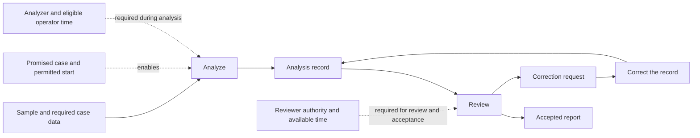
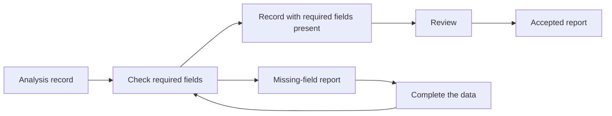

y basis. It is obtained by dividing a present value by the matching annuity factor for its life; the transformation does not establish those economic conditions. An explicit common-horizon cash comparison is often clearer when future replacements or residuals differ. The worked case below demonstrates the premise without requiring annualization.

Where a later action remains optional, include the contingent rule supplied by FIN.8. Several options can compete for the same later capacity or finance. Summing their separately optimal values can presume that each may be exercised in a state where the corporation can fund only one. Value the feasible joint policy with the same information dates and shared constraints. An action chosen before a future signal cannot be optimized separately in each final state.

Dependence between outcomes also matters. A sum of compatible expected cash values does not itself require statistically independent outcomes, but common shocks can cause simultaneous funding needs, operating failures or changes in financing cost. Stress the shared drivers across the combination, not a different favorable environment for each component. Return how the recommended combination behaves under those conditions and which feasible response remains.


#### FIN.9:4.4 - Build the buyer's acquisition comparison


Identify what the buyer obtains and pays for: assets, shares or another specified interest. Recover the included debt, cash, ownership rights and remaining obligations through FIN.7 and FDM where needed. A quoted enterprise price, an equity price and the cash required at closing are different amounts. Reconcile them before evaluating the premium.

Start from adequate standalone values of the affected businesses under their attainable no-deal continuations. Then construct what the combination changes. A cost synergy needs the actual reduction in resource commitments and the expenditure or delay needed to achieve it. Additional sales need their contribution after operating cost, investment, working capital and tax. A financing or tax benefit needs the actual available terms and usable deductions. FIN.4 supplies the accounts, FIN.6 the incremental cash and FIN.5 the corresponding financing valuation.

Use a combined with/without forecast when the effects are too interdependent to allocate reliably between businesses. Compare combined value with the sum of the standalone values on matching grounds. That difference can include both gains and losses. Integration disruption, customer departure, lost supplier terms and capacity constraints belong in the same account as hoped-for savings. Do not treat each claimed synergy as certain while assigning all execution uncertainty to a separate generic discount.

Distinguish improved standalone management from benefits requiring the specific combination. If the target could make a supported improvement without this buyer, the change may already belong to its no-deal value or to the price demanded. If only the combined resources make an improvement attainable, explain that dependence. A percentage “control premium” and a percentage “synergy premium” can charge for the same underlying change twice.

For a cash equity purchase on the simple common basis, buyer incremental value is the target interest's standalone value plus attainable incremental buyer benefits, less integration and other incremental costs, less the equity price. Equivalently, the maximum price at zero buyer gain is standalone interest value plus net buyer benefits. That threshold is conditional on the assumptions; it is not an instruction to offer the seller all of it. Compare the surplus with other available capital uses.

Where consideration includes shares, earn-outs or contingent payments, value the actual claim transferred and its consequences for the buyer's existing owners. Issuing shares is not costless merely because no cash leaves at closing: the recipients share in the combined business. An earn-out can shift outcome risk while creating a later payment and incentives that alter behavior. Use the relevant claim and option valuation, actual ownership terms and financing account rather than forcing every structure into a fixed cash-price subtraction.

Reconcile funding separately at each date. The target's included cash may be accessible only after closing or remain restricted; debt may stay in place, require repayment or need refinancing. Acquisition fees, collateral and integration expenditure can precede any synergy. A source of financing with a fee or changed risk must enter the valuation once on matching grounds. A positive buyer value does not establish access to the funds or the ability and authority to realize the operational changes.


#### FIN.9:4.5 - Build the seller's divestment comparison


Compare the whole no-sale continuation with the sale proceeds and the remaining business under the proposed separation. Start with the actual net proceeds: consideration, transaction costs, tax, settlement timing, retained interests, escrows and contingent amounts as applicable. A headline price payable over time is not the same as cash available now.

Rebuild the remaining operation. Which shared services, customers, purchasing terms, intellectual property or capacity remain, change or disappear? Which costs are actually avoided, and which become stranded? Removing an allocated headquarters expense from the sold unit's account does not eliminate the corporation's remaining payment. Conversely, a separation plan can make a real resource reduction possible, but it must include the transition cost and timing.

Retain obligations left with the seller, including supported guarantees, tax, closure or service commitments. A transition-services agreement can create temporary revenue and cost as well as continued dependencies. Avoid counting the sold business's future cash as still owned after also including its sale proceeds. FIN.7 supplies any retained-interest value; FIN.6 supplies separation cash and FIN.22 supplies a wider recovery-route comparison when distress governs the choice.

Ask what happens to the proceeds. Repaying debt, retaining funds for investment and distributing them have different financing and claimant consequences. Include those effects only in the alternatives that actually take the corresponding action. FIN.21 supplies the retain-or-return comparison. The sale itself does not create the investment gains of an unspecified future project.

A divestment can raise cash while reducing total value, or reduce reported profit while improving value through an attainable better use. Explain the receiving criterion through FIN.1. If liquidity is a binding condition, compare the feasible alternatives and their value sacrificed or preserved; do not present gross cash proceeds as evidence that the seller became richer.


#### FIN.9:4.6 - Return the allocation with its grounds and reconsideration conditions


Explain why the selected whole alternative is preferable under the stated basis, which constraints bind, and what a plausible change would do. A close result can depend on a price, capacity block, replacement assumption, shared customer effect or funding date. Use the relevant sensitivity or coherent scenario to identify that dependence; an unexplained composite score cannot repair incompatible financial meanings.

Retain a robust alternative or a conditional recommendation where the evidence warrants it. If the gain turns on an attainable missing fact, use C.11.DUA to compare obtaining it with acting, deferring or choosing a smaller commitment. If the uncertainty cannot be resolved in time, make the available choice and its consequences explicit rather than assume the most favorable branch.

The financial recommendation is an input to the corporation's decision. Existing authority may already cover routine action; other transactions need their actual consents and execution arrangements. FIN.16 combines the warranted financial answer with those conditions, and FIN.17 refreshes the affected value or constraint when the relied-on facts change. A changed constraint reopens the feasible set, while a changed operating assumption reopens the values it affects.

### FIN.9:5 - Archetypal Grounding

With a capital limit of 100, indivisible projects A, B and C cost 100, 60 and 40 and have NPVs 25, 18 and 12 on compatible grounds. Assuming no interaction, B+C costs 100 and yields 30, exceeding A's 25. Ranking standalone NPV would select A and miss five of value. Suppose instead that doing B and C together loses 8.8 of incremental after-tax cash at the end of year 1 because they compete for the same customers. At a matching 10% return for that lost cash, the interaction is −8 today. Combined NPV becomes 18 + 12 − 8 = 22, so A at 25 is preferable. If B and C require the same unavailable capacity, remove their combination as infeasible rather than merely assigning it a lower value.

A separate replacement choice must provide the same service for four years. Assume equal operating effects, a qualified 10% return, no resale proceeds and feasible funding. A short-lived asset costs 70 now and lasts two years; another costs 110 now and lasts four. If the short-lived asset can actually be replaced at year 2 on the same terms, its complete present cost is 70 + 70/1.1² = 127.85. The four-year asset at 110 is preferable despite its larger initial payment. If service is needed for only two years, retaining the no-resale premise makes the 70 asset preferable. If replacement is unavailable or its future terms differ, rebuild that continuation instead of repeating 70 automatically. FIN.6 constructs the dated alternatives; this comparison chooses between them.

In a constructed acquisition at one valuation date and currency, standalone operating enterprise value is 100. Debt with a market value of 30 remains outstanding in the acquired company, and included excess cash of 10 is freely transferable after closing. With no other claim adjustment, standalone equity value is 80. Buyer-specific incremental benefits have present value 30; integration and other incremental costs have present value 15, on compatible after-tax grounds.

| Equity price | Buyer value after price |
| --- | ---: |
| 100 | 80 + 30 − 15 − 100 = −5 |
| 90 | 80 + 30 − 15 − 90 = +5 |

Positive combination benefits therefore do not justify the price of 100. A price of 90 changes the financial answer on unchanged grounds. A new financing effect must enter the appropriate valuation once; it cannot be both capitalized in the rate and subtracted again as the same cost. The included 10 is not available to pay the seller before closing. Actual funding, consent and the ability to realize benefits can still block the transaction.

A separate acquisition pays for the target entirely with newly issued shares. Suppose the buyer's standalone equity value is 200, represented by 100 identical shares, and the target's equity value is 80. On matching date, claim and tax grounds, the combination adds 20 after all incremental costs. The buyer issues 50 shares with identical rights to the seller in exchange for all the target equity. There are then 150 shares: the seller owns one third and the buyer's existing owners retain two thirds. Combined equity is 200 + 80 + 20 = 300; the transferred interest is worth 100 and the retained interest 200. The old owners gain zero over their no-deal value, even though the combination creates 20.

If supported net combination gain instead rises to 50 with every other term unchanged, combined equity becomes 330. The seller's third is now worth 110 and the old owners' two thirds 220, giving them a gain of 20. Pricing the 50 new shares at the old share value of 200/100 = 2 would charge only 100 and incorrectly report buyer gain 80 + 50 − 100 = 30. The consideration shares participate in the same combined value being assessed. Their issue transfers an ownership claim; cash fees, integration payments and any debt settlement still enter the separate dated funding account.

For a divestment, suppose the whole business is worth 150 before sale. Net sale proceeds are 45 and the remaining business, after all lost synergies and retained obligations, is worth 100. The comparable total is 145, five below retaining the business. A headline offer of 50 would not establish a gain without the net-proceeds and residual-business calculation.


#### FIN.9:5.1 - A project, an acquisition and an expansion choice


A corporation has 110 of usable capital today and must choose among a project P, acquisition A and an expansion that can be reserved as right O or committed to now as K. O and K are alternative strategies for the same expansion. The question is incremental value to this buyer, in one currency at date 0, against continuing the existing activities without these additions. All amounts below use consistent after-tax claims and include their relevant costs. The project, acquired business and expansion use different operating resources; absent a stated constraint their cash effects are additive. This is FIN.1's financial frame.

For P, use one tenth of FIN.6's constructed project. Equipment 90 and working capital 10 require 100 now. An operating projection prepared through FIN.4 supplies annual sales 110 and cash operating costs 40; FIN.6 then subtracts displaced contribution 6 and feasible rent forgone 4, giving margin 60. With depreciation 45 and same-year usable tax at 25%, operating cash is (60−45)×0.75 + 45 = 56.25. Year 2 adds working-capital recovery 10, asset sale after tax 7.5 and closure after tax −1.5, giving 72.25. A qualified supplied return of 10% fits these operating flows; use FIN.5's construction if that basis must be obtained. NPV is −100 + 56.25/1.1 + 72.25/1.1² = 10.85.

For A, use FIN.7's zero-growth operating value 100: 10/1.1 + (10+100)/1.1². Subtract the debt of 30 remaining in the acquired company and add included excess cash 10 to obtain equity value 80. Buyer benefits produce incremental after-tax cash 16.5 and 18.15 in years 1 and 2, with supported return 10%; their present value is 30. Integration costs 15 are paid today. At equity price 90, buyer NPV is 80 + 30 − 15 − 90 = 5. Both price and integration payment fall due before closing; the acquired 10 becomes usable only afterward.

For O, use FIN.8's fee-8 strategy: pay 8 today, then pay 60 in one year only if the revealed expansion value is 90 rather than 40. Its probability 0.5 and stipulated absence of priced risk before exercise support discounting the 30-or-zero payoff at 5%, giving NPV 6.29. This rate differs from P's because the risk grounds differ. A pre-existing deposit, unavailable today, releases 60 just before that exercise date; its receipt is in the baseline cash plan for every alternative. Exercising consumes that money, already included as the 60 exercise cost, so the deposit is not added again to O's value. The available fixed strategy K also pays 60 at that date but must do so in both states. Its NPV is (0.5×30 + 0.5×(−20))/1.05 = 4.76 and it requires no payment today.

| Combination | Payment required before today's closing | Incremental NPV | Current capital constraint |
| --- | ---: | ---: | --- |
| Neither investment nor reservation | 0 | 0 | Feasible |
| P | 100 | 10.85 | Feasible |
| A | 105 | 5.00 | Feasible |
| O | 8 | 6.29 | Feasible |
| K | 0 | 4.76 | Feasible |
| P + O | 108 | 17.13 | Feasible |
| P + K | 100 | 15.61 | Feasible |
| A + O | 113 | 11.29 | Exceeds 110 |
| A + K | 105 | 9.76 | Feasible |

Every combination containing both P and A exceeds 110; O and K cannot be selected together. The reservation fee is due before the acquired cash is released, so that cash cannot rescue A+O at the required time. With the stated independent effects and later exercise funding, P+O leads. The full cash plan must also support P's intervening payments; that feasibility is a supplied condition of this case, not inferred from expected NPV.

Now suppose obtainable rent for P's resource rises from 4 to 15 per year, leaving the acquisition and both expansion strategies unchanged. P's flows become −100,+48,+64 and NPV −3.47. P+O remains affordable but falls to 2.81; P+K falls to 1.29. A+K at 9.76 now leads, exceeding O alone at 6.29. The changed recommendation follows the baseline through the cash construction into the whole comparison. If the deposit's release is delayed, funding for O or the binding K payment must be recovered through FIN.2 and any changed financing effect valued before relying on either recommendation.

### FIN.9:6 - Bias-Annotation

Synergies and strategic benefits often receive the sponsor's most optimistic assumptions. A corporation-level total can hide the burden on particular operations or claimants. Preserve those constraints and the uncertainty that matters to the recommendation.

### FIN.9:7 - Conformance Checklist

Are the combinations retained for choice feasible, and do their values share a comparison basis? Are shared resources and effects counted once? For a transaction, can the reader recover the interest, claim bridge, price, incremental effects and residual business? Are financial preference and closing conditions distinct?

### FIN.9:8 - Common Anti-Patterns and How to Avoid Them

Ranking by standalone return can miss dependencies; compare combinations. Treating synergy as permission to pay any premium omits price; calculate buyer value after consideration. Calling disposal proceeds profit can ignore the asset and continuing obligations surrendered; compare the complete alternatives.

### FIN.9:9 - Consequences

The corporation obtains a conditional allocation or transaction recommendation that explains why a combination or price changes the result. A useful financial answer may still require operating, financing or authority action before implementation.

### FIN.9:10 - Architectural Rationale

Individual values become an allocation answer only after the alternatives can be selected together on their stated grounds. Shared resources, common baselines and future choices can make a sum of correct standalone figures describe no feasible action. Constructing the whole alternative reveals the interaction and locates the binding constraint, while retaining the constituent Methods for the calculations they actually supply.

The horizon follows the required consequence. A four-year service choice can need a replacement after two years; an independently complete two-year opportunity need not be repeated just to match another investment's life. Likewise, preserving two valuable options does not supply the capacity to exercise both. These differences are reasons to construct the actual continuation, not to reject NPV or choose a universal annualization rule.

A transaction changes more than the cash paid or received. Buying changes claims and operations, and the price determines how much of the combined gain remains with the buyer. Selling can leave costs and obligations with the remaining business. Comparing those whole alternatives prevents standalone target value or headline proceeds from being mistaken for an incremental gain to the corporation. Legal closing and operational delivery remain the actual practices that make the selected financial premises attainable.

### FIN.9:11 - SoTA-Echoing

The public [CFA capital-allocation][CFA-CAPITAL] and [corporate-restructuring][CFA-RESTRUCT] readings frame the investment and transaction questions. Damodaran's historical [capital-rationing and unequal-life discussion][DAM-ALLOCATION] develops the effects of limited capital and attainable continuations. His [acquisition-motive analysis][DAM-ACQUISITION] distinguishes mispricing, operating changes and combination gains. FIN.9 uses these financial distinctions with actual incremental cash, consideration and dated constraints, including the buyer's or seller's remaining operation. Historical deal outcomes supply no evidence that a particular proposed synergy will occur. Changed scope, shared operating effects or available funding reopens the comparison.

### FIN.9:12 - Relations

FIN.6–FIN.8 supply values; FIN.2 supplies timed funding needs; FIN.10–FIN.12 supply financing conditions; FIN.21 supplies retention or payout alternatives. FIN.16 prepares the receiving advice. [FPF C.11][CHOICE] supports the local choice once these financial alternatives exist.

### FIN.9:End

# Part C - Financing, distributions and recovery

## FIN.10 - Design Financing Instruments and Terms

**Type:** Method

**Status:** Stable

### FIN.10:0 - Use this when

The corporation needs funds, a backstop or refinancing and must construct or compare the terms that could provide them. Use this method when available offers do not fit and a jointly acceptable arrangement still has to be developed, as well as when comparing existing offers. Use an adequate committed arrangement directly when the task is only its permitted execution.

### FIN.10:1 - Problem frame

Calculating an effective financing rate requires familiarity with compounding and discounting timed payments. Comparing adequate supplied proceeds and payment amounts can be sufficient without solving for that rate.


The object is a proposed financing arrangement: the contributions, claims and conditions through which identified parties could make funds available. Instrument design includes amount, maturity, repayment, priority, collateral, currency, options and control terms. Its result can be a proposal worth negotiating, an obtainable financing choice or a supported decision to change the underlying plan. A proposal becomes agreed finance only through the required acts of the participants; disputed legal interpretation requires its own qualified result.

### FIN.10:2 - Problem

The lowest headline rate can produce the highest effective cost, insufficient net proceeds or a maturity the corporation cannot meet. Sometimes no offered instrument supplies the required service, even though a different combination of commitments, risk and participation could do so. A borrower-only design can remain unacceptable to the people expected to provide the money. An indicative term sheet can also be mistaken for committed funding.

### FIN.10:3 - Forces

Balance cost, access, timing, flexibility, control and repayment risk for the corporation and the consequential other participants. A condition protecting one party can remove another party's willingness or ability to participate. Retain detail that can change the choice while keeping genuinely comparable alternatives visible.

### FIN.10:4 - Solution

1. Recover the net amount and dates needed, currencies and expected repayment capacity. Include the effect of fees withheld at issue. Use FIN.2 where the funding requirement is unresolved.
2. Recover potential participants' contributions, alternatives and limits. Construct terms through FIN.10:4.1.1 through FIN.10:4.1.3 when no adequate offer exists. Specify who supplies funds, who owes what, repayment and draw conditions, ranking, security, restrictions, conversion or exercise rights and required consents. Use [FDM][FDM] for an unresolved position or conditional event.
3. Project proceeds and every material payment under each alternative: interest or distribution terms, principal, issue and commitment fees, collateral or margin cash, tax consequences where supported, and contingent payments. Use the stated rate conventions, day counts, resets and settlement dates.
4. Compare the same funding requirement over the same horizon. Where meaningful, solve for the rate equating net proceeds with the discounted payments; retain any option or contingent risk that a single effective rate cannot represent.
5. Test refinancing and adverse states, collateral and covenant constraints, currency mismatch and control effects. Compare a long maturity with a rollover plan only if the latter includes its actual access uncertainty.
6. Obtain specific legal, tax, accounting or provider facts where they change the offer or its use. Distinguish proposed, offered, accepted, committed and currently drawable terms by what has actually occurred.
7. Return the preferred terms or conditional alternatives, total cash consequences and the unresolved condition. FIN.11 handles the larger financing mix and FIN.15 executes an authorized transaction.


#### FIN.10:4.1 - Start with the financing service that is actually needed


Translate the proposed operating or investment action into net usable amounts, dates and currencies. Include the time until the first draw, any staged expenditure and the cash from which the financing will later be serviced. FIN.2 supplies that dated need; FIN.4 supplies the operating account behind it. A requirement for 100 available on Monday is not met by a commitment for 100 signed on Monday if settlement occurs on Friday or fees reduce proceeds to 98.

Clarify whether the comparison concerns new money, refinancing an existing obligation, a backstop or a continuing source of capital. Refinancing must include release of existing security, accrued interest, break costs and the overlap between old repayment and new settlement. A backstop must remain drawable in the state it is supposed to protect. Continuing funding requires a view of renewal and later investment, not just this period's interest bill.

Form alternatives from sources the corporation could actually use. They can include retained cash, a loan or revolving facility, a debt security, new equity, a lease or a sale of an asset. These sources do not all preserve the same operating rights or ownership. A lease and purchase comparison needs FIN.6's whole operating alternatives; a divestment needs FIN.9's remaining-business effects. Retained cash is available only after its other uses and restrictions, and has an opportunity cost even though no external coupon is paid.

Distinguish an indicative possibility, a quoted offer subject to conditions, an executed commitment and settled funds. Compare conditional offers when that is the question, but keep their unmet conditions in the recommendation. Useful next work may be obtaining a term, release or commitment that changes the feasible set. It need not be a more precise ranking of offers that cannot fund the action.


##### FIN.10:4.1.1 - Recover the participants from what the financing must accomplish

When no adequate offer is available, start with the unmet service rather than a preferred security label. Identify who could supply money, absorb a particular loss, change a payment date, provide a verifiable commitment or obtain a benefit from the funded activity. Potential participants can include owners, lenders, customers, suppliers, an asset owner or a partner. A customer may value assured supply; a supplier may value an order; an investor may value participation in future upside. These interests can support different terms without giving the parties one common objective.

For each consequential participant, recover the contribution it can actually make, its available alternative, required benefit, cash dates, risk capacity and decision constraints. Ask what prevents participation on the present terms. A provider may lack information, dislike the proposed risk, have no mandate for that instrument, or need its own money sooner. Those are different obstacles. Obtain only information that can alter the proposal. Use [ECO.3][ECO] when the missing work is discovering and combining separate plans; FIN.10 then converts that result into a financing service and financial claims.

Build each side's dated comparison. For a lender, distinguish promised service from plausible receipts, credit loss and recovery, funding and administration costs, and the opportunity being forgone. For equity, compare the acquired economic and control rights with the price and further funding commitments; a share of a forecast is insufficient without identifying the claim. For a customer or supplier, include commercial value, working-capital use and the exposure transferred by prepayment or deferral. Use FIN.5 through FIN.8 for a valuation that matters; a supported bound can be sufficient before a precise price exists.

Keep conjectured willingness distinguishable from a stated negotiating constraint, a conditional offer and a commitment. A provider's balance sheet or membership in the group does not establish that it will fund this arrangement. If the available participants cannot support a necessary contribution, change the scale, staging, activity or participant set, or return that financing is not presently obtainable.

##### FIN.10:4.1.2 - Construct terms that reconcile the financial constraints

Work back from the date and state in which the current proposal fails. Change the financial term or underlying commitment that governs that failure, then calculate the new consequences for every affected party. If principal is due before cash can be generated, possible constructions include later amortization, a smaller initial draw, equity participation, staged expenditure or a payment commitment from a customer. If loss exposure prevents a loan, compare genuine collateral, a limited guarantee, first-loss capital or a different revenue arrangement. The party taking the risk must have capacity and a reason to accept it; moving the loss does not make it disappear.

Combine terms where one instrument cannot supply the whole service. An owner contribution can absorb initial loss while a lender funds a bounded amount; a customer advance can reduce the draw needed; a lease can give access to an asset while leaving a different ownership and ending arrangement. Specify both initial money and later flows. A discount, guarantee fee or conversion right is consideration for something: account for its cost and the actual benefit it buys. Compare an adequate standard instrument before inventing a more complex combination.

Find terms satisfying the connected comparisons. For example, derive the maximum service the corporation can meet under the selected protection, the amount and terms a provider will consider, and any minimum participation benefit for another party. Vary repayment dates, amount, price or rights within those bounds. If the bounds do not intersect, a more attractive presentation of the same numbers will not repair the arrangement. Change the activity or the allocation of risk, obtain a different provider, retain a conditional result, or stop. An expected-value gain can coexist with an unacceptable shortfall; retain the relevant states as well as the average.

Information and subsequent action can change those bounds. A lender may need evidence of a customer commitment; an investor may require an interpretable milestone before another contribution; an advance payer may need protection against diversion of its money. Specify what is observed, who can change it and what financial consequence follows. Use ECO.5 when participation, private information or incentives require construction. A covenant should address the action or exposure that makes financing difficult, with its actual information, response and cost. A metric that can be improved while destroying repayment capacity fails that purpose. An unobservable or unenforceable trigger cannot carry the claimed protection.

Bring the new terms back to the business. A restrictive delivery commitment can change capacity needs, a customer discount changes proceeds, and a pledge can consume security needed elsewhere. FIN.3, FIN.4, FIN.9, FIN.11 and FIN.12 supply the affected comparisons. The result is one coherent financial alternative, including the consequences that made its funding possible.

##### FIN.10:4.1.3 - Obtain an actionable proposal and a possible closing

Take the connected proposal to the relevant participants through the authorized negotiating process. Obtain the objections and conditions that can change it: amount, service, information, ranking, security, ownership, control or timing. Recalculate a changed package rather than retaining each party's preferred terms from incompatible versions. A rejected proposal can reveal a different source of value or a binding constraint; it need not mean that the underlying activity has no value.

Trace the conditions for the first money and commitment. If a lender pays after a customer advance, while the customer pays only after lender funding, there is no first move unless an actual simultaneous-closing mechanism can satisfy both. [ECO.4][ECO] explains this dependency problem. The financial continuation specifies who commits, whose money is available, what releases it, the settlement order, and what happens if one contribution fails. Escrow, a committed bridge or simultaneous conditional releases are candidates only when the parties and service providers can actually implement them. Include their costs and any refund, priority or cancellation consequences.

Separate the funding needed for the first useful result from funding assumed for later stages. A demonstration may improve the next financing prospect without committing anyone to provide that later capital. Return the funded scope, the remaining condition and the option to stop or resize. FIN.15 carries an authorized financing action into execution; successful negotiation and settlement require their actual participants. A well-founded proposal can finish the analytical task without being reported as money already obtained.

#### FIN.10:4.2 - Translate the instrument into changing claims and cash


Recover the actual borrower or issuer, financier, claim, security, ranking, guarantees, covenants and relevant options. FDM.3 derives events from terms and tracks the changing principal or other state; use that supplier rather than infer behavior from an instrument's label. FDM.1–FDM.2 resolve which entity owes the money and whether another entity's support is available. The financial comparison consumes those qualified events and adds cost, risk and fit to the need.

For debt, separate committed limit, amount drawn, outstanding principal and each payment due. A revolving facility permits repayment and redrawing only under its actual rules. A term loan may amortize principal, repay a bullet at maturity, or capitalize interest. Capitalized interest avoids an immediate payment but increases a later claim. Unused-line fees, upfront charges, minimum interest and mandatory repayments can make the cost depend on utilization and duration.

Construct each interest amount from its actual rate convention, reference rate, spread, reset dates, day count and outstanding balance. Include caps, floors or delayed resets if they change the comparison. A quoted annual nominal rate with monthly compounding differs from an effective annual rate. An amortizing loan's later interest applies to remaining principal; treating the initial face amount as outstanding throughout overstates that interest. Conversely, applying the smaller closing balance to the whole period understates it.

Collateral and guarantees affect more than the quoted spread. A pledge may prevent another valuable use of the asset or reduce future borrowing capacity. A guarantee can move loss to another entity and may require payment or consent. Count its actual charge, exposure and effect on access; the collateral's full market value is not automatically an immediate cash cost. FIN.12 establishes the resulting restrictions, and FIN.11 considers the whole financing position.

For equity, recover the interests issued, economic participation, voting or control rights, preference, conversion, redemption and any further funding obligations. A small stated percentage can carry rights that change its financial consequence. An investor's required return is an opportunity cost and valuation input, not a promised coupon unless the actual instrument creates such a payment. Common equity with no mandatory redemption has different service risk from debt; a preference or redeemable instrument needs its own terms.


#### FIN.10:4.3 - Put prices on a comparable basis without losing timing


Begin with net cash the corporation can use after issuance costs, withheld fees and any temporarily restricted proceeds. Then lay out the complete payments, recoverable deposits and other financial consequences. For a conventional loan with one initial net receipt and later payments, the effective financing rate is the rate that makes the present value of those payments equal to that receipt. Use their actual dates and a stated annualization convention. This rate reveals the effect of fees or amortization hidden by the coupon.

For irregular or state-dependent cash flows, a single rate can be incomplete or even have several mathematical solutions. Retain the cash schedule and compare supported present values, scenarios or contingent claims under FIN.5–FIN.8 as applicable. A promised yield can differ from the financier's expected return when repayment is uncertain. Neither that yield nor the borrower's average corporate WACC is automatically the right discount rate for every financing consequence.

Tax effects require the applicable entity, deductible amounts, use limits and payment dates. If a deduction cannot be used now, do not mechanically reduce today's cost by the headline tax rate. FIN.5 supplies the qualified treatment of tax shields and risk. Keep their value either in the selected valuation or as an explicit separate effect, with no second credit for the same saving. A comparison before tax can be sufficient when tax consequences genuinely match or are immaterial to the question.

Compare identical financing service where possible. Two loans raising the same money now but repaying at different times provide different duration and liquidity support. The smaller nominal total payment can simply reflect earlier return of principal. If amounts differ, identify the use or cost of excess funds rather than choose the smallest rate without regard to need. If currency differs, incorporate actual conversion and any selected hedge; the lower foreign-currency coupon alone cannot rank the offers.


#### FIN.10:4.4 - Match service obligations to the business under relevant states


Use the operating cash available after essential payments and investment to test service, preserving the required reserve. Compare dates and amounts, not merely the maturity label. A five-year facility with large annual amortization can demand more early cash than a shorter bullet loan. A bullet can fit early cash better while creating a concentrated refinancing or disposal need. Prove the proposed source of that repayment or retain it as a condition.

Consider which business exposures make financing harder to service. Floating interest can rise when operating cash is weak; fixed interest can cost more initially but reduce that exposure. Debt in a foreign currency may match genuine cash receipts in that currency, but a product sold there does not establish such a match if its price or settlement is actually in another currency. FIN.13 supplies the exposure analysis; FIN.14 handles a separate hedging choice where required. Asset and liability sensitivities can inform the design; approximate matching is not a guarantee against default.

An option to prepay, extend, convert or redraw has value only on its terms and in the states where it can be exercised. Identify who holds it. A lender's call right can shorten the borrower's dependable horizon, while a borrower's extension subject to lender consent is not unconditional protection. A convertible's lower coupon is paid for partly with an ownership claim; compare the joint instrument rather than treating the coupon reduction as free. Use a qualified valuation for material contingent terms or return the unresolved price as a range.


#### FIN.10:4.5 - Select an obtainable arrangement and return its consequences


Compare the resulting proposals and feasible offers on financial value, dated coverage, restrictions, exposure and effects on the chosen owners. Keep their different commitment states visible; a promising unagreed package cannot displace a necessary payment with already available money. Explain a trade-off when a cheaper expected arrangement is less dependable or sacrifices an important right. Do not hide it in an unexplained weighted score. The chosen objective and constraints come from FIN.1; the corporation-wide debt/equity policy comes from FIN.11.

Return the selected or conditional terms to FIN.2, FIN.4 and FIN.12. Recalculate cash, interest, tax, debt balances and covenant headroom. If the new financing creates another shortfall, change its amount, timing, instrument or the underlying action; do not retain both an old cash forecast and a new loan recommendation that no longer agree. The result can be a smaller feasible financing package, a negotiation position or an explicit absence of an obtainable offer.

A useful recommendation names the instrument and provider or provider class, net usable proceeds, draw and service dates, economic and ownership effects, and the conditions still needed before commitment or use. FIN.15 executes a sufficient authorized decision. FIN.10 does not turn its preferred terms into an executed contract.

### FIN.10:5 - Archetypal Grounding

Two constructed one-year offers finance a net need of 100. A charges 8% interest on face value and withholds an issue fee of 2% of face value. B charges 9% and no fee. Assume no other cost, tax difference or contingent term and that A permits the necessary larger face amount. A must issue 100/0.98 = 102.04 and repay 102.04×1.08 = 110.20; its effective cost is 1.08/0.98−1 = 10.20%. B provides 100 and repays 109, so B is cheaper for this need despite its higher headline rate. If A is capped at face value 100, its net proceeds of 98 do not meet the need at all.


#### FIN.10:5.1 - The same rate can provide different payment capacity


A separate corporation must pay 100 for an investment now and retain its existing cash reserve of 10. Two actually offered loans each deliver 100 net now, with no fees, tax differences or other restrictions. Both charge 10% annually on outstanding principal. Loan A repays 50 of principal at each year end; its payments are 60 in year 1 and 55 in year 2. Loan B pays interest 10 in year 1 and principal plus interest 110 in year 2. The investment and the rest of the business together provide cash of 28 and 115 at those year ends after every nonfinancing requirement. No additional source is available and no earlier shortfall occurs.

Loan A would leave 10 + 28 − 60 = −22 in year 1. Its nominal interest total of 15 does not make it usable. Loan B leaves 28 after year 1 and 33 after year 2, so it preserves the reserve at both dates. At a 10% comparison rate, each payment schedule has present value 100: 60/1.10 + 55/1.10² equals 10/1.10 + 110/1.10². The difference is the timing of principal use, not a lower effective rate.

If operating receipts move so that available cash becomes 60 in year 1 and 83 in year 2, preserving the total 143, Loan A leaves 10 and then 38. Both schedules now fit. Comparing their remaining cash requires the use and return of any interim surplus; comparing the final balances alone ignores that Loan B leaves more cash available after year 1. A decision to prefer one must therefore state that use or the relevant flexibility, not merely count interest.


#### FIN.10:5.2 - The holder of a financing right changes the dependable horizon


In a separate constructed case, the company has cash 10, a required reserve of 5 and an investment payment of 100 now. Each offered loan supplies 100 net before that payment. The investment produces net cash 112 at month 12, with no interim receipt or other cash difference. Interest of 3 is payable at month 6; if the principal remains outstanding, another 3 is payable at month 12. Compare three stipulated versions, with no fees or other acceleration condition:

- The principal is due at month 6, but the borrower can extend it to month 12 by giving notice by the end of month 5. Timely notice is sufficient under the agreement; lender consent is not required.
- The same extension requires the lender's affirmative consent by the end of month 5. The borrower's request alone does not extend the loan.
- The stated maturity is month 12, but the lender may require repayment at month 6 by giving notice by the end of month 5.

After the initial draw and investment, cash remains 10. With the first version and a valid extension notice, the month-6 interest leaves 7. At month 12, cash becomes 7 + 112 − 100 − 3 = 16. The borrower's exercisable right supplies the required horizon on the stated conditions.

For the second version without obtained consent, or the third after the lender's call, month 6 requires principal and interest of 103. Preserving the reserve needs 103 + 5 − 10 = 98 of replacement net proceeds by that date. The positive month-12 investment return cannot pay this earlier maturity. Before committing, the company needs an arrangement that covers that branch, a different initial instrument or a changed investment plan. It cannot choose the lender's future action as though that were its own extension option.

Suppose a separate replacement commitment is actually obtained by month 5 and supplies 98 net before the month-6 repayment, with conditions already satisfied and repayment of 103 at month 12. The month-6 account is 10 + 98 − 103 = 5; the final account is 5 + 112 − 103 = 14. This arrangement makes the early-repayment branch feasible on the given premises. If its proceeds instead settle after the old loan falls due, the arrangement does not repair the maturity gap.

These timelines establish dated availability and the resulting payments. Pricing the contingent rights is a further question requiring the qualified valuation grounds in FIN.8; the difference between final cash balances is not itself a price for an extension or call. FDM.3 supplies the actual notice, consent and claim events; FIN.2 tests their settlement order.


#### FIN.10:5.3 - Equity finance prices a transferred interest


In another constructed offer, the existing equity is worth 200 immediately before financing. A new investor supplies 100 net, with no fees or special rights, and the cash is added to the business without any other value change. Equal ordinary interests imply post-money equity value 300. Issuing one third of that equity to the investor leaves the old owners with two thirds worth 200. If the investor instead requires 40% on these same valuation grounds, the old owners retain 60% of 300, or 180: a transfer of 20 relative to their starting interest.

This is a valuation comparison of the offer, not a claim that an investor must accept one third. A changed business value, funding urgency, preference or control right changes the comparison. If the cash funds an investment with its own gain, first include that attainable gain consistently; do not credit it wholly to old owners and also use it to justify the new investor's percentage.

#### FIN.10:5.4 - Construct a package that no participant offered alone

A manufacturer can complete an order for a cash payment of 100 on day 0 and deliver on day 90. It has no money available for that payment. The customer would otherwise buy equivalent delivery for 150 on day 90. The manufacturer also proposes 150, but cannot obtain an unsecured loan of 100. All quantities below are constructed negotiating inputs; there are no taxes, other payments or additional reserve requirements in this bounded case.

Discussions establish three constraints. With the specified customer contract and security, the bank is willing to fund at most 60 on day 0 for repayment of 64 on day 90, subject to its stated closing conditions. The customer can advance at most 40 and requires a total price reduction of at least 3 to compensate for the advance's funding use and assessed exposure. The manufacturer requires at least 40 remaining cash after paying the production and financing costs. Those constraints came from the parties' own comparisons; they are not inferred from a universal interest rate.

The bank limit requires at least 40 from another source. The customer's limit makes an advance of 40 the candidate contribution. Let the price reduction be d. The customer then pays 40 now and 110 − d on delivery. After repaying the bank's 64, the manufacturer retains 46 − d. Its requirement gives d ≤ 6, while customer participation requires d ≥ 3. The common interval is 3 through 6. A proposal with d = 4 provides the initial 100, leaves a delivery payment of 106 and manufacturer cash of 42, and gives the customer a price reduction of 4 against its required 3. This finds mutually compatible candidate terms; it does not establish that the parties have accepted them.

The package also needs a closing. Suppose the customer will release its 40 only when the bank's 60 is committed, and the bank requires the customer contract and advance. The parties can propose a funded escrow that releases the combined 100 to production only when both contributions and the stipulated documentation are in place, with a specified return of funds if closing fails. They must obtain the actual escrow, lender and customer agreements. If that service adds cost, include it and recompute the interval. If it cannot settle before production must begin, the constructed amounts still do not fund the order.

The contract changes the original account: the manufacturer receives total 146, not 150, and owes financing service 64. The customer advance is counted once, against the reduced delivery payment. The bank's 60 is a financing receipt and later principal obligation; it is not sales. FIN.4 preserves these meanings and FIN.2 tests the dates.

Now suppose the customer can pay only 80 on day 90, leaving the rest late. The manufacturer has 16 after bank repayment, below its required 40. If the entire receipt is late, the loan itself is unfunded at maturity. The contractual customer amount, the bank's due date and the loss allocation do not change merely because the forecast did. Return to collection protection, a supported extension or bridge, different terms or a changed production commitment. The proposal's original amounts fitted the stated requirements; its continuing feasibility depends on the credit and timing conditions.

#### FIN.10:5.5 - Finance a learning stage without inventing later capital

A development venture needs 20 for an independent technical trial and, if the result warrants continuation, 80 for deployment. It has no dependable cash from which to promise near-term debt service. A prospective investor can accept first-stage loss for an agreed equity interest, but requires an interpretable trial result before considering the larger exposure. The useful design question is which stage and claim can attract capital now, together with what remains possible later.

Construct the first 20 equity contribution, the interest it buys, the permitted use, the trial result and the consequences of stopping. Then compare two later-capital terms. In one, the investor may consider a further investment after the trial but makes no later funding commitment. In the other, an enforceable commitment supplies 80 when the stated, observable conditions are met, with the later price or share-allocation rule already specified. The second transfers more future funding exposure to the investor and may require different ownership or control terms. The venture must compare that cost with the useful continuation it obtains. Neither party can assume that the other will accept the more protective version at the first version's price.

A successful technical trial does not establish demand or profitable deployment. Keep any remaining commercial conditions and the investor's actual rights. With the first term, FIN.8 can value the venture's opportunity to seek further finance, but FIN.2 cannot count the 80 as committed money. With the second, verify the commitment's availability in the state where the trial passes and bring its resulting ownership and service conditions into FIN.7 and FIN.9. If no later financing is attainable, the first stage may still be worthwhile for its own reusable result or may be rejected. The full development plan remains conditional rather than silently financed by optimistic future receipts.

### FIN.10:6 - Bias-Annotation

Provider quotations can omit conditions or vary in availability. A rate comparison can understate collateral, control, refinancing and concentrated-provider risks.

### FIN.10:7 - Conformance Checklist

Does each alternative supply the required net cash at the required time? For newly constructed terms, are the participants' contributions, alternatives, risks and reasons for accepting them explicit, and can the closing conditions be satisfied together? Are fees, repayment, rights and contingent terms recoverable? Are comparable dates and conventions used? Is each commitment and consent claim supported, and is the residual funding need visible?

### FIN.10:8 - Common Anti-Patterns and How to Avoid Them

Comparing coupons alone ignores issue economics; compare net proceeds and payments. Assuming a revolving facility will renew hides refinancing risk; show the expiry and available alternatives. Translating foreign debt at one spot rate can conceal future payment exposure; use FIN.13.

### FIN.10:9 - Consequences

The method can produce a financing proposal that was absent from the offered set, select useful existing terms, or explain why the remaining conditions cannot fund the requirement. Constructing the package costs negotiation and verification work; its gain must justify that burden. The returned commitment state and residual exposure determine what the corporation may rely on next.

### FIN.10:10 - Architectural Rationale

Financing exchanges present command over resources for claims, participation and conditions affecting the future. Matching the borrower's cash path is necessary for service, but a provider also needs a worthwhile, bearable and implementable contribution. Combining those perspectives explains why changing timing, risk, information or rights can create a financing possibility that a rate comparison alone leaves unavailable. A single cost measure remains useful when the omitted distinctions cannot change the choice.

### FIN.10:11 - SoTA-Echoing

The [AFP task domains][AFP] locate professional financing responsibilities. Damodaran's historical [financing-details treatment][DAM-FINANCING] explains how financing design relates to business cash and the transition from a desired mix. FIN.10 develops the obtainable offer, net proceeds, complete service and ownership consequences, using FDM.3 for contractual behavior and FIN.5 for qualified pricing. It retains asset–liability matching as an exposure question without adopting a claim that approximate matching eliminates default. The amortization and equity cases show why coupon or nominal total payment alone cannot rank offers. The construction in FIN.10:4.1.1 through FIN.10:4.1.3 also uses ECO.3 through ECO.5 for participant plans, connected commitments and incentives. World Bank's [bankability discussion][WB-BANKABILITY] makes risk allocation, service and equity needs interact in project finance. FIN.10 uses that financial relationship with explicitly constructed corporate cases; it does not import public-project guarantees or a universal debt share. Current terms, tax and legal conditions require their own sources.

### FIN.10:12 - Relations

FIN.2 supplies funding need; FIN.5 distinguishes required return from financing cost; FIN.11 compares the mix and FIN.12 its restrictions. FIN.23 constructs financial relations across entities. FIN.3 and FIN.8 develop cash-cycle and staging alternatives. ECO.3 through ECO.5 supply the general exchange, commitment and incentive constructions when needed; FDM supplies the resulting claims and events. FIN.13 and FIN.14 assess financial exposure and protection. FIN.15 carries out the permitted financing action.

### FIN.10:End

## FIN.11 - Select Capital Structure

**Type:** Method

**Status:** Stable

### FIN.11:0 - Use this when

The corporation must choose or reconsider its mix of debt, equity and other financing, rather than just select one instrument. Compare the mix under actual cash, tax, control, access and distress conditions. An analytical target is a proposal unless the relevant authority has decided it.

### FIN.11:1 - Problem frame

The object is a financing mix for the corporation or a specified financing need. Its usefulness depends on the operating assets, obligations and adverse states it must support. This method does not establish a universal optimal debt ratio.

### FIN.11:2 - Problem

Debt can lower a simple weighted financing cost while making the corporation unable to survive a cash downturn or obtain future funds. An all-equity alternative can preserve payment flexibility while imposing issuance cost or an unacceptable change in control.

### FIN.11:3 - Forces

Balance financing cost, tax benefits, control, distress exposure and flexibility. Distinguish expected profitability from debt-service capacity, and a long-term target from the next feasible transaction.

### FIN.11:4 - Solution

1. State the financing need, existing claims, operating cash generation and required liquidity. Separate the current mix, proposed transaction and longer-term analytical target.
2. Form materially different feasible mixes. Recover instrument terms through FIN.10 only where missing. Include continuation if it remains available.
3. Project each mix's cash service and residual claims over the relevant horizon and adverse states. Examine maturities, refinancing concentrations, currency mismatches and contingent obligations.
4. Assess the usable tax benefits and the costs or constraints of distress, issuance, information, control and future access. Use current institution-specific facts; do not transfer a tax or insolvency assumption between jurisdictions without grounds.
5. Estimate value or required-return implications with matching FIN.5 grounds where they can change the decision. Avoid holding equity and debt costs fixed while making a material leverage change unless that approximation is justified.
6. Compare the alternatives against the corporation's objectives and constraints. A mix with attractive expected value can be excluded by a required liquidity or access condition. Use FIN.12 for covenant and flexibility consequences.
7. Return a structure proposal, bounded target range or supported continuation, with the implementation conditions. Authorization and the actual financing remain separate decisions and actions.


#### FIN.11:4.1 - Decide a financing policy for a business, not a ratio in isolation


Capital structure concerns how the corporation funds and allocates the risks of its operations over time. Describe the present claims and the change being considered: new investment, recapitalization, refinancing, debt reduction or payout. The same observed debt ratio can arise from borrowing, a fall in equity value or disposal of operating assets. Those events have different consequences, so a ratio alone cannot specify the action.

Recover contractual debt service and material debt-like obligations from their actual terms. Keep the accounting classification, covenant definition and economic financing exposure distinguishable. A lease or contingent guarantee may matter to service capacity without being included in every published debt ratio. FDM resolves the positions; FIN.10 supplies instrument terms. Use the definition appropriate to each receiving calculation rather than silently forcing one number into all of them.

Separate three questions. How much service can the business support? Which financing policies provide worthwhile value and flexibility? Which of those policies can the corporation obtain and implement? A high estimated value under a policy does not answer the service or access question. Conversely, surviving one adverse scenario establishes a bounded capacity result, not an optimal financing mix.

A policy must say what happens after the initial issue. Will principal amortize, stay at a stated amount, be refinanced at maturity or be adjusted toward a market-value ratio? At what dates and under what conditions can that happen? FIN.5 explains why these policies imply different risk and tax-shield treatment. Market-value weights used in a valuation cannot serve as instructions to issue a fixed amount without that conversion.


#### FIN.11:4.2 - Construct service capacity from operations and constraints


Begin with an operating forecast independent of the proposed debt receipts. Recover cash after operating payments, applicable tax, essential maintenance and the investment required by the selected operating plan. Then apply each instrument's interest, principal, fees and other required payments at their dates. FIN.2 tests the cash account with reserves and actual support. EBITDA or interest coverage can aid analysis, but neither pays principal, tax or working-capital investment.

Stress the causes that can damage service together: revenue, margins, collections, required investment, rates, currency and refinancing access. Distinguish a temporary timing mismatch from an operating activity that cannot support its obligations even after a credible adjustment. The former may need bridging or changed terms; the latter may need a different mix, smaller investment or FIN.22 restructuring. Never make service capacity look adequate by repeatedly assuming an uncommitted refinancing just before each maturity.

Use FIN.12 for legal and contractual borrowing or distribution constraints. A covenant ceiling can be tighter than cash service capacity, and a cash shortfall can occur well within the covenant ceiling. Estimate available debt under both kinds of conditions and identify the binding one in each relevant state. Additional equity can remove a cash shortfall while still leaving a restriction on what the corporation may do.

Do not describe a limit obtained from one forecast as a permanent debt capacity. Report the operating conditions, time span, maturity profile and buffer that support it. If a small change in collections or margin makes a large difference, compare a range of policies with the cost of retaining more protection. Holding unused borrowing capacity can preserve a valuable future action, but its availability must survive the state in which that action matters.


#### FIN.11:4.3 - Explain what creates or destroys value when the mix changes


Borrowing transfers part of the operating return and loss exposure to lenders and usually creates dated service requirements. Equity holders retain a more sensitive residual claim. A lower quoted debt rate therefore does not mean replacing equity with debt continuously reduces the total economic cost. FIN.5 must re-estimate risk and compatible required returns for each materially different policy.

Identify the actual sources of a value difference. Deductible interest can reduce tax if the corporation can use the deduction. Issuance and restructuring consume resources. Financial pressure can change prices, customer confidence, supplier terms or investment choices. Restrictions may protect creditors yet prevent a valuable future action. Financing can also change incentives or discipline; credit such an effect only with a supported operating consequence, not an automatic claim that more debt improves management.

Keep economic loss distinct from redistribution. A shortfall in a lender's recovery can transfer value between claimants; it is not, by itself, an extra loss of operating resources on top of that same shortfall. Disposal at a depressed price, lost customers and process costs can reduce total available value. Count each effect once and retain whose interest is being assessed. A recapitalization attractive to current owners may have contractual or consent implications for existing creditors.

Two valuation arrangements are useful when their conditions fit. A weighted-cost approach values matching operating cash under each supported financing policy, with the changed costs of debt and equity and appropriate market-value weights. A separate-effects approach begins with an operating value without the selected financing effects, then adds or subtracts their qualified present values. FIN.5 supplies both constructions and their policy limits. Do not add a tax shield separately to a value already discounted with the same tax advantage embedded in its rate.

The lowest calculated WACC maximizes value only within conditions that make that inference valid. If operating cash changes with the policy, calculate the changed cash as well. Where risk treatment, tax utilization or future access is unresolved, use a conditional comparison or a range; a finely optimized ratio can be less informative than the exposure that overturns it. Peer ratios and historical financing habits can suggest alternatives, but do not prove that the peers share this company's cash variability, assets, tax position or opportunities.


For several entities, a group debt ratio leaves a further design question: which entity borrows, receives the operating cash, supplies equity or guarantees, and services each claim? Use FIN.23 when those connections are unresolved. Compare its structures even when they have the same total debt and operating assets. Restricted upstream cash or changed creditor recourse can alter financing capacity and value without changing that ratio. Carry the resulting entity service and risk back into the policy comparison here.

#### FIN.11:4.4 - Convert an attractive policy into a feasible transition


Construct the transactions that move from current claims to the proposed position. New equity used to repay debt, asset-sale proceeds used to repay debt, borrowing for investment and borrowing for a distribution alter different assets and interests. Include issuance and break costs, sale consequences, approvals and the time each transaction takes. FIN.9 supplies a divestment or investment comparison; FIN.21 supplies payout and ownership effects.

Compare immediate and staged transitions when both are possible. Immediate change can remove a near-term service threat but incur a large cost or unfavorable issue price. A gradual change can preserve flexibility yet leave the company exposed until it occurs. Retaining future operating cash can reduce debt only if that cash is expected, accessible and not already assigned to essential uses. State what triggers the next step and what happens if cash or access fails.

A debt-to-value target creates a consistency question when value itself changes with the financing choice. Solve or iteratively reconcile the proposed debt amount, resulting claims, qualified valuation and target weights. Do not combine an old equity market value with new debt and declare the target attained if the transaction changes equity value. Actual execution amounts and institutional ratio tests still use their own definitions.

Return a preferred policy or set of acceptable policies with a funded transition and the trade-offs that justify it. A range can be appropriate when several policies have similar supported value and different resilience. Explain why a proposed increase or reduction is worthwhile and what new evidence would change that answer. The output supports a financing decision; it does not require perpetual adherence to a single numerical ratio regardless of conditions.

### FIN.11:5 - Archetypal Grounding

A constructed corporation needs 100 for the same assets. Mix A provides debt 80 and equity 20 with annual debt service 35; mix B provides debt 40 and equity 60 with service 15. Assume these are obtainable terms without other cash cost. Cash available before debt service is 60 in the base state and 25 in the adverse state, and the corporation requires at least 5 remaining cash. A leaves 25 in the base state but −10 in the adverse state. B leaves 45 and 10. B satisfies the stated cash requirement in both states; A does not. This establishes a capacity constraint, not that B is universally optimal: the additional equity's price, control effects and other feasible terms remain part of the choice.


#### FIN.11:5.1 - More interest tax savings need not mean a better policy


In a separate constructed comparison, an unlevered operating value of 200 is supplied on grounds that exclude the financing effects below. The alternatives are no debt, principal 40 for two years with annual interest 6%, or principal 80 for two years with annual interest 10%. The stated terms are obtainable. Both debts repay principal at the end of year 2; their service capacity is tested separately. The only tax effect is a fully usable 25% deduction for interest paid at each year end. A qualified 5% rate applies to these stipulated tax-saving cash flows; it is not inferred from either loan's coupon.

The 40 loan pays interest 2.4 each year and saves tax 0.6 each year, so the saving's present value is 0.6/1.05 + 0.6/1.05² = 1.12. The 80 loan pays interest 8 and saves tax 2 each year, worth 3.72 on the same stated basis. Nonoverlapping estimates put financing-induced operating and distress losses at present values 0.2 and 5 respectively; issue costs paid now are 0.2 and 0.5.

| Policy | Operating value before these financing effects | PV of tax saving | PV of additional losses | Issue cost | Resulting value |
| --- | ---: | ---: | ---: | ---: | ---: |
| No debt | 200 | 0 | 0 | 0 | 200.00 |
| Debt 40 | 200 | 1.12 | 0.20 | 0.20 | 200.72 |
| Debt 80 | 200 | 3.72 | 5.00 | 0.50 | 198.22 |

The smaller debt has the highest value among these alternatives on the supplied grounds. If it fails the separate dated service or consent conditions, that does not make it available merely because its value is highest. If the larger policy's additional loss falls below about 2.50, with all other grounds retained, its value exceeds the smaller policy's value. That threshold identifies the consequential disputed estimate; extra decimal precision in the debt ratio would not settle it.

This comparison is of total value before allocation to claims. Deriving old owners' wealth after an issue, repayment or payout requires the actual proceeds and ownership treatment. Subtracting all new principal as an additional resource loss here would misrepresent the borrowing; ignoring its claim when subsequently deriving equity value would be the opposite error.


#### FIN.11:5.2 - Turn a capital target into a recapitalization


Consider a separate corporation with debt worth 60 and ordinary equity worth 140. A qualified valuation of a proposed financing policy gives 220 for the claims remaining after its recapitalization and distribution. That value includes retained cash and the net policy effects, using FIN.5's pricing grounds and FIN.7's value and claim boundary; it is not inferred from the desired debt ratio. All debt is priced at par before and after, there are no other claims or fees, and the contractual and distribution conditions permit the transaction.

The chosen one-time target is debt at 40% of post-transaction debt-plus-equity value. Hence target debt is 0.40 × 220 = 88 and remaining equity is 132. Keep the existing debt 60 and obtain 28 of additional net borrowing for a cash distribution of 28 to the existing owners. Their retained equity 132 plus received cash 28 is worth 160, compared with their earlier 140. The supplied net policy gain is 20; the distribution itself transfers cash out of the corporation rather than creating another gain of 28.

Holding the old equity value fixed would give D/(D + 140) = 0.40 and D = 93.33, implying combined claims of 233.33 instead of the supported 220. That calculation mixes the old equity with the new financing. A different proposed debt amount needs a valuation consistent with its own policy; it cannot inherit the preferred answer by retaining an old denominator.

The company has cash 10 and must preserve a reserve of 10 through closing. The available loan must deliver its 28 before the distribution: cash then moves from 10 to 38 and back to 10. If loan settlement follows the proposed distribution date, paying 28 would leave −18 and the transaction is not presently funded. Move the distribution, obtain an earlier arrangement or revise the plan. Return future service and all affected restrictions to FIN.2 and FIN.12 as well.

This calculates one recapitalization on its stated value and terms. Maintaining a 40% ratio as later market values change would be a repeated rebalancing policy with new transactions, cash requirements and pricing grounds; it is not an automatic consequence of this closing calculation.

### FIN.11:6 - Bias-Annotation

A shareholder perspective can understate harm shifted to creditors or the operating business. Historical cash stability can fail during a regime change. Explicit adverse states avoid treating average service coverage as a guarantee.

### FIN.11:7 - Conformance Checklist

Do the mixes fund the same need and preserve the assumed operating plan? Are debt service, tax use, adverse cash and refinancing conditions included? Are changing required returns and control effects examined where material? Is the conclusion clearly target, proposal, continuation or authorized change?

### FIN.11:8 - Common Anti-Patterns and How to Avoid Them

Selecting the lowest WACC from fixed rates can ignore the cost of increased leverage; recalculate the relevant risk. Treating an unused debt limit as spare cash ignores draw conditions; use FIN.2. Calling a target ratio a financing action confuses analysis with execution; state the next authorized move.

### FIN.11:9 - Consequences

The comparison connects the proposed financing mix to the corporation's ability to make the stated payments, retain the required cash balance and obtain future financing. It can support a range or incremental transition when a precise ratio would overstate the evidence.

### FIN.11:10 - Architectural Rationale

Capital structure concerns the joint effects of claims on the corporation. Instrument-by-instrument selection alone can miss concentrated maturities and distress exposure, while a universal ratio discards the conditions that determine their importance.

### FIN.11:11 - SoTA-Echoing

[OpenStax's capital-structure introduction][OS-STRUCTURE] supplies the basic financing distinction. Damodaran's historical [financing-mix models][DAM-MIX] and [transition discussion][DAM-FINANCING] expose the need to change risk estimates with policy and to turn a proposed mix into transactions. FIN.11 uses FIN.5's policy-qualified valuation, separating service capacity, economic value and implementability. It rejects an invariant debt/equity cost schedule, universal peer target and automatic inference from minimum WACC when operations change. The finite-debt case prices actual tax-saving dates and separate losses; changed cash, tax use, risk or access reopens the policy.

### FIN.11:12 - Relations

FIN.5 supplies matching return estimates, FIN.10 financing terms and FIN.12 access constraints. FIN.23 constructs the location and connections of finance across entities. FIN.21 connects retention and payout to funding; FIN.22 handles a broader recovery problem when ordinary financing alternatives no longer suffice.

### FIN.11:End

## FIN.12 - Preserve Covenant Headroom and Financing Flexibility

**Type:** Method

**Status:** Stable

### FIN.12:0 - Use this when

A financial plan approaches a covenant, borrowing limit or refinancing date, or a change may remove access to funds. Recover the actual test and available response before relying on headroom. A sufficient current covenant calculation can be used without rebuilding the contract analysis.

### FIN.12:1 - Problem frame

The object is the corporation's compliance and usable financing capacity under specified terms and dates. A covenant ratio, a cash balance, a rating and a facility commitment are different grounds for access; this method connects the ones that matter to the proposed action.

### FIN.12:2 - Problem

A forecast may pass an internally defined ratio while failing the agreement's definition, or show nominal headroom that disappears after a distribution. A possible waiver can be treated as if it had already amended the terms.

### FIN.12:3 - Forces

Preserve access and flexibility while avoiding unnecessary idle capacity or expensive amendments. Act early enough for a remedy to be available without manufacturing certainty about another party's consent.

### FIN.12:4 - Solution

1. Recover the applicable agreement, borrower, tested quantities, accounting definitions, exclusions, currency conversion, test dates and reporting or certification requirements. Obtain qualified interpretation for an ambiguity that affects reliance.
2. Calculate current and projected tests using those definitions. State headroom in an interpretable form: distance to a ratio threshold, amount of additional debt permitted, or deterioration in the denominator before breach. Inspect both numerator and denominator behavior.
3. Connect the tests to the cash plan, proposed borrowing, acquisitions, distributions and collateral use. Test the adverse states and timing that can remove access before the nominal maturity. Where ratings or collateral valuations affect terms or access, examine those effects separately; passing the covenant does not by itself preserve that access.
4. Recover the actual consequences, notice requirements and available cure rights or consent procedures. Do not assume that a breach universally accelerates debt or that every agreement permits an equity cure.
5. Compare obtainable actions: modify the operating or funding plan, repay or refinance, preserve collateral, request waiver or amendment, or invoke an available cure. Include cost, delay, restrictions and the risk of non-consent.
6. Return the action or conditional advice with its latest useful date. A waiver under discussion is an alternative dependent on consent. If ordinary responses cannot restore a viable financing path, use FIN.22.


#### FIN.12:4.1 - Read the condition as an operative rule


A covenant is a condition of an actual arrangement, with a defined subject, calculation, test time and consequence. Recover the applicable signed terms, amendments and relevant consents. Identify who must satisfy it and which entities, assets or obligations enter the calculation. FDM.3 supplies the event logic, while FDM.1–FDM.2 supply positions and group boundaries. A public description of a typical covenant cannot establish the corporation's actual obligation.

Translate the rule into the quantities needed for its test. Contractual debt may include or exclude leases, guarantees, subordinated amounts or cash netting. Contractual earnings may use a trailing period, permitted adjustments, caps or a prescribed acquisition treatment. Recover those definitions and reconcile them to the accounts; do not substitute a familiar ratio label. If a term is disputed, retain the alternative interpretations or obtain the responsible specialist's answer before relying on one.

Distinguish a condition tested periodically from one triggered by a proposed action, and a condition that becomes active only after a stated utilization or other event. A borrower can pass its last quarter-end test yet be unable to draw, acquire or distribute today. Conversely, a projected future breach is not the same as an existing breach. Record the relevant test dates, information cutoffs, certification, notice and remedy dates because they determine when an action remains possible.

The calculation and its consequence are separate. Breach can affect draw permission, pricing, security, repayment or enforcement under the actual terms and applicable rules. A cross-default or cross-acceleration provision can transmit an event into another arrangement, but only if its conditions hold. Do not assume every breach immediately accelerates every liability, or that informal negotiations suspend an obligation.


#### FIN.12:4.2 - Turn a ratio into the headroom needed for this action


Compute the current or projected test from consistent amounts and dates. For a simple maximum debt/earnings ratio L with a positive earnings denominator E and debt D, debt headroom is L × E − D. It measures additional debt under that one stipulated test with E unchanged. The ratio gap L − D/E is dimensionless; it is not spendable money. If E is zero, negative or subject to special contractual treatment, return to the rule rather than apply an invalid shortcut.

Headroom depends on the action. A debt-funded acquisition may add both debt and qualifying earnings, but the agreement may limit the earnings included or apply a different pro forma period. A payout can reduce cash allowed to be netted against debt. Disposing of an asset may reduce debt but also the earnings supporting it. Calculate the whole permitted effect instead of using yesterday's borrowing headroom as an allowance for every transaction.

For a minimum coverage test, preserve both sides of the definition. An earnings-to-interest ratio can deteriorate because rates rise even if principal stays fixed. A scheduled principal payment can threaten cash without entering that ratio at all. Use FIN.2 for actual service and liquidity; the covenant calculation answers compliance on its own terms. Passing several ratios does not turn an unfunded payment into a funded one.

Project headroom across the affected horizon and relevant states. Explain the drivers of changes: earnings, draws, repayments, currency translation, acquisitions, distributions, collateral values or newly active conditions. A forecast near a threshold needs enough margin to cover measurement and operating uncertainty before an actionable response can occur. The desired margin is a policy choice based on consequences and response time, not a second legal threshold invented by the analyst.


#### FIN.12:4.3 - Keep several limits and their common causes together


Compare commitment room, borrowing-base room, covenant room, collateral or guarantee availability and dated service capacity. The binding constraint can change between states or dates. Where each limit is a fixed bound on the same incremental draw under the scenario, the smallest permitted amount governs. Where the draw changes a denominator, rate or other limit, solve the coupled conditions rather than take the minimum of stale numbers.

The same receivable can support a borrowing base, generate a forecast receipt and become doubtful under a customer failure. Update all affected uses together. A financing plan that retains full collateral eligibility while removing its cash collection needs an explicit basis for that difference. Likewise, assigning one asset as security for two facilities does not create two free collateral pools; recover the actual priority and sharing arrangement.

Treat flexibility as the available actions after these restrictions, not as a favorable current ratio. A company may have numerical headroom but lack authority to pledge the needed asset or time to satisfy a draw condition. The useful result says which actions remain available, their extent and deadline, and which adverse event removes them. FIN.10 uses that result to compare instruments; FIN.11 uses it to compare financing policies.


#### FIN.12:4.4 - Compare remedies before the last usable date


Construct remedies from the rule and the cause of the problem. Possible moves include debt repayment, genuinely new equity, a permitted cure, changed timing or size of an action, an agreed amendment or waiver, a refinancing or an operating improvement that actually changes the relevant measure. Determine who can perform or consent to each move, its lead time, cost and effects on other conditions.

A cash repayment can improve leverage while consuming the reserve needed for wages. New equity can improve liquidity and debt capacity but change ownership and require an investor. A contractual equity cure may alter the permitted test calculation in a specified way; it does not automatically increase operating earnings or provide unrestricted cash. An amendment may remove a covenant failure while leaving an unaffordable maturity. Return each remedy to the accounts, cash plan and other claim terms.

An improvement forecast must occur in time and qualify under the definition. A planned margin increase after a measurement period closes cannot change that period's actual earnings. A signed waiver must cover the relevant breach, period, entities and consequences; do not treat a request, an earlier waiver or silence as a new permission. Keep the specialist's actual interpretation when the legal effect is consequential.

Compare the supported remedy with its alternative, including postponing or shrinking the proposed action. Prefer a response that repairs the cause at acceptable cost without creating a more serious cash or operating problem. If several creditors or continuing unviability make the local remedy inadequate, FIN.22 supplies the wider route comparison. FIN.12 can return an urgent unresolved consent or timing condition.


#### FIN.12:4.5 - Return a usable limit and the event that changes it


Give the decision maker the defined test, relevant headroom, proposed action's effect, binding dates and actual remedies. Show conditional results where a measurement or interpretation remains unresolved. Include the next informative observation or commitment needed to rely on the result. This can fit beside the existing forecast.

After a new draw, payment, amendment or operating observation, update the affected conditions and remaining actions. Reuse the unchanged parts. Keep forecast compliance, certified or otherwise established compliance, permission for a new action and actual funding distinguishable throughout.

### FIN.12:5 - Archetypal Grounding

A constructed facility tests debt/EBITDA at quarter end with a maximum of 3.0, using the agreement's supplied definitions. Tested debt is 240 and EBITDA 100: the ratio is 2.4 and permitted additional debt at unchanged EBITDA is 60. If EBITDA falls to 80, the same debt reaches 3.0 and that headroom disappears. A proposed debt-funded payment of 20 produces 260/80 = 3.25. This plan cannot rely on the original headroom under that scenario. A repayment of 20, different permitted financing or an actual amendment can change the result; a hoped-for waiver cannot.


#### FIN.12:5.1 - A cash remedy must also fit its borrowing permission


Take the adverse account in FIN.2: week-1 receipts are delayed, the borrowing base permits 20, and an agreed supplier deferral of 15 allows a draw of 20 to preserve cash reserve 10. Add a stipulated condition tested before each draw: total debt divided by the agreement's qualified earnings measure must not exceed 3. Existing included debt is 70, with no additional service within that account's horizon, and the qualifying earnings measure is 30. The draw of 20 gives 90/30 = 3. It is allowed under this test, but leaves no debt headroom under that unchanged measure.

If the qualifying earnings measure instead becomes 25 before the draw, this test permits total debt only 75 and hence an additional draw of 5. That limit is tighter than the borrowing base of 20. After the supplier deferral, week-1 cash before drawing is −10; drawing 5 leaves −5, or 15 below the selected reserve. The earlier liquidity remedy is no longer sufficient.

Actually settled new equity of 15 before week-1 payments, with the draw of 5 and the same supplier deferral, would restore cash to 10 under the supplied terms. An unaccepted equity proposal would not. Recompute later balances, interest and repayment in FIN.2 before relying on the whole route. Alternatively an obtainable covenant amendment could permit the larger draw, but its fee and every remaining condition would need to return to that account.

The example's earnings definition and draw test are stipulated contract terms. If the rule is instead tested at quarter end or grants a particular cure, model those events explicitly; do not import this draw prohibition by analogy.


#### FIN.12:5.2 - A debt-reducing disposal can tighten the covenant


In a separate constructed disposal, included debt is 70, qualifying annual earnings are 30 and usable cash is 10. The agreement caps debt/earnings at 3, with no cash netting. It permits the disposal only if the test passes immediately after closing: all net sale proceeds must repay debt, the disposed operation's earnings are removed at once, and a sale gain cannot enter qualifying earnings. The current ratio is 70/30 = 2.33, with headroom 20.

An attainable offer provides net sale proceeds of 20 and removes qualifying earnings of 15. Debt therefore falls to 50 and earnings to 15. The new ratio is 50/15 = 3.33 and headroom is 3 × 15 − 50 = −5. Applying the sale proceeds to debt has worsened access; retaining the old denominator of 30 would hide the breach.

On these definitions, the disposal requires total debt repayment of 70 − 3 × 15 = 25. The buyer's 20 is short by 5. Paying that difference from existing cash makes the ratio pass but leaves cash 5, below the corporation's required reserve of 10. The cash sweep and extra repayment must therefore be considered together.

If an investor actually settles equity of 5 before closing, the company can use the sale proceeds of 20 and that 5 to repay 25. Debt becomes 45, earnings 15 and cash remains 10; the ratio is exactly 3. Account for the investor's rights and future operating/service consequences in the financing and cash comparison. A new included loan of 5 followed by repayment of 5 of old debt leaves total debt 50 and does not repair this test.

A net sale price of at least 25 could instead cover the required repayment without consuming the reserve, if such an offer is obtainable and all other terms remain the same. Until a sufficient remedy or amendment is effective, the original 20 offer is not a permitted disposal under the stipulated rule. Whether the disposal creates value is FIN.9's additional question; a repaired covenant calculation does not answer it.

### FIN.12:6 - Bias-Annotation

A single ratio can conceal minimum liquidity, collateral or reporting conditions. Management's EBITDA forecast may be optimistic, and contract definitions can differ from management reporting.

### FIN.12:7 - Conformance Checklist

Are definitions and dates taken from the applicable terms? Can the current and changed headroom be replayed? Are all action-changing restrictions and actual remedy conditions included? Does the plan distinguish requested consent from obtained consent?

### FIN.12:8 - Common Anti-Patterns and How to Avoid Them

Using an analyst's EBITDA instead of the tested definition answers a different question; reconcile the definitions. Reporting “20% headroom” without its denominator obscures the stress; state the ratio or permitted amount. Counting a waiver as available finance before agreement hides a remaining choice by the lender.

### FIN.12:9 - Consequences

The result identifies the move and time needed to preserve financing access or makes the unresolved consent problem explicit. It can justify reducing an otherwise attractive investment or payout.

### FIN.12:10 - Architectural Rationale

Headroom has meaning relative to an actual test and a changed plan. Retaining the contract's event and timing conditions makes it a usable financing result rather than an isolated dashboard number.

### FIN.12:11 - SoTA-Echoing

The [workout toolkit][WB-WORKOUT] places obligations, creditor agreement and continued financing within a broader response to distress. FDM.3 develops the contractual conditions and events used here. FIN.12's financial contribution is action-specific headroom, coupled limits and the complete consequence of a remedy. It retains the current covenant calculation as a short route while showing how reduced earnings can defeat a previously funded plan. A ratio label or customary waiver practice does not establish the applicable rule. A changed definition, event, measurement, agreement or available remedy requires re-evaluation.

### FIN.12:12 - Relations

FIN.2 supplies liquidity and FIN.10–FIN.11 financing alternatives. FIN.9 and FIN.21 use access constraints before recommending investment or payout. FIN.22 compares broader recovery routes. FIN.17 updates an affected relied-on calculation.

### FIN.12:End

## FIN.21 - Decide How Much Capital to Retain or Return

**Type:** Method

**Status:** Stable

### FIN.21:0 - Use this when

The corporation has apparent surplus capital and must decide whether to retain it, pay a dividend or repurchase ownership interests. Establish what is distributable and useful to retain before selecting an amount and form. A routine payment under a sufficient existing decision can go directly to FIN.15.

### FIN.21:1 - Problem frame

The object is a retention or distribution choice for a named corporation and ownership interests. Cash availability, legal distributability, financial value and payment authority are different conditions of that choice.

### FIN.21:2 - Problem

All bank cash can be labelled surplus despite forthcoming payments and investment needs. A buyback can improve per-share accounting measures while transferring value away from remaining owners at an excessive price.

### FIN.21:3 - Forces

Balance current owner returns, valuable investment, liquidity, financing flexibility and ownership effects. Distinguish a sustainable recurring commitment from a one-time return.

### FIN.21:4 - Solution

1. Recover usable cash, existing payment and funding commitments, reserves and restrictions through adequate FIN.2 and FIN.12 results. Obtain the applicable distributability, solvency, tax and authority facts where they affect the action.
2. Compare retention for actual investment, liquidity or financing needs with return to owners. Use FIN.9 for competing capital uses and FIN.11 for financing consequences. A vague future opportunity is not the same as a selected project, but preserving access can still have supported value.
3. Set the amount and timing that the corporation can support under the relevant adverse states. Separate a recurring dividend policy from a special distribution; include the consequences of establishing or changing expectations where they matter.
4. Compare the forms. The corporation pays a dividend to eligible holders according to the rights attached to their interests. A repurchase exchanges company cash for specified interests at a price, changing ownership quantities and potentially their distribution. Include actual tax, transaction, liquidity, control and legal conditions.
5. Compare a repurchase price with the value of the interests on matching grounds; do not use an increase in earnings per share alone as proof of value creation.
6. Return a retention decision or conditional payout recommendation with its amount, form, timing and constraints. Obtain the actual decision and execute through FIN.15 when required.


#### FIN.21:4.1 - Separate capital, profit and cash before naming a surplus


Retained profit is the part of earnings kept in the corporation instead of distributed to owners. It can finance receivables, inventory or equipment, so it need not remain in a bank account. Conversely, cash from a new loan or asset sale can increase the bank balance without being recurring profit. Identify the corporation that can make the distribution, the interests entitled to receive it and the actual cash source.

Use FIN.2 for the dated available cash and FIN.12 for restrictions. Recover the applicable distributability and solvency conditions, authority and taxes from their responsible sources. Accounting reserves, contractual payout capacity and usable bank cash answer different questions; the smallest relevant limit can constrain the proposed action, but a simple minimum is valid only when the limits refer to the same amount and date and do not themselves change with the payout.

A holding company cannot distribute a subsidiary's cash merely because consolidated accounts show it. Establish the subsidiary-to-parent transfer, its conditions and the parent's own payments before relying on the money. Likewise, cash pledged or reserved for creditors does not become available to owners because management calls it excess. FDM.1–FDM.2 supply the actual parties, positions and transfer relations when these are unclear.


#### FIN.21:4.2 - Build the amount that can leave the business


Start with the selected operating and investment plan. FIN.4 supplies matching forecast flows and balances; FIN.9 supplies the comparison of competing capital uses. Include the cash required to maintain that plan, not only visibly discretionary new projects. Maintenance, working-capital growth and principal repayment can consume most of positive accounting earnings.

For an ordinary nonfinancial business, a qualified profit-to-cash bridge can begin with net income after interest and tax, add the relevant noncash charges, subtract capital expenditure and the increase in operating noncash working capital, and add net borrowing. The resulting flow to equity is useful only with matching definitions and all material adjustments. FIN.4 and FIN.7 develop the bridge and claim boundary. A supplied complete cash account is equally usable; do not force the indirect route when it adds no information.

Net borrowing must be obtainable under the selected financing policy. A formula that assumes replacement of every maturing loan does not establish that lenders will refinance it. Nor does a positive flow to equity establish the legal ability or wisdom to distribute it. Combine the flow with starting usable cash, desired protection and every affected date in FIN.2. Keep any proceeds restricted to investment out of an unrestricted payout pool.

Determine whether the apparent surplus is temporary, recurring or a liquidation of resources needed later. A seasonal receivable collection can be needed for the next inventory build. A divestment can produce a one-time release while reducing subsequent earnings. A cut in maintenance can create cash now by borrowing from future operating capacity. Those are different reasons for a high current balance and support different payout policies.


#### FIN.21:4.3 - Compare retention with the owner's attainable alternatives


Give retained money a proposed use and timing. Compare worthwhile investment, repair of an exposed financing position, protection against a relevant cash shock and return to owners. FIN.9 compares capital uses; FIN.11 evaluates financing changes; FIN.8 can value a specific contingent opportunity or access when its grounds are established. An unspecified possibility of future growth is not itself a measured gain from holding every available unit of cash.

Retention has value when it enables an otherwise unavailable worthwhile action or avoids a supported financing or distress cost. It also has cost if money earns less than its opportunity cost, permits poor investments or is held where the intended owners cannot use it. These reasons call for an explanation of the amount retained. Neither “cash is safe” nor “shareholders want cash” determines the choice.

Assess the prospective opportunities rather than mechanically extrapolate a historical accounting return. A company that invested well in the past can now face weak opportunities, while a new project can differ from the existing business. Use qualified prospective comparisons on consistent grounds. If the amount worth retaining is uncertain, state a conditional range and the evidence or action that would release the remainder.

The payout and financing decisions interact. Returning cash while borrowing elsewhere can be justified by a chosen capital policy, but the borrowing, tax, issue cost, restrictions and service must be included. Borrowing to distribute does not create operating value by itself. It can change tax effects, risk and the allocation of interests. Use FIN.11 to assess those value and risk changes and FIN.12 to establish the restrictions on the proposed payout.


#### FIN.21:4.4 - Choose a recurring commitment and a one-time action separately


A policy based on a proportion of earnings makes distributions move with that earnings measure. A stable cash dividend instead seeks continuity despite fluctuations, normally using retained cash in weaker periods and rebuilding it in stronger ones. Neither form removes the cash and restriction tests. Specify the measure, decision dates, intended persistence and circumstances for reconsideration; do not treat an earnings ratio as a standing instruction to spend unavailable cash.

Test a proposed recurring amount against a sequence of operating, investment and financing conditions. A single strong year can fund a special return without supporting that amount every year. Conversely, an isolated weak year need not defeat a recurring payout if funded reserves and future capacity support it. State the protection horizon and remaining uncertainty; do not infer permanent sustainability from a two-year example.

Consider investor expectations and information effects when proposing a change. A regular payout can be relied on by some owners, while a reduction can convey information or change their willingness to hold the interest. These effects need evidence about the company and audience; an announcement does not mechanically create or destroy a fixed amount of value. Explain the financial cause and the proposed policy clearly enough for FIN.16's advice and the actual decision process.


#### FIN.21:4.5 - Compare the actual forms and their ownership consequences


A proportional cash dividend transfers cash to holders entitled under the interests' rules while ordinarily leaving the number of those interests unchanged. A repurchase transfers cash to participating sellers and removes or changes ownership interests according to the actual transaction. Remaining holders' percentage can increase even while the value of each retained interest falls. Recover the eligible holders, timing, price or pricing rule and quantity; FIN.15 carries payment and settlement once the decision is sufficient.

For identical ordinary shares in a simplified company with equity value V and N shares before a repurchase, spending P per share for q shares, with 0 < q < N, leaves value V − Pq across N − q shares if nothing else changes. Comparing (V − Pq)/(N − q) with V/N isolates the transfer from a purchase above or below the initial value per share. This is a conditional valuation identity. Taxes, financing, fees, changed information, control or operating effects require their actual adjustments; a market quotation is neither automatically mistaken nor proof of intrinsic value.

Earnings per share has a different numerator. Repurchase reduces the share count, but earnings may also fall through foregone investment income, financing interest or operating changes. An increase in EPS can coexist with overpayment. Evaluate owner wealth and the actual claim rather than substitute the accounting ratio for the value comparison. A stock dividend or split that merely subdivides identical interests provides no cash and creates no value through the subdivision alone.

Choose the repurchase arrangement from the intended scale and participation: purchases over time, an offer to holders or a specifically negotiated purchase can differ in execution uncertainty, pricing, equal-treatment conditions and control effects. Obtain the actual institutional requirements instead of assuming an authorization is a completed purchase. The quantity and cost actually attainable may differ from the announced maximum.

Compare owner outcomes after applicable tax and transaction consequences when they matter. Owners can differ in residence, tax basis, eligibility and preference for cash. Do not assume one universal dividend-versus-gain tax ranking. Recover the actual affected interests, and retain a disagreement or conditional recommendation when the corporation's choice benefits owners differently.


#### FIN.21:4.6 - Return the amount, form and conditions as one decision


The result explains what remains in the business, what can be returned, why, when and to whom. It identifies any cash, restriction, valuation or authority condition still unresolved. Return the proposed action to FIN.2, FIN.11 and FIN.12 to confirm that the post-payout position matches the recommendation. If this feedback removes financing capacity or a required reserve, reduce, defer or change the proposal and compare again.

Reuse a sufficient established policy for an ordinary payment; this Method is for choosing or changing the policy or action. A useful answer may be no distribution now, a bounded special return, a sustainable recurring amount under stated conditions, or a choice of repurchase price that preserves remaining-owner value.

### FIN.21:5 - Archetypal Grounding

Usable cash is 100, unavoidable forthcoming payments are 70 and minimum reserve is 20. Only 10 remains before any further investment or distribution. If a selected feasible investment needs 6, at most 4 remains on these cash grounds. Paying 20 based on the original bank balance would exceed the 4 available for distribution after the selected investment.

In a separate simplified comparison, a company worth 200 has ten identical shares and no other claims. Repurchasing two shares at 25 costs 50 and leaves value 150 across eight shares: 18.75 each. Under the stated unchanged value grounds, the initial value per share was 20, so overpaying harms remaining owners. With the same 50 paid as a proportional dividend, a holder receives 5 for each original share and keeps that share, now worth 15, totaling 20 per share before any tax or transaction effects. All ten shares remain outstanding after the dividend. The examples isolate the price effect; actual forms require their own conditions.

The selling holders give up two shares initially worth 40 and receive 50, a gain of 10. The remaining holders' initial interests were worth 160 and are now worth 150, a loss of 10. Cash received by sellers plus the remaining equity is still 50 + 150 = 200. A repurchase below the initial value per share reverses the direction of this transfer on the same unchanged-value, identical-rights, no-tax/fee grounds; it does not create aggregate owner value by that price difference alone.


#### FIN.21:5.1 - Positive earnings do not establish a recurring payout


A separate two-year plan starts with usable cash 25 and requires reserve 15. All figures refer to one corporation and currency; the supplied event schedule has no earlier cash minimum within a year. Net income includes all interest and tax, the noncash charge is depreciation, working capital excludes cash and financing debt, and there are no omitted adjustments or other flows.

| Component | Year 1 | Year 2 |
| --- | ---: | ---: |
| Net income | 30 | 18 |
| Add depreciation | 10 | 10 |
| Capital expenditure | −18 | −20 |
| Increase in operating noncash working capital | −8 | −12 |
| Obtainable new borrowing | 4 | 0 |
| Principal repaid | −6 | −8 |
| Cash flow to equity before payout | 12 | −12 |

A proposed dividend of 10 in each year leaves cash 27 after year 1 and 5 after year 2. The second payment breaches the reserve by 10 despite positive earnings in both years. On these cash grounds a special 10 in year 1 followed by no year-2 payout leaves 27 and 15. Alternatively, dividends of 5 in each year leave 32 and 15. Both return the same total 10 at different dates and with different policy implications. Their relative desirability needs the owners' timing preferences, qualified value comparison and applicable permissions; the table establishes only the stated cash limits.

If the year-1 borrowing of 4 cannot be obtained, the two-year total available for payout above the reserve falls from 10 to 6 before any compensating change. If a binding distributability rule allows only 3 at the first payment date, even the cash-feasible special 10 cannot be paid then. A later expected permission cannot retrospectively authorize that payment.

In the earlier repurchase example, additionally stipulate annual earnings of 20 unaffected by the transaction, including no foregone income on the distributed cash. EPS increases from 20/10 = 2 to 20/8 = 2.5, yet value per remaining share falls from 20 to 18.75. The accounting improvement therefore does not overturn the demonstrated loss from paying 25 for an interest initially worth 20.

### FIN.21:6 - Bias-Annotation

A controlling owner's preference may differ from other owners' cash, tax or control interests. Market price and estimated value can differ for a reason; a repurchase conclusion inherits that valuation uncertainty.

### FIN.21:7 - Conformance Checklist

Is the amount supported by dated cash and applicable restrictions? Are retained uses and adverse states considered? Are the actual interests, price, timing and ownership effects clear? Does the advice distinguish a recurring policy from one payment and an approved action from a proposal?

### FIN.21:8 - Common Anti-Patterns and How to Avoid Them

Distributing the entire cash balance ignores commitments; calculate the available amount. Treating EPS accretion as value creation ignores the purchase price; compare interests and value. Assuming unused borrowing capacity makes a payout harmless omits future access and service risk; use FIN.11–FIN.12.

### FIN.21:9 - Consequences

The result can justify a smaller payout, retention or a different form. It gives owners and decision makers a financial explanation while retaining the institutional conditions of execution.

### FIN.21:10 - Architectural Rationale

Retention and distribution are competing capital uses with distinct ownership consequences. They deserve an explicit choice instead of becoming an unexplained residual of the investment budget.

### FIN.21:11 - SoTA-Echoing

The public [CFA payout discussion][CFA-PAYOUT] distinguishes payout policies, forms and owner effects. Damodaran's historical [cash-return treatment][DAM-PAYOUT] connects cash after reinvestment and debt service with the retention decision. FIN.21 develops a dated amount and ownership comparison using actual financial suppliers. It rejects automatic distribution of profit, free cash flow or unused borrowing capacity and does not infer market-value creation from EPS. The two-year case preserves a viable choice between timing patterns while exposing an unsupported recurring amount. Changed investment, access, restrictions or owner-value grounds reopen the recommendation.

### FIN.21:12 - Relations

FIN.2 supplies liquidity, FIN.7 the needed interest value, FIN.9 investment alternatives and FIN.11–FIN.12 financing conditions. FIN.16 returns advice and FIN.15 performs an authorized distribution.

### FIN.21:End

## FIN.22 - Compare Financial Restructuring and Recovery Routes

**Type:** Method

**Status:** Stable

### FIN.22:0 - Use this when

Ordinary financing or repayment is no longer adequate, and the corporation must compare an extension, amended claims, new funding, asset sale, broader restructuring or exit. Compare viable routes and the actual recoveries of affected claimants. A narrow covenant remedy that already suffices remains in FIN.12.

### FIN.22:1 - Problem frame

Discounting recoveries to a common date requires familiarity with present value and risk-adjusted required returns. A qualified supplied recovery valuation can be used directly on its stated grounds.


The finance practitioner compares routes through financial distress for the debtor's stated receiving question. The object is each route's financed operating and claim-treatment consequences over time. Negotiation, formal proceedings and legal priority require the applicable institutional methods and authority.

### FIN.22:2 - Problem

A larger nominal recovery can be worse when it arrives much later or depends on unfunded continuation. Aggregate enterprise value can hide who receives it, new financing claims, continuing losses and consent requirements.

### FIN.22:3 - Forces

Preserve viable value while respecting time, cash urgency, claimant differences and consent. Use uncertain recovery estimates without treating a debtor's preferred plan as an agreement.

### FIN.22:4 - Solution

1. State the debtor's question, current cash runway and obligations, affected claimants and the latest dates at which choices remain available. Obtain the applicable legal and contractual facts for any route whose availability depends on them.
2. Form credible alternatives: consensual amendment or extension, operational and financial restructuring, new capital, asset or business sale, and available formal or exit routes. Identify the operating changes required to make a continuation viable.
3. Project each route's timed operating and realization cash, process and disposal costs, taxes, collateral effects and interim finance. Establish who can actually provide interim money and under what consent, security and repayment conditions.
4. Apply the actual proposed or applicable treatment of claims. Calculate what each materially affected class or claimant receives, when, in which form and with what risk. A distribution to one claimant is not the same as value available to all.
5. Compare recoveries on a common valuation date and matching currency, timing and risk grounds. Use ranges or scenarios for uncertain realization and timing. Keep contractual claim amount, expected payment and present value distinct.
6. Examine whether the required consents, implementation capacity and interim funding make the route feasible. A financially preferable offer may still be rejected; report whose agreement is needed without asserting that financial superiority grants authority.
7. Return the route comparison, conditional proposal or reason no supported route remains. Identify the immediate funded action or specialist question that changes survival or feasibility. Keep any applicable notice or filing obligation with its actual institutional source.


#### FIN.22:4.1 - Establish what must be kept alive, and until when


Begin with the debtor's immediate payments and the time available to make a different route possible. FIN.2 supplies the dated cash need; FIN.12 supplies binding conditions, affected actions and remedy deadlines. Identify essential operations, people, assets and relationships that would be lost if funding stopped. A valuation of future recoveries is unusable as a survival plan if the debtor cannot reach the date at which they arise.

Keep an immediate stabilization action distinct from the eventual restructuring. A short agreed extension or interim facility may buy time to investigate and negotiate; it does not establish that the business is viable. Include its price, security, consents and fallback if the wider plan fails. An assumption of continued supply or creditor forbearance requires actual grounds. Obtain applicable legal advice about duties, procedure and authority when those determine the available action.

Diagnose the financial mechanism of distress. A viable operation with a concentrated maturity can need a financing change. An operation with persistent cash losses may need operational change, sale or closure as well. A profitable forecast can still be unfinanceable because working capital and maintenance consume the receipts. Use FIN.4 and the actual operating plan to distinguish these cases. Extending principal without repairing a continuing cash deficit simply moves the failure.


#### FIN.22:4.2 - Build whole routes with attainable operating changes


Construct the alternatives appropriate to the debtor and its creditors: an agreed extension, reduced or converted claims, new money, operating restructuring, asset or business sale, and an available formal or exit route. The alternatives may combine these moves. Their labels are insufficient; state the payments, asset use, financing and claim treatment that make each route different.

For continuation, obtain a credible operating plan with the changes needed to restore supportable cash. Include transition spending, customer and supplier response, maintenance and later investment. Forecast what happens if the changes arrive late or achieve less than intended. The financial Method tests those consequences; it does not invent a turnaround capability merely because the spreadsheet needs higher margins.

For a sale, distinguish asset disposal from sale of an operating business. Establish which assets and contracts transfer, which liabilities remain, the sale process, achievable timing and net proceeds. An orderly sale and an immediate forced realization can have different values and costs. FIN.7 supplies the matching valuation premise; FIN.9 supplies retained-business and divestment consequences. Do not add a business value and the assets already supporting that value.

For exit, include the cash costs and remaining obligations of stopping, disposal, employee or supplier settlement where applicable, taxes and the procedure itself. The relevant alternative is the feasible exit under the actual conditions, not a frictionless book-value liquidation. A continued loss-making route needs comparison with what can actually be recovered and preserved by another route.


#### FIN.22:4.3 - Establish the route's funding before allocating its rewards


Draw a dated cash account from the present through the point where the route becomes self-supporting, refinanced, sold or closed. Identify the peak need, not only the final surplus. Obtainable interim finance must cover that need before its due dates, including negotiation and implementation costs. If no available arrangement does, retain the proposed route as conditional or remove it from the actionable set.

New money creates a claim or ownership interest. Recover its net proceeds, interest, fees, security, ranking, draw conditions and treatment if the plan fails. Existing creditors may have to consent to the use of collateral or a changed priority. The finance practitioner's model cannot grant that priority. FDM supplies actual claims and event rules; the institutional source supplies which proposed treatment is legally or contractually attainable.

Do not count the same financing effect twice. The advance is a source for the interim cash account, not free value to distribute to old claimants. Its repayment or ownership participation reduces what they can receive. If a supplied enterprise or recovery value is already net of the interim claim or process cost, do not deduct it again. Conversely, if it is a gross value before those claims, make the deduction before comparing old creditors' recoveries.

Debt capacity after restructuring must fit the repaired operation and its uncertainty. Turning unpaid principal into a larger later promise can increase the face claim without increasing expected payment. A debt-for-equity conversion may reduce mandatory service but transfers a residual interest whose value and control differ from cash. FIN.10 and FIN.11 supply the financing construction; FIN.23 supplies a missing group arrangement, including the effects of internal claims and guarantees. FIN.22 connects those proposals to claimant recovery and the available distress routes. Changing the connection between entities must preserve the affected claims and consents during transition.


#### FIN.22:4.4 - Allocate value under each route's actual claim treatment


Identify the relevant debtor or asset pool, secured and unsecured claims, guarantees, setoff or other material rights, and the applicable or proposed priority. Several entities or collateral pools cannot be combined into one distributable pot merely because they share owners. FDM.1–FDM.2 establish those boundaries. Use the responsible institutional interpretation when the effect of a right is disputed.

Work from the available net proceeds and apply the stated treatment in order. A senior capped claim receives no more than its allowed claim or the proceeds available to it; the remainder goes to the next permitted claim or class. Claimants sharing a class receive the allocation actually required by the arrangement, which may be proportional to their allowed claims. Equity receives only the residual under the stipulated treatment. These are calculation moves after the rights are established, not a universal legal priority schedule.

Allocate within each material scenario before calculating expected recoveries. Priority and caps are nonlinear. Allocating an expected total as though it were a certain pool can overstate junior or equity recovery and conceal senior loss in a low outcome. Keep the scenario probabilities, recovery dates and uncertainty grounds explicit. When only a range is supported, report that range.

When a plan offers cash, new debt and equity, value each actual instrument on matching grounds. Face amount is not the value of a delayed or risky promise. Use FIN.5 and FIN.7 for the claim-specific valuation, including its contingent rights and residual exposure. Use FIN.7's bridge from enterprise value to the actual equity interest. Treating the full enterprise value as equity recovery while also crediting the debt claims would count their value twice. Preserve the difference between the allowed old claim, promised new treatment, expected payment and present value.


#### FIN.22:4.5 - Compare total preservation and each participant's position


First compare route-level net value on consistent boundaries, dates and risk grounds. Then compare each material claimant's recovery against the relevant feasible alternative. A route that preserves more total value can still make a senior creditor worse off by delaying a payment while benefiting junior creditors or owners. That distribution matters to consent and negotiation; aggregate superiority cannot substitute for it.

Use a common valuation date and currency while allowing different justified discount or risk treatment for different claims. A shared date does not require one convenient rate for every recovery. Distinguish expected loss in the projected payment from the price of bearing its remaining risk, using FIN.5 to avoid double counting. If claims have different support, do not discount them all at the distressed corporation's historical WACC.

Test the assumptions that can reverse the preference: sale proceeds, operating improvement, time to agreement, interim-finance price, process cost and priority. Identify the threshold or condition whose resolution would change the route. A modest apparent gain that disappears with a short delay or ordinary cost overrun supports a conditional recommendation and timely contingency, not an assertion that restructuring is certainly better.

Assess proposed transfers or concessions as changes to the route. An interest uplift, priority change or equity participation can compensate a participant only to the extent that the resulting payments or rights have value and the treatment can be agreed or imposed under the applicable procedure. Recalculate every affected recovery after the change. Do not promise the same remaining value to two creditor groups.


#### FIN.22:4.6 - Return an implementable proposal or a precise unresolved condition


State the proposed operating and claim changes, the financing needed to reach them, the affected participants and the actual consents or procedure on which they depend. Include immediate action and the date after which another route or specialist response is needed. Use FIN.16 to return the advice and FIN.15 for sufficient authorized financial actions.

Separate financial preference, feasibility, agreement and actual performance. A modeled route may be worth proposing without being agreed. A signed arrangement may still require operational execution. Continue monitoring cash and the few milestones that determine survival or recovery; return when those conditions change. Do not keep an earlier preferred route alive in the recommendation after its finance, agreement date or operating premise has failed.

### FIN.22:5 - Archetypal Grounding

A constructed debtor CFO asks whether to propose an extension giving a lender a better financial recovery. That lender is owed 100; no other claimant shares the net recoveries in this illustration. Exit yields 65 now. Restructuring yields an expected 80 after one year. Both figures are net of the applicable operating, tax, restructuring or exit costs and interim-finance repayment. All amounts share a currency and valuation date; a matching lender valuation rate of 10% is supplied.

| Route | Expected net lender payment | Present value |
| --- | ---: | ---: |
| Exit | 65 now | 65.00 |
| Extension | 80 in one year | 72.73 |
| Slower extension variant | 80 in three years | 60.11 |

The one-year extension supports a conditional proposal on these financial grounds. Moving the same 80 to year three reverses that preference. Neither comparison establishes actual lender consent or interim funding. If continuation needs money that no available arrangement supplies, exclude that route from the actionable set or state the specific funding condition.

With several creditors, repeat the payment treatment for their actual claims and priorities. Do not distribute these single-lender amounts pro rata by assumption; a different security interest or consent rule can change both recoveries and feasible routes.


#### FIN.22:5.1 - A larger total recovery can still leave a creditor worse off


Consider a separate constructed debtor with two old claims against one pool: a senior claim of 60, a junior claim of 40 and residual equity. The applicable exit treatment is stipulated: net sale proceeds of 70 are available now after every cost and other claim. Senior receives 60, junior 10 and equity zero.

A proposed turnaround followed by sale needs 10 immediately for the necessary transition work. A new lender actually offers 10 net, repayable as 11 in one year ahead of both old claims under a priority that all required parties would have to accept. The dated operating plan is otherwise funded throughout the year. At year end, realizable proceeds after ordinary operating payments and tax but before final process costs and the interim claim are 120 or 80, each with supported probability one half. Final process cost is 8 in either state. These proceeds include the benefits of the initial transition spending; that spending is funded by the 10 advance and is not deducted a second time at sale.

After process cost and interim repayment, the pool for old claims is 101 in the high state and 61 in the low state. Applying the original priority gives:

| Outcome | Net pool for old claims | Senior payment | Junior payment | Equity payment |
| --- | ---: | ---: | ---: | ---: |
| High | 101 | 60 | 40 | 1 |
| Low | 61 | 60 | 1 | 0 |
| Probability-weighted payment | 81 | 60 | 20.50 | 0.50 |

For this illustration only, all expected recovery streams have a qualified 5% one-year valuation rate, including a stipulated zero premium for their remaining risk. Their total present value is 81/1.05 = 77.14, exceeding the immediate exit's 70. But the senior creditor's present value is 60/1.05 = 57.14, below its exit recovery 60. Junior receives value 19.52 and equity 0.48. The higher total does not establish senior consent.

Allocating the average pool 81 as if certain would give senior 60, junior 21 and equity zero. That loses the actual high-state residual and overstates junior expected payment by 0.50. The order of calculation therefore changes a participant's result.

One proposed amendment increases the senior allowed year-end claim to 65 while keeping its priority. It receives 65 in the high state and all 61 in the low state, with expected payment 63 and present value 60. Junior receives 36 or zero, with expected payment 18 and value 17.14; equity receives zero. The senior now matches its financial exit value on these grounds, and junior remains above 10. This describes a possible allocation for negotiation, not a right to compel agreement. Different claim-specific risk prices or participation interests can change that judgement.

If the only obtainable interim offer instead requires repayment 20 for the same advance of 10, the pool for old claims falls to 92 or 52. Its expected present value becomes 72/1.05 = 68.57, below the exit's 70. The operating improvement has not changed, but its financing price reverses the aggregate financial preference. If no one supplies the initial 10 at all, the continuation route fails earlier, regardless of its modeled year-end value.


#### FIN.22:5.2 - Recover value from a continuing business and new instruments


In a separate constructed proposal, the old creditor's allowed claim is 100. The feasible liquidation alternative pays it 60 now, net of all relevant costs and other claims. A continuation plan requires 20 immediately for implementation. A new lender actually offers 20 net on specified terms, with a claim paying 22 in one year and valued at 20 on the common comparison date. The proposed treatment ranks this claim ahead of the replacement note described below. The dated plan covers the other operating and financing needs; acceptance of the proposed claim treatment remains required.

FIN.7 supplies a supportable operating value of 120 for the subsequent cash flows of the implemented plan, before payments to financing claims. The upfront 20 is paid from the advance and is outside those subsequent flows; no surplus advance remains as cash to add to the value. The new-money debt is deducted once when deriving the interests available under the plan. There are no other prior claims, excess assets or omitted implementation costs.

The proposal extinguishes the old claim of 100 in exchange for a new note promising 40 in two years and 50% of the ordinary equity. On compatible FIN.5 and FIN.7 valuation grounds, the note is worth 32, reflecting its actual timing, priority and risk. The note's face amount is not its present value. All ordinary shares have identical proportionate economic rights, and there is no separate control adjustment in this case.

Deduct the actual debt values to obtain common equity: 120 − 20 − 32 = 68. The old creditor receives the note worth 32 plus half the equity, worth 34, for a recovery value of 66. The other half is worth 34 to the remaining owners. The new lender's 20, the creditor's 66 and those owners' 34 sum to 120. The old face claim of 100 has been replaced; it is not another deduction alongside the new instruments.

Compared with liquidation at 60, the creditor gains value 6 on the stated grounds. The 66 is a valuation of its promised note and ownership, not cash available to meet an immediate payment. Trading or financing against those interests would need its own attainable terms. Neither the continuing business value of 120 nor the exchanged face amount of 100 is the creditor's receipt.

With the same supported debt values, the creditor's recovery is 32 + 0.50 × (V − 20 − 32), where V is the continuing operating value. It matches 60 at V = 108. This identifies the conditional valuation threshold; if a revised operating outlook also changes debt risk or terms, revalue those claims before using it. A favorable value comparison supports a proposal; obtaining the required agreements and completing the funded plan remain separate actions.

### FIN.22:6 - Bias-Annotation

Debtors, secured creditors, unsecured creditors and owners can value timing and outcomes differently. Recovery estimates can be strategically optimistic or pessimistic. A selected discount rate does not remove uncertainty about realizable proceeds.

### FIN.22:7 - Conformance Checklist

Can the reader identify whose recovery is compared and replay net payments at their dates? Are operating viability, process costs and interim-finance repayment included? Are claim treatment and required consents grounded in the actual route? Is the feasible set distinct from financially attractive but unsupported proposals?

### FIN.22:8 - Common Anti-Patterns and How to Avoid Them

Comparing 80 later with 65 now as simple amounts ignores time and risk; use a matching valuation. Treating group value as every creditor's recovery omits claim treatment; allocate by the actual arrangement. Counting interim funds as free value ignores their repayment and priority; include the complete financing consequence.

### FIN.22:9 - Consequences

The corporation receives a financially interpretable restructuring proposal or a precise reason a route cannot be relied on. It can support negotiation while remaining distinct from an accepted plan or successful recovery.

### FIN.22:10 - Architectural Rationale

Distress changes both the feasible choices and the treatment of claims. The method connects operating value, interim cash and claimant recoveries so that a higher aggregate number cannot hide an unfinanceable plan.

### FIN.22:11 - SoTA-Echoing

The [World Bank's 2022 workout toolkit][WB-WORKOUT], especially its financial-model, claim-ranking and interim-finance discussion, supplies the distinction between a viable proposal and an agreed, financed route. FIN.22 develops route cash and scenario-specific recovery allocation before common-date comparison. The multi-creditor case exposes both the nonlinearity of priority and a senior creditor's reason to reject a higher-total-value plan. It preserves the concise single-lender route when that is sufficient. The toolkit does not establish current jurisdictional priority or consent rules; changed rights, process timing, operating viability or interim-finance terms require a new comparison.

### FIN.22:12 - Relations

FIN.2 establishes cash urgency, FIN.7 supports route-specific values, FIN.10–FIN.12 supply financing and covenant facts, and FIN.16 returns conditional advice. [FDM][FDM] resolves disputed parties, positions or event consequences. Specialist restructuring and legal methods carry the actual negotiation or proceeding.

### FIN.22:End

## FIN.23 - Construct Financing Arrangements Across Group Entities

**Type:** Method

**Status:** Stable

### FIN.23:0 - Use this when

Several entities must fund their activity, and the location or connection of cash, borrowing, ownership or support needs to change. Typical situations include funding a new subsidiary, integrating an acquired business's financing, using temporary surplus elsewhere in the group, or keeping one activity's financing exposure within a chosen boundary. The result is a financial arrangement with its terms, participant consequences and transition conditions.

Use FIN.2 directly when an adequate transfer arrangement already supplies the required money. Use FDM.2 for an unresolved account of the present entities or support, and FIN.19 when the difficulty is how people coordinate financial work. A consolidated reporting exercise alone does not require a new funding structure.

### FIN.23:1 - Problem frame

The object is the financial arrangement among specified existing or proposed entities and external providers: where capital enters, which entity owns each financial claim, which entity owes service, and which routes or conditional obligations connect them. Its financial result can be a proposal before incorporation, consent or execution. Legal entity formation, tax treatment and legally effective protection require their own applicable professional results.

An ownership chart supplies only some of these relations. A parent can own a subsidiary without receiving its cash before the parent's debt falls due. An operating subsidiary can owe an external lender while another subsidiary guarantees the same debt. A treasury centre can execute payments without owning the money or being its obligor. Preserve those distinctions in the design.

### FIN.23:2 - Problem

Group totals can show ample cash and acceptable leverage while particular entities cannot pay. A cheaper funding source may create an unavailable transfer, shift loss to a minority owner or expose several activities to one failure. Choosing each loan separately can pledge the same support twice. Changing the organizational chart does not resolve these financial relations.

### FIN.23:3 - Forces

Pooling can reduce external borrowing while consuming a member's liquidity and exposing it to other members' losses. Local funding can preserve access and autonomy while duplicating costs. Guarantees can improve access while concentrating contingent obligations. Tax, creditor rights, minority interests, currency and settlement conditions can constrain a financially attractive design. The arrangement must remain workable through transition as well as in its intended final state.

### FIN.23:4 - Solution

Construct the entities' financial paths, propose different ways of connecting them, and compare the resulting service, risks and participant consequences. Start at the unresolved relation; an adequate part of the present arrangement can remain in place.

#### FIN.23:4.1 - Derive the needs and contributions before choosing a centre

Identify the activity to be funded and the entities that receive its revenue, own its assets, owe payments or hold usable surplus. Use FDM.2 for disputed identity, grouping or support. Prepare FIN.2's dated account for each affected payer, with its operating needs and reserve. Preserve the group view for total external cash and value, but do not use it in place of these accounts.

Separate a temporary mismatch, recurrent seasonal use and capital needed without a supported repayment date. For a proposed internal loan, identify the borrower's actual source of repayment and the lender's next need for its money. A continually renewed deficit may need a term commitment or equity rather than a promise of overnight repayment. Determine who can absorb the corresponding loss and whose consent matters. Include minority owners and existing creditors when their claims or protection change.

Recover the constraints on the proposed financial moves: existing debt, security, distributions, guarantees, transfer timing and currency conversion. Obtain a specific institutional answer when it changes the construction, such as whether this subsidiary may lend this amount on these terms while maintaining its obligations. Use the answer's actual scope. A generic statement that group transfers are permitted cannot establish every proposed route.

#### FIN.23:4.2 - Form materially different financing arrangements

Work back from the required money and risk-bearing capacity. Compare arrangements that change where external claims and internal commitments sit:

- An operating entity raises funds directly, with its own service and security. Group coordination can remain common even when the debt is local.
- A parent or a financing entity raises funds and provides internal loans or equity. Specify how it obtains the cash needed to service its external claim; ownership alone supplies no timely receipt.
- A member lends an available surplus to another member, directly or through a treasury entity. Set amount, period, pricing, availability and repayment on the parties' actual needs.
- A group member guarantees a specified obligation or provides another bounded support commitment while the borrower raises the money. Identify the support beneficiary, trigger, limit and performance time.
- An arrangement pools temporary cash or offsets eligible payment needs. Identify whose accounts and claims change and which service the bank or treasury provider supplies.

These can be combined. Use FIN.10 to construct missing financial terms and participant willingness, rather than treating the list as available products. An entity created for funding or a particular project can be a proposal when its real contribution justifies its formation and continuing cost. Moving assets, contracts or employees to it introduces additional transactions and operating consequences. Merely forming it does not establish separate loss exposure or access to capital.

For each proposal, describe the claim and cash route in ordinary terms: external lender to borrower; borrower to the operating recipient; operating receipts to the entity entitled to them; service back to the lender; and the applicable failure route. Identify equity separately from a repayable internal loan. A diagram may help, but each arrow must mean a specified payment, claim, ownership or support relation. An arrow labelled “group support” is incomplete if the arrangement depends on its timing or extent.

#### FIN.23:4.3 - Design the internal terms and the allocation of benefit and loss

Apply FIN.10 to the actual participants. Compare an internal lender with retaining usable cash or its attainable external placement, and compare the borrower with its feasible external funding or changed operating plan. Include required liquidity, expected loss and costs, not just interest. The internal price allocates benefit between members; an internal interest payment does not by itself increase the whole group's external resources. Tax and other real effects can prevent cancellation and need their own supported treatment.

An internal loan needs a supportable amount, service dates, currency, rank, terms for early repayment or recall, and consequences if repayment fails. If the lender needs withdrawal on demand while the borrower can repay only after a long investment, identify the party and committed capacity carrying that mismatch. Compare a smaller loan, a longer commitment, external backup or equity participation. A transfer described as a loan but lacking a credible repayment route reopens the form and amount, as well as any required accounting or tax classification.

A guarantee needs a separate account of the guarantor. Calculate when it could have to pay while meeting its own obligations; follow any reimbursement claim and avoid counting its recovery twice. A guarantee payable after default may help the lender but fail to provide the borrower's earlier payroll cash. Correlated deterioration can make both borrower and guarantor weak at the same time. An assessed fee or an owner instruction supplies no missing capacity. Compare a limited amount, different trigger, funded reserve or direct capital contribution when those alter the failing condition.

For cash pooling, distinguish a service that transfers balances and creates internal positions from a bank service that calculates interest across accounts without transferring their balances. Determine the actual draw, set-off, guarantee, membership and exit terms. Size each member's access against simultaneous needs and the pool's committed external support. Provide a response to persistent balances and entry or exit of a member; a short-term liquidity service should not silently become uncommitted long-term funding. Keep the local forecasting and spending incentives in view through FIN.19 and FIN.20.

When related-party pricing or tax treatment matters, obtain the applicable treatment for the specified transactions and functions. A financially acceptable division of savings is not by itself an arm's-length or tax conclusion. Equally, a tax-acceptable price does not establish service capacity or a worthwhile financial arrangement.

#### FIN.23:4.4 - Follow ordinary cash and failure through the whole arrangement

Calculate two connected views. In each entity, carry every receipt, payment, claim and contingent support at its actual dates and conditions. In the group view, eliminate genuinely internal transfers once and retain external service, costs, taxes and economic consequences. The two views answer different questions and must reconcile. An internal debt eliminated in consolidation still has to be serviced or validly changed between the entities.

Test where a loss or delay stops and where it propagates. Follow restrictions on upstream cash, access to pledged assets, guarantees, cross-default or acceleration terms and loss of common bank capacity only as their actual agreements provide. A lender to the parent may depend on value reaching it after subsidiary creditors have been satisfied; direct lending or a guarantee can create a different claim. Obtain the applicable ranking and enforceability before asserting a recovery amount. The label “ring-fenced” is insufficient when another commitment reconnects the exposures.

Stress causes shared by several members as well as a local failure: the same customer, currency movement, collateral decline or bank withdrawal can damage more than one route. A backstop should be available in the state where it is needed. Do not both lend a subsidiary's entire surplus and count that same money as available to meet its guarantee. Compare the group gain with effects on each materially affected participant. A design can lower group cost yet require changed terms or consent because it worsens one entity's position.

#### FIN.23:4.5 - Construct the transition and the usable continuation

Sequence the actual changes: commitments and consents, any entity or account establishment, security releases, new funding, internal transfers and repayment of old claims. Include fees, temporary double funding, trapped balances and the service needed during transition. Use FIN.10:4.1.3 when conditions must close together. A sound final structure can remain unreachable if the old lender must be paid before new money can become available.

Return the proposed arrangement, its reason, participant consequences, funded transition and outstanding conditions. Name the first authorized useful action and what remains conditional. FIN.15 executes the selected transactions; FIN.19 obtains any changed allocation or execution arrangement. A new loan does not automatically require a new department, and centralized payment work does not automatically require centralized borrowing.

Reopen the affected relation when activity, ownership, a member's cash horizon, restrictions or provider access changes. FIN.17 updates the accounts and FIN.11 reconsiders a materially changed financing policy. Retain unaffected contracts and valid forecasts. Stop design when an adequate existing arrangement or one supported proposal answers the receiving decision; additional structural complexity requires a financial gain that justifies its cost.

### FIN.23:5 - Archetypal Grounding

Consider two wholly owned subsidiaries, A and B. A has cash 90, must pay 40 for operations now and retain 20, leaving 30 potentially available. B has cash 10, must pay 70 for an investment now and retain 10, so it needs 70 of finance. B's supported day-90 operating receipt is 100. There are no other cash flows, taxes or fees in this case. Actual institutional review permits the contemplated internal loan and confirms the necessary consents; that permission does not determine its worthwhile amount or price.

The available external comparison is a B loan of 70 requiring 77 on day 90, while A can place its 30 externally and obtain 30.60 on that date. The proposal is to lend A's 30 to B and borrow only 40 externally on terms requiring 44. Let internal interest be i. A requires at least the 0.60 available from its placement on the stipulated comparable risk and liquidity grounds. B's total service is 30 + i + 44 = 74 + i, against 77 externally, so its upper bound is i = 3. The range 0.60 through 3 permits a financial division of the gain. Selecting i = 1.50 gives A more than its comparison and leaves B better off. If risk or liquidity is not comparable, re-estimate that bound before choosing the price; the interval supplies no tax-pricing conclusion.

At initial funding, A pays operations 40 and lends 30, retaining 20. B receives 30 internally and 40 externally, pays 70 and retains 10. On day 90, B has 110, repays 31.50 internally and 44 externally, and retains 34.50; A has 51.50. Under the separate external arrangements, B retains 33 and A 50.60. The combined gain is 2.40: external interest avoided is 3, less the 0.60 placement return forgone. Internal interest 1.50 divides the result without becoming another external cost.

This construction obtains proposed transactions and a mutually acceptable financial range from the two entities' needs and alternatives. It still requires the actual loan terms, lender availability and execution. If the external 40 can be drawn only after A's money arrives, place that transfer and the bank's conditions before B commits to the investment. A promised day-end total cannot support an earlier irrevocable payment.

Change one premise: A must be able to make an additional payment of 25 on day 30 while preserving reserve 20. Its internal lending capacity without another source is now 90 − 40 − 25 − 20 = 5. Making the 30 loan callable does not repair the combination: B has already invested and cannot return 25 then. Compare lending at most 5 with more external funding at B, obtaining an actually committed backup of 25 for A with its later service, or changing the investment timing. Reprice and recalculate the selected alternative. The group still has the same opening cash and ownership, but the appropriate financial connections have changed.

#### FIN.23:5.1 - Change the location of a claim, not merely a reported ratio

In a separate simplified recovery case, parent P owns all of subsidiary S. S has assets realizing 80 and existing external claims of 60; P has no other asset and owes 30 externally. The stipulated ranking pays S's creditors before distributing the residual to P, with no taxes or process costs. S's creditors receive 60, P receives 20, and P's creditor recovers only 20 of its 30. Group assets of 80 and debt of 90 do not tell that creditor's answer.

For comparison, suppose the new 30 had instead been borrowed directly by S and ranked equally with the existing 60 against that same 80. The stipulated pro-rata recovery would be 30/90 × 80 = 26.67 for the new lender and 53.33 for the existing creditors. Location and rank have changed the distribution. The existing creditors' worse recovery is a reason to inspect their restrictions and required consent, not an available free benefit to P. A guarantee or security package would require its own claim and recovery construction; adding a label cannot select the result.

#### FIN.23:5.2 - Distinguish seasonal pooling from permanent capital

Several trading entities have offsetting collection and purchasing cycles. A pool with specified transfer and draw terms can use temporary surpluses against temporary needs, retaining the member limits, external backup and local reserves. Compare its external financing and operating cost with separate arrangements through the dates on which members need their money back.

Now one member begins a development programme that remains in deficit beyond every other member's surplus period. Repeated overnight entries do not create a repayment source. Isolate that enduring amount from the seasonal pool and compare a term loan backed by an appropriate capital provider, equity, staged development or a smaller programme. The seasonal service can continue for the remaining fluctuation. This change in the financial mechanism selects a different construction while preserving the useful part of the pool.

### FIN.23:6 - Bias-Annotation

A group perspective can conceal a member's loss, minority participation or local inability to pay. A central treasury perspective can understate the information and work needed locally. Familiar tax locations or bank products can bias the design before its financial purpose is understood. Treat provider claims as claims about that provider's service, and obtain the actual conditions that affect use.

### FIN.23:7 - Conformance Checklist

Can the reader trace each payer's money, service and reserve as well as total external consequences? Does each proposed internal claim or support obligation have parties, amount or rule, dates, conditions and a credible performance source? Does the comparison include each materially affected participant and its alternative? Are transferred risk, simultaneous demands and failed upstream receipts followed through the arrangement? Can the transition close without relying on absent funds or releases? Are proposal, consent, commitment and settlement supported at the strength claimed?

A worked calculation establishes consequences under its premises. Reliance on a real arrangement additionally needs its current institutional, counterparty and execution facts; it does not require proof that every forecast will occur.

### FIN.23:8 - Common Anti-Patterns and How to Avoid Them

Treating consolidated cash as every entity's money omits the transfer; use the entity paths. Lending all surplus and counting it again as guarantee capacity promises one resource twice; test the joint state. Pricing an internal loan before establishing repayment can formalize an unfunded relationship; first choose its amount and form. Calling temporary sweeps permanent finance conceals withdrawal risk; separate the horizons. Moving all borrowing to a parent without a service route creates a new cash problem; follow receipts to that obligor.

### FIN.23:9 - Consequences

The method produces a financial arrangement that can be compared and implemented at its actual scope, including a supported decision to retain local financing. It exposes where group benefit comes from, who receives that benefit or bears a loss, and what conditions still prevent use. Its cost is the work of resolving the consequential entity, contractual and operational details. A simple internal loan can be sufficient; a group-wide redesign is not the default result.

### FIN.23:10 - Architectural Rationale

Claims and payment capacity attach to participants, while ownership, reporting and operating groupings can cross those participants differently. Constructing the financial connections therefore requires more than aggregating balances or selecting a total debt ratio. It also differs from organizing finance work: the same people can administer several different financial structures. FIN.23 retains FIN.10's instrument construction and FIN.11's policy evaluation while owning the recurring question of how those contributions fit across entities.

### FIN.23:11 - SoTA-Echoing

The [ACT group-financing discussion][ACT-GROUP] supplies the contrast between parent and entity borrowing and the consequences of guarantees and structural subordination. Its general rankings of cost and ease of moving money are not adopted as universal results. The [OECD 2022 guidance, Chapter X][OECD-FIN], supplies a comparison of parties, transactions and effects for internal finance, cash pools and guarantees; its tax purpose and jurisdictional application remain distinct from the financial design here. The worked cases and construction above are this framework's synthesis, not cases reported by those sources.

ACT's [2026 treasury-transformation discussion][ACT-TRANSFORM] connects entities, flows, local work and the scale of change. FIN.23 retains the need to compare the whole arrangement while distinguishing its financing relations from FIN.19's organization of work. Current contracts, law, market access and the participants' own financial needs can change the preferred construction.

### FIN.23:12 - Relations

FDM.2 and FDM.3 supply parties, support and conditional claims when unresolved. FIN.2 supplies entity payment paths; FIN.10 constructs financing terms; FIN.11 evaluates policy; FIN.12 identifies contractual constraints; FIN.13 and FIN.14 assess exposure and protection. FIN.21 addresses a distribution and FIN.22 a broader recovery. FIN.15 executes selected transactions, FIN.17 refreshes their account, and FIN.19 and FIN.20 address work organization and continued practice. ECO.3 through ECO.5 remain external suppliers for exchange, dependent commitments and incentives. Appropriate legal, tax, accounting and entity-formation results remain external where the proposed arrangement needs them.

### FIN.23:End

# Part D - Exposure and treasury action

## FIN.13 - Identify and Measure Financial Exposures

**Type:** Method

**Status:** Stable

### FIN.13:0 - Use this when

A change in rates, exchange prices, commodity prices, payment behavior or funding access could affect the corporation. Trace the exposure to actual claims and operations, then measure the consequence relevant to the decision. A reported notional amount alone does not identify the risk.

Use a sufficient existing exposure account when its outcome, entity, dates and conditions fit the decision. Rebuild the affected part when those grounds change. The explanations in Solution support constructing and adapting the account; the short steps suffice for a familiar application with adequate inputs.

### FIN.13:1 - Problem frame

The object is the sensitivity of specified corporate value, cash or claims to financial changes over a chosen horizon. Transaction, operating, valuation, counterparty and liquidity effects may coexist, but their measurements answer different questions.

### FIN.13:2 - Problem

Netting different entities or payment dates can hide a funding requirement. A large notional can have a small sensitivity, while an option or collateral requirement can create a large nonlinear or liquidity consequence.

### FIN.13:3 - Forces

Make material risks visible without measuring everything in one generic score. Use simple sensitivities where adequate and more detailed scenarios where timing, correlation or nonlinearity can change the answer.

### FIN.13:4 - Solution

1. Name the exposed corporation, position or activity, decision horizon and outcome of concern: cash needed, earnings variation, value loss or inability to perform. Use [FDM][FDM] for unresolved positions and FIN.4 for the required projection.
2. Trace rate resets, currency receipts and payments, commodity-linked operating cash, customer and counterparty payments, collateral and funding commitments. Distinguish a contractual amount from expected collection and from settled cash.
3. Group or offset exposures only where the decision permits it. Economic offset does not establish legal netting or intraday payment capacity; retain entity, currency and date differences that affect use.
4. Apply suitable measures. For a fixed foreign-currency net receipt, multiply the amount by exchange-rate changes. For rate-sensitive cash, use the actual reset, notional and accrual conventions. For nonlinear instruments, revalue material scenarios rather than extrapolate one small-change sensitivity.
5. Examine concentrations and combined adverse conditions. A customer delay can coincide with an exchange move, collateral call or loss of funding. If a statistical loss measure is used, state its outcome, horizon, probability model and limitations; it does not give a maximum possible loss.
6. Return the exposures and scenarios that can change action, existing protection and residual uncertainty. Use FIN.14 to compare protection, FIN.2 to assess resulting cash needs, or FIN.15 for an execution exception.


#### FIN.13:4.1 - Start with the consequence that can change a decision


An exposure is a relation between a financial change and a consequence for the corporation. Begin with a question such as “How much more cash will this borrower need before the next reset and payment?”, “How far can this export margin fall?” or “What value would these claims lose under the proposed market change?” These questions can use the same contracts but need different calculations.

Set the paying or owning entity, the horizon and the outcome before aggregating. For a cash question, retain currency, account access and actual payment order. For an earnings question, obtain the applicable recognition and translation treatment; a movement in reported earnings need not be a payment. For a value question, FIN.5 and FIN.7 supply compatible pricing and claim boundaries. A fall in the market value of fixed-rate debt can reduce the issuer's measured liability value while leaving the next coupon and principal payment unchanged. It therefore does not supply money with which the issuer can settle those payments.

Specify the comparison as well. A loss can mean a decline from today's value, a shortfall from a budget, or a difference from a feasible alternative. State which one is being measured. An export receipt of 85 against a budget of 90 gives a budget shortfall of 5; it does not show that choosing export instead of another business destroyed value 5. FIN.1 recovers that separate decision comparison.

Use an adequate supplied exposure account directly when its position, outcome, horizon and assumptions fit. Reconstruct it when a changed term, operating premise or receiving question defeats that fit. The method does not require a statistical model for every known payment or a complete risk inventory before answering one material funding question.


#### FIN.13:4.2 - Build the exposure from positions and operating causes


Begin with the positions and operating plan that generate the outcome. [FDM.1 through FDM.3][FDM] recover who holds each claim or obligation, which entity can use a resource, and how actual terms turn events into changed amounts or duties. FIN.4 supplies the projected flows and balances. Retain the part of those accounts needed to explain the present consequence.

For a foreign receipt, recover the currency of the amount actually owed, its amount or amount-setting rule, due date, plausible collection dates and evidence for expected collection. A sale described as “overseas” may be invoiced in home currency, yet still have operating exposure because customers, competitors or imported inputs respond to exchange rates. Conversely, a foreign-currency invoice gives a transaction exposure even if the seller has no foreign subsidiary. A consolidated translation amount is another possible reporting exposure; it is not automatically a remittable balance.

For interest, follow outstanding principal, reset dates, reference definitions, spread changes, floors, caps and accrual conventions. A shock after a coupon has already been fixed can affect later coupons without changing that first payment. For commodity-linked activity, follow physical quantities, the price reference, local basis or quality adjustment, contractual pass-through and the date on which the price becomes fixed. Include the operating response where price changes alter demand, sourcing or output. A price sensitivity holding quantity constant answers a narrower question than a forecast allowing those responses.

Trace the routes through which non-market events change the same account. A customer delay changes cash timing even when the claim remains valid. A default may change both expected recovery and the time to obtain it. A counterparty can owe a favorable derivative payment just when it becomes least able to pay. A financing line can become less drawable when collateral loses value. These effects belong in the scenario that produces them; listing credit and liquidity risks separately is insufficient if the proposed offset relies on both counterparties performing together.

A compact working account can therefore identify, for each material contribution, its party and position, amount-setting factors, performance conditions, relevant dates, outcome affected and existing protection. That is enough when it permits reconstruction of the calculation. When an input is disputed, return to the actual source account or specialist contribution rather than hide the uncertainty in a general risk allowance.


#### FIN.13:4.3 - Measure a change on stated grounds


For a fixed net foreign receipt Q and exchange rate S measured as home units per foreign unit, its home amount is Q × S. Holding Q fixed, the change is Q × (S1 − S0). Reverse the direction for a net payment. Write the quotation convention next to the calculation: using foreign units per home unit would require division and changes the numerical sensitivity. Distinguish a valuation translation rate from the executable buying or selling price, spread and charges needed for an actual conversion.

When volume also changes, calculate the whole amount in each case: Q1 × S1 − Q0 × S0. One exact explanation of that difference is Q0 × (S1 − S0) + S0 × (Q1 − Q0) + (Q1 − Q0) × (S1 − S0). The last term is the interaction. Omitting it can matter for a large combined move. This decomposition explains the result; it does not establish which scenario or probability is credible. The operating forecast must supply the quantity response.

For a simple floating payment with principal N, annual rate r and applicable year fraction a, interest is N × r × a. Apply a rate change only to the principal and periods it can actually reset. If the reference is averaged or compounded, if principal amortizes, or if a floor binds, use that payment rule rather than multiply all debt by one annual shock. Net interest sensitivity can be calculated with similarly exposed deposits, but the cash uses and access constraints of those deposits still matter.

For market value, a sensitivity such as duration or an option's delta describes a local response under its stated model and units. Use the applicable valuation guidance in FIN.5, FIN.7 and FIN.8 when a new value is needed. A first-order estimate is useful for screening small changes; it can fail near an exercise threshold, over a large move or when several factors change together. Revalue the actual position in those cases. The market value of a guarantee is also different from the amount the guarantor may have to pay in a specified event.

Make the direction and units legible before presenting a total. A one-percentage-point rate rise is 0.01 in the interest formula. A sensitivity quoted per basis point uses 0.0001. A home-currency value change and an amount of foreign currency to deliver cannot be added until the receiving measure and conversion basis make that addition meaningful.


#### FIN.13:4.4 - Choose the source of an uncertain response


A payment rule can determine how a known amount changes with a rate. An operating account can calculate the cash consequence of specified prices, quantities and collection dates. When the missing input is how customers, competitors or suppliers will respond, first decide what could support that estimate. FIN.4 and MA.5 propagate an operating response through the account; their arithmetic does not establish the response itself.

A company estimate uses observations from its own business. Choose data for the required outcome and horizon: next-quarter home-currency operating cash, for example, rather than annual share-price returns. Define the factor change, quotation and units, observation frequency and any delay between the factor and the cash response. Recover the business mix, prices, volumes and protection in force during those observations. A model fitted to net cash after an existing hedge cannot be treated as an unhedged response and then have that same hedge deducted again.

For an estimated relation such as change in cash = a + b × exchange-rate change + other modeled contributions, b describes the response on that model's grounds. A fitted association alone does not establish the effect of deliberately changing prices, suppliers or protection. Identify other changes that could account for the association and the operating mechanism that makes its use plausible. A business with little variation in the relevant factor may provide little information about b even with a long record. Select the simplest estimation that can answer the receiving question, obtaining the needed statistical contribution when its support is beyond the available preparation.

Assess errors as well as the fitted coefficient. Examine the differences between observed and predicted outcomes across time, factor values and relevant business changes; a high fit statistic alone can hide a systematic miss. Serial dependence, a changed regime or a few influential observations can make ordinary uncertainty estimates misleading. Compare later observations not used for fitting where the available history permits it, with information restricted to what would have been available at the prediction date. Retain both uncertainty about the response and unexplained outcome variation when the decision needs a range of future cash. An imprecise estimated effect is not evidence of zero exposure.

A sector or comparable-business estimate can supply information that the corporation's own history lacks. Establish the match before transfer: outcome, horizon, factor definition, products, geography, pricing behavior, funding and existing protection. Build current business contributions in compatible units; value weights do not automatically aggregate cash sensitivities. A larger sector sample can still give a poor estimate for a particular corporation. Reconcile competing company and sector estimates through the differences that could change action rather than average them solely because both are available.

When neither estimate supports the intended reliance, retain conditional operating scenarios with explicit response assumptions. Vary the uncertain input far enough to locate the decision-changing threshold, without labeling the range a confidence interval or attaching unsupported probabilities. Return the precise missing contribution—for example, next-quarter collection and volume response to a stated currency move under the current sales terms—and why it matters. If all supported alternatives lead to the same permitted action, further estimation may add little; if they lead to different actions, FIN.14 compares the attainable responses on those unresolved grounds. Known contractual contributions remain usable while that narrower uncertainty is investigated.


#### FIN.13:4.5 - Distinguish an economic offset from a usable payment


Combine contributions on the same outcome and scenario before deciding how much remains exposed. An exporter receiving a foreign currency and an importer paying it can offset part of their market sensitivity. That useful observation does not establish that the importing entity can obtain the exporter's money in time. Preserve any transfer, tax, restriction or timing condition that can defeat the proposed use; FDM.2 and FIN.2 supply the corresponding entity and dated-cash work.

Keep gross legs when a supplier, bank or settlement system still requires them. Contractual net settlement can change the required payment, but only for the covered parties, currencies, dates and obligations under an effective arrangement. A favorable derivative value can offset a business loss economically while its payment arrives after the business needs money.

Examine protection already in place before recommending more. Map each hedge to the exposure it is intended to change, including quantity and date. A single receipt cannot be assigned in full to both a supplier-payment offset and delivery under a forward. If two analyses use the same cash, reconcile the combined account. The unprotected position is obtained after applying actual available offsets, not by subtracting every contract labeled “hedge”.

Keep counterparty exposure separate from the market sensitivity being hedged. The cost of replacing a favorable unsettled trade, the principal at risk after an irrevocable payment, and the cash needed when a promised receipt is late answer different questions. Their durations and possible losses need not equal the derivative's notional or current value. FIN.15 examines the actual settlement route; its conditions can therefore change this exposure account.


#### FIN.13:4.6 - Build combined scenarios and use probabilities only for the claim they support


Select scenarios from the ways the corporation's outcome can change. Begin with individual drivers where they clarify the mechanism, then combine changes that can interact: rates and debt resets, exchange rates and collection, commodity prices and quantities, collateral values and drawable finance. Recalculate the account under each combination. Do not sum separately calculated “worst losses” as if their assumptions necessarily coexist, or rely on historical diversification after the scenario removes its operating cause.

A scenario is a conditional account, not a forecast merely because it has precise numbers. Separate an illustrative stress, a plausible planning case and a probability-weighted estimate. For a historical replay, apply the selected past changes to today's positions and terms; yesterday's portfolio loss is not today's exposure. For a hypothetical stress, explain the changed drivers and why the combination is useful for this decision. To find a failure threshold, work backward from the unacceptable cash, value or permission result and solve for changes that would reach it; then examine their plausibility and available responses.

If the use requires a loss distribution, name its baseline, horizon, units and model. Generate losses by applying each modeled factor state to the same positions, including the nonlinear and performance conditions that matter, and attach supported probabilities. A historical sample uses an explicit observation window; a parameter model or simulation needs its distribution, dependence and calibration grounds. More simulated observations reduce sampling noise within the model; they do not validate its missing events or its dependence assumptions.

An expected loss averages those losses. A chosen percentile locates a tail boundary. A tail average describes losses within a specified tail. None is the maximum possible loss, the cash needed at every earlier date or a decision rule without an associated tolerance. Where probabilities are poorly supported, retain conditional scenarios and thresholds instead of assigning invented confidence. A richer statistical model is useful only when its additional grounds improve the receiving decision.

Check whether the measure could miss a consequential failure outside its selected dimensions. Low market volatility can coexist with a single-customer default, inaccessible group cash or an untested settlement route. A market-value model generally needs a separate dated-cash return before it can support a funding conclusion. FIN.2 supplies that return without requiring the exposure model to become the corporation's entire cash forecast.


#### FIN.13:4.7 - Return an exposure that someone can act on


State the material driver, the position it changes, the consequence and the conditions on which the calculation depends. Return gross obligations and credible offsets where their distinction affects action. Show the normal comparison, the action-changing adverse case and the residual uncertainty at the grain the receiving decision needs. An unexplained aggregate risk number leaves the next practitioner unable to tell whether to change a commercial term, obtain credit protection, arrange cash or buy a price hedge.

FIN.14 uses the specified outcome and residual exposure to compare protection. FIN.2 uses the dated flows and support conditions to assess funding. FIN.3 can reconsider payment terms, while FIN.10 can reconsider financing whose reset or maturity creates the exposure. If the present issue is an actual failed or uncertain settlement, FIN.15's supported effect account comes first; rerunning an old market sensitivity will not establish what was paid.

Reopen the affected calculation when amounts, operating behavior, counterparties, contract terms or the decision horizon change. An unchanged calculation remains usable where those grounds still fit. Monitoring under FIN.17 follows the inputs and conditions that could change action, such as a missed collection, a reset or a collateral threshold.

### FIN.13:5 - Archetypal Grounding

A constructed corporation expects 100 foreign units from a customer and owes 60 foreign units to a supplier on the same day. If both pay in full, the net economic receipt is 40. A home-per-foreign exchange rate moving from 0.90 to 0.80 changes its home value from 36 to 32, a loss of 4. If the customer instead pays only 30 before the supplier's cutoff, the corporation must obtain 30 foreign units to pay the supplier then. The original net receipt of 40 did not establish payment capacity. If the remaining customer claim of 70 persists under the agreement, retain it separately from that immediate shortage.


#### FIN.13:5.1 - From a fixed invoice sensitivity to operating exposure


In a separate constructed export plan, all sales and costs settle at the end of the period. The business sells 100 units at 2 foreign units each and incurs 1 home unit of cash cost per unit. There are no other flows or tax effects. At 0.90 home per foreign unit, the net operating cash contribution is 100 × 2 × 0.90 − 100 = 80.

If quantity and the foreign price remain fixed while the exchange rate falls to 0.80, the contribution becomes 60. The transaction-price sensitivity is a loss of 20. That result follows from the foreign receipt of 200; it does not establish that demand and pricing will remain unchanged.

Suppose the actual operating scenario instead supports a foreign price of 1.90, sales of 110 units and the same home cost per unit. At 0.80, receipts are 110 × 1.90 × 0.80 = 167.20, costs are 110 and the contribution is 57.20. The loss relative to the first plan is 22.80. FIN.4 carries the supplied operating changes into the account; FIN.13 identifies why the invoice-only sensitivity missed their combined effect. If collection is delayed, this end-period contribution must also be returned to FIN.2 on the changed dates.


#### FIN.13:5.2 - A changed business can invalidate an apparently useful estimate


In a constructed next-quarter cash decision, a corporation has an established empirical model from its former export business. Its data describe quarterly home-currency operating cash, and the estimate was useful while the same products, collection terms and protection remained in place. It has now acquired an import operation. Applying the old company coefficient to the enlarged business would omit the new purchase exposure. A proposed sector substitute measures annual changes in market value; its outcome and horizon do not supply the needed quarterly cash response.

The current operating account instead identifies foreign receipts of 200 and payments of 50 for the retained business, and foreign purchases of 100 for the acquired operation. These quantities are fixed in the case and all settle next quarter. At a home-per-foreign rate rising from 1.00 to 1.10, the retained business's cash change is +15 and the acquired operation's is −10, giving +5 before any further demand or collection response. The agreed baseline for total quarterly operating cash is 40 and already includes those flows at 1.00; no other fixed flow changes.

The remaining uncertainty is the acquired operation's net cash response when it changes selling prices and customers change their purchases. The fixed foreign purchases above are already included; the additional response must not count their cost again. The available commercial evidence supports examining no further cash reduction and a reduction of 8 after the price, volume and collection effects, but supplies no probability or reliable fitted coefficient for that new market situation. These conditional accounts give 45 and 37. A requirement for at least 39 of operating cash is met in the first and missed by 2 in the second.

Use the current contractual account and carry that unresolved sales response into the comparison of attainable protection or funding. Request evidence about the affected product's next-quarter volumes, margins and collection on the proposed price terms if it could change the selected action. A supported matching estimate can later replace the conditional input; neither the historical company fit nor the mismatched sector estimate presently settles it.


#### FIN.13:5.3 - A rate shock acts at resets, not on every reported balance


A constructed borrower has debt principal 100 and a deposit of 40 throughout two quarters. Each quarter has an accrual fraction of 0.25. Debt pays the reference plus 2 percentage points; the deposit pays that same reference minus 1 percentage point. Both first-quarter rates are already fixed using a reference of 4%. The second-quarter reference is uncertain. There are no floors, principal changes or other charges in this case.

At a second-quarter reference of 4%, debt interest is 1.50 in each quarter and deposit interest is 0.30 in each quarter, for net six-month interest cost 2.40. At a second-quarter reference of 6%, the first quarter stays unchanged, while second-quarter debt interest is 2 and deposit interest is 0.50. Net cost becomes 2.70, an increase of 0.30.

If the deposit instead keeps its existing rate through the second quarter, the debt's extra 0.50 has no deposit offset then. Net cost becomes 2.90. Treating the deposit and loan notionals as one permanently floating balance would miss the reset difference. If the deposit is restricted, even the original economic offset does not establish that its cash can service the debt.


#### FIN.13:5.4 - A percentile leaves both a tail and a funding question


For a constructed one-period loss distribution, loss is 0 with probability 90%, 10 with probability 8% and 40 with probability 2%. Define the 95th-percentile loss as the smallest amount with cumulative probability at least 95%. It is 10: cumulative probability is 90% at 0 and 98% at 10. Expected loss is 0.90 × 0 + 0.08 × 10 + 0.02 × 40 = 1.60.

The largest loss within these three modeled cases is 40, and the 95th percentile does not remove its 2% probability. Averaging the worst 5% of this distribution gives (0.03 × 10 + 0.02 × 40) / 0.05 = 22. Because the distribution has discrete probabilities, that tail average includes part of the probability mass at 10; averaging only losses strictly greater than 10 would instead give 40 and answer a different question.

These are three summaries of the same stipulated model. Its probabilities require evidence before actual reliance, and unmodeled outcomes can exceed 40. If a case also requires cash collateral before its final gain or loss is realized, neither the expected loss 1.60 nor the percentile 10 supplies the intervening funds. Return the actual payment sequence to FIN.2.

### FIN.13:6 - Bias-Annotation

Historical correlations may fail when liquidity is most scarce. An aggregate group view can omit local access constraints. A favorable expected receipt can conceal a concentrated counterparty obligation.

### FIN.13:7 - Conformance Checklist

Is the measured outcome, entity, horizon and unit clear? Can the sensitivity be traced to actual terms or operations? Are offsets usable for the claimed purpose? Do material timing, credit and nonlinear scenarios survive the aggregation?

### FIN.13:8 - Common Anti-Patterns and How to Avoid Them

Treating a notional as value at risk conflates amount and sensitivity; calculate the consequence. Netting across dates can remove an actual cash gap; retain the payment timeline. Calling a quantile a worst-case bound overstates its claim; keep the modeled tail limitation.

### FIN.13:9 - Consequences

The corporation can decide which exposure needs protection, funding or acceptance. The account may show that a liquidity or credit action matters more than reducing a headline market-risk number.

### FIN.13:10 - Architectural Rationale

Exposure begins with what changes for the corporation. Separating sensitivity, collection and settlement makes measures useful for action without demanding a universal risk model.

### FIN.13:11 - SoTA-Echoing

The [AFP treasury specification][AFP] includes market, credit, counterparty and liquidity risk within treasury practice. The [CFA contingent-claims reading][CFA-OPTIONS] explains the limits of local option sensitivities. FIN.13 combines those concerns with actual payment conditions rather than accepting notional or aggregate net exposure as a complete answer.

The public [CFA market-risk reading, 2026][CFA-MARKET-RISK] distinguishes sensitivity, scenario and distribution measures and their limits. FIN.13 adapts that distinction to corporate cash, operating and claim consequences rather than treating a portfolio loss measure as a complete corporate risk account. Its operating and reset cases show why factor, quantity and date rules matter; its discrete-tail case qualifies the reported statistic. The public introduction and summary are the source scope used here, not the restricted full reading.

Damodaran's historical [risk-profiling treatment][DAM-RISK] develops company-history and sector estimates and exposes their sensitivity to changing business composition. FIN.13 uses that choice with an outcome and horizon match; it does not infer an absence of risk from an insignificant estimate or assume that a sector average always transfers. The [NIST model-validation discussion][NIST-MODEL] and its connected error diagnostics support examining residual structure and uncertainty. Those statistical checks do not establish the corporation's future operating response.

### FIN.13:12 - Relations

FIN.2 assesses cash consequences, FIN.14 compares protection and FIN.15 handles actual performance. FIN.4 and [FDM][FDM] supply missing projections and position meanings. FIN.17 updates exposures whose grounds have changed.

### FIN.13:End

## FIN.14 - Decide Whether and How to Hedge or Transfer Financial Risk

**Type:** Method

**Status:** Stable

### FIN.14:0 - Use this when

A financial exposure matters enough to consider changing, offsetting or transferring it. Compare the protection obtained with cost, residual risk and cash demands.

Use the existing arrangement directly while its exposure and conditions remain adequate. A question about whether a payment actually settled belongs first in FIN.15. The fuller Solution explains how to construct a protection comparison when the amount, instrument behavior or choice is still unresolved.

### FIN.14:1 - Problem frame

The object is a protection arrangement for a specified exposure. It can change the underlying activity, use a natural offset, or introduce a derivative, insurance or other applicable transfer. Designing it does not establish that a contract is executed or that the underlying customer will pay.

### FIN.14:2 - Problem

A hedge can reduce price uncertainty while adding volume, basis, margin, credit or funding risk. Matching only the headline notional can leave the corporation with an obligation it cannot settle.

### FIN.14:3 - Forces

Reduce consequential downside while retaining useful flexibility and affordable cash requirements. Compare risk reduction with its price and the conditions under which protection actually works.

### FIN.14:4 - Solution

1. Start from the outcome and exposure in FIN.13. State which change the protection should limit, over what period and for which entity; distinguish cash protection from accounting presentation.
2. Form feasible alternatives: change currency or pricing terms, alter timing or activity, use a reliable natural offset, purchase optional protection, or enter a forward, swap or other appropriate arrangement. Include acceptance of the exposure where allowed.
3. Match amount, underlying reference, currency, reset and settlement dates, exercise conditions and remaining flexibility. Use FIN.8 for a needed option value and [FDM][FDM] for disputed contractual behavior.
4. Project the combined underlying and protection cash in the material scenarios. Include partial or late underlying performance, basis changes, margin or collateral, counterparty failure and termination where these affect the choice. A price hedge is not a guarantee of underlying volume or credit.
5. Compare costs, residual exposures and peak funding needs. Obtain actual legal enforceability and accounting treatment when the proposed use relies on them; a cash-protection comparison can be complete without claiming a reporting qualification.
6. Return the selected design or conditional recommendation, expected protection, exposure left open and what would require resizing, closing or replacing it. FIN.15 executes within authority and verifies settlement.


#### FIN.14:4.1 - Decide what protection is for


Start with the consequence supplied by FIN.13. A corporation may want to preserve a minimum cash contribution, prevent a funding failure, reduce uncertainty in a committed purchase price or limit a loss in the value of an interest. State the protected entity, quantity or activity, horizon and tolerated shortfall. A target for reported earnings needs the corresponding accounting interpretation; a target for payment capacity needs the dated cash account.

Explain why changing that exposure is worth its cost. Protecting the capacity to fund valuable operations, avoiding a costly distress response or maintaining a required margin can justify a hedge. Reducing a measured variance alone does not establish additional corporate value. If the corporation can bear the downside on the selected objective, acceptance may be a feasible alternative. If losses would prevent payment, a favorable expected value does not remove that constraint. FIN.1 supplies the objective and actual alternatives; FIN.2 tests payment capacity.

Keep the underlying commercial decision visible. Changing the invoice currency can move exchange risk to a customer but also change the price or demand. Matching a foreign loan to receipts can leave a useful currency offset and an unsuitable repayment horizon. Changing suppliers or physical stocks changes operations as well as financial exposure. Obtain those consequences from the actual commercial or operating plan; do not assume a natural hedge is free merely because it is not a derivative.

A sufficient supplied exposure and an existing authorized protection arrangement can support direct execution or continued use. Reopen the design when the protected outcome, amount, timing, terms or feasible alternatives change. A missed settlement under an otherwise appropriate contract first needs FIN.15's account of the actual problem; buying another hedge does not by itself resolve that obligation.


#### FIN.14:4.2 - Construct alternatives from what each arrangement makes happen


For each feasible form, recover the conditional cash and obligations it introduces.

| Form | Financial construction | Condition that can change the choice |
| --- | --- | --- |
| Change the activity or commercial terms | Recalculate receipts, costs and dates for the attainable operating alternative, including the party that takes the displaced risk. | Lost contribution, implementation cost, customer response or inability to change an existing commitment can outweigh the risk reduction. |
| Use an existing natural offset | Combine genuinely offsetting receipts and payments on compatible factors and dates; retain their separate performance and access conditions. | Equal currency totals can leave a gap if one payment arrives later or belongs to another entity. |
| Fix an exchange or rate through a forward or swap | Derive both parties' payments from the actual reference, notional schedule, dates, fixed terms and settlement rule. | A delivery duty, changing exposure amount, basis difference, collateral or termination payment can make a price fix costly to maintain. |
| Create a money-market hedge | Borrow or invest in the relevant currencies now so that a known future receipt repays a debt or a future payment is covered by a maturing investment. | Borrowing and investing rates, credit capacity, taxes, access and the actual collection date determine the result; the construction introduces real financing and counterparty claims. |
| Use futures or another margined offset | Match the financial sensitivity and contract amount, then carry each margin movement and the eventual closing or delivery into the cash plan. | Standard quantities and dates can leave a residual; changes in the relation between the exposure price and contract price leave basis risk. |
| Buy an option | Obtain a defined right or contingent cash payoff, pay its premium when due and preserve the exercise, expiry and settlement conditions. | Protection can expire before the exposure resolves; premiums, imperfect matching or a physically delivered exercise can still require money or assets. |
| Insure or obtain a guarantee for a specified loss | Derive the covered event, eligible amount, deductible, limit and claim-payment conditions from the actual agreement. | Exclusions, waiting periods, disputes and provider default can leave a loss or a cash shortage even when the event is covered. |

For a known foreign receipt Q at time T, a simple money-market construction borrows Q / (1 + rF × a) foreign units now, converts that amount at an obtainable spot selling price and invests the home proceeds until T. Here rF is the actual foreign borrowing rate and a is the matching accrual fraction under the stipulated simple-interest terms. The receipt repays Q at T. For a known foreign payment, invest its discounted foreign amount now and fund that purchase from available home cash or actual home borrowing. Use the real compounding and payment rules when they differ. This explains the direction of borrowing and investment; a forward quotation is a different attainable alternative, not proof that either construction is accessible.

For an option, FIN.8 supplies valuation when the premium or conditional strategy must be assessed. An actual sufficient price and payoff can be used directly. Do not price protection by discounting a speculative expected payoff at an arbitrary corporate WACC. Similarly, a market forward rate is an executable term only if an actual provider offers it under usable conditions; it is not automatically a forecast of the future spot price.

Obtain the important terms before treating a form as feasible. A contract called a collar can contain a purchased option and a written option that creates a duty in another state. A zero initial premium can be financed by giving up favorable outcomes or accepting that duty. The combined terms, including barriers, limits or cancellation rights where present, determine protection. [FDM.3][FDM] supplies the derivation of duties and state changes from those terms; FIN.14 compares their financial consequences.


#### FIN.14:4.3 - Choose quantity and dates from the residual exposure


Use gross exposure, reliable offsets and the intended protected portion to establish the proposed amount. The denominator of a hedge ratio must be clear: forecast sales, contracted invoices, expected collections and a price sensitivity are different quantities. A “100% hedge” of a forecast is not necessarily a full match to what will actually be delivered.

For a foreign receipt Q and a forward sale of h foreign units at home-per-foreign rate F, the combined terminal home cash, before charges and financing, is Q × S + h × (F − S), provided all stated transactions can actually settle. With fixed Q and h = Q, the expression becomes Q × F. With h different from actual Q, the remaining market sensitivity is Q − h. In a physical settlement, insufficient foreign receipts still have to be purchased; the algebraic net amount does not fund that purchase beforehand.

If the amount or date is uncertain, compare several protection quantities or a rule for changing them as the exposure becomes firmer. A firm delivery duty for the reasonably supported minimum and optional protection for additional volume can have different consequences from fixing the full forecast. Test the lower-volume and delayed cases explicitly. Treat a rolling hedge as a sequence of future transactions with future prices, access and costs; successive short contracts do not establish today's long-term fixed price.

Choose the reference and maturity from the actual exposure. For borrowing, match reset and accrual periods as well as nominal maturity. For a commodity, identify location, grade, delivery period and any difference between the purchased commodity and the traded reference. For an option, determine when the relevant uncertainty is resolved and whether exercise remains possible then. An offset that works at expiry may have large intervening value and cash changes.

Where an imperfect proxy is proposed, estimate how its payoff changes with the exposure on the relevant horizon and inspect unlike conditions. A regression or covariance estimate can support a quantity aimed at reducing historical variance under its assumptions. It does not establish the quantity that preserves a future cash floor, or that the relationship will persist during the material stress. Use the objective to choose the comparison and return the resulting residual exposure to FIN.13.


#### FIN.14:4.4 - Compare whole outcomes, including the path to settlement


Construct an unprotected or existing-arrangement account first. Add each proposed protection arrangement to that same account, applying the same underlying scenario. Retain premium, bid–ask spread, fees, taxes when relevant, collateral, financing, settlement and termination effects. A favorable derivative payment is one component of the protected outcome. Evaluating it alone would reward a hedge when the business loses and condemn it when the business gains.

Compare amounts on compatible dates. A premium paid now and a receipt in six months need both their actual cash dates and, for a value comparison, an appropriate common-date basis. FIN.5 supplies that pricing question. A quoted terminal gain is not a net gain if its premium or funding cost is omitted. A collateral transfer can restrict usable cash without being a permanent economic loss; its return or application must also be modeled under the actual terms.

Run the combined cash account through adverse paths, not just final states. A hedge that eventually offsets a price change can require margin before the related business cash arrives. If collateral is returned late or has a haircut, the temporary financing need can exceed the reported hedge loss. Include margin on the terms that actually apply; neither “OTC” nor “exchange traded” alone determines every funding condition.

Distinguish the failures that protection covers from those it leaves open. A currency forward generally does not make a customer pay. A price option does not automatically assure production volume. Credit insurance may reimburse a covered default after a delay rather than provide money on the original invoice date. A provider's inability to perform can remove the expected offset precisely when it is needed. Compare provider concentration with the corporation's deposits, borrowing access and other claims where they share the same failure.

Use actual settlement arrangements when determining gross cash demands. A cash-settled payoff can differ from a physical exchange of principals, even when their final economic values match under ideal conditions. Contractual netting or a supported payment-versus-payment service can change particular risks; neither arises from writing a net amount in the model. FIN.15 establishes the usable route and resulting effect. Return any material route limitation to the protection comparison before commitment.


#### FIN.14:4.5 - Select a design and retain the condition for changing it


Eliminate alternatives that cannot meet the required outcome under the accepted decision conditions or cannot be funded on obtainable terms. Compare the remaining protection, residual exposures, flexibility, implementation demands and price. A single largest expected receipt or lowest premium is insufficient if it trades away the outcome the hedge was meant to preserve. Conversely, maximal protection can cost more than the decision warrants.

State the chosen quantity, reference, dates and instrument behavior in terms that treasury can act on. Include the existing exposure, what remains unprotected, required premium or collateral resources, and the conditions that require reconsideration. An adequate existing dealing mandate can authorize ordinary implementation within those bounds. A proposed departure in amount, risk or rights returns through FIN.16 or the applicable decision authority.

Explain what happens if the exposure changes after commitment. Recover the current contract and its close, resize, novation or exercise possibilities before treating the original amount as adjustable. Terminating a hedge crystallizes its current obligations or value under the terms; entering an opposite trade can leave two contracts and two counterparties rather than extinguish the first. Compare continuing, modifying or closing on the remaining exposure and current costs. FIN.17 supplies changed facts, FIN.13 supplies the resulting exposure and FIN.15 verifies any actual contractual or settlement effect.

At that later decision date, compare the cash and rights still available under each attainable action. A current negative contract value is an existing economic burden; determine when and how each alternative pays or carries it. Keep that settlement amount separate from a new amendment charge. Earlier nonrefundable fees common to the alternatives are already incurred, while new dealing, funding and termination costs belong in the comparison. If an exit amount already settles the quoted contract value, adding that same value again would double count it.

Build a dated account for collateral released, applied or retained by the change. A promised release after an amendment payment cannot fund the payment without an available bridge. Record the old duty that is extinguished and the duty that remains, then recalculate residual exposure and cash. This permits a smaller hedge to be the preferred available revision even though a new hedge chosen before the original commitment would have had different terms.

Keep economic protection and reporting qualification distinct. If the decision relies on a particular hedge-accounting treatment, obtain the applicable designation, documentation, measurement and ongoing conditions from the responsible accounting specialist. The combined financial comparison can be useful without asserting that treatment. Actual enforceability, tax and authority similarly remain supplied conditions where they change the use.

### FIN.14:5 - Archetypal Grounding

The corporation expects a customer to pay 100 foreign units on day 30. A physical forward obliges it to deliver 100 foreign units and receive 90 home units that day. Assume the customer pays only 60, the unpaid claim of 40 remains, and the forward still requires delivery of 100. At spot 0.95 home per foreign unit, buying the missing 40 costs 38 home units.

If the corporation obtains that money and buys the currency in time, it delivers 100 and receives 90: current net home cash from the purchase and forward is 90−38 = 52, with the customer claim of 40 foreign units still outstanding. If it cannot fund or purchase the missing currency, there is an execution problem. The forward did not eliminate credit or volume risk.

For a separate rate example, debt pays a floating reference plus 2%, and a swap on the same notional and dates receives exactly that floating reference and pays fixed 4%. The matched net rate is 6% before other costs. A different reference, reset or floor breaks that simple cancellation and must be modeled.


#### FIN.14:5.1 - Compare a fixed amount, a smaller amount and optional protection


Before committing to a hedge, consider a constructed comparison for a customer expected to pay 100 foreign units at T. The action-changing scenarios collect either 100 or 60 at T and have a spot rate of either 0.80 or 1.00 home per foreign unit. In the 60-collection cases, the claim on the remaining 40 persists; its later recovery and value are outside these current-cash figures and must be considered separately in the whole financial choice.

Four available alternatives are left unhedged, a physical forward sale of 100 at 0.90, a physical forward sale of 60 at 0.90, and a cash-settled put on 100 at strike 0.90 costing 2 home units now. The put pays 100 × max(0.90 − S, 0) at T. The illustrative offers have no other fees or collateral, all counterparties perform, necessary physical purchases are obtainable, and time value is stipulated zero for this comparison. Actual funding capacity is tested separately.

| Collection and spot at T | Unhedged cash | Forward 100 | Forward 60 | Put 100, after premium 2 |
| --- | ---: | ---: | ---: | ---: |
| 100 at 0.80 | 80 | 90 | 86 | 88 |
| 100 at 1.00 | 100 | 90 | 94 | 98 |
| 60 at 0.80 | 48 | 58 | 54 | 56 |
| 60 at 1.00 | 60 | 50 | 54 | 58 |

Each forward result follows Q × S + h × (0.90 − S). For example, with collection 60 and spot 1.00, the forward for 100 requires buying 40 for 40, then delivering 100 for 90, leaving net current home cash 50. The smaller forward uses the 60 received and pays 54. The put expires without payoff, so selling the 60 at spot and subtracting its earlier premium gives total cash contribution 58.

Suppose the stated objective is a net cash contribution of at least 55 across these four cases, after the protection premium. Only the put meets that objective among the four alternatives. That is a conditional selection, not universal superiority: its premium of 2 must be payable now, and the forward purchase may require interim funding. If only 1 is available for the premium and no further money is obtainable, the put is not feasible. The comparison then returns the need to change the objective, obtain a different attainable arrangement or change the underlying exposure.

With zero collection and spot 1.00, the put pays nothing and the total contribution is −2. The four-case selection therefore does not protect against complete nonpayment. A guarantee or collection response has a different covered event and must be assessed on its actual terms. A cash-settled option also does not automatically reduce its notional when collection falls: the proposed 100 remains a separate position. If it is no longer appropriate, reconsider it with the outstanding claim and available modification terms.

This comparison occurs before commitment. In the existing partial-receipt case above, the corporation already owes delivery under its forward; it cannot retrospectively choose the better column.


#### FIN.14:5.2 - Reduce an existing forward after the expected receipt changes


In a separate constructed case, a forward already requires delivery of 100 foreign units for 90 home units on day 30. It was based on forecast orders. At the new decision date, day 15, the revised orders support a receipt of only 60 foreign units on day 30; the other 40 were uncontracted forecast sales, so no customer claim for them exists. This differs from partial payment of an existing invoice. Assume the stated 60 is collected in both compared scenarios.

A new forward for the same settlement date is quoted at 1.00 home per foreign unit. With zero discounting for this contract-value comparison, the old sale at 0.90 has value 100 × (0.90 − 1.00) = −10. The bank offers an amendment that, once agreed and paid on day 15, extinguishes 40 of the delivery duty for a payment of 4 plus a new charge of 0.40. The remaining duty is to deliver 60 for 54 on day 30, with current value −6. The payment 4 settles the removed portion's existing value; 0.40 is the additional amendment cost.

The corporation has usable home cash 5 and a separate collateral claim of 10 already posted before day 15. Under the stipulated arrangements, continuing leaves all 10 blocked until completed settlement on day 30. The amendment returns 4 on day 16 and retains 6 until completed settlement on day 30. No further collateral calls occur in these compared paths. An unrelated committed home receipt of 50 arrives on day 20. The cash reserve is 2 throughout. All parties perform the stated payments and collateral releases; there are no taxes or other flows. An initial dealing fee of 0.20 was paid before day 15 and is already reflected in the opening cash.

**Continue the original forward.** Home cash becomes 55 on day 20. On day 30, buy the missing 40 foreign units before delivering 100. At a spot rate of 0.80 this costs 32; at 1.20 it costs 48. Even the larger purchase leaves usable cash 7 before the forward receipt. Receipt of 90 and return of collateral 10 then leave 123 or 107. Continuing requires no new day-15 payment, but retains the price exposure on the excess delivery quantity.

**Accept the amendment.** Paying 4.40 immediately from cash 5 would leave 0.60 and breach the reserve. An obtainable bridge advances 1.40 net on day 15 and requires repayment of 1.50, including its charge, on day 20. The cash path is 5 + 1.40 − 4.40 = 2 on day 15; 6 after the collateral return on day 16; and 6 + 50 − 1.50 = 54.50 on day 20. On day 30, deliver the collected 60 for 54 and receive the remaining collateral 6. Ending home cash is 114.50 in either spot scenario.

| Action from day 15 | Ending cash at spot 0.80 | Ending cash at spot 1.20 |
| --- | ---: | ---: |
| Continue the delivery duty of 100 | 123 | 107 |
| Amend it to 60 with the stated bridge | 114.50 | 114.50 |

If the objective is at least 110 of ending cash in both scenarios while maintaining reserve 2, the funded amendment meets it and continuing does not. If the bridge is unavailable, the amendment on these payment terms is infeasible. If the released collateral 4 is instead actually usable before the amendment payment, the bridge is unnecessary and ending cash is 114.60. That changed timing saves the bridge charge; returning already owned collateral is not a new hedge profit.

The later choice retains the old loss and its remaining contractual effect. It does not recreate an initial choice of a forward for 60 at today's rate without paying for the old position. FIN.13 receives the reduced delivery exposure; FIN.2 receives the amendment payment, collateral dates and bridge repayment; FIN.15 obtains the actual amendment effect and performs the funded actions.


#### FIN.14:5.3 - An eventual offset can require cash first


Consider a separate cash-settled forward sale of 100 foreign units at 0.90, paired with a receipt of 100 at day 30. Assume zero discounting and an enforceable term requiring cash collateral equal to an adverse marked value. On day 15, the remaining forward price is 1.00, so the seller's forward value is −10 and collateral 10 must be posted by day 16. Usable cash then is 6 and the required reserve is 2. Only 4 is free for this purpose, leaving a funding need of 6.

Suppose the spot rate is 0.80 on day 30, the customer pays in full, and the forward counterparty pays the resulting gain of 10 and returns all collateral 10 at that time. The operating receipt converts to 80. The hedge's dated cash is −10 on day 16 and +20 on day 30, for net 10 before funding costs; combined net cash from receipt and hedge is 90. Counting the collateral return as an additional profit would overstate that result by 10.

The eventual protection is therefore effective under these stated performance conditions, but it was not executable without the missing interim 6. FIN.2 assesses an obtainable response and its repayment; FIN.15 performs it within authority. A different margin rule, return date or failed counterparty changes both the funding and protection comparison.


#### FIN.14:5.4 - Basis and contractual floors leave different residuals


A manufacturer plans to buy 100 commodity units. The physical price is a traded reference plus a local basis. Initially those amounts are 50 and 5 per unit, and the initial futures price is also 50. A perfectly performing futures offset gains the increase in that reference on 100 units, with margin funding assumed available. At purchase, the reference is 60 but local basis is 9: physical cost is 6,900 and the hedge gain is 1,000, leaving net cost 5,900. The initial implied cost was 5,500. The residual 400 comes from the local basis, which the selected contract does not fix. Changing physical quantity also requires recomputing the offset amount.

For the rate example above, change the debt to pay max(reference, 0) + 2%, while the swap still receives the unfloored reference and pays fixed 4%. At a reference of 3%, total debt and swap cost is 5% + 1% = 6%. At a reference of −1%, debt costs 2% and the swap costs 5%, giving 7%. The debt floor defeats the claimed constant 6% even though notional and dates still match. A change in the loan's credit spread can leave another residual; matching the base reference does not fix that spread.

### FIN.14:6 - Bias-Annotation

A low premium or zero initial payment can conceal later collateral and termination costs. A reported hedge ratio can hide uncertainty in the exposure volume. The chosen protection may transfer risk to a counterparty with correlated weakness.

### FIN.14:7 - Conformance Checklist

Can the reader replay combined cash under normal and consequential adverse performance? Do notional, reference and dates match the claimed offset? Are margin, funding and counterparty effects included where material? Is any accounting or enforceability conclusion supported by its applicable facts?

### FIN.14:8 - Common Anti-Patterns and How to Avoid Them

Declaring the exposure “fully hedged” from matching notional hides partial collection; model the event. Treating a zero-cost contract as free ignores contingent payments and collateral. Removing an unpaid customer claim after settling the derivative confuses two positions; retain their separate effects.

### FIN.14:9 - Consequences

The result specifies what the corporation is protected against and what it must still fund or bear. The comparison can support choosing more expensive optional protection when volume uncertainty makes a fixed delivery obligation unsuitable.

### FIN.14:10 - Architectural Rationale

Comparing the combined activity and instrument reveals the protection's actual result. Separating design, execution and remaining claims prevents a desired risk reduction from being reported as an accomplished financial effect.

### FIN.14:11 - SoTA-Echoing

[FDM][FDM] supplies the conditional instrument and event distinctions; [CFA's option treatment][CFA-OPTIONS] supplies optional-payoff reasoning. FIN.14 uses both within a combined cash comparison, rather than treating instrument name or notional equality as protection. Changed underlying performance or settlement terms reopen the design.

[ACCA's developed foreign-exchange example][ACCA-FX] connects trade direction, dates, financing, contract quantity and premium to a cash comparison. Its historical examination assumptions do not choose a corporate policy. FIN.14 adds an explicit protection objective, uncertain collection, funding paths and remaining obligations; it does not generalize the source's assumed option exercise or linear basis convergence.

The public [CFA forward-commitment treatment, 2026][CFA-FORWARDS] distinguishes an agreed forward price from the contract's changing value. FIN.14 carries that distinction into the later choice of keeping or amending a hedge, together with actual charges, collateral access and financing. Its public valuation assumptions do not establish an obtainable exit or amendment.

### FIN.14:12 - Relations

FIN.13 supplies exposure, FIN.8 option value, FIN.2 funding consequences and FIN.15 execution. FIN.16 returns a material hedge recommendation. A legal or accounting qualification remains with its applicable specialist method.

### FIN.14:End

## FIN.15 - Execute Treasury and Liquidity Decisions

**Type:** Method

**Status:** Stable

### FIN.15:0 - Use this when

A permitted cash payment, borrowing, short-term investment, distribution or hedge action must now be carried out. Select the actual available execution and verify its effect. A material change in the decision's conditions returns to the relevant comparison instead of being silently absorbed into execution.

An established mandate and adequate transaction details can support routine execution without a new financial recommendation. Use the fuller Solution for an unfamiliar route, changed funding or access condition, uncertain effect or recovery. A settled effect already supported by adequate evidence needs no second reconstruction.

### FIN.15:1 - Problem frame

The object is a treasury action and the resulting financial position at its effective time. An authorized decision, submitted instruction, provider confirmation and completed settlement are different facts. Existing delegated limits can permit routine action without a new approval.

### FIN.15:2 - Problem

A payment can be submitted but miss the cutoff; a borrowing can be booked without usable proceeds; a liquid-looking investment can mature after the money is needed. A changed beneficiary or false instruction can divert the intended action.

### FIN.15:3 - Forces

Complete the action in time while preserving authorization, account and settlement controls. Compare provider access, service, fees and concentration without repeating a finished financing or investment decision.

### FIN.15:4 - Solution

1. Recover the selected action, permitted performer, account and limits, required amount and date, and material conditions. Use the current authorized arrangement directly when adequate.
2. Confirm funds, drawable capacity or deliverable assets and the actual provider's timing. Where provider choice matters, compare access, service reliability and cutoff times, fees and concentration across available providers. For short-term investment, derive the amount and latest useful return date from the cash plan; compare preservation of principal, liquidity, credit concentration, custody, fees and return within the permitted mandate.
3. Apply the controls relevant to the transaction: validated counterparty and beneficiary, trusted change verification, separation of initiation and approval where required, secure access and applicable account or signatory limits. A provider message alone does not amend those controls.
4. Execute through the permitted route with the actual price, amount, currency, settlement date and reference terms. If terms leave the authorized bounds or remove the financial rationale, return the changed choice before committing.
5. Inspect provider confirmations and the actual resulting balances, positions or settlement evidence. Reconcile amount, fees, date and counterparty; prevent duplication when an instruction is pending or its outcome is uncertain.
6. Resolve a failed or partial execution through the provider's supported recovery and the relevant decision authority. State what changed, what remains owed and the next funded action. Use [FDM.4][FDM] where the effect of a posting or settlement is disputed.


#### FIN.15:4.1 - Prepare the chosen action for execution


Recover the financial result the action is meant to achieve and the latitude already granted for execution. “Pay the invoice” may require a specified creditor to receive a specified currency and amount by a deadline; debiting the payer by that amount may leave a short payment after charges. “Draw the facility” may require usable net proceeds in a particular account before another payment. “Place surplus cash” requires principal and any needed return to become usable on the intended date. Carry that receiving result into the instruction.

Use sufficient existing authority directly. Determine the actor, account, counterparty or beneficiary, amount and price limits, deadline and any conditions that can change the action. Obtain a missing legal or institutional interpretation when necessary, but do not reopen a settled financing, investment or payout choice merely because it is about to be performed. Conversely, a different collateral promise, beneficiary, settlement date or instrument can be a different financial commitment even if its headline amount is unchanged.

Identify when each step can bind the corporation. Accepting a quote may create contractual duties before either party sends money. An instruction may still be cancellable for a time; a later cancellation request may have no effect unless the provider confirms it under the applicable arrangement. [FDM.3 through FDM.4][FDM] supply those terms and effect distinctions. Knowledge of the current binding point lets treasury return a changed decision while that choice is still available.

Translate the selected result into the provider's actual conventions. Match currency direction, amount, value date, account, beneficiary details, fees and references to the intended obligation. For an exchange quoted as home units per foreign unit, selling foreign currency produces the foreign amount times the executable selling rate; buying it costs the amount times the executable buying rate. The two prices need not be equal. Clarify whether a fee is additional, withheld from proceeds or charged to the recipient before asserting a net amount.

Preserve a recoverable connection between the authorized action, the trade or instruction actually made, and its later effect on the obligation. Use the established records when their identity, terms and evidence supply that connection.


#### FIN.15:4.2 - Construct the route and its funding before committing


Work backward from the required effect time. Establish the provider's instruction deadline, funding deadline, settlement calendar and time zone, and the time needed for internal authorization or a preliminary conversion. Use the receiving account's availability where that is what the next payment needs. Same-day labels can hide the order of several cutoffs. A receipt expected late in the day cannot fund an earlier release unless actual credit or another supported arrangement bridges it.

For each step, identify what must already be usable: cash in the paying account, drawable facility capacity, eligible collateral, deliverable securities or foreign currency. FIN.2 supplies the dated resource account, and FIN.12 supplies disputed permission or headroom. Treasury verifies that those conditions are still met for the actual instruction. An approved facility can remain unavailable because its draw notice is late or a condition has not been fulfilled.

Include related instructions and unsettled commitments. Money reserved for a pending payment is not free for a placement merely because the bank has not yet debited it. Reconcile holds already reflected in the bank's available balance to avoid subtracting the same amount twice. A forecast should distinguish settled effects, commitments still expected to settle and amounts whose outcome is unknown. An unresolved status warrants a conservative funding treatment appropriate to the potential outflow, without inventing an accounting discharge or a confirmed failure.

Compare available execution routes on the result they can deliver: net price and fees, timing, service and failure handling, supported settlement, concentration and operational readiness. A nominally better exchange price can be worse after a charge or an unusable value date. A new provider can require accounts, limits or documentation that cannot be established before the deadline. Keep the resulting choice within the existing mandate; return a material departure to the financial decision owner.

A funding route is incomplete until its later effects are included. A bridge draw may permit the purchase but leave a repayment, interest payment or security obligation. Return them to FIN.2 and the relevant financing account. Treasury should be able to explain both why the immediate action is funded and what obligation remains after performing it.


#### FIN.15:4.3 - Derive a placement from genuinely available surplus


For a placement that locks principal until T, begin with usable cash and every relevant cash need before T. Under a deterministic plan with no borrowing or sale of the placement, the maximum principal that can be locked is the smallest surplus above the required reserve over that interval, capped by cash actually available at placement. Include charges paid now and other committed uses. A forecast average balance can be positive while one intervening date has no investable surplus.

Assess the uncertainty that matters for access. If an essential outflow can arrive earlier or a receipt can arrive later, use the permitted protection or separate scenarios from FIN.2. A ladder of maturity dates can meet different cash needs where actual instruments permit it. Retaining immediately usable cash can be preferable to committing all of a modeled surplus. A higher yield does not repair a maturity or access mismatch.

Then compare actual permitted instruments and providers. Distinguish contractual repayment from a market sale, a demand withdrawal from a notice period, and expected value from principal guaranteed under an applicable arrangement. A security described as liquid may need to be sold at a changed price; a fund's access can depend on dealing deadlines and redemption conditions. A deposit remains a claim on its provider. Obtain any relied-on guarantee or protection conditions rather than infer them from an instrument label.

Compare net return on the same principal, dates and risk grounds, including custody, transaction charges, withdrawal penalties and funding consequences. Evaluate concentration with other balances and claims on that provider. An otherwise attractive new deposit may put both the corporation's operating payment access and most of its cash at the same point of failure. The remedy can be a different feasible provider or retained liquidity, subject to actual access and mandate.

The output for a routine placement is therefore an executable amount, instrument, counterparty, maturity or withdrawal arrangement and accepted conditions. Reopen the financial choice when a new term would change the intended preservation, liquidity or risk of the cash.


#### FIN.15:4.4 - Protect the connection between intent and instruction


Validate beneficiary and account details through the trusted process appropriate to the action, especially after a change. A request arriving through the same compromised correspondence as the original instruction does not independently verify a new account. Recover the authorized source, use the established independent contact or authenticated provider route where required, and retain the result with the transaction. Urgency can explain the deadline; it does not establish identity or expand authority.

Apply separation of duties, access restrictions and approval limits that govern this transaction. The person initiating a payment, altering settlement details and confirming its result should not be able to defeat required checks merely by performing all three steps. Use the existing arrangement suited to the corporation's size and exposure. If a required actor or route is unavailable, use the authorized alternative or return the execution constraint.

Check the economic terms as well as the account fields. A correct beneficiary with the wrong currency, quantity, date or option exercise instruction can still change the financial result. An option can expire unused while its model assumes exercise. A deposit can renew automatically while the cash plan assumes return of principal. Identify the actual notices and choices the contract requires and arrange their performance within the applicable authority.

Keep trade confirmation distinct from settlement verification. Confirming terms can establish agreement about what should occur and expose a booking discrepancy early. It does not alone establish delivery. Conversely, an adequate confirmed financial effect should not be reopened solely because another local report updates later; FDM.4 supplies the interpretation of a disputed effect.


#### FIN.15:4.5 - Choose and observe the settlement mechanism


Determine whether the action settles gross, under a valid netting arrangement, or through a linked exchange. For foreign exchange, payment-versus-payment makes final transfer of one currency conditional on final transfer of the other under the service's rules. It can remove the principal-loss exposure from paying away one leg without receiving the other. It does not promise that the trade will settle on time or supply the cash needed for prefunding.

If such protection is unavailable for the actual currencies, product, participants or deadline, retain the amount and duration of the remaining settlement exposure in the decision. A claim on a provider before settlement and an irrevocable payment awaiting receipt are different positions. Reducing the interval or using an effective net settlement can change that exposure; stating only the economic difference between two currencies cannot.

Netting also needs its actual scope. Two trades that offset economically may still settle with different counterparties or on different dates. An agreed net amount must be reconciled to the included trades and currencies. Retain excluded, disputed or late trades separately. Do not assume that adding an opposite transaction cancels the earlier trade or its payment instructions.

After submission, observe the stages needed to establish the promised result. Match accepted terms with confirmations, expected cash movements with bank or settlement evidence, and those movements with the affected obligation. Verify amount, currency, party, date and charges at the relevant scope. A payer debit may support “cash left this account”; it supports “the creditor received the required amount” only with sufficient evidence under the applicable payment rule.

Reconcile discrepancies while their consequence can still be limited. A different effective date may explain a timing difference. A fee or partial allocation may explain an amount difference. An unexplained transaction requires investigation even when recorded in a statement. Retain the supported cash movement and the unresolved cause, then correct the responsible account or instruction when the cause is established.


#### FIN.15:4.6 - Recover an exception without creating another obligation by accident


When the result is uncertain, establish the status of the existing instruction through the provider's supported trace or inquiry. Keep the original transaction identity available. A timeout at the client interface does not prove that the provider failed to receive or execute it. Likewise, requesting cancellation does not establish cancellation. Retrying or substituting a route while the original can still complete may duplicate the payment or trade.

For a known partial result, derive the remaining position under the agreement. Separate principal paid, fees, collateral and amounts applied elsewhere. FDM.4's payment and collateral cases show why the same debit can support different remaining obligations. Fund and authorize the remaining action using that supported result. A provider's accepted amendment may be appropriate; a fresh instruction for the original total may not be.

If the deadline is threatened, return the concrete consequence and attainable responses to the relevant authority: a supported reroute, additional finance, an agreed new date or another permitted recovery. Continue to account for the existing obligation until its actual treatment changes. Do not describe an intended waiver, expected refund or proposed financing as accomplished. An execution failure can therefore leave both an operational recovery and a reopened financial choice.

Close the action at the result actually established. State what settled or otherwise became effective, when and for whom, the resulting usable balances or claims, and any unresolved or remaining obligation. Update FIN.2, FIN.4, FIN.13 and FIN.17 where the actual result changes their grounds. A supported partial result can be useful immediately; it need not wait for every later business consequence, but it must not be reported as completion of the whole intended payment.

### FIN.15:5 - Archetypal Grounding

A constructed treasury plan has usable cash 160, a payment of 100 on day 7 and a required reserve of 20 throughout a 30-day horizon, with no other flows. At most 40 can be placed in an investment locked until day 30 on these grounds. Investing 60 would leave zero after day-7 payment and breach the reserve. A quoted higher yield does not correct that timing failure. The treasurer also needs acceptable provider and instrument terms before placing the 40.

For FIN.14's partial-receipt hedge, the required foreign-currency purchase costs 38 home units. If only 20 is usable, execution has an 18-unit funding need. A submitted purchase order is not proof that 40 foreign units were delivered. After actual purchase and forward settlement, reconcile the home payments and receipt and retain the unpaid customer claim.


#### FIN.15:5.1 - Choose a placement after establishing the surplus


Continue the 160/100/20 plan above. Three alternatives are attainable within the existing mandate, including its provider and concentration limits. Each comparison allocates the same 40 on day 0. There are no upfront charges or taxes; the quoted charges below are withheld from the placement proceeds when returned. All parties perform the stated terms. These are constructed cash offers for this comparison.

A fixed placement returns principal 40 plus interest 0.40 on day 30, less a charge of 0.10. It permits no early withdrawal or sale. A notice placement accrues simple interest of 0.20 for 30 days, proportionally for fewer days, and charges 0.05 on full withdrawal. A notice received before the provider's deadline makes the money usable before payments on the next operating day; all named notice and return days in this case are operating days. Keeping the 40 in the current payment account earns no interest and incurs no additional charge.

| Alternative for the 40 | Access used in the original plan | Net cash gain through day 30 | Total home cash after day 30 |
| --- | --- | ---: | ---: |
| Fixed placement | Return on day 30 | 0.40 − 0.10 = 0.30 | 60.30 |
| Notice placement | Notice on day 29 before the deadline; return on day 30 | 0.20 − 0.05 = 0.15 | 60.15 |
| Retain payment-account cash | Immediately usable throughout | 0 | 60 |

For either placement, the unplaced balance is 120 initially and 20 after the day-7 payment. Under the original forecast, both therefore preserve the reserve until principal returns, and the fixed placement gives the highest net cash gain among these alternatives. Its additional return depends on being able to wait until day 30. The stated provider limits and assumed performance are part of this comparison; a changed credit assessment or access condition returns the choice.

Now suppose a further payment of 30 previously due on day 31 is brought forward to day 20, and that change is known before placement. Locking all 40 until day 30 would leave only 20 for that payment: cash would fall to −10, which is 30 below the required reserve. The revised cash plan permits at most 10 to remain locked over day 20. Placing a smaller amount would require the actual terms available for that amount.

For the same 40 under the notice alternative, give notice on day 19 before the deadline and withdraw on day 20 before paying. Net proceeds are 40 + 0.20 × 20 / 30 − 0.05 = 40.0833, rounded to four decimals. After the payment, total usable cash is 20 + 40.0833 − 30 = 30.0833. Retaining the 40 in the payment account would leave 30. The timely notice placement earns a positive net return while preserving the reserve; the fixed placement of 40 is infeasible on these revised grounds.

The instruction deadline is consequential. If notice can only be given after the day-19 cutoff and proceeds arrive on day 21, that withdrawal cannot fund the day-20 payment. Retain sufficient usable cash, change the placement amount or obtain a separately feasible funding response. If the fixed placement was already made before the forecast changed, comparing alternatives does not release it: FIN.2 must establish a funded response under its actual terms. FIN.15 performs and verifies the resulting placement, notice or withdrawal within the existing authority.


#### FIN.15:5.2 - Complete the partial-receipt hedge with actual interim finance


Continue the earlier physical-forward case. The customer has paid 60 foreign units and still owes 40. Buying the missing 40 at 0.95 costs 38 home units before the forward's receipt of 90. Assume opening usable home cash is 20, the required reserve in this isolated case is zero, and an existing authorized facility can supply 18 net before the purchase. It requires repayment of 18.50 after the forward settles that day. There are no other fees or flows.

| Established event | Home cash after the event | Foreign cash after the event | Remaining relevant duty or claim |
| --- | ---: | ---: | --- |
| Customer receipt already available; before draw | 20 | 60 | Forward delivery 100; customer still owes 40 |
| Facility actually funds 18 | 38 | 60 | Facility repayment 18.50; forward delivery 100 |
| Spot purchase actually pays 38 and delivers 40 | 0 | 100 | Facility repayment 18.50; forward delivery 100 |
| Physical forward actually exchanges 100 for 90 | 90 | 0 | Facility repayment 18.50; customer still owes 40 |
| Facility repayment actually settles | 71.50 | 0 | Customer still owes 40 |

The net increase in home cash is 71.50 − 20 = 51.50. It equals the earlier transaction contribution of 52 less the finance cost 0.50. The closing balance is not 52, because opening cash and the financing movements also pass through the account. The customer claim is unaffected by settling the separate forward and facility.

If the draw only becomes usable after the purchase deadline, this route fails even though its end-of-day arithmetic balances. If the spot purchase is merely submitted, do not enter its 40 foreign units as delivered. An agreed alternative settlement arrangement could change the required route and funding, but an analyst's netting of the numbers does not create it.


#### FIN.15:5.3 - Repair a partial payment on the actual remaining amount


A separate constructed corporation has usable cash 130, a reserve requirement of 20 and a creditor obligation of 100. The permitted arrangement allows payment in parts. Treasury sends two provider transfers of 60 and 40, each with an additional fee of 1 only if executed. Adequate evidence establishes that the first transfer delivered 60 and its fee was debited, while the second was rejected and cannot later execute. The creditor applies all 60 to the obligation; no further charges or interest accrue.

Cash is 130 − 60 − 1 = 69 and principal still owed is 40. Completing the remaining transfer of 40 with its fee of 1 leaves cash 28 and discharges the obligation on these terms. Retrying the original total of 100 instead would leave cash −32 and pay the creditor an excess 60. Subtracting the full bank debit of 61 from the creditor's principal would also be wrong: the fee did not pay that creditor.

Now change only the evidence: the second transfer's status is unknown. Cash of 69 in the observed account does not prove rejection; the 40 plus its possible fee may still leave. Before another transfer, trace or validly cancel that instruction and establish its resulting status. Pending exposure to an additional 41 matters to the cash plan, while the legal payment effect remains unresolved until its premises are known. If the bank's available balance already holds that 41, do not deduct it again when assessing available funds.

If a provider cannot resolve the status before the deadline, treasury returns the actual uncertainty and consequences for an authorized recovery decision.


#### FIN.15:5.4 - Settlement protection and timely delivery remain separate


A constructed exchange requires paying 90 home units to receive 100 foreign units needed for a supplier. Under an available payment-versus-payment service, final transfers occur together only when both legs satisfy the service's conditions. Treasury has 110 home units; the service blocks 90 for prefunding, leaving 20 available for other use. Those blocked funds cannot finance another instruction while the hold remains.

If the counterparty fails to fund in time, the conditional exchange has not supplied the 100 foreign units. The service prevents the stipulated one-sided final transfer, but the supplier still needs payment and the availability of the held 90 follows the actual release terms. FIN.2 and the responsible decision owner must consider any attainable interim currency or changed deadline.

Under a different gross route, paying 90 irrevocably before final receipt leaves that principal exposed during the interval. A trade confirmation agreeing to exchange does not end the exposure. This route therefore has a materially different risk and can require a different approval or financial comparison even if the exchange price is identical.

### FIN.15:6 - Bias-Annotation

Operational convenience can concentrate balances or authority with one provider or person. A familiar instrument label can conceal changed liquidity terms. The intended action can differ from the effect of a processed instruction.

### FIN.15:7 - Conformance Checklist

Was the action within actual authority and limits? Were funds or assets available by the required cutoff? Were relevant beneficiary and account controls applied? Does observed settlement support the claimed resulting position, and is any pending or partial state explicit?

### FIN.15:8 - Common Anti-Patterns and How to Avoid Them

Retrying an uncertain payment can pay twice; recover its status through the provider first. Selecting a term investment solely by yield ignores the cash return date; use the timeline. Treating a confirmation as the same fact as final settlement can conceal an exception; verify the effect required by the decision.

### FIN.15:9 - Consequences

Treasury can state the completed action and resulting position or identify a specific remaining obligation and recovery need.

### FIN.15:10 - Architectural Rationale

The method ends in the financial effect needed by the corporation. Keeping instructions, confirmations and settlement distinct makes recovery possible without changing the intended decision by assumption.

### FIN.15:11 - SoTA-Echoing

The [AFP treasury task specification][AFP] supplies execution, provider, cash and control responsibilities. [FDM.4][FDM] supplies the distinction between instructions and actual financial effects. FIN.15 combines them around the required settlement result; it rejects submission as sufficient evidence of payment and reopens when actual terms exceed the permitted choice.

The [FX Global Code, December 2024][FX-CODE], Principles 35 and 42–55, develops settlement-risk reduction, confirmation, authenticated settlement details, funding and reconciliation for wholesale FX. FIN.15 connects those concerns to the corporation's actual receiving result and FDM.4's effect interpretation. Use the applicable legal conditions, actual provider access and settlement evidence for the corporation's execution. Recheck the affected execution when service or contract conditions change.

### FIN.15:12 - Relations

FIN.2 supplies cash constraints; FIN.10 supplies financing terms; FIN.14 supplies hedge design and FIN.21 the distribution choice. FIN.16 handles a changed decision request; FIN.17 refreshes affected forecasts after actual events.

### FIN.15:End

# Part E - Advice, renewal and continuing practice

## FIN.16 - Prepare a Finance Recommendation and Return It for a Decision

**Type:** Method

**Status:** Stable

### FIN.16:0 - Use this when

Financial work must become advice that another person can use to choose or act. Combine the results that matter to that question and state the recommended move, reasons and conditions. A complete direct calculation need not become a formal report when its receiver can use it as it stands.

### FIN.16:1 - Problem frame

The object is a financial recommendation for a specified receiving decision. A memo, conversation or dashboard can carry it. The recommendation describes an action and its grounds; it is distinct from the receiver's decision, an authorization and the later financial effect.

### FIN.16:2 - Problem

A report can contain accurate calculations without saying what choice they support. A conditional financial preference can be read as unconditional permission, or an evidence request can add work that cannot change the decision.

### FIN.16:3 - Forces

Make advice concise without hiding decisive assumptions, disagreement or constraints. Obtain more information when its attainable value warrants the work and delay, while allowing a supported conditional recommendation now.

### FIN.16:4 - Solution

The six steps below provide a short route when the necessary financial grounds are already adequate. Use the connected explanations that follow when constructing the result, resolving a changed condition or adapting the way of working.


#### FIN.16:4.1 - Short working route


1. Recover the receiver's actual question and available choices. Use FIN.1 or [FPF C.11.DUA][DUA] if the intended use of advice is unclear.
2. Select the material completed financial results and reconcile their shared conditions. Include the recommended action, expected consequence, relevant alternative and the constraint that could change the preference.
3. Distinguish established facts, model assumptions and unresolved conditions. Retain disagreement when a different value or perspective changes the choice. Do not present an average of incompatible conclusions as consensus.
4. State a specific information need only when its answer can change the receiving action or warranted reliance. Compare the whole burden, delay and displaced work with the obtainable gain; a supported conditional recommendation may be enough.
5. Identify the deciding party when a decision or authorization is requested. A routine action under existing authority can proceed through its ordinary method; the advice does not create a new approval requirement.
6. Return the recommendation in the smallest usable form. Name the next action and the trigger for reconsideration. If the grounds do not support a recommendation, state the precise missing choice-changing fact and what remains usable.


#### FIN.16:4.2 - Build the recommendation around an available decision


Start with the action the receiver can still change and the time at which the answer is needed. “Assess the investment” can mean choosing whether to bid, setting a maximum price, arranging finance for an agreed purchase or deciding whether to abandon it. Those questions can share a valuation while requiring different advice. Establish the actual alternatives with the receiver. Include continuing the feasible baseline and any smaller, later or conditional action that could meet the need. An already binding payment remains an obligation in every alternative unless an attainable amendment changes it.

Recover whose financial consequence governs the recommendation. A gain to an acquiring corporation, a gain to its existing shareholders and a gain to the combined business can differ. So can the interests of a subsidiary and its parent when money cannot move freely between them. State the relevant perspective and retain another claimant's consequence when it changes consent, feasibility or the selected criterion. FIN.1 supplies the fuller framing when that question is unresolved. A recommendation can identify a conflict between objectives and return that particular choice to the receiver.

The decision deadline determines useful detail. Before a nonrefundable deposit, the receiver needs the conditions that could make the commitment unacceptable. After the deposit has been paid, the advice compares the remaining continuations and their consequences. An investigation that finishes after the commitment can still improve later work, but it cannot be presented as information available for this decision. Identify what can be decided now and which later choice will use the next result.


#### FIN.16:4.3 - Assemble one compatible financial comparison


Bring together the results needed for the alternatives, with their common subject, valuation date, currency, horizon and operating assumptions. Read what each figure measures before combining it. Project NPV, enterprise value, available cash, borrowing capacity and a covenant ratio answer different questions. An attractive value result can coexist with a payment gap or a transaction restriction. Keep the preference and its feasibility together so that the receiver does not have to discover the missing condition after agreeing to act.

Follow the connection between the calculations. If the recommended financing changes interest, tax, ownership or the cash available for a later commitment, return those terms to the appropriate financial account. If a protection arrangement requires collateral before the protected receipt, include that earlier use of cash. An amount described as surplus at group level must still be available to the entity making the payment. FIN.2, FIN.10–FIN.12 and FIN.13–FIN.15 supply these constructions.

Check for repeated contributions. A valuation that already contains an operating synergy must not receive the same synergy as an additional recommendation benefit. A financing cost already included in a qualified cash comparison is not subtracted again because a separate loan report also shows it. Conversely, a valuation excluding financing effects must not silently absorb a new financing charge. Reconcile the actual construction and retain the unresolved difference if the accounts cannot yet be made compatible.

Use a table when it makes unlike alternatives easier to compare, but choose its columns from the decision. Amount and date of the first cash need, value on a common basis, remaining exposure and an actual permission condition can be more useful than twenty general ratios. A calculation supplied as adequate for the present question can remain a supplied result. Reconstruct it only when a mismatch, changed condition or unsupported reliance makes the construction necessary.


#### FIN.16:4.4 - Explain what makes the preferred action preferable


Compare attainable continuations on the receiving criterion after the material constraints have been applied. Under a value objective, a higher NPV may lead among feasible alternatives. When timely payment is the immediate problem, an unavailable high-value alternative cannot solve it. A mandatory payment, protected reserve or binding restriction constrains the comparison while it remains in force. If changing that constraint is itself an available option, compare the actual change, its cost and its timing.

Where consequences are not reducible to one agreed measure, show the trade-off. One financing arrangement may cost less but introduce refinancing exposure; another may preserve control at the cost of lower payment flexibility. Explain the circumstances under which each would be preferred. Do not manufacture weights or probabilities to turn a disputed value judgement into an apparently technical answer. FIN.11, FIN.14 or the direct choice method supplies a needed policy comparison.

Make the reason discriminating. “The investment is profitable” does not explain why it should displace another profitable use of the same funds. “Choose A because, under the common operating case, its extra value exceeds its extra funding cost by 1 and it preserves the agreed cash reserve” identifies the margin the receiver can challenge. An alternative rejected for unavailable finance should be described that way; it has not necessarily been shown economically unattractive.

Explain the scope of the preference. An action can be best among the attainable alternatives examined. State an omitted alternative when its unresolved availability could reverse the recommendation. If the result is a useful threshold rather than a single answer, return it directly: the maximum price, latest receipt date or largest charge that preserves the preference can be the decision the receiver actually needs.


#### FIN.16:4.5 - Make uncertainty change a usable instruction


Locate the uncertain input in the financial operation before assigning it a general risk label. A later collection date changes payment access; a lower recurring margin changes value; uncertain contract volume can change both an exposure and the performance required by its hedge. Use the owning Method to obtain the resulting conditional outcomes. Distinguish an established term, a forecast of what will happen and a decision that somebody still has to make.

Then ask where the choice changes. A sensitivity can identify the extra financing cost that exhausts A's advantage over B. A dated scenario can show when collection misses a repayment. Several uncertain inputs may move together, so individual break-even values do not establish safety under their joint change. Use FIN.13's scenario construction or the relevant valuation account when that interaction matters.

State the continuation for the adverse branch. “Proceed subject to funding” is incomplete if the corporation will already be committed when funding is tested. Specify which funding must become usable before which commitment, and what happens if it does not. A recommendation to reserve an option while obtaining information must include its fee, expiry and actual rights. An unattainable exit is not a fallback.

Keep the qualification close to the action. The main recommendation should expose a condition that changes whether the receiver may rely on it. Supporting derivation can follow. If an uncertainty only affects a less important estimate and cannot change the current action or warranted claim at the required precision, do not let it obscure the supported answer.


#### FIN.16:4.6 - Decide whether further information earns its cost


Describe the missing answer in terms of the decision it could change. “Obtain more market research” gives no stopping point. “Establish whether attainable annual contribution is above the amount needed to cover this purchase price before the offer expires” connects the inquiry to a financial threshold. The relevant source may be a customer confirmation, a supplier quotation, a contract interpretation or a bounded model comparison; another broad report may not answer it.

Compare the attainable inquiry with acting on the current basis, taking a smaller reversible action, preserving an option, deferring or stopping. Include the effort of obtaining and interpreting the answer, interruption of other work and the cost of delay. Information useful after the deadline earns no benefit for the earlier decision. Information can also justify a stronger claim or satisfy a real evidence requirement even when the physical action remains the same. Keep that use explicit.

When probabilities and a common value basis are supported, calculate the expected gain from the decisions that the inquiry would actually permit. The value of perfect information is an upper bound for a corresponding imperfect inquiry, not its purchase price. A test can misclassify the state, arrive too late or fail to reveal the variable needed. Include those conditions in the comparison. When numerical grounds are weak, identify the plausible answer that would reverse the choice and compare the burden qualitatively; inventing a probability makes the recommendation less defensible.

C.11.DUA develops this inquiry appraisal. Its use can end with a supported conditional recommendation now. A missing answer that prevents reliance on an important claim must remain visible, but it does not automatically require the receiver to commission a study. Where no adequate available continuation meets the governing constraints, return the precise impasse and the feasible way to reopen it.


#### FIN.16:4.7 - Write for the receiver's next action


Lead with the recommended move or the unresolved decision. Follow with the reason, the material alternative and the condition that changes the answer. Give amounts and dates at the precision needed for action. Explain unfamiliar financial terms through their consequence: “repayment falls before collection” is often more useful to an operating manager than an unexplained liquidity ratio. Preserve technical definitions where a specialist needs them to inspect the account.

Keep observations, forecasts and choices distinguishable. “The customer confirmed a payment instruction” and “the money is usable in our account” can support different actions. Attribute a judgement where its source or competence changes reliance. When two specialists disagree, identify whether the disagreement concerns facts, operating assumptions, valuation models or objectives. Resolve compatible account differences through the direct Methods; keep a real unresolved disagreement in the advice instead of averaging the outputs.

Use supporting material so the receiver can inspect the decisive bridge without reading every working paper. A short verbal recommendation can suffice for a familiar bounded use. A major irreversible commitment may need the underlying calculation, alternatives and conditions accessible to several participants. The medium follows that use. A dashboard indicator earns its place when the receiver can recover what action it changes.

Before returning the advice, read it as the receiver: what would I do, with what money or authority, by when, and what would make me choose differently? This is a test of the recommendation's usefulness, not a claim that the recipient has understood or accepted it. If actual recovery is consequentially uncertain, obtain the needed clarification or reading response under the applicable communication arrangement.


#### FIN.16:4.8 - Carry the advice to its proper stopping point


Return the recommendation to the person whose decision or ongoing work needs it. If that person chooses an alternative, preserve the chosen premises in the receiving financial work and pass the needed terms to its performer. Advice, authorization, instruction and observed financial effect have different completion conditions. The adviser should not report a successful transaction merely because the recommendation was accepted.

A rejected recommendation can still contain useful analysis. Recover which assumption, objective or constraint drove the different choice before treating it as a calculation failure. Conversely, acceptance is not evidence that the recommendation was financially sound. Later outcomes can inform FIN.17 or FIN.18, with the information available at the original decision kept distinct from hindsight.

For continuing reliance, give the few return conditions that can invalidate the answer: a receipt misses its usable date, an offer expires, the price crosses the threshold or a needed consent is denied. Identify how the receiving work will obtain the changed fact when that responsibility matters. A completed one-time question need not create a permanent reporting cycle. Finish when the receiver has the warranted recommendation or bounded missing decision and a usable continuation.

### FIN.16:5 - Archetypal Grounding

For the order in FIN.2 and FIN.3, a concise recommendation is: “Use the customer's agreed advance of 96 on day 6 against 100 of the invoice. It leaves 56 on day 7 and produces incremental gain 656, compared with zero cash and gain 655 under the available draw of 43. This preference uses the supplied operating plan and agreement. If the advance is not agreed, use the drawable-facility comparison; if collection moves beyond day 28, obtain a funded repayment path before relying on that facility.” The analyst has completed the comparison and prepared usable advice. The appropriate authorized person still chooses or performs the action under the existing arrangement.


#### FIN.16:5.1 - A higher-value purchase needs finance before commitment


Consider a separate constructed case in one currency. Opening usable cash is 75. An existing operating payment of 20 falls on day 4, and cash must remain at least 20 throughout. Two mutually exclusive purchases are available on day 5. A costs 50 and returns 62 on day 30; B costs 30 and returns 38 on day 30. These receipts and all operating effects are stipulated, and the comparison uses zero discounting, no tax and no other flows. A and B therefore add 12 and 8 before financing. Their independent financial construction is supplied here.

After the operating payment, cash is 55 and only 35 can be spent while preserving the reserve. A needs net finance of 15 before its payment; B needs none. An obtainable loan supplies 15 before day 5 and requires 18 on day 30 after the purchase receipt. Its financing cost of 3 is additional to the supplied purchase account. Under A, cash becomes 70 before payment, 20 afterward, then 82 on receipt and 64 after repayment. Under B it becomes 25 after purchase and 63 on receipt. Keeping the baseline would leave 55.

The useful recommendation is: choose A if this net advance is secured and usable before the day-5 purchase, because its financed gain is 9 against B's 8 and its dated cash remains at least 20. If the advance is unavailable in time, B remains a feasible alternative. The preference has a margin of 1. A financing charge of 4 makes the gains equal, and a charge above 4 removes A's advantage under the stated value criterion. If the lender deducts a charge before disbursement, recalculate the usable advance and the dated cash before relying on the same gross loan amount.

Now suppose A's day-30 receipt becomes uncertain and could be only 52. Its financed gain in that branch is −1 and ending cash is 54, while B's stipulated gain remains 8. Those two A scenarios do not supply probabilities. The analyst returns the choice-changing receipt question or a conditional comparison; the original unconditional preference is no longer supported. A statement that A still has the larger headline receipt would hide the changed net consequence.


#### FIN.16:5.2 - An attainable answer can be worth less than perfect information


In another constructed decision, two feasible investments have already been valued on a common date. The receiver uses expected value, with the risk treatment embedded in the stipulated value basis. A contributes 20 in a favorable state and −10 otherwise. B contributes 8 in either state. The supported probabilities for this illustration are one half each, so A has expected contribution 5 and B has 8. Choose B on present information.

Perfect knowledge before commitment would permit A in the favorable state and B otherwise. Expected contribution would be 14, a gain of 6 over the present choice. An available signal is less informative: favorable and unfavorable signals occur equally often, and the favorable-state probabilities conditional on them are 0.75 and 0.25. These premises are mutually consistent with the prior one half. After a favorable signal, A's expected contribution is 12.50 and exceeds B's 8; after an unfavorable signal, A's −2.50 does not. The signal therefore supports expected contribution 10.25 before its cost, improving the current choice by 2.25.

A signal costing 1 plus a separately valued delay cost of 0.50 leaves an expected improvement of 0.75. A cost of 3 alone exceeds the attainable gain. If the signal arrives after the commitment deadline, it supplies no improvement to this choice. These calculations demonstrate how advice about inquiry can be completed. They neither estimate a real signal's reliability nor require a numerical information-value model for every recommendation.


#### FIN.16:5.3 - Return a financial trade-off without choosing the receiver's priority


In a separate constructed case, take these qualified funding terms as the supplied result of FIN.10's offer comparison. Opening usable cash is 20, a committed payment of 40 falls on day 5, a receipt of 40 is supported for day 20, and reserve 10 must remain throughout. Two executable loan offers expire on day 4. Each supplies net 30 before the day-5 payment and is repaid on day 30; there are no other flows, taxes or charges in this comparison. The restricted loan requires 31 at repayment and prohibits an owner payout before then. The flexible loan requires 32 and permits a payout of 5 on day 22 under its terms. The case stipulates that the payout could satisfy the other applicable conditions; choosing or performing it still belongs to FIN.21 and the existing authority.

Without a payout, both paths reach 50 before the day-5 payment, 10 afterward and 50 on day 20. Repayment leaves 19 under the restricted loan and 18 under the flexible loan. The flexible loan also supports the possible day-22 payout: cash becomes 45 and then 13 after repayment, preserving reserve 10. The restricted loan cannot supply that earlier payout path under its stated terms. These are qualified cash and contractual differences; they do not supply a monetary value for retaining the choice to pay earlier.

The receiver has not yet said whether lower funding cost or preserving that earlier payout choice matters more. The adviser can return useful conditional advice: “Both loans fund the committed payment and preserve the reserve. Choose the restricted loan if saving 1 governs and postponing any payout until repayment is acceptable. Choose the flexible loan if retaining the possible day-22 payout is a requirement. Settle that priority before the offers expire on day 4; the financial comparison does not resolve it.” A further market study would not answer this particular missing management choice.

Suppose the authorized receiver first declares cost the priority and accepts postponement. The recommendation is the restricted loan. Before commitment, the receiver changes the requirement to retain the day-22 payout choice. The recommendation becomes the flexible loan, with the additional funding cost of 1 and the conditional ending cash of 13 visible. The original cost and cash calculations remain usable; the selected alternative and receiving advice change.

If the restricted loan has already been accepted, a new priority does not remove its condition. Advice must then compare an obtainable amendment, replacement finance or a later payout under the actual terms and costs. The former flexible offer may have expired. Return that changed feasible set through FIN.10, FIN.12 and FIN.16 instead of presenting the earlier unaccepted offer as an available solution.

### FIN.16:6 - Bias-Annotation

The receiver may prefer a simple affirmative answer, and the adviser may suppress a condition to make the recommendation persuasive. Material disagreement and the interests excluded from the chosen question need to remain visible.

### FIN.16:7 - Conformance Checklist

Can the receiver identify the recommended action, reason, relevant alternative and condition that changes it? Do the financial results share compatible grounds? Is any new evidence request tied to a possible changed action? Are advice, decision and execution kept distinct?

### FIN.16:8 - Common Anti-Patterns and How to Avoid Them

Ending with “more analysis is needed” without a choice-changing question leaves no next useful move; name the required answer. Reporting only NPV hides funding conditions; state the material ones. Treating a recommendation as authorized action claims an effect it does not supply.

### FIN.16:9 - Consequences

The receiver can act on a supported result or pursue a bounded missing fact. The work can finish as conditional advice even when another party's consent remains unresolved.

### FIN.16:10 - Architectural Rationale

Advice becomes useful through its relation to a receiving choice. Its form and length follow that use, rather than a universal reporting package.

### FIN.16:11 - SoTA-Echoing

[FPF C.11.DUA][DUA] supplies the appraisal of advice and demanded evidence by their receiving value. FIN.16 applies it to connected financial results, including funding and valuation conditions. It replaces a collection of correct but unconnected calculations with actionable conditional advice; a changed receiver or choice reopens the recommendation.

[AFP's business-partnering explanation][AFP-PARTNER] connects financial analysis to business context and the receiver's decision. FIN.16 uses that professional line while making compatibility, dated feasibility and conditional action explicit. The separation of advice, available continuation and worthwhile inquiry follows C.11.DUA. A new financial premise or receiving decision reopens the affected recommendation.

### FIN.16:12 - Relations

The selected FIN methods supply the substantive financial results. [FPF C.11][CHOICE] compares available alternatives when necessary. FIN.15 performs permitted treasury actions and FIN.17 refreshes a recommendation whose relied-on grounds change.

### FIN.16:End

## FIN.17 - Refresh Financial Models and Data

**Type:** Method

**Status:** Stable

### FIN.17:0 - Use this when

A new receipt date, price, contract, accounting input or operating fact may change a financial model or conclusion currently being used. Update the affected result and its conditions. If the change cannot affect that use, a supported no-update conclusion is sufficient.

### FIN.17:1 - Problem frame

The object is a financial model, projection or conclusion together with the grounds on which someone relies on it. A source-data change is distinct from a change in the described contract or actual position.

### FIN.17:2 - Problem

Updating an input file can leave the receiving recommendation stale. Rebuilding every model after any change wastes effort, while treating every assumption change as a new method choice creates unnecessary work.

### FIN.17:3 - Forces

Keep live reliance current without redoing unaffected calculations. Preserve enough connection between grounds and conclusions to identify which change matters, without maintaining an exhaustive registry of every model cell.

### FIN.17:4 - Solution

The six steps below provide a short route when the necessary financial grounds are already adequate. Use the connected explanations that follow when constructing the result, resolving a changed condition or adapting the way of working.


#### FIN.17:4.1 - Short working route


1. Identify the changed fact or source and the financial use that may depend on it. Recover the previously supported result and its relevant assumptions.
2. Trace the consequence through affected cash dates, amounts, values, ratios, constraints and advice. Distinguish correction of a description, a new expectation, an amended agreement and an actual event.
3. Revise the affected model or projection with the new grounds and recompute the dependent result. Retain unchanged accounts and current supported comparisons. When the changed assumption requires a different method, return that specific choice to FIN.18.
4. Examine the condition most likely to change the action: funding at a due date, sign of value, covenant access, hedge amount or recommendation. Correct any inconsistency introduced by the update.
5. Return the updated model, projection or financial conclusion with its conditions for use. If the needed fact is missing, state the specific reliance limit and what remains usable.
6. Arrange ongoing observation only for an actual continuing use, with a source and trigger that can change action. A one-time calculation does not by itself require continuous monitoring.


#### FIN.17:4.2 - Identify the change before replacing the number


Recover the source, effective time and meaning of the new information. A corrected invoice amount says the earlier description was wrong. A customer's expected payment date changes a forecast. An agreed extension changes the contractual due date. A settled, usable bank receipt changes cash and may discharge a claim under its actual terms. These changes can refer to the same invoice while requiring different model operations. FDM supplies the position, term and event interpretation when it is unclear.

Compare the new information with the exact ground previously used. Check the entity, claim, currency, units, period and whether the value is gross, net, cumulative or a movement. A cumulative collection of 60 does not add another 60 to a model that already included the first 40. A percentage stated per year cannot replace a monthly input without the appropriate conversion. A revised reporting classification may leave cash unchanged while altering a ratio whose definition uses that classification.

Establish whether the source is adequate for the current use. A sales team's revised expectation can be enough to run a liquidity scenario but cannot establish that a lender has changed its repayment date. A bank feed may establish a posting while leaving value date or availability unresolved. Obtain the specific missing interpretation where it changes action. Preserve usable parts of the account instead of waiting for every description to become equally certain.

Keep an earlier forecast available when it will be used to understand error or assess a method. The current operating view should use the supported new grounds, while the earlier decision remains interpretable on what was known then. This need can be met by an existing dated forecast or retained output; it does not require duplicating every workbook after every edit.


#### FIN.17:4.3 - Trace the change to the receiving financial use


Start with the result currently being relied on: today's payment instruction, next week's cash plan, a purchase recommendation, a headroom assessment or a reported value. Follow the financial relation that carries the change. A collection delay first affects cash timing. If it requires borrowing, financing changes later repayments and perhaps tax or value. If the receipt also supports a borrowing base, its eligibility can change the obtainable draw. The consequences are coupled even if separate worksheets calculate them.

Identify the smallest set of dependent results that contains those consequences. The same claim can appear in a receivable schedule, cash forecast and collateral calculation. Those descriptions must agree about the claim while retaining their different uses. A contract amendment may also change accrued charges or security; a simple move of the cash date can leave these dependent meanings stale. Use FIN.2 and FIN.10–FIN.12 for the affected financing calculations and FDM for the position and terms.

Retain distinctions across horizons. A monthly collection total can remain unchanged when a receipt moves from the first to the last week of the month, yet an intervening payroll becomes unfunded. A long-term value can change little while the next-day settlement path fails. Conversely, a change to a distant terminal margin may alter a purchase price limit without changing the cash available for this week's payments. Materiality follows the receiving action and tolerance, not one universal percentage of revenue.

Stop tracing when a supported boundary shows that the changed ground cannot affect a further result at the required precision or use. An unchanged supplier account can be reused directly. Explain a no-update conclusion through that boundary: the renamed debtor is the same party with the same claim and timing, or the corrected historical display figure is outside the model's inputs and relied-on result. The mere absence of a visible formula link does not establish independence when someone manually copied the earlier result into advice.


#### FIN.17:4.4 - Roll actual events into the remaining forecast


Choose the observation cutoff and reconcile opening position plus actual movements to the position at that cutoff. Then forecast what remains. For cash, a receipt already in the opening bank balance must not also remain as a future inflow. For a receivable, actual settlement reduces the remaining claim only to the extent established by the terms and event. A partial payment leaves the unpaid balance and its expected dates visible. FIN.4 supplies account roll-forward; FDM.4 resolves an uncertain financial effect.

Keep the contractual date, expected date and actual date where their difference changes the result. A late forecast collection does not remove overdue status or alter a creditor's right. A payment instruction sent before cutoff can remain unsettled. Show the supported status and the usable cash consequence rather than forcing every item into either “paid” or “unpaid” when the evidence cannot support that simplification.

Replace forecasts with actuals on an explicit common basis. A monthly forecast may combine several invoices, whereas the actual source lists transactions. Reconcile the included population and any fees, withholding, returns or currency conversion before treating their difference as error. Correct a mapping defect in the description without rewriting the underlying event. Extend the remaining forecast far enough to contain the obligations created by a proposed remedy; a bridge loan is not resolved merely because its draw removes a gap inside the original horizon.

If evidence of an important event is late, use the best-supported present position with a named reliance limit. An unknown payment status may require FIN.15's recovery before another instruction is sent. A scenario can show the consequences of receipt and nonreceipt, but it does not establish which occurred. The current recommendation must retain that distinction.


#### FIN.17:4.5 - Recompute a coherent account and explain the difference


Apply the changed inputs through the owning calculation. Recalculate the dependent account, then reconcile the outputs to its financial identities: opening cash plus dated inflows less dated outflows; opening debt plus draw, accrual or amendment less repayment; or the applicable asset, claim and ownership bridge. Distinguish an inconsistent model from a model that correctly reports a shortage, negative value or breached constraint. Changing an input to make a warning disappear can destroy the information the update was meant to reveal.

Explain the movement from the earlier answer in terms the receiver can use. Separate the effect of new actual events, a revised forecast and a changed valuation or policy premise when those differences matter. A rate-only recomputation can isolate one change under otherwise fixed assumptions. It cannot establish that the rate change caused an observed market outcome. When several nonlinear inputs change together, a sequential bridge depends on the order of the changes; state that basis or show the joint result directly.

Reconnect shared assumptions. A new sales expectation can change variable expense, inventory provision, customer collections and tax, while a fixed capacity payment may remain unchanged. Scaling every line by revenue imports a method change without examining its grounds. If the current construction cannot express the new business relation, return the particular choice to FIN.18 or the supplying operating method. A different coefficient within a still adequate relationship can remain a routine refresh.

Compare the updated result with the same decision criterion used before, unless the authorized decision itself changed. New forecast cash does not silently revise the reserve. A reduced value does not automatically change an agreed transaction price. The refresh exposes the discrepancy and sends it to the work that can act on it.


#### FIN.17:4.6 - Test the changed path at the point where it could fail


Choose checks from the financial consequence of the update. If collection moves after repayment, inspect the cash available just before repayment and the actual replacement finance. If the value crosses the purchase threshold, check the changed cash, risk basis and relevant alternative. If an agreement changes a draw limit, recompute that limit from its actual definitions before using the facility. A balanced spreadsheet alone establishes none of those external conditions.

For an implemented model, check that the changed source reaches the intended outputs. A stale imported value, a formula overwritten by a constant or a calculation mode that leaves results unchanged can defeat an otherwise correct financial method. Compare the result with an independent small calculation or an expected limiting case where that can expose the defect. A suitable reviewer may be needed for a consequential complex model; the scale of checking should follow the reliance and uncertainty.

Preserve useful earlier checks when their predicates and inputs are unaffected. Test the changed relation and the consumers that depend on it instead of rebuilding an unrelated valuation. For coupled changes, checking each altered cell alone is insufficient: their combination can create a funding gap or violate an assumption even though each isolated change appears acceptable.

If a check fails, distinguish an implementation error, an inadequate method and an adverse financial conclusion. Repair the implementation through the model's normal controls. Return an inadequate method to FIN.18. Carry an adverse but correctly computed result to FIN.16 or the relevant financial decision. These returns prevent “fixing the model” from becoming an instruction to restore the earlier preferred answer.


#### FIN.17:4.7 - Replace stale reliance as well as the model


Give the receiver the changed result, its effective basis and the consequence for the earlier instruction or recommendation. Identify the previous result that is no longer adequate where coexistence could cause action on obsolete grounds. An updated workbook stored elsewhere does not repair a payment request or investment memo still using the old amount. Update the actual receiving account, or explicitly return the required change to its owner.

When a transaction is already committed, the refresh must start from that commitment. It can recommend a modification, finance the remaining duty or change future action; it cannot undo the contract by replacing its forecast. Separate the instruction that can still be withdrawn from the financial effect that has already occurred. FIN.15 supplies execution and recovery; FIN.14 handles a changed protection arrangement.

A useful return can be short: “Collection now falls on day 40; the loan still requires 45 on day 28; the earlier funding recommendation is conditional on obtaining 45 before repayment.” Include the affected calculation when the receiver needs to inspect it. Preserve an unaffected operating contribution or valuation component explicitly when doing so prevents an unnecessary restart.

Finish when the current financial result and its actual receiving use agree, or the exact unresolved dependence is returned. A model refresh can be complete while the resulting financing choice remains open. Those outcomes should remain distinct so that a successful recalculation is not reported as restored payment capacity.


#### FIN.17:4.8 - Choose an observation rhythm that can still change action


For continuing reliance, connect observation to the time needed to respond. A weekly forecast cannot protect a same-day settlement if the decisive information arrives and the payment becomes binding between updates. Identify a practicable source and the latest point at which an adverse change can still lead to funding, resizing or a stop. Use event-triggered reconsideration for a material missed receipt, changed offer or new commitment when waiting for the next calendar cycle would be too late.

The source's delay limits what monitoring can achieve. A daily report built from last month's customer expectations does not create daily knowledge. Improve the needed source, retain a conditional buffer or narrow the reliance when the observation cannot support the required response. The financial value and burden of obtaining more timely information belong in the receiving comparison.

Avoid turning every numerical movement into a full refresh. A materiality rule can retain an adequate current result when a change is within a supported tolerance and does not cross an action boundary. Test the threshold near the boundary and under combined changes; two individually small movements can exhaust a narrow margin together. A new entity, business model or contractual structure can invalidate the rule itself.

End monitoring when the reliance ends, the position is settled or another current process takes over the actual observation. Preserve the historical result needed for explanation or method evaluation. A completed one-time appraisal does not become an ongoing surveillance obligation solely because it used a model.

### FIN.17:5 - Archetypal Grounding

FIN.2's order was expected to collect 1,200 on day 28. Its draw of 43 supplied net cash 40 and was due with interest, totaling 45, on day 28. A new supported expectation moves collection to day 40; it does not amend the loan. The updated cash projection shows a day-28 gap of 45. The operating contribution before financing remains 660 if all other operating grounds are unchanged. The analyst must reconsider the financing recommendation because repayment on day 28 is now unfunded; the previous net gain of 655 cannot be retained without accounting for a feasible repayment arrangement and its cost. FIN.10 supplies that comparison. By contrast, correcting a customer display name while retaining the same debtor, claim, dates and use may support no financial-model update.


#### FIN.17:5.1 - Partial collection changes the remaining account


In a separate constructed case, opening cash is 20, a receipt of 100 is expected on day 8, payroll of 70 is due on day 12 and a committed supplier payment of 20 is due on day 14. Cash must remain at least 10. No other flows occur through day 20. The original projection reaches 120, then 50 and 30, so both payments are funded.

At the end of day 8, actual collection is 60. The remaining claim of 40 is now expected on day 18; the customer obligation itself has not been amended. The updated account starts from actual cash 80. It reaches 10 after payroll and −10 after the supplier payment. It needs an additional 20 before day 14 to preserve the reserve. Keeping the original forecast receipt of 100 as a further future inflow would count cash already collected again.

An obtainable bridge can supply net 20 before the supplier payment and require 21 on day 20 after collection. With that arrangement, cash is 30 before the supplier payment, 10 afterward, 50 after collection and 29 after repayment. The original operating receipt and payments still give a closing cash amount of 30 before the new financing cost; the bridge reduces it by 1. If an offer of “20” instead deducts an upfront fee of 1 and supplies only 19, it fails the first-date reserve by 1. The actual net advance must govern the update.

Move the expected remaining collection again, to day 25. The same bridge no longer has a funded day-20 repayment: cash would be 10 before repayment and −11 afterward, a gap of 21 including the reserve. FIN.10 must compare an obtainable later maturity or another funded path. The model refresh is a completed identification of that changed need, not evidence that replacement finance exists.


#### FIN.17:5.2 - A changed value premise reaches the purchase advice


Another constructed appraisal compares an immediate outlay of 100 with two annual cash receipts of 60. On a supplied matching annual rate of 10%, value is about 104.13 and NPV is +4.13. The recommendation is therefore sensitive to fairly small changes in the qualified cash and return grounds.

Suppose a newly supported risk basis raises the matching rate to 12%, while an operating change reduces each receipt to 55. Rate-only recomputation on the original flows gives value about 101.40 and NPV +1.40. Applying the changed cash at 12% gives value about 92.95 and NPV −7.05. That sequential bridge explains a rate contribution of about −2.73 followed by a cash contribution of about −8.45. Reversing the sequence changes the attributed intermediate contributions; the combined final result is the same.

FIN.5 supplies the changed return basis and FIN.4 and FIN.6 supply the altered flows. FIN.17 carries them together to the relied-on value, while FIN.16 revises the purchase advice. If the purchase is still optional, the prior positive-NPV recommendation is no longer supported at price 100. If it is already binding, the remaining decision concerns its attainable continuation; the historical outlay is not made avoidable by recalculating NPV.

### FIN.17:6 - Bias-Annotation

A convenient new datum can be adopted before its meaning or reliability is understood. Conversely, a model owner can protect an earlier recommendation by treating a consequential change as cosmetic.

### FIN.17:7 - Conformance Checklist

Is the changed fact distinguished from the financial event or agreement it describes? Are all action-changing dependent results updated, and unaffected results retained? Does the return name the actual updated object or a specific no-update reason? Is any ongoing observation justified by continuing use?

### FIN.17:8 - Common Anti-Patterns and How to Avoid Them

Changing an input without recomputing the dependent financial results and reconsidering the advice that uses them can leave the recommendation based on obsolete assumptions; carry the change through to that receiving use. Rebuilding unrelated models increases work without repairing the current answer. Treating a revised forecast as lender consent changes the wrong object; recover actual agreement.

### FIN.17:9 - Consequences

The practitioner returns a current financial result or an explicit reliance limit. This can reopen a financing decision while preserving the supported operating account.

### FIN.17:10 - Architectural Rationale

Refresh follows the connection between a changed ground and its use. It is smaller than redesigning the method and broader than editing a number in a data source.

### FIN.17:11 - SoTA-Echoing

[MA][MA] supplies purpose-qualified forecasts and account differences; [FDM][FDM] distinguishes descriptions from financial positions and events. FIN.17 adopts these distinctions to update relied-on finance conclusions. Compared with blanket refresh or input-only replacement, it follows the action-changing consequence; a changed method basis invokes FIN.18.

[ICAEW's Financial Modelling Code, 2024][ICAEW-MODEL] develops readable model flows, separation of actual and forecast data, and checks directed at possible errors. FIN.17 uses those contributions for updating a relied-on financial result and its consumers. For models implemented outside spreadsheets, retain the applicable principles and choose checks that fit that implementation. Actual financial terms and effects remain supplied through FDM and the direct FIN Methods; MA.4–MA.6 supply account and forecast meanings. A changed model assumption, contractual condition or receiving use can reopen the refresh.

### FIN.17:12 - Relations

FIN.17 refreshes the models, projections and conclusions used by the other FIN methods. FIN.18 handles a needed method choice, while FIN.16 returns changed advice. The appropriate MA or FDM method supplies a newly unresolved source account.

### FIN.17:End

## FIN.18 - Choose Whether and How to Change Corporate-Finance Methods

**Type:** Method

**Status:** Stable

### FIN.18:0 - Use this when

The present valuation, forecasting, exposure or treasury method fails on a recurring financial difficulty, or a new method may improve the result enough to justify changing practice. Compare the method variants on that question. A changed input value within an adequate method belongs in FIN.17.

### FIN.18:1 - Problem frame

The object is the choice or improvement of a corporate-finance method for a stated use. A new spreadsheet, model implementation or training session can support that method, but adopting the tool does not establish better decisions.

### FIN.18:2 - Problem

A more sophisticated method can improve an average error while missing the cash shortages that matter. A familiar method can persist after its assumptions no longer fit the business. A broad research programme can displace a useful bounded repair.

### FIN.18:3 - Forces

Improve decision quality while accounting for data, skills, explanation, operating cost and delay. Use relevant current knowledge without equating novelty, complexity or source prestige with demonstrated improvement.

### FIN.18:4 - Solution

The six steps below provide a short route when the necessary financial grounds are already adequate. Use the connected explanations that follow when constructing the result, resolving a changed condition or adapting the way of working.


#### FIN.18:4.1 - Short working route


1. Name the financial difficulty, intended gain and current method's observed or otherwise supported limit. State what result or action would change if the proposed method helped.
2. Compare genuinely different variants, including continued use or a smaller repair. Recover the relevant current professional or research contribution and its conditions; a task syllabus establishes repertoire, not method effectiveness.
3. Choose a comparison appropriate to the claim. For forecasting, use information available at the forecast date and periods withheld from method selection when estimating predictive performance. Include the errors that change cash or action, not only an aggregate fit measure. For valuation or exposure, compare assumptions, limiting cases and decision reversals on the relevant objects.
4. Include implementation, data, explanation, review, runtime and participant burdens. If a further trial could change the choice, compare its attainable value with its whole cost and delay using [FPF C.11.DUA][DUA] as needed.
5. Select the method, qualify its narrower use, propose a bounded trial or continue the supported method. Preserve unresolved claims instead of calling the new method universally superior.
6. Make the selected change usable in the actual finance procedure and explain when to reopen it. FIN.17 updates the affected models; FIN.20 addresses transmission and continued use when those become the problem.


#### FIN.18:4.2 - Diagnose the financial failure that a method change must repair


Begin with a concrete result that the present way of working cannot adequately supply. A forecast repeatedly missing a payment gap, a valuation using a financing policy unlike the actual one and an execution process that cannot distinguish a failed payment from an unknown outcome are different difficulties. Recover the expected financial use and the condition under which it fails. FIN.17 can correct changed inputs within an adequate construction; FIN.18 becomes useful when the construction, selection rule or operating procedure itself needs comparison.

Distinguish a method's limit from missing or incorrect inputs, faulty implementation and failure to use an adequate result. A collection model receiving obsolete customer data may improve most through a timely source. A sound forecast overwritten with a negotiated target needs attention to its use through MA.6, MA.9 and FIN.20. A model that describes monthly totals when the action depends on next-day balances may need a different temporal construction. These diagnoses lead to different repairs even when the visible symptom is the same unexpected cash shortage.

A supported limitation need not wait for repeated losses. A new acquisition can invalidate a model's population or make an instrument assumption visibly inapplicable. A prospective new method can also offer a useful gain while the current method remains adequate. State the evidence and scope of that possibility without describing an unobserved failure as actual. The comparison should retain continuing the supported practice as a serious alternative.

Define success in the financial work. Fewer late funding requests, a more defensible price threshold, an exposure estimate that fits the current business or faster recovery of an uncertain transfer can be useful gains. A smaller numerical error, a faster workbook or more sophisticated software is valuable only through the contribution it makes and the cost it requires. Several gains can matter without being combined into one invented score.


#### FIN.18:4.3 - Form alternatives that differ in the way they answer the problem


Describe what changes in each candidate: input basis, financial relationship, estimation rule, horizon, decision rule or execution procedure. Retain a smaller repair and the current method when they remain feasible. For a near-term cash question, alternatives might combine confirmed due payments with customer-specific collection expectations, extrapolate historical aggregate receipts, or use a statistical estimate supplemented by separately identified large events. Their different information demands and failure modes matter more than their software labels.

Read relevant developed professional or research treatments for how the proposed operation works, when it is appropriate and what its examples leave unresolved. Recover the actual source contribution. A catalogue of treasury tasks shows that forecasting matters; it does not establish how well a particular forecast serves a payment decision. A successful vendor demonstration on selected data establishes neither transfer to the corporation nor the operational availability of its inputs.

Use the supplying Methods. FIN.4 and MA.5 construct accounts and operating forecasts; FIN.5–FIN.8 explain valuation grounds; FIN.13–FIN.14 distinguish measured exposure from protection choice; FIN.15 carries actual execution and recovery. A missing supplier can be the true limit. Distinguish an estimator comparison from a change to the whole working arrangement. For the estimator comparison, hold the available information constant. When a candidate deliberately adds a data source or collection operation, compare that obtainable arrangement with its added work and cost; private information available only to the evaluator cannot support the operational claim.

Keep combinations available when the problem warrants them. A simple routine for ordinary receipts plus explicit treatment of a few large uncertain payments can outperform replacing the entire process. Qualify which cases use each part and how their outputs combine without counting the same receipt twice. A useful local variant need not become the corporate default for unrelated businesses.


#### FIN.18:4.4 - Compare forecasts on the information and horizon actually available


Define the forecasted quantity, observation cutoff and action horizon before measuring performance. Tomorrow's usable bank cash, next month's receipts and annual operating profit have different data and loss consequences. Use comparable entity and currency boundaries and the same forecast horizon. Reproduce each candidate's stated, obtainable information basis; hold that basis constant when the claim concerns the estimator alone. Include data publication and processing delays; a value dated before the forecast origin can still have become available afterward.

Separate construction and selection from the periods used to estimate future predictive performance. Repeatedly choosing variants because they perform best on the same supposed test period uses that period for selection. Reserve a later or otherwise suitable comparison that remains outside that tuning, when the intended claim needs it. For time-dependent data, reproduce the passage of information: fit using the earlier observations, forecast the required horizon, then compare with what subsequently occurred. Repeat at suitable forecast origins rather than randomly giving a model later outcomes as training information for an earlier forecast.

Compare with a credible simple reference. A last-observation, seasonal or existing operational forecast may be useful depending on the quantity. The reference should express a plausible available continuation; a deliberately weak baseline inflates the apparent gain. Retain the old method's actual manual adjustments and costs if they form part of how it would be used.

Examine more than one summary where the financial use needs it. Average absolute error can express typical magnitude in the same units. Signed errors reveal a tendency to overstate or understate, although offsets can hide large individual misses. Percentage errors become unstable around zero, which is common for net cash. Evaluate the times, entities and operating conditions that matter to the decision. A pooled improvement dominated by large entities can coexist with failure in the paying subsidiary.

For interval or probabilistic forecasts, compare the stated probabilities with subsequent observations over adequate comparable cases, and examine the size and location of the intervals or tails. A very wide interval may include almost everything while giving little useful funding guidance. A small test sample can expose a defect but rarely establishes stable tail probabilities. Keep the resulting claim narrower when the evidence cannot support reliability across rare shortages or changed business conditions.


#### FIN.18:4.5 - Evaluate the action implied by the prediction


Run the proposed forecast through the actual funding or protection rule, including lead time, capacity and cost. A lower error is not enough if both forecasts trigger action after the bank's deadline. A signal that correctly predicts a shortage still needs an obtainable amount of finance and a repayment path. Conversely, a conservative signal can avoid a shortage while creating frequent unnecessary draws, collateral calls or idle cash.

Separate a missed adverse event from a false signal, and identify their consequences. The cost of missing payroll can differ greatly from the cost of reserving an unused facility. Those costs and governing constraints determine the useful trade-off; a general accuracy percentage cannot supply it. Where consequences cannot responsibly be reduced to money, keep the relevant failure criterion alongside financial costs.

Use the same starting position and attainable action set in each comparison. Include the consequences of the chosen intervention in later cash. If historical actual cash already contains emergency borrowing triggered by the old forecast, comparing it directly with an unacted-on new forecast can misidentify both the forecast error and avoided loss. Recover the underlying cash before that intervention, or explicitly qualify what can be learned from the available data.

Test whether a simpler change to the decision rule closes the problem. A different trigger, a prepared response to a named large receipt or a more appropriate reserve can sometimes improve action without a new estimator. Any changed reserve or authority still requires its actual decision. Compare the cost of that alternative rather than treating every missed shortage as evidence for a more complex model.


#### FIN.18:4.6 - Use a comparison that fits valuation, exposure or execution


For valuation methods, there may be no directly observable “true value” against which to score prediction error. A transaction price includes the actual parties, bargaining, rights and market conditions. It cannot by itself certify every valuation premise. Compare whether the method answers the receiving question with compatible cash, risk and financing assumptions. Use the limiting cases, claim bridges and changed-condition comparisons in FIN.5–FIN.8 to expose an assumption that reverses the action.

A method can be unsuitable before arithmetic begins. A perpetuity model cannot describe a finite asset merely by making the growth estimate more precise. A constant-leverage return construction and a fixed-debt construction can give different results because their policies differ. Return an unresolved policy to the actual financing decision or maintain conditional values. Choosing whichever calculation makes the acquisition attractive supplies no financial ground for the method.

For exposure, match the modeled outcome and horizon to the decision, and examine stability under changed quantities, timing and business mix. FIN.13 supplies the distinction between contractual calculation and an estimated operating response. A sector coefficient on annual market value does not become a next-week cash coefficient through improved statistical fit. For protection, FIN.14 compares actual residual exposure, collateral and rights; a new valuation engine cannot cure a contract whose quantity is wrong.

For execution procedures, compare the ability to obtain the required effect and recover exceptions under actual provider and mandate conditions. A faster instruction path may add duplicate-payment or settlement risk. Demonstrate the ordinary path and the failure that motivated the change, including what happens when a provider is unavailable or a result is unknown. A prototype can establish that a procedure can be performed in its test setting, while live performance and authority remain separate questions.

These comparisons can use analytical examples, independently reconstructed cases, a shadow calculation, historical replay or a prospective trial. Select the form whose evidence can distinguish the candidate claims. Do not demand a forecasting-style holdout from a deterministic contractual identity, or infer a live operational benefit from an algebraic identity alone.


#### FIN.18:4.7 - Include the work needed to obtain and sustain the gain


Estimate the data collection, preparation, specialist judgement, explanation, review and ongoing operation required by each alternative. Include the participants who supply information and the finance work displaced by that demand. A method that saves the analyst an hour while imposing several hours of collection work on every subsidiary has moved part of its cost. A provider's availability, retention of required data and ability to recover when the service fails can alter the usable method.

Separate initial transition from recurring burden. Training and parallel running may be worthwhile for a repeated use but excessive for a one-time small decision. Compare over the horizon on which the gain can actually be obtained. A supposed long-term saving needs enough continued use to recover the change cost. Include the cost of preserving a necessary fallback and explaining the new result to its receivers.

When the choice remains sensitive to an unanswered performance question, define a bounded trial with a result that can change the continuation. Name its cases, information boundary, available support and decision after the trial. A shadow run can compare forecasts without automatically changing live payment instructions. An authorized live trial must retain the constraints that protect the actual financial work; testing a new method is not permission to bypass them.

A useful trial can end in adopting a narrower use, retaining the incumbent, repairing a missing input or stopping the candidate. Avoid a design that can only produce another request for research. Use C.11.DUA when the expected value and burden of further inquiry itself need comparison. A weak result should qualify the proposed claim rather than create an obligation to keep testing indefinitely.


#### FIN.18:4.8 - Make the selected method an obtainable way of working


State the chosen operation, the uses it supports and the conditions that would make it unsuitable. Give the inputs, preparation, human judgement and tool support that the actual performer needs. Update the working procedure and the financial results that depend on it through FIN.17. A new model in an unused folder is not an implemented finance method.

Carry the choice into its receiving advice. Explain why an output may differ from the earlier method and which differences are expected consequences of the new construction. Retain comparable earlier results where they help establish whether the change works. Avoid switching methods halfway through a decision comparison without recomputing the alternatives on an adequate common basis.

Specify a fallback proportionate to the ongoing use. It may be the adequate incumbent, a restricted manual calculation or a temporary reliance limit while a missing input is restored. The fallback must remain feasible with the available skills and data. FIN.20 becomes relevant when people cannot learn, recognize or retain the chosen operation; FIN.19 handles an arrangement that makes its inputs or decisions unavailable.

Reopen on a supported new failure, a changed business or provider condition, or a materially better attainable alternative. Continued success can justify retaining the method without repeatedly proving it best against every newly advertised tool. The conclusion belongs to the declared use and evidence, so a useful local improvement can coexist with an unresolved claim of broader superiority.

### FIN.18:5 - Archetypal Grounding

In a constructed comparison, a cash forecast triggers action when predicted closing cash is below a reserve of 5. Four withheld periods have actual closing cash 20, 2, −8 and 15. Method A predicts 18, 12, 4 and 16; method B predicts 16, 3, −3 and 13 using only information available at each forecast date. A flags the third shortage but misses the second; B flags both. The comparison identifies a useful difference for liquidity action. Four illustrative cases do not establish general superiority. If B requires a costly new daily data collection, a bounded trial must compare avoided funding failures and unnecessary actions with that burden; the action-changing question is specific enough to decide whether the trial is worth doing.


#### FIN.18:5.1 - Continue the forecast comparison through the actual funding rule


The four periods above are independent constructed decision windows. Their actual closing cash is measured before any funding action taken in response to the forecast. A's absolute errors are 2, 10, 12 and 1, for an average of 6.25. B's are 4, 1, 5 and 2, averaging 3. B has the smaller average here, but its predictions of 3 and −3 are still above the shortage outcomes of 2 and −8. Borrowing only the predicted amount needed to reach reserve 5 would leave cash at 4 and 0 in those two windows. Correctly flagging a shortage has not established an adequate funding amount.

Suppose instead that the actual available response in each independent window is a net draw of 15 before the payment cutoff, used whenever predicted cash is below 5. The full cost of a draw over that window and its repayment is stipulated as 1, paid at repayment after the measured closing time. The forecast arrives in time, repayment is separately feasible, and no other effect differs between methods. A draws in the third window, bringing its actual cash there to 7, but misses the second window's shortage of 3. B draws in both, bringing cash to 17 and 7.

For this comparison only, assign an additional financial loss of 9 to a missed shortage; all relevant costs are included without overlap. A's response cost is 1 + 9 = 10, while B's is 2. If B's extra data and operating burden costs 5 over these four uses, its total is 7 and the gain over A is 3. If that burden is 9, B's total is 11 and the apparent gain disappears. The assumed loss, available line and repeated-use horizon are part of the decision, not universal forecasting weights.

Now add a different operating condition: a necessary source for B becomes available only after the draw cutoff. Its statistical accuracy no longer establishes this funding result. A timely simpler procedure may be preferable, or B may remain useful for another horizon. Four selected windows still cannot establish general performance; a further trial is justified only if its attainable answer can change the actual adoption decision.


#### FIN.18:5.2 - A policy difference calls for qualification before a new default


Consider the policy question already developed in FIN.5. A corporation comparing an annual market-value debt-share policy with a finite fixed-debt schedule has two different financial strategies. The matched annual-policy case gives NPV about −0.13, while the stipulated finite-debt alternative gives about +2.49. Selecting the latter calculation because it is positive, then keeping the annual policy in the actual financing plan, combines incompatible grounds.

FIN.18's useful return is to retain the method matched to the policy actually under consideration and carry both conditional strategies to the financing choice if that choice remains open. A software change that implements both formulas can support the comparison; it cannot choose the policy. Once the financing strategy and risk/tax grounds are supported, FIN.17 recomputes the relevant appraisal and FIN.16 returns the changed advice. A specialist valuation method is needed only when the actual case exceeds those supported constructions.


#### FIN.18:5.3 - Choose a payment procedure and keep an executable fallback


In a constructed treasury case, four weekly batches each contain twenty payments of 5. Each payment must reach its creditor by 16:00. A qualified cash plan supplies usable opening cash of 130 for each batch and reserve 20 throughout; the intervening funding is already provided. The incumbent procedure enters instructions individually in the bank portal. The proposed procedure imports one prepared payment file. The same provider, approved beneficiaries, account limits and distinct initiator and approver govern both. In this case the provider accepts instructions until 12:00 for the required receipt time, supports inquiry by instruction identity and can confirm cancellation of unexecuted instructions. These are supplied conditions, not assumed properties of every payment service.

Apply FIN.15's controls to both procedures. Individual entry requires checking each entered instruction against its authorized source. File import requires checking the source version, every beneficiary and amount, the item count and total, then obtaining the separate approval. Both retain instruction identities and reconcile actual receipt and charges. Stipulate 80 preparer minutes plus 20 approver minutes per ordinary manual batch, versus 25 plus 15 for file import, including routine reconciliation and keeping the manual fallback usable. Their elapsed times from source availability to submitted instructions are separately stipulated as 100 and 40 minutes; reconciliation of the later settlement follows. With the approved source available at 09:00, both fit before the cutoff.

The provider charges 2 for an executed manual batch and 1 for an executed imported batch, with no setup or additional recovery fee in this case. These charges are additional to the 100 delivered to creditors. Cash after the payments and charges is therefore 28 or 29. Initial preparation, training and rehearsal for import require another 120 person-minutes. Across four ordinary uses, manual work requires 400 person-minutes and fees of 8; import requires 120 + 4 × 40 = 280 person-minutes and fees of 4. The financial and work differences are separate: releasing staff capacity does not itself reduce payroll. Treasury wants that capacity for already assigned work while preserving payment controls, timing and reserve. On these supplied grounds, it selects import for the four uses.

Make that selection obtainable before the first payment day. The existing authority permits both procedures. Reserve the 120 minutes with the actual preparer, approver and support person; configure the permitted access and import format; and rehearse an ordinary file, a wrong beneficiary or total, and a lost response without submitting live payments. A discrepancy must stop release. The performer must be able to retrieve the original identities, inquire through the supported provider route and distinguish accepted, executed, cancelled and unresolved items. Retain the portal access and trained participants needed for the fallback. If these conditions are not met, continue the adequate manual procedure.

Now exercise the unknown-outcome branch. The imported instructions receive no usable response at 09:40. The operator preserves their identities, continues to reserve cash for their possible execution and inquires; the silence does not establish failure. Suppose that by 10:00 the provider confirms all twenty unexecuted instructions cancelled and unable to execute later. The unchanged payment source can then be entered manually, separately approved and submitted by 11:40, leaving cash 28 after settlement and charges. In this case a cancelled import incurs no fee. This is a feasible fallback because both the original instructions' status and the remaining time are known. For a partial result, retain settled amounts and establish the status of each remaining instruction. Replace only a supported unpaid amount whose original instruction can no longer execute. If status is still unknown at 10:20, the full 100-minute manual route can no longer be promised before cutoff. Return the threatened receipt deadline and obtainable recovery to the decision owner; do not send the original total again.

The example's times, charges and provider responses are stipulated comparison premises. They do not demonstrate live reliability or how often exceptions consume the apparent saving. If that uncertainty can change adoption, an authorized bounded trial must observe ordinary and recovery work as well as payment results. If only one use remains, import instead requires 160 person-minutes against 100; a fee saving of 1 does not meet the stated capacity-release aim, so retain the incumbent. Reopen the selected procedure when the repeated-use horizon, mandate, provider support or usable fallback changes.

### FIN.18:6 - Bias-Annotation

A method developer can select favorable cases, leak future information or optimize a convenient metric. Evidence from one corporation or market condition may not support another use.

### FIN.18:7 - Conformance Checklist

Is the difficulty and changed action explicit? Are alternatives genuinely different and compared on relevant cases and information? Does the evaluation include consequential errors and total burden? Is the claimed improvement no broader than the evidence, with a usable continuation or trial outcome?

### FIN.18:8 - Common Anti-Patterns and How to Avoid Them

Choosing by training fit rewards knowledge of the answer; preserve the information boundary. Equating a new tool with a changed financial method hides what actually improves. Requiring another study without a possible changed decision turns uncertainty into unbounded work.

### FIN.18:9 - Consequences

The finance practice gains a qualified method choice, useful repair or bounded trial proposal. It can reject an attractive but costly innovation while retaining a supported simple method.

### FIN.18:10 - Architectural Rationale

Method development is governed by the financial problem and the result it must improve. Keeping it separate from data refresh makes actual methodological assumptions open to comparison without turning routine updates into research.

### FIN.18:11 - SoTA-Echoing

[MA's forecasting contributions][MA] make purpose and consequential differences central; [FPF C.11.DUA][DUA] relates demanded inquiry to its receiving value. FIN.18 applies these ideas to current finance methods and relevant professional sources. It rejects novelty or fit alone as a selection rule; a new failure or materially better attainable method reopens the choice.

The current online third edition of [Hyndman and Athanasopoulos, Forecasting: Principles and Practice, §5.8][FPP-ACCURACY] distinguishes genuine forecast errors from fitted residuals and explains several error measures. [§5.10][FPP-CV] develops evaluation at successive forecast origins and the relevant horizon. FIN.18 adopts those information boundaries; its constructed funding comparison adds the actual response and burden. RMSE can support a forecast comparison; the financial choice also depends on the available response and its cost. The direct FIN Methods supply the distinct valuation, exposure and execution comparisons, while C.11.DUA supplies the decision about additional inquiry.

### FIN.18:12 - Relations

FIN.17 applies the selected method to relied-on models, FIN.19 reconciles cross-practice effects and FIN.20 addresses continuing use. The direct FIN method and its current domain sources supply the substantive calculation being improved.

### FIN.18:End

## FIN.19 - Reconcile Simultaneous Corporate-Finance Work Across Claims and Horizons

**Type:** Method

**Status:** Stable

### FIN.19:0 - Use this when

Investment, treasury, financing and distribution work each appears reasonable, but their combined commitments conflict or their models describe different situations. Reconcile the actual work and constraints. If a common cash account and allocation within existing authority resolve the conflict, finish there. Compare changes to the organization of the work when that arrangement still prevents the required result. A single disputed cash figure can go directly to FIN.2 or FIN.4.

### FIN.19:1 - Problem frame

The object is the organization of simultaneous corporate-finance practice around actual claims, decisions and horizons. Work overlap, ownership of money, model use, provider dependence and authority are different relations. This method recovers their consequential conflict; it does not turn a reporting hierarchy into a description of all financial work.

### FIN.19:2 - Problem

Two teams can allocate the same available cash while each model passes its local test. Centralizing every decision can remove that conflict at the cost of delay, while merely drawing more views leaves the competing commitments intact.

### FIN.19:3 - Forces

Preserve useful local expertise and speed while making joint constraints effective. Repair a real conflict without moving an unseen burden to operations, counterparties or another time horizon.

### FIN.19:4 - Solution

The seven steps below provide a short route when the necessary financial grounds are already adequate. Use the connected explanations that follow when constructing the result, resolving a changed condition or adapting the way of working.


#### FIN.19:4.1 - Short working route


1. Anchor the question in a representative actual occurrence, or label a future arrangement as prospective. State the financial result at stake and the participants; do not infer performed work from a process diagram.
2. Recover the relations needed to explain the conflict. Distinguish which work overlaps, which entity owns or owes the money, which model describes it for which use, which decisions constrain another, and which provider or capability makes action possible.
3. Reconcile the material dates, baselines and claim meanings. Several copies can describe the same financial position and preserve the same subject and use. A monthly plan and daily cash forecast can instead preserve different detail; explain the loss when one is used in place of the other.
4. First use FIN.2 and FIN.9 to test a common dated constraint and feasible allocation under existing authority. Stop this reconciliation when that resolves the conflict, returning any remaining financial choice. When a conflict remains, compare ways of changing the work: for example, change the sequence of commitments or financing arrangement, or revise who decides a limited allocation. Include the cost and limits of each.
5. Compare the conflict and burden under each alternative. Use FIN.9 for capital combinations, FIN.2 for payment timing, FIN.12 for access and FIN.16 for the resulting advice as needed. Examine moved delay, risk, reporting effort, authority burden and loss of useful local information.
6. Select or propose the needed change under the actual authority. Counting assigned work, rescheduling it or allocating resources within that authority can use [Operations Management (OPS)][OPS]. A change to organizational responsibilities or decision rights calls for [Organization Change Engineering (OCE)][OCE]. State what each participant now needs to know or do and the result that would show the conflict is resolved. Stop adding views when they cannot change the decision.
7. Reopen when a new entity, horizon, commitment, provider or observed occurrence changes the conflict. Use FIN.20 only when transmission or continued use of the arrangement becomes the question.


#### FIN.19:4.2 - Recover the conflict from work that can actually occur


Start with the commitment, payment or decision that cannot be reconciled, and the useful result it threatens. Follow one representative occurrence far enough to see who supplied the information, who made the choice and what became binding. A treasury procedure may require a common forecast while the investment team actually commits before that forecast is available. The procedure and the occurrence then describe different things; changing the diagram alone will not resolve the conflict.

For a proposed arrangement, use a stated prospective case. Identify the future work and the conditions needed for it to occur. A design for a shared treasury centre is not evidence that local forecasts reach it, its bank access works or subsidiaries can use its funding. Keep those implementation questions available for the decision without inventing past performance.

Recover the participants by what they contribute to this result. The operating unit may know the likely receipt date, central finance may compare capital uses, treasury may obtain funding and a separately authorized person may release a payment. Several contributions can overlap in time and one person can make several of them. Their relationship is not necessarily a hierarchy or a compulsory sequence of departments.

Name the financial constraint before the organizational remedy. If the problem is only that two models use different bank opening balances, a reconciled position may be enough. If both use the same balance but each can irrevocably allocate it without seeing the other, the decision arrangement itself matters. These cases require different changes even though both may appear as “poor coordination.”


#### FIN.19:4.3 - Reconcile claims, views and horizons without erasing their uses


Identify which legal entity owns the balance, owes the payment or has the right to draw. Consolidation can cancel an internal claim for reporting while the entities still need actual settlement or financing. A group net cash figure does not establish the paying entity's access. Recover transfer restrictions, timing, currency conversion and the terms of internal support when they affect feasibility. FDM supplies the actual position and party relations; FIN.2 and FIN.12 supply paying capacity and action-specific access.

Next reconcile descriptions of the same subject. Two workbooks can represent one loan, with one showing principal and another accrued interest. Determine whether their values conflict or answer different questions. Agree the meaning, source time and transformation needed for the joint use. A common definition does not require every local model to carry identical detail. A daily settlement view and a monthly planning view can both remain useful if the transfer preserves the dates needed by each receiver.

Make the loss from aggregation concrete. Monthly net inflow can conceal a payment before a receipt, and a multicurrency total can conceal the need to obtain one currency. A project budget can show the eventual net cost while treasury must fund the gross consideration before acquired cash becomes available. Expand the account only where that lost distinction changes a commitment or action. More detailed reporting of an unrelated balance adds work without resolving the conflict.

Retain uncertainty consistently. A local forecast range and a central single planning case should not be treated as two observations of actual cash. State which conditional case the shared commitment uses, what protection it relies on and how a different realization will be handled. FIN.13 supplies exposure or scenario construction when needed. Agreement among reports can still rest on the same unsupported premise.


#### FIN.19:4.4 - Make the shared constraint govern commitments before they bind


Construct the common dated account with existing obligations, protected amounts and the proposed additional uses. Include commitments that have not yet appeared as cash payments: an accepted purchase, declared distribution or binding derivative can already constrain future money. Keep a proposal distinct from an actual obligation so that the account does not either omit binding work or reserve funds indefinitely for every idea.

Find the moment at which each proposed use becomes difficult or costly to reverse. The joint allocation must be resolved before that point, or the corporation needs an actual remedy for the resulting obligation. A report produced after two teams have committed the same money improves visibility but arrives too late to prevent the conflict. A shared account must therefore be connected to the people and timing of commitment.

Use existing allocation authority first. Two proposals drawing on the same remaining 20 need one feasible combination, not two separate affordability approvals. FIN.9 compares the capital uses and interactions; FIN.2 tests dated payments; FIN.21 assesses retention or payout where relevant. The person authorized to allocate can choose, defer, resize or seek obtainable finance within the actual rules. If that resolves the conflict, return the financial decision and keep the organization of routine work.

An operational way to make the limit effective can be simple. Before making an exceptional commitment, its performer obtains the current shared amount and ensures that the accepted use reduces what is available for the other proposals. The update and confirmation must occur before another participant relies on the old amount. An existing reliable procedure may already do this. A central spreadsheet that everybody can read but nobody uses at commitment time does not.

Release a reservation when the proposal expires or is rejected, and convert it to the corresponding actual obligation when accepted. The same use should not remain as both a proposed reservation and an additional actual payment. Reconcile later actual effects through FIN.15 and FIN.17. This financial distinction can be implemented in different tools; its success depends on the work and account remaining connected.


#### FIN.19:4.5 - Compare genuinely different arrangements when allocation alone is insufficient


If no participant can settle the cross-unit choice in time, identify the missing decision or supplying contribution. It may be a limited allocation right, a timely source, an available performer, a common provider or an agreement between entities. Avoid assigning every failure to the absence of central control. A central approver with no current information or time to act can become a new constraint.

Compare arrangements that change those relations in different ways. One may centralize the exceptional allocation while retaining local forecasts and routine payments. Another may grant bounded envelopes whose combined limits fit the common constraint. A third may centralize execution to obtain service efficiency while leaving the underlying commercial decision local. Additional committed finance can change the constraint without changing decision rights, but it also creates cost, service and permission requirements. These alternatives are meaningful only with actual obtainable conditions.

For each arrangement, explain who obtains the necessary information, who can commit which funds, when another participant must be involved and what happens when the condition fails. Include the result expected from an external provider. A title such as “cash owner” or “business partner” does not answer all those questions. Use OCE for a needed change to positions, assignments or enabling authority; FIN.19 supplies the financial problem and the arrangement comparison that the organizational work must address.

A common system can support an arrangement without determining it. Installing a treasury platform does not decide which subsidiary must release a balance or who may change an investment commitment. Conversely, a supported arrangement can sometimes work with the existing tools. Compare the information and action the system would make possible, the necessary operating work and the fallback if the provider or connection fails.

Keep the public rules and conditions that genuinely constrain the choice. Finance can propose a different delegation or internal support arrangement; the appropriate authority must make it effective. The proposed holder of a decision right can exercise it only after the authorized change takes effect.


Distinguish this work arrangement from the financial relations it administers. If the needed change is which entity borrows or lends, how cash reaches the payer, or which entity guarantees a loss, obtain the financial construction through FIN.23. Use that result here to determine any corresponding information, decision and execution work. A new allocation right alone cannot create an intercompany loan; an adequate loan need not require redesigning the finance organization.

#### FIN.19:4.6 - Compare the burden that each remedy moves


Trace a local gain to its other consequences. Centralization may reduce duplicated bank negotiations while increasing waiting time for local exceptions. Decentralization may preserve customer knowledge while requiring a dependable way to enforce a group funding limit. Faster execution can increase the burden on reconciliation or create concentrated dependence on one provider. The relevant comparison follows those effects rather than the visual simplicity of an organization chart.

Count recurring work as well as initial transition. Who prepares the additional forecast, resolves discrepancies and responds when a report is late? Which operating decisions wait while that happens? Is local detail lost, or can the central receiver request it when it changes the choice? A proposal that saves central effort by requiring every small unit to submit an elaborate daily model may be disproportionate to the financial use.

Examine timing under normal and consequential adverse conditions. A shared decision that takes one day can be adequate for a monthly capital allocation yet unusable for an expiring same-day funding offer. A local envelope can preserve speed but needs a response when several adverse events exhaust it together. Include provider failure, a missing authorized performer and a new commitment where they can reverse the arrangement choice.

Use an appropriate comparison for the financial consequence and preserve other material burdens. Funding cost and delayed project value can be quantified when their grounds support it. Loss of useful local knowledge, excessive interruption or an unsupported authority claim should not be concealed by an arbitrary monetary estimate. OPS can develop a work and resource plan within existing authority; OCE can develop the organizational change needed to make a different arrangement effective.


#### FIN.19:4.7 - Turn the selected arrangement into a bounded working change


Return the selected or proposed arrangement in terms its participants can use. State which conflict it resolves, the financial limit and dates, what each participant now does differently and where the next allocation or exception goes. Preserve routine actions that remain adequately supported. An arrangement may require one changed interface rather than a new complete organization model.

For an authorized change, obtain its actual enabling conditions. A person assigned to coordinate a treasury exception still needs the information, time, relevant authority and provider access required for that contribution. OCE.6 distinguishes those conditions and can return the specific missing one. Naming the person is not evidence that all of them obtain. Where the change only schedules existing work or resources, use the appropriate operating coordination instead.

Try a representative commitment and a consequential exception with the actual participants or an explicitly prospective walkthrough, according to the needed conclusion. Can the two capital uses still rely on the same free amount? Can a changed receipt reach the allocation before another payment becomes binding? Does a local emergency have a supported route? A walkthrough can expose a missing connection, while an actual performed occurrence is needed to claim that the arrangement has operated.

Keep outstanding obligations through the transition. A new approval route does not cancel commitments made under the old one. Reconcile the opening shared account and any temporary parallel reporting so that neither duplicated reservations nor omitted obligations arise. Preserve a usable fallback where failure of the new arrangement would leave payment or decision work unsupported.


#### FIN.19:4.8 - Return to financial use and stop adding structure


Finish this reconciliation when the relevant descriptions agree where they need to, the joint constraints govern the actual decisions and the remaining financial choice has a clear receiver. If a proposed organizational change has not taken effect, return the specific missing condition and the financial work that still depends on it. FIN.16 can express the resulting advice and FIN.17 can refresh the affected accounts.

Reopen on an occurrence that contradicts the arrangement, a new entity or provider, a changed horizon or a new way in which commitments interact. A familiar diagram can remain useful while one of its underlying assumptions has failed. Recover the specific relation before redesigning the whole practice.

Use FIN.20 when people repeatedly bypass an adequate shared account, stop transmitting local information or lose the knowledge needed to operate the arrangement. That cultural question differs from a one-time late report or a resource shortage. The distinction lets the corporation repair the actual problem while preserving functioning local work.

### FIN.19:5 - Archetypal Grounding

In a constructed prospective case, the corporation has 100 usable cash next week. Operating payments need 60 and the agreed reserve is 20, leaving 20 for additional commitments. An investment team proposes an immediate project outlay of 30, while treasury plans a distribution of 20. The investment team's local view subtracts operating payments but omits the reserve, showing 40 available. Treasury includes the reserve and sees 20 for distribution. Each proposal appears affordable in its team's view; together they require 50 where only 20 is available.

The alternatives differ in practice. Central approval of every payment would enforce one cash decision but add delay to routine payments. A shared dated commitment account can retain routine delegated execution while making the investment and distribution compete for the same 20. A third alternative funds an additional 30 through an obtainable financing arrangement, with its cost and later payment obligation included.

For this case, the corporation can retain routine payment authority and bring the two exceptional capital uses to one allocation comparison. FIN.9 then compares reducing, deferring or funding them on their financial merits. The joint account resolves the incompatible available-cash assumptions; it does not by itself decide which capital use is best. If the existing allocation authority can choose among the feasible combinations, no organizational redesign is needed. A remaining inability to make that shared choice can instead require changing the decision arrangement. If those proposals occur in different legal entities, actual transfer conditions must also be recovered.


#### FIN.19:5.1 - Follow the financing remedy through its later obligation


Continue the prospective 100/60/20 case above. Suppose both the 30 project and the 20 distribution would be paid on day 7. An obtainable loan can provide net 30 before those payments and requires 31.50 on day 30. On day 30, a separately supported receipt of 40 arrives first, followed by another committed payment of 15 and then loan repayment; no other flows occur, and reserve 20 is required throughout.

On day 7, cash would be 100 + 30 − 60 − 30 − 20 = 20. That resolves the first-date gap. On day 30, however, cash becomes 20 + 40 − 15 − 31.50 = 13.50, below the reserve by 6.50. The financing remedy has moved the conflict to repayment. It is not a jointly feasible continuation under the stated reserve.

For comparison, the same stipulated financing terms at the smaller scale can supply net 10 for the project alone and require 10.50 on day 30. Cash is 20 after day-7 payments and 34.50 after the later receipt, payment and repayment. Distribution alone leaves 20 on day 7 and 45 on day 30 without this loan. FIN.9 and FIN.21 still need the actual value, policy and claimant grounds to choose between those uses; feasibility alone does not establish the preferred allocation.

Deferring the full distribution to day 31 while keeping the loan of 30 gives cash 40 after day-7 operating and project payments, then 33.50 after day-30 repayment. Paying 20 on day 31 again leaves 13.50. A later date alone has not repaired the full plan. At most 13.50 could be paid then while retaining reserve 20 under these exact flows, before applying the separate payout and permission conditions.

Now change only intraday availability: the loan arrives at 15:00, but the project payment is binding at 09:00 after the 60 operating payment. Cash would fall from 40 to 10 at 09:00, already below the reserve. A day-end account showing 20 misses that earlier failure. The commitment arrangement must either obtain earlier funds or select another available sequence before the payment becomes binding.


#### FIN.19:5.2 - A shared group total can still conceal an entity gap


In another prospective case, subsidiary S holds 100 usable cash and owes operating payments of 60 with a required reserve of 20. Parent P holds no cash and must pay 20 on day 7. The group aggregate seems to leave enough money. Under the supplied actual transfer arrangement, S can provide 20 to P only on day 8.

The parent therefore still needs 20 on day 7. Consolidating the two accounts cannot make the transfer earlier. An obtainable day-7 bridge, an agreed payment change or a different timely transfer arrangement could repair the gap, with their costs and later consequences returned to the account. If none is available, the current combined plan remains infeasible.

Centralizing the reports would make this visible but would not establish the missing transfer right or timing. The useful first return is the specific parent funding need and the transfer condition. An organization change is warranted only if the existing arrangement cannot obtain or decide the needed response reliably.


#### FIN.19:5.3 - Make a limited allocation right effective before capital commitments


Take a separate constructed case within one legal entity. Opening usable cash is 100; operating payments of 60 and reserve 20 leave 20 before any arrangement-change costs. Two department heads have separate capital-commitment delegations, but nobody currently has the right to settle their competing uses of the common remainder. The governing body can change those delegations on day 6, but cannot make the individual allocation when offers expire at 10:00 on day 7. No additional finance is obtainable in time. This is the wider arrangement-change branch; where an existing allocator can settle the choice, use the simpler exit above.

FIN.9 supplies two qualified indivisible proposals on the same horizon: A costs 12 on day 7 and returns 19 on day 30; B costs 15 and returns 21. Their incremental gains are 7 and 6. For this example there are no taxes, discounting or other project flows, and deferral remains possible without creating an obligation. Both together require 27, already exceeding the available 20. The decision criterion is the largest incremental gain within the cash constraint, including the cost of the chosen work arrangement.

Compare two obtainable arrangements. One requires a central allocator's approval for exceptional capital commitments and every routine payment release. The other requires that approval only for the exceptional capital commitments, retaining existing routine-payment delegations. Treasury retains bank execution in both. The supplied additional cash charges, covering implementation and operation over this cycle, are 2 and 0.50, paid before the day-7 capital commitments. Each requires 30 person-minutes for the initial change; subsequent preparation, decisions and confirmations require 60 minutes for all-payment approval or 15 for the limited arrangement. Total participant burdens are therefore 90 and 45 person-minutes. The participants' pay is unchanged.

With A, all-payment approval leaves cash 100 − 60 − 2 − 12 = 26 after the outflows and 45 after the return. Limited approval leaves 27.50 and 46.50. Its net incremental gain is 7 − 0.50 = 6.50, against 5 under all-payment approval. Choosing B under limited approval would leave 45.50 on day 30 and gain 5.50. Both arrangements can meet the dates with the supplied resources; the limited one obtains the common allocation with lower cash cost and participant burden. Select it with A. The 19.50 available after its charge still cannot fund both proposals.

Use [OCE.6][OCE] to obtain the missing assignment and authority before anyone relies on that selection. Under the case's qualified delegation rule, the governing body's adopted amendment takes effect when the named holder accepts and the affected department heads receive it. Those conditions are confirmed on day 6. The finance manager accepts the temporary allocation contribution through day 30; current capability evidence supports choosing and confirming a feasible joint allocation from these appraisals. The amendment makes each exceptional capital commitment conditional on the manager's prior shared allocation, with a shared ceiling of 20 and the lower current cash limit binding. The source owner separately supplies access to the existing dated commitment account. OCE's useful return distinguishes that effective assignment, delegation and access from the time still required to perform the work. Bank-signing authority remains with the existing treasury performers.

Use [OPS.13][OPS] to support the promised allocation before the offers expire. The parties reserve the initial 30 minutes on day 6. On day 7, treasury supplies the reconciled cash and obligations by 09:30; a preparer uses ten minutes to update the comparison, and the manager uses five minutes to decide and confirm it to both heads by 09:45. The resource owners and the recipients of a displaced internal report agree to move that report to a later feasible slot. Its obligation is retained. This supplies the needed work window under existing authority; assigning the manager alone would not supply it.

Walk through the proposed commitments. The opening account includes all binding obligations, including the 60 operating payments. After the 0.50 arrangement charge, only 19.50 can support additional commitments while preserving the reserve. Before A becomes binding, the confirmed allocation of 12 reduces the amount available to B to 7.50. B's head therefore cannot commit its 15 under the amended delegation. When A is accepted, replace its reservation with the actual obligation, rather than counting both. The routine operating payments proceed through their existing route. Use FIN.15 to execute the funded payments and FIN.17 to return their actual effects and the later receipt to the shared account.

If the amendment, source access or work window is not effective before commitment, return that exact missing condition. Each head defers its optional proposal under its existing authority. Operating payments remain feasible; cash is 39.50 if the arrangement charge has already been incurred, or 40 if it has not. Keep prior binding obligations during the transition. Now change opening cash to 92 after the delegation has taken effect: 92 − 60 − 0.50 − 20 leaves only 11.50 for capital. The formal ceiling of 20 cannot authorize reliance on absent cash. Stop A's commitment and return the missing 0.50 of timely net funding or a changed capital choice. Its day-30 receipt cannot fund the earlier outlay. This prospective walkthrough explains the connected change; a claim that the arrangement has operated needs evidence of actual performance.

### FIN.19:6 - Bias-Annotation

A central finance view can erase operational knowledge and local restrictions. A collection of descriptions can be mistaken for the practice itself. A tidy organizational chart is not evidence that its work interfaces are effective.

### FIN.19:7 - Conformance Checklist

Is the anchor actual or explicitly prospective? Are work, claims, models, authority and provider relations distinguished where they matter? Do the alternatives change the conflict in different ways? Are moved burdens and the next financial decision explicit?

### FIN.19:8 - Common Anti-Patterns and How to Avoid Them

Forcing every view into one hierarchy hides cross-cutting relations; recover the relation actually used. Calling two spreadsheets two financial positions confuses description with subject; reconcile their meaning. Fixing a treasury conflict by delaying all operating payments moves the failure; compare that consequence.

### FIN.19:9 - Consequences

The practitioner obtains reconciled grounds for the financial choice or, when needed, a proposal to change the work arrangement. Coordination changes when the participants carry out the selected arrangement. That arrangement can preserve direct local work while making a shared constraint operative.

### FIN.19:10 - Architectural Rationale

A conflict across claims and horizons cannot always be repaired inside one financial model. Comparing the organization of the work exposes alternatives that a larger consolidated spreadsheet alone would hide.

### FIN.19:11 - SoTA-Echoing

[FPF C.32.MWA][MWA] supplies synthesis from several actual relations, the practice–description distinction and comparison of moved burdens. FIN.19 applies that contribution to concurrent corporate-finance commitments. It rejects visual tidiness as the selection criterion; a new representative conflict or material horizon changes the synthesis.

[ACT's April 2026 treasury-transformation discussion][ACT-TRANSFORM] connects legal entities, accounts, payment flows, systems and local work to the purpose of a proposed change. It supplies practitioner comparison, not a universal centralization rule or causal proof of savings. FIN.19 combines that domain question with C.32.MWA's method for reconstructing relations and comparing the burdens moved by a change. OPS.13 supports commitments matched to resources and response time; OCE.6 supplies a needed assignment or enabling-relation return.

### FIN.19:12 - Relations

FIN.2, FIN.9, FIN.12 and FIN.16 answer the specific financial conflicts. [FDM][FDM] resolves parties and positions. [FPF C.32.MWA][MWA] supplies the architecture method; [FPF B.1.5.EW][EW] answers the narrower question of how an action performs encompassing work, illustrated in FIN.2. [OPS][OPS] supplies operating coordination; [OCE][OCE] supplies changes to organizational responsibilities and authority. FIN.20 addresses subsequent transmission and retention when needed.

### FIN.19:End

## FIN.20 - Deliberately Continue and Change Corporate-Finance Culture

**Type:** Method

**Status:** Stable

### FIN.20:0 - Use this when

A useful finance method is not being used, a harmful routine persists, or a valued practice risks being lost. Examine how people learn, recognize, select and retain the actual practice before deciding whether to continue or change it. A numerical model correction belongs in FIN.17.

### FIN.20:1 - Problem frame

The object is the continuation or change of finance practices across a named population and period. A template, training event or policy can influence practice, but producing it does not establish that people use the method or obtain its intended result.

### FIN.20:2 - Problem

Publishing a forecast template can be reported as a forecasting improvement while meetings still negotiate targets and conceal expected cash. Conversely, a working local practice can be displaced by a broad vocabulary or tool programme that adds little practical value.

### FIN.20:3 - Forces

Preserve useful knowledge while improving consequential habits. Distinguish deliberate intervention from distributed uptake, incentives and loss. Obtain enough evidence for the current continuation decision without imposing a study on every small practice.

### FIN.20:4 - Solution

The seven steps below provide a short route when the necessary financial grounds are already adequate. Use the connected explanations that follow when constructing the result, resolving a changed condition or adapting the way of working.


#### FIN.20:4.1 - Short working route


1. Name the population, practice variants and useful financial result. Use actual observations to describe a practice in use, or clearly label a proposed future arrangement.
2. Recover how variants are generated, taught or copied, recognized as legitimate, selected or discouraged, and retained or lost. A repository retains a document; people using its method in decisions is a separate fact.
3. Examine incentives, meeting routines, provider tools and familiar language that mediate use. Distinguish a forecast of expected outcomes, a target and a resource-allocation decision when these meanings affect behavior. People can use a sound distinction in ordinary terms without a company-wide terminology programme.
4. Compare continuing the supported practice, a bounded change and a materially different intervention. Include keeping different local variants or stopping the practice when the population's conditions make those alternatives relevant. State the relation each would change and the expected financial-use consequence. For example, changing how a forecast is discussed differs from distributing a new spreadsheet.
5. Select observation or trial only when its attainable answer can improve the receiving use enough to warrant its full cost and participant burden. Preserve supported current conclusions when a stronger causal explanation remains unresolved.
6. Carry out an authorized intervention through its actual performers when selected. Keep the proposal, performed action, changed practice and financial effect distinct; claim each only on its own evidence.
7. Return a supported continuation, bounded change or stop, with what would reopen it. Preserve useful materials and practices without equating their availability with uptake.


#### FIN.20:4.2 - Identify the practice that should persist or change


Describe what people actually do with financial information. “We have a forecasting culture” is too broad to explain a problem. A more useful account is that customer managers report their best-supported collection dates, finance preserves those expectations when they differ from targets, and treasury uses them before funding cutoffs. The practice includes those connected actions and uses, not only the spreadsheet in which dates are stored.

Name the population and period relevant to the continuation. One treasury team, a set of subsidiaries and a changing group of newly appointed managers can have different conditions. An adequate practice in a small stable team may depend on informal knowledge that is unavailable after expansion. Conversely, local variants can remain useful when they preserve the needed financial distinctions and common interfaces. Uniform wording is not required merely because the work belongs to one corporation.

Use observations at the right level. A meeting record can show that a collection expectation was changed to a target date. A retained forecast can show what treasury received. A later payment and funding record can show the financial consequence under its actual conditions. Do not collapse those into one assertion that “the culture caused the cash loss.” Establish the narrower facts and the explanation needed for the contemplated action.

Separate a one-time mistake, a method defect and a recurring way of using the method. FIN.17 can correct a wrong date; FIN.18 can compare a forecast that does not fit the business. FIN.20 is needed when people repeatedly learn, reward, suppress, forget or adapt the practice in a way that changes its financial use. A successful direct correction can be the whole answer when those wider relations are not at issue.


#### FIN.20:4.3 - Recover how the variants are learned and selected


Find how newcomers and experienced participants acquire the operation. They may copy a colleague's working file, imitate what succeeds in a meeting, follow a provider's default or learn from a worked case. A written policy can conflict with the example that people actually copy. Trace the relevant path with the participants rather than assuming that the official training material is the effective teacher.

Identify what makes one variant acceptable or attractive. A forecast that reveals an unwelcome funding need may be praised for early warning, ignored because it creates work, or changed because its author is judged against the target. A local variant can spread because it is quicker even if it omits a condition important to the receiver. A cumbersome but legitimate control can also motivate workarounds. Recover the actual selection pressure before choosing another reminder or template.

Ask what preserves the practice when its original advocate is absent. It may survive through repeated joint work, a current example with its reasons, an experienced colleague or an effective receiving demand. A repository preserves a representation. Retention in practice requires that people can obtain, understand and use the needed operation in the relevant situation. Knowledge concentrated in one person can therefore be at risk even when all files are available.

Keep useful adaptation visible. A subsidiary with a few large invoices may use customer-specific evidence, while a retail unit estimates many small receipts statistically. Their methods can differ while both distinguish expectation from target and return timely cash consequences. Examine whether a variant preserves the financial contribution before requiring it to match the central form. Return a genuine method-performance question to FIN.18.


#### FIN.20:4.4 - Examine the use of numbers and the incentives around it


Use MA.6 to separate expected outcomes, desired outcomes, resource requests and actual authorization. Then follow how those meanings enter the meeting or decision. A forecast of a later receipt should be available to treasury even if management still expects the commercial team to pursue the original target. If the forecast is required to equal the target, the receiving cash work loses the information it needs for funding.

MA.9 supplies the examination of a measure together with its actual use and rival explanations. A repeated optimistic date may reflect reward pressure, delayed customer information, an unsuitable forecasting rule or a misunderstanding of the required date. Changing the reward discussion would not repair a missing data source. Replacing the forecast algorithm would not repair a rule that suppresses every adverse output. Different explanations earn different interventions.

Discuss the consequence with the participants who supply and use the information. Find out what they understand the number to mean, what changes when they report bad news and what work the receiver actually performs with it. A source may be omitted because a local unit sees no use for the report; showing the funding decision it supports can change that relationship. Do not infer agreement from a polite meeting or attribute intent merely from a biased result.

Preserve legitimate control and accountability. Keeping an honest forecast does not cancel a spending limit or remove the need to explain poor performance. Separate the expectation from the decision about effort, resources and results, then reconnect them through the actual management work. Any change to compensation, authority or mandatory reporting must be made through the responsible practice; a finance recommendation alone does not make it effective.


#### FIN.20:4.5 - Compare continuing, repairing and changing the arrangement


Keep continuation as a real alternative when the current practice supports its use and no changed condition defeats it. A new platform, vocabulary or training package can be attractive without providing enough improvement to repay its adoption burden. The useful result may be to preserve the existing practice and its accessible examples.

Where a change is needed, target the relation responsible for the difficulty. If people copy an obsolete calculation, a current worked example and an effective return from the old location can repair transmission. If a meeting replaces estimates with ambitions, change how the numbers are discussed and used. If a needed operator cannot obtain source data, repair that access or supplying work. If local authority prevents a timely financing response, FIN.19 and OCE may be needed before teaching another process.

Compare a bounded change with a materially different intervention. A brief joint review of a consequential forecast can differ from replacing the platform, centralizing all forecasting or changing performance incentives. Explain which behavior or information connection each would change, and what would remain unresolved. A proposal should retain its conditions: a meeting change depends on the manager actually using the distinction, while a platform change depends on suitable inputs and continued operation.

Include the work demanded from everyone affected. Preparation, training, duplicate entry, explanation, supervision and transition can displace actual financial work. A simpler local variant can be preferable if it preserves the receiving result. A practice may also be retired when its financial use has ended, with any necessary historical account preserved. The goal is the useful financial contribution, not indefinite continuation of a form.


#### FIN.20:4.6 - Make the operation learnable in the situations that matter


Teach the action and its reason through a representative financial situation. A learner should be able to distinguish the observation, calculate the consequence and make the appropriate return. For a collection change, that includes leaving the loan due date intact, carrying partial receipts into remaining claims and identifying finance needed before repayment. Memorizing “update the forecast” leaves those operations unlearned.

Use a changed case to expose whether the condition has been understood. A person who can repeat that a facility is 20 should also recognize that an upfront fee can leave less than 20 usable. A person who can compare two ending cash totals should notice an earlier payment that makes one path infeasible. FIN.16–FIN.19 provide such examples and the fuller explanations. Appropriate domain expertise can supply ordinary arithmetic; the new connection being taught must remain available.

Give feedback on the consequential action. If a learner treats a revised forecast as lender consent, recover the distinction and retry with a different date or contract condition. Keep the first response and the help supplied distinct when deciding whether independent use is supported. A correct answer after coaching supports assisted performance under those conditions, not every later unassisted case.

Place the needed explanation where the work can retrieve it. A short reminder can serve an experienced operator, with an accessible worked case for an unfamiliar exception. Keep the meaning of the retained example current when terms, systems or methods change. A lengthy manual that nobody can locate before a payment deadline may supply less useful support than one clear local instruction with the necessary financial conditions.

Make transfer proportionate. Not every participant needs to master every FIN Method. The customer manager needs to provide the supported collection expectation and report its change; treasury needs to translate it into a funded action; the allocator needs the alternatives and shared constraint. Teach the connection at each actual handoff and preserve access to the expertise needed when its conditions fail.


#### FIN.20:4.7 - Obtain evidence that can change the continuation


Choose observation from the claim that matters now. Attendance establishes presence at training, a worked response can establish what was recovered under its conditions, and subsequent unassisted work can establish use in the observed cases. Continued use during an ordinary reporting cycle is stronger evidence of retention than use only while the original trainer prompts every step. None of these alone establishes an improvement in financial outcomes.

Observe both the intended gain and a plausible displaced burden. More timely receipt estimates may help treasury while demanding excessive daily data collection from small units. A new exception meeting may prevent duplicate commitments but slow every routine payment. Define enough of the population, period and work conditions to interpret the observations. Select measures that reflect the operation, such as whether a supported adverse date reaches the cash account before the financing cutoff.

Use a bounded trial when its attainable answer can choose between continuation, adaptation, wider use or stopping. The trial may compare a small group using the changed meeting with its own prior work or with a suitable comparison group. Differences in customer mix, staffing, demand or concurrent process changes can qualify the interpretation. A trial does not need to prove a universal causal law if the decision is whether the supported local arrangement can continue.

A stronger causal claim needs a design and evidence adequate for that claim. An improvement after training can also reflect faster customer payments or an unusually easy period. Keep those alternatives when they could change the intervention choice or its claimed benefit. If the current evidence only supports that people preserved the expected dates and used them in finance decisions, return that result without manufacturing an avoided-loss estimate.

C.11.DUA and C.36 support choosing whether more inquiry is worth its cost for the current use. Adequate existing observations can justify continuing the practice. A new study is useful when a plausible attainable result can alter a worthwhile action or warranted reliance; it is not a prerequisite for every ordinary continuation.


#### FIN.20:4.8 - Preserve the practice through changed people and conditions


After the initial change, examine whether the operation remains possible under ordinary workload. The participant who supplied the original interpretation may leave, the provider may change a field or a new business may have a different collection pattern. Preserve the needed explanation and source return so that the operation can be reconstructed without relying on that person's memory.

Retain the financial reasons behind important exceptions. A local adjustment can be sound while its copied form becomes misleading elsewhere. A short account of the condition that justified it helps later users decide whether to reuse or change it. FIN.17 refreshes a changed model or source; FIN.18 compares a method whose assumptions no longer fit. FIN.20 keeps the learning and retention of those changes connected to actual work.

Recognize local improvements through their receiving use. If a subsidiary discovers a simpler way to distinguish committed and prospective cash, compare it on that distinction and its consequences. Preserve suitable diversity rather than forcing every unit to adopt it immediately. When the variant transfers, retain the preparation, data and authority conditions that made it work.

Reopen on loss of a needed capability, repeated bypass, a changed incentive or an observation that the practice no longer supports the financial result. A lack of recorded activity after the work itself ends is not a failure of retention. Continue, adapt or stop at the scope the evidence supports, and leave wider population or causal claims open when they have not been established.

### FIN.20:5 - Archetypal Grounding

In a constructed case, a finance team has a forecast spreadsheet, but six weekly meetings replace the expected collection dates with the dates needed to meet the target. The treasurer therefore receives an optimistic cash view. The proposed repair retains the familiar spreadsheet and changes the meeting: discuss the best-supported collection expectation separately from the target, then decide resource action. A second proposal replaces the whole planning platform. The smaller intervention directly addresses the observed use problem with less transition effort. Its performance would be established by the changed meeting work; continued use by subsequent forecasts retaining genuine expectations; a financial benefit would require evidence of changed cash decisions or outcomes. A published instruction alone establishes none of those later claims.


#### FIN.20:5.1 - Separate the expectation, the action plan and the spending right


Extend the constructed meeting case above. One unit has a target to collect 100 by day 10. Before the meeting, customer evidence supports an expectation of 60 by that date and 40 by day 25. Treasury must pay 80 on day 12, has opening cash 20 and must retain reserve 10. The manager also has an existing spending authorization of 80 for that payment. These quantities serve different uses.

If the forecast is overwritten with the target of 100 on day 10, the cash account shows 120 before payment and 40 afterward. Using the supported expectation instead gives 80 before payment and zero afterward, exposing a need for net finance of 10 to preserve the reserve. The target can remain 100 and the spending authorization can remain 80 while this gap is addressed. Editing the forecast to 100 has supplied no additional money.

The proposed meeting change preserves three statements: the collection expectation remains 60/40 on its supported dates; the commercial team identifies attainable action that might accelerate the remaining 40; and treasury compares a funded response for the day-12 payment. If a customer later actually agrees and performs an earlier payment, FIN.17 updates the relevant position and forecast. The action plan and expectation change on their own grounds.

Suppose a new platform would reproduce the same manager-imposed date because the meeting still requires target and forecast to agree. It would leave the identified use problem intact. The bounded meeting intervention therefore addresses a different relation from the software replacement. If investigation instead shows that the old date came from a delayed data feed and the manager preserved all information available, the source process is the needed repair; the proposed cultural explanation must change.


#### FIN.20:5.2 - Follow a bounded change without turning uptake into a benefit claim


Assume, within this constructed case, that the authorized manager introduces the distinction in the next meeting and participants use it in six later weekly forecasts. In those observed weeks, adverse expected dates remain visible, treasury receives them before its funding cutoff and the relevant cash decisions refer to them. The observation supports use of the changed routine in those six cases. It does not yet establish persistence through staff turnover, transfer to another unit or an amount of avoided financial loss.

The group can compare that result with the effort required. Suppose the revised meeting takes ten extra minutes per week for four participants: forty participant-minutes each week, four participant-hours across the six weeks. If the added discussion merely repeats a distinction that participants now preserve independently, remove the unnecessary part while retaining the financial result. If an unresolved large receipt still needs joint interpretation, keep the useful discussion. The total attendance burden matters even when the meeting extends by only ten minutes.

For the next continuation, one experienced participant will be absent. The immediate question is whether the others can handle the changed-collection case using the current instructions and sources. A bounded rehearsal can answer that question before the actual funding deadline. If they can perform the needed operation independently, retain the arrangement for that scope. If they can only do it with coaching, keep appropriate support or improve the instruction before claiming unassisted use.

Now consider a new subsidiary whose cash consists of thousands of small retail receipts rather than a few invoices. The collection-estimation method may need FIN.18's comparison, while the distinction among expectation, target and authorization remains useful. Teaching the old customer-by-customer spreadsheet unchanged would transfer its form without establishing its fit. FIN.20 therefore preserves the supported distinction and directs the new method question to its proper owner.

Finally, lower funding cost in the six weeks would not by itself prove that the meeting change caused it. Market rates, actual customer payments and other financing actions may also have changed. A claim about the routine's use can remain supported while that stronger financial-effect claim remains unresolved.

### FIN.20:6 - Bias-Annotation

Managers may hear agreement while staff continue a different routine. Observed adoption can reflect coercion or temporary attention rather than a retained method. A practice useful to central finance can impose an unrecognized burden on other participants.

### FIN.20:7 - Conformance Checklist

Are population, period and actual or prospective basis explicit? Are transmission, selection, retention and financial effect distinguished? Does the proposed action change the relation responsible for the difficulty? Is continued use supported separately from publication or training attendance?

### FIN.20:8 - Common Anti-Patterns and How to Avoid Them

Counting downloaded templates as improved finance confuses access with use; inspect the decision practice. Requiring everyone to adopt new terminology can displace the useful distinction; use familiar language when sufficient. Attributing a cash improvement to training without examining other changes overstates causality.

### FIN.20:9 - Consequences

The corporation can continue a useful practice or make a bounded intervention with a meaningful return condition. It avoids replacing functioning local knowledge merely because a newer tool or vocabulary is available.

### FIN.20:10 - Architectural Rationale

Finance practice persists through people, incentives and repeated use as well as documents. Keeping deliberate actions and distributed continuation distinct makes both improvement and preservation assessable.

### FIN.20:11 - SoTA-Echoing

[FPF C.36][CULT] supplies the distinctions among cultural variation, transmission, selection, retention and deliberate intervention. MA.6 and [MA.9][MA] develop the separation of financial meanings and the examination of an account's behavioral use; MA.9's budgeting sources provide a historical anchor for separating forecast, target and allocation.

[Bogsnes's 2023 Beyond Budgeting paper][BB-2023] retains distinct forecasts, targets and resource decisions and emphasizes coherence with management practice. It supplies a developed practitioner position; its reported survey associations are not adopted as causal proof or a universal mandate to replace budgeting. FIN.20 applies those contributions to the financial work and constructed cases above, retaining the named population and evidence limits.

### FIN.20:12 - Relations

FIN.18 supplies a selected method change, FIN.17 its model update and FIN.19 a practice reconfiguration when needed. [FPF C.36][CULT] supplies the cultural method and [FPF C.11.DUA][DUA] the appraisal of a demanded inquiry. Existing authority governs any actual intervention.

### FIN.20:End

# Corporate Finance Principles Framework Sources and Edition Notes

Copyright © Anatoly Levenchuk. The original framework text and worked examples are licensed under [Creative Commons Attribution 4.0 International (CC BY 4.0)](https://creativecommons.org/licenses/by/4.0/). The [licensing notice (Licensing FPF and its DPF publications)](https://github.com/ailev/FPF/blob/main/LICENSING.md) states scope and attribution terms. Referenced third-party works retain their own terms.


## FIN.Sources:1 - Edition record

**Framework and edition:** Corporate Finance Principles Framework, FIN 1.0.\
**Language:** English.\
**Edition date:** 27 September 2026.\
**Boundary:** The twenty-three FIN patterns, practical entries, Architectural Reference and reference material in this publication.

For a precise citation, name the framework, FIN 1.0, the edition date and the pattern or section, for example: “Anatoly Levenchuk, Corporate Finance Principles Framework, FIN 1.0 (27 September 2026), FIN.9 — Compare Capital Investments and Allocations.” Mark adaptations and retain the applicable attribution.

Use current market, operating and institutional facts for a real decision. FIN.17 refreshes relied-on financial results; FIN.18 reconsiders their method. Revisit a cited supplying edition when its contribution changes the receiving use. A copied publication preserves its edition's text, not continuing accuracy of the user's data or continuing access to every external source.

## FIN.Sources:2 - Source guidance

The pattern bodies state the adopted contribution and comparison. These locators let a reader examine the sources or obtain greater professional depth.

| Source | Contribution and reading scope |
| --- | --- |
| [AFP, Finance Business Partnering][AFP-PARTNER] | Public connected explanation of business context, receiving decisions and communication. FIN.16 uses this professional framing; its offers, probabilities and worked comparisons are constructed examples. |
| [ICAEW, Financial Modelling Code, 2024][ICAEW-MODEL], model purpose, data distinctions and error-reduction sections | Principles for understandable calculations and proportionate testing. FIN.17 applies them to changed financial reliance; spreadsheet-specific conventions do not define every finance model. |
| [Hyndman and Athanasopoulos, Forecasting: Principles and Practice, third edition, §5.8][FPP-ACCURACY] and [§5.10][FPP-CV] | Complete connected text on point-error measures and evaluation at successive forecast origins. FIN.18 retains the information and horizon boundaries and adds its own financial-action comparison. |
| [ACT, How to navigate the transformation journey, 28 April 2026][ACT-TRANSFORM] | Complete public practitioner discussion of treasury purpose, entities, flows, systems, local knowledge and the scale of change. The reported professional experience establishes no universal organizational optimum. |
| [Bjarte Bogsnes, Beyond Budgeting at 25, March 2023][BB-2023] | Connected public discussion of distinct management purposes and coherence. FIN.20 uses that contribution alongside MA.6, MA.9 and C.36; survey associations and advocacy are not causal evidence for its constructed cases. |
| Aswath Damodaran, [Introduction to Corporate Finance][DAM-INTRO] | Historical explanation connecting investment, financing, distribution and the chosen objective. FIN.1 uses those dependencies while retaining the actual claimant and constraints of the receiving decision. |
| [CFA Institute, Working Capital and Liquidity, 2026][CFA-WC] | Public introduction and learning outcomes for liquidity and the cash-conversion mechanism. |
| OpenStax 2e, [19.2 trade credit][OS-TRADE], [19.3 cash][OS-CASH], [19.4 receivables][OS-RECEIVABLES] and [19.5 inventory][OS-INVENTORY] | Developed teaching on distinct working-capital choices, cash motives, discounts, customer terms, aging and inventory consequences. FIN.2–FIN.3 use their own dated accounts and comparisons; no universal accounting, bank-term or credit-card guarantee claim is adopted. |
| [CFA Institute, Capital Investments and Capital Allocation, 2026][CFA-CAPITAL] | Public treatment of incremental investment analysis and comparison limits. |
| Aswath Damodaran, [Applied Corporate Finance, third-edition Chapter 5][DAM-PROJECT] | Historical explanation of project boundaries, matched risk, earnings versus cash and total versus incremental flows, including Illustrations 5.4–5.5. Supports FIN.5–FIN.6's construction and interpretation; its reinvestment account of NPV and IRR is not adopted. Current tax treatment and operating forecasts require their own evidence. |
| [CFA Institute, Free Cash Flow Valuation, 2026][CFA-FCF] | Public FCFF/FCFE and matching discount-basis explanation, including continuing-value concerns. |
| [CFA Institute, Market-Based Valuation, 2026][CFA-MULTIPLES] | Public explanation of price and enterprise multiples, matching measures and fundamentals. |
| Aswath Damodaran, [fundamental growth][DAM-GROWTH] and [terminal value][DAM-TERMINAL] | Historical explanations linking growth, reinvestment and forward operating return, including existing versus new capital, adjusted estimates and competitive persistence. FIN.7 develops those conditions in its continuing-cash construction. |
| [CFA Institute, Valuation of Contingent Claims, 2026][CFA-OPTIONS] | Public introduction, outcomes and summary of replication assumptions, option valuation and sensitivities. |
| Aswath Damodaran, [Real Option Valuation][DAM-REAL-OPTIONS], opening/risk discussion and printed pp. 25–32 | Historical developed explanation of contingent action, abandonment, an initial investment's contribution to later opportunity, alternative access and persistence of gain. FIN.8 applies these distinctions without requiring universal exclusivity or automatically adding an option premium to an already adaptive value. |
| Aswath Damodaran, [Applied Corporate Finance, third-edition Chapter 6][DAM-ALLOCATION], capital rationing around Illustration 6.1 and unequal lives/continuation on printed pp. 7–12 | Historical explanation of whole alternatives, constrained combinations and service continuation. FIN.9 makes the actual resource and replacement premises explicit; these sources supply no current financing terms. |
| Aswath Damodaran, [Acquisition Motives][DAM-ACQUISITION] | Historical explanation separating standalone value, changed management and combination effects. FIN.9 uses these economic distinctions; historical deal outcomes and market observations are not current evidence. |
| [CFA Institute, Analysis of Dividends and Share Repurchases, 2026][CFA-PAYOUT] | Public payout-form and policy discussion, learning outcomes and summary. |
| Aswath Damodaran, Applied Corporate Finance, third-edition [Chapter 8][DAM-MIX], [Chapter 9][DAM-FINANCING] and [Chapter 11][DAM-PAYOUT] | Historical developed comparisons of financing policies, transitions and cash returned to owners. FIN.10–FIN.11 and FIN.21 retain the connected choices while requiring actual access, qualified risk/tax treatment and dated payment capacity. Historical market estimates and unconditional matching or payout shortcuts are not adopted. |
| [CFA Institute, Corporate Restructuring, 2026][CFA-RESTRUCT] | Public transaction and pro forma concerns, adapted here to the corporation's receiving question. |
| [CFA Institute, Measuring and Managing Market Risk, 2026][CFA-MARKET-RISK] | Public introduction, outcomes and summary on sensitivity, scenario and distribution measures and their limitations. |
| Aswath Damodaran, [Risk Management: Profiling and Hedging][DAM-RISK], printed pp. 1–11 | Historical exposure and empirical-estimation explanation, including company and sector grounds. FIN.13 retains outcome matching and changed-business limits; historical accounting rules and coefficient interpretations are not current application authority. |
| [NIST/SEMATECH, model validation][NIST-MODEL] and its connected drift and error-dependence discussions | Statistical diagnostic guidance for the fit and limitations of an estimated response. Engineering examples do not establish transfer to a corporation or a causal operating effect. |
| [ACCA, How to answer a foreign exchange risk management question][ACCA-FX] | Developed calculation based on a historical examination case. Currency direction, dates, financing and instrument cash consequences support comparison; the stated exercise and basis assumptions are not general policy rules. |
| [CFA Institute, Pricing and Valuation of Forward Commitments, 2026][CFA-FORWARDS] | Public introduction, outcomes and summary distinguishing price from current value and explaining replication assumptions. FIN.14's amendment offer, charges and funding remain stipulated case inputs. |
| [Global Foreign Exchange Committee, FX Global Code, December 2024][FX-CODE], Principles 35 and 42–55 | Wholesale-FX settlement risk and post-trade practice. This guidance does not replace applicable law or establish actual service access or transaction performance. |
| [Association for Financial Professionals, CTP Test Specifications][AFP] | Published treasury task domains. These establish professional coverage, not efficacy of a particular method. |
| Julie Dahlquist and Rainford Knight, OpenStax, Principles of Finance 2e, 24 June 2026: [17.1][OS-STRUCTURE], [17.3][OS-WACC] and [18.4][OS-FORECAST] | Capital mix, weighted capital cost, estimation assumptions and connections between forecast flows and balances. These are the identified sections used. |
| [CFA Institute, Cost of Capital: Advanced Topics, 2026][CFA-COST] and [Private Company Valuation, 2026][CFA-PRIVATE] | Public introductions and outcomes on return-model choice, financing assumptions and private-company circumstances; restricted readings are not procedural suppliers here. |
| Sven Arnold, Alexander Lahmann and Bernhard Schwetzler, [Discontinuous financing based on market values and the value of tax shields, published 2017, volume 2018][ALS-POLICY] | Sections 2.2–4, equation 11 and footnote 9 supply the financing-policy and tax-shield-risk conditions used in FIN.5. Historical model derivation, not current market or jurisdictional evidence. |
| Aswath Damodaran, [risk-free rates][DAM-RF], [Chapter 4 estimation discussion][DAM-INPUTS], [bottom-up betas][DAM-BETA] and [adjusted present value][DAM-APV] | Historical public explanations of input matching, risk estimation, financing transfer and a separate-effects valuation. Use current evidence for an application; historical numerical assumptions are not current quotations. |
| [International Valuation Standards Council, standards overview][IVSC] | Public overview of scope, basis, approaches, data, models and reporting. Full engagement requirements must be obtained for an actual standards claim. |
| [World Bank, A Toolkit for Corporate Workouts, 2022][WB-WORKOUT], sections 2.3 and 2.6–2.9 | Viability and recovery, negotiation and consent, and interim finance. The toolkit does not establish current law for every jurisdiction. |
| [MA 1.0][MA] and [FDM 1.0][FDM] | The supplied accounting and financial-modeling methods and their qualified source contributions. MA's Bragg, Caspari and Bogsnes sources are historical anchors used for particular distinctions, not labels for the latest line in all finance. |
| [FPF][FPF], especially [FPF C.11][CHOICE], [FPF C.11.DUA][DUA], [FPF C.32.MWA][MWA] and [FPF C.36][CULT] | General methods reused for the specific relations explained in the Architectural Reference and FIN bodies. |
| [World Bank, PPP Reference Guide, Considerations for Government: Bankability][WB-BANKABILITY] | Public explanation of how service capacity, risk allocation and equity needs interact. FIN.10 uses that connection as a bounded professional comparison; its corporate cases and their numbers are constructed here. |
| [ACT, Group financing decisions are often governed by circumstance][ACT-GROUP] | Parent and entity borrowing, guarantees and structural subordination. FIN.23 retains these distinctions without adopting universal claims about cheapest funding or easy intragroup movement. |
| [OECD, Transfer Pricing Guidelines 2022, Chapter X][OECD-FIN], especially paragraphs 10.17 through 10.21, 10.109 through 10.124 and 10.155 through 10.165 | Financial transactions, participant alternatives, cash pooling and guarantees. The chapter's transfer-pricing purpose and institutional applicability remain distinct from a finance design or current local-law conclusion. |
| [ACT, Roundtable encourages broad assessment of UK business, 15 July 2025][ACT-CASH-2025] | Practitioner observations about payment capacity, forecasting and an unintended pooling consequence. This reported experience is a reason to inspect those conditions, not causal evidence for a general claim. |
| [Economic Reasoning and Coordination (ECO)][ECO], ECO.3 through ECO.5 | Obtainable public methods for creating exchange, connecting commitments and constructing terms around information and incentives. FIN.10 supplies their financial application and FIN.23 its group use. |

[ECO]: ../ECONOMIC-REASONING-AND-COORDINATION-PRINCIPLES-FRAMEWORK.md
[WB-BANKABILITY]: https://ppp.worldbank.org/considerations-government
[ACT-GROUP]: https://www.treasurers.org/hub/treasurer-magazine/group-financing-decisions-are-often-governed-circumstance
[OECD-FIN]: https://www.oecd.org/content/dam/oecd/en/publications/reports/2022/01/oecd-transfer-pricing-guidelines-for-multinational-enterprises-and-tax-administrations-2022_57104b3a/0e655865-en.pdf
[ACT-CASH-2025]: https://www.treasurers.org/hub/cash-management/roundtable-encourages-broad-assessment-UK-business

[AFP-PARTNER]: https://www.financialprofessionals.org/glossary/finance-business-partnering
[ICAEW-MODEL]: https://www.icaew.com/-/media/corporate/files/technical/technology/excel-community/financial-modelling-code.ashx
[FPP-ACCURACY]: https://otexts.com/fpp3/accuracy.html
[FPP-CV]: https://otexts.com/fpp3/tscv.html
[ACT-TRANSFORM]: https://www.treasurers.org/hub/cash-management/how-to-navigate-the-transformation-journey
[BB-2023]: https://bbrt.org/wp-content/uploads/bb-white-paper.pdf
[MA]: MANAGEMENT-ACCOUNTING-PRINCIPLES-FRAMEWORK.md
[FDM]: ../FINANCIAL-DOMAIN-MODELING-PRINCIPLES-FRAMEWORK.md
[OPS]: OPERATIONS-MANAGEMENT-PRINCIPLES-FRAMEWORK.md
[OCE]: ORGANIZATION-CHANGE-ENGINEERING-PRINCIPLES-FRAMEWORK.md
[EW]: ../../FPF-Spec.md#b15ew---recover-how-constituent-actions-enact-encompassing-work
[CHOICE]: ../../FPF-Spec.md#c11---decision-theory-decsn-cal
[DUA]: ../../FPF-Spec.md#c11dua---make-advice-and-evidence-demands-worth-their-burden
[MWA]: ../../FPF-Spec.md#c32mwa---synthesize-an-architecture-account-of-methods-and-their-use
[CULT]: ../../FPF-Spec.md#c36---cultural-evolution-and-cultural-evolution-engineering
[FPF]: https://github.com/ailev/FPF
[CFA-WC]: https://www.cfainstitute.org/insights/professional-learning/refresher-readings/2026/working-capital-and-liquidity
[CFA-CAPITAL]: https://www.cfainstitute.org/insights/professional-learning/refresher-readings/2026/capital-investments-and-capital-allocation
[CFA-FCF]: https://www.cfainstitute.org/insights/professional-learning/refresher-readings/2026/free-cash-flow-valuation
[CFA-OPTIONS]: https://www.cfainstitute.org/insights/professional-learning/refresher-readings/2026/valuation-contingent-claims
[CFA-MARKET-RISK]: https://www.cfainstitute.org/insights/professional-learning/refresher-readings/2026/measuring-managing-market-risk
[DAM-RISK]: https://pages.stern.nyu.edu/~adamodar/pdfiles/valrisk/ch10.pdf
[NIST-MODEL]: https://www.itl.nist.gov/div898/handbook/pmd/section4/pmd44.htm
[ACCA-FX]: https://www.accaglobal.com/gb/en/student/exam-support-resources/professional-exams-study-resources/p4/technical-articles/foreign-exchange-risk-mgt.html
[FX-CODE]: https://www.globalfxc.org/uploads/fx_global.pdf
[CFA-FORWARDS]: https://www.cfainstitute.org/insights/professional-learning/refresher-readings/2026/pricing-and-valuation-of-forward-commitments
[CFA-PAYOUT]: https://www.cfainstitute.org/insights/professional-learning/refresher-readings/2026/analysis-of-dividends-and-share-repurchases
[CFA-RESTRUCT]: https://www.cfainstitute.org/insights/professional-learning/refresher-readings/2026/corporate-restructuring
[AFP]: https://ctpcert.financialprofessionals.org/overview/ctp-test-specifications
[OS-TRADE]: https://openstax.org/books/principles-finance-2e/pages/19-2-what-is-trade-credit
[OS-CASH]: https://openstax.org/books/principles-finance-2e/pages/19-3-cash-management
[OS-RECEIVABLES]: https://openstax.org/books/principles-finance-2e/pages/19-4-receivables-management
[OS-INVENTORY]: https://openstax.org/books/principles-finance-2e/pages/19-5-inventory-management
[DAM-MIX]: https://pages.stern.nyu.edu/~adamodar/pdfiles/acf3E/book/ch8.pdf
[DAM-FINANCING]: https://pages.stern.nyu.edu/~adamodar/pdfiles/acf3E/book/ch9.pdf
[DAM-PAYOUT]: https://pages.stern.nyu.edu/~adamodar/pdfiles/acf3E/book/ch11.pdf
[OS-STRUCTURE]: https://openstax.org/books/principles-finance-2e/pages/17-1-the-concept-of-capital-structure
[OS-WACC]: https://openstax.org/books/principles-finance-2e/pages/17-3-calculating-the-weighted-average-cost-of-capital
[CFA-COST]: https://www.cfainstitute.org/insights/professional-learning/refresher-readings/2026/cost-capital-advanced-topics
[CFA-PRIVATE]: https://www.cfainstitute.org/insights/professional-learning/refresher-readings/2026/private-company-valuation
[DAM-INTRO]: https://pages.stern.nyu.edu/~adamodar/New_Home_Page/background/cfin.htm
[DAM-RF]: https://pages.stern.nyu.edu/adamodar/New_Home_Page/valquestions/riskfreerates.htm
[DAM-INPUTS]: https://pages.stern.nyu.edu/adamodar/New_Home_Page/AppldCF/derivn/ch4deriv.html
[DAM-BETA]: https://pages.stern.nyu.edu/~adamodar/New_Home_Page/TenQs/TenQsBottomupBetas.htm
[DAM-APV]: https://pages.stern.nyu.edu/~adamodar/New_Home_Page/valquestions/apv.htm
[DAM-PROJECT]: https://pages.stern.nyu.edu/~adamodar/pdfiles/acf3E/book/ch5.pdf
[ALS-POLICY]: https://link.springer.com/article/10.1007/s40685-017-0053-z
[OS-FORECAST]: https://openstax.org/books/principles-finance-2e/pages/18-4-generating-the-complete-forecast
[CFA-MULTIPLES]: https://www.cfainstitute.org/insights/professional-learning/refresher-readings/2026/market-based-valuation-price-enterprise-value-multiples
[DAM-GROWTH]: https://pages.stern.nyu.edu/adamodar/New_Home_Page/valquestions/growth.htm
[DAM-TERMINAL]: https://pages.stern.nyu.edu/~adamodar/New_Home_Page/valquestions/termvalueexreturns.htm
[DAM-REAL-OPTIONS]: https://pages.stern.nyu.edu/~adamodar/pdfiles/DSV2/Ch5.pdf
[DAM-ALLOCATION]: https://pages.stern.nyu.edu/~adamodar/pdfiles/acf3E/book/ch6.pdf
[DAM-ACQUISITION]: https://pages.stern.nyu.edu/adamodar/New_Home_Page/invfables/acqmotives.htm
[IVSC]: https://ivsc.org/standards/
[WB-WORKOUT]: https://documents1.worldbank.org/curated/en/982181642007438817/pdf/A-Toolkit-for-Corporate-Workouts.pdf

The [Architectural Reference](#corporate-finance-principles-framework-architectural-reference) explains the connected language and the consequences of these sources for its use.

## FIN.Sources:End


# SOURCE_FILE: DPFs/Management DPF Suite/CORPORATE-GOVERNANCE-PRINCIPLES-FRAMEWORK.md
---
# Corporate Governance Principles Framework

**DocID:** `CGOV` within **FPF Library**.

> A pattern language for making corporate decisions, arranging governing contributions, protecting rights and improving how this work is performed.

- **Author:** Anatoly Levenchuk, with AI-assisted development and review
- **Version:** 21 September 2026
- **License:** © 2026 Anatoly Levenchuk. Original framework text: [CC BY 4.0](https://creativecommons.org/licenses/by/4.0/). Third-party material retains its own terms.

Begin with the corporate matter and the result you need. A director, company secretary, shareholder, executive or adviser can use the methods to determine who may act, prepare a matter for decision, exercise a right, establish an arrangement or improve an existing practice.

Use the Table of Contents for a direct question. The Readme shows selected combinations of methods; the Architectural Reference explains their architecture, prerequisites and limits. **CGOV** is this framework's reference code. Its pattern numbers are stable addresses; the Parts group reading rather than prescribe an order of work.

The framework belongs to the [Management DPF Suite](https://github.com/ailev/FPF/blob/main/DPFs/Management%20DPF%20Suite/README.md). To cite it, give the author, framework title, version shown here and, where relevant, the PatternID or Architectural Reference section.

# Table of Contents

## Public units

| Unit | Title | Use |
| --- | --- | --- |
| Readme | [Corporate Governance Principles Framework Readme](#corporate-governance-principles-framework-readme) | Use selected direct and connected examples to choose contributions and return when conditions change. |
| Architectural Reference | [Corporate Governance Principles Framework Architectural Reference](#corporate-governance-principles-framework-architectural-reference) | Understand the connected methods, their rationale, sources and limits. |
| CGOV.Reference:1 | [Problem frame - Governing a corporation through particular acts](#cgovreference1---problem-frame---governing-a-corporation-through-particular-acts) |  |
| CGOV.Reference:2 | [Problem and forces - Joining competent contributions into an effective act](#cgovreference2---problem-and-forces---joining-competent-contributions-into-an-effective-act) |  |
| CGOV.Reference:3 | [Solution - Choose the receiving result and connect the necessary methods](#cgovreference3---solution---choose-the-receiving-result-and-connect-the-necessary-methods) |  |
| CGOV.Reference:3.1 | [A vertical of work being performed](#cgovreference31---a-vertical-of-work-being-performed) |  |
| CGOV.Reference:4 | [Archetypal grounding - A bounded pilot commitment](#cgovreference4---archetypal-grounding---a-bounded-pilot-commitment) |  |
| CGOV.Reference:5 | [Bias, limitations and consequences](#cgovreference5---bias-limitations-and-consequences) |  |
| CGOV.Reference:6 | [Questions for use and recurrent failures](#cgovreference6---questions-for-use-and-recurrent-failures) |  |
| CGOV.Reference:7 | [Architectural Rationale](#cgovreference7---architectural-rationale) |  |
| CGOV.Reference:8 | [SoTA-Echoing - Source contributions and their limits](#cgovreference8---sota-echoing---source-contributions-and-their-limits) |  |
| CGOV.Reference:9 | [Relations, dependency and refresh](#cgovreference9---relations-dependency-and-refresh) |  |

## Part I - Corporation, rights and powers

| § | ID & Title | Status | Keywords & Search Queries | Dependencies |
| :--- | :--- | :--- | :--- | :--- |
| 1 | [CGOV.1 - Frame the Corporate Matter and Its Governing Rules](#cgov1---frame-the-corporate-matter-and-its-governing-rules) | Stable | corporation; group; proposed act; governing rules. Which corporation must act, and which rules change the answer? | Applicable corporate rules; CGOV.2 and CGOV.3 when relevant rights or authority remain unresolved. |
| 2 | [CGOV.2 - Distinguish Shareholding, Voting Power, and Control](#cgov2---distinguish-shareholding-voting-power-and-control) | Stable | shareholding; votes; economic interest; control; denominator. Which rights do these holdings carry for this matter? | CGOV.1 for the matter; FPF A.6.REL for the distinct relations. |
| 3 | [CGOV.3 - Establish Authority for Corporate Appointments, Removals, and Decisions](#cgov3---establish-authority-for-corporate-appointments-removals-and-decisions) | Stable | appointment; removal; delegation; reserved matter; signing. Who may perform this act, and under which conditions? | CGOV.1 and CGOV.2 where the matter or rights are unresolved; applicable corporate powers. |

## Part II - Governing contributions and conflicts

| § | ID & Title | Status | Keywords & Search Queries | Dependencies |
| :--- | :--- | :--- | :--- | :--- |
| 1 | [CGOV.4 - Design Board and Executive Contributions](#cgov4---design-board-and-executive-contributions) | Stable | board; executive; contribution design; information; monitoring. Who should prepare, challenge, decide and follow the matter? | CGOV.3 for powers; OCE.4 for contribution design and OCE.5 where positions need design. |
| 2 | [CGOV.5 - Choose an Arrangement for Independent Corporate Oversight, with or without a Committee](#cgov5---choose-an-arrangement-for-independent-corporate-oversight-with-or-without-a-committee) | Stable | committee; remit; oversight; independence; resources. What arrangement can supply the required oversight contribution? | CGOV.3 and CGOV.4 for powers and contributions; OCE.4 for arrangement design. |
| 3 | [CGOV.6 - Expose Conflicts and Related-Party Interests](#cgov6---expose-conflicts-and-related-party-interests) | Stable | conflict of interest; related party; duty; participation. Which interest affects this matter and what changes in its handling? | CGOV.1 and CGOV.3 for the matter and duties; FPF A.6.REL for participants and conditions. |
| 4 | [CGOV.7 - Arrange Independent Review and a Disinterested Corporate Decision](#cgov7---arrange-independent-review-and-a-disinterested-corporate-decision) | Stable | independent review; valuation; eligibility; quorum. What review is needed, and who can make the decision? | CGOV.6 for the conflict; CGOV.8 for information; CGOV.11 for the subsequent corporate act. |

## Part III - Information, control, assurance and decision

| § | ID & Title | Status | Keywords & Search Queries | Dependencies |
| :--- | :--- | :--- | :--- | :--- |
| 1 | [CGOV.8 - Provide Corporate Information under Applicable Rights and Duties](#cgov8---provide-corporate-information-under-applicable-rights-and-duties) | Stable | disclosure; information rights; confidentiality; timely access. What must this recipient receive, and has provision occurred? | CGOV.1 and CGOV.3 for the corporate basis; ADM.2 for permission questions where needed. |
| 2 | [CGOV.9 - Establish and Operate Internal Control](#cgov9---establish-and-operate-internal-control) | Stable | internal control; exposure; operation; response; effectiveness. How does this control change the exposure, and can it operate? | CGOV.3 for authority; OPS.18 where an operating-control contribution is needed. |
| 3 | [CGOV.10 - Obtain and Use a Scoped Audit or Assurance Conclusion for Corporate Governance](#cgov10---obtain-and-use-a-scoped-audit-or-assurance-conclusion-for-corporate-governance) | Stable | audit; assurance; professional conclusion; independence; scope. Does this report support the conclusion needed here? | CGOV.8 for provision; specialist engagement methods and applicable standards. |
| 4 | [CGOV.11 - Make and Record a Corporate Decision](#cgov11---make-and-record-a-corporate-decision) | Stable | corporate decision; deliberation; eligible participation; vote; resolution; record. How do authorized participants perform this decision? | CGOV.1 and CGOV.3 and any needed CGOV.6–CGOV.10 results; PSDA.14 may supply advice. |

## Part IV - Rights, consequences and renewal

| § | ID & Title | Status | Keywords & Search Queries | Dependencies |
| :--- | :--- | :--- | :--- | :--- |
| 1 | [CGOV.12 - Protect Corporate Minority Holders' Rights and Enable Contest or Exit](#cgov12---protect-corporate-minority-holders-rights-and-enable-contest-or-exit) | Stable | minority; protection; contest; exit; deadline. What right can the holder exercise, and what must be done before it expires? | CGOV.2, CGOV.3 and CGOV.8 for relevant rights, powers and information; the applicable remedy or transaction method. |
| 2 | [CGOV.13 - Monitor Corporate Performance and Require an Account](#cgov13---monitor-corporate-performance-and-require-an-account) | Stable | performance; undertaking; accountability; denominator; response. What happened, who must account, and what response is permitted? | CGOV.3 and CGOV.11 for powers and undertakings; OCE.13 when organization-change comparison is needed. |
| 3 | [CGOV.14 - Decide Whether and How to Change Corporate Governing Instruments and Arrangements](#cgov14---decide-whether-and-how-to-change-corporate-governing-instruments-and-arrangements) | Stable | constitution; amendment; adoption; registration; effectivity. Which acts make the proposed arrangement effective and usable? | CGOV.3 and CGOV.11 for powers and corporate acts; OCE.14 for a substantive arrangement revision. |
| 4 | [CGOV.15 - Decide Whether and How to Change Corporate-Governance Methods](#cgov15---decide-whether-and-how-to-change-corporate-governance-methods) | Stable | method change; preparation; alternatives; variant; reuse. Which way of governing answers the recurring difficulty, and what should be retained or changed? | C.32.MWA.PP when architectural alternatives need comparison; A.3.1.MV for variants; FPF C.11.DUA for optional inquiry. |
| 5 | [CGOV.16 - Reconcile Constituent and Encompassing Corporate Governance Work](#cgov16---reconcile-constituent-and-encompassing-corporate-governance-work) | Stable | constituent work; encompassing work; vertical; capability; simultaneous enactment. Why can a competent local action fail its contribution to the whole? | FPF B.1.5.EW for constituent/encompassing enactment; relevant corporate decision or operating method. |
| 6 | [CGOV.17 - Deliberately Continue and Change Corporate-Governance Culture](#cgov17---deliberately-continue-and-change-corporate-governance-culture) | Stable | culture; succession; transmission; access; assistance; receiving work; retention. How can participants obtain and use the governing method? | FPF C.36 and C.36.RP for cultural relations and continuation; CGOV.16 for a missing constituent contribution. |

# Corporate Governance Principles Framework Readme

## Practical entries

These are selected examples of using the language, not a catalogue of everything it covers. Bring the question from your work. If no example fits, search the Table of Contents by the difficulty, action or result and open the corresponding pattern.

You can ask an assisting agent: “Explain this and give me your comments in ordinary language, without framework jargon.” Supply the facts and applicable rules needed for your question; the agent must preserve uncertainty where those inputs do not settle the answer.

### CGOV-DELEGATION - Can this director sign the proposed commitment?

- **Situation:** A director is asked to sign a commitment, and an existing delegation may already be sufficient.
- **Question:** Who can authorize this act, and who can sign it?
- **First useful result or blocker:** The authority answer for the proposed act, including any distinct approval or signing condition.
- **Start with:** [CGOV.3](#cgov3---establish-authority-for-corporate-appointments-removals-and-decisions). Use the existing delegation and its conditions; [CGOV.1](#cgov1---frame-the-corporate-matter-and-its-governing-rules) helps if the corporation or proposed act remains unclear.
- **Stop or return:** Stop when the authority question is answered. If the assignment includes making the decision, continue through [CGOV.11](#cgov11---make-and-record-a-corporate-decision) or the established delegated procedure. An unmet condition limits that act; it does not automatically suspend unrelated preparation.

### CGOV-CONFLICTED-MATTER - Bring an interested-party transaction to a corporate decision

- **Situation:** A supplier transaction has favourable expert advice, but a director has an interest in the supplier and shareholders need information.
- **Question:** Which contributions must come together so that eligible participants can decide the actual proposal?
- **First useful result or blocker:** A usable answer to the unresolved authority, conflict or information question; an actual corporate decision when that is the assignment and its conditions can be met.
- **Start with:** [CGOV.1](#cgov1---frame-the-corporate-matter-and-its-governing-rules) to identify the act; use [CGOV.6](#cgov6---expose-conflicts-and-related-party-interests) for the interest and its consequences, [CGOV.7](#cgov7---arrange-independent-review-and-a-disinterested-corporate-decision) for warranted independent review and eligible participation, [CGOV.8](#cgov8---provide-corporate-information-under-applicable-rights-and-duties) for information provision, and [CGOV.11](#cgov11---make-and-record-a-corporate-decision) for deliberation and decision. Existing sufficient contributions can be reused.
- **Stop or return:** Stop the affected decision when its participation or other required condition fails. Return only the missing contribution; preparation may remain possible. The connected example below explains the distinction.

Suppose the supplied rules reserve the transaction to the board, exclude the interested director from deliberation and voting, and require both remaining directors to approve. They also require a shareholder summary before the decision. Those are this case's inputs, not universal corporate rules.

The conflict account identifies the participation conditions. The information account specifies what the summary must convey and what confidential detail can be withheld. A specialist's valuation helps the directors judge terms under its assumptions. If another independent report would add no needed contribution and no rule requires it, [CGOV.7](#cgov7---arrange-independent-review-and-a-disinterested-corporate-decision) does not make commissioning one a prerequisite.

Now separate a preparatory commitment from a proposed live deployment. The case permits preparation but requires a technical release for deployment. The board may authorize preparation after the corporate conditions are met; the favourable valuation supplies neither the corporate act nor the technical release. If a director cannot participate, the existing advice remains usable while the decision awaits a permitted participation arrangement. If shareholder disclosure lacks a material assumption, repair that disclosure rather than commission a replacement valuation.

After a decision, use [CGOV.13](#cgov13---monitor-corporate-performance-and-require-an-account) to follow the undertaking and any required conditions. [CGOV.14](#cgov14---decide-whether-and-how-to-change-corporate-governing-instruments-and-arrangements) is useful when the governing arrangement itself needs amendment.

### CGOV-RECEIVING-WORK - Restore useful participation after a change of directors

- **Situation:** New directors have attended induction, but an important assumption still fails to enter the board's decision.
- **Question:** What prevents the contribution from being obtained and used in deliberation?
- **First useful result or blocker:** A correction directed at the missing contribution, carried into receiving work when implementation is the assignment.
- **Start with:** [CGOV.16](#cgov16---reconcile-constituent-and-encompassing-corporate-governance-work) when the connection between the failed contribution and the larger work is unclear. Use [CGOV.17](#cgov17---deliberately-continue-and-change-corporate-governance-culture) to establish how participants can obtain and use the contribution, distinguishing reasoning, access and transmission difficulties. [CGOV.8](#cgov8---provide-corporate-information-under-applicable-rights-and-duties) supplies information provision; [CGOV.15](#cgov15---decide-whether-and-how-to-change-corporate-governance-methods) helps when the way of preparing or discussing matters must change.
- **Stop or return:** Close a request for diagnosis with the supported diagnosis. For implementation, continue to the contribution's use under the applicable conditions. Return to the failed connection when timely access, assistance or changed preparation still leaves the work unusable.

A new director can interpret a forecast when given the papers, but a portal change delivers them after the vote. Restore timely access under the existing powers. More instruction does not repair that access failure.

Change the case: the papers now arrive on time, but the director treats income conditional on an unconfirmed customer renewal as secured. An explanation can be repeated, yet the relevant assumption is missed in a different proposal. The next move changes to targeted explanation and practice with varied proposals, using permitted specialist help. The receiving test is whether the director can use that dependency in the board's deliberation. Repeating the example establishes a narrower result.

This use has a vertical as well as a sequence. Identifying an assumption can be part of explaining a forecast while that explanation is part of deliberation on a corporate decision. The board's question determines which assumption matters; the director's ability to interpret it limits the contribution to the whole. Specialist analysis can help, while the director retains the participation and judgement required by the governing rules. [CGOV.16](#cgov16---reconcile-constituent-and-encompassing-corporate-governance-work) explains how to recover this connection.

If the existing preparation method repeatedly hides assumptions until commitment, [CGOV.15](#cgov15---decide-whether-and-how-to-change-corporate-governance-methods) helps change the operations within the available powers. [CGOV.14](#cgov14---decide-whether-and-how-to-change-corporate-governing-instruments-and-arrangements) enters only when the change also requires an instrument or arrangement to be made effective. Use [CGOV.17](#cgov17---deliberately-continue-and-change-corporate-governance-culture) to follow how participants obtain, use and retain the method across succession. A better description, a training event, performed participation and long-term retention are different possible results.

# Corporate Governance Principles Framework Architectural Reference

## CGOV.Reference:1 - Problem frame - Governing a corporation through particular acts

Corporate governance concerns the ways corporate powers, rights and responsibilities are arranged and exercised. This language helps directors, company secretaries, shareholders, executives and advisers work on a proposed transaction, appointment, disclosure, control, account or change to the governing arrangement.

The starting difficulty is often expressed as “the owners must approve”, “the board should oversee this”, or “improve governance”. The useful answer depends on the corporation, proposed act, applicable rules and participants. A group may contain several corporations; a person may be shareholder, director and executive in different capacities. Recover only the distinctions that change the work.

The language covers methods for corporate matters and the arrangements that make their performance possible. Public administration, the governance of a voluntary community and the professional techniques of an audit have different questions and bases. They need their own methods when those contributions are required.

Readers need enough knowledge of their matter to recognize the relevant participants and obtain the applicable rules or qualified interpretation. Specialist financial, technical and legal results can be supplied by others. The framework helps identify their needed contribution and use its limits; it supplies no corporation's missing powers, rights or local legal rule.

## CGOV.Reference:2 - Problem and forces - Joining competent contributions into an effective act

A valuation can be sound while the decision participants are ineligible. A majority economic holding can carry a minority of votes. A correctly counted vote can use the wrong denominator. An information right can exist while its holder cannot obtain the information in time. A new charter can describe an arrangement that has not been put into effect.

These failures occur between contributions. A collection of isolated checklists leaves those connections to the practitioner; imposing a complete sequence can make a small matter repeat work that is already sufficient.

The methods must accommodate several tensions. Decisions need timely information, while disclosure can affect confidentiality and other rights. Independent scrutiny needs capability and resources, while another report can add cost without changing the choice. Delegation makes ordinary work possible, while some powers or duties remain with another participant. A changed arrangement can improve one contribution and overload another. Rules may themselves warrant criticism or amendment, while their present effect remains a separate question.

The language keeps inquiry proportional to the decision it can change. Use an existing sufficient account directly. When another inquiry is proposed, ask what attainable result could change the next action and whether that benefit warrants its whole cost. FPF's C.11.DUA supplies this method. An applicable act, information obligation or consent remains to be performed where the matter actually requires it.

## CGOV.Reference:3 - Solution - Choose the receiving result and connect the necessary methods

The Parts organize the repertoire for reading. They are neither stages that every corporation must complete nor levels of authority.

| Part | Working contribution | How its result is used |
| --- | --- | --- |
| I — Corporation, rights and powers | CGOV.1–CGOV.3 recover the matter, relevant rights and conditions on acting. | The answer determines which participants, acts and conditions the chosen route must retain. |
| II — Governing contributions and conflicts | CGOV.4–CGOV.5 design needed contributions; CGOV.6–CGOV.7 recover conflict conditions and arrange warranted independent contributions and eligible participation. | A design can require adoption; a conflict or review result changes the preparation and decision arrangement. |
| III — Information, control, assurance and decision | Use CGOV.8–CGOV.10 to provide or qualify needed information, controls and professional conclusions; use CGOV.11 to make the corporate decision. | Advice and operating findings enter judgement under their limits; the corporate act has its own participation and exercise conditions. |
| IV — Rights, consequences and renewal | Use CGOV.12 to protect or exercise rights, CGOV.13 to follow undertakings and CGOV.14–CGOV.17 to change arrangements or methods, reconcile constituent work and continue governance practice. | An actual defect determines the correction; an ordinary completed matter need not activate every renewal method. |

Begin where the required inputs are already available. A routine commitment within an established delegation can use the ordinary delegated procedure. A question about a committee's remit can begin with [CGOV.5](#cgov5---choose-an-arrangement-for-independent-corporate-oversight-with-or-without-a-committee). An audit opinion offered as support for a forecast can begin with [CGOV.10](#cgov10---obtain-and-use-a-scoped-audit-or-assurance-conclusion-for-corporate-governance).

Keep the result's kind visible through the connection. An account of authority identifies a power and its conditions. A proposal recommends an arrangement. An effective appointment, consent or amendment changes what can be done. A performed decision exercises a power. Subsequent execution implements what was decided. These results can be closely related without being interchangeable.

Results also have different recipients. Shareholders may have information and contest rights while a board retains a decision power. An executive may provide analysis and carry out an authorized undertaking. Professional conclusions retain their scope when supplied to the board. [CGOV.4](#cgov4---design-board-and-executive-contributions), [CGOV.8](#cgov8---provide-corporate-information-under-applicable-rights-and-duties), [CGOV.11](#cgov11---make-and-record-a-corporate-decision) and [CGOV.12](#cgov12---protect-corporate-minority-holders-rights-and-enable-contest-or-exit) explain the corresponding work.

### CGOV.Reference:3.1 - A vertical of work being performed

Consider voting arithmetic, determination of a resolution's outcome and the corporate decision. In a counted-vote procedure, the arithmetic contributes to applying the governing decision rule while that procedure is part of making the corporate decision. The encompassing rule determines who counts and which denominator applies.

In a constructed case, four eligible directors participate: two vote in favour, one against and one abstains. The first rule excludes abstentions from votes cast and requires more than half of those votes; two of three is sufficient. Under a rule requiring more than half of all four eligible participants, two is insufficient. Correct arithmetic using the first rule would answer the second question incorrectly. The condition of the encompassing work changes the constituent operation.

An explanation has a similar connection. A financial analyst supplies a conditional forecast. A director's interpretation of the assumption contributes to deliberation, while deliberation contributes to deciding the corporate matter. If the director can repeat the numbers but cannot identify the assumption, competent analysis and a correctly convened meeting can coexist with the missing intermediate capability.

[CGOV.16](#cgov16---reconcile-constituent-and-encompassing-corporate-governance-work) uses FPF B.1.5.EW to recover these connections in both directions. Earlier information delivery is also needed, but its earlier-result dependency is different from these constituent actions. An audit running alongside a meeting is separate work unless the claimed constituent connection can actually be established.

A DPF describes only part of the needed vertical. Reading, calculation, analysis, explanation and communication may be divided among people and tools. Information access and other required support must be available. Allocate help according to the contribution needed, while retaining any participation and judgement the applicable rules assign to a particular person or organ. [CGOV.17](#cgov17---deliberately-continue-and-change-corporate-governance-culture) addresses how those contributions become obtainable in practice. The texts alone do not provide the capabilities or resources.

## CGOV.Reference:4 - Archetypal grounding - A bounded pilot commitment

The following case is constructed to show joint use. Its rules are inputs, not a statement of general law.

SensorCo proposes a service pilot with a supplier in which one director has a material interest. The supplied corporate rules reserve the pilot commitment to the board, exclude that director from deliberation and voting, require both remaining directors to approve, and require a shareholder summary before the decision. The summary must include scope and the material interest, with personal identifiers and supplier trade secrets redacted. No separate shareholder consent is required for the preparatory scope.

An operational rule additionally requires a technical release before live plant control. Preparation and an offline simulation are permitted before that release. Finance has supplied a funding and consequence account for preparation, and an adviser recommends proceeding.

1. [CGOV.1](#cgov1---frame-the-corporate-matter-and-its-governing-rules) separates the preparatory commitment from live deployment. Existing rights and delegation information answers the relevant [CGOV.2](#cgov2---distinguish-shareholding-voting-power-and-control)–[CGOV.3](#cgov3---establish-authority-for-corporate-appointments-removals-and-decisions) questions.
2. [CGOV.6](#cgov6---expose-conflicts-and-related-party-interests) determines the director's disclosure and participation conditions. [CGOV.7](#cgov7---arrange-independent-review-and-a-disinterested-corporate-decision) connects any warranted independent contribution with eligible decision participants; the case supplies no requirement for another supplier report merely because a relationship exists.
3. Use [CGOV.8](#cgov8---provide-corporate-information-under-applicable-rights-and-duties) to provide the required summary to its recipients, preserving its material content and confidentiality conditions. The financial account retains its preparation-only scope. An audit question, if one arises, returns to [CGOV.10](#cgov10---obtain-and-use-a-scoped-audit-or-assurance-conclusion-for-corporate-governance).
4. With these conditions met, the two eligible directors deliberate and approve the preparatory commitment through [CGOV.11](#cgov11---make-and-record-a-corporate-decision). They preserve the outcome in the form required by the supplied procedure. Live deployment remains conditional on the technical release.
5. Use [CGOV.13](#cgov13---monitor-corporate-performance-and-require-an-account) to follow the authorized undertaking and the condition that can change its continuation. The responsible participant can require an account and perform a permitted response when performance diverges.

The worked result is the authorization of bounded preparation, conditional on the stated steps having been performed. It is not authorization of deployment. If a required director cannot participate, the corporate decision waits for a permitted arrangement; the usable financial analysis and permitted preparation of materials remain. If the assignment was only to identify the conflict conditions, its result can stop after step 2.

A shareholder's protected challenge can proceed through [CGOV.12](#cgov12---protect-corporate-minority-holders-rights-and-enable-contest-or-exit) without treating every challenge as a veto. A genuine arrangement defect can require [CGOV.14](#cgov14---decide-whether-and-how-to-change-corporate-governing-instruments-and-arrangements). These branches show why the language is a repertoire with connected results rather than one compulsory lifecycle.

## CGOV.Reference:5 - Bias, limitations and consequences

The sources emphasize incorporated companies, boards, shareholders and institutionally recognized powers. Concentrated ownership, dispersed ownership, different board structures and minority protections change which problems dominate. The framework keeps those conditions explicit instead of proposing one ideal board or ownership form.

Constructed cases make a rule and its consequence inspectable. They establish neither a jurisdiction's law nor measured effectiveness in companies. International principles and national guidance supply questions, comparisons and proposed practices; the relevant source's standing and applicability determine their use. A recommendation cannot by itself demonstrate increased returns or retained culture.

The expected gain is a better-directed next action: use a sufficient delegation, repair the missing disclosure, obtain a relevant professional result, make the required decision or correct the failing contribution. The cost is reconstructing distinctions that familiar labels can conceal. Stop that reconstruction when more detail cannot change the selected use.

Specialist legal interpretation, financial analysis, accounting, internal-audit procedures, operational control and organization design remain external contributions where needed. Confidentiality or access limits can leave a question unresolved. State what remains usable and which act still depends on the missing answer.

## CGOV.Reference:6 - Questions for use and recurrent failures

Before relying on a connected result, ask:

- Is the proposed act attached to the correct corporation and applicable rules?
- Do the participants have the required powers and eligibility, with cumulative conditions retained?
- Has each needed contribution reached its recipient in a usable form and at the required time?
- Does the conclusion stay within the advice, observation or comparison that supports it?
- If the assignment includes implementation, has the relevant act or provision occurred?
- Does a failed result require another inquiry, a targeted correction, a different arrangement or a stop?

Use existing answers when their relied-on conditions remain adequate. The questions guide judgement; they do not require a separate record for every answer.

| Failure invited by ordinary practice | Consequence | Correction |
| --- | --- | --- |
| Treat the parent's instruction as the subsidiary's decision. | The wrong corporation's power appears to authorize the act. | Recover the entity and effective delegation with CGOV.1–CGOV.3. |
| Treat an expert's favourable conclusion as approval. | The corporate act or an unmet condition disappears. | Retain the professional scope and perform the required decision through CGOV.11. |
| Read a charter, control description or training record as performed work. | Needed access, operation or capability can remain absent. | Follow the affected provision, control or receiving use through CGOV.8, CGOV.9 or CGOV.17. |
| Fix a decision problem solely by correcting its minute. | A missing constitutive act or participation condition remains. | Recover what the applicable procedure makes constitutive with CGOV.11; correct the record within that account. |

## CGOV.Reference:7 - Architectural Rationale

The architecture separates contributions whose results can succeed or fail independently. Rights, voting power and authority need separate treatment because holdings, control and capacity to act can diverge. Design is separated from effectivity because a useful board or committee arrangement may still require appointment, consent, amendment, access or resources. Professional review is separated from corporate decision because competence to assess terms and power to decide are different relations.

A company-wide assessment or governance code can be a suitable starting point when that is the assignment. For a particular matter, the language instead selects the missing contribution and preserves the receiving act's conditions. The trade-off is boundedness: a correct answer to one transaction does not amount to an appraisal of the whole corporation.

Generic Organization Change Engineering methods already help design contributions and revise arrangements. Corporate methods add the action-changing rights, powers, participant eligibility, conflict and effectivity conditions. Generic inquiry, measurement, Method Engineering and cultural-evolution contributions remain with FPF or their supplying DPF; they are used where they answer the question.

Method renewal and cultural continuation remain distinct. Use [CGOV.15](#cgov15---decide-whether-and-how-to-change-corporate-governance-methods) to change or maintain a way of working under corporate conditions. Use [CGOV.17](#cgov17---deliberately-continue-and-change-corporate-governance-culture) to follow how participants obtain and use it, including assistance, access and succession. A changed method can provide something new to transmit; a transmission failure can reveal a method's limit. Neither result requires a constitutional change unless its actual conditions do.

Profiles may be useful for a recurring setting, such as a controlled subsidiary or a particular board structure. A profile becomes useful when it preserves a recurring combination of conditions and explains the changed operations or results.

## CGOV.Reference:8 - SoTA-Echoing - Source contributions and their limits

The framework synthesizes comparative corporate-governance guidance, actual rule-sensitive corporate methods and FPF's treatment of relations, work, inquiry and culture. The source contributions below are shared; each pattern gives its narrower adoption, alternative and return condition.

| Source | Contribution used | Limit or alternative retained |
| --- | --- | --- |
| [G20/OECD Principles of Corporate Governance](https://www.oecd.org/en/publications/g20-oecd-principles-of-corporate-governance-2023_ed750b30-en.html) | Shareholder rights, disclosure, board responsibilities, conflicts and accountability as connected corporate questions. | Comparative principles do not supply a corporation's applicable rule. A whole assessment can use a wider question set than one matter needs. |
| [OECD Corporate Governance Factbook](https://www.oecd.org/en/publications/oecd-corporate-governance-factbook-2025_f4f43735-en/full-report/global-public-markets-and-corporate-ownership_c5012184.html) and [IFC methodology](https://www.ifc.org/en/what-we-do/sector-expertise/corporate-governance/cg-methodology-tools) | Differences in ownership and company setting change the relevant problems and comparison. | A company classification or ownership statistic does not determine the best method for a particular matter. |
| [FRC Corporate Governance Code Guidance](https://www.frc.org.uk/library/standards-codes-policy/corporate-governance/corporate-governance-code-guidance/) | Board and executive contributions, committees, information, challenge, development and contextual review. | Guidance serving the UK Code is used for its stated contributions; local applicability and intervals are not universalized. |
| [COSO Internal Control framework](https://www.coso.org/internal-control) | Design, functioning, interaction and limits of controls; findings that warrant correction. | CGOV.9 uses a matter-specific control question. A policy catalogue alone does not establish operation or effectiveness. |
| [IIA Three Lines Model](https://www.theiia.org/globalassets/site/resources/statements-of-position/tlm_assurance_advice_support_effective_gov_en.pdf) | Management, specialist and internal-audit contributions can be coordinated while retaining required independence. | The receiving question and engagement scope determine what the professional conclusion supports. |
| [UK model articles](https://www.gov.uk/government/publications/model-articles-for-private-companies-limited-by-shares) and [Companies House change guidance](https://www.gov.uk/make-changes-to-your-limited-company/constitution-and-articles-of-association) | Bounded examples of powers, participation, decisions and acts needed to change instruments. | Their legal setting is retained. An example of registration being constitutive does not make every filing constitutive. |

The conceptual synthesis joins these domain contributions to result-sensitive selection and constituent/encompassing work. It is an authored methodological proposal. Source provenance, a constructed demonstration, actual use and a causal effectiveness finding support different claims.

## CGOV.Reference:9 - Relations, dependency and refresh

[FPF Core](https://github.com/ailev/FPF/blob/main/FPF-Spec.md) supplies the general treatment of Methods and their descriptions, rights and assignments, relations, evidence, inquiry, work, cultural evolution and currentness. B.1.5.EW supplies the constituent/encompassing-work method used by CGOV.16; C.11.DUA supplies the optional-inquiry decision; C.36 and C.36.RP supply cultural distinctions and recovery of shared ways of working. The individual bodies identify further relevant contributions.

The following methods are supplied by other [FPF Library](https://github.com/ailev/FPF/blob/main/FPF-LIBRARY-REFERENCE.md) publications and used when the corporate matter needs them.

| Supplier | Receiving use |
| --- | --- |
| [Organization Change Engineering (OCE)](https://github.com/ailev/FPF/blob/main/DPFs/Management%20DPF%20Suite/ORGANIZATION-CHANGE-ENGINEERING-PRINCIPLES-FRAMEWORK.md) | OCE.4 and OCE.5 support contribution and position design in CGOV.4 and CGOV.5. OCE.13 and OCE.14 support CGOV.13 and CGOV.14 when organization-change comparison or revision is needed. OCE.6 uses a corporate authority result. |
| [FPF C.32.MWA.PP](https://github.com/ailev/FPF/blob/main/FPF-Spec.md#c32mwapp---construct-and-compare-method-performance-and-provision-arrangements) and [FPF A.3.1.MV](https://github.com/ailev/FPF/blob/main/FPF-Spec.md#a31mv---construct-and-maintain-a-method-variant) | C.32.MWA.PP supports CGOV.15 and CGOV.16 when alternative connections of contributions need comparison; A.3.1.MV supports the variants maintained through CGOV.15. |
| [Operations Management (OPS)](https://github.com/ailev/FPF/blob/main/DPFs/Management%20DPF%20Suite/OPERATIONS-MANAGEMENT-PRINCIPLES-FRAMEWORK.md) | OPS.18 supplies operating-quality or reliability interventions needed by CGOV.9. Allocation under existing powers remains operating work. |
| [Organization Administration (ADM)](https://github.com/ailev/FPF/blob/main/DPFs/Management%20DPF%20Suite/ORGANIZATION-ADMINISTRATION-PRINCIPLES-FRAMEWORK.md) | ADM.2 identifies participants and organizational relations for administrative action connected to CGOV.3, CGOV.8 and CGOV.12; the corporate basis supplies the right or authority. |
| [Decision Design (PSDA)](https://github.com/ailev/FPF/blob/main/DPFs/DECISION-DESIGN-PRINCIPLES-FRAMEWORK.md) | PSDA.13 and PSDA.6 support claim or value comparison where relevant to CGOV.6 and CGOV.7; PSDA.14 supplies advice usable in CGOV.11 under its limits. |
| [Corporate Finance (FIN)](https://github.com/ailev/FPF/blob/main/DPFs/Management%20DPF%20Suite/CORPORATE-FINANCE-PRINCIPLES-FRAMEWORK.md) | FIN.1, FIN.11 and FIN.16 supply financial framing, comparison or advice when needed. Use CGOV.2 and CGOV.3 to identify the relevant rights and powers. |
| [Systems Engineering (SYSE)](https://github.com/ailev/FPF/blob/main/DPFs/Engineering%20DPF%20Suite/SYSTEMS-ENGINEERING-PRINCIPLES-FRAMEWORK.md) | SYSE.4 supplies a scoped engineering conclusion when CGOV.10's matter needs it; the corporate audit engagement has its own method. |

A description makes a method available to learn or use. A required financial, engineering or other result must still be obtained for the matter and retain its assumptions and limits.

A change to a relied-on operation, result or condition reopens the receiving CGOV guidance. Compare that content before reusing the guidance with a revised source. Refresh the smallest affected set when a rule, source contribution, assumed capability, information arrangement or observed consequence changes its use. If the dependency reach is unknown, investigate that reach before claiming the rest is unaffected.

Return a proposed transdisciplinary correction to FPF for consideration.

## CGOV.Reference:End

# Part I - Corporation, rights and powers

## CGOV.1 - Frame the Corporate Matter and Its Governing Rules

> **Type:** Method pattern
> **Status:** Stable

### CGOV.1:1 - Problem frame

Use this pattern when a request such as “get the owners' approval”, “the group will guarantee it”, or “improve governance” leaves unclear whose act is needed and which rules make it effective. It helps a director, company secretary, owner, executive or adviser turn that request into a corporate matter that the relevant participants can decide or investigate.

Begin with the proposed action and the corporation whose rights, obligations or arrangements it would change. An existing, adequate account can be used directly. The first result is a question such as “Who may authorize this subsidiary's guarantee, under its constitution and the applicable law, before the proposed signing?” A familiar routine purchase within an established delegation can go straight to its ordinary operating method.

### CGOV.1:2 - Problem

A group name, business unit or project can conceal several corporations. Financial benefit to the group can be used to justify an act by a subsidiary without considering the subsidiary's obligations. A board recommendation can be confused with a shareholder decision. Even careful analysis then prepares the wrong act for the wrong participants.

“Corporate governance” also names different questions: allocating powers, exercising an existing power, protecting a holder's rights, overseeing conduct, or changing the arrangement. Their answers use different rules and produce different effects.

### CGOV.1:3 - Forces

The practitioner needs a usable question quickly, while differences between entities, acts and legal regimes can change its answer. A general governance framework helps identify those differences; the corporation's applicable rules settle its powers and duties. Information gathering has a cost, so an existing sufficient interpretation should remain usable.

### CGOV.1:4 - Solution

#### CGOV.1:4.1 - Recover the act and the corporation

Restate what is proposed in a verb phrase, for example: appoint a director, enter a guarantee, issue shares, approve a distribution, disclose information, challenge a decision, or amend the constitution. If the request combines several acts, separate only those with different participants, authority, conditions or effects.

Identify the corporation for each act. Use its legal identity and form rather than a trading name alone. In a group, ask which entity owns the asset, incurs the obligation or has the organ being asked to decide. Include other entities only where a relation between them matters to the proposed act.

State the time at which the answer is needed. A proposed appointment, amendment or transfer may change the answer after taking effect.

#### CGOV.1:4.2 - Find the rules that can change the answer

Start from the rules and qualified interpretations already available for this corporation and matter. Establish which jurisdiction's corporate law governs the question. A cross-border matter can also engage rules for a market, regulated activity, insolvency, employees or a transaction; name an additional regime when it changes the act, rights or conditions being examined.

Locate the provisions that address the question in the applicable law, constitution and relevant agreements or delegations. Determine how those provisions interact. A shareholders' agreement can create a contractual obligation between its parties without itself changing an organ's legal power. A recommended governance code can guide a choice without imposing the same obligation as law. Where the distinction is decisive and unresolved, obtain a bounded interpretation of that interaction.

The useful question is “does this provision reserve this guarantee for a board decision?”, not “have we collected all governance documents?”. Ask for additional material only when it can change the proposed action or the reliance placed on the answer. A disputed, high-consequence interpretation may justify specialist work; an adequate existing answer does not require a new legal opinion.

#### CGOV.1:4.3 - Identify the affected rights and the receiving decision

Name the participants whose rights or duties the act engages and why. An economic interest, a right to vote, a contractual consent, an information right and a duty owed by a director can belong to different parties. CGOV.2 helps distinguish shareholding, votes and control; CGOV.3 establishes the authority needed for the act.

Specify what the receiving practitioner needs next. For example, a finance team may need to know which corporation can commit to a guarantee and whose decision is necessary. That differs from estimating whether the guarantee is financially attractive or preparing the organ's actual decision.

Return the bounded matter, the applicable basis and any unresolved condition that changes the next action. This can be a short answer in the existing working material. Record or retain sources to the extent needed to use, challenge or refresh that answer.

### CGOV.1:5 - Archetypal Grounding

#### CGOV.1:5.1 - A guarantee requested from “the group”

In a constructed case, North Parent wants to obtain a loan. North Operations would guarantee it. The finance proposal explains the expected benefit to the group. The supplied legal and constitutional interpretation says that the proposed guarantee requires a decision of North Operations' board; the parent has no existing power to authorize that act for the subsidiary. Both corporations and the contemplated guarantee are already identified.

The practitioner changes “approve the group's borrowing” into two connected questions: the parent's borrowing decision and the subsidiary's guarantee decision. The finance analysis can support both, but the subsidiary's question also concerns its own obligations and the basis on which its directors may act. CGOV.3 can now establish the responsible organ and any other applicable consent.

If the borrower instead asks only for a financial comparison of two offers already within its established authority, use FIN.1 and the relevant finance methods. Reconstructing the subsidiary's governance would add no answer to that different question.

#### CGOV.1:5.2 - A shared chair, two corporations

Two corporations share a chair and several directors. A proposed appointment concerns only one of them. Recovering that corporation and its appointment rule prevents the practitioner from using the other corporation's board record as the appointment basis. The same people can participate in both arrangements; their presence does not merge the corporations' powers.

### CGOV.1:6 - Bias-Annotation

The most powerful participant's framing can make a group benefit appear to settle every entity's interest. A familiar legal system can also become an unstated default. Keep the corporation, affected rights and applicable rules visible where their difference changes the answer. Avoid turning a small corporate matter into an exhaustive compliance assessment.

### CGOV.1:7 - Conformance Checklist

Can the receiver tell what act is proposed, which corporation it concerns, when the answer applies and what makes the act effective? Are the decisive law, constitutional provisions or contractual terms identified at a usable level? Does any unresolved question change a stated next action? Can sufficient existing work be reused without a new document-collection exercise?

### CGOV.1:8 - Common Anti-Patterns and How to Avoid Them

- **“The group approved it.”** Recover the corporation and the act attributed to it; use the relevant decision or delegation.
- **One legal regime silently governs every question.** Identify the additional regime only for the issue it controls, and resolve a material interaction.
- **A code recommendation is treated as law.** Determine whether it is guidance, an adopted commitment, a listing condition or a legal duty for this case.
- **A complete document pack becomes the goal.** Stop gathering when the next corporate question has sufficient grounds.

### CGOV.1:9 - Consequences

The practitioner can direct work to the people able to answer the corporate question and distinguish it from financial, organizational or operating work. Some apparently single decisions separate into connected acts. This costs a small amount of framing now and avoids preparing a decision that cannot have the intended effect.

### CGOV.1:10 - Architectural Rationale

The proposed act determines which entities, rules and rights matter. Starting from a generic board checklist reverses that dependency and can produce unnecessary work. Keeping the frame separate from authority recovery also permits a partial but useful result: the right question can be established before a difficult interpretation is resolved.

### CGOV.1:11 - SoTA-Echoing

The practice question is how to enter a corporate matter without importing a universal governance model. The [G20/OECD Principles, About the Principles](https://www.oecd.org/en/publications/g20-oecd-principles-of-corporate-governance-2023_ed750b30-en/full-report/component-3.html) supplies the comparative, nonbinding frame; the [IFC methodology](https://www.ifc.org/en/what-we-do/sector-expertise/corporate-governance/cg-methodology-tools) distinguishes company and ownership settings. This pattern adapts those contributions into act-specific framing instead of requiring their entire assessment apparatus for each decision.

A standard corporate document list remains useful for an appraisal whose scope demands it. For a bounded matter, the selected method instead asks which provision changes the next act. The trade-off is deliberate limited scope: it does not provide a whole-company governance assessment. Neither international principles nor this framework supplies a missing local legal rule. Reopen the frame when the corporation, act, relevant rule or effective date changes.

### CGOV.1:12 - Relations

CGOV.2 supplies the relevant ownership, voting and control relations; CGOV.3 uses the bounded matter to establish authority. Their results can feed later decision, disclosure, conflict or constitutional-change work.

FIN.1 frames a financial choice and FIN.16 prepares financial advice; they leave the corporate-law basis to the applicable rules and their interpretation. OCE.6 coordinates assignments and enabling relations when an organization arrangement actually changes. C.11.DUA helps decide whether a proposed further inquiry is worth its attainable contribution.

### CGOV.1:End

## CGOV.2 - Distinguish Shareholding, Voting Power, and Control

> **Type:** Method pattern
> **Status:** Stable

### CGOV.2:1 - Problem frame

Use this pattern when a proposed vote, financing, appointment or change of ownership depends on who can receive returns, cast votes, give consent or influence the outcome. It helps a governance practitioner explain those relations for a particular corporation and matter.

Begin with the relevant holders and the rights attached to their interests. A current, sufficient ownership account can be used directly. The first useful result is an answer such as “the founder receives 40% of this distribution but has 400 of the 460 votes on this resolution; this borrowing also requires a separate class consent.”

### CGOV.2:2 - Problem

A capitalization table shows holdings but may hide different voting rights, nominee arrangements, class consent, voting agreements or indirect influence. Multiplying ownership percentages through a group can describe one economic interest while misdescribing the ability to determine a decision.

“Control” is particularly easy to overstate. The ability to block a reserved transaction, elect some directors, determine a shareholder resolution and direct another person's conduct are different claims. A finding under an accounting, takeover or beneficial-ownership rule may answer only that rule's question.

### CGOV.2:3 - Forces

Keep the account small enough to use while retaining differences that change the matter. Separate exercisable rights from observed influence, and current rights from conditional or future ones. A simple percentage is convenient; the relevant outcome can also depend on coalitions, eligibility, separate consent and the allocation of powers between organs.

### CGOV.2:4 - Solution

#### CGOV.2:4.1 - Ask which outcome depends on the holdings

Name the corporation, matter and time. State whether the receiving work needs an economic allocation, the votes available for a resolution, an appointment power, a required consent, or a specified control assessment. More than one can matter, but each needs its own answer.

For a legally defined control question, use that rule's criteria. For a practical influence question, state the decision and the mechanism by which a participant could affect it. Avoid an unqualified label such as “ultimate controller” when the grounds establish only one narrower ability.

#### CGOV.2:4.2 - Recover rights before calculating percentages

Identify the relevant interests, their holders and the terms that affect this matter. Separate the registered holder from a person entitled to economic benefits or able to instruct the holder when that distinction changes exercise of the right.

For each material interest, recover the needed rights from its terms: participation in a specified distribution, votes for this resolution, class approval, appointment or removal, transfer, or conversion. These are possible rights, not a claim that every share carries each one. Record dates, expiry, default or conversion can change the answer. An unexercised option can matter to a future scenario without supplying present votes.

Keep the source and uncertainty with a contested right. Reuse sufficient established terms. Investigate an additional holding, agreement or intermediary only when its resolution can change the receiving result.

#### CGOV.2:4.3 - Calculate the relevant entitlement and possible outcome

For the chosen matter, apply its voting or allocation rule to eligible rights. Use the rule's denominator: all eligible votes, votes cast, a class, persons, or another defined basis. Include thresholds, quorum and exclusions when they affect the question. Do not infer an actual passing vote from a count of possible votes; attendance, casting and any additional conditions may remain to be established.

Follow indirect relations one link at a time. Identify what each link transmits. Proportional economic participation, voting instruction, nomination and a veto are not interchangeable operations. When a coalition matters, distinguish an enforceable or otherwise established agreement from an assumed willingness to cooperate.

State the resulting abilities separately. For example: the holder can block this amendment; the two holders together could pass this resolution under the supplied conditions; the board still has the power to decide the operating transaction. A right to influence who sits on the board does not by itself give the holder the board's powers.

#### CGOV.2:4.4 - Return the decision-relevant account

Give the receiver the holdings or relations needed to understand the result, the applicable conditions and the consequence for the matter. A table or graph is useful when several relations must be held together; a short calculation can suffice for a simple class vote.

Use CGOV.3 to establish the relevant appointment or decision authority. Return an unresolved rule, agreement or holder identity only with the particular conclusion it prevents. A supported economic calculation remains usable even if a separate voting claim is unresolved.

### CGOV.2:5 - Archetypal Grounding

#### CGOV.2:5.1 - Economic majority, voting majority and a separate consent

Consider a constructed corporation whose supplied, legally applicable terms are:

| Holder | Shares | Votes on the proposed resolution | Economic right used in this example |
| --- | --- | --- | --- |
| Founder | 40 class A | 10 per share | One equal unit per share in an ordinary distribution |
| Investor | 60 class B | 1 per share | One equal unit per share in the same distribution |

The founder has 40% of the units in that distribution but 400/(400 + 60), approximately 86.96%, of the eligible votes on this resolution. The investor has 60% of those economic units and approximately 13.04% of those votes. This calculation uses the stated rights, not share count as a substitute for them.

Now include the supplied term that new borrowing above 50 requires class B consent. A proposed borrowing of 80 falls within it. Even if the general resolution receives enough votes, its passage alone leaves that consent unresolved. Use CGOV.3 also to establish which corporate organ may authorize the borrowing. The founder's voting weight answers neither question by itself.

This is an instructional arrangement, not an assertion that these terms are permissible or sufficient in every jurisdiction. In a live matter, use the rights that actually apply.

#### CGOV.2:5.2 - An indirect economic interest

A person holds 60% of Parent, which holds 60% of Subsidiary. Assume the chosen distributions pass proportionally through both companies without deductions, preference rights or other changes. The person's indirect participation in that distribution is 0.6 × 0.6 = 36%.

The calculation establishes economic participation under those assumptions. To answer whether the person can cause Subsidiary to make a particular decision, recover the voting, appointment, delegation and duty relations along the path. Even a demonstrated ability to determine shareholder votes at both companies leaves the powers and duties of their boards to be examined for the proposed act.

### CGOV.2:6 - Bias-Annotation

A visible founder, large investor or state owner can attract a control label before the relevant rights are examined. A nominee's name can hide a material instruction relation. Conversely, investigating every remote investor can consume effort without affecting the matter. Follow the relation that can change the answer and retain uncertainty about informal influence.

### CGOV.2:7 - Conformance Checklist

Does each percentage name what is allocated and its denominator? Are class rights, eligibility and material separate consents included? Does each control statement identify the outcome and mechanism it concerns? Are assumed cooperation and future rights distinguished from presently supported ones? Can the receiver see what the result permits them to conclude and what remains unresolved?

### CGOV.2:8 - Common Anti-Patterns and How to Avoid Them

- **Share count stands for every right.** Recover the terms and calculate the right relevant to the matter.
- **An indirect cash-flow percentage becomes a control percentage.** Follow the actual voting, appointment or influence relation at each link.
- **A veto becomes a general power to direct.** State what can be prevented and under which conditions.
- **Possible votes become a completed decision.** Carry the count into the applicable decision procedure; do not claim that votes have been cast.
- **One regulatory control finding serves every use.** Keep its rule and purpose with the conclusion.

### CGOV.2:9 - Consequences

Financing, conflict, disclosure and minority-rights work can use a common account without erasing their different questions. A new instrument or agreement can require recalculation of only the affected rights. The method can reveal that an apparently dominant holder needs another participant's consent, or that an economic majority has little voting influence.

### CGOV.2:10 - Architectural Rationale

Rights attach to interests and arrangements under conditions; a percentage summarizes a selected calculation. Recovering the relations first prevents the summary from inventing powers. Keeping several control claims distinct also permits useful partial conclusions instead of demanding one complete ownership model before any work proceeds.

### CGOV.2:11 - SoTA-Echoing

The [OECD Corporate Governance Factbook 2025, chapter 3](https://www.oecd.org/en/publications/oecd-corporate-governance-factbook-2025_f4f43735-en/full-report/the-rights-of-shareholders-and-key-ownership-functions_b8fa461b.html) compares record dates, share classes, voting caps and other arrangements across jurisdictions. Sections 3.2 and 3.4 support choosing the applicable rights and denominator rather than assuming one share means one vote. The [G20/OECD Principles, II.E](https://www.oecd.org/en/publications/g20-oecd-principles-of-corporate-governance-2023_ed750b30-en/full-report/component-5.html) provides the related distinction between economic and voting rights.

This pattern adopts their rights-sensitive approach and adds an explicit account of which relation each calculation follows. An ordinary capitalization table remains sufficient when its holdings and terms answer the matter. More elaborate tracing is justified by a changed outcome, not by completeness for its own sake. The comparative sources locate relevant variation; they do not establish a particular corporation's rights or informal control. Changed terms, holders, eligibility or the receiving control question reopen the affected calculation.

### CGOV.2:12 - Relations

CGOV.1 bounds the corporation and matter; CGOV.3 uses the resulting rights to establish authority. Conflict analysis, disclosure and minority protection can consume the same account.

FIN.11 compares financing mixes and can use the consequences of a proposed rights change. Its financial comparison does not establish the rights this pattern recovers. FPF A.6.REL supports distinguishing the participants and conditions of a relation; the corporate rules provide the domain predicates.

### CGOV.2:End

## CGOV.3 - Establish Authority for Corporate Appointments, Removals, and Decisions

> **Type:** Method pattern
> **Status:** Stable

### CGOV.3:1 - Problem frame

Use this pattern when a practitioner must determine who may appoint or remove a holder, authorize a corporate matter, delegate a power, or act under an existing delegation. It helps directors, company secretaries, executives and advisers resolve authority that a title or organization chart leaves ambiguous.

Begin with the corporation, proposed act and time from CGOV.1. The first result identifies the responsible organ or holder, the applicable power and its conditions. If an existing sufficient delegation covers the act, use it; this pattern adds no requirement to seek approval again.

### CGOV.3:2 - Problem

A shareholder can nominate a director without making the appointment. An appointed director can participate in a board decision without individually holding the board's powers. An executive can have authority to buy equipment up to a limit while lacking authority for a larger purchase. An authority account that collapses these relations can send the matter to someone unable to make it effective.

A further failure is temporal: a valid future appointment is treated as effective today, or a revoked delegation persists in a directory.

### CGOV.3:3 - Forces

A clear allocation of authority allows action and accountability. Its use depends on the act, the holder, applicable limits and time. Reusing an adequate arrangement saves delay; resolving a genuine uncertainty prevents an ineffective or unauthorized act. Corporate powers, contractual consents and the acts that exercise them must remain distinguishable.

### CGOV.3:4 - Solution

#### CGOV.3:4.1 - Recover the source and holder of the power

Name the act and corporation. Identify the provision or qualified interpretation that allocates the power: to shareholders, a board, another organ or a person, as applicable. Use the corporation's actual model. A two-tier board, a one-tier board and a closely held company can allocate contributions differently.

For an appointment or removal, determine who can initiate, nominate, decide and make it effective. Recover eligibility, consent, term and any other condition that changes the proposed act. A nomination identifies a candidate when the rule still requires another act of appointment. Removal from an office and the consequences for an employment or other contract may require separate answers.

For an existing holder, establish whether the relied-on appointment has taken effect and remains in force. Use the existing authoritative result where sufficient. A disputed date or missing condition requires investigation of that issue, not automatic recreation of every appointment record.

#### CGOV.3:4.2 - Trace a delegation and its limits

Where the act relies on delegation, identify the delegating power, recipient, permitted acts, conditions and effective period. Check whether the source permits the delegation and, where relied on, further delegation. A person's title can help find that basis but does not supply its terms.

Apply the limits to the whole proposed act: for example, amount, kind of transaction, territory or requirement for joint action. A reserved matter is a matter retained for a specified decision or consent. Resolve its interaction with the delegation rather than treating the two as interchangeable permission labels.

Separate the authority to decide from the authority to communicate, sign or implement the result where different rules govern them. Also retain any other party's required consent. An organ's decision power does not establish that the consent has been given.

#### CGOV.3:4.3 - Determine what can happen now

Apply the recovered conditions to the proposed act and its participants. State who can act under the established authority and retain every condition still to be met. A matter can require both a board decision and another party's consent. Identify the responsible participant for each required act, and distinguish an unperformed act from an unresolved rule about who may perform it.

Return the authority answer to the practitioner who will perform or arrange the corporate act. For a proposed appointment or delegation, the answer identifies who can make it and what governs its effect. It does not make the appointment or delegation; the authorized participants must perform that act under the applicable procedure.

For a routine matter, a short answer can suffice: “The existing purchasing delegation covers this purchase of 80; the limit is 100 and its stated conditions are met.” A disputed major transaction may need the provisions and reasoning retained so another practitioner can examine them. A new matrix or legal opinion is useful only when the receiving question needs it.

### CGOV.3:5 - Archetypal Grounding

#### CGOV.3:5.1 - A purchase, a future appointment and a signing power

In a constructed corporation, the supplied rules and effective instruments establish the following arrangement:

- The board decides equipment purchases above 100.
- The operations director may decide ordinary equipment purchases up to and including 100. The delegation's other conditions are met.
- A purchasing officer may sign an approved order, but has no separate power to approve it.
- Dana's appointment as a director takes effect on 1 October.
- The board can validly decide the present matter with its existing eligible members; no other consent is required in this case.

On 25 September, a purchase of 120 is proposed. Applying the amount condition sends the decision to the board. Dana's future appointment supplies no present participation right. After a valid board decision, the purchasing officer can sign under the signing authority. The officer's ability to sign did not authorize the purchase.

Change the purchase to 80 with the other conditions unchanged. The operations director can use the existing delegation. Sending the matter to the board merely because the earlier case needed it would add an unnecessary approval.

#### CGOV.3:5.2 - A real constitutional example

The United Kingdom's model articles for private companies limited by shares distinguish directors' management powers, a shareholder reserve power, delegation and appointment in articles 3–5 and 17. They illustrate why appointment, a shareholder direction and a delegated executive act require different questions. A company can use amended articles, and other law can affect their operation. The example therefore begins by establishing which provisions actually govern the company; it does not install those model articles as a universal governance arrangement.

### CGOV.3:6 - Bias-Annotation

Prestige, shareholding or a senior title can be mistaken for power to act. The reverse bias is to require a higher organ's approval for every matter. Use the scope and conditions of the actual power: respect a real limit while allowing ordinary delegated work to proceed.

### CGOV.3:7 - Conformance Checklist

Can the receiver identify the corporation, act, responsible organ or holder, source of power, limits and effective period? Are nomination, appointment and removal distinguished where their effects differ? Does a relied-on delegation permit this act and any relied-on further delegation? Are decision, signing and other consents separated where necessary? Does the result distinguish established authority from its later exercise?

### CGOV.3:8 - Common Anti-Patterns and How to Avoid Them

- **An investor's nominee is counted as appointed.** Apply the appointment rule and its effective conditions.
- **A director's office gives them all board powers.** Recover the collective decision rule and any individual delegation.
- **Signature authority substitutes for approval.** Identify the decision basis that the signer is permitted to implement.
- **Every uncertainty causes escalation.** Use a sufficient existing answer; obtain a further interpretation only for a condition that can change the act.
- **A future or revoked power is treated as present.** Apply its effectivity conditions at the proposed time.

### CGOV.3:9 - Consequences

Practitioners can send a matter to the right decision maker, use a valid delegation without repeated approval and identify the act needed when authority is absent. This also makes financial recommendations and organizational changes easier to use. An authority conclusion still leaves the merits of the decision and its proper exercise to the methods that answer those questions.

### CGOV.3:10 - Architectural Rationale

Corporate authority combines a source of power with a particular holder or organ, act and conditions. Keeping those relations visible explains both why an arrangement permits action and where it stops. It avoids replacing corporate rules with a generic responsibility chart, while allowing that chart to remain a useful summary.

### CGOV.3:11 - SoTA-Echoing

The selected source line is authority under the applicable corporate arrangement. The [UK model articles](https://www.gov.uk/government/publications/model-articles-for-private-companies-limited-by-shares/model-articles-for-private-companies-limited-by-shares), articles 3–5 and 17–18, provide a concrete example of differentiated powers and appointment conditions. [Companies House guidance on model articles](https://www.gov.uk/guidance/model-articles-of-association-for-limited-companies) explains their status and variation. This pattern adopts provision-based recovery while leaving the legal content jurisdiction-specific.

A responsibility matrix is a useful alternative summary when its assignments are already established. It becomes inadequate when it is asked to prove a power that its authors never recovered. The additional work here is limited to that unresolved power and its conditions. These sources explain a possible legal arrangement, not that it produces better corporate performance or applies to every company. Changes in law, constitution, appointment or delegation reopen the affected authority conclusion.

### CGOV.3:12 - Relations

CGOV.1 supplies the matter and governing basis; CGOV.2 supplies the relevant shareholder and control rights. The authority account can be used in board design, conflict handling and corporate decision work. It can also answer FIN.16's question about who should receive a finance recommendation without substituting authorization for financial judgement.

OCE.6 uses a corporate appointment or authority result when establishing an organizational arrangement; it does not supply the corporate-law predicates itself. For an administrative action that depends on this authority, ADM.2 can use the established appointment or delegation to identify the relevant participants and relations. FPF A.2.1 helps distinguish an effective assignment from a proposal or record. When practitioners cannot connect a rule-relevant operation to the encompassing corporate act, B.1.5.EW helps recover that constituent/encompassing relation; an authority chart alone is not a description of how the work is performed.

### CGOV.3:End

# Part II - Governing contributions and conflicts

## CGOV.4 - Design Board and Executive Contributions

> **Type:** Method pattern
> **Status:** Stable

### CGOV.4:1 - Problem frame

Use this pattern when a corporation's board and executive management cannot explain what they need from one another, when directors take over delegated work, or when the board receives a completed proposal too late to influence it.

Begin with one consequential matter: what must be prepared, questioned, decided, carried out and reviewed, and who has the relevant power or duty? The first useful result is a proposed allocation of those contributions, including the information and exception paths that let them work together. An adequate existing arrangement needs no redesign.

### CGOV.4:2 - Problem

A chart can place the board above the chief executive while saying little about their work. Directors then choose suppliers instead of examining the investment case, or approve a strategy without receiving its material alternatives. Executives may wait for guidance that the board expects them to propose.

A person can also contribute in different capacities. An executive director prepares a management recommendation and participates in the board's deliberation under the duties of that office. Treating the person's several contributions as one undifferentiated permission obscures both responsibility and challenge.

### CGOV.4:3 - Forces

The board needs enough involvement to govern the corporation and enough distance to challenge management. Executives need room to act under their authority and a usable way to obtain decisions outside it. More information can reveal a problem, while excessive reporting consumes the time needed to understand it. The appropriate arrangement depends on the corporation's powers, ownership, business and capabilities.

### CGOV.4:4 - Solution

Design the contributions around corporate matters and the decisions they require. Use the applicable powers to constrain the design, then connect preparation, deliberation, decision, execution and review through their actual results.

#### CGOV.4:4.1 - Recover the corporate contribution that is failing

Choose a matter that exposes the difficulty: a strategy revision, major investment, executive appointment or another issue under the corporation's governing rules. Identify the required decision and whose interests, duties and rights bear on it. CGOV.1–CGOV.3 can supply the matter, rights and authority when these are unresolved.

Ask what the responsible organ must accomplish. It may need to set a direction, decide a reserved matter, challenge assumptions, oversee performance or correct a failed arrangement. Select the contribution relevant to this corporation; a catalogue of board functions does not settle their allocation.

Retain the limits on that allocation. Where a power cannot be delegated, design supporting preparation or review without transferring the decision. In a two-tier system, identify the actual supervisory and management organs instead of copying a unitary-board design.

#### CGOV.4:4.2 - Connect the contributions

For each necessary contribution, identify its performer, result, receiver and use. Specify when the result is needed and how an unusable or disputed return is handled. For example, management may provide an investment proposal with alternatives and consequences; the board may request a changed proposal or make the reserved decision; management may then implement within its terms.

Keep the different operations visible. Preparing a proposal, challenging its assumptions, making a decision, carrying out that decision and assessing what happened need not belong to the same participant. They are related through their results; writing them in one column headed “responsibility” can hide the required exchange.

Design enough access for the recipient to do the work. If the board must examine a technical assumption, who can explain it and answer a challenge? If a director discovers a material exception, who can act on it before the next scheduled meeting? Use existing information and specialist contributions where they suffice.

#### CGOV.4:4.3 - Compare feasible arrangements

Compare ways to obtain the missing contribution under the governing rules. A revised agenda and earlier proposal may suffice. Other cases need a different allocation, specialist assistance, a committee or an amendment to delegated authority.

Consider the effect on judgement, response time, information access, capability and burden. Check the whole arrangement: assigning the same scarce practitioner to prepare, review and decide can make an attractive diagram unworkable or defeat the intended challenge.

Ask the affected participants to explain how they would use the proposed arrangement in a representative matter. Resolve disagreements that change a contribution, power or receiving use. Mere agreement with a chart is insufficient when nobody can explain who produces the needed result.

#### CGOV.4:4.4 - Return the design and the changes needed to use it

Return the selected allocation with its reasons, unresolved conditions and required corporate acts. An existing arrangement may be retained with one repaired information path. A changed power may require an amendment or delegation by the authorized organ.

Distinguish that design from its adoption and later use. Appointment, access, resources and competence must support the contributions when they are performed. Reopen the affected design if its intended result repeatedly fails to reach its receiver or if the corporation's powers, business or participants materially change.

### CGOV.4:5 - Archetypal Grounding

#### CGOV.4:5.1 - A board receives an investment after the choice has been made

In a constructed manufacturer, investment above 500 is reserved to the board. Management can investigate alternatives but cannot commit that expenditure. A proposal for 700 arrives with a supplier selected and a promised delivery date, while the board has seen neither a smaller option nor the consequences of postponement.

The missing contribution is preparation for a real choice. The repaired design has management bring the alternatives, financial consequences and unresolved technical assumptions before making a commitment. A relevant specialist answers the technical question. The board considers the reserved investment; management selects the implementation details within the resulting decision and its existing authority.

The result is this proposed exchange and allocation. It does not establish that the board has approved 700. Nor does it require directors to approve every purchase in the ensuing project.

#### CGOV.4:5.2 - One person contributes as executive and director

A chief executive also sits on a unitary board. Under the supplied arrangement, management prepares operating forecasts and the board reviews performance and decisions reserved to it. A forecast is missed.

The chief executive explains the forecast and proposes a response in the executive capacity. In board deliberation, the same person participates subject to the duties and conflict rules of the directorship. Other directors need access to the reasons for the miss and a way to question the response. Treating the executive report as the board's own review would leave that contribution unperformed.

### CGOV.4:6 - Bias-Annotation

A familiar national or listed-company model can be mistaken for the corporation's own arrangement. Another bias treats a board's intervention as inherently better than delegated action. Start from the applicable powers and the contribution at risk; assess the burden introduced by the proposed change.

### CGOV.4:7 - Conformance Checklist

Can practitioners explain who prepares, receives and uses each result needed for the selected matter? Does the design respect retained powers and preserve ordinary delegated action? Can recipients obtain the information and capability needed to perform their contribution? Are the design, the acts that establish it and its later operation distinguished?

### CGOV.4:8 - Common Anti-Patterns and How to Avoid Them

- **The board receives only a completed choice.** Bring consequential alternatives and assumptions while the responsible organ can still affect the decision.
- **Oversight becomes a second management team.** Identify the governing contribution and leave delegated execution with its authorized performers.
- **An executive report is counted as independent challenge.** Arrange the questioning and assessment required by the matter.
- **A revised chart is treated as a working arrangement.** Establish the needed powers, participants, access and resources before relying on it.

### CGOV.4:9 - Consequences

The board can obtain the contributions it needs without taking over routine executive work. Management can recognize when to proceed and when to return a matter. The design also exposes missing expertise, overloaded participants and ineffective information paths.

### CGOV.4:10 - Architectural Rationale

Contribution design begins with what must be accomplished, then uses authority to constrain how work may be allocated. A position title alone provides neither part. Keeping results and their receivers visible makes the arrangement adaptable: a failed information return can be repaired without automatically restructuring the corporation.

### CGOV.4:11 - SoTA-Echoing

The [G20/OECD Principles, V.D](https://www.oecd.org/en/publications/g20-oecd-principles-of-corporate-governance-2023_ed750b30-en/full-report/component-8.html) distinguishes board functions and recognizes variation in their allocation. The [FRC guidance, Division of responsibilities](https://www.frc.org.uk/library/standards-codes-policy/corporate-governance/corporate-governance-code-guidance/) distinguishes executive preparation and delivery from board contributions, including the different capacities of executive directors. Its guidance supports the UK Code.

This method combines that differentiation with contribution design: work from a needed result to its performer, receiver and conditions. A board-function checklist can orient a new design; an organization chart can summarize an established one. Neither alone explains the result exchange. Changes to the relevant legal or institutional basis require reconsidering affected allocations.

### CGOV.4:12 - Relations

CGOV.3 identifies the applicable powers; CGOV.5 develops a committee arrangement when the chosen contribution needs one. CGOV.8 supplies information-rights and disclosure conditions, and CGOV.13 examines the later accountability and performance consequences.

OCE.4 provides contribution-design operations; OCE.5 helps when a stable position must be defined. OPS can coordinate work and resources under an adequate existing allocation. A change to powers or organizational responsibility is a different action from scheduling work already assigned.

### CGOV.4:End

## CGOV.5 - Choose an Arrangement for Independent Corporate Oversight, with or without a Committee

> **Type:** Method pattern
> **Status:** Stable

### CGOV.5:1 - Problem frame

Use this pattern when a board cannot obtain a needed oversight contribution, when a committee lacks the remit or support to provide it, or when new committees are being proposed without a clear receiving use.

Begin with the question the board or another responsible organ needs answered. Determine whether an existing arrangement can answer it and whether a committee is required by the applicable rules. The useful result is an oversight design: its remit, participants, powers, information access, resources and return to the responsible organ, together with any conditions for putting it into effect.

### CGOV.5:2 - Problem

A committee can have a recognized name but no usable contribution. It reviews reports after the relevant decision, lacks access to the people who know the problem, or passes a recommendation that nobody is assigned to consider. Adding another committee can divide information further.

An opposite error makes the committee a substitute for the board merely because it examined the matter closely. Expertise, a recommendation and corporate decision authority are different conditions.

### CGOV.5:3 - Forces

Concentrated attention can improve oversight but also isolate it from the rest of the corporation. Independence can strengthen challenge, while expertise and information may be concentrated among interested participants. A standing arrangement supports recurring work; its meetings and support demands impose a continuing burden. Binding committee requirements constrain the available alternatives.

### CGOV.5:4 - Solution

Configure oversight around its needed contribution and applicable rules. Compare feasible arrangements before selecting participants and meeting routines.

#### CGOV.5:4.1 - Identify the needed contribution and permitted alternatives

State the matter or recurring class of matters, the expected oversight result and its receiver. Recover any requirement concerning the committee's existence, composition or powers. Use the corporation's actual rules, including relevant listing or sector requirements; a committee found in another company's charter is only a possible model.

Where alternatives are permitted, compare the existing board arrangement, a repaired committee, focused specialist support and a new standing or temporary committee. For a single acquisition, a temporary arrangement may be sufficient. A recurring audit responsibility may require a standing body under the applicable rules.

Return early if the current arrangement can supply the result under adequate conditions. A committee's fashionable name is not a reason to create one.

#### CGOV.5:4.2 - Define remit and relation to the responsible organ

Specify the matters covered, the questions to examine, the expected return and its timing. Establish what the committee may request, investigate, recommend or decide. Distinguish a power it actually holds from a proposed delegation.

Name the recipient's response: consider a recommendation, make a reserved decision, remedy an information gap or act on a material exception. State how an urgent or unresolved matter reaches that recipient.

Coordinate overlaps with other committees. One body may examine financial consequences while another examines technical exposure. Identify which result each needs from the other and who reconciles their implications for the corporate decision.

#### CGOV.5:4.3 - Make membership and support workable

Choose members against the contribution: relevant competence, available time and the required independence or eligibility. State independence from whom and for what matter; apply the applicable criteria and examine relationships that could defeat the intended judgement.

Provide access to needed information, specialists and protected ways to raise a concern. Where independent advice is warranted, arrange a usable way to commission and receive it. A member who is formally eligible but cannot obtain the necessary facts may be unable to perform the task.

Check capacity across the arrangement. The same two directors on every committee may have neither the time nor the range of knowledge the combined work needs. Attendance and a membership list establish less than the ability to perform the oversight contribution.

#### CGOV.5:4.4 - Return the arrangement and its use conditions

Return a design that the authorized participants can adopt. Identify any needed appointment, delegation, access provision or resource commitment. Those acts follow their applicable procedures; the design does not perform them. Confirm the resulting conditions before relying on the arrangement.

Keep the expected contribution distinct from a performed review. Examine whether the recipient can use the actual returns, whether important matters escape the remit and whether the burden remains justified. Repair the remit or support when needed; retire a temporary arrangement when its work is finished and the applicable rules permit.

### CGOV.5:5 - Archetypal Grounding

#### CGOV.5:5.1 - An acquisition review without a new permanent committee

In a constructed corporation, the board may establish an advisory committee, but the acquisition decision remains reserved to the board. No rule requires a permanent acquisitions committee. A proposed acquisition needs financial analysis, a technical assessment and scrutiny of a director's relationship with the seller.

The design uses two eligible directors with access to financial and technical specialists. Its remit is to examine the proposal, alternatives and identified conflict conditions and return the findings before the board deliberates. It can request information and recommend changes; it cannot approve the acquisition. A material unresolved finding goes to the board rather than waiting for a routine committee report.

This design still requires the authorized appointment and access arrangements.

After the appointments and access arrangements take effect, the financial assessment assumes production starts three months after purchase; the technical assessment requires six months for commissioning. The two committee members ask the specialists to reconcile these assumptions. On the six-month basis, the financial specialist's revised assessment raises the pre-production funding requirement from 12 to 18 million currency units; the technical specialist finds no supported way to bring commissioning forward. The committee returns that common timing basis and revised funding requirement to the board, retaining the unresolved conflict conditions. This uses the existing advisory remit: the membership and powers stay unchanged, and the board still has to decide whether the acquisition should proceed.

When the acquisition work ends, there is no assumed need to preserve a permanent committee.

#### CGOV.5:5.2 - A required committee with missing capability

A company's applicable rules require an audit committee and specify its composition. Its members meet those requirements but cannot interpret a new reporting issue. Eliminating the committee is not an available response under the current rule.

The design question concerns the missing contribution: obtain appropriately qualified support, give members enough time and access to understand the issue, and preserve the committee's own oversight responsibilities. Hiring an adviser supplies an input; it does not transfer the committee's duties to that adviser.

### CGOV.5:6 - Bias-Annotation

An impressive committee catalogue can hide duplicated work and overloaded members. Conversely, dislike of bureaucracy can obscure a required or valuable independent contribution. Compare the work obtained and its full burden within the actual legal and institutional constraints.

### CGOV.5:7 - Conformance Checklist

Does the arrangement answer a recognizable oversight need? Are required arrangements distinguished from optional designs? Can members perform the work with their competence, time and access? Are the remit, powers and receiving action clear? Does the result distinguish a design, an effective arrangement and performed oversight?

### CGOV.5:8 - Common Anti-Patterns and How to Avoid Them

- **Copying another corporation's committee list.** Recover the needed contribution and the rules that apply here.
- **Treating the charter as operational capability.** Establish the participants and support needed to use it.
- **Every committee reports in isolation.** Connect their results where the same decision depends on them.
- **The committee's recommendation is called approval.** Apply the actual decision authority.

### CGOV.5:9 - Consequences

A board can obtain focused oversight while retaining the matters for which it remains responsible. Unnecessary permanent structures become easier to avoid, and a required committee's capability gap becomes actionable. Independence, expertise and access may impose costs that the corporation must accommodate or confront as an unresolved condition.

### CGOV.5:10 - Architectural Rationale

The arrangement connects an oversight contribution to a receiving corporate act. Its components matter because they enable that contribution; their presence does not establish that it occurred. Separating design, effective appointment and performed review prevents a paper committee from being treated as functioning governance.

### CGOV.5:11 - SoTA-Echoing

The [G20/OECD Principles, V.E.2](https://www.oecd.org/en/publications/g20-oecd-principles-of-corporate-governance-2023_ed750b30-en/full-report/component-8.html) discusses committee remits, support and proportionality while preserving the board's responsibility unless the legal arrangement provides otherwise. The [FRC guidance, paragraphs 87–95](https://www.frc.org.uk/library/standards-codes-policy/corporate-governance/corporate-governance-code-guidance/) adds practical treatment of committee composition, terms, capacity and coordination. Its provisions must be read in their UK Code context.

The adopted contribution is to design a usable oversight arrangement rather than infer one from its name. The worked arrangements are constructed examples, not jurisdictional defaults. Direct full-board consideration and focused outside support remain alternatives where permitted. The receiving use and operating conditions determine whether the proposal is helpful.

### CGOV.5:12 - Relations

CGOV.4 identifies the needed contribution and CGOV.3 supplies authority conditions. CGOV.6 exposes conflicts relevant to membership or a matter; CGOV.7 uses an adequate arrangement for review and decision preparation. It can also use an existing arrangement without repeating this design method.

OCE.4 supports the design of contributions and their receiving uses. CGOV.9 and CGOV.10 provide the domain work for internal control and audit; a committee with those names does not itself supply their methods.

### CGOV.5:End

## CGOV.6 - Expose Conflicts and Related-Party Interests

> **Type:** Method pattern
> **Status:** Stable

### CGOV.6:1 - Problem frame

Use this pattern when a corporate matter may be influenced by a participant's other interests or duties, when a transaction involves a connected party, or when a proposed exclusion needs a reason beyond disagreement with that participant.

Begin with the matter, the participant's contribution and the duty or rule that governs it. Identify the potentially competing interest and how it could affect the contribution. Return a supported conflict account, the applicable participation or disclosure conditions and any unresolved question that changes handling of the matter.

### CGOV.6:2 - Problem

A director may influence a purchase from a business in which they have an interest. A controlling shareholder may benefit from terms that disadvantage other holders. A specialist's payment may depend on the transaction they are asked to assess. Without recovering these relations, an apparently ordinary recommendation can conceal a conflicted contribution.

Yet differences in preferences are common in legitimate corporate work. One director may prefer growth and another distributions; an engineer and a salesperson may favor different product characteristics. Declaring a conflict merely because their preferences differ can suppress useful deliberation and obscure the actual duty at risk.

### CGOV.6:3 - Forces

The corporation needs relevant knowledge, including knowledge held by interested participants. It also needs judgement and participation under the applicable duties and safeguards. Early disclosure can permit appropriate handling without an accusation of misconduct. Excessive investigation can delay a usable decision; inadequate inquiry can leave an important interest hidden.

### CGOV.6:4 - Solution

Recover the conflict as a relation in a particular matter. Identify its consequences under the applicable corporate rules before selecting how to handle it.

#### CGOV.6:4.1 - Connect the matter, participant, duty and interest

Name the proposed act or decision and the participant's actual contribution: preparing information, negotiating, advising, deliberating, voting or implementing. Recover the duty or participation condition relevant to that contribution. A shareholder, a director and an external adviser need not have the same duties even when they support the same outcome.

Identify the interest or other duty that could affect the contribution. It may involve an economic benefit, a family or business relationship, another appointment, dependence on a participant, or an incentive tied to the outcome. Explain the influence that matters here. Do not infer it solely from a broad label such as “management” or “investor.”

A conflict can concern the risk of affected judgement before any improper act is shown. Conversely, an allegation of misconduct needs its own basis; identifying a conflict does not prove that allegation.

#### CGOV.6:4.2 - Apply the relevant related-party and participation rules

Establish which definition governs the present use. A reporting definition of a related party and a rule requiring transaction approval may cover different relations or thresholds. Apply each to its own question.

Use existing qualified ownership, appointment and relationship information where sufficient. Determine the consequences of the established relation: disclosure, restricted participation, another decision body, a required review or an applicable exception. Several conditions may apply together.

Keep an exemption within its stated scope. An exception from one approval procedure does not by itself remove a different disclosure or substantive duty. Equally, a related-party label does not by itself establish a prohibition: the applicable rule and transaction conditions decide what is required.

#### CGOV.6:4.3 - Resolve the uncertainty that changes handling

Separate an established relation, a plausible concern and an unresolved factual or legal question. Ask what answer would change participation, the permitted act or reliance on the contribution.

Use a sufficient current declaration or other qualified result without rebuilding a complete interests register. Seek additional information where its attainable contribution justifies the acquisition, interpretation, delay and displaced work, or where a binding condition requires it. A required condition that cannot be established can prevent the dependent act even when further investigation is not worthwhile.

Where a legal rule itself is uncertain, obtain the relevant qualified interpretation or limit the conclusion. Do not make the uncertainty disappear by assuming either that the participant is harmless or that every participation must stop.

#### CGOV.6:4.4 - Return the conflict and its consequences

Give the practitioner handling the matter the relevant duty, interest, affected contribution, applicable rule and resulting conditions. Identify any required declaration and its recipient, exclusions or other safeguards, while distinguishing a required action from one already performed.

A sufficient answer may be short: the disclosed connection triggers a particular participation restriction; the stated exception applies; no relevant conflict is supported on the present basis; or one named fact prevents deciding. Retain enough reasoning for the receiving use.

Use CGOV.7 when the matter needs an independent review or an arrangement for eligible participants to decide. Reopen only the affected conclusion if the interests, terms, participants or applicable rule change.

### CGOV.6:5 - Archetypal Grounding

#### CGOV.6:5.1 - A warehouse owned by a director's business

In a constructed company, director Arun owns the business offering a warehouse to the company. The supplied corporate rule requires disclosure of that interest and excludes an interested director from deliberation and voting on the purchase, apart from answering factual questions at the eligible directors' request. The rule's other applicable conditions are known.

The matter is the company's purchase; Arun's contribution includes influencing and voting on it; the ownership interest concerns the seller's proceeds. That relation triggers the stated handling conditions. There is no need to prove that Arun lied or that the price is unfair before applying them.

The result identifies the interest, required disclosure and participation limits. It does not establish that the purchase is prohibited or approved, nor that a particular price is fair. Those are further questions for the eligible decision makers and relevant specialist methods.

#### CGOV.6:5.2 - Competing horizons and a separate incentive

Two directors disagree about retaining cash for investment or distributing it. Both rely on forecasts and claim to be pursuing the corporation's interests. The disagreement alone supports a comparison of alternatives, not a finding that one must leave the decision.

Now add a supplied fact: the director advocating a distribution receives a substantial personal bonus from a different company if this corporation makes a distribution this quarter. That director now has a financial interest in the decision beyond the stated judgement about the corporation's use of cash. Examine the duty and the bonus arrangement under the actual rules. The conflict analysis still leaves the financial merits of retaining or distributing the cash to be assessed.

### CGOV.6:6 - Bias-Annotation

A disliked recommendation can invite a search for a disqualifying motive. A familiar or trusted participant can produce the reverse bias. Apply the same matter-specific duty and relationship questions to both, and keep confidence in character separate from the rule governing participation.

### CGOV.6:7 - Conformance Checklist

Can the receiver identify the matter, participant, contribution, duty and relevant interest? Does the rule used answer this participation or reporting question? Are established facts, uncertain concerns and allegations distinguished? Are the necessary safeguards and their actual performance kept separate? Does additional inquiry have a defined contribution and an attainable scope?

### CGOV.6:8 - Common Anti-Patterns and How to Avoid Them

- **Disagreement is treated as disqualification.** Identify the relevant duty, interest and influence or return to comparison of preferences.
- **A conflict is ignored until misconduct is proven.** Apply the preventive rule to the relation it governs.
- **Disclosure is treated as curing every conflict.** Check which other conditions the applicable rule retains.
- **One related-party definition is used for every purpose.** Recover the definition and threshold for the present use.

### CGOV.6:9 - Consequences

The corporation can handle a concern before it becomes concealed influence or an unsupported accusation. Valuable knowledge can remain available under appropriate participation conditions. A bounded no-conflict answer also allows work to proceed. Some cases retain unresolved facts or legal interpretations that limit only the conclusions depending on them.

### CGOV.6:10 - Architectural Rationale

A conflict account connects a contribution governed by a duty with another interest or duty that can affect it. This structure explains why preference difference alone is insufficient and why proof of misconduct is unnecessary for many preventive safeguards. Handling the conflict and choosing the transaction remain different operations.

### CGOV.6:11 - SoTA-Echoing

The [G20/OECD Principles, II.F](https://www.oecd.org/en/publications/g20-oecd-principles-of-corporate-governance-2023_ed750b30-en/full-report/component-5.html) discusses related-party transactions, interest disclosure and varied approval safeguards. It recognizes that these transactions are not intrinsically improper and that legal frameworks can contain specific exceptions.

The method adopts relation-specific recognition and source-specific handling. It does not install OECD recommendations as the corporation's law or treat every competing preference as a legal conflict. An interests register can provide reusable information, but the particular matter still determines which relations and rules apply. A changed definition, transaction, interest or participation condition reopens the corresponding conclusion; the examples' supplied rules remain illustrative.

### CGOV.6:12 - Relations

CGOV.2 supplies relevant ownership and control relations; CGOV.3 identifies the participant's authority. CGOV.7 uses the conflict account to arrange review and eligible decision participation. CGOV.8 handles the required information and disclosure questions. Use CGOV.11 to make the corporate decision.

PSDA.6 can represent legitimate value disagreements without resolving corporate eligibility. FPF A.6.REL helps recover the participants and conditions of the relation. C.11.DUA helps evaluate discretionary further inquiry; questioning a requirement's justification does not itself change its present legal force.

### CGOV.6:End

## CGOV.7 - Arrange Independent Review and a Disinterested Corporate Decision

> **Type:** Method pattern
> **Status:** Stable

### CGOV.7:1 - Problem frame

Use this pattern when a corporate matter needs review or decision participation protected from an identified interest, when a required independent contribution is missing, or when an expert opinion is being treated as corporate approval.

Start with the matter, applicable authority and conflict conditions. Determine what must be reviewed, by whom, and which participants can make the later decision. Return the review findings and their limits, together with the arrangement and remaining conditions for a disinterested decision. The decision itself is performed under CGOV.11 or an adequate existing corporate procedure.

### CGOV.7:2 - Problem

A report can be called independent because its author is outside the company, although payment depends on closing the transaction. A committee can consist of unconflicted members who lack the authority or information needed to decide. Conversely, competent advice can be unnecessarily repeated because nobody distinguishes a required review from an optional additional opinion.

Independence and competence answer different questions. Corporate authority answers another. Conflating them can produce an expensive review that leaves the real decision unprepared.

### CGOV.7:3 - Forces

The decision needs useful judgement within its time and resource constraints. Interested participants may hold essential information, while controlling the review through that information defeats its purpose. A mandatory safeguard must be satisfied or the dependent act limited; discretionary investigation should be chosen for the decision it can improve.

### CGOV.7:4 - Solution

Arrange the review and the decision separately, then connect the findings to participants who can use them under the governing rules.

#### CGOV.7:4.1 - Establish the required contribution

Recover the matter, the decision maker's powers and the conflict conditions. Identify any required specialist opinion, independent review, abstention, separate consent or eligible composition. Use the applicable rule rather than assuming that every conflicted matter requires the same procedure.

State the question the reviewer must answer. For a transaction it might concern a valuation assumption, alternative terms or consequences for the corporation. A general request to “approve the deal” hides both the substantive question and the authority boundary.

Reuse a sufficiently qualified existing result when permitted and adequate. For optional additional review, compare its attainable effect on the decision with its full burden, including access, interpretation, delay and displaced work. Further inquiry can be declined without treating an unresolved material condition as satisfied.

#### CGOV.7:4.2 - Choose reviewers and eligible decision participants

Determine the relevant independence: from the counterparty, proposer, interested director, controlling holder or another influence named by the matter and its rules. Examine appointments, fees, prior involvement, material relationships and dependence where they affect the judgement. Being external is not a sufficient test of independence.

Select the needed competence and capacity as well. A disinterested reviewer who cannot examine the technical or financial claim does not supply that examination. A specialist can supply analysis to eligible directors without acquiring their decision power.

Establish who may commission the work, receive findings and decide. Recover composition, exclusion, quorum and consent conditions where they apply. Use a suitable existing committee or direct arrangement; establish a new one only when the matter or rule needs it. A proposed replacement member still needs an effective appointment.

#### CGOV.7:4.3 - Provide access and obtain a usable review

Give the reviewer the question, relevant materials, assumptions, alternatives and known limitations. Make their access sufficient for the required contribution. Where an interested participant controls the information, provide a way to request clarification or report a material limitation to the eligible recipient.

Specify what the review will return: its answer, reasons, scope, material assumptions and unresolved issues. The substantive analysis follows the relevant domain method. A financial valuation and a technical assessment may be needed for the same matter without either answering the other's question.

Allow the reviewer to report an adverse or incomplete result. If needed access is refused or the work cannot answer the question in time, return that limitation and its effect. Do not complete the appearance of review by replacing the missing analysis with a signature.

#### CGOV.7:4.4 - Connect findings to the corporate decision

Give eligible decision participants the findings with their conditions and material dissent. Determine whether the required review has been obtained and whether remaining gaps permit the proposed deliberation or act. Return an affected gap to the relevant practitioner, adjust the proposed act or limit reliance as the governing rules allow.

Preserve what each result establishes. A price opinion can inform deliberation without approving the transaction. A valid participation arrangement enables a decision without predicting its merits. A conditional opinion remains conditional when included in the board papers.

The result can therefore be complete for this method while the board has not yet decided. State what can proceed and which conditions remain. If eligibility, appointment or information access is still proposed, keep that status visible to the practitioner arranging the decision.

### CGOV.7:5 - Archetypal Grounding

#### CGOV.7:5.1 - A favourable valuation does not approve a purchase

In a constructed company, Arun's business offers a warehouse for 120. The supplied rules exclude Arun from deliberation and voting after factual questions. The remaining two directors form the eligible quorum, the board retains the purchase decision, and an independent valuation is required. No other consent is required in this case.

A valuer with the relevant competence and no identified disqualifying relationship is commissioned on a fee that does not depend on approval. With adequate property information, the valuer returns a range of 115–125 conditional on the stated occupancy assumption. The price of 120 lies within that range.

The required review is available under its stated condition. The two eligible directors can now consider the purchase and alternatives under their decision rule. The report neither makes the decision nor establishes that the occupancy assumption is true. A material contrary fact about occupancy must reach their deliberation.

#### CGOV.7:5.2 - Independence or a further report that adds nothing

Change the proposed valuer's terms: its entire fee is payable only if the purchase is approved. That dependence is relevant to the required independent opinion. The arrangement must be assessed and corrected under the applicable criteria, for example by changing the engagement or selecting another qualified reviewer. The practitioner's remedy concerns this dependence, not an automatic distrust of every paid expert.

Alternatively, retain the adequate first opinion and suppose a participant asks for a second one “for assurance.” No rule requires it, and the existing result already answers the valuation question under sufficient conditions. The request alone creates no obligation to duplicate the work. The remaining task is the authorized decision, not a search for another confirming signature.

### CGOV.7:6 - Bias-Annotation

More reviewers can appear safer even when they examine the same assumption and delay the decision. Familiar experts can appear independent despite a material relationship. Judge the needed contribution, competence and influence separately, and retain the cost of delay alongside the possible gain.

### CGOV.7:7 - Conformance Checklist

Are the review question and later corporate decision distinct? Are independence, competence, authority and effective participation established for their own uses? Can reviewers obtain and question the needed information? Do findings preserve their assumptions and limits? Can the receiver identify both what is available now and what remains to be done?

### CGOV.7:8 - Common Anti-Patterns and How to Avoid Them

- **External means independent.** Examine the relationships and incentives relevant to this matter.
- **The expert approves the corporate act.** Return the opinion to the authorized decision participants.
- **Eligibility is treated as competence.** Obtain the missing specialist contribution or change the arrangement.
- **Every unresolved question generates another report.** Identify the conclusion that additional work could change and its attainable value.
- **Conditional advice becomes an unconditional board-paper conclusion.** Preserve the condition through its receiving use.

### CGOV.7:9 - Consequences

Eligible participants can use qualified findings without delegating their decision to the reviewer. Optional duplication becomes easier to avoid, while a required missing contribution remains visible. Some matters cannot proceed under the available time, access or eligible composition.

### CGOV.7:10 - Architectural Rationale

Review, participation and corporate decision are connected operations with different results. Keeping them separate explains why an opinion may be useful before any approval and why a legally capable organ can still lack the basis for a responsible decision. Their connection must preserve conditions, not merely move a document between participants.

### CGOV.7:11 - SoTA-Echoing

The [G20/OECD Principles, II.F](https://www.oecd.org/en/publications/g20-oecd-principles-of-corporate-governance-2023_ed750b30-en/full-report/component-5.html) describes varied related-party approval arrangements, including independent review and restrictions on interested participation. [Section V.E](https://www.oecd.org/en/publications/g20-oecd-principles-of-corporate-governance-2023_ed750b30-en/full-report/component-8.html) connects independent judgement to relationships and corporate responsibilities. These are comparative principles, not one rule applicable to every corporation.

This method combines those distinctions with bounded inquiry and explicit transfer of specialist findings. Direct deliberation under an adequate existing arrangement remains an alternative when permitted; a new committee or opinion is not intrinsically superior. The legal basis, actual independence and technical warrant of each opinion need their own support. A change to any condition material to the receiving decision reopens the affected contribution.

### CGOV.7:12 - Relations

CGOV.3 identifies the applicable powers; CGOV.6 establishes the relevant conflict conditions. CGOV.5 supplies an oversight design and the conditions for using it. The necessary appointments, powers and support must take effect before practitioners can rely on that arrangement. Use the resulting findings and participation conditions in CGOV.11 to perform the corporate act.

PSDA.13 helps participants examine claims and preserve material disagreement. FIN and the relevant technical discipline supply their specialist analyses. C.11.DUA supports the choice of optional further inquiry while retaining a binding condition's present force.

### CGOV.7:End

# Part III - Information, control, assurance and decision

## CGOV.8 - Provide Corporate Information under Applicable Rights and Duties

> **Type:** Method pattern
> **Status:** Stable

### CGOV.8:1 - Problem frame

Use this pattern when a director, shareholder or other entitled recipient lacks corporate information needed for a decision; when a disclosure duty has arisen; or when confidentiality, selective access or an unreliable report prevents proper provision.

Start with the information, its recipient and the action or right it serves. Recover the applicable duty and restrictions, obtain a usable answer and provide it through a permitted channel at the required time. Return the information with its material limits, or a specific unresolved provision question. An adequate current disclosure can be used directly.

This is corporate information provision. The underlying financial, technical or other specialist analysis follows its own method. A general wish for transparency does not settle who is entitled to every underlying document.

### CGOV.8:2 - Problem

A company can publish many documents while withholding the fact that changes a shareholder's vote. A director can receive a favourable summary that loses the condition on which the analysis depends. Conversely, sending every requested file can expose information the recipient is not entitled to receive.

An information right, the available content and actual access are different conditions. A permission in the policy cannot compensate for an inaccessible portal; a working download link cannot supply the missing right.

### CGOV.8:3 - Forces

Recipients need enough information in time to use it. The company also has duties concerning confidential information, personal data and equal treatment. Preparing, checking and distributing information consumes resources; an indiscriminate demand for more detail can delay the very decision it was intended to improve.

Materiality depends on the disclosure regime and receiving use. A financial reporting threshold, an individual inspection right and the information a director needs for a particular decision may select different content.

### CGOV.8:4 - Solution

Connect the right or duty to the content, delivery and receiving use that fulfil it.

#### CGOV.8:4.1 - Establish the information question and recipient

Identify what the recipient needs to know and why: consider a proposed act, exercise a vote, inspect a record, receive a periodic report or understand a material change. Distinguish a shareholder acting for itself from a director acting for the corporation when that changes access.

Use CGOV.1–CGOV.3 for unresolved corporate identity, rights or authority questions. ADM.2 helps identify the participants and relations in an administrative provision request. Reuse adequate answers already available.

Recover the applicable source of the duty or right, its subject, timing, recipient and any conditions. Check a claimed restriction against the same use. An unresolved question about how two rules interact goes to a person competent and authorized to settle it; a confidentiality label alone supplies no answer.

#### CGOV.8:4.2 - Select sufficient content

Determine the required content using the applicable disclosure or inspection rule. Where materiality governs, use its actual criterion. Include the assumption, uncertainty, relationship or changed fact whose omission would make the answer misleading for that use.

Obtain the content from the responsible practice. A corporate secretary can arrange for a financial explanation without inventing its valuation. Carry the relevant scope and qualification from the specialist answer into the disclosure.

Compare the proposed summary with the underlying result. Could the recipient reasonably infer an unconditional forecast, an approved transaction or an effective appointment where the source establishes only a conditional analysis or proposal? Repair that particular loss. Additional background is useful when it changes interpretation; it need not become a complete archive.

#### CGOV.8:4.3 - Resolve access and confidentiality together

Apply the permitted treatment to the particular information and audience. A protected annex, redaction, supervised inspection or a summary may be available under the governing rules. Select a form that preserves the recipient's entitlement and the information needed for its exercise.

Do not remove the substance of a right through a nominal access offer. An inspection available only after the vote may fail the relevant timing condition. Equally, a right to a summary may leave raw customer records outside the permitted disclosure.

Where disclosure must reach several recipients equally or simultaneously, coordinate the releases. If an error or selective disclosure has occurred, recover the applicable corrective duty and make the authorized correction. Do not infer a universal publication remedy from the mere existence of an error.

#### CGOV.8:4.4 - Provide the information and establish the relevant completion

Assign preparation and release to participants with the necessary capability and authority. Use an existing provision channel when it works. Repair delivery or access under the established right without restarting the entitlement inquiry.

Check completion at the level the duty and use require. Publication, availability, receipt and understanding may be different claims. A public filing duty can require a successful filing; a director trying to interpret a conditional forecast may need an explanation as well. Select the observation that answers the present question instead of requiring acknowledgements for every communication.

Return what was supplied, the material limits and any remaining gap through the normal corporate communication. Keep a record when the applicable duty or later reliance needs one.

#### CGOV.8:4.5 - Maintain the answer through the decision

If a consequential fact changes before the receiving act, determine whether the answer needs correction or supplementation. Give the changed information to the entitled recipients in time for its use. A later correction does not silently change what earlier recipients actually knew.

A missing financial assumption may limit a forecast while the ownership information remains usable. Identify that reach. Obtain further analysis when it can change the decision and warrants its burden, while fulfilling duties that already apply.

### CGOV.8:5 - Archetypal Grounding

#### CGOV.8:5.1 - A summary that retains the material conditions

In a constructed company, a proposed one-year supplier maintenance contract costs 60 and requires a shareholder vote. The supplied rules entitle all shareholders to a summary of its scope, price, material related-party interest and principal financial assumptions at least five days before the vote. Customer personal data must not be released to them. No right to the raw customer list is supplied.

The draft says only that the price is attractive. The underlying analysis assumes renewal of two major customer contracts, and a director owns part of the supplier. The handler puts the one-year maintenance scope, price of 60, director's interest and renewal assumption in the summary. The author of the analysis supplies an explanation of how failed renewal would affect the financial assessment. The handler includes that consequence, removes customer identifiers and delivers the permitted summary to every shareholder at least five days before the vote.

The delivered summary provides the required terms within the supplied timing and privacy conditions. Shareholders can use that information when deciding how to vote. If the renewal assumption changes before the vote, the handler returns to the applicable update duty instead of leaving the attractive-price statement unqualified.

#### CGOV.8:5.2 - A valid right and failed access

A director has an established right to read a protected board paper. The portal refuses access because the account was configured incorrectly. The handler asks the authorized provider to repair that access using the existing right.

No new legal opinion or board consent is required by these case facts. After correcting the account, verify that the director can access the paper; changing the permission record alone leaves the practical failure unresolved.

### CGOV.8:6 - Bias-Annotation

Volume can be mistaken for transparency, while confidentiality can become a habitual reason to withhold inconvenient information. Judge both against the particular right, duty and receiving use. Equal treatment concerns the applicable entitlement; different lawful capacities can carry different access conditions.

### CGOV.8:7 - Conformance Checklist

Can the practitioner identify who is entitled or obliged to receive what, for which use and by when? Does the content preserve material conditions? Is each restriction supported for that audience? Has the required provision occurred? Can a recipient distinguish a missing answer from a delivery failure?

### CGOV.8:8 - Common Anti-Patterns and How to Avoid Them

- **A document dump replaces the answer.** Bring forward the facts and conditions that matter to the right or decision.
- **Confidentiality is asserted without selecting protected content.** Apply the relevant restriction to the particular information and retain the permitted answer.
- **A summary strengthens its source.** Preserve the assumption, limitation or proposal status through the return.
- **An access failure starts another entitlement inquiry.** Repair provision under an adequate existing right.

### CGOV.8:9 - Consequences

Recipients can act on usable corporate information, and handlers can distinguish content, entitlement and delivery problems. Disclosure can still reveal a substantive disagreement or an unresolved specialist question. Better provision makes those questions visible; it does not settle them.

### CGOV.8:10 - Architectural Rationale

The right relates a recipient to information under particular conditions. Fulfilment requires suitable content and a provision action under those conditions. Following this connection prevents a policy, a file and an actual disclosure from being treated as interchangeable results.

### CGOV.8:11 - SoTA-Echoing

Chapter IV of the [G20/OECD Principles](https://www.oecd.org/en/publications/g20-oecd-principles-of-corporate-governance-2023_ed750b30-en/full-report/component-7.html) connects material content with timely, equitable access and recognizes disclosure burden and confidentiality concerns.

The method combines those concerns with recipient-specific provision and preservation of a specialist answer's limits. A general transparency policy can guide that work; it cannot determine every inspection or disclosure question. Corporate and market rules supply the applicable obligations, and changed rights, content or timing reopen only the affected provision.

### CGOV.8:12 - Relations

CGOV.2 identifies relevant rights; CGOV.6 supplies the conflict information that may need disclosure. CGOV.11 uses the supplied information and its limits during a corporate decision; CGOV.12 uses it when arranging minority participation or redress.

ADM.2 establishes the participants and organizational relations needed for administrative provision. A.2.8.PER distinguishes permission from its exercise. C.2.8 and EXD help when the remaining difficulty is interpreting an explanation.

### CGOV.8:End

## CGOV.9 - Establish and Operate Internal Control

> **Type:** Method pattern
> **Status:** Stable

### CGOV.9:1 - Problem frame

Use this pattern when a corporation's objectives depend on controls that do not operate, leave a consequential exposure untreated, impose needless burden or give governing participants an unreliable picture of what happens.

Start from the objective and the work in which failure could arise. Select controls that address the exposure, provide the means to perform them, and examine their operation and interaction. Return the controls actually established, what is known about their functioning, and the remaining limitations or correction.

Internal control spans operations, reporting and compliance. This pattern governs their connection to corporate objectives and oversight. Particular statistical, accounting, technical or administrative operations retain their own methods. An adequate existing control can continue without redesign.

### CGOV.9:2 - Problem

A policy can require two approvals while one person controls both accounts. A reconciliation can detect a discrepancy after the recipient can no longer recover the money. A board can receive only the count of completed checks, although nobody has established that they address the exposure.

The opposite failure adds approvals to every ordinary action. Delay and diverted attention grow while the important bypass remains. The practitioner needs a control that changes what can happen or what can be detected and corrected, with a burden the corporation can sustain.

### CGOV.9:3 - Forces

Controls should improve the prospect of achieving an objective while preserving useful work. Earlier prevention may reduce exposure but impede operations; later detection can be cheaper while allowing an irreversible loss. Separation of duties can help but may exceed a small team's available capacity.

Some controls are required by applicable rules. Others are design choices. Their present force, practical effectiveness and justification are separate questions; criticizing a requirement does not amend it.

### CGOV.9:4 - Solution

Connect the objective, failure mechanism, control action and response. Then make that connection work in the corporation's actual arrangement.

#### CGOV.9:4.1 - Identify the objective and exposure

State the objective in terms that let practitioners recognize success and failure. For example, pay the entitled counterparty once, report the corporation's commitments faithfully or prevent an unauthorized release.

Follow a representative operation through its participants, information, decisions and resulting change. Identify where an error, misuse, collusion or override could defeat the objective. Use existing knowledge and incidents where they answer the question. A complete risk inventory is unnecessary before correcting a known, consequential weakness.

Retain the conditions that matter: transaction population, authority, technology, timing and the consequence of a failure. A control appropriate for a reversible small purchase may be inadequate for an irreversible large payment.

#### CGOV.9:4.2 - Choose a useful control and response

For each important exposure, determine what action would prevent it, detect it soon enough or limit and correct its consequences. Name who performs the action, what information it uses and what happens when it identifies an exception.

Compare credible alternatives, including a sufficient existing control and a narrower correction. Consider the likely reduction in exposure alongside staffing, access, delay, false alarms, displaced work and maintenance. Remove a discretionary duplicate that adds no useful protection or information.

Where duties should be separated, check the actual access and influence. Two names on a chart do not provide separation if the same person can approve both steps. When separation is impractical, identify an allowed alternative and the exposure it leaves. If an applicable rule requires separation, a cheaper alternative needs the appropriate authorized change before it can replace that requirement.

#### CGOV.9:4.3 - Establish the ability to perform it

Fit the chosen control into the work that produces the exposure. Provide the needed authority, competent participants, access, time and supporting information. Recover dependencies on software configuration or outside providers where a failure there would disable the control.

Use the actual operational method. ADM can establish entitlement, authorization and reconciliation for administrative provision; OPS.18 can manage an operating-quality or reliability problem. The corporate control question is whether those contributions address this objective together, under an accountable arrangement.

Make exception handling usable. A performer needs to know what can continue, what must be held and who may decide an unresolved case. A monitoring message without a capable recipient and response leaves the exposure untreated.

A design may be the first useful result when implementation has not been assigned. Keep it as a design. A claim that the control is established requires the necessary changes to have taken effect.

#### CGOV.9:4.4 - Examine operation and interaction

Determine whether the control works in the circumstances for which reliance is proposed. A walkthrough can reveal a missing step or access conflict. Observed executions can show whether the action was performed. Different claims require different support; one successful demonstration does not establish sustained effectiveness.

Examine combinations as well as individual steps. Does the first operation give the next one usable information? Can a person bypass both? Does the response arrive within the interval in which it can still help? Does the incentive arrangement encourage participants to hide the exception?

Reuse adequate observations and current results. Select another test only when it can change the control or the conclusion about it and warrants its burden, or when the governing requirement calls for it. Preserve unresolved exposure instead of treating absent failures as proof that the arrangement is effective.

#### CGOV.9:4.5 - Correct and return the governing result

Send a material deficiency to the participant able to correct it and to the governing recipient who needs it. Distinguish an implementation error, inadequate design, missing capability and an objective that is no longer attainable under the assumed conditions.

Apply a correction within existing authority when available. Use CGOV.11 for a corporate decision that the correction actually requires, and CGOV.14 if the governance arrangement itself must change. Routine reassignment under adequate existing powers need not become a constitutional change.

Return which controls are operating, the conditions under which they are relied on and the deficiencies that remain. Keep proposed corrections separate from completed changes. Choose follow-up by the failure and receiving decision.

### CGOV.9:5 - Archetypal Grounding

#### CGOV.9:5.1 - Two approvals that use one unverified instruction

In a constructed payment operation, a clerk can change a supplier's bank details. A second employee approves the payment but checks only the invoice amount. Both rely on the same incoming message for the new account. The identified exposure is payment to an account that the supplier did not designate.

Adding a third amount approval leaves that exposure. The selected control instead confirms a bank-detail change through a previously established supplier contact and separates that confirmation from release of the payment. The confirmer needs the established contact information and authority to hold the change; the releaser needs the confirmed result.

A walkthrough reveals that confirmation uses the new contact number entered from the same change request. The confirmer could therefore reach a destination supplied by the unverified instruction. The team restores use of the previously established supplier contact and protects its update route before relying on the control. After implementation, observed operation can support the bounded claim that this route is used; it does not prove immunity to every fraud or collusion.

#### CGOV.9:5.2 - Detection after the useful response window

A small organization reviews payment discrepancies monthly. A new service makes payments irreversible within hours. The existing review can still explain a past discrepancy, but its timing cannot provide the intended early containment.

The practitioner separates those uses. Retain the review where it remains useful, and compare a permitted pre-release control or timely alert and response for the irreversible exposure. If no feasible permitted response meets the needed protection, report that limitation before treating the new service as adequately controlled.

### CGOV.9:6 - Bias-Annotation

Visible paperwork can make a weak control look reliable. Recent absence of loss can make it seem unnecessary. Examine how the control changes the exposure and what the observation actually supports. Include the cost imposed on ordinary work and the possibility that several controls share the same failure.

### CGOV.9:7 - Conformance Checklist

Is the objective clear? Does the control address a specified failure mechanism? Can the assigned participants perform it and respond within the useful interval? Do the controls work together? Are design, implementation, observed operation and stronger effectiveness claims supported separately? Is the remaining burden justified?

### CGOV.9:8 - Common Anti-Patterns and How to Avoid Them

- **Completed checks stand in for controlled exposure.** Follow the control's action and consequence.
- **Several approvals repeat one unverified input.** Repair the shared source or dependence.
- **Detection is called prevention.** Compare the response time with the consequence being prevented.
- **The auditor becomes the operator of the control.** Keep management's operation and independent assessment appropriately separated.

### CGOV.9:9 - Consequences

The corporation can retain controls that help, correct specific weaknesses and remove unnecessary discretionary work. Some exposure remains because judgement, outside events, override or collusion can defeat an arrangement. A useful conclusion states that remaining limit rather than promising certainty.

### CGOV.9:10 - Architectural Rationale

A control is valuable through its effect in the work and its connection to a corporate objective. Its description and the observation of its operation play different roles. The arrangement must therefore connect control design, enabling conditions, actual execution and the governing response without using any one of them as proof of the others.

### CGOV.9:11 - SoTA-Echoing

[COSO's Internal Control—Integrated Framework, Executive Summary](https://www.coso.org/_files/ugd/3059fc_1df7d5dd38074006bce8fdf621a942cf.pdf) distinguishes design, operation and interacting components, recognizes limits on assurance and allows elimination of ineffective controls.

This method concentrates those concerns on a selected exposure and its operating response. It does not claim that the examples implement the entire COSO framework. A policy catalogue can aid discovery, while a matter-specific walkthrough exposes how the chosen control is supposed to work. Changed operations, objectives, access or failure mechanisms reopen the affected control.

### CGOV.9:12 - Relations

CGOV.3 identifies relevant powers. CGOV.4 helps design the needed governing contributions, and CGOV.8 identifies the corporate information duties that a control may need to support. CGOV.10 obtains a separately scoped audit or assurance conclusion; CGOV.13 uses material control findings in continuing oversight.

OPS.18 supplies operating-quality and reliability interventions. ADM supplies the relevant administrative operations. B.1.5.EW and CGOV.16 help recover constituent and encompassing work when a control succeeds locally but fails in its combination.

### CGOV.9:End

## CGOV.10 - Obtain and Use a Scoped Audit or Assurance Conclusion for Corporate Governance

> **Type:** Method pattern
> **Status:** Stable

### CGOV.10:1 - Problem frame

Use this pattern when a corporate decision or reporting duty depends on an audit or assurance conclusion, when its scope is unclear, or when an existing report is being used for a different question.

Identify what the conclusion must address and how the corporation will use it. Obtain a suitable existing result or arrange the necessary engagement, preserve its scope and limitations, and give the result to the governing recipient for action.

This is the corporate commissioning and receiving method. The auditor performs the substantive engagement under the applicable professional method and standards. An adequate existing conclusion can be used without commissioning another report.

### CGOV.10:2 - Problem

A financial-statement audit can be presented as assurance that a new investment will succeed. An internal review of a control's design can be presented as evidence that it operated throughout the year. A board can receive several reports without knowing which question any of them answers.

Alternatively, a missing conclusion becomes a demand for unlimited evidence. Reports multiply while access, criteria or the relevant observation period remain unavailable. The corporation needs to know which reliance is supported now and what an obtainable further contribution could change.

### CGOV.10:3 - Forces

Governing participants need credible conclusions in time to act. Independence and expertise matter, but distance from the work can also limit access and understanding. An auditor's professional obligations constrain the conclusion that can be issued; the corporation's preferred outcome cannot supply its basis.

An obligatory engagement and discretionary additional assurance have different grounds. Cost and delay matter to both, but avoiding cost does not fulfil an applicable reporting duty.

### CGOV.10:4 - Solution

Match the corporate use to the engagement and its actual conclusion.

#### CGOV.10:4.1 - Define the subject, question and required conclusion

Name the matter to be examined: a set of financial statements, a specified control over a period, a reported measure or another corporate claim. Recover the criteria against which it is assessed and the receiving decision or reporting obligation.

Distinguish what the current question needs. Financial-statement audit, internal audit, a limited assurance engagement and an advisory examination can have different subjects, procedures and conclusions. Select from the applicable professional and institutional basis rather than treating their labels as interchangeable levels of confidence.

Recover any mandatory engagement, appointment, qualification, independence or reporting conditions. For discretionary work, identify the attainable contribution before commissioning it. The request “more assurance” is incomplete until the question it could answer is clear.

#### CGOV.10:4.2 - Reuse or arrange the qualified contribution

Read the existing result before ordering new work. Check its subject, criteria, period, conclusion and relevant limitations against the proposed use. A sufficient report can close this need even though other corporate questions remain unanswered.

For needed new work, establish the appropriate provider, mandate, access, capability, time and receiving route. CGOV.3 and CGOV.5 help where appointment or committee arrangements need resolution; CGOV.7 helps arrange independence and participation for a conflicted matter.

Examine threats arising from prior design, management responsibility, fees or other material relationships. Use the applicable safeguards. Organizational separation can support independence without eliminating the need for communication. A provider's title does not establish the conditions of this engagement.

Make material limitations visible when accepting the engagement. If the requested period has not occurred, a design examination may be available while an operating-period conclusion is not. State the narrower question that can be answered.

#### CGOV.10:4.3 - Enable the engagement without taking over its conclusion

Provide the materials, responsible participants and access needed for the agreed work. The auditor determines and performs the professional procedures required for the conclusion. Management remains responsible for the underlying statements, controls or activities assigned to it.

Allow concerns and limitations to reach the appropriate governing recipient, including a route protected from the participants whose work is being examined. Obtain clarification where the report's question or basis is misunderstood. Do not pressure the provider to remove a material qualification merely to make the report easier to present.

When several providers contribute, identify their different coverage and any justified reliance between them. Two reports using the same underlying inspection do not create two independent observations. Coordination can prevent duplicate work while preserving the responsibility for each conclusion.

#### CGOV.10:4.4 - Read what was concluded

Recover the conclusion's subject, criteria, period and strength in ordinary terms. Distinguish an adverse finding, a qualified conclusion, inability to conclude and a matter outside the engagement. A named unexamined question remains unexamined even when the report contains a favourable opinion elsewhere.

Carry assumptions and limitations into the board paper or other receiving communication. Ask the provider to explain a material ambiguity. Neither a short summary nor a confidence label should enlarge the report's scope.

For example, an opinion on statements for a completed year may support the stated reporting use. A later process change needs its own applicability question. The historical conclusion does not become false merely because it cannot answer that later question.

#### CGOV.10:4.5 - Use the result and choose the continuation

Give the conclusion and its action-changing limits to the participants responsible for the corporate response. They can use supported information, require a control correction, narrow the proposed act, defer a dependent decision or seek a further contribution.

Distinguish a decision already required by an established finding from an unresolved inquiry. A further engagement is useful when its achievable answer can change the response and warrants the full burden, or when the applicable rule requires it. More work is not compelled merely by the existence of uncertainty.

Preserve the provider's conclusion even when the corporation makes a different permissible business choice. A corporate decision does not retrospectively change the audit result. Return the resulting action through CGOV.11 or the existing authorized procedure; use CGOV.13 for the follow-up that matters.

### CGOV.10:5 - Archetypal Grounding

#### CGOV.10:5.1 - An audit of statements and a new investment

A constructed corporation has an auditor's unmodified opinion on its annual financial statements under the specified reporting framework. The board is considering a new service investment. The proposal attaches the audit report and says the investment is assured.

The report's subject is the historical financial statements. It can contribute relevant information about the stated financial position; it does not examine the service's forecast demand or decide the investment. The board retains that usable input and returns the forecast question to its responsible practice.

The supplied case has no duty to obtain a second audit for this investment. If an adequate demand analysis already exists, use it. If it does not, select a feasible further inquiry or a narrower decision according to what the uncertainty changes. The existing audit opinion neither disappears nor grows to cover the forecast.

#### CGOV.10:5.2 - Design reviewed, operation not yet observed

A new payment control was designed last week. An independent reviewer examined its design against stated criteria and identified no design deficiency within that scope. The board asks whether the control operated effectively for the previous quarter.

The requested operating period predates the control. The design result cannot answer that question. Recover the prior arrangement and its available evidence if that historical question matters; use the new design result for its own purpose.

For future operation, the responsible participants must put the control into effect and generate whatever observations the selected assurance question requires. A fixed waiting period alone supplies no result. If the immediate decision concerns a bounded introduction under known conditions, evaluate that decision.

### CGOV.10:6 - Bias-Annotation

An impressive provider or favourable headline can discourage examination of scope. Conversely, a qualification can cause readers to discard everything in the report. Preserve the conclusion at its actual reach and judge additional work by the question it can answer.

### CGOV.10:7 - Conformance Checklist

Does the engagement answer the corporation's stated question? Are provider competence, independence and access adequate for it? Can the receiver recover the subject, criteria, period and limitations? Are supported conclusions distinguished from unexamined matters? Does any further inquiry have an attainable contribution or an applicable requirement?

### CGOV.10:8 - Common Anti-Patterns and How to Avoid Them

- **One favourable audit is used for every corporate claim.** Match each reliance to the report's subject and scope.
- **A design review is called evidence of sustained operation.** Obtain the relevant operating basis or retain the narrower conclusion.
- **Several reports are counted as independent evidence.** Recover their actual sources and reliance.
- **The board edits out the qualification.** Preserve it through the receiving decision and seek clarification from its author.

### CGOV.10:9 - Consequences

The corporation can use an audit or assurance result without converting it into universal approval. Gaps become questions with a defined receiving use. Some conclusions remain unavailable because access, criteria, independence or the relevant operation is missing; those limits should constrain only the reliance that depends on them.

### CGOV.10:10 - Architectural Rationale

The engagement, its professional conclusion and the corporate response are connected but independently meaningful work and results. Preserving their subjects and conditions explains both useful reuse and proper refusal to extend a report. It also lets control operation continue under its own responsibility while an independent assessment is made.

### CGOV.10:11 - SoTA-Echoing

Sections IV.C–D of the [G20/OECD Principles](https://www.oecd.org/en/publications/g20-oecd-principles-of-corporate-governance-2023_ed750b30-en/full-report/component-7.html) distinguish the financial-statement audit opinion, management responsibility and auditor independence.

The [IIA's Three Lines Model, 2026](https://www.theiia.org/globalassets/site/resources/statements-of-position/tlm_assurance_advice_support_effective_gov_en.pdf) develops coordination among management, specialist and internal-audit contributions while preserving independence. This method uses that differentiation to connect a scoped conclusion to its corporate recipient.

Advice, existing operational findings and independent assurance can make complementary contributions. Their use depends on the actual question and applicable requirements. Changes to engagement standards, provider relationships or the subject's conditions reopen the affected reliance.

### CGOV.10:12 - Relations

CGOV.7 supports the needed independent contribution; CGOV.9 supplies the control arrangement and its operating information for a relevant examination. CGOV.11 uses the conclusion in a corporate decision, and CGOV.13 retains the required response and follow-up.

B.3 supports claim-specific assurance reasoning and C.11.DUA the choice of further inquiry. SYSE.4 addresses engineering claims and their challenges; use its result when the corporate matter depends on that engineering conclusion. It does not supply the corporate audit engagement.

### CGOV.10:End

## CGOV.11 - Make and Record a Corporate Decision

> **Type:** Method pattern
> **Status:** Stable

### CGOV.11:1 - Problem frame

Use this pattern when a corporation needs an act by a board, shareholders or another authorized holder, and preparation must become a decision made under the applicable rules. It also applies when a discussion or written approval leaves unclear what was decided, by whom and with which conditions.

Start from the proposed act and use a sufficient current authority answer. Prepare the matter and eligible participation, make the decision through the permitted procedure, and preserve its conditions in the required record and communication. The decision may approve, refuse, limit or defer the proposal. If a necessary condition is unresolved, identify the affected act and the useful work that can continue.

This method concerns the corporate institutional act. Financial appraisal, technical judgement and implementation retain their own methods. An ordinary act within effective delegation need not be returned to the board merely because this pattern is available.

### CGOV.11:2 - Problem

An executive recommendation can be circulated as if the board had approved it. A meeting can contain enough people but too few eligible participants for its particular matter. Minutes can omit a condition that made the proposal acceptable. A later signature can then commit the company to something the decision did not permit.

The converse also occurs: participants repeatedly ask for an approval already supplied by effective delegation, while delaying the authorized work. Correct performance requires the actual decision conditions, not a universal preference for more meetings.

### CGOV.11:3 - Forces

A corporate act must satisfy the conditions imposed by its legal and institutional basis. Participants also need sufficient grounds for their judgement, an opportunity to contribute and a usable account of the outcome. These needs are related but distinct: an eligible quorum does not make a forecast reliable, and sound analysis does not confer decision power.

Time, uncertainty and the cost of further inquiry constrain deliberation. A binding requirement cannot be wished away as expensive, but discretionary investigation should be selected for the decision it can change. A bounded commitment or refusal may be more appropriate than waiting for certainty.

### CGOV.11:4 - Solution

Connect the proposed act, the applicable decision procedure and the judgement actually made.

#### CGOV.11:4.1 - Establish the act and its decision route

Name what the corporation is being asked to do, including the amount, subject, timing and limits that affect authority. Distinguish approval of a proposal, entry into a contract, signing, filing and subsequent performance when they are different acts.

Use CGOV.3 when the power or its holder is unclear. Otherwise use the adequate existing answer. Establish the applicable procedure and cumulative conditions: for example, a board decision plus a class consent, rather than treating either as sufficient. A delegation may settle the route for a routine act.

Where several procedures are permitted, compare their participation, information and agreement conditions before selecting one. For example, a written route may avoid convening a meeting but require unanimity; a meeting route may permit a majority but require notice and real participation. Choose a route that can meet this matter's conditions without unnecessary coordination.

Identify how this procedure produces an effective decision. In one setting, votes at a meeting make the decision and minutes record it. In another, completion of a written resolution constitutes the decision. Do not impose the former sequence on the latter.

#### CGOV.11:4.2 - Prepare the matter and eligible participation

Recover the participants entitled or required to receive notice, the information they need, the participation and quorum rules, and any required consent. Apply the relevant conflict conditions through CGOV.6–CGOV.7. Determine eligibility for this matter; presence at another agenda item does not settle it.

Give participants the proposal, material alternatives, reasons, uncertainties and conditions in a form they can use. Preserve the limits of a specialist recommendation or assurance conclusion. CGOV.8 supplies the needed information-provision work; CGOV.10 helps interpret a scoped assurance result when one is relevant.

Resolve a missing condition only as far as the act needs. Preparation may continue while a required consent is pending. Where further analysis is discretionary, ask which available decision it could change and whether that gain warrants its burden.

#### CGOV.11:4.3 - Deliberate on the actual choice

Put the proposed act and its alternatives before the eligible participants. Let them question the material premises and explain disagreement. Distinguish uncertainty about the consequences from disagreement over acceptable consequences or corporate purpose.

Use adequate specialist work directly. Seek a further contribution when it answers a material unresolved question. Decision Design methods can help structure a difficult choice while the corporate participants retain their own judgement.

If the proposal changes during deliberation, check the changed scope against authority, notice, consent and information conditions. Approval of a lower amount, a trial or a different counterparty may be a different act from the one prepared. Reopen only the conditions the change affects.

#### CGOV.11:4.4 - Perform the permitted decision procedure

Make the decision through the actual procedure: the eligible holder's act, a vote, an agreed written resolution or another permitted form. Apply the relevant denominator, threshold, abstention and participation rules. Establish what outcome the procedure produced; do not substitute the chair's announcement for an unmet condition.

State the chosen act, limits and conditions clearly enough for the receiver to distinguish approval from refusal or deferral. Where a condition must be satisfied before commitment, preserve that order. Where the decision is effective now but requires later monitoring, preserve that different relation.

If a material procedural defect is discovered, identify the affected act and the competent correction route. A drafting correction may repair an inaccurate minute; an invalid or unmade decision can require a new act or another remedy under the applicable rules. Editing the record alone cannot settle that question.

#### CGOV.11:4.5 - Preserve the outcome and enable its proper use

Make or retain the record required by this procedure: the decision, relevant participation, conditions, material reasons and dissent to the extent required for its use. Use the ordinary existing record.

Communicate the usable decision to those who must act on it. Identify who may sign or implement it where that remains a separate question, what must happen first and which change must return for reconsideration. Provide the follow-up conditions needed by CGOV.13.

Distinguish what is now established: the decision made, its effective conditions, the record, communication and any later execution. Return the bounded unresolved question if one of these remains open.

### CGOV.11:5 - Archetypal Grounding

#### CGOV.11:5.1 - A conditional purchase becomes an unconditional minute

OrnaCo's supplied rules reserve purchases above 100 to its board. For this matter, one interested director is excluded; both other directors must participate and approve. Signing power does not by itself authorize a purchase. The two eligible directors have the notice and information required by the supplied rules.

They consider a purchase of 120. The valuation depends on renewal of a customer contract. Both approve the purchase only if that renewal is obtained in writing before commitment, with a price ceiling of 120. Under the supplied meeting procedure, that vote makes the conditional decision. Renewal has not yet been obtained.

The draft minute says only “purchase approved”. Recovering the actual act exposes the missing condition. Correct the minute and the instruction to the authorized signatory to preserve renewal before commitment and the ceiling. The existing decision supports preparatory work; it does not permit immediate commitment. No new valuation is needed merely to restore the condition already used in deliberation.

If the directors instead wish to commit without renewal, they must consider that changed proposal through its applicable decision route. The minute cannot be edited to manufacture their changed judgement.

#### CGOV.11:5.2 - A routine purchase already has its route

Lena has effective authority to decide and sign ordinary purchases through 20 within an approved operating budget. A purchase of 12 meets those conditions; the current information is sufficient and no additional consent is required.

Lena compares the available offer as needed, decides and signs under the existing procedure, and makes the ordinary required purchase record. Asking the board to repeat her decision would add a step without supplying a missing power. If the purchase becomes 24, its route must be reconsidered; the earlier limit cannot be replaced by a favourable business case.

### CGOV.11:6 - Bias-Annotation

Board meetings are conspicuous corporate occasions, but not every corporate act requires one. Written procedures, sole holders and delegated decisions have different conditions. The examples supply their own rules and do not establish those rules for another corporation.

A well-supported proposal can make procedural defects less noticeable. Conversely, formal compliance can distract from a weak or misrepresented premise. Keep both the institutional act and the quality of its grounds in view.

### CGOV.11:7 - Conformance Checklist

- The proposed act, holder, authority and cumulative conditions are recoverable.
- Participants and required consents are determined for this matter.
- Material premises, alternatives and limits remain usable in deliberation.
- The actual procedure produces the stated outcome, with its conditions.
- The record and communication preserve that outcome and the distinction from later execution.
- An unresolved condition limits the dependent act without forcing unrelated preparation to stop.

### CGOV.11:8 - Common Anti-Patterns and How to Avoid Them

| Anti-pattern | What fails | Useful correction |
| --- | --- | --- |
| The recommendation is announced as approval. | The authorized holder has not performed the corporate act. | Use the recommendation in the applicable decision procedure. |
| Everyone present is counted for every matter. | Conflict or participation conditions alter eligibility and quorum. | Establish the eligible participants for the particular act. |
| The minute drops the condition. | Implementation follows an unconditional instruction the decision did not give. | Restore the actual condition and correct affected communication. |
| A new meeting repeats sufficient delegation. | The delay supplies no missing authority or judgement. | Use the effective delegated route within its limits. |

### CGOV.11:9 - Consequences

The receiver can tell what the company has decided and what remains to be done. Conditional approvals remain conditional; ordinary delegated work can proceed. A defective act receives its appropriate correction instead of being hidden by a polished record.

This requires attention to both judgement and institutional procedure. A valid act can still have poor consequences; monitoring and later reconsideration remain necessary where the decision calls for them.

### CGOV.11:10 - Architectural Rationale

Preparation, deliberation, the corporate act and its record have different roles. Combining them without distinction lets evidence masquerade as power or a record masquerade as an act. Separating them without reconnecting them leaves decision makers with reports they cannot use.

The method connects these contributions through the act being attempted. It accommodates different permitted procedures and uses current authority directly. Its output is the actual corporate decision with its usable conditions.

### CGOV.11:11 - SoTA-Echoing

The practice question is how prepared judgement becomes an effective corporate decision without unnecessary coordination. The selected line joins informed judgement to the procedure that can produce the required act. The [G20/OECD Principles, board responsibilities](https://www.oecd.org/en/publications/g20-oecd-principles-of-corporate-governance-2023_ed750b30-en/full-report/component-8.html) supply the informed-judgement and differentiated-duty contribution. They do not supply a particular company's decision rule.

A meeting decision, a permitted written decision and an act under effective delegation are alternatives. The [UK private-company model articles, 5 and 7–16](https://www.gov.uk/government/publications/model-articles-for-private-companies-limited-by-shares/model-articles-for-private-companies-limited-by-shares) provide a bounded comparison: delegation has stated limits; collective procedures have eligibility, conflict, quorum, participation and record conditions; the unanimous route can use writing. These are alternative legal constructions, not evidence that one form is always best. The constructed cases here supply different rules.

Hold the matter, available information and participants fixed. A written route may avoid convening a meeting but require agreement that a permitted majority procedure does not. A meeting can support needed exchange but adds coordination when an effective delegated route already suffices. The chosen trade-off is the least burdensome permitted route that retains the needed participation and judgement, rather than meeting frequency or document completion as a proxy for decision quality.

The method adapts these distinctions by comparing the permitted procedures for the same matter and carrying the decision's conditions into its record and communication. Reopen when authority, eligibility, required participation, information or the proposed act changes.

### CGOV.11:12 - Relations

CGOV.1–CGOV.3 establish the matter and needed rights or authority. CGOV.6–CGOV.8 supply relevant conflict, participation and information contributions. CGOV.10 contributes the propositions its engagement supports.

PSDA.14 supplies a recommendation with its limits. The authorized corporate participants may use that recommendation in their decision. A.2.8.PER distinguishes permission from exercise; B.1.5.EW and CGOV.16 help recover how constituent actions enact the decision work when that connection fails.

CGOV.12 preserves affected minority protections. CGOV.13 follows implementation and consequences; CGOV.14 addresses an actual change to governance arrangements.

### CGOV.11:End

# Part IV - Rights, consequences and renewal

## CGOV.12 - Protect Corporate Minority Holders' Rights and Enable Contest or Exit

> **Type:** Method pattern
> **Status:** Stable

### CGOV.12:1 - Problem frame

Use this pattern when a corporate transaction or governance action may bypass a minority holder's information, participation, consent or other protected right; when a holder must decide how to contest an act; or when an available exit route needs to be exercised.

Identify the affected right, its holder and the act that can preserve or exercise it in time. Provide the protection owed, or pursue the selected contest or exit procedure through the competent participant. Return what has actually been protected or exercised, with the remaining conditions. A timely usable choice can be the first result even while a dispute remains unresolved.

This is corporate minority protection under applicable law and instruments. Commercial disappointment alone does not establish a veto, compensation or a right to sell. Valuation, financing and litigation have their own specialist methods when needed.

### CGOV.12:2 - Problem

A controlling shareholder can obtain approval for a transaction while omitting a notice or consent owed to another class. A minority holder can discover the omission only after an exercise deadline or irreversible commitment. A right that existed on paper then fails to protect the choice it was intended to preserve.

The holder can also misread the position: losing a vote is treated as proof of abuse, dilution as necessarily unlawful, or a wish to leave as an obligation on the company to buy. These inferences can direct effort toward an unavailable remedy while a real, time-limited right expires.

### CGOV.12:3 - Forces

Companies need to raise capital, reorganize and make decisions despite disagreement. Holders need protection against misuse of control and interference with their applicable rights. Neither interest determines every disputed case by itself.

Protection must be usable under actual notice, standing, deadline, cost and resource conditions. A theoretically available remedy may require specialist work the holder cannot obtain in time. Preserving a live choice may therefore precede a complete analysis of the dispute.

### CGOV.12:4 - Solution

Connect the affected holder, the protected interest, the operative right and the action that can make that right effective.

#### CGOV.12:4.1 - Identify the affected right and proposed act

Name the corporation, transaction or governance change, affected holder or class, and relevant time. Use CGOV.1–CGOV.2 to recover unresolved identity and rights questions, or reuse their sufficient current answers.

Distinguish the holder's economic concern from the right that may address it. An information right, pre-emption right, class consent, voting right, contractual sale right and remedy for abuse can have different holders, triggers and procedures. Identify the applicable source and the participant who owes the corresponding performance.

Where the basis is uncertain, state the bounded question that changes the next action. Obtain qualified corporate-law help when that interpretation is necessary; do not treat a general governance principle as an enforceable remedy.

#### CGOV.12:4.2 - Preserve the choice before it expires

Recover notice, information, participation and exercise deadlines for this right. Determine what can still be done now. The company may need to provide corrected information or reopen a choice under the applicable rule; the holder may need to submit an exercise notice or seek a competent interim response.

Do not assume that a complaint pauses the transaction or extends a deadline. Determine the effect of the selected action under its actual procedure. Preserve the relevant existing communications and facts where they will be needed.

Use CGOV.8 when missing information prevents an informed choice. Provide what the right requires while retaining applicable confidentiality conditions.

#### CGOV.12:4.3 - Compare the available protection, contest and exit routes

Establish which actions are actually available: correcting the process, obtaining a required consent, exercising a purchase or participation right, negotiating a permitted resolution, using a dispute procedure, or exercising a particular sale or exit right.

Compare them by the holder's purpose, attainability, time, total burden and consequences for the company and affected parties. Include preserving the current holding or accepting a legitimate outcome when those are live choices. Distinguish a substantive rights defect, uncertainty about its legal treatment and disagreement about commercial merits.

A right can require resources to exercise. Determine whether the holder can make the required payment, give notice, obtain advice or provide another contribution needed for the chosen action. If not, compare available alternatives rather than reporting an unusable entitlement as a complete solution.

#### CGOV.12:4.4 - Perform the selected action through the competent participant

Provide the required corporate protection or exercise the chosen holder action using the applicable form and channel. Keep who asks, who owes performance and who decides a dispute distinct.

If the company corrects a notice or the holder submits an exercise, identify what that act achieves. An accepted purchase election may still need payment and issuance. A filed challenge may initiate a proceeding without suspending the corporate act or winning the remedy. An exit notice may establish a claim on a named buyer rather than a claim on the company.

Where the proposed resolution changes corporate powers, share rights or the transaction itself, use the required decision route through CGOV.11 or governance-change work through CGOV.14. A participant's willingness to settle does not supply another holder's required consent.

#### CGOV.12:4.5 - Establish the result and remaining use conditions

Determine what has occurred: the information was provided, the choice reopened, a consent obtained, a right exercised, a transaction corrected, a contest initiated, a remedy granted or a sale completed. Keep unperformed later contributions visible.

Return any operative restrictions to the corporate decision or implementation they affect. Follow a remaining deadline or condition when it is needed to complete the chosen action. Reconsider the route if a new fact changes its availability, burden or usefulness.

Recognizing a plausible rights concern is enough to identify a useful protective next move. Claiming an enforceable entitlement, valid waiver, effective suspension or completed exit requires the basis appropriate to that stronger conclusion.

### CGOV.12:5 - Archetypal Grounding

#### CGOV.12:5.1 - A capital issue omits the choice owed to a holder

In this constructed company, all 100 existing shares have the same relevant rights. Nira owns 10. The company proposes 30 new shares at 4 each. The supplied instrument gives every existing holder a proportional offer, ten working days of usable notice to elect, and payment before issuance. The company has no power to waive another holder's right. No general buyout right is supplied.

The proposed allocation gives all 30 new shares to the controller. Nira received no offer. Her affected right concerns the opportunity to buy 3 of the new shares for 12; her existing 10 shares do not by themselves entitle her to block all financing.

Provide the required offer and exercise period under the supplied rule before allocating her portion elsewhere. If she elects, pays and receives the 3 shares while all 30 are issued, she holds 13 of 130, retaining 10%. If she does not take up the offer and the 30 shares are validly issued to others, her 10 of 130 represent about 7.69%. The latter arithmetic alone does not establish a rights violation.

Suppose Nira submits a valid election but has not yet paid. The result is the election, with payment and issuance still outstanding. Reporting her as already owning 13 shares would erase the unperformed conditions. If she cannot fund 12, the restored opportunity remains real but does not supply the money; she must compare her available choices.

#### CGOV.12:5.2 - An exit right names a different obligated buyer

A supplied shareholder agreement gives Ivo a right, after a specified change of control, to require the controller to buy his shares. It requires notice within thirty days, uses a stated pricing formula and makes payment precede registration of the transfer. The trigger has occurred; no company repurchase right is supplied.

Ivo identifies the controller as the obligated buyer and sends the required notice in time. That preserves and exercises the contractual demand under the supplied terms. It does not establish receipt of the price or completed transfer, and sending an invoice to the company would address the wrong participant.

If the controller disputes the trigger or price, use the agreement's dispute route and the needed specialist contribution. Preserve the exercised right and unresolved question without claiming that the dispute itself completes the exit.

### CGOV.12:6 - Bias-Annotation

Minority status can draw attention to genuine vulnerability, but it does not settle which rights exist or which commercial outcome is justified. Equally, majority approval does not erase a separate class or individual entitlement.

Public-company protections, private shareholder agreements and family-company arrangements differ. The examples demonstrate the method with supplied rules; they are not default legal prescriptions.

### CGOV.12:7 - Conformance Checklist

- The affected holder, act, right, obligated participant and applicable basis are identified.
- The relevant deadline and the effect of the protective action are recoverable.
- Available routes are compared with their resources, costs and attainable results.
- The selected action is actually performed, or its specific impediment is identified.
- Exercise, dispute, remedy and completed transfer are not conflated.
- The resulting conditions reach the corporate decision or implementation they affect.

### CGOV.12:8 - Common Anti-Patterns and How to Avoid Them

| Anti-pattern | What fails | Useful correction |
| --- | --- | --- |
| A lost vote is treated as proof of abuse. | The actual protected right and alleged interference remain unspecified. | Recover the right, act and relevant conduct before choosing the route. |
| The complete dispute analysis outlasts the exercise period. | An available choice expires while preparation continues. | Identify the timely protective action and its actual effect. |
| Dilution is treated as necessarily forbidden. | A valid capital issue and an omitted protection are confused. | Examine the applicable offer, consent and transaction rules. |
| A submitted notice is called a completed exit. | Payment, transfer or dispute conditions remain unperformed. | Return the achieved act and follow its remaining conditions. |

### CGOV.12:9 - Consequences

A holder can act on a usable right instead of relying on an abstract promise of fairness. The company can distinguish a needed protection from an unsupported demand and continue legitimate work within the resulting conditions.

A proper procedure may leave disagreement or financial loss. The method supports an available protective action and its use; it does not guarantee a favourable valuation, successful contest or willing buyer where no such obligation exists.

### CGOV.12:10 - Architectural Rationale

A corporate right connects a holder, obligated participant, subject and conditions. Its exercise is another act with its own requirements. Combining these distinctions with the holder's practical alternatives prevents both paper-only protection and invented remedies.

The method keeps the substantive right and timely performance together. It also keeps commercial appraisal, corporate decision and dispute determination with the participants and methods responsible for them.

### CGOV.12:11 - SoTA-Echoing

The practice question is how a holder can obtain useful protection before the available choice or remedy is lost. The [G20/OECD Principles, shareholder rights and equitable treatment](https://www.oecd.org/en/publications/g20-oecd-principles-of-corporate-governance-2023_ed750b30-en/full-report/component-5.html) compare preventive rights with redress after infringement and retain litigation and alternative adjudication as possible routes. They also address abuse of minority holders, enforcement cost and delay, and misuse of litigation. These comparative principles guide the questions; actual law and instruments establish the available right and procedure.

The selected line combines timely preservation of an available choice with comparison of attainable remedies. Seeking a later adjudicated remedy is an alternative, especially after an act or where voluntary correction cannot secure the right. For the same holder, remaining time and available legal assistance, a feasible correction or timely exercise can preserve a choice that preparation of a complete merits case would allow to expire. Its advantage is retained opportunity at lower immediate burden; its limit is that it may leave compensation or the underlying dispute unresolved. Conversely, an available urgent adjudicative response can be the useful preservation move when correspondence or negotiation cannot prevent the loss. The method does not rank these routes independently of their effects and costs.

The method adapts the distinction between prevention and redress by comparing actions that preserve a choice in time with attainable remedies, and by separating exercise, remedy and completed transfer. Preserve an available protective move when waiting for a full dispute analysis would needlessly sacrifice it. Reopen when a right, deadline, available remedy, resource requirement or expected consequence changes.

### CGOV.12:12 - Relations

CGOV.1–CGOV.2 recover the corporate matter and relevant rights. CGOV.8 provides the information needed or owed. ADM.2 helps identify participants and permissions for an administrative action; it does not create the underlying minority remedy.

Use CGOV.11 when a corporate decision is required, and CGOV.14 when a governing arrangement must change through its applicable procedure. CGOV.16 can recover a failure inside the exercise or protection work when a constituent contribution is missing.

A.2.8.PER distinguishes a permission result from exercise. Financial methods compare valuation or funding where those questions affect the holder's choice. C.11.DUA governs discretionary further inquiry while the applicable exercise deadlines and requirements remain in force.

### CGOV.12:End

## CGOV.13 - Monitor Corporate Performance and Require an Account

> **Type:** Method
> **Status:** Stable

### CGOV.13:1 - Problem frame

Use this pattern when a board or another authorized corporate organ must follow implementation, performance or exposure and decide how those responsible should respond. A project may be reported as complete while promised services remain unavailable. An approved course may still be followed even though a condition for continuing it has failed. A loss may prompt blame before anyone asks what was reasonably knowable or controllable.

Start from the corporate decision, duty or policy whose consequences matter now. Compare what was required with what has happened, ask the responsible participants for the explanation needed to choose a response, and act through the applicable authority.

The useful result is a governing response: continue under stated conditions, require a correction, limit an activity, seek a particular further answer, or initiate a change that the current arrangement cannot supply. Identify who must do what and when the matter returns for attention. Where the response requires another corporate act, obtain that act through its proper procedure.

Routine allocation and correction within an executive's existing powers can proceed directly. Use this method when corporate oversight or accountability is the unresolved work. A disputed breach of law or duty needs the applicable legal contribution; an operating dashboard alone cannot settle it.

### CGOV.13:2 - Problem

Approval and implementation have different conditions. A valid decision can be poorly implemented; competent implementation can encounter an accepted business risk; and a favourable aggregate can conceal failure for a protected group. Reporting can make these differences harder to see by changing the population, excluding unfinished work or presenting a forecast as an observation.

Oversight then fails in two directions. It can accept the report without recovering its meaning, or take over ordinary management and require a new governing decision for every correction. Accountability becomes either ceremonial reporting or retrospective blame.

### CGOV.13:3 - Forces

Governing participants need enough information to exercise their duties, while management needs room to operate under its actual delegation. Important exceptions must arrive in time for a response, but reporting every operational event can hide them.

Results depend on choices, implementation and circumstances beyond the participants' control. Responsibility for a decision, for performing work and for reporting it may belong to different parties. The cost and delay of investigation also matter: a known correction can be useful before a complete causal explanation is available.

### CGOV.13:4 - Solution

Connect the undertaking, observations, account and authorized response. Follow the consequence that matters to the corporation and affected parties rather than the existence of a report.

#### CGOV.13:4.1 - Recover what is being followed and who must answer for it

Identify the decision, obligation or policy; the result or condition to be monitored; its time horizon; and the responsible participants. Preserve limitations attached to approval, such as a commitment ceiling or a condition for further deployment.

Establish who receives the account and what that recipient can do. A committee may examine information and recommend a response while a board retains the decision. The manager who performed the work may owe an account without having power to change the governing condition.

Use existing decision records, operating reports and assigned reporting duties when they answer these questions. Recover a missing duty to account from the applicable rule, assignment or decision. Use CGOV.3 for an unresolved power to require or perform the proposed act.

#### CGOV.13:4.2 - Recover what the reported result means

Compare the relevant intended and observed results. Retain the population, period, measure and exclusions needed for that comparison. Separate completed work, current forecasts, commitments, resource use and consequences where the difference changes the response.

For example, completing every site that remains on a revised list may conceal sites removed from the original undertaking. A spending total can remain within budget while a cash condition fails. Ask for the missing comparison rather than collecting every available measure.

Consider consequences borne by others when they affect duties, the intended result or the choice. An apparent improvement can transfer delay, cost or exposure to customers, workers or another company in the group.

Use sufficient current observations. Obtain an additional comparison, explanation or assurance contribution when its answer can change the response and is worth obtaining, or when an applicable duty requires it.

#### CGOV.13:4.3 - Require the account needed for the response

Ask the responsible participants to explain the discrepancy or exception: what occurred, what they knew at the relevant time, what they chose or controlled, what remains uncertain, and what they can now do.

Keep the findings distinct. A missed result can arise because necessary work was never assigned or was left undone, means were insufficient, execution was poor, an assumption was wrong, or an accepted uncertainty materialized. More than one can apply. An adverse outcome by itself does not establish misconduct, while a favourable outcome does not erase a violated condition.

Challenge an explanation where its unsupported premise matters. If the explanation points to another participant or a resource constraint, follow that relation far enough to establish a useful response. Do not infer individual fault from a measure that does not distinguish the relevant choices and circumstances.

Where legal liability, dismissal, a contested duty or a remedy is at issue, obtain the competent contribution for that question. Preserve any immediate protective or corrective action that is already warranted and authorized.

#### CGOV.13:4.4 - Select and perform the governing response

Choose the response that addresses the finding under the current powers. Possible responses include accepting continued performance within the stated uncertainty, requiring a correction and later account, limiting commitments under an existing rule, revising a decision, or asking the competent organ to change an arrangement.

Keep an operational repair with those who can perform it under existing authority. Changing a queue, allocating available capacity or fixing a report need not change positions, delegation or corporate instruments. Conversely, asking a manager to act beyond their power does not repair the arrangement.

Make any required corporate decision using CGOV.11. Where the needed change concerns the governing instruments or powers themselves, use CGOV.14. State an unresolved request as a request until the competent participants have acted.

Tie further inquiry to the response it can change. A sufficient known defect can justify correction without a complete study of all its causes. Retain a material uncertainty when proceeding with it is permitted and preferable to further inquiry.

#### CGOV.13:4.5 - Follow the response to its consequence

Communicate the required action, responsible participant, relevant deadline or return condition, and limits. Use the normal decision and reporting arrangements.

At the next useful observation, establish whether the correction happened and whether it achieved the required result. A promise to repair, a revised procedure and an operating correction are different findings. Escalate an unresolved condition through the applicable authority; revise the action when its premise changes.

Close the particular exception when its resolution is established. Continue the ordinary oversight required by the decision or duty. An open-ended demand for more reporting is not a substitute for deciding what result would resolve the matter.

### CGOV.13:5 - Archetypal Grounding

#### CGOV.13:5.1 - A completed list conceals four unfinished deliveries

This constructed case supplies its corporate and operating conditions. VestraCo's board approved delivery of a service to forty named sites by quarter end. The chief executive may reallocate up to ten units of cost within the approved budget. A standing rule permits new customer commitments only while forecast free cash remains at least forty. The board receives the rollout account and may require corrections.

At quarter end, thirty-six sites have the service. Four were deferred because the installation team had conflicting assignments. The dashboard removed those four from its denominator and reports 36/36, or 100% completion. Forecast free cash is forty-five.

The governing comparison retains the original undertaking: 36/40, or 90%, with four deliveries still outstanding. The chief executive's account identifies the conflicting assignments and a feasible rescheduling costing three within the existing budget and delegation. The board requires the four deliveries and an account at the next weekly review; the executive performs the allocation. No change to the corporation's powers is needed.

At that review, installation and customer-acceptance records show that all four services are available. The board closes the delivery exception. The corrected report retains forty as its population.

Now vary one condition: before that completion, forecast free cash falls to thirty-eight. The standing rule already bars new commitments. The executive applies it, reports the changed forecast and prepares permitted alternatives. Successful rescheduling does not waive the cash condition. A proposal to change that condition must reach whoever has the power to decide it.

#### CGOV.13:5.2 - An accepted uncertainty materializes

A board authorized a bounded market trial, explicitly accepted that it might attract too few customers, set a loss ceiling of twenty, and required stopping at that ceiling. The trial loses eighteen and demand remains below the stated criterion for expansion. The account shows that the trial stayed within its scope and that the stopping procedure is available.

The board declines expansion and uses the result to reconsider the commercial proposal. The loss alone gives no finding of negligent performance. If a later inquiry shows that material demand observations were withheld, that is a different matter requiring an account of the reporting choice and the applicable duty.

### CGOV.13:6 - Bias-Annotation

This method assumes an identifiable corporation and a source of oversight and response powers. Actual board, shareholder, executive and supervisory arrangements vary. A concentrated-owner company can have different reporting and contest conditions from a listed company.

Measures can privilege short-term financial results and suppress consequences borne by other parties. Include those consequences when they bear on the undertaking, duties or decision. Access to information and opportunity to explain also affect whether an account is fair.

### CGOV.13:7 - Conformance Checklist

- The undertaking, duty or policy and the governing recipient are identifiable.
- The comparison preserves the relevant population, horizon and conditions.
- The account distinguishes observations, explanations, uncertainty and responsibility.
- The response addresses the finding and remains within the acting participants' powers.
- Ordinary operating corrections use existing authority where sufficient.
- The follow-up distinguishes promised correction from performed correction and its consequence.
- Any conclusion about breach or liability has its own applicable basis.

### CGOV.13:8 - Common Anti-Patterns and How to Avoid Them

| Failure in the situation | Repair |
| --- | --- |
| The dashboard removes unfinished work and reports completion. | Recover the population in the undertaking and explain every relevant exclusion. |
| A loss is treated as proof that the decision-maker breached a duty. | Examine the decision, available knowledge, accepted uncertainty, conduct and applicable duty. |
| A board requires an operating manager to seek new approval for an already delegated correction. | Use the existing power and reserve governing attention for the unresolved condition. |
| A promised remedy closes the exception. | Follow whether the remedy operated and whether the required result was achieved. |

### CGOV.13:9 - Consequences

The governing participants can direct attention to exceptions that require their response while preserving ordinary management. A corrected comparison can change action without commissioning a new audit or redesigning the organization.

The method makes uncertainty and responsibility more visible. A response can still be wrong because observations are poor, alternatives are misunderstood or the relevant power is unavailable. Keep those limits with the decision that relies on the account.

### CGOV.13:10 - Architectural Rationale

Oversight connects knowledge of consequences with powers to respond. Observation alone supplies neither an obligation to answer nor authority to correct; authority alone supplies no account of what happened.

The method therefore keeps comparison, explanation and corporate response connected without merging their performers. It also distinguishes a continuing oversight duty from one closed exception. That makes a small repair possible without turning every finding into an organizational change.

### CGOV.13:11 - SoTA-Echoing

The [G20/OECD Principles, chapter V](https://www.oecd.org/en/publications/g20-oecd-principles-of-corporate-governance-2023_ed750b30-en/full-report/component-8.html) connect strategic guidance, monitoring, risk oversight and accountability while recognizing different board structures and legal duties. This pattern adopts those linked responsibilities as a comparative starting point. The corporation's applicable basis supplies the acting organ and powers; the Principles do not establish fault from a bad result.

[COSO's Internal Control framework](https://www.coso.org/internal-control) contributes the distinction between monitoring findings and deficiencies that require a response. This pattern extends the working question to the corporate undertaking and its responsible participants; a control report is one possible input.

OCE.13, Observe and Compare Organization-Change Consequences, supplies a qualified comparison when an organization change is the subject. Reuse it for that contribution. Continuing corporate oversight additionally needs the duty to account and the authorized response. The trade-off is attention: demand further explanation where it can change that response, while using an already sufficient finding for a permitted correction.

### CGOV.13:12 - Relations

A corporate decision made using CGOV.11 supplies the undertaking and follow-up conditions. Use that pattern again when the response requires a new corporate act. CGOV.3 identifies an unresolved power; the applicable rule, assignment or decision supplies the duty to account. CGOV.8 supplies the needed corporate information; CGOV.9 and CGOV.10 contribute operating-control findings and scoped professional conclusions.

Use OCE.13 for consequences of an organization change. Operating-management methods supply allocation and correction within existing arrangements. CGOV.14 changes governing instruments or arrangements when the finding warrants that change. CGOV.16 helps when constituent actions fail to enact the required account or governing response.

C.11.DUA guides discretionary inquiry by the difference its result can make to action. It does not remove an applicable duty to obtain or provide information.

### CGOV.13:End

## CGOV.14 - Decide Whether and How to Change Corporate Governing Instruments and Arrangements

> **Type:** Method
> **Status:** Stable

### CGOV.14:1 - Problem frame

Use this pattern when a corporation is considering a change to its governing instruments, powers or arrangements. A delegation may no longer fit the scale of commitments; a committee's remit may omit a needed contribution; or a change in law, ownership or corporate purpose may require a different rule.

Start by identifying the rule or arrangement in question and what currently gives it effect. Compare retaining it, repairing its operation and changing it. For a selected arrangement change, determine who can change it, whose rights must be preserved, and what makes the new arrangement effective. Then perform the required acts and provide the means for using the result.

For a selected change, the full result is a changed governing instrument or arrangement effective to the stated extent, with its application and remaining implementation conditions understood. An authorized proposal awaiting consent, registration, appointment or another necessary act is an earlier result. State what remains possible under the current arrangement while that act is outstanding.

If a sufficient rule already exists and only its execution has failed, repair that execution. A workload allocation within unchanged powers belongs to ordinary operations. Use this method for the corporate conditions of an arrangement change; obtain a competent legal answer where the applicable basis is unresolved.

### CGOV.14:2 - Problem

A plausible new charter or delegation can be treated as operative before the participants entitled to adopt it have acted. Conversely, an effective change can remain unusable because people, records or services still apply the old arrangement.

Several instruments can govern the same matter. Changing articles may leave a contractual consent obligation untouched; changing a committee remit may leave appointment and decision powers unchanged. The desired new rule can even be used to justify its own adoption, avoiding the stricter rule that currently governs amendment.

### CGOV.14:3 - Forces

A corporation needs to adapt without losing the rights, duties and continuity that constrain change. Broader reform can resolve connected defects but require more consents, transition work and capacity than a local repair.

Decision, effectivity and functioning can occur at different times. Some notices or filings constitute a condition of effectivity; others report an already effective act. Applying either interpretation indiscriminately can cause premature action or unnecessary delay.

### CGOV.14:4 - Solution

Connect the desired practical change to its governing basis, the competent acts and the arrangement that people will actually use.

#### CGOV.14:4.1 - Identify the arrangement and the reason to change it

Describe the current difficulty and the desired difference in action. Specify the relevant relation: who may decide, appoint, remove, consent, delegate, oversee or obtain information, and for what matter.

Locate the instrument or act that establishes it. Depending on the corporation, relevant sources can include law, articles, a shareholders' agreement, a board decision, a delegation or a committee charter. Determine how the applicable sources interact. A list of document names does not settle which provisions govern the proposed change.

Check whether the difficulty is already resolvable under the current arrangement. An access-setting failure or conflicting work allocation can need execution repair. If the intended change concerns powers or protected conditions, continue with those relations explicitly identified.

#### CGOV.14:4.2 - Recover the current route for changing it

Establish the participants and acts required by the present basis: proposal, decision, consent, notice, filing, registration, appointment or another applicable condition. Keep cumulative requirements together. Use CGOV.3 for the unresolved authority question and CGOV.12 for an affected holder's protection or contest conditions.

Determine which conditions make the change effective and which duties arise after it becomes effective. Include any delayed start, transition condition, restricted amendment power or continuing contractual obligation that changes the route.

The current amendment rules govern adoption. A proposed reduction in the required majority or removal of a consent right has no effect merely because it appears in the new text.

Use a sufficient current answer directly. Where a material rule is ambiguous or disputed, obtain the competent interpretation for that question and retain the resulting limits on action.

#### CGOV.14:4.3 - Choose the response and make any transition workable

Compare the live alternatives at the scope of the difficulty. Retaining the current arrangement, repairing its operation and adopting a different arrangement can have different costs and consequences. Reuse OCE.14 when its comparison of organizational revisions supplies the needed analysis.

If retaining the current arrangement or repairing its operation answers the difficulty, return that choice and any needed execution repair. Continue below only for a selected arrangement change.

For the selected change, explain the new powers or contributions, protected conditions, required means and affected pending matters. Determine how current delegations, unfinished decisions and relevant records will be treated. Preserve obligations whose discharge or alteration needs a separate act.

Make the transition feasible: people must understand the new contribution, have the required capability, and receive the information and services it uses. A legal power and the ability to exercise it are separate prerequisites. If the intended arrangement cannot yet operate, choose a permitted interim arrangement, delay the change where allowed, or limit its initial use.

#### CGOV.14:4.4 - Obtain the corporate acts and establish effectivity

Perform the required decision and consent procedures using the actual current conditions. CGOV.11 describes the corporate decision; the applicable instruments determine the additional amendment conditions.

Carry out the further acts that the selected route requires. Establish what changed, for whom, and from when. Preserve the difference between an approved text, a filed text, an effective rule and an appointment that has taken effect.

If a condition remains unsatisfied, return the achieved result and the next needed act. Continue to use the applicable current powers for matters that remain within them.

#### CGOV.14:4.5 - Make the effective arrangement usable

Provide the operative wording and its practical consequences to those who rely on it. Update the affected instructions, assignments, permissions, services and records. Explain how a pending matter should proceed and who answers a remaining authority question.

Try a representative action under the changed arrangement where that is useful and permitted. Follow the connection between constituent capabilities and the corporate act: reading a changed limit, identifying the eligible participant, using the required information and performing the authorized action can each affect whether the whole is accomplished.

Correct an operating defect through the appropriate method. Do not treat an unchanged software limit as the law, or a changed software limit as a grant of authority.

#### CGOV.14:4.6 - Follow the consequence that justified the change

Use the relevant consequence and return condition to establish whether the arrangement solves the difficulty. An effective amendment proves a changed rule, not an improvement in corporate performance.

CGOV.13 supports the governing response to the observed result. Retain, repair or reconsider the arrangement as warranted; a later amendment again uses its then-current authority and protection conditions.

### CGOV.14:5 - Archetypal Grounding

#### CGOV.14:5.1 - The proposed majority cannot adopt itself

This constructed example supplies all rules used in the comparison; they are not offered as a jurisdiction's law. OrisCo has one hundred voting units. Its current amendment rule requires at least seventy-five favourable units and, for a delegation change, consent of at least two-thirds of a thirty-unit class. An adopted amendment takes effect on registration. The current executive commitment limit is fifty. The approved budget covers the proposed seventy-unit commitment; no other spending or consent condition is outstanding.

A proposed amendment raises that limit to eighty and lowers the future amendment majority to sixty. Seventy units support it, including twenty of the protected class. The class condition is met, but the current seventy-five-unit condition is not. The proposed sixty-unit rule cannot authorize its own adoption. The executive limit remains fifty.

A later properly performed decision receives eighty favourable units, including the same twenty class units. All other stipulated adoption conditions are met. The amendment is approved on Monday and registered on Friday. A commitment of seventy on Thursday remains outside the executive's delegation. It must wait or use another authority that actually exists.

On Friday the amended delegation becomes effective. The purchasing service still rejects commitments above fifty. That is now an operating mismatch with the effective delegation. The authorized administrator changes the service permission under the normal access procedure. The executive then enters the seventy-unit commitment within the amended power and the unchanged budget conditions. Updating the service did not itself confer that power.

#### CGOV.14:5.2 - A committee remit changes without amending the articles

In another constructed case, the current rules let the board establish an advisory committee and amend its remit by board decision, effective immediately. The committee advises on financial reporting. The board wants it also to examine the design of specified nonfinancial controls. No shareholder consent or external filing is required by the supplied rules; appointment and final board decision powers remain unchanged.

The board adopts the expanded remit through its required procedure and communicates the new wording. The amendment is effective. The committee's members lack the relevant control-design competence, so the board also arranges qualified specialist support under its existing powers.

Once that support and necessary information are available, the committee performs the added advisory contribution. The changed charter alone did not supply the competence. The new contribution can inform a later board decision but does not make the committee the holder of that decision power.

### CGOV.14:6 - Bias-Annotation

Corporate forms, amendment powers, contractual protections and legal effects differ. The examples deliberately state their own rules so that a reader can see the method without importing a national default.

A dominant participant can describe a rights-reducing change as an efficiency improvement. Compare the actual consequences for affected holders and preserve their applicable protections. Administrative convenience does not determine the legal effect of an instrument.

### CGOV.14:7 - Conformance Checklist

- The current difficulty, governing relation and source of its effect are identified.
- The present rules supply the amendment powers and cumulative conditions.
- The proposed text is not used as authority for its own adoption.
- Approval, effectivity and functioning are distinguished where they occur separately.
- Continuing obligations and affected pending matters have usable treatment.
- The needed capability, information and services support the changed arrangement.
- Any claimed improvement is supported by consequences beyond the amendment itself.

### CGOV.14:8 - Common Anti-Patterns and How to Avoid Them

| Failure in the situation | Repair |
| --- | --- |
| A proposed lower majority is used to count the vote that would introduce it. | Apply the current amendment rule to adoption. |
| Every filing is assumed to create legal effect. | Recover the role of that filing for the particular act. |
| The articles are changed while a relevant contractual consent obligation is ignored. | Establish how the applicable instruments interact and perform the additional required act. |
| A new charter is taken as evidence that its contribution can already be performed. | Provide the required participants, capability, information and services; distinguish what is effective from what is usable. |
| A service permission is treated as the source of corporate authority. | Recover the operative power independently and align the service with it. |

### CGOV.14:9 - Consequences

A practitioner can carry a proposed change through the acts that make it effective and the work that makes it usable. Unfinished conditions remain visible without blocking matters that the current arrangement still permits.

The method can reveal that a narrower execution repair is sufficient. Where a real amendment is needed, costs include consent, specialist work, transition and continued coordination. A locally attractive change can remain impermissible or unaffordable.

### CGOV.14:10 - Architectural Rationale

An arrangement is maintained through interacting rules, acts, people and enabling services. The applicable governing rules determine which acts change rights and powers, and actual performance determines whether the intended contribution occurs.

OCE.14 supplies the broader method for revising organizational relations from qualified results. This corporate specialization contributes the governing-instrument interaction, amendment power, protected conditions and legal effect needed to realize such a revision here. It retains ordinary organizational comparison and transition work without deriving corporate law from them.

### CGOV.14:11 - SoTA-Echoing

The [G20/OECD Principles, chapter V](https://www.oecd.org/en/publications/g20-oecd-principles-of-corporate-governance-2023_ed750b30-en/full-report/component-8.html) call for attention to whether governance remains appropriate as a company and its circumstances change. This pattern adopts that revisability while obtaining the actual amendment power from the applicable basis.

[Companies House guidance on constitution changes](https://www.gov.uk/make-changes-to-your-limited-company/constitution-and-articles-of-association) distinguishes adoption and the relevant document-submission duties. Its [event-driven filings guidance, section 6.1](https://www.gov.uk/government/publications/life-of-a-company-event-driven-filings/life-of-a-company-part-2-event-driven-filings#change-of-constitution) specifically makes registration a condition of an objects amendment's effect. Adopt the question about each act's role; do not generalize that condition to every instrument or jurisdiction.

OCE.14, Decide Whether and How to Revise the Organization from Qualified Results, compares revisions with authority, transition costs and unrealized work retained. Reuse that contribution when a substantive arrangement choice is needed. A known, permitted small amendment may require little comparison; a redistribution of protected powers can require substantially more. Neither effort alone establishes the change's legal effect or practical benefit.

### CGOV.14:12 - Relations

CGOV.1 frames the corporation and applicable basis; CGOV.2 and CGOV.3 recover affected rights and powers; CGOV.12 preserves protection, participation and remedy conditions. CGOV.4 and CGOV.5 can supply a proposed contribution or oversight design when that design is needed.

Use CGOV.11 to perform the required corporate decision. Perform any further required acts using their applicable procedures. OCE.14 supports the organizational revision comparison and transition; administration and operations methods supply the resulting service and allocation work.

CGOV.13 follows the consequence and required response. CGOV.16 helps recover constituent and encompassing work when a legally effective arrangement still fails in performance. CGOV.15 can use a relevant result to revise the method repertoire; CGOV.17 addresses its transmission and continued enactment when that is the question.

### CGOV.14:End

## CGOV.15 - Decide Whether and How to Change Corporate-Governance Methods

> **Type:** Method
> **Status:** Stable

### CGOV.15:1 - Problem frame

Use this pattern when a recurring difficulty calls for a different way of preparing, deciding, overseeing or accounting for a corporate matter. A board may receive every required paper yet repeatedly discover decisive assumptions only after commitment. A procedure borrowed from a widely held company may overlook a controlling shareholder's interest in the transaction. Changed law or ownership may defeat a previously useful way of working.

Begin with the contribution that fails and the conditions under which it must be obtained. Recover the existing operations, compare a useful alternative, and decide what to retain or change.

The result is a usable choice of method, with its operations, applicable corporate conditions, supporting observations and unresolved limitations. When later reuse is needed, maintain those distinctions in the available repertoire. A proposal can finish before implementation; an assignment to introduce the method continues through the authorized change and its use.

Use an adequate existing method directly. Repairing an inaccessible board paper or a misleading description may leave the method unchanged. Changing a governing instrument requires CGOV.14; choosing how to work under it is the question here.

### CGOV.15:2 - Problem

A governance label can conceal the operations on which a result depends. “Independent oversight” may mean an unconnected specialist's opinion, participation by eligible directors, or a committee with particular powers. These contributions are useful in different ways.

Borrowing the label can therefore preserve the appearance of a practice while losing its working conditions. An arrangement that addresses the relationship between managers and dispersed shareholders may leave a transaction between a controlling owner and the company insufficiently examined. A new portal may preserve the procedure while changing access and reliability. A revised preparation method may improve the questions discussed without yet demonstrating better commercial outcomes.

Unless these changes are distinguished, the repertoire accumulates variants that differ only in presentation, and findings about one method are used to endorse another.

### CGOV.15:3 - Forces

A reusable way of working saves reconstruction, while corporate form, rights and powers limit its transfer. Stable routines make coordination easier; new situations can expose a routine's missing contribution.

A more demanding method can reveal an important assumption but consume scarce director and specialist time. Fast handling, informed judgement, applicable protections and affordability can favour different alternatives. The comparison must preserve conditions that the current corporate arrangement requires.

### CGOV.15:4 - Solution

Recover the needed contribution, distinguish the proposed change, compare ways of obtaining it, and keep the resulting method usable under its stated conditions.

#### CGOV.15:4.1 - Recover the governing task and the existing way of doing it

Name the recurring matter and the practical difficulty: for example, material assumptions arrive too late for deliberation, an interested participant controls the review, or oversight reports conceal an unfulfilled undertaking.

A wider board performance review can be useful when the difficulty cannot yet be located among ways of working, composition, powers or support. Choose a scope that can resolve that uncertainty. Use its finding here when a method change is the question; a known information-access fault can instead return directly to the service that must be repaired.

Recover enough of the existing method to identify its inputs, participants, operations, result and continuation conditions. Use an ordinary completed or pending matter to make these concrete. A school name or a procedure's title leaves that reconstruction unfinished.

Use the applicable rights, powers and participation conditions already known through CGOV.1–CGOV.3, CGOV.6 and CGOV.12. Determine which of them constrain the proposed change. Also retain the information, capability and support needed to perform it. Reopen a missing corporate question through its owning method rather than supplying an assumed national default.

#### CGOV.15:4.2 - Identify what would change

Compare the proposed way with the existing operations.

- A clearer explanation or another display may leave the method unchanged.
- A new service or provider may change availability and performance while preserving the operations.
- Changing when material information is obtained, who examines it, how alternatives are challenged or which condition permits continuation can change the method itself.
- Changing a participant's power or a protected right requires the corresponding corporate act.

These possibilities can occur together. For instance, introducing an independent valuation can require a provider, a new preparation step and compliance with an existing conflict rule, while leaving decision power with the board.

Use A.3.1.MV, Construct and Maintain a Method Variant, for distinguishing reusable semantic changes from changes to descriptions and support. Preserve a proposed method as proposed while its needed conditions or grounds remain unresolved. Improving its wording does not supply those grounds.

#### CGOV.15:4.3 - Construct and compare the relevant alternatives

Keep the adequate parts of the existing method. Locate the missing operation and identify ways to supply it. Current corporate practice, another company's method or a newly constructed combination can provide an alternative; establish why its operations answer this difficulty.

Compare the alternatives in the receiving situation. Ask what information reaches deliberation, which participants can contribute, what conditions are preserved, what result becomes obtainable, and what effort or delay follows. Use CGOV.4–CGOV.10 for the particular contribution, oversight, conflict, information, control or assurance work that an alternative needs.

A method used in another company can supply a construction without supplying authority to perform it here. Recover differences in ownership and control, protected interests, applicable rules and available contributors when they change the operation. Use C.32.MWA.PP, Construct and Compare Method Performance and Provision Arrangements, when alternatives connect these contributions differently or move material burden between participants.

Where several alternatives make different worthwhile trade-offs, retain more than one with distinct uses. A short method for an ordinary delegated matter and a more demanding method for an interested transaction can both remain useful.

#### CGOV.15:4.4 - Use grounds proportionate to the choice

Use existing cases, observations and source explanations that bear on the proposed operations. Distinguish a recommendation, an observed use, a comparison and a causal claim about consequences.

An inspection of past papers may establish that an assumption was unavailable to directors. A rehearsal may show whether a revised preparation step brings it into discussion. Neither alone proves improved investment returns. Preserve the narrower useful finding.

Obtain another inquiry or trial when its attainable answer can change the choice enough to justify the whole burden, or when an applicable duty requires it. C.11.DUA governs that decision. A method can be selected with acknowledged uncertainty; mandatory rights, participation or approval conditions still have to be satisfied for the acts performed.

Return a practical disposition: retain the existing method, use an available alternative, introduce a bounded change, or obtain a particular missing contribution. State a stop or reconsideration condition where it changes use.

#### CGOV.15:4.5 - Introduce the selected method when that is the assignment

Establish who can alter the preparation, review or other operations. Use sufficient existing authority directly. If the change also alters a governing instrument or protected arrangement, perform that change through CGOV.14 and any required decision through CGOV.11.

Make the method obtainable through the necessary explanation, people and services. Carry it into the receiving matter when implementation is assigned. Observe whether the intended contribution was obtained and what relevant cost or difficulty arose.

A favourable result can support continued use within those conditions. If the change fails, locate whether the operation, its explanation, access, capability or corporate conditions failed. Repair that part or return to the alternative comparison. CGOV.17 is useful when transmission and continued performance across participants are the unresolved work.

#### CGOV.15:4.6 - Preserve reusable differences and refresh them selectively

When others need to select or adapt the method later, make its operations, conditions, derivation and relevant observations recoverable. A.3.1.MV supplies the general repertoire-maintenance method. Keep evidence attached to the method and situation it actually concerns.

Retain an earlier method when it still serves another matter or provides a useful fallback. Reconsider the affected choice when changed law, ownership, authority, available capability or observed consequences defeat its basis. G.11 supports currentness across such dependencies.

End when the receiving choice or assigned introduction is supplied. Maintaining a repertoire does not require repeatedly examining every unchanged method.

### CGOV.15:5 - Archetypal Grounding

#### CGOV.15:5.1 - Change preparation while retaining decision powers

This is a constructed case. AsterCo's chair can change preparation arrangements; the board retains investment decision power. All directors may receive the relevant information and are eligible for the matters below. Existing notice and participation conditions remain satisfied.

The current method sends the investment paper, hears the sponsor's presentation and then takes questions. In two completed matters, a decisive demand assumption was discussed only after commitment. The chair proposes sending the assumption and alternatives early, asking directors for their initial questions before the sponsor's presentation, and using unresolved questions to organize deliberation.

This changes the preparation operations and their order. A proposal merely to display the same paper in another portal would instead change support unless it also changed the operations.

In a permitted rehearsal using an earlier matter, the revised preparation brings the uncertain renewal of a major customer contract into discussion before a proposed commitment. It also requires an additional hour from the secretary. That result supports a bounded choice about preparation; it does not establish a commercial return.

The chair introduces the revised preparation for the next applicable matter under existing powers. The board still makes the investment decision through its required procedure. The repertoire preserves what changed, the corporate conditions, the observed contribution and its cost. A later matter that already has adequate preparation can use the existing method without another rehearsal.

#### CGOV.15:5.2 - Adapt a method to a controlling-owner transaction

In this constructed case, a corporation has borrowed a method focused on challenging managers' performance assumptions. It now considers buying an asset from its controlling shareholder.

The supplied governing rules require an unconnected valuation, disclosure to affected shareholders and a decision by eligible directors. The borrowed performance-review method supplies none of those contributions. Its familiar scorecard therefore leaves the transaction's preparation incomplete.

The practitioner uses CGOV.6–CGOV.8 and CGOV.12 to obtain the applicable conflict, review, information and protection contributions and connects them to the corporate decision method. The adapted way of preparing this class of transaction adds operations and continuation conditions; it is more than a renamed performance review.

The resulting method remains available for that class of matter. The simpler performance-review method can remain useful elsewhere.

### CGOV.15:6 - Bias-Annotation

Published guidance can privilege listed companies, particular ownership structures or one jurisdiction. Recover those limits before borrowing a method. A recommendation by a prominent institution supports attention and comparison; it does not establish local legal force or a causal benefit.

Internal reports may also favour the sponsor of the change. Compare the actual contribution and burden, including consequences for participants whose rights or information can be weakened by a convenient procedure.

### CGOV.15:7 - Conformance Checklist

- The recurring difficulty and needed contribution are recognizable.
- The comparison concerns operations and conditions, with description and support changes distinguished where they matter.
- Applicable corporate rights, powers and participation conditions remain satisfied or have an identified change route.
- The selected alternative has stated grounds, limits and a usable continuation.
- Observations support the kind and scope of consequence claimed.
- Later users can recover the method and the conditions that would reopen its selection.

### CGOV.15:8 - Common Anti-Patterns and How to Avoid Them

| Failure in the situation | Repair |
| --- | --- |
| A governance school is treated as a complete method. | Recover its actual operations, participants, conditions and result for the matter. |
| A method for supervising managers is assumed to answer a controlling-owner conflict. | Recover the affected relationships and add the required conflict and protection contributions. |
| New software is recorded as a new method although the operations are unchanged. | Maintain the changed support and its performance conditions. |
| A successful rehearsal is reported as improved corporate performance. | State what the rehearsal showed and retain the untested consequence. |
| Each source revision triggers wholesale replacement. | Reopen the method choices whose basis the changed source affects. |

### CGOV.15:9 - Consequences

The practitioner can change how corporate work is performed while retaining applicable rights and powers. Later users receive reusable operations and their limits instead of an undifferentiated collection of “best practices”.

Comparison and maintenance cost time. An elaborate repertoire can become harder to use than a few well-explained alternatives. Keep the differences needed by actual selection, adaptation and renewal.

### CGOV.15:10 - Architectural Rationale

A governing instrument establishes relations and powers; a method is a way for participants to obtain a contribution under those conditions. Changing either can affect the other without making them the same object.

A.3.1.MV supplies the general distinction between method variants, descriptions and support, together with maintained reuse. Corporate adaptation also needs the relationships that make a particular operation adequate: who controls the company, whose interest is affected, who may participate, what information is required and which act has authority. Connecting those contributions prevents a locally attractive technique from silently replacing the corporate decision conditions.

Transmission is a further question. A selected, well-described method may still be unavailable in the next board's work; CGOV.17 addresses that difficulty.

### CGOV.15:11 - SoTA-Echoing

The practice question is how to improve a recurring corporate contribution while preserving the rights, powers and useful operations on which it depends. The selected line is a conditional adaptation of the method, supported by a wider board review when the source of the difficulty is still unclear.

The [OECD Corporate Governance Factbook 2025, section 1.2](https://www.oecd.org/en/publications/oecd-corporate-governance-factbook-2025_f4f43735-en/full-report/global-public-markets-and-corporate-ownership_c5012184.html) documents varied ownership structures and explains why concentrated ownership brings controlling/non-controlling-owner relationships into view alongside owner/manager relationships. Adopt this applicability distinction.

The [FRC Corporate Governance Code Guidance, paragraphs 170–180](https://www.frc.org.uk/library/standards-codes-policy/corporate-governance/corporate-governance-code-guidance/) recommends context-sensitive board reviews that examine information, discussion and individual and collective contributions. Its guidance informs diagnosis here; national code scope and evaluation intervals remain local conditions.

A whole-board performance review and direct reuse of another company's established method are alternatives. At a fixed budget of board and secretariat time, a wider review buys breadth: it can examine interacting composition, relationship and information problems, but leaves less attention for developing one already located operation. When the failed contribution and corporate constraints are known, the bounded comparison in 4.3 concentrates that effort on alternative operations and preserves the adequate remainder. Its trade-off is narrower diagnosis. Direct reuse avoids redesign when the borrowed method's conditions already fit; adaptation earns its cost when a difference in control, participation or information changes what the method must obtain.

The synthesis combines these applicability and diagnostic distinctions with C.32.MWA.PP's comparison of arrangements, A.3.1.MV's variant and reuse reasoning, and C.11.DUA's choice of further inquiry. The constructed cases explain the corporate combination; they do not measure its effects in companies. Refresh the comparison when the relied-on rules, ownership relationship, source contribution or observed method performance changes.

### CGOV.15:12 - Relations

CGOV.1–CGOV.3 supply the applicable basis, rights and powers when unresolved. CGOV.4–CGOV.10 and CGOV.12 supply the particular corporate contributions an alternative needs; CGOV.11 describes the corporate decision itself.

Use CGOV.14 for a required arrangement change. CGOV.13 can supply an observed difficulty or follow the consequences of an introduced method. CGOV.16 helps locate a failure between constituent and encompassing work.

C.32.MWA.PP compares materially different arrangements of contributions. Use A.3.1.MV for maintaining reusable differences and G.11 for currentness. CGOV.17 uses a selected or proposed method when its transmission or continued use needs work; observations from that use can return here to revise applicability or choice.

### CGOV.15:End

## CGOV.16 - Reconcile Constituent and Encompassing Corporate Governance Work

> **Type:** Method pattern
> **Status:** Stable

### CGOV.16:1 - Problem frame

Use this pattern when a corporate-governance action appears correctly performed in isolation but does not accomplish the work it belongs to: a correct sum does not establish the vote, an accurate summary fails to inform deliberation, or nominal attendance does not provide the required participation. Use it also when preparing people or support tools to perform such work together.

Choose an action and recover both what encompassing work it performs and which constituent actions make it performable. Carry the governing conditions through those connections. Use the explanation to correct execution, recover a needed capability, improve coordination or reconsider the demand with the participant who can change it.

The first result is the connection that explains the difficulty and a supported continuation. The method does not require a complete diagram of the company. An adequate routine performance can continue without this diagnosis.

### CGOV.16:2 - Problem

A secretary accurately adds the marks received but counts a director who is ineligible for this matter. A director repeats every reported number but cannot explain the assumption on which the proposed commitment depends. A remote participant is connected to the meeting yet cannot hear or challenge the revised proposal.

Each action can meet a narrow description while failing its encompassing use. Listing legal, financial, administrative and technical functions side by side does not explain how counting, qualification, deliberation and corporate decision are being performed through one another.

The resulting repair can miss the cause. More arithmetic practice will not teach the secretary which votes count. A new committee will not restore an inaudible discussion. Conversely, a governing-rule explanation will not supply a participant's missing ability to interpret the financial consequence.

### CGOV.16:3 - Forces

The action must retain the conditions imposed by the corporate work it helps perform. Its performer also has limited capability, attention, time and access. A constituent operation that is easy alone can become difficult while several conditions must be held together.

Some needed contributions occur earlier or elsewhere. An audit can inform a board decision without being a constituent of that board meeting. Useful diagnosis preserves these temporal and supplier relations alongside genuine constituent/encompassing relations.

The correction should address the actual limitation. Changing governance is sometimes necessary, but it can be much more costly than correcting a count, restoring communication or obtaining an explanation.

### CGOV.16:4 - Solution

Use B.1.5.EW to recover the work connection in ordinary verbs, then apply the corporate conditions that make this occurrence count as the intended performance.

#### CGOV.16:4.1 - Choose the action and the failed or proposed performance

Name what someone is doing and the moment or interval in question: qualifying a ballot, adding votes, explaining a valuation assumption, questioning a proposal or recording a conditional approval. Identify what useful result is sought and what currently prevents it.

Distinguish an observed occurrence from a proposal for future work. A proposed participation arrangement can be examined before the meeting, but its description does not establish that participants can already perform it.

Use the actual difficulty to set the extent of inquiry. A faulty vote count need not open a complete review of strategy, audit, ownership and corporate culture.

#### CGOV.16:4.2 - Recover the positive encompassing connection

Ask which larger action is being performed through the chosen action now, how the action contributes to it and which conditions make that contribution usable.

For a vote, adding eligible votes can perform part of determining the outcome under a decision rule; that determination can participate in the corporate act. For deliberation, explaining a condition can perform part of presenting a usable alternative; comparing the alternatives can perform part of the collective judgement. State these intervening connections rather than jumping from “calculation” to “good governance”.

Follow another encompassing connection only when it changes this action, its learning or its use. One action may serve more than one whole. Preserve their different conditions and do not impose a fixed number of levels.

Distinguish the same occurrence enacting several methods, an identifiable performed suboccurrence, and a separate enabling or prior contribution. Earlier appointment can establish a director's standing; obtaining that appointment is not thereby part of every later vote. A later successful project is a consequence, not automatically the work currently enacted by a ballot count.

#### CGOV.16:4.3 - Recover the constituent contributions and their availability

Work downward from the selected action. What must the performer be able to do or obtain from another participant?

In determining a vote, the needed contributions may include identifying the proposal, recognizing eligible participants, applying the voting weights and denominator, counting correctly and interpreting the result under the threshold. Establish where the relevant rules come from and how the people or tools use them. Arithmetic correctness cannot supply an omitted eligibility condition.

In presenting an alternative, the needed contributions can include understanding the subject analysis, preserving a material assumption, explaining its consequence and answering a relevant challenge. A well-written report may supply an input while the ability to use it in deliberation remains missing.

Stop a branch at an understood operation or an available contribution sufficient for this use. If the operation is unknown, recover it or obtain an explanation. If it is understood but cannot be performed in the combination, practise under those encompassing conditions, obtain support or use another competent contributor. Keep any corporate participation requirement when dividing the work between people, staff, advisers and AI tools.

#### CGOV.16:4.4 - Change one condition in each direction

Change an encompassing condition and determine what the constituent action must now do. A threshold based on votes cast and one based on all eligible participants can require different denominators even when the ballot marks are unchanged. A proposal changed during discussion can require renewed explanation or notice before it may be decided.

Then consider a limitation below and determine what performance above becomes impossible or unreliable. An inability to hear the amendment can prevent participation under the applicable rule; an inability to interpret an assumption can prevent informed judgement despite access to the report.

Use available knowledge for these comparisons. A new trial is useful when it can resolve the relevant uncertainty; it is not an obligatory demonstration for every connection.

Distinguish failure to meet an achievable requirement from inability to meet it with the available means. If required participation cannot be achieved through the available channel, determine whether another permitted procedure or a different time is available. An unauthorized reduction of the requirement does not repair the performance.

#### CGOV.16:4.5 - Make the supported correction and return it to the work

Choose the continuation supported by the explanation:

| Diagnosed difficulty | Corporate-governance continuation |
| --- | --- |
| A needed operation or interpretation is unknown. | Obtain the applicable rule, subject explanation or competent contribution. |
| A known operation was performed incorrectly. | Correct the execution and examine its effect on the attempted decision or other encompassing result. |
| Constituents work separately but fail in combination. | Change their timing, communication, allocation or shared input while preserving participation and authority conditions. |
| The requested performance cannot be achieved with current means. | Obtain means, use a permitted alternative or return the demand to the participant authorized to change it. |
| The description assigns a false constituent connection. | Correct the explanation instead of redesigning the company to match it. |

Perform the ordinary authorized correction when it is available. If the correction changes the proposal, decision procedure or governing arrangement, use its applicable route. Use CGOV.11 when a corporate decision is required, and CGOV.14 when the governing arrangement must change through its applicable procedure. Use C.32.MWA.PP when alternative arrangements for performing and supporting the connected methods need comparison.

Return the explanation, the correction made or selected and its remaining conditions. Recognizing a plausible connection does not establish that a corrected meeting, decision or learning programme has succeeded. Observe the affected performance to the extent its use requires.

### CGOV.16:5 - Archetypal Grounding

#### CGOV.16:5.1 - Correct addition, wrong decision denominator

A constructed board has five members. For this matter, one is excluded. All four eligible members participate: two vote for, one against and one abstains. The supplied rule requires at least three eligible participants and a simple majority of votes cast, excluding abstentions; no casting vote applies.

The count of marks is correct. To determine the decision, classify the four participants under the rule, establish quorum and use the three votes cast as the denominator. Two of three is a majority, so the proposal passes under the supplied conditions. The arithmetic is a constituent of rule-governed outcome determination, which participates in the corporate decision. Neither the five-name board list nor the four-person attendance figure alone supplies the vote denominator.

Now change only the approval rule to more than half of all eligible participants. The same two favourable votes among four eligible participants no longer pass. The encompassing rule changes the input to the threshold comparison without changing the ballot marks.

A secretary who divides by the same denominator in both cases needs the rule-to-calculation connection restored. A new calculator would not supply that understanding. A tool can calculate once given the proper inputs; the work still needs a competent determination of those inputs and the institutional result.

#### CGOV.16:5.2 - A participant can hear the original proposal but not the amendment

The supplied procedure requires each participating director to be able to communicate information and opinions about the item. A remote director hears the opening presentation. The connection then fails while the proposal is materially amended.

Being logged in no longer establishes the required participation. Recover the action: hearing and questioning the current proposal contributes to deliberation under the supplied rule. Restore communication and explain the amendment before counting that director as participating in its decision, or use another permitted procedure. Whether the remaining directors may decide depends on their own eligibility, quorum and information conditions.

If the director can hear every word but cannot interpret a material assumption, the communication repair is insufficient. A competent explanation or other suitable contribution is needed. Preparation for this role must include using such explanations in the actual deliberation, not only remembering the agenda or operating the conferencing software.

### CGOV.16:6 - Bias-Annotation

An organizational hierarchy can suggest that reporting lines are levels of method composition. They are different relations. This pattern follows performed actions and their organizing conditions; it does not infer a Method vertical from seniority.

The worked examples emphasize decisions because their participation and counting conditions reveal the connection clearly. Disclosure, control and the exercise of shareholder rights can raise the same kind of question, but their constituents must be recovered from that actual work.

### CGOV.16:7 - Conformance Checklist

- A recognizable action and attempted or observed encompassing performance are named.
- Each traversed connection explains how the action participates in the whole.
- Prior, enabling and later contributions remain distinct from constituent enactment.
- The needed capabilities or obtainable contributions are recovered far enough for this use.
- A changed encompassing condition and a constituent limitation reveal their effects.
- The correction addresses the diagnosed difficulty and preserves applicable rights and authority.
- The result states what is explained or corrected and what performance remains unestablished.

### CGOV.16:8 - Common Anti-Patterns and How to Avoid Them

| Anti-pattern | What fails | Useful correction |
| --- | --- | --- |
| The vertical is a list of departments. | Reporting or supplier relations do not explain constituent performance. | Follow the chosen action through its actual encompassing work. |
| A correct constituent is assumed to establish the whole. | Eligibility, interpretation or coordination conditions can still fail. | Carry the whole's conditions into the constituent operation. |
| Training covers each operation only in isolation. | The performer cannot coordinate them under the real governing conditions. | Practise or obtain the contribution within the needed combination. |
| Every diagnosed failure triggers governance redesign. | A local execution or capability repair is displaced by a larger project. | Select the smallest supported correction that restores the required performance. |

### CGOV.16:9 - Consequences

A governance problem can be assigned to the contribution that needs repair. Teams can distinguish missing knowledge, inadequate execution, incompatible combinations and infeasible demands. They can also divide support work more rationally while retaining the parts that the corporate procedure requires its participants to perform.

The method adds explanation where isolated task descriptions fail. Its scope can remain small; following every possible dependency would obscure the condition that changes the next action.

### CGOV.16:10 - Architectural Rationale

The same work can enact methods at several levels of composition. Its constituent actions receive conditions from their encompassing use and make that use performable. Treating this only as a sequence of outputs misses what is being done through what at the chosen moment.

Corporate rights, participation rules and conditions for an institutional act to take effect constrain the constituent/encompassing relation. Recovering that relation helps authorized participants perform or correct the corporate act.

### CGOV.16:11 - SoTA-Echoing

The [UK private-company model articles](https://www.gov.uk/government/publications/model-articles-for-private-companies-limited-by-shares/model-articles-for-private-companies-limited-by-shares) make participation, quorum and conflict conditions distinguishable from counting. They provide a concrete institutional anchor; the examples use their own supplied rules.

The [IIA Three Lines statement](https://www.theiia.org/globalassets/site/resources/statements-of-position/tlm_assurance_advice_support_effective_gov_en.pdf) distinguishes interacting governance, management and assurance contributions. This helps avoid treating their organizational arrangement as one Method vertical. The constituent/encompassing analysis here is a conceptual synthesis through B.1.5.EW, not a claim that the IIA statement prescribes this method.

### CGOV.16:12 - Relations

B.1.5.EW supplies the general recovery method. B.5.RC helps reconstruct an unfamiliar constituent operation; B.1.5.RS helps when a constituent is to be replaced. C.32.MWA is useful when different Method, Work, subject and organizational structures must be related.

CGOV.1–CGOV.3 supply relevant matter, rights and authority conditions. CGOV.6–CGOV.12 contribute the particular conflict, information, control, assurance, decision or protection work being examined; applying all of them is not a prerequisite.

C.32.MWA.PP compares materially different arrangements for performing and supporting the connected methods when needed. Use CGOV.14 when a governing arrangement must change through its applicable procedure. A recurrent capability or transmission difficulty can inform development or cultural work through HCD and CGOV.17.

### CGOV.16:End

## CGOV.17 - Deliberately Continue and Change Corporate-Governance Culture

> **Type:** Method
> **Status:** Stable

### CGOV.17:1 - Problem frame

Use this pattern when corporate participants need to preserve, transmit or change a shared way of governing. A board may retain its papers and procedure while newcomers cannot challenge a proposal's assumptions. A committee may know how to raise an exception but stop doing so when challenge is discouraged. A professional association may distribute guidance without knowing which practices recipients can use.

Start with the corporate contribution that must remain obtainable and the participants who need it. Recover how it is actually performed, locate a consequential gap, and choose how to sustain or renew the practice.

The first result can be a qualified account of the practice, a supported decision to continue it, or a proposed change. When implementation is assigned, continue through the receiving participants' use. Claims that a practice persists or improves governance need observations of those further consequences.

Here, governance culture concerns shared ways of working and the processes through which people or organizations transmit, recognize, select, retain or lose them. Use an adequate available practice directly. A single person's difficulty within a stable arrangement can use the relevant development method without a wider cultural-change project.

### CGOV.17:2 - Problem

A code, training session or stored board pack can help transmit a practice, but each leaves open what recipients can do with it. They may reproduce the form while losing the reasoning that made it useful. They may understand the method but lack access to information, time for the work or conditions for expressing an independent judgement.

Corporate authority introduces another difficulty. A specialist can supply an analysis while a director retains a duty to deliberate; an association can recommend a procedure while the company retains its own adoption powers. Substituting one contribution for the other can preserve visible activity while losing the required corporate work.

Calling every such failure “culture” conceals the repair. Repeating training cannot restore inaccessible information. Publishing a new code cannot establish performance. Replacing the whole arrangement can discard useful practice that remained available.

### CGOV.17:3 - Forces

Continuity supports reliable corporate work, while changing participants, circumstances and methods can require renewal. Informal ways of working can preserve useful judgement or protect habits that suppress challenge.

Capabilities can be distributed among directors, staff, specialists and tools, but corporate responsibilities and powers constrain that distribution. Confidentiality can limit observation and teaching material. Existing evidence can justify a useful correction even when a broad cultural or causal claim remains unanswered.

### CGOV.17:4 - Solution

Follow a needed corporate contribution through its performance, means of acquisition and conditions of continued use. Change the part that prevents participants from obtaining it.

#### CGOV.17:4.1 - Bound the practice and the question

Name the corporation or practitioner population, the work concerned and the period relevant to the question. Identify what participants need to obtain: for example, an informed investment judgement, a usable control exception or an account of an unfulfilled undertaking.

Distinguish the requested result. An explanation of what is currently practiced can finish without an intervention. A continuity assignment needs a way to keep the contribution available. An assignment to introduce another method needs the corresponding change and receiving use.

Recover the applicable responsibilities, powers and information conditions. Use established answers from CGOV.1–CGOV.3 and CGOV.8. If the observation or proposed action requires permission, obtain it through the applicable arrangement. Bound a claim when information is unavailable.

#### CGOV.17:4.2 - Recover the practice that participants actually use

Use available cases, explanations and observations to recover the operations and their results. Identify how participants encountered the method, which aspects they learned or obtained from others, and what they used in the receiving matter.

Keep the cultural claims distinct. Distribution shows that material was sent. A demonstrated receiving use can show a transferred operation. Continued use within an observed period supports a claim about that period. Selection or rejection of a method needs its own basis. C.36 supplies these distinctions.

The observations need only answer the current question. A known departure can justify arranging a replacement contributor without a study of the entire board's culture. A broader claim about persistence or consequences may remain open.

#### CGOV.17:4.3 - Locate the missing contribution and its cause far enough to act

Follow the corporate task to the first consequential gap. C.36.RP, Sustain and Renew Shared Ways of Working, supplies the general method.

Ask whether participants can obtain the input, recognize when the method applies, perform or obtain the operation, interpret its result and use it in the corporate work. Distinguish a capability gap from a condition that prevents an available capability from being expressed.

For example, a director may understand a cash forecast but receive it after the decision. A new committee member may have the information yet be unable to interpret a control exception. A capable member may stop questioning proposals when the chair repeatedly excludes those questions. These situations call respectively for information provision, learning or capable support, and repair of the working arrangement.

Recover constituent work where it matters. A correct calculation can still be unusable in deliberation if its assumption is lost in the summary. CGOV.16 helps locate that connection and retain the contributions that remain sound.

#### CGOV.17:4.4 - Arrange the suitable means of continuation or renewal

Choose a repair that answers the found gap. An explanation, demonstration, practice with feedback, obtainable specialist or improved information service can each be appropriate.

Determine which understanding the corporate participant must retain and which operation can be supplied by others. A director may receive specialist analysis while needing to recognize its assumptions and exercise the judgement assigned to the director. People, AI and tools can supply permitted contributions; the governing rules determine any non-transferable participation or decision duty.

Use the relevant capability-development or explanation method when acquisition is needed. Preserve enough of the reasoning and conditions for the receiving use. A participant who must adapt a method needs more than a completed answer to copy.

When the method itself must change, CGOV.15 helps compare and maintain the alternatives. When the governing arrangement must change, use CGOV.14. A known repair within existing powers can proceed without another corporate act. If an act is required, use its applicable procedure.

C.11.DUA governs additional inquiry. Include the effort of access, confidentiality arrangements, performance, interpretation and displaced corporate work when deciding whether a proposed study is worth doing. Preserve applicable duties while limiting optional inquiry to the decision it can change.

#### CGOV.17:4.5 - Carry the contribution into receiving work

When implementation is assigned, make the selected support or learning available and use the method in the receiving matter. Give participants the information and participation conditions needed for that work.

Observe the contribution relevant to the original difficulty. Can newcomers recover the assumption and use it in deliberation? Does an exception reach the person able to respond? Does an eligible participant actually take part in the collective act?

Distinguish performance with assistance from unaided performance when that difference matters. Assistance can remain part of the intended arrangement. A useful distributed practice does not require every participant to perform every specialist operation.

Return a remaining failure to its cause or required contribution. A plan or completed teaching event is an earlier result than receiving use. Receiving use is in turn narrower than demonstrated persistence or improved corporate outcomes.

#### CGOV.17:4.6 - Retain the means of use and reconsider them when needed

Keep the explanation, examples, access and capable help that later participants need. Use permitted material and protect information whose disclosure is restricted. A sanitized case may teach a reasoning operation while real work still requires authorized access to the company-specific information.

Provide a practical route for the next succession, changed question or failed use to expose a new gap. Retain useful alternatives where conditions differ. A candidate method can deserve preservation for later exploration without being introduced into a live corporate decision.

End the current work when its account, continuation decision or assigned implementation is supplied. Use C.36 for any later claim about transmission, retention, loss or cultural consequences beyond the observed scope.

### CGOV.17:5 - Archetypal Grounding

#### CGOV.17:5.1 - Retain judgement across board succession

This is a constructed case. CairnCo appoints three new directors. Its rules require directors to take part in deliberation and the board's investment decisions. They may obtain specialist analysis, and the chair may arrange induction and preparation support under existing powers. All directors have access to the relevant papers.

The board's guide instructs readers to identify assumptions that could change an investment judgement. An outgoing director usually did this aloud. New directors can repeat the instruction but, in an induction case, do not connect a proposed facility's first deliveries with the expiry of the customer's current contract.

The gap concerns use of the reasoning operation. The chair arranges a demonstration of how an assumption changes the proposed judgement. The newcomers then examine a different proposal with the company's analyst available for calculations.

In the next board matter, the directors identify that the forecast relies on renewal of an unconfirmed customer contract. They ask for the consequence of non-renewal and use the analyst's answer in deliberation. The board makes its decision under the existing procedure.

Within this constructed case, the receiving use shows the operation being performed with specialist assistance. The board retains the explanation, an authorized route to the analyst and a way to revisit the operation during later induction. Longer persistence and commercial benefit remain separate questions.

If the directors instead understood the operation but received the contract information too late, the suitable repair would concern information provision. Repeating the demonstration would leave that failure unresolved.

#### CGOV.17:5.2 - Distinguish distributed guidance from shared practice

In this constructed case, a professional association distributes a revised procedure for reporting control exceptions. Eight companies download it. The association has permission to examine two companies' uses; confidentiality prevents observation in the others.

In the first company, an exception reaches the audit committee through an existing authorized channel and changes the requested follow-up. In the second, the supplied rules require this type of exception to reach the audit committee. Staff complete the form but send it only to the executive whose activity is questioned. An independent reporting channel is already authorized but staff cannot access it.

The immediate repair in the second company is access to the authorized channel, followed by its use. Adopting another code or repeating the form-filling lesson does not supply that access.

The association can describe distribution to eight companies and the observed uses in two. It cannot infer the other six companies' practice or an improvement in their performance. A company seeking local adoption still applies its own governing conditions.

### CGOV.17:6 - Bias-Annotation

Visible documents and training attendance are easier to observe than everyday judgement. Observations may also favour participants willing or permitted to report. Preserve the scope of what is known.

Continuity can protect valuable practice or exclusionary habits. Compare whose contribution is retained or suppressed and how that affects the corporation and applicable rights. Do not equate popularity inside a dominant group with adequacy for the corporate work.

### CGOV.17:7 - Conformance Checklist

- The practice, participants, receiving work and relevant period are identified.
- The account distinguishes available material, capability, receiving use and any stronger cultural claim.
- The repair answers a consequential gap in operation or its conditions.
- Responsibility, decision power, information access and confidentiality remain respected under their applicable basis.
- The selected learning, support or change reaches the result the assignment requires.
- Any claim of persistence or improved consequences stays within its observations.

### CGOV.17:8 - Common Anti-Patterns and How to Avoid Them

| Failure in the situation | Repair |
| --- | --- |
| Training attendance is used as evidence that directors can use the method. | Examine the operation in the receiving work when that claim matters. |
| A capability problem is assumed while the necessary information is inaccessible. | Restore the information contribution. |
| A specialist's competent analysis is treated as the director's required judgement. | Preserve the supplied analysis and the director's separate participation. |
| A code revision is reported as adoption across the profession. | Distinguish publication, distribution and the uses actually observed. |
| Every continuity problem starts a whole-company culture programme. | Locate the missing contribution and make the smallest sufficient repair. |

### CGOV.17:9 - Consequences

A corporation can retain ways of governing through changes of participants without relying on unexplained habit. The method also makes room for replacing a practice whose conditions or consequences no longer fit.

Learning, support and observation consume resources, and confidential work can limit the available evidence. The method permits a useful bounded continuation while keeping stronger claims open. It can also reveal that the needed change concerns access or authority rather than capability.

### CGOV.17:10 - Architectural Rationale

Governance culture involves both the availability of methods and their use under corporate relations. A stored procedure can preserve an operation's description while losing the capability or permission needed to perform it. Conversely, a change in access can restore performance without changing the method.

C.36 supplies the cultural-relation distinctions; C.36.RP supplies the general recovery of shared ways of working. Corporate application must also preserve the difference between specialist support, the participant's own judgement and the collective act, together with the governing rights and information conditions. Those relations determine where a repair belongs.

CGOV.15 maintains method choices and their applicability. This method concerns how those choices become and remain usable among participants. Observed use can return to that comparison when it exposes a limitation or useful variation.

### CGOV.17:11 - SoTA-Echoing

The [FRC Corporate Governance Code Guidance](https://www.frc.org.uk/library/standards-codes-policy/corporate-governance/corporate-governance-code-guidance/), especially paragraphs 19–24, 170–180 and 232–236, connects governance practice with behaviour, development, actual discussion and conditions for challenge. Adopt those practical questions within the guidance's scope; recommendation alone does not demonstrate cultural or commercial effects.

C.36 distinguishes transmission, receiving use, selection, retention and loss; C.36.RP sustains obtainable methods through suitable learning, access and distributed contributions. C.11.DUA keeps further inquiry proportional to the receiving decision. The cases are constructed applications, not observations of actual companies.

Reconsider the arrangement when succession, changed information conditions, new methods or observed failures change what participants can obtain and use. A dated code or source revision can prompt that question when its content matters.

### CGOV.17:12 - Relations

CGOV.1–CGOV.3 and CGOV.8 supply unresolved corporate basis, powers and information conditions. CGOV.6 and CGOV.7 address a relevant conflict or eligibility problem. CGOV.16 helps recover the constituent contributions needed for the corporate work.

CGOV.15 supplies a method or comparison when alternatives are needed; observations from receiving use can revise its applicability. CGOV.14 changes an arrangement when that is required, and CGOV.11 supplies the method for a required corporate decision.

Use C.36 and C.36.RP for the cultural and continuity work, and the relevant capability-development and explanation methods for acquisition. CGOV.13 can follow a corporate undertaking to provide the selected continuation.

### CGOV.17:End


# SOURCE_FILE: DPFs/Management DPF Suite/CUSTOMIZATION-AND-PRODUCTIZATION-MANAGEMENT-PRINCIPLES-FRAMEWORK.md
---
# Customization and Productization Management Principles Framework

**DocID:** `CUST` within **FPF Library**.

Make customer-specific results and repeatable offerings supportable together.

> **Status:** Stable

Original framework content © Anatoly Levenchuk, licensed under [CC BY 4.0](https://creativecommons.org/licenses/by/4.0/). Third-party material retains its own terms.

# Table of Contents

Search by the working question or required result. CUST identifiers are stable pattern addresses; the section position gives reading placement. Dependencies identify conditional contributions, not a compulsory sequence.

## Public units

| Unit | Reader use |
| --- | --- |
| [Customization and Productization Management Principles Framework Readme](#customization-and-productization-management-principles-framework-readme) | Enter through a delivery, change or growth question. |
| [Customization and Productization Management Principles Framework Architectural Reference](#customization-and-productization-management-principles-framework-architectural-reference) | Understand the field, Method connections, worked applications, sources and limits. |
| [CUST.Reference:6 - Learn from Practice without Confusing the Result Levels](#custreference6---learn-from-practice-without-confusing-the-result-levels) | Distinguish a coherent customer path from a discipline's correction of its general knowledge. |
| [CUST.Reference:10 - Sources and Synthesis](#custreference10---sources-and-synthesis) | Return to the contributions and their qualified source limits. |
| [CUST.Reference:11 - Supplying Methods and Reader Returns](#custreference11---supplying-methods-and-reader-returns) | Obtain a missing complete professional contribution. |
| [Customization and Productization Management Working Reminder](#customization-and-productization-management-working-reminder) | Retain the consequential questions after learning the Methods. |

**Customization and Productization Management pattern language**

| § | ID & Title | Status | Keywords & Search Queries | Dependencies |
| --- | --- | --- | --- | --- |
| 1 | [CUST.1 - Manage Client Variation and Develop Repeatable Offerings](#cust1---manage-client-variation-and-develop-repeatable-offerings) | Stable | serve a customer, shared development, productization, commitments; How do the local and common results fit? | CUST.2; CUST.3; CUST.4; CUST.5; CUST.6; CUST.7; CUST.8 when their results are missing |
| 2 | [CUST.2 - Recover Client Deltas and Choose Their Disposition](#cust2---recover-client-deltas-and-choose-their-disposition) | Stable | delta, context, meaning, disposition; What differs and what should happen to it? | SIE.1; SIE.4 when meaning or correspondence is unsettled |
| 3 | [CUST.3 - Develop a Repeatable Offering Family](#cust3---develop-a-repeatable-offering-family) | Stable | family, solution space, invariant, variation, primitive; What can become common? | SYSE.8; SYSE.23; SYSE.25; SYSE.26; SYSE.27; MKT.14 as needed |
| 4 | [CUST.4 - Configure a Customer Solution and Place Differentiation](#cust4---configure-a-customer-solution-and-place-differentiation) | Stable | configuration, choice navigation, postponement, order decoupling; Which member and when to differentiate? | CUST.3; SYSE.8; OPS.10 where needed |
| 5 | [CUST.5 - Run Field Learning and Return a Productization Candidate](#cust5---run-field-learning-and-return-a-productization-candidate) | Stable | field learning, FDE, probe, inquiry, product feedback; What can local work teach the common offering? | IS.1; IS.2; IS.3; IS.5; MKT.12; Engineering.Reference:22 |
| 6 | [CUST.6 - Establish Repeatable Deployment and Service Delivery](#cust6---establish-repeatable-deployment-and-service-delivery) | Stable | deployment, service delivery, implementation support, transfer; Can another prepared performer obtain the result? | IS.3; IS.5; SYSE.26; SYSE.27; MKT.14 where needed |
| 7 | [CUST.7 - Evaluate Growth and Customization with Full Resource Obligations](#cust7---evaluate-growth-and-customization-with-full-resource-obligations) | Stable | economics, scale, growth, variety, support tail; What grows and where does the burden go? | MA.8; OPS.10; OPS.13; OPS.14; SYSE.8 where needed |
| 8 | [CUST.8 - Change the Offering Family with Compatible Customer Transitions](#cust8---change-the-offering-family-with-compatible-customer-transitions) | Stable | release, compatibility, migration, coexistence, retirement; How can present customers continue? | SYSE.27; SYSE.29; MKT.11; CUST.7; other changed contributions |

# Customization and Productization Management Principles Framework Readme

## Practical entries

Bring the question you are actually trying to answer. These entries are selected examples, not a catalogue or a coverage boundary. If none fits, search the Table of Contents or enter a pattern directly. You can ask an assisting agent: “Explain this and give me your comments in ordinary language, without framework jargon.”

### CUST-ENTRY-DELIVERY - Turn a successful delivery into an obtainable method

- **Situation:** A service works when its author is present, but another prepared team cannot yet repeat it.
- **Question:** Which work, preparation and help must become available for the next delivery?
- **First useful result or blocker:** A constructed delivery method with an attainable receiving performance, or the exact missing capability, permission or support.
- **Start with:** [CUST.6](#cust6---establish-repeatable-deployment-and-service-delivery).
- **Stop or return:** Retain explicit assisted provision when it fits; return a false family assumption to CUST.3.

### CUST-ENTRY-CHANGE - Improve the common offering while current customers continue

- **Situation:** A shared change affects installed configurations, accepted meanings or support promises.
- **Question:** How can the affected customers obtain a valid continuation?
- **First useful result or blocker:** A compatible extension, transition, coexistence or retained arrangement with its work and authority, or the unresolved receiving result.
- **Start with:** [CUST.8](#cust8---change-the-offering-family-with-compatible-customer-transitions).
- **Stop or return:** Do not widen the change beyond its supported conditions. Preserve unaffected service and obtain the missing contribution.

### CUST-ENTRY-GROWTH - Grow without hiding repeated invention

- **Situation:** Several customers want related adaptations, and common development appears attractive.
- **Question:** What can we share, how will it be delivered and what burden follows?
- **First useful result or blocker:** A supportable answer connecting what can be shared, an obtainable delivery method and the full resource comparison, or the condition preventing it. A successful local case can remain local.
- **Start with:** [CUST.1](#cust1---manage-client-variation-and-develop-repeatable-offerings), connecting the family in CUST.3, delivery in CUST.6 and resource comparison in CUST.7.
- **Stop or return:** Use an adequate existing configuration directly. Narrow or stop the affected promise when capability, permission, resources or current obligations defeat it.

## Use the whole Method or a sufficient part

**Start with the supported offering and the actual customer result. Recover their consequential differences, then construct a compatible local and shared continuation.** Productization can produce a repeatable service or reusable contribution; it does not require every local adaptation to become a common product.

The intended reader manages a product, service, customer delivery, implementation practice or another undertaking with continuing customer commitments. Use the large CUST.1 Method when the customer case and future offering must be developed together. Use a smaller Method when the current problem is already bounded. A supported configuration needs no new productization programme.

Read the [Architectural Reference](#custreference1---field-and-use) for the field, connections and limits. [Using FPF Library](../../USING-FPF.md) explains how to obtain supplying frameworks. Perform the work with the required professional capabilities and permissions.

# Customization and Productization Management Principles Framework Architectural Reference

## CUST.Reference:1 - Field and Use

Customization and Productization Management concerns the continuing development of customer-specific results and repeatable offerings together. Its object is the arrangement of customer commitments, local differences, common contributions, provision and support. A product manager, service lead, delivery lead or another responsible practitioner uses it when a decision about one of these changes the others.

The recurring difficulty is not merely excessive customization. A valuable local adaptation can expose a useful common capability; a common release can damage an existing customer's result; a standard delivery method can depend on unprovided expert work. The useful gain is to make these consequences decidable and their continuation obtainable.

A customer result and a repeatable provider contribution are distinct. A deployment can work for its recipient while depending on exceptional effort, unavailable data or an undocumented specialist. Conversely, a reusable component can be technically sound while leaving the customer's operating change, training or support unresolved. CUST connects these two results without requiring both to succeed in every case.

An **offering** is the result or contribution offered to someone, together with its conditions of provision. A **family** contains offerings or configurations whose common basis, permitted differences and support can be explained together. A **delta** is a consequential difference from the chosen supported basis; it may concern work or obligations as well as an artifact. A **local residue** is a contribution deliberately retained for a particular case rather than admitted to the common family.

“Customer” includes the recipient or party whose work is served; payer, user and beneficiary may differ. Public and nonprofit provision can be valuable without a positive margin on each recipient. Its commitments still require actual resources and support.

The intended practitioner can investigate the customer's work, recover the supported offering and obtain the relevant professional contributions. CUST supplies management Methods at several useful scales.

## CUST.Reference:2 - Boundaries and the Meaning of the Name

The chosen name joins two directions of work. **Customization** develops a fitting result from a supported basis under actual customer conditions. **Productization** develops a sufficiently defined, repeatable offering or reusable contribution from variable work. The second direction can produce an assisted service, a delivery method or a restricted family; it need not produce a standalone artifact or remove every specialist.

**Management** identifies the question of making commitments, contributions, resources and revisions fit together. It does not name a mandatory department. The same person may perform compatible contributions, and a small team may use the full Method.

| Neighboring field or label | Contribution retained | Boundary of CUST |
| --- | --- | --- |
| Marketing | Customer results, meaningful offers, programmes, inquiry and promise–execution alignment. | CUST constructs and governs the relation between actual deltas, a repeatable family, delivery capability and continuing obligations. It does not redefine customer or market inquiry. |
| Systems Engineering | Product and platform families, supported use paths, integrated offering/provider concepts, compatibility and transition. | CUST uses these engineered results in the wider customer and resource decision. It does not replace technical realization or its qualification. |
| Operations Management | Actual operating capacity, variability, coordination and feasible service commitments. | CUST explains which local and shared work the operating arrangement must provide. |
| Management Accounting | Customer and product economics over time. | CUST supplies the complete provision boundary and alternatives; accounting supplies their qualified economic treatment. |
| Implementation Facilitation | Inquiry into implementation difficulties, support construction and actual transfer. | CUST adds the connected local/shared receiving decisions, including whether field experience should change a repeatable offering. |
| Semantic Integration Engineering | Meaning, correspondence and permitted receiving use across contexts. | CUST uses the qualified meanings to distinguish consequential deltas. |

Several alternative names remain useful for their own scopes. *Productization Management* foregrounds conversion into common provision but can hide the continuing legitimate local result. *Customization Management* can hide the reverse movement into a changed common family. *Mass Customization* supplies a strong line of solution-space development, robust process design and choice navigation, including services; CUST also admits useful local-only provision, non-repeatable residue and refusal. *Solution Business* includes wider commercial and relational questions. *Product and Service Management* is broader than this field. *Forward-Deployed Engineering* names one practice arrangement, not the whole field.

This combined name is a local synthesis.

## CUST.Reference:3 - Methods and Their Connections

The framework is a repertoire of related Methods, including a large immediately usable composition. CUST.1 supplies the whole customer-case continuation. CUST.2 through CUST.8 can be used independently when their problem is already bounded; they also supply developed contributions to CUST.1. Their numbers are addresses, not a compulsory production sequence.

| Current difficulty | Contribution and receiving connection |
| --- | --- |
| The request is expressed only as features | CUST.2 reconstructs consequential differences from the supported basis and their dependencies. CUST.1 uses them to compare complete continuations. |
| A useful local result might become common | CUST.3 constructs the family, its invariants, variation and exclusions. It can receive CUST.5 field evidence without treating a successful case as admission. |
| The family exists but selection or delivery timing is unclear | CUST.4 makes the customer's choice meaningful and places common and customer-dependent work. The result constrains actual operating capacity and support. |
| A decision-changing premise remains unknown | CUST.5 obtains a bounded local and shared answer. The answer can narrow a promise, exclude a member or end further inquiry. |
| Repetition depends on its author | CUST.6 constructs a usable method, preparation and support, then performs the receiving connection. It can reveal a false family assumption rather than a documentation defect. |
| Growth appears attractive but its burden is unclear | CUST.7 compares complete provision over a stated population and period. The result can change the family, assistance, differentiation point or growth decision. |
| A common change affects current users | CUST.8 constructs compatible customer continuations and an attainable transition. Its result changes the family and its support burden. |

Three relations help the reader use this arrangement accurately.

**Method composition** connects ways of obtaining component results into a way of obtaining the whole result. In ongoing work, a selected action can enact contributions to that whole at the same time: while the field team resolves an ambiguous input, it may be performing part of the current customer delivery and part of constructing the repeatable family. The whole constrains that action: the team may use the customer's material for authorized local work but cannot place it in a partner package when that receiving purpose is not permitted. The local action must then produce a qualified conclusion or an independently permitted example, not a copied dataset.

**Use of an earlier result** concerns something already obtained. A qualified semantic mapping, accounting comparison or compatibility result can be consumed without rerunning the supplying Method. Its meaning, conditions and remaining uncertainty travel with it. Changing those conditions reopens the affected use.

**A repertoire** makes methods available for different situations. It does not require all of them on every occasion. CUST.7 can justify continued bespoke work with no common development. CUST.8 can manage retirement without a new field probe. A supported configuration can finish the customer case without a new family.

The large Method remains useful even when its operations are familiar. It provides the joins, simultaneous conditions, branch choices and returns that would otherwise have to be invented for each case. A list of supplying patterns does not supply those joins.

## CUST.Reference:4 - Make the Whole Arrangement Work

Customer usefulness, common reuse, current service, resources and permission constrain one arrangement. Individually plausible contributions can be impossible together. A customer may accept an outcome target, engineering may produce a working component and accounting may show an attractive unit cost, while the only qualified specialist is already committed elsewhere. The joined promise remains unavailable until that conflict is resolved.

CUST.1:4.3 explains how to make the relevant decisions governable. Recover the needed contributions, actual decision authority and timing, then join the answers before a consequential promise. A shared role holder may supply several answers; a consequential conflict can require separate judgement.

Meaning differences should be treated where they affect work. The customer's “active” status, the provider's supported calculation, the deployment team's observed records and the commercial promise may differ. Use the full Semantic Integration methods when an adequate correspondence is missing. Separating those viewpoints is a beginning; explain the correspondence needed to use each result.

Two recurring loops have different receiving results. The **customer loop** obtains a useful local continuation, including preparation, assistance, acceptance and support. The **common-development loop** constructs and qualifies a reusable contribution and makes it obtainable in later provision. They exchange deltas and evidence, but either can end without the other succeeding. A valuable local adaptation may remain local; negative field evidence may improve the common boundary even when local deployment stops.

The common contribution can take several forms: a parameter, a component, a supported profile, a delivery method, an assisted service or an integrated offering. These are alternatives with different work and support, not steps in a maturity ladder. A case may combine them. CUST.2 keeps the decision axes distinct; CUST.3 builds a family; CUST.4 selects and supplies a fitting configuration.

Before promising scale, specify what grows and what mechanism changes the burden. More customers, more variants, more throughput, a longer support horizon and more delivery partners present different questions. Common preparation may lower repeated effort after enough uses while increasing initial work. A partner may add ordinary delivery capacity while leaving central expert work unchanged. CUST.7 keeps these claims separate and comparable.

## CUST.Reference:5 - Connected Worked Applications

These examples are constructed to show operations and consequential choices.

### CUST.Reference:5.1 - A monthly analytical service with a private deployment

A provider offers a hosted monthly eligibility report. A new customer needs private hosting, enterprise sign-on, a different meaning of “active,” a local report layout and urgent support. Treating this as one customization price would conceal several different problems.

CUST.1 first places the existing provision beside the customer's required result. CUST.2 separates the linked deltas. Enterprise sign-on may fit a supported adapter. Private hosting changes preparation and support. The meaning of “active” requires an explained correspondence or a distinct profile. The report layout may remain a local service. Urgent support changes capacity even if no code changes.

CUST.3 constructs a candidate family: a common monthly reporting purpose, qualified input meanings, an ordinary hosted member and a private member with stated access and preparation conditions. A disconnected immediate-response service is excluded because its operation and support do not fit the common basis.

CUST.4 helps the customer choose between the hosted and private members and makes the necessary customer work visible. CUST.5 investigates the unsettled access condition through a permitted bounded attempt. The field result supports local use with assistance, but reveals manual input correction that was absent from the shared-delivery claim.

CUST.6 reconstructs that correction, makes input interpretation and exception handling explicit, and supplies preparation and scheduled help. Another prepared performer then performs the work. If extra author assistance remains necessary, the provider can retain it as explicit assisted provision, improve the method or narrow the supported class.

CUST.7 compares the full work at the intended volume. Under illustrative assumptions, six bespoke cases at six hours each require 36 hours; twelve hours of common preparation plus six deliveries at three hours each require 30. At two cases the shared arrangement requires 18 hours against 12. A ten-hour transition obligation makes the six-case shared arrangement require 40. These comparisons support only the stated work boundary; they still need timing, capability, funding and service conditions.

CUST.8 then asks what a changed “active” rule does to existing reports. Technical interface compatibility does not preserve an old report's meaning. The provider constructs a supported old profile, an agreed transition or another feasible continuation before changing that customer's provision.

Change one premise: the customer's data and worked examples may be used locally but not for a later customer or partner. Local success can remain valid. The common package needs a permitted alternative basis and requalification of any affected property. Its additional work belongs in CUST.7; technical portability supplies no permission.

### CUST.Reference:5.2 - Repeatable public learning provision

A public library offers digital-skills sessions. Another branch asks for translated materials, evening access, device help and a different route for residents who cannot attend in person.

The useful result is participation in a specified learning activity with the needed help, not merely distribution of a translated deck. CUST.2 distinguishes language, access, device preparation and facilitator capability. CUST.3 constructs a family around the common learning activity and its acceptance basis, with supported language and delivery variations. A need for continuing individual device repair falls outside the session offering and receives a separate service decision.

CUST.4 compares an assisted group session, a supported remote session and a local individualized arrangement. The choice includes the resident's actual preparation and access. CUST.5 uses permitted participation to learn whether the obstacle is the language, the device or missing help; it does not infer a general causal effect from one session.

CUST.6 prepares another facilitator through examples and practice, supplies device support and lets the receiving branch perform the session under the promised conditions. If one central expert is still needed for every difficult device, the method may be repeatable with that help, but expanding branches has not removed the central constraint.

CUST.7 compares the common preparation, facilitation, equipment, travel, coordination and continuing help against the programme's resource basis and public purpose. Donated time and residents' effort remain real contributions. A positive financial margin per participant is not an acceptance condition.

If a new remote platform replaces the old access route, CUST.8 constructs an attainable transition for current participants or preserves a bounded alternative. A more efficient provider workflow cannot by itself justify making the promised activity inaccessible to them.

## CUST.Reference:6 - Learn from Practice without Confusing the Result Levels

The field combines knowledge about customization and productization with practices that can correct that knowledge. Its recurring claims include the dependence of local results on their conditions; the relation between family invariants and variation; the work and support needed for repetition; the effect of volume, variety and time on burden; and the consequences of common changes for current obligations.

Those claims guide the eight Methods. Their application, in turn, can expose a false or too-broad claim. Compare explanations of the contrary case, qualify what the evidence supports and revise the general claim or the method's conditions when warranted. This is different from quietly adding a customer-specific exception while leaving the general claim untouched.

The characteristic of **CUST.1's result** is the coherence of repeatable customer commitments: the selected customer path, common contribution, delivery, resources and obligations fit together and can be reconstructed. The characteristic of **the discipline as a whole** is practice-constrained revisability of customization and productization knowledge: general claims and working Methods remain open to correction by qualified practice results. The first can hold for one case while the second fails.

For example, a provider funds author assistance, protects old obligations and successfully completes each customer case. Yet it keeps asserting that package P alone is sufficient for independent delivery in every environment S. Every instance of necessary author help is classified as a local exception and cannot change the general claim or the standard method. The customer paths may be coherent; the knowledge–practice relation is only one-way.

A different arrangement compares insufficient performer preparation, a package defect and an irreducible specialist contribution as explanations. It may qualify P as assisted provision in S, and independently usable only in a narrower S′ after adequate preparation. It changes the general statement and the corresponding delivery method while preserving supported customer work. That reciprocal correction is the field-level property.

A single successful case does not establish the property for a whole practice community. A missing observation leaves its state unknown. An unresolved question can remain part of the discipline while it has a meaningful route to investigation and revision. Replacing a claim or Method need not create a different field when the governed customer/common relation and reciprocal correction remain. Removing that relation, or treating field evidence as incapable of revising general knowledge, alters that field boundary rather than merely one method.

This field belongs within Management because its recurring decisions concern commitments, provision, resources and their reconsideration. Engineering, accounting and other external results contribute to those decisions without making their entire disciplines constituents of this one.

## CUST.Reference:7 - Recognition, Assurance and Correct Use

A symptom selects a useful question. Repeated expert rescue suggests a delivery-method problem; several similar requests suggest possible commonality; increased revenue suggests commercial activity. None of these observations alone establishes repeatability, a coherent family or lower marginal burden.

Obtain assurance for the claim actually used. A field attempt qualifies its tested conditions. A delivery trial can show what a prepared performer obtained with specified support. An economic comparison depends on its population, period, resource categories and assumptions. Technical compatibility and authority to change a promise remain different questions. Reuse adequate results where their conditions match.

At the scope of the connected practice, ask whether the customer can obtain the selected result; whether every common contribution has a supported form and receiving use; whether the needed decisions, capabilities and permissions are available together; whether continuing burden is included; and whether changed knowledge reaches the practices that rely on it. These questions inherit the relevant pattern-level answers.

The principal perspective risk is provider convenience. The payer's value can differ from the user's result, and a recipient can bear work that has disappeared from the provider's estimate. Include those participants when their work changes the answer. Accessible, cooperative customers can also bias field learning; qualify the population rather than claiming universality.

Several failures deserve specific correction. Payment can fund bespoke work but cannot make it repeatable. Moving work to a partner changes who performs it but may leave total burden and bottlenecks unchanged. An outcome metric can observe a result without giving the provider sufficient influence or evidence for its promise. A folder of reusable artifacts may lack the preparation and support through which another person obtains the result. The Methods address these different failures through different constructions.

## CUST.Reference:8 - Consequences

The framework can reduce private reconstruction by supplying both a large customer-case Method and directly usable smaller Methods. It makes local-only provision, assisted repetition, a narrower promise and refusal legitimate choices alongside common product development.

It also makes costs harder to hide. Common development, qualified transfer, support and migration can outweigh the benefit of repetition at a small volume or high variety. A constrained offering may be more supportable than a large configurable platform.

The additional work should be proportional to the live decision. A sufficient existing result ends that question. A low-risk configuration needs no full field study, and a retained local service needs no forced family admission.

## CUST.Reference:9 - Architectural Rationale

One framework serves the connected field because the local/shared decisions repeatedly constrain one another. Splitting customization from productization would put their joins back into each practitioner's private work. Placing all of the account inside Marketing, Systems Engineering or Operations would obscure the other receiving decisions; those frameworks supply Methods at their own scopes.

CUST.1 constructs a compatible continuation through decisions, intermediate results, joint conditions and returns. CUST.2 through CUST.8 retain independent working problems and reusable results. This allows convenient large use and flexible smaller use at the same time.

Known operations can form a useful new composite Method when their connection changes the first useful action or removes substantial private reconstruction. The supplying frameworks contribute results to this field; their disciplines are not all constituents of CUST.

A direct supplier is the better entry when its complete result answers the current question. Use SYSE.8 for an integrated offering/provider concept, IS.3 for constructing implementation support, or MA.8 for customer and product economics when no additional CUST join is missing. CUST explains when those results must be connected to local variation, a common family and continuing obligations.

A later treatment that provides this same connected use more clearly, or evidence that two independently useful fields need separate maintenance, can change the arrangement.

## CUST.Reference:10 - Sources and Synthesis

The source lines answer different questions. Service productization explains how an offering can become sufficiently specified and organized for repetition. Product-family and mass-customization work explains commonality, solution-space boundaries and customer choice. Order-decoupling and postponement work explains where common preparation ends and customer-dependent work begins. Field-engineering accounts explain continuing contact between local implementation and product development. Solution and outcome-based work connects provision, relationships, responsibility and economics.

CUST adopts those contributions at their stated reach. It rejects a universal “local success becomes product” sequence, a universal advantage of postponement, and an inference from a vendor's organizational description to measured effectiveness. Existing full framework Methods provide practical engineering, implementation, accounting and operating treatments; a limited external abstract is not used to replace them.

### CUST.Reference:10.1 - Productization, families and customer choice

- [Wirtz, Fritze, Jaakkola, Gelbrich and Hartley, “Service products and productization” (2021)](https://web2-bschool.nus.edu.sg/wp-content/uploads/media_rp/publications/sx3Ej1630635520.pdf), DOI 10.1016/j.jbusres.2021.08.033. The abstract, Sections 3–4 and selected discussion in Sections 5–6 support specification of a service product and its organized provision. This is a conceptual contribution, not measured evidence that CUST improves performance. CUST adapts the commercial framing for public and nonprofit provision while retaining actual resource requirements.
- [Valtakoski and Järvi, “Productization of knowledge-intensive services: Enabling knowledge sharing and cross-unit collaboration” (2016)](https://research.aalto.fi/fi/publications/productization-of-knowledge-intensive-services-enabling-knowledge/), DOI 10.1108/JOSM-01-2015-0004. The primary abstract of two longitudinal cases supports attention to goals, shared understanding and collaboration. CUST.6 draws on Implementation Facilitation for its transfer method.
- [Salvador, de Holan and Piller, “Cracking the Code of Mass Customization” (2009)](https://www.researchgate.net/publication/265498057_Cracking_the_Code_of_Mass_Customization). The article's main text and three-capability account provide the historical anchor for solution-space development, robust process design and choice navigation, including services. CUST.3 and CUST.4 retain the three distinct questions instead of treating customization as a menu of features.
- [Simpson, Siddique and Jiao, “Platform-Based Product Family Development” (2006)](https://www.me.psu.edu/simpson/courses/me546/Platform.Chp01.w-Refs.pdf). The bounded chapter treatment, especially printed pages 4–6, supports top-down family development and bottom-up consolidation, with a commonality/differentiation tradeoff.
- [Bakås, Buer, Skjelstad and Kløve, “A Framework for Solution Space Development in Mass Customization” (2023)](https://www.sintef.no/en/publications/publication/2174785/), DOI 10.1007/978-3-031-34821-1_15. The primary abstract supports a continuing front-end/back-end learning account. Use CUST.3 and its supplying Methods to construct the family.

These contributions favor an explainable common basis and permitted variation over premature standardization. They leave room for useful local residue. When similarity is merely superficial, CUST keeps separate offerings rather than forcing one family.

### CUST.Reference:10.2 - Differentiation and its operating consequences

- [Olhager, “Strategic positioning of the order penetration point” (2003)](https://www.sciencedirect.com/science/article/pii/S0925527303001191), DOI 10.1016/S0925-5273(03)00119-1. The primary abstract and indexed introduction support the distinction between forecast-driven common work and order-driven work.
- [Harfeldt-Berg and Olhager, “The customer order decoupling point in empirical operations and supply chain management research: a systematic literature review” (2024)](https://doi.org/10.1080/00207543.2024.2314164). The primary indexed abstract establishes a broad empirical review and multiple contextual factors.
- [Naldi, Galizia and Bortolini, “Balancing storage cost and customization time in product platform design: a bi-objective optimization model” (2025)](https://link.springer.com/article/10.1007/s00170-025-15081-1). Its model and stated assumptions make competing time and storage objectives concrete. Deterministic demand, cost and time, just-in-time custom components, sufficient warehouse space and the treatment of production cost bound the result. CUST.4 retains the tradeoff but does not transfer the model unchanged to software or services.

The serious alternative is early differentiation or entirely order-driven work. CUST.4 compares these with a shared base and later differentiation using the actual delay, resource and variation constraints.

### CUST.Reference:10.3 - Field work and return to the common offering

- [Palantir, students and early-talent role descriptions](https://www.palantir.com/careers/students-and-early-talent). The official distinction between work on a capability for many customers and work across capabilities for one customer illustrates different directions of engineering attention. It is an organizational description, not independent causal evidence.
- [akshayk, “Who are Palantir FDEs?” (15 July 2026)](https://community.palantir.com/t/who-are-palantir-fdes/6847/4). The complete text, excluding linked images and video, is a practitioner's account of continuing field/product learning. It qualifies a reading of field work as only a temporary probe. Its experience claims remain those of the author.
- [OpenAI, Forward Deployed Engineer role description](https://openai.com/careers/forward-deployed-engineer-singapore-singapore/). The official role description connects implementation, adoption, reusable practices and feedback to product teams. It describes intended work rather than demonstrating an outcome.

CUST.5 retains the durable field/product connection while bounding each inquiry and protecting current service. A permanent function can perform many bounded inquiries; it need not remain one endless pilot. Negative evidence and a useful local-only outcome are valid receiving results.

### CUST.Reference:10.4 - Solutions, provision and outcome promises

- [Tuli, Kohli and Bharadwaj, “Rethinking Customer Solutions: From Product Bundles to Relational Processes” (2007)](https://journals.sagepub.com/doi/pdf/10.1509/jmkg.71.3.001). The primary abstract supports the relation between requirements, integration, deployment and subsequent support.
- [Storbacka, “A solution business model: Capabilities and management practices for integrated solutions” (2011)](https://www.researchgate.net/publication/251730722_A_solution_business_model_Capabilities_and_management_practices_for_integrated_solutions). The author-posted abstract supports attention to commercialization and industrialization across solution work.
- [Sjödin, Jovanovic, Visnjic and Parida, “Value Creation and Value Capture Alignment in Business Model Innovation: A Process View on Outcome-Based Business Models” (2020)](https://onlinelibrary.wiley.com/doi/full/10.1111/jpim.12516). The abstract and indexed publisher passages support continuing alignment of value creation and capture, rather than relying on contract form alone.
- [Rolls-Royce, TotalCare](https://www.rolls-royce.com/products-and-services/civil-aerospace/services/totalcare.aspx). The official offer illustrates selected engine-life and maintenance responsibilities and payment related to engine flying hours while the customer retains operational responsibilities. It is neither the actual contract nor independent evidence of performance.

CUST.4 uses the complete SYSE.8 offering/provider Method for the consequential choice. The provider's influence, other parties' contributions, observation, acceptance, risk and resources must support the promise. Observability alone is insufficient; complete control of every cause is not a universal prerequisite. A narrower supported promise remains an available result.

## CUST.Reference:11 - Supplying Methods and Reader Returns

A link introduced below as a Method is an invitation to obtain its full practical contribution when the named result is missing. The sources in CUST.Reference:10 instead explain what shaped this treatment and the limits of those claims.

| When the result is missing | Full supplying treatment | What CUST receives and preserves |
| --- | --- | --- |
| Meaning or permitted correspondence across sources | [SIE.1 — Bound the Receiving Use and Semantic Contract](../Engineering%20DPF%20Suite/SEMANTIC-INTEGRATION-ENGINEERING-PRINCIPLES-FRAMEWORK.md#sie1---bound-the-receiving-use-and-semantic-contract) and [SIE.4 — Judge Cross-Source Correspondences and Their Permitted Uses](../Engineering%20DPF%20Suite/SEMANTIC-INTEGRATION-ENGINEERING-PRINCIPLES-FRAMEWORK.md#sie4---judge-cross-source-correspondences-and-their-permitted-uses) | The receiving use, relevant meaning and qualified correspondence; CUST.2 uses them to recover deltas. |
| An implementation-support undertaking or unresolved difficulty | [IS.1 — Agree a Useful Implementation-Support Undertaking](../IMPLEMENTATION-FACILITATION-PRINCIPLES-FRAMEWORK.md#is1---agree-a-useful-implementation-support-undertaking) and [IS.2 — Find the Implementation Difficulty and Obtain the Next Useful Contribution](../IMPLEMENTATION-FACILITATION-PRINCIPLES-FRAMEWORK.md#is2---find-the-implementation-difficulty-and-obtain-the-next-useful-contribution) | An agreed useful undertaking and the next useful contribution; CUST.5 keeps local and shared questions distinct. |
| A workable support strategy and actual transfer | [IS.3 — Construct and Adapt a Support Strategy with Its Recipients](../IMPLEMENTATION-FACILITATION-PRINCIPLES-FRAMEWORK.md#is3---construct-and-adapt-a-support-strategy-with-its-recipients) and [IS.5 — Sustain, Transfer, Extend or End Implementation Support](../IMPLEMENTATION-FACILITATION-PRINCIPLES-FRAMEWORK.md#is5---sustain-transfer-extend-or-end-implementation-support) | Obtainable support, receiving capability and remaining assistance; CUST.6 includes them in repeatable provision. |
| An integrated offering and provider concept, including an outcome branch | [SYSE.8 — Develop an Integrated Offering and Provider Concept for Using an Engineered Result](../Engineering%20DPF%20Suite/SYSTEMS-ENGINEERING-PRINCIPLES-FRAMEWORK.md#syse8---develop-an-integrated-offering-and-provider-concept-for-using-an-engineered-result) | The supported provision, responsibilities, acceptance and risk boundaries; CUST.3, CUST.4, CUST.7 and CUST.8 retain them. |
| A justified platform change and supported use | [SYSE.23 — Choose What to Change So Later System Changes Become Easier](../Engineering%20DPF%20Suite/SYSTEMS-ENGINEERING-PRINCIPLES-FRAMEWORK.md#syse23---choose-what-to-change-so-later-system-changes-become-easier), [SYSE.25 — Decide Whether and How to Improve a Platform from Practitioner-Task Evidence](../Engineering%20DPF%20Suite/SYSTEMS-ENGINEERING-PRINCIPLES-FRAMEWORK.md#syse25---decide-whether-and-how-to-improve-a-platform-from-practitioner-task-evidence) and [SYSE.26 — Design a Supported Platform-Use Path](../Engineering%20DPF%20Suite/SYSTEMS-ENGINEERING-PRINCIPLES-FRAMEWORK.md#syse26---design-a-supported-platform-use-path) | What improves later change, why practitioner evidence warrants it and how a supported user obtains the result. |
| Technical compatibility or migration | [SYSE.27 — Evolve Platform Interfaces and Contribution Paths](../Engineering%20DPF%20Suite/SYSTEMS-ENGINEERING-PRINCIPLES-FRAMEWORK.md#syse27---evolve-platform-interfaces-and-contribution-paths) and [SYSE.29 — Decide Whether and How to Migrate or Retire a Supported Platform Path](../Engineering%20DPF%20Suite/SYSTEMS-ENGINEERING-PRINCIPLES-FRAMEWORK.md#syse29---decide-whether-and-how-to-migrate-or-retire-a-supported-platform-path) | Supported old/new behavior, transition, recovery and retirement scope; CUST.8 joins customer obligations and resources. |
| Customer inquiry, programme or commercial-model repeatability | [MKT.12 — Investigate a Customer or Market Question for a Decision](MARKETING-PRINCIPLES-FRAMEWORK.md#mkt12---investigate-a-customer-or-market-question-for-a-decision), [MKT.13 — Test Commercial Model Repeatability and Deployment Limits](MARKETING-PRINCIPLES-FRAMEWORK.md#mkt13---test-commercial-model-repeatability-and-deployment-limits) and [MKT.14 — Develop and Change a Programme for Selected Customer Organisations](MARKETING-PRINCIPLES-FRAMEWORK.md#mkt14---develop-and-change-a-programme-for-selected-customer-organisations) | Decision-relevant evidence, supportable programme and limits of ordinary repetition, including permitted common preparation. |
| A promise that actual providers can fulfill | [MKT.11 — Align Promises, Partners and Execution](MARKETING-PRINCIPLES-FRAMEWORK.md#mkt11---align-promises-partners-and-execution) | A supported promise with the work and responsibilities needed to fulfill it; CUST.1 and CUST.8 retain its conditions. |
| Organizational contributions cannot be supplied under current arrangements | [OCE.5 — Define Organization Positions](ORGANIZATION-CHANGE-ENGINEERING-PRINCIPLES-FRAMEWORK.md#oce5---define-organization-positions) and [OCE.6 — Establish Holder Assignments and Enabling Relations for Organization Change](ORGANIZATION-CHANGE-ENGINEERING-PRINCIPLES-FRAMEWORK.md#oce6---establish-holder-assignments-and-enabling-relations-for-organization-change) | Positions, holder assignments and enabling relations when needed. |
| Customer/product economics over time | [MA.8 — Account for Customer and Product Economics Over Time](MANAGEMENT-ACCOUNTING-PRINCIPLES-FRAMEWORK.md#ma8---account-for-customer-and-product-economics-over-time) | A qualified economic account at the complete CUST.7 provision boundary. |
| Capacity and operating commitments | [OPS.10 — Qualify Operating Capacity Under Variability](OPERATIONS-MANAGEMENT-PRINCIPLES-FRAMEWORK.md#ops10---qualify-operating-capacity-under-variability), [OPS.13 — Align Commitments, Resources, and Service Outcomes](OPERATIONS-MANAGEMENT-PRINCIPLES-FRAMEWORK.md#ops13---align-commitments-resources-and-service-outcomes) and [OPS.14 — Relate Throughput, Cash, and Operating Consequences](OPERATIONS-MANAGEMENT-PRINCIPLES-FRAMEWORK.md#ops14---relate-throughput-cash-and-operating-consequences) | Capacity under variability, aligned commitments and resource/throughput/cash consequences. |
| Engineering search must coexist with current service | [Engineering.Reference:22 — How can a team organise search while keeping current service workable?](../Engineering%20DPF%20Suite/ENGINEERING-DPF-SUITE-REFERENCE.md#engineeringreference22---how-can-a-team-organise-search-while-keeping-current-service-workable) | The complete connected engineering arrangement; CUST.5 adds the distinct local/shared receiving decisions. |

These are conditional dependencies, not a required reading list. A qualified earlier result can be enough. A missing professional result returns the affected promise or construction to that work; it need not invalidate an unrelated supported local continuation.

FPF Core supplies the general distinctions among Methods, their descriptions and performed work, and the development of ways to obtain a result through C.39. CUST specializes practical management problems. Use [FPF Core](../../FPF-Spec.md) for those general meanings and [Using FPF Library](../../USING-FPF.md) to find the needed contribution.

## CUST.Reference:12 - Use and Refresh

This document declares DocID CUST within FPF Library. Its CUST pattern addresses identify the individual contributions; CUST.Reference addresses this whole account, and CUST.Reminder addresses the optional working reminder. The framework is a constituent of the [Management DPF Suite](README.md), whose [Architectural Reference](MANAGEMENT-DPF-SUITE-REFERENCE.md) explains wider connections.

The Readme selects three ordinary entries: CUST-ENTRY-DELIVERY, CUST-ENTRY-CHANGE and CUST-ENTRY-GROWTH. These are examples, not a taxonomy.

Use the complete current supplying treatment when a consequential condition has changed. Reopen the affected CUST contribution when a family invariant no longer holds, ordinary delivery needs different preparation or help, a permission changes, an operating constraint defeats a promise, or an old customer dependency alters the support tail. Preserve adequate unaffected contributions.

External source limits remain part of their use. An abstract can orient a question; obtain the full treatment when its procedure is needed. An official offer or job description can change or disappear; verify its current form before relying on that organizational fact. A relevant new result can change a particular construction, boundary or comparison.

## CUST.Reference:End

# Customization and Productization Management Patterns

## CUST.1 - Manage Client Variation and Develop Repeatable Offerings

> **Type:** Method pattern
> **Status:** Stable

### CUST.1:1 - Problem frame

Use this method when a customer difference affects both a particular result and the offering you expect to provide again. Typical signs are a successful workaround with an unclear support future, an integration sold before anyone has accepted its maintenance, or repeated services that still depend on their original author.

The first move is to place the actual supported offering beside the intended customer result and explain what must change. This exposes a choice richer than “standard product or bespoke project”: a common component, a repeatable assisted service and a local adaptation may belong in one feasible answer.

If the current offering already fits and can be provided under its ordinary conditions, use it. If only one bounded difficulty remains, enter the relevant smaller method. The full composition is useful when local and shared choices constrain one another.

### CUST.1:2 - Problem

Local urgency tends to make the next delivery decisive. Shared development tends to treat local work as a source of product requests. Neither view alone settles who may promise what, which work is funded, whether another performer can repeat it or what happens to existing customers. The missing result is a jointly supportable continuation.

### CUST.1:3 - Forces

| Tension | Decision it changes |
| --- | --- |
| Immediate value and future repetition | Whether to deliver locally now, invest in a common contribution or retain the present offering. |
| One customer contact and distinct decision rights | Who can speak for the whole promise without silently deciding architecture, spending and assurance. |
| Commonality and useful difference | Which variations preserve the result and which need a separate offering. |
| Learning and current service | How to obtain an answer without consuming resources already promised elsewhere. |
| Wider use and continuing obligations | Whether the proposed shared release can coexist with installed configurations and support commitments. |

### CUST.1:4 - Solution

#### CUST.1:4.1 - Recover the two receiving results

Describe what the customer needs to be able to do, with whom, under which conditions and by when. Identify the evidence of an adequate result and the parties whose acceptance matters. Then recover the provider's present offering: supported inputs, configurations, delivery work, assistance, exclusions and continuing obligations. Use the actual agreement and operating practice, not only the sales description.

Ask separately what the present case needs and what a later customer or performer might receive. The second result might be a reusable component, an extension, a delivery method, a training contribution or no common change. Treat it as a candidate until its scope and provision are supported. A local success does not select its shared form.

Keep any sufficient result already available. An earlier qualified configuration can settle a technical choice while leaving a new response-time promise unresolved. Carry that remaining difference into the work; do not reopen the settled configuration merely to make every case follow the same sequence.

#### CUST.1:4.2 - Turn the differences into compatible alternatives

Work backward from the missing customer result, then forward through the proposed delivery. Compare inputs, meanings, operations, decisions, access, help, acceptance and support with the supported basis. The constructive method in [CUST.2](#cust2---recover-client-deltas-and-choose-their-disposition) explains this recovery. Its result must tell the receiving decision what differs and why it matters.

Develop at least the materially different feasible continuations. These can include the supported offering unchanged, an allowed configuration, a bounded local adaptation, a shared component or family extension, a repeatable service, a partner contribution, a narrower promise and refusal. Combine them when their conditions fit. A partner can perform a repeatable service built around a common component while one report remains local.

For each serious alternative, trace the customer's complete result. A technical adapter is incomplete if nobody can operate it. A paid exception is incomplete if the fee does not obtain the needed specialist. An outcome promise is incomplete if the provider arrangement and evidence cannot support its stated responsibility. Use the corresponding full professional method to obtain that missing result, then bring its conditions back into the alternative.

#### CUST.1:4.3 - Make the consequential decisions governable

Before an irreversible promise, identify who can contribute and decide the following matters in this case. These are decision-bearing contributions, not a mandatory headcount or organization chart.

| Contribution | What must be made available | Boundary that must not be decided silently elsewhere |
| --- | --- | --- |
| Customer result and acceptance | The useful result, relevant participants and an intelligible acceptance basis. | A provider's convenient demonstration must not replace the customer's required result. |
| Local realization | A feasible way to obtain that result in the customer's actual setting. | A local workaround must not become a promise of general availability or permanent support. |
| Common offering and family | A reasoned decision to admit, limit, defer or reject a common contribution. | One sale must not determine the supported family without its consequences. |
| Repeatable delivery and support | A method, preparation and assistance that another qualified performer can obtain. | A manual or handover must not conceal continuing dependence on its author. |
| Resources and economics | The work, capacity, funding and continuing burden of each alternative. | Commercial enthusiasm must not waive an unavailable resource or conceal unfunded work. |
| Evidence and permitted use | The grounds, permissions and assurance needed for the consequential claim or action. | Delivery success must not certify its own broad repeatability, safety or reuse rights. |

Name the person or group with actual authority for each live decision, the inputs they need, the next decision time and the conditions they may not waive alone. The person making the customer promise needs the joined answer, even when another party supplied each contribution.

One competent person may supply several contributions. Keep the distinctions visible in the decision itself: “I can implement this locally; I have not committed the product team to support it.” Seek independent judgement when incentives, uncertainty or consequences make self-approval unreliable, or when applicable professional conditions require it. The independence may concern one consequential evidence claim rather than every small change. Reconsider bundled responsibilities when workload, value at risk or disagreement makes the arrangement ineffective.

When actual positions, assignments or enabling relations must change, use [OCE.5 — Define Organization Positions](ORGANIZATION-CHANGE-ENGINEERING-PRINCIPLES-FRAMEWORK.md#oce5---define-organization-positions) and [OCE.6 — Establish Holder Assignments and Enabling Relations for Organization Change](ORGANIZATION-CHANGE-ENGINEERING-PRINCIPLES-FRAMEWORK.md#oce6---establish-holder-assignments-and-enabling-relations-for-organization-change). Receive an arrangement with real decision rights, capability, time and access, then use it here. If a required authority or resource is absent, narrow or defer the dependent promise while preserving independent permitted work.

#### CUST.1:4.4 - Obtain the missing contribution without losing the whole

Choose the next action by the uncertainty that can change the alternative. A known local modification needs implementation, not a research programme. A disputed meaning needs semantic work. Uncertain transfer may need a field inquiry. A capacity conflict needs an operating answer.

For customer inquiry, [MKT.12 — Investigate a Customer or Market Question for a Decision](MARKETING-PRINCIPLES-FRAMEWORK.md#mkt12---investigate-a-customer-or-market-question-for-a-decision) supplies the question, discriminating evidence and permitted information use. For implementation difficulty, [IS.1 — Agree a Useful Implementation-Support Undertaking](../IMPLEMENTATION-FACILITATION-PRINCIPLES-FRAMEWORK.md#is1---agree-a-useful-implementation-support-undertaking) and [IS.2 — Find the Implementation Difficulty and Obtain the Next Useful Contribution](../IMPLEMENTATION-FACILITATION-PRINCIPLES-FRAMEWORK.md#is2---find-the-implementation-difficulty-and-obtain-the-next-useful-contribution) establish the undertaking and the next useful contribution; [IS.3 — Construct and Adapt a Support Strategy with Its Recipients](../IMPLEMENTATION-FACILITATION-PRINCIPLES-FRAMEWORK.md#is3---construct-and-adapt-a-support-strategy-with-its-recipients) constructs support with its recipients. Receive their bounded result, not just a completed activity. For example, “the team has attended training” does not yet settle whether the deployment is obtainable.

Use [CUST.5](#cust5---run-field-learning-and-return-a-productization-candidate) when field work must answer both the local question and a shared-development question. Preserve stopped, inconclusive and local-only outcomes. Protect current service while the question is open. If a result changes the interpretation of the customer's need or the supported basis, return to those affected choices before continuing.

#### CUST.1:4.5 - Construct the common continuation and its delivery

When sharing could help, build the family through [CUST.3](#cust3---develop-a-repeatable-offering-family): common result and conditions, invariants, allowed variations, forbidden combinations and the local residue. The same artifact can belong in one family and be unusable in another because support, permission or customer work differs.

Make a customer choice through [CUST.4](#cust4---configure-a-customer-solution-and-place-differentiation). Join that choice to the actual delivery method through [CUST.6](#cust6---establish-repeatable-deployment-and-service-delivery). The explanation, tools, preparation and support must enable another prepared performer to obtain the intended result. Assistance can remain part of that method.

A technical platform decision remains with its engineering method. Obtain the architecture, interface or supported-use result and use it to define the family and delivery conditions. If it supports only a narrower class, narrow the offering rather than treating technical approval as permission for every customer promise.

#### CUST.1:4.6 - Join economics, responsibility and present customers

Compare the complete alternatives on the same result, period and customer set. [CUST.7](#cust7---evaluate-growth-and-customization-with-full-resource-obligations) includes common preparation, local execution, qualification, specialist help, support, migration and retirement. Distinguish an investment from an ordinary delivery charge and from an existing obligation. Confirm that funding and capacity exist when needed.

For a changed engineering offering or outcome arrangement, obtain the complete concept through [SYSE.8 — Develop an Integrated Offering and Provider Concept for Using an Engineered Result](../Engineering%20DPF%20Suite/SYSTEMS-ENGINEERING-PRINCIPLES-FRAMEWORK.md#syse8---develop-an-integrated-offering-and-provider-concept-for-using-an-engineered-result). Bring back the participating systems and parties, contributions, responsibility, operating conditions, observation and acceptance, and the risks retained by each party. Use that result to revise the family, resource comparison and customer agreement. Obtain the relevant professional method and evidence when the promised result extends beyond engineering.

Use [CUST.8](#cust8---change-the-offering-family-with-compatible-customer-transitions) before a common change affects existing customers. Reconcile their configurations, results, support and promises with the proposed release. A technically compatible interface can still change an agreed operating burden.

The joint decision must hold together: the customer can obtain the result; the selected local and common forms are permitted and supported; the required work fits actual means; existing obligations have a feasible continuation. Failure of one condition reopens the dependent choice. It does not erase every useful result already obtained.

#### CUST.1:4.7 - Close a bounded result and retain its return

Finish with an executable local continuation and a distinct shared-development disposition. Examples are “deliver the existing configuration,” “provide the local service with funded specialist help; investigate a common adapter separately,” or “decline the unsupported outcome promise while offering a bounded contribution.”

Leave the receiving participants able to recognize what was decided, what remains uncertain, who supplies the next contribution and what change reopens the decision. A short agreed explanation can suffice.

Return recurring practice results to the general knowledge they test. If every transferred deployment needs its author, distinguish a defect in this family from a wider mistaken claim about what makes delivery repeatable. Revise that claim only on appropriate grounds; local exceptions must not indefinitely protect an unsupported general rule.

### CUST.1:5 - Archetypal Grounding

A provider offers an analytical service from a standard batch file. A new customer requests private hosting, SSO, a different meaning of “active account,” a local report and urgent support. The service lead begins with the customer's decision use: a monthly eligibility decision, not merely a dashboard installation.

CUST.2 separates the five differences and their dependencies. The identity provider already fits a supported interface. “Active” requires a semantic answer before the computation can be accepted. Private hosting needs a bounded field attempt. The report can remain a local service. Urgent support competes for an existing specialist.

The lead and field engineer are the same person, but that person cannot commit the product maintainer's future support. The customer accepts the eligibility meaning; the engineer proposes the deployment; the product maintainer decides the common interface; the delivery lead supplies a repeatable run; the capacity holder commits support; an appropriate independent specialist checks the consequential security claim. Several contributions can be supplied by the same people, but no disagreement is silently converted into a promise.

A successful private-hosting attempt yields a family candidate with two supported environments and an explicit exclusion for disconnected operation. The delivery team receives a rehearsed setup method with scheduled specialist assistance. The report remains local. A wider rollout waits because the support resource cannot yet cover both existing customers and the new response time.

Change the condition: materials obtained for the first customer cannot be shared with a partner. Local provision may continue. The family and delivery work must obtain permitted alternative material or stop that transfer.

In a public library service, the same composition can connect local language and accessibility needs with reusable teaching materials and supported facilitators. Funding and workload replace customer margin as the relevant resource questions. Educational effectiveness still requires educational grounds.

### CUST.1:6 - Bias-Annotation

The method makes coordination visible and can encourage over-organization. Use the smallest actual arrangement capable of the decisions. A small team can retain one customer contact and combine compatible contributions. Cases with infrequent customization may be better served by a known local method than a maintained family.

The examples emphasize observable delivery. Less tangible service results require appropriate subject expertise rather than a convenient proxy such as document completion.

### CUST.1:7 - Conformance Checklist

- Can the participants distinguish the customer's result from the proposed common result?
- Are consequential differences recovered from real work, including assistance and continuing support?
- Do the people making promises have the required contributions and authority?
- Does the selected combination have compatible conditions, resources and evidence?
- Are local-only, unchanged, stopped and inconclusive outcomes allowed?
- Can existing customers continue under supported obligations?
- Can the next recipient act without reconstructing the missing joins privately?

### CUST.1:8 - Common Anti-Patterns and How to Avoid Them

**One person decides everything implicitly.** Keep the live decisions distinct and obtain a qualified counterview where the consequence warrants it.

**A route replaces construction.** “Send to product” says who might receive a question, not what family should be built. Develop the result and its receiving conditions.

**The customer paid, so the exception scales.** Payment can fund work. Determine whether the scarce work actually changes at the intended volume.

**Every case must become common.** Preserve a useful bounded local result when its transfer is unsupported or uneconomic.

### CUST.1:9 - Consequences

The method can make local service and shared development mutually intelligible, with less hidden commitment. It also exposes work that was previously unpaid or unowned. That may produce a smaller promise, additional investment or refusal rather than a larger common product.

Its additional coordination is worthwhile only where the connected decisions matter. Sufficient smaller methods remain available directly.

### CUST.1:10 - Architectural Rationale

The whole method is organized around two receiving results and their shared constraints. Its smaller methods can be used independently, but their availability does not itself provide the joining decisions for a customer case.

A fixed sequence would reopen settled questions and delay urgent responses. Pure local discretion would hide common obligations. The conditional composition retains enough structure to coordinate both while allowing justified short paths.

### CUST.1:11 - SoTA-Echoing

The useful source line combines service productization, bounded solution spaces and continuing field/product learning. Compared with “standardize everything” or “let field teams solve each case,” it preserves explicit variation, assistance and a path back to common development.

Wirtz and colleagues' conceptual account of service productization supports defining and systematizing an offering; Salvador, de Holan and Piller's mass-customization account adds solution-space development, robust processes and choice navigation. CUST adapts those contributions and combines them with the full Management, Engineering and Implementation Facilitation methods named above.

Official FDE role descriptions and the practitioner account discussed in CUST.Reference:10 support continuing interaction between local delivery and product development. They do not establish that one staffing model causes better results. Reconsider the composition when another available treatment provides the same connected use more adequately or when its own coordination cost exceeds the benefit.

### CUST.1:12 - Relations

CUST.2 through CUST.8 supply conditional constituent methods of CUST.1. Their outputs are joined by the customer result, permission, resource and continuing-obligation conditions in this Solution. Their publication order is not a work schedule.

[MKT.11 — Align Promises, Partners and Execution](MARKETING-PRINCIPLES-FRAMEWORK.md#mkt11---align-promises-partners-and-execution) supplies promise/execution alignment; [MKT.13 — Test Commercial Model Repeatability and Deployment Limits](MARKETING-PRINCIPLES-FRAMEWORK.md#mkt13---test-commercial-model-repeatability-and-deployment-limits) supplies commercial repeatability and deployment-limit inquiry; [MKT.14 — Develop and Change a Programme for Selected Customer Organisations](MARKETING-PRINCIPLES-FRAMEWORK.md#mkt14---develop-and-change-a-programme-for-selected-customer-organisations) supplies the customer-organization programme. Use their complete methods when those questions arise and return their qualified results to the selected alternative.

CUST.Reference:2 explains the field boundary; CUST.Reference:3 distinguishes composition, supplied results and a repertoire.

### CUST.1:End

## CUST.2 - Recover Client Deltas and Choose Their Disposition

> **Type:** Method pattern
> **Status:** Stable

### CUST.2:1 - Problem frame

Use this method when “the customer needs customization” conceals several different changes, or when a completed deployment contains unexplained local work. You need a supported basis, an intended or observed customer result, and access to the people or material that can reveal the consequential work.

The first useful move is to compare the result and the conditions for obtaining it with the supported offering. The output is an explained set of differences and compatible dispositions, not a catalogue of every difference between two customers.

If an established configuration already explains the case and its obligations, use that configuration. A label such as “enterprise” or “special customer” is not a reason to reconstruct all its details.

### CUST.2:2 - Problem

Artifact comparison misses work that leaves no code change: interpretation, data repair, repeated consultation, negotiation, access, training and exception handling. Conversely, a long list of customer attributes can obscure the few differences that actually change provision. Choosing a route before recovering these differences makes the proposed solution determine the diagnosis.

### CUST.2:3 - Forces

| Tension | Practical consequence |
| --- | --- |
| Enough detail and decision cost | Split differences only when a decision, dependency, performer or qualification changes. |
| Local meaning and familiar vocabulary | Preserve the meaning needed for the customer's decision before translating it into provider terms. |
| Distinct changes and coupled effects | Keep a report, input repair and support obligation separate while preserving their dependence. |
| Known work and unknown causes | Keep the observed extra action distinct from its possible explanations. |

### CUST.2:4 - Solution

#### CUST.2:4.1 - Choose a real comparison basis

Name the supported offering or method from which this case differs. Include the version or effective conditions when they change use. Recover what ordinary delivery assumes about inputs, participants, skills, access, timing, acceptance and support. A marketing description can locate the offering but may not expose its operating basis.

Describe the customer's intended result in their work. Separate what is explicitly required from your inference and from a proposed solution. “Needs a custom dashboard” might mean a decision-maker needs a monthly eligibility answer, or that an operator needs continuous intervention.

When there is no supported predecessor, use a sufficiently explicit proposed basis and mark it as proposed. You can still compare alternatives; you cannot describe deviations from an imaginary established standard as observed facts.

#### CUST.2:4.2 - Recover changes backward and forward

Work backward from acceptance: what must be true for the customer to use the result? Identify the work needed to establish each condition. Then walk forward through a representative episode, using records, observation or the participants' account. Ask where someone changed an input, made an interpretation, sought help, waited, overrode a default or accepted a continuing duty.

For each consequential difference, state the basis, the changed condition or action and the consequence. Distinguish observation from explanation. “An expert recoded thirty records” is an observation; “the product lacks a general mapping function” is one possible explanation. A legitimate difference in meaning might make general recoding inappropriate.

Inspect meaning where a mismatch changes the answer. [SIE.1 — Bound the Receiving Use and Semantic Contract](../Engineering%20DPF%20Suite/SEMANTIC-INTEGRATION-ENGINEERING-PRINCIPLES-FRAMEWORK.md#sie1---bound-the-receiving-use-and-semantic-contract) supplies a bounded semantic-use question; [SIE.4 — Judge Cross-Source Correspondences and Their Permitted Uses](../Engineering%20DPF%20Suite/SEMANTIC-INTEGRATION-ENGINEERING-PRINCIPLES-FRAMEWORK.md#sie4---judge-cross-source-correspondences-and-their-permitted-uses) qualifies cross-source correspondences and their permitted uses. Receive what can be mapped, under which interpretation and with what loss or restriction. Use that result to change the delta and the proposed action. A matching field name is insufficient.

#### CUST.2:4.3 - Divide by independently different decisions

Split a difference when its continuation can change independently. The same customer may need a supported SSO configuration, a new meaning of “active,” a local report and an exceptional response time. They have different grounds and recipients.

Keep coupled effects visible. Private hosting may alter monitoring, upgrades and support access together. Describing hosting as one technical delta does not remove those consequences. A useful statement can group the linked changes while preserving the separate decisions.

Use ordinary material already needed for the work. The following form is a reminder, not a required registry:

| Recoverable fact | Example |
| --- | --- |
| Supported basis | The service counts active accounts from the monthly batch under the provider's definition. |
| Customer difference | The customer excludes suspended accounts but includes pending renewals. |
| Evidence and uncertainty | The operating policy states the first exclusion; treatment of renewals still needs the customer's decision. |
| Consequence for the work | Input mapping and acceptance examples must change before results are comparable. |
| Linked obligation | The customer must supply the status information each month. |
| Next useful result | An agreed meaning and qualified mapping, then a delivery choice. |

Remove incidental details that cannot change the decision. Keep an apparently small distinction when it changes acceptance, permission, work or liability.

#### CUST.2:4.4 - Choose disposition on separate axes

Decide first whether the difference should be accepted at all. A useful customer result may still be unavailable under actual capacity, rights or professional conditions. A smaller result or later date can be preferable to an unsupported exception.

Then distinguish three choices:

- What remains local and what, if anything, should become shared?
- How will the contribution be realized and provided? Consider configuration, code, hardware, a procedure, training or an assisted service, and whether a partner should supply it.
- What is actually promised, to whom, for how long and with which support?

These choices can coexist. A common adapter does not remove a local operating change; a repeatable service can include specialist help; a partner can deliver either a common or bespoke contribution. They are not rungs of a maturity ladder.

For a candidate common change, identify the property or operation expected to transfer and the difference that could defeat it. Send that question to CUST.3 with the recovered cases and their limits. For a known permitted variation, send the actual fit question to CUST.4. For an unresolved causal or transfer question, ask CUST.5 for a discriminating answer. Do not use a route label as that answer.

#### CUST.2:4.5 - Recombine the decisions around the customer result

Follow the proposed dispositions together. Does the new semantic mapping still fit the standard interface? Does the common adapter require access forbidden in the private environment? Does the local report create a new monthly obligation? Can the same specialist provide both the new support and existing commitments?

Resolve these interactions before promising the combination. CUST.7 supplies the complete burden comparison; CUST.8 supplies the effect on existing consumers. A qualified engineering result can settle technical feasibility while the commercial or operating choice remains open.

Identify the actual decision holder and enabling conditions for consequential changes. The decision arrangement in CUST.1:4.3 can be used directly here. If the field practitioner cannot admit a shared component or commit support, obtain those decisions rather than interpreting silence as approval.

#### CUST.2:4.6 - Return an actionable result

Deliver the explained differences with their compatible dispositions, unresolved question and next recipient. Preserve the basis so a later case can be compared meaningfully. The result can be small: “The interface is unchanged; only status meaning and the customer's monthly input responsibility differ. Resolve those before configuring the standard service.”

Reopen only the affected differences when new evidence changes a premise. A new legal-use restriction can alter material transfer without invalidating a permitted local calculation. An unexpected manual intervention may reopen the delivery method without changing the customer's desired result.

### CUST.2:5 - Archetypal Grounding

In the analytical-service case, an initial request lists five features. The recovered differences are more useful:

| Request wording | Recovered difference | Disposition and join |
| --- | --- | --- |
| “Use our login” | Existing identity interface, customer-specific credentials and access conditions. | Supported configuration, after access is supplied. |
| “Use our active-account count” | A different operational meaning, not only a column rename. | Semantic clarification and qualified mapping before computation. |
| “Run inside our network” | Hosting, monitoring and upgrade access differ together. | Bounded field inquiry; support conditions remain open. |
| “Add our report” | A local output with monthly preparation. | Funded local service; no automatic common feature. |
| “Respond immediately” | A new service obligation using scarce capacity. | Accept only a feasible response arrangement, otherwise narrow it. |

A developer who starts by adding five product features misses the status decision and continuing service obligations. A practitioner using the recovered differences can keep the supported identity path, investigate only hosting and preserve the report locally.

Change the setting to a public literacy service. “Translate the course” can hide language, reading ability, device access and facilitator help. Translation alone cannot repair missing devices or different prior capability. The same delta recovery separates the contributions while preserving the participant's intended activity.

### CUST.2:6 - Bias-Annotation

The method can favor what is easy to record. Ask recipients and performers about invisible preparation, relationship work and assistance. Observations may still be partial; preserve that limit.

A provider's standard is only the chosen comparison basis, not a judgement that the customer's difference is defective.

### CUST.2:7 - Conformance Checklist

- Is the supported or proposed basis explicit?
- Can a recipient understand each difference's consequence for useful work?
- Are observations separated from hypotheses about their cause?
- Are distinct decisions separated without losing their dependencies?
- Are local/shared result, realization/provision and promise choices distinguished?
- Does the recombined answer still obtain the customer's result under actual conditions?

### CUST.2:8 - Common Anti-Patterns and How to Avoid Them

**Feature-list diagnosis.** Recover the operating difference before choosing a feature.

**Everything is a delta.** Retain differences that change result, obtaining conditions or obligations; do not inventory the customer's entire organization.

**One route per customer.** Several compatible dispositions may be needed within one case.

**A semantic label settles meaning.** Obtain the interpretation and permitted correspondence needed by the receiving decision.

### CUST.2:9 - Consequences

The result can reduce unnecessary common changes and expose work that needs separate funding or qualification. It also makes legitimate customer differences harder to dismiss as “nonstandard.”

Recovery takes effort. Use existing adequate evidence and stop when the live disposition can be made.

### CUST.2:10 - Architectural Rationale

The method organizes comparison around consequential work rather than artifact shape. Separating decision axes prevents a choice of technical form from silently deciding common ownership, delivery responsibility or the customer promise. Recombination is necessary because separately plausible dispositions can be incompatible together.

### CUST.2:11 - SoTA-Echoing

Customer-solution research distinguishes the customer's continuing process from a bundle of products. The primary abstract of Tuli, Kohli and Bharadwaj supports that distinction. CUST uses it to inspect requirements, integration, deployment and continuing help.

Compared with a generic request tracker, the stronger receiving-use line in the full SIE and Implementation Facilitation methods changes the first action: recover meaning and obtaining difficulty before allocating a feature. CUST adopts those results and adds the particular local/shared disposition and recombination. Reopen the recovery method if repeated cases reveal a consequential class of difference it cannot expose.

### CUST.2:12 - Relations

CUST.2 can be used independently or as the difference-recovery constituent of CUST.1. CUST.3 receives a common-contribution question; CUST.4 receives a fit question; CUST.5 receives an unresolved inquiry; CUST.7 receives linked work and resource implications; CUST.8 receives effects on existing obligations. These are conditional result uses, not compulsory sequential stages.

### CUST.2:End

## CUST.3 - Develop a Repeatable Offering Family

> **Type:** Method pattern
> **Status:** Stable

### CUST.3:1 - Problem frame

Use this method when several local solutions suggest a common contribution, when a current family has accumulated exceptions, or when a new offering needs a deliberate range of variation. The input may be completed cases, qualified component results or explicit prospective cases; their evidence status must remain distinguishable.

The first move is to compare the result and the conditions that make it obtainable, then propose what must remain invariant and what may vary. A list of similar requests, a shared codebase or a productization gate does not construct that family.

Keep a one-off solution local when there is no useful, supported common contribution. A known adequate family can be used directly through CUST.4.

### CUST.3:2 - Problem

A local solution contains necessary constraints mixed with accidental arrangements. Copying it exports accidents; abstracting it too quickly removes conditions that made it work. A common technical part can coexist with different service obligations, while different technical implementations can provide one repeatable service. The family must explain these distinctions before its members are admitted.

### CUST.3:3 - Forces

| Tension | Construction choice |
| --- | --- |
| Common preparation and distinctive value | Which elements can be shared without losing the result customers need. |
| Broad applicability and supportable variation | Whether a parameter, branch, extension or separate family is justified. |
| Early investment and uncertain repetition | Whether to develop a platform now or consolidate sufficient local results later. |
| Technical transfer and permitted use | Which source materials and derived contributions may serve the next purpose. |
| Common release and installed obligations | Whether a proposed invariant can be introduced without abandoning existing members. |

### CUST.3:4 - Solution

#### CUST.3:4.1 - Establish the result the family is meant to serve

State the receiving result in terms that survive a change of implementation. For an analytical service, this might be a defensible eligibility decision from supplied records, not “the same dashboard everywhere.” State who uses it, the operating interval, required quality and the limits beyond which another offering is needed.

Choose cases that expose consequential variation: different inputs, operating environments, levels of recipient capability, support arrangements or acceptance conditions. Include a boundary case that might not belong. Similar sector or customer size can help locate candidates but does not prove commonality.

Do not require an arbitrary number of sales. A qualified design basis can support a prospective family; multiple unexamined deployments can fail to do so. Mark which claims rest on observation, analysis or an untested proposal.

#### CUST.3:4.2 - Recover the common causal and operating basis

Compare how each case obtains its result. Identify the common useful function, the work needed to perform it, and the information and capabilities that work requires. Then recover the conditions on which the function depends. Remove local names only after the meaningful role is clear.

For example, two deployments both “validate access,” but one checks a monthly file before analysis and another makes a live authorization decision. A shared phrase does not make their timing, failure handling or evidence interchangeable. They may share a narrower operation while needing different offerings.

Build an initial account of the invariants: what must remain true for all proposed members. Include meaningful input conditions, required operations, acceptance, support and continuing responsibilities where they determine the result. Explain why each invariant matters. “All members use component X” is weak if a replacement could preserve the function; “all accepted records have an interpretable eligibility status under the agreed policy” states the needed condition.

#### CUST.3:4.3 - Construct variations and choose their home

For each observed or proposed difference, ask whether it changes only a value, selects an already understood alternative, changes an interface, requires a different method or defeats the common result. Choose the smallest form that preserves the needed distinction.

| Proposed form | Construct it by | Return or rejection condition |
| --- | --- | --- |
| Parameter or configuration | Define allowable values, their meaning and effects on other choices. | A permitted value changes the obtaining method or invalidates another condition. |
| Adapter or extension | State the stable receiving interface, which inputs or outputs need conversion, what each conversion must preserve, and who maintains the adapter or extension. | The extension changes an assumed invariant or requires unsupported access. |
| Separate supported profile | Name the distinct combination of assumptions, execution and support. | Profiles share only a label and no useful common basis. |
| Common component | Extract a function with qualified interfaces and replaceable local inputs. | Useful operation depends on unrepresented local judgement. |
| Repeatable service method | Explain the work, preparation, choices, help and acceptance that transfer. | Repetition still requires hidden invention or unavailable specialist effort. |
| Local residue | Bound the case, obligation and reason for not generalizing it. | The residue repeatedly changes the shared basis and is no longer isolated. |

Compare both directions of development. A top-down family starts from a deliberate platform or common service design and derives permitted members. A bottom-up family extracts a useful common basis from differing local solutions. Neither direction is inherently superior. Use the first when the expected variation and shared investment are sufficiently understood; use the second when actual differences are still teaching you what is common. They can meet as a prospective design is corrected by deployment evidence.

When later engineering change, platform development or interface evolution is the live technical problem, obtain the complete result from [SYSE.23 — Choose What to Change So Later System Changes Become Easier](../Engineering%20DPF%20Suite/SYSTEMS-ENGINEERING-PRINCIPLES-FRAMEWORK.md#syse23---choose-what-to-change-so-later-system-changes-become-easier), [SYSE.25 — Decide Whether and How to Improve a Platform from Practitioner-Task Evidence](../Engineering%20DPF%20Suite/SYSTEMS-ENGINEERING-PRINCIPLES-FRAMEWORK.md#syse25---decide-whether-and-how-to-improve-a-platform-from-practitioner-task-evidence), [SYSE.26 — Design a Supported Platform-Use Path](../Engineering%20DPF%20Suite/SYSTEMS-ENGINEERING-PRINCIPLES-FRAMEWORK.md#syse26---design-a-supported-platform-use-path) or [SYSE.27 — Evolve Platform Interfaces and Contribution Paths](../Engineering%20DPF%20Suite/SYSTEMS-ENGINEERING-PRINCIPLES-FRAMEWORK.md#syse27---evolve-platform-interfaces-and-contribution-paths). Bring back the actual supported function, interface, use path and change restrictions. CUST places those results within an offering family; it does not replace the engineering design.

#### CUST.3:4.4 - Build a member and a boundary, not only a schema

Take a proposed member and assemble it from the common basis plus the selected variations. Follow input preparation, operation, delivery, acceptance and support. Explain any conversion between supplier results and the receiving work. If “use the common module” leaves someone to invent a local procedure, either develop that procedure as a variation or retain the case outside the family.

Now change a consequential condition. Determine whether the member adapts by an allowed choice, needs requalification or leaves the family. This gives the variation rule operational meaning. A configuration table without this construction can admit combinations nobody can deliver.

Construct exclusions positively: explain what condition fails and what alternative remains. “Disconnected sites require a separately qualified synchronization and support method” is useful. “Unsupported configuration” alone is not an adequate return for the customer or field team.

#### CUST.3:4.5 - Separate what can transfer from what may transfer

Identify the materials and knowledge proposed for reuse, the next recipient and the purpose. Permission to perform local work, access information, learn from a case, disclose an example and redistribute an artifact can differ. Obtain the applicable result through [MKT.12 — Investigate a Customer or Market Question for a Decision](MARKETING-PRINCIPLES-FRAMEWORK.md#mkt12---investigate-a-customer-or-market-question-for-a-decision) and [MKT.14 — Develop and Change a Programme for Selected Customer Organisations](MARKETING-PRINCIPLES-FRAMEWORK.md#mkt14---develop-and-change-a-programme-for-selected-customer-organisations), including their permitted-use and local-material conditions. Obtain specialist advice where the right or obligation depends on it.

Construct the common contribution from permitted inputs. Options include a separately agreed use, a narrower explanation, independently obtained examples or another allowed component. Removing customer names or calling derived data synthetic does not alone establish that the receiving use is allowed.

If permission or an adequate replacement is absent, preserve the local result and stop that transfer. If a replacement changes the evidence basis, repeat the affected qualification.

#### CUST.3:4.6 - Make provision part of the family

For each member class, identify who can choose it, perform delivery, obtain help, accept the result and maintain the common and local parts. A technically reusable primitive can be one input; a supported offering also needs the work required to obtain its result.

Use CUST.6 to develop and transfer that work. Use CUST.7 to compare common preparation, local adaptation, variation qualification, support and changes over the relevant horizon. A broader family can save setup while increasing interaction testing and support. Include that possibility before admitting the breadth.

For a changed delivery or outcome model, receive the integrated concept from [SYSE.8 — Develop an Integrated Offering and Provider Concept for Using an Engineered Result](../Engineering%20DPF%20Suite/SYSTEMS-ENGINEERING-PRINCIPLES-FRAMEWORK.md#syse8---develop-an-integrated-offering-and-provider-concept-for-using-an-engineered-result) where its engineered-result conditions fit. Carry responsibility, evidence and risk boundaries into the proposed members. A family of technical configurations does not automatically support a family of outcome guarantees.

#### CUST.3:4.7 - Decide what becomes supported and keep the reason revisable

Admit the common contribution only when its result, applicable members, variations, provision, permissions and ongoing responsibilities fit together. The decision can instead require a narrower family, a separately funded investigation, a local service or no change. A gate is the point at which these constructed grounds are judged; it is not a substitute for them.

Identify the common owner and any local owner by their actual responsibility, not merely repository access. Give future users enough explanation to recognize membership and return an exception. CUST.4 provides the choice method and CUST.8 the change method.

When a case challenges the family, decide whether it exposes a local error, an omitted variation, a failed invariant or a mistaken general rule. Revise only the affected scope. Preserve existing supported members and their obligations while a broader claim is reconsidered.

### CUST.3:5 - Archetypal Grounding

The analytical provider compares three explicitly described uses. One customer supplies a monthly batch; a second has the same decision cycle but requires private hosting; a third needs an immediate decision while disconnected.

The common result is a defensible monthly eligibility answer from records interpreted under an agreed policy. The proposed invariants are an explicit status meaning, a qualified input mapping, evidence of the monthly computation and an obtainable correction route. Hosting is a variation only if monitoring, updates and support remain achievable. The report layout is local and does not change the common computation.

The provider constructs two members: hosted batch service and supported private batch service. Both use the same eligibility operation, but their deployment and support procedures differ. The private member includes scheduled access and a named escalation route. The disconnected immediate-decision case fails both the timing and obtaining assumptions. It is not admitted by adding a “disconnected=true” parameter.

A common primitive is extracted as the eligibility operation with explicit input meaning and output basis. A deployment method, not another primitive, carries preparation and private-site setup. A local report service remains separately funded. The offering family combines these different types of contribution.

Change the condition: customer samples used to establish the private profile cannot be distributed. The provider may use a qualified permitted explanation and independently obtained examples, then test the profile again. Without that basis the local deployment may remain valid while the proposed common package remains unavailable.

For a physical test-bench family, a common base and interchangeable measurement modules offer another construction. Connector fit does not prove measurement compatibility. A new module combination needs the corresponding calibration and technical qualification before it becomes an offering member.

### CUST.3:6 - Bias-Annotation

Family construction can favor the provider's convenience over meaningful customer differences. Test invariants against the intended result, not only common implementation. Conversely, customer-specific wording can conceal a useful common method.

The constructed cases illustrate how to distinguish supported members from excluded cases.

### CUST.3:7 - Conformance Checklist

- Is the shared result defined independently of one convenient artifact?
- Are invariants justified by the useful results and the conditions for obtaining them?
- Are permitted variations and their interactions explained?
- Can a member be constructed and a nearby excluded case recognized?
- Are technical and permission conditions both satisfied for the proposed reuse?
- Are delivery, assistance, support and change responsibilities obtainable?
- Can a narrower family or local residue be selected without treating it as failed productization?

### CUST.3:8 - Common Anti-Patterns and How to Avoid Them

**Commonality by request count.** Compare the result and the conditions for obtaining it; repeated wording is not a family.

**Everything becomes a parameter.** Use a separate profile or method where the operation changes, and exclude combinations whose conditions do not fit.

**The primitive is the offering.** Add the delivery, acceptance and continuing responsibilities needed to provide it.

**Admission fields instead of construction.** Build a member, a changed-condition case and a support arrangement before judging admission.

### CUST.3:9 - Consequences

The method produces an offering family that can guide selection, delivery and change. It can reduce repeated invention while preserving meaningful differences.

It also creates a maintenance responsibility: invariants, variations and receiving methods must remain aligned. A narrower family may have greater practical value than a broad family with expensive qualification and uncertain support.

### CUST.3:10 - Architectural Rationale

The family is defined through common useful result and compatible provision, not one universal implementation layer. This allows technical components, service methods and local contributions to remain distinct while supporting the same customer use.

Constructing before qualifying makes the admission decision inspectable. Retaining local residue prevents the family from becoming a disguised catalogue of every historical customization.

### CUST.3:11 - SoTA-Echoing

Simpson, Siddique and Jiao's platform-development account supplies the useful top-down/bottom-up distinction and the commonality/differentiation trade-off. Salvador, de Holan and Piller supply solution-space development as a capability alongside process robustness and choice navigation. These are historical grounds for the construction.

The service-productization line adds that common provision can consist of a defined service and operating method rather than a manufactured component. CUST adopts that breadth and adds explicit permission, continuing obligation and local-residue decisions. The primary abstract of Bakås and colleagues' solution-space framework supports iterative frontend/backend learning.

Compared with a feature catalogue or a gate checklist, this combination changes the work: construct invariants, variations, a member and an exclusion before admission. Reopen the family method when its assumptions fail in an unlike service or when a qualified domain method supplies a better construction.

### CUST.3:12 - Relations

CUST.2 supplies explained differences, but CUST.3 can start from independently obtained cases. CUST.4 uses the admitted solution space; CUST.5 tests consequential unknowns; CUST.6 constructs repeatable provision; CUST.7 supplies the full resource comparison; CUST.8 governs changes affecting present members.

Use the results from the cited engineering and marketing Methods within their professional conditions when constructing the family.

### CUST.3:End

## CUST.4 - Configure a Customer Solution and Place Differentiation

> **Type:** Method pattern
> **Status:** Stable

### CUST.4:1 - Problem frame

Use this method when a supported family offers meaningful choices, but selecting a valid configuration or arranging customer-specific work remains difficult. It also applies when early preparation creates waste or late customization creates unacceptable delay.

Begin with the customer's use and the family’s actual conditions. Select a fitting combination and decide which work can be done before the customer is known and which must await their order, information or participation.

If the required result is outside the family, return the difference to CUST.2 or CUST.3. A configurator is not a reason to force the customer into an unsuitable result.

### CUST.4:2 - Problem

A technically selectable combination may be unusable, confusing or too expensive to provide. Standardization can leave customers unable to identify a fitting choice. Postponement can reduce premature commitment but move essential work into the time when the customer expects delivery. Configuration therefore joins meaningful choice with feasible differentiation.

### CUST.4:3 - Forces

| Tension | Choice to make |
| --- | --- |
| Useful variety and decision burden | Which choices matter to the recipient, and which can be safely handled by a default. |
| Early preparation and wasted work | How much common work can be completed before uncertain demand is known. |
| Late differentiation and lead time | What customer-dependent work can actually finish inside the promise. |
| Customer autonomy and qualified assistance | When a person can choose directly and when an expert must help. |
| Technical option and service obligation | Whether the selected variant changes support, evidence, access or responsibility. |

### CUST.4:4 - Solution

#### CUST.4:4.1 - Translate the customer situation into consequential choices

Recover the intended result, operating environment, timing, recipient capability and constraints. Separate requirements from preferences. An inaccessible environment can rule out an offering; a preferred report layout may be an optional adaptation.

Use the family's variation rules to identify live choices. Explain each in the customer's terms: what changes in result, effort, delay, support or responsibility. Do not expose every internal parameter as a customer decision. A default is useful when its assumptions are visible and it does not conceal a consequential trade-off.

Check understanding where a term can change selection. “Managed” might mean software hosting to the provider and complete operating responsibility to the customer. Resolve that difference before comparing prices or configurations.

#### CUST.4:4.2 - Help the customer navigate the solution space

Eliminate combinations that violate a necessary condition. Compare the remaining alternatives by the differences that matter for the intended use. Present a manageable subset with the reason for exclusion or preference; preserve access to a qualified exception when the subset does not fit.

A direct configurator suits choices whose consequences the recipient can understand and whose rules are sufficiently expressed. Assisted selection suits unfamiliar consequences, coupled options or incomplete information. A demonstrated example can expose meaning better than another field in a form. Obtain the customer's missing input only when it can change the choice.

Use defaults and recommendations as explained assistance, not hidden commitments. When a choice transfers work to the recipient, show that work. For example, customer-hosted delivery may require local monitoring, updates and access arrangements that provider-hosted delivery supplies differently.

The result is a selected or short-listed combination with fit grounds and remaining conditions. If no combination fits, say what fails and return the substantive difference. Do not add an unqualified option merely to make the form submit.

#### CUST.4:4.3 - Place common work and customer-dependent work

For each consequential activity, ask what information or commitment must be known before it can be performed correctly. This identifies the point where customer-specific work begins, often called the customer order decoupling point in production settings.

Compare at least the feasible early and late arrangements. Common preparation might include a base assembly, a tested module, a training method or a reserved service slot. Customer-dependent work might include final assembly, calibration, semantic mapping, local training or permission-dependent configuration.

| Arrangement | Potential benefit | Condition to test |
| --- | --- | --- |
| Prepare a complete variant early | Short response after selection. | Demand and allowed variation justify inventory, reservation or maintenance of that variant. |
| Prepare a common base, finish after selection | Reuse of preparation with less premature differentiation. | Final work, inputs and qualified performers remain available within the promise. |
| Start most work after the order | Less speculative preparation and greater local adaptation. | Lead time, workload and cost remain acceptable. |
| Obtain a partner contribution at the needed point | Access to a capability or location not held internally. | The contribution, coordination and failure response are actually obtainable. |

Do not assume later is always better. Late calibration can become the bottleneck. Early software preparation can avoid customer delay but require maintaining many variants. Physical stock and software configuration have different cost and failure models; carry only the relevant dependence idea between them.

#### CUST.4:4.4 - Construct the complete chosen route

Follow the selected member from preparation to acceptance. Name the customer-dependent input, its supplier and required arrival time. Join it to the operation that consumes it. Resolve what happens if it is late, ambiguous or unusable.

Obtain an operating-capacity result through [OPS.10 — Qualify Operating Capacity Under Variability](OPERATIONS-MANAGEMENT-PRINCIPLES-FRAMEWORK.md#ops10---qualify-operating-capacity-under-variability) when variability or a shared resource can defeat the timing. Receive more than an average utilization figure: use the relevant demand mix, waiting, variability, resource availability and supported operating conditions. Revise the differentiation point or promise if they do not fit.

Use CUST.6 where the route itself needs a repeatable delivery method. Use CUST.7 for the complete resource comparison. A configuration with a shorter quoted installation can be worse when qualification, customer preparation or support is included.

#### CUST.4:4.5 - Reopen the form of provision when it changes the answer

Sometimes the live alternatives are not variants of the same service. Buying an engineered result, receiving a maintained service and contracting for a bounded outcome distribute work and responsibility differently.

Use [SYSE.8 — Develop an Integrated Offering and Provider Concept for Using an Engineered Result](../Engineering%20DPF%20Suite/SYSTEMS-ENGINEERING-PRINCIPLES-FRAMEWORK.md#syse8---develop-an-integrated-offering-and-provider-concept-for-using-an-engineered-result) for its full integrated offering and provider-concept method when that engineered-result question applies. Supply the needed use result and candidate arrangement. Receive the contributing systems and parties, required customer participation, operating concept, observation and acceptance, responsibilities and risk conditions. Then test whether this concept fits the family, delivery capacity, resource comparison and existing commitments.

Observation alone is not influence over an outcome. A provider need not control every causal factor, but the promise must be compatible with its actual means, the other parties' contributions, disturbances and the agreed consequences of failure. If the concept cannot support the proposed outcome, choose a narrower contribution, obtain further subject-specific evidence or decline that promise. Obtain the relevant professional method and evidence when the promised result extends beyond engineering.

#### CUST.4:4.6 - Make the selected configuration usable and revisable

Give the recipient and delivery participants the chosen result, variations, required contributions, timing, support and acceptance conditions. Where choices are reversible, preserve a cheap return; where changing them later creates rework or obligation, make that consequence visible before commitment.

Return recurring no-fit requests to CUST.3 as evidence about the solution-space boundary. Return an isolated unsupported difference to CUST.2 for local disposition. Preserve the selected configuration identity for later support and CUST.8 transitions.

### CUST.4:5 - Archetypal Grounding

A test-bench supplier can stock complete benches, stock a common base and install measurement modules after the order, or build everything after the order. The customer needs a qualified measurement range and a delivery date, not a catalogue of every internal component.

The supplier first excludes module combinations whose joint accuracy is unqualified. It then compares two supported choices: a stocked complete bench available sooner, and a base with later calibration providing the requested range. The latter saves speculative variant preparation only if a calibration slot and the required module are available. A queue at calibration can make the apparently leaner arrangement miss the promise.

The selected route reserves the module and calibration resource, obtains the customer's range confirmation before final work and states the acceptance evidence. If the customer changes the range afterward, the route returns to fit and resource qualification rather than silently substituting a module.

In an analytical service, private hosting is not “inventory” in the same physical sense. The common deployment tooling may be prepared early, but identity, access and data interpretation must be resolved with the customer. The relevant postponement question concerns dependency and timing, not stock cost copied from manufacturing.

### CUST.4:6 - Bias-Annotation

Choice reduction can become paternalistic, while unlimited choice can transfer design work to an unprepared customer. Explain consequential exclusions and offer assistance where the recipient cannot reasonably infer effects.

The production vocabulary can overfit material flows. Use subject-specific models for services and digital provision.

### CUST.4:7 - Conformance Checklist

- Are live choices expressed through the customer's result and consequences?
- Are infeasible combinations excluded for stated reasons?
- Does a recommendation expose transferred work and responsibility?
- Is the customer-dependent work placed where its inputs and capacity are obtainable?
- Has the complete timing and resource effect been considered?
- Does a changed form of provision have its own supported responsibility and evidence basis?

### CUST.4:8 - Common Anti-Patterns and How to Avoid Them

**The interface permits it.** Check useful fit and provision, not only syntactic validity.

**Postpone everything.** Retain early work whose later execution would defeat timing or quality.

**Outcome is a pricing option.** Reconstruct the provider and responsibility concept before changing the promise.

**No-fit becomes a hidden custom variant.** Return it explicitly to family development or bounded local work.

### CUST.4:9 - Consequences

The method can make variety usable and reduce premature differentiation. It can also justify earlier preparation, fewer options or assisted selection. Each has operating and maintenance costs.

The supported result is a choice and delivery arrangement under named conditions.

### CUST.4:10 - Architectural Rationale

Configuration and differentiation are joined because a selected option determines work, timing and responsibility. Treating choice as a front-end task and postponement as a back-end task can hide their common constraint: the recipient must actually obtain the chosen result.

### CUST.4:11 - SoTA-Echoing

The method joins Salvador, de Holan and Piller's choice navigation and robust process design with the customer order decoupling tradition. The primary abstract of Harfeldt-Berg and Olhager's 2024 review supports considering multiple contextual factors.

Naldi, Galizia and Bortolini's optimization study shows a concrete storage-cost/customization-time trade-off under explicit demand, availability and cost assumptions. CUST adopts the need for a joint comparison and rejects a universal rule that postponement is best. Use a qualified optimization model when its assumptions fit; use the supported operating comparison when they do not.

The full SYSE.8 method supplies the engineering offering branch. Reopen this method's arrangement when an observed queue, customer burden or responsibility change defeats its present selection rule.

### CUST.4:12 - Relations

CUST.3 supplies the supported solution space; CUST.2 receives differences outside it. CUST.6 develops the delivery method, CUST.7 compares total burden and CUST.8 uses the retained configuration in later transitions. CUST.4 can also be used directly for an already established family without a new CUST.1 programme.

### CUST.4:End

## CUST.5 - Run Field Learning and Return a Productization Candidate

> **Type:** Method pattern
> **Status:** Stable

### CUST.5:1 - Problem frame

Use this method when work in a customer setting can resolve an uncertainty that matters to local delivery and to a possible shared contribution. It applies to a bounded probe and to repeated inquiries within a continuing field function.

Start with the decision that could change, the smallest attainable answer and the current work that must remain supported. A customer site is not automatically a research setting, and a field engineer's presence does not authorize every experiment or reuse.

If a known method already obtains the needed result, perform it. If further inquiry cannot change the decision at reasonable effort, retain the supported choice or state the limit.

### CUST.5:2 - Problem

Local delivery produces rich experience but often returns only requests, anecdotes or a working artifact. Product development cannot recover which conditions caused the result or what can transfer. Conversely, a probe optimized for general learning can leave the local customer with an unfinished obligation. Both receiving uses must be made explicit and protected.

### CUST.5:3 - Forces

| Tension | Consequence |
| --- | --- |
| Learning and delivery | The inquiry must not silently replace the promised customer result. |
| Fast adaptation and interpretable evidence | Changes made during the attempt need enough context to explain their effect. |
| Continuing field work and bounded inquiry | A permanent function can contain finite questions and stopping decisions. |
| Useful feedback and information restrictions | The product recipient needs a permitted, qualified contribution, not unrestricted access to customer material. |
| Local success and generalization | A successful intervention may still be nontransferable. |

### CUST.5:4 - Solution

#### CUST.5:4.1 - Establish the live question and protected work

Name the local decision and the shared-development decision. They may need different answers. “Can this private environment support the monthly service?” is local. “Which setup and support conditions can define a repeatable private-hosting profile?” is shared.

Describe what a useful answer would change: proceed, alter the scope, choose another way, keep the result local or stop. Identify the uncertainty that prevents that choice. Recover already available evidence before designing new work.

Protect the operating baseline: current service, support commitments, access conditions and people whose work the attempt could disrupt. Set a bounded resource and observation window, a recipient for each answer and stop conditions tied to harm, exhausted means or lack of decision value. These bounds can be revised explicitly when the receiving decision changes.

[IS.1 — Agree a Useful Implementation-Support Undertaking](../IMPLEMENTATION-FACILITATION-PRINCIPLES-FRAMEWORK.md#is1---agree-a-useful-implementation-support-undertaking) supplies an agreed implementation-support undertaking; [IS.2 — Find the Implementation Difficulty and Obtain the Next Useful Contribution](../IMPLEMENTATION-FACILITATION-PRINCIPLES-FRAMEWORK.md#is2---find-the-implementation-difficulty-and-obtain-the-next-useful-contribution) supplies inquiry into the difficulty and selection of the next useful contribution. Obtain those results where needed, then state how the proposed field action will serve both receivers.

#### CUST.5:4.2 - Construct a discriminating attempt

List the plausible explanations that imply different actions. For a deployment failure, candidates might include missing access, inadequate preparation, an incompatible interface, an unsuitable family assumption or insufficient support. Choose observations or small changes that can distinguish them.

Use [MKT.12 — Investigate a Customer or Market Question for a Decision](MARKETING-PRINCIPLES-FRAMEWORK.md#mkt12---investigate-a-customer-or-market-question-for-a-decision) for a customer or market question and its evidence/permission conditions. Use the relevant engineering method for a technical trial. A live intervention is not necessary when an existing trace, safe simulation or qualified analysis answers the question adequately.

Preserve the conditions needed to interpret the result: relevant configuration, input meaning, performed actions, observed outcome, help supplied and significant deviations. Record enough to distinguish a product limitation from exceptional rescue. Do not accumulate personal or sensitive information merely because the setting makes it accessible.

The connected example in [Engineering.Reference:22 — How can a team organise search while keeping current service workable?](../Engineering%20DPF%20Suite/ENGINEERING-DPF-SUITE-REFERENCE.md#engineeringreference22---how-can-a-team-organise-search-while-keeping-current-service-workable) explains developing a new customer integration beside current service. Use its complete treatment when that is the live engineering situation; receive the bounded technical and operating result, then perform the additional local/shared interpretation below.

#### CUST.5:4.3 - Arrange people, decisions and permitted information use

Compare using the current team, a bounded field team and an outside contributor against the same result and protected work. Include access, domain understanding, time away from existing delivery and the ability to return learning. A separate FDE unit is one possible arrangement.

Use the decision-bearing contributions in CUST.1:4.3. Field performers may propose a common change without having authority to admit it; the product holder may reject a shared form without cancelling a separately supported local service. An assurance contribution should have the independence required by the consequential claim.

Distinguish permission for local performance, observation, use of findings, disclosure and artifact transfer. State the next recipient and purpose before collecting or transmitting material. Where the product team cannot access underlying customer material, obtain an adequate permitted statement, independently obtained evidence or a qualified contribution. If that cannot be done, leave the shared inference open.

#### CUST.5:4.4 - Perform the attempt and keep deviations interpretable

Carry out the permitted work with the support and stop conditions established. When a deviation occurs, preserve what it changes in the question. If a specialist quietly performs the hard part, record that contribution; do not later describe the result as independent repetition.

Address urgent local failure through its proper operating response. Do not delay it for a convenient research report. Conversely, a repair that restores service need not answer the shared hypothesis. State the narrower result when that is all the evidence supports.

If successive improvisations change the object of the trial, re-establish the question and conditions. Continuing under the old label can produce an impressive outcome with no interpretable basis.

#### CUST.5:4.5 - Produce two qualified answers

For the local receiver, explain whether the intended result is obtainable, what help and conditions it needs, what remains unresolved and what can happen next.

For the shared-development receiver, recover the consequential deltas, the proposed transferable function or method, the supporting conditions, the local residue and the nearest contrary case. Include hidden work, permission limits and a suggested next construction or inquiry. CUST.3 receives a family candidate; CUST.6 receives a delivery-method candidate.

| Local answer | Shared answer | Valid continuation |
| --- | --- | --- |
| Supported | Supported candidate | Continue local provision and construct or qualify the common contribution. |
| Supported | Not transferable or not permitted for the next use | Retain the local result; seek a different common basis only if worthwhile. |
| Not yet supported | Useful negative or limiting knowledge | Protect or end the local attempt; revise the shared assumption without claiming delivery success. |
| Uncertain | Uncertain | Obtain one decision-changing answer, narrow the promise or stop within the agreed boundary. |
| Unsupported | No useful further answer | End the attempt and preserve the customer's feasible remaining continuation. |

Stopping can protect resources and expose a boundary that prevents a broader false claim.

#### CUST.5:4.6 - Return the result into actual product and practice work

Have the receiving practitioner use the answer in a real next decision: revise the family boundary, build a member, change the delivery method, retain a local service or reject a proposed common form. Resolve missing authority or access that prevents this use. “Feedback sent” is not evidence that the receiving work can continue.

A permanent field function repeats this method across changing questions. It needs ongoing connections with product and operating work. Review recurring results for general knowledge implications: does the pattern of cases challenge a claim about transfer, support or scale? Keep that knowledge revision distinct from a change to one customer's configuration.

### CUST.5:5 - Archetypal Grounding

A private-hosting attempt initially appears to fail because installation is difficult. The field team recovers two explanations: the deployment tool is inadequate, or the customer's access policy prevents the ordinary setup path.

A permitted simulation and one supervised setup show that the tool works when a named access contribution is supplied. During the local attempt, the author's manual correction also reveals an undocumented input precondition. The local service can continue with that precondition and scheduled assistance. The shared answer is narrower: a private profile is plausible, but its preparation and support are not yet independently repeatable.

CUST.3 receives the access and input constraints; CUST.6 receives the missing preparation operation. The product maintainer does not infer that every private environment is supported.

Change the result: the customer cannot provide the required access. The attempt stops before live deployment. The negative finding still excludes that environment from the proposed family. The local receiver obtains a feasible hosted alternative or an explicit inability to provide the requested service.

For a public service, field inquiry might compare whether a difficulty comes from translated instructions, device access or missing facilitator help. The method still needs permitted participation and a useful local response; it supplies no automatic causal attribution from one session.

### CUST.5:6 - Bias-Annotation

Field accounts can overrepresent accessible, cooperative or commercially prominent customers. Choose differing cases for the question and avoid treating a convenient sample as the target population.

The method can favor what product teams can incorporate. Preserve local benefits and negative knowledge even when neither becomes a product feature.

### CUST.5:7 - Conformance Checklist

- Do local and shared receivers have distinct questions and attainable answers?
- Is current work protected by actual resources and stop conditions?
- Can the attempt distinguish the explanations that change action?
- Are deviations, assistance and evidence limits recoverable?
- Are collection, use and transfer permitted for the receiving purpose?
- Can the inquiry end with a local-only, negative, uncertain or stopped result?
- Has the answer changed or enabled receiving work, rather than only been transmitted?

### CUST.5:8 - Common Anti-Patterns and How to Avoid Them

**Demo success becomes production evidence.** Preserve the difference between the demonstrated conditions and ordinary use.

**Every field engineer is a product approver.** Obtain the actual common-admission decision.

**Only success is reported.** Return the supported negative boundary and its implication.

**Permanent field presence means no stopping point.** Bound each inquiry while maintaining the continuing function.

### CUST.5:9 - Consequences

The method can turn field experience into usable local and shared knowledge while protecting customer work. It adds the cost of interpretable observation and receiving interaction.

It can conclude that a promising local solution should remain local. That result may be better than supporting an inadequately generalized product.

### CUST.5:10 - Architectural Rationale

Two receiving decisions explain why field work needs both delivery and learning boundaries. A single “handover to product” output loses local continuity; a local-only report loses the transferable conditions.

### CUST.5:11 - SoTA-Echoing

Official FDE descriptions from Palantir and OpenAI describe work spanning customer implementation and feedback to product teams. The full-text practitioner account by akshayk emphasizes continuing field/product learning rather than a temporary deployment squad. These sources establish described practice, not comparative effectiveness.

CUST adopts the continuing feedback connection and qualifies it with bounded questions, permissions, current-service protection and all legitimate outcomes. Use the Implementation Facilitation methods and Engineering.Reference:22 for the relevant inquiry and support work.

Compared with a success-only pilot or a feature-request pipeline, the selected line changes what returns: conditions, hidden assistance, exclusions and the next receiving action. Reopen it when field inquiry repeatedly fails to produce a usable or permitted contribution.

### CUST.5:12 - Relations

CUST.5 can start from an unresolved delivery question without a full CUST.1 cycle. CUST.2 supplies recovered differences where available; CUST.3 and CUST.6 receive qualified common candidates; CUST.7 bounds resources; CUST.8 protects dependent customers when a shared change follows.

[IS.5 — Sustain, Transfer, Extend or End Implementation Support](../IMPLEMENTATION-FACILITATION-PRINCIPLES-FRAMEWORK.md#is5---sustain-transfer-extend-or-end-implementation-support) supplies sustaining, transferring, extending or ending implementation support. Receive its continuation result and retain its conditions when concluding the field attempt.

### CUST.5:End

## CUST.6 - Establish Repeatable Deployment and Service Delivery

> **Type:** Method pattern
> **Status:** Stable

### CUST.6:1 - Problem frame

Use this method when a successful deployment or service should become obtainable by another prepared performer, but repetition still depends on tacit judgement, improvised help or materials whose use is unclear.

Begin with the next recipient's useful result and reconstruct the work needed to obtain it. Build the method, preparation and support before judging whether a “deployment pack” is complete.

Use an existing adequate delivery method directly when its conditions fit. Repeatability can include funded specialist help; it does not require total automation or the elimination of every human contribution.

### CUST.6:2 - Problem

A collection of scripts, templates and slides can preserve visible artifacts while losing the reasons, decisions and recovery work that made the first delivery succeed. The original expert compensates invisibly, so each nominal repetition remains a bespoke invention. A usable method must expose and provide the missing contributions.

### CUST.6:3 - Forces

| Tension | Construction choice |
| --- | --- |
| Explicit guidance and expert judgement | Which decisions can be explained, which need practice and which remain specialist work. |
| Common method and local adaptation | Which variation is permitted without requalification. |
| Independence and economical assistance | Whether to automate, train, supply help or retain a smaller offering. |
| Fast handover and actual receiving capability | What a new performer must do before transfer is credible. |
| Shared materials and permitted use | Which inputs and examples may be used for the next customer or partner. |

### CUST.6:4 - Solution

#### CUST.6:4.1 - Define the repeatable result and performer conditions

State what the next customer or recipient should be able to obtain and how adequate completion will be recognized. Identify the class of situations, not only the first customer's name. Recover the family’s common conditions and permitted variations from CUST.3 when available.

Describe the intended performer’s preparation, decision authority, means and access. “Any consultant” is not a usable condition. “A practitioner who can interpret the customer's status policy, operate the supported deployment tools and obtain the named security contribution” is more informative. Distinguish skills expected beforehand from preparation the offering provides.

Name the support intended to remain available. An assisted service can be repeatable when that assistance is scheduled, funded and capable of handling the intended cases. A method described as independent cannot depend on unrecognized rescue by its author.

#### CUST.6:4.2 - Reconstruct the successful work, including invisible contributions

Follow one useful delivery from preparation to continued use. For each consequential result, recover its inputs, operation, decisions, acceptance and exceptions. Ask the original performer what they noticed, inferred or corrected that the visible procedure omits.

Trace the difficult joins. A technically installed tool may still need interpreted inputs, a trained operator, an agreed acceptance example or a recovery route. Include receiving work: the customer may need to produce a monthly file, retain a local administrator or change a workflow.

Separate the recurring operation from incidental facts. Keep a local fact as an input when the method can explain how to use it. Keep a distinct branch when it changes the operation. Exclude the case when neither treatment preserves the result.

[IS.3 — Construct and Adapt a Support Strategy with Its Recipients](../IMPLEMENTATION-FACILITATION-PRINCIPLES-FRAMEWORK.md#is3---construct-and-adapt-a-support-strategy-with-its-recipients) supplies the full construction and adaptation of support with its recipients. Use it when capability, help or local working arrangements are missing. Receive the obtainable support arrangement, then incorporate it into the delivery method rather than treating “training completed” as the result.

#### CUST.6:4.3 - Choose how each necessary contribution will be obtained

For each contribution, compare explaining it, preparing the performer through practice, automating it, providing a specialist, obtaining a partner result and narrowing the offering. Choose by the actual difficulty and repeated demand.

A rule that is explicit but unfamiliar may need examples and rehearsal. A perceptual or interpersonal skill cannot always be replaced by a written step. A computation may be automated after its input meaning and conditions are settled. Rare, consequential exceptions may be better served by an expert than by a much larger general tool.

Construct the joining operation where an output is not yet usable. If a mapping service returns a qualified correspondence, explain how the deployment performer applies it to the actual input and checks that its conditions still hold.

Retain the full supplying method where it already explains the contribution. For platform use, [SYSE.26 — Design a Supported Platform-Use Path](../Engineering%20DPF%20Suite/SYSTEMS-ENGINEERING-PRINCIPLES-FRAMEWORK.md#syse26---design-a-supported-platform-use-path) supplies the supported use path; [SYSE.27 — Evolve Platform Interfaces and Contribution Paths](../Engineering%20DPF%20Suite/SYSTEMS-ENGINEERING-PRINCIPLES-FRAMEWORK.md#syse27---evolve-platform-interfaces-and-contribution-paths) supplies interface and contribution-path evolution. Receive their qualification, support and compatibility boundaries. CUST explains how those results join the customer's complete delivery.

#### CUST.6:4.4 - Assemble a usable delivery method and its means

Build the account in the order the performer needs to understand and act. It should let them recognize fit, prepare, perform the work, make live choices, recognize an adequate result, handle foreseeable exceptions and obtain help. Explain why consequential conditions matter so they can adapt without deleting an invariant.

Supply the means required by that account: accessible tools, permitted templates, appropriate examples, test inputs, training or rehearsal, operating access and support. A useful package can combine several carriers and services. Select its contents from the work needed to obtain the result.

| Missing contribution | Constructive response |
| --- | --- |
| The performer cannot recognize a valid input | Explain the relevant meaning, show a valid and an invalid example, and provide the decision or escalation needed for ambiguity. |
| A local choice has no rule | State the purpose and consequence of the alternatives, the conditions selecting them and when to obtain a qualified decision. |
| The procedure assumes unavailable access | Change the delivery method or arrange actual permission and access before promising execution. |
| An exception requires author rescue | Explain the repair, prepare a qualified helper or exclude the condition from ordinary use. |
| A result cannot be accepted | Supply an appropriate acceptance basis and the means to obtain its evidence. |

When material comes from a customer case, receive the permitted common contribution through MKT.14:4.3 within [MKT.14 — Develop and Change a Programme for Selected Customer Organisations](MARKETING-PRINCIPLES-FRAMEWORK.md#mkt14---develop-and-change-a-programme-for-selected-customer-organisations). Check the next recipient and purpose. Replace restricted material through a permitted route and requalify the affected properties. Renaming data or removing obvious identifiers does not by itself establish the right to reuse it.

#### CUST.6:4.5 - Perform the receiving connection

Give another appropriately prepared performer a case within the declared conditions, the intended materials and the support that will actually be offered. Let them perform the work. Keep the original author’s interventions visible instead of using them to make the trial appear smooth.

Distinguish three outcomes. The performer may obtain the result through the intended method; obtain it only through additional help; or fail to obtain it. In the second case, identify the extra contribution. It can become explicit supported assistance, a construction improvement or a reason to narrow the method.

Use a consequential changed condition to test adaptation. A performer who succeeds only on a copied example has not yet shown how they will handle the claimed variation. Test the operation that changes; do not repeat unrelated qualification merely to increase the number of trials.

[IS.5 — Sustain, Transfer, Extend or End Implementation Support](../IMPLEMENTATION-FACILITATION-PRINCIPLES-FRAMEWORK.md#is5---sustain-transfer-extend-or-end-implementation-support) supplies the full transfer and continuation method. Its result includes what the receiving practice can obtain and what support must remain. Use that result to decide whether the delivery method is ready for the proposed ordinary use, still assisted, restricted or unavailable. Do not claim universal transfer from a single constructed or rehearsed case.

#### CUST.6:4.6 - Make continued provision attainable

Identify who maintains the method, tools, examples and assistance when their assumptions change. Name the ordinary support contribution, response boundary, exception return and conditions for ending an obsolete variant. Include customer-side duties that affect continued result.

CUST.7 receives the actual recurring work, help and maintenance burden. If the specialist remains the bottleneck, adding partners may increase coordination without increasing the constrained capacity. CUST.8 receives the installed configurations and obligations affected by later changes.

When repetition exposes a family assumption rather than a delivery gap, return it to CUST.3. For example, two environments may need fundamentally different acceptance evidence. Do not keep adding instructions to preserve a false claim that they are one ordinary route.

### CUST.6:5 - Archetypal Grounding

The first private analytical deployment was successful, but its author performed four hidden actions: interpreted an ambiguous status code, requested temporary network access, corrected a data export and explained the acceptance result to the customer's operator.

A template archive preserves none of those actions. The delivery lead reconstructs their different functions. Status interpretation becomes a qualified input decision with valid and invalid examples. Network access becomes a customer preparation condition. Export correction becomes an explicit repair operation for a bounded error class. Acceptance explanation becomes part of the operator handover, with an escalation for disputed meaning.

A second qualified team receives the method, tooling, permitted examples and a scheduled specialist. It completes the ordinary path but encounters an undocumented export error. The team stops at the stated return rather than silently changing the meaning of records. The specialist's contribution is measured and retained as assisted provision. A wider promise of unattended deployment is not made.

Change the condition: the second team lacks the skill needed to distinguish a semantic error from a formatting error. Adding another script is insufficient. The provider must develop preparation, obtain the semantic contribution during delivery or narrow who can perform the work.

In a public literacy programme, repeatable delivery may require prepared facilitators, accessible devices, examples that participants can use and ongoing help. A shared slide deck alone is not the service.

### CUST.6:6 - Bias-Annotation

Documentation bias is a major risk: what can be written is easier to package than tacit skill, trust, preparation or maintained support. Examine actual receiving work before deciding the carrier.

The original expert can also overstate uniqueness. Try explaining and practising the operation before concluding that only the author can do it. Preserve specialist help when it is a suitable way to provide the needed contribution.

### CUST.6:7 - Conformance Checklist

- Is the next useful result and intended performer preparation explicit?
- Has invisible work been recovered from the first delivery?
- Is each necessary contribution explained, taught, automated, supplied or excluded?
- Are inputs, examples, access and support available and permitted?
- Has another prepared performer used the method with visible assistance?
- Does a changed condition expose a usable adaptation or return?
- Are continued maintenance and support included in the burden and promise?

### CUST.6:8 - Common Anti-Patterns and How to Avoid Them

**Pack completeness proves repeatability.** Judge performed receiving work, not file count.

**The author is available if needed.** Make that contribution explicit, bounded and funded, or remove the dependency.

**Independence means no people.** A repeatable service can rely on specialists; the issue is obtainable, accounted support.

**Every failure is a training problem.** Return incompatible family assumptions, missing access and inadequate tools to their actual owners.

### CUST.6:9 - Consequences

The result is a delivery method and the working arrangements needed to repeat it under stated conditions. It may be independent of the original author or deliberately assisted.

Making hidden help explicit can increase the visible cost of the offering while improving the truth of its promise. The proper response can be investment, a smaller scope, a different provider arrangement or a supported local service.

### CUST.6:10 - Architectural Rationale

Repeatability depends on how the method, preparation, means and support work together. A method description, trained performer, accessible tool and available support can each be adequate while their connection is missing. This method constructs and tests that connection.

### CUST.6:11 - SoTA-Echoing

The service-productization literature treats definition, standardization and modularization as ways to make services intelligible and repeatable. Wirtz and colleagues supply the selected conceptual account; Valtakoski and Järvi's primary abstract highlights knowledge sharing and cross-unit collaboration rather than documentation alone.

The full IS.3 and IS.5 methods provide a more developed answer to constructing support and performing transfer. CUST adopts them and adds family applicability, permitted material reuse, the delivery result and its continuing burden. Compared with a playbook-only approach, this changes the acceptance question from “is the package present?” to “can the receiving practice obtain the result with the support actually offered?”

Reopen the method when repeated use reveals hidden author intervention, unavailable help or a mismatch between the stated performer conditions and real receiving work.

### CUST.6:12 - Relations

CUST.6 can develop a repeatable local service without a shared technical product. Within CUST.1 it supplies the delivery constituent; CUST.3 supplies or receives family conditions, CUST.5 supplies qualified field knowledge, CUST.7 receives actual burden and CUST.8 governs changes affecting supported users.

### CUST.6:End

## CUST.7 - Evaluate Growth and Customization with Full Resource Obligations

> **Type:** Method pattern
> **Status:** Stable

### CUST.7:1 - Problem frame

Use this method when a customization, common contribution or provider change is justified by growth, repeatability or economics, but the full work and resource consequences are unclear.

Start by naming what is expected to grow, the useful result that must remain available and the boundary of comparison. Growth in customers, variants, execution volume, partners and support years can create different burdens.

Use an already adequate accounting and operating result directly when it covers the same alternative, period and obligations. This method joins those results to the customization decision; it does not replace accounting, finance or capacity analysis.

### CUST.7:2 - Problem

A local price can hide common investment, support and migration. A successful deployment can conceal scarce expert time. Outsourcing can move work without reducing it. A proposed productized offering may therefore appear economical while consuming more of the resource that limits total delivery.

The decision needs a continuation for which the required resources can be obtained and the obligations met.

### CUST.7:3 - Forces

| Tension | Effect on the comparison |
| --- | --- |
| Immediate delivery and shared investment | Separate costs and benefits without charging the same common work repeatedly. |
| Revenue and obtainable means | A profitable promise can still lack cash, time or a qualified performer when needed. |
| Local efficiency and total burden | Include work moved to customers, partners, support and future releases. |
| Volume and variety | More similar cases can share preparation; more interacting variants can increase qualification. |
| Commercial and public provision | Use an appropriate funding and value basis without imposing local profit as a universal condition. |

### CUST.7:4 - Solution

#### CUST.7:4.1 - Fix the comparison boundary and growth claim

Name the customer result, customer population or case mix, period and service conditions that the alternatives must support. Include current obligations affected by the choice. Comparing a one-time prototype with a maintained service without their different horizons gives a misleading answer.

State the growing quantity. “Scale” might mean more customers with the same mix, more variants, greater throughput, more operating locations, longer support or more delivery partners. If several grow, keep them distinct and explain their interactions.

State the proposed mechanism. Shared preparation may reduce setup per case. Automation may reduce a particular operation. A partner may add capacity. Standard interfaces may reduce change work. Each mechanism predicts a particular burden change; none follows merely from calling the result productized.

#### CUST.7:4.2 - Recover complete work and resource obligations

Start from the constructed alternatives, not from an assumed price. Trace preparation, local execution, adaptation, qualification, acceptance, assistance, coordination, updates, support, transition and ending. Include the recipient's work when the alternative transfers effort to them.

Use [MA.8 — Account for Customer and Product Economics Over Time](MANAGEMENT-ACCOUNTING-PRINCIPLES-FRAMEWORK.md#ma8---account-for-customer-and-product-economics-over-time) for the complete accounting method over customer and product economics. Supply the alternatives and time boundary; receive the relevant cost, capacity, allocation, support-tail and economic results under their stated assumptions. Describe the whole relevant work for each customization or family alternative, then use the returned account to choose its disposition.

Keep unlike resources distinguishable. An hour of a scarce specialist is not automatically substitutable by an hour of general delivery work. Record when a resource is needed, not only its total amount. Separate committed obligations from optional investment and from work whose funding or provider is still unknown.

Avoid double counting common development across customers while still making its actual financing visible. A contribution can be valuable over a portfolio even when one case cannot bear the whole preparation cost. Conversely, allocating costs away from a customer does not remove the underlying burden.

#### CUST.7:4.3 - Test the claimed burden change

Compare what changes in the intended growth condition.

| Growth | Candidate mechanism | Observation that can defeat the claim |
| --- | --- | --- |
| More comparable customers | Reuse preparation and ordinary delivery. | Each case still needs the original author for the decisive operation. |
| More variants | Shared invariants and qualified variation rules. | Interaction testing and support grow faster than the saved preparation. |
| More execution volume | Added capacity, automation or delayed differentiation. | A shared queue or unavailable specialist determines delivery time. |
| Longer support and more releases | Common updates and controlled compatibility. | Old branches require continuing separate work or expensive migration. |
| More partners | Transfer of obtainable delivery work. | Central exceptions and partner coordination retain or worsen the bottleneck. |

Distinguish capacity expansion, economies of scale, economies from shared variety and gains from learning. Hiring proportionally more performers may support more customers without reducing work per customer. That can still be a good decision if its costs and conditions fit the purpose.

When evidence is uncertain, identify the uncertainty that can change the decision. A small, permitted receiving trial may establish whether ordinary delivery still requires author intervention.

#### CUST.7:4.4 - Join economic attractiveness with operating feasibility

Use [OPS.10 — Qualify Operating Capacity Under Variability](OPERATIONS-MANAGEMENT-PRINCIPLES-FRAMEWORK.md#ops10---qualify-operating-capacity-under-variability) for capacity under variability and [OPS.13 — Align Commitments, Resources, and Service Outcomes](OPERATIONS-MANAGEMENT-PRINCIPLES-FRAMEWORK.md#ops13---align-commitments-resources-and-service-outcomes) for simultaneous commitments, resources and service outcomes. Receive the supported workload, timing, variability and capacity conditions. [OPS.14 — Relate Throughput, Cash, and Operating Consequences](OPERATIONS-MANAGEMENT-PRINCIPLES-FRAMEWORK.md#ops14---relate-throughput-cash-and-operating-consequences) helps relate throughput, cash and operating consequences when that connection matters.

Compare those results on the same boundaries as the accounting answer. If the cost estimate assumes six deployments in a period but capacity supports only two, do not carry the six-case saving into the commitment. If a specialist is available only after the promised date, funding the hours does not repair the timing.

For an outcome arrangement, use the responsibility and operating concept obtained through SYSE.8. Include observation, corrective action, customer contributions, risk exposure and continuing work. Do not price an outcome from installation cost alone.

#### CUST.7:4.5 - Choose an attainable continuation

Choose among the complete alternatives: accept the supported scope, invest in a common contribution, charge or fund local work, retain assistance, add a qualified provider, change timing, narrow variants, separate offerings or decline the unsupported part.

In commercial provision, use the appropriate economic and cash consequences. In public or nonprofit provision, establish the useful result, available funding, allocation priorities and resource limits. A recipient need not pay a positive local margin, but someone must actually provide the needed contributions.

Identify who can commit the resources and who can change the promise. The case can proceed locally while a separately funded investment remains open. Avoid hiding that investment inside a delivery estimate or treating a hoped-for future sale as already committed support.

#### CUST.7:4.6 - Retain the conditions that make the decision true

State the relevant volume, mix, period, support conditions and uncertain assumptions. Keep the comparison recoverable in ordinary working material. Reopen it when demand mix, assistance, variant interactions, update frequency or provider availability changes materially.

Use actual repetition to test the mechanism. If shared preparation saves setup but adds a larger support tail, revise the claim rather than reporting only the favorable measure. Return a false family assumption to CUST.3, a hidden delivery dependency to CUST.6 and an unaffordable migration to CUST.8.

### CUST.7:5 - Archetypal Grounding

Six comparable deployments each require six hours of one named qualified resource, for 36 hours. A proposed shared method requires twelve hours of preparation and three hours per deployment, for 30 hours at six cases. At two cases, the comparison is twelve hours versus eighteen: the common preparation has not yet reduced the total.

Now include ten hours of transition work for existing customers in the same period. The proposed arrangement requires forty hours, not thirty. It may still be worthwhile over a different supported horizon, but the original six-case claim no longer justifies this release. These are supplied scenario values, not empirical estimates.

The provider then proposes partner delivery. Ordinary work moves to the partner, but every exception still needs the same central specialist. CUST.7 separates the useful increase in ordinary delivery capacity from the unresolved specialist constraint and includes coordination. A partner invoice does not show that total work fell.

For a publicly funded literacy programme, compare preparation, facilitator work, translation, devices, ongoing help and participant burden. A shared lesson plan may save preparation while local facilitation remains proportional to attendance. The decision concerns attainable public value within funding and capacity.

### CUST.7:6 - Bias-Annotation

The comparison can favor monetized effects and recorded hours. Include meaningful recipient burden, noninterchangeable capabilities and longer support obligations. Use qualified valuation where needed rather than converting every effect into an unsupported monetary figure.

Forecast precision can conceal uncertain demand. Keep the decision-sensitive assumptions visible.

### CUST.7:7 - Conformance Checklist

- Are alternatives compared for the same useful result, population, period and conditions?
- Is the growing quantity and proposed burden-reduction mechanism explicit?
- Are common preparation, local work, assistance, support, migration and ending included?
- Are transferred work and scarce resources visible?
- Do accounting, cash and capacity assumptions fit together?
- Is the funding basis appropriate to commercial, public or nonprofit provision?
- Does the conclusion distinguish supported growth from a demonstrated reduction in burden?

### CUST.7:8 - Common Anti-Patterns and How to Avoid Them

**Revenue proves scale.** Inspect the operation and resource whose burden is supposed to change.

**A paid exception has no cost.** Payment changes funding, not the work required.

**A partner removes the work.** Count coordination and remaining central contributions.

**All hours are interchangeable.** Preserve the identity, timing and limits of scarce capability.

**One cheap pilot predicts the support tail.** Bound the inference and obtain the evidence needed for continuing obligations.

### CUST.7:9 - Consequences

The method can justify growth, investment, a narrower offering or continued bespoke provision. It can also reveal that a proposed common release is premature.

Its accounting and operating detail has a cost. Obtain the precision needed for the decision.

### CUST.7:10 - Architectural Rationale

The burden belongs to the complete provision arrangement over time. CUST uses accounting and operations as full suppliers because their calculations are not specific to customization. Its distinct move is to construct and preserve the family, customer and transition boundary on which those calculations must operate.

### CUST.7:11 - SoTA-Echoing

The method combines service-productization work with the full MA.8 and Operations methods. Compared with pricing only the initial customization or counting internal hours after outsourcing, it preserves shared investment, moved work, constrained resources and continuing support.

Mass-customization and platform sources support the potential value of common preparation and controlled variation. They do not establish that every added variant lowers cost. Naldi, Galizia and Bortolini provide a bounded example of competing time and storage objectives.

CUST adopts the complete-boundary comparison and rejects growth claims based only on a route, fee or provider change. Reopen the answer when actual repetition changes the proposed mechanism or the horizon needed to support it.

### CUST.7:12 - Relations

CUST.7 can evaluate a local service without productization. Within CUST.1 it constrains every consequential promise and shared investment. CUST.2 supplies linked differences, CUST.3 supplies family alternatives, CUST.4 supplies differentiation choices, CUST.6 supplies actual delivery work and CUST.8 supplies transition obligations.

### CUST.7:End

## CUST.8 - Change the Offering Family with Compatible Customer Transitions

> **Type:** Method pattern
> **Status:** Stable

### CUST.8:1 - Problem frame

Use this method when an offering-family change affects customers, recipients, partners or performers who already rely on its meaning, behavior, support or terms. A common improvement may need a compatible extension, coexistence, migration, a separate offering or an unchanged local arrangement.

Start with the results and obligations that must continue, then compare how the proposed family would supply them. The useful result is a feasible transition or continued provision, with the affected work and authority made explicit.

An unused experiment with no continuing dependency needs no customer-transition programme. Technical compatibility alone can settle a technical change, but it cannot settle a changed customer promise.

### CUST.8:2 - Problem

A new common version can work well while making existing customers unable to obtain their agreed result. It may change a calculation's meaning, remove a needed specialist, require new customer work or end access to historical evidence. Conversely, preserving every old variant indefinitely can consume the capacity needed to support the whole family.

The problem is to give each consequential reliance a supportable continuation without treating a release decision as permission to change every relationship.

### CUST.8:3 - Forces

| Tension | Decision it changes |
| --- | --- |
| Common improvement and installed reliance | Whether to extend, adapt, coexist, migrate or retain the current arrangement. |
| Technical compatibility and useful continuity | Which meanings, workflows and support must survive beyond an interface test. |
| Timely retirement and continuing obligations | What can end, under whose authority and after which receiving result is available. |
| Migration and ordinary service | Which changes can share scarce performers and operating windows. |
| A simpler future family and a costly transition | Whether the benefit survives the full support and migration burden. |

### CUST.8:4 - Solution

#### CUST.8:4.1 - Recover what is changing and who relies on it

Describe the proposed family change in terms of a useful result: a new supported variation, a replacement common operation, a changed provision form, a narrower support promise or retirement. Compare it with the present family, including local residues that still receive promised support.

Find actual consumers through the available agreements, configurations, delivery records, copied materials and observations of use. Include infrequent work and future obligations such as reproducing an earlier result. Absence from recent usage does not establish absence of reliance.

For each materially different use, recover what the recipient must still obtain, the inputs and meanings they depend on, the work they perform, the help they receive and the authority under which the arrangement can change. Keep uncertainty about an unobserved population visible. A plausible class of affected uses is enough to discover a problem; it is not proof that every consumer has been found.

#### CUST.8:4.2 - Separate the consequences before choosing the transition form

Compare old and proposed provision along the dimensions that change the customer's result. These may include result meaning, permitted inputs, interface behavior, acceptance evidence, performer preparation, timing, access, payment or funding, and continuing support.

Obtain technical compatibility through [SYSE.27 — Evolve Platform Interfaces and Contribution Paths](../Engineering%20DPF%20Suite/SYSTEMS-ENGINEERING-PRINCIPLES-FRAMEWORK.md#syse27---evolve-platform-interfaces-and-contribution-paths) when a platform interface or contribution path is involved. Receive the supported combinations, known losses and maintenance conditions. A preserved file format or successful request is insufficient if the recipient interprets the result differently.

Use [MKT.11 — Align Promises, Partners and Execution](MARKETING-PRINCIPLES-FRAMEWORK.md#mkt11---align-promises-partners-and-execution) when promises, partners and execution no longer align. Receive a feasible promise and actual provision arrangement. A unilateral provider preference does not supply the customer's agreement or another party's authority.

A rights or permitted-use change can defeat a technically feasible transition. Carry the intended recipients, materials and purposes into the applicable permission decision. Where customer-programme materials are involved, use the permitted-contribution treatment in MKT.14:4.3 within [MKT.14 — Develop and Change a Programme for Selected Customer Organisations](MARKETING-PRINCIPLES-FRAMEWORK.md#mkt14---develop-and-change-a-programme-for-selected-customer-organisations); where inquiry evidence is involved, use MKT.12:4.6 within [MKT.12 — Investigate a Customer or Market Question for a Decision](MARKETING-PRINCIPLES-FRAMEWORK.md#mkt12---investigate-a-customer-or-market-question-for-a-decision). Obtain other qualified professional contributions when the case requires them.

#### CUST.8:4.3 - Construct alternatives that preserve a complete receiving result

| Change form | Construct the continuation | Boundary to settle |
| --- | --- | --- |
| Compatible extension | Preserve supported old use while making a new variation obtainable. | Whether defaults, meanings, support and resource demand remain compatible. |
| Supported profile or coexistence | Keep distinct old and new conditions explicit and provide both for an attainable period. | Who maintains each path and which combinations can operate together. |
| Adapter or conversion | Supply a qualified translation or transformation with its acceptance and exception handling. | Lost information, changed effects, partial failure and continuing maintenance. |
| Explicit migration | Supply the receiving provision and the work by which each selected use reaches it. | Preparation, participation, authority, recovery and the point at which old provision can end. |
| Separate offering | Give materially different results their own supportable provision rather than force them into one family. | Shared contributions can remain shared without promising interchangeability. |
| Retained arrangement or no change | Continue the supported local or common provision within its actual conditions. | Its remaining burden and any later condition that makes continuation untenable. |

Build the receiving path before scheduling its adoption. Name the new result, preparation, available means, actual performers and assistance. Work backward to the old dependencies that remain necessary until that result is obtainable. If a required conversion, explanation or support contribution is missing, construct or obtain it; a migration date does not fill that gap.

For an engineered platform migration or retirement, use the complete [SYSE.29 — Decide Whether and How to Migrate or Retire a Supported Platform Path](../Engineering%20DPF%20Suite/SYSTEMS-ENGINEERING-PRINCIPLES-FRAMEWORK.md#syse29---decide-whether-and-how-to-migrate-or-retire-a-supported-platform-path). It supplies affected-use recovery, transition alternatives, an executable increment, receiving-use and failure checks, and explicit retirement scope. Bring its qualified technical transition into the wider customer arrangement, then settle the family choice, promise alignment and resources.

#### CUST.8:4.4 - Make the selected transition feasible as part of continuing service

Choose the next increment by dependencies and available resources. Several customers may need to move together because they share state or an operating window; others can move independently. The smallest useful increment preserves a complete receiving result, not necessarily one customer or one component.

Agree the work with the parties who must perform it. Include customer preparation, permitted data or material transfer, training through actual use, acceptance, support and the disposition of local adaptations. Retain a qualified return path only where it really restores the required result. Where effects are irreversible, use the supported forward repair, restoration with stated loss or authorized interruption; do not promise a generic rollback.

Compare ordinary service, transition, coexistence and later support together through CUST.7. A specialist cannot be counted as fully available for each at the same time. If the joint demand is infeasible, change the increment, obtain capacity, narrow the new promise or defer the change.

Explain the transition at the customer's point of use: what changes, what they must do, what remains supported, when assistance is available and how to stop a failed move.

#### CUST.8:4.5 - Qualify the changed result and expand only within its conditions

Before widening reliance, perform an attainable trial or an explicitly labelled rehearsal of the selected receiving use. Check the actual result and the change-dependent failure branch. Reuse an adequate technical or operational result under its conditions.

Different questions need different evidence. A compatibility test can establish an exercised old/new behavior. A recipient's completed task can establish that task under the trial conditions. Actual transition requires evidence that the selected uses moved. None of these alone authorizes ending an obligation.

When a trial fails, preserve unaffected service and return the specific defect: family assumption, unavailable preparation, inadequate conversion, missing permission, disputed promise or scarce support. An exception is not automatically a reason to abandon the common improvement; nor is a successful ordinary case enough to widen an unsupported variation.

#### CUST.8:4.6 - End only the reliance that has a justified disposition

For each remaining supported use, establish an actual continuation: qualified transfer, bounded continued support, an obtainable outside arrangement or an authorized end with its consequences understood. Keep unresolved use explicit rather than counting it as migrated.

Distinguish ending new sales, stopping new requests, removing a path, withdrawing support and disposing of retained material. Their permissions, times and consequences may differ. Update the family description and customer-facing instructions to match actual availability.

Return what changed to the receiving work. CUST.3 receives the supported family and exclusions; CUST.6 receives the revised delivery and support method; CUST.7 receives the observed transition and coexistence burden. If the change reveals a false general assumption about compatibility or transfer, also revise the relevant practice knowledge. A repaired customer configuration alone does not correct that assumption.

### CUST.8:5 - Archetypal Grounding

The analytical-service family has a monthly “active customer” calculation. A new shared operation uses a more precise status rule and passes interface tests, but an existing customer uses the old meaning in a continuing report. Automatically replacing the operation would change their result while leaving the output columns unchanged.

The provider separates two decisions. The engineering comparison qualifies old and new calculation behavior. The customer decision identifies whether the report may change and what historical comparability it needs. The family can support an explicitly named old profile beside the new one while the customer evaluates its receiving use.

The transition is then constructed. A permitted comparison sample produces both reports with an explanation of the differing records. The customer's responsible analyst chooses the intended meaning. A prepared delivery team changes the selected configuration; the support arrangement preserves access to the previous reporting basis for the agreed use. CUST.7 includes that coexistence work. New sales use the new profile only where it fits their result.

Change a condition: the provider has no capacity to maintain both profiles during the promised support interval. Calling the new version compatible does not solve this. The feasible alternatives are to obtain support, defer the shared replacement, offer an agreed narrower arrangement or keep the old operation for that use. If a separate offering is chosen, shared installation tooling can remain common.

For a physical test-bench family, a replacement module can fit the fixture while requiring a different calibration procedure. The customer still needs valid measurements and appropriately prepared operators. Engineering qualifies the physical behavior and transition; management provides the calibration work, operating window and support before withdrawing the old module.

### CUST.8:6 - Bias-Annotation

Provider-led change can underrepresent quiet customers, small recipients and future use of retained results. Include the relevant reliance, not only high-volume current requests.

The method assumes access to enough obligation and use evidence to make a bounded decision. Incomplete evidence requires an explicit qualified decision. Technical, legal, safety and other professional judgements remain with qualified contributors.

### CUST.8:7 - Conformance Checklist

- Is the proposed change expressed through the result and provision it alters?
- Are materially different existing uses, local residues and uncertain consumers considered?
- Are technical compatibility, customer acceptance and authority to change obligations distinguished?
- Has each serious alternative been constructed as an obtainable continuation?
- Can ordinary service, transition and coexistence share the actual resources?
- Are recovery or irreversible effects treated at their qualified scope?
- Does trial evidence support the claimed expansion, and is actual movement distinguished from readiness?
- Does each retired reliance have an authorized, supportable disposition?

### CUST.8:8 - Common Anti-Patterns and How to Avoid Them

**A new version ends the old promise.** Recover the obligation and obtain the decision that can change it.

**The interface is compatible, so the result is unchanged.** Compare meaning, customer work and support as well as technical behavior.

**Coexistence has no cost.** Include both paths and their interactions in the resource decision.

**Every customer must move at once.** Select an increment from actual dependencies.

**No recent traffic means no remaining use.** Check infrequent tasks, retained results and continuing commitments.

**A notice is a migration.** Supply the receiving path and the means to reach it.

### CUST.8:9 - Consequences

The method lets a family evolve while keeping present work supportable. It can also justify separating offerings or retaining a bounded old profile.

The cost is transition work and sometimes temporary complexity. An explicit support tail may make a proposed improvement unattractive at the current volume.

### CUST.8:10 - Architectural Rationale

Family evolution changes more than an artifact. The same common operation can be embedded in different customer meanings, delivery arrangements and commitments. CUST therefore connects technical change to the receiving result and to the authority and resources for altering provision.

SYSE.27 and SYSE.29 provide the complete engineering Methods. The additional management contribution is the joined choice across the family and customer obligations, including continued local provision.

### CUST.8:11 - SoTA-Echoing

Platform-family work explains why commonality and variation must evolve together; service-productization work makes provision part of the offering.

The complete SYSE.27 and SYSE.29 methods supply the technical compatibility and migration treatment, while MKT.11 supplies promise–execution alignment. Compared with a release-only decision, CUST adapts these results into one family-level continuation with explicit customer work and a full support tail.

Reopen the selected transition when actual reliance differs from the recovered use, the receiving provision changes, or coexistence consumes resources on which other commitments depend.

### CUST.8:12 - Relations

CUST.8 is directly useful for an existing family even when no new customer request initiated the change. Within CUST.1 it constrains a proposed common release before that release becomes a wider promise.

CUST.2 identifies consequential differences; CUST.3 receives the revised family; CUST.4 identifies configurations and provision forms; CUST.6 supplies delivery capability; CUST.7 compares the full burden. Their results can be reused where unchanged. A transition that alters an outcome promise returns to [SYSE.8 — Develop an Integrated Offering and Provider Concept for Using an Engineered Result](../Engineering%20DPF%20Suite/SYSTEMS-ENGINEERING-PRINCIPLES-FRAMEWORK.md#syse8---develop-an-integrated-offering-and-provider-concept-for-using-an-engineered-result) for the integrated offering and provider concept before wider reliance.

### CUST.8:End

# Customization and Productization Management Working Reminder

## CUST.Reminder:1 - Retain the questions that change the continuation

Use this reminder after reading the relevant Methods. It does not construct a delta, family or delivery method on its own. Keep only the answers needed by the actual decision, in the work products already used.

| Question to retain | Receiving use |
| --- | --- |
| What useful customer result is needed, for whom, under which conditions and by when? What supported offering is the basis? | CUST.1 establishes the two receiving results. |
| Where do meanings, work, access, acceptance or promises differ? Which differences are dependent? | CUST.2 reconstructs consequential deltas. |
| Which local, common, assisted, partner, narrower or stopped continuation is feasible? Which combinations fit? | CUST.1 and CUST.2 keep alternatives and compatible decisions visible. |
| Who can contribute and decide the customer result, local realization, common family, delivery/support, resources and assurance? Which conflict needs distinct judgement? | CUST.1:4.3 connects contributions with decision authority and any required independent judgement. |
| What common result and invariants make a family? Where may variation live, and what remains local or excluded? | CUST.3 constructs a member, its boundary and supported provision. |
| Which solution can the customer meaningfully select? What common work can precede the order, and what must wait? | CUST.4 connects choice and differentiation to actual capacity. |
| What uncertainty can change the next local or shared decision? What may be observed, used and transferred? | CUST.5 obtains two qualified answers and permits negative or local-only outcomes. |
| Can another prepared performer obtain the result with the materials and assistance actually offered? | CUST.6 constructs and performs the receiving connection. |
| What grows, by which mechanism should burden change, and what full work continues over the relevant period? | CUST.7 compares common, local, transferred, support and transition work. |
| Does an outcome promise have a supported provider concept, other-party contributions, evidence, acceptance, responsibility and resources? | CUST.4 uses the full SYSE.8 Method; an unsupported promise is narrowed or returned. |
| Which present customers, configurations, meanings and obligations change? What continuation can each relevant use obtain? | CUST.8 constructs transition, coexistence, retained provision or an authorized end. |
| Which general assumption did practice confirm, qualify or challenge, and which Method must change as a result? | CUST.Reference:6 preserves the knowledge–practice connection beyond one case. |

For a productization candidate, retain the proposed common contribution, its scope, supporting conditions, permission limits, local residue and receiving decision. For a delivery candidate, retain the useful result, intended performer, preparation, operation, acceptance, exceptions and support.

## CUST.Reminder:End


# SOURCE_FILE: DPFs/Management DPF Suite/ENGINEERING-ASSET-MANAGEMENT-PRINCIPLES-FRAMEWORK.md
---
# Engineering Asset Management Principles Framework

**DocID:** `EAM` within **FPF Library**.

> A domain pattern language for making and revising value-oriented decisions about engineered assets over their lives, for one asset, an interacting asset System or a portfolio.

- **Author:** Anatoly Levenchuk, with AI-assisted development and review
- **Release:** 27 September 2026
- **Status:** Eternal alpha: the current Methods can be used for their stated asset questions and conditions; the framework continues to develop as practice, sources and evidence change.
- **License:** Original framework content © 2026 Anatoly Levenchuk, [CC BY 4.0](https://creativecommons.org/licenses/by/4.0/). Third-party sources retain their own terms.
- **Publication:** [FPF Library repository](https://github.com/ailev/FPF)

Start with the [Readme](#engineering-asset-management-principles-framework-readme) for a working difficulty or the [Table of Contents](#table-of-contents) for a familiar question or PatternID. Open the pattern that can supply the needed answer and stop when that answer is sufficient. Use the [Citation](#citation) to identify this release.


# Table of Contents

Search for the asset decision or result you need. Dependencies identify useful result relations, not a mandatory sequence.

## Public units

| Unit | Reader use |
| :--- | :--- |
| [Engineering Asset Management Principles Framework Readme](#engineering-asset-management-principles-framework-readme) | Follow connected asset decisions and their changed-condition returns. |
| [Citation](#citation) | Cite the framework or a particular pattern contribution. |
| [Engineering Asset Management Principles Framework Architectural Reference](#engineering-asset-management-principles-framework-architectural-reference) | Understand the asset-value problem, the related Methods and their limits. |
| [EAM.Reference:1](#eamreference1---the-working-problem-and-practical-gain) | The working problem and practical gain |
| [EAM.Reference:2](#eamreference2---forces-and-working-distinctions) | Forces and working distinctions |
| [EAM.Reference:3](#eamreference3---architectural-rationale) | Architectural Rationale |
| [EAM.Reference:4](#eamreference4---recognition-assurance-and-ordinary-stops) | Recognition, assurance and ordinary stops |
| [EAM.Reference:5](#eamreference5---predictable-mistakes-consequences-and-bias) | Predictable mistakes, consequences and bias |
| [EAM.Reference:6](#eamreference6---current-sources-and-what-they-support) | Current sources and what they support |
| [EAM.Reference:7](#eamreference7---qualified-returns-from-related-practice) | Qualified returns from related practice |
| [EAM.Sources:1](#eamsources1---professional-and-technical-sources) | Professional and technical sources |
| [EAM.Application - Cross-Pattern Applications](#cross-pattern-applications) | Follow one asset and its different choice in a constrained programme. |
| [Engineering Asset Management Principles Framework Sources and Edition Notes](#engineering-asset-management-principles-framework-sources-and-edition-notes) | Recover the source contributions and qualified specialist returns. |
| [EAM.Boundary - Framework Boundary and Refresh](#eamreference8---framework-boundary-and-revision) | Find the scope, ordinary stops and reasons to reopen a result. |

**Part A - Outcomes and the Asset Information Basis**

| § | ID & Title | Status | Keywords & Search Queries | Dependencies |
| :--- | :--- | :--- | :--- | :--- |
| 1 | [EAM.1 - Frame the Engineered Assets and Required Outcomes](#eam1---frame-the-engineered-assets-and-required-outcomes) | Stable | *Keywords:* single asset, asset System, portfolio, service, horizon. *Query:* "Which options should we compare for this asset or portfolio, for what service and period?" Agree the asset options, required service, comparison period and decision maker. | [EAM.2](#eam2---relate-assets-to-strategy-services-and-required-capability), [EAM.3](#eam3---establish-the-asset-information-and-configuration-basis); [FPF A.1.SCR](https://github.com/ailev/FPF/blob/main/FPF-Spec.md#a1scr---finding-the-acting-or-changed-system) |
| 2 | [EAM.2 - Relate Assets to Strategy, Services, and Required Capability](#eam2---relate-assets-to-strategy-services-and-required-capability) | Stable | *Keywords:* strategy, service, stakeholder, required capability. *Query:* "What required contribution must the assets support?" Relate proposed asset work to an actual service outcome and its authority. | [EAM.1](#eam1---frame-the-engineered-assets-and-required-outcomes), [EAM.4](#eam4---assess-demand-and-service-need-for-asset-decisions), [EAM.6](#eam6---assess-asset-capacity-resilience-and-interdependence); [OPS.1](OPERATIONS-MANAGEMENT-PRINCIPLES-FRAMEWORK.md#ops1---identify-the-operating-system-commitments-and-flow-units) |
| 3 | [EAM.3 - Establish the Asset Information and Configuration Basis](#eam3---establish-the-asset-information-and-configuration-basis) | Stable | *Keywords:* unit identity, configuration, effectivity, source applicability. *Query:* "Which information applies to this asset and comparison?" Resolve the answer-changing mismatch with a sufficient information basis. | [SYSE.13](../Engineering%20DPF%20Suite/SYSTEMS-ENGINEERING-PRINCIPLES-FRAMEWORK.md#syse13---establish-configuration-identity-variants-and-effectivity); [EAM.1](#eam1---frame-the-engineered-assets-and-required-outcomes), [EAM.5](#eam5---assess-asset-condition-and-performance); [FPF A.10](https://github.com/ailev/FPF/blob/main/FPF-Spec.md#a10---evidence-graph-referring-claim-bound-evidence-and-provenance-graph) |

**Part B - Demand, Condition, Capacity, and Interdependence**

| § | ID & Title | Status | Keywords & Search Queries | Dependencies |
| :--- | :--- | :--- | :--- | :--- |
| 4 | [EAM.4 - Assess Demand and Service Need for Asset Decisions](#eam4---assess-demand-and-service-need-for-asset-decisions) | Stable | *Keywords:* demand, components, drivers, coincident peak, scenario, forecast, service requirement. *Query:* "What service will be needed under the conditions that matter?" Construct compatible demand scenarios and distinguish their evidence from the mandated service. | [EAM.2](#eam2---relate-assets-to-strategy-services-and-required-capability), [EAM.6](#eam6---assess-asset-capacity-resilience-and-interdependence); [OPS.1](OPERATIONS-MANAGEMENT-PRINCIPLES-FRAMEWORK.md#ops1---identify-the-operating-system-commitments-and-flow-units) |
| 5 | [EAM.5 - Assess Asset Condition and Performance](#eam5---assess-asset-condition-and-performance) | Stable | *Keywords:* condition, performance, diagnosis, exposure, forecast. *Query:* "What do observed condition and delivered performance support?" Return a qualified account for the asset decision. | [MNT.4](../Engineering%20DPF%20Suite/MAINTENANCE-ENGINEERING-PRINCIPLES-FRAMEWORK.md#mnt4---monitor-and-interpret-system-condition-for-maintenance), [MNT.6](../Engineering%20DPF%20Suite/MAINTENANCE-ENGINEERING-PRINCIPLES-FRAMEWORK.md#mnt6---diagnose-condition-and-choose-a-maintenance-response); [OPS.18](OPERATIONS-MANAGEMENT-PRINCIPLES-FRAMEWORK.md#ops18---control-operating-quality-and-reliability); [EAM.3](#eam3---establish-the-asset-information-and-configuration-basis) |
| 6 | [EAM.6 - Assess Asset Capacity, Resilience, and Interdependence](#eam6---assess-asset-capacity-resilience-and-interdependence) | Stable | *Keywords:* capacity, bottleneck, resilience, shared dependency, usable reserve, recovery intervals. *Query:* "Can the assets support service during normal use and disturbance?" Derive lost contributions and follow available service and reserve through recovery. | [EAM.4](#eam4---assess-demand-and-service-need-for-asset-decisions), [EAM.5](#eam5---assess-asset-condition-and-performance); [OPS.10](OPERATIONS-MANAGEMENT-PRINCIPLES-FRAMEWORK.md#ops10---qualify-operating-capacity-under-variability), [OPS.11](OPERATIONS-MANAGEMENT-PRINCIPLES-FRAMEWORK.md#ops11---coordinate-interacting-operating-structures) |

**Part C - Alternatives, Conflicts, Combinations, and Timing**

| § | ID & Title | Status | Keywords & Search Queries | Dependencies |
| :--- | :--- | :--- | :--- | :--- |
| 7 | [EAM.7 - Generate Ways to Supply an Asset-Dependent Service](#eam7---generate-ways-to-supply-an-asset-dependent-service) | Stable | *Keywords:* acquire, modify, lease, service option, functional alternative. *Query:* "Which acquisition or change can provide the needed contribution?" Generate comparable qualified alternatives with their whole burden. | [EAM.2](#eam2---relate-assets-to-strategy-services-and-required-capability), [EAM.3](#eam3---establish-the-asset-information-and-configuration-basis), [EAM.6](#eam6---assess-asset-capacity-resilience-and-interdependence); [SYSE.5](../Engineering%20DPF%20Suite/SYSTEMS-ENGINEERING-PRINCIPLES-FRAMEWORK.md#syse5---develop-an-engineered-systems-functional-organization-and-bearer-alternatives) |
| 8 | [EAM.8 - Generate Maintenance, Renewal, and Retirement Alternatives](#eam8---generate-maintenance-renewal-and-retirement-alternatives) | Stable | *Keywords:* continue, maintain, renew, replace, retire, later intervention, horizon, residual value. *Query:* "Which continued-use or change option is worth considering?" Construct supported policies with dated consequences and a compatible ending premise. | [EAM.5](#eam5---assess-asset-condition-and-performance), [EAM.9](#eam9---compare-asset-alternatives-and-reconcile-decisions-when-they-conflict); [MNT.6](../Engineering%20DPF%20Suite/MAINTENANCE-ENGINEERING-PRINCIPLES-FRAMEWORK.md#mnt6---diagnose-condition-and-choose-a-maintenance-response), [MNT.7](../Engineering%20DPF%20Suite/MAINTENANCE-ENGINEERING-PRINCIPLES-FRAMEWORK.md#mnt7---coordinate-maintenance-intervention-and-continuing-operation); [FIN.6](CORPORATE-FINANCE-PRINCIPLES-FRAMEWORK.md#fin6---value-capital-projects), [FIN.7](CORPORATE-FINANCE-PRINCIPLES-FRAMEWORK.md#fin7---value-assets-and-the-corporation); [FPF C.11](https://github.com/ailev/FPF/blob/main/FPF-Spec.md#c11---decision-theory-decsn-cal) |
| 9 | [EAM.9 - Compare Asset Alternatives and Reconcile Decisions When They Conflict](#eam9---compare-asset-alternatives-and-reconcile-decisions-when-they-conflict) | Stable | *Keywords:* asset alternatives, lifetime consequences, conflicting choices, funding, service mandate, simultaneous work. *Query:* "Which asset alternative is supported, and what unresolved conflict remains?" Compare eligible asset alternatives and identify any conflicting service, funding or work condition and the decision needed to resolve it. | [EAM.6](#eam6---assess-asset-capacity-resilience-and-interdependence), [EAM.10](#eam10---compare-engineered-asset-portfolio-combinations), [EAM.11](#eam11---time-asset-interventions-and-manage-dependencies), [EAM.12](#eam12---integrate-specialist-results-for-an-asset-recommendation-or-decision); [FPF C.32.MWA](https://github.com/ailev/FPF/blob/main/FPF-Spec.md#c32mwa---synthesize-an-architecture-account-of-methods-and-their-use) |
| 10 | [EAM.10 - Compare Engineered-Asset Portfolio Combinations](#eam10---compare-engineered-asset-portfolio-combinations) | Stable | *Keywords:* capital allocation, indivisible options, portfolio, combination, shared work, joint consequences. *Query:* "Which eligible asset combination should receive the allocation?" Construct whole consequences and compare programmes under the dated binding conditions. | [EAM.7](#eam7---generate-ways-to-supply-an-asset-dependent-service), [EAM.8](#eam8---generate-maintenance-renewal-and-retirement-alternatives), [EAM.9](#eam9---compare-asset-alternatives-and-reconcile-decisions-when-they-conflict), [EAM.11](#eam11---time-asset-interventions-and-manage-dependencies); [FIN.9](CORPORATE-FINANCE-PRINCIPLES-FRAMEWORK.md#fin9---compare-capital-investments-and-allocations); [FPF C.11](https://github.com/ailev/FPF/blob/main/FPF-Spec.md#c11---decision-theory-decsn-cal) |
| 11 | [EAM.11 - Time Asset Interventions and Manage Dependencies](#eam11---time-asset-interventions-and-manage-dependencies) | Stable | *Keywords:* whole outage, dependencies, calendar, preparation, contingency. *Query:* "Can the selected programme be completed while preserving service?" Construct a supported calendar or expose the limiting prerequisite. | [EAM.6](#eam6---assess-asset-capacity-resilience-and-interdependence), [EAM.9](#eam9---compare-asset-alternatives-and-reconcile-decisions-when-they-conflict), [EAM.10](#eam10---compare-engineered-asset-portfolio-combinations); [MNT.7](../Engineering%20DPF%20Suite/MAINTENANCE-ENGINEERING-PRINCIPLES-FRAMEWORK.md#mnt7---coordinate-maintenance-intervention-and-continuing-operation), [MNT.15](../Engineering%20DPF%20Suite/MAINTENANCE-ENGINEERING-PRINCIPLES-FRAMEWORK.md#mnt15---reconcile-simultaneous-maintenance-operation-and-support-work); [OPS.10](OPERATIONS-MANAGEMENT-PRINCIPLES-FRAMEWORK.md#ops10---qualify-operating-capacity-under-variability) |

**Part D - Decisions, Outcomes, and Continuing Practice**

| § | ID & Title | Status | Keywords & Search Queries | Dependencies |
| :--- | :--- | :--- | :--- | :--- |
| 12 | [EAM.12 - Integrate Specialist Results for an Asset Recommendation or Decision](#eam12---integrate-specialist-results-for-an-asset-recommendation-or-decision) | Stable | *Keywords:* recommendation, specialist result, decision, authorization. *Query:* "What supported answer is requested and who makes the asset decision?" Integrate applicable results and distinguish advice from actual authorization. | [EAM.1](#eam1---frame-the-engineered-assets-and-required-outcomes), [EAM.9](#eam9---compare-asset-alternatives-and-reconcile-decisions-when-they-conflict), [EAM.10](#eam10---compare-engineered-asset-portfolio-combinations), [EAM.11](#eam11---time-asset-interventions-and-manage-dependencies); [FPF A.6.F](https://github.com/ailev/FPF/blob/main/FPF-Spec.md#a6f---function-and-functional-precision-restoration-rpr-function), [FPF A.10](https://github.com/ailev/FPF/blob/main/FPF-Spec.md#a10---evidence-graph-referring-claim-bound-evidence-and-provenance-graph) |
| 13 | [EAM.13 - Track Realized Outcomes and Reconsider Asset Plans](#eam13---track-realized-outcomes-and-reconsider-asset-plans) | Stable | *Keywords:* realized outcome, variance, attribution, revision, changed premise. *Query:* "What has actually changed, and should the asset plan be retained or revised?" Compare obtained outcomes with the decision premises at the same scope. | [EAM.3](#eam3---establish-the-asset-information-and-configuration-basis), [EAM.12](#eam12---integrate-specialist-results-for-an-asset-recommendation-or-decision); [FPF A.10](https://github.com/ailev/FPF/blob/main/FPF-Spec.md#a10---evidence-graph-referring-claim-bound-evidence-and-provenance-graph), [FPF C.16](https://github.com/ailev/FPF/blob/main/FPF-Spec.md#c16---measurement--metrics-characterization-mmchr) |
| 14 | [EAM.14 - Decide Whether and How to Change the Asset-Management System](#eam14---decide-whether-and-how-to-change-the-asset-management-system) | Stable | *Keywords:* roles, information flow, responsibility, management system, arrangement. *Query:* "What in the organization of asset work prevents timely, supported decisions?" Compare feasible changes to responsibilities, information flow or support with keeping the current arrangement. | [EAM.13](#eam13---track-realized-outcomes-and-reconsider-asset-plans), [EAM.15](#eam15---decide-whether-and-how-to-change-engineering-asset-management-methods), [EAM.16](#eam16---deliberately-continue-and-change-engineering-asset-management-culture); [OPS.11](OPERATIONS-MANAGEMENT-PRINCIPLES-FRAMEWORK.md#ops11---coordinate-interacting-operating-structures); [OCE.9](ORGANIZATION-CHANGE-ENGINEERING-PRINCIPLES-FRAMEWORK.md#oce9---realize-a-bounded-organization-capability-increment); [FPF C.11.DUA](https://github.com/ailev/FPF/blob/main/FPF-Spec.md#c11dua---make-advice-and-evidence-demands-worth-their-burden) |
| 15 | [EAM.15 - Decide Whether and How to Change Engineering Asset-Management Methods](#eam15---decide-whether-and-how-to-change-engineering-asset-management-methods) | Stable | *Keywords:* Method, reusable operations, comparison, variant, trial, refresh. *Query:* "Should this way of making asset decisions be retained or changed?" Compare ways of answering the same asset question, including the effort of applying and maintaining them. | [EAM.10](#eam10---compare-engineered-asset-portfolio-combinations), [EAM.13](#eam13---track-realized-outcomes-and-reconsider-asset-plans); [FPF A.3.1.MV](../../FPF-Spec.md#a31mv---construct-and-maintain-a-method-variant); [FPF C.11.DUA](https://github.com/ailev/FPF/blob/main/FPF-Spec.md#c11dua---make-advice-and-evidence-demands-worth-their-burden) |
| 16 | [EAM.16 - Deliberately Continue and Change Engineering Asset-Management Culture](#eam16---deliberately-continue-and-change-engineering-asset-management-culture) | Stable | *Keywords:* culture, transmission, use, recognition, selection, retention, branch. *Query:* "Which asset-management practices do people use, and should they continue or change?" Establish what the evidence supports and compare continuation, change, a qualified branch or stopping. | [EAM.14](#eam14---decide-whether-and-how-to-change-the-asset-management-system), [EAM.15](#eam15---decide-whether-and-how-to-change-engineering-asset-management-methods); [FPF C.36.MC](../../FPF-Spec.md#c36mc---qualify-and-develop-a-method-culture); [FPF C.36](https://github.com/ailev/FPF/blob/main/FPF-Spec.md#c36---cultural-evolution-and-cultural-evolution-engineering) |

# Engineering Asset Management Principles Framework Readme

## Practical entries

The connections below follow an asset question through the methods whose results it needs. Start where the uncertainty lies: a supported option comparison can go straight to the decision, while a shared funding or outage constraint changes the question to a whole programme. Use the Table of Contents for a known PatternID or a question not illustrated here. When working with a colleague or assistant, describe the asset, the difficulty and the answer you need in ordinary work language.

The CityWater amounts and conditions are constructed teaching inputs. The two full [Cross-Pattern Applications](#cross-pattern-applications) retain the engineering qualifications, service requirements and calculations behind the shorter uses below.

### EAM-ASSET - Compare continued use and change for one asset

- **Situation:** CityWater can keep pump D functioning under a supported policy, but replacement may give better value.
- **Question:** Which policy should the infrastructure committee choose for the required service and horizon?
- **First useful result or blocker:** A supported recommendation, or the service, engineering or economic uncertainty preventing it.
- **Start with:** [EAM.8](#eam8---generate-maintenance-renewal-and-retirement-alternatives) for the policies; [EAM.1](#eam1---frame-the-engineered-assets-and-required-outcomes) if the comparison is unclear.
- **Stop or return:** Sufficient advice can finish the inquiry. A shared resource constraint sends the policies to the programme comparison.

The committee's value question differs from the maintenance question of which intervention supports continued functioning. If only a repair estimate is available, [EAM.8](#eam8---generate-maintenance-renewal-and-retirement-alternatives) first constructs the service policy: supported intervals, recurring duties, later work and ending. Its separate four-year example shows how an omitted year-three overhaul can reverse the comparison. A complete qualified policy can go directly to comparison.

[EAM.8](#eam8---generate-maintenance-renewal-and-retirement-alternatives) uses the applicable condition and maintenance results to describe two complete policies: continued use with its initial intervention and recurring support, and replacement with integration and terminal value. [EAM.9](#eam9---compare-asset-alternatives-and-reconcile-decisions-when-they-conflict) consumes those qualified alternatives and compares their consequences on the same basis.

In [APP-EAM-01](#eamapplication1---app-eam-01---one-asset-and-a-supported-value-comparison), at the example's 3% real rate, five-year present cost is about €5.080 million for continuation and €3.568 million for replacement. With the required service equal and resources available for either, the €1.512 million difference supports recommending replacement. The break-even annual cost of continued use is about €0.670 million: an applicable range of €0.95–1.05 million leaves the recommendation unchanged, whereas a credible €0.60 million could reverse it. Further costing is useful when its attainable answer can change the decision enough to warrant the inquiry.

[EAM.12](#eam12---integrate-specialist-results-for-an-asset-recommendation-or-decision) uses the comparison and its conditions to give the committee sufficient advice. The committee can then select a policy within its authority; maintenance and operating practitioners settle permissions for the work and return to service. If the request concerned only the maintenance response, the applicable MNT result could already finish it. If D competes with other assets for funding or an outage window, take its two policies into the combination below.

### EAM-COMBINATION - Choose asset work under shared constraints

- **Situation:** CityWater's individually preferred asset options exceed the shared capital allocation.
- **Question:** Which complete programme supplies the required service within the funding and work windows?
- **First useful result or blocker:** A programme recommendation with a supported calendar, or the conflict preventing it.
- **Start with:** [EAM.10](#eam10---compare-engineered-asset-portfolio-combinations) when alternatives and conditions are known; establish a missing service or option result where needed.
- **Stop or return:** Finish with sufficient programme advice. A changed funding, service or work condition reopens the affected comparison.

The demand and capability comparison in [EAM.4](#eam4---assess-demand-and-service-need-for-asset-decisions) and [EAM.6](#eam6---assess-asset-capacity-resilience-and-interdependence) identifies North's wet-season shortfall: 1,100 m³/h required against 1,000 available. [EAM.7](#eam7---generate-ways-to-supply-an-asset-dependent-service) supplies two qualified ways to add 200 m³/h at C, modification or leased service. Together with the supported A, B and D policies, these become the alternatives for [EAM.9](#eam9---compare-asset-alternatives-and-reconcile-decisions-when-they-conflict) to reconcile and [EAM.10](#eam10---compare-engineered-asset-portfolio-combinations) to combine.

Under the €8 million capital limit and the other supplied limits, [APP-EAM-02](#eamapplication2---app-eam-02---the-same-asset-in-a-constrained-programme) finds the least-cost eligible programme: refurbish A and B, modify C, continue D. It uses €7 million capital, €0.50 million initial operating expenditure and €1.85 million annually; its present cost is €14.592 million. Replacing D as well would require €10 million capital. Leasing C instead makes D replacement affordable, but raises total present cost to €15.350 million. The individual D result therefore remains true under its own resource assumption, while the programme comparison favors continuation.

[EAM.11](#eam11---time-asset-interventions-and-manage-dependencies) consumes the selected interventions and their whole outage durations. A on days 1–2, B on 3–4, C on 5–7 and D on day 8 fits the twelve-day window and the single team, restoring each asset before the next outage. It avoids the A/C and B/D overlaps that would breach the dry-window service minimum. Use [EAM.12](#eam12---integrate-specialist-results-for-an-asset-recommendation-or-decision) to send a programme recommendation with a supported calendar to the committee.

If a demand driver or shared dependency changes, [EAM.4](#eam4---assess-demand-and-service-need-for-asset-decisions) and [EAM.6](#eam6---assess-asset-capacity-resilience-and-interdependence) reconstruct the affected service conditions before the same options are compared again. If work can share a real preparation or mobilization, [EAM.10](#eam10---compare-engineered-asset-portfolio-combinations) reconciles the whole consequences with the separate policies and [EAM.11](#eam11---time-asset-interventions-and-manage-dependencies) qualifies that arrangement. Its separate P+Q case changes a 4.0 estimate to 3.8 by paying for one mobilization; incompatible access windows remove that saving. These constructions are used when their premise is missing or changes.

A changed limit returns to the affected choice. If the funding board raises capital to €10 million, retaining the other premises, replacing D joins the preferred programme. If only seven days remain, the eight-day arrangement fails: the declared alternatives instead permit A refurbishment, B replacement, C leased service and D continuation. If D's engineering qualification fails, remove continuation before comparing programmes; cost savings cannot restore it. Each changed case is worked through in the full application.

### EAM-CHANGE - Reconsider a decision after a changed condition

- **Situation:** Observed service, condition or expenditure differs from a relied-on plan premise.
- **Question:** Does the difference change the plan, its explanation or the next decision?
- **First useful result or blocker:** A retained or revised plan, or the applicable observation needed to decide.
- **Start with:** [EAM.13](#eam13---track-realized-outcomes-and-reconsider-asset-plans) for the outcome comparison; use [EAM.3](#eam3---establish-the-asset-information-and-configuration-basis) first if asset or configuration correspondence is unsettled.
- **Stop or return:** Retain a sufficient plan; reopen the choice changed by the observation. Further inquiry needs an attainable answer worth its burden.

Suppose annual expenditure for the selected CityWater policy is €1.95 million against €1.85 million planned. [EAM.13](#eam13---track-realized-outcomes-and-reconsider-asset-plans) compares the same scope and interval. Applicable bills explain a €0.12 million tariff effect and a €0.02 million reduction elsewhere: 1.85 + 0.12 − 0.02 = 1.95.

That result updates the price premise for [EAM.9](#eam9---compare-asset-alternatives-and-reconcile-decisions-when-they-conflict) or [EAM.10](#eam10---compare-engineered-asset-portfolio-combinations) where it can change the next choice. It does not establish an equipment defect. If the comparison instead joins different units or configurations, [EAM.3](#eam3---establish-the-asset-information-and-configuration-basis) first resolves that mismatch. If C's work is complete but usable service falls below the wet-season requirement, return the service deficiency to [EAM.5](#eam5---assess-asset-condition-and-performance) and [EAM.6](#eam6---assess-asset-capacity-resilience-and-interdependence) and the applicable operating or engineering response. The cause can remain under investigation while a supported response is taken.

### EAM-PRACTICE - Improve how asset decisions are made

- **Situation:** Appraisals repeatedly fail or consume avoidable effort despite usable individual asset plans.
- **Question:** What should change in the way the decisions are produced?
- **First useful result or blocker:** Supported advice about the arrangement, method or continued practice, or a result needed to decide.
- **Start with:** [EAM.14](#eam14---decide-whether-and-how-to-change-the-asset-management-system) for the working arrangement, [EAM.15](#eam15---decide-whether-and-how-to-change-engineering-asset-management-methods) for the selection method, or [EAM.16](#eam16---deliberately-continue-and-change-engineering-asset-management-culture) for use and continuation among practitioners.
- **Stop or return:** Answer the identified recurring difficulty; change another part of the practice when its contribution matters to that answer.

In [EAM.14](#eam14---decide-whether-and-how-to-change-the-asset-management-system)'s appraisal office, mismatched station identifiers cause six hours of rework a week. A maintained correspondence and responsibility for returning mismatches would take twelve hours to establish and half an hour a week to maintain. Over ten comparable weeks, that is seventeen hours against sixty hours of continued rework, if the repair removes the mismatch. The comparison supports proposing the bounded repair; examine later appraisals to see whether it helps. Use [EAM.3](#eam3---establish-the-asset-information-and-configuration-basis) to establish the applicable unit correspondence. If assigned work exceeds available time under adequate existing responsibilities, [EAM.14](#eam14---decide-whether-and-how-to-change-the-asset-management-system) uses OPS to compare operating adjustments. If organizational responsibilities or decision rights must change, or agreed responsibilities must become workable, it uses [OCE.9](ORGANIZATION-CHANGE-ENGINEERING-PRINCIPLES-FRAMEWORK.md#oce9---realize-a-bounded-organization-capability-increment) to exercise an appraisal from request to usable result and an unmatched-unit return.

If the information is adequate but the selection rule fails, [EAM.15](#eam15---decide-whether-and-how-to-change-engineering-asset-management-methods) addresses the method instead. Funding D, C and A in condition-priority order exhausts CityWater's capital before B, whereas combination comparison supplies the required programme. That calculation supports changing the comparison for this case. A proposed reusable method can be tried on other relevant cases when the consequences for adoption justify the effort.

[EAM.16](#eam16---deliberately-continue-and-change-engineering-asset-management-culture) takes that proposed instruction into a question about its transmission, use or continuation among practitioners. Distribution and teaching establish different facts from later appraisals using the method. Its existing branch example retains programme comparison for central planners with shared constraints and single-asset comparison for depot cases whose independence is established. A shared constraint returns a depot case to the programme comparison.

## How to read and apply the framework

Begin with a pattern's Problem frame and Solution. Its worked case shows a minimally useful result and a consequential branch. Read its assurance questions, alternatives and source comparison to judge a more consequential use.

This edition proposes source-grounded Methods and constructed applications. It does not report field effectiveness of the integrated repertoire. An equipment-specific assessment, financial input, operating condition or actual authorization must come from the practice or authority responsible for it.

## Citation

Cite: Anatoly Levenchuk, *Engineering Asset Management Principles Framework*, version shown above. For a particular contribution, add its PatternID and title. The framework was developed with AI-assisted authoring and review. Original text is reusable under the license above; cited third-party works are not relicensed.

# Engineering Asset Management Principles Framework Architectural Reference

## EAM.Reference:1 - The working problem and practical gain

Engineering asset management concerns the value obtained through engineered assets over time. A practitioner may need to compare the continued use of one pump, choose an interacting set of renewals, reconsider a service contribution, or improve the practice that makes those decisions. Asset count does not determine which of these questions is present.

An equipment register can identify property without explaining what service needs it. An alarm can justify investigation without deciding replacement. A project with attractive savings can consume the funding that a necessary programme needs elsewhere. A completed intervention can leave its promised service unestablished. Each difficulty calls for a result that a particular recipient can use.

This language helps the practitioner establish the required contribution, compare supported alternatives, reconcile their interactions and return the asset answer that was requested. The answer can be sufficient advice, a decision to retain an option, an authorized programme or an exact unmet condition.

An *asset* is considered here for the value its use can contribute. The governed objects are engineered assets, an interacting asset System and a portfolio of assets or interventions. A portfolio groups assets for management; evidence of functional interaction is still needed before treating it as one System. The framework governs decisions about their contribution, use and change, and the continuation of that decision practice. It leaves equipment diagnosis, design realization, protected maintenance work and service operation with their relevant Methods.

The Russian plain designation is *управление техническими активами*. The English name makes the engineered-asset scope visible. Enterprise Asset Management is a serious overlapping professional usage that includes maintenance, information and cross-functional practice. It is neither confined to software nor to large enterprises. Here the Engineering qualification states this language's subject; portfolio management names only one of its questions.

## EAM.Reference:2 - Forces and working distinctions

A decision needs enough scope to include an answer-changing dependency and enough restraint to remain usable. A longer horizon can expose renewal and residual value while increasing uncertainty. Equal financial units help comparison but cannot turn a service obligation or unsupported engineering claim into an acceptable option. Local efficiency can move cost, work or loss of service to someone else.

The practitioner therefore keeps several distinctions visible in ordinary working language. Required service differs from observed demand and usable capacity. An installed unit differs from its description. A condition observation differs from diagnosis and a qualified forecast. An option differs from a selected programme; a forecast benefit differs from an obtained outcome.

A recommendation also differs from authorization. An analyst can answer a committee's request by giving the supported option, reasons and conditions. The committee separately makes the decision within its authority. A funding board may control allocations, a service authority may control delivery commitments, and maintenance or operating authorities may control work and resumption. Supplying a cost estimate does not grant any of those powers.

Use the detail that can change the answer. Existing evidence can be sufficient. Where a missing result matters, ask what an attainable inquiry could resolve and include obtaining, interpreting and maintaining its evidence, delay, disruption and displaced work in its burden. [FPF C.11.DUA](https://github.com/ailev/FPF/blob/main/FPF-Spec.md#c11dua---make-advice-and-evidence-demands-worth-their-burden) supplies the general guidance for that choice.

## EAM.Reference:3 - Architectural Rationale

The sixteen contributions are related by the results they supply. Four publication parts help navigation; they are not stages.

[EAM.1](#eam1---frame-the-engineered-assets-and-required-outcomes)–[EAM.3](#eam3---establish-the-asset-information-and-configuration-basis) establish what asset contribution is being decided and which information applies. [EAM.4](#eam4---assess-demand-and-service-need-for-asset-decisions)–[EAM.6](#eam6---assess-asset-capacity-resilience-and-interdependence) assess service need, actual condition and performance, and capability under the relevant dependencies. When the demand basis is missing, [EAM.4](#eam4---assess-demand-and-service-need-for-asset-decisions) constructs a scenario from compatible observations and explicit driver changes; [EAM.6](#eam6---assess-asset-capacity-resilience-and-interdependence) receives its quantity, location, period and conditions. For an interacting asset system, [EAM.6](#eam6---assess-asset-capacity-resilience-and-interdependence) derives lost contributions from shared dependencies and follows service and reserve through recovery intervals. A clear existing result can enter directly into a later comparison.

[EAM.7](#eam7---generate-ways-to-supply-an-asset-dependent-service) and [EAM.8](#eam8---generate-maintenance-renewal-and-retirement-alternatives) generate materially different ways of obtaining or continuing the contribution. Acquisition, modification, maintenance, renewal, lease, changed use and withdrawal can compete at that scope. [EAM.8](#eam8---generate-maintenance-renewal-and-retirement-alternatives) connects the technically supported intervals of a continuing policy to its dated work, economic consequences and ending. [FIN.6](CORPORATE-FINANCE-PRINCIPLES-FRAMEWORK.md#fin6---value-capital-projects) and [FIN.7](CORPORATE-FINANCE-PRINCIPLES-FRAMEWORK.md#fin7---value-assets-and-the-corporation) supply financial construction and valuation where needed; their return must retain the same service policy, perspective, dates and assumptions. [EAM.9](#eam9---compare-asset-alternatives-and-reconcile-decisions-when-they-conflict) resolves conflicts among proposed decisions; [EAM.10](#eam10---compare-engineered-asset-portfolio-combinations) compares the full combination where allocations and interactions matter. It distinguishes technical prerequisites, shared resource limits and joint consequences, reconstructing costs or benefits from the actual combined work. [FIN.9](CORPORATE-FINANCE-PRINCIPLES-FRAMEWORK.md#fin9---compare-capital-investments-and-allocations) supplies the financial interaction and dated funding comparison when needed. [EAM.11](#eam11---time-asset-interventions-and-manage-dependencies) establishes a complete feasible timing proposal using the requisite operating and maintenance results. A project ranking, capacity bound or sum of job durations cannot substitute for all three questions.

[EAM.12](#eam12---integrate-specialist-results-for-an-asset-recommendation-or-decision) integrates the qualified inputs and distinguishes the advice requested from the asset decision actually made. [EAM.13](#eam13---track-realized-outcomes-and-reconsider-asset-plans) tests the retained plan against obtained outcomes and changed premises. The return may go to demand, configuration, engineering support, an option or its authority.

[EAM.14](#eam14---decide-whether-and-how-to-change-the-asset-management-system)–[EAM.16](#eam16---deliberately-continue-and-change-engineering-asset-management-culture) address three different continuing subjects. The management system arranges responsibilities, information flows and provision. A Method supplies reusable operations for obtaining an asset-management result. Culture concerns the continuation and change of practice among people: transmission, actual use, recognition, selection and retention have distinct evidence. A new application, a revised comparison rule and a teaching initiative can affect one another without becoming the same change.

The asset's functional dependencies, the portfolio allocation, the team calendar, configuration evidence and actual authority are different structures related through identifiable assets, services and decisions. A single decomposition loses some of those relations. [FPF A.22](https://github.com/ailev/FPF/blob/main/FPF-Spec.md#a22---structure-and-structural-views-struct-cal) gives guidance for selecting the constituents, actual relations and constraints needed for a particular structural question. [FPF C.32.MWA](https://github.com/ailev/FPF/blob/main/FPF-Spec.md#c32mwa---synthesize-an-architecture-account-of-methods-and-their-use) helps combine contributions from the different structures needed for the practice.

Maintenance can fully answer a maintained-functioning question for one asset or a fleet. EAM adds the question of value among asset options, including for one asset. Operations Management supplies a qualified account of service, demand, operating capability or coordination where needed. Systems Engineering supplies an applicable functional alternative or configuration account. EAM uses those results for the asset choice.

This division avoids three losses. A portfolio-only language would exclude the D comparison. A maintenance-only language would leave its common-horizon value question unanswered. A universal financial score would conceal ineligible service, engineering or authority conditions.

**Constituent actions in ongoing work.** While assessing an asset's service capability, interpreting a condition reading can constitute part of that assessment, and the assessment can constitute part of an ongoing renewal comparison. A changed service requirement can make a formerly acceptable reading inadequate for the comparison. The team needs the measurement interpretation and service reasoning that connect the reading to the decision. [EAM.6](#eam6---assess-asset-capacity-resilience-and-interdependence) develops the capability question, and [EAM.10](#eam10---compare-engineered-asset-portfolio-combinations) retains the shared operating, financial and specialist constraints on the combination. If these connections are unclear, use [FPF B.1.5.EW](https://github.com/ailev/FPF/blob/main/FPF-Spec.md#b15ew---recover-how-constituent-actions-enact-encompassing-work) to recover how the reading interpretation participates in the ongoing assessment and renewal comparison, and which constituent operations the team must perform or obtain. Carry the conditions of the larger work through those connections: merely supplying a result for later use does not make an action part of that ongoing work. A good local condition result leaves the whole renewal choice open.

## EAM.Reference:4 - Recognition, assurance and ordinary stops

Recognition begins with the working cue: an estimate for the wrong unit, an alarm presented as a diagnosis, a forecast treated as a mandate, two feasible jobs that fail together, or a promised benefit treated as achieved. The relevant pattern identifies a useful first move.

Assurance follows the requested claim. Technical eligibility needs applicable engineering support. Cost comparison needs consistent perspective, cash timing, horizon and sensitivity. Programme feasibility needs the actual allocation, service and whole-work conditions. An authorization claim needs the responsible decision. Actual effectiveness, causation and cultural retention each need evidence of their own subjects.

The checklists ask whether those contributions can be recovered; they do not supply missing domain evidence. Complete information, a causal model, an optimizer or a new trial is unnecessary when the available supported result already answers the request. A smaller truthful answer remains useful when a stronger claim is unsupported.

The two common applications demonstrate conditional economic and allocation reasoning. They do not establish real pump reliability, hydraulic behaviour, investment performance or equipment-work permission. A practitioner must obtain the actual inputs and authority required by the intended use.

## EAM.Reference:5 - Predictable mistakes, consequences and bias

Starting from “replace this asset” can remove a viable maintenance or service alternative before comparison. Ranking condition scores can spend money on a less useful programme. Comparing purchase prices over unequal horizons can hide operating burden and remaining service value. Adding a generic risk allowance to costs that already include the same response can count them twice.

Use the correction that addresses the difficulty: restate the required contribution, compare qualified whole options, retain separate conditions or reconcile the complete programme. The CityWater cases show that an individually sound replacement recommendation can coexist with a different programme recommendation.

The process can still privilege those who fund or request a project. Identify whose service, work, access and future costs change. Do not silently turn an unpriced consequence into zero or a missing observation into evidence of no effect.

Using the language adds some comparison and coordination burden. Its benefit is a decision whose scope, conditions and consequences the recipient can understand. Retaining a supported option or correcting a small information mismatch can be the useful outcome. The appropriate depth depends on the decision, possible consequences and attainable evidence.

## EAM.Reference:6 - Current sources and what they support

The GFMAM Asset Management Landscape, third edition (2024), and IAM's *Asset Management — an Anatomy*, version 4 (2024), locate this work within broad professional asset-management practice. This framework turns selected concerns into explicit practitioner operations and examples; those publications do not establish the effectiveness of these particular Methods.

Public ISO/TC 251 material locates the management-system relationship. NIST Handbook 135, 2025 edition, supplies dated cost and ending treatment, common horizons and choice under funding constraints. Its federal application conditions are not imported into CityWater. The water-planning guidance supplies the component and critical-period construction adapted in [EAM.4](#eam4---assess-demand-and-service-need-for-asset-decisions); IAM's recovery treatment informs EAM.6. Corporate Finance supplies the developed cash, ending-valuation and joint-consequence operations used in [EAM.8](#eam8---generate-maintenance-renewal-and-retirement-alternatives) and EAM.10. Their qualified returns are identified below.

General evidence, comparison, information and cultural distinctions remain with FPF. The references identify the specific contributions and receiving uses. Use the relevant Method to obtain a qualified result for the actual asset case.

## EAM.Reference:7 - Qualified returns from related practice

A description tells the reader how a result may be obtained. Before relying on an actual return, match its subject, configuration, use, horizon or observation window, assumptions and limits to the receiving decision. An existing adequate return can be used directly. A changed subject or condition reopens the affected use.

| Supplying contribution | Result that can be used | Receiving asset question and return condition |
| --- | --- | --- |
| [Maintenance Engineering and Management (MNT)](../Engineering%20DPF%20Suite/MAINTENANCE-ENGINEERING-PRINCIPLES-FRAMEWORK.md), [MNT.4](../Engineering%20DPF%20Suite/MAINTENANCE-ENGINEERING-PRINCIPLES-FRAMEWORK.md#mnt4---monitor-and-interpret-system-condition-for-maintenance) and [MNT.6](../Engineering%20DPF%20Suite/MAINTENANCE-ENGINEERING-PRINCIPLES-FRAMEWORK.md#mnt6---diagnose-condition-and-choose-a-maintenance-response) | A qualified condition account and supported maintenance response. | [EAM.5](#eam5---assess-asset-condition-and-performance) and [EAM.8](#eam8---generate-maintenance-renewal-and-retirement-alternatives) use the particular diagnosis, duty and policy. A new mechanism, changed duty or unsupported horizon returns to the supplying question. |
| [MNT.7](../Engineering%20DPF%20Suite/MAINTENANCE-ENGINEERING-PRINCIPLES-FRAMEWORK.md#mnt7---coordinate-maintenance-intervention-and-continuing-operation) and [MNT.15](../Engineering%20DPF%20Suite/MAINTENANCE-ENGINEERING-PRINCIPLES-FRAMEWORK.md#mnt15---reconcile-simultaneous-maintenance-operation-and-support-work) | Whole intervention/return demand and applicable shared-provider coordination. | [EAM.9](#eam9---compare-asset-alternatives-and-reconcile-decisions-when-they-conflict) and [EAM.11](#eam11---time-asset-interventions-and-manage-dependencies) use complete work and service implications. A changed protection, readiness, resource or return condition reopens feasibility. |
| [Operations Management (OPS)](OPERATIONS-MANAGEMENT-PRINCIPLES-FRAMEWORK.md), [OPS.1](OPERATIONS-MANAGEMENT-PRINCIPLES-FRAMEWORK.md#ops1---identify-the-operating-system-commitments-and-flow-units), [OPS.10](OPERATIONS-MANAGEMENT-PRINCIPLES-FRAMEWORK.md#ops10---qualify-operating-capacity-under-variability) and [OPS.11](OPERATIONS-MANAGEMENT-PRINCIPLES-FRAMEWORK.md#ops11---coordinate-interacting-operating-structures) | A bounded service account, capability comparison and operating coordination result; OPS.11.1 supplies the operating model when needed. | [EAM.2](#eam2---relate-assets-to-strategy-services-and-required-capability), [EAM.4](#eam4---assess-demand-and-service-need-for-asset-decisions), [EAM.6](#eam6---assess-asset-capacity-resilience-and-interdependence) and [EAM.11](#eam11---time-asset-interventions-and-manage-dependencies) match population, service unit, configuration and time. [EAM.14](#eam14---decide-whether-and-how-to-change-the-asset-management-system) uses operating adjustments within existing responsibilities and authority. A capacity bound alone does not establish a schedule or reliability probability. |
| [OPS.18](OPERATIONS-MANAGEMENT-PRINCIPLES-FRAMEWORK.md#ops18---control-operating-quality-and-reliability) | The applicable service, quality or reliability evidence component of an operating decision. | [EAM.5](#eam5---assess-asset-condition-and-performance) uses that evidence at its stated population and window. The operating decision is not a general certificate of asset condition. |
| [Systems Engineering (SYSE)](../Engineering%20DPF%20Suite/SYSTEMS-ENGINEERING-PRINCIPLES-FRAMEWORK.md), [SYSE.5](../Engineering%20DPF%20Suite/SYSTEMS-ENGINEERING-PRINCIPLES-FRAMEWORK.md#syse5---develop-an-engineered-systems-functional-organization-and-bearer-alternatives) and [SYSE.13](../Engineering%20DPF%20Suite/SYSTEMS-ENGINEERING-PRINCIPLES-FRAMEWORK.md#syse13---establish-configuration-identity-variants-and-effectivity) | A qualified functional/bearer alternative or configuration identity and effectivity basis. | [EAM.7](#eam7---generate-ways-to-supply-an-asset-dependent-service) and [EAM.3](#eam3---establish-the-asset-information-and-configuration-basis) use the particular option and unit correspondence. Intended allocation differs from realized capability; a changed interface or configuration reopens applicability. |
| [Organization Change Engineering (OCE)](ORGANIZATION-CHANGE-ENGINEERING-PRINCIPLES-FRAMEWORK.md), [OCE.9](ORGANIZATION-CHANGE-ENGINEERING-PRINCIPLES-FRAMEWORK.md#oce9---realize-a-bounded-organization-capability-increment) | A tested, condition-qualified organizational ability to obtain a contribution, or the missing condition and next repair. | [EAM.14](#eam14---decide-whether-and-how-to-change-the-asset-management-system) uses the return when organizational responsibilities or decision rights must change, or agreed responsibilities must become workable. Match the intended result, participants, work, observation window, retained support and limits. Information correction stays with [EAM.3](#eam3---establish-the-asset-information-and-configuration-basis) and operating coordination within existing responsibilities with OPS. |
| [FPF A.3.1.MV](../../FPF-Spec.md#a31mv---construct-and-maintain-a-method-variant) and [FPF C.36.MC](../../FPF-Spec.md#c36mc---qualify-and-develop-a-method-culture) | Reusable-variant/provenance guidance and applicable distinctions for Method-related cultural work. | [EAM.15](#eam15---decide-whether-and-how-to-change-engineering-asset-management-methods) and [EAM.16](#eam16---deliberately-continue-and-change-engineering-asset-management-culture) use the needed contribution. Preserve the difference between a proposed appraisal rule, its desk calculation and evidence of identified practitioners actually using its operations on stated occasions. Continued use needs evidence from the later occasions claimed. |
| [Corporate Finance (FIN)](CORPORATE-FINANCE-PRINCIPLES-FRAMEWORK.md), [FIN.6](CORPORATE-FINANCE-PRINCIPLES-FRAMEWORK.md#fin6---value-capital-projects), [FIN.7](CORPORATE-FINANCE-PRINCIPLES-FRAMEWORK.md#fin7---value-assets-and-the-corporation) and [FIN.9](CORPORATE-FINANCE-PRINCIPLES-FRAMEWORK.md#fin9---compare-capital-investments-and-allocations) | A dated incremental financial account, valuation under the stated ending premise, and joint cash/funding comparison. | [EAM.8](#eam8---generate-maintenance-renewal-and-retirement-alternatives) matches asset/configuration, service policy, perspective, dates, price/rate and relevant tax/financing assumptions. [EAM.10](#eam10---compare-engineered-asset-portfolio-combinations) uses the whole combination and common baseline. A changed later intervention, horizon, ending, joint-work effect or funding date returns to the affected account. The financial result does not qualify engineering service. |
| Responsible local service, engineering, finance and decision authorities | The required contribution, eligible policies, cost basis, funding allocation and actual scope of decision. | [EAM.2](#eam2---relate-assets-to-strategy-services-and-required-capability), [EAM.9](#eam9---compare-asset-alternatives-and-reconcile-decisions-when-they-conflict), [EAM.10](#eam10---compare-engineered-asset-portfolio-combinations) and [EAM.12](#eam12---integrate-specialist-results-for-an-asset-recommendation-or-decision) use those actual answers. A missing action-changing result remains explicit. |

[FPF A.1.SCR](https://github.com/ailev/FPF/blob/main/FPF-Spec.md#a1scr---finding-the-acting-or-changed-system) supports clear use of the actual subject and its descriptions. [FPF A.6.F](https://github.com/ailev/FPF/blob/main/FPF-Spec.md#a6f---function-and-functional-precision-restoration-rpr-function) and [FPF A.10](https://github.com/ailev/FPF/blob/main/FPF-Spec.md#a10---evidence-graph-referring-claim-bound-evidence-and-provenance-graph) support interpretation and evidence responsibility; [FPF C.11](https://github.com/ailev/FPF/blob/main/FPF-Spec.md#c11---decision-theory-decsn-cal)/[FPF C.11.DUA](https://github.com/ailev/FPF/blob/main/FPF-Spec.md#c11dua---make-advice-and-evidence-demands-worth-their-burden) support comparison and useful inquiry; [FPF C.16](https://github.com/ailev/FPF/blob/main/FPF-Spec.md#c16---measurement--metrics-characterization-mmchr) supports qualified measurement; [FPF A.22](https://github.com/ailev/FPF/blob/main/FPF-Spec.md#a22---structure-and-structural-views-struct-cal) supports selecting the relevant constituents, relations and constraints for a structural question; [FPF C.32.MWA](https://github.com/ailev/FPF/blob/main/FPF-Spec.md#c32mwa---synthesize-an-architecture-account-of-methods-and-their-use) supports simultaneous-work reasoning; B.1.5.EW helps recover how constituent actions enact encompassing work and which conditions must hold across that connection; [FPF C.36](https://github.com/ailev/FPF/blob/main/FPF-Spec.md#c36---cultural-evolution-and-cultural-evolution-engineering) supports cultural continuation and change. Their general Methods remain at their own sources.

## EAM.Reference:8 - Framework boundary and revision

The framework covers value-oriented decisions about engineered assets and the practice that makes them. It can be used for one asset, an interacting System or a portfolio. It does not make every asset problem a portfolio appraisal or every maintenance programme an EAM task.

Use a sufficient direct answer from another discipline when it already resolves the question. Equipment diagnosis, design realization, financial valuation, operating control, organizational change and protected work retain their own competence, evidence and authority requirements. EAM integrates their relevant returns for the asset decision.

The sixteen PatternIDs identify continuing problem contributions. Their numbers provide addresses. A reader can return directly to the pattern whose premise or result has changed.

Revisit an asset result when its service requirement, demand, configuration, engineering qualification, option, cost basis, allocation, calendar or authority changes enough to affect the answer. Revisit a practice result when the actual provision, reusable operations, relevant people or evidence of use changes. Preserve a still-applicable result; investigate the changed question.

A new source edition or an attractive technology can suggest a question without proving a better Method. Compare what changes for the same use, what the evidence supports and the whole burden of obtaining and maintaining the result. Report a proposed trial as a trial, an obtained result as obtained, and a cultural observation at the population and occasion it actually covers.

For source qualifications, citation and edition information, see the [Sources and Edition Notes](#engineering-asset-management-principles-framework-sources-and-edition-notes).

## EAM.Reference:End


# Part A - Outcomes and the Asset Information Basis

## EAM.1 - Frame the Engineered Assets and Required Outcomes

> **Type:** Method
> **Status:** Stable

### EAM.1:1 - Problem frame

Use this pattern when an asset decision lacks a clear service or value question. A pump has become expensive to maintain, an asset register has been completed, or a replacement budget is available, but the practitioner still needs to establish what the choice should achieve.

Begin with the requested answer: for which asset and receiving use should the practitioner compare continued use or change, over what horizon? Agree with the decision maker which options to compare for the named asset, which service they must provide, and over what period. An existing adequate framing can be retained.

A single asset can need this work. When the question is only how to maintain an already selected function, use the applicable maintenance guidance directly.

### EAM.1:2 - Problem

Ownership, a register boundary and a functional boundary often differ. One pump can serve several areas; a group of assets can share a budget without operating as one System. Beginning from the accounting list can therefore omit a service dependency or include equipment irrelevant to the decision.

Another mistake begins with a favored action. Calling the question “replace the pump” hides whether the needed outcome could be obtained by maintenance, a different operating arrangement, shared service or withdrawal of an obsolete contribution.

### EAM.1:3 - Forces

A narrow boundary makes comparison manageable, while a missing dependency can reverse the answer. Current users, future users and the people funding the asset can value different outcomes. A short horizon can conceal renewal costs; a remote horizon can invite unsupported forecasts. Select the boundary and precision needed for the actual decision.

### EAM.1:4 - Solution

Name the recipient and the requested result. Distinguish advice about options, a choice among them and authorization to act. For advice, identify what the recipient needs to decide; the practitioner can finish by giving a sufficient supported recommendation.

Identify the engineered asset, interacting asset System or portfolio. State the service it contributes to, the receiving population and the conditions that matter. Use actual unit and configuration identifiers where differences can change the answer. A portfolio is a management grouping; establish functional interaction separately when the comparison relies on it.

Recover the required outcomes and their sources. A water-delivery commitment, desired reduction in energy use and available capital are different conditions. Name who can change each consequential commitment or allocation. Do not treat a proposed improvement as an existing obligation.

Choose the horizon and perspective of comparison. State whose costs, service, risk and continuing burden matter. Include an outside dependency when changing it could alter eligibility or preference: power supply, a shared standby unit, access, disposal or a receiving service can matter even outside ownership.

Write a short framing that identifies the assets, use, desired result, horizon and material constraints. It can be ordinary prose. Keep unresolved facts only when they change the next question. Use [EAM.2](#eam2---relate-assets-to-strategy-services-and-required-capability) for an unclear service contribution and [EAM.3](#eam3---establish-the-asset-information-and-configuration-basis) for an unclear information basis.

Stop when the framing allows the recipient to ask or answer the intended asset question. A request to compare two supported options does not require reconstructing the whole enterprise strategy or completing its asset register. Reopen when the service, asset boundary, horizon or actual decision scope changes.

### EAM.1:5 - Archetypal Grounding

Consider CityWater's pump D. The maintenance practitioner can recommend an initial intervention costing €0.50 million to support continued functioning under the supplied duty and five-year maintenance policy. The infrastructure committee asks a different question: should D continue under that policy or be replaced, given the same service and comparison horizon?

A useful framing is: compare D's supported five-year continued-use policy with replacement for its contribution to East's water delivery, using the stated cost perspective, technical qualification and actual funding and outage conditions. This is enough to compare continued use and replacement of D in [EAM.8](#eam8---generate-maintenance-renewal-and-retirement-alternatives) and EAM.9. Assess other assets where their service, funding or outage conditions affect that choice.

If D competes with A, B and C for the same funding, extend the comparison to that combination under EAM.10. The other eight stations matter through their continuing service contribution; their inclusion in the utility's register does not require eight additional investment analyses. The common CityWater applications provide the complete constructed premises.

### EAM.1:6 - Bias-Annotation

The person requesting the investment can dominate the framing. Ask which service users bear a loss, whose continuing work increases and which costs fall outside the requesting department. Include those parties through the consequences that matter.

### EAM.1:7 - Conformance Checklist

Can the reader identify the asset and use, recipient, requested result and horizon? Are service commitments, aspirations and funding conditions distinguishable? Does every included dependency change the question, and does any omitted dependency plausibly reverse it?

### EAM.1:8 - Common Anti-Patterns and How to Avoid Them

A replacement request presented as the problem forecloses alternatives. Restate the required contribution before comparing interventions.

Using asset count to separate maintenance from asset management misroutes both a fleet maintenance question and a single-asset value question. Select by the decision being made.

### EAM.1:9 - Consequences

The next analysis can use a shared question and stop at a useful answer. Some apparent investment problems become maintenance, operating or service decisions. The boundary can remain provisional where a missing dependency matters; the practitioner reports that limit instead of giving an unqualified recommendation.

### EAM.1:10 - Architectural Rationale

Framing comes from the use of assets because that use determines relevant value, performance and alternatives. A register-first or budget-first approach remains useful for information and constraints but cannot select the decision's purpose. A sufficient framing supports direct use for the selected asset question.

### EAM.1:11 - SoTA-Echoing

For deciding what to compare for an engineered asset, select a service-and-value question with a stated recipient, horizon and material dependencies. Adopt the proportional decision reasoning in IAM's *An Anatomy of Asset Management*, version 4, July 2024, decision-making and life-cycle investment discussion ([pp. 72–75](https://theiam.org/media/5615/iam-anatomy-version-4-final.pdf#page=72)). Adapt it in the Solution by identifying the requested answer before expanding the asset or information boundary. The resulting question can concern D alone while retaining a shared funding or service condition that would change its answer.

A serious alternative is to begin by preparing or refreshing the broader asset-management plan. GFMAM's *Asset Management Landscape*, third edition, June 2024, section 3.4 ([pp. 35–36](https://gfmam.org/sites/default/files/2024-06/GFMAM_AM_Landscape_v3.0_English_2024.pdf#page=35)), supplies that planning comparator. Such a plan is useful when the organization needs to settle its connected activities, rather than one already bounded option choice. For D's question, requiring that wider planning work first would also involve assets whose treatment cannot change the comparison. The selected framing retains the consequential dependencies with less preparatory work; it deliberately gives no conclusion about the whole register or enterprise plan. Reopen the framing choice when an omitted dependency changes an option's eligibility or value, the decision maker asks for a wider plan, or a changed service or horizon makes the narrow question insufficient.

### EAM.1:12 - Relations

[EAM.2](#eam2---relate-assets-to-strategy-services-and-required-capability) relates outcomes to service and capability; [EAM.3](#eam3---establish-the-asset-information-and-configuration-basis) establishes the information needed for the chosen boundary. [MNT.1](../Engineering%20DPF%20Suite/MAINTENANCE-ENGINEERING-PRINCIPLES-FRAMEWORK.md#mnt1---identify-the-maintained-system-use-and-permission-boundary) supplies maintained-use facts, while [OPS.1](OPERATIONS-MANAGEMENT-PRINCIPLES-FRAMEWORK.md#ops1---identify-the-operating-system-commitments-and-flow-units) supplies an operating service and commitment account. [EAM.8](#eam8---generate-maintenance-renewal-and-retirement-alternatives)–[EAM.12](#eam12---integrate-specialist-results-for-an-asset-recommendation-or-decision) use the resulting asset question. [FPF A.1.SCR](https://github.com/ailev/FPF/blob/main/FPF-Spec.md#a1scr---finding-the-acting-or-changed-system) supports boundary recovery and [FPF C.11.DUA](https://github.com/ailev/FPF/blob/main/FPF-Spec.md#c11dua---make-advice-and-evidence-demands-worth-their-burden) supports a sufficient answer at proportionate effort.

### EAM.1:End

## EAM.2 - Relate Assets to Strategy, Services, and Required Capability

> **Type:** Method
> **Status:** Stable

### EAM.2:1 - Problem frame

Use this pattern when a desired outcome has been translated directly into an asset purchase or renewal, or when an existing asset's continuing contribution is unclear. A requirement for reliable water delivery has become “buy another pump,” but the practitioner needs to establish which capability is actually missing.

Begin with the receiving service and show how the asset could contribute to it. Return the supported outcome–service–capability relationship and any gap that changes the option choice. A supplied local service mandate can be enough.

### EAM.2:2 - Problem

An asset can be technically effective without serving the current purpose. Conversely, an important service can depend on several assets whose individual records do not explain their joint contribution. Broad strategic language leaves those relations unresolved and can make a familiar construction appear necessary.

### EAM.2:3 - Forces

Long-term outcomes guide investment while immediate commitments constrain what can change now. An asset can support several services with competing priorities. A detailed model can expose a missing dependency, but excessive tracing can delay a decision already supported by a simple relationship.

### EAM.2:4 - Solution

State the desired outcome and its recipient. Distinguish an aspiration from an adopted objective or service obligation. Identify the required service, population, location, conditions and horizon at the grain that changes the asset decision.

Describe the contribution needed to supply that service. Use quantities and conditions where they matter: flow at the delivery point, usable storage, response time or an available operating interval. A count of installed assets is not itself that contribution.

Relate the contribution to possible assets or arrangements. One contribution can require several interacting Systems, and one asset can support several contributions. Preserve the actual dependencies instead of forcing the relationships into a one-to-one hierarchy. Use [SYSE.5](../Engineering%20DPF%20Suite/SYSTEMS-ENGINEERING-PRINCIPLES-FRAMEWORK.md#syse5---develop-an-engineered-systems-functional-organization-and-bearer-alternatives) when the bearer or allocation alternatives need engineering development.

Compare the needed capability with an applicable account of the present arrangement. Identify the consequential gap and its evidence. A supplied qualified result can be used directly; otherwise obtain the specific service or engineering result required. Separate a known shortfall from an uncertain forecast.

Challenge the necessity of the first asset proposal. Consider a different bearer, shared service, operating change or demand change when it could satisfy the same need. Keep a materially different alternative only with the conditions that would make its contribution real.

Return the supported relations and the next asset question. Stop when they are sufficient to generate or compare options. Reopen when the service, outcome priority or a relied-on capability changes.

### EAM.2:5 - Archetypal Grounding

CityWater's North area requires at least 1,100 m³/h in the wet season, while the supplied account supports 1,000. The gap is 100 m³/h of delivered service. The two shortlisted C options each add 200: a modification or a leased service. Both therefore meet the quantity requirement, subject to their technical and operating qualifications.

The useful relationship is from the water-delivery requirement to additional usable service capability, then to those alternative arrangements. It is not from a general growth objective directly to ownership of a new pump. The extra 100 above the minimum can matter as margin, but it is not proof that every contingency is covered.

If an authorized demand-management arrangement could reduce the wet requirement to 1,000 without an unacceptable loss, it would be another alternative. A planner's desire to reduce the requirement does not amend CityWater's water-service mandate; its issuing authority must make that decision.

### EAM.2:6 - Bias-Annotation

Internal objectives can omit losses experienced by customers or another service area. Trace the contribution to the actual recipient and identify whose outcome changes. Do not assume that a locally favorable utilization or accounting measure represents the service's value.

### EAM.2:7 - Conformance Checklist

Is the service requirement recoverable from its source? Does each relied-on asset contribution have the right quantity and conditions? Can the reader distinguish a demonstrated gap, a forecast and an alternative proposal?

### EAM.2:8 - Common Anti-Patterns and How to Avoid Them

A line from “strategy” to a purchase request does not establish the missing contribution. State the service and capability relation.

Treating installed capacity as delivered service hides configuration, access and network constraints. Use a qualified operating or engineering result.

### EAM.2:9 - Consequences

The practitioner can generate alternatives against a concrete need and identify assets whose contribution is no longer required. A missing relation becomes a bounded question, while unrelated strategic analysis can remain outside the current task.

### EAM.2:10 - Architectural Rationale

This pattern connects outcomes to engineering capability because asset ownership is only one way of obtaining a contribution. It retains the strategy and service decisions with their actual sources and makes the engineering allocation a separate question. That structure supports both new investment and continued-use decisions.

### EAM.2:11 - SoTA-Echoing

For deciding which asset contribution a strategic or service need requires, select an explicit comparison between the required service and a qualified present capability, followed by alternative ways to close the gap. Adopt the bounded service and commitment result from [OPS.1](OPERATIONS-MANAGEMENT-PRINCIPLES-FRAMEWORK.md#ops1---identify-the-operating-system-commitments-and-flow-units) and adapt the functional-organization and bearer comparison in [SYSE.5](../Engineering%20DPF%20Suite/SYSTEMS-ENGINEERING-PRINCIPLES-FRAMEWORK.md#syse5---develop-an-engineered-systems-functional-organization-and-bearer-alternatives) to this asset question. The Solution therefore keeps the required contribution separate from the first proposed purchase and preserves many-to-many dependencies where they matter. In North, the comparison reveals a 100 m³/h shortfall and leaves both a modification and a leased contribution available.

A serious starting alternative is to trace the investment through the organization's strategic asset-management objectives. GFMAM's *Asset Management Landscape*, third edition, June 2024, section 3.1 ([pp. 29–30](https://gfmam.org/sites/default/files/2024-06/GFMAM_AM_Landscape_v3.0_English_2024.pdf#page=29)), provides that strategic-alignment comparator. Its contribution is the link to organizational objectives; it does not qualify either CityWater option's delivered flow. Adapt that alignment by asking what service must change before treating an aligned project as necessary. The extra effort is one explicit service/capability comparison where adequate results already exist. It can expose a different bearer or demand option that an objective-to-purchase shortcut misses. The trade-off is that this local result does not settle competing strategic priorities; obtain that decision from its responsible source when it can change the asset choice. Reopen the comparison when that priority, the service mandate or a relied-on capability changes, or when an option cannot be distinguished without a more detailed allocation analysis. The professional source does not require the one-to-one hierarchy that the shortcut assumes.

### EAM.2:12 - Relations

[EAM.1](#eam1---frame-the-engineered-assets-and-required-outcomes) supplies the asset question; [EAM.4](#eam4---assess-demand-and-service-need-for-asset-decisions) qualifies demand and [EAM.6](#eam6---assess-asset-capacity-resilience-and-interdependence) compares capability. [EAM.7](#eam7---generate-ways-to-supply-an-asset-dependent-service) develops alternatives. [OPS.1](OPERATIONS-MANAGEMENT-PRINCIPLES-FRAMEWORK.md#ops1---identify-the-operating-system-commitments-and-flow-units) supplies service and commitment facts; [SYSE.5](../Engineering%20DPF%20Suite/SYSTEMS-ENGINEERING-PRINCIPLES-FRAMEWORK.md#syse5---develop-an-engineered-systems-functional-organization-and-bearer-alternatives) supplies functional-organization and bearer alternatives. [FPF A.6.F](https://github.com/ailev/FPF/blob/main/FPF-Spec.md#a6f---function-and-functional-precision-restoration-rpr-function) supports function-like claims when their meaning requires restoration.

### EAM.2:End

## EAM.3 - Establish the Asset Information and Configuration Basis

> **Type:** Method
> **Status:** Stable

### EAM.3:1 - Problem frame

Use this pattern when a choice depends on matching asset, condition, cost and intervention records. Two records have the same station label but concern different installed units, or a proposal uses a description that no longer applies.

Start with the decision and identify which differences would change its answer. Return a usable information basis for those assets, with unresolved matches and their consequences. An adequate current basis can be reused.

For practice with record dates, installed state and quotation validity, use [the first-use task](#eam341---first-use-with-two-quotations).

### EAM.3:2 - Problem

A station code, serial unit, design variant and configuration description can share a convenient name while denoting different things. Combining them can attach an old condition account to new equipment or price a modification of a configuration that is not installed. Requiring a complete database before any choice creates the opposite problem: useful work waits for irrelevant information.

### EAM.3:3 - Forces

Stable identifiers support continuity while changing configuration changes applicability. More data can improve the answer but adds collection, reconciliation and maintenance work. A missing match can block one option without blocking the whole asset question.

### EAM.3:4 - Solution

Name the receiving decision and select the information it requires. Identify the actual assets or intended asset referents, their locations and the configuration boundaries whose differences matter. Use [SYSE.13](../Engineering%20DPF%20Suite/SYSTEMS-ENGINEERING-PRINCIPLES-FRAMEWORK.md#syse13---establish-configuration-identity-variants-and-effectivity) when identity, description edition or effectivity needs a fuller account.

For each relied-on record, recover its subject, source and applicable interval. Distinguish what was designed, observed, installed or proposed. A current database entry is evidence only to the extent that its source and maintenance support the claim being used.

Match the condition and performance observations to the actual unit, duty and measurement basis. Match the intervention proposal to the installed constituents and interfaces. Match costs to that same scope and horizon. State any correspondence used to join records with different identifiers.

Resolve conflicting records at their sources. A later timestamp alone does not make a record more applicable. An inspection, installation record or responsible specialist's reconciliation may settle the particular conflict. Preserve a known mismatch rather than averaging incompatible values.

Consider the consequence of each gap. If every plausible value leaves the requested answer unchanged, qualify the answer and continue. If the value changes technical eligibility, cost or service, obtain the smallest worthwhile applicable result or keep the affected option conditional.

Return the information needed for the choice in a form its recipient can inspect. A small table can suffice. Identify the configuration, duty or source change that would reopen it. An enterprise data-model redesign belongs in [EAM.14](#eam14---decide-whether-and-how-to-change-the-asset-management-system) only when that arrangement is the recurring problem being addressed.

#### EAM.3:4.1 - First use with two quotations

Use this practice when you can read asset and supplier records but still need to distinguish a record's date, the installed state and the time for which a price applies. Keep your first answer before reading the explanation and discussion. The figures and dates below are constructed teaching inputs.

**Make a first attempt.** C-07 has had drive configuration V2 since time 8; its installed state is confirmed for the required decision time 15. Quotation Q1 was issued at 12 and covers V1. A separate, unwithdrawn Q2 was issued at 6 and expressly covers the required V2 modification, service and appraisal horizon; its commercial terms remain valid until 20. Neither quotation is treated as a successive edition of the other. Which quotation can support the modification-cost claim at 15, and why? Record any correspondence or fact you cannot yet establish.

Choose an available edition containing [Use a record for one configuration-dependent claim (SYSE.13:4.4)](../Engineering%20DPF%20Suite/SYSTEMS-ENGINEERING-PRINCIPLES-FRAMEWORK.md#syse1344---use-a-record-for-one-configuration-dependent-claim), including its uncertain-time explanation, and keep that copy available for the exercise. Read that bounded fragment with your attempted answer in view. Return here with the supported installed state, the quotation's subject and conditions, and the period needed by the decision. The rest of [SYSE.13](../Engineering%20DPF%20Suite/SYSTEMS-ENGINEERING-PRINCIPLES-FRAMEWORK.md#syse13---establish-configuration-identity-variants-and-effectivity) is needed only if another configuration question requires it.

**Compare your reasoning.** Q2 supports the specified cost claim at 15: it covers the actual V2 modification, the needed scope and the applicable commercial period. Q1 remains a quotation for V1 despite its later issue date. Q2's issue before installation does not prevent it from describing the later installed configuration. If your actual records leave V2 or interface coverage unsettled, ask the supplier that specific question or retain a conditional cost. A quotation alone does not establish future service performance; independently applicable water-demand information remains usable.

Revise your answer where its grounds differ from this account. Then try the following changes before reading their discussions.

**Changed time.** The decision is now required at 21. Configuration and work scope are unchanged, and no renewed Q2 terms have been supplied. What remains supported?

**Discussion.** Q2 no longer supplies a valid price for the required time. Obtain applicable terms or leave the cost conditional. The installed-state account and independently usable demand information remain valid.

**Uncertain installation time.** For this separate variation, return to the decision at 15. Replace both the original installation-time premise and the confirmation of V2 at 15 with evidence of exactly one transition from V1 to V2 at a time τ in [14,16]. No independent evidence establishes the configuration at 15. Q2 covers only V2 and remains valid until 20. Can it now supply an unconditional cost?

**Discussion.** Its commercial period fits, but V2 at 15 is not established. Keep Q2's cost conditional until evidence establishes the relevant state or another applicable cost result covers the remaining possibilities. Q1's existence alone does not supply such a result. Where a requested conclusion is supported for every admissible state, retain that conclusion with its information limit; these inputs do not establish that condition for the Q2 price.

Use the same reasoning on one of your own records, stating what the available source supports and what would reopen the match. Comparing an answer with this discussion can guide correction; it does not establish independent ability on new material. If the remaining distinction is unclear, obtain competent feedback on that step before relying on an unsupported match.

### EAM.3:5 - Archetypal Grounding

In a constructed C modification case, the station register names C, the installation record identifies serial unit C-07 with drive configuration V2, and a vendor estimate prices modification of V1. The estimate cannot yet supply C-07's modification cost or feasibility.

The practitioner asks the supplier whether the proposed modification and price cover C-07/V2, giving the installed configuration and required service. A returned applicable estimate closes that gap; a statement that V2 needs another interface changes the option's cost or timing. The water-demand account can remain usable throughout this repair.

If the discrepancy concerns only an old descriptive label and the source records establish that both labels denote the same installed state, record that correspondence and reuse the estimate. No new asset or design variant is created by the label difference.

### EAM.3:6 - Bias-Annotation

Well-maintained records tend to make their assets easier to compare, which can disadvantage poorly documented sites. Treat missing evidence as an information limit rather than automatically poor condition. A vendor or asset owner may also describe scope in the way most favorable to its proposal.

### EAM.3:7 - Conformance Checklist

Can each material observation, price and intervention be matched to the right asset, configuration and use? Are actual and proposed states distinct? Does every unresolved match have a stated consequence for the receiving decision?

### EAM.3:8 - Common Anti-Patterns and How to Avoid Them

Using the latest record without checking its subject can replace applicable evidence with an unrelated revision. Match identity and effectivity first.

Completing every register field before giving advice burdens a decision that may need only one configuration fact. Select information by its use.

### EAM.3:9 - Consequences

The practitioner can combine records without silently changing their subjects. Some options remain conditional while others can be compared. Keeping the basis current costs work, so its detail and refresh conditions follow the decisions that depend on it.

### EAM.3:10 - Architectural Rationale

The information basis is organized around the receiving decision. It relies on configuration guidance already available in Systems Engineering and supplies the asset-specific joins needed for condition, cost and intervention comparison.

### EAM.3:11 - SoTA-Echoing

For deciding whether a condition observation and intervention estimate apply to the same installed asset, adopt the decision-specific configuration basis in [SYSE.13](../Engineering%20DPF%20Suite/SYSTEMS-ENGINEERING-PRINCIPLES-FRAMEWORK.md#syse13---establish-configuration-identity-variants-and-effectivity): identify the unit, distinguish it from its descriptions, and establish their applicability under the relevant conditions. Adapt that result in the Solution by joining condition, proposal and cost only where the asset choice needs the correspondence. In the C-07/V2 case, asking whether the V1 estimate covers the actual configuration can resolve or expose the consequential mismatch without recollecting the usable demand information.

The serious broader alternative is a maintained configuration baseline within an integrated asset-information arrangement. GFMAM's *Asset Management Landscape*, third edition, June 2024, sections 5.4–5.5 ([pp. 66–69](https://gfmam.org/sites/default/files/2024-06/GFMAM_AM_Landscape_v3.0_English_2024.pdf#page=66)), supplies that organization-wide information/configuration comparator. Reuse such an arrangement when it already supports the needed match. Establishing or repairing the whole arrangement first can be worthwhile for repeated decisions, but its existence or a current-status label cannot settle this particular unit/estimate correspondence. The selected local reconciliation puts effort into the answer-changing gap and preserves its evidence for reuse; it accepts less coverage of unrelated assets. It does not relax applicable configuration-control requirements. [SYSE.13](../Engineering%20DPF%20Suite/SYSTEMS-ENGINEERING-PRINCIPLES-FRAMEWORK.md#syse13---establish-configuration-identity-variants-and-effectivity) supplies the identity and effectivity distinctions, while the professional source describes the wider maintained capability; neither establishes C-07's installed state. Reopen the comparison if an installation or source revision invalidates a match, an unresolved difference can change the option, or repeated reconciliation costs make a shared information repair the better answer under EAM.14.

### EAM.3:12 - Relations

[EAM.1](#eam1---frame-the-engineered-assets-and-required-outcomes) selects the concern. [EAM.5](#eam5---assess-asset-condition-and-performance) uses matched observations; [EAM.7](#eam7---generate-ways-to-supply-an-asset-dependent-service) and [EAM.8](#eam8---generate-maintenance-renewal-and-retirement-alternatives) use applicable proposals; [EAM.12](#eam12---integrate-specialist-results-for-an-asset-recommendation-or-decision) checks the results before decision. [SYSE.13](../Engineering%20DPF%20Suite/SYSTEMS-ENGINEERING-PRINCIPLES-FRAMEWORK.md#syse13---establish-configuration-identity-variants-and-effectivity) governs the needed configuration basis, and [MNT.4](../Engineering%20DPF%20Suite/MAINTENANCE-ENGINEERING-PRINCIPLES-FRAMEWORK.md#mnt4---monitor-and-interpret-system-condition-for-maintenance) supplies condition content with its measurement and duty conditions.

### EAM.3:End

# Part B - Demand, Condition, Capacity, and Interdependence

## EAM.4 - Assess Demand and Service Need for Asset Decisions

> **Type:** Method
> **Status:** Stable

### EAM.4:1 - Problem frame

Use this pattern when an asset choice depends on how much service will be needed, where and when. Average demand can fit current capability while a seasonal peak, protected service group or changing use makes an option inadequate.

Begin with the service question and distinguish current commitments from forecasts. Return the demand scenarios and requirements needed to compare asset options. If an existing demand assessment answers the question at the relevant boundary and period, use it. Construct a new account when its missing basis could change the asset choice.

### EAM.4:2 - Problem

Demand totals hide timing, location and service differences. Forecasts can be treated as commitments, while existing commitments can be dismissed as optional scenarios. Even plausible forecasts may conceal which observation, population or loss allowance produced the number. A large forecast model can also obscure a simple known shortfall.

### EAM.4:3 - Forces

Underestimating demand can leave service inadequate; overestimating it can commit resources to unnecessary capacity. Better forecasts cost time and data work. Uncertainty matters through the options or claims it could change, not merely through the width of a reported interval. A useful component account must preserve the period and boundary in which its quantities can be combined.

### EAM.4:4 - Solution

#### EAM.4:4.1 - Fix the service question and reuse an adequate answer

Identify the service result, recipients and relevant horizon. State the quantity and quality required, its timing and location, and the source and authority of any commitment. [OPS.1](OPERATIONS-MANAGEMENT-PRINCIPLES-FRAMEWORK.md#ops1---identify-the-operating-system-commitments-and-flow-units) can supply the operating service and commitment account.

Separate an authorized requirement from a forecast of use. A known seasonal commitment can be compared directly with the applicable capability. Further forecasting is useful when the choice depends on a missing or uncertain demand premise. Keep a protected-service or peak requirement explicit even when average consumption is lower.

#### EAM.4:4.2 - Construct an applicable observation basis

Choose the boundary at which demand will be compared with asset contribution. For a water district, distinguish water delivered to users from water entering the district: distribution losses make the quantities different. For a transport service, trips requested, passengers carried and vehicle movements likewise need a stated relation.

Recover present use, unmet requests and committed future use. Establish whether the observations cover the relevant users, place, period and operating conditions. Rationing, failure or inaccessible capacity can suppress recorded delivery. Obtain the missing need estimate or retain that uncertainty; relabeling observed delivery does not recover it.

Separate components whose drivers or possible interventions differ. Household use, other use and losses may be useful for a water decision. Reconcile their sum with the total on the same boundary and interval. If they disagree, investigate the mismatch that could affect the choice. A residual between compatible inlet and customer measurements may estimate losses; an unexplained discrepancy between incompatible meters cannot be assigned that meaning.

Keep the observation and its limitations available alongside the component account. More detailed segmentation is useful when it changes an option or the needed forecast.

#### EAM.4:4.3 - Vary drivers and form coherent scenarios

For each material change, explain how it affects a component: more users, different use per user, a new industrial commitment, changed losses or a shared environmental condition. Apply that change to the appropriate base. For example, a 10% increase in household use changes the household component, not automatically the district's losses and industrial use.

Combine component values for conditions that can occur together in the period being compared. Several site maxima can occur at different hours; weather can also make formerly separate peaks coincide. Where timing matters, construct a common-period profile or obtain the applicable specialist account. Preserve location, service class and quality conditions that a total could conceal.

Form an unchanged-policy baseline before crediting a proposed demand-management measure. Describe a measure's affected users, expected effect, delivery conditions and cost as an alternative for EAM.7. Use its reduction only in the scenario where those conditions hold. A proposed service reduction remains subject to the relevant authority.

Test the drivers that can change eligibility or preference. A justified range or a few explicit scenarios can be sufficient. If an option has 100 units of spare contribution, an uncertain additional demand spanning 90–170 leaves its adequacy unresolved; a range wholly above 100 establishes that this option cannot cover that demand range without another contribution. This threshold can identify a useful further inquiry. Give a scenario a probability only when evidence supports that interpretation.

A more elaborate forecast is needed when an important dependency, changing population or response to price, weather or restrictions cannot be supported by the simple account. Ask the specialist for the demand at the required boundary and periods, the relevant driver combinations, uncertainty and limitations. The receiving asset decision still compares the returned result under those conditions.

#### EAM.4:4.4 - Return the demand and the premise that could change it

Compare the constructed demand with the contribution being considered, including losses, coincidence, storage and operating conditions through applicable relationships. Return quantity, recipients, location, period, drivers and uncertainty conditions to [EAM.6](#eam6---assess-asset-capacity-resilience-and-interdependence) and EAM.7. Keep the source of an authorized commitment distinguishable from the evidence for a forecast.

Stop when the account distinguishes the useful options or identifies a specific unresolved premise. Obtain further forecasting or measurement when its attainable answer can change the choice or warranted claim enough to justify its burden and delay. When an observation changes a relied-on driver, [EAM.13](#eam13---track-realized-outcomes-and-reconsider-asset-plans) returns to this account and the affected capability or alternative; unchanged components can remain usable.

### EAM.4:5 - Archetypal Grounding

#### EAM.4:5.1 - Use a supplied requirement

In CityWater, North's dry-window minimum is 700 m³/h and its wet-season minimum is 1,100. Current usable capability is 1,000. An annual average of 800 would not establish adequacy for the wet season: the explicit deficit is 100 m³/h at that required time. Both shortlisted C arrangements add 200 and pass this quantity comparison under their supplied qualifications.

Now suppose a new forecast suggests 1,250 in a later period. That forecast is not automatically a revised mandate. The practitioner reports that the current 1,200-capability option would fall short by 50 under this scenario and identifies which service or investment decision would use it. A sufficiently credible and consequential scenario can warrant another option without inventing a new commitment.

#### EAM.4:5.2 - Build the scenario from its components

In a separate constructed district, Westbank, compatible observations of an unrestricted critical hour give 1,000 m³/h at the inlet: 600 for households, 300 for other users and 100 losses. The case supplies compatible measurement coverage and the loss estimate. Proposed usable capability at the same inlet is 1,200 m³/h; required quality is unchanged.

| Component at the common critical hour | Observed base, m³/h | Scenario assumption | Scenario demand, m³/h |
| --- | ---: | --- | ---: |
| Household use | 600 | 10% more use on the same service basis | 660 |
| Other use | 300 | No material change | 300 |
| Losses | 100 | Qualified future estimate of 140 | 140 |
| Total at the inlet | 1,000 | Sum of compatible components | 1,100 |

The calculation is 600 × 1.10 + 300 + 140 = 1,100. It leaves 100 m³/h of contribution available within the proposed capability. A separately supported new industrial requirement of 150 during that same hour gives 1,250 and exceeds capability by 50. The industrial addition is counted once: it was absent from the 300 base.

If the industrial maximum occurs at another hour, the practitioner obtains the other components for that hour before forming its total. Adding unrelated maxima would not establish the actual peak. If the original 1,000 observation was rationed, the unrestricted baseline first needs an applicable estimate of suppressed use.

A proposed leakage measure may reduce the scenario's losses from 140 to 80. With the industrial addition, the total would then be 660 + 300 + 150 + 80 = 1,190. [EAM.7](#eam7---generate-ways-to-supply-an-asset-dependent-service) can compare that measure with added supply, using its cost and evidence of achievable reduction. The ten-unit margin exists only while the assumed reduction, coincidence and other contributions remain supported. Treating the proposed 80 as the unchanged-policy loss estimate would hide the intervention that makes the option work.

### EAM.4:6 - Bias-Annotation

Observed delivery favors users who currently receive service. Consider excluded or suppressed demand when it changes the intended outcome. Demand reduction can move burden onto users whose interests are absent from the investment meeting.

### EAM.4:7 - Conformance Checklist

Can the reader recover the observation base and each material driver? Do component sums share a boundary and period, with suppressed use and coincidence addressed where they matter? Are the unchanged-policy baseline and proposed measures distinct? Are commitments, observations and forecasts distinguishable? Does each selected scenario change a decision or claim, and is any probability supported?

### EAM.4:8 - Common Anti-Patterns and How to Avoid Them

Comparing average demand with peak capacity can answer the wrong question. Compare required service at its actual window.

Using forecast demand as an authorized obligation silently changes the decision. Preserve the forecast's evidence and let the relevant authority decide any commitment.

Crediting a proposed reduction in the baseline conceals the option needed to produce it. Keep its effect with its implementation conditions and burden.

### EAM.4:9 - Consequences

Asset alternatives can be sized and timed against a need whose construction is recoverable. Some expansion proposals become unnecessary, while a local or seasonal deficit becomes explicit. Changing one driver can reopen the affected scenario without rebuilding adequate observations. The account remains qualified by its assumptions.

### EAM.4:10 - Architectural Rationale

Capacity is judged relative to a receiving service. [EAM.4](#eam4---assess-demand-and-service-need-for-asset-decisions) supplies the demand construction and its conditions; [EAM.6](#eam6---assess-asset-capacity-resilience-and-interdependence) determines what an asset arrangement can deliver, and [EAM.7](#eam7---generate-ways-to-supply-an-asset-dependent-service) compares ways to close the gap. Keeping forecasts, commitments and proposed measures distinct supports both a direct known-requirement comparison and adaptation when the demand basis changes.

### EAM.4:11 - SoTA-Echoing

Choose the least burdensome supported comparison that distinguishes the asset options. [FPF C.16](https://github.com/ailev/FPF/blob/main/FPF-Spec.md#c16---measurement--metrics-characterization-mmchr) supplies measurement and uncertainty distinctions; [OPS.1](OPERATIONS-MANAGEMENT-PRINCIPLES-FRAMEWORK.md#ops1---identify-the-operating-system-commitments-and-flow-units) supplies the service and commitment account. North's known 1,100 m³/h requirement already exposes a 100 m³/h shortfall. A more accurate annual average would not resolve that peak-service question.

The Environment Agency, Natural Resources Wales and Ofwat's *Water resources planning guideline*, updated 16 June 2026, [§§6.1 and 6.4.1–6.4.3](https://www.gov.uk/government/publications/water-resources-planning-guideline/water-resources-planning-guideline#section-6--developing-your-demand-forecast), develops component demand, the observed baseline, critical periods and assumptions before additional measures. EAM adapts that contribution in the component reconciliation and driver construction above. The Westbank case shows why a changed driver or proposed reduction changes the asset comparison. Its values and arithmetic are constructed here.

A full specialist forecast is preferable when the relevant dependencies or uncertainty cannot be supported by that small construction. Request its result for the actual asset boundary and decision horizon. Reopen the method choice when new observations invalidate a driver or range, a changed period reveals a consequential peak, or the decision needs a fuller forecast. The water-planning source's jurisdictional duties and planning horizon remain with that source.

### EAM.4:12 - Relations

[EAM.2](#eam2---relate-assets-to-strategy-services-and-required-capability) supplies the service contribution and its source. [OPS.1](OPERATIONS-MANAGEMENT-PRINCIPLES-FRAMEWORK.md#ops1---identify-the-operating-system-commitments-and-flow-units) supplies operating commitments and populations. [EAM.6](#eam6---assess-asset-capacity-resilience-and-interdependence) consumes the scenario's quantity, place, period and conditions to compare capability; [EAM.7](#eam7---generate-ways-to-supply-an-asset-dependent-service) uses its gap and qualified demand-management possibilities to develop alternatives. [EAM.13](#eam13---track-realized-outcomes-and-reconsider-asset-plans) returns changed observations or commitments to the affected part of this account.

### EAM.4:End

## EAM.5 - Assess Asset Condition and Performance

> **Type:** Method
> **Status:** Stable

### EAM.5:1 - Problem frame

Use this pattern when condition observations or service performance can change an asset decision. A warning appears on a dashboard while the asset continues delivering service, or apparently good availability conceals deterioration.

Start with the claim the decision needs. Return an applicable account of observed condition, its supported interpretation and the service consequence. Reuse an adequate maintenance or operating result instead of commissioning another assessment.

### EAM.5:2 - Problem

Condition, delivered performance and future failure are different claims. A vibration increase can be real without identifying its cause or remaining life. Successful service during one interval can coexist with a condition that requires intervention. Aggregating them into a single health score can hide the reason an option is eligible or unacceptable.

### EAM.5:3 - Forces

Earlier interpretation can improve response while false signals cause unnecessary work. More observations can clarify deterioration but impose access, analysis and delay costs. The useful resolution depends on the asset choice, duty, consequences and time available.

### EAM.5:4 - Solution

Identify the asset, installed configuration, required functioning and decision horizon. Recover the condition account from [MNT.4](../Engineering%20DPF%20Suite/MAINTENANCE-ENGINEERING-PRINCIPLES-FRAMEWORK.md#mnt4---monitor-and-interpret-system-condition-for-maintenance) when available. Check the measurement location, method, units, operating state, observation window and relevant limitations before comparing values.

Keep observed, inferred and forecast claims separate. State what changed in the observations, what the applicable diagnostic evidence supports and what future-duty assumptions a forecast requires. Use a specialist's diagnosis where the mechanism matters; an alarm alone does not supply it.

Recover the relevant service-performance evidence. The useful content from [OPS.18](OPERATIONS-MANAGEMENT-PRINCIPLES-FRAMEWORK.md#ops18---control-operating-quality-and-reliability) might be an affected population, observed loss, quality result or reliability evidence, with its requirement and window. A favorable operating decision is not an asset-condition certificate.

Relate condition and performance to the proposed options. Identify what contribution is at risk, the consequence of delay and the supported intervention effect. Distinguish a condition ranking from risk: risk additionally depends on the exposure, uncertainty and consequence needed for this decision.

Reconcile apparent disagreements before drawing a stronger conclusion. A change in sensor, load or reporting population can explain a discontinuity. When no adequate correspondence exists, retain separate accounts and state the claim they cannot jointly support.

Return the supported interpretation and its implication for [EAM.6](#eam6---assess-asset-capacity-resilience-and-interdependence) or EAM.8. Ask for more evidence only when its attainable result could change the option, response or justified claim enough to warrant the full burden. If the existing condition assessment answers the recipient's question, provide it and finish the inquiry. Estimate remaining life only when that further answer is needed.

### EAM.5:5 - Archetypal Grounding

In the constructed D case, the supplied maintenance account identifies abnormal increasing vibration under comparable duty. A separate specialist diagnosis and policy qualification support the initial intervention and five-year continued-use policy under stated conditions. Those are distinct premises; the vibration observation does not establish the policy by itself.

Suppose the operating record also shows delivery meeting the service requirement during the observed month. The practitioner can report both maintained service during that month and abnormal condition needing the supported response. Neither claim erases the other.

If later inspection finds a different structural defect outside the policy's qualification, the EAM practitioner removes D continuation from the eligible alternatives. The portfolio changes to FFLR under the common application's unchanged limits. A continued green service dashboard does not restore the invalid engineering support.

### EAM.5:6 - Bias-Annotation

Easily measured signals can dominate attention while poorly observed failure mechanisms are neglected. Preserve the measurement's actual coverage. A predictive model's apparent precision can also disguise a duty change or insufficient evidence for its receiving use.

### EAM.5:7 - Conformance Checklist

Do the records concern the same asset and duty? Are observation, diagnosis, forecast and service result distinguishable? Does the inferred consequence follow from applicable evidence, and is the option's qualification still valid?

### EAM.5:8 - Common Anti-Patterns and How to Avoid Them

Interpreting a health score as a remaining-life date gives an unsupported forecast. Recover the model and duty assumptions or report the narrower condition result.

Interpreting current service success as proof of sound condition ignores deterioration. Keep the actual condition and functioning claims separate.

### EAM.5:9 - Consequences

The asset decision can use the available evidence without overstating it. Some options become conditional or ineligible; some investigations are unnecessary for the bounded answer. Remaining uncertainty is visible at the claim it limits.

### EAM.5:10 - Architectural Rationale

The pattern joins condition and performance at their asset consequence while leaving diagnosis, measurement and operating decisions with their supplying practices. A single score is convenient only when its construction and intended use preserve the distinctions the choice needs.

### EAM.5:11 - SoTA-Echoing

For deciding what the available condition evidence implies for an asset option, adopt the separation of observation, interpretation and forecast in [MNT.4](../Engineering%20DPF%20Suite/MAINTENANCE-ENGINEERING-PRINCIPLES-FRAMEWORK.md#mnt4---monitor-and-interpret-system-condition-for-maintenance), and use the applicable service-evidence component of OPS.18. The Solution matches those claims to the actual unit and duty before using them in eligibility or consequence reasoning. In D's case, the supplied diagnosis and policy qualification support the continued-use option while the observed vibration alone supports a narrower condition statement.

A serious technical alternative, when the asset choice needs a life forecast, is to fit a degradation model and project time to a supported failure criterion. The NIST/SEMATECH *e-Handbook of Statistical Methods*, [section 8.4.2.3, “Fitting models using degradation data instead of failures”](https://www.itl.nist.gov/div898/handbook/apr/section4/apr423.htm), supplies an established regression-based comparator and its physical, measurement and model assumptions. It is useful where that relationship and future-duty transfer are supported; a vibration trend by itself does not supply them. Adapt this modeling route when an obtainable life forecast could change the asset policy or timing. For the already qualified D alternatives, developing it anew would add data, fitting and validation work without being necessary for the stated comparison. The trade-off is a supported option implication with no independently derived remaining-life date. Neither the handbook nor [MNT.4](../Engineering%20DPF%20Suite/MAINTENANCE-ENGINEERING-PRINCIPLES-FRAMEWORK.md#mnt4---monitor-and-interpret-system-condition-for-maintenance) supplies a real pump's failure threshold. Reopen the choice when the diagnosis, duty or policy qualification changes, or when a forecast's expected decision contribution justifies the work of establishing its applicable model and evidence.

### EAM.5:12 - Relations

[EAM.3](#eam3---establish-the-asset-information-and-configuration-basis) establishes the information match. [MNT.4](../Engineering%20DPF%20Suite/MAINTENANCE-ENGINEERING-PRINCIPLES-FRAMEWORK.md#mnt4---monitor-and-interpret-system-condition-for-maintenance) supplies condition interpretation and [MNT.6](../Engineering%20DPF%20Suite/MAINTENANCE-ENGINEERING-PRINCIPLES-FRAMEWORK.md#mnt6---diagnose-condition-and-choose-a-maintenance-response) diagnosis and intervention content. [OPS.18](OPERATIONS-MANAGEMENT-PRINCIPLES-FRAMEWORK.md#ops18---control-operating-quality-and-reliability) supplies the relevant operating evidence. [EAM.6](#eam6---assess-asset-capacity-resilience-and-interdependence) assesses consequences and capability; [EAM.8](#eam8---generate-maintenance-renewal-and-retirement-alternatives) uses the account in asset alternatives. [FPF A.10](https://github.com/ailev/FPF/blob/main/FPF-Spec.md#a10---evidence-graph-referring-claim-bound-evidence-and-provenance-graph) and [FPF C.16](https://github.com/ailev/FPF/blob/main/FPF-Spec.md#c16---measurement--metrics-characterization-mmchr) support the relied-on evidence and measurement claims.

### EAM.5:End

## EAM.6 - Assess Asset Capacity, Resilience, and Interdependence

> **Type:** Method
> **Status:** Stable

### EAM.6:1 - Problem frame

Use this pattern when an asset option must meet demand through a particular arrangement, outage or disruption. The total installed rating appears sufficient, but the needed contribution depends on shared assets, access, timing or recovery.

Begin with the service criterion and one applicable capacity bound. Return the supported capacity and consequence account, including the condition that makes a proposed option fail. A simple calculation can be sufficient. Develop the dependencies and recovery intervals when they determine what service remains available.

### EAM.6:2 - Problem

Nominal ratings can be added even when the assets cannot supply the same service together. A fallback can rely on the same failed provider as the asset it is meant to replace. Normal-load adequacy and a successful isolated-outage calculation can then conceal loss of several contributions together.

Recovery also changes the answer over time. Enough stored reserve for one interval may be exhausted before another asset becomes usable. A single final recovery time hides that intermediate service failure.

### EAM.6:3 - Forces

Reserve capability and recovery provisions cost resources while protecting a specified service. Pooling can improve utilization but create common dependencies. More elaborate models can improve a consequential assessment, but unsupported detail cannot establish a probabilistic reliability claim.

### EAM.6:4 - Solution

#### EAM.6:4.1 - Establish the contribution being tested

Recover demand, required service, configuration and horizon. Keep quantities and time units compatible. [EAM.4](#eam4---assess-demand-and-service-need-for-asset-decisions) can supply scenario demand and its place, period and driver conditions; [EAM.5](#eam5---assess-asset-condition-and-performance) can supply the applicable condition concern. Use [OPS.10](OPERATIONS-MANAGEMENT-PRINCIPLES-FRAMEWORK.md#ops10---qualify-operating-capacity-under-variability) or a specialist result to distinguish nominal capability from usable contribution.

State where the service must be delivered and which population or function it protects. An aggregate spare capacity elsewhere is useful only if the arrangement can deliver it where and when needed. Begin with a supply or load bound that the available inputs support.

#### EAM.6:4.2 - Derive the disturbance from actual dependencies

Identify the asset contributions and the dependencies that can change the answer. Follow shared power, control, providers, access, storage or another asset's functioning to the service they enable. Explain which contributions cease, degrade or remain usable when a selected dependency is lost. Include a common dependency even when it crosses the portfolio's ownership boundary.

Test a fallback against that same loss. A second pump on the failed feeder supplies no replacement flow until its needed power is restored. An alternative is independent of that feeder loss only when its power, control, connection and other necessary support remain usable under the stated scenario. This is a dependency claim for the named disturbance; a separate statistical independence claim needs its own evidence.

Choose adverse conditions because their consequences can change the asset decision: a named outage, common-provider loss or credible demand burst. Use an existing qualified scenario where it matches. Preserve simultaneous calls on shared reserve; one standby contribution cannot be allocated twice to incompatible users.

Compare material alternatives on the same disturbance and service criterion. An alternative may change the dependency itself, so recalculate the remaining contributions rather than carrying over the old consequence account.

#### EAM.6:4.3 - Follow service through recovery

Divide the disturbance into intervals at which demand, usable contribution or restoration changes. Use times to usable service, including the necessary access, work, testing and return conditions. A repair-completion estimate alone may omit the time before the contribution can actually be used.

For each interval, compare required service with supported available contribution. Where an additive bound is applicable, the positive difference is the deficit. Multiply a constant deficit by the interval length to obtain the reserve volume or resource needed during it. Carry the remaining usable reserve forward; test both its deliverable rate and its remaining amount. Account for other users' simultaneous demands on it.

Credit replenishment only when its route, rate, timing and operating conditions are supported. If flows or demand vary materially within an interval, refine the intervals or obtain an appropriate time-dependent result. A total-volume comparison alone cannot establish pressure, quality or other delivery conditions.

The service requirement may include an allowed interruption, minimum contribution or restoration deadline. Apply that actual criterion to each interval. Report where and for how long it fails. Keep evidence for restoration timing separate from a proposed recovery plan: an unqualified time leaves the dependent conclusion conditional.

#### EAM.6:4.4 - Compare remedies and return the conditions

Compare additional capability, demand changes, sequencing, reserve, another fallback or changed recovery. Preserve burden and lost service moved to other users. An option that meets this scenario becomes a qualified candidate for the asset comparison, with its costs and remaining conditions.

Obtain a hydraulic, electrical, structural or stochastic result when that relationship determines the answer. Specify the arrangement, disturbance, required service and intervals it must address. A supported specialist result can replace an inadequate simple bound without restarting unrelated parts of the assessment.

Return the service envelope, failed scenario or precise missing result to [EAM.7](#eam7---generate-ways-to-supply-an-asset-dependent-service)–[EAM.10](#eam10---compare-engineered-asset-portfolio-combinations), and the relevant outage and recovery conditions to EAM.11. Stop when the receiving question is answered. Reopen on changed demand, dependencies, recovery support or operating conditions. Passing the selected scenarios supports only their stated scope.

### EAM.6:5 - Archetypal Grounding

#### EAM.6:5.1 - A sufficient outage and buffer bound

CityWater's North area has 1,000 m³/h usable capability before C is modified and needs 700 during the dry work window. Removing A's 200 leaves 800; removing C's 300 leaves 700. Each isolated outage passes the quantity bound. Removing both leaves 500, a 200 m³/h shortfall. Their individual feasibility therefore does not justify simultaneous work.

In an additional constructed variant, an independently qualified usable buffer contains 400 m³ and can cover that deficit at the required delivery conditions. The arithmetic gives 400 ÷ 200 = two hours. It cannot support a three-hour combined outage without another qualified contribution. This calculation assumes the stated usable volume and delivery rate; it does not derive them from tank size or establish water quality.

After the selected 200 m³/h addition, normal North capability is 1,200 against the wet minimum of 1,100. That comparison does not establish performance under every loss of station, power or control. Any such stronger claim needs its own applicable scenario or model.

#### EAM.6:5.2 - Shared failure and different recovery intervals

A separate constructed water system must continuously deliver 400 m³/h. Two units each supply a qualified 250 m³/h but share one feeder. An independent third source supplies 100 m³/h. Usable stored reserve is 300 m³, with delivery qualified for the deficits considered here.

A feeder loss removes both 250 contributions. One returns after one hour and the other after two. During the first hour, only 100 m³/h remains, so preserving service requires (400 − 100) × 1 = 300 m³. The reserve is exhausted at one hour. During the next hour, 250 + 100 = 350 m³/h leaves another 50 m³/h deficit. The arrangement fails the continuous-service requirement despite normal capability of 600 m³/h.

Now consider a qualified additional 250 m³/h supply that can operate independently of this feeder loss and is usable after half an hour. Its support and connection are supplied as case premises.

| Interval after loss | Available contribution, m³/h | Required reserve rate, m³/h | Required reserve volume, m³ |
| --- | ---: | ---: | ---: |
| 0–0.5 h | 100 | 300 | 150 |
| 0.5–1 h | 350 | 50 | 25 |
| 1–2 h | 600 | 0 | 0 |

Before the first feeder-dependent unit returns, required reserve is 150 + 25 = 175 m³. The initial 300 therefore covers the stated intervals, leaving 125 m³; no replenishment is assumed. From one hour, the available contributions meet the 400 requirement. The added supply is a feasible response to this constructed scenario, to be compared with other supported remedies and their burden.

If the added supply actually depends on the failed feeder, remove its contribution and the first conclusion returns: service fails after one hour. If it is independent but becomes usable only after 1.5 hours, the first hour exhausts storage and the next half-hour has a 50 m³/h deficit. Independence alone therefore does not establish timely service. Earlier availability, a further usable 25 m³ of reserve, a different restoration arrangement or another supported alternative could change that latter result.

Use actual dependency and restoration evidence before relying on such a calculation. The case establishes neither the probability of feeder loss nor the hydraulic feasibility of an unexamined network. [EAM.7](#eam7---generate-ways-to-supply-an-asset-dependent-service) and EAM.8 compare the supported remedy; [EAM.11](#eam11---time-asset-interventions-and-manage-dependencies) must retain its half-hour availability and restoration conditions in the time arrangement.

### EAM.6:6 - Bias-Annotation

Average service can hide a severe local loss. Inspect the protected population or location used by the decision. Dependency data can also overrepresent documented technical links while omitting access, providers or decisions that affect real recovery.

### EAM.6:7 - Conformance Checklist

Are demand and usable capability compared under the same conditions? Can the reader trace the selected dependency loss to the contributions that cease? Does the reserve remain available under that loss and concurrent use? Are its amount and rate sufficient in every relevant interval? What supports restoration timing, and what stronger claim would require another model?

### EAM.6:8 - Common Anti-Patterns and How to Avoid Them

Adding nameplate ratings can overstate joint capacity. Recover the actual combined service contribution.

Calling unused capacity “resilience” leaves the protected disturbance unknown. State the loss or demand scenario and test what remains deliverable.

Using final restored capacity to cover an earlier deficit hides interrupted service. Follow the contributions and remaining reserve through the intervening intervals.

### EAM.6:9 - Consequences

The practitioner can reject an infeasible combination or identify a proportionate recovery change before committing resources. The account shows which dependency or restoration premise changes the result, so the affected alternative or timing can be reconsidered. It remains conditional on the modeled service, dependencies and evidence.

### EAM.6:10 - Architectural Rationale

The same arrangement supplies normal service and responses to disturbance. Recovering its dependencies constructs the scenario; interval comparisons establish its service consequences. [OPS.10](OPERATIONS-MANAGEMENT-PRINCIPLES-FRAMEWORK.md#ops10---qualify-operating-capacity-under-variability) and specialist models supply applicable capacity reasoning, while EAM relates that result to asset choices and recovery conditions. A necessary bound and a sufficient supported scenario have different reach.

### EAM.6:11 - SoTA-Echoing

For a named outage, first use the qualified capacity/service reasoning in [OPS.10](OPERATIONS-MANAGEMENT-PRINCIPLES-FRAMEWORK.md#ops10---qualify-operating-capacity-under-variability) and an applicable supply or duration bound. The constructed 400 m³ buffer and 200 m³/h deficit establish a two-hour limit, sufficient to reject the three-hour proposal.

[IAM Anatomy v4, §7.5.6, pp. 66–67](https://theiam.org/media/5615/iam-anatomy-version-4-final.pdf#page=66), relates disturbance to the extent and duration of service loss and recovery objectives. [GFMAM Landscape v3, §3.9](https://gfmam.org/sites/default/files/2024-06/GFMAM_AM_Landscape_v3.0_English_2024.pdf#page=45), distinguishes asset and organizational resilience. The dependency and recovery construction above adapts those concerns to an asset choice: the shared feeder removes two contributions, and the time at which independent supply becomes usable changes the answer.

For consequential water-network relationships, extended-period hydraulic analysis is a stronger alternative. The US EPA's [EPANET capabilities and hydraulic modeling description](https://www.epa.gov/water-research/epanet) covers pressure, flow, tank levels and controls. Obtain such a result when deliverability or changing network behavior remains unqualified. Reuse an applicable existing result where available.

A supported simple bound is enough for the failed-duration question; dependency and interval reasoning is needed for the shared-loss question. Neither substitutes for an unresolved hydraulic relationship or failure-probability estimate. Reopen the choice of method when controls, demand, reserve delivery or restoration conditions change the answer beyond the current model's reach.

### EAM.6:12 - Relations

[EAM.4](#eam4---assess-demand-and-service-need-for-asset-decisions) supplies demand and [EAM.5](#eam5---assess-asset-condition-and-performance) the condition concern. [EAM.7](#eam7---generate-ways-to-supply-an-asset-dependent-service) and EAM.8 use a required contribution or recovery alternative; [EAM.9](#eam9---compare-asset-alternatives-and-reconcile-decisions-when-they-conflict) and EAM.10 use the resulting service and dependency constraints. [EAM.11](#eam11---time-asset-interventions-and-manage-dependencies) consumes the interval-specific outage and recovery conditions. [OPS.10](OPERATIONS-MANAGEMENT-PRINCIPLES-FRAMEWORK.md#ops10---qualify-operating-capacity-under-variability) supplies qualified capacity reasoning, and [FPF C.16](https://github.com/ailev/FPF/blob/main/FPF-Spec.md#c16---measurement--metrics-characterization-mmchr) supports compatible quantities and uncertainty.

### EAM.6:End

# Part C - Alternatives, Conflicts, Combinations, and Timing

## EAM.7 - Generate Ways to Supply an Asset-Dependent Service

> **Type:** Method
> **Status:** Stable

### EAM.7:1 - Problem frame

Use this pattern when a needed service contribution has become a proposal to acquire or modify an asset. A team has a preferred machine, supplier or design, but materially different ways of obtaining the contribution could change cost, risk or feasibility.

Begin by separating the required contribution from the first bearer assumption. Return technically meaningful alternatives with the realization conditions the next comparison needs.

### EAM.7:2 - Problem

Searching only within the familiar equipment category can exclude sharing, leasing, reconfiguration or demand change. The opposite mistake lists attractive concepts without showing how their contributions could be realized. A vendor's availability claim then substitutes for an applicable engineering answer.

### EAM.7:3 - Forces

Ownership can provide control while creating continuing support and exit burdens. Shared or leased service can reduce initial capital while adding dependency and recurring cost. A technically novel arrangement can improve value but require evidence and integration work that the decision window cannot support.

### EAM.7:4 - Solution

Recover the required outside contribution, recipients, conditions and horizon from [EAM.1](#eam1---frame-the-engineered-assets-and-required-outcomes) and EAM.2. Identify which feature of the incumbent arrangement is an assumption rather than a requirement.

Form materially different ways to supply the contribution. Depending on the problem, these can include changing an existing asset, acquiring a new one, redistributing capability, sharing a provider, leasing a service or changing demand. A renamed supplier offering with the same relevant behavior is not a distinct architectural alternative.

Describe how each option could work. Identify the asset or provider, integration with the present arrangement, interfaces, access, support and changes to operation. Use an applicable [SYSE.5](../Engineering%20DPF%20Suite/SYSTEMS-ENGINEERING-PRINCIPLES-FRAMEWORK.md#syse5---develop-an-engineered-systems-functional-organization-and-bearer-alternatives) result when functional organization and bearer allocation determine the option. Obtain subject-specific engineering where physics or other specialist constraints decide feasibility.

State the realization conditions and consequences at the same service basis. Include procurement and integration time, interruption, continuing cost, dependency, reversal and exit. Preserve what remains unknown; a proposed interface is not demonstrated compatibility.

Compare the set with the incumbent or a no-build response. Explain why withdrawal, demand change or another contribution is included or excluded in this case. If an option requires amending a service commitment, identify that separate decision rather than assuming the amendment.

Return enough alternatives for [EAM.9](#eam9---compare-asset-alternatives-and-reconcile-decisions-when-they-conflict) to make a genuine comparison. Stop adding options when further generation is unlikely to improve the requested answer at a worthwhile burden. Keep the precise unsupported dependency that prevents a promising option from being used.

### EAM.7:5 - Archetypal Grounding

CityWater's wet-season North requirement exceeds the present 1,000 m³/h capability by 100. The shortlisted C modification and leased service each add a qualified 200. The modification requires €3 million initial capital and €0.20 million annually; the leased service requires no initial capital and €1.20 million annually, under the supplied five-year terms.

The alternatives differ in funding, continuing cost, realization time and dependence on the service provider. Their common quantity contribution does not make them interchangeable. The lease can free capital for D replacement, while its recurring cost changes the whole portfolio comparison.

If the proposed leased service has no applicable evidence for the required connection and delivery conditions, it remains conditional. A quotation and a nominal pump rating do not establish that service. The practitioner asks for the needed engineering result.

### EAM.7:6 - Bias-Annotation

A procurement channel can narrow the set before the asset question is answered. Supplier information can favor purchase or service contracts according to commercial interest. Preserve the costs and dependencies borne by the utility and service users.

### EAM.7:7 - Conformance Checklist

Are the alternatives materially different ways to provide the same needed contribution? Are their realization conditions and continuing consequences visible? Can the recipient distinguish a supported candidate from a concept awaiting a decisive result?

### EAM.7:8 - Common Anti-Patterns and How to Avoid Them

Three bids for effectively the same arrangement can conceal a missing service alternative. Challenge the bearer assumption before counting options.

Treating a service contract as removal of engineering dependence hides the provider and interface conditions. State the actual contribution and evidence required.

### EAM.7:9 - Consequences

The comparison can reveal a lower-capital, more reversible or otherwise valuable alternative. Some concepts remain conditional, and more engineering may be required for a consequential choice.

### EAM.7:10 - Architectural Rationale

The pattern separates desired contribution from physical or contractual form. That preserves meaningful alternatives while allowing the engineering and financial consequences to be reconciled later. It complements [EAM.8](#eam8---generate-maintenance-renewal-and-retirement-alternatives)'s policies for existing assets instead of making acquisition the default beginning.

### EAM.7:11 - SoTA-Echoing

For finding materially different ways to obtain an asset's required contribution, adopt SYSE.5:4.1's joint development of functional organization, bearers, interfaces and realization conditions. Adapt it to the receiving asset comparison by retaining the alternatives whose capital, continuing burden, service or dependency differences can change the choice. In CityWater, modification and qualified leased service provide the same additional flow but compete differently for capital and continuing expenditure. The Solution therefore establishes the contribution before fixing ownership or a particular construction.

A serious alternative is specification-led acquisition: hold an already justified asset arrangement fixed and compare designs or suppliers able to realize it. GFMAM's *Asset Management Landscape*, third edition, June 2024, section 6.2 ([pp. 72–73](https://gfmam.org/sites/default/files/2024-06/GFMAM_AM_Landscape_v3.0_English_2024.pdf#page=72)), provides the acquisition and integration comparator; its section 3.4 also keeps new, existing and non-asset responses available at planning scope. Retain specification-led comparison when the bearer decision is already supported. Where ownership is only an initial assumption, selecting it first could exclude C's service option before its funding consequence is examined. The broader contribution comparison costs some additional provider/interface analysis, accepted because it can change the feasible asset programme; it stops short of detailed engineering for every conceivable option. These sources supply operations and professional scope, not the lease's actual availability or compatibility. Reopen the choice when a required interface cannot be realized, a provider qualification changes, an incumbent assumption becomes an actual requirement, or a newly supported arrangement could improve the decision enough to justify examining it.

### EAM.7:12 - Relations

[EAM.2](#eam2---relate-assets-to-strategy-services-and-required-capability) and [EAM.4](#eam4---assess-demand-and-service-need-for-asset-decisions) supply the need; [EAM.3](#eam3---establish-the-asset-information-and-configuration-basis) and [EAM.6](#eam6---assess-asset-capacity-resilience-and-interdependence) supply configuration and capability conditions. [SYSE.5](../Engineering%20DPF%20Suite/SYSTEMS-ENGINEERING-PRINCIPLES-FRAMEWORK.md#syse5---develop-an-engineered-systems-functional-organization-and-bearer-alternatives) supports bearer and interface alternatives. [EAM.8](#eam8---generate-maintenance-renewal-and-retirement-alternatives) supplies existing-asset policies, [EAM.9](#eam9---compare-asset-alternatives-and-reconcile-decisions-when-they-conflict) compares value and [EAM.11](#eam11---time-asset-interventions-and-manage-dependencies) tests realization timing.

### EAM.7:End

## EAM.8 - Generate Maintenance, Renewal, and Retirement Alternatives

> **Type:** Method
> **Status:** Stable

### EAM.8:1 - Problem frame

Use this pattern when an engineered asset's future use is in question: retain it with maintenance, renew it, replace it, repurpose it or withdraw it. A feasible repair has been proposed, but the decision maker needs comparable asset policies over the relevant service horizon.

Return supported or explicitly conditional alternatives, with the consequences needed for value comparison. An adequate existing set can be reused. If the only question is which intervention maintains the already chosen function, the maintenance recommendation may answer it directly.

### EAM.8:2 - Problem

A repair estimate describes one intervention. It can omit years of energy, inspection, support and further work. A replacement estimate can omit commissioning, service interruption, exit cost or remaining value. Comparing those estimates as if they described the same service policy produces a misleading choice.

Continued use can also become a fictitious zero-cost alternative when its required maintenance and fallback are omitted. Ending a spreadsheet after two years does not establish that the asset stops working then or that its remaining contribution is worthless.

### EAM.8:3 - Forces

Early replacement can reduce continuing burden but discard useful service life. Renewal can preserve infrastructure while retaining a limiting design. Withdrawal can avoid future cost while removing a needed contribution. Long-horizon comparisons need enough detail to expose those consequences while retaining uncertainty about future duty and condition.

### EAM.8:4 - Solution


#### EAM.8:4.1 - Establish the service that each policy must support


Recover the required service, asset configuration and horizon. Use the relevant condition and diagnostic account to establish which maintained-use responses are supported. [MNT.4](../Engineering%20DPF%20Suite/MAINTENANCE-ENGINEERING-PRINCIPLES-FRAMEWORK.md#mnt4---monitor-and-interpret-system-condition-for-maintenance) supplies condition interpretation; [MNT.6](../Engineering%20DPF%20Suite/MAINTENANCE-ENGINEERING-PRINCIPLES-FRAMEWORK.md#mnt6---diagnose-condition-and-choose-a-maintenance-response) supplies the diagnosis and intervention recommendation. Their result must apply to this asset and proposed duty.

Form policies rather than isolated job labels. A continued-use policy includes its initial intervention, recurring maintenance, permitted duty, contingency and exit conditions. A renewal policy states what capability or useful life it changes. Replacement includes the new asset's integration and the old asset's disposition. Repurposing names the different receiving use; withdrawal names how a still-required service will be supplied or the decision that ends that requirement.

Lay out the period covered by each technical qualification. An initial repair supported for three years cannot by itself supply a four-year policy. Obtain the further intervention, replacement or service alternative that closes the remaining interval. Where condition determines the next work, state the observation and threshold that trigger it, the time needed to respond and how service remains supported while responding. A conditional forecast retains its duty and mechanism assumptions.

Keep technical eligibility separate from preference. Label an option conditional when a decisive engineering, support or permission result is missing. A proposal can be worth discussing while that result is sought, but it cannot be treated as a feasible immediate act.


#### EAM.8:4.2 - Construct the dated consequence account


For each policy, follow the work and use through time: initial preparation and integration, recurring operation and support, subsequent interventions, interruptions and temporary provision, and the intended ending. Attach each consequence to its cause and date. Include the whole intervention and return to service supplied by [MNT.7](../Engineering%20DPF%20Suite/MAINTENANCE-ENGINEERING-PRINCIPLES-FRAMEWORK.md#mnt7---coordinate-maintenance-intervention-and-continuing-operation); the time spent physically repairing equipment alone can understate the interruption. Carry the resulting work and service conditions into EAM.11.

Then obtain the economic consequences of that same policy. [FIN.6](CORPORATE-FINANCE-PRINCIPLES-FRAMEWORK.md#fin6---value-capital-projects) develops a dated incremental cash account: compare the proposed policy with its actual alternative, include changed operating and investment cash, and distinguish historical expenditure from future avoidable consequences. Identify the asset and configuration, receiving service, comparison perspective and date, price and discount-rate basis, relevant tax and financing treatment, and ending premise. Ask the finance supplier to return the amounts and dates, significant assumptions and unresolved limits. Its corporate-finance assumptions apply only where appropriate to the receiving case.

A recurring service price may already include maintenance, response or replacement. Check those inclusions before adding separate allowances. Conversely, a required future overhaul is still a consequence when it falls outside the current capital request. Preserve unpriced service loss, safety, environmental or other material consequences for [EAM.9](#eam9---compare-asset-alternatives-and-reconcile-decisions-when-they-conflict) instead of silently treating them as zero. A finance result values the stated policy; it does not establish that the policy can supply the service.


#### EAM.8:4.3 - Reconcile horizon and ending


Place the alternatives on a common service and analysis horizon. If their technical lives differ, describe the further work needed to cover that horizon or obtain an applicable value of remaining service. A repeating replacement chain needs supported availability, duty and cost assumptions; extending an annuity factor cannot supply them.

Distinguish the end of the study from the end of use. If the asset continues beyond the explicit account, obtain a remaining-value estimate consistent with that continuation and its further support needs. [FIN.7](CORPORATE-FINANCE-PRINCIPLES-FRAMEWORK.md#fin7---value-assets-and-the-corporation) develops valuation under a stated continued-use or disposal premise. If the asset will actually be withdrawn, use realizable proceeds and the dated cost of disconnection, disposal, closure or replacement service as applicable. Book value alone supplies neither answer. Do not add liquidation proceeds for resources whose continuing use is already included in the terminal value.

When only the explicit table endpoint moves, reconcile the value at the new endpoint with the same later payments and ending premise. The whole policy's present cost remains the same. If a supplied valuation disagrees, use [FIN.7](CORPORATE-FINANCE-PRINCIPLES-FRAMEWORK.md#fin7---value-assets-and-the-corporation) to identify the changed cash, dates, rights or assumptions before relying on it.

Use constant prices with a real discount rate, or a consistent current-price basis with its corresponding rate. Changing the required service horizon calls for reconsidering which interventions occur, which support still applies and what ending is being valued. If the service itself ends, reconsider withdrawal and other alternatives.


#### EAM.8:4.4 - Return comparable choices and their conditions


Compare eligible policies using the applicable criterion in EAM.9. Return their service and configuration, dated work and consequences, ending premise, technical support and material conditions. [EAM.10](#eam10---compare-engineered-asset-portfolio-combinations) can then combine them without losing a later funding need or counting shared work twice.

Retain the smallest alternative set that includes materially different feasible ways to meet the need. Obtain more diagnosis or costing only when an attainable answer could change eligibility, preference or the requested claim enough to justify its full burden. If [EAM.13](#eam13---track-realized-outcomes-and-reconsider-asset-plans) reports a changed duty, price or support result, revise the affected policy and its recipients; an unrelated qualified policy need not be reconstructed.

### EAM.8:5 - Archetypal Grounding


#### EAM.8:5.1 - Constructing a four-year policy


Consider a separate constructed asset E supplying the same required service under two technically qualified policies. All amounts are constant-price €million; the comparison uses a 3% real rate, year-end cash and sufficient resources for either policy. Tax and financing differences are held equal.

Policy X retains E: initial work costs 0.40 and supports its duty through year three; a 0.90 overhaul at the end of year three supplies the further support needed for year four. Policy Y replaces E initially for 1.50 and has qualified support throughout the four years. The following account includes recurring operation and routine maintenance separately from the overhaul.

| Consequence and date | Retain and overhaul X | Replace Y |
| --- | ---: | ---: |
| Initial work at year zero | 0.40 | 1.50 |
| Recurring cost at each year end, years 1–4 | 0.30 | 0.15 |
| Further work at the end of year three | 0.90 | 0 |
| Value of continued use at the end of year four | 0.20 | 0.50 |

The teaching qualifications include permitted eight-hour work windows and temporary service sufficient to preserve the requirement during initial work and X's later overhaul. The corresponding costs are included in the initial and overhaul amounts. That makes the policies service-comparable; omitting the later window or temporary provision would leave X conditional. No other material consequence distinguishes the eligible policies in this example.

At 3%, the four-year annuity factor is 3.717098, the year-three discount factor 0.915142 and the year-four factor 0.888487. X's present cost is `0.40 + 0.30 × 3.717098 + 0.90 × 0.915142 − 0.20 × 0.888487 = 2.161060`. Y's is `1.50 + 0.15 × 3.717098 − 0.50 × 0.888487 = 1.613321`. Replacement has the lower comparable cost. Omitting the overhaul would report X as 1.337432 and reverse the recommendation while removing the work needed to support year four.

Now move the end of the explicit cash table to year two, keeping both complete policies, the required service, the rate and all later amounts unchanged. Express the remaining year-three and year-four cash, including the stated year-four continuing value, as an equivalent net value at year two:

- X: `V_X(2) = −(0.30 + 0.90)/1.03 + (0.20 − 0.30)/1.03² ≈ −1.259308`.
- Y: `V_Y(2) = −0.15/1.03 + (0.50 − 0.15)/1.03² ≈ 0.184278`.

These values represent the same remaining account on the cost-comparison basis. X's negative value means its later support payments exceed its discounted year-four continuing value. The common required service remains the same and its equal benefits are outside both cost accounts. The calculation does not estimate a sale price.

Let `a₂ = 1/1.03 + 1/1.03²` and `d₂ = 1/1.03²`. Using unrounded values, the shortened explicit accounts give X: `0.40 + 0.30 × a₂ − V_X(2) × d₂ = 2.161060`; Y: `1.50 + 0.15 × a₂ − V_Y(2) × d₂ = 1.613321`. Replacement remains cheaper. Moving the table boundary has moved later consequences into the ending value; it has removed neither their cost nor their service obligations. A different supplied appraisal needs reconciliation of its changed assumptions before it can support a different recommendation.

Actual withdrawal at year two is another case. If the authority ends the service and X incurs a net exit cost of 0.10 while Y yields net sale proceeds of 0.60, replace the continuing values with those consequences. Present costs are then 1.068300 and 1.221463. X is cheaper in this different case because the service requirement and exit consequences have changed. There is no year-three service obligation in this case. If the service remains required, withdrawal alone is incomplete: a qualified replacement service and its consequences must join the policy.


#### EAM.8:5.2 - Comparing the complete supplied policies for D


For the constructed D case, both policies supply the same required service for five years under their stated engineering qualifications. Continued use needs €0.50 million initially as operating expenditure and €1.00 million at each year end, with zero terminal value. Replacement needs €3.00 million capital, €0.35 million each year and has €1.20 million terminal value.

At a 3% real rate, the five-year annuity factor is 4.579707 and the terminal factor is 0.862609. The comparable present costs are 0.50 + 1.00 × 4.579707 = 5.079707 and 3.00 + 0.35 × 4.579707 − 1.20 × 0.862609 = 3.567767 million. The comparison therefore favors replacement when both options are eligible and resources are available.

The continued-use policy is supported for the stated horizon; a one-year forecast alone would not justify five-year use. If a new finding invalidates that support, the practitioner marks the policy ineligible before comparing cost. If instead the service is no longer required, withdrawal becomes a new alternative with its own exit consequences. [EAM.10](#eam10---compare-engineered-asset-portfolio-combinations) examines D's choice together with competing assets.

### EAM.8:6 - Bias-Annotation

Retaining an asset can be favored because its purchase cost is remembered; replacing it can be favored because a supplier reports only purchase savings. Use the same receiving service and future-cost boundary, and disclose where data come from interested parties.

### EAM.8:7 - Conformance Checklist

Can the practitioner trace each policy from required service through supported intervals, later work and ending? Are its cash dates, unpriced consequences, horizon and valuation premise compatible? Can the recipient distinguish a supported option from a conditional proposal and identify what would change that distinction?

### EAM.8:8 - Common Anti-Patterns and How to Avoid Them

Treating “do nothing” as free hides maintenance and service consequences. Write the actual continued-use policy.

Treating a maintenance recommendation as the asset decision loses alternative service and lifetime-value questions. Preserve the recommendation and compare its policy with the other relevant options.

Using a valuation for a different date or continuation can create a false change in preference. Reconcile the remaining cash and ending premise before comparing.

### EAM.8:9 - Consequences

Decision makers obtain alternatives whose differences can be explained and recalculated. Some options are excluded, some remain conditional and some investigations stop. The result supports asset choice. The maintenance team carries out the intervention and returns the equipment to service under the applicable maintenance and operating decisions.

### EAM.8:10 - Architectural Rationale

This pattern joins maintained-functioning results to the asset-value question without merging them. A policy description exposes continuing consequences that a list of interventions hides. Keeping repurposing and withdrawal available prevents replacement from becoming the assumed end of a universal lifecycle.

### EAM.8:11 - SoTA-Echoing

NIST HB135e2025, chapter 4, develops the timing of initial, recurring, replacement and residual consequences on a common study period. That discipline supports the dated account here; its federal rates and programme rules are not adopted. A payback-only screen loses later support and the ending premise.

[FIN.6](CORPORATE-FINANCE-PRINCIPLES-FRAMEWORK.md#fin6---value-capital-projects) supplies the incremental financial construction, and [FIN.7](CORPORATE-FINANCE-PRINCIPLES-FRAMEWORK.md#fin7---value-assets-and-the-corporation) supplies a valuation consistent with continued use or actual disposal. Use their developed treatment when financial construction or appraisal is needed; retain a sufficient qualified local answer when it already supplies the result. EAM connects those returns to the technically supported asset policy.

### EAM.8:12 - Relations

[EAM.3](#eam3---establish-the-asset-information-and-configuration-basis) and [EAM.5](#eam5---assess-asset-condition-and-performance) supply applicable asset and condition information. [MNT.6](../Engineering%20DPF%20Suite/MAINTENANCE-ENGINEERING-PRINCIPLES-FRAMEWORK.md#mnt6---diagnose-condition-and-choose-a-maintenance-response) supplies the maintenance recommendation and [MNT.7](../Engineering%20DPF%20Suite/MAINTENANCE-ENGINEERING-PRINCIPLES-FRAMEWORK.md#mnt7---coordinate-maintenance-intervention-and-continuing-operation) the whole intervention and return. [EAM.7](#eam7---generate-ways-to-supply-an-asset-dependent-service) supplies alternative ways of obtaining a changed service contribution. [FIN.6](CORPORATE-FINANCE-PRINCIPLES-FRAMEWORK.md#fin6---value-capital-projects) and [FIN.7](CORPORATE-FINANCE-PRINCIPLES-FRAMEWORK.md#fin7---value-assets-and-the-corporation) supply the dated financial account and qualified ending value; their perspective and conditions must match the asset policy. [EAM.9](#eam9---compare-asset-alternatives-and-reconcile-decisions-when-they-conflict) compares the policies, [EAM.10](#eam10---compare-engineered-asset-portfolio-combinations) tests combinations and [EAM.11](#eam11---time-asset-interventions-and-manage-dependencies) tests timing. [EAM.13](#eam13---track-realized-outcomes-and-reconsider-asset-plans) returns changed premises. [FPF C.11.DUA](https://github.com/ailev/FPF/blob/main/FPF-Spec.md#c11dua---make-advice-and-evidence-demands-worth-their-burden) governs the worth of further inquiry.

### EAM.8:End

## EAM.9 - Compare Asset Alternatives and Reconcile Decisions When They Conflict

> **Type:** Method
> **Status:** Stable

### EAM.9:1 - Problem frame

Use this pattern when a proposed asset choice must satisfy different technical, service, financial or operating conditions, or when individually reasonable decisions cannot hold together. It also provides the comparison for one asset whose feasible alternatives have different lifetime consequences.

Begin with the conflict or difference that can change the choice. Return a reconciled comparison, a supported recommendation or the precise unresolved conflict. A transparent cost comparison can be sufficient when service and other eligibility conditions are equal.

### EAM.9:2 - Problem

A local saving can move downtime, cost or risk to another participant. A favorable financial score can conceal an unavailable service or unsupported asset policy. Conversely, building a universal weighted score can add assumptions that nobody is authorized or able to justify.

### EAM.9:3 - Forces

Decision makers need a usable comparison that preserves differences in interests and measurement scales. Binding conditions restrict the feasible set, while preferences compare its members. More evidence or negotiation can resolve a conflict, but it must be attainable and worth its full burden.

### EAM.9:4 - Solution

Name the alternatives, receiving service and horizon. Recover the conditions that determine eligibility and their sources. A funding allocation sets a spending limit; a service mandate sets required delivery; engineering evidence supports the proposed functioning. State their different consequences for the choice.

Identify the actual couplings behind a conflict. The same assets can participate in an operating network, a crew schedule, a maintenance programme and a funding decision. Relate their common subjects and dependencies without treating those structures as identical. Use [OPS.11](OPERATIONS-MANAGEMENT-PRINCIPLES-FRAMEWORK.md#ops11---coordinate-interacting-operating-structures), [MNT.15](../Engineering%20DPF%20Suite/MAINTENANCE-ENGINEERING-PRINCIPLES-FRAMEWORK.md#mnt15---reconcile-simultaneous-maintenance-operation-and-support-work) or [FPF C.32.MWA](https://github.com/ailev/FPF/blob/main/FPF-Spec.md#c32mwa---synthesize-an-architecture-account-of-methods-and-their-use) when their specific coordination question is needed.

Exclude unsupported alternatives from the eligible comparison or retain them explicitly as conditional proposals. An invalid qualification for D continuation cannot be offset by a low cost. If no option remains, report the unmet service or resource condition and the decision or specialist result that could change it.

Compare eligible alternatives on compatible consequences. For equal required service and admitted nonfinancial conditions, present cost can be a useful criterion. With initial capital K, initial operating cash O, annual costs Ct, terminal value S, rate r and horizon n, use K + O + Σ Ct/(1+r)^t − S/(1+r)^n. Use a consistent price/rate basis and account for costs and residual value once.

When important consequences differ, preserve those differences. An alternative is dominated only when another is at least as good on every relevant criterion and better on at least one under the same conditions. Retain a non-dominated set when no justified priority resolves the trade-off; identify who can make that choice. Do not invent weights to force a ranking.

Test assumptions that can reverse eligibility or preference. A range, scenario or break-even can be enough. Select additional inquiry by the answer it could change and the work, delay and disruption it requires.

Return the recommendation with its reasons, conditions and remaining conflict. Use [EAM.10](#eam10---compare-engineered-asset-portfolio-combinations) for a genuine combination decision and [EAM.12](#eam12---integrate-specialist-results-for-an-asset-recommendation-or-decision) for the requested asset decision or authorization. Stop when sufficient advice has been delivered.

### EAM.9:5 - Archetypal Grounding

For D alone, the constructed five-year present costs are €5.079707 million for the supported continued-use policy and €3.567767 million for replacement. With equal required service, applicable technical support and resources for either, the practitioner recommends replacement on cost: the difference is €1.511940 million.

Keeping replacement inputs fixed, continued use becomes equally costly at about €0.669861 million annual cost. A justified range of 0.95–1.05 does not reverse the answer; a credible 0.60 estimate would. The calculation identifies a potentially useful inquiry boundary without giving that lower estimate a probability or treating it as fact.

At the portfolio scope, the same D replacement needs capital that C modification and other work also need. [EAM.10](#eam10---compare-engineered-asset-portfolio-combinations) compares the whole combinations. The independent D comparison is not wrong; its resource assumption differs from the shared decision.

In a separate constructed choice, three policies are technically supported and affordable. The service mandate permits up to six hours of planned interruption for the same users in the same work window. All three meet that condition; their only material preference differences on the supplied five-year basis are:

| Policy | Present cost, € million | Planned service interruption, hours |
| --- | ---: | ---: |
| P | 3.0 | 4 |
| Q | 3.4 | 1 |
| R | 3.6 | 5 |

R is dominated: P costs less and interrupts service for less time, and Q also improves both consequences. P and Q remain: P is cheaper, while Q avoids three more hours of interruption for an additional €0.4 million in present cost. The infrastructure committee is authorized to choose within the mandate, but no priority between these two consequences has been supplied. The practitioner returns P and Q with that specific trade-off for the committee's decision. Inventing monetary weights for the interruption would conceal the unresolved preference. If a changed mandate permits only two hours, P becomes ineligible and Q is the sole eligible policy on these premises.

### EAM.9:6 - Bias-Annotation

A single monetary criterion can hide losses to groups outside the accounting perspective. Preserve nonfinancial requirements and material unpriced consequences. A familiar model can also hide false precision about future costs or terminal values.

### EAM.9:7 - Conformance Checklist

Are eligibility conditions separated from preferences? Do the quantities share a justified comparison basis? Are transferred burdens and real conflicts visible? Does the recommendation state the assumptions that can reverse it and the recipient's remaining decision?

### EAM.9:8 - Common Anti-Patterns and How to Avoid Them

A weighted score that compensates for failed required service admits an ineligible option. Apply the service condition before comparing preferences.

Treating different views as one aligned hierarchy hides shared dependencies. Recover the actual assets, work, resources and decisions that connect them.

### EAM.9:9 - Consequences

The decision maker receives an explainable preference or a bounded unresolved trade-off. Some options are excluded and some inquiries stop. The comparison can remain conditional.

### EAM.9:10 - Architectural Rationale

Eligibility, preference and actual authority answer different questions. Keeping them separate permits simple economic comparison where justified and richer multi-criterion judgement where needed. The asset-specific consequence account is what connects general comparison guidance to this domain.

### EAM.9:11 - SoTA-Echoing

The common NIST source supports compatible lifecycle-cost comparisons, while the professional landscape recognizes wider value and risk. This pattern uses minimum present cost only under its stated equality and eligibility conditions. Payback, condition rank or an unexplained weighted sum cannot replace that decision basis.

### EAM.9:12 - Relations

[EAM.5](#eam5---assess-asset-condition-and-performance)–[EAM.8](#eam8---generate-maintenance-renewal-and-retirement-alternatives) supply assessments and alternatives. [EAM.10](#eam10---compare-engineered-asset-portfolio-combinations) compares combinations, [EAM.11](#eam11---time-asset-interventions-and-manage-dependencies) timing and [EAM.12](#eam12---integrate-specialist-results-for-an-asset-recommendation-or-decision) the decision. [OPS.11](OPERATIONS-MANAGEMENT-PRINCIPLES-FRAMEWORK.md#ops11---coordinate-interacting-operating-structures) and [MNT.15](../Engineering%20DPF%20Suite/MAINTENANCE-ENGINEERING-PRINCIPLES-FRAMEWORK.md#mnt15---reconcile-simultaneous-maintenance-operation-and-support-work) supply their bounded coordination results; [FPF C.11](https://github.com/ailev/FPF/blob/main/FPF-Spec.md#c11---decision-theory-decsn-cal), [FPF C.11.DUA](https://github.com/ailev/FPF/blob/main/FPF-Spec.md#c11dua---make-advice-and-evidence-demands-worth-their-burden) and [FPF C.32.MWA](https://github.com/ailev/FPF/blob/main/FPF-Spec.md#c32mwa---synthesize-an-architecture-account-of-methods-and-their-use) support comparison, useful inquiry and synthesis across relevant structures.

### EAM.9:End

## EAM.10 - Compare Engineered-Asset Portfolio Combinations

> **Type:** Method
> **Status:** Stable

### EAM.10:1 - Problem frame

Use this pattern when asset choices compete for shared funding, service, people, outages or other resources. Several individually attractive projects cannot all be performed, choosing one changes the feasible alternatives for another, or performing them together changes their consequences.

Begin with the actual combination question and its constraints. Return the preferred feasible combination, a justified non-dominated set or the precise condition that prevents one. An isolated single-asset comparison can remain in EAM.9.

### EAM.10:2 - Problem

Ranking assets by condition or ranking projects by a benefit ratio can miss a better feasible combination. Options can be indivisible, mutually exclusive or dependent. A low-capital alternative at one station can release funding for a valuable option elsewhere, while separate project approval hides that interaction.

Adding standalone costs can also count shared preparation twice or omit a cost caused by the combination. Calling the difference a portfolio saving without identifying its cause leaves the decision dependent on an unsupported discount.

### EAM.10:3 - Forces

Shared allocation must preserve required service and actual technical eligibility while comparing value. A more complete model can reveal a better combination but costs effort and relies on input quality. Deferral can preserve flexibility or create unacceptable risk, depending on its supported policy.

### EAM.10:4 - Solution


#### EAM.10:4.1 - Define complete choices and different kinds of coupling


State the portfolio scope, requested result and horizon. Recover the alternatives and their eligibility from [EAM.7](#eam7---generate-ways-to-supply-an-asset-dependent-service)–EAM.9. Identify which choices are mutually exclusive, mandatory, optional or dependent, and why. Include continued use or no new work when it is a qualified alternative. An omitted asset can still matter through a shared service or resource.

Distinguish three questions about a proposed combination. A prerequisite or exclusion determines which selections can coexist: a new unit may need an enabling connection, while two replacements for the same role may be mutually exclusive. A shared resource limit constrains the work or use at a particular time: two eligible jobs may need the same crew or exceed an outage allowance. A joint consequence changes what happens when the choices are taken together: common mobilization may reduce cost, while simultaneous demand can require additional provision. One arrangement can create all three, but each needs its own evidence.

For each material relation, identify the affected alternatives, its operating or engineering cause, the time and conditions under which it holds, and the resulting constraint or consequence. [EAM.6](#eam6---assess-asset-capacity-resilience-and-interdependence) supplies service and dependency conditions. A promised saving cannot make a combination technically eligible.


#### EAM.10:4.2 - Construct the whole consequence account


Start from compatible policies on the same service boundary, perspective and horizon. If a policy omits later support or its ending, return to EAM.8. Then describe what work and service the combination actually entails. Identify shared preparation, enabling work, recurring operation, temporary service and ending consequences. Obtain amounts and dates for those actual operations.

Reconcile this whole account with the separate accounts. For costs on the same basis, `joint adjustment = whole-combination cost − sum of standalone costs`. A negative amount is a saving; a positive amount is an additional cost. Explain what causes it and when it occurs. Where effects differ by date, construct the dated differences first and obtain their financial value through [FIN.9](CORPORATE-FINANCE-PRINCIPLES-FRAMEWORK.md#fin9---compare-capital-investments-and-allocations) on the applicable basis. [FIN.9](CORPORATE-FINANCE-PRINCIPLES-FRAMEWORK.md#fin9---compare-capital-investments-and-allocations) develops this interaction comparison and dated funding constraints; its return must identify the combination, common baseline, perspective, amounts, dates and significant assumptions.

Count each shared consequence once. If two estimates each contain the same mobilization, the combination that uses one mobilization retains one payment. If three jobs share it, reconstruct their common account; summing all three pairwise discounts could remove more mobilizations than were included. If sharing requires extra supervision or temporary service, include that cost too. An allocation of common cost among departments does not by itself create a saving in the whole payment.

Keep unpriced consequences visible. Shared disruption can change a service or environmental result even when the expenditure sum is unchanged. Use [EAM.9](#eam9---compare-asset-alternatives-and-reconcile-decisions-when-they-conflict)'s actual criteria to compare those consequences; a cash adjustment cannot silently settle them. When the combination changes a demand or recovery premise, return that premise to [EAM.4](#eam4---assess-demand-and-service-need-for-asset-decisions) or [EAM.6](#eam6---assess-asset-capacity-resilience-and-interdependence) before relying on its qualification.


#### EAM.10:4.3 - Test constraints and compare the feasible combinations


Write the constraints at the whole-combination scope. Separate initial capital, initial operating expenditure and recurring operating envelopes where they are different decisions. Include later commitments when they bind: the year-three overhaul in an [EAM.8](#eam8---generate-maintenance-renewal-and-retirement-alternatives) policy needs its funding, crew and service window at that time. A low initial outlay does not establish that later provision. Do not count a resource twice or assume unused funding must be spent.

Enumerate a small finite set of indivisible choices. For the CityWater shortlist, choose exactly one of two options for each of four stations and compare all sixteen. For a different question, the feasible no-work, single and combined choices depend on what service is mandatory. Remove combinations excluded by a supported prerequisite, technical condition or resource limit, retaining the reason. Obtain a feasible service-preserving calendar through [EAM.11](#eam11---time-asset-interventions-and-manage-dependencies) where timing can defeat an otherwise eligible selection.

For a larger problem, select an optimization or scenario method whose objective, choices, constraints and interactions represent the actual question. Specify what is selectable, which selections imply or exclude others, dated resource use and the joint effects. Model contingent actions with the information available when each action is chosen; the combination cannot assume different early choices for future outcomes that are not yet known. A mathematical optimum applies to the represented set and basis.

Compare eligible combinations using the actual value criteria. When required service and other material consequences are equal, minimize total present cost. Otherwise preserve justified trade-offs or a non-dominated set. A cheaper programme that requires more scarce resources does not automatically dominate a dearer one.


#### EAM.10:4.4 - Explain the choice and the condition that could change it


Show the preferred combination and the consequential alternatives it displaces. Test a changed funding limit, engineering qualification, demand driver, shared-work condition or resource date when it could alter the answer. Use coherent conditions across the combination; a common disruption cannot be favorable for one component and absent for another without grounds.

Return the recommendation, the whole consequence account, feasibility conditions and the decision-changing uncertainty to [EAM.11](#eam11---time-asset-interventions-and-manage-dependencies) and EAM.12. [EAM.13](#eam13---track-realized-outcomes-and-reconsider-asset-plans) later returns observations to the premise they affect. If a missing shared-work fact can change the choice, obtain it only when its attainable answer warrants the inquiry's full burden. A project that remains locally useful can be deferred for a qualified portfolio reason without being relabelled technically poor.

### EAM.10:5 - Archetypal Grounding


#### EAM.10:5.1 - A shared operation changes the comparison


Consider a separate constructed service requirement. Two interventions P and Q together and a different complete solution Z are both qualified to supply it over the same horizon. P or Q alone is insufficient. Their subsequent operating, ending and other material consequences are equal; all different costs are payable now in €million, and funding is sufficient for either whole solution. Thus their initial cost difference decides this bounded comparison.

P costs 2.0, including 0.2 mobilization, and Q also costs 2.0 including 0.2. Z costs 3.9. The operating practitioner establishes that P and Q can be performed sequentially during one qualified visit, using one 0.2 mobilization. Required service remains supported during the work; the shared visit incurs no additional consequence outside the supplied account.

| Whole choice | Separate estimate | Joint adjustment | Comparable cost |
| --- | ---: | ---: | ---: |
| P and Q with one mobilization | 4.0 | −0.2 | 3.8 |
| Complete solution Z | 3.9 | 0 | 3.9 |

The whole P+Q account is `1.8 + 1.8 + 0.2 = 3.8`. Adding the separate estimates would prefer Z at 3.9; the supported joint account prefers P+Q by 0.1. That result concerns one actual payment saved through a feasible work arrangement.

Suppose incompatible access windows require two visits and two mobilizations. P+Q returns to 4.0 and Z becomes cheaper at 3.9. If instead the proposed shared visit fails the service condition, remove that arrangement as ineligible and compare any qualified two-visit arrangement with Z. Reducing its price cannot repair the lost service. [EAM.11](#eam11---time-asset-interventions-and-manage-dependencies) establishes which visit arrangement is feasible; [EAM.10](#eam10---compare-engineered-asset-portfolio-combinations) uses its consequences.

The example does not infer a common saving for CityWater's separate station jobs. A proposed CityWater sharing arrangement would need its own work, service and financial account before altering the following result.


#### EAM.10:5.2 - The sixteen supplied CityWater combinations


The common CityWater application supplies four two-option choices. Initial capital must not exceed €8 million, initial operating expenditure €0.60 million, annual operation €3 million and the available team/outage time twelve days. All amounts and eligibility results are constructed.

FFMK—refurbish A and B, modify C, continue D—uses €7 million capital, €0.50 million initially for operation, €1.85 million annually and eight days. Its present cost is €14.592284 million, the lowest among the declared eligible combinations. EAM.Application:2 shows all sixteen combinations.

Adding D replacement while retaining the other choices gives FFMR: €10 million capital and lower present cost of €13.080344 million. It is infeasible at the €8 million allocation. Switching C to leased service permits D replacement within capital, but FFLR costs €15.350138 million overall.

If the funding board raises capital to €10 million, FFMR becomes preferred. If D continuation instead loses its engineering qualification, FFLR becomes preferred at the original limits.

### EAM.10:6 - Bias-Annotation

A portfolio objective can conceal which users bear losses and which costs are left outside the model. Document material omissions and the authority for trade-offs. Model size and numerical precision do not establish that the options or consequences are complete.

### EAM.10:7 - Conformance Checklist

Are all required choices, prerequisites and exclusions represented? Does the selected combination meet the dated whole-set constraints and admit a feasible schedule? Can its joint effects be traced to actual work or use and counted once? Can the recipient reproduce the preference and identify a condition that would reverse it?

### EAM.10:8 - Common Anti-Patterns and How to Avoid Them

Funding the highest-ranked items until money runs out can miss a feasible combination of different options. Evaluate the relevant combinations.

Accepting each project separately does not establish the shared condition. Construct the actual whole demands and consequences, then test their dependencies at portfolio scope.

A generic synergy percentage hides which work or cash changes. Reconcile the whole account with the separate accounts and retain the conditions that make the difference possible.

### EAM.10:9 - Consequences

The portfolio can deliver more useful service or value within actual constraints. Some individually preferred projects are displaced. The result's quality still depends on the eligible option set, consequence model and supported feasibility; it does not authorize work.

### EAM.10:10 - Architectural Rationale

The combination is the subject because shared constraints and joint consequences can change which option should be selected at each asset. This differs from both single-asset value comparison and maintenance scheduling. Enumeration is selected for small cases because the assumptions and omitted alternatives remain inspectable.

### EAM.10:11 - SoTA-Echoing

NIST HB135e2025, chapters 4, 7 and 8, supplies common-period costing, comparison of alternatives and programmes, and sensitivity reasoning. Those operations support the explicit consequence comparison; its federal rates and programme rules are outside this use.

[FIN.9](CORPORATE-FINANCE-PRINCIPLES-FRAMEWORK.md#fin9---compare-capital-investments-and-allocations) develops whole incremental cash under interactions, dated constraints and service continuations. Its B+C example shows that a negative joint cash effect can reverse the allocation even when the combined initial funding remains feasible. Use that financial construction together with the actual engineering and operating conditions; financial interaction and physical feasibility answer different questions.

Enumeration fits a small indivisible shortlist because every permissible combination and exclusion can be inspected. Independent ranking is defensible only when the relevant choices and consequences are independent and the allocation rule fits the constraints. The value-per-capital ranking in [FIN.9](CORPORATE-FINANCE-PRINCIPLES-FRAMEWORK.md#fin9---compare-capital-investments-and-allocations) requires divisible, linearly scalable investments and one initial capital limit; indivisibility, minimum scale, interactions or later funding needs can defeat it. These conditions do not hold merely because each asset has a score.

An optimizer can help when enumerating a larger set becomes burdensome, provided the actual selection rules, interactions, dates and criteria can be represented. If a consequential relation remains unqualified, retain that uncertainty or obtain the missing result. Solver precision supplies no missing alternative or engineering support.

### EAM.10:12 - Relations

[EAM.7](#eam7---generate-ways-to-supply-an-asset-dependent-service)–[EAM.9](#eam9---compare-asset-alternatives-and-reconcile-decisions-when-they-conflict) supply supported policies and comparison criteria. [EAM.4](#eam4---assess-demand-and-service-need-for-asset-decisions) supplies applicable demand; [EAM.6](#eam6---assess-asset-capacity-resilience-and-interdependence) supplies service and dependency conditions. [FIN.9](CORPORATE-FINANCE-PRINCIPLES-FRAMEWORK.md#fin9---compare-capital-investments-and-allocations) supplies compatible joint financial consequences and dated funding comparison. [EAM.11](#eam11---time-asset-interventions-and-manage-dependencies) establishes timing; [EAM.12](#eam12---integrate-specialist-results-for-an-asset-recommendation-or-decision) receives the recommendation for decision; [EAM.13](#eam13---track-realized-outcomes-and-reconsider-asset-plans) returns changed premises. [FPF C.11](https://github.com/ailev/FPF/blob/main/FPF-Spec.md#c11---decision-theory-decsn-cal) supports multi-criterion comparison, and [FPF C.11.DUA](https://github.com/ailev/FPF/blob/main/FPF-Spec.md#c11dua---make-advice-and-evidence-demands-worth-their-burden) supports proportionate additional inquiry.

### EAM.10:End

## EAM.11 - Time Asset Interventions and Manage Dependencies

> **Type:** Method
> **Status:** Stable

### EAM.11:1 - Problem frame

Use this pattern when the timing of an asset intervention can change whether the service or portfolio plan is feasible. A job estimate fits the window, but its preparation, shutdown, testing, return or shared resources do not.

Begin with the complete intervention and its service conditions. Return a feasible timing arrangement or the exact unmet condition. A value recommendation can be delivered before a particular work window has been authorized.

### EAM.11:2 - Problem

Task hours are often substituted for elapsed outage time. Local plans can share the same crew or remove each other's fallback. Reordering work can improve feasibility, but cannot reduce the total demand on one exclusive resource below its actual work requirement.

### EAM.11:3 - Forces

A larger window and more contingency improve recoverability while consuming service and resources. Combining work can reduce repeated access but increase interference. Deferral can preserve an opportunity only when the continued-use policy remains supported.

### EAM.11:4 - Solution

Recover the selected or proposed interventions, the required service and the actual calendars. Use the whole-outage arrangement from [MNT.7](../Engineering%20DPF%20Suite/MAINTENANCE-ENGINEERING-PRINCIPLES-FRAMEWORK.md#mnt7---coordinate-maintenance-intervention-and-continuing-operation) where applicable and the operating envelope from OPS.10. Identify the duty, configuration, access and protection assumptions those results need.

Separate preparation possible during operation from work requiring the outage. Include supported shutdown, protected access, intervention, testing and return. Establish whether estimates already include allowance before adding contingency. Distinguish person-hours, exclusive-team occupancy and elapsed service-loss time.

Represent the dependencies that determine timing. Some activities must precede others; some can overlap only with independent providers and compatible service conditions. A shared standby unit, isolation or recovery resource can prevent overlap even when labor is available.

Place the complete demands in actual windows. A necessary resource bound is total exclusive demand no greater than available time. Passing it is not sufficient when release dates, simultaneous resources or service dependencies prevent a schedule. Use a finite schedule for a small known set.

If the arrangement fails, compare a real change: another window, another supported option, a qualified provider, a service-preserving fallback or justified deferral. Include its cost and moved burden.

State what happens if an important condition changes during the window. Identify the time, personnel, access or fallback needed to return this asset to a supported operating state, and keep those resources available. Agree with the people controlling maintenance and operation when they must decide on a supported hold or return before that option is lost. Obtain the required allocation or operating decision before relying on reassigned resources, an extended window or changed service.

Return the timing arrangement to the people controlling the work and operation. Stop when the requested planning question is answered. Actual protected work and resumption require their own applicable permissions and evidence.

### EAM.11:5 - Archetypal Grounding

For FFMK in CityWater, the supplied whole durations are A two days, B two, C three and D one. One qualified team is available for twelve comparable work days. A on days 1–2, B on 3–4, C on 5–7 and D on 8 uses eight days, and every asset is restored before the next begins.

North's A and C outages cannot coincide: their combined loss would reduce delivery below the dry-window minimum. East's B and D outages have the same incompatibility. The serial schedule respects both conditions and the shared team. The four remaining days are uncommitted allowance.

If only seven days are available, the eight-day plan fails. The declared options permit FRLK—A refurbishment, B replacement, C leased service and D continuation—in seven days at higher present cost. The practitioner compares that real option or another qualified arrangement.

### EAM.11:6 - Bias-Annotation

Optimistic duration estimates can favor a preferred option. Treat estimate uncertainty, readiness and actual staffing explicitly. An apparent schedule saving can transfer fatigue, recovery burden or service loss to another participant.

### EAM.11:7 - Conformance Checklist

Does the schedule include the complete outage and return? Are exclusive resources and actual dependencies respected? Do service conditions hold in each interval, and is there a supported response if the work exceeds its plan?

### EAM.11:8 - Common Anti-Patterns and How to Avoid Them

Summing labor-hours and calling them an outage mixes quantities. Model the actual elapsed dependencies.

Assuming that two individually feasible outages can overlap can remove the fallback supporting each. Check their combined service and resource conditions.

### EAM.11:9 - Consequences

The programme can be planned against real windows and revised when a constraint changes. Some apparently cheaper options become infeasible. The schedule remains a prospective arrangement; actual work, functioning and resumed-use authority require their own results.

### EAM.11:10 - Architectural Rationale

Timing follows the whole intervention's participation in service. This keeps scheduling, technical support and authority distinct while allowing a small finite plan to settle the current question.

### EAM.11:11 - SoTA-Echoing

[MNT.7](../Engineering%20DPF%20Suite/MAINTENANCE-ENGINEERING-PRINCIPLES-FRAMEWORK.md#mnt7---coordinate-maintenance-intervention-and-continuing-operation) supplies whole-outage reasoning and [OPS.10](OPERATIONS-MANAGEMENT-PRINCIPLES-FRAMEWORK.md#ops10---qualify-operating-capacity-under-variability) qualified service analysis. The common asset-management sources recognize outage and resource planning. This pattern uses those results at the asset programme's horizon.

### EAM.11:12 - Relations

[EAM.6](#eam6---assess-asset-capacity-resilience-and-interdependence) supplies the service envelope; [EAM.8](#eam8---generate-maintenance-renewal-and-retirement-alternatives)–[EAM.10](#eam10---compare-engineered-asset-portfolio-combinations) supply options and combinations. [MNT.7](../Engineering%20DPF%20Suite/MAINTENANCE-ENGINEERING-PRINCIPLES-FRAMEWORK.md#mnt7---coordinate-maintenance-intervention-and-continuing-operation) supplies intervention timing and [MNT.15](../Engineering%20DPF%20Suite/MAINTENANCE-ENGINEERING-PRINCIPLES-FRAMEWORK.md#mnt15---reconcile-simultaneous-maintenance-operation-and-support-work) shared-work coordination. [EAM.12](#eam12---integrate-specialist-results-for-an-asset-recommendation-or-decision) receives the feasible arrangement for the asset decision, and [EAM.13](#eam13---track-realized-outcomes-and-reconsider-asset-plans) revisits its assumptions after relevant observations.

### EAM.11:End

# Part D - Decisions, Outcomes, and Continuing Practice

## EAM.12 - Integrate Specialist Results for an Asset Recommendation or Decision

> **Type:** Method
> **Status:** Stable

### EAM.12:1 - Problem frame

Use this pattern when an asset recommendation or decision must combine specialist answers. Finance reports affordability, maintenance recommends an intervention and operation offers an outage, but somebody must determine whether those answers concern the same option and whether the decision lies within their authority.

Begin with the result requested: advice, an asset choice or authorization. Give the recipient a supported answer at that scope. Delivering adequate advice can complete the request for advice before an authorizing decision exists.

### EAM.12:2 - Problem

Specialist results can disagree without using contradictory words. A cost estimate can concern another configuration, a condition forecast another duty and an outage another period. Combining their favorable conclusions does not establish that one asset option is feasible.

Financial advice, a spending allocation, an asset decision and equipment-work permission can also be mistaken for one approval.

### EAM.12:3 - Forces

Integration must preserve specialist limits while giving the decision maker a usable answer. Waiting for every conceivable result can postpone sufficient advice; omitting one decisive condition can make implementation unjustified. Authority may be distributed even when one committee makes the portfolio choice.

### EAM.12:4 - Solution

Name the decision and recipient. Establish whether the practitioner is asked to recommend an option, select it within delegated scope or authorize a specified action. Recover the actual basis and limits of the relevant authority when the requested conclusion relies on it.

For each specialist result used, match the asset, configuration, receiving service, horizon and proposed intervention. Extract the part that changes this decision: a condition account, qualified capacity, intervention scope, cost estimate, funding allocation or outage arrangement. The existence of a supplying framework description is not an obtained case result.

Resolve conflicting assumptions before combining conclusions. If engineering supports one duty and the operating proposal requires another, obtain an applicable result or keep that option conditional. If two estimates include the same expense, count it once. Preserve material uncertainty and missing results in the recommendation.

Distinguish advice from the conditions it uses. A finance practitioner can estimate cost and assess affordability against a funding allocation; the allocation sets the spending limit. A service mandate states the required delivery; engineering evidence supports what an arrangement can actually deliver. Identify the particular authority whose decision would change an allocation or mandate. Their amendment does not establish physical capability.

Present the supported option, reasons, conditions and displaced alternatives to the person who will decide. A concise recommendation can be sufficient. When uncertainty can change the decision, identify the missing result and the attainable inquiry worth undertaking; do not replace that question with a demand for every specialist's approval.

The authorized decision maker selects an asset option within the actual spending, service and other applicable conditions. State what was selected and the conditions of its use. Maintenance and operating authorities separately settle the permissions for protected work and resumption when that work is to occur.

Return the answer that exists. Report advice as advice, an authorized choice as an authorized choice and an unresolved decision as unresolved. Reopen the affected choice when a relied-on result, authority, configuration, duty or condition changes.

### EAM.12:5 - Archetypal Grounding

In the constructed CityWater case, the funding board allocates €8 million capital, €0.60 million initial operating expenditure and €3 million annually. The water-service authority sets the required delivery and has authority over its mandate. The infrastructure committee selects the asset programme within those conditions.

The EAM team recommends refurbishing A and B, modifying C and continuing D under its supported policy. The combination uses €7 million capital, €0.50 million initially for operation, €1.85 million annually and eight available work days. The finance practitioner checks those amounts against the allocations. The operating and engineering results qualify service and technical feasibility for the proposed work.

Sending that recommendation answers the committee's request for advice. If the committee then selects it within its authority, the team can report the authorized asset programme. That fact alone does not permit a maintenance crew to isolate D. Its work and resumption permissions must apply to the actual intervention. If finance's cost model instead concerns a replacement of D, the team reconciles that mismatch before relying on its favorable affordability conclusion.

### EAM.12:6 - Bias-Annotation

A powerful specialist or committee can make its preferred criterion appear universal. Preserve the source and scope of the conditions used, the interests affected and the decision rights of other participants. An estimate from a recognized expert still needs to concern this option.

### EAM.12:7 - Conformance Checklist

Do all relied-on results apply to the same option and use? Is the result advice, selection or authorization, with its actual recipient and scope? Are financial evidence, spending allocation, service obligation and technical support distinct? Can the recipient see the remaining condition that changes implementation?

### EAM.12:8 - Common Anti-Patterns and How to Avoid Them

Collecting favorable signatures without reconciling their assumptions leaves the option unsupported. Compare the relevant content of the results.

Using a budget approval as permission to operate or isolate equipment changes the scope of authority. Obtain the decision for the actual act when it is needed.

### EAM.12:9 - Consequences

The recipient gets one usable answer with its reasons and conditions. Some decisions remain conditional while adequate advice is delivered. The integration work can expose a precise missing result instead of commissioning a broad new study, and actual responsibility for implementation remains visible.

### EAM.12:10 - Architectural Rationale

The pattern integrates results at the asset decision because no single specialty owns all of its premises. It preserves the actual distribution of authority. Separating the requested result from later actions allows adequate advice to complete the request for it.

### EAM.12:11 - SoTA-Echoing

The common professional source account connects asset value decisions to multidisciplinary contributions. This pattern favors content reconciliation over a generic approval checklist.

### EAM.12:12 - Relations

[EAM.9](#eam9---compare-asset-alternatives-and-reconcile-decisions-when-they-conflict)–[EAM.11](#eam11---time-asset-interventions-and-manage-dependencies) provide reconciled alternatives, combinations and timing. [MNT.6](../Engineering%20DPF%20Suite/MAINTENANCE-ENGINEERING-PRINCIPLES-FRAMEWORK.md#mnt6---diagnose-condition-and-choose-a-maintenance-response) and [MNT.7](../Engineering%20DPF%20Suite/MAINTENANCE-ENGINEERING-PRINCIPLES-FRAMEWORK.md#mnt7---coordinate-maintenance-intervention-and-continuing-operation) supply their maintenance results; [OPS.10](OPERATIONS-MANAGEMENT-PRINCIPLES-FRAMEWORK.md#ops10---qualify-operating-capacity-under-variability) supplies the relevant service comparison; [SYSE.13](../Engineering%20DPF%20Suite/SYSTEMS-ENGINEERING-PRINCIPLES-FRAMEWORK.md#syse13---establish-configuration-identity-variants-and-effectivity) supports configuration applicability. [FPF C.11.DUA](https://github.com/ailev/FPF/blob/main/FPF-Spec.md#c11dua---make-advice-and-evidence-demands-worth-their-burden) supports useful advice and proportionate evidence demands.

### EAM.12:End

## EAM.13 - Track Realized Outcomes and Reconsider Asset Plans

> **Type:** Method
> **Status:** Stable

### EAM.13:1 - Problem frame

Use this pattern when observations can change an asset plan or the explanation for its results. Work has been completed or money spent, but the practitioner needs to know whether the required service and expected value have been obtained.

Begin with the particular assumption or outcome at issue. Return a supported continue, revise, stop or reframe decision. An adequate operating observation can answer the question without a new monitoring programme.

### EAM.13:2 - Problem

Intervention completion, resulting configuration, delivered service and realized value can be collapsed into one success report. A changed price or demand can then be mistaken for poor intervention performance, while a completed installation can conceal an unfulfilled service contribution. Conversely, every variance can trigger an investigation that costs more than the useful answer it could provide.

### EAM.13:3 - Forces

Timely adjustment protects service and resources, while premature reaction to noise can destabilize a sound plan. Attribution requires more evidence than observing a difference. New information is useful only with enough time and capability to interpret and act on it.

### EAM.13:4 - Solution

Recover the selected asset plan and the assumptions whose truth matters now. Name the service, cost, condition, risk or continuing burden being compared, its population and interval. Preserve the distinction between a predicted consequence and an adopted requirement.

Obtain the applicable observations. Match the actual configuration, duty, measurement and reporting window to the claim. Use MNT or OPS results already available when they answer the question. A work-completion record can establish what was done without establishing the resulting service.

Compare observed and expected quantities on the same basis. Explain changes in exposure, demand, prices or accounting boundaries before treating a difference as an intervention effect. Keep a descriptive variance separate from a causal conclusion that needs more evidence.

Determine which decision changes. Continuing the current policy can be justified even when an explanation remains uncertain. A service failure or invalid engineering qualification can require a supported immediate response while its cause is investigated. A changed cost assumption can reopen the option comparison without erasing evidence of functioning.

Consider further inquiry by its attainable contribution. Identify what answer could change the plan or warranted claim, when it could arrive and the full burden of obtaining and using it. Existing observations may support the necessary update.

Return the revised or retained plan with the condition that justifies it and the next action-changing observation. Use [EAM.14](#eam14---decide-whether-and-how-to-change-the-asset-management-system), [EAM.15](#eam15---decide-whether-and-how-to-change-engineering-asset-management-methods) or [EAM.16](#eam16---deliberately-continue-and-change-engineering-asset-management-culture) only when the recurring arrangement, reusable Method or cultural process is the object needing change. Stop when the present outcome question is answered.

### EAM.13:5 - Archetypal Grounding

In a constructed later observation, annual expenditure for the selected policy is €1.95 million against the planned €1.85 million. Applicable bills show a €0.12 million tariff effect, while the remaining expenditure is €0.02 million below the comparison basis: 1.85 + 0.12 − 0.02 = 1.95.

The practitioner can update the price assumption and reconsider its effect on future options. The €0.10 million variance alone does not show that the equipment performs poorly. A separate applicable operating result is needed to establish the delivered service.

If C's installation is complete but measured usable North capability is below the required wet-season delivery, the practitioner returns that service deficiency to the operating and engineering decisions. Expenditure within budget does not settle it. The continuing supported options and response conditions remain explicit while the cause is examined.

### EAM.13:6 - Bias-Annotation

Reports can favor easily counted expenditure and completed jobs over difficult service outcomes. Survivorship, changed reporting and unequal observation can also distort comparisons. Preserve the actual population and window, including material missing observations.

### EAM.13:7 - Conformance Checklist

Are work completion, resulting configuration and realized outcomes distinct? Is the comparison basis compatible? Does the proposed action follow from the observed difference, and is any stronger causal claim supported? Is further inquiry worth its attainable contribution?

### EAM.13:8 - Common Anti-Patterns and How to Avoid Them

Calling a completed project a realized benefit skips the receiving service. Obtain the outcome evidence needed for that claim.

Treating every variance as a reason for organizational redesign misidentifies the subject. Resolve the changed assumption before choosing a broader intervention.

### EAM.13:9 - Consequences

Asset plans can adapt to actual service and changed conditions while retaining useful earlier evidence. Some uncertainties remain without blocking sufficient decisions. Continuing observation has a cost, so it follows the claims and decisions that depend on it.

### EAM.13:10 - Architectural Rationale

Outcome comparison returns to the assumptions used in the choice because a generic performance dashboard can answer a different question. Separating description, cause and decision permits timely action while a causal explanation remains unresolved.

### EAM.13:11 - SoTA-Echoing

For deciding whether new observations require an asset-plan revision, select a matched comparison of the actual outcome with the premise used in the decision, followed by reconsideration of the affected future option. Adopt [FPF C.16](https://github.com/ailev/FPF/blob/main/FPF-Spec.md#c16---measurement--metrics-characterization-mmchr)'s comparison-basis discipline and [FPF C.11.DUA](https://github.com/ailev/FPF/blob/main/FPF-Spec.md#c11dua---make-advice-and-evidence-demands-worth-their-burden)'s connection between an inquiry and the decision it can improve. The Solution therefore separates the observed variance, an explanation of that variance and the next choice. In the expenditure example, the applicable bills permit a price-premise update while service performance remains a separate question. This yields a usable current answer without waiting for a general explanation of the intervention's effectiveness.

A serious alternative when the receiving question concerns attributable effects is an experimental or quasi-experimental impact evaluation. The *Magenta Book: Central Government guidance on evaluation*, updated 15 May 2026, chapter 2, [“Experimental and quasi-experimental approaches to impact evaluation”](https://www.gov.uk/government/publications/the-magenta-book/magenta-book-central-government-guidance-on-evaluation-html), supplies that comparator: comparison with a defensible unaffected group or period, supported by adequate data. Adapt such a design when the causal answer could change continuation or replication and the comparison can be obtained. For the present cost-premise update, its additional design, data and elapsed-time demands would buy a stronger claim than the decision needs. The selected narrower answer accepts unresolved causal attribution; it is not a lower-cost way to establish the same causal effect. The guide also allows other impact-evaluation approaches where a credible counterfactual is unavailable, so no universal control-group requirement follows. Reopen the choice when a repeat-investment decision depends on the intervention's effect, unexplained changes reverse the supported plan, or newly available comparison evidence makes a consequential causal inquiry worthwhile.

### EAM.13:12 - Relations

[EAM.12](#eam12---integrate-specialist-results-for-an-asset-recommendation-or-decision) supplies the selected decision and conditions. [EAM.3](#eam3---establish-the-asset-information-and-configuration-basis), [EAM.5](#eam5---assess-asset-condition-and-performance) and relevant MNT/OPS results supply observations and applicability. [EAM.4](#eam4---assess-demand-and-service-need-for-asset-decisions)–[EAM.11](#eam11---time-asset-interventions-and-manage-dependencies) receive changed assumptions; [EAM.14](#eam14---decide-whether-and-how-to-change-the-asset-management-system)–[EAM.16](#eam16---deliberately-continue-and-change-engineering-asset-management-culture) address recurring practice questions when they arise. [FPF C.11.DUA](https://github.com/ailev/FPF/blob/main/FPF-Spec.md#c11dua---make-advice-and-evidence-demands-worth-their-burden) supports the inquiry decision.

### EAM.13:End

## EAM.14 - Decide Whether and How to Change the Asset-Management System

> **Type:** Method
> **Status:** Stable

### EAM.14:1 - Problem frame

Use this pattern when the arrangement performing asset management repeatedly prevents useful decisions: information is joined incorrectly, responsibility is unclear, a needed capability is absent or a decision cannot reach the person authorized to make it.

Begin with the actual recurring failure and the people, tools and relations involved. Return a supported decision to retain or change that arrangement. A small correction can suffice; a new enterprise system is one alternative, not the default result.

### EAM.14:2 - Problem

An organization can possess policies, software and a complete asset register while its practitioners still cannot make a timely supported choice. A management-system document describes requirements or an arrangement; it does not establish that people can perform the work, obtain the information or exercise the required authority.

### EAM.14:3 - Forces

A shared arrangement can reduce duplication while creating a bottleneck or common failure. Standardization helps reuse but can obscure local service and asset differences. Changing tools or responsibilities consumes migration, learning and continuing support work whose burden can exceed the improvement.

### EAM.14:4 - Solution

Name the asset-management result that is failing and a representative occurrence or source account. Identify the receiving practitioner and decision, the observed difficulty and its consequence. Keep an untested diagnosis of the cause separate from the observation.

Recover the actual arrangement needed for that result: participating people and Systems, responsibilities, information, tools, capabilities and decision interfaces. Choose only the relations that explain the failure. The asset System being managed and the organization performing asset management are different subjects.

Compare plausible alternatives for the arrangement. These might include retaining the current arrangement, repairing one information correspondence, changing a responsibility, providing a capability, altering a decision interface or replacing a tool. Explain what each alternative would mean for the needed result and what it moves elsewhere.

Include the whole burden: design, access, migration, training, disruption, operation and maintenance of the changed arrangement. Preserve applicable authority and obligations. Obtain the arrangement or trial decision from the person authorized to make it.

Recommend retention or a change whose expected result meets the stated need and whose supported gain warrants its whole burden. Compare adequate alternatives under the relevant priorities, retaining unresolved trade-offs for the person who can decide them. If the cause is uncertain and can alter the choice, obtain the worthwhile discriminating evidence. A conditional recommendation or authorized bounded attempt can be the useful result. If an obvious correctable mismatch already explains the difficulty, give the bounded repair decision without demanding a whole-system study.

Choose the realizing practice by what must change. An information correspondence can be corrected through EAM.3. Use [OPS.11](OPERATIONS-MANAGEMENT-PRINCIPLES-FRAMEWORK.md#ops11---coordinate-interacting-operating-structures) to compare already assigned work with available resources and adjust case allocation, release or coordination within existing responsibilities and authority. This includes giving another case to an already qualified and authorized performer. OPS.11.1 helps identify the activities, shared resources and completion conditions when that operating model is unclear.

Use [OCE.9](ORGANIZATION-CHANGE-ENGINEERING-PRINCIPLES-FRAMEWORK.md#oce9---realize-a-bounded-organization-capability-increment) for a change to organizational responsibilities or decision rights, or to establish agreed responsibilities that participants cannot yet exercise. Supply the selected arrangement or authorized bounded attempt, receiving result, participating people, representative work, service conditions and recovery needs. The change practitioner exercises one complete request-to-result path and its exception return, obtains missing access, support or authority from their responsible providers, and observes the relevant later use.

Bring back the capability that the evidence supports, with its participants, work conditions, retained support and limits, or the missing condition and next repair. Use that result to judge whether the changed arrangement can supply the asset decision on time. When correcting the mismatch under [EAM.3](#eam3---establish-the-asset-information-and-configuration-basis) answers the recipient's information question, the practitioner can provide that answer and finish the inquiry. Selection, implementation and observed effect remain different facts; preserve the fallback needed by current decisions.

Return the retained or changed arrangement and the condition that would reopen it. Use [EAM.15](#eam15---decide-whether-and-how-to-change-engineering-asset-management-methods) for a reusable Method change and [EAM.16](#eam16---deliberately-continue-and-change-engineering-asset-management-culture) for a cultural-process question.

### EAM.14:5 - Archetypal Grounding

In a constructed appraisal office, four cases a week each lose 1.5 practitioner-hours because cost and condition records use inconsistent station identifiers. The observed burden is six hours a week. A proposed maintained correspondence and one responsibility for returning mismatches requires twelve hours to establish, including training, then half an hour a week to maintain.

Over ten comparable weeks, continued rework would consume sixty hours if the observed rate persists. The bounded repair would consume 12 + 10 × 0.5 = seventeen hours if it removes that mismatch. A proposed new application requires eighty hours to establish and two hours a week to support: one hundred hours on the same horizon. These are explicit teaching assumptions, and consequential error risk must be compared separately from time.

The practitioner can recommend the bounded repair, then inspect whether matching actually improves. The projected forty-three-hour difference is not a claim of realized savings. If records reveal that the mismatch was only a symptom of an unresolved configuration, [EAM.3](#eam3---establish-the-asset-information-and-configuration-basis)'s information question remains necessary.

In a larger constructed variant, a new arrangement changes the roles' ongoing responsibilities: the cost analyst is to request a joint appraisal, the condition engineer is to resolve the unit correspondence with the source, and the committee secretary is to return an incomplete contribution to the responsible participant. All three use the maintained unit correspondence when preparing and receiving the appraisal. These contribution and return responsibilities must become workable. Once the authorized arrangement or trial decision is supplied, [OCE.9](ORGANIZATION-CHANGE-ENGINEERING-PRINCIPLES-FRAMEWORK.md#oce9---realize-a-bounded-organization-capability-increment) can exercise an appraisal from its request through comparison to a usable committee packet, including an unknown-unit case. If the condition engineer lacks effective access, the useful first result is that missing access and the responsible provider's required action. After it is supplied, representative later appraisals can establish what the new arrangement actually supports. The result states the observed conditions and remaining limits; purchasing the shared tool does not establish that capability.

A different office may already have adequate responsibilities but have twelve assigned half-hour condition checks competing for four available engineer-hours. Under those durations, the available time accommodates eight checks. The practitioner uses [OPS.11](OPERATIONS-MANAGEMENT-PRINCIPLES-FRAMEWORK.md#ops11---coordinate-interacting-operating-structures) to compare which checks to release now and when to do the remaining four, carrying the effects on the asset decisions. OPS.11.1 relates the checking step to the analyst's and secretary's work before anyone promises completed appraisals. When these choices lie within existing responsibilities and authority, this is operating coordination; a changed allocation does not itself require redesigning the contribution relationships.

### EAM.14:6 - Bias-Annotation

Software providers and organizational sponsors can make their solution define the problem. Include work shifted to frontline practitioners and service users. A structurally neat responsibility chart is not evidence of usable capability or information access.

### EAM.14:7 - Conformance Checklist

Is the failed asset-management result recognizable? Does the selected change act on the actual arrangement and have a plausible mechanism of improvement? Are implementation authority, whole burden and the intended outcome comparison explicit?

### EAM.14:8 - Common Anti-Patterns and How to Avoid Them

Purchasing an application and declaring the management system realized skips the work and relationships needed to use it. Establish the actual capability and interfaces.

Changing the organization to fix one record mismatch can impose needless burden. Compare the bounded correction with the larger alternatives.

### EAM.14:9 - Consequences

Practitioners can obtain a more usable arrangement or retain an adequate one. The change can have migration and continuing costs, and its effects need observation at the intended result.

### EAM.14:10 - Architectural Rationale

The pattern's subject is the arrangement that performs asset management. Keeping it separate from the managed assets, reusable Methods and cultural processes makes the proposed intervention and its evidence testable. The realizing practice follows the needed change: OPS supports operating coordination within existing responsibilities, while [OCE.9](ORGANIZATION-CHANGE-ENGINEERING-PRINCIPLES-FRAMEWORK.md#oce9---realize-a-bounded-organization-capability-increment) supports changing organizational responsibilities or decision rights and making agreed responsibilities workable. [EAM.14](#eam14---decide-whether-and-how-to-change-the-asset-management-system) uses the resulting capability and its limits to reconsider the asset-management arrangement.

### EAM.14:11 - SoTA-Echoing

For a recurring failure to produce a usable asset decision, identify the failed contribution, compare a bounded correction with retention and larger arrangement changes, and include their continuing burden. For operational adjustment within existing responsibilities, use the coordination in [OPS.11](OPERATIONS-MANAGEMENT-PRINCIPLES-FRAMEWORK.md#ops11---coordinate-interacting-operating-structures) and the OPS.11.1 operating model. When the difficulty requires organizational realization, adapt the complete contribution and exception test in [OCE.9](ORGANIZATION-CHANGE-ENGINEERING-PRINCIPLES-FRAMEWORK.md#oce9---realize-a-bounded-organization-capability-increment) (§§4.1–4.6) to the asset-appraisal work.

An organization-wide maturity assessment is a serious alternative when the weakness is not yet localized. GFMAM's Landscape, third edition (2024), pp.9–10, describes that broader assessment. It can reveal weaknesses outside the observed appraisal flow. For the known identifier mismatch, however, broader coverage does not resolve the mismatch or demonstrate that the repaired flow works. The chosen trade-off is a narrower conclusion with a directly testable correction: the Solution and worked case address this failed contribution without claiming that the entire management system is adequate.

[OCE.9](ORGANIZATION-CHANGE-ENGINEERING-PRINCIPLES-FRAMEWORK.md#oce9---realize-a-bounded-organization-capability-increment) supplies the realization operations and their result limits; the constructed office comparison supports the bounded burden calculation, not observed improvement. The GFMAM assessment is retained for the wider question. Reopen this choice if failures extend beyond the selected flow, the correction leaves the problem unexplained, or a wider assessment reveals a common cause that changes the proposed arrangement.

### EAM.14:12 - Relations

[EAM.13](#eam13---track-realized-outcomes-and-reconsider-asset-plans) can reveal the recurring problem and [EAM.3](#eam3---establish-the-asset-information-and-configuration-basis) the information mismatch. [EAM.15](#eam15---decide-whether-and-how-to-change-engineering-asset-management-methods) addresses reusable ways of doing the work; [EAM.16](#eam16---deliberately-continue-and-change-engineering-asset-management-culture) addresses transmission and continued practice. [FPF A.22](https://github.com/ailev/FPF/blob/main/FPF-Spec.md#a22---structure-and-structural-views-struct-cal) supports selected structures and [FPF C.32.MWA](https://github.com/ailev/FPF/blob/main/FPF-Spec.md#c32mwa---synthesize-an-architecture-account-of-methods-and-their-use) the needed synthesis across unlike practice structures. [OPS.11](OPERATIONS-MANAGEMENT-PRINCIPLES-FRAMEWORK.md#ops11---coordinate-interacting-operating-structures) and OPS.11.1 support workload and flow adjustments within existing responsibilities. [OCE.9](ORGANIZATION-CHANGE-ENGINEERING-PRINCIPLES-FRAMEWORK.md#oce9---realize-a-bounded-organization-capability-increment) supplies a qualified realization or missing-condition result when organizational responsibilities or decision rights must change, or agreed responsibilities must become workable.

### EAM.14:End

## EAM.15 - Decide Whether and How to Change Engineering Asset-Management Methods

> **Type:** Method
> **Status:** Stable

### EAM.15:1 - Problem frame

Use this pattern when the reusable way of making asset decisions no longer answers current questions, or when a new technique could improve it. A condition ranking fails a coupled investment choice, a forecasting model no longer fits demand, or a new optimizer promises improvement without accounting for its data and interpretation burden.

Begin with the working question and the reusable operation that may need change. Return an adequate existing Method, a supported change or an explicitly qualified candidate. A new standard edition or tool release alone is not a reason to replace the repertoire.

### EAM.15:2 - Problem

Template, software and vocabulary changes can be mistaken for Method improvement. Conversely, a changed rule for eligibility, comparison or stopping can be hidden inside a spreadsheet update. Selecting techniques by fashion leaves their actual contribution and continuing burden unresolved.

### EAM.15:3 - Forces

Reusable Methods improve consistency while their assumptions can fail as assets and environments change. More sophisticated analysis can improve a consequential choice but demand unavailable evidence or displace useful work. General reuse needs enough explanation of applicability without freezing one context's inputs as universal rules.

### EAM.15:4 - Solution

Name the asset-management result and present difficulty. Recover the current way of obtaining it: operations, necessary inputs, comparison rules, applicability, useful result and stopping conditions. Distinguish a Method question from missing data, a tool failure or an organizational bottleneck.

Compare the existing way with materially different alternatives using the same question. Consult the relevant current technical sources, preserve their scope and identify what each alternative changes in practice. A different rate or asset price can be an input change; a different eligibility or selection rule can change the reusable way of doing.

Test the alternatives on the situations that expose the claimed difference. A desk calculation can establish a mathematical failure or improved answer for those inputs. A claim about real practitioner effort, decision quality or continuing effectiveness needs evidence of that actual use.

Compare the whole burden of obtaining, using and maintaining the proposed technique, including model fitting, data, interpretation, training and displaced decisions. Select further inquiry or a trial only when its attainable result can change the choice or warranted claim enough to justify that burden.

State the selected disposition. Retain a sufficient Method, adopt a supported change within actual authority, keep a candidate for a bounded trial or return the specific unresolved result. A current answer to one asset question need not wait for a general field-effectiveness study.

When later users need to distinguish a reusable variant, candidate lineage, changed description or tool, use [FPF A.3.1.MV](../../FPF-Spec.md#a31mv---construct-and-maintain-a-method-variant)'s provenance and reuse guidance. Preserve which operations are proposed, where they came from, the conditions and tests supporting them, and what remains untried. A desk calculation can establish how a proposed comparison works on supplied inputs. To report its actual application, identify the practitioners, the appraisal occasions, the operations they performed with the available information and support, and the results they returned. Neither a proposal nor its successful calculation establishes that later users have applied it.

Keep the applicable repertoire and its reconsideration conditions discoverable to users. Reopen it when a new problem, evidence or technical result changes its contribution; avoid mandatory refresh merely because a date or publication changed.

### EAM.15:5 - Archetypal Grounding

For CityWater, consider the candidate rule “fund the highest-condition-priority asset first, using its individually preferred option.” A priority order D, C, A, B would allocate 3 to D replacement, 3 to C modification and 2 to A refurbishment, exhausting the capital before B's required option. The rule fails to supply the needed four-station programme under the declared conditions.

Combination comparison instead finds FFMK within capital and service constraints. This desk case establishes the limitation of the priority rule for this problem and supplies a supported present answer. It does not establish that a new tool improves every real investment decision.

For repeated use, practitioners can compare the techniques on representative cases with the same available inputs, recording unmet constraints, decision differences and total analysis effort. A bounded trial is useful when those real-use consequences can change adoption. Adding a more complex optimizer to a sixteen-combination problem needs a gain beyond producing the same answer.

### EAM.15:6 - Bias-Annotation

Successful demonstrations can overrepresent easy cases and expert users. Compare relevant failure cases, data availability and routine practitioner burden. A tool's technical benchmark can differ from the asset decision's useful result.

### EAM.15:7 - Conformance Checklist

Is the changed object a reusable operation, an input, a description or a tool? Does the comparison use the same practical question and preserve applicability? Is the gain supported at the scope claimed, with full burden and candidate status visible?

### EAM.15:8 - Common Anti-Patterns and How to Avoid Them

Equating newer software with a better Method bypasses the receiving decision. Compare its contribution using relevant cases.

Treating one successful calculation as field effectiveness overstates the evidence. Keep the mathematical result and observed practice claim separate.

### EAM.15:9 - Consequences

The repertoire can remain useful as asset questions and technical knowledge change. Some incumbent Methods are retained, some candidates need evidence and some techniques are unnecessary for the current task. Maintenance of reusable guidance has its own cost and responsibility.

### EAM.15:10 - Architectural Rationale

The pattern concerns reusable ways of obtaining asset-management results rather than the organization or one asset choice. It uses direct technical comparison and the existing Method Engineering contribution.

### EAM.15:11 - SoTA-Echoing

The common source account distinguishes professional concerns from technical Methods, including the limits of ratio ranking and whole-cost comparison. This pattern compares applicable contemporary techniques for the working question.

### EAM.15:12 - Relations

[EAM.1](#eam1---frame-the-engineered-assets-and-required-outcomes)–[EAM.13](#eam13---track-realized-outcomes-and-reconsider-asset-plans) supply the working questions and outcomes that motivate Method change. [EAM.14](#eam14---decide-whether-and-how-to-change-the-asset-management-system) supplies an arrangement change where needed; [EAM.16](#eam16---deliberately-continue-and-change-engineering-asset-management-culture) concerns cultural continuation. [FPF A.3.1.MV](../../FPF-Spec.md#a31mv---construct-and-maintain-a-method-variant) supplies variant, provenance and reuse guidance. [FPF C.11.DUA](https://github.com/ailev/FPF/blob/main/FPF-Spec.md#c11dua---make-advice-and-evidence-demands-worth-their-burden) governs the worth of additional inquiry and trials.

### EAM.15:End

## EAM.16 - Deliberately Continue and Change Engineering Asset-Management Culture

> **Type:** Method
> **Status:** Stable

### EAM.16:1 - Problem frame

Use this pattern when the question concerns how a bounded population generates, transmits, uses, recognizes, selects, retains or loses an asset-management practice. A new appraisal template has been distributed, but the practice leader needs to know whether planners and decision makers actually continue the intended way of comparing assets.

Begin with the particular cultural claim and the people and interval it concerns. Return a supported account or a decision to retain, change, branch or stop a practice, with the limits needed by its recipient. Further inquiry is conditional on its useful contribution and full burden.

### EAM.16:2 - Problem

Teaching, access to tools, a declared policy and actual continued practice can be treated as the same event. A committee's selection of an asset can also be mistaken for cultural selection of the appraisal rule used to recommend it. These errors make an intervention appear effective before the relevant receiving or later activity is known.

### EAM.16:3 - Forces

Continuity preserves useful knowledge while changed conditions can make inherited practice ineffective. A centrally promoted rule can improve coordination or silence local evidence. Observing cultural processes takes access and interpretation work, and an intervention can impose burden on people beyond its sponsor.

### EAM.16:4 - Solution

State what the recipient needs to know or decide. Bound the practice content, population, setting and interval. “Asset-management culture” is too broad when the question concerns one appraisal rule among a particular group of planners and committee participants.

Distinguish the cultural processes that matter to that question. Generation concerns a proposed variant; transmission concerns its passage to recipients; receiving use concerns what they actually do. Recognition concerns which practice is treated as competent or appropriate; selection concerns which reusable practice is favored or continued; retention and loss concern what persists or disappears across later relevant occasions. Select the claims needed here rather than demanding evidence for every process in every case.

Identify the people involved in the claimed processes and the arrangements through which they interact. Include the descriptions and templates they use and the relevant teaching or decision activities. A document's presence can support an availability claim. It does not by itself establish teaching, actual use or continued use.

Recover the available evidence for each claimed process and its limits. Keep observation, interpretation and causal explanation distinct. For a proposed appraisal rule, identify the operations it recommends and the cases or tests that support that proposal. For an actual-use claim, identify who used which operations in a particular appraisal, with what information and support, and what result they returned. Appraisal records, observation or a practitioner's account can support that claim to the extent that they show those actions; state what is unknown or only reported. A successful desk calculation supports that calculation. It does not establish use by planners, committee recognition or persistence on later occasions.

Give the supported answer now. If the recipient asks what current evidence establishes, a report of known transmission and unknown later use can be sufficient. If a conclusion about continuation is required, identify the missing evidence and consider an attainable inquiry whose contribution warrants its access, interpretation, delay and displaced work.

When change is worthwhile, compare continuation and plausible interventions at the actual practice. A revised example, peer demonstration, altered appraisal rule or recognition condition can affect different participants and processes. Name who is authorized to make that change, the intended contribution and the evidence that would support or defeat it. Do not infer authority from sponsorship, expertise or possession of the template.

Consider a branch when identified groups work under materially different conditions and one common instruction would lose a needed distinction or impose avoidable work. A branch keeps a distinct, condition-qualified practice for part of the population. Name each group, the relevant conditions, which rule it is to use, and the observations or other grounds supporting that choice. Keep common service, evidence and authority requirements explicit. Compare the gain with maintaining and explaining two variants, exclusion risks and the chance that someone will select the wrong one. Mere disagreement or a group's preference is insufficient.

Return which practice each group may continue or is proposed to adopt, the decision maker and their authority, the supported scope, and the reason. When the recipient needs a proposal to decide whether to make the change, the practitioner can submit the supported proposal and finish the inquiry. If the authorized decision is to branch, make the two instructions and their selection condition available to the affected practitioners. Reconsider the branch if the conditions cease to distinguish the groups, a variant produces an unsupported decision, or the burden of keeping them separate outweighs the gain. Observe later use or retention only when the decision or claim requires it.

### EAM.16:5 - Archetypal Grounding

In a constructed example, three CityWater planners receive a common-horizon appraisal template and attend a documented explanation. Those records establish distribution and teaching. The practice leader asks what is known about continued use. The investigator reports those facts and states that later use by planners and recognition by the committee have not yet been established.

Suppose two later appraisal records are then available. One uses the stated horizon and compares eligible combinations; the other ranks interventions by condition alone. The investigator can report that the two observed appraisals differ in the relevant practice. That is evidence about those occasions, not retention across the whole population or a causal effect of the teaching.

If a decision about continuation needs more evidence, the investigator considers later comparable appraisals and committee decisions whose interpretation is attainable and useful. If change is selected, the practice leader can propose a worked example or a changed appraisal instruction within their authority. The committee's actual choice of the FFMK programme remains separate from any decision to retain the combination-comparison rule for future work.

A separate constructed case shows a branch. At another utility, central planners prepare programmes whose assets share funding and outage constraints. Depot planners also appraise isolated assets where the stated service, funding and calendar conditions do not couple that choice to other assets. Available appraisal records show the central group comparing combinations and the depot group comparing the eligible options for one asset, with a stated horizon and whole-life costs. Requiring a programme table for every isolated choice adds preparation without introducing another eligible combination. The practice owner is authorized to set these groups' appraisal instructions and decides to retain both forms: central planners use the combination comparison; depot planners may use the single-asset comparison only while the independence conditions hold. Both retain the service requirements and actual decision authorities. A shared constraint sends a depot appraisal to the programme comparison. The result is a qualified instruction for each group, supported by those working conditions and records. It establishes neither later compliance with the instructions nor retention throughout either group. A later case revealing a missed shared constraint reopens the selection condition and the affected appraisal.

### EAM.16:6 - Bias-Annotation

Visible participants and formal documents can dominate the account while informal transmission and excluded practitioners remain unobserved. Avoid treating one group's preferred practice as universal competence. Account for the burden and interests of the people expected to change.

### EAM.16:7 - Conformance Checklist

Are the practice content, population and interval clear? Does the evidence support the particular transmission, use, recognition or retention claim? For a branch, can each group identify its rule and the conditions under which it applies, with a reason for maintaining the difference? Is a proposed intervention directed at that process under actual authority, and is additional inquiry worthwhile for the requested answer?

### EAM.16:8 - Common Anti-Patterns and How to Avoid Them

Training attendance is evidence of attendance, not continuing appraisal practice. Obtain or qualify the receiving-use claim.

An asset decision is not automatically selection of a reusable Method. Identify which practice the relevant population is recognizing or retaining and the evidence for that conclusion.

Keeping two templates does not establish a useful branch. Distinguish the groups' working conditions, the rule each uses, the common requirements and the circumstances that reopen that choice.

### EAM.16:9 - Consequences

A practice leader can distinguish useful continuity, a supported change and uncertainty. Some investigations stop with a sufficient account. Cultural effects can remain unproven after a technical or organizational change, and different groups can legitimately retain different qualified variants.

### EAM.16:10 - Architectural Rationale

Cultural continuation has different subjects and evidence from asset outcomes, organizational arrangement or reusable Method design. Keeping those questions separate avoids inferring adoption from publication.

### EAM.16:11 - SoTA-Echoing

For the question of whether to continue or change one appraisal practice, adopt C.36:4's process-specific cultural account and adapt C.36.MC:4.1's qualified continuation, intervention and branching comparison. They supply the selected line: first establish what happened among the named people, then choose only the change or inquiry that can improve their actual decision. The Solution therefore allows a sufficient account of known teaching and unknown later use, and gives a branch a population, rule, conditions and reason. It limits the conclusion to the people, processes and occasions supported by the evidence.

A serious alternative for carrying a selected change across an organization is a structured change-management programme. GFMAM's *Asset Management Landscape*, third edition, June 2024, section 4.5, supplies that comparator, including communication, training and reinforcement ([pp. 56–57](https://gfmam.org/sites/default/files/2024-06/GFMAM_AM_Landscape_v3.0_English_2024.pdf#page=56)). Adapt those activities when the actual intervention needs them. They do not answer the separate question of which planners used a particular comparison on later occasions. For the two-record case, beginning a wider rollout would add participant and coordination work before the evidence identifies the needed change; the selected account can already return the known difference and its limits. This is a scope and burden trade-off, not a claim that a bounded account delivers the effects of a change programme. [FPF C.36](https://github.com/ailev/FPF/blob/main/FPF-Spec.md#c36---cultural-evolution-and-cultural-evolution-engineering) and [FPF C.36.MC](../../FPF-Spec.md#c36mc---qualify-and-develop-a-method-culture) provide the distinctions and decision operations. Reopen the comparison when later observations show a failure shared across the bounded groups, the branch no longer separates their conditions, or an attainable intervention can improve the required practice enough to justify its wider work.

### EAM.16:12 - Relations

[EAM.13](#eam13---track-realized-outcomes-and-reconsider-asset-plans) supplies outcome observations, [EAM.14](#eam14---decide-whether-and-how-to-change-the-asset-management-system) arrangement questions and [EAM.15](#eam15---decide-whether-and-how-to-change-engineering-asset-management-methods) reusable Method proposals. [FPF C.36](https://github.com/ailev/FPF/blob/main/FPF-Spec.md#c36---cultural-evolution-and-cultural-evolution-engineering) is the direct general cultural contribution. [FPF C.36.MC](../../FPF-Spec.md#c36mc---qualify-and-develop-a-method-culture) supplies related Method-engineering cultural guidance when that specific question is present, including the distinction between proposed practice, observed use and later continuation.

### EAM.16:End

# Cross-Pattern Applications


## EAM.Application:1 - APP-EAM-01 - One asset and a supported value comparison


### EAM.Application:1.1 - Shared CityWater premises

CityWater 2027 is a fictional utility with twelve pumping stations in two service areas. A and C are in North; B and D are in East; the other eight stations supply the remaining capability and are unchanged by the compared options. A, B and D have abnormal vibration. Existing, case-supplied diagnostic accounts distinguish their conditions and support the particular interventions below; the vibration label alone supplies neither diagnosis nor a life estimate.

The case supplies an existing water-delivery mandate issued by CityWater's water-service authority. It requires water of the stated quality and minimum delivered North/East rates of 700/700 m³/h during the dry work window and 1,100/900 during the wet season. The case assigns revision of this mandate to the water-service authority; the infrastructure committee chooses the asset programme within it.

Separately, the supplied operating account gives normal usable North/East capability of 1,000/1,000 m³/h. The wet-season North requirement exceeds present usable capability by 100 m³/h. Both shortlisted C options add 200 m³/h, either by modification or by a qualified leased service. The 200 is the contribution of these options, not an unstated minimum increment. During a dry-window outage, A removes 200 from North and C removes 300; B and D each remove 200 from East. One A or C outage fits the dry requirement, but their simultaneous outage gives only 500 and does not. Simultaneous B and D outages leave 600 in East and also fail. These are finite supplied service bounds, not a hydraulic model or a probability of reliability.

The case additionally supplies applicable engineering and service-risk qualifications for each shortlisted policy, including the supported fallback and response to abnormal conditions. Their boundaries cover the stated duty and horizon. No claim about every contingency or a new real equipment limit is derived from the simple supply totals. If a qualification is absent or invalidated, [EAM.9](#eam9---compare-asset-alternatives-and-reconcile-decisions-when-they-conflict) removes that option from the eligible comparison and returns the missing specialist question. Lower financial cost does not repair the missing qualification.

The comparison horizon is the five years beginning with the initial 2027 decisions. All values are constructed millions of constant-price euros, from the utility's stated perspective. The real discount rate is 3% solely for this example. Initial capital and initial operating cash occur at time zero; recurring costs occur at each year end; residual value occurs at the end of year 5. The supplied terminal values represent remaining service value, net of the stated exit costs, on the same basis for every option. A different sale/withdrawal decision needs its own terminal-value basis. Different technical lives do not disappear at the five-year boundary.

The annual amounts include the specified energy, routine maintenance, inspection, contingent response and continuing service costs under each policy; do not add them again as a separate generic risk allowance. A material unpriced consequence remains outside the sum and must retain its own criterion. Historical expenditure is sunk for this future choice. Accounting depreciation is not an additional cash outflow. Financing and tax effects are held equal in this constructed comparison; a real difference would require explicit treatment by its supplying practice.

Define `a = Σ(t=1..5) 1/(1.03)^t = 4.579707187` and `d = 1/(1.03)^5 = 0.862608784`. For each option, `present cost = initial capital + initial operating cash + annual cost × a − terminal value × d`.

| Asset/option | Initial capital | Initial operating cash | Annual cost | Terminal value | Whole team/outage days | Present cost |
| --- | ---: | ---: | ---: | ---: | ---: | ---: |
| A: refurbish (`F`) | 2.0 | 0 | 0.30 | 0.40 | 2 | 3.028869 |
| A: replace (`R`) | 3.5 | 0 | 0.18 | 1.30 | 3 | 3.202956 |
| B: refurbish (`F`) | 2.0 | 0 | 0.35 | 0.40 | 2 | 3.257854 |
| B: replace (`R`) | 3.5 | 0 | 0.18 | 1.30 | 3 | 3.202956 |
| C: modify (`M`) | 3.0 | 0 | 0.20 | 0.80 | 3 | 3.225854 |
| C: leased service (`L`) | 0 | 0 | 1.20 | 0 | 1 | 5.495649 |
| D: continued-use policy (`K`) | 0 | 0.50 | 1.00 | 0 | 1 | 5.079707 |
| D: replace (`R`) | 3.0 | 0 | 0.35 | 1.20 | 3 | 3.567767 |

Each duration includes the required isolation, intervention, testing and return for that option, using one already qualified and available team. Prerequisite design, procurement and non-outage preparation are supplied as complete before the window. Days denote the same staffed whole-work windows in both the calendar and the estimates; they are not individual person-days. These are teaching inputs, not equipment procedures or industry duration norms. For a real case, use the [MNT.7](../Engineering%20DPF%20Suite/MAINTENANCE-ENGINEERING-PRINCIPLES-FRAMEWORK.md#mnt7---coordinate-maintenance-intervention-and-continuing-operation) result rather than assuming those inclusions.

The D continued-use policy is a supported five-year service policy with the specified initial maintenance intervention, recurring maintenance, response and backup provisions. It is not an unsupported extrapolation of a one-year condition forecast. The case's qualification is conditional on unchanged duty and the identified failure mechanism; a new structural finding invalidates it. No new diagnosis, repair effectiveness or permission is inferred from the economic calculation.


### EAM.Application:1.2 - The request about D and its answer

The infrastructure committee asks the EAM practitioner whether D should continue under the supported maintenance policy or be replaced now, assuming both choices have funding and a suitable window. MNT can adequately recommend the 0.50 intervention for maintained functioning. EAM asks the additional value question at the same service and horizon.

Continued use costs `0.50 + 1.00 × a = 5.079707`. Replacement costs `3.00 + 0.35 × a − 1.20 × d = 3.567767`. Replacement saves 1.511940 in present cost within the admitted comparison. The completed result can therefore be a recommendation to replace, qualified by the supplied service, engineering, funding and timing conditions. It is not a work order or a hand-back result.

The comparison also gives a useful stop for inquiry. Holding the other inputs fixed, continued use and replacement are equal when the continued-use annual cost is 0.669861. An existing justified range of 0.95–1.05 does not reverse the recommendation, so a new cost investigation solely to decide between these options is unnecessary. A credible annual cost of 0.60 would reverse that economic choice; a credible result about that possibility could be useful if obtainable in time at a justified total burden. This is sensitivity, not a probability distribution. The EAM practitioner uses the specialist's engineering assessment of D's stated duty and the water-delivery mandate in the shared premises above to establish which policies remain eligible. The sensitivity calculation answers only the cost question.

If the operator asks only about present condition or the intervention needed to maintain the already selected use, the maintenance practitioner can answer by supplying the applicable condition account or intervention recommendation. The operator receives that bounded maintenance answer. When the question is instead which asset option offers better value over this horizon, the EAM practitioner supplies the additional comparison even though there is only one asset.


### EAM.Application:1.3 - When the complete policy is still missing

The D comparison above starts from complete, supported policies. When a new request instead supplies only an initial repair price, [EAM.8](#eam8---generate-maintenance-renewal-and-retirement-alternatives) constructs the policy before [EAM.9](#eam9---compare-asset-alternatives-and-reconcile-decisions-when-they-conflict) compares it. In its separate asset E case, initial work supports three years but the service is required for four; the further overhaul, its window and temporary service belong to the alternative. Omitting that work reverses the apparent cost preference while leaving year four unsupported.

[FIN.6](CORPORATE-FINANCE-PRINCIPLES-FRAMEWORK.md#fin6---value-capital-projects) supplies the dated financial account for the stated technical policy, and [FIN.7](CORPORATE-FINANCE-PRINCIPLES-FRAMEWORK.md#fin7---value-assets-and-the-corporation) supplies its ending valuation. Moving only the end of the explicit table to year two requires a value that represents the same later cash and ending premise; [EAM.8](#eam8---generate-maintenance-renewal-and-retirement-alternatives) shows that the whole present cost and preference remain unchanged. Ending the service at year two instead changes the required policy and uses actual exit consequences. A different supplied valuation must be reconciled to its changed assumptions before it can change the recommendation. If an observation later changes technical support or the ending premise, [EAM.13](#eam13---track-realized-outcomes-and-reconsider-asset-plans) returns the affected policy to [EAM.8](#eam8---generate-maintenance-renewal-and-retirement-alternatives) and the comparison. D's supplied five-year premises and the programme calculation below remain their own case.


## EAM.Application:2 - APP-EAM-02 - The same asset in a constrained programme

CityWater's funding board has allocated 8 for initial capital, a separate 0.60 for initial operating expenditure and 3 for annual operation. The infrastructure committee is authorized to select the asset programme within those allocations; changing an allocation requires a decision by the funding board. The operating plan separately supplies twelve available team/outage days before the wet season. These allocations, authorities and operating conditions are constructed case premises. No later funding is assumed in this base comparison. Each station needs exactly one of its two qualified options. For this small problem, enumerate all sixteen combinations; do not rank individual condition scores or savings ratios.

Codes below follow asset order A/B/C/D. Every row satisfies the initial and recurring operating allowances and the twelve-day bound; the base funding column identifies the remaining capital constraint. The service checks still require a non-overlapping schedule for the connected outages.

| Combination | Initial capital | Days | Total present cost | Base funding eligible? |
| --- | ---: | ---: | ---: | --- |
| `FRMR` | 11.5 | 11 | 13.025446 | capital exceeds 8 |
| `FFMR` | 10.0 | 10 | 13.080344 | capital exceeds 8 |
| `RRMR` | 13.0 | 12 | 13.199533 | capital exceeds 8 |
| `RFMR` | 11.5 | 11 | 13.254431 | capital exceeds 8 |
| `FRMK` | 8.5 | 9 | 14.537386 | capital exceeds 8 |
| `FFMK` | 7.0 | 8 | 14.592284 | yes |
| `RRMK` | 10.0 | 10 | 14.711473 | capital exceeds 8 |
| `RFMK` | 8.5 | 9 | 14.766371 | capital exceeds 8 |
| `FRLR` | 8.5 | 9 | 15.295240 | capital exceeds 8 |
| `FFLR` | 7.0 | 8 | 15.350138 | yes |
| `RRLR` | 10.0 | 10 | 15.469327 | capital exceeds 8 |
| `RFLR` | 8.5 | 9 | 15.524225 | capital exceeds 8 |
| `FRLK` | 5.5 | 7 | 16.807180 | yes |
| `FFLK` | 4.0 | 6 | 16.862078 | yes |
| `RRLK` | 7.0 | 8 | 16.981268 | yes |
| `RFLK` | 5.5 | 7 | 17.036166 | yes |

`FFMK` is the minimum-cost eligible combination: refurbish A and B, modify C and retain D under its supported policy. It uses 7 of capital, 0.50 of initial operating cash, 1.85 annually and eight team/outage days. Its total present cost is 14.592284. A feasible twelve-day calendar under these premises can place A on days 1–2, B on 3–4, C on 5–7 and D on 8, with four uncommitted days. Each restored station is available before another dependent station is removed. The uncommitted allowance does not establish that all disturbances fit.

The individual D recommendation remains true under its assumptions, but replacing D while retaining both refurbishments and C modification needs 10 of capital and is infeasible at 8. `FFLR` frees C's capital through leased service and replaces D, but costs 15.350138 overall. Thus merely swapping in the individually preferred D option is not the portfolio answer. The unused 1 of capital is not an extra benefit or an instruction to spend it.

Three separate changed-condition branches show the decision's sensitivity:

- With the funding board's capital allocation raised to 10 and the other premises unchanged, `FFMR` becomes best: both refurbishments, C modification and D replacement, present cost 13.080344 and ten days. The authorized funding change precedes reliance on that feasible set; a desired budget increase is not available money.
- With only seven team/outage days and the original capital limit, `FRLK` becomes best among the supplied options: refurbish A, replace B, lease C's added service and continue D. It takes seven days, 5.5 capital and costs 16.807180. A cheaper eight-day combination does not fit merely because each job fits separately. Another qualified team or extended window would be another explicit alternative with its own full cost and service implications.
- If a new engineering finding invalidates D's continued-use policy, remove every `...K` combination. At the original limits, `FFLR` is then best, at 15.350138 and eight days. The supported response changes before any attempt to justify D continuation by its affordability. If the leased service were also unavailable, return the resulting unmet service/funding condition to the responsible decisions.

The EAM team submits its programme recommendation to the infrastructure committee. The finance practitioner supplies cost estimates and an affordability assessment against the funding board's allocations; those allocations set the spending limits. The infrastructure committee selects and authorizes an asset programme that fits those limits and the water-delivery mandate. MNT and operating authorities subsequently determine the permissions and conditions for protected work and resumption. The team can deliver its supported recommendation before the committee decides; the team reports an authorized programme only after that decision is supplied.


### EAM.Application:2.1 - When the demand basis changes

The original sixteen combinations use the supplied North wet-season requirement of 1,100 m³/h. Suppose a later, separately qualified demand account gives 1,250 for a period the asset choice must cover. [EAM.4](#eam4---assess-demand-and-service-need-for-asset-decisions) establishes its component basis, coincidence and status as a forecast or commitment; its Westbank example shows that construction with separate teaching inputs. [EAM.6](#eam6---assess-asset-capacity-resilience-and-interdependence) then compares the new scenario with the 1,200 contribution supported by either current C option. The 50 m³/h gap means none of the sixteen existing combinations supplies that scenario. Re-ranking their costs cannot repair the missing service.

Return to [EAM.7](#eam7---generate-ways-to-supply-an-asset-dependent-service) for an additional supported contribution or a qualified demand-management alternative, then compare the resulting policies and combinations on the revised premises. A proposal to change the service obligation goes to its actual authority. The original programme calculation remains applicable to its original conditions. If later observations reveal the changed driver, [EAM.13](#eam13---track-realized-outcomes-and-reconsider-asset-plans) reopens this affected account and its option consequences.


### EAM.Application:2.2 - When a shared dependency changes recovery

A common dependency can require another option even when the normal-demand comparison passes. [EAM.6](#eam6---assess-asset-capacity-resilience-and-interdependence)'s separate feeder example shows both units losing their contribution together, reserve exhaustion before full recovery, and an independent supply whose time to usable service changes the result. Its qualified recovery conditions become inputs when developing alternatives with [EAM.7](#eam7---generate-ways-to-supply-an-asset-dependent-service) and EAM.8 and a calendar with [EAM.11](#eam11---time-asset-interventions-and-manage-dependencies). A favourable price or available team does not restore the missing service.

To apply that construction to CityWater, obtain the relevant dependency, deliverability, usable reserve and restoration account for its actual service boundaries. Compare the resulting options in [EAM.9](#eam9---compare-asset-alternatives-and-reconcile-decisions-when-they-conflict) and EAM.10 and retain the relied-on recovery conditions in the recommendation. The original CityWater outage bounds remain useful for the situations they describe. If an observed restoration time or dependency changes, [EAM.13](#eam13---track-realized-outcomes-and-reconsider-asset-plans) returns to the affected capability, option and timing.


### EAM.Application:2.3 - When shared work changes the consequences

The sixteen rows above use their declared additive costs and whole-work times. They do not establish whether a different work arrangement could share a mobilization, require extra temporary service or change a later commitment. [EAM.10](#eam10---compare-engineered-asset-portfolio-combinations)'s separate P+Q/Z case shows why that question matters: one qualified shared mobilization makes the joint solution cost 3.8 against the alternative's 3.9, while two required visits make it cost 4.0.

For a proposed CityWater arrangement, [EAM.11](#eam11---time-asset-interventions-and-manage-dependencies) must establish its actual windows and whole work, and [EAM.6](#eam6---assess-asset-capacity-resilience-and-interdependence) its service conditions. [EAM.10](#eam10---compare-engineered-asset-portfolio-combinations) then reconstructs that combination's consequences; [FIN.9](CORPORATE-FINANCE-PRINCIPLES-FRAMEWORK.md#fin9---compare-capital-investments-and-allocations) supplies the financial return if joint cash or dated funding must be developed. Recompute the affected rows rather than applying a discount to all sixteen. If the change also affects demand, recovery or a continuing policy, return that premise to [EAM.4](#eam4---assess-demand-and-service-need-for-asset-decisions), [EAM.6](#eam6---assess-asset-capacity-resilience-and-interdependence) or EAM.8. The existing capital, time and D-qualification branches remain valid on their stated premises.


### EAM.Application:2.4 - What subsequent outcomes and practice questions would mean

The programme promises the qualified added service from C, continued supported use of D and the stated spending. Completion of the work alone establishes none of those whole-programme outcomes. [EAM.13](#eam13---track-realized-outcomes-and-reconsider-asset-plans) shows how an obtained variance changes a particular premise, without inferring a technical cause from cost alone.

The later practice examples are separately constructed continuations. [EAM.14](#eam14---decide-whether-and-how-to-change-the-asset-management-system) compares a small responsibility/information repair with a new application. [EAM.15](#eam15---decide-whether-and-how-to-change-engineering-asset-management-methods) compares a condition-priority rule with complete combination comparison and distinguishes a desk result from a trial in real decisions. [EAM.16](#eam16---deliberately-continue-and-change-engineering-asset-management-culture) examines teaching, later use and selection of the reusable practice with different evidence. An observed asset selection is not automatically selection of the Method that helped produce it.

## EAM.Application:End


# Engineering Asset Management Principles Framework Sources and Edition Notes

## EAM.Sources:1 - Professional and technical sources

| Source | Contribution used here | Applicable limit |
| --- | --- | --- |
| [GFMAM Asset Management Landscape, third edition, June 2024](https://gfmam.org/sites/default/files/2024-06/GFMAM_AM_Landscape_v3.0_English_2024.pdf) | Professional asset-management concerns, particularly value-oriented decisions, investment, lifecycle work and configuration. | A professional landscape does not validate this repertoire's effectiveness. |
| [IAM, Asset Management — an Anatomy, version 4, July 2024](https://theiam.org/media/5615/iam-anatomy-version-4-final.pdf) | Proportionate appraisal of costs, risk, benefits and time; §7.5.6 supplies the service-loss and recovery comparison used in EAM.6. | EAM develops its own dependency and interval construction; the source does not qualify the case equipment or its recovery times. |
| [ISO/TC 251 public ISO 55001 account](https://committee.iso.org/sites/tc251/home/projects/published/iso-55001.html) and [ISO 55000:2024 — Asset management — Vocabulary, overview and principles, catalogue entry](https://www.iso.org/standard/83053.html) | The ISO/TC 251 account provides management-system context; the separate ISO 55000 entry identifies its vocabulary, overview and principles publication. | Public descriptions and catalogue metadata only; this is not a clause-by-clause application or a conformity or certification claim. |
| [NIST Handbook 135e2025, Life-Cycle Costing Manual for the Federal Energy Management Program](https://nvlpubs.nist.gov/nistpubs/hb/2025/NIST.HB.135e2025.pdf), chapters 4, 7 and 8 | Dated initial, recurring, replacement and ending consequences on a common period; competing alternatives and programme selection; sensitivity/break-even reasoning. | Federal rates, legal eligibility and financing rules do not govern the fictional utility. Its 3% real rate and values are constructed inputs. |
| [Water resources planning guideline, updated 16 June 2026](https://www.gov.uk/government/publications/water-resources-planning-guideline/water-resources-planning-guideline), sections 6.1 and 6.4.1–6.4.3 | [EAM.4](#eam4---assess-demand-and-service-need-for-asset-decisions) develops component reconciliation, driver changes and critical-period scenarios, with an unchanged-policy baseline distinguished from proposed measures. | The small construction and examples are EAM adaptations; specialist estimation, jurisdictional duties and the source's planning horizon retain their own conditions. |
| [NIST/SEMATECH e-Handbook, section 8.4.2.3](https://www.itl.nist.gov/div898/handbook/apr/section4/apr423.htm) | [EAM.5](#eam5---assess-asset-condition-and-performance)'s degradation-model comparator and its assumptions. | An established statistical method, not a pump-specific diagnosis, threshold or life qualification. |
| [US EPA, EPANET 2.2, hydraulic modeling capabilities](https://www.epa.gov/water-research/epanet) | [EAM.6](#eam6---assess-asset-capacity-resilience-and-interdependence) compares a sufficient capacity/duration bound with extended-period hydraulic analysis. | The software's capabilities supply no model or verified hydraulic result for CityWater. |
| [Magenta Book, updated 15 May 2026](https://www.gov.uk/government/publications/the-magenta-book/magenta-book-central-government-guidance-on-evaluation-html), chapter 2 impact-evaluation approach comparison | [EAM.13](#eam13---track-realized-outcomes-and-reconsider-asset-plans) distinguishes a sufficient plan update from an inquiry into attributable effects. | Method and evidence comparator; no actual outcome or government evaluation obligation is asserted for CityWater. |


These sources have different jobs. Professional coverage supports recognition of the problem; a technical Method supports a specific operation; actual observations and specialist judgements support a case result. The constructed applications are original teaching examples and are labelled as such.

The [Architectural Reference](#engineering-asset-management-principles-framework-architectural-reference) explains the connected language and the consequences of these sources for its use.

## EAM.Sources:End


# SOURCE_FILE: DPFs/Management DPF Suite/LEADERSHIP-PRINCIPLES-FRAMEWORK.md
---
# Leadership Principles Framework

**DocID:** `LDR` within **FPF Library**.

First edition, 12 October 2026. [Series, scope and limits](#ldrsource3---series-scope-and-limits).

Developing direction, participation and responsibility in one's own action and joint work, from an unsettled concern to useful work and renewed practice.

Framework text adapted from Anatoly Levenchuk's Organization Change Engineering framework, with AI assistance. Original and adapted framework text: [CC BY 4.0](https://creativecommons.org/licenses/by/4.0/). Third-party sources retain their own terms.

# Table of Contents

**Public reading units**

| § | ID & Title | Status | Keywords & Search Queries | Dependencies |
| --- | --- | --- | --- | --- |
| — | [Leadership Readme](#leadership-readme) | Entry | Where to begin; ordinary coordination; first contribution | Direct patterns below |
| — | [Leadership Principles Framework Architectural Reference](#leadership-principles-framework-architectural-reference) | Orientation | Scope; leadership and authority; joint work; competent AI | FPF; domain methods used in the work |
| — | [LDR.Reference:1 - The working situation and useful result](#ldrreference1---the-working-situation-and-useful-result) | full text |  |  |
| — | [LDR.Reference:2 - How the leadership methods and their suppliers connect](#ldrreference2---how-the-leadership-methods-and-their-suppliers-connect) | full text |  |  |
| — | [LDR.Reference:3 - What remains with other practices](#ldrreference3---what-remains-with-other-practices) | full text |  |  |
| — | [LDR.Reference:4 - Authority, cost and sufficient ordinary work](#ldrreference4---authority-cost-and-sufficient-ordinary-work) | full text |  |  |
| — | [LDR.Reference:5 - People, organizations and capable AI](#ldrreference5---people-organizations-and-capable-ai) | full text |  |  |
| — | [LDR.Reference:6 - How to use and question the result](#ldrreference6---how-to-use-and-question-the-result) | full text |  |  |

**Leadership methods**

| § | ID & Title | Status | Keywords & Search Queries | Dependencies |
| --- | --- | --- | --- | --- |
| 1 | [LDR.1 - Obtain and Continue the Leadership Contribution Needed for Joint Work](#ldr1---obtain-and-continue-the-leadership-contribution-needed-for-joint-work) | Stable | Missing help; role conversation; brief; debrief; distributed leadership; continuation without initiator | HCD.1, HCD.3, HCD.4 and HCD.7 for the applicable human-development contribution; C.11.DUA; LDR.2, B.5.SD or LDR.4 when the corresponding difficulty arises |
| 2 | [LDR.2 - Agree Feasible Joint Contributions](#ldr2---agree-feasible-joint-contributions) | Stable | Negotiation; conflicting commitments; representation; joint feasibility; withdrawn support | Relevant domain methods; C.11; D.4; CB.13 when shared-decision mandate is needed |
| 4 | [LDR.4 - Prepare a Proposal for Decision and First Use](#ldr4---prepare-a-proposal-for-decision-and-first-use) | Stable | Trusted adviser; proposal preparation; propitka; consequences; objections; actual commitment; shared start; first useful handover | LDR.1, LDR.2, B.5.SD when needed; authority and domain methods; C.41.OF for an execution aid |
| 5 | [LDR.5 - Develop Joint Direction and Participation](#ldr5---develop-joint-direction-and-participation) | Stable | Shared purpose; unsettled concern; initiative; leading and following; motivation; personal aims; voluntary participation | STR.5/.6/.18 for strategic construction; CB.1 and CB.13 for community contribution and mandate; LDR.1/.2/.4; B.5.SD; professional participation when needed |

**Use and source returns**

| § | ID & Title | Status | Keywords & Search Queries | Dependencies |
| --- | --- | --- | --- | --- |
| — | [Connected use: a federation begins a joint evidence service](#connected-use-a-federation-begins-a-joint-evidence-service) | Constructed application | No common employer; development support; first result; qualified autonomous AI | LDR.1, LDR.2, B.5.SD, LDR.4 |
| — | [Source, dependency and edition notes](#source-dependency-and-edition-notes) | Reference | Direct suppliers; source limits; refresh; local addresses | Named publications and sources |

# Leadership Readme

## Practical entries

These are selected examples, not a catalogue of leadership situations or a boundary on what the methods can help with. Bring the actual difficulty. If none fits, use the Table of Contents and read the relevant pattern's problem frame. An assisting agent can explain the methods in ordinary language: “Explain this and give me your comments without framework jargon.”

### OWN-ACTION — A chosen purpose is not becoming action

You have an undertaking of your own but cannot connect its purpose, actual action and further development. Use [Reference:1.6](#ldrreference16---direct-ones-own-contribution-and-development) to distinguish a direction still needing choice, a missing capability, an unsuitable development arrangement and a condition that prevents work. It returns to the complete Strategy and HCD methods where those results are needed. The next useful result can be a feasible personal continuation, a changed undertaking or a specific request for help; it need not involve forming a group.

### NO-SHARED-DIRECTION — A common concern has not become something people can undertake together

People agree that something matters, but interpret the situation differently or expect someone else to decide what it means for them. Use [LDR.5](#ldr5---develop-joint-direction-and-participation) to develop the direction with the people whose experience and action it needs, obtain its subject grounds, and establish a justified first action with its participation limits. Begin directly with a sufficient agreement or prepared proposal when those results already exist.

### MISSING-HELP — The work waits for one person to intervene

- **Situation:** Participants know the work, but only the initiator explains the purpose, raises a concern or obtains needed help.
- **Question:** Which contribution is missing, and who can supply it under the actual conditions?
- **First useful result or blocker:** An agreed capable arrangement for the next needed contribution, or the specific missing competence, time, access or authority preventing it.
- **Start with:** [LDR.1](#ldr1---obtain-and-continue-the-leadership-contribution-needed-for-joint-work).
- **Stop or return:** Use adequate ordinary coordination directly. Return after a failed contribution, changed conditions or a new need for continuation without the initiator.

### WHOLE-AGREEMENT — Each offer is plausible, but they do not fit together

- **Situation:** A customer accepts a date, a provider offers help and a manager promises time, but the full arrangement cannot yet be performed.
- **Question:** What complete proposal can the affected parties actually accept and supply?
- **First useful result or blocker:** The same feasible proposal accepted by the parties whose contributions it needs, or an explicit unresolved condition or refusal.
- **Start with:** [LDR.2](#ldr2---agree-feasible-joint-contributions).
- **Stop or return:** Do not add a negotiation procedure to an already sufficient agreement. Reconsider the affected whole when a relied-on contribution changes.

### UNANSWERED-QUESTION — A productive discussion still leaves no usable answer

- **Situation:** Participants have shared views and evidence, but the receiver cannot use them to settle the technical or practical question.
- **Question:** Which relation or inference is missing, and how will capable participants construct it?
- **First useful result or blocker:** A connected explanation or proposal for the receiving use, including a justified inquiry proposal when evidence is missing, or the exact unavailable subject contribution.
- **Start with:** [FPF B.5.SD](../../FPF-Spec.md#b5sd---construct-a-useful-answer-through-substantive-discussion).
- **Stop or return:** A competent direct answer needs no workshop. Return when a consequential premise changes or the receiver cannot use the proposed result.

### JOINT-START — Get from a promising idea to a useful contribution

People understand parts of a proposal, yet advice, objections, commitments and actual work do not connect into a supported beginning. Use [LDR.4](#ldr4---prepare-a-proposal-for-decision-and-first-use) to connect the proposal to its real consequences and obtain the contribution needed next. Missing authority, means or agreement remains explicit.

Name the receiving work and keep sufficient help. Obtain trusted judgement, examine the consequences, and answer objections or retain an unresolved concern. Agree feasible contributions and obtain effective authority. Make the same start mutually visible, complete the first useful handover, and continue with the help still needed. Reopen the affected question when conditions change. These moves need not become a sequence of meetings.

Trusted advice can improve a proposal without authorizing it. An answer can be sound without being acceptable to a contributor. Acceptance can be real while its required budget remains unavailable. A shared start can be understood while the first handover still fails.

Begin where the actual gap lies. If a sound proposal is refused because it displaces another obligation, use [LDR.2](#ldr2---agree-feasible-joint-contributions); repeating the explanation adds no missing capacity. If everyone wants to proceed but the technical consequence is unknown, [FPF B.5.SD](../../FPF-Spec.md#b5sd---construct-a-useful-answer-through-substantive-discussion) obtains the missing domain reasoning. [LDR.1](#ldr1---obtain-and-continue-the-leadership-contribution-needed-for-joint-work) arranges the capable help those methods require and returns when continuation fails. Each supplying pattern provides the explanation needed to perform and adapt its Method.

A prepared, authorized routine action can start directly when capable participants understand and accept the arrangement. An unresolved condition blocks only the work that depends on it. First use does not establish independent capability, enduring culture or the next development problem.

# Leadership Principles Framework Architectural Reference

## LDR.Reference:1 - The working situation and useful result

Leadership concerns how people give direction to their own action and to work with others. It examines how they understand a situation, choose purposes and exercise initiative and responsibility. That work can begin with a settled assignment. It can also begin with a concern that nobody yet knows how to address, an opportunity without a ready group, or participants who no longer accept the old direction. The discipline investigates these relations and develops ways of acting on them. A leadership appointment is one possible condition for that work; leadership also occurs between peers and across organizations.

The useful result is a change in what a person or group can understand, choose and do: a direction they can act on, a contribution they undertake with its limits understood, a challenge that reaches a consequential decision, or a practice that others can continue and improve. These results matter through the work and lives they affect. A tightly coordinated group can pursue a harmful purpose; an enthusiastic group can pursue an impossible one. Judging the purpose and its consequences remains part of responsible use, with the relevant ethical and professional contributions.

This account connects directing one's own contribution with leading and following in joint work, change and continuing development. Its recurring question is how purposes become agency and responsible action under actual conditions. Self-direction, interpersonal influence and collective direction are related branches, not identical operations at different sizes. Strategy, organization engineering, community practice and human development supply their professional results where those results are needed. The account develops these connections for practical use without claiming that one leadership theory explains every setting.

### LDR.Reference:1.1 - People, roles and relations of leading

A participant brings purposes, experience, capabilities and a life beyond the undertaking. A role describes a contribution expected in some work. An assignment gives a particular person or agent a responsibility under an actual arrangement. These descriptions meet in performance, but they need not agree: a qualified employee can reject the proposed purpose, a willing volunteer can lack the means, and a manager can promise a contribution outside their authority.

Consider an experienced engineer asked to lead a new service. The organizational view identifies who can assign work, allocate time and decide scope. The work view identifies the explanation, exception handling and handovers the service needs. The person's view may reveal a wish to develop design mastery and a concern that permanent service coordination will remove that opportunity. Asking only whether the engineer is competent misses the participation question. Asking only what motivates the engineer misses the other people's dependencies. LDR.1 relates these views in a role conversation and follows the resulting arrangement into work.

Leading and following are relations in particular activity. One participant can propose a course, obtain attention for a neglected fact, or invite others to take initiative. The others may rely on that contribution, amend it, decline it or lead the next part themselves. A proposal to lead becomes usable through such responses and the conditions of the work. Expertise can warrant reliance on a technical judgement without giving its bearer power to allocate everyone's time. Popularity can create influence without warranting the judgement.

Formal authority, actual influence and recognition by participants therefore answer different questions. Authority concerns a valid power to act or decide. Influence concerns what changes people's interpretation or action. Recognition concerns whether they accept this person's initiative or guidance for this matter. They can reinforce one another or diverge. A new manager can possess authority before earning confidence; a trusted peer can help the group reconsider its work while lacking power to bind it. Recover the relation that the next action requires rather than searching for one person who possesses every kind of leadership.

### LDR.Reference:1.2 - Construct the situation instead of assuming a ready group and goal

The relevant group is often itself part of the question. Begin with the work, consequence or concern that connects people. Follow who experiences it, whose knowledge changes its interpretation, whose contribution could change it and whose rights or commitments would be affected. A departmental roster can omit a customer, an absent shift or an external maintainer; an open invitation can include interested people who cannot authorize the proposed action. Include people for the contribution the inquiry needs and distinguish consultation from representation and decision.

Participants can disagree about what is happening before they disagree about a solution. Compare concrete episodes and their interpretations. One participant can call a delayed release laziness while another shows that unresolved integration work repeatedly returns to the same volunteer. That changes the object from individual effort to the relationship between release promises and contribution conditions. A shared description is useful when participants can correct it and use it to consider a next move. Repeating the same phrase is weak evidence of that understanding.

Direction relates a worthwhile change to the people who could undertake it and to the consequences they will accept. It may be a bounded inquiry, a service commitment or a longer ambition. It need not erase different personal purposes. A contributor can support a common repair because it helps users while another values learning, provided the actual arrangement respects both contributions and does not rely on an unstated sacrifice. If the purposes cannot coexist, narrower cooperation, separate work or refusal can be the result.

[LDR.5 — Develop Joint Direction and Participation](#ldr5---develop-joint-direction-and-participation) supplies this construction when the joint purpose and participants' responsibility remain unsettled. Strategic and domain reasoning establish whether a proposed direction is worthwhile and attainable; the leadership work lets the people concerned shape that reasoning, relate it to their own agency and undertake a justified next action. A strategy paper can be sound before anybody accepts responsibility for it. A group can be committed while the proposed strategy remains unsound. Both questions must reach their actual answer.

### LDR.Reference:1.3 - What knowledge permits a leadership choice

Leadership uses knowledge of the work and knowledge of how people interpret and participate in it. Relevant grounds include a participant's account, an observed interaction, the consequences of a previous promise, an effective assignment, and research on comparable work. Their evidential uses differ. A person's explanation gives a reason to investigate or negotiate; it does not identify the sole cause of every missed contribution. An authorized instruction establishes what may be required, not whether it was understood or can be performed. An observed improvement after several changes does not isolate the effect of the conversation.

Construct an explanation at the scale needed for the choice. If a contributor stops raising concerns, compare possible causes that imply different actions: the issue was resolved, the reporting route failed, reporting costs too much, earlier objections were punished, or the contributor no longer supports the work. Ask for a relevant episode, seek the person's account under usable disclosure conditions and inspect the response to the concern. Restore a known broken route directly. Where several explanations support the same warranted repair, act within that basis; a causal research programme is needed only for a stronger claim that depends on it.

Leadership theories can make an overlooked relation visible. The [CCL direction, alignment and commitment account](https://www.ccl.org/articles/leading-effectively-articles/make-leadership-happen-with-dac-framework/) directs attention to collective outcomes and the interactions producing them. Here it is a diagnostic comparison: agreement on direction, compatible work and personal willingness may fail separately. It does not make every participant's sacrifice a virtue or establish that all leadership has exactly three outcomes.

Historical research also constrains easy explanations. [Edmondson's 1999 study](https://web.mit.edu/curhan/www/docs/Articles/15341_Readings/Organizational_Learning_and_Change/Edmondson_1999_Psychological_safety.pdf) connected team learning with perceived interpersonal risk and with structural support. Its cross-sectional study in one company did not establish universal causality. It gives reason to examine what follows a question or error report as well as access and workload. It supplies no guarantee that an invitation to speak creates safety.

The practical return runs both ways. These distinctions select an intervention; the actual response can defeat its explanation. A supported person who still rejects the purpose needs a different continuation from a willing person who cannot obtain a tool. If capable, supported participants repeatedly cannot make the proposed leadership method work, reconsider that method through LDR.1:4.6. Protect a justified disagreement instead of making success mean compliance with the initiator's interpretation.

### LDR.Reference:1.4 - Turn understanding into agency and joint work

Information becomes useful when participants can relate it to a choice they can make. Explain what is happening, why a change matters and what the proposed contribution would involve. Invite their account of its benefits, losses and alternatives. Work with a person's stated concern, not a presumed personality type. Interest can grow when people help shape a worthwhile undertaking and experience a useful contribution, but this is a possibility to establish in the actual relationship, not a guaranteed motivational technique.

Trust concerns reliance under vulnerability. Make the relied-on undertaking specific, keep it or report its failure promptly, and respond to a valid challenge in the promised way. These actions give people grounds for their next reliance. A demand to trust, a confident speech or universal disclosure can instead increase vulnerability without improving the grounds. Some protected information cannot be shared; explain the permitted basis for reliance and obtain a suitable independent contribution when needed.

Commitment has several meanings in ordinary leadership language. A promise to perform work, willingness to support a purpose and effective assignment are distinct. An employee can perform a valid assignment while disagreeing with the policy. A volunteer can enthusiastically support an aim while offering no available time. Clarify the actual contribution and the conditions on which others may rely. LDR.2 constructs compatible terms when such contributions conflict; LDR.4 carries an examinable proposal through the decisions and first performance it still needs.

Shared responsibility adds attention to the receiving whole. A person noticing that their correct output will leave the next participant unable to work can raise the gap, help find a response within their competence, and obtain a changed assignment when necessary. They do not acquire unlimited responsibility to repair everything. Clear interfaces, accessible explanations and a response to exceptions allow this attention to extend beyond one person's task without centralizing every decision. OCE supplies organization design when those relations must change; leadership helps people use and question them.

### LDR.Reference:1.5 - Continue and revise the practice

Repeated leadership is sustained through working relations: who can raise a matter, who responds, how responsibility passes, and what others learn from the response. Meetings, models and reminders can carry these relations. Their contribution depends on what people can do through them. A dashboard that exposes a changed dependency can let peers adjust directly; a dashboard nobody can interpret or act on supplies no such continuation. A recurring meeting can preserve an otherwise lost cross-role judgement or consume time without changing work.

Independent continuation requires more than copying a successful speech or appointing a successor. Other participants need the reasons for the direction, a usable method, opportunities to exercise initiative, relevant powers and support, and ways to question what has become inadequate. LDR.1 supplies the next capable contribution and human learning where valuable. C.36.RP supplies access to and renewal of shared methods; C.36 addresses the stronger claim that a practice persists across participants. These are distinct contributions to a continuing leadership practice, not compulsory stages of every episode.

A later result can change the encompassing account. A successful pilot may show that the shared purpose is worth continuing; it may also expose that the chosen participants cannot represent an affected group, that the apparent motivation depended on a reward, or that a useful exception has become the normal work. Revisit the direction, participation boundary or method affected by that fact. Retain the sound technical result and fulfilled commitments at their actual scope. Leadership develops as a discipline when such experience is made available for criticizing and improving its explanations and methods, while stronger general claims receive the evidence they need.

### LDR.Reference:1.6 - Direct one's own contribution and development

A person can need to understand and influence their own action before asking others to follow. R10's personal development case makes this explicit: choose a worthwhile capability, arrange time and support, use what is learned, and reconsider further learning when its return changes. The historical [self-leadership proposal by Manz, 1986](https://doi.org/10.5465/AMR.1986.4306232) likewise distinguishes self-influence from merely complying with externally supplied standards, including attention to what makes the activity itself worthwhile. Use this theoretical distinction to ask whether the person is choosing the work or merely meeting an imposed standard, while qualifying the proposed method for the actual situation.

Begin with the person's actual undertaking and account of it. A difficulty in choosing a worthwhile direction needs STR.5 and, when the way is unknown, STR.6. Work that the person values but cannot perform raises a different question from work they can perform but have not chosen to undertake. HCD.3 investigates a human limitation against non-training alternatives. For an actual capability-development choice, [HCD.2](../Human%20Capability%20Engineering%20DPF%20Suite/HUMAN-CAPABILITY-DEVELOPMENT-PRINCIPLES-FRAMEWORK.md#hcd2---compose-and-compare-human-capability-development-programmes-for-later-work) develops and compares complete personal programmes, including practice, feedback, access, unfinished learning and displaced work. Its comparison leaves the person's choice open. [HCD.15](../Human%20Capability%20Engineering%20DPF%20Suite/HUMAN-CAPABILITY-DEVELOPMENT-PRINCIPLES-FRAMEWORK.md#hcd15--sustain-continuing-human-capability-development) supplies continued learning from experience and changed conditions, with a return to ordinary work when the learning question is answered.

For example, suppose an independent designer keeps buying courses but cannot produce the analysis needed for a chosen kind of project. The next question is whether the missing analysis, its method, a capability gap or unavailable practice conditions explains that difficulty. A qualified analysis method and task comparison reveal that the designer can perform the core operation but has never completed a whole representative case with feedback. The development comparison can then favour finishing that contribution with available qualified help over starting another course. If actual client work removes the needed practice time, change the commitment or timing; buying further instruction has not restored that time. If the intended project ceases to be worthwhile, return to the purpose instead of completing the course only because money has been spent.

For an immediate action the person already knows and can perform, inspect what prevents its occurrence before adding learning. They can inspect a missed episode, identify what interrupted the intended action, and change a condition they control: for example, make the needed material available before a protected work interval or remove a competing demand they have authority to defer. Examine the next episode before attributing the difference to the change. When the problem lies outside their control, obtain help or revise the undertaking. A persistent difficulty with a different professional explanation requires that contribution; calling it weak self-leadership gives no diagnosis.

This personal branch meets the other methods where action depends on another participant: LDR.1 for the role conversation and capable help, LDR.2 for conflicting contributions, LDR.4 for a proposal needing decision and first use, and LDR.5 for direction that must be formed together. Helping another person direct their work requires preserving their purposes and choices, as well as any actual duties. Self-direction does not make a person responsible for conditions that others must supply.

## LDR.Reference:2 - How the leadership methods and their suppliers connect

The methods address different breaks in the relationship between people, purposes and joint work. Their ordering follows what is already available, rather than a fixed leadership lifecycle.

| What the situation leaves unresolved | Useful leadership result | Where the way is explained |
| --- | --- | --- |
| People have concerns or ambitions but cannot yet say what they can undertake together or who will carry the initiative. | A direction shaped with the relevant participants, the bounds of their participation and a justified first action or refusal. | LDR.5, with strategic or domain construction where needed. |
| A needed explanation, role conversation, challenge or continuing initiative lacks a capable performer or usable conditions. | The contribution is performed and its next occasion has the stated help. | LDR.1. |
| Parties' proposed contributions or terms cannot coexist. | A feasible whole accepted by those whose agreement is required, or a precise impasse. | LDR.2. |
| An examinable proposal has not reached an effective decision, supported start and useful performance. | The authorized first contribution reaches its receiver, with the remaining conditions visible. | LDR.4. |
| A person cannot connect their chosen purpose, actual action and further development. | An attainable personal continuation or a reason to change the undertaking. | Reference:1.6 connects the choice to STR.5/.6, the complete HCD.2/.15 methods and the actual work conditions. |
| Participants cannot obtain a justified subject answer. | A connected answer with its grounds and limits. | FPF B.5.SD and the relevant professional method. |

For example, a designer and service staff can begin from unlike accounts of recurring user difficulty. LDR.5 helps them form a common question and undertake its investigation; the domain method supplies the explanation. If the result supports an improvement but the necessary service hours conflict with existing obligations, LDR.2 obtains compatible contributions. If the proposal still needs a permitted first use, LDR.4 obtains the decisions and follows the use. LDR.1 can supply capable help at any of these points. An already warranted and accepted routine action enters directly at its remaining work.

The same evidence can select a different continuation. New findings can defeat the problem interpretation, returning to LDR.5 and the domain inquiry. A sound shared direction with a withdrawn support offer returns to LDR.2. An effective decision followed by an inaccessible tool needs that access restored. Repeating the direction-setting conversation in the latter cases would add no missing contribution.

These connections make a repertoire usable; they do not make all joint work one leadership Method. A proposal, agreement, plan, instruction, performed contribution and capability claim remain different things. One performer may supply several methods, while one method can require several performers and working products. FPF C.32.MWA provides the fuller account when that distinction changes the arrangement.

## LDR.Reference:3 - What remains with other practices

Leadership work helps participants obtain and use a substantive contribution; the professional practice supplies its warranted content. Engineering supplies a warranted engineering proposal. Strategy supplies a justified direction and portfolio choice. Research supplies an inquiry and its findings. Human Capability Development supplies human learning design and assessment. A helper who can conduct a conversation may lack the ability to judge its technical subject.

In a company, Organization Change Engineering supplies the design and realization of organizational arrangements. Its OCE.9 connects a change to an organization-capability increment; OCE.10 investigates difficulties in participation and recurrent ways of working; OCE.11 reconciles change with continuing service. OCE.6 establishes actual enabling relations and authority. Corporate Governance supplies applicable corporate powers and acts: CGOV.3 resolves who may act and CGOV.11 makes and records a corporate decision. These contributions are needed when the particular work calls for them, not before every conversation.

A person's career transition needs a receiving work opportunity, actual assignment and the conditions for practice alongside current duties. [OCE.18](https://github.com/ailev/FPF/blob/main/DPFs/Management%20DPF%20Suite/ORGANIZATION-CHANGE-ENGINEERING-PRINCIPLES-FRAMEWORK.md#oce18---arrange-capability-development-and-receiving-work-in-an-organizational-transition) supplies that organizational connection. This framework can help obtain the necessary conversations and contributions; it does not replace that complete method with a leadership course.

Community Management addresses useful participation, relationships and joint contribution over time. CB.13 supplies a workable mandate for shared decisions when that question is live. Participants in a loose collaboration can also perform the leadership methods without first building a community or becoming employees of one organization.

Implementation support addresses a practice in its actual setting. Development and self-development can begin before a problem or method is settled and can continue after success with a new worthwhile challenge. Leadership can help participants obtain the needed contributions. Agreement, learning an established method or improving a current result does not by itself establish open-ended development: growth of knowledge or methods that makes further worthwhile problems attainable. C.40.OD explains that developmental connection. Likewise, independent continuation of a cultural practice requires its own explanation and evidence under C.36 and C.36.RP; one successful group episode is insufficient.

FPF Core supplies the connected answer through B.5.SD, including the subject reasoning, objection and changed-premise test. Decision Support supplies professional participation and facilitation through PSDA.12, PSDA.13 when the arrangement needs representation, protected channels, consent, confidentiality or faithful return. Leadership obtains the needed contributions and agreement; it does not acquire their professional or epistemic authority.


## LDR.Reference:4 - Authority, cost and sufficient ordinary work

Start with the work needed now and the arrangements already capable of producing it. A competent lead who allocates resources, obtains help, listens, adjusts the plan and checks the result may already satisfy the need. Preserve that arrangement. Add negotiation, specialist inquiry, supported learning or proposal preparation only where its additional contribution is worthwhile.

Compare the same receiving result over the same period. Include preparation, participation, representation, inquiry, implementation, help, waiting, supervision, maintenance and work displaced elsewhere. A development arrangement that retains the expert as fallback saves none of that expert's reserved availability. Its additional value may be another participant's demonstrated contribution or a more resilient continuation; state and examine that value.

Consent, authority and feasibility each change the available action. A volunteer can refuse a new contribution. A manager may possess a valid power to assign some work, without possessing a contractor's resources or another unit's time. An institutional decision may proceed under a legitimate rule despite disagreement; report that decision as such, rather than manufacturing unanimity. Use the applicable legal and professional methods where an actual rule is disputed. No generic leadership instruction authorizes ignoring it.

The cost of further discussion is also real. C.11.DUA asks what an attainable answer could change, what it costs and which feasible continuation remains. It supports a smaller probe, an ordinary answer, a narrow authorized action, deferral or stop. An unresolved concern survives as a concern where relevant; it creates no universal obligation to investigate everything.

## LDR.Reference:5 - People, organizations and capable AI

Human learning and agent engineering require different methods. HCD applies when the subject is a human capability. An organization supplies a contribution through its arranged people, agents, resources and authority; it does not acquire a human skill simply because its members attended training. An AI system's qualification, configuration, access and operational support need their own evidence and engineering. Human accounts of motive, trust and identity provide questions about the human participants; applying those accounts to an artificial agent requires a separate basis. A qualified agent can conduct the proposed inquiry and carry delegated decisions while obtaining actual human responses where those responses are required.

A capable AI may produce the whole leadership contribution, including substantive integration or a decision delegated to it. Do not freeze the old arrangement and merely insert a drafting assistant. Compare whole alternatives: ordinary human coordination, a person with AI support, autonomous agents under effective mandates, or a changed allocation that removes a previously necessary meeting or intermediate role. Establish actual competence for the task, permitted information use, ability to make the relied-on commitments, operating capacity, exception handling and a receiver able to use the result.

Cheap computation does not make attention, transition, authority, verification or another participant's work free. Nor does it justify preserving human duplication when that work provides no needed guarantee. The constructed application below shows how the comparison can select autonomous performance under one set of conditions and restore a narrower human contribution after a consequential change.

## LDR.Reference:6 - How to use and question the result

Read the Solution and worked case of the pattern that answers the actual difficulty. Use its direct suppliers for a missing professional result. Carry out the chosen contribution and follow it to its receiver. A declined proposal, a protected current arrangement or a precise unresolved condition can be the warranted outcome.

The examples are constructed situations. Their stipulated capacities, rules, acceptances and technical results show how the methods work and where conclusions change; they are not observed trials. They establish no general causal effect or measured teaching success.

The main costs are competent preparation, participants' time and the work needed to make a proposal or agreement executable. The main risk is making a polished social process stand in for an unsupported subject claim or commitment. Retain useful working products and reasons in the ordinary place the next participant uses; create no leadership reporting system merely to prove the framework was followed.

Reconsider the smallest affected part when the task, provider, support, authority, evidence or continuation demand changes. If the methods repeatedly fail to supply the promised contribution, examine whether the missing result belongs here, needs a better domain supplier, or requires a different arrangement. Neither a broad title nor an earlier successful case closes that question.

## LDR.Reference:End

# Leadership patterns

## LDR.1 - Obtain and Continue the Leadership Contribution Needed for Joint Work

**Kind:** Method pattern. **Status:** Stable.

### LDR.1:1 - Problem frame

Use this pattern when joint work needs an explanation, challenge, role conversation, allocation of help or other leadership contribution that is missing or depends on one initiator. Begin with the next piece of receiving work and ask what a participant needs to be able to do differently. The first useful result is a capable, feasible arrangement for supplying that contribution; follow it into actual performance.

For example, a reviewer needs an unsupported claim returned to its author, but a novice facilitator suppresses the objection. The missing contribution is to preserve the objection and obtain a qualified answer. It is not a general need for more inspirational leadership.

A competent current participant may already be able and authorized to help. Use that arrangement directly. If a file is inaccessible, restore access; if a technical choice is unsettled, obtain the relevant professional answer. A leadership conversation is useful when it helps obtain or use such a contribution, not as a substitute for it.

### LDR.1:2 - Problem

A title, roster or training event can be mistaken for performed leadership work. Conversely, necessary help may be left to a charismatic initiator, so it disappears when that person leaves. Introducing a mentor can fail because the mentor cannot change assignments, allocate time or provide the needed instruction.

The failure can persist even in a well-run meeting. Participants may speak freely while no one constructs the answer, accepts the whole arrangement or makes the effective decision. Selecting the missing contribution first prevents one familiar conversation form from being applied to every difficulty.

### LDR.1:3 - Forces

The group needs a useful result now, while wider capability or resilience may matter later. Developing another participant can serve that later need but consumes time and may initially increase dependence on expert help.

Competence, willingness, authority and availability rarely coincide automatically. The participant best able to explain a method may not control the learner's working week. A senior decision maker may lack the needed subject knowledge. An AI system may perform the reasoning while having no mandate to make the proposed commitment.

Candour helps expose errors and consequences. Employment, status or dependence on funding can make apparent agreement unreliable. A useful arrangement permits questions and legitimate refusal where the contribution is voluntary, while retaining real obligations and decision rules.

### LDR.1:4 - Solution

#### LDR.1:4.1 - Find the contribution through the receiving work

Recover a representative next task, the result it needs and what currently prevents it. When people cannot yet say what to undertake together, use LDR.5 to form the direction and participation needed for that next task. For an established task, ask the participants what help would change their next action. Useful answers include:

- making the intended result and its grounds understandable;
- bringing an unvoiced concern into the decision;
- helping a person enter, sustain, hand over or leave a role;
- obtaining a missing specialist answer or task assistance;
- reconciling incompatible contributions;
- helping a group construct a connected explanation;
- preparing a proposal that others can examine and begin;
- allowing another capable participant to continue without the initiator.

These are recognition cues, not a required classification. State the actual contribution in the vocabulary of the work: “Help the authors distinguish the obsolete source and return the unsupported claim before review,” rather than “improve engagement.”

Locate the cause only as far as the current choice needs. If a permission or tool failure is already established, ask its responsible provider for the missing condition. If the observed non-use has several plausible causes, OCE.10 supplies the organization-specific investigation; do not infer unwillingness from absence of performance. A voluntary community may need a question about participation, not an employer's assignment.

Name the receiving occasion and a small observation that would reveal whether the help worked. If a participant should raise an exception, the relevant observation is the exception raised and received, with its consequence for work. Attendance at a session would not establish that result.

#### LDR.1:4.2 - Select a capable arrangement and retain an adequate one

Choose the conversation or practical assistance by the needed result. A short brief can connect familiar contributions before work. If people have lost or never formed a direction they can undertake, LDR.5 addresses that prior question. A huddle can adjust a shared plan after a change. A role conversation can clarify a participant's responsibility and help. A debrief can examine a completed episode. A disputed whole arrangement needs LDR.2; an unanswered substantive question needs B.5.SD; a proposal not yet connected to its first use needs LDR.4.

Identify the actual contributions required to perform the selected method. Facilitation, subject expertise, decision authority, resource allocation, coaching and peer help can come from different providers. One person may supply several when capable and authorized. Select willing, capable participants with time and access for this occasion. A job title, an available calendar slot or general fluency is insufficient evidence of a difficult professional contribution.

Compare the available arrangements against the same result and period. Begin with competent ordinary coordination, including its existing assistance and follow-through. Compare an additional helper, another provider, supported development, autonomous qualified AI or a changed scope only when the alternatives matter. Include preparation, participants' consultation, representation, inquiry, allocation, execution, continuing help, checking, waiting and displaced work. Include overlaps: do not allocate the same time twice to contributions that require the mentor's separate attention. Qualify any combined or concurrent performance under the performer's actual capacity and the required guarantees.

Suppose competent current help supplies all three discussions required in six weeks. That arrangement is sufficient if those are the only required results. Preparing a second facilitator may be justified by future volunteer rotation, but it adds provider preparation, practice, feedback and later observation. If the expert remains reserved as fallback, credit no saved expert availability. Decide whether the additional continuation evidence is worth the added burden; retain competent help if not.

C.11.DUA supplies the appraisal of an additional inquiry or optional change. Ask what a plausible answer would change before commissioning another assessment. When present evidence already supports the next contribution, perform it. When no feasible competent arrangement exists, narrow, defer or decline the unsupported work; do not turn a hopeful development plan into present capacity.

#### LDR.1:4.3 - Make help usable under actual work conditions

For each contribution that changes the arrangement, recover what the performer will do and the conditions needed to do it. A mentor might demonstrate the operation, diagnose an error, give feedback or judge a practice attempt. A manager might allocate time or alter an assignment. A specialist might supply the technical answer. Agree the contribution rather than merely naming the role.

If the help changes a person's work, examine a representative task together with the current aims, instructions, time allocation and evaluation conditions. Identify who may alter each condition. A person asked to practise careful challenge while being rewarded for immediate closure faces a work-design conflict. More persuasion does not remove it. Obtain the change from its authorized owner or choose a feasible form of help under the existing conditions.

Account for displaced work. Reserving four hours for practice in a forty-hour week requires a feasible thirty-six-hour delivery allocation, another contributor, an accepted later result or some other actual adjustment. Obtain the affected receiver's contribution to that adjustment; a mentor's advice does not revise another team's promise.

Use OCE.4 to design necessary organizational contribution relations, OCE.6 to establish actual assignments and enabling conditions, and OCE.5 only if a continuing position is needed. A one-off contribution does not require a new office. In a voluntary association, use the participant's own agreement and the association's actual decision rules. A participant needing employer time or permission to share material obtains it from the relevant provider.

Agree the purpose of the conversation, what can be disclosed, who may use observations and how concerns can be raised. Keep a learning conversation distinct from an employment, clinical or disciplinary determination. The relevant professional or institutional procedure governs those determinations. Permission to facilitate does not confer access to protected material or authority to decide its subject.

#### LDR.1:4.4 - Perform the smallest sufficient working conversation

A conversation is complete when it supplies its receiving contribution, not merely when the allocated time ends. The following forms can be combined or shortened where their results are already available.

**Before familiar joint work, brief the participants.** State the intended result and current conditions. Ask participants to describe their contributions and limits; expose missing access, time, capability or help. Confirm who receives an exception and who can make the relevant decision. Establish the next action and the condition that would stop or change it. A readable shared exchange with the necessary responses can suffice; a meeting is optional.

**When conditions change, adjust the work together.** Identify the new fact and the contributions it affects. Reconsider allocation, priorities, timing and assistance with those who can change them. Communicate the resulting arrangement to everyone relying on it, including absent providers. Retain unaffected work. If the adjustment creates incompatible commitments, use LDR.2 for the changed whole rather than silently moving the burden.

**When a role is unclear, conduct a role conversation.** Recover the expected result, actual assignment and limits. Hear the participant's understanding, aims and concerns. Compare a relevant work episode with what was expected, distinguishing a missing skill, an unclear instruction, a resource failure and disagreement over the assignment. Agree the next useful correction or assistance. Entering, sustaining, handing over or leaving the role follows the actual authority and agreement; the conversation alone does not appoint or dismiss anyone.

**After an episode, examine what happened.** Reconstruct the relevant actions and results from available evidence. Distinguish an observed event from a proposed explanation. Identify what helped, what failed, what remains uncertain and a useful change for another episode. Obtain the contribution that can make that change and name the next observation. Protect the ability to report errors; blaming a person before understanding the work can conceal the missing condition. Retain an adequate successful practice instead of inventing an improvement to justify the debrief.

A short conversation may settle an objection or a contribution conflict. Use a fuller method only for the result still missing. A facilitated session that promises an explanation is subject to B.5.SD's construction; one that promises accepted commitments is subject to LDR.2.

##### LDR.1:4.4.1 - Relate a person's aims to the role they can undertake

When accepting, sustaining or changing a role is the missing contribution, keep the result expected of the role separate from the person's own purpose. Ask what the person wants to achieve or protect through participation and what they understand the assignment to require. They may value mastery, income, belonging, a useful public contribution or a bounded amount of work. These examples do not constitute a psychological classification. Use the answer the person actually gives and keep private matters outside the work unless they choose to make them relevant.

Compare the two accounts through a real next episode. What would the role require the person to do, what discretion would they have, what would others rely on, and what would happen to their other commitments? A mismatch can justify a clearer explanation, changed scope, different allocation, practical support, a development opportunity or another performer. Generate the alternative that changes the mismatch. If the expected work is necessary and the person legitimately declines it, obtain another contribution or revise the promise. If an effective assignment governs the work, use its actual decision and challenge route rather than disguising that obligation as personal enthusiasm.

Turn the supported choice into a contribution the person can explain and attempt. Connect a personal aim to an action within their control and the result it is meant to help obtain. Distinguish a learning goal, a performance promise and an aspiration. Learning to diagnose an unfamiliar class of faults may justify exploratory attempts; a promised service window requires dependable performance. Select feedback from the receiving work and the particular operation being developed. A numerical indicator can help locate a change, but ask whether it could improve while the needed result deteriorates. That possibility changes the feedback or the proposed goal.

A goal conversation can use a familiar local practice, including suitable OKRs, without adopting a universal target regime. Make clear which result others may rely on, which attempt is exploratory, how the goal will be revisited and how observations may affect the person. The [Google re:Work account](https://rework.withgoogle.com/intl/en/guides/set-goals-with-okrs) is a historical company practice: it combines organizational, team and individual goals, makes progress visible and distinguishes OKRs from employee evaluation. It does not support the proposition that every goal must be individual, unattainable or detached from joint priorities.

Obtain the decisions that make the agreed opportunity real. Review it at an interval where the next observation can still change the work; a calendar ritual without a receiving choice adds little. Use observed performance and the actual assignment to adjust the person's responsibility and support. If the person's purpose, receiving work or available conditions change, reconsider the affected arrangement. Keeping a willing person in an obsolete role is not successful continuation.

#### LDR.1:4.5 - Obtain human development when that additional result is worthwhile

When a human cannot yet supply a needed contribution, identify the target person, the particular operation, the later situation and the evidence needed to rely on performance. HCD.1 establishes capability demand. HCD.3 asks whether the limitation is changeable through human development or calls for another remedy. HCD.4 relates the target to the person's simultaneous work profile. Use their actual answers rather than translating every failed episode into a learning deficit.

Obtain a qualified learning provider. Through HCD.7, establish that the provider can diagnose the particular operation and can supply preparation, instruction, observation, feedback and assessment at the required time. A respected manager or subject expert is not automatically a capable teacher of this operation. If the provider's own capability is missing, HCD.8 addresses its development; another capable provider may be a better immediate answer.

Construct the learning opportunity around the target. Let the learner see a demonstration with reasons, attempt relevant cases, receive feedback on the missed operation and practise a consequential variation. Observe a new attempt without supplying the very step whose independent performance is being claimed. Explain how these activities address the actual difficulty. A generic course may be a suitable part of that arrangement, but course attendance does not supply the target evidence.

Arrange later work in which the contribution can be used, with access, time, tools and help. Agree the allowed use of learning observations. If failure is punished under the ordinary performance system, recover a protected opportunity or another feasible arrangement before relying on candid practice. [OCE.18](https://github.com/ailev/FPF/blob/main/DPFs/Management%20DPF%20Suite/ORGANIZATION-CHANGE-ENGINEERING-PRINCIPLES-FRAMEWORK.md#oce18---arrange-capability-development-and-receiving-work-in-an-organizational-transition) supplies the additional connection for a career transition into receiving work; a development target alone is no appointment.

Human development may be unnecessary when a qualified colleague, external service or competent AI can supply the required contribution at acceptable total cost. Compare those alternatives against the actual values, including any independent human mastery that the participants deliberately want. Do not call replacement of human performance an increase in that person's skill.

#### LDR.1:4.6 - Continue with the stated help, and change the arrangement when needed

Arrange the next contribution: when it is needed, who can supply it, what assistance remains and where an issue beyond that performer's competence or authority goes. Retain a useful example or explanation where the next participant can find it. Use the existing work product or communication channel; a new record has value only if somebody needs it.

If continuation without the initiator matters, observe a later comparable episode with another capable participant. State the retained help. A performance in which the initiator supplies the decisive question does not establish independence in asking that question. It can still be a useful assisted result. Rotate responsibilities only among willing, capable and properly supported performers; rotation alone does not develop them.

After a failure, identify the missing contribution. Revise the learning target or instruction for a human limitation, obtain workplace support for an unavailable condition, repair a tool, secure a qualified subject method or revise the promise. Repeating the same conversation is useful only if its contribution remains the actual gap.

The selected leadership Method can itself be inadequate. If capable participants with sufficient means, effective authority and a qualified subject method still cannot obtain the required contribution, examine the way the leadership work is being performed. Give A.3.1.QM the identified Method or candidate account, the receiving result, situation and allowed variation, its claimed contribution, and the available evidence about performance and local connections. Its bounded qualification can retain a usable Method, reject its use or expose an unresolved connection without demanding a new trial when current evidence suffices. Revise the failed operation or choose an adequate alternative, then qualify the affected contribution before relying on it. Where this repair needs an organization-change contribution to be constructed or specified, OCE.15 supplies that subject work. Ordinary joint work and independent-community cases need no organizational-change branch merely to question their leadership Method.

Return what was performed, what it enabled and what remains unavailable. Keep separate the agreement, performed work, bounded capability evidence and cultural-continuation claim. C.36 governs the latter; C.28 governs a causal-effect claim. One successful episode supports only the continuation warranted by that episode and its conditions.

#### LDR.1:4.7 - Reconstruct the arrangement when an AI can perform the contribution

Specify the contribution and its conditions before deciding which performer should remain human. Ask whether a qualified AI can perform the substantive reasoning, obtain a response, allocate a resource or execute a decision within an effective mandate. Establish its access, tools, operating capacity, permitted communication and exception route. The party granting the mandate needs authority to grant it; a provider's capability claim does not supply that power.

Compare complete arrangements. If an autonomous agent can conduct the inquiry and make the bounded operational allocation, requiring a human to repeat every inference may add no needed result. Remove duplication only when the required guarantee and effective rules permit it. If a human decision, independent review or participant consent remains necessary, keep that precise contribution and its workload. Do not preserve a generic “human in the loop” while leaving its job unexplained.

The change can remove a meeting, combine preparation with performance or move the limiting resource to specialist access, physical execution or recipients' response time. Recompute those dependencies and total costs. Cheap reasoning can make frequent internal reconsideration worthwhile while interrupting participants only when the new answer changes their work. Changed capability or lower coordination cost is a reason to reconsider the whole arrangement under C.11.DUA.

### LDR.1:5 - Archetypal Grounding

#### LDR.1:5.1 - A mentor who does not control assignments

Suppose a member-governed standards association needs three editorial discussions over six weeks. Each discussion must return the disputed claim, a restatement confirmed by the participants and a question for a qualified source reader before the chair's editorial decision. No organization redesign is proposed.

An experienced colleague can lead all three with the necessary preparation, source expertise, access, participant time and follow-through. A willing member also wants to learn. In an initial attempt, that member replaces an objection with their preferred wording; the colleague restores the actual objection with its author. The association cannot yet rely on the member's independent restatement.

There are two adequate proposals for the current discussions. Continue with the colleague, or retain that competent fallback while adding learning. The second proposal includes varied practice, provider preparation, feedback, a new-case observation and later workplace use. The expert's reserved availability is retained, so the proposal claims no time saving. The association accepts the extra work because continuation during volunteer rotation matters to it.

HCD.7 establishes that the colleague can teach and assess these steps and has time in the weeks when facilitation and mentoring overlap. The learner and mentor agree what the observations may be used for. Participants obtain any employer time or evidence-use permission they need. The chair arranges the actual editorial opportunity under the bylaws; the mentor cannot make the chair's decision or allocate an employer's time.

On a new practice case, the learner preserves the objection and forms an appropriate inquiry question without prompts. In the later editorial discussion, the learner again supplies those steps, with the mentor available but not substituting for them. A qualified member checks the source; the elected chair makes the reserved editorial decision. The result is bounded evidence for those contributions under the observed conditions.

If the learner instead needs the mentor to form the question, the discussion continues with that help. The association compares further targeted practice with retaining sufficient assistance. If the mentor withdraws, obtain a qualified contribution or revise the affected date; earlier observations do not make the promised support present. If only the three current discussions matter, keep the competent current arrangement and omit development.

#### LDR.1:5.2 - An ordinary brief around a disputed source

Suppose an engineer and an electrical peer are preparing an evidence package. Their ordinary brief already identifies source revisions, the receiver's acceptance boundary and the person who can answer a missing-source question. They need no new leadership programme.

A rehearsal exposes confusing old and current version labels. In the debrief, the peer shows how the obsolete revision could be mistaken for the current one. The tool owner receives a concrete display-repair request. A qualified coach supplies practice in challenging an unsupported claim; the line manager provides its time without breaking the current service allocation.

In the next episode the peer raises the missing-source question without the initiating facilitator. The source owner investigates. The engineer and peer return claims that remain unsupported to their authors before completing the evidence package. This is useful continuation with the stated support. It establishes neither enduring culture nor general leadership mastery.

If the only problem had been a broken access link, restoring the link would have been sufficient. The brief helps discover that distinction; it does not oblige the group to continue with coaching.

#### LDR.1:5.3 - An experienced engineer can perform a role but does not want its present terms

Suppose a manager asks an experienced engineer to coordinate a new service. The engineer can perform the work but wants to develop design mastery and sees the coordination role as a permanent departure from it. Treating this as missing competence would select the wrong intervention.

The role conversation traces a representative week. Coordination would consume three of the four days available after existing obligations, leaving one day for design. The service needs its coordination result, but it does not require this engineer to supply every recurring handover. A capable operations colleague can cover one day if their manager approves a corresponding allocation. The engineer offers two coordination days and two design days for an eight-week introduction; the operations colleague offers the remaining day under that condition. Their managers and affected receivers accept the actual workload changes through LDR.2 and the assignment process. If that contribution is unavailable, the original three-day demand remains; the attractive two-day offer is not yet a feasible arrangement.

The personal development aim becomes a bounded learning contribution: the engineer will construct and justify a design alternative, with qualified feedback arranged through HCD and with a real receiving design question. Its exploratory result is kept separate from the service's required daily coordination. After the first weeks, inspect both receiving results and the experienced burden. If the service requires four coordination days, reopen the scope and allocation; do not treat the engineer's earlier agreement as consent to give up the design work indefinitely.

Willingness and role terms change this arrangement even when skill is adequate. The personal preference becomes feasible only through the actual allocation and accepted contributions.

### LDR.1:6 - Bias-Annotation

**Lenses:** Governance, Architecture, Ontology/Epistemology, Pragmatics and Didactics. **Scope:** Joint-work contributions under the authority and participation conditions stated here.

The method favours an observable contribution over a heroic-person account. That preference can itself overproduce procedure if every small act is catalogued. Use ordinary work directly and describe only distinctions that change performance or reliance. Preserve the participant's own aims and the difference between obligation and voluntary contribution.

### LDR.1:7 - Conformance Checklist

A conforming use of this method makes the following questions answerable at the scale the work needs:

- Which receiving task needs help, and what contribution changes its next action?
- If taking or changing a role is the difficulty, how do the person's purposes, actual assignment and needed work fit, and which goal is exploratory or relied on?
- Can an existing competent arrangement already supply that result?
- Who supplies facilitation, subject expertise, authority, time allocation and learning where each is needed?
- Do the contributions fit together in the relevant time windows, including displaced work?
- If human development is selected, what target, qualified provider, practice and later observation justify it?
- What was actually performed, with which help, and what continuation remains warranted?
- If an AI changes the arrangement, which real work or guarantee remains and which old activity can be removed?

These questions examine the same contribution as the Solution. They are not a requirement to create a separate report for a routine brief.

### LDR.1:8 - Common Anti-Patterns and How to Avoid Them

| Invited mistake | Better action |
| --- | --- |
| Appoint a champion and count the contribution as supplied. | Name and perform the help needed by the receiving task. |
| Add mentoring while retaining every existing workload. | Obtain feasible time and the affected receivers' accommodation, or retain another sufficient arrangement. |
| Treat a manager, expert and learning provider as interchangeable. | Obtain each missing competence or power from its actual provider. |
| Count assisted success as independent mastery. | State what the performer did and what the helper supplied. |
| Add an AI assistant but retain all old coordination and review automatically. | Compare the whole arrangement against the required result, guarantee and effective rules. |

### LDR.1:9 - Consequences

The group can obtain needed help from several capable performers and see which continuation still depends on an initiator. Useful current work need not wait for broad leadership development. Where another participant's mastery is valuable, the method makes its additional cost and evidence visible.

The arrangement requires time, competent judgement and sometimes changes to work allocation. Development can be more expensive than continuing expert help. Authority or scarce specialist access can remain limiting even when communication and reasoning become cheap.

### LDR.1:10 - Rationale

The receiving contribution is the stable object across different titles and organizational forms. Selecting it first explains why a brief, debrief, mentor, technical specialist or autonomous agent can each be appropriate in one situation and unnecessary in another. Later performance connects help to use; it also reveals whether the initiator has actually ceased supplying the decisive operation.

### LDR.1:11 - SoTA-Echoing

For obtaining useful leadership work, the selected line combines task-specific contributions, competent teamwork and supported development only when its additional result matters. The serious alternative is already competent ordinary coordination, including resource allocation, assistance and feedback. It is sufficient for many cases; this method adds no value merely by renaming it. LDR.1:4.1–LDR.1:4.6 add value where a missing contribution, provider condition or continuation claim would otherwise remain implicit. The case deliberately accepts extra work for another participant's bounded performance.

**Adapt** the relational emphasis in CCL's [2026 leadership account](https://www.ccl.org/articles/leading-effectively-articles/what-is-leadership-a-definition/): contributions can be produced through several participants rather than inferred from one position. Its direction, alignment and commitment model is a conceptual source, not the ontology of every leadership practice or evidence that this method is effective.

**Adapt** AHRQ TeamSTEPPS [briefs](https://www.ahrq.gov/teamstepps-program/curriculum/team/tools/briefs.html), [huddles](https://www.ahrq.gov/teamstepps-program/curriculum/team/tools/huddle.html) and [debriefs](https://www.ahrq.gov/teamstepps-program/curriculum/team/tools/debrief.html) in LDR.1:4.4: prepare familiar joint work, update its arrangement when conditions change and examine a completed episode. Healthcare permissions and evidence do not automatically transfer to editorial or engineering work. These teamwork practices remain adequate alternatives.

For human learning, **adopt** the direct HCD demand, target, profile and provider methods rather than inferring capability from participation. Qualified programmes combining instruction, coaching and workplace support are serious alternatives to assembling separate local help. Compare their fit, complete workload and attainable performance evidence. A programme title does not settle that comparison.

Reopen the arrangement when the receiving work, support, capability evidence or value of continuation changes, or when a competent lower-burden arrangement becomes available. The prospective cases demonstrate conditional reasoning; comparative effectiveness in a new setting remains an empirical question.

### LDR.1:12 - Relations

LDR.5 forms joint direction and participation when the next receiving work remains unsettled. LDR.2 supplies a feasible accepted whole when contributions conflict. B.5.SD obtains the connected answer a discussion promises. LDR.4 prepares a proposal through decision and first useful performance. None is mandatory when the ordinary contribution is already adequate.

[FPF A.3.1.QM — Qualify a Method for Its Intended Contribution](https://github.com/ailev/FPF/blob/main/FPF-Spec.md#a31qm---qualify-a-method-for-its-intended-contribution) qualifies the leadership Method or candidate account for its bounded receiving use and examines independently decidable local connections. Return the actual failed contribution and conditions; obtaining a competent person does not settle the Method's suitability. OCE.15 constructs or specifies the organization-change contribution only when that is the receiving question.

[Human Capability Development (HCD)](https://github.com/ailev/FPF/blob/main/DPFs/Human%20Capability%20Engineering%20DPF%20Suite/HUMAN-CAPABILITY-DEVELOPMENT-PRINCIPLES-FRAMEWORK.md), through HCD.1, HCD.3, HCD.4, HCD.7 and HCD.8, supplies the human demand, target, work profile, learning-provider conditions and development of a missing provider capability. It does not qualify an AI or constitute an organization's capability.

[Organization Change Engineering (OCE)](https://github.com/ailev/FPF/blob/main/DPFs/Management%20DPF%20Suite/ORGANIZATION-CHANGE-ENGINEERING-PRINCIPLES-FRAMEWORK.md), through OCE.4–OCE.6 and OCE.9–OCE.11, supplies organizational relations, enabling assignments, capability realization, participation inquiry, and reconciliation of change with continuing service. [OCE.18](https://github.com/ailev/FPF/blob/main/DPFs/Management%20DPF%20Suite/ORGANIZATION-CHANGE-ENGINEERING-PRINCIPLES-FRAMEWORK.md#oce18---arrange-capability-development-and-receiving-work-in-an-organizational-transition) supplies the career-to-receiving-work connection.

[FPF C.11.DUA](https://github.com/ailev/FPF/blob/main/FPF-Spec.md#c11dua---make-advice-and-evidence-demands-worth-their-burden) appraises additional inquiry and changes against their whole receiving cost and value. C.32.MWA separates methods, work and arrangements; C.36 governs cultural continuation; C.28 governs causal claims. Use their explanations only when those questions are current.

### LDR.1:End

## LDR.2 - Agree Feasible Joint Contributions

**Kind:** Method pattern. **Status:** Stable.

### LDR.2:1 - Problem frame

Use this pattern when participants need one another's contributions but their proposed scopes, dates, costs or conditions cannot yet coexist. The object is a complete arrangement that the affected parties can actually accept and supply. Begin by recovering what each party needs, can offer and may authorize, then construct and examine whole proposals.

The useful result is acceptance of the same feasible proposal by the parties whose agreement it requires, with any outstanding condition explicit. A warranted refusal or a specific unresolved contribution is also useful: it prevents unsupported reliance.

A routine exchange with clear terms and available resources may already be agreed. Use it directly. If participants have not yet formed a direction or understood why they would undertake this work, LDR.5 supplies that construction before negotiating detailed terms. This pattern is a bounded negotiation method for joint contributions. It does not adjudicate a legal dispute or require consensus where an applicable decision rule permits another form.

### LDR.2:2 - Problem

Several individually sensible promises can form an impossible whole. A provider's help may require local time already promised elsewhere. A customer may accept a date on one assumed scope while the engineering team agrees to another. A representative may express support without authority to commit the represented party.

The apparent solution can be a numerical ranking or an enthusiastic meeting that hides those incompatibilities. A technically feasible proposal is not yet accepted; acceptance is not technical evidence; neither supplies a missing resource.

### LDR.2:3 - Forces

Exploring options benefits from freedom to reconsider. Commitments need sufficiently stable terms and real authority. Mixing those moments discourages exploration or creates accidental reliance.

The parties may value consequences differently and possess different alternatives. A common metric can assist a particular comparison, but it does not turn several independent parties into one decision maker.

Inquiry may reveal a feasible alternative, yet its cost and delay can consume the opportunity. Whole proposals need enough detail for acceptance without demanding a complete forecast of every future event.

Absent and later-affected participants can bear substantial costs. Their participation or representation is needed where the arrangement depends on their contribution or changes a protected interest.

### LDR.2:4 - Solution

#### LDR.2:4.1 - Establish who can explore and who can commit

Name the receiving result and proposed cooperation. Identify the contributions it requires, the people or bodies able to supply them, and whose existing work or rights would change. Recover a party omitted from the first conversation when its contribution or consent matters. In engineering, SYSE.17 helps discover systems that may bear consequences.

Agree a practicable way to explore: participants, time, permitted information, representation, a way to question the proposal and a legitimate way to decline. A representative needs a mandate for the contribution being discussed; attendance or seniority alone does not supply it. CB.13 can establish a workable shared-decision mandate. If an existing protocol already provides that result, retain it.

Obtain participants capable of the negotiation and its substantive judgements. A facilitator may support the process; a qualified engineer, financial practitioner or other specialist supplies the corresponding subject answer. Establish confidentiality and consultation conditions before depending on information. Do not require disclosure a participant has no authority to make; obtain a permitted narrower answer or retain the resulting uncertainty.

Distinguish the act being sought. An agreement among voluntary contributors differs from an executive allocation, a contract, a board decision or permission for a trial. Obtain the relevant authority answer where needed. A negotiation can prepare those acts without making them.

#### LDR.2:4.2 - Recover the condition behind a position

Ask what result a stated demand protects, what would fail without it and what observation could answer the concern. Retain the participant's own answer; do not reinterpret every objection as misunderstanding.

For example, “the complete interface by day 20” may protect the need for daily production data, while automatic control can wait. That distinction creates options only if the customer with the necessary authority accepts it. If complete control by day 20 is a real non-negotiable requirement, the reduced proposal does not satisfy it.

Separate a needed result from an assumed means. A required safety property may be met in several configurations; a preferred staffing arrangement may be one way of obtaining a contribution. Use the domain method to examine that claim. B.5.QD.CF helps reconsider conflicting assumptions where an assumed necessary means creates the impasse. D.4 helps when the conflict concerns value premises and acceptable consequences. Neither method grants permission to relax an effective requirement.

Recover meaningful alternatives if agreement fails: continue the present service, obtain a different provider, narrow the result, delay it, perform independent work or decline. A party with no acceptable no-agreement outcome still needs an honest account of that condition; pressure does not make an impossible proposal feasible.

#### LDR.2:4.3 - Construct whole alternatives before requesting commitment

Combine changes in scope, timing, performer, support, sequence, price and burden into complete proposals. Explain how the contributions fit. Keep more than one materially different feasible candidate where that improves the negotiation, without manufacturing alternatives merely for a count.

For each proposal, follow the needed result backwards to its inputs and enabling conditions. Then follow each promised contribution forwards to who receives it and what else it consumes. This two-way examination reveals hidden dependencies. A support offer can make the technical option feasible while taking time from another project; that displaced receiver belongs in the revised proposal.

Use explicit conditions where uncertainty remains. “Read-only first use after the permitted isolation test, with twelve local support hours each week for six weeks” is examinable. “Start small and provide support” leaves the conditions for performance unwritten.

Compare proposals using the parties' relevant criteria and credible domain grounds. State who receives benefits, bears costs, defers work or accepts risk. Shared criteria can justify terms, but a combined score does not establish agreement. Do not compensate for an unavailable permission with a high benefit score.

Apply C.11.DUA to the work of negotiation itself. Include preparation, representation, consultation, facilitation, subject inquiry, waiting, implementation, continuing support, monitoring, likely revision and displaced work. Agree an attainable effort and decision horizon. When the negotiation's burden exceeds its likely useful gain, reduce the question, use an adequate existing arrangement or stop.

#### LDR.2:4.4 - Resolve a choice-changing unknown, then rebuild the proposal

Identify the question whose answer could change a proposal's feasibility or acceptance. Ask the qualified subject practitioner for the smallest sufficient inquiry, with its result, conditions, cost and possible consequences for the choice. Compare it with using current knowledge, a narrower commitment, another source, deferral or no agreement.

Obtain permission and resources for the inquiry itself. A test authorization permits the stated test, not introduction into production. A favourable finding supports only the configuration and conditions actually examined.

Return the result to the whole proposal. A technical test may remove one uncertainty while a provider's offer adds cost, local effort or a time limit. Recalculate joint demand and reopen terms affected by that change. Do not attach new facts to the old proposal while leaving its commitments untouched.

If the inquiry defeats the option, discard or revise that option. Retain independently useful findings and alternatives. If the answer remains uncertain and the required guarantee cannot be obtained, keep the dependent commitment unavailable; uncertainty is not filled by group agreement.

#### LDR.2:4.5 - Test joint performance, not just individual promises

Before seeking acceptance, place the relied-on contributions in their relevant time windows. Check the quantities and conditions that limit performance: qualified specialist hours, a laboratory window, a delegated spending limit, particular access, a service reserve or a participant's actual availability.

Sum demands that compete for the same resource. Do not add unlike capacities as if a spare administrator hour supplied a missing engineering hour. Retain timing: a sufficient monthly total cannot supply a specialist who is unavailable before the decision. Include support and supervision retained by the arrangement; they are often the hidden constraint.

When the proposed whole does not fit, construct actual alternatives. Move a contribution only with its receiver's accepted change; narrow scope without losing the required result; share preparation where it really serves several contributions; obtain a qualified substitute or provider; change the method or sequencing; or defer the unsupported work. Compare the consequences at the level where they matter. A local saving can create a larger downstream burden.

Authority has its own compatibility test. A manager may allocate one team's time while another unit controls the required specialist. A provider may promise support only after a contract becomes effective. Obtain those contributions or keep the proposal conditional. Do not infer corporate, employment or contractual powers from the fact that participants reached an informal consensus.

#### LDR.2:4.6 - Obtain responses to the same complete version

Put the complete proposal, its grounds and outstanding conditions before the parties whose acceptance it needs. Make each party's contribution and relied-on return recognizable. Let them accept, conditionally accept, refuse or leave the matter unanswered. Those responses differ.

A conditional offer of help after funding is available is not a commitment to seek funding, nor is it present funded help. A representative who needs consultation returns to the represented party within the actual mandate. An absent participant's silence supplies no agreement.

If one party changes its contribution, identify the others whose terms or reliance change and return the amended whole to them. A sequence of separately accepted fragments is sufficient only when those fragments really compose under the same conditions; otherwise obtain responses to the combined proposal.

Retain the accepted terms in the ordinary form the participants use. The record needs enough identity and conditions to distinguish this agreement from a neighbouring version. It need not be a new negotiation template. If the applicable decision rule permits a non-consensual decision, name that rule, the actual decision and the remaining disagreement. Do not present it as mutual acceptance.

#### LDR.2:4.7 - Return the agreement to work and respond to a changed contribution

Give the receiving practitioners the accepted conditions and unresolved matters. Product and organization decisions may need coordination through OCE.7; engineering architecture and whole-result alternatives use SYSE.6 and SYSE.24; an existing promise may need an authorized response through OPS.13. In another domain, use the corresponding supplier rather than importing engineering decisions by name.

Obtain the separate acts that make the arrangement effective, then perform the contributions. LDR.4 helps when a prepared proposal still needs an effective decision, mutually visible start and first useful handover. Acceptance alone does not establish completion.

Agree a practical response to foreseeable changes: who reports the loss, who can supply a substitute, which participants reconsider dependent terms and how an existing promise is handled. When support disappears, identify the contributions depending on it. Compare feasible substitutes, changed dates or scope with the affected parties; obtain renewed acceptance where reliance changes.

Preserve unaffected results and commitments. A withdrawn support offer does not erase a valid test result. A failed proposed arrangement does not automatically cancel an existing obligation. If no feasible accepted alternative remains, return that impasse to the responsible decision makers before the unsupported work is relied on.

#### LDR.2:4.8 - Negotiate with or through capable AI

An AI may calculate alternatives, examine resource conflicts, formulate a counteroffer or accept bounded terms when an effective mandate permits it. Establish whose contribution it controls or represents, the scope of that mandate, the counterpart's ability to identify and rely on the response, and the route for matters outside it. A convincing message from an agent is not evidence of a principal's authorization.

Where qualified agents can exchange complete proposals and binding responses under agreed rules, a human negotiation meeting may be unnecessary. The substantive tests remain: feasible contributions, legitimate terms, consistent version and actual performance. Human preferences or consent need a permitted way of being represented; simulation of a person's likely preference is not that person's consent.

Compare the new arrangement's setup, integration, computation, exceptions, oversight required by the work and consequences of error. Do not retain a human approval layer unless it supplies a necessary decision or guarantee. Do not remove a required approval merely because automated bargaining is cheap. C.11.DUA supports reconsidering both the arrangement and a disputed procedural burden through the proper authority.

### LDR.2:5 - Archetypal Grounding

#### LDR.2:5.1 - A limited first interface

Suppose a customer asks for a complete interface by day 20. The engineer cannot obtain evidence for automatic control before day 28. After preserving the old service, support has sixteen hours weekly available for change; eight are already allocated to an internal improvement.

The participants recover the actual day-20 need: usable daily data without interrupting production. The customer's authorized representative accepts that automatic control can be considered later. The service owner protects current service, the improvement owner controls any displacement, the engineer supplies technical judgement and the provider commits its own support. Operators contribute the conditions for actual use.

They consider full control on day 20, postponing all value, and a read-only first configuration. The first lacks evidence; the second fails the customer's accepted need. The limited configuration needs a technical answer and a support offer. The authorized parties fund a probe asking whether it returns the required records without sending control commands or interrupting the old service. The permission covers the probe alone.

In the stipulated result, the qualified team obtains the required records and verifies those isolation conditions for the examined configuration. A provider offers six weeks of support for 15,000 currency units, requiring twelve local hours each week. The whole proposal now includes that price, scope, duration, local work and separate introduction decision. It promises no automatic-control date merely because day 28 is the earliest evidence date.

Eight unallocated support hours plus four displaced improvement hours supply the twelve required. Four hours remain for improvement. Across six weeks, the improvement loses twenty-four hours, which its owner explicitly accepts. The customer accepts the reduced first scope and price; the provider accepts its support terms; the service owner accepts the allocation while preserving service; the engineer confirms the limited technical basis; operators confirm their tasks and conditions.

These responses concern the same complete version. Preparation, consultation, the probe, implementation, monitoring and possible revision remain costs beyond the quoted price and local hours. The accepted proposal supports the subsequent decisions; it is not itself permission for introduction.

#### LDR.2:5.2 - The support disappears

Now suppose the provider withdraws before introduction. Replacing its work locally would need thirty-six hours weekly against sixteen available even if all improvement stopped. Another provider can start only on day 27, which the customer refuses.

No considered proposal now supplies a feasible accepted day-20 introduction. The participants return the changed conditions to product, organization and service decision makers. OPS.13 helps obtain an authorized response to the existing customer promise. The old promise is not silently cancelled, and the earlier technical finding remains useful within its scope.

Change a different condition: the customer accepts day 27 and the second provider's terms fit the available local capacity. The affected parties can accept that revised whole and seek the corresponding introduction decision. There is no need to repeat the unaffected technical probe unless the new configuration changes its applicability.

#### LDR.2:5.3 - Joint work without a common employer

Suppose three independent researchers agree to publish a comparison. One offers a dataset, one analysis and one review. The analyst's promised date precedes the dataset's permitted release. No participant can assign another's time.

They examine an earlier anonymized subset, a later analysis and independent preparatory work. The data owner determines which sharing permission actually exists; the analyst assesses whether the subset answers the research question. If it does, each participant accepts the revised scope and date. If it does not, the group retains useful independent preparation and defers the unsupported joint result. A new office would supply neither the missing permission nor the dataset.

### LDR.2:6 - Bias-Annotation

**Lenses:** Governance, Architecture, Ontology/Epistemology, Pragmatics and Didactics. **Scope:** Negotiated joint contributions, with the relevant decision and consent rules retained.

The method favours mutually workable proposals. That can hide unequal power or the interests of absent parties. Recover meaningful refusal, representation and affected contributions; use the actual governing rule when mutual agreement is not the applicable decision method. A beneficial aggregate does not make every party's loss acceptable.

### LDR.2:7 - Conformance Checklist

A conforming use explains:

- the receiving result, necessary parties and actual representation or authority;
- the conditions protected by their demands and serious alternatives to agreement;
- whole proposals with material benefits, burdens and dependencies;
- the domain basis and joint resource feasibility of the proposed commitments;
- the work and limit of any inquiry used to resolve uncertainty;
- responses to the same complete proposal, including refusal and outstanding conditions;
- the receiving decisions and the response to a consequential change.

An already sufficient routine agreement needs no separate negotiation dossier.

### LDR.2:8 - Common Anti-Patterns and How to Avoid Them

| Invited mistake | Better action |
| --- | --- |
| Treat technical feasibility as the parties' agreement. | Obtain the responses needed for the whole proposal. |
| Add local promises without checking their common resource. | Check joint demand, qualifications and time windows. |
| Treat majority support as every contributor's consent. | Apply the actual decision rule and retain the distinction. |
| Accept a provider's offer without its local operating burden. | Rebuild the whole proposal with the support offer and affected work. |
| Keep the old agreement after a contribution disappears. | Reconsider dependent terms and existing promises through their actual owners. |

### LDR.2:9 - Consequences

The parties obtain terms they can examine, accept and perform, or a specific reason no agreement is available. Useful partial findings survive a failed proposal. The cost is competent preparation, inquiry where justified and the coordination needed for real acceptance. Negotiation can reveal a legitimate impasse rather than remove it.

More capable or cheaper reasoning expands the alternatives worth examining, but the actual resources, rights and willingness still constrain the agreement. An automated exchange can reduce meeting work; its mandate and operating limits remain part of feasibility.

### LDR.2:10 - Rationale

Joint feasibility belongs to the combined arrangement. It cannot be inferred from the quality of separate offers. Obtaining responses to a complete version preserves the relation between what each party accepts and what the others will supply. Following changes through that relation permits selective reopening instead of restarting every discussion or silently preserving an invalid whole.

### LDR.2:11 - SoTA-Echoing

The practice question is how to obtain a workable agreement when contributions are mutually dependent. **Adapt** CBI's [Mutual Gains Approach, 2023 brief](https://www.cbi.org/assets/resource/media/cbi-mgabrief-2023.pdf): recover interests, mandates and alternatives; explore packages before commitment; use defensible criteria; plan for changing conditions. This is a method source. The brief's reported experience is not a controlled effectiveness result for these cases.

The selected synthesis adds explicit domain qualification, joint capacity and time-window checks, responses to one complete proposal, and return after a relied-on contribution changes. A serious alternative is competent direct negotiation under an adequate existing protocol. Retain it when it already supplies those results. This procedure earns its additional work where isolated promises hide a whole-arrangement conflict, as in the support case. The trade-off is added preparation and possibly a finding that the desired promise is unavailable.

CB.13's mandate and conditional team protocol are another sufficient supplier where voluntary shared decision making needs them; this method does not require a second protocol. FPF C.11 retains plural decision makers and D.4 supplies value-conflict reasoning when a single combined score would conceal disagreement.

Reopen the choice of method if participation, representation, professional competence or the inquiry budget cannot support it, or if a simpler arrangement supplies the same accepted result at lower total burden.

### LDR.2:12 - Relations

LDR.1 obtains capable facilitation, expertise and help. B.5.SD constructs missing subject answers. LDR.4 connects agreed proposals to effective decisions and first use.

[CB.13](https://github.com/ailev/FPF/blob/main/DPFs/Management%20DPF%20Suite/COMMUNITY-MANAGEMENT-PRINCIPLES-FRAMEWORK.md#cb13---establish-a-workable-mandate-for-shared-decisions) supplies representation and shared-decision mandates. [Corporate Governance (CGOV)](https://github.com/ailev/FPF/blob/main/DPFs/Management%20DPF%20Suite/CORPORATE-GOVERNANCE-PRINCIPLES-FRAMEWORK.md), through CGOV.3 and CGOV.11, resolves corporate power and the act making a decision; persuasion and informal agreement do not replace them.

[Systems Engineering (SYSE)](https://github.com/ailev/FPF/blob/main/DPFs/Engineering%20DPF%20Suite/SYSTEMS-ENGINEERING-PRINCIPLES-FRAMEWORK.md), through SYSE.6, SYSE.17 and SYSE.24, supplies architecture decisions, affected systems and comparison of whole ways to obtain an engineering result. OCE.7 connects product and organizational decisions. [Operations Management (OPS)](https://github.com/ailev/FPF/blob/main/DPFs/Management%20DPF%20Suite/OPERATIONS-MANAGEMENT-PRINCIPLES-FRAMEWORK.md), OPS.13, handles commitments and authorized changes.

FPF B.5.QD.CF examines conflicting assumptions, D.4 handles ethical mediation and value premises, C.11 supplies decision reasoning, and C.11.DUA appraises the value and burden of additional inquiry. Use each supplier when its question arises; they are not mandatory preliminary stages.

### LDR.2:End


## LDR.4 - Prepare a Proposal for Decision and First Use

**Kind:** Method pattern. **Status:** Stable.

### LDR.4:1 - Problem frame

Use this pattern when a promising proposal must become understandable, examinable and supported by real contributions before joint work can begin, or when an announced decision has not yet reached its first useful result. The proposal may concern a new practice, a one-off collaboration or an ordinary task that needs renewed preparation.

Begin with the receiving work and the result the proposal is meant to improve. If that direction or the basis for participation is unsettled, use LDR.5 and the necessary subject method rather than assume that preparation will justify the initiator's preferred proposal. Obtain the judgement people actually need, examine consequences and objections, revise the proposal, secure the required decisions and contributions, make the accepted start mutually visible, and follow the first handover into use.

This connected preparation is sometimes called “propitka” in Russian practitioner discussions: the proposal becomes sufficiently understood through repeated explanation, advice and revision. Here it is not a campaign to suppress objections. A real disadvantage, inadequate basis or unavailable resource can warrant a changed proposal, refusal or deferral.

A familiar, adequately prepared and authorized action can proceed directly. No compulsory campaign, launch ceremony or fixed waiting period is added.

### LDR.4:2 - Problem

A proposal's formal presentation may miss the advice through which participants actually judge it. A trusted colleague outside the project can expose a real burden or repeat a mistaken assumption. Ignoring that judgement can leave the decision unsupported; trying to bypass it through pressure can leave the proposal worse.

Even a well-understood proposal can stop before performance. Support may remain a promise to seek funding, the resource decision may never take effect, participants may rely on different versions, or the first receiver may still lack a usable product. An announcement does not join those missing contributions.

### LDR.4:3 - Forces

Thorough preparation can prevent a costly false start, but endless consultation can consume the opportunity. The method needs relevant judgement and attainable answers, not exhaustive discovery of every informal relationship.

The technical result, distribution of benefits and burdens, and effective authority interact. Discussing titles too early can distract from the work; postponing capability and authority too long can make an attractive proposal impossible.

Participants need enough mutual visibility to rely on one another's contributions. That does not require pretending that everyone is enthusiastic or that every uncertainty has disappeared.

A first assisted success can justify bounded continuation while still depending on substantial support. Claims of independent capability, recurrent provision and cultural continuation need further evidence and their own methods.

### LDR.4:4 - Solution

#### LDR.4:4.1 - Make the receiving work and proposed change examinable

Recover the result someone will actually receive and use. Describe how the proposal produces it: the work products, operations, producer and receiver, tools, access, help and conditions needed. Compare a representative task under the present arrangement and the proposed one.

A new form, meeting or role is useful only through a contribution. Ask what becomes possible or improves for the receiver. If an existing arrangement already supplies the same result at acceptable effort, retain it. If the proposal concerns continuing development, obtain its actual problem, worthwhile challenge and transition from the development methods; a proposal to adopt a familiar practice does not constitute that whole development process.

Locate the first useful result and the authority needed to attempt it. A permitted trial, assisted handover or narrow use may be appropriate. An urgent production episode is not automatically a suitable learning trial. The direct domain method establishes the task's acceptance and risk conditions.

Keep preparation's own resources visible: explanation, consultation, inquiry, demonstrations, revision and the decisions required before use. A future benefit does not supply those resources now. C.11.DUA helps compare further preparation with direct use, a smaller proposal, deferral or stopping.

#### LDR.4:4.2 - Obtain relevant trusted judgement

Ask the decision makers and affected participants whose advice they need, about which question and under what information conditions. A trusted former colleague, peer or specialist may sit outside the formal project. Their relevance comes from the judgement the participant relies on, not from an invented position in a stakeholder chart.

Arrange a permitted conversation, example or private consultation. Ask what consequence concerns the adviser, what experience or grounds support that concern and what could answer it. Give enough substance for a useful judgement. A slogan about the proposal's benefits cannot answer a question about duplicate work or a new failure mode.

Do not confuse the adviser with an authorized representative. Advice can change the proposal while the decision maker retains the decision and the contributor retains control of their own commitment. If the adviser is speaking on behalf of someone, establish that mandate separately.

Pursue advice that can change the present decision or an affected contribution. There is no requirement to map everyone's entire informal network, contact people covertly or circulate confidential information. If relevant consultation cannot be supported, retain the limitation and decide whether a narrower use, another source or delay is warranted. Cheap AI analysis can help formulate the question; it cannot manufacture the person's actual advice or consent.

#### LDR.4:4.3 - Trace consequences in representative work

Use a concrete task and its receiving action. Show the products and means before and after the proposal. Ask the participants where an extra operation appears, an input is missing, work is displaced, an obligation changes or an undesirable consequence becomes possible.

Different findings need different responses. A participant may have misunderstood the proposed scope; explain it. The proposal may duplicate an existing report; find the report's receiver and determine whether the duplication is needed. A claimed benefit may lack technical grounds; obtain the subject construction through B.5.SD. An actual loss may need compensation, a different option or refusal. Do not rename all these findings “resistance.”

Explain why the proposed arrangement works under its conditions and what remains uncertain. The people who will produce and receive the result are often the best source of a missing operational dependency. Include an external provider or later receiver when their work is material.

Discuss what must be done before negotiating titles as rewards. At the same time, recover competence, authority and resources as soon as they affect feasibility. A proposed first use may be impossible because the specialist belongs to another organization. That fact cannot wait until after everyone has approved the technical concept.

If the work competes with ongoing service, OCE.11 supplies the organization-specific reconciliation. If it changes a product and its producing organization together, OCE.7 coordinates those decisions. In other settings, obtain the corresponding resource and delivery contribution directly.

#### LDR.4:4.4 - Answer objections by improving the proposal or preserving a real limit

Let a participant state the claim or consequence they object to. Restate it in terms they recognize. Determine what would address it: an explanation, a qualified judgement, a bounded probe, an alternative arrangement, different terms or an effective decision under the applicable rule.

For a subject uncertainty, B.5.SD obtains the connected answer. For incompatible contributions, LDR.2 constructs the feasible accepted whole. For an unavailable resource or permission, obtain that contribution from its actual owner. For conflicting values, use the relevant ethical or institutional decision method. If the proposal cannot meet a required condition, narrow or withdraw it.

Revise the whole proposal after a consequential answer. Removing an unnecessary tracker can reduce burden; removing a tracker used by another team creates a new gap. A provider's support can make first use possible while adding cost and local effort. Check those effects before presenting the revised version as ready for commitment.

Compare further inquiry with its attainable decision value. A small test can be worthwhile if its result changes an expensive irreversible commitment. Repeating a familiar explanation to an informed person who legitimately declines supplies no new basis. A required unresolved condition remains a blocker; a non-blocking uncertainty remains a stated limit or observation for the authorized use.

The proposal need not end in consensus. Distinguish a participant's informed refusal, a decision made under a valid non-consensual rule, an unanswered concern and a matter resolved by evidence. Preserve each where it changes reliance. A proposal that is understood can still be a bad or unacceptable proposal.

#### LDR.4:4.5 - Obtain an effective decision and actual commitments

Identify the acts needed to begin: permission for preparation or a trial, allocation of time, access, funding, provider agreement, assignment and any domain decision. Determine who can perform each act and what makes it effective. Use a sufficient existing delegation; do not send every routine action to the highest authority.

In a corporation, CGOV.3 resolves the power and its limits and CGOV.11 supplies the decision procedure and usable result. Within an organizational assignment, OCE.6 supplies enabling relations. In a community, the relevant participant agreement or governing rule supplies the basis. Leadership preparation does not replace any of these acts.

Distinguish who organizes the proposed change from who operates and receives the resulting work. They can be one person, but their contributions differ. For example, a development coordinator may arrange the new review service while a reviewer remains responsible for receiving and judging each package.

Obtain commitments to the same complete proposal and retain outstanding conditions. “I support this if someone funds it” is not a funded contribution. A volunteer's required contribution remains unavailable after refusal until an alternative is actually obtained. An authorized manager's decision can allocate work within its power; that does not imply the worker agrees with every rationale or that another unit's resources are committed.

Make the decision and its limits recoverable in the ordinary form that gives it effect or communicates it. Name what can happen now, what awaits another act and what requires reconsideration. A plan for later support is not support available for the first use.

#### LDR.4:4.6 - Make the same start mutually visible

Bring the effective decision and accepted proposal to those who rely on one another's work. Confirm what each will actually contribute, when and with which help; who receives the result; what happens if a necessary input or ground is missing; and who can change the arrangement.

The practical need is that a participant can reasonably rely on the other necessary contributions. It is not merely that everyone has received the same announcement. Include absent shifts, external providers or other dependent participants through a usable exchange and their actual responses. A brief meeting may be efficient; a readable update with confirmations may be enough.

Keep a changed proposal distinguishable from the earlier one. If a late objection exposes a consequential gap, reopen the affected inquiry, agreement or decision. Communicate the revision before others rely on the old terms. Independent authorized preparation can continue while a dependent start waits.

Do not use a launch ritual to make disagreement invisible. The gathering can confirm an already prepared start and make its support apparent. It cannot supply missing technical grounds, resources or consent. Attendance, silence and a confident sponsor's announcement prove none of those conditions.

Where an effective rule permits starting despite a retained objection, state that decision, the conditions on it and the available response if the feared consequence appears. Mutual visibility is compatible with disclosed disagreement.

#### LDR.4:4.7 - Complete the first useful handover

Put the actual product, access, means and capable help in place. Perform the work through its domain method and follow the result to the receiver's action. Opening a form, completing a briefing or marking a checklist is insufficient if the receiver still cannot use the contribution.

A checklist can help attention when its questions are tied to the occasion and change what the performer does. C.41.OF supplies that fit. The performer still needs the method and competence to answer the questions. If “configuration checked” exposes an unsupported old test, obtain the needed applicability judgement or corrected contribution; a tick does not repair the ground.

Retain assistance that the first use actually needs. If a colleague supplies the decisive interpretation, report an assisted result and arrange the next use accordingly. The first result can be useful without establishing independent capability.

When the first attempt fails, distinguish the missing explanation, method, capability, tool, access, arrangement or authority. Return to its direct supplier. A revised announcement helps only if communication was the missing operation. A new calculation, support allocation or permission needs its own work and conditions.

Stop or defer the dependent result when those conditions cannot be supplied. Preserve useful preparation and findings, and give the receiver the actual limitation. In a successful continuation, establish that the receiver has used the applicable result for the intended purpose, rather than accepting the organizer's declaration that implementation occurred.

#### LDR.4:4.8 - Continue at the justified scope and reopen the right question

Return what the first episode established, what help remains and what would change the next use. LDR.1 supplies capable continuation and, where valuable, another participant's later performance without the initiator.

A first handover does not establish recurrent organizational provision; OCE.9 supplies the organization-capability connection. OCE.10 investigates difficulties in organizational participation and recurrent work. C.36.RP explains how to keep the practice's methods obtainable by later participants; C.36 qualifies a claim that the practice persists across participants or over time. Use these contributions when their questions arise. Improving a new practice's support belongs with the relevant implementation and domain methods. A causal effect requires C.28.

After success, a subject pursuing continuing development needs a method for noticing and selecting the next worthwhile challenge. Return to the development practice that owns that result. Do not require another round of proposal preparation merely because this round has ended, and do not treat smooth current performance as proof that further development is unnecessary.

Reopen the smallest affected question when support, scope, evidence, authority or receiving need changes. Earlier useful results remain at their scope. A lost twenty-minute slot invalidates the promised next occasion, not the already completed handover or the adviser’s reasoning.

#### LDR.4:4.9 - Reconsider the whole introduction when capable AI changes the cost

If qualified AI can prepare the subject reasoning, answer objections from permitted sources, obtain bounded commitments and execute the first contribution, compare that whole arrangement with the human-led introduction. It can remove a drafting handover, a meeting or a separate operational coordinator; it is not limited to accelerating the presentation.

Establish the agent's actual remit. It may have authority to reserve a resource below a limit or agree a service slot, while lacking authority to bind another organization or disclose a protected example. An inference about what a person would probably accept is no substitute for the required response. Effective delegated decisions are real contributions; they need not be repeated by a human merely because the performer is an AI.

Apply C.11.DUA to setup, qualification, access, communication, compute, exception handling, maintenance and receiver burden. If a human review supplies a required independent judgement, include it as a constrained resource. If it adds no needed guarantee under the effective arrangement, compare removing it rather than crediting an efficiency that cannot be realized.

Conditional strong-AI scenarios show how the method adapts when competence and cost change. A changed capability claim or new failure reopens the affected arrangement.

### LDR.4:5 - Archetypal Grounding

#### LDR.4:5.1 - Trusted advice changes a calculation handover

Suppose an organizer proposes a checklist for handing a module calculation to its independent reviewer. The reviewer needs the identified configuration, calculation, applicability grounds and unresolved questions. The engineering lead controls the engineer's work allocation; the reviewer retains the technical judgement. The proposal initially adds a separate status tracker to the existing calculation package.

The lead wants advice from a former colleague outside the project. With permission to share a non-sensitive example, the organizer explains the proposed work and asks what consequence concerns the adviser. The adviser recalls an introduction that doubled status reporting.

The engineer and reviewer trace a representative package whose calculation is already available. Preparing and checking the handover takes twenty minutes; copying its status to the new tracker takes another five. Only twenty minutes of the engineer's time are available. Producing a missing calculation and performing the independent review have separate allocations. Understanding the purpose does not make the twenty-five-minute handover fit.

They ask who needs the second view. In this case no one uses it for a separate decision, and the responsible owner can retire it. The revised proposal keeps the existing package, places the questions at handover and makes status and unresolved issues visible to the reviewer. It needs twenty minutes. If the tracker had supplied another team's required input, removal would have needed a replacement or changed commitment.

The adviser has improved the proposal, not authorized it. The engineer and reviewer accept the revised contributions. The lead reserves the twenty-minute interval and authorizes one assisted handover. The organizer obtains source access and a capable colleague's help; that colleague's preparation and assistance have their own allocation.

In a shared brief, participants confirm the same configuration, scope, contributions and response to a missing ground. The engineer can see that the reviewer will examine the return; the reviewer can see that the engineer has the interval and help. An absent support colleague receives the terms and confirms the help before it is relied on.

#### LDR.4:5.2 - First use exposes work that agreement did not perform

On the first attempt, the checklist draws attention to a test from C6 cited in the C7 calculation package. The engineer can state the mismatch but needs help judging it. A qualified colleague identifies a changed parameter whose effect the old test did not cover. Under the stipulated review rule, applicability to C7 is unsupported.

The engineer returns the gap to the specialist; the reviewer receives the unresolved claim and withholds the dependent conclusion. The twenty-minute handover did not promise a new calculation within that interval. The first attempt has exposed the next necessary work but has not completed the intended reviewed contribution.

The specialist estimates the correction and its checking. The lead obtains a feasible allocation with the people whose work would move, and the reviewer accepts a later receiving window. If those conditions cannot be arranged, the dependent release waits. In the successful continuation stipulated here, the specialist supplies the C7 calculation and grounds. The engineer completes the assisted handover; the reviewer examines the result and makes the review decision.

This is the first completed contribution for this use. The case establishes no measured effect of the checklist or independent mastery by the engineer. It illustrates why preparation, authority, performance and evidence are separate results that must connect.

#### LDR.4:5.3 - Changed conditions select different repairs

Now remove the twenty-minute interval before the next handover. Obtain a feasible allocation or defer that start. Repeating the trusted-adviser conversation supplies no missing time.

Instead suppose the required specialist belongs to another unit. The lead's authority over the engineer cannot reserve the specialist. Obtain the contribution from its actual owner and keep the date conditional until it is supplied.

Or suppose another receiver reveals a required use of the supposedly redundant tracker. Recover that input, compare ways to supply it and obtain acceptance of the changed arrangement. The earlier no-use premise no longer holds.

If access alone fails, restore access before the dependent check. If an autonomous qualified agent can now produce and route the applicable package under its effective mandate, compare that arrangement, including the independent review still required by this case. Do not retain the engineer's copying work solely to preserve the old process.

#### LDR.4:5.4 - A routine proposal needs no preparation campaign

Suppose a volunteer reading group already agrees on the next session's subject, a capable participant has offered to explain it, the permitted materials are available and the host has confirmed the room. A short shared message identifies the same time and contributions.

The group can hold the session. It need not discover informal advisers, create a checklist or convene a launch event. If a later objection reveals that the selected material excludes an intended participant, examine that actual consequence and revise the affected arrangement. The method's longer branches become useful only then.

### LDR.4:6 - Bias-Annotation

**Lenses:** Governance, Architecture, Ontology/Epistemology, Pragmatics and Didactics. **Scope:** Preparation of a proposal through its first useful performance under real participation and authority conditions.

An initiator can assume that understanding inevitably produces acceptance, or that refusal proves irrational resistance. This method preserves real disadvantages and legitimate disagreement. It can also overburden participants if thoroughness becomes exhaustive consultation; the receiving decision and attainable value bound the work.

### LDR.4:7 - Conformance Checklist

A conforming use makes the following recoverable where they affect the proposal:

- the receiving work, first useful result and adequate existing alternative;
- the relevant trusted judgement and permission for its information use;
- representative consequences, real burdens and the response to substantive objections;
- the revised whole proposal, actual decisions, accepted contributions and outstanding conditions;
- the mutually visible start on the same effective terms;
- the performed first contribution and the receiver's use, including retained assistance;
- the next warranted continuation and the question reopened by a changed condition.

A routine prepared action does not acquire these as seven additional reports or meetings.

### LDR.4:8 - Common Anti-Patterns and How to Avoid Them

| Invited mistake | Better action |
| --- | --- |
| Treat trusted advisers as obstacles to be bypassed. | Obtain the relevant judgement through permitted consultation and use it to examine the proposal. |
| Explain benefits until every objection sounds like assent. | Distinguish misunderstanding, missing evidence, real loss, incompatible terms and legitimate refusal. |
| Postpone resource and authority questions until after approval. | Recover them as soon as they change feasibility. |
| Use a launch meeting to manufacture common consent. | Make actual decisions and contributions visible; reopen consequential late concerns. |
| Count a completed form as first useful performance. | Follow the product into the receiver's action and supply the missing substantive work. |
| Repeat proposal preparation after every successful episode. | Continue ordinary work or return to the distinct development question when a new challenge matters. |

### LDR.4:9 - Consequences

Preparation can reveal hidden advice, real costs and missing conditions before they defeat the first use. Participants can rely on an actual supported start, and failure of the first attempt has a substantive return rather than a demand for more enthusiasm.

The work takes time and can change or stop a favoured proposal. There is no fixed duration or guarantee that everyone will agree. The method preserves useful preparation after a blocked start while refusing to count it as performance.

### LDR.4:10 - Rationale

Trusted judgement, a warranted proposal, acceptance, authority, mutual visibility and useful performance answer different questions. Their connection is the method's contribution. Removing one can leave the next apparently complete while its necessary condition is missing.

The sequence is conditional rather than a universal meeting order. New evidence can return the proposal to its construction; a changed support offer can return it to agreement; a prepared routine action can omit most of the preparation. The receiving result determines what remains to be done.

### LDR.4:11 - SoTA-Echoing

The practice question is how a proposal becomes a supported first contribution. The selected line combines developed proposal preparation with direct substantive, agreement and authority methods, then follows actual use. A serious alternative is competent ordinary coordination already containing these contributions. Use it directly; the pattern adds value only where the connection is missing.

**Adapt** R10 *Systems Management*, the sections «Рабочие продукты и корпоративные ритуалы как видимая форма оргизменений» (work products and corporate rituals as visible forms of organizational change) and «Шаг развития: постановка оргвозможности» (a development step: establishing an organizational capability), using the latter's preparation and decision passages: trusted advice outside the formal project, examinable consequences, a mutually understood start and visible work products in first use. These are practitioner source contributions, developed here in LDR.4:4.1–LDR.4:4.8 and the calculation case. **Reject** universal minimum durations, blanket assurances of safety, exhaustive influence-network discovery, automatic attribution of non-use to sabotage, and suppression of newly surfaced concerns at launch. The source provides conceptual and methodological material, not empirical validation of this pattern.

**Adapt** the current CFIR [Opinion Leaders](https://cfirguide.org/constructs/opinion-leaders) account as a cue for relevant informal judgement. It reports heterogeneous influence and mixed effects, so it supplies no guarantee that involving an influential person creates acceptance. LDR.4:4.2 asks whose judgement changes this decision and preserves the separate authority and consent relations.

AHRQ's [brief](https://www.ahrq.gov/teamstepps-program/curriculum/team/tools/briefs.html) and [huddle](https://www.ahrq.gov/teamstepps-program/curriculum/team/tools/huddle.html) distinguish preparing shared work from adjusting it after change. **Adapt** that distinction in LDR.4:4.6. It supports retaining an adequate ordinary exchange instead of imposing a ceremonial launch; healthcare-specific evidence and permissions remain outside the transfer.

The added preparation is justified when it can change feasibility, acceptance, authority or first use. Its accepted cost includes advice, inquiry, revision and delay. Reopen the comparison when a simpler arrangement supplies the same result, a concern remains unresolved, a relied-on contribution changes, or stronger evidence alters which preparation is useful. Conditional examples support the construction, not a causal claim of reduced resistance.

### LDR.4:12 - Relations

B.5.SD supplies the substantive answer to an objection; LDR.2 obtains compatible accepted contributions; LDR.1 obtains capable help and later continuation. These are independent methods with direct entry, not hidden stages of a persuasion programme.

[Corporate Governance (CGOV)](https://github.com/ailev/FPF/blob/main/DPFs/Management%20DPF%20Suite/CORPORATE-GOVERNANCE-PRINCIPLES-FRAMEWORK.md), through CGOV.3 and CGOV.11, supplies effective corporate power and decisions. OCE.6 supplies organizational enabling relations; OCE.7 coordinates product and organization choices; OCE.9–OCE.11 supply organizational capability, participation, and reconciliation of change with continuing service. [OCE.18](https://github.com/ailev/FPF/blob/main/DPFs/Management%20DPF%20Suite/ORGANIZATION-CHANGE-ENGINEERING-PRINCIPLES-FRAMEWORK.md#oce18---arrange-capability-development-and-receiving-work-in-an-organizational-transition) supplies the complete career-to-work connection.

[FPF C.41.OF](https://github.com/ailev/FPF/blob/main/FPF-Spec.md#c41of---fit-a-checklist-to-its-occasion-of-use) fits an execution aid to the actual occasion. The domain method still produces and judges the work. C.11.DUA appraises further preparation and inquiry. C.36 qualifies cultural-continuation claims; C.36.RP explains how to keep the practice's methods obtainable by later participants. The development practice owns the next worthwhile challenge after success.

### LDR.4:End

## LDR.5 - Develop Joint Direction and Participation

**Kind:** Method pattern.

**Status:** Stable.

### LDR.5:1 - Problem frame

Use this when people are connected by a concern, opportunity or changing situation but cannot yet undertake a sufficiently understood course together. There may be no agreed group, ready proposal or recognized person to lead. Alternatively, an established group may keep performing while its members no longer understand or support the direction. The difficulty is to develop joint agency without assuming that the initiator already knows everybody's purpose or possesses their authority.

Begin with a consequential experience or possibility and the people needed to examine it. Construct the problem and a worthwhile direction with them, obtain the subject reasoning it requires, and relate that direction to what they can choose and undertake. The first useful result can be a bounded joint inquiry, a supported course of action, separate continuations or an explicit reason why cooperation cannot yet begin.

A clear, justified direction with willing, capable participants needs no new direction-setting exercise. Use LDR.1 for missing help, LDR.2 for incompatible terms and LDR.4 for a proposal already needing preparation through first use. A binding urgent assignment can require action before a broad conversation is possible; use its actual authority and qualified operating method, preserving the specific questions that can affect the work.

### LDR.5:2 - Problem

An initiator can mistake agreement with a concern for commitment to their preferred solution. Participants can use the same words while anticipating different results, or accept a task publicly while withholding knowledge that would challenge the plan. A group can also wait for a leader to supply an answer that must be constructed through its members' different experience.

Merely explaining the proposed goal more clearly does not settle these difficulties. The purpose, participants' roles in forming it and their grounds for acting may themselves need to change. Conversely, reopening an already adequate direction can delay useful action and erode reliance on valid commitments.

### LDR.5:3 - Forces

A shared direction gives work coherence, while participants retain purposes and responsibilities beyond it. They need enough common understanding to act without pretending to have identical beliefs.

Initiative can make a previously invisible opportunity actionable. Its holder can also define the problem so narrowly that only the preferred answer survives. Opening the question to others needs a real opportunity to change its terms.

Knowledge, commitment and authority have different providers. People closest to the difficulty may have important knowledge but little formal power; those who can authorize a change may have little direct experience of its consequences.

A small action can help people discover what is worth doing together. Its costs and consequences still need acceptance, and the action must be useful or informative enough to justify those costs. Endless inquiry can be as unhelpful as premature commitment.

### LDR.5:4 - Solution

#### LDR.5:4.1 - Find the connection and the people who can examine it

Recover an actual occasion, a changing condition or a credible possibility. Ask who experiences its consequences and who could contribute to understanding or changing them. Describe the connection before declaring a team or collective purpose. Several people using the same tool can have unrelated needs; an absent recipient can be essential to the apparent team's work.

Invite the contribution that is needed now: an account of the difficulty, relevant knowledge, a proposal, permission to use a resource or willingness to explore. State what this exchange can decide and what remains with another person or body. Give people a feasible way to respond, including a different time or permitted narrower example when access or disclosure limits matter. PSDA.12 and PSDA.13 supply professional participation and facilitation when the stakes or protections require that expertise.

The initiator should make their own interest and influence visible. Explain why the matter seems worth pursuing, which decisions are already binding and which are open. When a manager can require attendance or control rewards, a public expression of support is ambiguous. Obtain a way to hear concerns without advertising protection that the manager cannot provide. The existing authority or professional process governs any protection that is needed.

For a simple exchange, a short conversation with the actual participants can be enough. If the missing contribution is representation or a shared decision rule, use CB.13. Inviting a few familiar supporters cannot establish a mandate over everyone affected.

#### LDR.5:4.2 - Build an account that can change the proposed question

Let participants describe what they tried, what happened, what mattered and what they think explains it. Connect their accounts around the same event or anticipated use. Distinguish observations, interpretations, desired consequences and proposed remedies. Ask where the accounts disagree and what difference that disagreement makes to action.

For example, several delayed releases can support a request for more developer discipline. A maintainer may show that each release contains accepted changes that no one has committed to integrate. A user may reveal that frequent releases matter less than a stable version for an existing installation. These facts can change the question from accelerating everybody's work to deciding which contribution the project should undertake and how it can obtain it.

Use B.5.SD when the relationship between claims still needs substantive construction. A technical claim needs the relevant domain method. OCE.2 and OCE.10 can supply investigation of actual organizational work and participation where those are the objects. Do not substitute an attitude diagnosis for an unavailable design or resource answer.

Return the account to participants in terms they can correct. Ask them to apply it to the next consequential choice, not merely affirm that it sounds right. A difference that still changes the choice remains open. A documented account can hold the question across time and participants; writing it does not make it shared or true.

#### LDR.5:4.3 - Construct a worthwhile direction with its actual grounds

Ask what improvement or possibility would matter to the people concerned, why joint action is useful and what an initial contribution could change. Include maintaining something valuable, a smaller inquiry or independent action among the serious alternatives. If no consequential connection requires cooperation, preserve that result rather than inventing a group project.

Work between purposes and possible ways. A promising means can reveal a useful purpose; a desired outcome can expose a missing method. Obtain the relevant subject construction. STR.5 develops worthwhile contributions and direction, STR.6 develops a way to obtain them, and STR.18 relates the strategic answers when their joint coherence remains unresolved. For a community offer, CB.1 develops the participant and sponsor contribution. Leadership helps the people concerned bring their experience, aims and judgement into this work; their endorsement cannot replace its substantive grounds.

Make the proposed direction concrete enough to explain a trade-off. Whose situation should improve, through what result, under which important limits, and why this continuation rather than the serious alternative? Distinguish an ambition from the present commitment. A research collaboration may share a question and an honest stopping rule before it can promise a favourable finding. A service with a settled acceptance condition needs an executable delivery contribution instead.

Compare the full burden of pursuing the direction, including consultation, learning, support and work displaced elsewhere. C.11.DUA helps determine whether another inquiry could improve the choice enough to be worthwhile. A promising future does not supply today's available time. Retain a disagreement over value as such; use D.4 or the applicable institutional decision method when it must be resolved for action.

#### LDR.5:4.4 - Relate the direction to people's purposes and initiative

Ask each necessary contributor what participation would mean for them: the result they value, the work they can undertake, the loss or uncertainty they face, and the conditions under which they would continue. Their reasons can differ. Develop a feasible relation between the joint result and their contribution rather than asking everyone to adopt the initiator's personal motivation.

Show why a person's contribution matters to the others and what discretion it includes. Let them propose how to carry it out within the shared conditions. Where the intended role conflicts with their aims or capabilities, use LDR.1's role conversation and the relevant provider. Where terms conflict, use LDR.2. A necessary participant's refusal may require a different way, smaller scope or stop. Another person's willingness cannot commit the refuser's resources.

Make initiative and reliance explicit in ordinary work. One participant can offer to convene the inquiry; others can accept that contribution while reserving the final decision. Another can lead the technical investigation because the required competence is recognized, with peers retaining the ability to challenge the reasoning. Ask whether the proposed arrangement lets participants bring relevant concerns and actually act. Leadership can pass between people by subject or occasion without creating a new office each time.

For formal assignments, retain the actual power and its limits. A manager can decide within a valid remit despite disagreement; explain that decision and the specific discretion and duties that remain. For voluntary action, obtain the actual willingness on which the next contribution depends. A person who attends, praises the aim or accepts someone as a useful adviser has not thereby accepted every obligation.

#### LDR.5:4.5 - Establish a shared basis for the first action

Have the necessary participants explain the direction through their own intended action: what they will contribute, what they expect from others, what they can decide and what should return for reconsideration. Use a plausible difficulty to expose differences. If a user request conflicts with a proposed stability aim, can contributors explain which request should be deferred and who can make that choice? If not, repair the missing distinction or agreement before relying on it.

Choose the first action at the scope the grounds support. It may obtain a missing observation, supply an initial service or test whether the proposed collaboration is workable. Obtain its time, access, capability and authority. Incompatible offers return to LDR.2; a proposed new arrangement still needing effective decisions and supported first use enters LDR.4. Reuse what has already been obtained instead of repeating it under each pattern's name.

Explain what the action can establish and who will use its result. A trial can answer whether contributors can integrate a small change; it cannot promise long-term maintenance by a wider population. Arrange a response to an obstacle and a timely occasion for the needed judgement. Use the work's ordinary channel or product. The participants need recoverable terms and reasons, not a new leadership reporting system.

#### LDR.5:4.6 - Learn from participation and revise the affected direction

Follow what people actually do and what the receiver obtains. Notice who takes initiative, whose concern gets a response, which commitments hold and which support was decisive. Ask participants about consequential differences between the proposed and experienced work. Inspect non-participation before choosing its explanation: a missing time window, a mistaken promise and rejection of the aim call for different responses.

Reconsider the part whose premise changed. Failed integration can require a better subject method. An accepted workload that no longer fits needs a changed agreement. A useful result for the wrong population can require a revised direction and different participants. If the first experience changes what people consider worth doing, return to that purpose instead of treating their earlier acceptance as permanent consent.

Continue with adequate arrangements and support. Distribute further leadership only where people can and wish to take the contribution and the work permits it. LDR.1 develops or obtains the needed capability; HCD supplies human learning, and CB supplies continuing community participation when that becomes the actual undertaking. End an exhausted or unsupported collaboration while settling its existing commitments through their applicable arrangements.

Return both the useful work and the justified account: what people could undertake together, which conditions made it possible, and what remains unsettled. Evidence of a bounded collaboration supports its warranted continuation. C.28 is needed for a causal-effect claim, and C.36 for a cultural-continuation claim.

### LDR.5:5 - Archetypal Grounding

#### LDR.5:5.1 - A direction before a software project's next release plan

Suppose an open-source project's maintainer proposes a major rewrite after several late releases. Contributors agree that the delays are frustrating, but nobody has agreed to the rewrite. The maintainer controls acceptance into the maintained repository under its existing rules; contributors control their voluntary time, and users decide whether they can adopt a release.

A contributor offers to convene a short inquiry. A documentation author, an integration specialist and two users accept the exchange. One user cannot disclose an installation's data but can describe the required compatibility. The group needs that boundary condition, not the protected data. Their accounts reveal different concerns: the maintainer wants less support work, a contributor wants to try a new design, and users need a stable version. The specialist shows a repeated gap between accepting contributions and having someone available to integrate them.

The proposed explanation changes. The domain comparison finds that an isolated adapter can remove the immediate integration difficulty without a rewrite; the new design remains a possible later undertaking. For this stipulated case, the participants consider maintaining the current release with that adapter, undertaking the rewrite and retiring active support. They choose a bounded maintenance direction because it meets the current users' need at a contribution the volunteers can actually supply. The design enthusiast declines maintenance and continues independent exploration without committing the project's name or release promise.

The integration specialist offers to lead one adapter attempt. The maintainer accepts that technical initiative while retaining release acceptance. The author offers an installation explanation; the users offer permitted compatibility observations. Each can explain why an incompatible new feature will wait. LDR.2 resolves their date and support terms, and LDR.4 supplies any remaining first-use preparation. A capable ordinary exchange can already provide those results.

In the constructed first use, the adapter supports the intended installation. The group has a useful maintenance result and evidence about this collaboration. It has neither a consensus on the rewrite nor an obligation from the participant who declined. The working account now connects an actual user purpose, technical grounds, accepted initiative and feasible contributions. That is more than the original agreement that delays were frustrating.

#### LDR.5:5.2 - Change the consequence, not merely the project name

Now suppose the compatibility inquiry shows that the adapter cannot support the intended installation. The maintenance direction has lost a technical premise. The maintainer returns the finding and its limits; the group reconsiders retirement, a narrower supported installation or a differently resourced rewrite. The previously declined contribution remains declined. A stronger appeal to loyalty supplies no missing technical way.

Change a different condition instead: the adapter remains adequate, but the integration specialist loses the offered time. Keep the technical result and reconsider the contribution through LDR.2 and LDR.1. There is no reason to reopen everybody's purposes unless the changed burden alters the direction they can support.

#### LDR.5:5.3 - A manager's decision with limited room for participation

Suppose a service manager must reduce evening coverage under an already authorized budget decision. The decision about expenditure is outside the team's present remit; the allocation of remaining coverage and the treatment of unanswered requests are open. Pretending that the whole decision awaits consensus would mislead staff.

The manager states those boundaries and obtains accounts from the affected shifts and service recipients. Their concerns show that a proposed uniform reduction leaves one promised receiving window uncovered. The domain and operations work supplies feasible alternatives; the manager obtains the required decisions on the affected promise. Staff can influence the workable arrangement, raise unresolved concerns and understand their actual assignments without being asked to endorse the budget rationale. A staff member's personal development aim enters a role conversation where it changes the allocation.

If the purpose, allocation, authority and receiving conditions were already adequate, perform the ordinary brief and the work. This method would add no useful direction-setting result. Conversely, if the budget decision's premise is defeated by new evidence, return that evidence to the body able to reconsider it; neither the manager nor the team acquires a new power merely by agreeing.

### LDR.5:6 - Bias-Annotation

The method favours participants having a real part in forming what they will do. An initiator can simulate this while keeping every consequential choice closed. An articulate participant can also dominate the account. Use actual decision boundaries, the experience needed for the question and feasible ways for less visible contributors to be heard. Protected work and legitimate urgent authority can limit participation; disclose the resulting limit instead of claiming a fully shared decision.

### LDR.5:7 - Conformance Checklist

- The connection among participants is established from the situation and its consequences; the roster and common purpose are not merely presumed.
- Observations, interpretations, desired results and remedies can be distinguished and corrected.
- The direction has a substantive basis and a meaningful alternative; agreement does not supply its professional warrant.
- Participants can relate the direction to their own purposes, contributions and limits, with formal duties distinguished from voluntary commitments.
- The first action has the contributions and authority it needs, and participants can explain a consequential choice under its terms.
- Later responses revise the affected purpose, arrangement or method while preserving valid results and commitments.

### LDR.5:8 - Common Anti-Patterns and How to Avoid Them

| Invited mistake | Better action |
| --- | --- |
| Treat a shared complaint as agreement to the founder's solution. | Reconstruct the experience and compare the direction with the people whose action it requires. |
| Announce consultation after every consequential decision has been made. | State the actual open questions and the binding decisions; let relevant input change the former. |
| Explain non-participation through a personality or motivation label. | Inspect the actual contribution, participant's account and conditions before choosing a response. |
| Make an accepted direction permanent consent to later sacrifices. | Return a consequential change in burden or purpose to the affected participants and decision holders. |
| Require consensus before every valid ordinary action. | Retain adequate agreement and authority, and use the sufficient working conversation. |

### LDR.5:9 - Consequences

Participants can develop a direction and take initiative without first receiving a finished plan from a designated leader. The group can discover that its initial proposal addressed the wrong problem or that only a narrower collaboration is warranted. Obtaining and responding to people's experience costs time and can expose conflicts that the initiator cannot resolve. A sound result may be separate action or refusal.

### LDR.5:10 - Rationale

Joint direction is produced through the relation between an interpreted situation, worthwhile possibilities and people's actual ability and willingness to act. Changing any one can change the others. Constructing these relations before demanding commitment explains why the method can begin without a ready proposal, yet still needs the separate subject, agreement and authority results before action. A later experience returns to the premise it changes, rather than restarting the whole relationship or demanding renewed enthusiasm.

### LDR.5:11 - SoTA-Echoing

**Adapt** [Ganz's 2010 treatment of leadership in social movements](https://dash.harvard.edu/server/api/core/bitstreams/7312037d-c5ad-6bd4-e053-0100007fdf3b/content) as a developed historical comparison: relationships, purposes, strategic reasoning and actual commitments must connect, especially where participation is voluntary. The present method retains those questions while supplying its own bounded construction. It does not transfer movement-specific narrative forms or presume that a founder represents an affected population.

**Use narrowly** [DeRue and Ashford's 2010 theoretical proposal](https://doi.org/10.5465/amr.35.4.zok627) that leadership identity is constructed through claims and grants in interaction. The claim-and-grant distinction directs attention to the other participants' responses; it does not establish that a title or a successful appeal obtains their recognition.

R10's leadership discussion supplies the person–role–work tension and mutual support for joint responsibility. The CCL comparison in LDR.Reference:1.3 supplies a collective-outcome view. These perspectives answer different questions. The construction also retains formal authority, legitimate refusal and independent professional judgement, which the actual setting may require together.

The serious alternatives are a competent direct conversation, an already sufficient strategic process with actual participation, CB.1 for a community contribution, and LDR.2 or LDR.4 for a sufficiently formed proposal. Retain them where they supply the needed result. This method earns its additional work when participants must still construct what they can undertake together and how initiative will be exercised. Its use depends on the stated participation, knowledge and authority conditions. Reopen the method when a simpler available approach supplies that result, an important group or consequence was omitted, or experience defeats its explanation.

### LDR.5:12 - Relations

LDR.1 supplies capable help and the role conversation. LDR.2 constructs compatible accepted contributions; LDR.4 carries an examinable proposal through effective decision and first use. Enter either directly when the prior result is already available.

[Strategy (STR)](STRATEGY-PRINCIPLES-FRAMEWORK.md), STR.5/.6/.18, supplies the worthwhile contribution, obtaining way and coherent strategic judgement. [Community Management (CB)](COMMUNITY-MANAGEMENT-PRINCIPLES-FRAMEWORK.md), CB.1 and CB.13, supplies a useful community contribution and a workable shared-decision mandate. These results can participate in leadership work without becoming substitutes for actual participation.

FPF B.5.SD supplies subject reasoning through discussion; D.4 supplies value-conflict reasoning; C.11.DUA appraises further inquiry. OCE.2/.10 supplies investigation where the subject is organizational work or participation. PSDA.12/.13 supplies professional participation and facilitation. Their wider methods retain their own conditions and results.

### LDR.5:End

# Connected use: a federation begins a joint evidence service

## LDR.Use:1 - A worthwhile proposal with incompatible contributions

The following is a constructed use of LDR.1, LDR.2, LDR.4 and the supplied answer construction. Its joint purpose and initial participation are already established; LDR.5 addresses the different starting condition in which they still need construction. It does not describe an observed organization or claim that these numbers apply elsewhere.

Suppose three independent engineering communities want a monthly service in which practitioners bring a difficult evidence package, obtain a qualified diagnosis and leave with an actionable correction. The wider purpose is to help members develop their practice. The present leadership question is narrower: can the communities begin and continue a supported first service?

A competent domain team has already designed the proposed diagnostic method and its acceptance conditions. Each case needs two hours of substantive integration and half an hour of a separate qualified acceptance decision. The case owner also needs to supply permitted material, attend the receiving conversation and perform any corrective engineering work. Those activities are part of the service arrangement; the two-and-a-half-hour figure does not include them.

Four cases are proposed for the first month. The available joint specialist capacity is eight hours, of which two must remain for previously accepted work. Six hours remain for the new service. In this case, the pool's members are qualified for both integration and acceptance, and compatible windows permit a different specialist to accept each case from the one who integrated it. The available hours can therefore be allocated between those activities without losing the required independence. Four cases would require ten hours of the constrained specialist work, so the proposal is infeasible before considering the clients' correction work. Enthusiasm does not change that result.

The organizer uses LDR.1 to identify the missing contributions: a domain integration provider, qualified acceptance, client preparation, participant communication and a decision about scarce time. These are functions in the work, not five new jobs. Existing community coordinators can communicate the agreed terms; no common office is needed for that contribution.

## LDR.Use:2 - Advice changes the promise

Using LDR.4, the organizer asks community representatives whose judgement they need before accepting the offer. One wants advice from a practitioner who helped with an earlier clinic. A permitted anonymized example lets that adviser expose a misleading promise: the service can diagnose the missing ground but cannot promise to complete an unknown amount of corrective engineering within the session.

The domain team and intended clients trace one representative case. They distinguish the service's diagnosis and bounded acceptance decision from the client's later correction work. Through B.5.SD they construct a clearer account: the receiver will get the warranted finding, its grounds, a feasible next question or correction, and the limitation on further reliance. A case with no attainable correction may properly end in deferral.

The revised promise changes both expectations and resources. The client must accept responsibility for obtaining corrective work, or the provider must quote and supply it separately. The communities do not solve this by improving the advertising language alone; they revise the offered work and the terms clients can accept.

## LDR.Use:3 - Agree a feasible first month

Using LDR.2, the participants compare several whole arrangements. Two cases need five of the six available specialist hours, leaving one hour for a stated exception reserve. Four cases with unchanged scope need ten hours and do not fit. Another qualified provider can supply the missing integration, but its fee exceeds the first month's available budget. Postponing every case loses the value of beginning, while splitting the same case among several partial reviewers adds handovers without removing its needed integration.

The communities choose two cases for the first month. The acceptance provider reserves one hour; the integration provider reserves four. The remaining hour is not promised twice. Clients supply permitted materials before the allocated window and reserve their receiving time. If an exception consumes more than the reserve, the affected correction or next case is reconsidered; the reserve is not a promise to finish arbitrary extra work.

Each representative can commit only their community's contribution under its actual rules. Individual clients accept their own terms. A host reserves the permitted communication service and maintains the agreed access; it does not thereby acquire authority over all communities. The same complete proposal, including the two-case limit and client correction boundary, receives the needed responses.

The organizer's preparation, consultation and scheduling time is separately supplied by the communities. It is not hidden inside the six specialist hours. If that contribution is unavailable, an already capable coordinator can be retained, a smaller preparation arranged, or the start deferred.

## LDR.Use:4 - Begin and complete a useful contribution

The organizer uses LDR.4 to obtain the effective permissions and make the start mutually visible. The providers and clients confirm the same scope, dates, input conditions and route for an unsupported claim. A shared message with actual confirmations suffices; the federation does not create a launch ceremony.

The first case reveals that a test concerns an earlier configuration. The integrator explains the changed condition and the unsupported conclusion. The acceptance provider judges the diagnostic result within its remit. The client now knows which release claim cannot be made and which engineering question must be answered. That is the promised bounded service result, not a corrected engineering package or evidence that the client has acquired independent mastery.

If the client expected a completed correction, the receiving result would fail the promise. The provider would need a revised service, resources and agreement rather than a new definition of success after the event.

The participants use LDR.1 to arrange continuation. The second case has the same qualified support; another coordinator can conduct the preparatory exchange without the initiator. Where human skill development is separately wanted, HCD supplies its design and assessment. Successful diagnosis alone does not establish that development.

## LDR.Use:5 - Qualified autonomous AI changes the feasible whole

Now change the performer condition. Suppose, for this scenario, a qualified autonomous AI service can perform the substantive integration under the same required acceptance conditions. Its qualification, permitted data handling, operating controls and availability are established for these cases. It can reserve routine service slots and return the diagnosis within an effective delegated mandate. It cannot make a decision reserved to the independent acceptance provider.

The setup requires four hours of one-time qualified configuration and onboarding before the month begins. That work has a separately available window and an accepted cost. Recurring human exception support requires one hour per month plus fifteen minutes per case. The independent acceptance still needs half an hour per case. Four cases therefore require one plus one plus two, or four hours of the constrained human capacity. They fit the six hours available; the agent's compute and service fee also require an accepted budget. For the same four-case result, the human arrangement needs ten hours of integration and acceptance plus the same one-hour exception reserve: eleven hours. The new arrangement needs four recurring hours, with its one-time setup stated separately. Client preparation, correction work and ordinary coordination remain necessary in both arrangements and are supplied outside this specialist allocation.

This can justify four cases without an additional office. The AI performs the integration and permitted scheduling; people do not repeat those operations merely to preserve former roles. The communities retain their real acceptance of the service terms, input permissions, client work and the independent decision the scenario still requires.

Change the authority and assurance condition again. Suppose a competent independent automated acceptance service is available, is permitted by the applicable rule, and supplies the required independent judgement without the earlier human half-hour per case. That contribution can also move to AI. The recurring human demand becomes the one-hour support provision plus the four fifteen-minute exception allocations: two hours. Independence is a property of the actual judging arrangement and grounds, not merely a second agent label. The responsible parties can now reconsider the larger service scope or retain the spare capacity; no automatic expansion follows.

In the opposite variation, the agent is qualified only to draft a summary and every case still requires the original two hours of expert integration. The promised reduction is unsupported. Four cases would still exceed the six hours, with the agent's cost added. Retain the two-case arrangement or obtain another feasible source of competence.

These are conditional comparisons, not claims about a named AI product. C.11.DUA keeps setup, recurring work, required guarantees, delay, fees and displaced work in view. Stronger competence changes architecture only where the real arrangement supports relying on it.

## LDR.Use:6 - Continuation after success is another substantive question

Suppose the first month's cases succeed under their stated conditions. The communities have evidence of a bounded service, not proof of a culture of continuing development. They also notice a weak signal: practitioners can correct known evidence gaps but rarely question whether their chosen problem is still worthwhile.

A participant raises that concern through LDR.1; B.5.SD can help formulate and examine it with the relevant development practitioners. The next development question is whether and how to build problem-discovery and problem-formulation capability, not simply how to schedule more clinics. The development method supplies the problem, attainable challenge and transition; strategy and portfolio methods reconcile its value and resources with other work.

Leadership then helps obtain the contributions for whichever next move is warranted. The useful first service continues if worth its cost. It can also be narrowed or discontinued. Keeping an offer alive and continuing the subject's development are related decisions with different results.

# Source, dependency and edition notes

## LDR.Source:1 - What this text depends on

LDR.1, LDR.2, LDR.4 and LDR.5 identify the four leadership patterns in this publication. B.5.SD supplies the separately published intellectual-answer construction. Cite the framework title, edition and pattern when a particular account matters; a short PatternID assumes that its supplying publication is known.

The leadership repertoire distinguishes developing joint direction and participation, enabling a contribution, agreeing feasible terms, and preparing a proposal through first useful performance. The separately supplied B.5.SD constructs the connected subject answer.

The text uses FPF's distinction between a method, its description, planned work and performed work; the receiving-result construction in C.39; the several-structure synthesis in C.32.MWA; and the cost and inquiry appraisal in C.11.DUA. C.36.RP supplies ways to keep shared methods obtainable and support their renewal. C.36 qualifies cultural-continuation claims, while C.28 qualifies causal claims. The direct returns below identify the FPF and domain contributions and the conditions used here. Source explanations and the professional results obtained in a particular use remain different grounds.

The references below return to published methods. They provide descriptions from which a practitioner can obtain a result; citation does not mean that a local result, authorization, capability or agreement has already been produced.

| Relied-on publication and content | Result needed here and receiving use | Use condition and return |
| --- | --- | --- |
| [FPF](https://github.com/ailev/FPF/blob/main/FPF-Spec.md), C.39:4 | A connected way to obtain a missing result; used when B.5.SD lacks an operative subject construction or connection. | Use an adequate direct method when available. Reopen the construction if the receiving result or needed relation changes. |
| FPF C.32.MWA:4 | Distinguishes and relates methods, work, capability and arrangements; used in LDR.1's allocation of contributions. | Do not infer one method per job or one performer per pattern. A changed performer configuration can require redesign of the whole arrangement. |
| [FPF A.3.1.QM — Qualify a Method for Its Intended Contribution](https://github.com/ailev/FPF/blob/main/FPF-Spec.md#a31qm---qualify-a-method-for-its-intended-contribution) | Bounded qualification of a leadership Method or candidate account and its independently decidable local connections after a doubtful use. | Preserve the subject's status and actual receiving conditions. Retain sufficient current evidence; revise only the failed contribution or select an adequate alternative. OCE.15 supplies construction of an organization-change contribution when that specific question remains. |
| FPF C.11, C.11.DUA:4 and D.4 | C.11 supplies decision reasoning; C.11.DUA:4 appraises the value and burden of additional inquiry; D.4 supplies value-conflict reasoning. Use the contribution that the alternatives, disputed demands or plural parties require. | Retain effective obligations until properly changed. A comparison is not another party's consent. |
| [Organization Change Engineering (OCE)](https://github.com/ailev/FPF/blob/main/DPFs/Management%20DPF%20Suite/ORGANIZATION-CHANGE-ENGINEERING-PRINCIPLES-FRAMEWORK.md), OCE.4–OCE.7 and OCE.9–OCE.11 | Organizational contribution relations, assignments, coordinated product and organization choices, capability realization, participation inquiry and reconciliation of change with continuing service. | Required when the receiving use actually changes or depends on those organizational conditions. A leadership conversation does not supply their results. |
| [OCE.18](https://github.com/ailev/FPF/blob/main/DPFs/Management%20DPF%20Suite/ORGANIZATION-CHANGE-ENGINEERING-PRINCIPLES-FRAMEWORK.md#oce18---arrange-capability-development-and-receiving-work-in-an-organizational-transition) | Connects a human career transition to actual receiving work, compatible current work, preparation, time and assignment. | Preserve the person's aims and agreed use of learning observations. Use for that complete organizational question; a leadership-development target alone does not grant an appointment. |
| [Human Capability Development (HCD)](https://github.com/ailev/FPF/blob/main/DPFs/Human%20Capability%20Engineering%20DPF%20Suite/HUMAN-CAPABILITY-DEVELOPMENT-PRINCIPLES-FRAMEWORK.md), HCD.1, HCD.3, HCD.4, HCD.7 and HCD.8 | Human demand, target, capability profile, provider capability and access conditions, and development of a missing provider capability. | Needed for a human-learning claim. Do not transfer its learning mechanisms to an organization or AI without their own methods. |
| [Corporate Governance (CGOV)](https://github.com/ailev/FPF/blob/main/DPFs/Management%20DPF%20Suite/CORPORATE-GOVERNANCE-PRINCIPLES-FRAMEWORK.md), CGOV.3 and CGOV.11 | Applicable corporate power and an effective decision with usable conditions. | Use the corporation's actual rules and adequate existing delegation. Consultation and agreement cannot replace a required act. |
| [Community Management (CB)](https://github.com/ailev/FPF/blob/main/DPFs/Management%20DPF%20Suite/COMMUNITY-MANAGEMENT-PRINCIPLES-FRAMEWORK.md), CB.13 | Representation and a workable shared-decision mandate. | Needed where this is missing in a voluntary or member-governed arrangement; no second protocol when an adequate one exists. |
| [HCD](../Human%20Capability%20Engineering%20DPF%20Suite/HUMAN-CAPABILITY-DEVELOPMENT-PRINCIPLES-FRAMEWORK.md), HCD.2 and HCD.15 | Complete personal development alternatives and continuing learning from actual work; used in Reference:1.6. | Preserve the person's participation, actual work, practice and support conditions; the comparison does not itself choose or demonstrate learning. |
| [Strategy (STR)](STRATEGY-PRINCIPLES-FRAMEWORK.md), STR.5/.6/.18 | A worthwhile contribution, an obtaining way and a coherent strategic judgement when LDR.5 exposes that question. | Obtain the subject grounds and bring them back to the people whose initiative and participation are needed. A defensible strategy does not establish their agreement. |
| [Community Management (CB)](COMMUNITY-MANAGEMENT-PRINCIPLES-FRAMEWORK.md), CB.1 | Construction of a useful community or cultural contribution when that is the proposed undertaking. | Preserve participant and sponsor purposes, actual contribution and the possibility that no community is needed. LDR.5 does not require a community to be formed. |
| [Systems Engineering (SYSE)](https://github.com/ailev/FPF/blob/main/DPFs/Engineering%20DPF%20Suite/SYSTEMS-ENGINEERING-PRINCIPLES-FRAMEWORK.md), SYSE.6, SYSE.17 and SYSE.24 | Engineering architecture choice, affected systems and whole-result alternatives. | Use for engineering subject work. Other domains need their own professional method rather than an engineering label. |
| [Operations Management (OPS)](https://github.com/ailev/FPF/blob/main/DPFs/Management%20DPF%20Suite/OPERATIONS-MANAGEMENT-PRINCIPLES-FRAMEWORK.md), OPS.13 | An authorized response to an existing promise or changed commitment. | A proposed new agreement does not automatically cancel a current obligation. |
| [FPF C.41.OF — Fit a Checklist to Its Occasion of Use](https://github.com/ailev/FPF/blob/main/FPF-Spec.md#c41of---fit-a-checklist-to-its-occasion-of-use) | A checklist fitted to its actual occasion and continuation. | Use when an execution aid helps; the aid does not perform the subject reasoning or repair a missing result. |
| FPF C.36, C.36.RP and C.28 | C.36 qualifies claims about cultural relations and their continuation; C.36.RP supplies ways to keep shared methods obtainable and support their renewal; C.28 qualifies causal claims. | Use C.36.RP when later participants need a way to obtain the method. Use C.36 or C.28 when making the corresponding cultural or causal claim; a first contribution establishes neither automatically. |

These are one-way content dependencies of this framework. Their availability as descriptions is distinct from the local availability of capable providers, rights, evidence or resources. If the method needed for a current result is unavailable or incompatible with the local conditions, state that missing contribution and revise the proposed use. A title-level dependency is not closure of the practical question.

## LDR.Source:2 - Source contributions and evidence limits

The pattern comparisons state the claims that change the methods. The following notes make their boundaries recoverable without turning the sources into a generic reading requirement.

- **Organization Change Engineering, historical version of 3 October 2026, OCE.12**, supplies the source treatment of adequate ordinary coordination, human-development cost, negotiated whole proposals, substantive integration, proposal preparation and first-use cases.
- **R10, Systems Management**, in «Рабочие продукты и корпоративные ритуалы как видимая форма оргизменений» (work products and corporate rituals as visible forms of organizational change) and the preparation and decision passages of «Шаг развития: постановка оргвозможности» (a development step: establishing an organizational capability), supplies working products, trusted advice, proposal preparation and shared start. The present source use is bounded to those connected portions and the already developed OCE account; it is not a review of the whole Guide. The method is taught in LDR.4, so the reader need not reconstruct it from R10. Fixed durations, categorical claims about resistance and claims that all concerns are harmless are not adopted.
- **CCL, “What Is Leadership?”, 15 March 2026** supplies a relational conceptual comparison. It does not establish a complete leadership ontology or a measured effect of these leadership Methods and the supplied answer construction.
- **CBI, Mutual Gains Approach brief, 2023** supplies the negotiation comparison used in LDR.2. Its short source account is supplemented by the developed joint-feasibility and receiving-use construction here.
- **IAF Core Competencies, revised 6 December 2021** supplies the competent-facilitation alternative for B.5.SD. A professional competency account is not a domain-specific calculation or an effectiveness study.
- **AHRQ TeamSTEPPS 3.0 brief, huddle and debrief pages**, reviewed in 2023, supply concrete teamwork comparators for LDR.1 and LDR.4. No healthcare outcome estimate or permission is transferred to the constructed non-clinical cases.
- **CFIR Opinion Leaders**, current guide, supplies the informal-judgement cue and its limits in LDR.4. Identifying influence does not supply the actual advice, representation or agreement.
- **“Об фасилитаторов,” 25 May 2020**, supplies a diagnostic practitioner criticism used in B.5.SD. Broad empirical claims and categorical conclusions about facilitators are not premises of the method.

Sources linked in a predecessor's bibliography but not used for a claim here do not silently become evidence for this publication. The conditional cases and arithmetic support the illustrated choices under their stipulated premises. They are not practitioner trials, demonstrations of universal transfer or causal evaluations.

The field explanation also uses the following bounded source comparisons:

- **R10, chapter “Практика лидерства”,** especially “Лидерство как практика изготовления организаций”, “Лидерство для достижения уровней сотрудничества” and “Личное целеполагание как практика лидерства”, connects the person's agency, performed roles, organizational conditions, mutual support and goal conversations. This publication develops those connections beyond a ready organization design. It does not adopt universal claims that good cooperation requires an already good design, that everyone must lead, that goals are exclusively individual, or that a particular goal-setting practice is always best.
- **[CCL, Direction + Alignment + Commitment, 15 March 2026](https://www.ccl.org/articles/leading-effectively-articles/make-leadership-happen-with-dac-framework/)** supplies the collective-outcome comparison in Reference:1.3. Its model is a useful view, not a universal classification or evidence of this publication's effect.
- **[Ganz, Leading Change, 2010](https://dash.harvard.edu/server/api/core/bitstreams/7312037d-c5ad-6bd4-e053-0100007fdf3b/content),** the introduction and relationship account, supplies a historical developed treatment of shared purpose and voluntary participation before a settled hierarchy. LDR.5 states the adapted contribution and the boundary of its use.
- **[Manz, 1986](https://doi.org/10.5465/AMR.1986.4306232), abstract,** supplies the historical distinction between self-influence and merely meeting externally supplied standards. Reference:1.6 connects the personal-development question to the complete Strategy and HCD methods; the abstract supplies no procedural or effectiveness evidence.
- **[DeRue and Ashford, 2010](https://doi.org/10.5465/amr.35.4.zok627), abstract,** supplies only the claim-and-grant distinction. The abstract is not treated as a complete method or an empirical result.
- **[Edmondson, 1999](https://web.mit.edu/curhan/www/docs/Articles/15341_Readings/Organizational_Learning_and_Change/Edmondson_1999_Psychological_safety.pdf),** the construct, discussion and limitations, supplies a historical empirical comparison concerning speaking, learning and structural support. The single-company cross-sectional design limits causal and cross-setting inference; this text transfers no measured effect.
- **[Google re:Work, Set goals with OKRs](https://rework.withgoogle.com/intl/en/guides/set-goals-with-okrs), originally 2016,** supplies the counterexample to treating OKRs as exclusively personal goals and the distinction from employee evaluation. Its company practice is an available option rather than the field's mandatory current method.

These theories, empirical observations and practitioner accounts have different roles. The source comparisons inform the construction and expose alternatives; the conditional cases examine this publication's reasoning. Neither source age nor a current web page establishes universal superiority, effectiveness or learning success.

## LDR.Source:3 - Series, scope and limits

**Series and scope.** The Leadership product series develops self-direction and relations of leading and following through which people undertake responsible action and joint work. The first edition dated 12 October 2026 is its first admitted member and centres on joint contributions. This account connects that work to the person's own purposes and action, including ordinary work, change and development in organizations, communities and arrangements without a common employer. Negotiation, professional facilitation, human capability development, corporate governance, community management, strategy, implementation support and development practice retain their wider fields and direct methods. The four leadership patterns teach the selected constructions and their connections to intellectual and professional suppliers. The field explanation relates people's own purposes and capabilities, roles, influence, recognized initiative, authority and performed joint work; it does not absorb the supplying professions.


The contribution beyond the source organization-change frame is made explicit in the no-common-employer cases, ordinary-work non-use boundaries and qualified-AI alternatives. The same conditions are not presumed across all those settings. Authority, consent, capability, resources and evidence are reconstructed for the receiving use.

The following needs are deliberately not supplied by this framework: choosing an organization's whole strategy or development portfolio; creating every domain's methods; designing human instruction and assessment from scratch; constituting a community; engineering an AI's general competence; making legal or clinical determinations; and proving cultural or causal effects. The dependency returns explain how those results enter the leadership work.

Admit a later edition through an explicit decision when its relation to the actual source edition is established and the complete leadership language is qualified for this use. Retain the purpose of enabling responsible action and joint work through self-direction and relations of leading and following. Preserve independently useful entries, sufficient ordinary coordination, real authority and consent, actual capability and joint resource demands, and qualified human/AI allocation. Refinement, splitting or redistribution must preserve useful operations and qualified suppliers or provide qualified replacements. Correct false claims and mistaken boundaries. Source derivation alone does not admit an edition. Replacing this purpose with one of the wider neighboring practices identifies another series.

Review the affected admission or use when a governing distinction or relied-on source changes, a required contribution becomes unavailable, or use exposes a consequential failure. Loss of qualification calls for a warning and a decision about repair, withdrawal of recommendation or retirement. Superseded, unavailable or retired editions retain their historical membership while the series continues; a false admission claim requires correction. Retire the series by an explicit decision when its field and use will no longer be served or when repair after qualification loss is declined. Retirement ends its current belonging occurrences while preserving past facts; a later active collection requires a new constitution. A change of title, publication home, Suite membership or maintenance alone leaves the series identity unchanged. The constitution establishes no maintenance service, future edition or uninterrupted availability.

## LDR.Source:4 - Refresh and practical feedback

Reopen the affected contribution when a direct supplier changes a relied-on method or condition, when a professional alternative supplies a better answer at comparable effort, or when use exposes a missing operation. A change in AI competence, cost or permitted mandate can reopen the whole performer arrangement, not merely the tool choice.

Useful feedback identifies the receiving question, what the text enabled, the operation the practitioner still had to invent, the conditions of the attempted use and the consequence of that gap. A successful example does not settle unrelated settings; a failed prerequisite does not by itself refute a method used outside its conditions.

The Readme contains six ordinary practical entries: OWN-ACTION, NO-SHARED-DIRECTION, MISSING-HELP, WHOLE-AGREEMENT, UNANSWERED-QUESTION and the extended joint-use example JOINT-START. Use their situation and missing contribution to choose an entry; return to the complete Method for the explanation needed to adapt it.


# SOURCE_FILE: DPFs/Management DPF Suite/MANAGEMENT-ACCOUNTING-PRINCIPLES-FRAMEWORK.md
---
# Management Accounting Principles Framework

**DocID:** `MA` within **FPF Library**.

**Edition:** [MA 1.0](#masources1---edition-record)

**Author:** Anatoly Levenchuk, with AI-assisted development and review

Management Accounting develops and uses economic knowledge of an organization's activity: what its results require, whom its resource use and commitments affect, and how different arrangements can sustain the intended work. It helps a controller, accountant or manager explain what happened, anticipate consequences, construct economically supportable changes, and arrange the use of information in decisions. A small account can be sufficient. A cost ceiling defines a condition; participants still need a feasible way of doing the work.

# Table of Contents

**Reader entry**

| § | Publication unit | Use |
| --- | --- | --- |
| R | [Management Accounting Readme](#management-accounting-readme) | Find an entry for an economic explanation, forecast, activity design or use of information. |
| P | [Management Accounting Principles Framework Architectural Reference](#management-accounting-principles-framework-architectural-reference) | Understand the connected methods, alternatives and limits. |
| MA.Reference:1 | [The working problem](#mareference1---the-working-problem) |  |
| MA.Reference:2 | [How the methods connect](#mareference2---how-the-methods-connect) |  |
| MA.Reference:3 | [A model that changes the next decision](#mareference3---a-model-that-changes-the-next-decision) |  |
| MA.Reference:4 | [Correct use, evidence and effort](#mareference4---correct-use-evidence-and-effort) |  |
| MA.Reference:5 | [Why this organization of methods](#mareference5---why-this-organization-of-methods) |  |
| MA.Reference:6 | [Sources, qualifications and changed conditions](#mareference6---sources-qualifications-and-changed-conditions) |  |
| MA.Sources:1 | [Edition record](#masources1---edition-record) |  |
| MA.Sources:2 | [Source locators](#masources2---source-locators) |  |
| MA.Sources | [Management Accounting Principles Framework Sources and Edition Notes](#management-accounting-principles-framework-sources-and-edition-notes) |  |

**Patterns**

| § | ID & Title | Status | Keywords & Search Queries | Dependencies |
| --- | --- | --- | --- | --- |
| 1 | [MA.1 - Build the Resource-Consumption and Cost Model](#ma1---build-the-resource-consumption-and-cost-model) | Stable | Resource demand; setup; additional order; cost model detail | OPS.14 uses the model; OPS.15 supplies needed account definitions. |
| 2 | [MA.2 - Explain the Cost and Use of Capacity](#ma2---explain-the-cost-and-use-of-capacity) | Stable | Paid and usable capacity; reserve; released hours; payment savings | MA.1 for missing demand; OPS for the operating capacity decision. |
| 3 | [MA.3 - Assign Shared Costs for the Stated Use](#ma3---assign-shared-costs-for-the-stated-use) | Stable | Shared cost; allocation; segment closure; tracing | MA.1–MA.2 for resource meaning; OPS.14 for a closure comparison. |
| 4 | [MA.4 - Reconcile Operating, Reporting and Cash Accounts](#ma4---reconcile-operating-reporting-and-cash-accounts) | Stable | Profit versus cash; opening and closing balances; inventory; reporting bridge | MA.1–MA.3 and OPS.15; applicable reporting rules. |
| 5 | [MA.5 - Construct and Update an Operating Forecast](#ma5---construct-and-update-an-operating-forecast) | Stable | Booked and residual demand; scenarios; supply threshold; forecast update | MA.1–MA.4 for assumptions; MA.6 for conflicting number uses. |
| 6 | [MA.6 - Separate Forecasts, Targets and Resource Requests](#ma6---separate-forecasts-targets-and-resource-requests) | Stable | Expected, targeted, requested and authorized; budget bias | MA.5 for the expectation; MA.1–MA.2 for resource conversion. |
| 7 | [MA.7 - Explain a Cost or Margin Difference](#ma7---explain-a-cost-or-margin-difference) | Stable | Variance; intermediate accounts; mix; volume; usage; price; causal explanation | MA.1–MA.4 for comparable meanings; the relevant response method. |
| 8 | [MA.8 - Account for Customer and Product Economics Over Time](#ma8---account-for-customer-and-product-economics-over-time) | Stable | Cohort age; calendar time; acquisition; product life; later obligations; future difference | MA.1–MA.5; FDM for missing financial terms; finance for valuation. |
| 9 | [MA.9 - Design and Examine the Use of Management Accounting Information](#ma9---design-and-examine-the-use-of-management-accounting-information) | Stable | Decision information; shared consequences; reporting timing; unit-cost target; incentive | MA.1–MA.8 for consequences; OCE for a wider organizational change. |
| 10 | [MA.10 - Develop an Activity Design from an Economic Requirement](#ma10---develop-an-activity-design-from-an-economic-requirement) | Stable | Target cost; economic feasibility; offer and process redesign; funded service; whole-life consequence | Relevant MA accounts; MKT.2; SYSE.2 and SYSE.8; ECO.2–ECO.4; OPS.14 and OPS.19; FIN.2 and FIN.6. |

# Management Accounting Readme

## Practical entries

Begin with the work that needs to become understandable or possible. You may need an explanation of cost, an outlook, an economically supportable product or service arrangement, or information that helps people coordinate their decisions. These questions lead to different combinations of methods. Management Accounting connects the intended results, work, resource provision, monetary consequences and use of information; the responsible operating, engineering, financial and organizational practices contribute their own constructions and decisions.

These are selected connected examples. Enter where the explanation is missing; reuse an adequate model or account. The [Table of Contents](#table-of-contents) gives direct access to the methods, and the [Architectural Reference](#management-accounting-principles-framework-architectural-reference) explains the repertoire. You can ask an assisting agent to explain a pattern or comment on your case in the language of your work, without framework jargon. In MA.4:5, 4 identifies the pattern and 5 its section.

The calculations below are constructed cases under supplied operating, contractual and accounting premises. When applying them, obtain the applicable facts, reporting rules and decisions from the responsible practitioners.

### MA-E1 — An order is priced below reported average cost

- **Situation:** A proposed order looks loss-making in the standard report, but its resource demands, capacity conditions and payments may tell a different story.
- **Question:** What does accepting the work change, and can its payments and operating demands be met when required?
- **First useful result or blocker:** A usable resource and monetary model, then an operating comparison and the remaining capacity or funding question.
- **Start with:** [MA.1 - Build the Resource-Consumption and Cost Model](#ma1---build-the-resource-consumption-and-cost-model) when the dependencies are missing. Use an adequate model directly; enter MA.2 or MA.3 for a disputed capacity or assignment meaning.
- **Stop or return:** Supply the supported quantities and conditions to OPS.14 for the comparison. An unresolved schedule, financial term or funding question returns to the practice that can settle it.

1. **Recover what the order consumes.** In MA.1's test-order case, an order for 100 accepted units would bring 1,200 of receipts while the report assigns 1,500 of cost. Under the supplied one-attempt premise, six to nine setup hours plus twenty processing hours require 26–29 rig-hours. The operating account establishes twenty uncommitted hours and one obtainable ten-hour block. The interval already settles the one-block question; a more precise setup measurement would not change it.
2. **Attach payments through the actual supply arrangement.** [MA.2 - Explain the Cost and Use of Capacity](#ma2---explain-the-cost-and-use-of-capacity) keeps occupied hours, supplied blocks and payment changes distinct. The extra block costs 240; fourteen qualified staff-hours fit the supplied sixteen with unchanged pay. Materials cost 200 and the supplier 100, so the model returns 540 of additional payments. If the reported amount is instead disputed as a shared assignment, [MA.3 - Assign Shared Costs for the Stated Use](#ma3---assign-shared-costs-for-the-stated-use) recovers its tracing or convention. Changing that assignment does not establish a changed payment.
3. **Use the model for the receiving comparison and funding question.** With no displaced contribution and all other flows unchanged, OPS.14 compares 1,200 with 540 and obtains 660. The whole cash position answers a different question. Without the order, 500 would remain available through day 28 after all other receipts and obligations. Paying the order's 440 now leaves sixty, but the supplier's 100 is due on day 7 and the customer pays on day 28. The funding gap of forty remains despite the favorable comparison. An additional receipt of fifty common to both options before day 7 would close that gap without changing the 660 difference.
4. **Return a changed premise to the result it affects.** An eleven-hour setup makes demand 31 hours, beyond the supplied thirty. Reopen the resource model and operating feasibility; the earlier one-block result no longer applies. A later change in payment terms instead reopens the timed account. Neither requires rebuilding an unchanged part of the model.

### MA-E2 — Profit and cash movement disagree

- **Situation:** A positive reported result coexists with falling cash, and a lower unit-cost figure may be encouraging additional production.
- **Question:** Which differences belong to the accounts' meanings, and which actual action or use of the account may need to change?
- **First useful result or blocker:** A reconciled explanation of the accounts; if their use is the problem, a supported change to that use or the unresolved behavioral explanation.
- **Start with:** [MA.4 - Reconcile Operating, Reporting and Cash Accounts](#ma4---reconcile-operating-reporting-and-cash-accounts). Use [MA.9 - Design and Examine the Use of Management Accounting Information](#ma9---design-and-examine-the-use-of-management-accounting-information) directly when the monetary meanings are adequate and the unresolved question concerns behavior.
- **Stop or return:** A sufficient reconciliation can finish the request. A funding decision needs the whole timed cash position; changing rewards or authority needs the responsible organizational decision.

1. **Put the views on their actual event and policy bases.** MA.4's case starts with zero inventory, receivables and payables and includes only the transactions described below. Producing 100 units costs 200 in materials and 300 in resource supply, all paid; sixty units sell for 600, of which 400 is received and 200 remains receivable. Under the supplied full-production-cost policy, cost of sales is 300, closing inventory 200 and the reported result 300. Cash movement is −100.
2. **Carry the reconciliation to its user.** The internal account values inventory at materials only and expenses the 300 resource-supply payment, giving a result of 180 and inventory of eighty. Thus 300 − 200 inventory − 200 receivables and 180 − 80 inventory − 200 receivables both give −100. The 120 difference between results is retained production-resource cost, not another receipt. Preserve each view for its warranted use. If an event or policy is unresolved, obtain that answer from OPS.15 or the responsible reporting practice.
3. **Use the explanation to examine a consequential choice.** Suppose management considers producing 120 units with the same 300 resource payment and unchanged sales of sixty. MA.9 compares the account and the resulting resource use: unit cost falls from five to 4.5, but materials consume forty more in cash and unsold quantity rises from forty to sixty. This establishes the divergence the measure conceals. Whether an actual production increase followed that incentive, anticipated demand or another reason remains a separate question.
4. **Repair only the supported problem and return changed conditions.** If the account's use is the established problem, the responsible manager can stop treating lower unit cost alone as improved performance and consider demand, inventory and resource consequences together. Preserve the legitimate reporting account. Evidence of a warranted future requirement could instead support the extra production. A changed measurement or allocation basis returns to MA.4 or MA.3 before a performance comparison; [MA.7 - Explain a Cost or Margin Difference](#ma7---explain-a-cost-or-margin-difference) uses comparable meanings to separate the consequential difference from its still-unresolved cause.
5. **Carry the account into the next period when needed.** MA.4:5.2 starts from the remaining forty units and receivable, then derives the next closing balances. Results of 320 and 340 both connect to cash movement of 400. The changed result difference follows the release of earlier inventory cost; the explanation requires opening as well as closing values.

### MA-E3 — The forecast has become a resource negotiation

- **Situation:** One number is expected to serve as demand outlook, ambition, resource request and authorization, concealing the decision needed when they differ.
- **Question:** Which expectation should remain visible, and which actual action or resource decision could change the outlook?
- **First useful result or blocker:** Distinguishable expectations, ambitions, requests and authorizations, connected to the resource or management decision that matters.
- **Start with:** [MA.6 - Separate Forecasts, Targets and Resource Requests](#ma6---separate-forecasts-targets-and-resource-requests) for mixed meanings; [MA.5 - Construct and Update an Operating Forecast](#ma5---construct-and-update-an-operating-forecast) when the meanings are settled and the outlook needs construction or revision.
- **Stop or return:** Keep an adequate expectation visible. A resource request, its authorization and usable provision remain different results.

1. **Recover the use of each number.** MA.6's case has demand expected at 100 units, an ambition of 120, a request for provision covering a possible surge to 130, and authorization covering 110 under the supplied mix and scheduling assumptions. The authorization neither changes expected demand to 110 nor makes the ambition feasible.
2. **Connect the gap to the result that can resolve it.** MA.5 constructs or obtains the warranted demand outlook and its uncertainty. Its MA.5:5.1 example joins sixty booked units with forty further units estimated on a nonoverlapping basis; a sufficient supplied forecast can be used directly. Where conversion is missing, MA.1 and MA.2 relate demand to resource quantities and payments, using the adequate operating capacity account. The responsible manager can then decide about provision, scope or ambition. When the ambition or its comparison lacks a meaningful basis, [OPS.21](OPERATIONS-MANAGEMENT-PRINCIPLES-FRAMEWORK.md#ops21---choose-operating-aims-targets-and-comparisons) constructs that missing result; an adequate supplied target can remain. Keep a proposed addition in the scenario where it occurs; do not make it available by editing the forecast.
3. **Propagate the actual change.** If a market action warrants a new expectation of 115, MA.5 updates that outlook and its assumptions. The gap against authorized capability is five units on the same basis; the target remains 120 and authorization 110 until their responsible participants change them. A fixed resource payment stays fixed under its terms even when demand changes.
4. **Use the later result without rewriting the earlier prediction.** Retain the earlier forecast's premises when learning from outcomes. MA.7 constructs comparable intermediate accounts to explain the difference. If product mix changed, MA.7:5.2 shows how to replace an aggregate usage term with mix and within-product usage; action taken in response may account for part of the observed change. If the reward or negotiation arrangement still suppresses unwelcome expectations, MA.9 examines that specific use and returns any wider organizational change to its responsible practice. The clarified accounts may already resolve the question. If the attained result still needs a performance judgement, [OPS.22](OPERATIONS-MANAGEMENT-PRINCIPLES-FRAMEWORK.md#ops22---interpret-operating-performance-and-decide-the-response) examines target difficulty, changed conditions, action and joint effects before choosing a response. The [repair cooperative case (Engineering.Reference:7)](../Engineering%20DPF%20Suite/ENGINEERING-DPF-SUITE-REFERENCE.md#engineeringreference7---how-should-we-set-a-target-and-judge-a-miss-after-conditions-change) develops that continuation through an actual change in the local review rule.

### MA-E4 — Two customer cohorts share one paid service team

- **Situation:** A proposed cohort appears to contribute money, but it will share capacity and payment dates with an existing cohort.
- **Question:** What does adding it change after their demands are combined, and can the work and payments be met?
- **First useful result or blocker:** A joint resource account, the new cohort's future monetary difference and the whole dated cash position, with unresolved capacity or later flows kept visible.
- **Start with:** [MA.8 - Account for Customer and Product Economics Over Time](#ma8---account-for-customer-and-product-economics-over-time) when population or time is unclear. Use adequate supplied cohort quantities directly, then obtain missing resource and supply relationships through MA.1–MA.2.
- **Stop or return:** OPS.14 uses feasible future consequences for the operating comparison. An unknown obligation returns to FDM, a funding question to the relevant financial practice, and a sufficient supported account can finish the accounting request.

1. **Put both populations into the same calendar.** In this separate teaching case, the supplied active-customer quantities for months 2–4 are 80, 60 and 45 for the existing cohort, and 40, 20 and 10 for the proposed cohort. They are conditional scenario inputs. MA.8 explains how to obtain the calendar quantities from cohort age when they are not already supplied.

2. **Construct the shared resource demand.** Each cohort requires two setup hours per month plus 0.25 qualified service hour per active customer. The cohorts share 26 usable hours for an unchanged monthly payment of 240. One further nine-hour block can be obtained in each month for 180, paid at that month's start. Scheduling is supplied as feasible whenever the demands fit those quantities.

   | Calendar month | Existing cohort hours | Proposed cohort hours | Joint demand | Additional block needed |
   | --- | ---: | ---: | ---: | --- |
   | 2 | 2 + 80 × 0.25 = 22 | 2 + 40 × 0.25 = 12 | **34** | **One** |
   | 3 | 2 + 60 × 0.25 = 17 | 2 + 20 × 0.25 = 7 | **24** | None |
   | 4 | 2 + 45 × 0.25 = 13.25 | 2 + 10 × 0.25 = 4.5 | **17.75** | None |

   Each cohort would fit the basic capacity alone, but their month-2 total requires the extra block. Both setups remain because the supplied work requires them. A proposed shared setup needs an operating basis before either is removed. The payment of 240 is for the common supply arrangement and appears once in the whole account.

3. **Distinguish the future difference from assigned and historical amounts.** The proposed cohort costs 600 to acquire before month 2. It pays 3 per active customer for service at month start and receives 15 per active customer at month end. Receipts total 15 × (40 + 20 + 10) = **1,050** and direct service payments total 3 × 70 = **210**. The added capacity payment is 180, so the future difference is **1,050 − 210 − 180 − 600 = 60**, with other flows unchanged.

   The existing cohort's acquisition payment of 2,000 is historical. A report assigns eight of team cost per active customer to the new cohort, totaling 560 over these months. MA.3 can explain that assignment; it is not another payment on top of the actual supply arrangements. The +60 concerns only this three-month alternative under the supplied conditions. Later flows and the responsible decision criteria remain outside that calculation.

4. **Restore the whole cash position at each payment date.** Without the new cohort, 900 would be available at every relevant date after all existing receipts and obligations, including the unchanged team payment. Acquisition reduces that position to 300. Add the new flows cumulatively to this baseline:

   | Date | Additional payment or receipt at this date | Whole cash position |
   | --- | ---: | ---: |
   | Before month 2: acquisition | −600 | **300** |
   | Month 2 start: service and block | −120 − 180 | **0** |
   | Month 2 end: receipts | +600 | **600** |
   | Month 3 start: service | −60 | **540** |
   | Month 3 end: receipts | +300 | **840** |
   | Month 4 start: service | −30 | **810** |
   | Month 4 end: receipts | +150 | **960** |

   Thus the positive difference coexists with zero cash buffer at the month-2 start. No unchanged payment is subtracted again after it has entered the baseline. MA.4 supplies a needed reconciliation to reported results, which can recognize amounts at different times.

5. **Reopen only the changed condition and its consequences.** Suppose evidence now bounds service effort for each active customer between 0.25 and 0.30 hour, without establishing one common rate for all customers. Add these individual bounds while keeping both setups. Joint demand is **34–40**, **24–28** and **17.75–20.5** hours. Month 2 may exceed the maximum supplied 35; month 3 may need the extra block above 26; month 4 fits.

   Obtain only the aggregate information that can resolve those thresholds, or a feasible revised operating arrangement. Precise measurement of every customer's effort is unnecessary if a supported aggregate bound settles the question. For a feasible month-2 branch, the future difference remains **60** when month 3 fits the basic supply, or becomes **−120** when month 3 also needs its 180 block. The month-2 receipts remain conditional while service feasibility is unresolved. Do not invent a second block or promise unchanged receipts for work that cannot be performed.

Constructing the cohort hours performs part of constructing this joint account. The combined capacity, dates and remaining uncertainty determine whether the whole account can be used, even when every local multiplication is correct.

### MA-E5 — The required economics has no supported design

- **Situation:** A product has a credible price and required margin, or a service has a funding ceiling, but no supported arrangement yet delivers the required result within those conditions.
- **Question:** Which changes in the offer, work and provision could produce an economically supportable arrangement?
- **First useful result or blocker:** Joint activity-design alternatives with their whole consequences and remaining conditions, or a supported conflict between the required result and available means.
- **Start with:** [MA.10 - Develop an Activity Design from an Economic Requirement](#ma10---develop-an-activity-design-from-an-economic-requirement). It connects the requirement to changeable dependencies and helps the responsible participants construct and examine alternatives.
- **Stop or return:** If supported alternatives already exist, use the adequate account and receiving comparison directly. Return an unresolved technical, market, resource or funding condition to the practice that can establish it.

MA.10:5 contrasts a product and support redesign with a funded service whose access and qualified capacity constrain the possible changes.

### MA-E6 — People need information before they can coordinate action

- **Situation:** People need to make a joint service commitment, but their existing information does not support the required coordination. A harmful metric effect need not have occurred.
- **Question:** What account and comparison must reach which participants in time for them to choose and carry out the needed action?
- **First useful result or blocker:** An information arrangement connecting the decision, participants, actions and timing, or an unresolved condition preventing its use.
- **Start with:** [MA.9 - Design and Examine the Use of Management Accounting Information](#ma9---design-and-examine-the-use-of-management-accounting-information). Its shared-service case exposes a capacity conflict before a promise is made.
- **Stop or return:** Retain an adequate arrangement. Use observations of whether people receive, understand and act on the information to identify a specific repair; return a missing capacity or authority decision to its responsible participants.

# Management Accounting Principles Framework Architectural Reference

## MA.Reference:1 - The working problem

An organization commits resources to obtain results for customers, members, service recipients or other participants. Its people must understand what can be sustained, which consequences an action changes, and what to do when the required result does not fit the available means. Management Accounting investigates these economic relationships and helps change the activity and its management. Producing an account is one important operation within that work.

A controller may need to explain why profit rose while cash fell. A product team may instead have an acceptable selling proposition and required return but no design that can deliver both. A public service may need to preserve access within a funding and staffing limit. A manager may need an arrangement in which an unfavorable forecast is reported early enough to change provision. These problems require different work: reconciliation, construction of alternatives, or design of information use. None is solved merely by having a more detailed statement of cost.

### MA.Reference:1.1 - Form the economic object from the activity and the question

Start with the result and the arrangement that produces it, or the arrangement being considered. Identify what counts as an accepted output, who uses it, which work produces and supports it, and which participants provide resources or carry obligations. A sale, an accepted delivery and a payment can be different events. An hour of qualified capacity, an hour actually occupied and an hour charged to a customer can be different quantities. Their relationships have to be established before a monetary total can explain the activity.

The economic object is selected through the unresolved relationship. A customer account groups acquisition, service, receipts and surviving obligations when these are needed to understand that relationship. A product account can include development, production, maintenance and withdrawal. A decision about one additional order can use a much smaller object while retaining the common resources and other work it could displace. The chart of accounts supplies useful observations and reporting classifications; it does not determine every object that a decision needs.

Choose units that preserve the consequential distinctions. Producing accepted units may require repeated attempts and rework; batches can require setups; active customers of different ages can require different service work. Several economic objects may draw on the same team; their separate accounts must retain that shared provision. Group similar work where its differences cannot change the conclusion, and split it when they can. Thus a change from outright sale to a maintained service can require new units for installed equipment, availability, interventions and surviving service duties. Renaming the old sales total would not recover that object.

Relate these quantities through the actual mechanisms and arrangements. Processing uses time and material; available capacity depends on qualification, calendars and maintenance; obtaining more capacity may require a whole shift or a new supplier. Contracts and institutional rules connect provision, transfer, obligations and payment. Reporting policies determine recognition and valuation for their stated uses. An allocation distributes an amount by a convention; it need not explain consumption or establish which payment an action can avoid.

Money makes some consequences comparable under specified prices, dates and valuation rules. It does not make customer usefulness, a participant's willingness to act, reported profit and available cash the same thing. Preserve material service, safety, access, environmental or other requirements in the form in which their responsible practice can establish them. An economic account can expose the resources required by such a condition without inventing a monetary value for satisfying it.

### MA.Reference:1.2 - Explain an arrangement and help construct a different one

For a known arrangement, work from outputs and activities through resource demand and provision to monetary consequences. Then interpret the result for its use: a historical explanation, a future comparison, a performance question or a funding requirement. The same activity can support several correct accounts. Reconcile their meanings when they meet; do not select one account as universally true and discard the others.

An economic requirement reverses the practical question. The required return, available funding or acceptable use of resources constrains a search for an arrangement; it does not specify that arrangement. A cost allowance cannot reveal which component to change, how to preserve service, or whether a supplier will accept a different commitment. Management Accounting helps the participants locate consequential dependencies, construct and evaluate combinations of changes, and discover when the requirement itself must be reconsidered. Use engineering, marketing and operating methods to develop and substantiate the proposed arrangement. The economic construction keeps its combined consequences visible.

This search is not confined to manufacturing. It can change what is offered, who does the work, the means used, the extent and timing of provision, or the terms connecting participants. A cheaper component may increase service work. A joint visit may reduce travel but prevent timely access. A transfer to a contractor may remove an internal payment while creating a continuing contractual obligation. The relevant whole must include the effects that can change the required judgement, including effects transferred to another participant.

A forecast and a requirement also have different grounds. A forecast estimates what follows from evidence and stated conditions. A target expresses an intended result. An authorization permits specified action. If the supported forecast misses the target, the gap can motivate inquiry and redesign; substituting the target for the forecast conceals the need for that work. If no credible arrangement meets the requirement, the useful result is the supported conflict and its consequences for the responsible choice.

### MA.Reference:1.3 - Make economic knowledge usable and revisable

The discipline also concerns how information enters action. People may use the same cost figure to price work, negotiate resources, judge performance or reward a team. These uses can require different comparisons and encourage different actions. Design the information and its use together: who can act, on what, by when, with which consequences visible? An account that explains the whole can still be a poor basis for attributing one participant's performance.

Economic knowledge is built from observations, models of work, applicable terms, and explicit judgements. Distinguish their grounds. Records can establish a payment; a contract can establish an obligation; an operational explanation and suitable observations can support a resource relationship. A calculated difference identifies where two accounts diverge, not by itself what caused behavior. A desired margin is a criterion chosen for a use, not an observed property of the product.

Practice changes this knowledge. A trial can expose omitted rework; a new contract can change which payment is avoidable; a revised service design can change the relation between customer count and workload. Compare the observation with what the model actually predicted under its stated conditions. Determine whether to correct data, change a relationship, narrow its applicability or replace the arrangement. Success under one set of conditions supports reuse there; generalizing to other scales, populations or forms of work requires support for the relationships that carry the inference.

The construction requires different intellectual operations. Select an abstraction that preserves the distinctions needed for the question: a common service-hour unit is adequate only while the work can draw on compatible provision. Synthesize contributions through their real relations: combining customer accounts must preserve their shared capacity and obligations. Generalize a supported relationship only to cases for which its necessary conditions hold. These operations determine what can be omitted, connected or reused, and what a changed condition would invalidate.

### MA.Reference:1.4 - The discipline's boundary and its collaborators

This framework covers economic explanation and construction for managing organizational activity, including the design and examination of accounting information in use. It therefore reaches from operational work to products, customers and commitments over time, and from observed consequences to proposed changes. It does not take over every professional task performed by a management accountant.

Investment valuation, financing and financial-risk treatment have their own financial methods. Tax, external reporting and legal duties require their applicable rules and competent practice. Engineering establishes technical and service realizations; marketing investigates the offer and its use; operating management establishes executable work and makes operating choices. Management Accounting participates in these constructions by developing the economic relationships and consequences they need. Referring to a collaborator does not discharge that contribution: obtain a usable result, connect its conditions, and return a changed premise to its owner.

This boundary permits both a small warranted calculation and a substantial joint redesign. It supplies no universal profit objective, optimal costing system or compulsory sequence through all the patterns. The receiving work determines which construction must be made and when it is sufficient.

## MA.Reference:2 - How the methods connect

Start from the explanation, decision or change of activity that must become possible, then work back to its missing contributions. A funding question needs receipts and payments at their dates. Obtaining those dates may require the workload, its resource demand and the actual supply or settlement arrangement. Keep an adequate supplied result; use its owning method when the result is missing or its assumptions no longer fit. This backward reading selects the necessary work, while the resulting inputs are then combined into the receiving account.

MA.1 constructs the resource-consumption and cost model when it is missing. It begins with work outputs and consequential resource dependencies, then relates quantities to supply, money and payment time. It also chooses detail: an interval can suffice when its variation cannot change the relevant threshold or comparison.

MA.2 and MA.3 are independent entries when capacity or shared assignment is the unresolved problem. Their results can improve MA.1's model, but neither is a mandatory stage in every model construction. MA.4 reconciles operating, reporting and cash accounts by carrying their opening balances through the relevant events to closing balances under each view's rules.

MA.5 constructs compatible demand inputs and carries them through resource relationships and balance movements to forecast the relevant outlook. MA.6 preserves its distinction from targets and resource decisions. MA.7 constructs intermediate accounts to explain a difference, including changed product mix, without treating arithmetic decomposition as causal evidence. MA.8 constructs cohort and product accounts across calendar periods and separates the whole history from a future choice. MA.9 designs and examines how information enters participants' decisions. MA.10 develops an economically supportable arrangement when a requirement is known but a suitable design is not.

Before joining results, align their population, period, quantities and account meanings. Units ordered, units produced and units delivered can differ. A cohort's second month is an age, not necessarily the calendar month used by another cohort. A resource-consumption value, a shared assignment and a payment can all describe the same work without being interchangeable amounts.

For a shared resource, add the demands that compete in the same calendar window before applying its usable-capacity, reserve or supply-block condition. Use the resulting supply arrangement to obtain payment once in the whole account. Two separately feasible demands can exceed shared capacity together; two allocated costs can also represent one unchanged payment. Preserve separate setups unless the operating model supports a replacement by shared work.

Carry the connected result into the receiving use. A population forecast supplies work quantities; those quantities supply resource demand; an obtainable supply action supplies its payment terms. A shortage returns to the operating decision about scope, schedule or provision. It does not create another resource block by calculation. MA.4 connects the resulting events and balances across valid account views. For an alternative comparison, isolate the changing future flows; for liquidity, restore all relevant flows and unchanged obligations in the whole cash position.

These methods can be used in different combinations. An established model can feed a forecast directly. A surprising variance can lead to a revised dependency or reveal a changed allocation. A harmful unit-cost target can require changing its use while keeping the report needed for another purpose. Enter the unresolved question and stop when the receiving use has an adequate result.

The accountant also performs work at several scopes at once. While calculating rig occupation, they can be deriving the order's resource demand and thereby constructing its resource account. The account's purpose determines what the calculation must include. Use [FPF B.1.5.EW — Recover How Constituent Actions Enact Encompassing Work][EW] when you cannot yet explain such a connection or locate the capability needed to perform it. MA.1:5.3 shows how an error between those scopes survives correct arithmetic. Reuse a connection you already understand.

The same relation appears in a joint customer account. Deriving one cohort's hours is already part of constructing the whole operating account, whose calendar window and shared-capacity condition constrain that derivation. The horizontal dependencies between results and this vertical contribution to the whole both matter: correct cohort calculations can still feed an incorrect combined account. The MA-E4 application follows both and reopens only the consequences of a changed effort bound.

Construction can change those connections. In MA.10, preserving an intended customer result may require changing both the product and its support arrangement. [SYSE.2][SYSE2] develops a system concept with its use, and [SYSE.8][SYSE8] develops the contributing provision arrangement. [MKT.2][MKT2] connects an offer with its use and price conditions. [ECO.2][ECO2], [ECO.3][ECO3] and [ECO.4][ECO4] address substitution, joint exchange terms and commitments when those are unresolved. MA.1 and MA.8 then reconstruct the proposed activity's resource and time consequences; they cannot simply retain the old per-unit cost. OPS.14 compares the resulting operating alternatives, OPS.19 resolves joint operating feasibility where needed, and [FIN.6][FIN6] supplies capital valuation when that is the receiving question.

The result of a part can revise the encompassing proposal. Unavailable maintenance capacity can invalidate a service promise and its expected receipts. Evidence that demand is lower can make an otherwise feasible design miss the required return. An acceptable economic arrangement can still lack cash before launch. Reopen the offer, design, scale, terms, criterion or funding question that the evidence actually changes. MA.9 connects the resulting account to a decision arrangement in which people can use and challenge it; it does not convert a conditional calculation into authority.

## MA.Reference:3 - A model that changes the next decision

In MA.1's constructed test-order case, 100 accepted units require 26–29 rig-hours. The supplied arrangement has 20 usable hours and one additional ten-hour block costing 240. Materials and supplier use add 300. The model therefore supplies 540 of additional payments, rather than the report's 1,500 assigned cost.

OPS.14 uses those quantities and the stated absence of displacement to compare the 1,200 receipt with 540, giving 660. Its funding question uses the whole timed cash position. Under the example's explicit baseline-cash premise, 440 is paid now, 100 is due on day 7 and the receipt arrives on day 28; a 40 day-7 funding gap remains. The favorable comparison and the unresolved funding are both useful results.

Other entries change different actions. MA.4 explains how inventory and receivables connect profit to cash. MA.6 preserves an expectation of 100, ambition of 120, request for provision covering 130 and authorization covering 110. MA.8 distinguishes the recovery of past acquisition or development payments from a new continuation choice. MA-E4 joins two cohorts before testing the common capacity and payment dates. A reader does not have to reconstruct the order model to use these methods.

## MA.Reference:4 - Correct use, evidence and effort

Begin by stating what explanation, activity design or use of information must become possible. For a connected use of the language, establish that the chosen methods supply that result, that their resource and monetary meanings agree where they connect, and that material time, uncertainty and supply conditions survive the connection. Use each pattern's substantive questions for the result it supplies; reopen the conditions changed by the current use.

A recognizable discrepancy is a reason to investigate. It is not proof that a proposed order should be accepted, that an allocated cost is avoidable or that a measure caused behavior. The worked examples establish reasoning under supplied facts. An actual conclusion needs adequate support for its resource relationships, terms, observations and causal claims.

The gain is an explained decision or a workable change in activity. Its cost includes obtaining the needed knowledge and developing and maintaining the proposed arrangement. Reuse adequate models and observations. Increase detail where a plausible difference could change the answer or its required assurance.

A commercial example supplies no universal monetary objective. An internal or public service can use these accounting methods while obtaining its intended result and choice criteria from the responsible practice. Forecast and performance arrangements must also be examined from the affected participants' positions, rather than assuming a single account expresses every interest.

## MA.Reference:5 - Why this organization of methods

The repertoire follows distinguishable work within the field. Understanding what activity consumes calls for a model of work and provision. Understanding different monetary representations calls for assignment and reconciliation. Anticipating future consequences calls for supported demand and resource relationships. Learning from differences calls for comparable accounts and a separate inquiry into causes. Finding an arrangement that can meet an economic requirement calls for construction and comparison of alternatives. Making this knowledge effective calls for an appropriate use of information in participants' work.

These families explain the pattern boundaries. MA.1 develops the resource and cost model; capacity and shared assignments merit independent entries in MA.2 and MA.3 because they can be unresolved even when the surrounding model is adequate. MA.4 connects views through events and balances. MA.5 constructs an outlook, while MA.6 prevents that outlook from silently becoming a target or authorization. MA.7 explains differences. MA.8 handles the time and population relations that a single period or average customer can conceal. MA.9 concerns information in an action arrangement. MA.10 concerns the economic construction of an activity arrangement. Each can begin from adequate results supplied by the others.

The separation matters in practice. More accurate multiplication cannot recover a missing setup. A reconciled variance cannot establish its cause. A forecast cannot authorize a resource request. A target cost cannot supply a design. A better design cannot make an inappropriate performance attribution fair. These are different missing contributions, not stages that every case must traverse.

The families intersect broader professional work without requiring duplicate methods. Pricing needs an adequate offer and market account as well as economic consequences. A make-or-buy choice needs feasible provision and exchange terms. An investment needs a usable project design, cash consequences and financial valuation. Management Accounting's contribution changes with each use; the financial, engineering or operating decision retains its own criteria and authority. Internal assignments and transfer charges may support a legitimate account while their effects on joint behavior require MA.9. A tax transfer-price judgement has a different governing basis.

A stable simple report is adequate when it preserves the distinctions its use needs. A detailed activity model, forecasting system or wider organizational change earns its effort through a consequential improvement in the receiving work. A new result can also require a new decomposition: a maintained service may replace a unit-sale model with linked installed-base, intervention and obligation accounts. Preserve adequate parts, but derive the revised connection from the activity rather than forcing the new question into the old report.

## MA.Reference:6 - Sources, qualifications and changed conditions

Internal and externally required accounts serve different uses. An account must retain capacity thresholds and the acquisition or scale assumptions that change its resource and monetary consequences. Changing an expectation is distinct from deciding about resources. Cost models remain useful when their meaning fits the receiving decision. Revenue uncertainty calls for warranted scenarios; unit economics, ROI and ROMI need their actual definitions and cannot be treated as interchangeable labels.

IMA's managerial-cost-model guidance contributes resource dependencies and a use-driven choice of model detail. Bragg and Caspari supply historical constraint-accounting cases that expose the difference between assigned cost, capacity and changed payments. The relevant TameFlow capacity distinctions are used with adequate OPS operating results; elapsed flow time alone does not identify the constraint.

Bogsnes and the continuing Beyond Budgeting principles shape MA.5–MA.6's separation of expectation, ambition and resource allocation. The wider organizational proposal is an alternative whose value depends on the actual problem. Forecasting: Principles and Practice supplies the construction and qualification of missing forecast inputs in MA.5. ACCA's intermediate-account and life-cycle explanations support the changed-composition and product-time constructions in MA.7–MA.8. The customer-model sources used in MA.8 qualify population, horizon and continuation assumptions. Their contribution is to avoid an unwarranted universal formula, not to require every account to adopt one predictive model.

IMA's 2014 *Conceptual Framework for Managerial Costing* is a historical foundation for relating operational quantities to decision use; its scope is managerial costing, not the whole profession. The 2023 *Global Management Accounting Principles* locates economic information in business models, resource allocation and management action. These are complementary grounds, not evidence that one model or professional map exhausts the field. ACCA's target-costing explanation supplies the reverse question developed in MA.10: required economics can motivate changes across design, production and support. The method treats the requirement as conditional and checks the actual arrangement rather than assuming a target is attainable.

Use the source qualifications in the relevant pattern when adapting its method. Reopen affected knowledge and uses when resource behavior, contract terms, reporting rules, population, intended result or decision arrangements change. A changed physical relationship calls for a revised model; a changed reporting rule can call for reconciliation while leaving that relationship intact; a new participant or promise can require a different economic object.

For source qualifications, citation and edition information, see the [Sources and Edition Notes](#management-accounting-principles-framework-sources-and-edition-notes).

## MA.Reference:End

## MA.1 - Build the Resource-Consumption and Cost Model

**Type:** Architectural

**Status:** Stable

### MA.1:0 - Use this when

Use this pattern when a cost report cannot explain what a proposed order, changed method or different workload would require. A quote below reported average cost, a claimed labor saving or a sudden rise in unit cost can expose this difficulty. Start by identifying the resource dependency that the existing account leaves unanswered.

The pattern governs a model relating work outputs to resource consumption and monetary amounts for a stated use. Its useful result is enough of that model to explain the relevant quantities, capacity conditions and money. The operating decision can then use [OPS.14][OPS] to compare options.

If an existing model already supplies adequate quantities and conditions, use it. Rebuilding the whole cost system adds no value to a question that an adequate account can already answer.

### MA.1:1 - Problem frame

A service can use a machine, qualified staff, consumables and a supplier's processing service to deliver one accepted result. Each resource has a different relationship to the work. The machine is occupied during setup and processing; staff may supervise only part of that time; consumables may be used on unsuccessful attempts as well as accepted units. A supplier may charge for an attempt, a completed batch or a reserved block.

The money follows further relationships. Stock consumed today may have been paid for last month. Salaried capacity may be available within unchanged pay. Another machine block may require a payment before the customer pays. An internal unit-cost report may also assign a share of the building and management costs. These amounts can all be meaningful while answering different questions.

Management accounting needs an explanation connecting those facts. The relevant boundary follows the work, resource behavior and receiving use; it need not coincide with the chart of accounts or an organizational department.

### MA.1:2 - Problem

A monetary total compresses the relations needed to explain a change. Multiplying average cost by a proposed quantity can miss available capacity, a setup, failed attempts or a supply threshold. It can also turn an allocation into an apparent payment consequence.

A model can cost more to construct and maintain than its additional detail contributes to the receiving use. Its apparent precision can also exceed what the underlying observations support. The working problem is to recover the dependencies that can change this answer and stop at a justified level of detail.

### MA.1:3 - Forces

Consumption, available capability and payment are connected but need different evidence. The person who supplies a credible processing-time estimate may not know the supplier's charging terms or the actual payment date. Bringing these facts together is useful even when each is already recorded elsewhere.

Grouping resources makes an account usable. It loses value when the group hides a capability requirement, a different response to demand or a payment threshold. More detailed observation can reduce a consequential uncertainty, but detailed tracking itself consumes resources and can encourage people to optimize what is easiest to count.

### MA.1:4 - Solution

#### MA.1:4.1 - Begin with the missing explanation

State the work being considered, the relevant result and the period over which the model must answer. Inspect the existing account with its user. Ask what it cannot presently explain: the resources required for another order, the effect of a changed batch size, the cost of unused provision or some other concrete dependency.

Use that question to choose the first observations. For a proposed order, obtain the actual processing route and the conditions under which it works. For a reusable product-cost account, obtain representative routes and the variation the account must retain. Ask the people who perform or arrange the work, and compare their explanation with available operating records. A ledger category locates recorded money; it does not by itself explain how the work consumes a resource.

#### MA.1:4.2 - Recover outputs and resource dependencies

Identify the accepted outputs and the intermediate results that materially consume resources. Recover setups, attempts, rework, inspection and handling where their resource demands differ. Distinguish quantities of accepted results from quantities of attempts: a charge on every processing attempt will not generally equal a charge on every accepted output.

For each relevant resource, express the dependency in meaningful units. A simple relationship may be:

> Required rig-hours = setup hours + processing attempts × rig-hours per attempt.

Other resources can require a table, interval, threshold or conditional rule. A one-time setup, a resource shared by simultaneous tasks and a failure-dependent repeat are not all linear per-unit demands. Preserve the conditions under which each relationship holds, including product type, qualification, batch size or equipment state when these matter.

Establish the reason for the relationship. Engineering knowledge, applicable terms and observations of the process can support different parts of it. Mark an estimate as an estimate and retain the assumption that makes it usable. An observed association between order value and staff expense may help prediction; it does not establish that an extra currency unit of sales consumes a particular staff quantity. When that distinction changes the decision, investigate the mechanism or return the missing dependency.

If the calculation is familiar but you cannot relate its quantities to the account being constructed, use [FPF B.1.5.EW][EW] to locate the missing modeling operation. Obtain that contribution or learn to perform it before relying on the calculation. Greater arithmetic precision does not recover an omitted resource dependency.

#### MA.1:4.3 - Keep resource quantities and supplied capacity distinct

A rig-hour, a qualified staff-hour and an elapsed hour measure different things. Recover what each resource must actually provide. Check that an estimate of machine occupation has not silently become an estimate of staff attendance.

Group resources only while the grouping preserves relevant capability, consumption and money. Two machines can share a pool if their interchangeable capability and behavior suffice for this use. A specialist machine that alone performs a required test needs its own boundary. Likewise, splitting identical consumables by invoice number may add detail without improving the answer.

Compare demand with the supplied capacity conditions for the required time window. Retain commitments to other work, unavailable time and protected reserve. Keep thresholds such as an additional shift, license tier, supplier block or specialist booking visible. Obtain an adequate operating result when feasibility, the constraint or the schedule is unresolved; the cost model uses that result rather than establishing a feasible schedule from a total number of hours. [MA.2](#ma2---explain-the-cost-and-use-of-capacity) deepens the account when the meaning or cost of capacity itself needs explanation.

#### MA.1:4.4 - Attach the relevant monetary meanings

Connect resource quantities to money through the relationship that actually applies. For each amount that could be misread, make clear whether it is:

- consumption valued for the account, such as materials issued from stock;
- the payment required to supply or obtain a resource, such as a whole additional shift;
- a payment at a particular time; or
- an assigned share under an allocation convention.

The distinction can be carried in ordinary columns or explanatory prose.

A supplied resource can be consumed without another payment in the period. Record the capability used and the account's warranted value without inventing a cash saving or expenditure. Conversely, obtaining a resource block may require paying for more capacity than the proposed work consumes. Use the charging rule for that block. An average rate multiplied by consumed hours does not reproduce every supply arrangement.

Preserve the horizon. A salaried hour whose payment is unchanged this week can still matter to a later staffing decision or to displaced work now. Stock consumption can trigger a replacement payment, use scarce inventory or have another relevant consequence even though the original purchase is sunk. Obtain those facts for the receiving comparison instead of classifying a cost as permanently fixed or variable.

When a shared assignment is the unresolved issue, use [MA.3](#ma3---assign-shared-costs-for-the-stated-use). When management, reporting and cash amounts appear inconsistent, use [MA.4](#ma4---reconcile-operating-reporting-and-cash-accounts). These are separate questions that can also be answered from adequate existing accounts.

#### MA.1:4.5 - Choose the detail that can change the answer

Ask which plausible differences could change feasibility, a payment threshold, the comparison or the assurance needed for this use. Split a resource group or obtain another observation when such a difference is concealed. Preserve a justified range when all values in it support the same relevant conclusion.

For example, a setup estimate of six to nine hours may be sufficient if every value requires exactly one additional ten-hour block and fits the supplied arrangement. Measuring setup to the minute adds little to that choice. If the estimate straddles the available capacity, its uncertainty matters: obtain a better bound, change the option or report unresolved feasibility.

This stopping rule applies to the stated use. A model sufficient for one order can be inadequate for a pricing policy, capital decision or assurance claim with a longer horizon. Reuse the established relations, then deepen only the part the new use needs. [FPF C.11.DUA][DUA] supplies the broader inquiry decision when the value of further information is itself disputed.

#### MA.1:4.6 - Return a model someone can use

Return the quantities and dependencies together with the conditions needed to interpret them. A short table can be enough. Make an unresolved premise visible at the point where it changes the result: required qualification, available block, rework rate, supplier terms or another specific issue.

For an operating option, supply the resource and monetary consequences to OPS.14. That method compares options, considers displacement and tests timing and funding. A favorable difference is a result of the comparison under its premises; building the model does not authorize the work or supply missing capacity.

Retain the observations worth reusing and the conditions that would reopen the account. Actual use of a different process, changed terms or a new demand range can require a revision.

When the design itself is unresolved, the model also identifies relationships that participants could change: accepted work to attempts, components to assembly, demand to provision blocks, or service conditions to later support. Distinguish the currently supported relationship from a proposed one. Return these design questions to MA.10 rather than substituting a desired cost for a resource quantity. Once an alternative changes the work or terms, reconstruct the affected relationships here; a model of the previous arrangement does not establish the new one.

### MA.1:5 - Archetypal Grounding

#### MA.1:5.1 - A test order below reported average cost

A test service considers an order for 100 accepted units at 12 currency units each. Its standard report assigns an average cost of 15 per unit. The manager first needs the resource model; the comparison follows from it. The following is a constructed case with supplied operating and contractual facts.

The resource owner supplies an adequate schedule, qualification and reserve account. There are 20 uncommitted usable rig-hours in the required window. Exactly one additional contiguous ten-hour block can be obtained for 240, subject to booking. Setup requires six to nine rig-hours, followed by 0.2 rig-hours per processed unit. One successful attempt per accepted unit is assumed.

The work requires 14 qualified staff-hours; 16 usable hours are already available and pay is unchanged. Materials for this order must be bought now at 2 per unit. A supplier charges 1 per processed unit.

| Recovered dependency | Quantity or amount | What the receiving comparison can use |
| --- | --- | --- |
| Setup plus processing occupies the rig. | 6–9 + 100 × 0.2 = **26–29 rig-hours**. | The supplied 20 hours are insufficient; one extra ten-hour block makes the supplied arrangement adequate. |
| Qualified staff support the work. | **14 staff-hours** within the supplied 16. | The option uses capability, with no additional wage payment under these terms. |
| Materials are consumed and purchased for the order. | 100 × 2 = **200**. | A payment of 200 now. |
| The supplier charges per processing attempt. | 100 × 1 = **100**. | A payment of 100 under the one-attempt premise. |
| Extra rig capacity is sold as one block. | **240** for the ten-hour block. | A payment of 240, although the extra occupation is only six to nine hours. |
| The existing report assigns average cost. | 100 × 15 = **1,500**. | A reported amount whose assignment basis remains available for its own use. |

The model supplies **540** in additional payments. OPS.14 compares the 1,200 receipt with those payments: the difference is **660**, over a horizon that includes both, with all other flows unchanged and no displaced contribution. The reported 1,500 does not establish this incremental amount.

Payment time changes what is feasible. Without the order, unrestricted cash available for these payments would remain **500 through day 28 after all other receipts and obligations**. Materials and the block require 440 now, leaving 60. The supplier's 100 is due on day 7; the customer pays on day 28. There is therefore a **40 funding gap on day 7**. The operating or finance decision must resolve that gap before treating the option as funded.

If an additional receipt of 50, unchanged between accepting and declining the order, instead arrives before day 7, cash after both payments is **10**. The order's incremental difference remains 660. The unchanged receipt cancels from that difference but changes the whole cash position used to establish payment feasibility.

The setup interval is sufficient for the one-block question: 26–29 hours always lies within the supplied 30. A new product requiring an eleven-hour setup would require **31 hours**. That case reopens feasibility and the resource model; the earlier result cannot be extended by merely changing the sales quantity. Failed attempts, different staff qualifications or changed supplier terms likewise require attention where they affect the dependencies.

#### MA.1:5.2 - A faster method with unchanged wages

A repair method reduces salaried technician attendance from six hours to four for one job. The two released hours become usable capability if the schedule and qualification allow their use. Pay this week remains unchanged.

The model returns the two-hour reduction and the unchanged payment. If another valuable job can use the released time, OPS.14 can compare the resulting options. If no work is displaced and no payment changes, the model provides no current cash saving. For a later staffing question, construct the relevant demand and supply relationship over that later horizon.

#### MA.1:5.3 - Correct arithmetic in an incomplete resource account

Return to the test order with a nine-hour setup. Suppose obtaining 100 accepted units now requires 20 additional unsuccessful attempts. Each of the 120 attempts occupies the rig for 0.2 hours, and there is no extra setup. Counting only accepted units gives 9 + 100 × 0.2 = 29 hours; retaining every attempt gives **9 + 120 × 0.2 = 33 hours**. The supplied 30 hours are insufficient. The supplier's charge also rises from 100 to 120 under its per-attempt rule. A revised payment comparison must retain this change as well as the unresolved capacity.

While doing that multiplication, the accountant is deriving rig demand and constructing the order's resource account. The accepted-output requirement governs which attempts must enter the calculation. A colleague may supply the process relationship when the accountant cannot establish it; the accountant still needs to understand how that contribution affects the model. Repeating multiplication exercises would not supply the missing relationship.

The observed production attempts belong to the work being modeled. They are not constituent acts of the accountant's model construction. Likewise, using one calculation to construct an account does not create additional rig occupation or additional hours of accounting work for each description of it.

Return the changed demand to the operating comparison. [OPS.11.1][OPS] can recover the routing, shared-resource and completion conditions when a different operating arrangement is needed. Recalculating existing assignments or changing an authorized allocation is an operating question. [OCE][OCE] becomes relevant if the proposed repair changes who may commit resources or other organizational arrangements.

### MA.1:6 - Bias-Annotation

An accountant may favor categories already present in the ledger; an operator may favor the resource easiest to observe. Both can miss the relation that changes the answer. Compare their accounts around the actual work and keep different units explicit.

The order example concerns a commercial service and a short horizon. Its arithmetic does not establish that profit is every organization's purpose or that all long-run choices can be made from short-run payments. Public and internal services can use the same construction to explain required resources while obtaining their objectives and decision criteria from the responsible practice.

### MA.1:7 - Conformance Checklist

For the model's stated use, examine whether:

1. The work, output and horizon are clear enough to choose the relevant dependencies.
2. Attempts, setups, resource units and capability boundaries are retained wherever they can change the answer.
3. The relationships have adequate support, with material estimates and unresolved assumptions identifiable.
4. Capacity conclusions use an adequate supplied operating account, including commitments, reserve and relevant thresholds.
5. Consumption values, supply payments, timing and allocations can be distinguished where their meanings affect use.
6. The chosen detail preserves the consequential variation, and the returned result names any premise still needed by its recipient.

A plausible entry cue establishes a reason to inspect the account. These questions assess the model and its warranted use; observing actual consumption, obtaining a resource and achieving the business result require their own evidence.

### MA.1:8 - Common Anti-Patterns and How to Avoid Them

**Rejecting an order from the average-cost multiplication alone.** Recover what changes when the order is undertaken, including the capacity and payment conditions. Keep the original report's meaning available.

**Valuing every released hour as an avoided wage payment.** State the released capability and the action, if any, that changes payment or displaced work. An unchanged salary cannot be saved merely by assigning it fewer hours.

**Refining a harmless decimal while concealing a threshold.** Preserve the supply block or qualification boundary first. Add measurement detail only where its plausible variation can change the use.

**Using paid capacity as proof of timely availability.** Obtain the actual usable and committed capacity for the required window. Payment for a resource does not establish the schedule.

### MA.1:9 - Consequences

The user can explain why a proposed workload consumes particular resources and why its monetary consequences differ from a report. The result supports a small first decision and can be extended when another use needs more detail.

The model also exposes missing operational or contractual facts that accounting categories previously concealed. Recovering those facts has a cost. Keeping only consequential detail reduces maintenance, while explicit conditions make later reuse more demanding than copying a single unit-cost number.

### MA.1:10 - Architectural Rationale

The construction begins with work and quantitative dependencies because a money total cannot recover a lost capability requirement or setup. Monetary interpretation follows the relevant resource relation. This order also lets an existing operating account supply a sufficient quantity directly.

A report based on a stable average can be adequate for the question it was designed to answer. Replacing it is justified when its aggregation conceals an answer-changing relation. A comprehensive activity model can support repeated heterogeneous decisions, but its collection and maintenance burden is unnecessary for a small case whose decisive relations are already known.

Keeping the model separate from the option comparison makes both usable independently. The same model can support a forecast or variance explanation; the same comparison method can use an already adequate model. A longer horizon or different decision changes the needed relationships rather than making one cost label universally correct.

### MA.1:11 - SoTA-Echoing

The practical question is how much resource and monetary structure an internal account needs to support its use. The selected line combines causal management-cost modeling with the constraint-accounting distinction between consumed capability and payments. It adapts IMA's [Developing an Effective Managerial Costing Model][IMA2019]: model resources and their quantitative dependencies, distinguish their monetary treatment, and choose sophistication for the decision. Here those contributions change the construction and detail decision in §§4.2–4.5.

At the effort of recovering a few consequential relationships, this line can distinguish the extra capacity block from a reported average that obscures it. A detailed activity or time-driven model becomes preferable when repeated decisions need the distinctions it supplies and their maintenance is worthwhile. Its use still needs adequate capacity and monetary premises.

Bragg's *Throughput Accounting* (2007), printed pp.44–47 and 84–86, supplies historical examples and assumptions behind short-run comparisons. The pattern retains their attention to changed payments and capacity, while including supplier charges, setup supply and other changed flows when actual terms require them. Caspari and Caspari's *Management Dynamics* (2004), printed pp.1–11, supplies the counterexample in which local time reduction need not improve the constrained system or reduce wages. These sources inform the returned quantities and the faster-method case.

Reconsider the model when observed work, relevant terms or the receiving use defeats its dependency, capacity or detail assumptions. A newer cost-model label alone is not evidence that a more elaborate account would answer the question better.

### MA.1:12 - Relations

[OPS.14][OPS] consumes adequate resource quantities, monetary consequences and conditions for its incremental comparison. The relevant OPS capacity and scheduling methods supply an unresolved operating result. [OPS.15][OPS] supplies operating-account definitions and source events where those are missing.

MA.2 explains capacity use and its cost; MA.3 resolves shared assignment; MA.4 reconciles differing accounts. MA.5 can reuse the dependencies in a forecast, MA.7 in a variance explanation and MA.8 in a cohort or product account. Each is entered for its own unresolved question.

[FPF C.16][MEAS] supplies measurement discipline when a quantity's meaning or evidence is disputed. C.11.DUA supplies the inquiry decision when further information could change the action.

### MA.1:End

## MA.2 - Explain the Cost and Use of Capacity

**Type:** Architectural

**Status:** Stable

### MA.2:0 - Use this when

Use this pattern when paid capacity, used capacity and apparently idle capacity have been treated as the same thing. A proposed efficiency saving, staff reduction or extra workload often exposes the difference.

The pattern governs an account of resource supply, usable capability, its use and its monetary consequences. It returns an explanation of what is available, what is used or reserved, and what action could change supply or payments.

Use an adequate capacity account directly. The operating choice about the constraint, reserve or feasible schedule belongs to the relevant [OPS][OPS] method.

### MA.2:1 - Problem frame

A team pays for a resource arrangement that supplies capability over time. Some provision can be unavailable for the relevant service; some usable capacity can support actual work; some can protect the service against variation. A remaining unused portion may offer another use or a possible supply change.

These quantities do not have one monetary meaning. Released time can increase available capability without changing the current payment. A supply reduction can save money while also removing capacity needed in another time window.

### MA.2:2 - Problem

An account that prices every unused hour as waste invites a reduction that may damage service. An account that treats every paid hour as available can promise work the resource cannot perform.

The working difficulty is to explain both use and monetary consequence without making an accounting classification decide the operational question.

### MA.2:3 - Forces

A simple utilization ratio is easy to communicate. Its denominator can hide unavailability, capability differences and reserve. A very detailed capacity account can become expensive while still failing to establish a feasible schedule.

A reserve consumes an opportunity to use capacity elsewhere. Its reason and size require an operating judgement; calling it protective cannot by itself justify keeping it indefinitely.

### MA.2:4 - Solution

#### MA.2:4.1 - Define the resource and relevant capacity quantity

Name the resource arrangement, capability, time window and receiving question. Recover the supplied quantity, the unit and the conditions under which it can serve the relevant work. Distinguish staff attendance, machine occupation and elapsed time.

Use the current operating account for availability, commitments and reserve. If those results are disputed, obtain the missing OPS result before attaching a monetary conclusion to them.

#### MA.2:4.2 - Explain the supplied, used and unused portions

Reconcile the supplied quantity with its relevant uses and restrictions. Identify unavailable or differently committed provision, actual or expected consumption, protected reserve and any remaining unused usable capacity. Keep the categories mutually interpretable for this account; reserve can be part of available capacity while being unavailable for ordinary commitment.

Investigate the reason for an apparently idle portion. It may reflect demand variation, a necessary skill mix, downtime, a minimum supplier block or inadequate demand. Preserve a disputed explanation as disputed. A utilization label is an entry cue, not a causal diagnosis.

#### MA.2:4.3 - Connect a capacity change to a supply action

Ask what action would change resource supply and on what terms. Recover notice periods, minimum blocks, alternative uses and consequential payments for the stated horizon.

A saved hour can be used elsewhere if capability and scheduling permit it. A payment saving requires an avoided or reduced payment within the stated horizon. A smaller assigned share of unchanged payroll establishes neither.

Retain the threshold. Removing five hours of work may leave the same supplied shift; adding five can require another whole block. [MA.1](#ma1---build-the-resource-consumption-and-cost-model) supplies a missing demand model.

#### MA.2:4.4 - Return the capacity and monetary account

Return the quantities, reasons and relevant supply options with their limits. If a unit cost is useful, state its denominator and purpose. Dividing the same payment by supplied, used or productive hours gives different rates.

Supply the supported quantities and payment conditions to OPS for the capacity or incremental decision. Keep uncertainty about the operating reserve separate from uncertainty about a supplier's terms.

### MA.2:5 - Archetypal Grounding

A service purchases 100 scheduled qualified staff-hours for 2,400 in a period. An adequate supplied operating account identifies 20 hours unavailable for the service, 50 used on service work, 10 held as justified reserve and 20 otherwise unused usable hours. The account reconciles **20 + 50 + 10 + 20 = 100**.

Dividing 2,400 by all 100 supplied hours gives 24 per supplied hour. Dividing it by the 50 service hours gives 48 per used service hour. Neither division establishes the payment avoided by releasing another hour.

A changed method releases two service hours. Pay remains 2,400 under the arrangement. The result is two hours of released capability, subject to their actual usefulness in the schedule. Multiplying two by 24 or 48 does not establish a cash saving.

Consider an extra request under the original arrangement, before the method change. It needs 25 hours in the same window. The supplied operating account permits ordinary commitment of only the 20 unused hours while retaining the reserve. A feasible additional block of 20 hours costs 500 under the supplied terms. The model returns the five-hour gap and the block's payment, or the question whether OPS should change the reserve or option. It does not silently consume the reserve to make the request fit.

### MA.2:6 - Bias-Annotation

A high-utilization target can conceal the value of protective capacity; the label “reserve” can conceal unnecessary provision. Examine the actual operating reason and consequence.

The period account does not establish a long-run staffing result. A later horizon can change demand, terms and the feasible supply action.

### MA.2:7 - Conformance Checklist

Examine whether the account identifies the resource, capability, unit and window; reconciles supply with relevant uses and restrictions; retains the operating basis of reserve; distinguishes released capability from changed payment; and names the action and conditions needed for a supply change.

These checks assess the explanation. The existence of paid capacity does not establish a feasible schedule or the adequacy of a reserve.

### MA.2:8 - Common Anti-Patterns and How to Avoid Them

**Booking every released hour as a saving.** Find the payment or opportunity that actually changes.

**Removing reserve because it appears unused.** Obtain the operational consequence of removing it, including the variation it was intended to absorb.

**Comparing utilization rates with different denominators.** Recover what each denominator includes before judging a difference.

### MA.2:9 - Consequences

The user can distinguish an efficiency improvement, unused provision and an avoidable payment. This improves the information supplied to a capacity decision.

The account may leave the operating choice unresolved. That is useful when its remaining question is explicit, such as the needed reserve or the feasibility of a replacement block.

### MA.2:10 - Architectural Rationale

Supply, capability and consumption are separated because each responds differently to action. A single hourly rate can support a defined account, but cannot carry all three meanings.

The accounting method explains quantities and money while OPS decides the operating arrangement. Combining them without preserving that boundary would let a chosen denominator decide what the service can safely promise.

### MA.2:11 - SoTA-Echoing

The selected line combines resource-based managerial costing with the distinction between productive, protective and excess capacity discussed in Tendon and Doiron's *Tame your Work Flow* (2020), chapter 7. It adapts the distinction to the actual operating account: the reason for reserve must be established, and elapsed flow time alone does not identify a constrained resource.

In the historical fixture example in Caspari and Caspari's *Management Dynamics* (2004), a fixture transfers work between stations: it saves five minutes per unit at one station but adds two at the station that limits production. Total processing time falls from 55 to 52 minutes, while wages remain unchanged. When demand uses the limiting station's capacity, increasing its work from 25 to 27 minutes per unit reduces possible output. These contributions inform §§4.2–4.3 and the released-hours example.

At the effort of reconciling one resource pool, this account exposes distinctions a utilization percentage hides. More detailed tracking is worthwhile when a capability or time boundary changes the decision. Reopen the account when those conditions or the supply terms change.

### MA.2:12 - Relations

MA.1 supplies resource demand. MA.3 uses adequate pool meanings for shared assignment; MA.4 reconciles monetary views. OPS supplies constraint, reserve, schedule and capacity decisions and consumes this account's supported quantities.

### MA.2:End

## MA.3 - Assign Shared Costs for the Stated Use

**Type:** Architectural

**Status:** Stable

### MA.3:0 - Use this when

Use this pattern when a shared cost must be assigned to products, customers or units, or when an assigned amount is being interpreted as something its recipient caused or can avoid.

The pattern governs a purpose-qualified shared-cost assignment. It returns assigned amounts reconciled to the source total, with the consumption evidence and any allocation convention needed to interpret them.

If the current assignment is adequate for its use, retain it. An incremental choice can often use actual changed flows without allocating every shared cost.

### MA.3:1 - Problem frame

A shared resource supports several recipients. Some consumption can be traced to a recipient; some sustains the group or cannot be separated at warranted effort. A reporting, pricing, charging or responsibility question can still require a distributed total.

The need to assign money does not establish that one assignment rule answers all those purposes. A contractual charging convention can be valid for billing while being inadequate as evidence of avoidable cost.

### MA.3:2 - Problem

An allocation makes an account add up, which can give the assigned number an unwarranted causal meaning. Closing a segment can then appear to avoid a payment even when the payment for the shared resource stays unchanged and only its allocation among the remaining segments changes.

Refusing every assignment is also unhelpful when the receiving use legitimately requires one. The task is to supply that assignment while preserving what it actually means.

### MA.3:3 - Forces

Tracing can improve the account but has a measurement cost. Convenient drivers are cheap and can be misleading. More precise allocation does not establish a payment consequence when the shared supply remains unchanged.

Recipients can influence both the rule and recorded use. An apparently technical choice can therefore change incentives or who bears a charge.

### MA.3:4 - Solution

#### MA.3:4.1 - Establish the receiving purpose and source total

State what the assignment must support: a management account, agreed charge, pricing analysis, reporting requirement or another particular use. Recover the source pool, period, included costs and relevant resource meaning.

Separate pools whose capability or monetary behavior would change the interpretation. Reconcile the source total before distributing it; an unexplained residual must not be hidden in a recipient's rate.

#### MA.3:4.2 - Trace what the evidence supports

Recover the resource consumption attributable to each recipient at warranted detail. Use MA.1 for missing dependencies and MA.2 for a disputed supply or capacity meaning.

Retain joint or sustaining costs at the level their explanation supports when the receiving purpose allows it. A sales-value percentage can be an allocation convention; it does not establish resource consumption merely because it correlates with a recipient's size.

#### MA.3:4.3 - Make a necessary convention explicit

When the receiving purpose requires distribution beyond supported tracing, select or obtain the rule appropriate to that purpose. State the basis and why it is usable here. An applicable agreement or reporting rule may determine it.

Apply the rule consistently to the defined source total and recipients. Retain rounding, excluded items or residuals where they affect reconciliation. Distinguish a change in the total from a change in its assignment.

Where plausible rules could change a consequential interpretation, show that sensitivity or return the disputed rule.

#### MA.3:4.4 - Return the assignment with its warranted interpretation

Supply the assigned amounts, their source total and the tracing or convention needed to interpret them. State whether the assignment describes resource consumption, an agreed charge or another specific account.

If someone proposes an avoidance or closure conclusion, obtain the actual payment and opportunity changes through MA.1–MA.2 and OPS.14. MA.9 examines the assignment's behavioral consequences when they are the unresolved question.

### MA.3:5 - Archetypal Grounding

A shared support arrangement costs 1,200 per period. Its supplied terms keep the payment unchanged if either segment closes during this horizon. A required internal charge uses observed support-hours: six for A and four for B. The agreed assignment is therefore **720 to A and 480 to B**.

A has revenue 900 and other avoidable payments of 300. B has revenue 700 and other avoidable payments of 200. After the shared assignment, A shows **−120** and B **20**; together they show **−100**.

If A closes and all other conditions remain unchanged, the group loses its 600 contribution while the shared payment remains 1,200. B's remaining account is **700 − 200 − 1,200 = −700**. The assigned loss of 120 did not identify a 720 payment saving.

If an actual permitted supply change instead avoids 300 of the shared payment in the relevant horizon, include that changed amount. The comparison now differs by **−600 + 300 = −300**, under the stated remaining premises. OPS.14 performs the choice with any further displacement, timing and feasibility consequences. Reallocating the same 1,200 does not supply this change.

### MA.3:6 - Bias-Annotation

A recipient can prefer a driver that lowers its charge. An analyst can prefer measurable activity even when it poorly explains the resource pool. Make the source purpose and evidence inspectable.

The example uses an agreed internal convention. Its validity for that charge does not establish a universally fair or causal allocation rule.

### MA.3:7 - Conformance Checklist

Examine whether the assignment has a stated use; its source pool and period are adequate; supported tracing is distinguishable from convention; assigned amounts reconcile with explicit residuals; and the recipient can tell what the amounts support.

An avoidance claim additionally needs evidence of the actual change. Reconciliation alone cannot supply it.

### MA.3:8 - Common Anti-Patterns and How to Avoid Them

**Saving an allocated share by deleting its recipient.** Inspect which payments and opportunities disappear.

**Calling a convenient driver causal.** Establish the consumption relationship or label the warranted convention.

**Forcing every sustaining cost onto a unit.** Retain its supported level when the receiving purpose permits; allocate further only for a use that needs it.

### MA.3:9 - Consequences

The user obtains an assignment that can be reconciled and interpreted. Different accounts can serve their stated purposes. An assigned share alone does not show which payments or opportunities would change.

The rule can distribute burden and affect behavior. Its maintenance and measurement cost must be justified by the use it serves.

### MA.3:10 - Architectural Rationale

Purpose precedes the assignment rule because tracing, internal charging and a required reporting allocation have different standards of adequacy. Reconciliation preserves the total; the explanation preserves the assigned amounts' meaning.

A single stable driver is adequate when it serves the agreed purpose. A more detailed model becomes useful when heterogeneity changes that use. Neither removes the need to establish actual changed flows for a closure decision.

### MA.3:11 - SoTA-Echoing

The selected line uses managerial costing's separation of supported consumption from attribution and the throughput-accounting warning about average or allocated amounts in an incremental choice. Bragg's *Throughput Accounting* (2007), printed pp.44–47, supplies historical pricing and allocation examples; MA.1 supplies the quantitative resource construction used here.

The adaptation retains an allocation when the receiving purpose needs it, while withholding an unsupported avoidance interpretation. At the effort of identifying one pool and its rule, the segment example reveals a closure loss that its allocated result conceals. Reopen the assignment when its purpose, source pool, consumption evidence or applicable rule changes.

### MA.3:12 - Relations

MA.1–MA.2 supply consumption and capacity meanings. MA.4 reconciles different accounts; MA.7 explains a changed assignment or cost; MA.9 examines resulting incentives. OPS.14 uses actual incremental consequences for the operating comparison.

### MA.3:End

## MA.4 - Reconcile Operating, Reporting and Cash Accounts

**Type:** Architectural

**Status:** Stable

### MA.4:0 - Use this when

Use this pattern when the same work seems to produce incompatible profit, inventory or cash results in different accounts. Begin with the difference that changes a decision or interpretation.

The pattern governs an explanation connecting the relevant accounts while retaining each account's purpose and rules. Its result is a reconciled difference, or a located discrepancy requiring correction or specialist interpretation.

Use an adequate existing reconciliation directly. The method does not replace the applicable financial, tax or other reporting rules.

### MA.4:1 - Problem frame

Production, sale, recognition of an expense and payment can occur at different times. One management account can expense a supplied resource in the period; another account can include an eligible share in inventory until sale. An unpaid credit sale can increase reported revenue and create a customer receivable before cash arrives.

These accounts can disagree numerically without contradicting one another. They can also contain an error. The model must establish which explanation applies.

### MA.4:2 - Problem

A profit figure is often treated as cash generated, or a management restatement as a correction to an external report. That loses recognition, valuation or settlement conditions.

A reconciliation that merely inserts an unexplained balancing amount has the opposite defect: it makes totals agree while hiding the unresolved question. The practitioner needs an explicit explanation of the difference.

### MA.4:3 - Forces

Each account simplifies work for a purpose. Comparing them requires enough common subject and period information to retain their different rules. A detailed event reconstruction is costly when a small inventory or receivable bridge is sufficient.

A correct mathematical reconciliation can still use an inapplicable policy. Reporting adequacy and arithmetic therefore need different evidence.

### MA.4:4 - Solution

#### MA.4:4.1 - Recover what each account measures

Identify the entities, work, period, currency and intended use of each account. Recover the recognition and valuation rules relevant to the disputed amount. State whether the account concerns revenue, expense, inventory, resource consumption, payments or another quantity.

Use OPS.15 for an unresolved event or observation definition. Use the responsible reporting practice when the applicable policy is missing or disputed.

#### MA.4:4.2 - Build the movement account

Recover the opening balances and the events that change them during the period. Match the entities, goods or services, dates and currency to each view. The closing balance of the previous period normally supplies the next opening balance on that same basis. If a policy, boundary or opening amount changed, explain that change before comparing period results.

A sufficient source account can supply aggregate movements. Reconstruct individual events where aggregation hides the disputed term. For an ordinary purchase, production and credit-sale account, begin with these relationships:

| Balance | Movement through the period |
| --- | --- |
| Inventory | Opening inventory + eligible purchases or production cost − cost consumed or sold = closing inventory |
| Receivables | Opening receivables + recognized credit sales − customer settlements = closing receivables |
| Payables | Opening payables + purchases or resource supply on credit − supplier settlements = closing payables |

Use each account's actual recognition and valuation rules to fill the terms. Physical production can be the same in two views while the cost admitted to inventory differs. Carry opening inventory on the corresponding view's basis and apply its rule for identifying the cost released when goods are sold. Purchases, consumption and payment are separate events; equating them would erase the difference being explained.

Extend the movement account when other events occur. A write-down changes inventory without buying or selling units. A customer advance may create a liability before revenue is earned. An equipment purchase, depreciation or financing transaction needs its own balance and flow treatment. Obtain that treatment from the responsible reporting or financial practice. Locate an unexplained residual in the missing event, valuation, period or scope; an invented balancing entry cannot explain it.

#### MA.4:4.3 - Derive the connection between the views

Construct the result under each view from the common events and that view's rules. Then explain how its opening and closing balances connect the recognized flows to settlements.

In a bounded account containing only the ordinary inventory, credit-sale and supplier-payment events above, collections equal revenue less the increase in receivables. Resource costs acquired during the period equal costs recognized in the result plus the increase in inventory. Payments for those acquisitions equal their amount less the increase in payables. Combining these relationships gives:

**Cash movement = period result − increase in inventory − increase in receivables + increase in payables.**

Here an increase means closing balance minus opening balance within the same view. A decrease therefore has the opposite effect. Use a full-cost result with full-cost inventory, and an internal result with that internal account's inventory values. Mixing the result of one policy with the balance of another creates a spurious cash difference.

The formula's scope matters. If the result includes a noncash charge, explain its effect without inventing a payment; if equipment is purchased, include its dated payment separately. For an advance received before revenue, carry the corresponding liability movement. Reconstruct the material additional terms from their events rather than assuming the inventory/receivable/payable bridge covers them. A direct receipt-and-payment account can supply an independent arithmetic comparison.

When one policy retains a production-resource cost in inventory and another expenses it, compare the amount retained at both ends of the period. The difference between the period results is the increase in that retained amount, under otherwise matching recognition. Releasing earlier stock can reverse the result difference even while the policies themselves stay unchanged. State whether the explanation concerns recognition, valuation or settlement; those changes need not occur together.

Show enough intermediate amounts to expose an omitted term and reconcile to the same cash movement where both views describe the same events. The movement is not the closing cash balance. Funding uses opening available cash and the other receipts and obligations at the dates when they occur.

#### MA.4:4.4 - Return the reconciled views and any discrepancy

Preserve each account for its warranted use and return the explanation connecting them. If a source is wrong, identify the correction for its responsible process. A management model does not silently amend a statutory account.

Supply the required monetary basis to the receiving operating or financial method. If funding is at issue, use the whole timed cash position, including other relevant receipts and obligations.

### MA.4:5 - Archetypal Grounding

#### MA.4:5.1 - One period with zero opening balances

A constructed service-manufacturing account starts with zero inventory, receivables and payables and includes only the transactions described below. During the period it produces 100 units, spending 200 on materials and 300 on production-resource supply. All 500 is paid in the period. It sells 60 units at 10, recognizes revenue of 600 under the supplied policy and receives 400; the remaining 200 is receivable.

Under the example's supplied full-production-cost policy, eligible cost is 500, or 5 per unit. Cost of the 60 units sold is 300, closing inventory is 200 and the reported result is **600 − 300 = 300**. The cash movement is **400 − 500 = −100**.

An internal throughput-style account carries only materials in inventory and expenses the 300 resource supply in the period. Materials in the 60 sold units cost 120; closing material-valued inventory is 80. Its result is **600 − 120 − 300 = 180**.

The accounts connect explicitly:

| Connection | Calculation | Result |
| --- | --- | ---: |
| Internal result to the supplied full-cost result | 180 + 120 of production-resource cost retained in closing inventory | **300** |
| Full-cost result to cash movement | 300 − 200 increase in inventory − 200 increase in receivables | **−100** |
| Internal result to cash movement | 180 − 80 increase in material-valued inventory − 200 increase in receivables | **−100** |

The 120 difference is a recognition and valuation effect under the supplied policies. It is not another cash receipt. The unpaid customer balance and closing inventory explain why either positive result coexists with negative cash movement.

An actual reporting use must establish the applicable capitalization, recognition and measurement rules. The example supplies its policies to demonstrate the reconciliation.

#### MA.4:5.2 - Continue through the next period

The next period opens with forty units: full-cost inventory of 200 and internal material-valued inventory of 80. Opening receivables are 200 and opening payables are zero. The same physical opening stock therefore supplies different monetary amounts to the two views.

Produce sixty new units using materials of 120 and production-resource supply of 300. Both are invoiced by suppliers on credit. The supplied full-cost policy admits all 420 to the new inventory, or 7 per new unit, and uses FIFO to identify the cost sold. The internal policy admits only materials, or 2 per unit, and expenses the 300 resource supply. There are no other events, taxes, noncash charges or financing flows in this constructed period.

Sell eighty units for 800 on credit, collect the old receivable of 200 and 500 of the new sales, and pay suppliers 300. Build the accounts from those events:

| Quantity | Full-cost view | Internal view |
| --- | ---: | ---: |
| Opening inventory | 200 | 80 |
| Inventory additions | 420 | 120 |
| Cost of the eighty units sold | 200 for forty old units + 280 for forty new units = **480** | 80 + 120 − 40 = **160** |
| Closing inventory: twenty new units | **140** | **40** |
| Resource supply expensed outside inventory | 0 | **300** |
| Period result | 800 − 480 = **320** | 800 − 160 − 300 = **340** |

Receivables close at **200 + 800 − 700 = 300**. Payables close at **0 + 420 − 300 = 120**. Direct cash movement is **700 − 300 = 400**. Each view reaches that amount using its own inventory movement:

- Full cost: **320 − (140 − 200) − (300 − 200) + (120 − 0) = 400**.
- Internal: **340 − (40 − 80) − (300 − 200) + (120 − 0) = 400**.

The full-cost result is now twenty lower than the internal result. Full-cost inventory retains 100 more production-resource cost at closing, compared with 120 more at opening. The change, **100 − 120 = −20**, explains the reversal. Using only closing inventory would miss the release of the previous period's cost.

If customers instead settle another 100 before period end, closing receivables fall to 200 and cash movement rises to 500. Both period results stay unchanged under these recognition premises. If that 100 is instead an advance for future work, its event and liability treatment must be obtained; it cannot be subtracted from these existing receivables merely to make the bridge balance.

MA.5 can project the same movements through future periods. Keep a revised collection date in the cash forecast, while retaining the recognition and valuation assumptions that still hold.

### MA.4:6 - Bias-Annotation

An internal decision maker can prefer the view that supports a proposal; an external-reporting practitioner can treat a required account as adequate for every internal choice. Retain the purposes and rules of both.

A familiar bridge can also conceal a new item. An unexplained residual remains a discrepancy rather than evidence that the reconciliation is complete.

### MA.4:7 - Conformance Checklist

Examine whether the accounts' subjects, periods, currency and purpose are clear; relevant recognition and valuation rules are established; opening values and events support the comparison; differences reconcile without an unexplained residual; and corrections are distinguished from valid alternative views.

Arithmetic establishes the connection under those premises. Policy applicability and actual settlement require their own support.

### MA.4:8 - Common Anti-Patterns and How to Avoid Them

**Reading profit as available cash.** Reconcile inventories, unsettled balances and other relevant movements, then establish the timed cash position.

**Correcting one legitimate account into another.** Explain the policy and purpose difference before changing a source.

**Hiding the gap in “other”.** Locate the unresolved event, period or valuation item.

### MA.4:9 - Consequences

The user can explain apparently conflicting accounts and choose the monetary basis the receiving decision needs. An actual error becomes distinguishable from a valid difference in purpose or timing.

The work can require specialist interpretation of a reporting policy. A completed management bridge does not confer that reporting authority or supply missing event evidence.

### MA.4:10 - Architectural Rationale

The method connects views through their subjects, events and rules because a shared monetary unit does not give them a shared meaning. It preserves the views instead of manufacturing one universal profit number.

A small bridge is preferable when a few known balance movements explain the difference. Event-level reconstruction becomes worthwhile when the aggregate no longer locates the discrepancy.

### MA.4:11 - SoTA-Echoing

The method distinguishes internal from externally required accounts and uses the inventory bridge discussed in Bragg's *Throughput Accounting* (2007), printed pp.111–112. It adapts that explanation to explicit policies and actual settlements rather than treating a management view as a substitute for required reporting.

[IAS 2][IAS2] provides a relevant external-reporting comparator: inventory cost and its later recognition as expense have rules that differ from simply recording cash paid. Its applicability and detailed requirements belong to the reporting question. Here that distinction changes §§4.1–4.3 and the inventory example.

The movement account makes the same connection reusable across periods: the opening inventory and unsettled amounts survive into the next calculation, while policy determines which cost enters the result. The two-period example explains why the difference between results calculated under the two policies can change sign from one period to the next while the policies remain unchanged. Reopen the bridge when policies, balances, event meanings or the receiving period changes.

### MA.4:12 - Relations

MA.1–MA.3 supply resource and assignment meanings. MA.5 uses reconciled assumptions in a forecast; MA.7 investigates differences; MA.9 examines behavior encouraged by a particular view. OPS.15 supplies operating-account definitions and events. OPS.14 and the relevant financial practice consume the monetary basis their decisions require.

### MA.4:End

## MA.5 - Construct and Update an Operating Forecast

**Type:** Architectural

**Status:** Stable

### MA.5:0 - Use this when

Use this pattern when a coming workload, resource need or monetary consequence must be anticipated and a target or historical average cannot answer the question. Begin with the action the forecast could change and the lead time needed to act.

The pattern governs a conditional operating forecast. It returns the relevant demand, resource and monetary outlook, the assumptions that can change it and the conditions for updating it.

Use an adequate current forecast directly. Additional detail is useful only when it can change the receiving action or its assurance.

### MA.5:1 - Problem frame

An operation needs to anticipate demand, material use, capacity and payment timing. Some inputs can be estimated from current orders; others depend on uncertain demand or intended actions. A future resource threshold can matter even when the central workload estimate fits current capacity.

A forecast expresses what is expected under stated conditions. A target expresses an ambition; an authorized resource amount expresses a decision. Their relationship is useful, but one cannot be substituted for another.

### MA.5:2 - Problem

A forecast built by extending last period's totals can conceal a changed mix, resource threshold or collection delay. A forecast negotiated as a target can conceal expected difficulty.

An elaborate model can still be unhelpful if its horizon is too short to act or its assumptions cannot be revised. Forecast the quantities and conditions that could change the receiving action, with enough detail to show the uncertainty that matters.

### MA.5:3 - Forces

The user needs a timely answer even when the future is uncertain. A single number is convenient, while a range or scenario can better preserve the condition that matters.

Actions taken in response to a forecast can change the outcome. Later evaluation must therefore retain the original conditions and the response rather than treating every numerical miss as the same forecasting failure.

### MA.5:4 - Solution

#### MA.5:4.1 - Choose the receiving use and horizon

State who will use the forecast, what decision or preparation it could change and when that action must occur. Choose a horizon long enough for the relevant response.

Recover the adequate existing account and forecast. Determine whether the missing answer concerns demand, resource conversion, money, timing or uncertainty. Avoid requesting details that the receiving use would not act on.

#### MA.5:4.2 - Construct compatible demand inputs

Fix the output being forecast, the population, period and information cutoff. A forecast of orders accepted next month differs from one of units delivered next month: carry the order backlog and promised delivery dates into the latter. Distinguish units, customers and transactions before combining them. MA.8 supplies the time and population account when several customer cohorts or product phases contribute.

Separate what is already included from what remains to be estimated. For a delivery forecast, begin with due work expected to survive cancellation or rescheduling, then estimate further work that can enter and be delivered in that period. Keep those components disjoint. If a supplied forecast already covers all deliveries, adding current orders to it would count part of the population twice.

Construct the missing component from evidence suited to it. Comparable history can supply a simple benchmark, such as the average further orders received after the same cutoff when demand conditions are stable. Compare like populations and horizons; a seasonal series needs a relevant seasonal comparison, and a changed offer or sales channel can defeat an old average. Judgment can incorporate information absent from that history, but name the changed condition and how it affects the quantity. A specialist forecast can be used directly when its population, cutoff, horizon and assumptions fit.

Begin with the simplest supported forecast that can change the decision usefully. Compare added complexity against that benchmark on observations not used to fit or choose the model when predictive accuracy is the claimed gain. Obtain a forecasting method or specialist contribution where estimation requires it. A few teaching observations, an attractive fit or three labeled scenarios do not establish predictive calibration.

Keep observed facts, commitments, estimates and proposed actions distinguishable. State whether a precise statistical claim reports a mean, quantile or another defined quantity. A central planning scenario is not automatically an expected value. Where the evidence supports only a conditional scenario, preserve that qualification instead of presenting the scenario as an evidenced expectation.

#### MA.5:4.3 - Carry the outlook through work and monetary accounts

Use the relevant output and mix to obtain attempts, setups, processing and resource demand through MA.1. Compare demand with the usable capacity and actual supply options in MA.2. A fixed payment remains fixed under its terms; a further block is introduced only in the branch where it is obtained. Different products can require different resource quantities even when their total unit count is unchanged.

Use MA.4's opening balances and event movements to obtain the monetary outlook. Forecast production or purchases, delivery and recognition, and settlement at their relevant dates; then derive inventory, receivables and payables at period end. Collection of an opening receivable creates a receipt without another sale. Production held for later delivery can require payment before the corresponding revenue. Carry each closing balance into the next period as its opening balance. Preserve any necessary MA.3 assignment for the receiving report without turning that assignment into a new payment.

A resource shortage can require a changed schedule, scope or supply arrangement. Obtain that operating decision and update the affected delivery and payment consequences; do not retain impossible deliveries merely because their revenue was forecast first. Keep unrelated assumptions unchanged.

#### MA.5:4.4 - Retain the uncertainty that changes action

Use a range, scenarios or a supported probabilistic model according to the question and available evidence. Preserve dependencies between uncertain inputs when independently combining favorable values would create an implausible case.

Inspect the conditions that can change feasibility, a payment block or the useful response. A forecast need not specify every contingency to reveal a decisive capacity threshold. If a material input cannot be estimated adequately, state the conditional conclusion or exact unresolved question.

Represent uncertainty in forecast revenue and receipts at the detail needed for their use. Uncertainty does not by itself prohibit forecasting them; it limits the conclusions a particular forecast can support.

#### MA.5:4.5 - Return the forecast and usable response conditions

Supply the quantities, timing and assumptions in a form the recipient can use. Identify the condition that would require a decision, such as workload beyond usable capacity or a payment before available funding.

The forecast does not authorize that response. Use the responsible operating or financial decision method. When payment feasibility is the question, connect the selected flows to the whole timed cash account, including other relevant receipts and obligations.

#### MA.5:4.6 - Update from changed conditions and learn from outcomes

Revise the affected assumptions when new evidence or an actual decision changes them. Preserve the earlier forecast at the level needed to explain the change or learn from it; do not overwrite its premises and then claim it predicted the result.

When comparing with actual outcomes, distinguish changed external conditions, estimation error, bias and actions taken in response. Action taken in response to a forecast can prevent the adverse outcome it describes and explain a numerical difference. This does not by itself prove the forecasting model was accurate. Examine the claim and comparison actually needed.

Choose refresh timing from the pace of relevant change and the receiving action. A rolling window can help; refreshing unchanged detail on a calendar alone can consume effort without improving the result.

A target gap can initiate design work through MA.10. Preserve the outlook under the existing arrangement while constructing the proposed alternative's outlook from its changed offer, work and provision. The target is not a demand observation. If a design change affects both price and service behavior, revise both dependencies rather than changing only a cost assumption. MA.9 supplies a missing arrangement for people to use and challenge the resulting expectations before commitments are made.

### MA.5:5 - Archetypal Grounding

#### MA.5:5.1 - Obtain the missing demand input

At the information cutoff, a service has sixty booked units due next month. Under the supplied teaching premises they will remain due and be delivered. Three comparable earlier months received another 35, 40 and 45 units after the same cutoff, all delivered in the respective forecast month. These counts exclude each month's already booked work.

Assume unchanged demand conditions and no relevant trend or seasonality for this example. The average residual of (35 + 40 + 45) / 3 = **40** is a simple benchmark, so sixty booked plus forty further units gives **100**. Adding the sixty to a forecast of total deliveries would have been a different, overlapping calculation. These three observations illustrate the construction; they do not establish a calibrated distribution.

The account also considers two separate conditions. A channel interruption would remove twenty of the forty residual units, while a proposed campaign could bring twenty additional units beyond the benchmark. Neither changes the sixty booked units under the supplied premises. The interruption branch gives **80**; the campaign branch gives **120**. The campaign effect is additional to the normal residual population. These are alternative planning scenarios, not probabilities or effects to add simultaneously. In practice, obtain the channel and campaign evidence that makes their effects plausible. If the stable-demand premise fails and no replacement estimate is supported, retain conditional scenarios or obtain a better forecast.

A reader who already has adequate 80/100/120 scenarios can enter the following conversion directly.

#### MA.5:5.2 - Convert and revise the supplied scenarios

A service forecasts next period's workload using three planning scenarios: 80, 100 or 120 accepted units. These are supplied scenarios without probability weights. The adequate resource model requires ten setup hours plus 0.25 qualified staff-hours per unit. A supplied arrangement provides 38 usable hours for 120 currency units; a feasible extra five-hour block costs 80.

| Workload scenario | Required staff-hours | Relevant supply condition |
| --- | ---: | --- |
| 80 units | 10 + 80 × 0.25 = **30** | Fits the supplied 38 hours. |
| 100 units | 10 + 100 × 0.25 = **35** | Fits the supplied 38 hours. |
| 120 units | 10 + 120 × 0.25 = **40** | Needs an adequate additional arrangement; the supplied five-hour block is one option. |

Materials require 3 per unit, and the service price is 10 per accepted unit. In the 100-unit scenario, materials are 300 and sales are 1,000. The supplied collection assumption places the 1,000 receipt on day 30, while the 300 material and 120 resource payments occur on day 1. A funding use needs the whole cash account. If the 1,000 is instead collected next month, current-period revenue can remain 1,000 under the same recognition rule while the closing receivable rises by 1,000 and this period has no corresponding receipt. MA.4 carries that receivable into the next period; it is not a second sale then.

The original workload fits the 38 hours through **112 units**, since (38 − 10) / 0.25 = 112. If twenty of the 100 units instead require 0.50 hour while eighty still require 0.25, demand becomes 10 + 20 × 0.50 + 80 × 0.25 = **40 hours**. Unchanged total volume therefore crosses the same supply threshold. The operating account must establish a feasible response. An expected workload of 100 alone would not establish an expected block payment: the block depends on how often the threshold is crossed, for which these unweighted scenarios supply no probability.

If new evidence changes the central scenario to 96 units, its resource demand becomes **34 hours**, materials **288** and sales **960**. The existing supply payment remains 120. Updating every amount by four percent would wrongly reduce that unchanged payment.

If the team instead obtains extra capacity in response to the high scenario, the revised forecast includes that decision under its actual terms. Later outcomes are compared with the conditions of each forecast.

### MA.5:6 - Bias-Annotation

People may conceal an adverse outlook when reporting it threatens a target or future resources. Separate the meanings through MA.6 and inspect the incentives through MA.9 when needed.

A modeler can also mistake abundant historical data for stable future behavior. Changed product mix or supply terms can invalidate a precise extrapolation.

### MA.5:7 - Conformance Checklist

Examine whether the forecast has a receiving action and useful horizon; constructs or obtains compatible, nonoverlapping demand inputs; connects them to resource and balance movements; distinguishes facts, estimates and proposed actions; retains uncertainty that can change the result; and has a warranted update rule.

A constructed scenario demonstrates a conditional consequence. Forecast calibration, actual performance and the success of a response require their corresponding evidence.

### MA.5:8 - Common Anti-Patterns and How to Avoid Them

**Adding orders to a total-demand forecast.** Establish which population the forecast already includes before adding a residual.

**Scaling every cost with volume.** Preserve actual supply thresholds and unchanged payments.

**Treating an adverse forecast as a failed promise.** Recover its conditions and the decision it was intended to inform.

**Improving the forecast by rewriting its history.** Retain the earlier premises needed for a valid comparison.

### MA.5:9 - Consequences

The user can prepare for a consequential range and revise the account when evidence changes. The forecast can expose a capacity or funding question early enough for action.

More uncertainty may remain visible than in a negotiated single number. The work also needs maintained assumptions; their detail should be justified by the receiving use.

### MA.5:10 - Architectural Rationale

The forecast is organized around the action it could change because accuracy at an irrelevant horizon has little practical value. Resource and monetary dependencies preserve consequences that total extrapolation can hide.

A stable simple forecast can be adequate for a stable use. Scenarios are useful when different plausible conditions require different responses. A more detailed predictive model is justified by the additional decision-relevant distinction and evidence it can supply.

### MA.5:11 - SoTA-Echoing

The selected line uses Bogsnes's *Implementing Beyond Budgeting*, second edition (2016), printed pp.159–166: forecasts describe expected consequences, should be timely and actionable, and can use scenarios where a point number conceals uncertainty. The current [Beyond Budgeting principles][BB] retain a lean forecasting process distinct from targets and resource allocation.

This changes §§4.1–4.6 by tying horizon and detail to use and preserving responses when learning from outcomes. The pattern qualifies the source's strong external-versus-internal accuracy distinction: intervention changes what comparison is warranted; it does not prohibit evaluating a clearly specified conditional forecast.

Hyndman and Athanasopoulos, *Forecasting: Principles and Practice*, third edition, develops the complementary construction: [chapter 6](https://otexts.com/fpp3/judgmental.html) relates judgment to available data and information, [§6.5](https://otexts.com/fpp3/scenarios.html) builds scenarios from drivers and their interactions, and [§5.8](https://otexts.com/fpp3/accuracy.html) separates fitting from accuracy on held-out observations. §§4.2–4.4 apply these distinctions to the accounting population and its resource consequences. The purpose separation in Beyond Budgeting does not itself supply a demand predictor.

The simple residual benchmark makes the input obtainable, while three resource scenarios reveal a supply threshold. Reopen the affected construction when the response horizon, demand basis, dependencies or relevant uncertainty changes; do not require a fitted predictive model for every useful stipulated scenario.

### MA.5:12 - Relations

MA.1–MA.4 supply resource and account construction. MA.6 separates forecast, target and resource decisions; MA.7 explains differences; MA.8 supplies cohort or product assumptions. OPS and the relevant financial practice use the forecast for their decisions.

### MA.5:End

## MA.6 - Separate Forecasts, Targets and Resource Requests

**Type:** Architectural

**Status:** Stable

### MA.6:0 - Use this when

Use this pattern when one number is expected to predict demand, express ambition and secure resources at the same time. Negotiation can then make the expected outlook hard to see.

The pattern governs the connected meanings and uses of forecasts, targets and requested or authorized resources. It returns distinguishable accounts and the gap or decision they expose.

Keep an adequate existing separation. This method does not require replacing every organizational budgeting arrangement.

### MA.6:1 - Problem frame

A team may expect demand of 100, aspire to serve 120 and seek resources adequate for 130 under a higher-demand scenario. Its approved provision may support only 110. Each number can be legitimate under its own assumptions.

Their differences help people decide whether to change an action, ambition or resource arrangement. Requiring the values to agree before showing them can erase that useful information.

### MA.6:2 - Problem

When a forecast is also a bargaining position, its author has reasons to bias it. A ceiling can then be mistaken for an expectation, or an ambitious target for a feasible operating plan.

The task is to distinguish the meanings and keep their consequential relationships visible.

### MA.6:3 - Forces

Management needs coordination and legitimate resource control. Forecasters need to report an unwelcome expectation without automatically changing a target or losing needed options.

These accounts can use different horizons and revision rules. Their comparison requires an adequate common basis where the difference matters.

### MA.6:4 - Solution

#### MA.6:4.1 - Recover each number's actual use

Ask what the number is meant to do: describe an expectation, set an ambition, request resources or record an authorization. Identify the relevant participant, period, quantity and assumptions.

Use the actual meaning rather than the file's label. A document called “forecast” can contain a negotiated spending envelope; a budget can legitimately contain several distinct accounts.

#### MA.6:4.2 - Give the meanings their own revision and decision rules

Construct the forecast from adequate evidence and assumptions through MA.5. Use [OPS.21](OPERATIONS-MANAGEMENT-PRINCIPLES-FRAMEWORK.md#ops21---choose-operating-aims-targets-and-comparisons) when the responsible management practice needs to construct the operating aim, target or comparison; reuse a sufficient supplied basis. Obtain actual resource decisions from their holders, with [OPS.13](OPERATIONS-MANAGEMENT-PRINCIPLES-FRAMEWORK.md#ops13---align-commitments-resources-and-service-outcomes) for supported service commitments and [OPS.19](OPERATIONS-MANAGEMENT-PRINCIPLES-FRAMEWORK.md#ops19---reconcile-simultaneous-operating-work-across-cases-and-scales) when contributions compete for shared provision. State how each result is revised and who can make the relevant decision.

Separate a request from a granted resource amount and from actual usable provision. A forecast revision does not itself authorize spending.

The distinction can be made in one small table.

#### MA.6:4.3 - Explain the consequential gaps

Put comparable quantities on an adequate common basis. Use MA.1–MA.2 when a workload target must be translated into resource capability and payments.

Ask what each gap means. Expected demand below a target can call for a different action or revised ambition. Required capacity above authorized provision can call for a resource decision, changed scope or an explicit adverse scenario. Preserve uncertainty and the conditions under which an apparent gap exists.

Do not close the gap by editing the expectation to equal the authorized number. Change the relevant action or decision, then forecast its warranted consequence. When the required result has no supported activity arrangement, MA.10 develops alternatives across the offer, work and provision. An economic allowance can direct that search; it does not create attainable cost reductions or usable capacity.

#### MA.6:4.4 - Return the connected accounts and required decision

Show the expectation, ambition, request and authorization at enough detail to locate the next decision. Preserve the forecast's original assumptions when a later choice changes them.

Observe whether people can now report an unwelcome expectation and whether decisions about resources take that expectation into account. MA.9 constructs a missing information-use arrangement and examines persistent behavioral effects; the responsible organizational practice supplies a wider change in management arrangements.

### MA.6:5 - Archetypal Grounding

For one period and a supplied service mix, the team expects demand of **100 units** and has an ambition to serve **120**. Its resource request would provide capability for **130**, to meet a possible demand surge to that level within the same period and service mix. The authorized resource arrangement supports **110**, under supplied scheduling and conversion assumptions.

| Account | Meaning | Question exposed |
| --- | --- | --- |
| 100 expected | The present demand outlook. | What action or new evidence could change it? |
| 120 targeted | The intended ambition. | Is the action plan adequate, or should the ambition be reconsidered? |
| Resources for 130 requested | Provision sought for the stated scenario. | Is that protection worth its cost under the applicable decision criteria? |
| Resources for 110 authorized | The current authorized arrangement. | What can be promised and what additional decision is needed? |

The granted 110 does not make demand 110. It also does not establish that the ambition of 120 is feasible. The team returns the resource gap to the competent decision maker while keeping the 100 forecast available.

If a changed market action warrants a new demand expectation of 115, update the forecast and explain its new assumptions. The gap against authorized capability is now five units under the supplied comparison basis. The target remains 120 and authorized capability remains 110 until the responsible people revise them under their applicable rules.

### MA.6:6 - Bias-Annotation

A reformer may assume that removing a budget label removes the incentive to bias numbers. Observe the actual uses and consequences; old bargaining behavior can persist in a newly named forecast.

A controller may interpret separation as loss of control. Distinguishing an expectation from authorization makes the existing control more explicit.

### MA.6:7 - Conformance Checklist

Examine whether each number's use, period and assumptions are clear; forecasts, ambitions, requests and authorizations remain distinguishable; their comparison uses an adequate common basis; revision and authority rules are explicit where needed; and the gap leads to a meaningful decision.

Different labels alone do not establish the separation in practice. Actual use and incentives can combine the meanings.

### MA.6:8 - Common Anti-Patterns and How to Avoid Them

**Making the forecast equal the approved ceiling.** Preserve the expectation and decide what to do about the resource difference.

**Replacing one confused number with disconnected accounts.** Retain the comparison and the decision each gap needs.

**Treating separation as a spending grant.** Obtain the authorization and usable provision required by the actual action.

### MA.6:9 - Consequences

The user can see an adverse expectation, ambitious target and resource constraint together. This can improve the next decision without forcing all quantities to agree.

The change can expose previously hidden conflicts and requires people to use the numbers consistently. A wider management change may be needed if incentives continue to penalize accurate reporting.

### MA.6:10 - Architectural Rationale

The meanings are separated because expectation, aspiration and authorization have different truth and decision conditions. Their relationships show which management or resource decision is needed.

A conventional budget remains usable when it preserves those distinctions for the required work. A broader Beyond Budgeting arrangement can be appropriate when its organizational and management changes address the actual problem; it is not a prerequisite for clarifying four numbers.

### MA.6:11 - SoTA-Echoing

The selected line adopts the purpose separation explained by Bogsnes (2016), printed pp.139–142, and retained in the Beyond Budgeting principles. It changes §§4.1–4.3 by allowing different numbers with connected uses and decision rules.

The pattern adapts the wider organizational proposal to a small first result: a forecast, target and resource account can be distinguished before redesigning the whole management system. At that effort, the 100/120/130/110 case reveals decisions a single negotiated figure conceals. Reopen the arrangement when actual use again merges the meanings or a changed organizational context requires a wider method.

### MA.6:12 - Relations

MA.5 constructs the expectation. MA.1–MA.2 translate workload into adequate resource quantities. MA.9 examines behavioral effects. [OPS.21](OPERATIONS-MANAGEMENT-PRINCIPLES-FRAMEWORK.md#ops21---choose-operating-aims-targets-and-comparisons) constructs operating aims and comparisons; [OPS.22](OPERATIONS-MANAGEMENT-PRINCIPLES-FRAMEWORK.md#ops22---interpret-operating-performance-and-decide-the-response) interprets later performance. OPS.13 and OPS.19 establish supported promises and compatible provision with the actual holders of the decisions. Organization Change Engineering supplies a needed change in authority or consequences and its realization.

### MA.6:End

## MA.7 - Explain a Cost or Margin Difference

**Type:** Architectural

**Status:** Stable

### MA.7:0 - Use this when

Use this pattern when a cost, margin or other account differs from a comparison value and the explanation could change a response. Begin with the actual difference before attributing it to performance.

The pattern governs an explanation of an accounting difference. It returns a comparable basis, an adequate decomposition and supported or unresolved explanations of the causes that matter.

Use an adequate existing explanation directly. A small immaterial difference need not trigger a wider investigation unless another obligation requires it.

### MA.7:1 - Problem frame

A period's material cost can rise because more units were produced, the mix changed, more material was consumed per accepted unit or the price changed. A margin can also change because of recognition, shared assignment or capacity use.

An arithmetic decomposition helps locate the difference. It does not by itself establish why the quantities changed or which participant could have acted differently.

### MA.7:2 - Problem

Calling every adverse difference “inefficiency” can direct action at the wrong cause. Comparing unlike periods or definitions can create a variance that has no performance meaning.

A decomposition with many small terms can also hide the consequential explanation. The task is to recover the comparison and investigate the causes that can change the response.

### MA.7:3 - Forces

Management wants an early explanation. A provisional decomposition can be useful before causal evidence is complete, provided its status remains clear.

Several factors can interact, so the amount assigned to each arithmetic component can depend on the decomposition convention. A convenient order is usable for explanation when that convention is visible.

### MA.7:4 - Solution

#### MA.7:4.1 - Restore a comparable account

Identify the two values, their subjects, periods, units and purposes. Recover the definitions, recognition, valuation and allocation rules that produced them. Use MA.4 for a view difference and MA.3 for a changed assignment.

Separate a genuine work or price change from a changed measurement or account boundary. Keep an unresolved comparison problem visible before interpreting a variance as performance.

#### MA.7:4.2 - Construct the intermediate accounts

Choose the adequate resource and monetary relationship that produces both totals. For materials this may be output by product, material requirement per product and material price. For margin, use the corresponding recognized revenue less the included costs on the same account basis. MA.1 supplies a missing consumption relationship; MA.3–MA.4 resolve an assignment or recognition difference.

Start with the reference account and change the factors in a stated order until the model reaches the actual account. At each transition, change the selected factor while holding the other stated values fixed. Calculate the new total, then subtract the preceding total. These adjacent differences add to the overall change because each intermediate total enters once positively and once negatively.

For an activity and product-mix explanation, construct the following comparisons:

1. **Reference activity and composition.** Recover the original output quantities, resource requirements and prices.
2. **Actual total activity at reference composition.** Apply the original product proportions to actual total output, retaining reference consumption and prices. This isolates volume under that convention. Use a meaningful common activity unit; incompatible products may need separate families or another supported activity measure.
3. **Actual composition at reference requirements.** Insert actual output by product, still using the reference resource requirement for each product and reference prices. The difference from the preceding account is the mix component.
4. **Actual consumption at reference prices.** Insert the material or other resource quantities actually consumed. Compare them with the requirements of the actual product mix. This leaves a within-product usage question instead of attributing every change in the aggregate average to waste.
5. **Actual consumption and actual prices.** Insert the actual prices to reach the actual monetary total. Any remaining recognition or measurement difference must be explained on its own account basis.

The model determines which comparisons are useful. A paid block, reserve or commitment can remain unchanged over several activity levels, then change at a threshold. Recalculate that supply relationship at each stage instead of multiplying every payment by a volume ratio. If changing one factor while retaining another would describe an incoherent or unsupported combination, use an adequately supported combined component or leave that separation unresolved. A convenient table does not make an impossible comparison meaningful.

Reconcile the components to the total. Keep a residual visible if the model or observations cannot explain it. When more detail explains a component, replace that parent component with its subdivisions in the total; do not count both. A smaller decomposition is sufficient when further separation cannot change the response.

Preserve the original plan or forecast when that is the comparison being explained. A reference account recalculated at actual volume helps locate a difference; it does not retroactively change what was originally expected. A later revised forecast is a separate comparison with its own information basis.

#### MA.7:4.3 - Test the explanation behind the arithmetic

Ask what actually changed each consequential component. Compare operating evidence, terms and relevant conditions. Higher material use per accepted unit might follow a harder product mix, failed attempts, a measurement change or a process defect.

Distinguish association and assigned arithmetic effect from a supported causal explanation. Investigate the rival explanations that would lead to different actions. If adequate evidence is unavailable, return the bounded uncertainty and the next observation or specialist result that could resolve it.

#### MA.7:4.4 - Return the explanation and appropriate response question

Supply the total difference, its adequate decomposition and the supported causes or remaining uncertainty. Keep controllability and responsibility claims at the scope their evidence warrants.

Use the relevant operating, commercial or financial method for the response. MA.5 updates a future outlook when the changed condition is expected to persist; MA.9 examines incentives that may be influencing the account or behavior. If a supported explanation invalidates the economic basis of the current activity design, return the changed relationship to MA.10. A different accounting convention can instead require reconciliation while leaving that design intact.

### MA.7:5 - Archetypal Grounding

#### MA.7:5.1 - Locate the aggregate difference

A constructed material-consumption account planned 100 accepted units, two material units per accepted unit and a price of 3 per material unit. Planned cost was **100 × 2 × 3 = 600**.

The actual comparable account has 120 accepted units, 2.5 material units per accepted unit and a price of 4. Actual cost is **120 × 2.5 × 4 = 1,200**, a difference of **600**.

Using the stated order volume, usage, then price:

| Component | Calculation | Amount |
| --- | --- | ---: |
| Volume at planned usage and price | (120 − 100) × 2 × 3 | **120** |
| Usage at actual volume and planned price | 120 × (2.5 − 2) × 3 | **180** |
| Price at actual volume and usage | 120 × 2.5 × (4 − 3) | **300** |
| Total difference | 120 + 180 + 300 | **600** |

The decomposition is complete arithmetically. It does not establish that the extra 0.5 material units were waste. If the actual workload included a different product mix legitimately requiring more material, the comparison needs that distinction. If the mix is unchanged and adequate records identify failed attempts, the process question becomes more specific. A changed measuring convention would instead require repairing the account.

Another valid decomposition order can assign interaction amounts differently. Retain the chosen convention rather than using a component's exact size as independent evidence of causal responsibility.

#### MA.7:5.2 - Reconstruct the comparison when product mix changes

Suppose the original 100 units comprised fifty A requiring one material unit each and fifty B requiring three. Their reference requirement was 50 × 1 + 50 × 3 = **200** materials. Actual output is thirty A and ninety B. Under unchanged requirements within each product, those outputs require 30 × 1 + 90 × 3 = **300** materials.

The planned and actual totals are still 600 and 1,200, but the intermediate accounts now expose a different explanation:

| Account | Material quantity | Price | Cost | Difference from preceding account |
| --- | ---: | ---: | ---: | ---: |
| Planned 50 A and 50 B | 200 | 3 | **600** | — |
| Actual volume 120 at original 50:50 mix: 60 A and 60 B | 240 | 3 | **720** | **120 volume** |
| Actual mix: 30 A and 90 B, at reference requirements | 300 | 3 | **900** | **180 mix** |
| Actual material consumption | 300 | 3 | **900** | **0 within-product usage** |
| Actual price | 300 | 4 | **1,200** | **300 price** |

Thus 120 + 180 + 0 + 300 = **600**. The earlier 180 aggregate usage component is now replaced by 180 mix plus zero within-product usage. Adding a further 180 mix to the old decomposition would double count it. The aggregate average rose from two to 2.5 because the output composition changed; this account supplies no evidence of increased waste.

Now change actual consumption to **324** materials on that same actual mix. At the reference price, consumption costs 972, so usage contributes 972 − 900 = **72**. Actual price gives 1,296 and a price component of **324**. The total difference is 1,296 − 600 = **696**, reconciled as 120 volume + 180 mix + 72 usage + 324 price. Investigate the additional twenty-four materials through the operating records and competing explanations; their arithmetic cost does not establish a defect or assign responsibility.

If evidence supports a persistent move toward product B, MA.5 can update the future composition and its resource consequences. The earlier forecast remains available for learning. A different decomposition order can move interaction amounts between components, while the total and the need for causal evidence remain.

### MA.7:6 - Bias-Annotation

A manager can prefer an explanation outside their control; an evaluator can prefer one inside it. Test explanations against actual conditions and evidence.

### MA.7:7 - Conformance Checklist

Examine whether the comparison uses adequate subjects, periods and account rules; consequential components reconcile to the total; the decomposition convention is clear where needed; causal claims have support beyond arithmetic; and unresolved explanations lead to a useful next question.

A zero arithmetic residual establishes numerical closure under the model. It does not establish causal closure.

### MA.7:8 - Common Anti-Patterns and How to Avoid Them

**Calling a usage variance waste before checking mix.** Recover the actual resource requirement and alternative explanations.

**Counting a variance and its subdivisions together.** Replace the parent component when the more detailed explanation is used.

**Assigning responsibility from the decomposition order.** Distinguish the arithmetic convention from evidence about cause and control.

**Balancing an unexplained residual into “efficiency”.** Keep the residual visible and investigate the missing relation.

### MA.7:9 - Consequences

The user can respond to a difference with a more specific question and can avoid mistaking account changes for operating performance. A provisional explanation can support useful inquiry.

The result may stop short of a causal conclusion. Its next evidence demand should be proportionate to the decision the explanation can change.

### MA.7:10 - Architectural Rationale

Comparison, decomposition and explanation are separated because each can fail independently. An account can be comparable yet poorly decomposed, or perfectly decomposed yet causally misunderstood.

A routine variance report is sufficient when its definitions and explanations remain adequate. A deeper resource model or inquiry is justified when a plausible alternative would change the response.

### MA.7:11 - SoTA-Echoing

The selected line combines resource-based accounting with explicit numerical decomposition and causal inquiry. Caspari and Caspari's opening fixture case supplies a historical reason to question local performance readings: a changed activity time can have a different consequence at the system constraint. MA.1 supplies the quantitative model; the applicable inquiry method supplies further evidence when a causal question remains.

ACCA's [flexible-budget treatment](https://www.accaglobal.com/gb/en/student/exam-support-resources/fundamentals-exams-study-resources/f5/technical-articles/budgeting1.html) develops the reference account at actual activity while retaining fixed and stepped behavior. Its [materials mix and yield treatment](https://www.accaglobal.com/gb/en/student/exam-support-resources/fundamentals-exams-study-resources/f5/technical-articles/mat-yield.html) develops intermediate accounts and the relation of a variance to its subdivisions. That treatment concerns the mix of input materials; §5.2 applies the accounting construction to the mix of output products. The objects and reference requirements must remain explicit.

§§4.1–4.3 separate comparable values, the construction of arithmetic components and supported explanations. The five intermediate accounts expose when an apparent usage problem is fully explained by output mix. Their construction warrants the numerical division, while a cause or responsibility judgement requires further evidence. Reopen the explanation when changed mix, definitions or operating evidence defeats its comparison or cause.

### MA.7:12 - Relations

MA.1–MA.4 supply model and account meanings. MA.5 consumes supported changed assumptions; MA.9 examines behavioral explanations. An established resource or demand change can also invalidate an activity design: MA.10 then reconstructs an economically supportable alternative. The arithmetic difference alone does not establish that such a redesign is needed. OPS.15 supplies event and observation definitions, and the relevant operating or financial method decides the response. C.11.DUA supports a disputed further-inquiry choice.

### MA.7:End

## MA.8 - Account for Customer and Product Economics Over Time

**Type:** Architectural

**Status:** Stable

### MA.8:0 - Use this when

Use this pattern when a current unit margin hides acquisition, later service, retention, returns or other consequential flows. Begin with the customer cohort or product use and the decision the account must support.

The pattern governs a time-related customer or product account. It returns observed and conditional resource and monetary flows over a stated horizon, with the assumptions needed to interpret acquisition, continuation and scale.

Use an adequate existing account directly. A lifetime valuation or financing decision uses the additional method required by the relevant financial practice.

### MA.8:1 - Problem frame

A service can earn a positive margin from an active customer this month while still failing to recover acquisition spending. Future service demand, retention and collection determine a different part of the account. An established customer's continuation also raises a different question from acquiring a new customer.

Products have their own time structure. Development, production, warranty, support and withdrawal can occur in different periods. A subscription-retention formula does not describe every product's later obligations.

### MA.8:2 - Problem

A single current margin or acquisition ratio compresses the period, population and resource behavior. Extending it across a lifetime can conceal churn, heterogeneous cohorts or an additional supply block.

Counting every historical cost again in a continuation choice produces the opposite error. The task is to preserve the whole account needed for understanding while supplying the future changes relevant to the actual choice.

### MA.8:3 - Forces

The account needs a useful horizon even when long-term behavior is uncertain. Early cohorts provide evidence, but their acquisition conditions and service mix may differ from later expansion.

A detailed lifetime model can look more authoritative than a modest period account. Added precision is useful only when its assumptions and evidence support the receiving conclusion.

### MA.8:4 - Solution

#### MA.8:4.1 - Define the unit, population and decision time

State whether the account concerns a customer, subscription, household, product, cohort or another justified unit. Define membership, the observation date and the horizon. Preserve differences in acquisition channel, tenure or use when they can change the answer.

Distinguish a prospective new customer from an existing one. Recover historical acquisition spending for the account, and identify which future acquisition or service payments the current decision can change.

#### MA.8:4.2 - Construct the dated product or service account

Recover receipts, refunds, acquisition, service, support and other consequential flows with their timing and account meaning. Use MA.1–MA.4 for missing resource, capacity, shared-cost or reconciliation results.

For a product, trace the work from development and preparation through production, sale, service and withdrawal. Start from the operating plan and the events that create obligations: a sale may create a later warranty requirement, and stopping sales may leave support or closure work to perform. For each relevant event, obtain the resource quantity and the date it is needed. MA.1–MA.2 relate those demands to actual capacity and supply arrangements. Use FDM when the obligation or the event that can change it is unresolved.

Distinguish a commitment about future work from resource consumption, accounting recognition and payment. An early design choice can constrain later costs before those costs are incurred. A later service obligation can survive the sales period or sales cessation. Apply MA.4's account rules to obtain the reporting result, and its settlement movements to obtain the cash dates; neither result can be read from the physical sequence alone.

Keep each underlying event once in the whole account. A common resource payment may serve several product phases or products. MA.3 can assign it for a stated reporting purpose, but those assignments do not create additional payments. Preserve historical observations separately from conditional future quantities and obtain an adequate supply or obligation assumption where a missing event would change the account.

State whether a reported margin includes allocated costs, resource consumption values or incremental flows. Reuse it only for the use those meanings support.

#### MA.8:4.3 - Put cohort activity on calendar time

For an observable subscription renewal, count the customers eligible for that renewal and those who renew. Divide renewals by that eligible population, using a completed observation window; customers not yet due to renew cannot establish that period's renewal outcome. Preserve age, channel or other group distinctions where pooling would change the result.

To project a cohort under supplied or supported successive renewal rates, multiply each period's remaining population by the rate for its next renewal. For example, a 100-customer cohort at 80% and then 70% gives 80 and then 56, not two separate reductions from the original hundred. An existing cohort begins with its current active population and tenure. Applying a new-customer lifetime formula to it would repeat time that has already passed.

Map each cohort's age to calendar dates before combining accounts. A cohort's month 1 may be another cohort's month 4. Put their service demand into the same calendar window, add the demands for each shared resource and only then apply that resource's supply threshold through MA.1–MA.2. Place acquisition, service payments and receipts at their actual dates, which need not coincide. This obtains a shared resource and cash account without charging the same supply payment once per cohort.

Use an appropriate supplied forecast through MA.5 when behavior needs estimation beyond this account construction. The operation above translates qualified rates into quantities; it does not establish those rates or turn non-purchase into an observed termination.

#### MA.8:4.4 - Establish the continuation and scale assumptions

Use a model appropriate to the actual relationship. A subscription can provide an observable renewal or termination event. A customer who makes no purchase this month may merely be between purchases; treat their future activity with an adequate model for that setting.

Inspect whether behavior changes with tenure, cohort, channel or proposed scale. A constant rate can be a supplied scenario assumption; an aggregate historical rate does not establish that it applies to every customer or future period.

Check how scale changes acquisition and resource supply. A larger audience may cost more to reach, while a new server, service team or warranty obligation can change the cost pattern. Neither falling unit cost nor rising acquisition cost is a universal law.

#### MA.8:4.5 - Compare the whole account and the future change

Calculate the observed and conditional period results on the stated basis. Preserve the acquisition boundary, relevant survival or purchasing assumptions and timing. If a limited horizon is used, state what lies outside it; do not call a three-month total a complete lifetime value.

Test the plausible changes that could alter the decision: retention, service intensity, refunds, collection, acquisition cost or a supply threshold. A valuation use obtains the applicable discounting and risk treatment from the relevant financial method.

For a continuation or expansion choice, establish the future baseline without the proposed action, including obligations already created. Construct the alternative with its changed quantities, supply and obligations at the same dates. Subtract the baseline from the alternative to obtain the future difference. Historical development, acquisition or production can explain cumulative recovery without becoming an avoidable payment. An obligation common to both futures cancels from their difference but remains in each whole cash account.

Supply the qualified future differences to OPS.14 or the responsible financial practice. Use the whole dated cash account for liquidity, including unchanged obligations and other receipts. Discounting, taxes, risk and financing require the applicable financial method; an undiscounted operating total does not decide those questions.

If the whole product or customer account fails a required economic condition and a suitable alternative is not yet known, use MA.10 to construct one with the responsible design practices. This can change the offer, population, service model or provision rather than merely improve a cost number. Rebuild the affected time and obligation account here. If an adequate alternative is already supplied, this account construction and the receiving comparison can suffice.

### MA.8:5 - Archetypal Grounding

#### MA.8:5.1 - Keep acquisition and cohort continuation distinct

A constructed subscription cohort acquires 100 customers at 20 each, paid initially: **2,000**. The scenario assumes 80% renewal into each next month, and 10 of receipt less relevant service payments per active customer per month. Its three-month account is:

| Month | Active customers under the scenario | Period net service flow |
| --- | ---: | ---: |
| 1 | 100 | **1,000** |
| 2 | 80 | **800** |
| 3 | 64 | **640** |

The three-month service total is **2,440**, leaving **440 after acquisition spending** on this undiscounted basis. These are conditional flows, with no other changing flows under the supplied scenario. This account omits flows after month 3.

Before month 2, the original acquisition payment is already spent. Count the original 2,000 once in the cumulative account. Compare continuation with stopping using the future flows that change and the applicable obligations.

Suppose a proposed new cohort costs 35 per customer to acquire, contributes only 6 per active customer per month and has a supplied 60% monthly renewal scenario. Its corresponding three-month service flow is **600 + 360 + 216 = 1,176** against **3,500** acquisition, leaving **−2,324** on the same limited basis. Copying the earlier cohort's ratio would conceal the changed expansion conditions.

#### MA.8:5.2 - Carry a product through sales and later obligations

A product can require a different model. Suppose an already sold product carries a supplied obligation to provide a service module in year 2 at an expected resource cost of 400. Include that later requirement even if current unit margin omits it. Stopping new sales does not by itself cancel the supplied obligation. Use [Financial Domain Modeling (FDM.1 and FDM.3)][FDM] to recover an unclear obligation or its required events, and FDM.4 to establish what an actual change did to it.

Extend that product into a complete constructed account. Development of 1,200 was paid before year 1. One hundred units sold in year 1 for 3,000, all received, with production payments of 1,600 in that year. The supplied service obligation requires payment of 400 in year 2 and closure requires 200 in year 3. Assume those amounts cover the relevant flows, with no other taxes, financing or resource payments in this teaching case.

| Phase and payment time | Receipts | Payments | Net flow |
| --- | ---: | ---: | ---: |
| Development before year 1 | 0 | 1,200 | **−1,200** |
| Production and sales in year 1 | 3,000 | 1,600 | **1,400** |
| Service in year 2 | 0 | 400 | **−400** |
| Closure in year 3 | 0 | 200 | **−200** |
| Whole account | **3,000** | **3,400** | **−400** |

The sales-period production margin of 1,400 therefore coexists with a whole undiscounted total of **−400**. This table is a payment account under the supplied premises. Applicable recognition rules can place expenses differently; MA.4 supplies the reporting comparison. Neither a margin nor the timing table alone determines the appropriate product decision.

Now stand at the end of year 1. The development and production payments, and the original sales receipts, are history. The existing 400 service and 200 closure remain payable under both futures. A feasible additional sixty-unit option would receive 1,800 later in year 2, pay 960 for production at the start of year 2 and create 240 of further service payments in year 3. Assume adequate supplied capacity and unchanged old obligations.

The additional option changes the future account by **1,800 − 960 − 240 = 600**. Without it, the remaining old obligations produce net future flow of −600; with it, total future flow over years 2–3 is zero. The favorable **difference** does not erase either obligation. Nor does it settle liquidity: production is paid before the new receipts, so the whole account by payment date is needed.

An alternative design requires another 300 before that production and reduces the new service payment from 240 to 120 in year 3. Against the original additional-sales option, it changes this limited undiscounted account by **−300 + (240 − 120) = −180**. Any further claim for quality, revenue or risk reduction needs its own supported consequence. A lower later service cost alone does not make the whole alternative better.

Changing the payment date returns to the timed account. Changing an obligation returns to FDM; changing the required work or capacity returns to MA.1–MA.2 and the operating decision. The historical account remains useful for understanding the product's full result while the current comparison uses what the choice can still change.

### MA.8:6 - Bias-Annotation

Successful early cohorts can bias an expansion forecast. Acquisition channel, customer mix and capacity may change as the service grows.

A short account can understate later value or cost. Extending the horizon without supported continuation assumptions can instead overstate what is known. Name the actual horizon and decision use.

### MA.8:7 - Conformance Checklist

Examine whether the unit, cohort and decision time are clear; the horizon and account basis are explicit; cohort ages align to calendar periods; acquisition, product phases and later obligations have adequate meanings and timing; continuation and scale assumptions are warranted or qualified; and historical spending is distinguishable from future changes.

A conditional account supports the stated scenario. Actual retention, causal marketing effects and financial valuation require their corresponding evidence and methods.

### MA.8:8 - Common Anti-Patterns and How to Avoid Them

**Calling a short-period total lifetime value.** State the horizon and retain any material omitted continuation.

**Using non-purchase as proof of departure.** Obtain an activity model appropriate to the relationship.

**Copying an early cohort's economics without checking the expansion conditions.** Examine changed acquisition, mix, retention and resource thresholds.

**Charging sunk acquisition or development again to the continuation choice.** Preserve the historical account and supply the actual future differences.

**Ending the product account when sales stop.** Carry surviving service and closure obligations into the future baseline.

### MA.8:9 - Consequences

The user can see why current margin, cumulative recovery and future continuation differ. The account supports a more specific growth, service or product question.

Longer horizons increase dependence on behavioral and resource assumptions. A qualified short account can be more useful than an apparently precise lifetime number with unsupported premises.

### MA.8:10 - Architectural Rationale

The method organizes flows around the population and time of the decision because acquisition and continuation do not concern identical future consequences. Resource modeling reveals when serving more customers changes capacity needs and payments.

A simple cohort table is adequate for a bounded scenario. A richer purchasing, retention or product-life model is justified when its distinctions can change the use and can be supported. The account supplies financial inputs without replacing valuation or financing methods.

### MA.8:11 - SoTA-Echoing

The method connects acquisition, customer and scale questions to explicit period flows. It uses the relevant resource and payment relationships and interprets ROI, ROMI and customer-value ratios under their stated definitions.

Fader and Hardie's [2014 CLV note][CLV] qualifies the lifetime label, customer-age boundary and contractual versus noncontractual setting. Their later [duration-dependence work with colleagues][RETENTION] extends a model based solely on customer heterogeneity, showing why changing aggregate retention does not directly identify changing individual behavior. These contributions require explicit population, tenure and continuation assumptions in §§4.1–4.4. The 2014 note, pp.2–4, supports the successive conditional-rate and existing-customer distinctions; the simple worked rates remain supplied scenarios.

ACCA's [life-cycle costing discussion](https://www.accaglobal.com/uk/en/student/exam-support-resources/fundamentals-exams-study-resources/f5/technical-articles/target-lifestyle.html) connects early product choices with later production, warranty and closure costs and distinguishes commitment from incurrence. §§4.2 and 4.5 carry that connection into the whole dated account and the future alternative. The amount constrained by design depends on the product; no fixed percentage is presumed. A whole-life allocated cost per unit also does not establish the payment changed by another sale.

The short cohort table exposes unrecovered acquisition; the product continuation explains why whole recovery and an additional-sale comparison can differ. Reopen the affected account when the population, horizon, obligations, resource behavior or supported continuation model changes. For capital-project valuation, use [Value Capital Projects (FIN.6)][FIN6] in the Corporate Finance Principles Framework for the additional financial cash and valuation treatment.

### MA.8:12 - Relations

MA.1–MA.4 supply resource and account meanings, MA.5 the conditional outlook and MA.7 explanations of observed differences. [Financial Domain Modeling (FDM)][FDM] supplies a missing financial position or obligation through FDM.1 and a contractual event or conditional-flow model through FDM.3; FDM.4 establishes the effect of an actual event. OPS.14 and the relevant financial practice consume the future consequences for their comparisons and valuations.

### MA.8:End

## MA.9 - Design and Examine the Use of Management Accounting Information

**Type:** Architectural

**Status:** Stable

### MA.9:0 - Use this when

Use this pattern when a new or changed decision arrangement needs accounting information that people can use, or when the current use appears to encourage inventory building, cost transfer, concealed expectations or another harmful action.

The pattern governs the relation between information and the actions it is intended to support. It returns a workable account and use arrangement, a warranted repair, or a supported reason to retain the current arrangement. A proposed arrangement includes the consequences by which its actual use can be examined.

Use an adequate arrangement directly. The existence of a target or allocation alone does not establish harmful behavior.

### MA.9:1 - Problem frame

People act within measurement and decision arrangements. A lower reported unit cost can earn approval while consuming more cash and producing unwanted inventory. A forecast used to negotiate resources can encourage biased expectations.

Before any harmful effect is observed, participants may lack the information needed to coordinate a consequential choice. A monthly report can arrive after capacity has been promised; a shared cost can be attributed to a team that cannot change its provision. Designing the report alone leaves its connection to action unresolved.

The account can influence behavior alongside demand, operational constraints, authority and other incentives. A useful construction or repair establishes enough of that connection for people to act and for its consequences to be examined.

### MA.9:2 - Problem

How can an account help the relevant people make and coordinate decisions, and how can its actual effects be examined when the result is disappointing?

A metric improvement is often treated as the intended outcome. When the metric omits a consequence, locally rational action can make the wider result worse.

Blaming the account for every undesirable action is equally weak. Changing its formula without understanding its actual use can leave the behavior intact or remove useful information.

### MA.9:3 - Forces

Measures simplify work and make some effects easier to see. A more comprehensive measure may be harder to interpret and can create different incentives.

Construction and repair should address the actual decision arrangement at warranted effort. Information that arrives too late or costs more to interpret than the decision warrants can fail despite accurate measurement. Adding more targets can increase burden without correcting the reason people acted as they did.

### MA.9:4 - Solution

For a new or substantially changed use, construct its relation to action in §4.0. For a suspected effect of an established arrangement, enter the unresolved explanation in §§4.1–4.3. Use the existing account and arrangement where they are adequate. A construction can expose a need for evidence, and an investigation can return to design.

#### MA.9:4.0 - Construct the information use with the decision arrangement

Begin with the actual choice or coordination that needs to become possible. Identify the participants who can act, the actions they can take, the consequences they need to understand, and when a decision can still change those consequences. Distinguish information for a person's own decision from information used by someone else to allocate resources or judge that person's performance.

Work back to the smallest useful account. An order commitment may need remaining qualified capacity and its payment consequences before acceptance. A pricing choice may need expected demand, the relevant future costs and conditions of provision. A performance discussion may need the agreed aim, actual result, changed conditions and an explanation of contributions. Construct missing economic meanings through the relevant MA methods; obtain operating aims and performance judgement through OPS.21 and OPS.22 when those results are missing.

Choose the comparison for this use. A historical full-cost account can explain recovery while an incremental account informs a new action. A forecast can support capacity provision without becoming the employee's promised performance. Preserve the basis of an expectation when a later decision changes the activity it described. This permits people to learn from the forecast without pretending that the world and subsequent actions remained unchanged.

Connect the account to work: who supplies and interprets the input, when it is available, who can challenge a material premise, and which decision uses the result? Use existing conversations and reports when they suffice. More frequent reporting is useful only when earlier information can change action enough to justify obtaining and interpreting it. Missing information can be supplied as a bound or explicit conditional account rather than false precision.

Examine responsibility and joint consequences. Participants should be able to distinguish an outcome they influence from a common provision cost or an external change. This does not require deleting uncontrollable consequences from the whole account. Provide the distinction needed for the decision or attribution, and make relevant effects on other units visible. A transfer charge that helps one unit decide can still need a companion account of shared consequences.

Before making a new arrangement routine, work through materially different plausible actions with its participants. Does the information distinguish those actions? Can a locally attractive action impair the intended joint result? Can an unfavorable expectation be reported and used? Revise the account, its timing or interpretation where this comparison reveals a failure. A contemplated change to rights, rewards or authority remains a proposal for the responsible organizational decision.

Use the arrangement and examine what actually happens. Whether information arrived, was understood, changed the choice and improved the intended result are different questions. Observations can justify retaining a simple arrangement, revising its model or timing, or investigating a behavioral explanation through the operations below. The constructed comparison provides an initial basis; it does not establish a later causal effect.

#### MA.9:4.1 - Recover the account and how people use it

Identify the measured quantity, calculation, participant and decision or reward it affects. Ask the affected people what actions they can take and how the account enters the choice.

Recover the intended result and the relevant resource, monetary and service consequences. MA.1–MA.4 supply missing meanings; MA.6 distinguishes a forecast from a target or resource request.

#### MA.9:4.2 - Work through the behavior the arrangement encourages

Compare plausible actions under the actual measure and its use. Calculate how each affects the reported result and the consequence the organization or participant needs.

Look for a specific divergence: producing more can lower an assigned unit cost while increasing unsold stock; moving a cost can improve one unit's account while leaving the total unchanged. The divergence identifies a hypothesis about behavior, not proof that the measure caused an observed action.

#### MA.9:4.3 - Inspect actual effects and rival explanations

Use records, participant accounts and other adequate evidence to establish what happened and why it may have happened. Examine rivals that would lead to a different repair, such as anticipated demand, a justified reserve, a supply constraint or a changed instruction.

Retain uncertainty about cause. If the contemplated change requires stronger evidence, use the applicable inquiry method. A bounded trial can be useful where it is appropriate and authorized.

#### MA.9:4.4 - Change the account or its use where warranted

Choose the smallest change that addresses the established problem: clarify a denominator, separate meanings, change the performance interpretation or provide a missing consequence alongside the existing figure. Preserve information still needed for legitimate reporting and decisions.

When performance interpretation is the missing contribution, [OPS.22](OPERATIONS-MANAGEMENT-PRINCIPLES-FRAMEWORK.md#ops22---interpret-operating-performance-and-decide-the-response) develops the judgement from the aim, result, changed conditions, participants' actions and joint consequences. If the aim or comparison itself is unsound, [OPS.21](OPERATIONS-MANAGEMENT-PRINCIPLES-FRAMEWORK.md#ops21---choose-operating-aims-targets-and-comparisons) reconstructs it. Use an adequate existing interpretation directly.

If the repair changes reward or authority arrangements, use [OCE][OCE] to plan the necessary organizational work and have the responsible people make the change effective.

Specify what observable consequence would indicate improvement or a new problem. Revisit the actual use after the change, keeping changes in demand and other conditions available for interpretation.

### MA.9:5 - Archetypal Grounding

#### MA.9:5.1 - A lower unit cost conceals unwanted production

An internal production report divides total production cost by units produced. Under supplied conditions, materials cost 2 per unit and the period's resource-supply payment remains 300. Producing 100 units gives **(200 + 300) / 100 = 5 per unit**.

The manager can produce 120 units with the same resource payment. The report then shows **(240 + 300) / 120 = 4.5 per unit**. The metric improves while material payments rise by **40**.

Suppose the period's sales remain 60 units and no supplied evidence supports a need for the extra stock. Unsold quantity rises from **40 to 60**. The account has made additional production look attractive without displaying the changed cash use and inventory burden. MA.4 supplies any needed reconciliation with the actual reporting policy.

The analyst now inspects the action. Was production increased to improve the target, in anticipation of later demand, or for another operating reason? Adequate evidence of a warranted future requirement could justify the extra production despite this period's unchanged sales. The unit-cost calculation alone settles neither explanation.

If the target's use is the supported problem, the responsible manager can stop interpreting lower unit cost alone as improved performance and examine the relevant demand, inventory and resource consequences together. Subsequent observations test whether the changed use reduces unwarranted production without damaging needed provision.

#### MA.9:5.2 - Construct information for a shared service commitment

Two service units are preparing commitments that use one pool of qualified specialists. Their current monthly profit reports do not show the coming week's shared workload before promises are made. The problem is initially a missing coordination arrangement, not an observed manipulation of a measure.

The manager and the units construct a weekly account of expected work by due date and qualification, accepted commitments, available specialist time, and the terms of any obtainable extra provision. MA.5 supplies a missing expectation; MA.1 and MA.2 supply missing conversion and provision relationships. The account aggregates competing work before comparing it with common capacity. Each unit supplies its supported expectation and identifies changes; the manager decides about joint provision or commitment with the responsible operating practice.

Suppose the current expectations require 80 and 100 specialist-hours, with 200 available and a warranted reserve of 20. The account shows that ordinary expected work already uses the provision remaining after that reserve. A proposed additional commitment requiring 30 hours therefore needs a real change in scope, sequence or provision. Its favorable margin does not supply those hours. OPS.19 can resolve the joint operating choice; an unresolved conflict remains visible before the promise is made.

The participants also test how the arrangement treats new information. If the second unit now supports an expectation of 110 hours, it reports that change rather than preserving 100 to appear on target. The whole expected load becomes 190, leaving a ten-hour conflict with the protected reserve. The manager can act on it. A subsequent choice to defer work changes the conditions for the next expectation; the earlier forecast is not silently rewritten as if the deferral had already been known.

The initial exercise establishes that the account exposes the shared condition and distinguishes expectation from commitment. Subsequent use must establish whether the information arrives in time, whether participants can report adverse changes, and whether decisions preserve the service conditions. If the common calendar hours conceal different specialist qualifications, the account's unit is inadequate and must be split. If reporting is accurate but no participant has authority to alter the joint commitment, information alone has not supplied the missing organizational decision.

### MA.9:6 - Bias-Annotation

A critic of performance measures can overattribute behavior to the metric; the person who designed it can dismiss inconvenient effects as misuse. Examine the actual arrangement and rival causes.

### MA.9:7 - Conformance Checklist

For a new use, examine whether the intended decision, participants, available actions and timing determine the account and its comparison; whether plausible actions can be distinguished; and whether material joint consequences and responsibility are understandable. For an established arrangement, examine its actual use and the supported explanation of any consequential divergence. In both cases, preserve needed information and distinguish the constructed comparison from evidence of actual effects.

An arithmetic incentive example establishes a possible mechanism. Actual behavioral improvement needs evidence from the changed arrangement.

### MA.9:8 - Common Anti-Patterns and How to Avoid Them

**Celebrating the ratio while omitting the resource consequence.** Examine the numerator, denominator and actual result together.

**Treating a plausible incentive as proven cause.** Investigate action-changing rival explanations.

**Deleting a required report to repair its managerial misuse.** Preserve the legitimate account and change the use or companion information that caused the problem.

### MA.9:9 - Consequences

The user can construct information that supports an actual decision arrangement, and can identify and repair uses that direct effort away from the intended result. Useful measures and legitimate reports remain available.

The work can reveal an organizational issue beyond accounting. Evidence of the repair's effect may take time and remains conditional on the operating context.

### MA.9:10 - Architectural Rationale

The pattern constructs and examines the account together with its use because a formula alone does not determine a useful decision or behavior. The same unit cost can be useful for one comparison and harmful as a universal performance target. Designing from the actual choice determines which consequences, timing and responsibility the information must preserve.

A clarified interpretation can be sufficient for a bounded misuse. Wider measurement or organizational redesign is justified when the actual decision and incentive arrangement continues to produce the problem.

### MA.9:11 - SoTA-Echoing

The selected line combines the constraint-accounting critique of local cost optimization with Bogsnes's distinction between expectations and negotiated performance numbers. Bragg's inventory discussion and Caspari and Caspari's fixture case supply historical mechanisms by which a local account can conceal a wider consequence.

IMA's [2014 conceptual framework][CFMC] connects cost information with managerial application; the [2023 Global Management Accounting Principles][GMAP] situates that use within management and resource decisions. §4.0 develops the information-use construction; §§4.1–4.3 examine actual effects and rival causes. Neither a useful initial design nor an arithmetic incentive example establishes actual causal improvement.

Reopen the repair when observed behavior, decision use or the required information changes, or when the supposed improvement moves burden elsewhere.

### MA.9:12 - Relations

MA.1–MA.4 explain resource and account effects; MA.5–MA.6 clarify forecasts, targets and resources; MA.7 separates arithmetic differences from causal explanations; MA.8 supplies longer-term customer or product consequences. OCE guides wider organizational change; the responsible people decide and make it effective under the applicable rules. C.11.DUA supports an unresolved further-inquiry decision.

### MA.9:End

## MA.10 - Develop an Activity Design from an Economic Requirement

**Type:** Method

**Status:** Stable

### MA.10:0 - Use this when

Use this method when an intended product, service or other activity must satisfy an economic requirement, but no adequately supported arrangement yet does so. Examples include an offer that cannot earn the required return at an acceptable price, a service that exceeds available funding, or an improvement whose local savings leave the whole activity uneconomic.

The result is an economically explained design or set of alternatives, with the conditions needed for its use. The result may instead be a supported incompatibility that returns the requirement, scope or provision to the responsible decision. The method develops the economic construction with the people who can design the offer, work and provision; it does not grant permission to launch or change their work.

If adequate alternatives already exist and only their operating consequences need comparison, use OPS.14. Use MA.8 when the unresolved contribution is their product or customer account over time. A short supported calculation can finish this method; a cross-functional redesign is needed only where the actual dependencies require it.

### MA.10:1 - Problem frame

A team knows the result it wants to deliver and what it can charge, spend or commit. Its current design misses that condition. Reducing a cost estimate does not reduce material use, create qualified capacity or change a supplier's terms. Assigning a smaller allowance to each department can leave the same work and obligations in place.

A usable alternative can require coordinated changes: a different product feature alters assembly and support; a different service promise alters workload and renewal behavior; a different provider arrangement alters investment, continuing duties and payment dates. Use the economic account while constructing those alternatives, so that consequential choices can still change in response to what it explains.

### MA.10:2 - Problem

How can participants use an economic requirement to find and substantiate a workable arrangement, while preserving the intended result and exposing the conditions under which the requirement can actually be met?

### MA.10:3 - Forces

An allowance focuses search but does not identify a feasible design. Early choices can strongly constrain later costs, while the evidence for demand, use and resource behavior may still be weak. A local saving may consume another participant's capacity, shift a payment in time or impair the result that makes the offer useful.

Retaining every feature and commitment can make the requirement unattainable. Changing them without the responsible decision can conceal a different product or service. More detailed estimates help only when they distinguish consequential alternatives or settle a material condition.

### MA.10:4 - Solution

Develop the requirement and the proposed arrangement together. Enter at the unresolved contribution below, retain adequate supplied results, and revisit earlier assumptions when a constructed alternative changes them. The operations are connected by the design question, not by a requirement to complete every operation in a fixed order.

#### MA.10:4.1 - Establish the result, criterion and freedom to change

Recover who needs what result, how its achievement is recognized, and the period and population to which the economic requirement applies. Distinguish protected conditions from negotiable design choices. Determine who can change the price, service promise, resource limit or required return. A team may explore an alternative before it has authority to adopt it, but its account must preserve that condition.

For a commercial offer, use an adequate account of customer use, alternatives and price conditions; [MKT.2][MKT2] supplies the offer construction when it is missing. Expected receipts require support for both price and demand. For a funded service, retain its intended result and funding terms without inventing a selling price. If the economic criterion itself is disputed, obtain the responsible choice or compare explicit alternatives to that criterion.

Translate the criterion into a condition on the whole activity. If revenue is R and the required operating margin is m of revenue, an allowance C <= R(1 - m) follows only for the costs and period included in that margin. A markup k on cost instead gives C <= R/(1 + k). Define the basis before using either expression. A fixed funding ceiling constrains the expenditure it actually covers; it is not automatically a ceiling on every resource consumed or obligation created. For a capital investment, use [FIN.6][FIN6] for valuation with the applicable financial assumptions.

Keep demand, revenue, resource limits and the criterion explicit where they can change the result. Their values may be conditional or intervals. An allowance is a consequence of those assumptions, not evidence that an arrangement satisfying it exists.

#### MA.10:4.2 - Explain the gap through changeable relationships

Construct the current or proposed activity's economic account at sufficient detail. MA.1 relates work to resource demand and provision; MA.2 explains capacity and actual payment changes; MA.8 places development, delivery, support and withdrawal on the relevant horizon. Recover commitments already made and work already completed. They can constrain the future without becoming avoidable expenditures.

Locate the dependencies that make the proposed arrangement miss the requirement. Is the problem unnecessary work, a feature that requires expensive provision, poor yield, an indivisible supply block, low demand relative to an initial commitment, or terms that place a payment before funding is available? Distinguish a resource mechanism, a commercial term and an accounting assignment. Changing an allocation does not change the underlying burden unless the changed use of information also changes action.

Work back from the gap to dependencies that participants can change. A support cost may depend on failure modes established in product design; travel may depend on the service promise and location of provision; a capacity payment may depend on combining or separating workloads. This locates design questions. It does not require distributing the total gap as independent departmental saving targets. An apparently expensive activity can be necessary for the result or can prevent a larger cost elsewhere.

#### MA.10:4.3 - Construct joint alternatives with the responsible participants

Develop alternatives at the relationships that matter. [SYSE.2][SYSE2] connects the intended use with the system concept. [SYSE.8][SYSE8] connects that concept with the systems and agents that provide and support it. Use the responsible engineering and operating methods for the actual product, process, qualification, schedule and provision changes. The accountant's contribution is to make the economic implications usable during that construction.

For each promising change, explain what work or obligation disappears, appears or moves, who performs or carries it, and which other quantities or terms change as a consequence. Combining components can reduce assembly while increasing replacement work. Standardizing parts can change procurement quantities and inventory. A revised service schedule can alter travel, access and staffing together. A supplier agreement can exchange a lower initial payment for continuing minimum purchases. Estimate the resulting arrangement, not an unsupported percentage reduction in the old total.

Where the unresolved work is economic coordination between participants, [ECO.2][ECO2] investigates substitutions and complements, [ECO.3][ECO3] forms joint exchange terms, and [ECO.4][ECO4] addresses mutually dependent commitments. Preserve the participants' different interests and willingness to act. A saving for one party does not establish a feasible agreement or a saving for the whole.

An alternative may legitimately change the offer or intended result. Return that change for its own use and acceptance judgement; do not retain the old revenue or service claim automatically. Keep the existing arrangement, a smaller or staged commitment, and stopping or declining the proposal where these are real available choices. Search can also show that the initial requirement needs revision.

#### MA.10:4.4 - Rebuild and compare the whole consequences

Carry each alternative through the changed resource relationships, provision terms and time account. Aggregate competing demands before applying common capacity or supply thresholds. Count common payments once. Include effects on other work where capacity, cash or a commitment is shared. Restore relevant later obligations even when they fall outside the launch or sales period.

Compare alternatives on compatible result, population, period and monetary meanings. Show a changed feature or service condition alongside its monetary consequence rather than absorbing it into an unexplained score. For a new proposal, determine whether the whole proposed activity meets its requirement. For a change to an existing activity, also construct the baseline without the change and the future difference. Historical recovery and incremental choice can legitimately give different answers.

OPS.14 supplies the operating comparison; OPS.19 supplies a missing judgement of whether joint operating requirements can be met. Use the responsible financial method for valuation. [FIN.2][FIN2] assesses liquidity and funding needs from the complete dated cash position. A positive operating surplus can coexist with an early cash shortage. Neither the target cost nor the calculated surplus settles those other questions.

#### MA.10:4.5 - Obtain the evidence that can change the construction

Identify the unresolved premises that can change the comparison or feasibility: achievable yield, service demand, customer acceptance, supplier terms, a shared-capacity threshold or the effect of a changed design. Use the appropriate technical test, market inquiry, operating trial or negotiation to obtain that contribution.

Test the range in which an alternative remains supportable. Workload, price and resource use may change together; do not combine individually favorable assumptions when there is no supported joint case. MA.5 constructs a missing outlook and distinguishes evidence from desired results. Reuse sufficient bounds when they already settle the requirement; refine only consequential uncertainty.

An unresolved premise can leave a conditional alternative, a justified next experiment or a reason to stop. State the result at that level. A successful constructed example shows how the reasoning works under its premises; an actual adoption requires suitable evidence and the responsible decision.

#### MA.10:4.6 - Use the result and revise the economic knowledge

Return the supported alternatives and remaining conditions to the people choosing or authorizing the work. Make clear which commitments the chosen arrangement needs and which conclusions would change if they are not obtained. MA.9 arranges the use of the account when participants otherwise lack a workable way to act on it.

After a trial or implementation, compare the observed activity and consequences with the relationships used in the design. MA.7 can locate a cost or margin difference; further evidence establishes its cause. Revise a resource dependency, demand assumption, contractual interpretation or information use where warranted. Retain knowledge whose conditions still hold. If the intended result or economic requirement changes, reconsider the affected design rather than merely issuing a new cost target.

### MA.10:5 - Archetypal Grounding

#### MA.10:5.1 - A market offer needs a different product and support design

A constructed proposal expects 1,000 units at a supported scenario price of 100 each. Its chosen criterion is a 20% operating margin on revenue over the complete product horizon. In this example that margin includes all development, manufacture and support amounts below; taxes, financing and other flows are assumed immaterial to this operating comparison. The cost allowance is therefore 80,000. A financial decision would restore any consequential omitted financial treatment.

The initial design requires development of 20,000, manufacture of 75 per unit and expected support and closure of 15 per unit: total 110,000. The 30,000 gap cannot be removed by changing an allocation. Engineering identifies component variety and assembly operations as manufacturing drivers and inaccessible replaceable parts as a support driver. The useful result and safety requirements remain fixed in the exploration.

A first proposed simplification leaves development at 20,000, reduces manufacture to 60 per unit and support to 10. Its 90,000 total still misses the allowance. A more integrated design uses common components and accessible replaceable modules. The engineering estimates, conditional on tests of function, assembly and service, are development of 30,000, manufacture of 40 per unit and support of 8. Its whole cost is 78,000 and surplus 22,000. The extra 10,000 of development is worthwhile under these premises because it enables the combined change in later work. No independent departmental saving targets establish that relationship.

This is a conditional alternative, not a demonstrated market and engineering success. The team needs evidence that the altered offer still supports the price and demand, and that the estimated work and service behavior are achievable. Suppose these tests support the resource relationship for volumes between 800 and 1,000. At 800 units, cost becomes 30,000 + 48 x 800 = 68,400, revenue 80,000 and surplus 11,600. The required surplus is 16,000. The design now misses the requirement by 4,400, even though its resource estimates remain valid.

For these stipulated relationships, meeting the margin requires 30,000 + 48Q <= 80Q, hence at least 938 whole units. This threshold tells the inquiry which demand question matters; it does not create demand. A price reduction to 95 at 1,000 units would instead reduce the allowance to 76,000 and reopen the design or criterion. If development must be paid before receipts and only 25,000 is available for it after other obligations, a separate 5,000 funding gap remains even in the favorable operating case.

#### MA.10:5.2 - A funded service needs a different arrangement of access and work

A public service must complete 300 qualified assistance cases within a five-day access condition. Its funding limit for the period is 60,000. There is no sales price or profit target. Under the initial arrangement, staffed provision costs 50,000 and travel costs 18,000. Case work needs 600 hours and travel 300, but only 750 qualified hours are available. The design fails both the funding and capacity conditions.

The team investigates grouped visits at local sites. Under the proposed arrangement, travel would require 150 hours and cost 6,000, while local coordination would cost 4,000. The same 600 case hours plus travel fit 750, and total expenditure fits 60,000. This proposal changes service locations, schedules and coordination, not merely the denominator of cost per case.

Judge the proposal against the access condition and the work required of its participants. If grouping leaves remote recipients waiting longer than five days, the proposal fails even though its financial and staffing totals fit. If it relies on unpaid local help, that work and the helpers' agreement must be made explicit; it is not a demonstrated reduction in total resource use. The team must construct a mixed provision arrangement, obtain different resources or return an explicit change of scope or access condition to the responsible authority. Replacing the missed requirement with an average waiting time would conceal the unresolved problem.

The commercial case searches for an offer and design that meet a conditional margin. This case searches for a provision arrangement under funding, qualified capacity and protected access. They share the economic construction of alternatives while differing in objective, participants, evidence and feasible changes.

### MA.10:6 - Bias-Annotation

A stated target can anchor attention on cost reduction and obscure a better result, a changed offer or declining the proposal. Designers can underestimate later support; accountants can mistake a monetary assignment for an avoidable resource burden. Include the relationships that can change the judgement, with appropriate evidence and alternatives, rather than assuming any one profession already supplies the whole explanation.

### MA.10:7 - Conformance Checklist

- The intended result, economic criterion, scope and authority to change them are distinguishable.
- The proposed improvement changes an explained relationship, work arrangement or term; it is not only a lower estimate.
- The combined account retains shared-resource constraints, dates, surviving obligations and material effects on other participants.
- Technical, operating, market and financial conditions have adequate results or remain explicit conditions of use.
- Changed evidence can be traced to the design, requirement and dependent account it would reopen.

### MA.10:8 - Common Anti-Patterns and How to Avoid Them

- **Allocate the gap as if it were a saving.** Locate changeable dependencies and substantiate a different arrangement.
- **Optimize one phase and retain the old whole.** Reconstruct later work, provision and obligations affected by the change.
- **Preserve revenue after changing the offer by assumption.** Revisit the customer-use and demand grounds that support it.
- **Call a transferred burden an eliminated one.** Show who now provides the work, bears the obligation and agrees to the terms.
- **Treat a passed monetary condition as permission to act.** Return the candidate to the responsible decisions with its remaining conditions.

### MA.10:9 - Consequences

Participants can direct design effort toward the relationships that determine economic viability and recognize a supported conflict earlier. This can require additional engineering, market or coordination work; use the smallest inquiry or design effort capable of resolving the consequential question.

### MA.10:10 - Rationale

A forward account answers what follows from an arrangement. The inverse question has many possible answers because different combinations of work, provision and terms can meet the same economic condition. Combining the requirement with knowledge of those dependencies makes a disciplined search possible. Rebuilding the whole after a local design change prevents a nominal saving from concealing an offsetting burden or a changed result.

### MA.10:11 - SoTA-Echoing

[ACCA's target and life-cycle costing explanation][TARGET] connects an economic allowance with design and later costs. Its teaching examples are useful grounds for the inverse question; general claims about fixed percentages of committed cost or the superiority of one costing method are not premises here. [IMA's 2014 conceptual framework][CFMC] contributes resource relationships and their application to managerial choices. [The 2023 Global Management Accounting Principles][GMAP] provides a broader professional context. These sources support distinct contributions; the method requires evidence for the actual arrangement and does not infer feasibility from professional endorsement.

### MA.10:12 - Relations

MA.1, MA.2, MA.4, MA.5 and MA.8 supply missing resource, monetary, forecast and time constructions. MA.3 separates assignment from changed burden. MA.6 preserves the distinction between a requirement and expectation; MA.7 helps learn from observed differences; MA.9 connects the account to its use. MKT.2, SYSE.2 and SYSE.8 supply offer, system and provision constructions where needed. ECO.2, ECO.3 and ECO.4 address substitutions and exchange coordination. OPS.14 and OPS.19 supply the operating comparison and joint operating decision. FIN.2 and FIN.6 supply liquidity and capital-valuation judgements where needed; the responsible people retain authority over the financial decision.

### MA.10:End

# Management Accounting Principles Framework Sources and Edition Notes

Copyright © Anatoly Levenchuk. The original framework text and worked examples are licensed under [Creative Commons Attribution 4.0 International (CC BY 4.0)](https://creativecommons.org/licenses/by/4.0/). The [licensing notice (Licensing FPF and its DPF publications)](https://github.com/ailev/FPF/blob/main/LICENSING.md) states the scope and attribution terms. Referenced third-party works retain their own terms.


## MA.Sources:1 - Edition record

**MA 1.0** is the first edition of *Management Accounting Principles Framework*, containing MA.1–MA.10. Cite this edition with the pattern and section, for example **MA 1.0, MA.2:5**.

## MA.Sources:2 - Source locators


- IMA, *Developing an Effective Managerial Costing Model* (2019): the resource-model construction and use-dependent sophistication discussed in MA.1.
- Steven M. Bragg, *Throughput Accounting: A Guide to Constraint Management* (2007), printed pp.44–47, 84–86 and 111–112: bounded pricing, model assumptions and inventory reconciliation.
- John A. Caspari and Pamela Caspari, *Management Dynamics: Merging Constraints Accounting to Drive Improvement* (2004), printed pp.1–11: the fixture and capacity counterexample.
- Steve Tendon and Daniel Doiron, *Tame your Work Flow* (2020), chapter 7: the capacity and financial-measure arguments qualified in MA.2.
- Bjarte Bogsnes, *Implementing Beyond Budgeting*, second edition (2016), printed pp.139–142 and 159–166: purpose separation and actionable forecasting.
- [IAS 2, IFRS Foundation overview][IAS2]: the inventory-cost and expense-recognition comparator used in MA.4.
- Rob J. Hyndman and George Athanasopoulos, *Forecasting: Principles and Practice*, third edition, [chapter 6](https://otexts.com/fpp3/judgmental.html), [§6.5](https://otexts.com/fpp3/scenarios.html) and [§5.8](https://otexts.com/fpp3/accuracy.html): compatible forecast inputs, scenario drivers and the boundary of predictive accuracy in MA.5.
- [Beyond Budgeting principles][BB]: the current source for the separate management purposes used in MA.5–MA.6.
- ACCA, [Budgeting](https://www.accaglobal.com/gb/en/student/exam-support-resources/fundamentals-exams-study-resources/f5/technical-articles/budgeting1.html) and [Materials mix and yield variances](https://www.accaglobal.com/gb/en/student/exam-support-resources/fundamentals-exams-study-resources/f5/technical-articles/mat-yield.html): the flexible reference and intermediate-account construction qualified in MA.7.
- ACCA, [Target costing and life-cycle costing][TARGET]: the product-time construction in MA.8 and the economic requirement directed design question in MA.10.
- Peter S. Fader and Bruce G. S. Hardie, [What's Wrong With This CLV Formula?][CLV] (2014), and Fader, Hardie, Liu, Davin and Steenburgh, [How to Project Customer Retention Revisited: The Role of Duration Dependence][RETENTION] (preprint page updated 2018): the bounded population, horizon and retention qualifications in MA.8.

- IMA, [*Conceptual Framework for Managerial Costing*][CFMC] (2014), particularly the conceptual model, information use, implementation guidance and limitations: a historical costing foundation used within the broader field account.
- AICPA & CIMA, [*Global Management Accounting Principles*][GMAP], second edition (2023), the business-model explanation and the cost transformation, management control, price and product, and resource-management practice areas: a professional scope comparator, not a prescribed decomposition of this language.

[OPS]: OPERATIONS-MANAGEMENT-PRINCIPLES-FRAMEWORK.md
[FDM]: ../FINANCIAL-DOMAIN-MODELING-PRINCIPLES-FRAMEWORK.md
[FIN6]: CORPORATE-FINANCE-PRINCIPLES-FRAMEWORK.md#fin6---value-capital-projects
[EW]: ../../FPF-Spec.md#b15ew---recover-how-constituent-actions-enact-encompassing-work
[IMA2019]: https://mc-69e30ef4-758e-4371-ac6f-2657-cdn-endpoint.azureedge.net/-/media/IMA/Files/Home/Insights-and-Trends/Thought-Leadership/Strategic-Cost-Management/Developing-an-Effective-MC-Model_SMA.ashx?rev=dc68712007b94c7e87b94888fc2f07be
[DUA]: ../../FPF-Spec.md#c11dua---make-advice-and-evidence-demands-worth-their-burden
[MEAS]: ../../FPF-Spec.md#c16---measurement--metrics-characterization-mmchr
[IAS2]: https://www.ifrs.org/issued-standards/list-of-standards/ias-2-inventories/
[BB]: https://bbrt.org/wp-content/uploads/bb_principles.pdf
[OCE]: ORGANIZATION-CHANGE-ENGINEERING-PRINCIPLES-FRAMEWORK.md
[CLV]: https://www.brucehardie.com/notes/033/what_is_wrong_with_this_CLV_formula.pdf
[RETENTION]: https://brucehardie.com/papers/037/

The [Architectural Reference](#management-accounting-principles-framework-architectural-reference) explains the connected language and the consequences of these sources for its use.


[SYSE2]: ../Engineering%20DPF%20Suite/SYSTEMS-ENGINEERING-PRINCIPLES-FRAMEWORK.md#syse2---develop-linked-use-and-system-concepts
[SYSE8]: ../Engineering%20DPF%20Suite/SYSTEMS-ENGINEERING-PRINCIPLES-FRAMEWORK.md#syse8---develop-an-integrated-offering-and-provider-concept-for-using-an-engineered-result
[MKT2]: MARKETING-PRINCIPLES-FRAMEWORK.md#mkt2---construct-and-test-an-offer-and-its-positioning
[ECO2]: ../ECONOMIC-REASONING-AND-COORDINATION-PRINCIPLES-FRAMEWORK.md#eco2---reconsider-resource-use-in-response-to-price-signals
[ECO3]: ../ECONOMIC-REASONING-AND-COORDINATION-PRINCIPLES-FRAMEWORK.md#eco3---discover-an-exchange-between-different-plans
[ECO4]: ../ECONOMIC-REASONING-AND-COORDINATION-PRINCIPLES-FRAMEWORK.md#eco4---form-resource-commitments-for-an-uncertain-venture
[CFMC]: https://mc-69e30ef4-758e-4371-ac6f-2657-cdn-endpoint.azureedge.net/-/media/df27d1327c4b4f9dbc0b5a43537bcc7f.ashx
[GMAP]: https://www.aicpa-cima-cn.com/upload/file/File20230710170611.pdf
[TARGET]: https://www.accaglobal.com/uk/en/student/exam-support-resources/fundamentals-exams-study-resources/f5/technical-articles/target-lifestyle.html
[FIN2]: CORPORATE-FINANCE-PRINCIPLES-FRAMEWORK.md#fin2---assess-liquidity-and-funding-needs-by-date

## MA.Sources:End


# SOURCE_FILE: DPFs/Management DPF Suite/MANAGEMENT-DPF-SUITE-REFERENCE.md
---
# Management DPF Suite Architectural Reference

**DocID:** `Management` within **FPF Library**.

> First Suite edition.

## Contents

- [The work this Suite serves](#managementreference1---the-work-this-suite-serves)
- [Constituent fields and their contributions](#managementreference2---constituent-fields-and-their-contributions)
- [What makes these fields a whole](#managementreference3---what-makes-these-fields-a-whole)
  - [Organizational construction and maintenance use](#managementreference31---organizational-construction-and-maintenance-use)
- [Development, shared support and effective commitments](#managementreference4---development-shared-support-and-effective-commitments)
  - [Shared support connects branches without merging their purposes](#managementreference41---shared-support-connects-branches-without-merging-their-purposes)
  - [A proposal reaches work through judgement, decisions and contributions](#managementreference42---a-proposal-reaches-work-through-judgement-decisions-and-contributions)
  - [Connected documents express compatible results](#managementreference43---connected-documents-express-compatible-results)
- [Connected uses](#managementreference5---connected-uses)
  - [A voluntary practice-development network](#managementreference51---a-voluntary-practice-development-network)
  - [A new order in an operating business](#managementreference52---a-new-order-in-an-operating-business)
  - [An AI-assisted experimental research programme](#managementreference53---an-ai-assisted-experimental-research-programme)
- [Boundaries and external contributions](#managementreference6---boundaries-and-external-contributions)
- [Continuity and coverage](#managementreference7---continuity-and-coverage)
- [Field basis and further reading](#managementreference8---field-basis-and-further-reading)
  - [Recognition of the field and its boundaries](#managementreference81---recognition-of-the-field-and-its-boundaries)
  - [Contemporary comparisons that change the management question](#managementreference82---contemporary-comparisons-that-change-the-management-question)
  - [What the comparison establishes](#managementreference83---what-the-comparison-establishes)

## Management.Reference:1 - The work this Suite serves

Management concerns choosing and sustaining the direction, commitments and provision of a collective undertaking, and changing them when the results or conditions warrant it. The undertaking may be a company, public service, professional practice, temporary collaboration or voluntary community. Its participants can have different purposes and decision rights. A shared employer is unnecessary; an actual basis for making and relying on a contribution is necessary.

Use this Suite when a worthwhile direction, an accepted promise, available means and ongoing work do not yet fit together. It helps obtain a supported commitment and its workable continuation: what can be done, for whom, by which contributions, with which authority and resources, and what must be reconsidered if a consequential condition changes. Retaining a sufficient arrangement, narrowing a promise or declining it can be useful results.

When an organization or another established system is the target, management's engineering contribution concerns that system: practitioners arrange and change the Work, authority, resources and commitments through which it can function. A changed allocation that establishes effective access or a new work commitment changes the system's state even if its organization chart remains the same. A voluntary community or temporary collaboration requires its own account of the system and whole, if any, that is being changed. System-level design, realization and qualification therefore remain relevant to ongoing management as well as to reorganization. OCE develops the deliberate construction of organizational relations and capability; it does not replace the other management fields or make every management use an OCE project. This organizational specialization is described by the Management Suite. The broader Engineering edition connects to it without repeating OCE in its direct roster.

The intended readers are people and capable assisting agents who make, support or examine management decisions. Relevant professional knowledge and powers remain necessary for the acts that require them. A practitioner can obtain a specialist result instead of learning to produce it. Follow [Using FPF Library](../../USING-FPF.md) to find the needed contribution and read its full pattern, including its conditions and worked cases.

## Management.Reference:2 - Constituent fields and their contributions

The Suite connects the following twelve DPFs. Each develops knowledge and reusable practices for a particular management subject. The entry patterns below show how their results participate in the larger work; they are selected entries, not a required sequence.

| Constituent field | Its own question and useful entry | Connection to the management whole |
| --- | --- | --- |
| [Strategy (STR)](STRATEGY-PRINCIPLES-FRAMEWORK.md) — STR | Which contribution and direction are worth pursuing, and which commitments remain defensible? [STR.8](STRATEGY-PRINCIPLES-FRAMEWORK.md#str8---relate-capabilities-dependencies-business-models-and-initiatives), [STR.11](STRATEGY-PRINCIPLES-FRAMEWORK.md#str11---select-strategy-portfolio-commitments-and-assumptions) and [STR.16](STRATEGY-PRINCIPLES-FRAMEWORK.md#str16---construct-a-feasible-portfolio-with-shared-or-branch-specific-support) connect capability, choices and a feasible portfolio. | Direction selects the work worth supporting. Operating, financial and participation conditions can defeat an attractive portfolio or change its scope. |
| [Operations Management (OPS)](OPERATIONS-MANAGEMENT-PRINCIPLES-FRAMEWORK.md) — OPS | How can the needed production or service be arranged, provided and revised, and what can ongoing work admit, continue and deliver? [OPS.Reference:1](OPERATIONS-MANAGEMENT-PRINCIPLES-FRAMEWORK.md#opsreference1---start-from-a-difficulty-in-continuing-operation) explains the field and [OPS.11.1](OPERATIONS-MANAGEMENT-PRINCIPLES-FRAMEWORK.md#ops111---construct-and-reconcile-operating-models-across-scales) develops the operating construction. [OPS.10](OPERATIONS-MANAGEMENT-PRINCIPLES-FRAMEWORK.md#ops10---qualify-operating-capacity-under-variability), [OPS.13](OPERATIONS-MANAGEMENT-PRINCIPLES-FRAMEWORK.md#ops13---align-commitments-resources-and-service-outcomes) and [OPS.22](OPERATIONS-MANAGEMENT-PRINCIPLES-FRAMEWORK.md#ops22---interpret-operating-performance-and-decide-the-response) qualify capability, agree service and interpret performance. | Its capacity and service results constrain promises; actual delivery and unresolved obligations return to the responsible management decision. |
| [Organization Administration (ADM)](ORGANIZATION-ADMINISTRATION-PRINCIPLES-FRAMEWORK.md) — ADM | Which institutional condition must a participant actually receive, and under which rules? [ADM.8](ORGANIZATION-ADMINISTRATION-PRINCIPLES-FRAMEWORK.md#adm8---establish-and-exercise-the-required-permission-for-an-administrative-action), [ADM.9](ORGANIZATION-ADMINISTRATION-PRINCIPLES-FRAMEWORK.md#adm9---provide-a-usable-administrative-result) and [ADM.11](ORGANIZATION-ADMINISTRATION-PRINCIPLES-FRAMEWORK.md#adm11---join-providers-around-the-administrative-result) connect permission, usable provision and providers. | A selected undertaking needs effective access, payments and other enabling services at the required time. A record of provision can be insufficient for the participant's work. |
| [Corporate Governance (CGOV)](CORPORATE-GOVERNANCE-PRINCIPLES-FRAMEWORK.md) — CGOV | Which corporate powers, rights and duties govern the act? [CGOV.3](CORPORATE-GOVERNANCE-PRINCIPLES-FRAMEWORK.md#cgov3---establish-authority-for-corporate-appointments-removals-and-decisions), [CGOV.11](CORPORATE-GOVERNANCE-PRINCIPLES-FRAMEWORK.md#cgov11---make-and-record-a-corporate-decision) and [CGOV.13](CORPORATE-GOVERNANCE-PRINCIPLES-FRAMEWORK.md#cgov13---monitor-corporate-performance-and-require-an-account) connect authority, decision and accountable response. | Corporate undertakings need acts made by eligible participants under applicable rules. This is the corporate branch; a voluntary community uses its own mandate. |
| [Management Accounting (MA)](MANAGEMENT-ACCOUNTING-PRINCIPLES-FRAMEWORK.md) — MA | How do activity, resources and money relate, and what arrangement could meet the economic requirement? [MA.1](MANAGEMENT-ACCOUNTING-PRINCIPLES-FRAMEWORK.md#ma1---build-the-resource-consumption-and-cost-model), [MA.4](MANAGEMENT-ACCOUNTING-PRINCIPLES-FRAMEWORK.md#ma4---reconcile-operating-reporting-and-cash-accounts) and [MA.10](MANAGEMENT-ACCOUNTING-PRINCIPLES-FRAMEWORK.md#ma10---develop-an-activity-design-from-an-economic-requirement) connect resource and monetary accounts to activity design; [MA.9](MANAGEMENT-ACCOUNTING-PRINCIPLES-FRAMEWORK.md#ma9---design-and-examine-the-use-of-management-accounting-information) designs and examines the use of information. | These relationships explain and constrain operating and financial choices. An unmet economic requirement can call for different offers, products, processes or provision; information use can alter what participants choose and report. |
| [Corporate Finance (FIN)](CORPORATE-FINANCE-PRINCIPLES-FRAMEWORK.md) — FIN | How do the activity's financial relations constrain value and payment capacity, and which investment, financing or group arrangement should change? [FIN.Reference](CORPORATE-FINANCE-PRINCIPLES-FRAMEWORK.md#finreference1---problem-frame) explains the subject; [FIN.2](CORPORATE-FINANCE-PRINCIPLES-FRAMEWORK.md#fin2---assess-liquidity-and-funding-needs-by-date) supplies dated cash; [FIN.9](CORPORATE-FINANCE-PRINCIPLES-FRAMEWORK.md#fin9---compare-capital-investments-and-allocations) compares capital uses; [FIN.10](CORPORATE-FINANCE-PRINCIPLES-FRAMEWORK.md#fin10---design-financing-instruments-and-terms) constructs financing terms; [FIN.23](CORPORATE-FINANCE-PRINCIPLES-FRAMEWORK.md#fin23---construct-financing-arrangements-across-group-entities) connects financing across entities; [FIN.16](CORPORATE-FINANCE-PRINCIPLES-FRAMEWORK.md#fin16---prepare-a-finance-recommendation-and-return-it-for-a-decision) makes the resulting recommendation usable. | Value and funding conditions constrain corporate commitments. The same money, dates and outstanding obligations must survive the joins to strategy and operations. |
| [Marketing (MKT)](MARKETING-PRINCIPLES-FRAMEWORK.md) — MKT | Which customer result and offer are useful, obtainable and commercially continuable? [MKT.Reference](MARKETING-PRINCIPLES-FRAMEWORK.md#mktreference1---problem-frame---useful-offers-in-actual-customer-situations) explains the field; [MKT.1](MARKETING-PRINCIPLES-FRAMEWORK.md#mkt1---qualify-a-market-problem-and-differences-between-customers) obtains customer differences; [MKT.11](MARKETING-PRINCIPLES-FRAMEWORK.md#mkt11---align-promises-partners-and-execution) constructs supported promises and distribution arrangements; [MKT.14](MARKETING-PRINCIPLES-FRAMEWORK.md#mkt14---develop-and-change-a-programme-for-selected-customer-organisations) connects customer programmes. | Customer evidence can change direction; provider capability and terms limit the offer; actual customer use can reopen the promise or commercial model. |
| [Customization and Productization Management (CUST)](CUSTOMIZATION-AND-PRODUCTIZATION-MANAGEMENT-PRINCIPLES-FRAMEWORK.md) — CUST | Which client differences fit an existing offering, need a local answer or a changed family, or should be declined? CUST.1 connects client work, repeatable offerings and continuing obligations; CUST.3 constructs an offering family and CUST.8 changes it while existing obligations continue. | Local application can change the general offering, its permitted variations and its provision. Those changes constrain promises, operating capacity and the burden of maintaining the offering. |
| [Engineering Asset Management (EAM)](ENGINEERING-ASSET-MANAGEMENT-PRINCIPLES-FRAMEWORK.md) — EAM | What value should be obtained through engineered assets over time? [EAM.10](ENGINEERING-ASSET-MANAGEMENT-PRINCIPLES-FRAMEWORK.md#eam10---compare-engineered-asset-portfolio-combinations), [EAM.11](ENGINEERING-ASSET-MANAGEMENT-PRINCIPLES-FRAMEWORK.md#eam11---time-asset-interventions-and-manage-dependencies) and [EAM.12](ENGINEERING-ASSET-MANAGEMENT-PRINCIPLES-FRAMEWORK.md#eam12---integrate-specialist-results-for-an-asset-recommendation-or-decision) connect portfolio choices, intervention timing and qualified specialist results. | Asset options compete for funding and operational availability. Service need and technical evidence constrain the management choice; engineering and maintenance supply their own results. |
| [Leadership (LDR)](LEADERSHIP-PRINCIPLES-FRAMEWORK.md) — LDR | How can people direct their own action, develop joint direction and participation, and obtain feasible contributions? [LDR.Reference:1.6](LEADERSHIP-PRINCIPLES-FRAMEWORK.md#ldrreference16---direct-ones-own-contribution-and-development) explains the personal branch; [LDR.5](LEADERSHIP-PRINCIPLES-FRAMEWORK.md#ldr5---develop-joint-direction-and-participation) develops direction and participation when these are not yet adequate. [LDR.1](LEADERSHIP-PRINCIPLES-FRAMEWORK.md#ldr1---obtain-and-continue-the-leadership-contribution-needed-for-joint-work), [LDR.2](LEADERSHIP-PRINCIPLES-FRAMEWORK.md#ldr2---agree-feasible-joint-contributions) and [LDR.4](LEADERSHIP-PRINCIPLES-FRAMEWORK.md#ldr4---prepare-a-proposal-for-decision-and-first-use) connect capable help, feasible agreement and a proposal's passage to decision and first use. | A proposal becomes usable through actual contributions and legitimate decisions. A title or an attractive plan leaves that work unanswered. |
| [Community Management (CB)](COMMUNITY-MANAGEMENT-PRINCIPLES-FRAMEWORK.md) — CB | How can useful participation, relationships and common contributions be arranged and sustained? [CB.7](COMMUNITY-MANAGEMENT-PRINCIPLES-FRAMEWORK.md#cb7---prepare-and-sustain-distributed-organising), [CB.9](COMMUNITY-MANAGEMENT-PRINCIPLES-FRAMEWORK.md#cb9---provide-for-community-work-and-agree-its-terms) and [CB.13](COMMUNITY-MANAGEMENT-PRINCIPLES-FRAMEWORK.md#cb13---establish-a-workable-mandate-for-shared-decisions) connect organising, provision and shared mandates. | Community purposes and voluntary terms constrain commitments and support. Participants' experience can require changes in the offer, burden, representation or continuation. |
| [Organization Change Engineering (OCE)](ORGANIZATION-CHANGE-ENGINEERING-PRINCIPLES-FRAMEWORK.md) — OCE | Which organizational relations and capability need deliberate construction or change? [OCE.3](ORGANIZATION-CHANGE-ENGINEERING-PRINCIPLES-FRAMEWORK.md#oce3---generate-and-compare-organization-concepts), [OCE.4](ORGANIZATION-CHANGE-ENGINEERING-PRINCIPLES-FRAMEWORK.md#oce4---design-an-organizations-contribution-architecture) and [OCE.9](ORGANIZATION-CHANGE-ENGINEERING-PRINCIPLES-FRAMEWORK.md#oce9---realize-a-bounded-organization-capability-increment) connect concepts, contribution architecture and realization. | Specialization, information, decision rights, participation and support determine which commitments can be met. Their consequences can reopen the arrangement or the commitment. |

Corporate Governance and Corporate Finance retain their corporate subject and institutional prerequisites. Other undertakings use the applicable financial and governing practices for their setting. Membership of the Suite does not make every constituent necessary in every case.

Community Management includes valued relationships, mutual help and enjoyable shared activity. Commercial return is only one possible concern. Independent people carrying a practice need not form a managed community or delegate any common authority. Use CB for an actual participation or common-work question; the wider cultural question belongs to [FPF C.36.RP](../../FPF-Spec.md#c36rp---sustain-and-renew-shared-ways-of-working).

## Management.Reference:3 - What makes these fields a whole

The common subject is the management of an undertaking through compatible direction, commitments, provision and performance. Its constituent contributions constrain the same acts and consequences. A customer promise sets work requirements; an operating answer tests whether those requirements can be met; a resource account explains the demand and payments; a governing act supplies the required authority. A strategic comparison must retain those conditions when selecting the undertaking. The relationships run back as well: a failed service, changed resource condition or refused contribution can require a different promise or direction.

For example, [MKT.11](MARKETING-PRINCIPLES-FRAMEWORK.md#mkt11---align-promises-partners-and-execution) carries an offer into a real supply answer and returns an unsupported promise for revision. [OPS.13](OPERATIONS-MANAGEMENT-PRINCIPLES-FRAMEWORK.md#ops13---align-commitments-resources-and-service-outcomes) preserves existing obligations while comparing scope, time or resource changes. [MA.1](MANAGEMENT-ACCOUNTING-PRINCIPLES-FRAMEWORK.md#ma1---build-the-resource-consumption-and-cost-model) explains the resource consumption that both uses require; [FIN.2](CORPORATE-FINANCE-PRINCIPLES-FRAMEWORK.md#fin2---assess-liquidity-and-funding-needs-by-date) establishes the corporation's dated funding position where that question is live. [CGOV.11](CORPORATE-GOVERNANCE-PRINCIPLES-FRAMEWORK.md#cgov11---make-and-record-a-corporate-decision) makes the corporate decision when its conditions apply, while [CB.13](COMMUNITY-MANAGEMENT-PRINCIPLES-FRAMEWORK.md#cb13---establish-a-workable-mandate-for-shared-decisions) supplies a community mandate. [LDR.2](LEADERSHIP-PRINCIPLES-FRAMEWORK.md#ldr2---agree-feasible-joint-contributions) obtains responses to the same complete proposal and returns changed contributions to the parties affected by them. These are connections between complete Methods, with different results and sources of authority.

Economic inquiry also runs from a requirement towards a proposed arrangement. [MA.10](MANAGEMENT-ACCOUNTING-PRINCIPLES-FRAMEWORK.md#ma10---develop-an-activity-design-from-an-economic-requirement) connects the required result and economic conditions to changes in the offer, product, process and provision, returning each technical or organizational question to the practice able to answer it. Cost, capacity and payment timing are evaluated for the jointly changed arrangement. That comparison can revise the proposal or its requirement; a changed activity can also require different resource units, forecasts or uses of accounting information.

[Customization and Productization Management (CUST)](CUSTOMIZATION-AND-PRODUCTIZATION-MANAGEMENT-PRINCIPLES-FRAMEWORK.md) connects differences encountered in client work to a maintainable local answer or repeatable offering. A successful local result can depend on exceptional expertise, restricted material or a configuration that cannot be supported elsewhere. CUST.1 explains the connected Method; CUST.2–CUST.8 are also directly usable when only their particular result is missing.

An offering family constructed through CUST.3 constrains which variations MKT.11 may promise. A qualified delivery arrangement from CUST.6 supplies OPS.13 with its demand on performers, partners and support. CUST.7 uses the full resource and economic comparison of MA.8 to examine growth in demand and variety, including adaptation and continuing maintenance. These consequences can require a different family or a narrower promise. CUST.8 connects a changed general offering to the transitions still owed to existing clients. A successful new configuration does not erase those obligations.


At the portfolio scale, [STR.16](STRATEGY-PRINCIPLES-FRAMEWORK.md#str16---construct-a-feasible-portfolio-with-shared-or-branch-specific-support) constructs shared or separate support while preserving the purposes and evidence of each branch. [STR.8](STRATEGY-PRINCIPLES-FRAMEWORK.md#str8---relate-capabilities-dependencies-business-models-and-initiatives) supplies result dependencies, [STR.14](STRATEGY-PRINCIPLES-FRAMEWORK.md#str14---reconcile-simultaneous-strategic-work-across-horizons-and-scales) reconciles competing work across horizons, and [STR.11](STRATEGY-PRINCIPLES-FRAMEWORK.md#str11---select-strategy-portfolio-commitments-and-assumptions) carries the supported comparison into an authorized commitment. For an asset-dependent undertaking, [EAM.12](ENGINEERING-ASSET-MANAGEMENT-PRINCIPLES-FRAMEWORK.md#eam12---integrate-specialist-results-for-an-asset-recommendation-or-decision) receives the specialist results needed for the asset answer; it returns a missing engineering, operating or financial premise to its supplier.

These connected Methods help practitioners construct and revise **jointly supportable management commitments**. A good direction, a valid budget and an achievable local schedule can still be incompatible when they rely on the same unavailable resource, an unmade decision or a participant who has not agreed. Examining the whole means retaining these shared conditions and their consequences through the actual decision.

The whole also connects knowledge to practice. Knowledge of demand, resource consumption, authority, incentives and participation informs the construction and criticism of commitments. Results of practice can expose a bad assumption, an inappropriate measure or a missing condition. [MA.9](MANAGEMENT-ACCOUNTING-PRINCIPLES-FRAMEWORK.md#ma9---design-and-examine-the-use-of-management-accounting-information) develops that return for the use of accounting information; [OPS.22](OPERATIONS-MANAGEMENT-PRINCIPLES-FRAMEWORK.md#ops22---interpret-operating-performance-and-decide-the-response) for operating performance; [STR.12](STRATEGY-PRINCIPLES-FRAMEWORK.md#str12---observe-signals-to-continue-or-reconsider-strategic-direction-and-commitments) for strategic premises; and [CB.10](COMMUNITY-MANAGEMENT-PRINCIPLES-FRAMEWORK.md#cb10---understand-the-value-of-participation-and-cultural-work) for participation. A changed observation first reopens the claim it bears on. A general causal conclusion needs the corresponding inquiry and evidence.

This Suite uses those existing full Methods for the connections it describes. This Architectural Reference helps a reader find and understand their joint use; the linked patterns supply the operations, cases and limits needed to perform it.

[Operations management](OPERATIONS-MANAGEMENT-PRINCIPLES-FRAMEWORK.md#opsreference15---relate-management-practice-to-its-control-arrangements) realizes control in the common sense developed by FPF C.43: it organizes and revises how the undertaking obtains its results. The discipline also develops and designs the operating arrangements. Its established name remains Operations Management; the name identifies the field, while a particular control claim identifies what is influenced and how. Organizational commitments, participation and decision rights remain part of that explanation. The [2024 Operations Management editorial statement](https://pubsonline.informs.org/doi/10.1287/mnsc.2024.opmstmt.v70.n5) documents the field's concern with producing and delivering goods and services and the resources used across that work; it is used here for disciplinary scope, not as proof that any one management method is current best practice.

The connection also requires a temporal arrangement. FPF C.43:4.5.1 explains how to preserve recurring work while a separately timed response changes. OPS.13:4.5 chooses periodic review, event signaling or both; OPS.10.2 fits the response with preparation, recovery and already committed resources. A changed event should neither wait for a regular meeting when that loses the useful response nor silently reset every continuing obligation. Revise the affected relationship and the commitments that actually depend on it.

For the common reasoning that connects observation, choice, action and subsequent revision, apply FPF C.43. The organizational specialization retains differences that a generic feedback diagram can hide. OPS.21 distinguishes a forecast from a goal and commitment; OPS.10.2 constructs a schedule under shared capacity and precedence; OPS.14 compares the economic consequences of actual alternatives; OPS.22 interprets performance and selects the response. STR.8 connects contributions to an attainable direction, while STR.9 and STR.12 compare transitions and return changed premises to the strategic choice.

The economic comparison starts from the actual configuration but also asks which attainable use of means is displaced. It includes payments, capacity, timing and the consequences for participants under the receiving decision's criteria. Organizational authority and participation explain how a selected continuation can become work. A technically feasible instruction, a positive financial contribution and an accepted commitment therefore answer different questions. Development adds a further receiving result. FPF C.43:4.8 connects intervention in a working Method, capability, provision or the means of development to changed future possibilities. C.40.OD supplies the whole open-ended construction, C.40.JD joins its actual contributions, and C.40.NP derives further attainable problems from a result. A development adviser can apply PSDA.14 and PSDA.15 in the Decision Design Principles Framework to form advice and reconsider it from its actual use. This helps an organization choose between obtaining a service, developing its performers, changing their Method or changing the way development is organized. The economic comparison includes the attained repertoire, transition, displaced work and retained external help; maintaining current operations within target is a different sufficient result where no further development is intended.

### Management.Reference:3.1 - Organizational construction and maintenance use

Management includes constructing and changing organizational arrangements as well as directing work through adequate existing ones. OCE develops this constituent subject and has its full home in the Management Suite. Its organizational target connects the construction to direction, commitments, authority, provision and performance. An asset-dependent undertaking also needs maintenance policy and programme work; it obtains the full MNT Methods through [Engineering (Engineering.Reference:0)](../Engineering%20DPF%20Suite/ENGINEERING-DPF-SUITE-REFERENCE.md#engineeringreference0---engineering-specialization-and-maintenance). This use retains the maintenance field's own failure, condition and functioning questions.

**Organizational construction.** OCE connects knowledge of specialization, coordination, information, incentives and participation to the deliberate construction of organizational relations and capability. OCE.3 and OCE.4 construct interacting organization choices, rather than accepting an organization chart as the complete answer. OCE.5 and OCE.6 distinguish established positions from assignments and other enabling relations. OCE.9 realizes a bounded contribution; OCE.13 and OCE.14 return consequences to the choice of relations.

Those relations determine which management commitments can be made and sustained. A direction requiring independent acceptance needs an arrangement that supports independent judgement. A promise requiring the same specialist for incompatible work needs a different allocation, support or promise. Changed demand, authority or participation can reopen the organization design; the design's consequences can reopen direction and provision. Together with Strategy, Operations, Administration, Governance and Leadership, this contribution supports jointly feasible commitments rather than a set of separately plausible plans.

Engineering uses the same organizational knowledge and constructions to obtain functioning systems: OCE.7 coordinates organization and product or service architectures, while OCE.9 and OCE.11 connect realization to the conditions of use and continuing service. These contributions remain engineering through their organizational specialization in Management; this does not require a second direct inclusion of OCE in the broader Engineering edition. OCE does not cover all Organization Development, nor does a management task require organizational redesign whenever it uses this Suite.

**Maintenance.** MNT's subject is preserving or restoring required functioning, especially for physical and cyber-physical equipment in use. Maintenance engineering and maintenance management have distinct results within this connected field. The technical failure account constrains the policy and response; support, access and service conditions constrain which technically plausible response can be performed.

MNT.2 makes this connection within policy construction. A useful warning must leave time for detection, interpretation, support, access and intervention. MNT.5 and MNT.7 establish the support and operating arrangement needed by that response. MNT.8–MNT.11 retain separate protection, intervention, functioning and resumed-use results. MNT.12 and MNT.13 connect actual configuration and comparable failure history to choices about policy, support or programme. A recurring support delay calls for a different response from a failure mechanism that the task cannot address.

In management work, this field connects the operating promise to maintenance demands, obtainable provision and a programme that can change on evidence. It receives qualified capacity from Operations and relevant resource, funding and administrative results from their own practices. Its maintenance knowledge prevents an apparently affordable programme from promising unsupported availability. In Engineering, that same knowledge and practice constrain maintainability, realization and restored functioning; evidence from use can reopen the design. Neither relationship depends on every undertaking having equipment to maintain.

Maintenance does not absorb Engineering Asset Management. For a single pump, selecting a policy or intervention to preserve required functioning is a maintenance result. Comparing continued use, renewal, replacement, repurposing or withdrawal by value, costs, risks and service effects is an asset-management result. Conversely, coordinating a fleet maintenance programme remains MNT.13. Scale, the word replacement and the practitioner's job title do not decide the subject; one case can require both contributions.

OCE is a constituent because constructing organizational relations and capability participates in the same organizational subject as direction, commitments, authority and provision. MNT's whole subject instead connects failure and condition knowledge to maintaining required functioning. Keeping MNT in Engineering, with its full Methods available to management practitioners, preserves every policy, support and programme connection described here. The manager can perform a maintenance Method with the required capability; using an external discipline does not mean outsourcing the work. Dividing either complete repertoire into separate engineering and management products would obscure the interactions within OCE's organization choices and MNT's policy and response.

The cross-Suite arrangement requires users to preserve the conditions on both contributions. A changed organizational premise can affect both system realization and management commitments; a changed maintenance premise can affect both functioning and the service programme. Each Suite explains its own receiving connections. A user following a changed premise may therefore need both accounts, although the full Method remains in one description.

## Management.Reference:4 - Development, shared support and effective commitments

Management can support the development of an undertaking, its participants and the practices they use. Its contribution is to make the selected work supportable and keep its commitments connected. The development question remains what new problems become attainable and what changes make that possible; a sound allocation does not answer it. [FPF C.40.OD](../../FPF-Spec.md#c40od---construct-and-continue-open-ended-development) supplies the open-ended construction, [FPF C.40.JD](../../FPF-Spec.md#c40jd---develop-a-way-its-holder-and-its-provision-together) connects a way of obtaining a result with the development of its holder and provision, and [FPF C.40.NP](../../FPF-Spec.md#c40np---continue-from-a-result-to-new-attainable-problems) continues from a useful result to another worthwhile attainable problem. A bounded management decision can finish while that development continues.

### Management.Reference:4.1 - Shared support connects branches without merging their purposes

Research, product provision, human development, infrastructure work and community work can each be worth undertaking while competing for the same performers. Ranking each direction separately can promise incompatible work or charge the same common provision several times. The management whole needs both the reasons for pursuing the branches and a feasible account of their shared means.

[STR.16](STRATEGY-PRINCIPLES-FRAMEWORK.md#str16---construct-a-feasible-portfolio-with-shared-or-branch-specific-support) constructs shared versus branch-specific support, joint demand and feasible combinations. It preserves scientific and editorial ends and decisions, and can use an adequate existing Strategy result directly. For a development provider, the comparison can include its own development, a shared Method library, independent scientific contributions, business-to-consumer and business-to-business provision, client projects and work involving people, AI and communities alongside current obligations. These are possible branches of one provider's portfolio, not a required organization of development.

A shared office is one possible realization of a common contribution. The common part must remain usable for each receiver; each branch still needs its subject interpretation, acceptance and any distinct support. Shared maintenance can save repeated work while adding coordination, waiting, adaptation and a common failure exposure. Provision within each branch can be preferable when specialist criteria, confidentiality, independent judgement or incompatible calendars make sharing unsuitable. Either arrangement can use distributed performers instead of an office.

The provider's remit is a separate choice: a service specializing in development can obtain other subject expertise externally and still supply its own contribution. C.40.JD:4.5 explains that distinction; STR.16:4.3 develops the sharing comparison. [FPF C.32.MWA.PP](../../FPF-Spec.md#c32mwapp---construct-and-compare-method-performance-and-provision-arrangements) supplies the performance and provision architecture when those arrangements still need construction; [OCE.4](ORGANIZATION-CHANGE-ENGINEERING-PRINCIPLES-FRAMEWORK.md#oce4---design-an-organizations-contribution-architecture) supplies an organizational contribution architecture when an organization boundary must be designed. Neither a portfolio nor an office name establishes the needed capability or authority.

Demands on the same performer must be reconciled against that performer's availability, even when that person fills several roles. A research branch's assigned cost share is also different from a payment avoided by cancelling it. STR.16:4.4 retains those distinctions and the actual time windows. A result dependency is another relation: a product needs new research only where a specific receiving operation cannot proceed with an adequate existing or alternative result. Independent inquiry can remain worth supporting on its own grounds.

Independent mathematical inquiry with no material shared dependency need not acquire a portfolio or office merely to use a development Method. The management comparison stops with the sufficient bounded decision and reopens the affected combination when a shared condition changes. When continued development is part of the purpose, its next problem comes from the development construction rather than from a requirement to perpetuate the management project.

### Management.Reference:4.2 - A proposal reaches work through judgement, decisions and contributions
Sometimes the direction and participants are still being formed. [LDR.5](LEADERSHIP-PRINCIPLES-FRAMEWORK.md#ldr5---develop-joint-direction-and-participation) connects participants' experience and purposes with subject inquiry, a direction they can consider, and the responsibilities they actually undertake. A changed technical premise returns to Strategy or the relevant subject method; changed participation returns to a workable contribution or another direction. [LDR.Reference:1.6](LEADERSHIP-PRINCIPLES-FRAMEWORK.md#ldrreference16---direct-ones-own-contribution-and-development) explains how a person's own purpose, present commitments and learning shape their next action. When direction and participation are already adequate, the corresponding agreement or preparation Method can be used directly.

An accepted strategy does not supply all the contributions needed to enact it. Telling people about the strategy can leave both a substantive objection and an incompatible promise unanswered. The connection is through the participants' actual work, authority and response to the same proposal.

[LDR.1](LEADERSHIP-PRINCIPLES-FRAMEWORK.md#ldr1---obtain-and-continue-the-leadership-contribution-needed-for-joint-work) obtains and continues a missing leadership contribution. [LDR.2](LEADERSHIP-PRINCIPLES-FRAMEWORK.md#ldr2---agree-feasible-joint-contributions) negotiates complete feasible contributions. [LDR.4](LEADERSHIP-PRINCIPLES-FRAMEWORK.md#ldr4---prepare-a-proposal-for-decision-and-first-use) prepares a proposal through decision, commitments, a mutually understood start and first useful work. This last contribution includes what is sometimes called *propitka*: relevant trusted judgement and examination of consequences can change the proposal before commitment, and first use tests what the agreement actually provided. An adviser may help a participant judge the proposal without having authority to decide or commit on that participant's behalf.

When a subject question still needs a useful answer, [FPF B.5.SD](../../FPF-Spec.md#b5sd---construct-a-useful-answer-through-substantive-discussion) supplies its construction through substantive discussion. An unsupported inference needs subject reasoning; a real disadvantage can require another proposal; incompatible contributions need an agreement that can be performed. These returns do not make agreement a test of technical truth or make a technically sound proposal acceptable to every participant. Informed refusal and a decision under a valid non-consensual rule remain different results.

LDR.4 supplies the whole passage when that is missing. One of the other Methods can be used directly when only its contribution is needed. A voluntary community need not share an employer: [CB.13](COMMUNITY-MANAGEMENT-PRINCIPLES-FRAMEWORK.md#cb13---establish-a-workable-mandate-for-shared-decisions) can establish the shared mandate, while participants retain powers they have not delegated. In a corporation, the applicable governance acts retain their own conditions. A person or AI may perform an authorized contribution; fluent analysis or a simulated preference does not supply another party's consent. Ordinary sufficient coordination needs no special preparation campaign.

The first useful handover supplies evidence at its actual scope. Continued help can remain part of the arrangement; success with that help does not show independent mastery. When the first use fails, LDR.4 returns the missing explanation, capability, means, access, authority or Method to its supplier instead of prescribing another announcement.

### Management.Reference:4.3 - Connected documents express compatible results

A provider may need a concept, strategy, project architecture and programmes for its own development and its capacity to help clients. Those documents describe different subjects and decisions. Their usefulness depends on the compatible contributions they describe, rather than on adopting the same layout or copying one framework's contents table.

[FPF C.40.OD:4.8](../../FPF-Spec.md#c40od48---make-the-way-reconstructible-in-further-use) identifies the decisions and Methods that must remain available at the point of use. [STR.6](STRATEGY-PRINCIPLES-FRAMEWORK.md#str6---construct-strategic-option-families-or-develop-reusable-material-for-strategic-exploration) supplies complete strategic alternatives; [STR.8:4.2a](STRATEGY-PRINCIPLES-FRAMEWORK.md#str842a---explain-why-the-proposed-changes-would-work-together) explains why proposed changes and already available contributions can work together; [STR.11](STRATEGY-PRINCIPLES-FRAMEWORK.md#str11---select-strategy-portfolio-commitments-and-assumptions) supplies bounded commitments. This connects the reason for a result to the actions that could obtain it, without turning every constituent action into a new initiative or treating a proposed contribution as already performed.

For organization work, [OCE.3](ORGANIZATION-CHANGE-ENGINEERING-PRINCIPLES-FRAMEWORK.md#oce3---generate-and-compare-organization-concepts) supplies concept alternatives, [OCE.4](ORGANIZATION-CHANGE-ENGINEERING-PRINCIPLES-FRAMEWORK.md#oce4---design-an-organizations-contribution-architecture) the contribution architecture, [OCE.7](ORGANIZATION-CHANGE-ENGINEERING-PRINCIPLES-FRAMEWORK.md#oce7---coordinate-product-or-service-and-organization-architecture-decisions) paired product and organization decisions, and [OCE.9](ORGANIZATION-CHANGE-ENGINEERING-PRINCIPLES-FRAMEWORK.md#oce9---realize-a-bounded-organization-capability-increment) bounded realization. Research Method Practice supplies the required inquiry; Human Capability Development, a selected human development programme; Community Management, a participation or common-work arrangement; and Implementation Facilitation, a helping undertaking. The [constituent table](#managementreference2---constituent-fields-and-their-contributions) and [external-contribution account](#managementreference6---boundaries-and-external-contributions) locate their full languages. C.32.MWA.PP connects the performance and provision arrangements, STR.16 tests joint feasibility where shared means make it a real question, and Leadership obtains missing joint contributions to formulation and enactment.

For example, a strategy may select an assisted diagnostic service while an organization design assumes every recipient will perform the diagnosis independently. The two texts describe different receiving results. If the service remains assisted, its plan must retain the qualified helper's actual contribution and demand. If independent mastery is selected, the capability and conditions for independent performance need their own grounds. Capability development is an additional result only where that capability is missing. A delivery plan remains infeasible if it relies on the same specialist for incompatible simultaneous demands, even when all its documents use the same role name. C.32.MWA.PP and STR.8 expose the first mismatch; STR.16 and LDR.2 carry any changed demand into a feasible agreed whole.

The resulting documents must agree about the subjects, commitments, means and contributions on which they rely. A provider's planned service, work actually delivered and a recipient's new capability remain separate claims. Assistance to a client stays within the agreed remit; scientific choice retains its independent criteria. An affected change returns to each decision or receiving use that depended on the old condition, while independently adequate results remain usable.

Only the content needed for the next responsible action is required. A recurrent local practice can warrant an LPF under E.4.DPF, as C.40.OD:4.8 explains; a contract, resource allocation or project document does not acquire that function by being placed beside it. If a required construction is absent from the supplying Methods, the remaining result is the specific missing Method or connection, not a complete package established by its document titles.

## Management.Reference:5 - Connected uses

### Management.Reference:5.1 - A voluntary practice-development network

Several independent groups want to develop and exchange a better diagnostic practice. Their useful result is a repertoire that practitioners can apply; their members also value mutual help. They are considering a shared development office, a small coordination service and separate provision by each group.

[STR.16](STRATEGY-PRINCIPLES-FRAMEWORK.md#str16---construct-a-feasible-portfolio-with-shared-or-branch-specific-support) compares those arrangements over the same period while preserving the distinct inquiry and practitioner uses. [CB.14](COMMUNITY-MANAGEMENT-PRINCIPLES-FRAMEWORK.md#cb14---develop-and-maintain-a-shared-repertoire-of-practice) organises the joint work on the repertoire; [RMP](../RESEARCH-METHOD-PRACTICE-PRINCIPLES-FRAMEWORK.md) supplies a needed research result, and [FPF C.40.OD](../../FPF-Spec.md#c40od---construct-and-continue-open-ended-development) supplies the larger development construction when continuing development is the purpose. Management must make the chosen contribution supportable without deciding its scientific conclusion by agreement.

In this constructed situation, a qualified reviewer has eight available hours in the relevant week. Each of two proposed activities requires five of those hours, including preparation and return. Each fits alone; together they require ten. [MA.2](MANAGEMENT-ACCOUNTING-PRINCIPLES-FRAMEWORK.md#ma2---explain-the-cost-and-use-of-capacity) keeps the relevant capacity distinct from nominal availability, [CB.9](COMMUNITY-MANAGEMENT-PRINCIPLES-FRAMEWORK.md#cb9---provide-for-community-work-and-agree-its-terms) exposes the participants' other commitments and support terms, and [LDR.2](LEADERSHIP-PRINCIPLES-FRAMEWORK.md#ldr2---agree-feasible-joint-contributions) constructs a feasible whole. A qualified external contribution, different timing or a smaller promise can resolve the shortage. Shared administration alone supplies none of the missing review hours.

[CB.13](COMMUNITY-MANAGEMENT-PRINCIPLES-FRAMEWORK.md#cb13---establish-a-workable-mandate-for-shared-decisions) establishes who may make the common allocation, where a mandate is missing. Each group retains the powers and commitments it has not delegated. [LDR.4](LEADERSHIP-PRINCIPLES-FRAMEWORK.md#ldr4---prepare-a-proposal-for-decision-and-first-use) helps carry the chosen proposal into effective decisions and first use. Existing adequate access and arrangements can be retained; [ADM.9](ORGANIZATION-ADMINISTRATION-PRINCIPLES-FRAMEWORK.md#adm9---provide-a-usable-administrative-result) supplies a missing administrative condition. A no-office arrangement can be sufficient. Help from a qualified person or AI can supply a contribution without requiring every participant to learn its Method; consent, information permissions and the actual means to rely on that help remain conditions.

If a volunteer withdraws an offered contribution, the management question is which promises depend on it and what can now be agreed. The available research findings remain available within their grounds. [CB.11](COMMUNITY-MANAGEMENT-PRINCIPLES-FRAMEWORK.md#cb11---continue-change-transfer-or-end-a-community-arrangement) can support reduction, transfer or ending if no feasible continuation remains. This preserves voluntary participation while making the common undertaking dependable within its stated limits.

### Management.Reference:5.2 - A new order in an operating business

The constructed order in [MA.1](MANAGEMENT-ACCOUNTING-PRINCIPLES-FRAMEWORK.md#ma1---build-the-resource-consumption-and-cost-model) requires 26–29 rig-hours for 100 accepted units. Twenty usable hours and a purchasable ten-hour block supply enough capacity under the case's conditions. The block can be booked for 240 currency units; other additional payments are 300. [OPS.14](OPERATIONS-MANAGEMENT-PRINCIPLES-FRAMEWORK.md#ops14---relate-throughput-cash-and-operating-consequences) compares the 1,200 receipt with 540 of additional payments, giving 660 under the stated absence of displaced work.

That positive difference leaves the dated funding question open. Without the order, the associated example supplies 500 of unrestricted cash through day 28 after all other receipts and obligations. The order requires 440 now, leaving 60; another 100 is due on day 7, while its receipt arrives on day 28. The day-7 funding gap is therefore 40. [FIN.2](CORPORATE-FINANCE-PRINCIPLES-FRAMEWORK.md#fin2---assess-liquidity-and-funding-needs-by-date) is the entry when that corporate liquidity question needs further construction. The responsible participants can obtain funding, agree changed payment terms, revise timing or refuse the proposed order; the favorable total does not select the response.

[MKT.11](MARKETING-PRINCIPLES-FRAMEWORK.md#mkt11---align-promises-partners-and-execution) makes the offered delivery conditions match the supported arrangement, and [OPS.13](OPERATIONS-MANAGEMENT-PRINCIPLES-FRAMEWORK.md#ops13---align-commitments-resources-and-service-outcomes) preserves the obligations already made to other customers. [ADM.8](ORGANIZATION-ADMINISTRATION-PRINCIPLES-FRAMEWORK.md#adm8---establish-and-exercise-the-required-permission-for-an-administrative-action) and [ADM.9](ORGANIZATION-ADMINISTRATION-PRINCIPLES-FRAMEWORK.md#adm9---provide-a-usable-administrative-result) obtain any missing permission and usable provision. Use [CGOV.3](CORPORATE-GOVERNANCE-PRINCIPLES-FRAMEWORK.md#cgov3---establish-authority-for-corporate-appointments-removals-and-decisions) and [CGOV.11](CORPORATE-GOVERNANCE-PRINCIPLES-FRAMEWORK.md#cgov11---make-and-record-a-corporate-decision) if the proposed act exceeds an existing delegation or requires a corporate decision. Ordinary work within an adequate delegation can continue directly.

If the choice instead turns on keeping, leasing or replacing the rig, [EAM.10](ENGINEERING-ASSET-MANAGEMENT-PRINCIPLES-FRAMEWORK.md#eam10---compare-engineered-asset-portfolio-combinations) and [EAM.12](ENGINEERING-ASSET-MANAGEMENT-PRINCIPLES-FRAMEWORK.md#eam12---integrate-specialist-results-for-an-asset-recommendation-or-decision) add the asset comparison and its qualified technical inputs. Engineering supplies the needed design or functioning result. Management selects and supports the contribution and follows what it actually makes possible in the service. The calculation illustrates the joins; real capacity, terms, safety and authority require the evidence applicable to the actual order.

### Management.Reference:5.3 - An AI-assisted experimental research programme

A laboratory is considering AI-assisted research on an enzyme. It could seek a useful variant with a specified property, a better predictive model or an explanation of a mechanism. Those are different results: finding a good variant need not distinguish two explanations of why it works. RMP.2 constructs the inquiry appropriate to the intended claim; STR.7 asks whether obtaining that knowledge warrants the resources and delay. Management must preserve that distinction when agreeing the programme's result.

Suppose the immediate commitment is a bounded search for variants that retain a required activity after a specified treatment. The assay, admissible variation, uncertainty and independent confirmation must come from qualified research and engineering work. OCE.8 compares complete available arrangements: a scientist using existing tools, a specialist optimizer connected to laboratory automation, an LLM with scientific tools, and a mixed arrangement. It includes preparation, failed attempts, laboratory time, checking and interpretation. Adding AI to existing job descriptions is only one candidate. OCE.3 constructs other divisions of the work; LDR.2 obtains feasible contributions rather than assuming that an organization chart supplies them.

The distinction is supported by two different research lines. [Co-Scientist, Gottweis and colleagues, 2026](https://doi.org/10.1038/s41586-026-10644-y), develops hypotheses through generation, criticism, ranking and revision, with scientists and separate experimental validation. A hypothesis's ranking is not experimental evidence for its truth. [SAMPLE, Rapp and colleagues, 2024](https://www.nature.com/articles/s44286-023-00002-4), instead demonstrates a specialized model–experiment loop for a bounded protein search. It models functionality as well as the property being optimized. These are candidates for different contributions, not two interchangeable demonstrations that an autonomous laboratory is generally superior.

Here is a constructed capacity example, not a report of either study. A week's provision permits twelve assay slots. The chosen protocol requires two control slots and reserves two for independent confirmation, leaving eight for exploratory trials. Raising candidate generation from twenty to eighty variants does not create another assay slot. MMP.16 supplies the comparison of obtainable observations and their value for the selected unknown; RMP.3 makes the chosen design executable. OPS.9 and OPS.18 relate that design to the shared bench and other commitments. The next useful commitment may be eight selected trials, a different experimental design, extra qualified capacity or a decision not to proceed. The counts alone do not select among them.

Different returns reopen different contributions. If a dispensing failure prevents one assay, RMP.4 preserves the failed execution and its conditions; the optimizer must not receive an invented zero-activity measurement. The bench arrangement is repaired or the run is repeated when warranted. If a valid assay falls below the activity threshold, it is evidence about that variant under those conditions, not by itself a refutation of a wider mechanism. If an attractive scalar score conflicts with the raw observations, RMP.6 and the measurement construction must resolve whether the observation is unusable, the transformation is inappropriate or the model needs revision. An unusual signal cannot be discarded merely because it disagrees with the current model.

That last distinction matters in autonomous search. [Harris and colleagues, 2025](https://www.nature.com/articles/s41524-024-01485-2), show how checking raw observations and their reduction to a scalar can change the next experiment selected by Bayesian optimization. Their synthetic and surrogate-data comparisons support a design alternative for oversight, not a demonstrated improvement of this laboratory. A qualified observer, its access to raw data and its consequences for the next proposal belong in the complete arrangement being compared.

The chosen workflow therefore connects hypothesis or candidate proposal, experiment selection, physically obtainable execution, interpretation of the actual return, model or claim revision, and separate confirmation. SYSE.47 constructs a tool-using procedure where automation is needed; SYSE.46 tests the complete configuration under representative conditions. A protocol that can call an instrument still needs the instrument's qualified behavior and the authority to use it. ADM.8 applies an adequate existing permission or obtains a missing one; it does not supply scientific validity. STR.7 and the responsible management decision then use the qualified research return to continue, change or stop the commitment.

This case explains why the Suite connects these management contributions and receives research, mathematical and engineering results without absorbing their disciplines. It does not provide an assay or a universal laboratory Method. A usable local arrangement still needs the complete supplying Methods, its domain models and explicit treatment of each consequential return. A successful variant, a better model and an explained mechanism remain separately warranted achievements.

## Management.Reference:6 - Boundaries and external contributions

| Needed contribution | Supplying practice and return |
| --- | --- |
| Maintain required functioning through policy, work and programme | [Maintenance Engineering and Management (MNT)](../Engineering%20DPF%20Suite/MAINTENANCE-ENGINEERING-PRINCIPLES-FRAMEWORK.md). How can required functioning be maintained through technically supported policy, feasible work and a continuing programme? [MNT.2](../Engineering%20DPF%20Suite/MAINTENANCE-ENGINEERING-PRINCIPLES-FRAMEWORK.md#mnt2---select-and-reopen-the-maintenance-policy), [MNT.7](../Engineering%20DPF%20Suite/MAINTENANCE-ENGINEERING-PRINCIPLES-FRAMEWORK.md#mnt7---coordinate-maintenance-intervention-and-continuing-operation) and [MNT.13](../Engineering%20DPF%20Suite/MAINTENANCE-ENGINEERING-PRINCIPLES-FRAMEWORK.md#mnt13---coordinate-the-maintenance-programme-and-fleet-learning) connect policy, operation and programme learning. Failure and condition knowledge constrain service promises, response and support. Programme evidence can change the policy, provision or operating commitment while asset-value decisions remain with EAM. |
| Engineer a product, service or platform | [Engineering](../Engineering%20DPF%20Suite/) supplies the relevant design, realization and qualification Methods. Management supplies purpose, commitments and provision and uses the qualified result. The practitioner may perform the engineering Method or obtain its result, according to capability and authority. OCE's organizational construction is already a constituent described in section 3.1; a management act can also change the undertaking's current Work or resource conditions without requiring a new product or platform design. |
| Develop a person's capability | [Human Capability Engineering](../Human%20Capability%20Engineering%20DPF%20Suite/), including [Human Capability Development (HCD)](../Human%20Capability%20Engineering%20DPF%20Suite/HUMAN-CAPABILITY-DEVELOPMENT-PRINCIPLES-FRAMEWORK.md), supplies human learning, practice and capability evidence. Management provides a receiving work need and feasible conditions when it relies on that capability. Assignment or attendance alone leaves the capability question open. A person supplying coaching and a manager arranging collective Work can have different direct subjects even when they support the same team. |
| Construct models or investigate a difficult choice | [Decision Design (PSDA)](../DECISION-DESIGN-PRINCIPLES-FRAMEWORK.md) supplies formulations, representations and warranted comparisons. [Foundational Thinking](../Foundational%20Thinking%20DPF%20Suite/) supplies its formal and model-building contributions. A management use receives the relevant result under its conditions; these fields also serve other purposes. |
| Obtain professional decision support | [Decision Design’s professional-support Methods (PSDA)](../DECISION-DESIGN-PRINCIPLES-FRAMEWORK.md) supply engagement, representation, protected participation and advice. The receiving management decision retains its authority and implementation duties. |
| Obtain new knowledge or a usable explanation | [Research Method Practice (RMP)](../RESEARCH-METHOD-PRACTICE-PRINCIPLES-FRAMEWORK.md) supplies criticism-bearing inquiry; [Explanation Design (EXD)](../EXPLANATION-DESIGN-PRINCIPLES-FRAMEWORK.md) supplies an account the intended recipient can recover and use. The management need selects the required contribution without supplying its epistemic grounds. |
| Obtain help in applying a practice | [Implementation Facilitation (IS)](../IMPLEMENTATION-FACILITATION-PRINCIPLES-FRAMEWORK.md) supplies suitable assistance and its continuation or stop. Management can procure or allocate this help. Successful application alone establishes neither acquired capability nor open-ended development. |
| Continue development beyond one successful application | [FPF C.40.OD](../../FPF-Spec.md#c40od---construct-and-continue-open-ended-development) constructs open-ended development; [FPF C.40.JD](../../FPF-Spec.md#c40jd---develop-a-way-its-holder-and-its-provision-together) connects a way, its holder and provision; [FPF C.40.NP](../../FPF-Spec.md#c40np---continue-from-a-result-to-new-attainable-problems) continues from a result to another worthwhile attainable problem. Management can support such work while its development result remains separately judged. |

These rows identify useful supplies outside the constituent assembly described in section 2. Using another field's full Method, whether performed by the manager or by a specialist, retains the field's own subject and conditions. In particular, maintenance policy and programme work remain available without making the complete MNT field a Management constituent. OCE's organizational construction belongs to the constituent assembly for the subject reasons in section 3.1. The general construction of opportunities, composition of Methods and choice under constraints remains in FPF Core.

Management could participate in a broader discipline concerned with organising and changing collective activity, connecting its engineering contributions to wider system engineering and inquiry into social institutions and behaviour. It would contribute knowledge and practices for justified direction, legitimate commitments, provision and accountable continuation. It would receive qualified accounts of system capability and of the social conditions that affect those commitments. The broader assembly would need to connect a worthwhile collective result to both technically realizable and institutionally supportable action, and return failed premises to the corresponding practice. Management would retain its subject and the joint-supportability characteristic described above; engineering qualification and the grounds of social inquiry would remain with their respective disciplines. This is a possible assembly whose own field construction must be established before claiming that these disciplines are its parts.

## Management.Reference:7 - Continuity and coverage

Management retains its disciplinary identity while its theories, tools, techniques and institutional forms change, provided that its subject and essential knowledge–practice connections remain: direction and commitments are related to legitimate acts, obtainable means, actual performance and warranted reconsideration. An adequate replacement for a constituent method must preserve the contribution on which the remaining work relies. For example, a different forecasting method can replace one used in an operating promise if its population, capacity conditions, uncertainty and receiving use remain adequately supported.

For OCE, a replacement organization model or Method preserves its constituent contribution here when organizational knowledge remains connected to constructed relations, capability, commitments and their observed consequences. For an MNT contribution used here, a replacement policy or technology must preserve the connection between required functioning, supported technical reasoning, feasible provision and feedback to the programme. Both retain their engineering conditions. A change to one assignment, machine or service condition reopens the affected uses. Extending maintenance to all organizational change or to asset-value decisions would change its bounded subject.

An account that removes authority from the commitment question, separates resource knowledge from the work it explains, or replaces voluntary participation with an assumed right to assign people loses an essential connection of the management field described here. Extending coverage to another management branch can preserve that whole when its distinct subject, contributions and consequential connections are established.

This edition offers a connected selection of management fields. Marketing develops the customer-situation and feasible-offer branch; CUST develops the relation between client variation, repeatable offerings and their continuing obligations; Finance and Governance retain their corporate scope. The Suite does not provide complete coverage of organizational behavior, employment and human-resource management, public administration, international management or supply-chain management. Obtain the appropriate professional contribution when a task depends on those subjects. The boundaries of each included DPF remain applicable.

Each constituent retains its own sources, cases and conditions for reconsideration. New knowledge, a changed institutional condition or a revised Method reopens the other contributions that rely on it. Preserve independently adequate knowledge and practices while correcting the affected connection.

## Management.Reference:8 - Field basis and further reading

### Management.Reference:8.1 - Recognition of the field and its boundaries


Management is a recognized field of scholarship and practice with differentiated intellectual traditions. The Academy of Management's [divisions and interest groups](https://www.aom.org/divisions-and-interest-groups/) provide an institutional entry to that diversity. The Suite's particular composition is argued through its constituent subjects and working connections above.

The [Strategic Management domain statement](https://www.aom.org/divisions-and-interest-groups/strategic-management/) connects knowledge of organizational strategy with decision processes, resources and consequences. [Organization and Management Theory](https://www.aom.org/divisions-and-interest-groups/organization-and-management-theory/) studies organizations, organizing and their wider relations, joining theoretical inquiry with practical implications. [Operations and Supply Chain Management](https://www.aom.org/divisions-and-interest-groups/operations-and-supply-chain-management/) explicitly includes transformation processes in profit and nonprofit organizations and encourages connections across functions. These statements support recognition of the field and its breadth. They do not determine the membership of this Suite or validate a particular method.

The organization-change field has a constructive management basis in [Galbraith's organization-design practice](https://jaygalbraith.com/services/organization-design/) and an engineering connection explained by [SEBoK's Enterprise Systems Engineering account](https://sebokwiki.org/wiki/Enterprise_Systems_Engineering). The [AOM Organization Development and Change domain](https://www.aom.org/Divisions-and-Interest-Groups/Organization-Development-and-Change/) is broader than OCE's deliberate changes to organizational relations and capability. Those sources support related practices and their boundaries, not an equation of their complete subjects.

In §2, the [GFMAM Maintenance Framework, second edition](https://www.gfmam.org/sites/default/files/2021-02/GFMAM%20Maintenance%20Framework%20-%202nd%20Edition%20Final.pdf) distinguishes maintenance engineering from maintenance management; §§6.4–6.9 connect strategy, resources, work, performance, information and programme. This connection supports keeping the bounded maintenance field complete when Management uses it. It does not make maintenance identical to all Asset Management.

The full DPFs carry the disciplinary sources and limits needed for their own Methods. [FPF C.20](../../FPF-Spec.md#c20---composition-of-udiscipline-discipline-cal) explains discipline composition; [FPF E.4.PFAD](../../FPF-Spec.md#e4pfad---principle-framework-architecture-decision) distinguishes that question from the choice of a framework or publication arrangement.

### Management.Reference:8.2 - Contemporary comparisons that change the management question

The field descriptions above do not settle how to organize work with current AI. For that question, compare actual arrangements and the results they obtain. The following primary sources expose alternatives and conditions that matter to the Suite's architecture; the full Methods retain their own detailed grounds.

| Management question | Evidence and its limits | Consequence for using the Methods |
| --- | --- | --- |
| Does faster coding produce more useful completed work? | [Cui and colleagues, published 2026](https://pubsonline.informs.org/doi/10.1287/mnsc.2025.00535), report randomized access to a coding assistant across three companies and increased completed tasks, measured principally through pull requests. This is positive evidence for the tested assistance, not for every current agent arrangement or the whole product result. [METR's February 2026 update](https://metr.org/blog/2026-02-24-uplift-update/) explains why selection of participants and tasks, parallel work and changed task content prevent its newer estimates from establishing a reliable current effect. | OCE.8 compares whole ways of obtaining a result; OPS.9, OPS.16 and OPS.22 follow the resulting flow, shared resources and consequences. Distinguish performance on comparable tasks from the value of a changed portfolio of tasks. A count of generated changes answers neither question alone. |
| Is checking necessarily going to consume the gain? | [Chen and Stratton, 2026 working paper](https://fion.ac/jellyfish.pdf), find that checking and rework can limit the conversion of more code into output following AI-agent adoption in observations across 718 firms. [He and colleagues, 2026](https://arxiv.org/html/2607.01904v1), report a positive contrast in one company: authored pull requests per active developer reached 2.09 times the January–April 2025 baseline in April 2026, alongside increased review work. This is an observed ratio, not an estimated causal multiplier of AI. Both are observational; merge and revert measures do not settle long-term maintainability or customer value. | Retain both possibilities. OPS.9 examines the actual limiting contribution; OPS.22 asks what the measured change warrants. More generation can require a different allocation of checking effort, but a universal claim that review erases the gain is unwarranted. |
| Could another division of work be better than equipping the present team? | [The Cybernetic Teammate, published 2026](https://pubsonline.informs.org/doi/10.1287/orsc.2025.20702), studies 791 P&G professionals in one day of early product-development tasks. Individuals with AI could match teams without AI in the quality of proposals, and AI users produced more balanced technical and commercial proposals. This does not establish the performance of a continuing department or a released physical product. | Include a specialist with AI, a differently constituted team and the existing arrangement among OCE.3 and OCE.8 alternatives. SYSE.44 supplies the engineering of agent work and its integration. Determine which expertise remains necessary for generation, selection, integration and the final judgement. |
| Can software-agent results be transferred to engineering hardware? | [Phoenix-bench, 2026](https://arxiv.org/html/2605.15226v1), examines RTL tasks with signal hierarchy, related changes and executable EDA checks. Its selected repository tasks stop short of complete physical realization. It supplies a counterexample to treating a coding result as evidence for hardware development in general. | OCE.7 joins organizational and product conditions; SYSE.15 and SYSE.20 construct feasible engineering work and iterations. Compare the flow of variants and checks, including qualified models, test benches and irreversible acts. Faster proposals matter only through the result those contributions can qualify. |
| What can an earlier aerospace success explain? | The participants' [COTS Lessons Learned, 2013](https://ntrs.nasa.gov/api/citations/20150009324/downloads/20150009324.pdf), describe rapid iteration, early hardware and asynchronous review alongside retained safety requirements, interfaces, additional tests and NASA participation. This is a historical account of mechanisms, not a causal ranking of NASA and SpaceX or evidence for AI engineering. | Preserve the useful construction: change an obstructing dependency while retaining the evidence required by the receiving use. SYSE.20 supplies that reasoning. Choosing an organizational label or removing a review without examining its contribution does not reproduce the reported result. |
| How does a management mandate become an executable delegation? | [South and colleagues, ICML 2025](https://proceedings.mlr.press/v267/south25a.html), propose authenticated delegation using established authorization protocols. This is a technical construction and position, not an empirical proof of superior management. | ADM.8 and LDR.2 supply the applicable mandate and agreement. Where execution crosses agents or systems, obtain engineering that binds the permitted act to authenticated identity, bounded authority and revocation. A statement that an agent has a role does not implement that boundary. A sufficient local arrangement needs no extra delegation machinery. |

For AI-assisted research, the distinct hypotheses, experimental search and observation-quality lines in section 5.3 explain why scientific claims remain qualified by research and domain Methods. No institutional description, benchmark or individual company case validates the whole management arrangement.

### Management.Reference:8.3 - What the comparison establishes

The synthesis favors comparing complete applicable arrangements over importing a fixed organization form. It preserves more than one scale of judgement: the quality and cost of a particular contribution, the supportable flow of work, the resulting commitment, and its value in use. New capabilities can change the work worth attempting; STR.17 reopens the strategic question when a local efficiency comparison no longer represents that change.

For example, when AI changes which tasks are attempted and several agents share reviewers or laboratory equipment, a time-per-task comparison is insufficient. A useful comparison must keep the original needs and declined work visible, distinguish comparable tasks from the changed undertaking, account for shared resources and retain checking and subsequent losses. Its design needs the relevant measurement and causal-inference expertise. An observed improvement, a locally useful arrangement and an established causal effect are different conclusions. Neither this Reference nor a positive study supplies that design for every undertaking.

The older source is retained where its construction remains adequate; a newer source reopens the affected decision when it supplies a better alternative or defeats a premise. Conversely, a new date, a leading company's name or institutional endorsement is not a sufficient selection rule. Reconsider the arrangement when its result, task mix, technology, limiting resource, authority or consequential horizon changes. These comparisons justify specific questions and alternatives; they do not assign a single state-of-the-art rank to every Method in the Suite.

## Management.Reference:End


# SOURCE_FILE: DPFs/Management DPF Suite/MARKETING-PRINCIPLES-FRAMEWORK.md
---
# Marketing Principles Framework

**DocID:** `MKT` within **FPF Library**.

Understand a customer's situation, develop an offer that can be delivered, and change commercial work in light of the result.

Original framework content © Anatoly Levenchuk, licensed under [CC BY 4.0](https://creativecommons.org/licenses/by/4.0/). Third-party material retains its own terms.

# Table of Contents

Search by the working question or required result. MKT identifiers are stable pattern addresses; the section position gives reading placement. Dependencies identify conditional contributions, not a compulsory sequence.

## Public units

| Unit | Reader use |
| :--- | :--- |
| [Marketing Principles Framework Readme](#marketing-principles-framework-readme) | Enter through an ordinary question or a connected practical use. |
| [Marketing Principles Framework Architectural Reference](#marketing-principles-framework-architectural-reference) | Understand the shared problem, method connections, whole conditions and limits. |
| [MKT.Reference:1](#mktreference1---problem-frame---useful-offers-in-actual-customer-situations) | Problem frame - Useful offers in actual customer situations |
| [MKT.Reference:2](#mktreference2---problem-and-forces---connect-usefulness-choice-and-provision) | Problem and forces - Connect usefulness, choice and provision |
| [MKT.Reference:3](#mktreference3---solution---enter-through-the-result-that-is-missing) | Solution - Enter through the result that is missing |
| [MKT.Reference:4](#mktreference4---composition-and-performance---preserve-the-conditions-of-the-whole) | Composition and performance - Preserve the conditions of the whole |
| [MKT.Reference:5](#mktreference5---recognition-and-assurance---know-what-the-evidence-establishes) | Recognition and assurance - Know what the evidence establishes |
| [MKT.Reference:6](#mktreference6---bias-annotation---recover-whose-result-and-whose-burden) | Bias-Annotation - Recover whose result and whose burden |
| [MKT.Reference:7](#mktreference7---conformance-and-common-failures---follow-the-intended-use) | Conformance and common failures - Follow the intended use |
| [MKT.Reference:8](#mktreference8---consequences---what-changes-in-practice) | Consequences - What changes in practice? |
| [MKT.Reference:9](#mktreference9---architectural-rationale---a-repertoire-with-connected-results) | Architectural Rationale - A repertoire with connected results |
| [MKT.Reference:10](#mktreference10---sota-echoing---preserve-distinct-answers-to-distinct-questions) | SoTA-Echoing - Preserve distinct answers to distinct questions |
| [MKT.Reference:11](#mktreference11---relations---obtain-the-contribution-the-receiving-decision-needs) | Relations - Obtain the contribution the receiving decision needs |
| [MKT.Reference:12](#mktreference12---edition-and-use) | Edition and use |
| [MKT.Reference:13](#mktreference13---direct-framework-returns) | Direct framework returns |
| [MKT.Reference:14](#mktreference14---refresh-the-affected-use) | Refresh the affected use |
| [MKT.Sources:1](#mktsources1---citation-and-reuse) | Citation and reuse |
| [MKT.Application - Cross-pattern applications](#cross-pattern-applications) | Construct services, B2B programmes and learning/community arrangements through consequential choices. |
| [Marketing Principles Framework Sources and Edition Notes](#marketing-principles-framework-sources-and-edition-notes) | Return to the relied-on contributions and revise an affected use. |

**Marketing pattern language**

| § | ID & Title | Status | Keywords & Search Queries | Dependencies |
| :--- | :--- | :--- | :--- | :--- |
| 1 | [MKT.1 - Qualify a Market Problem and Differences between Customers](#mkt1---qualify-a-market-problem-and-differences-between-customers) | Stable | customer problem, roles, circumstances, segmentation; Which differences change the offer? | MKT.12; C.40.PC; ECO.3 where relevant |
| 2 | [MKT.2 - Construct and Test an Offer and Its Positioning](#mkt2---construct-and-test-an-offer-and-its-positioning) | Stable | offer, positioning, alternatives, useful contribution; What can we promise and how is it different? | MKT.1/6/9/11/12; engineering when needed |
| 3 | [MKT.3 - Reach a Suitable Audience and Obtain a Meaningful Response](#mkt3---reach-a-suitable-audience-and-obtain-a-meaningful-response) | Stable | audience, communication, invitation, response; Who can use this and what response matters? | MKT.1/2/4/12; HCD.6.1 when explanation is needed |
| 4 | [MKT.4 - Make Choice and Acquisition Meaningful and Feasible](#mkt4---make-choice-and-acquisition-meaningful-and-feasible) | Stable | choice, purchase, refusal, terms, transition; Can the customer understand and carry out the next action? | MKT.2/6/9/11 |
| 5 | [MKT.5 - Develop and Align a Customer Experience Concept](#mkt5---develop-and-align-a-customer-experience-concept) | Stable | experience concept, actual experience, design; How should the experience connect to real work? | MKT.2/6/8/11/12 |
| 6 | [MKT.6 - Jointly Shape a Useful Result and Help Achieve It](#mkt6---jointly-shape-a-useful-result-and-help-achieve-it) | Stable | customer success, useful result, goal formation, help; What result matters and what helps obtain it? | C.40.PC, C.40.DC, SYSE, OPS where needed; MKT.1/2/4/12 |
| 7 | [MKT.7 - Continue, Restore or End a Customer Relationship](#mkt7---continue-restore-or-end-a-customer-relationship) | Stable | renewal, restoration, ending, obligations; Should this relationship continue and on what terms? | MKT.6/10/11; OPS.6; MA.8; ECO.8 |
| 8 | [MKT.8 - Construct a Journey Map for a Specific Decision](#mkt8---construct-a-journey-map-for-a-specific-decision) | Stable | journey map, history, possible route, decision; Which connections in customer activity matter? | MKT.1/5/6/12; MKT.9/11 for change |
| 9 | [MKT.9 - Select an Offer or Help for a Particular Customer](#mkt9---select-an-offer-or-help-for-a-particular-customer) | Stable | suitable variant, personalised service, configuration; Is there a fitting offer or must one be constructed? | MKT.1/2/6; SYSE.8; C.32.MWA.PP; MKT.4/11 |
| 10 | [MKT.10 - Evaluate the Contribution and Cost of a Marketing Intervention](#mkt10---evaluate-the-contribution-and-cost-of-a-marketing-intervention) | Stable | intervention, effect, uncertainty, cost; What did the intervention change and what follows economically? | MKT.5/6/12; C.28.CM; MMP.15; MA.8 |
| 11 | [MKT.11 - Align Promises, Partners and Execution](#mkt11---align-promises-partners-and-execution) | Stable | promise, distribution, intermediaries, provision, assignments, feedback; Who will actually make the offering obtainable and supply the promised work? | MKT.2/5/6; SYSE.8; ECO.3/5; OCE.6/11; OPS.6; C.32.MWA.PP |
| 12 | [MKT.12 - Investigate a Customer or Market Question for a Decision](#mkt12---investigate-a-customer-or-market-question-for-a-decision) | Stable | research, customer inquiry, JTBD, evidence, useful stop; What must we learn for this decision? | RMP.1; MKT.1/2/4 as receiving uses |
| 13 | [MKT.13 - Test Commercial Model Repeatability and Deployment Limits](#mkt13---test-commercial-model-repeatability-and-deployment-limits) | Stable | repeatability, search, deployment, capacity, cash; Can ordinary work sustain the proposed scale? | MKT.1/2/10/12; STR.8; MA.8; OCE.11 |
| 14 | [MKT.14 - Develop and Change a Programme for Selected Customer Organisations](#mkt14---develop-and-change-a-programme-for-selected-customer-organisations) | Stable | B2B, accounts, opportunities, programme, common preparation; Which whole customer programme can we support? | MKT.1/2/3/4/6/7/9/10/11/12/13 as needed; STR.8; MA.8 |

# Marketing Principles Framework Readme

## Practical entries

Bring the question you are actually trying to answer. These entries are selected examples, not a catalogue or a coverage boundary. If none fits, search the Table of Contents or enter a pattern directly. Each body explains its situation, construction, limits, worked cases and source returns. You can ask an assisting agent: “Explain this and give me your comments in ordinary language, without framework jargon.”

### MKT-ENTRY-QUESTION - Find out enough to make the next decision

- **Situation:** A team disagrees about why customers decline an offer, and another round of interviews has been proposed.
- **Question:** What answer could change our next action, and how can we obtain it?
- **First useful result or blocker:** A bounded inquiry tied to that action, or an existing qualified answer sufficient to stop investigating.
- **Start with:** [MKT.12](#mkt12---investigate-a-customer-or-market-question-for-a-decision); use MKT.1 when relevant customer differences remain unclear.
- **Stop or return:** Stop when the decision has a sufficient answer. Return a missing permission, unavailable service or disputed objective to its owner.

### MKT-ENTRY-CHOICE - Make one customer's next choice workable

- **Situation:** A customer understands a suitable offer but cannot tell what accepting it requires.
- **Question:** Can this person make an informed choice and carry out the agreed next action?
- **First useful result or blocker:** An understandable, feasible choice with its terms, preparation, help and next step, or the exact condition preventing it.
- **Start with:** [MKT.4](#mkt4---make-choice-and-acquisition-meaningful-and-feasible); use MKT.9 if suitability of the variant is still unsettled. For work spanning several people and encounters, follow [the account application](#mktapplication4---app-mkt-account---carry-a-customers-changing-question-from-first-contact-into-useful-work).
- **Stop or return:** A justified refusal or deferral can finish the choice. Return an unavailable contribution to MKT.11 before inviting reliance on it.

### MKT-ENTRY-MEDIA - Keep the promise intact when an intermediary changes it

- **Situation:** A placement combines or generates material, offers incomplete reporting, or cannot be stopped at the level the offer needs.
- **Question:** Can the permitted expressions and actual controls preserve this offer and its receiving work?
- **First useful result or blocker:** A supported placement and response arrangement, or the control, information or provision that requires another route.
- **Start with:** [The intermediary application](#mktapplication2---app-mkt-media---keep-a-supportable-offer-through-a-changing-intermediary), using MKT.3 and MKT.11.
- **Stop or return:** Revise the affected family, route or promise when its conditions fail; preserve existing customer obligations.

### MKT-ENTRY-DISTRIBUTION - Make the offering obtainable through workable exchanges

- **Situation:** People can discover a suitable offering but cannot obtain it where, when or on the conditions they need; an intermediary is proposed or its contribution has changed.
- **Question:** Which arrangement connects the final customer's use to actual availability, selling, transfer or access, support and recovery?
- **First useful result or blocker:** A supported route with distinct exchanges and effective contributions, or the missing provision or terms that require another offer.
- **Start with:** [MKT.11:4.2.1](#mkt11421---construct-a-distribution-arrangement-when-the-route-is-unsettled), using SYSE.8 and ECO.3/5; return its conditions to MKT.2/3/4 and use MKT.13 for ordinary repetition.
- **Stop or return:** A settled sufficient route can be reused. A changed intermediary, availability or support condition returns to the affected promise and existing obligations.

### MKT-ENTRY-PROGRAMME - Share preparation while keeping promises feasible

- **Situation:** Several organisations could use related services, but shared preparation competes with local exceptions and existing work.
- **Question:** Which whole programme can the team support for the intended result and period?
- **First useful result or blocker:** A supported combination of common work and separate continuations, or the capacity, permission or capability that defeats it.
- **Start with:** [MKT.14](#mkt14---develop-and-change-a-programme-for-selected-customer-organisations), using MKT.1/12, MKT.2/6, MKT.11 and MKT.13 where their results are missing; follow [the B2B application](#mktapplication3---app-mkt-organisations---turn-a-programme-comparison-into-actual-customer-work).
- **Stop or return:** Remove or change the affected opportunity when a condition fails. Recompare the whole programme when the changed opportunity alters common preparation or scarce support.

### MKT-ENTRY-LEARNING - Offer learning while preserving the learner's purpose

- **Situation:** A learning provider, an employer and a voluntary community can help the same person, but seek different results.
- **Question:** What can each party responsibly offer and expect from this arrangement?
- **First useful result or blocker:** Distinct learning, participation and commercial arrangements with usable connections, or a conflict requiring changed terms or separate activity.
- **Start with:** [The learning and community application](#mktapplication5---app-mkt-learning---connect-a-learning-offer-with-personal-development-and-voluntary-exchange), MKT.6/2/4, HCD.28/2 and the selected Community Management methods.
- **Stop or return:** A purchase does not establish learning. Revisit the affected promise when help, personal participation, community terms or whole provider capacity changes.

## How to use the language

Use a body when its practical problem is present. MKT.12 can end an inquiry without a new campaign; MKT.4 can support a single choice without a customer programme. Read the Architectural Reference when deciding how several contributions fit. The applications develop five connected uses and return to the separate suppliers of engineering, organisation, operations, learning and community work.

The patterns describe ways of working. A description, a proposed arrangement and work actually performed are different things. Obtain the people, tools, access, time and receiving decisions that the selected way requires. An AI assistant may help recover evidence, compare alternatives and prepare wording; the relevant person or organisation still has to supply any permission, commitment or human contribution on which the result depends.

# Marketing Principles Framework Architectural Reference

## MKT.Reference:1 - Problem frame - Useful offers in actual customer situations

Marketing examines and changes the relations through which people discover, choose, obtain and use offerings, and through which providers learn what to offer and how to sustain that provision. Its practical object is larger than a message or a sale: a useful contribution has to connect a customer's circumstances, a provider's capabilities, a meaningful choice and actual provision. Marketing knowledge concerns these relations and their conditions; marketing practice investigates them and constructs, performs and revises ways of working with them.

This language develops that account through customer and market inquiry, offers and positioning, communication and advertising arrangements, acquisition, experience, relationships, commercial distribution and repeatable customer work. A founder, service team, learning provider or business-to-business programme owner can enter with one bounded problem. The reader can investigate the domain, work with customers and obtain engineering, operating or economic contributions when needed. The language does not supply every specialised method of brand strategy, price research, media buying, logistics or public policy. It explains how their required contributions enter the customer work and when a result must return to its responsible practice.

Use the language when misunderstanding a customer's work, overextending evidence, disconnecting a promise from provision or confusing one kind of result with another could change the next decision. A known suitable offer with a workable ordinary purchase may need only its existing operating method. A personal learning problem, a community mandate, an engineering design or a liquidity decision keeps its own professional owner even when commercial work depends on it.

### MKT.Reference:1.1 - Form the objects from the work

Begin with an episode in which somebody is trying to obtain a result. Recover what the person is doing, what makes the result useful, what currently happens, what alternatives are available and which conditions matter. A requested product feature is one possible means. A difficulty completing the person's work can survive its delivery. MKT.12 investigates the consequential question; MKT.1 constructs the customer problem and the differences between situations that would change a decision.

The people who use, choose, pay, permit, maintain and bear consequences can be different. These are relations to a particular activity, not permanent kinds of people. A team member can use a service while an employer pays; a retailer can buy goods upstream and sell them downstream. Identify the organisation or person and the actual relation whenever a claim about “the customer” would otherwise change meaning. A role description alone supplies neither a holder nor the authority, capability or time to perform its work.

Form a customer group from differences relevant to the intended decision. For an offer decision, ask whether one proposal remains suitable across the included situations under the stated conditions; a relevant difference can require separate treatment. Investigate cases that could defeat that grouping. A market account then relates such customer situations to available alternatives, providers, access conditions and exchanges over a stated place and period. A list of contacts, an advertising audience and the people who can both choose and obtain the contribution may cover different populations.

Construct an offer by connecting the intended result to a contribution a provider can supply, the recipient's required work, consideration, conditions and continuation. MKT.2 obtains these parts and tests their uncertain connections. An opportunity exists for the present work when a particular situation could support a worthwhile continuation; interest alone does not qualify its conditions. A customer programme becomes useful when several such continuations share consequential preparation or resources. MKT.14 constructs that larger arrangement without erasing their separate decisions and obligations.

These distinctions allow the same statement to be tested at the right object. “They want it” may report expressed interest; “they can buy it” requires a possible choice and acquisition; “it is available” requires provision under the relevant conditions; “it helps” concerns use and benefit. Retain the differences that can change what to investigate, offer, promise or perform.

### MKT.Reference:1.2 - Connect the functions without prescribing departments or a funnel

Work backwards from useful use to the contributions it requires, and forwards from each proposed contribution to its receiving activity. A person may need to discover an unfamiliar alternative, compare it, obtain permission, acquire access, prepare for use and receive help. Another person may already know exactly what to buy. The first situation can need several kinds of work; the second can need only a functioning ordinary purchase. Their relationship is conditional, not a compulsory sequence of stages.

Marketing contributes the investigation and construction that connects these activities: which situation to serve, what useful difference to offer, how people can encounter and judge it, and what arrangements make it obtainable and sustainable. In an advertising arrangement, a sponsor obtains a medium's contribution to presenting a message. The media work determines available contexts, expressions, placement controls and observations. MKT.3 and the intermediary application connect that contribution to the supported offer and the work receiving a response. Exposure supplies an occasion for attention; it does not supply the customer's decision.

Sales work helps a particular customer compare, decide and complete an acquisition on usable terms. MKT.4 distinguishes interpretation, suitability, authority, concern and transition because each can require a different response. In a major account, choosing criteria, negotiating a package and enabling implementation are consequential constructions. In an ordinary repeat purchase, those questions may already be settled. A commercial agreement can establish obligations while leaving the work, access or capability needed to fulfil them absent.

Distribution makes the offering obtainable where, when and on the conditions that the intended use requires. It can include selecting intermediaries, locating availability, allocating selling and support work, arranging transfer or access, and connecting orders, payment, information, returns and recovery. Physical delivery is one possible contribution. A digital service also needs an effective route to authorised access and support. MKT.11 connects these commercial requirements to an actual provider arrangement; MKT.2 and MKT.4 receive the resulting offer and acquisition conditions.

A channel therefore needs its object stated. The route by which somebody encounters a claim can differ from the route through which they buy and receive the contribution. One platform can provide both; one retailer can advertise, sell, hold stock and support use. Recover the actual relations instead of assigning all these functions from its name. The provider and a merchant intermediary have one exchange; the intermediary and its customer can have another. Each exchange needs its own offer, feasible performance and grounds for interpreting observations.

These functions need not become separate departments, firms or levels of a system. One person can perform several, and several organisations can supply one. Decide that arrangement from the required results, authority, capability, timing and conflicts in the work. Marketing also depends on engineering, economics, operations, learning and community practice. Their contributions retain their own objects and conditions; commercial importance does not turn their Methods into sales techniques.

### MKT.Reference:1.3 - Ground knowledge and change ways of working

A useful account explains what is known, how it was obtained and what decision it supports. A customer's account can reveal a purpose, interpretation or reported difficulty. Observation can establish that an activity or event occurred. A provider can answer for a capability or commitment within its authority. Calculation can expose consequences under stated assumptions. A causal conclusion needs evidence and assumptions that distinguish the intervention's contribution from competing explanations. MKT.12 obtains a qualified answer; MKT.10 handles the causal and full-cost comparison when the decision requires it.

A reusable method needs more than a successful instance. Explain the relation that made the result possible and the conditions on which it depended. For example, local availability helps an urgent replenishment need only if the right item is present, can be identified and can be obtained in time. More exposure cannot supply missing stock. An assisted trial can support meaningful choice only if the promised assistance and required customer participation are available. Its purchase count cannot by itself establish the participant's later competence or benefit.

Develop alternatives from what the situation leaves unresolved. MKT.6 can help construct a useful result; MKT.2 compares proposed contributions and positioning; MKT.9 obtains or constructs a fitting variant; MKT.11 obtains the necessary joint provision. Use existing adequate results directly. Where no supported arrangement exists, engineering constructs alternatives with the receiving use and provider conditions together. Economic reasoning compares exchanges and consequential terms; the relevant authority establishes permissions. Select an arrangement by the whole result and burden, then obtain the decisions and work that make it effective.

Practice returns evidence to the account. A failed acquisition may expose an inaccessible payment route rather than an unattractive offer. A successful sale followed by unused access can expose missing preparation, a changed purpose or an unsuitable contribution. Investigate the difference before generalising. It may require a local remedy, a changed method, a revised customer group or a narrower claim about where the method works. Repeated use and maintained counterexamples improve the reusable account; repeating the same procedure does not establish its generality.

The purpose of an intervention also remains open to judgement. Provider return, customer benefit, voluntary participation, learning and effects on others are distinct concerns. Evidence that a technique increases purchase cannot decide whether its burden, disclosure, permission or treatment of refusal is acceptable. The ethical distinctions in §6 constrain the alternatives throughout this work.

### MKT.Reference:1.4 - Return the whole account to different situations

Consider a few changes that require different continuations. A known consumable needed today makes verified availability and a workable purchase decisive. If the local seller loses stock, MKT.11's changed supply answer returns to MKT.2's promise and MKT.3's invitation; buying more attention cannot preserve “available today”. A complex service with several decision makers can instead require MKT.4's comparison and negotiation, followed by actual assignments and access. When permission is missing, another explanation of the already understood benefit supplies no substitute.

A platform that changes which parts of a message it can omit changes the advertising arrangement. The intermediary application returns to the family of possible meanings and actual controls before choosing a route. A learning offer raises another relation: the buyer's agreement, the learner's participation and acquired capability are different results. The learning application obtains HCD and community contributions where needed and allows an informed refusal or a separate personal route.

Finally, success in a few supported cases can leave ordinary repetition unresolved. MKT.13 asks what acquisition, provision, benefit and economics depend on, including exceptional help. MKT.14 may make common preparation worthwhile, but a new organisation's access restriction or a competing specialist obligation can defeat the larger programme. Return that fact to the whole comparison and revise the affected promises. These returns are how a connected marketing account changes decisions in its parts.

## MKT.Reference:2 - Problem and forces - Connect usefulness, choice and provision

A company can attract attention without helping a customer act. It can deliver a requested feature without improving the result that matters to that customer. It can also construct a useful offer that its own organisation cannot sustain. Each local success leaves a different unresolved question. Treating them all as a conversion problem invites more persuasion where changed provision or an agreed refusal is needed.

Several forces shape the answer. Customers differ in their work, circumstances, authority and available help, while preparation is costly and some of it can be shared. A clear promise aids choice but can create reliance before provision is established. A timely decision needs a bounded inquiry, while a causal or population claim may require more evidence than that decision does. Current service, new exploration and learning often compete for the same people. A common programme must respect those simultaneous demands as well as its total cost.

The language keeps these differences usable. It supports an adequate small answer, construction when no suitable option exists, and a larger programme when several interdependent opportunities warrant it. Customer usefulness, learning, voluntary participation, provider solvency and commercial return require distinct questions and evidence.

## MKT.Reference:3 - Solution - Enter through the result that is missing

Start by naming the decision and what its recipient needs to act. Recover relevant facts and existing results before commissioning more work. The following connections explain the repertoire; the Table of Contents remains the pattern index.

| Missing contribution | Construction and usable return | Receiving use and consequential return |
| --- | --- | --- |
| A qualified customer or market answer | MKT.12 selects inquiry by a decision; MKT.1 distinguishes the problem, roles and circumstances. | MKT.2, MKT.4 or MKT.14 receives an answer with its scope. Uncertainty about a different population remains open. |
| An offer worth choosing | MKT.6 helps shape the useful result; MKT.2 constructs and tests an offer and its positioning. | MKT.3 can invite a meaningful response and MKT.4 can support choice. Missing provision returns to MKT.9/11 and its engineering owner. |
| A connection between intended experience and actual activity | MKT.5 develops an experience concept; MKT.8 constructs a map for a specific decision. | MKT.11 obtains a change in real work. If the explanation of an observed connection could change the action, MKT.12 obtains the needed evidence. |
| A fitting variant and supported continuation | MKT.9 compares options for a customer; MKT.11 aligns promises and contributions. | MKT.4 receives feasible terms and transition; MKT.6 supports useful use; MKT.7 handles continuation, restoration or ending. |
| An offering obtainable through an intermediary | MKT.11 constructs the commercial connections with SYSE.8 and ECO.3/5: distinct exchanges, available provision, selling authority, support and consequential information. | MKT.2/3/4 receive the actual promise, encounter and acquisition route. MKT.13 distinguishes intermediary orders, final acquisition and use when judging repetition. |
| Grounds to change or expand commercial work | MKT.10 evaluates a specified intervention; MKT.13 examines ordinary repeatability and deployment limits. | The responsible programme or deployment owner uses bounded conclusions together with supplied capacity and dated financial conditions. |
| Work across selected customer organisations | MKT.14 constructs common preparation and distinct continuations for qualified opportunities. | Customer teams receive their own next actions; providers receive actual obligations; the programme owner receives a whole comparison and revision conditions. |

These connections are conditional. MKT.6 need not invent a new goal when the customer's useful result is already clear. MKT.12 can obtain an existing answer instead of launching a study. A customer journey map is useful when relationships across activities matter to a decision; it is unnecessary paperwork for an already understood local action. A commercial programme is worthwhile when its common preparation and coordination change what the whole team can achieve.

When a contribution is absent, ask for its actual result. “Can an appropriately prepared worker and accessible room support this service at that time?” can return a feasible arrangement or a precise blocker. Keep a conditional offer conditional until its consequential contributions are supplied.

## MKT.Reference:4 - Composition and performance - Preserve the conditions of the whole

Some connections use an earlier result: qualification informs an offer, and evidence from a performed trial informs a later choice. Others are simultaneous. During a customer meeting, a facilitator may be eliciting a useful result, helping the person understand an offer and performing part of a larger programme. The same worker may also be responsible for an existing service. Those descriptions identify different contributions and constraints of the work occurring then. Account for the shared worker’s time against the whole programme.

For a proposed combination, name one intended result, the included opportunities, the period and the permitted conditions. Obtain preparation, capability, assignment, access, performance, support, coordination, updating and exception handling that the result requires. Count a shared contribution once where it is actually shared; count local work for each case that needs it. Preserve different resource kinds and time windows. Compare complete ways of producing a comparable result, including a smaller or later programme where the original promise cannot be supported.

Apply this whole-combination condition to the applications below. An apparently cheaper message can increase the number of unsupported responses. A common demonstration can save preparation while increasing coordination. An AI-generated explanation can reduce drafting time while leaving a subject judgement, an individual learning action or a timely human check unsupplied. Inspect those differences before replacing one constituent in a larger arrangement. [FPF C.32.MWA.PP](https://github.com/ailev/FPF/blob/main/FPF-Spec.md#c32mwapp---construct-and-compare-method-performance-and-provision-arrangements) develops the method and performance comparisons; engineering, organisation and operations supply the actual arrangements.

The four-trial calculation in [MKT.13](#mkt13---test-commercial-model-repeatability-and-deployment-limits) and the 44/40-hour comparison in [MKT.14](#mkt14---develop-and-change-a-programme-for-selected-customer-organisations) are deliberately separate constructed situations. In the latter, three organisations contain four independently changing opportunities. Keep the unit of work and the recipient of each result explicit.

## MKT.Reference:5 - Recognition and assurance - Know what the evidence establishes

Recognising a situation selects a potentially useful method. Establishing its result requires the appropriate work and evidence. A stated difficulty may justify a clarifying conversation without establishing its prevalence. A feasible prototype can justify a bounded trial without establishing willingness to buy. A paid trial can demonstrate an acquisition without establishing sustained benefit or ordinary repeatability.

Give each consequential conclusion its object, source, conditions and limit. A customer's account, an observed action, a provider commitment, a calculation and a causal estimate answer different questions. MKT.12 determines sufficient inquiry for a decision. MKT.10 uses causal modelling and identification when an effect claim is required, then carries uncertainty into the economic comparison. MKT.13 asks whether the ordinary arrangement can repeat and sustain the work at a named scale. None of these results supplies a missing permission or allocation.

For a learning offer, human performance under stated help conditions belongs to HCD; satisfaction and purchase are different observations. For community work, attendance can describe reach while leaving useful exchange and the burden of organising unresolved. The constructed applications show how to reason about these distinctions. They are neither observed success cases nor evidence of the effectiveness of the framework as a whole.

## MKT.Reference:6 - Bias-Annotation - Recover whose result and whose burden

The paying organisation, buyer, user, learner, referrer, organiser and provider can have different purposes and authority. Ask whose result is being described and whose account is absent. A manager can fund a programme without determining what a worker personally wants to learn; a community host can invite discussion without promising its participants as sales prospects.

People who declined, could not gain access, needed unusual help or left early may reveal conditions that successful participants conceal. Include their relevant circumstances when the receiving question requires them. Avoid extrapolating from the customers easiest to contact or serve. An average can hide both an unserved group and a scarce contribution that makes the average possible.

Evidence access and disclosure themselves have conditions. Reuse a result only for the permitted purpose and adequate population. Obtain an appropriate anonymised example or customer-local continuation when sharing identifiable material is unavailable. These are working conditions to resolve with the relevant holders, not assumptions granted by a common programme.

## MKT.Reference:7 - Conformance and common failures - Follow the intended use

Before relying on a connected result, follow one real or representative use from the opening question to the receiving action. Can the recipient understand the input, perform the needed operation and act on the returned result? Identify where a changed condition requires another decision. Use the following questions where they can change that reliance:

- Is the useful result distinguished from the requested product, communication response and provider revenue?
- Do the customer roles and differences change a real choice, rather than merely rename market segments?
- Does the offer retain the conditions of its engineering, learning or operating supply?
- Are the particular promise, recipient, permissions and next performer available?
- Does the evidence support the actual claim, population, conditions and time horizon being used?
- Can the whole programme fit its consequential resources and timing while keeping existing obligations?
- Can an affected person decline, defer, obtain help, correct a mistake or end the arrangement on understandable terms?

Several errors are invited by familiar marketing shorthand. A funnel can turn every pause into a sales failure even when the person has obtained useful help. A persona can substitute a stereotype for differences that actually change the offer. An experience concept can become a theme unrelated to work the provider supplies. Using one account score can make the team treat every opportunity as advanced after one contact. Correct the specific inference: recover the person's work, the actual difference, the supplied contribution or the independently changing opportunity. The direct bodies develop each correction and its ordinary stopping point.

## MKT.Reference:8 - Consequences - What changes in practice?

The team can make a smaller justified promise, obtain a missing contribution, stop an unnecessary inquiry, or decline an unsuitable programme before creating unsupported reliance. Customer knowledge can change actual provision. Shared preparation can be used where it remains adequate, with exceptions and continuing service included in the comparison. A negative or uncertain result remains useful when it changes the next decision.

This work also costs time. Jointly shaping a result, qualifying evidence, obtaining commitments and supporting exceptions can be more expensive than producing campaign materials. Use existing qualified results and direct local methods where sufficient. Deeper construction is warranted when it changes the available offer, its assurance or the whole burden.

The descriptions themselves have an obtaining cost: learning the language, locating a method, adapting it, checking an AI contribution and maintaining the explanation. Compare that cost over a named range of uses if it matters to adoption. Count common development once and repeated human work where it recurs.

## MKT.Reference:9 - Architectural Rationale - A repertoire with connected results

A single chronological sales sequence would be easy to display but would conceal returning, parallel and noncommercial work. A list of independent tactics would preserve choice while leaving practitioners to invent the connections. This edition instead provides separately usable methods with explicit receiving results and shared applications. It allows a local answer without requiring every body, while developing the connections that make a larger answer possible.

Research and qualification remain distinct from offer construction because new evidence can change the problem without producing a solution. Offer positioning, experience design and execution remain distinct because a meaningful promise, a desired experience and available provision can fail separately. Customer success and continuation remain distinct from purchase because useful change and remaining obligations outlive the transaction. Intervention evaluation remains distinct from repeatability because a supported effect in one setting does not establish a sustainable commercial arrangement elsewhere.

MKT.14 owns construction of a programme for selected customer organisations. Its contribution is to combine shared preparation, individual opportunities and whole provision under change. A conventional single-customer enquiry can use MKT.1/2/4 without it. An advertising platform or customer database may assist the programme but does not establish the programme's useful result, permissible commonality or receiving work.

Specialised contributions stay with their owners. Marketing can identify a missing service and consume a constructed variant without supplying systems engineering. It can frame the commercial question of an experiment without owning the organisation of search. It can offer education without defining how human capability develops, and it can take part in community activity without making that activity a stage of acquisition. These boundaries preserve usable differences when several methods address the same event.

## MKT.Reference:10 - SoTA-Echoing - Preserve distinct answers to distinct questions

The source discussions in each body's §11 state the adopted or adapted contribution and its limits. Together they support the following choices.

Customer research does not have one interchangeable Jobs-to-be-Done method. Inquiry into progress and switching and analysis of a job's desired outcomes can ask different questions, use different units and support different decisions. MKT.12 selects the line from the receiving question; MKT.1 qualifies its customer differences. Positioning then uses relevant alternatives, distinctive capabilities and value under the customer's circumstances. It is not a substitute for investigating whether the proposed contribution is useful.

Experience work contributes both the construction of an intended experience and attention to what actually occurs in use. MKT.5 retains that distinction; MKT.8 uses a journey map to expose relevant connections without manufacturing one compulsory route. Historical experience-economy and modular-service treatments are used for their specified constructions in MKT.5/9, with later experience and customer-success research informing the limits on what a provider can claim. Experience during use, engagement and useful change remain distinguishable.

Customer-success work makes the useful outcome and enabling participation consequential before and after purchase. MKT.6 adapts this contribution to joint goal formation and help; MKT.7 applies it to continuation and ending. A provider's success metric cannot settle the customer's own goal.

Commercial search and account-based work contribute different ways to investigate, organise and repeat customer work. MKT.13 preserves the difference between search and ordinary repeatable delivery. MKT.14 retains both individual programmes and justified common work, including their preparation and exception costs. Automation changes some work and introduces other work; it does not erase the difference between a contact signal and a qualified opportunity.

For causal questions, MKT.10 adopts the distinction between describing observations, identifying an effect under justified assumptions, estimating it and using it in a prospective choice. A fitted model, a before/after difference and a complete economic comparison are separate contributions. Reopen the affected inference when the population, intervention, supply conditions or relied-on source changes.

The [American Marketing Association's 2017 definition](https://www.ama.org/the-definition-of-marketing-what-is-marketing/) supplies a broad field boundary including creation, communication, delivery and exchange. That boundary does not supply the Methods for doing those things. The channel treatment in [OpenStax, Principles of Marketing, §§17.1–17.4](https://openstax.org/books/principles-marketing/pages/17-1-the-use-and-value-of-marketing-channels) makes availability and intermediary contributions consequential alongside communication. Here those distinctions are used to compare complete distribution arrangements in MKT.11, while SYSE.8 and ECO.3/5 supply the developed provider and exchange constructions. A channel label or a general textbook comparison does not establish a best arrangement for a particular customer situation.

## MKT.Reference:11 - Relations - Obtain the contribution the receiving decision needs

The edition uses FPF's September 2026 foundation and the direct framework contributions listed under [Sources and refresh](#marketing-principles-framework-architectural-reference). The named relations concern methods and their results.

| Supplier and result | Marketing use | Fact reopening that use |
| --- | --- | --- |
| C.40.PC: a worthwhile problem and proposed contribution; RMP: a bounded research question and justified inquiry | MKT.1/12 and MKT.6 recover the question and sufficient answer. | A different decision, population or intended contribution. |
| SYSE.2/8 and C.32.MWA.PP: system use, offering, provider construction and method/performance comparison | MKT.2/9/11 receive feasible variants, preparation and limits. | Changed use, capability, access, compatibility or timing. |
| OCE.6/11 and OPS.6: effective assignments, coordination with current work and executable case continuation | MKT.11 and programme work obtain actual provision and response to exceptions. | Lost provision, a new overlapping obligation or unsupported continuation. |
| STR.8, MA.8 and Economic Reasoning and Coordination: sustained contribution, dated economic alternatives and exchange between different plans | MKT.10/13/14 bound deployment and its consequences; MKT.6/7 preserve differing purposes and commitments. | Changed scale, cash timing, alternatives or exchange conditions. |
| C.28.CM and MMP.15: causal model and identification of an intervention effect | MKT.10 connects the evaluation claim to its evidence. | A defeated assumption, different unit or unqualified transfer. |
| HCD.28/2 and selected HCD.20–27 contributions: learning product, personal programme and justified joint learning | The learning application obtains the learning and support construction behind an offer. | Changed later work, entry preparation, permitted help, personal route or provider conditions. |
| Community Management: useful exchanges, participation, provision and its agreed terms | The learning application keeps voluntary exchange and its maintenance usable alongside commercial work. | Changed participant purpose, mandate, contribution or sponsor condition. |

For organising search alongside existing work, enter the [Engineering DPF Suite Reference (Engineering.Reference:22)](../Engineering%20DPF%20Suite/ENGINEERING-DPF-SUITE-REFERENCE.md#engineeringreference22---how-can-a-team-organise-search-while-keeping-current-service-workable). That whole application is shared across fields. MKT.13 supplies and receives the commercial result within it; organisation, strategy and operations retain the decisions about the search arrangement and its continuation.

## MKT.Reference:12 - Edition and use

This is the Marketing Principles Framework's first edition, comprising MKT.1–14 and the common account and applications in this publication. MKT is its public reference code. Numeric locators remain stable when titles or reading placement change. Cite the framework, pattern or section and the edition used; the order of the Table of Contents is a reading aid, not a compulsory work sequence.

The publication supports a prepared practitioner who can obtain the named domain contributions. A suitable task, explanation and supported practice can be developed with HCD for a different audience. If a required contribution is inaccessible, obtain another adequate source or defer the dependent action.

## MKT.Reference:13 - Direct framework returns

The named FPF bodies and linked DPF publications below supply the guidance used in this edition. Each receiving MKT body states which result it needs and preserves the supplier's conditions. A supplier's subsequent revision reopens a dependent use when its relied-on meaning or conditions change, rather than merely when its date changes.

| Publication and consumed state | Relied-on contribution and return |
| --- | --- |
| [FPF](https://github.com/ailev/FPF/blob/main/FPF-Spec.md), current named bodies | Method, performance, evidence and composition distinctions; C.28.CM for the causal question and B.1.5.EW/RS for simultaneous composition and replacement. C.40.PC supplies the worthwhile problem and proposed contribution used by MKT.1/2/6; C.40.DC supplies directions with supports for MKT.6. C.32.MWA.PP:4.5–4.9 constructs and compares whole work arrangements, simultaneous workload and commitments for MKT.9/11 and APP-MKT-SERVICE. A.3.1.MR:4 supplies ordinary candidate-Method recovery for APP-MKT-LEARNING. |
| [Human Capability Development (HCD)](../Human%20Capability%20Engineering%20DPF%20Suite/HUMAN-CAPABILITY-DEVELOPMENT-PRINCIPLES-FRAMEWORK.md), 12 October 2026, twenty-nine-pattern edition | HCD.28 learning-product construction; HCD.2 personal programmes; selected HCD.20–27 joint learning; the linked performance, transfer and retention methods retain their own conditions. |
| [Community Management (CB)](COMMUNITY-MANAGEMENT-PRINCIPLES-FRAMEWORK.md), Participation and practice-support edition, 12 October 2026 | CB.2/3/5 supply useful exchange, workable entry and contribution return; CB.9 supplies provision and its terms, CB.13 the mandate for shared decisions, and CB.14 a shared repertoire. APP-MKT-LEARNING retains voluntary participation and its own useful result. |
| [Systems Engineering (SYSE)](../Engineering%20DPF%20Suite/SYSTEMS-ENGINEERING-PRINCIPLES-FRAMEWORK.md), 23 October 2026 | SYSE.2/8 construct the use, offering and provider arrangement consumed by MKT.2/9/11. The arrangement's engineering conditions remain with that supplier. |
| [Organization Change Engineering (OCE)](ORGANIZATION-CHANGE-ENGINEERING-PRINCIPLES-FRAMEWORK.md), 12 October 2026, and [Operations Management (OPS)](OPERATIONS-MANAGEMENT-PRINCIPLES-FRAMEWORK.md), 19 October 2026 | OCE.6/11 and OPS.6 supply assignments, coexistence with service and actual continuation. Their wider search contributions are developed in the Suite Reference. |
| [Strategy (STR)](STRATEGY-PRINCIPLES-FRAMEWORK.md), working edition, 24 October 2026; [Management Accounting (MA)](MANAGEMENT-ACCOUNTING-PRINCIPLES-FRAMEWORK.md), MA 1.0 | Sustained contribution and economic alternatives with dated demands, resources and payments. |
| [Research Method Practice (RMP)](../RESEARCH-METHOD-PRACTICE-PRINCIPLES-FRAMEWORK.md), 24 October 2026 | RMP.1 supplies question qualification for MKT.12. RMP.10:0–4.3 supplies a larger reconstruction programme for APP-MKT-LEARNING only when ordinary A.3.1.MR recovery is insufficient: decision-relevant evidence, scoped candidate accounts, retained variants and limits. |
| [Economic Reasoning and Coordination (ECO)](../ECONOMIC-REASONING-AND-COORDINATION-PRINCIPLES-FRAMEWORK.md), 24 October 2026 | ECO.3/5 supply exchange between different plans and the comparison of terms; ECO.8 supports the relationship-continuation question. Each receiving Marketing use preserves the economic result's scope and evidence. |

MKT.10 also uses MMP.15 from [Mathematical Modeling (MMP)](https://github.com/ailev/FPF/blob/main/DPFs/Foundational%20Thinking%20DPF%20Suite/MATHEMATICAL-MODELING-PRACTICE-DPF.md), 24 October 2026, for identification of an intervention effect. The model, identification, estimation and economic-use questions retain their distinct conditions.

Each MKT body's source discussion gives the qualified external return, adopted or adapted contribution and important limit. Historical sources are used as historical anchors where named. For a stronger research or measurement use, return to the original material and establish that it supplies the needed method and evidence.

## MKT.Reference:14 - Refresh the affected use

Begin with the changed fact and the decision it could alter. A new customer role, lost permission, unavailable provider, different population, failed causal assumption or changed cash date calls for a different return. Follow the actual dependency to the affected offer, explanation, preparation, assignment or programme. Preserve unchanged local results and tell receivers which condition has changed before their next reliant action.

If a common source claim fails, inspect the methods and applications that depend on it. If only one organisation changes its data conditions, revise that opportunity and the common-work comparison it affects. A practical result may remain usable while a stronger generalisation is withdrawn. Keep the scope of both explicit.

For source qualifications, citation and edition information, see the [Sources and Edition Notes](#marketing-principles-framework-sources-and-edition-notes).

## MKT.Reference:End

# Marketing pattern language


## MKT.1 - Qualify a Market Problem and Differences between Customers

> **Type:** Marketing Method pattern
> **Status:** Stable

### MKT.1:1 - Problem frame

Use this pattern when a team must decide whose difficulty to address, which customers can reasonably receive the same offer, or whether an apparent market opportunity warrants further work. Start with a concrete activity and the people whose conditions can change the offer. A list of organisations or a demographic description is useful only insofar as it helps locate those conditions.

The first useful result is a bounded market hypothesis: a worthwhile customer difficulty, the relevant roles and circumstances, consequential differences between cases, and a justified next commercial move or inquiry. It can support a small offer test without claiming the size or permanence of a market.

The intended reader knows the subject service or product and can obtain qualified accounts of customer work and feasible supply. No prior command of segmentation terminology is required. If the difficulty is already understood for a known customer and a suitable offer exists, proceed directly to adapting the offer or arranging acquisition. Reconstructing an entire market would add no useful answer.

### MKT.1:2 - Problem

“The customer” can name a legal organisation, the person doing the work, a purchaser, a payer or an access authority. Treating them as one actor can produce an attractive offer that nobody can use or obtain. Grouping customers by an easy-to-find attribute can conceal the difference that determines usefulness; dividing every person into a unique group can make a reusable offer impossible.

Qualify the difficulty and group cases only around differences that change a useful decision. Keep the grounds and limits of that grouping available when selecting customers, constructing an offer or revising the market hypothesis.

### MKT.1:3 - Forces

| Tension | What the practitioner must preserve |
| --- | --- |
| A common offer can reduce preparation; customers differ. | The shared contribution and the local differences that it can tolerate. |
| Commercial focus requires selection; evidence may still be sparse. | A target hypothesis with an affordable next test, rather than an invented population estimate. |
| A user can want a change that a payer or permitting party cannot support. | Distinct results, burdens and decision powers. |
| Existing categories help reach people; they may explain little about usefulness. | Separate a way to find customers from a reason to treat their situations alike. |
| A supplier needs a viable contribution; a worthwhile problem may exceed its capabilities. | Retain the problem while qualifying, changing or declining this supplier's proposed part. |

### MKT.1:4 - Solution

#### MKT.1:4.1 - Recover the difficulty without selecting the answer in advance

Name the activity, the inadequate or unavailable result, the circumstances in which it matters and what presently happens instead. Use an actual account or an explicitly proposed case. “Need our platform” is a proposed answer. “A reporting operator must re-enter the same permitted data before the deadline” is a difficulty whose remedy remains open.

Ask what would make addressing it worthwhile and for whom. Consider the result, transition effort, continuing burden and effects on people who do not make the purchasing decision. Use [FPF C.40.PC](../../FPF-Spec.md#c40pc---construct-a-worthwhile-problem-and-proposed-contribution) when the worthwhile problem or proposed contribution itself remains unresolved. It can return a supported problem, an attributed value claim, a hypothesis or rejection. Marketing must preserve that strength instead of treating every lead as established demand.

The scope must be large enough to retain the result and small enough to investigate. Separate performing the underlying work from finding and acquiring a means to perform it. A purchasing obstacle can coexist with a well-served operational activity; an urgent operational need can coexist with no attainable purchase.

#### MKT.1:4.2 - Recover the roles and the alternatives available to each

Identify the people or groups that perform, choose, pay, permit, maintain and are materially affected. Record only distinctions that change the present question. One person may perform several roles. One organisation may contain several independent opportunities; its name is not a single goal or purchasing state.

For each consequential role, ask what useful result or protection matters, what effort or exposure it would accept, what it can decide, and what it would do without this proposal. Verify an attributed authority when the next action relies on it. A friendly contact may supply insight while having no ability to commit a budget or permit access.

Compare feasible alternatives, including continuing the present way, using internal assistance, another supplier, a smaller change or deferring the task. This exposes the relevant competition for the proposed contribution. An internally impressive capability is commercially irrelevant if the people can obtain the needed result more suitably elsewhere.

Use [MKT.12](#mkt12---investigate-a-customer-or-market-question-for-a-decision) for the missing answer. Its result-investigation route can establish differences in desired execution outcomes; its choice-history route can explain a particular transition. Keep each result's activity coverage, uncertainty and population limits. When an unresolved omitted outcome could change the proposed grouping or contribution, obtain that answer or narrow the target hypothesis before relying on the comparison.

#### MKT.1:4.3 - Construct and challenge useful groupings

Place concrete cases side by side. Ask whether the same contribution would address their difficulty under compatible conditions. Compare the activity, desired result, available alternative, access, preparation, buying arrangement and supply constraints. Keep a distinction only when it changes the offer, evidence needed, way to reach the people, acquisition route or capacity to supply.

Propose a group in terms that make inclusion and exclusion intelligible. For example, “teams using compatible files for a periodic report, with permission for a bounded export and an operator available to inspect it” gives a testable use boundary. “Mid-sized innovative organisations” may help locate candidates but does not supply those conditions.

Look for a nearby case that would break the shared offer. If a similar organisation needs continuous integration rather than a periodic file exchange, decide whether it needs a different variant, a separate target group or no current offer. Do not widen the original group's meaning to retain every attractive lead. Conversely, a different industry need not require another group when the action-changing conditions really match.

Keep the observed cases, the hypothesis about a wider group and the estimate of its extent separate. A handful of cases can justify the next limited test while leaving the latter two uncertain. Larger population, pricing or investment decisions may require a different inquiry. A statistical cluster also needs an interpretable difference that a real offer or action can address.

#### MKT.1:4.4 - Select a target and a bounded next move

Compare plausible groups under the same intended investment and horizon. Ask how important and poorly served the result appears, how the relevant people can be reached, which alternative must be improved upon, whether the contribution can be supplied, and what learning or preparation it needs. Include the cost of discovering and serving the group as well as attracting it.

A material unknown is a reason for a bounded inquiry when its answer could change the choice. It is not automatically a zero value, a high score or grounds for rejecting a genuine customer problem. Where criteria conflict, state the trade-off: a small reachable group may be preferable for a trial, while a larger group with unresolved delivery conditions remains a later hypothesis. Do not hide a necessary condition inside an average score.

Select one of the live results:

- construct or test an offer for a supported group and stated use;
- obtain a specified missing answer before selecting the group;
- change the proposed contribution or obtain a missing supplier;
- retain the lead as a hypothesis with a return condition; or
- stop because the relevant problem, attainable improvement or commercial contribution is not supported.

There is no obligation to maximise the number of groups or pursue every worthwhile difficulty. Respect an existing adequate solution when further differentiation would not change the action.

#### MKT.1:4.5 - Carry the hypothesis into an offer and keep its conditions live

Give [MKT.2](#mkt2---construct-and-test-an-offer-and-its-positioning) the relevant roles, activity, contribution, actual alternatives, inclusion conditions and uncertainties. That method constructs the specific offer and positioning. Give [MKT.4](#mkt4---make-choice-and-acquisition-meaningful-and-feasible) the separate buying or transition difficulty rather than assuming that operational usefulness makes acquisition easy.

For example, the working result can say: “For teams with compatible periodic exports and an available reviewer, a bounded file-mapping trial could reduce duplicate entry. Access approval and the customer's purchasing window remain separate conditions. Continuous integration cases need another supply arrangement. The next move is to verify those conditions with two candidate teams before quoting the trial.”

While identifying a missing access condition, the marketer is already doing part of the larger offer-construction work: the condition limits what may be proposed. If the encompassing programme reduces its support capacity, revisit the groups that require that support. If a customer changes its purchasing procedure, revise that acquisition route without automatically discarding the evidence about its underlying activity.

Reopen the affected hypothesis when the activity, relevant roles, feasible alternative, supply arrangement or evidence of an important difference changes. Preserve unrelated qualified cases. A group is a maintained decision aid whose utility depends on its conditions, not an identity imposed on its members.

### MKT.1:5 - Archetypal Grounding

#### MKT.1:5.1 - Three organisations, four opportunities

In a stipulated case, a file-transfer supplier considers Sever, Vector and Luch. Sever's reporting department and Vector use compatible periodic files; Sever's production department and Luch need continuous integration. The supplier has an existing file-transfer operation but no suitable continuous integration service.

The initial “three similar businesses” list cannot select an offer. The marketer recovers four activities and their roles. Reporting operators care about repeated entry and preserving an inspection step; purchasing staff care about expenditure and timing; access staff need an acceptable data arrangement. Sever's two departments cannot be assigned one condition merely because they share an organisation name.

The first target hypothesis groups the two compatible reporting opportunities for a bounded trial. Each retains separate access and purchasing conditions. The two continuous integration opportunities remain worthwhile problem hypotheses with missing supply. They are not counted as file-trial demand. MKT.2 receives enough to construct the reporting offer; MKT.4 receives Vector's later purchasing window as a distinct issue.

#### MKT.1:5.2 - A change that splits one use without erasing the rest

Suppose Vector can no longer export the required data. Its original inclusion condition fails. Ask whether a permitted local variant or another supplier can still supply the result. Retain Sever's supported reporting case; a changed rule at Vector does not establish that all periodic reporting customers are unsuitable.

In a consumer repair service, one person may choose, pay and use the result. The role account then becomes smaller. Two otherwise similar households can still need different offers because one can wait and the other must restore an essential activity today. The discriminating condition is useful even when demographic descriptions are identical.

### MKT.1:6 - Bias-Annotation

A successful reference customer can become an unjustified model for everyone. Inspect both the conditions that enabled the success and a nearby case that lacks them. A sales database also contains the people the organisation happened to reach; it need not represent those who stayed with another solution or could not get access.

Descriptive categories can become stereotypes when inferred characteristics replace actual evidence. Use a category to locate a question, and confirm the condition before relying on it for a consequential individual offer.

### MKT.1:7 - Conformance Checklist

- The difficulty and desired result are distinct from the proposed product or technology.
- Action-changing roles, available alternatives and authority conditions remain separate.
- Grouping has an intelligible use condition and an exclusion or revision case.
- Observed cases, a wider group hypothesis and a population estimate retain different evidence strength.
- Target choice includes reachability, supply and full relevant burden under a declared horizon.
- The result gives an offer, inquiry, supplier request, qualified deferral or stop a usable starting point.

### MKT.1:8 - Common Anti-Patterns and How to Avoid Them

| Misuse | Repair |
| --- | --- |
| Treat every employee of a named organisation as sharing one need and buying state. | Recover the opportunities and consequential roles within it. |
| Use an easy database attribute as proof of a shared problem. | Check whether it predicts a difference that changes the offer or action in the actual cases. |
| Fragment every customer into a separate persona. | Retain common work and supply conditions where a reusable offer remains valid. |
| Call willingness to discuss a product established demand. | Preserve it as the particular response observed and test the missing use or acquisition condition. |

### MKT.1:9 - Consequences

The team can pursue a smaller justified opportunity while retaining other problems and unknowns. It can also discover that the proposed supplier is a poor fit even when a customer difficulty is real. Maintaining useful group boundaries costs inquiry and revision; creating distinctions that never change action adds expense without a marketing gain.

### MKT.1:10 - Architectural Rationale

Problem, roles, alternatives and grouping are joined because each constrains the target that an offer can reasonably address. A broad strategy can identify a promising direction, and an exchange method can construct one deal. Neither alone explains how repeated differences among customers should guide a market hypothesis and several offers.

Grouping is conditional reuse: it permits a common starting contribution while preserving consequential differences. Selecting a group does not yet organise a multi-organisation programme; MKT.14 supplies that larger choice of preparation, coordination and investment.

### MKT.1:11 - SoTA-Echoing

For finding distinctions that change an offer, **adapt** [Strategyn's public ODI account](https://strategyn.com/outcome-driven-innovation/): executor, activity and differing poorly served results can reveal groups that a product list or demographic label conceals. Its useful contribution is the question-relative grouping in §4.3. The serious lighter alternative is an existing descriptive segment that already locates the decisive conditions. Retain that simpler grouping when it works; the additional inquiry must change selection or supply. Do not adopt permanent segment stability, exhaustive need coverage or a supplier's success rates. Reopen when the proposed common offer fails in a consequential included case.

For qualifying the underlying opportunity, **adopt** C.40.PC's distinction between a supported problem, value claim and unconfirmed hypothesis, and **adapt** the comparison in [ECO.3](../ECONOMIC-REASONING-AND-COORDINATION-PRINCIPLES-FRAMEWORK.md#eco3---discover-an-exchange-between-different-plans) with each party's alternative. These developed internal treatments improve §§4.1–4.4 over assuming that one favourable contact establishes an organisation's demand. They preserve modest ordinary accounts while making an unsupported commercial leap visible; they do not supply market prevalence.

### MKT.1:12 - Relations

[MKT.12](#mkt12---investigate-a-customer-or-market-question-for-a-decision) supplies question-specific evidence and receives unresolved differences. [MKT.2](#mkt2---construct-and-test-an-offer-and-its-positioning) constructs the offer for the qualified situation. [MKT.4](#mkt4---make-choice-and-acquisition-meaningful-and-feasible) develops feasible choice and acquisition. A failed offer or transition can reveal a missing group distinction and return here.

C.40.PC and Strategy supply worthwhile problems and possible contributions; their results retain their own conditions. MKT.13 asks whether the commercial arrangement can repeat at another volume. MKT.14 uses this market hypothesis when selecting named organisations and arranging common or individual work; membership alone does not supply that programme.

### MKT.1:End


## MKT.2 - Construct and Test an Offer and Its Positioning

> **Type:** Marketing Method pattern
> **Status:** Stable

### MKT.2:1 - Problem frame

Use this pattern when people cannot tell what a proposed product or service will do for them, why it is worth considering against their actual alternatives, or what obtaining its result requires. It also applies before an offer exists: a useful capability must be turned into an understandable, supportable proposal for a particular customer situation.

The result is a proposed offer with a clear recipient, contribution, conditions, consideration and grounds for comparison, together with what its test established and left open. Positioning is the context that helps the intended customer interpret that offer. A headline, pricing page or sales conversation can express it; none is the offer's complete content by itself.

The intended reader understands the product or service and can obtain customer evidence and a competent supply answer. Start from a qualified situation through [MKT.1](#mkt1---qualify-a-market-problem-and-differences-between-customers) or an equally sufficient existing account. When a suitable understood offer already exists, use it. When the customer problem is still unknown, investigate that question before polishing an assumed answer.

### MKT.2:2 - Problem

A list of capabilities does not tell a customer which useful change it enables under their conditions. A compelling claim can also imply capabilities, support or terms that the provider cannot supply. Teams then try to repair the resulting misunderstanding with more messages while the actual proposal remains inconsistent.

Construct the contribution, its context of comparison and its supply conditions together. Test what the intended people understand and can use. Let failed understanding, failed usefulness and failed feasibility lead to different repairs.

### MKT.2:3 - Forces

| Tension | Required response |
| --- | --- |
| A simple explanation helps recognition; qualifications can change the promise. | Make consequential limits visible with the claim they limit. |
| Different roles value different results. | Preserve their separate contributions within one compatible proposal. |
| Differentiation attracts attention; the alternative may already be adequate. | Compare actual options and identify a worthwhile difference, including convenience or access when those matter. |
| A customer can want a result outside the supplier's control. | Promise the supported contribution and identify the other work and conditions it needs. |
| Testing costs attention and preparation. | Test the uncertainty that changes the proposal, and reuse an already sufficient answer. |

### MKT.2:4 - Solution

#### MKT.2:4.1 - Establish the receiving result and what could contribute

Recover the customer's activity, important difficulty, existing alternative and the roles that can change the proposal. Ask what useful difference is sought, who receives it and how it could be recognised. If the purchaser wants a lower fee while users need less repeated work, retain both questions. Do not let one convenient indicator become the goal of every participant.

When the useful result is contested or not yet known, use [FPF C.40.PC](../../FPF-Spec.md#c40pc---construct-a-worthwhile-problem-and-proposed-contribution) to separate the problem, proposed contribution and acceptance expectation. The people involved can then choose a shared limited result, retain distinct goals, or decline the wider proposal. A narrower agreed contribution may be possible without pretending that all goals coincide.

Connect a candidate capability to that result through a concrete use: who would use what, under which conditions, to change which part of the work? A new or changed product-service arrangement may need the linked use and system concept in [SYSE.2](../Engineering%20DPF%20Suite/SYSTEMS-ENGINEERING-PRINCIPLES-FRAMEWORK.md#syse2---develop-linked-use-and-system-concepts), followed by the relevant engineering and supply work. Ask its owner for the needed result and constraint; do not replace a missing function with stronger promotional wording.

#### MKT.2:4.2 - Select a truthful context for comparison

Recover what the intended customer could actually do instead. Compare the contribution with those alternatives, identify the useful difference that its capabilities can support, and identify the circumstances in which that difference matters. Then choose a familiar description or category that helps the intended people interpret it without implying an unavailable result.

For example, “automated reporting platform” may invite an expectation of continuous integration and unattended reports. “Assisted file-mapping trial for periodic reports” gives a different context. Choose between them from the actual proposal and its receivers, not from which phrase sounds larger. A category can help recognition while a qualifier makes the material boundary clear.

If the customer already has an adequate alternative, determine whether the proposal offers a worthwhile difference in result, effort, access, risk or terms. It need not be unique in the world. If no worthwhile difference is supported for this situation, change the contribution, select a different appropriate situation or stop. Competitor claims and the provider's own claims both need grounds where comparison relies on them.

Ask each relevant participant two questions: what supported difference favours this option among feasible alternatives, and what missing condition would exclude it? Use the first answer to explain preference and the second to retain the conditions for choice or supply. Classify the capability for this situation: dependable support can be a prerequisite in one acquisition and a reason to switch or renew in another.

Keep the comparison open when evidence changes. A new feasible alternative can defeat the proposed advantage without altering the product. A misunderstood category can require another explanation while the underlying contribution remains suitable.

#### MKT.2:4.3 - Construct the complete proposal

Make the customer able to recover the following content from the offer's actual presentation:

| Content | Construction question |
| --- | --- |
| Recipient and situation | Who can use this contribution, for what activity and under which entry conditions? |
| Supplied result and scope | What will be provided, what useful result is sought, and where does the provider's contribution end? |
| Customer and partner contributions | What access, preparation, decisions, effort or other service is required? |
| Supply and support | Who can deliver and support it, when and at what attainable volume? |
| Price and other consideration | What is charged or exchanged, when, for what unit, with what consequential conditions? |
| Evidence and acceptance | What grounds support the claims, and what can the recipient inspect to establish that the proposed contribution was supplied? |
| Continuation and limits | What happens on a failed prerequisite, unsuitable result, changed condition, cancellation or end of the limited offer? |

Use the amount of detail the decision needs. An ordinary standard service may already carry this content in established terms. A new compound service may need explicit coordination among providers. The purpose is a recoverable proposal, not a mandatory form.

Distinguish the provider's deliverable, the customer's later result and the evidence for each. A prepared report is different from a timely management decision; a course place is different from an acquired ability. State the contribution and the conditions on which a further benefit depends. A guarantee is a specific stronger commitment whose means and terms require their own support.

Construct price and terms alongside the contribution. Identify the unit—such as a trial, period, case or available capacity—and the costs or obligations outside the headline figure. Use [ECO.3](../ECONOMIC-REASONING-AND-COORDINATION-PRINCIPLES-FRAMEWORK.md#eco3---discover-an-exchange-between-different-plans) to compare the parties' contributions and alternatives. Use [ECO.5](../ECONOMIC-REASONING-AND-COORDINATION-PRINCIPLES-FRAMEWORK.md#eco5---choose-exchange-terms-for-private-information-and-effort) when private information, later effort or risk makes a choice of terms consequential. Their economic construction does not establish a legal permission or enforceability claim.

Where an intermediary participates, identify whose offer this is. A provider's offer to a reseller and the reseller's offer to its customer can differ in unit, consideration, availability and support. Construct each required proposal and use MKT.11 to connect their actual contributions. Do not pass an upstream promise downstream unchanged when the receiving party, route or conditions change.

#### MKT.2:4.4 - Obtain a supply answer before relying on the promise

Ask the responsible supplier for the result that can actually be provided under the named conditions: configuration, available capability, people, time, access, dependencies, support and unresolved constraints. Separate a planned improvement from an available contribution. Include preparation and continuing support when comparing feasible versions.

For each important promise, follow the required contribution to a responsible provider or to an explicit gap. Resolve incompatible timings, shared scarce resources and conflicting claims made to different roles. A technically possible service can still be unavailable in the proposed window. Return an unsupported part for engineering, operational or organisational work, or reduce the proposal to a supported part.

The supply answer constrains both the offer and its positioning. If only batch processing is supported, “continuous” must disappear from the current promise. If an operator must inspect every output, the offer must leave that work visible.

#### MKT.2:4.5 - Test the uncertain connection

Choose a test from the uncertainty that could change the proposal. For understanding, present the actual description to an appropriate person and ask what they expect to receive, what they must do, what it costs and where it would not fit. Let them explain before supplying the intended answer. Compare their account with the proposed content; a repeated sentence can reflect recall without usable understanding.

For usefulness, place the proposal beside the person's actual alternative and ask them to work through a concrete situation. What would change? Which required contribution is missing? A suitable sample or limited trial can expose a mismatch that an opinion about attractiveness cannot. If willingness to acquire is the unresolved question, use an attainable next choice with honest terms through [MKT.4](#mkt4---make-choice-and-acquisition-meaningful-and-feasible). Do not report hypothetical enthusiasm as a completed purchase.

For supply, obtain the provider's relevant demonstration, observation or qualified answer. Customer understanding cannot establish supplier capacity. For a claimed benefit caused by the intervention, use the distinct causal question and evidence design; a successful presentation is not that evidence.

After the test, identify the failed connection. Misunderstanding may change wording or context; an unwanted result may change the target or contribution; an unavailable prerequisite may change supply or scope. Return to [MKT.12](#mkt12---investigate-a-customer-or-market-question-for-a-decision) only for a question whose answer is still needed. Keep adequate parts instead of repeating the whole inquiry.

#### MKT.2:4.6 - Use and revise one coherent offer

Return the proposal, grounds, test result and unresolved conditions at the strength supported. Keep its expressions consistent across a quotation, demonstration, acquisition interface and delivery instruction. Different roles can need different explanations, but they must not receive incompatible commitments.

Pass MKT.4 enough content to make the next choice feasible. Pass the delivery owner the result, scope and conditions actually agreed if an acquisition occurs. A material change in target, alternative, result, price, supplier capacity or conditions of data use reopens the dependent part. Editing the words without changing the affected operating arrangement leaves the inconsistency in place.

### MKT.2:5 - Archetypal Grounding

#### MKT.2:5.1 - Turn a broad automation claim into an inspectable trial

In this stipulated case, Sever's reporting department wants less repeated entry while keeping a human inspection step. Its feasible alternative is the existing spreadsheet procedure. Engineering confirms a bounded file-mapping operation for one compatible file family; continuous integration is unavailable. The purchaser can consider a fixed-fee trial, and the access owner must approve the particular sample.

“Eliminate reporting work with our automation platform” implies more than this contribution. The constructed proposal is an assisted trial over two working weeks: configure one permitted file mapping, provide the mapped output and exception explanation, and help the operator compare the resulting work with the current procedure. The offer names the sample, operator inspection, limited support, quoted fee, access prerequisite and end of the trial. It does not promise production integration or a specified time saving before evidence exists.

The proposed reason to prefer this trial is reduced repeated entry; permitted data and operator inspection keep it feasible. If recurring support failures prompted the search, dependable assistance could itself become a supported reason to choose.

Positioning it as a file-mapping trial makes the relevant comparison intelligible. In a stipulated understanding test, the purchaser correctly recovers the limited result but expects the fee to include future production use. The team clarifies the trial's end and the separate continuation decision. That repairs the offer's interpretation; it does not establish willingness to buy or achieved benefit.

#### MKT.2:5.2 - Change a whole condition

Now the available operator cannot inspect outputs during the trial window. The same technical mapping no longer supports the proposed arrangement. Possible responses include another qualified operator, another window, an actually supported additional service or no trial now. Removing inspection from the description would conceal the missing contribution. MKT.4 must receive the revised feasible choice.

For a learning product, the analogous distinction is between supplying worked material and helping someone acquire a contribution to later work. A generated explanation can serve the former. An offer of the latter must include the needed practice, feedback and capability observation from HCD, with the learner's required work visible.

### MKT.2:6 - Bias-Annotation

Teams often prefer the capability they built most recently or the category with the largest apparent market. Challenge that preference with the customer's actual alternative and a use condition that could defeat the promise. A friendly participant who knows the team can also fill an explanation gap; distinguish their prior knowledge from what the presented offer supplies.

### MKT.2:7 - Conformance Checklist

- The intended recipients, useful contribution and consequential conditions can be recovered from the offer.
- The comparison concerns feasible alternatives and a supported difference for the stated situation.
- Deliverable, later benefit, proposed promise, supplier ability and actual fulfilment remain distinct.
- Supply, preparation, support, consideration and customer effort are included at the scope of the promise.
- The selected test answers the live uncertainty and its result retains the proper strength.
- Different expressions and role-specific explanations carry compatible commitments and a usable next choice.

### MKT.2:8 - Common Anti-Patterns and How to Avoid Them

| Misuse | Repair |
| --- | --- |
| Fill in a positioning sentence before investigating its terms. | Construct the contribution and comparison; use the sentence only to express the supported result. |
| Repair missing supply with a more persuasive explanation. | Obtain the missing contribution or change the promised scope and its dependent messages. |
| Treat a participant's positive reaction as understanding, demand and successful use. | Ask the separate questions and retain what each observation actually establishes. |
| Compare a cheap introductory fee with a complete alternative. | Include the required continuation, customer work and other costs in the comparison. |

### MKT.2:9 - Consequences

The customer can assess a proposal whose meaning and conditions are inspectable, and the provider has a more precise request for the work needed to fulfil it. Construction can reveal that the offer should become smaller, be directed elsewhere or not be made. Coordination and testing cost effort; an existing suitable offer remains the cheaper choice when no material uncertainty changes its use.

### MKT.2:10 - Architectural Rationale

An offer joins the customer's situation, a useful contribution, a context for comparison and feasible terms of supply. Positioning belongs in that construction because it can change which capabilities and limits the customer infers. It cannot settle the truth of those capabilities or the customer's choice.

A messaging-only remedy is sufficient for a local expression problem. Product engineering is needed when the contribution does not exist. This method identifies which connection failed and joins the appropriate results without turning every offer into a new product project or taking over the supplier's professional work.

### MKT.2:11 - SoTA-Echoing

For making a contribution intelligible, **adapt** [April Dunford, A Quickstart Guide to Positioning, 2021](https://aprildunford.substack.com/p/a-quickstart-guide-to-positioning). The selected line relates actual alternatives, differentiated capabilities, customer value, fitting customers and an intelligible market context. It improves §4.2 over a category-first fill-in statement whose assumptions remain untested. The extra investigation is worthwhile when context changes understanding; a sufficient established category remains cheaper. The guide's B2B cases are explanatory examples, not evidence of universal growth effects. The [2025 distinction between preference and exclusion](https://aprildunford.substack.com/p/value-vs-objection-handling) sharpens §4.2 without assigning a capability or profession a fixed role in every choice. Reopen the comparison when another alternative, audience or category changes the inferred promise.

For constructing the complete offer, **adopt** the developed C.40.PC, SYSE.2 and ECO.3/5 contributions used in §§4.1, 4.3 and 4.4. They supply the useful problem, compatible use and supply concept, and feasible exchange terms. A persuasive value statement alone leaves these dependencies unanswered. The trade-off is more construction effort for an offer that the customer and supplier can both interpret.

### MKT.2:12 - Relations

[MKT.1](#mkt1---qualify-a-market-problem-and-differences-between-customers) supplies a qualified situation and relevant differences; [MKT.12](#mkt12---investigate-a-customer-or-market-question-for-a-decision) supplies evidence and receives unresolved questions. [MKT.4](#mkt4---make-choice-and-acquisition-meaningful-and-feasible) turns the understood proposal into a feasible choice and acquisition.

MKT.5 expands the design of client experience, MKT.6 develops shared useful outcomes and help in obtaining them, and MKT.11 coordinates promises and delivery. Their changed results reopen dependent promises here. Engineering, Operations, HCD and economic coordination retain their respective contributions; a marketing offer does not establish their results.

### MKT.2:End


## MKT.3 - Reach a Suitable Audience and Obtain a Meaningful Response

> **Type:** Marketing Method pattern
> **Status:** Stable

### MKT.3:1 - Problem frame

Use this pattern when a useful offer or invitation is not reaching the people for whom it could matter, when recipients infer a different proposal, or when attention produces no usable continuation. It covers selecting where to meet those people, constructing an appropriate message and invitation, making the response possible, and learning from a bounded attempt.

The result is a feasible way to reach a specified audience with a truthful proposal, together with the observed response and a justified continuation. A meaningful response supplies something relevant to that continuation: a request, an answer about a condition, an informed choice or a refusal. A click can be useful evidence of an action without establishing any of these meanings.

The intended reader knows the proposed contribution and can arrange its receiving work. A qualified situation from [MKT.1](#mkt1---qualify-a-market-problem-and-differences-between-customers) and an understood offer from [MKT.2](#mkt2---construct-and-test-an-offer-and-its-positioning) are sufficient starting points. A known customer who has requested a quotation usually needs that quotation through the agreed means; a new audience study or communication campaign would add unnecessary work.

### MKT.3:2 - Problem

A large audience may contain few people able to use the offer. A suitable person may encounter the message at an unsuitable moment, misunderstand its category, lack a feasible response, or reply to a team that cannot continue. Treating all these failures as insufficient exposure leads to more messages without resolving the broken connection.

Construct the connection from the recipient's situation through the message and possible response to the work that receives it. Test the uncertainty that could change that construction. Keep exposure, understanding, response and later use distinct.

### MKT.3:3 - Forces

| Tension | What the construction must preserve |
| --- | --- |
| Reach can grow faster than relevance. | The circumstances that make a person an appropriate recipient. |
| A short message must compete for attention. | The contribution and any condition that would change its meaning. |
| Different places support different forms of participation. | The recipient's expectations and the permitted form of contact. |
| A response can arrive before delivery capacity is available. | An attainable next step and an honest account of its timing. |
| A small attempt gives useful clues but incomplete evidence. | What was observed, what remains unknown and the decision that can use the result. |

### MKT.3:4 - Solution

#### MKT.3:4.1 - Choose whose response could change the next action

Start with the activity, difficulty and conditions that make the contribution useful. Identify the people who encounter that difficulty, the people who can authorize a relevant next step, and the people who might introduce them. These can be different audiences with different invitations. An introduction from a trusted colleague does not establish that the recipient needs the offer.

State what response is useful now and why. A new service might need to learn whether a proposed input can be made available; an established offer might need an appointment with a qualified purchaser. Asking for a purchase before the parties understand a necessary condition can conceal the very information needed to construct the offer. If the useful result itself is still contested, use MKT.6 before making a definite promise.

Define the boundary of the attempt: which recipients, situation, period and volume can be served, what preparation is available, and what would warrant continuing or stopping. Base the boundary on the consequential uncertainty and capacity, not a standard number of messages. An existing answer can justify direct execution without a new probe.

#### MKT.3:4.2 - Find a fitting place of attention and an attainable route

Locate where the intended people already seek help, exchange relevant information or make the decision. Ask how the subject is encountered there: a requested email, professional meeting, search result, public explanation, referral or another appropriate contact. Recover evidence from actual customer accounts, existing communication or a bounded inquiry; the team's preferred platform is only a candidate.

Compare candidate routes on the same receiving situation. Consider whether the relevant people can be reached, whether the context makes the message intelligible and credible, what explanation the format permits, what contact is allowed, and what effort a response requires. Include preparation, distribution and the work of receiving replies. A route with fewer contacts can be preferable when it reaches the responsible people at a usable moment.

Select one adequate route or a small set whose roles are clear. A public explanation may enable later recognition while a requested conversation resolves a specific condition. Do not force every recipient through both. If no available route reaches suitable people, return a concrete access question or reconsider the audience; broader distribution does not repair missing access by itself.

Distinguish the route of attention from the route of acquisition and provision. A useful advertisement may direct a customer to a retailer or service intermediary whose availability, terms or support differ from the provider's own offer. Obtain that arrangement's supported answer through MKT.11 and communicate the attainable next step. A media placement and a distribution agreement can involve the same organisation while requiring different contributions and observations.

#### MKT.3:4.3 - Construct a message whose inferred promise is supportable

Build the message around a recognizable situation and a supported contribution. Give the recipient enough context to understand why it may matter, why the claim deserves consideration and what to do next. Keep a consequential limitation with the claim it qualifies. A short invitation can link to details, but it must not depend on those details to reverse its main promise.

Check the actual expression in its intended format. A heading, illustration, category or omitted condition can imply more than the literal sentence. Compare what the recipient is likely to infer with the offer and supplier's actual ability. Replace an overstated implication or change the contribution through its responsible practice. Presenting an assisted trial as unattended automation changes the inferred offer even when the small print mentions assistance.

When an intermediary combines, omits or generates material, use [the intermediary application](#mktapplication2---app-mkt-media---keep-a-supportable-offer-through-a-changing-intermediary) to construct a supportable family of expressions with actual controls, observations and receiving work. Approval of separate elements or one preview does not qualify every permitted combination.

Adapt the explanation to the role without inventing different commitments. A purchaser may need scope and consideration, a user may need the required work, and an access authority may need the conditions of a trial. Each should be able to recover a compatible proposal. When an important distinction is unfamiliar, use a concrete comparison rather than more promotional adjectives.

#### MKT.3:4.4 - Make the invitation and its receiving work usable

Specify one proportionate next action and what follows it. Explain the information actually needed, an attainable way to provide it, the expected effort and timing, and who will respond. Provide an appropriate way to decline or defer. Do not request sensitive working material in a public reply when an agreed protected means is needed for the next stage.

Arrange the receiving contribution before distributing the invitation: the responsible person, access to the necessary information, capacity, and a fallback when the proposed next step cannot occur. A message promising a consultation needs available consultations. If only a later place is available, state that timing and let the recipient decide whether it is still useful.

Test the response path in the form the recipient will encounter. An inaccessible form, missing appointment or unexplained account requirement can defeat an otherwise suitable message. [MKT.4](#mkt4---make-choice-and-acquisition-meaningful-and-feasible) develops the subsequent choice and acquisition; this method must at least make the offered transition possible.

#### MKT.3:4.5 - Observe the attempt without merging different answers

Before the attempt, decide which observations can answer the live question. Keep the following distinctions even when a single conversation supplies several observations:

| Observation | What it can support | What it does not establish by itself |
| --- | --- | --- |
| Delivery or display | The material reached an address or surface under the recorded conditions. | That the intended person noticed it. |
| Notice or attention | A specified person attended to some material. | That they understood the contribution and its limits. |
| Account of meaning | The person can describe the relevant proposal or distinguish its consequences. | That they prefer it, can acquire it or will benefit. |
| Reply, request or refusal | A particular response occurred, with its stated grounds when available. | The unstated reason for everyone else's silence. |
| Later action | The named appointment, acquisition or use occurred. | That the message caused it or the promised benefit followed. |

Observe meaning by asking a fitting recipient to explain what would be supplied and what they would need to do, or by using another suitable direct task. Do not teach the missing explanation during the probe and then credit the original message with the repaired understanding. A friendly colleague familiar with the product can help with drafting but may not expose the intended audience's inference.

Retain the unit, denominator, period and selection conditions of any count. Distinguish ten replies from ten suitable recipients, and unique people from repeated exposures. If two routes reach different populations at different times, their response rates do not isolate the effect of the route. Use [MKT.12](#mkt12---investigate-a-customer-or-market-question-for-a-decision) for a missing evidence question and MKT.10 when a causal contribution or cost comparison is needed. A bounded communication attempt does not automatically require either inquiry.

#### MKT.3:4.6 - Repair the connection indicated by the evidence

Locate the consequential mismatch. Evidence of delivery without meaningful attention can change the route or moment; an incorrect account of the promise can change its expression or positioning; a well-understood but unsuitable contribution can reopen the offer or audience; an attempted response blocked by access can change the response operation. Several failures can coexist. Investigate a consequential unknown rather than assigning every silence to the most convenient cause.

Continue, revise or stop at the scale the evidence supports. Retain working parts and change the failed connection. An informed refusal can settle the present invitation; repeated contact is not a remedy for an understood decision to decline. Return the selected route and expression, the feasible next action, the observed result and the limit on its interpretation to the people who will continue the work.

### MKT.3:5 - Archetypal Grounding

#### MKT.3:5.1 - An invitation to an assisted reporting trial

A provider can help an operations team map one approved file into a periodic report. A staff member at Sever has asked about reducing repeated entry. The provider wants to establish whether an approved sample and an operator's time can be available before offering a trial date. Its first draft says, “Automate your reporting; book a demo.” A purchaser reads that as a promise of unattended recurring reports.

The team changes the invitation to an assisted file-mapping trial for a periodic report. It states that the trial uses one approved sample, needs an operator for one agreed session and does not establish continuous integration. The requested reply is whether those conditions can be met or which one needs discussion. A named person can receive the answer and offer one of the sessions actually available. A public upload is unnecessary; sample transfer will use the agreed means if the trial proceeds.

In a constructed probe, the provider uses requested email so contacts can clarify the conditions with colleagues before scheduling a session. It sends individually relevant invitations to eight contacts who have agreed to receive this information. Delivery is confirmed for six addresses. Four people send substantive replies: two can provide the required contributions, one needs access approval, and one declines because continuous integration is essential. Two intended recipients who discuss the message can explain the assisted scope. The remaining contacts' understanding and reasons for silence are unknown. Four substantive replies out of eight invitations describe this attempt; they do not establish market demand or a superior channel.

The provider can arrange the two feasible trials, help clarify the access condition and close the unsuitable invitation. It retains the qualification in later messages. If the operator at Vector is unavailable until the next reporting period, changing the calendar is a possible next step; calling the same trial “effortless automation” would instead conceal a required contribution.

#### MKT.3:5.2 - Learning to recognize an altered promise

A team preparing messages repeatedly adds unsupported implications to a factual service description. An instructor uses [HCD.6.1](../Human%20Capability%20Engineering%20DPF%20Suite/HUMAN-CAPABILITY-DEVELOPMENT-PRINCIPLES-FRAMEWORK.md#hcd61---help-a-learner-discern-a-needed-distinction-in-practice): the learner compares the original with a promotional rewrite, identifies the changed expectation and decides what must be corrected before use. The examples make the consequential difference visible, such as assistance becoming a guarantee of independent success.

The instructor then changes a superficial cue and presents another pair, so success cannot depend solely on the word “guaranteed.” The learner must explain the consequence for this offer. Producing the exercise is different from demonstrating that the learner can make the distinction; success here does not establish general immunity to persuasion, retention or transfer to every kind of message. When no learning problem exists, a competent author can simply correct the expression.

### MKT.3:6 - Bias-Annotation

Teams can overvalue the channel they know, treat every reply as interest, or attribute silence to insufficient pressure. Start with a response that would change a real decision and include informed refusal among useful outcomes. Existing familiarity, prior contact and self-selection can all help an invitation work; preserve those conditions when interpreting the attempt.

### MKT.3:7 - Conformance Checklist

- The receiving situation and the useful response are specific enough to select an appropriate audience and route.
- The message's material implications agree with the supported offer and its conditions.
- A recipient can take, decline or defer the proposed step, and someone can receive the result.
- Delivery, attention, understanding, response and later action remain distinct.
- Observations retain their unit, period, selection and interpretive limits.
- Continuation addresses the supported mismatch or an explicit unknown.

### MKT.3:8 - Common Anti-Patterns and How to Avoid Them

| Misuse | Repair |
| --- | --- |
| Select a popular platform before identifying a receiving situation. | Compare where the relevant people can encounter and use this invitation. |
| Hide a material qualification behind an attractive main claim. | Repair the inferred promise where the expectation is formed. |
| Count any click as demand or meaningful understanding. | Obtain the observation needed for the actual decision. |
| Increase distribution while replies remain unanswered. | Restore the receiving work or reduce the invitation to available capacity. |
| Treat nonresponse as an informed refusal or permission to keep contacting. | Preserve the unknown and the applicable conditions of further contact. |

### MKT.3:9 - Consequences

Attention can lead to a useful, serviceable continuation instead of an unexamined count. The work can reveal an unsuitable audience, offer or route early. Preparation and observing meaning take effort, and a small attempt leaves population and causal questions open. A direct requested communication remains appropriate when those uncertainties do not matter.

### MKT.3:10 - Architectural Rationale

Communication connects people and their situations with a proposed contribution and a possible action. The connection fails in different places, so one exposure measure cannot govern all repairs. Keeping the receiving work inside the construction prevents an invitation from creating a promise that no one can honour.

The method can be used for one message or for repeated communication. Neither use requires a universal sequence of stages: a recipient can ask for details, introduce another responsible person, return later or decline. The continuation follows that response and the supported offer.

### MKT.3:11 - SoTA-Echoing

For intelligibility, **adapt** the alternatives-and-value construction in [Dunford's positioning guide, 2021](https://aprildunford.substack.com/p/a-quickstart-guide-to-positioning), with the [2025 distinction between preference and exclusion](https://aprildunford.substack.com/p/value-vs-objection-handling). It improves message construction when a familiar category implies an unavailable capability. It does not select a universally best channel or establish that an intelligible message causes acquisition; an existing suitable explanation is cheaper when the comparison is settled.

For the teachable distinction in §5.2, **adapt** the original-versus-promotional-rewrite contrast in [the source discussion](https://ailev.livejournal.com/1738906.html), using HCD.6.1's developed construction and action-changing second example. This gives a bounded learning task instead of promising a fixed number of repetitions or general resistance to influence. Reconsider the exercise when the actual mistake or receiving use changes.

For the whole communication attempt, **synthesize** these contributions with MKT.12's decision-specific evidence and the actual response operation. A distribution-only account leaves meaning and continuation unanswered. The additional work is warranted when either can change the result.

### MKT.3:12 - Relations

MKT.1 supplies the receiving situation; MKT.2 supplies the supported offer; MKT.4 receives a possible choice or acquisition. MKT.6 can establish a useful result before a definite invitation. MKT.12 supplies missing evidence, while MKT.10 addresses causal contribution and cost. MKT.11 can change what the receiving team can promise, and MKT.14 can combine common preparation with different invitations to named organisations.

HCD.6.1 supplies actual instruction when making a distinction is a learning problem. Communication does not establish the learner's capability, the operational result or a customer's later benefit.

### MKT.3:End


## MKT.4 - Make Choice and Acquisition Meaningful and Feasible

> **Type:** Marketing Method pattern
> **Status:** Stable

### MKT.4:1 - Problem frame

Use this pattern when a person or organisation is considering an offer but cannot yet compare it meaningfully, make an authorised choice, arrange the transition or complete acquisition under the stated conditions. Interest may be present while an operator, payer or access authority still needs a different answer.

The useful result is an understood and attainable next choice: acquire on known terms, try a bounded option, revise the proposal, defer with a meaningful return condition or decline. The result is useful when the relevant people can act on it; a completed purchase is one possible outcome.

The intended reader can explain the offer and coordinate with the people responsible for supply and exchange. Start with a sufficiently qualified offer through [MKT.2](#mkt2---construct-and-test-an-offer-and-its-positioning) or an existing equivalent. If a routine understood purchase can proceed, use its ordinary route. An already completed acquisition whose use is failing belongs with the service, capability or operating practice responsible for the missing result.

### MKT.4:2 - Problem

A sales process can label someone as interested, qualified or ready while the actual decision remains blocked. More persuasion does not provide a missing budget, authority, access approval or feasible transition. Conversely, an unsuitable offer can be treated as though it merely needs less friction.

Recover the live choices and what each requires. Help the relevant people understand and obtain a suitable option while keeping a meaningful refusal available. Change the proposal when the problem lies in what is offered.

### MKT.4:3 - Forces

| Tension | Practical consequence |
| --- | --- |
| A provider seeks acquisition; the customer has its own alternatives. | Judge whether the next choice is understood and suitable, not only whether it increases conversion. |
| Different people can control use, payment and permission. | Recover the required contributions and actual authority without assuming one contact speaks for all. |
| Reducing unnecessary effort helps action; some checks protect a real interest. | Remove a needless step only after identifying what it was meant to establish. |
| A limited trial can reduce uncertainty; it creates obligations and work. | Bound its purpose, cost, data, support and end before it begins. |
| An immediate decision can be valuable; readiness may depend on another event. | Supply a useful deferral or refusal instead of manufacturing urgency. |

### MKT.4:4 - Solution

#### MKT.4:4.1 - Recover the actual decision and its participants

Ask what is being decided now: whether to investigate, compare alternatives, obtain permission, try, contract, pay, start use or continue an existing arrangement. Recover the relevant participants, what each can decide and what information or contribution they need. A sequence recorded in a CRM is a proposed or reported account; check the actual case before acting on it.

Use a concrete recent event to establish where the decision stands. “We are ready” can mean that a user likes the demonstration while purchasing has not seen the terms. Preserve the first fact and obtain the second. Do not invent a stage for an unknown condition.

Define the attainable alternatives, including continuing the current way, another supplier, a narrower contribution and no action now. Investigate the reason for uncertainty when it can change the next move. [MKT.12](#mkt12---investigate-a-customer-or-market-question-for-a-decision) supplies a choice-history inquiry when the reported obstacle is not yet understood.

If a reseller, agent or platform participates, establish the actual counterpart for this acquisition and who can make the consequential commitment. Separate the intermediary's upstream decision from the final customer's choice. A person able to change a placement or collect payment may lack authority to change delivery, activation or support. Obtain the competent party's answer through MKT.11 before presenting a negotiated condition as available.

#### MKT.4:4.2 - Locate the condition that changes the next choice

Distinguish the following difficulties before proposing a remedy:

| Observed difficulty | What to establish | Useful response |
| --- | --- | --- |
| The person cannot interpret the proposal. | What result, cost, required work or limit they currently infer. | Explain or repair the offer; return to MKT.2 if its content is inconsistent. |
| The understood offer is unattractive or unsuitable. | Which result, alternative or burden makes it so. | Change the contribution or terms, offer another appropriate option, or accept refusal. |
| Someone cannot make the required commitment. | The missing budget, authority, access or other contribution. | Obtain the competent participant's answer or retain a conditional hold. |
| Transition disrupts valued current work. | What must be preserved, moved, learned or recovered on failure. | Construct a feasible transition with its responsible suppliers. |
| The chosen acquisition cannot be completed. | The actual failure in quotation, contracting, payment, scheduling or access. | Repair that operation without repeating an already sufficient choice. |

These conditions can coexist. Resolve one without claiming that the others have disappeared. A missing permission may prevent a trial even after its value and price are understood.

#### MKT.4:4.3 - Make comparison and terms usable

Put the live options on a comparable basis: the useful contribution, prerequisites, total relevant consideration, customer effort, timing, support and important exposure. Explain what changes if an option is declined or deferred. Do not count an unsupported future function as part of today's available alternative.

Ask the relevant people to explain the option in their own situation: what they expect, what they must provide, what could fail and what choice they can actually make. Correct a consequential misunderstanding before relying on their next decision. A person may understand the offer and still prefer an alternative.

Use [ECO.3](../ECONOMIC-REASONING-AND-COORDINATION-PRINCIPLES-FRAMEWORK.md#eco3---discover-an-exchange-between-different-plans) to construct who gives what to whom, when and under which conditions. Use [ECO.5](../ECONOMIC-REASONING-AND-COORDINATION-PRINCIPLES-FRAMEWORK.md#eco5---choose-exchange-terms-for-private-information-and-effort) for a consequential choice among terms such as a limited trial, staged consideration or supported warranty when information and later effort differ. Obtain a competent legal or other specialist result when the relied-on condition requires it. Marketing coordination does not create that authority.

Where people disagree about the intended result, return the disagreement to the offer rather than concealing it in acquisition language. A purchaser's lower price and an operator's required support can be reconciled by a smaller scope, supplied by another arrangement or remain incompatible. The customer need not accept the provider's preferred compromise.

##### MKT.4:4.3.1 - Choose how to work on the criteria

Recover the result each criterion protects, who judges it, its importance and the grounds for comparing the options. Keep three judgements separate: importance to the customer, this offering's fit and another option's fit. Being better than a competitor does not establish adequacy. Include keeping the current arrangement and another way of doing the work among the alternatives.

Enter through the customer's actual question. An experienced buyer may already have criteria and reasonably want to discuss them before describing needs. Examine how those criteria serve the work; do not insist on restarting a discovery script. A screening condition may exclude an offer from one small purchase or from all future consideration. If the exclusion is justified and no worthwhile attainable change is available, accept it. When a consequential exclusion rests on a mistaken comparison or a revisable preference, ask the responsible buyer whether its basis can be examined. A seller's interest supplies no permission to bypass a binding condition.

Choose the work from what is missing:

| Situation | Useful move and its result |
| --- | --- |
| A useful need has been established but is absent from the comparison. | Derive a criterion from that need: what would distinguish an adequate result, under which conditions, and how could the customer judge it? Confirm it with the affected people. |
| An important criterion is understood and an option meets it. | Make its warranted importance and that option's fit inspectable. Carry the same meaning and evidence into the later decision; repetition of a product claim is insufficient. |
| A potentially consequential difference receives little attention. | Find out whether it was never considered or deliberately set aside. Examine the relevant consequence and evidence. Restore its importance only if that changes a justified comparison; retain the customer's reason for setting it aside when that reason still holds. |
| An important criterion is not met by the present offering. | Establish whether a different comparison or provision can meet the receiving need. Use the alternatives below; retain another provider, deferral and refusal as possible answers. |

These are alternatives that can combine. They have no compulsory order. Start with a consequential question that is both answerable and worth answering. Promoting a seller's strongest attribute has no value when it does not matter in the customer's work.

For an important criterion the present offer does not meet, examine four different ways forward:

| Way forward | Construction | Limit that changes the answer |
| --- | --- | --- |
| **Change relative importance** | Establish another actual consequence and let the customer compare its importance with the original one. For example, an available adequate service may matter more than an extra feature whose benefit would arrive too late. | The original consequence remains in the comparison. A preferred advantage cannot cancel a protected minimum. |
| **Clarify or revise the criterion's meaning** | Recover the use behind the label. “Easy to use” might concern first setup, ordinary operation, correction or available support. Define the relevant distinction, make the evidence judgeable and return to its importance. | The new meaning needs the customer's grounds and agreement where it changes the comparison. Relabelling an unmet condition as a strength does not meet it. |
| **Compare an acceptable trade-off** | Show which combinations are actually attainable and what each gives up. Compare the same consequences for the affected people; ask who can accept the sacrifice. | Do not invent a trade-off where another attainable option meets both needs. Incompatible protected conditions require changed provision or a stop. |
| **Change how the result is supplied** | Construct another configuration, supplier, sequence or support arrangement that could meet the need. For example, local stock with replenishment can change the relation between manufacturing lead time and availability. | Obtain the supplying practices' answer about the whole arrangement, including resources, responsibilities and operating conditions, before presenting it as available. |

Often two moves are needed: clarifying “availability” can expose a provision problem; comparing a different configuration can reveal a permissible trade-off. Ask which move changes the next decision and carry its result into that decision. Stop when the available comparison is sufficient. Unresolved supply remains an explicit condition.

[PSDA.5](../DECISION-DESIGN-PRINCIPLES-FRAMEWORK.md#psda5---generate-decision-alternatives) supplies alternative construction where needed; [PSDA.6](../DECISION-DESIGN-PRINCIPLES-FRAMEWORK.md#psda6---represent-values-and-trade-offs) and PSDA.8 develop a disputed criterion or consequential trade-off. Use their substantive result in this choice. The repertoire above selects the needed work; it does not qualify technical performance, create a measurement scale or confer authority to revise a requirement.

##### MKT.4:4.3.2 - Prepare and revise a negotiable proposal

Use negotiation when the parties have some common basis for exchange, different interests over limited contributions, and discretion to change relevant terms. A ready acceptable purchase can proceed. Without a shared worthwhile possibility, more concessions need not produce one. Without discretion, obtain the appropriate decision or state the fixed terms.

First prepare what can be offered. Recover the customer's priorities from the comparison, including the need behind a stated position. A request for earlier delivery may concern the date work must start, a funding condition or an assumed transition time; these lead to different proposals. Ask rather than choosing the convenient explanation. Obtain economic, operating and other competent answers for terms whose effects are uncertain.

Keep distinct the outcome sought, the changes the representative may authorize, and the boundary beyond which an exchange is not worth accepting compared with an attainable alternative. Recover that alternative with the responsible party; it must be something they can actually do. Authorization to discount is not proof that every authorized price is economically acceptable. The customer has its own comparison and authority, which a seller's estimate cannot settle.

Use known needs, available competing offers and the consequences of rejection to select a realistic opening and a working range of proposals. A hoped-for maximum may be implausible; the largest allowed concession need not be offered. Too ambitious an opening can make a useful proposal unworthy of further attention; an unnecessarily low one can consume room to meet a later consequential need. These are reasons to prepare, not a formula for discovering the other party's limit. Keep an uncertain expectation uncertain.

Construct complete packages across issues when their values differ. The customer may prefer specialist installation or supported learning to a price reduction, while the provider may be able to supply that contribution for less than the revenue forgone through the discount. A smaller initial scope can offer another acceptable combination. Establish each party's comparison separately. Compare participation and actual provision through ECO.3/5. For each package, include the reciprocal contribution, timing, conditions and full support demand. Check concessions together: two individually affordable promises can consume the same scarce hours. Tie a conditional service to the condition it really needs, such as operation by prepared people; confirm that the customer can supply its part.

During the exchange, explain the proposal and inquire into the response. Show that a concern is understood without claiming agreement. Revise the part whose grounds have changed, then compare the whole revised package with the protected conditions and feasible alternatives. A new request outside discretion returns to the responsible owner; it is not a promise awaiting later approval. Pause, narrow, change counterparties or decline when no supported package is mutually acceptable.

Use the size and timing of revisions deliberately, but do not treat smaller successive concessions as proof of anyone's true boundary. Avoid trading away a condition merely to keep the conversation moving. Record and resolve consequential ambiguities while they can still change the decision: per unit versus per order, help available versus help included, a target date versus a committed date.

Return the understood proposed package to the people who can accept and supply it. Their commitments, the resulting contract or order and later performance are distinct results. Pass the agreed terms and remaining conditions to §§4.4–4.5. A material impossibility should be raised when discovered; waiting for a supposedly correct negotiating stage only increases wasted work.

#### MKT.4:4.4 - Construct the transition or bounded trial

Identify what must change from the current situation to usable supply: data or material preparation, access, handover, scheduling, installation, human learning, customer work and support. Ask which of these must precede use, which can occur independently and which share a scarce resource. Assign an attainable next action and receiving result; do not merely list departments.

Preserve valued current work until the selected change supports replacing it. The needed arrangement can be a parallel limited use, a staged switch, a smaller scope or continuation of the existing service. Its suitability depends on the actual service and constraints; a generic “free trial” does not decide them.

For a trial, state the unresolved question, permitted work and data, responsible participants, resource limit, observation, end and next choice. The trial should be able to return an unfavourable or inconclusive answer. Agree any continuing obligations explicitly instead of treating participation as an indefinite commitment. If the required preparation or safe return cannot be supplied, revise the proposed trial or stop it.

Use the actual supplying practices: engineering for a changed technical arrangement, Operations for executable work and capacity, OCE for organisational changes, HCD for needed human capability. Send each a bounded request such as “establish whether this permitted sample can be processed and inspected in the trial window”. Consume the returned condition in the choice. A promised later answer does not satisfy the current prerequisite.

#### MKT.4:4.5 - Complete the selected action and pass on what was agreed

When a suitable option is understood and its necessary conditions hold, make the selected action possible through the ordinary acquisition route. Supply the correct quotation, authorisation contact, payment or scheduling step and confirmation of the actual result. Remove a duplicate request when the needed fact is already available and usable.

Pass the delivery recipient the contribution and terms actually selected: scope, conditions, customer and provider work, timing, support and unresolved matters. Confirm that the recipient can use that information. A booked call is not a contract; an order is not delivery; payment is not achieved usefulness. Preserve these distinctions where they change what follows.

If the customer declines, record only the useful reason and permitted future contact condition, if any. If a decision is deferred, state the event or missing result that could reopen it. A purchasing window may warrant a later return; an unsuitable contribution requires a changed offer. Repeated reminders do not supply either change.

#### MKT.4:4.6 - Reopen the affected choice when conditions change

Check a newly changed prerequisite before acting on a previously valid choice. A different price, unavailable support, revised access rule or altered customer goal can require renewed comparison or agreement. Preserve valid decisions and fulfilled obligations; a new promotional programme does not cancel an existing supply commitment.

When learning about one transition exposes a recurring market difference, return it to [MKT.1](#mkt1---qualify-a-market-problem-and-differences-between-customers). When misunderstanding recurs across cases, repair the offer through MKT.2. A local payment-system failure goes to its operating owner. The result determines the return, not a compulsory sales-stage order.

### MKT.4:5 - Archetypal Grounding

#### MKT.4:5.1 - A user wants the trial; the organisation is not yet ready

In a stipulated Vector case, a reporting operator understands the bounded file-mapping offer from MKT.2. Purchasing can decide only at the next spending window, and the access owner has not approved a sample. Calling the organisation ready would hide two independent conditions.

The marketer explains the fixed trial scope and its end to purchasing, asks the access owner for the permitted-sample decision, and obtains the service owner's available window. The sample decision and purchasing preparation can proceed independently, but actual use requires both the agreed acquisition conditions and permitted data. The operator keeps the existing reporting procedure until the trial supplies an inspected alternative.

The first useful result is a conditional, scheduled choice with known recipients and return conditions. When the necessary answers arrive favourably, the ordinary acquisition completes and the service owner receives the agreed scope. If they do not, the marketer can offer a feasible later window or accept no trial now. A higher response rate to reminders would not settle the missing conditions.

#### MKT.4:5.2 - Change access after apparent agreement

Suppose the access owner allows only a different, insufficient data sample. Return to the trial's question: can it still be answered? A demonstration on generic data may explain the service but cannot establish compatibility with Vector's actual work. Offer that smaller result honestly or wait for another permitted basis. Retain the operator's understanding without calling the original trial possible.

In a routine consumer repair, the same person may choose, pay and bring the item. A clear quotation, attainable appointment and understood limits may be enough. Requiring separate stakeholder records, a new research study or a trial would make an already meaningful choice harder.

#### MKT.4:5.3 - A criterion changes the choice of work

A constructed warehouse case starts with two scanners compared by nominal scan speed. Dispatch staff explain that the consequential difficulty is correcting identifiers before the vehicle leaves. The supplier first asks how that work is performed and which sample would expose a wrong identifier. This develops a previously omitted criterion. It does not establish that any scanner prevents the error.

The buyer already values dependable support. The supplier makes the proposed response, its scope and available provider inspectable and asks whether the same meaning will be used by the purchasing group. This strengthens an existing justified criterion. A competing device is faster in a demonstration; whether that matters depends on the actual dispatch work, including correction and downtime. When the buyer has already tested speed and found both devices adequate, another pitch about speed contributes nothing.

A separate requirement now defeats the proposed arrangement: the warehouse needs replacement consumables within twelve hours, while the supplier's replenishment takes forty-eight. The customer explains that this is a protected continuity condition. Raising the importance of price or calling forty-eight hours “fast” does not resolve it. A proposed local stock becomes worth examining because the need concerns usable availability, rather than every delivery's travel time.

Operations returns a conditional stock-and-replenishment arrangement with the included demand, reorder trigger, responsibility and storage conditions. The customer must supply suitable storage and an assigned stock check. Compare this whole option with an alternative provider that can deliver within twelve hours and with retaining the current system. If the customer can and chooses to supply the stock work, the option can proceed to actual commitments. If storage is unavailable, the arrangement remains unavailable: retain the other alternatives. Clarification selected a different provision question; the resulting proposal did not create its own prerequisites.

#### MKT.4:5.4 - Two allowed concessions exceed the whole support capacity

In a constructed negotiation, a provider seeks €12,000 for a base implementation using twelve specialist hours. Its representative may offer the base down to €10,500, but the supplied economic comparison puts the acceptable lower boundary at €10,800 under the base conditions. The authorized minimum is therefore not the working lower boundary. The proposed customer use and available alternatives supply reasons to discuss the opening; they do not guarantee acceptance.

The customer asks for operator training and data migration. Each takes six additional hours from the same specialist. Twenty hours are actually allocated for the whole implementation in the required window. Each addition fits alone at eighteen hours; both need twenty-four. A list of permitted concessions would conceal that incompatibility.

The provider qualifies two complete packages: training with customer-supplied prepared data, or migration with an already qualified customer trainer. Price, economic acceptability, schedule and responsibilities are checked for each package; the base price boundary is not silently reused for changed work. The customer has no qualified trainer, but its data owner can supply the prepared data. The parties therefore compare the training package, priced at an accepted €11,400, with other suppliers and deferral. The customer authorizes that package and reserves operator time; the provider commits the eighteen hours. These are stipulated decisions, not an estimate of market willingness to pay.

If the data owner then cannot supply the data, retain the explained training need and reopen the package. Adding the six migration hours exceeds the allocated capacity. Obtain another qualified contribution, agree different timing or scope, or defer. Neither the customer's enthusiasm nor the seller's discount authority supplies those hours.

### MKT.4:6 - Bias-Annotation

A conversion target can encourage treating informed refusal as failure or hiding customer effort in a low initial price. Inspect whether the proposed improvement changes the customer's ability to choose and obtain a useful contribution, rather than only their likelihood of proceeding. Likewise, one enthusiastic contact can bias the account of organisational readiness; recover the other decisive conditions.

### MKT.4:7 - Conformance Checklist

- The current decision, relevant participants and attainable alternatives are known or explicitly limited.
- Misunderstanding, unsuitability, unavailable authority or resources, transition difficulty and operational failure receive distinct responses.
- The selected criterion work follows the customer's actual grounds; changed meaning or importance does not waive a protected condition.
- Negotiable packages distinguish aspiration, discretion and acceptability, and their contributions remain jointly available.
- Consequential terms, effort, timing and limits are understandable before the action that relies on them.
- A trial has a question, bounded arrangement, end and honest continuation or refusal.
- The selected action is attainable, and its actual result and agreed content reach the delivery recipient.
- Changed conditions reopen the dependent choice without erasing unaffected work or existing obligations.

### MKT.4:8 - Common Anti-Patterns and How to Avoid Them

| Misuse | Repair |
| --- | --- |
| Interpret every delay as a need for more persuasion. | Identify the actual unanswered condition and its competent owner. |
| Make a trial easy to enter by hiding the work needed to use or end it. | Explain the preparation, support, end and next decision with the offer. |
| Optimise a checkout while the offer promises an unavailable service. | Repair or reduce the proposal before improving acquisition. |
| Require every customer to traverse every sales stage. | Use the live prerequisites and skip a question already answered sufficiently. |

### MKT.4:9 - Consequences

The provider can distinguish a useful acquisition from mere progression through a sales system. The customer can receive a clearer comparison and a feasible transition, including a legitimate decision not to proceed. Coordination may slow an apparent quick sale while avoiding an unsupported commitment; ordinary adequate purchases remain light.

### MKT.4:10 - Architectural Rationale

Buying is work in its own right. Its result and prerequisites differ from performing the activity for which a product is acquired. This method therefore connects understanding, choice, commitment, transition and operational completion while permitting different orders and sufficient early stops.

ECO.3/5 explain the exchange and its terms; the supplying practices establish their contributions. The marketing method keeps those results usable by the actual deciding people. It does not take over contracting authority, technical delivery or the customer's subsequent use.

### MKT.4:11 - SoTA-Echoing

For understanding a stalled choice, **adapt** the [Christensen Institute's current JTBD account](https://www.christenseninstitute.org/theory/jobs-to-be-done/): recover circumstances and transition rather than infer the decision from product attributes alone. This changes §§4.1–4.4. The serious lighter alternative is repairing a known operational obstacle directly; retain it when the obstacle is already established. Narrative inquiry costs more and is justified when the explanation could change the offer or transition. The source's case stories are not causal estimates of this method's effect. Reopen the explanation when contrasting choices defeat it.

For making a choice attainable, **adopt** ECO.3/5's developed comparisons of separate plans, terms and actual alternatives. Compared with treating every delay as friction, this adds explicit attention to contributions and protections that a step serves. The gain is a usable conditional choice; the cost is coordinating answers from people who may disagree or be unavailable. Legal validity of the proposed terms requires its own competent result.

The criterion repertoire in §4.3.1 adapts Rackham's historical *Major Account Sales Strategy*, Chapters 4–5. It preserves the outer choice of criterion work and the four ways to address a crucial unmet criterion; it changes the author's commercial selection pressure by requiring the customer's relevant grounds and attainable provision. Compared with an unstructured list of product strengths, it explains which work a comparison needs. That preparation is unnecessary when the criteria and available choice are already sufficient.

Chapter 7's range preparation and differently valued concessions inform §4.3.2. [Harvard's Program on Negotiation](https://www.pon.harvard.edu/daily/batna/manage-the-tension-between-claiming-and-creating-value-nb/) distinguishes the attainable alternative, reservation boundary and aspiration. The receiving method also separates authority and joint provision. This adds preparation and supplier coordination; use ordinary fixed terms when they suffice. A sequence of decreasing concessions may signal a boundary, but is not evidence of that boundary or a universally effective tactic. Reopen a package when a relevant alternative, discretion, cost or supply condition changes.

### MKT.4:12 - Relations

[MKT.2](#mkt2---construct-and-test-an-offer-and-its-positioning) supplies the coherent proposal and receives misunderstanding or unsuitable scope. [MKT.12](#mkt12---investigate-a-customer-or-market-question-for-a-decision) investigates an unresolved choice question. [MKT.1](#mkt1---qualify-a-market-problem-and-differences-between-customers) receives a recurring difference that changes target selection.

MKT.6 addresses help in obtaining the useful result after or alongside acquisition; MKT.7 addresses continuation and ending relationships. MKT.11 coordinates promises and delivery, and MKT.14 can encompass several such choices within a programme of work with named organisations. One participant's progress does not advance every opportunity in that programme.

### MKT.4:End


## MKT.5 - Develop and Align a Customer Experience Concept

> **Type:** Marketing Method pattern
> **Status:** Stable

### MKT.5:1 - Problem frame

Use this pattern when the way customers encounter a product or service is inconsistent with the intended relationship or promise, or when several contributors need a shared concept for a new experience. Examples include an offer of independent use that requires repeated staff intervention, a reassuring message followed by an unexplained wait, or a useful service made exhausting by its arrangements.

The result is an explicit experience concept connected to feasible conditions of use, communication, environment, interfaces and people's work, together with a way to discover whether the intended response occurs. An experience concept describes the character of the experience sought in the customer's situation, such as calm independent completion with attainable help. The provider can arrange contributing conditions; the customer's felt response remains a separate result to investigate.

The intended reader can describe the customer's activity and obtain design and operating contributions. A broad experience programme is unnecessary when a local known defect has a sufficient remedy and no consequential connection changes. Correcting a wrong opening time can remain an ordinary correction. Specialist design remains with the responsible practice.

### MKT.5:2 - Problem

Teams often replace an experience concept with “make customers happy,” a drawing of contacts, or a list of interface improvements. None determines what kind of experience is useful in the person's wider activity or whether the conditions can produce a coherent encounter. A polished interface can coexist with contradictory terms, unavailable assistance or incentives that defeat the promise.

Develop a specific concept from the customer's context, connect it to the whole relevant arrangement, and resolve contradictions through the responsible contributors. Separate the intended conditions, their actual performance, the person's response and the usefulness of the result.

### MKT.5:3 - Forces

| Tension | Required distinction |
| --- | --- |
| The provider needs a coherent direction; customers differ. | A concept for a stated situation, with relevant variation, rather than a universal desired feeling. |
| Memorable experiences can attract attention; ordinary use may need little attention. | Appropriate intensity and effort rather than constant stimulation. |
| Several organisations shape an encounter. | Conditions this provider can change, conditions it can coordinate and conditions outside its influence. |
| A local improvement can move effort elsewhere. | The consequence for the customer's activity and the other contributors. |
| Positive feelings, useful outcomes and satisfaction can accompany each other. | Separate questions and observations for each claim. |

### MKT.5:4 - Solution

#### MKT.5:4.1 - Recover the customer's wider activity and relevant expectations

Start before the provider's first contact. Ask what the person is trying to accomplish, what other activities compete for attention, what preparation and other services are involved, and what happens after this contribution. Recover the conditions that could change the concept: urgency, access, prior experience, uncertainty, the need for independence or help, and the consequences of failure. Investigate these as practical differences, not demographic stereotypes.

Use qualified existing evidence where it is sufficient. [MKT.12](#mkt12---investigate-a-customer-or-market-question-for-a-decision) can help resolve a consequential unknown about activity, expectations or experience. Specify whose account, which occasion and what time of recall it concerns. A survey after a whole service can answer a different question from a report during one encounter; neither automatically reconstructs the other.

Choose the reach needed for this decision. Include the other people, providers and customer work that can defeat the proposed experience. Do not attempt to map a person's whole life when only a few connections matter. Retain differences between a first encounter and familiar repeated use when they change what explanation or help is needed.

#### MKT.5:4.2 - Construct and compare concrete experience concepts

Describe the intended character of the encounter in ordinary terms and explain its value in the receiving activity. “Calm independent completion, with a visible way to obtain help” selects a different arrangement from “guided exploration with frequent discussion.” Both are more useful for design than “excellent experience.” An ordinary reliable transaction can be the appropriate concept; exceptional intensity is not an improvement by itself.

Construct at least the materially different alternatives that the unresolved choice needs. For each, describe a plausible encounter from the customer's position: what they would notice, understand, do, wait for, rely on and encounter if something went wrong. This short account exposes the conditions the concept requires. It also distinguishes a desired experience from a list of brand attributes or a provider's internal process.

Compare the alternatives against the customer's relevant expectations, useful result, effort and tolerable uncertainty, together with the provider's ability and constraints. Decide which differences warrant distinct arrangements. A single concept can allow both self-service and requested help; it cannot honestly promise independence if every case must finish through a telephone call. If alternatives remain uncertain, choose a bounded comparison that can change the decision rather than declaring one idea universally preferable.

#### MKT.5:4.3 - Connect the concept to conditions throughout the encounter

Translate the selected concept into the conditions needed to make the proposed encounter possible. Work from the customer's account in §4.2 and examine the connected contributions:

| Contribution | Construction question |
| --- | --- |
| Product or service result | What must actually work for the person, and what remains their own work? |
| Physical and digital environment | What access, privacy, orientation and resources does this encounter require? |
| Message and promise | What expectations are created before and during use, including qualifications and timing? |
| Interface and information | What can the person perceive, understand, control and recover from at the needed moment? |
| People's actions and support | Who helps, decides, responds or resolves an exception, under which conditions? |
| Organisation and partners | What assignment, capacity, incentives and partner contributions make those actions sustainable? |

For each consequential condition, distinguish an existing capability from a proposed change. Name who can supply or decide it and what result is needed. [SYSE.2](../Engineering%20DPF%20Suite/SYSTEMS-ENGINEERING-PRINCIPLES-FRAMEWORK.md#syse2---develop-linked-use-and-system-concepts) develops compatible use and system concepts; [SYSE.8](../Engineering%20DPF%20Suite/SYSTEMS-ENGINEERING-PRINCIPLES-FRAMEWORK.md#syse8---develop-an-integrated-offering-and-provider-concept-for-using-an-engineered-result) joins an offering with its actual or intended providers. They can return a feasible arrangement or a missing contribution, not merely a more attractive description.

Give the responsible practice a concrete request. “Enable the customer to save an incomplete application and resume it with its previous answers” is a design request with a recognizable use. “Be more empathetic” does not establish the interface, staff ability or available time. Operations must arrange performance; HCD can develop a needed capability; organisation change must obtain the relevant assignment and enabling conditions. Marketing coordinates the experience question and consumes those results.

#### MKT.5:4.4 - Find contradictions and select a feasible repair

Walk through the proposed encounter under an ordinary condition and an action-changing variation. Compare what each part leads the customer to expect with what the next part actually permits. Look for incompatible demands: a message invites speed while an irreversible choice needs consideration, the interface offers help outside support hours, or an operator is rewarded for ending a call before resolving the issue.

Trace a contradiction to the condition that produces it. Compare feasible repairs, including changing the promise, changing the product or operation, narrowing the circumstances served, or offering a different form of help. Include effects on other customers, staff work and already made commitments. Moving waiting time from a queue into repeated customer calls is not automatically an improvement.

Obtain agreement from those who can make the required changes, and update the affected promises and conditions of the encounter to match those changes. A concept can remain a useful proposal while a provider contribution is unresolved, but it must not be advertised as an available experience. If a limited arrangement can be supplied now, state its limits and preserve the wider concept as a separate possibility. MKT.11 governs coordination when several promises and contributors must be reconciled.

#### MKT.5:4.5 - Test the arrangement and investigate the response separately

Select a proportionate use of the arrangement that can expose its live uncertainty. A walkthrough can reveal a missing action or contradiction; a prototype can test understanding and interaction; actual service performance can reveal waiting, support and coordination failures. State which conditions are represented and which remain simulated. A script or prototype does not establish that an operating team can sustain the service.

Observe whether the planned conditions occurred and what the customer experienced. Ask questions appropriate to the concept without supplying the desired answer. For calm independent completion, relevant observations might include successful completion without imposed assistance, points where help was sought, and the person's account of confidence or anxiety at specified moments. Completion alone cannot establish calmness; reported calmness cannot establish a correct result.

Keep usefulness, effort, experience and later evaluation distinct where they matter. A demanding training session may be useful without being pleasant throughout. A pleasant contact may fail to solve the problem. If a causal claim about the intervention is needed, MKT.10 addresses that question; a satisfied participant after a trial is not sufficient evidence of causation or broad suitability.

#### MKT.5:4.6 - Revise the concept or its conditions from the result

Compare the intended encounter with the observed arrangement and response. If the conditions were not supplied, obtain or revise them before blaming the concept. If the arrangement worked but the intended response did not occur, investigate the context or assumption linking the conditions to that response. If the desired response occurred while the useful result failed, revise the contribution rather than treating the experience measure as success.

Return the selected concept, the connected feasible conditions, material limits, the observations and the next change. Reopen the construction when a new audience, channel, provider, access condition or operating constraint alters the encounter. Retain sufficient existing work when the change is local. A journey map through MKT.8 can help locate the relevant connection, but the repair remains a change in actual conditions or in the warranted promise.

### MKT.5:5 - Archetypal Grounding

#### MKT.5:5.1 - Calm self-service with an unavoidable telephone call

Consider a constructed registration service used by working adults, often outside daytime support hours. Its message promises calm independent registration. The form can be saved, but final submission requires an operator's telephone call. Automated reminders say “Act now” even when no deadline is near. Operators are measured mainly by call duration and tend to close calls before resolving unusual cases.

The team first recovers the wider activity: registrants are arranging participation around work and need to know whether they have completed the required step. Two candidate concepts are considered: independent completion for ordinary cases with requested help, and scheduled guided registration. The first fits the ordinary situation if eligibility can be resolved without a mandatory call; the second remains useful for cases requiring assistance.

The selected arrangement lets an ordinary eligible person submit and receive a clear confirmation. Cases needing a decision show the unresolved matter and an attainable response time. Reminders name a real deadline when one exists; otherwise they explain the incomplete step without invented urgency. Help explains its available hours. Operations obtains responsibility and time for resolving exceptions, while the relevant manager changes the incentive that defeated that work. Engineering confirms which eligibility decisions the interface can support.

The team checks the connected encounter with an ordinary case and one requiring a decision. It separately observes the availability of confirmation, the actual handling of the exception, and the participants' accounts of uncertainty. A participant might still feel anxious because the programme affects an important career choice; correct registration does not place that response under the provider's control. MKT.12 can investigate a remaining consequential uncertainty without promising that the provider will eliminate all anxiety.

If support capacity later falls, a displayed same-day answer becomes unsupported. The team must restore the contribution, narrow the cases accepted or promise a later response time it can meet. Editing the page to sound more reassuring would leave the contradiction intact. If only one displayed opening time was wrong and the arrangement remains adequate, correcting that time is sufficient.

#### MKT.5:5.2 - Useful effort need not feel effortless

A professional course aims for supported practice with candid feedback. Learners must do difficult exercises; promising an effortless transformation conflicts with the contribution. The experience concept can instead make the challenge understandable, the feedback usable and help attainable. HCD owns the learning construction and the evidence of capability. Marketing can improve the encounter and explain its demands without equating comfort, course completion and professional competence.

### MKT.5:6 - Bias-Annotation

Providers readily notice the contacts they own and the survey answers they can count. Start from the receiving activity to expose external conditions and the customer's own effort. Avoid assuming that the most intense, novel or immediately pleasant response is the most useful one. Ask whose experience the chosen evidence represents and what a different moment of observation could change.

### MKT.5:7 - Conformance Checklist

- The concept names an intelligible kind of experience for a concrete situation and practical purpose.
- Its conditions connect the relevant product, environment, messages, interfaces, people and organisation.
- Existing capabilities, proposed changes and conditions outside the provider's influence are distinguished.
- An ordinary case and a consequential variation expose incompatible expectations or actions.
- Responsible contributors can supply the selected changes, or the remaining limits are explicit.
- Supplied conditions, felt response, useful result and evaluation are judged at their actual scope.

### MKT.5:8 - Common Anti-Patterns and How to Avoid Them

| Misuse | Repair |
| --- | --- |
| Use “delight the customer” as the complete concept. | Describe the intended encounter and why its character helps this activity. |
| Improve one interface while keeping a contradictory operation. | Trace and change the contributing conditions together. |
| Treat a drawing of contacts as an implemented service. | Obtain the product, people, capacity and coordination that the encounter requires. |
| Read a satisfaction score as direct observation of every contact. | Match the evidence to the person, occasion, timing and question. |
| Promise a feeling that depends on the person's wider circumstances. | Promise the supported contribution and investigate the response. |

### MKT.5:9 - Consequences

A shared concept can guide coherent changes across contributors and reveal when the honest promise must become narrower. It can also make ordinary reliable service a deliberate choice. The work costs more than a local cosmetic correction and cannot remove all variability in experience. Its value is the better connection between the intended encounter, feasible conditions and evidence of the result.

### MKT.5:10 - Architectural Rationale

Customer experience is wider than the provider's interface and is produced in a person's encounters within a broader situation. A provider therefore needs both constructive design of contributing conditions and inquiry into the response. Keeping these contributions distinct makes correction possible: a missing condition, a mistaken expectation and a different felt response do not call for the same remedy.

The concept joins contributions without taking over their professional methods. It can select a direction for engineering, operations and learning work, while their actual results determine what can be promised and supplied.

### MKT.5:11 - SoTA-Echoing

For constructing a whole experience concept, **adapt** the historical Customer Experience Management treatment in [Schmitt, Experience Marketing, §5.3, pp. 88–90](https://business.columbia.edu/sites/default/files-efs/pubfiles/5678/experience_marketing.pdf). Its move from wider customer context to a concept and its expression in products, environments, communications and organisational conditions supplies more construction than a contact list. The cross-contributor work is warranted when those conditions interact; a local sufficient repair is cheaper when they do not.

For the meaning and limits of that construction, **adopt** the distinctions in [Becker and Jaakkola, 2020, Premises 1, 2 and 4](https://pure.hanken.fi/ws/portalfiles/portal/42844202/2020_Becker_Jaakkola.pdf). They distinguish the customer's response from stimuli and evaluation, place experience beyond firm-owned contacts, and limit provider control to contributing conditions. This later synthesis corrects an overextended interpretation of experience management. Neither source proves that this concept will cause a particular response in a new setting. Reconsider the concept when observed response or changing conditions defeat its grounds.

For a feasible offering and providers, **adopt** the SYSE.2 and SYSE.8 constructions used in §4.3. They expose what a coherent experience description leaves undelivered. The trade-off is explicit design and coordination effort rather than assuming that aligned wording creates an aligned service.

### MKT.5:12 - Relations

MKT.2 supplies and receives the offer and its implications. MKT.6 develops the useful result and the customer's contributions; MKT.7 handles continuation or recovery. MKT.8 can represent relevant encounters for a decision, MKT.11 coordinates contributors and promises, and MKT.12 supplies evidence about context and response. MKT.10 addresses a causal or resource conclusion when needed.

SYSE supplies linked use, system and provider concepts. Operations supplies actual performance and exception handling; HCD supplies needed capability; organisation change supplies enabling arrangements. A service description does not by itself establish delivery or the customer's response.

### MKT.5:End


## MKT.6 - Jointly Shape a Useful Result and Help Achieve It

> **Type:** Marketing Method pattern
> **Status:** Stable

### MKT.6:1 - Problem frame

Use this pattern when the useful result of a proposed contribution is unclear or contested, or when an acquired product or service is not yet producing that result. The work can begin before an offer is made: the people involved must discover what is worth pursuing and what each can contribute. It also applies when changed circumstances make a previously agreed result unsuitable.

The result is an agreed, bounded useful outcome or a clearly limited contribution, connected to feasible customer and provider work, help and a way to reconsider the arrangement. A product supplied, an account activated, attendance completed and a useful result achieved are different events. This method connects them where a supported connection exists.

The intended reader knows the subject contribution and can involve the people whose goals, authority and work matter. This method does not confer competence to set another person's life goals, provide specialist counselling or perform all the customer work. When a known customer requests a suitable ordinary contribution and its use is settled, supply that contribution; a programme of joint goal discovery would add unnecessary effort.

### MKT.6:2 - Problem

A provider can assume that purchase reveals the customer's goal and that product use proves success. Yet the purchaser may seek a lower fee, the user less repeated work, and the manager more dependable completion. The proposed service may contribute to one of these while increasing another person's burden. A customer may also seek a wider change that no single supplier can deliver.

Construct a meaningful receiving result with the relevant people before turning it into a promise. Connect the agreed contribution to access, the customer's own work, capability, assistance and other providers. Use actual progress and changed goals to continue, revise, narrow or end the arrangement.

### MKT.6:3 - Forces

| Tension | What must remain explicit |
| --- | --- |
| Agreement helps coordination; participants can have different goals. | The limited common result and any remaining distinct interests. |
| A broad ambition gives direction; the supplier controls only part of its achievement. | The contribution that can be promised and the work or conditions it depends on. |
| Early specificity helps action; the goal can become clearer through use. | A usable present agreement and the condition for reopening it. |
| Guidance can help the customer; collaboration has a cost and requires willingness. | A proportionate form of participation or a narrower offer. |
| Product activity is visible; useful change may be delayed or occur elsewhere. | Evidence of the useful change at the relevant time, sufficient for the receiving decision. |

### MKT.6:4 - Solution

#### MKT.6:4.1 - Recover goals, roles and the activity in which a result would matter

Identify who will do the work, receive its effects, decide, pay and authorize access. Ask what each is trying to accomplish, what currently happens, what difficulty matters and what would make a change worthwhile. Recover a concrete occasion or work situation so that an attractive abstract goal can be related to actual activity. Reuse an adequate existing account; involve additional people only where their conditions could change the proposal.

Distinguish a broad ambition, a nearer useful result and the supplier's possible contribution. A career change can motivate learning; demonstrating a particular capability can be a nearer result; a course can supply instruction and practice. The course is neither the whole career change nor evidence that the capability has been obtained.

Do not force the answers into one indicator. Record a disagreement in ordinary terms and locate its practical consequence. A purchaser's fee limit and a user's need for help may constrain different parts of the same proposal. If the people with necessary authority or knowledge are unavailable, determine whether a smaller contribution can be agreed; otherwise return the missing decision or evidence instead of inventing their assent.

#### MKT.6:4.2 - Construct worthwhile alternatives before selecting a promise

Use the recovered situation to describe a worthwhile problem and candidate contribution. [FPF C.40.PC](../../FPF-Spec.md#c40pc---construct-a-worthwhile-problem-and-proposed-contribution) supplies that construction when the connection is missing. Start from the present activity and ask which change could make the desired result more attainable. Include changes to the customer's work and other contributors, not only different packages of the provider's existing product.

Build materially different directions when the choice requires them. For each, explain what would change from the present situation, how that change contributes to the receiving result, who must do what, which supports it needs and what remains outside. [FPF C.40.DC](../../FPF-Spec.md#c40dc---construct-directions-with-support-configurations) develops a direction together with those supports and permits comparison on a common basis. Merely listing a basic, premium and enterprise price does not supply different ways of achieving the result.

Compare the directions against the important goals and constraints. Include leaving an adequate current arrangement in place. Identify the reason to prefer a direction, the conditions that could defeat it and any conflict it leaves unresolved. A feasible limited result can be valuable without reconciling every participant's ambition. A proposal that depends on an unavailable contribution must become conditional, be narrowed, or return to its responsible practice for construction.

#### MKT.6:4.3 - Agree what will count as useful and what is actually promised

State the receiving result so that the people involved can recognize its achievement or a meaningful shortfall. Specify the subject, circumstances and useful difference; choose an observation appropriate to that difference. Recover a relevant starting condition when comparison with the present matters. The result may require a qualitative judgement, a direct work result or several observations rather than a single number.

For example, “the operator can prepare the agreed report from approved inputs without re-entering the same fields” identifies an activity and change. It does not guarantee that the report's underlying data are correct, that preparation time falls by a particular amount or that managers use it well. Add such claims only with the required contribution and evidence. A system login would establish much less than the proposed result.

Agree the provider contribution, customer and partner work, necessary access and support, timing, costs or consideration, and what happens when a required condition is absent. Ask the relevant people to explain the arrangement and their next action in their own terms. Resolve incompatible interpretations before making the promise. [MKT.2](#mkt2---construct-and-test-an-offer-and-its-positioning) can then express the supported offer, and [MKT.4](#mkt4---make-choice-and-acquisition-meaningful-and-feasible) can arrange its feasible acquisition.

If the customer does not want this form of collaboration, offer a suitable narrower contribution with clear limits or end the proposal. Consent to a purchase does not authorize an open-ended programme of goal intervention. An ordinary well-specified purchase may already contain enough agreement for use.

#### MKT.6:4.4 - Join access, capability, actual work and help

Construct the route from the acquired contribution to the receiving result. Work through a representative use: what must be available, what the customer does, what the supplier does, what a partner provides, and where a decision or exception can stop progress. Give each consequential gap a concrete request and an appropriate receiving practice.

| Gap | Needed contribution |
| --- | --- |
| The required product or service does not exist. | Engineering develops a feasible contribution and the conditions of its supply. |
| A required enabling condition is unavailable: materials, system access, working time or a decision from an authorized person. | The responsible authority or organisation obtains the specific enabling condition. |
| A person cannot yet perform the required activity. | HCD develops the needed capability with suitable practice and evidence of performance. |
| A known action or service is not being carried out. | Operations arranges the actual work, performer and continuation. |
| Several people's work conflicts or is unassigned. | Organisation change and the responsible managers establish compatible roles and conditions. |
| The useful result or its grounds remain unknown. | The relevant participants resolve the choice, or MKT.12 qualifies the needed inquiry. |

Specify help around the actual point of difficulty. Identify how the customer can recognize the need, reach competent assistance and continue or stop while waiting. A help article can explain an action; it does not establish that the user can perform it, has permission or has time. Escalating every problem to training can hide missing design, access or capacity.

Set the effort at a level the parties can sustain. Preserve the customer's own necessary work and the supplier's obligations. Making the supplier silently perform all practice can produce a finished artifact while leaving the customer's intended capability unchanged. Conversely, assigning an unavailable supplier contribution to the customer by calling it “engagement” does not repair the service.

#### MKT.6:4.5 - Continue from evidence of progress and the current goal

Choose observation and contact points where a result could change the next move: first meaningful use, a known difficult step, a relevant work cycle or a reported exception. The timing follows the activity rather than a universal schedule of compulsory meetings. Observe whether the agreed contributions occurred, what changed in the receiving activity and how the participants now judge its usefulness.

Distinguish failure to supply a condition from inability to perform, a mistaken contribution and a changed goal. If access was never obtained, more reminders to use the product are unlikely to help. If access and competent use occurred but the result is unsuitable, reopen the contribution or goal. If the result is useful but maintaining it requires unsupported work, change the arrangement before scaling it.

Use [OPS.6](OPERATIONS-MANAGEMENT-PRINCIPLES-FRAMEWORK.md#ops6---continue-cases-and-handle-exceptions) when a concrete case needs an executable continuation or a precise unmet condition. Use a progress record as evidence only for the claims supported by its observations and source. Use MKT.10 only when the decision depends on the intervention's causal contribution or costs; a useful observed outcome does not establish that the provider alone caused it.

#### MKT.6:4.6 - Reframe, narrow or close the contribution when conditions change

When the goal changes, return to the affected connection. Reconsider the contribution, support and promise, not automatically every earlier inquiry. Obtain agreement for changed work and limits. A newly important result can call for another provider or a different customer group; return those consequences to MKT.1/2/5/11 as appropriate.

Conclude with the useful result achieved and its evidence, a feasible next contribution, an explicitly limited result, or a justified pause or ending. Name remaining work and obligations so that a completed supplier deliverable does not imply that the wider goal has been fulfilled. MKT.7 handles the relationship decision. A good ending may be the correct result when the provider's contribution is complete or no longer appropriate.

### MKT.6:5 - Archetypal Grounding

#### MKT.6:5.1 - Three goals behind one reporting request

In a constructed case, a purchaser at Sever asks for a cheaper reporting tool, an operator wants to stop repeated entry, and a director wants dependable reporting before a meeting. The existing report is usable but preparation is laborious. The provider could sell access to a tool immediately, yet access alone would not settle which result the offer should achieve.

The participants compare three directions: retain the current tool and improve the agreed input procedure; run an assisted file-mapping trial; or commission continuous integration with the required access and support. The third promises a broader change but needs a contribution that is not available for the next cycle. The first costs less preparation but leaves repeated entry. The assisted trial can investigate whether one supported mapping removes that work for an agreed report.

They agree on a limited result for the next cycle: the operator prepares that report from approved inputs without re-entering the same mapped fields. The purchaser's spending limit remains a constraint. The director accepts that the trial does not yet promise dependable reporting for every subsequent meeting. The operator supplies one approved sample and participates in the mapping session; the provider supplies the supported mapping and assistance. Data validity and the authority to use the sample remain separate necessary conditions.

Before the trial, the operator can explain which inputs are permitted and what the session should produce. During use, the team observes the mapping, the operator's report preparation and the remaining manual work. Successful login is not their result. If the operator does not know how to distinguish the current approved input from an obsolete version, that precise capability needs instruction and a performance check; a general product tour would miss the difficulty.

Suppose the customer later changes the required report and no longer needs the original mapping. The team first establishes the new receiving result and whether the existing contribution can support it. More reminders to use the old mapping would not restore usefulness. If the changed request requires unavailable integration, the provider can offer another bounded contribution or help end the trial with its completed work and limits clear.

#### MKT.6:5.2 - A course inside a professional change

A person approaches a course provider with “I want a different profession.” The provider helps distinguish possible receiving results: explore the work before committing, acquire a particular capability, or obtain help with a job search. Instruction, the learner's own practice, employment opportunities and recruitment are different contributions. Their comparison may lead to a small exploratory activity before an expensive programme.

If they agree on developing a capability, HCD supplies the learning method and evidence of performance. The provider arranges access, practice and suitable help; the learner supplies the agreed effort. Completion of the course does not establish employment or the whole life change. If the person seeks only a known lesson, the provider can supply it without requiring disclosure or reconstruction of broader personal goals.

### MKT.6:6 - Bias-Annotation

Providers can define success by the activity their product records or by the result they already sell. Customers can also state an ambitious goal before discovering its cost or required work. Compare the proposed contribution with actual alternatives and ask what would make it no longer useful. Preserve disagreement long enough to affect the proposal instead of relabelling it as insufficient commitment.

### MKT.6:7 - Conformance Checklist

- Relevant goals, roles and action-changing differences are recovered before a definite promise depends on them.
- The selected direction explains how a contribution can change the receiving activity and what supports it.
- The agreed result has appropriate recognition conditions and does not silently stand for the whole broad ambition.
- Provider, customer and partner work, access, capability and help are feasible or explicitly unresolved.
- Actual progress and usefulness are distinguished from purchase, activity counts and supplied artifacts.
- Changed goals can revise the contribution, promise and relationship without forcing continued use.

### MKT.6:8 - Common Anti-Patterns and How to Avoid Them

| Misuse | Repair |
| --- | --- |
| Translate every customer goal into the product's usage metric. | Recover the receiving activity and an observation of the useful difference. |
| Sell first and assume all parties want the same outcome. | Discover consequential differences and agree a limited supported contribution. |
| Assign every stalled use to customer motivation. | Check access, design, capability, actual supply and the current goal. |
| Present a list of suppliers as a complete support arrangement. | Obtain each necessary contribution and connect it to the relevant work. |
| Keep a completed or unsuitable programme active to preserve renewal. | Reconsider the useful next contribution and permit a good ending. |

### MKT.6:9 - Consequences

The parties can make a more accurate promise and direct help to the actual missing contribution. They may discover that a smaller offer, another provider or no purchase is appropriate. Joint construction takes willingness, time and relevant knowledge; it should be proportionate to the uncertainty. Agreement improves coordination but does not prove future achievement or eliminate conflicting interests.

### MKT.6:10 - Architectural Rationale

Useful results arise in the customer's activity through several contributions, including the customer's own work. A marketing relationship can help identify and connect those contributions, but it cannot make them exist through an outcome statement. Keeping goal formation before the promise allows the offer itself to change when its original premise was mistaken.

The same method supports later revision because useful goals and feasible supports can change independently of a product's availability. Acquisition, learning, operating work and relationship continuation therefore remain distinct contributions with explicit receiving uses.

### MKT.6:11 - SoTA-Echoing

For relating an offer to broader and nearer customer goals, **adapt** [Becker, Jaakkola and Halinen, 2020, §§6–7](https://pure.hanken.fi/ws/portalfiles/portal/42844094/2020_Becker_et_al..pdf). The selected contribution places customer activity, several providers and the person's own work inside the account of goal pursuit. It improves a provider-only sequence, while its particular empirical setting does not establish one universal hierarchy of goals or authorize intervention in another person's life.

For joint goal identification and operationalization, **adapt** the Goal framing treatment in [Customer success management, 2025](https://link.springer.com/article/10.1007/s11747-025-01121-5). The selected qualitative B2B account, weighted toward SaaS settings, supports asking how customer and provider identify and revise goals together. Its assumptions about willingness to collaborate limit the transfer; performance effects and universal applicability are not established by that account. A narrow agreed service is preferable when wider collaboration is unnecessary or unwanted.

For the missing construction before a promise, **adopt** the C.40.PC and C.40.DC contributions and join them with the actual capability and operating work. They make the problem, alternative direction and supports inspectable instead of treating “agree on success” as a complete instruction. Reopen the selected direction when the customer's goal, required work or available support changes.

### MKT.6:12 - Relations

MKT.1 receives changed differences between customer situations; MKT.2 expresses the agreed contribution; MKT.4 supports choice and acquisition; MKT.5 aligns the encounter. MKT.7 handles useful continuation or ending, MKT.11 coordinates promises and contributors, and MKT.12 supplies evidence for a live unknown. MKT.13 can investigate whether the resulting commercial work is repeatable.

C.40.PC and C.40.DC supply worthwhile problems and development directions with supports; Strategy can relate a selected direction to capabilities and initiatives when the work is strategic. HCD, Operations and organisation change supply actual learning, performance and enabling conditions.

### MKT.6:End


## MKT.7 - Continue, Restore or End a Customer Relationship

> **Type:** Marketing Method pattern
> **Status:** Stable

### MKT.7:1 - Problem frame

Use this pattern when the next useful contribution in a customer relationship is uncertain, an expected continuation does not occur, or a failure requires recovery. It covers continuing a suitable arrangement, changing it, pausing, restoring a damaged contribution and ending the relationship or a particular part of it.

The result is a justified, permissible next contribution or ending, agreed to the extent the parties' decisions require, with responsibilities, remaining obligations and evidence of what actually happened. Relationship continuation is not the same as another sale. A completed one-off contribution can end well; a continuing relationship can contain a long interval without a purchase.

The intended reader can recover the customer's current situation, commitments and relevant performance, and can obtain decisions from the responsible people. A known ordinary renewal under unchanged conditions can use its existing arrangement. A fully completed transaction with no unresolved obligation does not automatically need a retention programme. This method does not determine legal remedies or override the customer's choice about further participation.

### MKT.7:2 - Problem

Teams often treat every absence of purchase as departure and every departure as a failure to persuade. They can then send unsuitable offers, confuse a service remedy with a new sale, or seek renewal after the contribution has ceased to be useful. Conversely, closing a sales opportunity can hide unfinished support or other commitments.

Recover what the relationship is for now, distinguish the reason for the uncertain continuation and select the corresponding work. Consider the prospective consequences without using past acquisition effort as a reason to impose further activity. Preserve duties that remain after a new sale or service period ends.

### MKT.7:3 - Forces

| Tension | What must remain distinct |
| --- | --- |
| The provider values continuity; the customer's need can end or change. | Useful continuation and renewal pursued for its own sake. |
| A complaint can reveal a failure or a changed expectation. | Restoring a promised contribution and negotiating a different one. |
| Commercial history informs the decision; past expenditure cannot be undone. | Historical economics and the consequences of today's alternatives. |
| Several relations can involve the same people. | Distinguish paid service, voluntary cooperation and community participation by the agreements or rules governing each. |
| A relationship can end while obligations remain. | Future optional work, unfinished commitments and the actual completion of closure. |

### MKT.7:4 - Solution

#### MKT.7:4.1 - Identify the actual relationship and the event needing a decision

Name the contribution, customer situation and period concerned. Identify the people receiving the result, deciding continuation, paying and providing the work. Recover what is currently agreed, which contributions have occurred, what remains open, and which contact or next action is appropriate under the existing arrangement.

Describe the event without prematurely interpreting it: a service period is ending, a report was not delivered, the customer declined an invitation, an expected purchase did not occur, or the customer requested a pause. Then determine whether the event is actually unusual for this relationship. A quarterly need cannot be judged by a monthly repurchase expectation. A contact changing jobs can interrupt communication without changing the organisation's need.

Use [Account for Customer and Product Economics Over Time (MA.8)](MANAGEMENT-ACCOUNTING-PRINCIPLES-FRAMEWORK.md) when timing, cohorts or future economics affect the decision. Preserve who was eligible for renewal, the observation period and the meaning of nonpurchase. Do not infer an individual customer's reason from a population retention rate.

#### MKT.7:4.2 - Recover current usefulness and the action-changing cause

Ask what useful result the customer still seeks, whether the contribution is helping, what changed and what continuation the customer wants. Combine the customer's account with relevant performance and commitment evidence. Distinguish an observation from an interpretation: an unused feature may be unnecessary, difficult, inaccessible or no longer suited to the goal. Use [MKT.12](#mkt12---investigate-a-customer-or-market-question-for-a-decision) for a consequential unknown that existing information cannot settle.

Select the needed depth. An explicit request to end an optional service can settle that decision without a compulsory interview. A serious ambiguous service failure may need competent investigation before a remedy is promised. A known scheduling gap can need only a later agreed contact. Ask only for information that can change a legitimate next action.

Separate the following working situations, allowing more than one where the evidence supports them:

| Situation | Work it calls for |
| --- | --- |
| The contribution remains suitable and continuation is wanted. | Confirm the next scope, conditions, timing and available supply. |
| The contribution is useful but a temporary condition blocks it. | Arrange a feasible pause or limited continuation and a meaningful return condition. |
| The customer's goal or situation has changed. | Reconsider the result and offer through MKT.6 or MKT.2. |
| A promised contribution failed. | Restore what can be restored and resolve the remaining consequences through the responsible operation and authority. |
| The work is complete, unsuitable or no longer wanted. | End the relevant part clearly and fulfil remaining obligations. |

If the cause is unknown, return that uncertainty rather than selecting a persuasive response by default. Several paths can proceed together: an old failure can require resolution even when the customer declines all future work.

#### MKT.7:4.3 - Construct the relevant continuation, recovery or ending

For continuation, connect the current useful result to the next feasible contribution. Confirm the needed customer work, provider capacity, support, access, terms and time. A familiar name for the service does not establish that its conditions are unchanged. Let a changed contribution reopen the offer and its dependent promises.

For a pause, identify what actually pauses and what continues: access, reserved capacity, communication, charges or support can have different arrangements. State the return condition, such as a resumed work cycle or a customer request, and who may initiate it. Avoid turning a pause into repeated unsolicited invitations. If an indefinite pause cannot be supplied, explain the feasible alternatives instead of silently retaining an unavailable arrangement.

For recovery, first identify the failed commitment and the affected result. Distinguish an immediately attainable correction, remaining harm or inconvenience, and any question that needs a competent decision. Arrange the actual restorative work and communicate its supported scope and timing. [OPS.6](OPERATIONS-MANAGEMENT-PRINCIPLES-FRAMEWORK.md#ops6---continue-cases-and-handle-exceptions) can supply a concrete continuation with performer, conditions, evidence and fallback, or return the exact unmet condition. An apology or concession may matter but does not perform a missing service.

Do not make restoration conditional on buying more when the restoration is already owed under the applicable arrangement. A new useful proposal can be considered separately after its conditions are clear. If the original result cannot be restored, obtain the appropriate decision about an alternative or remedy instead of promising a fictional repair. Legal or specialist questions go to their competent source.

For ending, distinguish the part that ends from work that must still be completed. Arrange any required handover, return or export, final communication, access change, support and other outstanding contributions under the governing terms. Identify who performs each necessary action and what will establish completion. A closed customer record does not itself return working material, stop a charge or fulfil a support commitment.

#### MKT.7:4.4 - Compare prospective consequences and respect different relations

Compare only the alternatives that are appropriate and feasible. Consider the customer's useful result and burden, the provider's ability and incremental effort, future receipts or costs at their relevant times, and the remaining commitments under every alternative. Use MA.8 to keep the chosen horizon, dated flows, later obligations and uncertainty visible. A forecast of future activity is conditional, not an observed lifetime value.

Keep past acquisition expenditure in the historical account without making it a new avoidable cost. Conversely, do not remove a prior support obligation from the ending alternative merely because no future sale occurs. These distinctions can change whether continuation is feasible or worthwhile for the provider; they do not override a customer's decision to decline it.

When the same people also cooperate in a community or another shared activity, use [ECO.8](../ECONOMIC-REASONING-AND-COORDINATION-PRINCIPLES-FRAMEWORK.md#eco8---join-direct-cooperation-with-a-wider-economic-order) to preserve the relations and their authority. A volunteer's willingness to help does not amend a paid service obligation, and purchasing a course does not oblige someone to participate in a community. Choose the actual agreement or rule that governs each contribution instead of using personal loyalty to blur the boundary.

#### MKT.7:4.5 - Agree and perform the next action

Present the relevant alternatives, material conditions and practical consequences in language the customer can use. Make the selected action and any refusal or deferral effective through the applicable means. Obtain a decision from the person entitled to make it; a user who reports a difficulty may not be the person who can renew an organisational contract.

Arrange the selected work with its responsible people, attainable timing and fallback. Tell the customer what will happen, what they need to do, what remains uncertain and how to obtain a relevant update. The amount of communication follows the actual work; a simple confirmed cancellation does not need a series of retention conversations.

After performance, establish what changed. Recover direct evidence of the completed contribution, restored result, effective pause or ending and any obligation still open. Ask about the customer's resulting situation when it matters and is appropriate. Do not infer restored trust from a completed ticket or treat acceptance of a refund as a request to resume the service.

#### MKT.7:4.6 - Return the result and improve the affected arrangement

Return the relationship's current practical condition: what continues or ends, what was fulfilled, what remains to be done and what event could justify another decision. Keep unknown reasons unknown. A legitimate refusal or a completed useful result can close the present work without predicting whether the person will ever return.

When evidence reveals a repeated mismatch, send its substance to the owning method. MKT.2 can narrow a misleading offer, MKT.5 can repair contradictory experience conditions, MKT.6 can reconsider the useful result, and MKT.11 can restore the contributor arrangement. Population-level economics or a causal claim about a retention intervention needs its own adequate comparison through MA.8 or MKT.10. One recovered relationship does not establish that a general programme works.

### MKT.7:5 - Archetypal Grounding

#### MKT.7:5.1 - A completed trial, a pause and a failed continuation

Consider a constructed assisted reporting trial at Vector. The agreed mapping and supported report preparation are complete. The customer will next need this report in a later work cycle and declines an immediate continuation. A monthly sales view marks the absence of a new purchase as loss; the actual relationship gives no monthly renewal expectation.

The provider asks the limited question that can change the next action: whether a later contact about the next reporting cycle would be useful. The customer agrees to one contact near that cycle. The parties clarify that no current session or paid reservation continues. Work already owed under the trial, including the agreed handover, still has to finish. The completed trial, temporary absence of need and permissible later invitation are separate facts.

For an illustrative comparison over the next service period, suppose continuation would bring 300 monetary units of receipts and require payments of 190 for delivery and 40 for new support. Ending would require a payment of 20 for closure work. A payment of 15 for an old support commitment remains under both alternatives. With these amounts falling within the period and no other flows assumed, the forecast net cash flows are 55 for continuation and −35 for ending, a difference of 90. Earlier acquisition expenditure of 600 belongs in the historical account and is not added again to either future alternative. These assumptions help the provider assess a possible offer; they do not create current need or authorize charging the customer during the pause.

When the customer later chooses a new period, a provider error makes the agreed mapping unavailable. A new sales offer does not repair that failure. The provider identifies the failed contribution, obtains an attainable restoration from Operations and communicates its timing. If restoration cannot support the customer's actual reporting deadline, the responsible people must consider a feasible alternative or remedy under the agreement. The original task remains unresolved until that work or its agreed disposition occurs.

Suppose the customer chooses to end after the incident. The provider completes the required handover and outstanding support, makes the ending effective and records what actually occurred. The customer can decline a new offer while still receiving the owed contribution. A closed sales record or an apology alone would not establish this result.

#### MKT.7:5.2 - A community member who also buys a service

A learning community member purchases a separate mentoring service. They later stop the paid service but want to continue voluntary discussions. The provider identifies the paid sessions and any remaining obligation separately from community participation. Neither continued membership nor friendly cooperation supplies consent to further charges. The community's own participation rules still apply to its activities. If the member also leaves the community, each relevant relation can end on its own terms.

### MKT.7:6 - Bias-Annotation

Past effort can make a team overvalue continuation; a visible complaint can make it offer an expedient concession without repairing the failure. Recover the useful result and actual commitment before selecting a response. Preserve the denominator and timing of retention claims, and avoid interpreting a quiet customer through the stories supplied by the most vocal ones.

### MKT.7:7 - Conformance Checklist

- The relationship, contribution, people and period are specific enough to interpret the event.
- Current usefulness, wanted continuation, failed supply and changed goals remain distinguishable.
- The selected action has a feasible performer, conditions, timing and appropriate authority.
- Future consequences preserve dated costs and receipts, uncertainty and obligations under each alternative.
- Customer choice and separate paid or voluntary relations are respected in the actual arrangement.
- Evidence establishes the performed continuation, recovery, pause or ending and names any unfinished obligation.

### MKT.7:8 - Common Anti-Patterns and How to Avoid Them

| Misuse | Repair |
| --- | --- |
| Label any gap in purchasing as churn. | Recover the actual need, eligibility and expected timing. |
| Offer another sale before resolving a failed commitment. | Perform the owed restoration or obtain an appropriate remedy decision. |
| Count past acquisition expense as a cost that renewal can now avoid. | Compare the prospective alternatives while retaining the historical account separately. |
| Remove all obligations when a sales record is closed. | Identify and complete the duties that survive the ending. |
| Use community belonging or friendship to pressure a paid continuation. | Keep the relations, permissions and contributions distinct. |

### MKT.7:9 - Consequences

Continuation can follow actual usefulness, and recovery can address the failed contribution rather than merely its appearance. An ending can protect a useful completed result and clarify remaining work. The method may reduce immediate renewals and still improve the appropriateness of the relationship. It cannot guarantee restored trust, future purchase or the profitability of a general retention programme.

### MKT.7:10 - Architectural Rationale

A customer relationship contains contributions over time, changing circumstances and obligations that need not coincide with a sales period. Its continuation therefore requires an account of current purpose, actual work and permissible future contributions.

Restoration and renewal can be connected but answer different questions. The former addresses a failed commitment; the latter concerns a possible next contribution. Keeping them distinct allows the customer to end future work without making the provider's unfinished work disappear.

### MKT.7:11 - SoTA-Echoing

For a continuing useful result, **adapt** the joint goal identification and revision in [Customer success management, 2025, Goal framing](https://link.springer.com/article/10.1007/s11747-025-01121-5). It supports asking what the relationship should now contribute instead of treating use or renewal as the whole outcome. The qualitative B2B and predominantly SaaS basis, including willingness to collaborate, limits transfer. It does not establish a universal retention effect or a complete remedy method.

For temporal and economic judgement, **adopt** MA.8's distinction between observed customer or product histories, eligible continuation, conditional forecasts and prospective alternatives. It improves a single lifetime-value label when later support or closure work changes the decision. Its additional accounting is unnecessary for an ordinary settled ending whose economics do not affect the action.

For multiple relations between the same people, **adopt** ECO.8's separation of direct cooperation, exchange and wider rules. For actual recovery, use OPS.6's executable continuation and evidence. Together these contributions supply boundaries and working moves that a persuasive renewal script omits. Reconsider the arrangement when the goal, governing commitment, operating ability or relevant time horizon changes.

### MKT.7:12 - Relations

MKT.2 can change the offer, MKT.4 can make the selected continuation or refusal effective, MKT.5 can repair the encounter, and MKT.6 can reshape the useful result. MKT.11 coordinates required contributors, MKT.12 investigates a consequential unknown, and MKT.10 evaluates a claimed intervention effect or resource difference. MKT.14 can distinguish the continuation of several opportunities inside one organisation.

MA.8 supplies the temporal economic account; ECO.8 preserves different forms of cooperation and exchange; Operations supplies actual restorative and closing work. A marketing decision or updated customer record does not establish those results.

### MKT.7:End


## MKT.8 - Construct a Journey Map for a Specific Decision

> **Type:** Marketing Method pattern
> **Status:** Stable

### MKT.8:1 - Problem frame

Use this pattern when understanding an activity across several contacts, people or periods could change a marketing decision. A customer may understand an offer but fail to obtain access, encounter conflicting promises from two providers, or return to an earlier question after beginning use. The map helps locate the connection that matters and choose an attainable change or a precise inquiry.

A journey map is a selective representation of the relevant activity and encounters, including their order, conditions and possible continuations. Its result is useful when someone can act on the represented difference. It can describe an observed history, compare possible future experiences or support a proposed intervention; keep these uses distinguishable.

The intended reader knows the activity and can obtain accounts from the relevant participants and providers. A known local defect with a sufficient direct remedy does not require a map. The method does not make the marketer responsible for a person's whole life, learning, employment or activity with other organisations.

### MKT.8:2 - Problem

A familiar stage diagram can hide the very difference that matters: the purchaser is not the user, contacts occur outside the provider's channels, several conditions coexist, or the customer returns and changes direction. A map can also mix what happened with what the team hopes will happen. An arrow then appears to explain a transition whose enabling work is absent.

Build the representation from a decision and qualified accounts of the relevant activity. Keep actors, observations, interpretations and proposed work recoverable. Use the map to obtain a change in the actual arrangement or an answer to the unresolved question.

### MKT.8:3 - Forces

| Tension | What the map must retain |
| --- | --- |
| A concise view is easier to use; omitted work can determine the result. | The connections that can change the decision and the consequential unknowns. |
| A shared account helps coordination; people's histories differ. | Differences that defeat a common intervention. |
| Sequence is visible; causation and feasible transition need more. | The conditions and actual work connecting events. |
| Providers can improve some conditions and only observe others. | Control, negotiated influence and conditions outside their reach. |
| A plan gives direction; customers can take another route. | Possible return, refusal, pause and alternative continuation. |

### MKT.8:4 - Solution

#### MKT.8:4.1 - Begin with the decision the map should change

Name the useful result at issue, whose activity receives it and which decision can change that activity. For example: should the provider change an invitation, obtain an access contribution, redesign the support handover or stop an unsuitable offer? Determine who will use the answer and what difference would lead them to another action.

Choose a sufficient reach in time and participants. Start far enough before the apparent problem to include its prerequisites, and continue far enough afterward to see the receiving use. Include a third-party approval, a customer's preparation or a later support need when it can change the decision. Stop expanding where an added contact cannot affect the present choice.

Select the intended use of the representation. A history asks what occurred. A possible route asks what could occur under stated conditions. A plan asks which actions someone will undertake. These accounts can be compared, but do not let the proposed route fill gaps in the historical evidence.

#### MKT.8:4.2 - Recover activity, encounters and consequential differences

Use sufficient existing accounts first. When evidence is missing, [MKT.12](#mkt12---investigate-a-customer-or-market-question-for-a-decision) supplies the decision-specific inquiry. Ask relevant participants about concrete occasions and connect their accounts to available work or contact evidence. Preserve who reported what, when, and what remains uncertain.

Recover the customer's own actions as well as encounters with the provider. Ask what the person was trying to accomplish, what they used, who else contributed, what had to become available and what happened when a condition failed. An activity need not produce a contact visible to the firm. Advice from a colleague or an internal budget decision can matter more than another visit to a page.

Distinguish the people doing, choosing, paying, approving and receiving the result. A purchaser's approval can occur while a user's access is still absent. For example, having the prerequisite skills, having access to instruction and wanting to buy can occur in different combinations. Do not assign a single stage to the whole customer when that would conceal the needed condition.

Compare more than one history when the planned intervention depends on a common route. Group histories only when their differences leave the proposed intervention suitable. Keep a separate branch or a narrower population when another person's circumstances change the work required. An account assembled from several people is a synthesis, not the observed history of one typical person.

#### MKT.8:4.3 - Choose a representation that exposes the live connection

Use the smallest form that makes the decision understandable. A short story can recover a sequence; a table can compare actors, conditions and evidence; a diagram can show alternative continuations or overlapping work. A graphical template is useful only if it preserves the distinctions needed here.

Make the meaning of the representation explicit. Identify the actors or activities represented by rows or nodes, what an arrow means, and how a reader can distinguish observed, reported, inferred and proposed content. An arrow for time order does not assert a cause; an arrow for a planned handover does not establish that the receiving team can perform it.

At each relevant connection, retain the following content in whatever form serves the reader:

- the activity or encounter and the participant concerned;
- the useful result or condition sought there;
- what is known about what occurred, with its relevant source and limits;
- the prerequisite, response or contribution needed for a continuation; and
- the party able to change that condition, or the fact that it lies outside the provider's control.

Add reported experience or evaluation when the decision concerns it. Keep these separate from an observer's account of performance. A long wait can be observed; whether it felt reassuring, frustrating or acceptable needs an appropriate account from the person. If recollection concerns the whole service, do not distribute that answer across individual contacts as though each had been measured.

#### MKT.8:4.4 - Check the proposed explanation at the consequential connections

Read the representation from the receiving activity, not only along the provider's preferred sequence. Look for an unexplained transition, missing participant, external contribution, simultaneous condition or return to an earlier question. Compare the picture with the underlying accounts and ask the relevant participants to correct consequential errors where possible.

Challenge the connection that would justify the intended intervention. If the map suggests that a customer stopped after a message, ask what establishes the reason and what else changed. Temporal proximity can direct an inquiry without identifying a causal effect. If an arrow implies a handover, recover what is transferred, who receives it, what they need and what happens if they cannot act.

Distinguish a missing observation from evidence that an event did not occur. A provider's record can omit contact with another firm or the customer's own work. Where that unknown can change the intervention, obtain the needed answer or qualify the decision. Filling the gap with a standard funnel stage would conceal it.

When the representation is about possible futures, test whether each proposed continuation has the needed contributions. Include an ordinary case and an action-changing variation, such as absent access, a changed goal or unavailable support. Retain a feasible current arrangement among alternatives. A route that requires a new service returns a construction question to MKT.9 and its engineering suppliers.

#### MKT.8:4.5 - Select an intervention, inquiry or justified non-change

Locate a change the responsible people can actually make. Describe the failed connection and compare suitable alternatives: revise the explanation, change an interface, obtain an approval, arrange help, alter supply, narrow the offer or leave an adequate arrangement in place. Include the customer's effort and the burden moved to other contributors.

Name the receiving method and result. [MKT.3](#mkt3---reach-a-suitable-audience-and-obtain-a-meaningful-response) can change communication and its response path; [MKT.4](#mkt4---make-choice-and-acquisition-meaningful-and-feasible) can make a choice or transition feasible; [MKT.5](#mkt5---develop-and-align-a-customer-experience-concept) can align the experience conditions; [MKT.6](#mkt6---jointly-shape-a-useful-result-and-help-achieve-it) can reshape the useful result and its support. MKT.11 coordinates the required contributions. Use the located problem and its supporting evidence to make the needed change with the selected method and responsible contributors.

If a consequential cause or condition remains unknown, return a focused question instead of an intervention presented as a known remedy. If the decision requires a causal or resource comparison, MKT.10 develops it. An adequate map can also support retaining the existing arrangement when the apparent defect disappears under a better account.

#### MKT.8:4.6 - Revise from actual use without rewriting the past

After a selected change, obtain evidence of the altered arrangement and the receiving result at appropriate times. Compare it with the intended continuation. Keep the earlier history and the new observation distinguishable; a revised plan does not change what the earlier customer encountered.

Update only the reach affected by new evidence, a different customer situation or changed provider ability. State what the map can now support and what remains outside. Retire a view that no longer serves a decision rather than maintaining every contact indefinitely.

### MKT.8:5 - Archetypal Grounding

#### MKT.8:5.1 - An apparently abandoned trial

In a constructed reporting-service case, a dashboard shows that Sever's purchaser read an invitation but no trial was booked. The team considers sending another invitation. Its live decision is whether to change communication or resolve a different condition before inviting again.

The provider reconstructs the relevant interval from the purchaser, operator and available correspondence. The purchaser understood the assisted scope and forwarded it internally. The operator found a suitable sample but could not obtain the required permission in time. A colleague recommended waiting for the next reporting period. That advice occurred outside the provider's channels.

| Relevant part of the account | Kind and grounds | Consequence for the decision |
| --- | --- | --- |
| Invitation received and forwarded | Correspondence supports these actions. | Another copy of the same explanation may add little. |
| Operator prepared a candidate sample | The operator reports the preparation; the sample's suitability is separately checked. | The operator's preparation and the purchaser's contact with the provider were separate actions. |
| Permission remained unavailable before the session window | The responsible authority confirms the unresolved condition. | The provider cannot offer that trial as immediately feasible. |
| Colleague advised waiting | Purchaser's account of an external encounter. | The observed pause is not evidence that the offer was misunderstood. |
| Later approved sample and session | Proposed continuation, not part of the observed history. | Its feasibility depends on actual permission and available support. |

The provider clarifies the permission question and offers a later session if the necessary contributions become available. MKT.4 handles the practical transition; MKT.11 obtains a support answer. If the purchaser instead confirms that unattended integration is essential, the receiving problem changes to offer suitability through MKT.2; resolving the sample permission would no longer rescue this proposal.

The provider records whether the later trial actually occurs and what its result establishes. It does not label the earlier pause as a completed trial or treat this one account as a universal route for all customers.

#### MKT.8:5.2 - A learner's activity exceeds a supplier's course

A learner combines a course, workplace practice, advice from colleagues and a later change of project. A provider wants to decide whether to add a practice consultation. The relevant map includes the work opportunity and the learner's own attempts because they determine whether consultation can help. It does not turn the course sequence into the person's whole learning history. HCD supplies the learning intervention; if the actual obstacle is absence of suitable work, another lesson may be the wrong contribution.

### MKT.8:6 - Bias-Annotation

Provider records favour visible contacts and successful completions. Teams can also make a synthesized persona unusually cooperative. Seek the action-changing work outside those records and preserve refusals, returns and unresolved conditions. Use a different history to challenge a claimed common route where that difference could alter the intervention.

### MKT.8:7 - Conformance Checklist

- A named decision determines the map's people, time reach and useful detail.
- Observed history, interpretation, possible continuation and planned work remain distinguishable.
- Different actors, customer work, relevant external encounters and unknowns are represented where they affect the decision.
- Arrows and grouping have explicit meanings that do not silently assert cause or control.
- A selected change has a responsible contributor and an attainable receiving result, or the missing question is returned.
- Later observations revise the applicable account without rewriting earlier events.

### MKT.8:8 - Common Anti-Patterns and How to Avoid Them

| Misuse | Repair |
| --- | --- |
| Fill a standard funnel before finding the problem. | Start from the decision and retain the activity that could change it. |
| Treat several people's accounts as one observed customer. | Mark the synthesis and preserve consequential differences. |
| Turn a missing record into proof that nothing happened. | Preserve the unknown and obtain a needed external account. |
| Infer a cause from the order of boxes. | Establish the needed causal basis through MKT.10 or return a narrower explanation. |
| Announce an improved journey after redrawing its map. | Obtain the actual changes and evidence of their receiving use. |

### MKT.8:9 - Consequences

A decision can use a more accurate account of the customer's activity and locate the right contributor. The map can also reveal that the provider cannot control the relevant condition. Recovery and maintenance cost effort; the representation is worthwhile only while it helps a live decision. Selectivity remains necessary, so its limits should be visible to later users.

### MKT.8:10 - Architectural Rationale

A journey representation connects accounts of activity to a particular use. History, possible route and plan answer different questions, while the customer remains able to choose and act outside the provider's arrangement. The method therefore joins representation with a receiving decision and actual specialist work rather than making one diagram govern every practice.

### MKT.8:11 - SoTA-Echoing

For the reach of the account, **adopt** the broader contextual view in [Becker and Jaakkola, 2020, Premise 2](https://pure.hanken.fi/ws/portalfiles/portal/42844202/2020_Becker_Jaakkola.pdf), together with the distributed activity discussed in [the journey source](https://ailev.livejournal.com/1740317.html). These contributions challenge provider-only contact sequences. They do not prohibit all advance planning or establish that a pictured sequence causes a result.

For turning a representation into useful work, **adapt** the journey-representing and subsequent action connection in [Customer experience orientation, 2024](https://link.springer.com/article/10.1007/s11747-024-01031-y). The present method makes the receiving decision, evidence distinctions and actual intervention explicit. A simple sufficient account is cheaper when no wider connection changes the decision. Reopen the map when a changed participant, condition or goal defeats its intended use.

### MKT.8:12 - Relations

MKT.12 supplies qualified accounts; MKT.1 distinguishes customer situations; MKT.2 supplies the proposed offer. MKT.3 receives communication questions, MKT.4 choice questions, MKT.5 questions about experience conditions, and MKT.6 questions about the useful result and help. MKT.7 receives continuation questions, MKT.9 questions about the offer variant, and MKT.11 provision questions. MKT.10 handles causal contribution and cost, while MKT.14 can connect several opportunities within an organisation.

A map can locate the needed learning, engineering and operating contributions. Obtain and check their results through the responsible practices.

### MKT.8:End


## MKT.9 - Select an Offer or Help for a Particular Customer

> **Type:** Marketing Method pattern
> **Status:** Stable

### MKT.9:1 - Problem frame

Use this pattern when a known offer or form of help must be matched to a particular customer's circumstances, or when that comparison reveals that no suitable variant exists. Examples include choosing supported access rather than an unsupported self-service option, adapting a service to a changed schedule, or finding that the requested combination needs new engineering and staff preparation.

The result is a suitable feasible proposal with recoverable grounds, material conditions and a possible next action, or a precise request to construct a missing contribution. Personalization changes the proposal or help in response to relevant differences. Addressing a person by name does not by itself perform that work.

The intended reader understands the service or can obtain a competent account of it and its availability. A direct request for a known suitable variant can be fulfilled without constructing a detailed customer profile. The method does not require collecting every available attribute or making every customer a separate product project.

### MKT.9:2 - Problem

A team can personalize the expression while leaving the offered service unsuitable. It can also select a plausible option from stale or irrelevant data, or promise a combination whose required work conflicts. Automated ranking makes a selection repeatable but can repeat the same unsupported assumption at greater scale.

Connect a particular customer's useful result and consequential conditions to actual variants and their supply. Gather only the information that can alter that comparison. Preserve a way to correct the grounds, decline the proposal or return an absent contribution to its proper constructor.

### MKT.9:3 - Forces

| Tension | What the practitioner must preserve |
| --- | --- |
| More information can improve a choice; collection has cost and limits. | The attributes and permissions needed for this decision. |
| Standard variants are economical; customers differ. | The differences that a shared variant can tolerate and those requiring another contribution. |
| A combination can be attractive; its work can be incompatible. | Capability, timing, access and combined resource demand. |
| Automated selection can be fast; its grounds can be wrong or stale. | A qualified selection rule, its limits and a correction path. |
| A provider can suggest a useful option; the customer chooses. | The reason, material conditions and effective refusal. |

### MKT.9:4 - Solution

#### MKT.9:4.1 - Name the decision and the differences that can change it

Recover the useful result, the person or group receiving it and the immediate decision. Distinguish selecting an offer, selecting help for an acquired service and constructing a new service. The relevant information differs: a purchaser's spending limit may matter to the first decision, while access and present ability may determine the second.

Ask what difference would change the suitable action. Start with the required use, available time, access, necessary ability, support, material constraints and preferences that affect the result. For each proposed attribute, explain which alternative it can select or exclude. Omit an attribute whose value cannot change the decision. A broad market group can provide a useful starting hypothesis through [MKT.1](#mkt1---qualify-a-market-problem-and-differences-between-customers); it does not settle the individual's conditions.

When the result itself is unclear, use [MKT.6](#mkt6---jointly-shape-a-useful-result-and-help-achieve-it) to obtain an agreed contribution before choosing its variant. When sufficient conditions are already known, proceed without asking the customer to repeat them.

#### MKT.9:4.2 - Qualify the information used for this choice

Recover the source, subject and currentness of the information. Distinguish something the customer stated from an inferred preference, a recorded action or an assumption supplied by a model. Confirm an action-changing condition when the present decision cannot safely rely on its existing basis. A person's earlier attendance does not establish current availability; a click does not establish that they can perform the required work.

Use information under its applicable access and use conditions. Make consequential information correctable by the person or other appropriate source. An organisation's purchaser, user and access authority can supply different answers; do not merge their preferences or permissions into one profile.

If a needed condition is unknown, choose the least elaborate adequate continuation: ask a focused question, offer a clearly conditional option, use an available suitable default, or stop the dependent selection. A default is suitable only when its consequences remain acceptable under the unresolved difference. More data collection is warranted when its answer can change the proposal enough to justify the burden.

#### MKT.9:4.3 - Compare the actually available variants

Recover the existing variants as complete contributions: what each supplies, the useful result it can support, required customer work, access and ability, timing, support, terms and available supply. [MKT.2](#mkt2---construct-and-test-an-offer-and-its-positioning) supplies this offer content. Keep proposed variants separate from ones the provider can presently deliver.

First exclude a variant that fails a necessary condition. Then compare the remaining alternatives by the customer's relevant reasons for preference and the full burden of obtaining the result. Distinguish a favourable feature from a prerequisite: extra guidance can be optional convenience for an experienced user and necessary support for someone unable to proceed alone.

Compare combinations as well as individual options when the proposal joins several contributions. Check that the output of one is suitable for the next, that the same person or resource is not promised to incompatible work, and that the combined arrangement preserves support and failure handling. A set of individually available services is not necessarily available as one simultaneous package.

Return a supported selection with its grounds and conditions, or identify the exact unmet condition. If a ready variant suffices, arrange its use. If none does, decide whether an altered time or narrower contribution is useful before requesting new construction.

#### MKT.9:4.4 - Obtain a missing service configuration when selection is insufficient

Give [SYSE.8](../Engineering%20DPF%20Suite/SYSTEMS-ENGINEERING-PRINCIPLES-FRAMEWORK.md#syse8---develop-an-integrated-offering-and-provider-concept-for-using-an-engineered-result) the receiving activity, needed result, differences between customers, constraints and candidate provider contributions. Ask for a feasible offering and provider arrangement. Where several methods or allocations must be combined, use [FPF C.32.MWA.PP](../../FPF-Spec.md#c32mwapp---construct-and-compare-method-performance-and-provision-arrangements) to compare their actual relationships, simultaneous work and burdens.

For a reusable service, these suppliers must develop the following connected construction:

1. Identify contributions that can be reused by their supplied results, required inputs and conditions. Do not divide the service solely by existing department names.
2. Construct materially different combinations that can obtain the receiving result. Keep the current adequate arrangement where one exists. Explain necessary order, compatible outputs, shared resources and failure or return conditions.
3. Obtain the needed subject methods, competent people, assignments, access and support. Distinguish work that can be scheduled in advance from new requests, and work that can be interrupted from work that must finish before another action starts.
4. Return available variants with their conditions of promise and execution, or the precise contribution still missing. Test consequential compatibility in an ordinary use and a revealing variation before relying on an untried combination.

For recurring service construction, retain useful alternatives with the conditions that made them feasible, conditional or rejected. Retrieve relevant earlier configurations when developing another proposal, then recheck their fit and the reasons for the earlier decision. Use them to generate and refine options; a changed result or condition may require a configuration outside the stored set.

A service-module description states a reusable contribution's supplied result, required work and conditions. Developing that contribution may involve systems, people and several methods; calling it a module does not settle their composition. A list of options becomes usable only when the needed contributions and combinations can actually be supplied.

Marketing supplies the customer question and chooses among supported proposals. Engineering constructs the arrangement; HCD obtains needed capability; organisation change establishes assignments and enabling conditions; Operations performs the actual service. MKT.11 aligns their promises and returns any limit that changes the offer. Writing a personalized explanation can express the resulting service but cannot create it.

#### MKT.9:4.5 - Present a usable choice and arrange the selected help

Explain why the proposal fits the stated situation, what it requires and which consequential conditions remain open. Give the customer a proportionate way to correct the grounds, choose another suitable option or decline. If a preference was inferred, present it as revisable rather than as a fact about the person.

Make the next action feasible through [MKT.4](#mkt4---make-choice-and-acquisition-meaningful-and-feasible) and the actual receiving operation. A promise of assisted use needs available assistance; a modified timetable needs a real place in that timetable. When help is selected during use, show the person how to obtain it and what can happen while waiting.

If software supports the selection, specify the operation it is meant to perform and the same result conditions. Check representative cases, an action-changing missing or wrong input, and an incompatible combination. The software may rank suitable variants, explain them or execute an authorized action; these are different functions with different failure consequences. A generated description should refer only to supported contributions. Obtain a competent decision when the system cannot resolve a necessary condition within its assigned authority.

#### MKT.9:4.6 - Learn whether the match worked and revise the affected part

Obtain evidence that answers the question that justified the personalization. A relevant reply can establish understanding or a preference; completed access can establish a feasible transition; successful use and later benefit require their own evidence. Distinguish the quality of the selected variant from the accuracy of the information and the actual performance of the service.

When a match fails, repair the affected connection. Correct mistaken data, change the selection rule, obtain missing support, alter the variant or reopen the useful result. Do not infer that a customer segment is wrong from one failed supply case. Use MKT.12 for a consequential unknown and MKT.10 for a claimed causal gain from personalization.

Return the selected contribution or unresolved need, the grounds and limits of the choice, and the actual next result. Reuse a sufficient shared variant; create another only when a consequential difference warrants the extra construction and maintenance.

### MKT.9:5 - Archetypal Grounding

#### MKT.9:5.1 - A personalized package that cannot be performed

In a constructed event-service case, a customer requests ordinary room preparation and then adds a short-notice move to another room. The needed result is a usable room at the agreed time. The provider has descriptions of both services, and a recommendation system proposes the combined package from the customer's request.

The receiving team checks the actual conditions. Only one available worker can perform the required equipment check, and that check cannot be interrupted safely under the supplied operating rule. The same worker cannot simultaneously prepare the replacement room. A customer profile or more persuasive confirmation would not remove the conflict.

The team compares three attainable directions: retain the original room and complete the check; move later after the current work is finished; or obtain another appropriately prepared worker and the required access. The third remains conditional until that contribution is confirmed. The customer prefers a later move if it preserves a ready room; MKT.4 establishes the changed agreement and Operations schedules the supported work.

If repeated requests justify a reusable combined service, SYSE.8 and C.32.MWA.PP develop it with the customer-facing result, permitted combinations, relevant worker capabilities, timing and interruption conditions. HCD and the responsible managers obtain any new capability and assignment. The recommendation system then receives the available variants and their actual constraints. A test with the sole competent worker already occupied should exclude the impossible immediate combination or return a request for another provider.

The team retains the rejected immediate combination with its timing and capability grounds. On a later request it retrieves that reasoning, rechecks inputs and access, and generates options under the new conditions. If a qualified partner can now supply an already prepared room, the team also compares that new option rather than searching only among the earlier three.

When a second prepared worker later becomes available with the required access, the immediate alternative may become feasible. The new selection follows that changed contribution rather than changing the customer's presumed personality. The case establishes a possible arrangement under stated conditions, not that all service modules can be combined freely.

#### MKT.9:5.2 - A sufficient ready option

A customer asks to collect a standard item at an available time and confirms the only condition that affects access. The provider offers that ready option and arranges collection. Further profiling would not improve this choice. If access later changes, the provider reopens that condition and offers an attainable alternative.

### MKT.9:6 - Bias-Annotation

Visible attributes are easy to collect and can be mistaken for useful selection grounds. The option with the largest expected sale can also displace a smaller suitable contribution. Ask which customer result each difference changes and whether the proposed variant can actually be supplied. Keep an inferred preference correctable instead of allowing repeated recommendations to turn it into an unquestioned fact.

### MKT.9:7 - Conformance Checklist

- The decision and action-changing customer differences are explicit.
- Information retains its subject, source, currentness, use conditions and material uncertainty.
- Selected variants satisfy necessary conditions and have a supported reason for preference.
- Combined work preserves compatibility, competent people, access, support and timing.
- An absent service receives a concrete construction request and remains conditional until supplied.
- The customer can correct the grounds, choose or decline, and obtain the selected next action.
- Feedback distinguishes mistaken matching, failed supply and changed usefulness.

### MKT.9:8 - Common Anti-Patterns and How to Avoid Them

| Misuse | Repair |
| --- | --- |
| Change the greeting while keeping an unsuitable service. | Match the actual contribution and its conditions to the receiving result. |
| Infer ability or permission from a click. | Obtain the particular condition needed for the selected action. |
| Offer every listed service at the same time. | Compare combined work and shared resources before making the promise. |
| Treat a generated option as an available service. | Obtain its actual provider contributions or state the missing construction. |
| Collect an exhaustive profile for a settled ordinary request. | Use the sufficient existing conditions and proceed. |

### MKT.9:9 - Consequences

Customers can receive proposals and help better suited to their circumstances, while the provider can reuse adequate service variants. The work exposes when individualization requires real engineering or preparation. Data qualification, variant maintenance and exceptions have costs; unnecessary personalization can make an ordinary service slower or harder to understand.

### MKT.9:10 - Architectural Rationale

Selecting a fitting contribution and constructing a missing one are different problems. Connecting them explicitly prevents a choice mechanism from hiding absent supply and prevents every small customer difference from starting a new design project. The same distinction applies whether a person or software assists the selection.

### MKT.9:11 - SoTA-Echoing

For reusable individualized services, **adapt** the historical modular-service construction in [Pine and Gilmore, Welcome to the Experience Economy, Mass Customize Your Offerings](https://strategichorizons.com/wp-content/uploads/HealthForumJournal0110WelcometotheExperienceEconomy.pdf). Its nonclinical support-service example connects reusable contributions, rules of combination and prepared workers, including interruption conditions. This is more useful here than personalization of wording alone; its broader transformation and effectiveness claims are not needed for this construction.

For feasible combinations, **adopt** SYSE.8's construction of an offering and the provider arrangement needed to deliver it, and C.32.MWA.PP's comparison of methods, work and simultaneous burdens. They develop the conditions that a catalogue leaves unspecified. Use a ready suitable variant when available; reopen construction when a new result, incompatibility, scarce capability or changed interruption condition defeats the old arrangement.

For subsequent configuration work, **adapt** [Hunke, Satzger and Tuunanen (2024)](https://publikationen.bibliothek.kit.edu/1000174859/154981710): preserve and retrieve design reasoning while testing its relevance to new alternatives. Their qualitative evaluation concerns analytics-based services and also found uncritical copying by novices. Reuse here informs construction without restricting it to stored choices.

### MKT.9:12 - Relations

MKT.1 supplies relevant customer differences, MKT.2 the offer, MKT.6 the useful result and needed help, and MKT.8 the relevant activity connection. MKT.4 makes the choice and transition feasible; MKT.11 aligns contributors and promises; MKT.12 supplies missing evidence. MKT.10 evaluates a claimed intervention effect and MKT.14 can decide which preparation is shared across organisations.

SYSE.8 and C.32.MWA.PP construct the missing offering and work arrangement. HCD, organisation change and Operations supply capability, effective assignments and actual service. A selection result retains the limits of those contributions.

### MKT.9:End


## MKT.10 - Evaluate the Contribution and Cost of a Marketing Intervention

> **Type:** Marketing Method pattern
> **Status:** Stable

### MKT.10:1 - Problem frame

Use this pattern when a decision to continue, change, expand or stop marketing work depends on what that work contributes and what it consumes. Examples include choosing between invitations, deciding whether a supported trial improves customer results, or reconsidering a channel whose attributed revenue looks attractive but whose incremental contribution is unknown.

The result is an answer bounded by a particular intervention, alternative, population, outcome and period, with the relevant costs and uncertainty. The answer may support a decision, delimit a smaller trial, or show which missing evidence prevents the claimed conclusion.

The intended reader can name the business decision and engage the people who supply the observations, causal analysis and financial account. A simple count may be sufficient to describe completed work. Use the causal parts only when the decision or claim depends on what the intervention changes; an ordinary record of what happened does not require an experiment. Specialist statistical identification and estimation remain with the people competent to supply them.

### MKT.10:2 - Problem

A dashboard can show impressions, replies, purchases, satisfaction and expenditure without explaining whether an intervention helped. People who receive more support may have harder problems; customers already more likely to achieve the outcome may select themselves into a trial; demand may rise during the campaign for another reason. Assigning revenue to the most recent contact describes a rule of attribution, not the result under an alternative contact policy.

Begin from the decision and its contrast. Define observations that retain their meaning, obtain an adequate comparison when a causal conclusion is needed, and combine that result with the whole economic and operational consequence. Choose the action in light of what the answer establishes and what a mistaken choice would cost.

### MKT.10:3 - Forces

| Tension | What the evaluation must preserve |
| --- | --- |
| Immediate responses are easier to observe than useful results. | The distinction between exposure, response, acquisition, performance and benefit. |
| Customers and staff choose whom to contact or help. | Selection and other explanations of observed differences. |
| A decision is needed before all long-term effects are visible. | A bounded horizon, material delayed consequences and stated uncertainty. |
| More detailed data can improve a comparison while increasing burden. | The smallest adequate observation and permitted use of its information. |
| A positive effect can consume scarce support or arrive after bills are due. | Complete incremental work, dated flows and feasible delivery. |

### MKT.10:4 - Solution

#### MKT.10:4.1 - State the decision and the result that would change it

Name the actual alternatives: retain the existing invitation, add guided help, use another channel, reduce volume, or stop the intervention. Keep the useful customer result and the provider's decision visible. An increase in replies can answer a reach question while remaining insufficient for an expansion justified by better customer performance.

Specify whose result matters, what would count, when it must occur and what downside can defeat the action. Include different participants when their outcomes differ: the purchaser can save effort while the user acquires extra work. [MKT.6](#mkt6---jointly-shape-a-useful-result-and-help-achieve-it) supplies the agreed result; [MKT.5](#mkt5---develop-and-align-a-customer-experience-concept) supplies the intended experience conditions. Neither supplies an observed effect by itself.

Determine the kind of answer required. “How many trials were completed?” is descriptive. “Which customers are likely to request help?” is predictive. “How many additional useful completions would this invitation produce compared with the current invitation?” is causal. These questions can use related data but require different grounds. A descriptive answer may be enough to stop an infeasible service even when its causal benefit remains unresolved.

Choose a practically consequential difference before interpreting a favourable fluctuation. Its basis can be the value of the result, the burden of the intervention and the consequences of a mistaken decision. Use a justified local threshold or a comparison of alternatives; do not invent a universal minimum response rate.

#### MKT.10:4.2 - Make each observation interpretable

Define the observation unit, eligible population, period, source and counting rule. For a response rate, say who had an opportunity to respond and what response counts. Distinguish unique people, organisations, opportunities and events. Several purchases by one organisation need not be several independent observations; a missing report is not necessarily a failed result.

Match the measure to the claimed outcome. A completed form can establish a submitted request. It cannot by itself establish informed choice, successful work or a favourable experience. Ask for the additional observation only when the decision depends on it. Where a customer reports an experience, preserve the question, timing, scale and respondent; an ordinal rating does not automatically support arithmetic differences, monetary conversion or comparison with another questionnaire.

Check how the data are produced. A new reminder may change who answers a survey, a new interface may change what gets logged, and better records may increase the apparent number of problems. Account for these changes before interpreting a trend. Retain consequential uncertainty about missing observations and selective follow-up.

Agree how much observation is needed and how to obtain it without defeating the intervention or its receiving service. Use existing adequate records; ask for a limited observation when it can resolve the decision. [MKT.12](#mkt12---investigate-a-customer-or-market-question-for-a-decision) supplies a focused inquiry where the unresolved issue is what the customer's work or answer means.

#### MKT.10:4.3 - Construct the causal contrast and its credible comparison

When contribution means a causal effect, define the intervention and comparison as ways of acting, including intensity, timing, support and consequential variants. Specify the target population, outcome and horizon. An offer of help and actual use of that help are different interventions. An invitation sent to one team may also affect another team through shared staff or shared information.

Use [FPF C.28.CM, Construct and Challenge a Causal Model](https://github.com/ailev/FPF/blob/main/FPF-Spec.md#c28cm---construct-and-challenge-a-causal-model) to explain why the contrast could change the outcome and what else could produce the observations. Recover common causes, selection, intermediate results and feedback that change the inference. A journey diagram or chronological sequence is not a causal model merely because arrows connect its events.

Then obtain an identification answer through [Identify an Intervention Effect from Available Data (MMP.15)](https://github.com/ailev/FPF/blob/main/DPFs/Foundational%20Thinking%20DPF%20Suite/MATHEMATICAL-MODELING-PRACTICE-DPF.md#mmp15---identify-an-intervention-effect-from-available-data) when this requires specialist analysis. The request names the contrast and available data, including how participants entered them. The supplier returns which effect the data can identify, under which assumptions, or a useful bound or reason it remains unidentified. More accurate fitting cannot repair an effect the data do not identify.

Select a feasible comparison suited to the question. Random allocation can make groups comparable for the effect of the assigned intervention if allocation, follow-up and interference conditions are adequate. It does not automatically identify the effect of actual use among self-selected users. Observational comparisons require defensible assumptions about relevant differences, usable variation and measurement. A before-and-after comparison requires a reason that other changes do not explain the result. Asking for “a control group” without these conditions supplies no causal answer.

Design the comparison with its operators. Avoid allocating a promise the service cannot fulfil or depriving people of an existing commitment. Arrange follow-up, exception handling and a stopping decision if the work becomes infeasible. If the credible comparison is unavailable, return the supported descriptive result and the unresolved causal question. A bounded action under uncertainty can still be chosen explicitly.

#### MKT.10:4.4 - Estimate the supported effect and challenge its use

Give the identified question and qualified observations to an adequate estimation method. Retain the estimated magnitude, uncertainty and consequential assumptions. Statistical precision addresses variability under the method; it does not remove selection, measurement error, missing follow-up or a wrong causal model.

Check the conclusions that matter for the decision. Could plausible missing outcomes reverse it? Does a result disappear when an unsupported comparison is removed? Does an average conceal a group for whom the intervention is impractical or harmful? A subgroup claim needs adequate grounds; dividing the same small dataset repeatedly does not create them.

Keep discovery and confirmation distinct when many messages, channels or outcomes were examined. A selected favourable result may justify a new bounded comparison rather than immediate expansion. If a decision permits repeated inspection, agree how the resulting uncertainty will be handled with the analyst instead of repeatedly stopping at the first attractive number.

Before applying the result elsewhere, compare the new population, baseline service, intervention and support conditions. A trial with spare specialist capacity may not describe a larger programme that queues every customer. Establish whether the earlier estimate applies under those conditions, or obtain a new comparison. A precise result for the wrong use remains an inadequate answer.

#### MKT.10:4.5 - Compare the whole contribution with its burden

Use [Account for Customer and Product Economics Over Time (MA.8)](MANAGEMENT-ACCOUNTING-PRINCIPLES-FRAMEWORK.md) when the decision depends on economic consequences. Preserve the target unit and horizon, distinguish historical costs from costs changed by the future alternative, and place receipts and payments at their relevant dates. Count acquisition, preparation, adaptation, delivery, support, recovery and remaining obligations where they change the comparison.

A customer's purchase value is not automatically incremental profit. Ask what revenue and expense would differ under the alternatives, which contributions would have happened anyway, and whether later work has been included. Avoid counting the same additional outcome under several channels or counting both its estimated monetary benefit and the same benefit inside a customer-value total.

An uncertain causal effect and an uncertain margin produce an uncertain economic conclusion. Show the threshold at which the choice changes or compare credible ranges when a point estimate would conceal the issue. The largest expected contribution can still be infeasible because of cash timing, scarce staff or obligations to current customers. [MKT.11](#mkt11---align-promises-partners-and-execution) supplies actual delivery conditions; its missing capacity is not repaired by a favourable average return.

Use nonmonetary consequences in their own terms where no adequate conversion exists. A client's ability to complete important work, burden and experience can affect the decision without a fabricated price. State whose objective is served and what trade-off the decision maker accepts.

#### MKT.10:4.6 - Return the decision and the conditions for revisiting it

Return the compared alternatives, what the observations establish, the causal conclusion if supported, the relevant burden and the decision that follows. State what remains uncertain and why that uncertainty permits or limits the action. Continue, change, run a smaller informative comparison, defer expansion or stop according to this answer.

Send the consequence to the receiving work. MKT.3 can change the invitation; MKT.5 or MKT.6 can change the proposed contribution; MKT.11 can change the supply arrangement; MKT.13 can bound deployment of the commercial model. Keep a needed action and its responsible recipient explicit rather than returning an uninterpreted dashboard.

Reopen the answer when the intervention, population, measurement, service capacity, economic conditions or a material causal assumption changes. Keep the original result with its scope; a later disappointing outcome does not justify rewriting what the earlier comparison actually observed.

### MKT.10:5 - Archetypal Grounding

#### MKT.10:5.1 - A promising invitation with an uncertain useful effect

A provider wants to add guided onboarding to an invitation. The decision concerns another comparable group of 1,000 eligible customers. The useful outcome is verified completion of a specified task within 14 days, not clicking the invitation. Existing commitments remain available under both alternatives, and the provider has checked that the additional help can be delivered without reducing that service.

In a constructed trial, 2,000 eligible customers are randomly assigned equally to the new and current invitations. Assume complete follow-up, no material spillover and the same stated outcome rule. There are 120 useful completions among 1,000 assigned the new invitation and 100 among 1,000 assigned the current invitation. The estimated effect of the assigned invitation is 12% minus 10%, or 2 percentage points. Comparing only people who used the help would answer another question and would lose the original allocation's simple comparability.

For this illustration, an approximate 95% confidence interval uses the difference plus or minus 1.96 times its standard error. With independent binary outcomes, that standard error is the square root of (0.12 × 0.88 / 1,000 + 0.10 × 0.90 / 1,000). The interval is approximately −0.7 to 4.7 percentage points. The positive point estimate is compatible with both a small loss and a worthwhile gain. It does not establish that the intervention improves outcomes. The interval also depends on the stated trial and estimation conditions; it says nothing about an omitted delayed outcome.

Suppose a qualified prospective account values each additional useful completion at 40 monetary units of contribution after its associated delivery expense, and another campaign for 1,000 customers would require 500 units of additional fixed preparation and help capacity. Assume these flows occur within the decision's funded period. The point estimate gives 20 additional completions, a contribution of 800 and a net increment of 300. Roughly carrying the effect interval through this simplified account gives about −800 to 1,400, even before uncertainty in the value per completion. A positive expected increment alone is therefore a weak basis for an expensive irreversible expansion.

The decision maker chooses another affordable bounded comparison because the unresolved effect can change the decision. If even the favourable plausible effect could not cover the prospective burden, stopping would be more useful than collecting more data. If customers independently need the help to receive an existing promise, that obligation must be supplied regardless of this marketing experiment.

The next proposed group includes organisations with restrictive data access and would exhaust specialist capacity. It is no longer the same deployment condition. MKT.11 establishes a feasible service variant before its benefit is tested; multiplying the earlier 2% by the new audience would conceal the changed intervention.

#### MKT.10:5.2 - More support accompanies more failures

An observational report shows that customers receiving many support calls fail more often. Staff explain that they contact customers after detecting serious difficulties. The report may identify a high-burden group, but it does not establish that calls cause failure. The causal model retains initial difficulty and the timing of support; the analyst considers whether available observations permit an adequate contrast. If they do not, the provider can improve the handover and record the needed conditions while withholding a causal effect claim.

### MKT.10:6 - Bias-Annotation

Attribution systems, selective follow-up and incentives to show campaign success favour visible positive results. Customers who are easy to observe can differ from those who leave silently. The person commissioning an evaluation may prefer a precise answer even when the real uncertainty concerns identification. Preserve alternative explanations, missing outcomes and the possibility that no additional intervention is warranted.

### MKT.10:7 - Conformance Checklist

- The answer serves a named decision and preserves its alternatives, population, outcome and period.
- Observation rules distinguish the events and participants that affect interpretation.
- A causal claim has an explicit intervention contrast and an adequate identification basis; description or prediction is not silently promoted to effect.
- Estimation uncertainty and consequential causal or measurement limitations remain visible.
- The whole incremental burden, dated economic consequences and actual capacity qualify the decision.
- The receiving work can act on the conclusion and recognise a change that requires revisiting it.

### MKT.10:8 - Common Anti-Patterns and How to Avoid Them

| Anti-pattern | Correction |
| --- | --- |
| Crediting the last contact with every subsequent purchase. | Distinguish the attribution rule from the causal contrast needed for the decision. |
| Calling a survey score the customer's achieved result. | Observe the claimed outcome or narrow the conclusion to the reported experience. |
| Fitting more variables until the answer looks persuasive. | Obtain the causal model and identification grounds before interpreting estimates. |
| Declaring success from a positive point estimate alone. | Compare meaningful magnitudes, uncertainty and the cost of the wrong action. |
| Expanding a supported pilot into an unsupported service queue. | Re-establish the intervention and capacity conditions for the proposed population. |

### MKT.10:9 - Consequences

The evaluation becomes useful for an actual action and limits claims that the data cannot support. It can reveal that a small descriptive answer is sufficient or that an expensive causal analysis would not change the decision. Establishing a causal effect or applying its estimate to a new population, for example, may require additional observations, specialist work or a trial; unresolved uncertainty can legitimately limit expansion.

### MKT.10:10 - Architectural Rationale

Marketing chooses the intervention question and uses its answer. Causal modeling supplies the explanatory structure, mathematical modeling supplies identification and estimation, and management accounting supplies the economic comparison. Keeping these contributions explicit allows a practical decision without turning a dashboard, statistical fit or revenue attribution into proof of effectiveness.

### MKT.10:11 - SoTA-Echoing

For observational marketing models, **adopt** the distinction in [Google Meridian's causal-inference guidance](https://developers.google.com/meridian/docs/causal-inference/about-mmm-causal-inference-methodology) between model fit and causal grounds: alternative well-fitting models can imply different returns, and consequential assumptions need domain justification. This supports bounded interpretation rather than selection by predictive accuracy alone.

For the construction of an answer, **adopt** C.28.CM and MMP.15's developed separation of causal contrast, assumptions, identification and estimation, then join their result to MA.8's prospective account. This adds work when an action depends on an effect; an adequate ordinary description remains sufficient for a descriptive question.

### MKT.10:12 - Relations

MKT.3/5/6/7/9/11/14 supply interventions and receiving decisions. MKT.8 can locate an observed difficulty but does not identify its cause. MKT.12 can qualify the customer's situation and the meaning of an outcome. MKT.13 uses an effect estimate only within its actual deployment conditions.

C.28.CM supplies the causal model, MMP.15 the identification answer and appropriate mathematical modeling the estimate. MA.8 supplies customer and product economics over time. A missing specialist result returns as a bounded unresolved contribution, not as an invented precise number.

### MKT.10:End


## MKT.11 - Align Promises, Partners and Execution

> **Type:** Marketing Method pattern
> **Status:** Stable

### MKT.11:1 - Problem frame

Use this pattern when a customer promise depends on several people, teams or organisations, or when customer evidence reveals a mismatch between a promise and actual delivery. Examples include a consultation advertised without available specialists, a trial that needs another organisation's access decision, a service improvement that staff understand but lack the time or authority to perform, or an offering whose intermediary cannot support the promised acquisition, availability or help.

The result is a supported promise joined to effective contributor arrangements and an executable continuation, or a precise limit requiring the promise to change. It includes what happens when a contribution fails and who receives the customer evidence that can change the arrangement.

The intended reader can recover the offer and engage the people responsible for its contributions. A settled ordinary offer with sufficient current supply can use that arrangement directly. This method does not replace specialist engineering, operations, organisational design or the authority to commit another party.

### MKT.11:2 - Problem

Separate teams can each perform a local task while the customer receives an incompatible whole. Marketing describes a result, a partner provides only part of it, and support inherits a problem it was never equipped to solve. Recording a responsible person or sending feedback does not establish the missing contribution.

Trace the promise to the actual work and conditions that make it attainable. Obtain the relevant provider decisions and enabling contributions, resolve conflicts in the whole arrangement and return the supported scope to every expression of the offer. When evidence calls for change, connect it to a responsible decision and performed work.

### MKT.11:3 - Forces

| Tension | What the arrangement must preserve |
| --- | --- |
| A simple customer promise can require many contributions. | The dependencies that determine whether the whole result is attainable. |
| Teams have local goals and authority. | Effective decisions and commitments without treating a meeting as consent by every provider. |
| A provider can be capable but unavailable at the needed time. | Capability, access, assignment and capacity as separate conditions. |
| New experience insight can justify change while current service must continue. | The complete burden of both and a feasible way to recover. |
| Flexibility helps exceptions; unrestricted promises can defeat the service. | Bounded discretion, actual support and a known return when limits are reached. |

### MKT.11:4 - Solution

#### MKT.11:4.1 - Recover the whole promise and the conditions it implies

Take the offer, relevant communication and customer's understood result. Identify what is promised, to whom, when and under which conditions. Include access, support, customer work and later obligations where they change the result. [MKT.2](#mkt2---construct-and-test-an-offer-and-its-positioning) supplies the offer; [MKT.5](#mkt5---develop-and-align-a-customer-experience-concept) can reveal conflicting experience conditions; [MKT.6](#mkt6---jointly-shape-a-useful-result-and-help-achieve-it) supplies the agreed useful contribution.

Read the promise from a concrete use. What would have to happen for the customer to receive the supported result? Recover the required work and contributions, including those performed by the customer or another provider. Include what must happen before a later action can begin and what must remain available while it occurs.

Keep a proposed new offer distinguishable from an existing commitment. A proposal can be narrowed before agreement; an existing obligation requires its applicable change or remedy decision. If the whole service arrangement is missing, obtain its construction through MKT.9 and SYSE.8 before treating a list of willing contributors as sufficient.

#### MKT.11:4.2 - Obtain a real supply answer for each consequential contribution

Ask the responsible contributor what result can be supplied, under which inputs, capability, access, timing, volume, terms and support conditions. Identify the person or organisation that can make the commitment. Separate a possible contribution, a decision to arrange it, an effective arrangement and work already performed.

For a small known service, this can be a short confirmation of the changed condition. For a new or disputed arrangement, recover the needed relations explicitly. [OCE.6](ORGANIZATION-CHANGE-ENGINEERING-PRINCIPLES-FRAMEWORK.md#oce6---establish-holder-assignments-and-enabling-relations-for-organization-change) establishes actual assignments and their enabling conditions: a named person still needs suitable capability, available time, permission, access and the authority relevant to the work. Obtain missing conditions from their responsible sources rather than assigning them by implication.

Use a competent operating answer for the supported service volume and response conditions. An apparently free calendar is not evidence that a team can handle variable arrivals, exceptions or a required service level. If the provider cannot yet answer, keep the dependent promise conditional or choose a smaller contribution whose supply is known.

Do not assume the customer's work merely because it appears in the offer. Obtain the needed participation, preparation and decisions in a form appropriate to the relationship. A payer's approval may not provide a user's time or an access authority's permission.

##### MKT.11:4.2.1 - Construct a distribution arrangement when the route is unsettled

Start from where, when and under what conditions the intended recipient must be able to obtain the contribution. Recover the needed assortment or configuration, means of identifying a suitable option, acquisition, availability, support and recovery. Include customer travel, waiting, preparation and later work where they change usefulness. A route that attracts the intended people can still leave the required purchase or use unavailable.

Construct a few arrangements that could satisfy the same receiving situation. The provider might sell directly and obtain a delivery contribution; a merchant might acquire an offering upstream and make its own downstream offer; an intermediary might arrange a transaction without acquiring the offering; or several parties might combine these contributions. These descriptions name possible relations. Establish which actually hold for the selected arrangement. A marketplace name or the fact that a party collects payment does not by itself identify the seller, the authority to promise support, or the provider of access.

Give [SYSE.8](../Engineering%20DPF%20Suite/SYSTEMS-ENGINEERING-PRINCIPLES-FRAMEWORK.md#syse8---develop-an-integrated-offering-and-provider-concept-for-using-an-engineered-result) the needed use, proposed offering, transfer or access conditions and candidate providers. Obtain coherent alternatives whose contributions cover availability, acquisition, use and recovery. For material goods, custody, ownership and exposure to unsold or damaged stock can be consequential different relations. For services, access rights, reserved capacity, activation and continuing support can play the decisive part.

For each exchange, establish who offers what to whom, who can accept or vary it, the relevant consideration and timing, and the obligations that continue afterwards. Use [ECO.3](../ECONOMIC-REASONING-AND-COORDINATION-PRINCIPLES-FRAMEWORK.md#eco3---discover-an-exchange-between-different-plans) to connect the parties' different plans. The final user's useful result can make an arrangement worth developing while leaving the intermediary's work or exposure unsupported. Compare terms through [ECO.5](../ECONOMIC-REASONING-AND-COORDINATION-PRINCIPLES-FRAMEWORK.md#eco5---choose-exchange-terms-for-private-information-and-effort) when a participant can alter a consequential action or has relevant private information. For example, payment for accepted upstream deliveries can reward stock accumulation without securing availability at the point of use. Investigate the actual alternatives and information before selecting different terms.

Connect the exchanges through actual contributions. Who makes the item or capacity available, receives and confirms an order, supplies it, communicates a changed condition, resolves an unsuitable result and receives useful evidence from use? Establish what each participant can observe and is permitted to share. Distinguish an upstream order, a downstream acquisition, an activation, a return and a useful customer outcome. Settle the necessary meaning and receiving use of each observation before joining counts.

Compare the complete alternatives with the customer's usable result and the full provider burden in view. A nearby intermediary can improve access while adding preparation, stock, coordination and support costs; direct supply can remove one exchange while increasing waiting or customer work. Obtain the availability and capability answers that determine feasibility. Use MKT.13 when ordinary repetition and economics remain in question. Select the supported arrangement, obtain its effective commitments through §4.2, and join them through §4.3. A settled satisfactory route needs only the affected condition checked.

#### MKT.11:4.3 - Join the contributions and resolve the whole conflict

Check the connections from the receiving result through the actual work. For every consequential handover, establish what the receiving party obtains, what makes it usable, who notices an absent or unsuitable result and what continuation follows. Include responsibility for helping the customer when the failure spans teams.

Compare the combined demand at the times and resources that can constrain the promise. Count preparation, customer-specific work, coordination, help, exception handling and recovery as well as the visible delivery. Keep unlike resources separate. Two teams' total hours do not establish availability of the one specialist needed at a particular moment.

When contributions conflict, compare feasible alternatives: change scope or time, choose another provider, obtain a missing capability or access condition, change the arrangement, or decline the unsupported promise. Use [FPF C.32.MWA.PP](../../FPF-Spec.md#c32mwapp---construct-and-compare-method-performance-and-provision-arrangements) when the choice concerns incompatible combinations of methods, work or allocation. Use the returned comparison where it is sufficient instead of repeating it as another marketing exercise.

Obtain the decisions that make the selected arrangement effective. Then align the offer, invitation, customer-facing interface and staff explanation with its actual scope. A contradictory old invitation can continue to create expectations after the internal plan changes; revise the affected expression and address already made commitments through their applicable terms.

#### MKT.11:4.4 - Connect customer insight to a bounded change in work

When a customer account, journey inquiry or observed failure exposes a mismatch, state the specific condition that should change and the receiving result it is meant to improve. Give the people who can act the relevant evidence and its limits. They must be able to distinguish a reported experience, a failed operation and an inferred cause because these can require different changes.

Choose the level of change that the result needs. A known exception can be handled within current authority; a repeated missing contribution may require a changed assignment, resource allocation, staff capability, product feature or provider agreement. Obtain that contribution through its responsible practice. A general instruction to care more does not supply any of them.

Where staff need discretion, establish what they may decide, within which scope and resource conditions, and where they return a case outside that scope. Obtain the knowledge and capability needed to exercise that discretion. Where a recurring cross-team decision is needed, arrange a usable means for the responsible people to receive the evidence and resolve it. A new standing committee is unnecessary when an existing decision and communication route can do the work.

Give the change actual time, support and an attainable receiving operation. [OCE.11](ORGANIZATION-CHANGE-ENGINEERING-PRINCIPLES-FRAMEWORK.md#oce11---coordinate-organization-change-work-with-continuing-service) coordinates preparation, learning, trial, recovery and hand-back with continuing service. If the total burden is not feasible, reduce or reschedule the change, obtain support or return the decision. Do not finance the new promise with unacknowledged work by staff who must still serve current customers.

After the change, recover what was implemented, what occurred in use and whether the relevant customer result changed. Use that distinction to retain, revise or reverse the arrangement. Repeated useful changes can alter the organisation's ordinary methods, assignments and support; the responsible practices must establish those changes. The insight record alone does not institutionalize them.

#### MKT.11:4.5 - Arrange the actual continuation and failure response

Before a dependent customer action begins, confirm the necessary contributions for that case and interval. Use [OPS.6](OPERATIONS-MANAGEMENT-PRINCIPLES-FRAMEWORK.md#ops6---continue-cases-and-handle-exceptions) to obtain the executable continuation with a performer, effective conditions, expected result, stop or fallback, and a return to continuing operation. A sufficient existing result can be reused while its conditions hold.

Make failure handling intelligible to the people who encounter it. Identify what the customer can do, who receives an unresolved case, what temporary alternative is available and what cannot honestly be promised. A customer should not have to discover which of two providers owns an internal disagreement before obtaining the agreed response.

Observe performance where a difference changes action. A provider's delayed input, a lost permission or an exhausted support interval can invalidate a dependent continuation. Pause or revise that branch and obtain the changed input; preserve independent useful work where its conditions remain valid. MKT.7 handles restoration or ending when the relationship decision is affected.

#### MKT.11:4.6 - Return the supported promise and maintain its dependencies

Return what can now be promised and performed, its material conditions, the actual continuation and any unresolved contribution. Communicate changes to the people maintaining the offer and arranging work. Keep a condition visible for as long as another contribution relies on it. When a team's task finishes, identify which obligations remain under the applicable terms, who must fulfil them and which receiving contributions depend on them. Include obligations retained by the supplying team as well as those of receiving teams.

Review the arrangement when a provider, customer requirement, support capability or relevant demand changes. Reuse current sufficient confirmations. A recurring mismatch can reopen the service construction or the commercial model through MKT.9/13; a changed scale of work with organisations can reopen MKT.14. The result remains an account of supported contributions, not a claim that the entire customer's outcome is under provider control.

### MKT.11:5 - Archetypal Grounding

#### MKT.11:5.1 - An evening registration promise with daytime support

In a constructed registration service, a page promises that every submitted application will receive a same-day decision. Ordinary cases can be completed automatically, but exceptions require a qualified operator. The operator works during the day, while many customers apply in the evening. An automated receipt message is being interpreted as confirmation of acceptance.

The team recovers the whole result: customers need to know whether registration is complete or what remains unresolved. Engineering supplies which cases can be decided automatically. Operations supplies the supported exception hours and response conditions. The responsible manager identifies who may decide exceptions and obtains the necessary assignment and access; staff availability by itself does not confer that authority.

The team compares narrower next-working-day decisions for exceptions, additional supported evening coverage, and reducing the conditions that require manual decisions through product changes. The first is presently feasible. The page and receipt then distinguish a received application from a completed registration, explain the remaining condition and give the attainable response time. The changed explanation follows the actual service arrangement.

Customer accounts later show that the exception timing still prevents some useful participation. That evidence goes to the people who can alter the product, allocation or offer. They select a bounded trial of an additional supported decision window. OCE.11 accounts for training, supervision and current daytime commitments, rather than counting only the new customer-facing hours. The trial separately records the supplied window, actual decisions and customers' accounts of whether the timing helped.

If the qualified substitute becomes unavailable, the trial's dependent promise must be withdrawn or rescheduled before new customers rely on it. Already submitted cases receive the applicable continuation or remedy. Publishing a reassuring message without restoring a qualified performer would leave the missing contribution intact.

#### MKT.11:5.2 - Permission governed by the customer's organisation

A reporting trial needs a sample supplied under the customer's access rules. The provider can supply a session and mapping assistance, but it cannot grant the customer organisation's permission. It obtains a precise return from the relevant authority, keeps the trial conditional while permission is pending and arranges a later session if the condition becomes effective. The customer's payment or the salesperson's commitment cannot substitute for that separate contribution.

#### MKT.11:5.3 - A local seller makes the urgent offer possible

In a constructed replenishment case, a workshop needs a compatible printer cartridge before the afternoon dispatch. The manufacturer's direct service can supply it tomorrow. A local retailer can supply it today from held stock and can identify compatibility from the printer model. The customer's problem is an interrupted activity with a deadline; finding the manufacturer's lowest unit price does not settle that problem.

The team compares direct delivery tomorrow, a supported urgent delivery service and local stock with collection. The urgent carrier cannot meet this destination's deadline. The retailer confirms the required item, reservation until noon, compatibility assistance and a workable collection. The resulting offer is conditional on those contributions; “available today” is not an unrestricted manufacturer promise across all locations.

The manufacturer and retailer also need a workable upstream exchange. In this example they agree replenishment timing, payment, the retailer's exposure to unsold stock and the handling of faulty or misidentified goods. The retailer's downstream terms identify the seller and the support the buyer can actually obtain. The provider construction connects an unsuitable purchase to the party who can resolve it; forwarding every case to the manufacturer would leave the retailer's compatibility contribution without a usable continuation.

During the trial, the manufacturer supplies twenty units to the retailer. The retailer records eight downstream acquisitions and two subsequent returns. Those observations concern different events. They do not establish twenty end-customer purchases, six successful uses, or an effect caused by advertising. The team investigates the two returns because their reason can change compatibility help, the offering or stock selection. MKT.13 uses the relevant stock, acquisition, support and cash timing evidence for repetition.

If the reserved stock becomes unavailable, the retailer returns that fact immediately to the current offer and attention route. The team removes the unsupported same-day invitation, handles any existing commitment through its applicable continuation and offers tomorrow's direct supply only where it still helps. The chosen distribution arrangement was part of the value of the offer; changing it changes the customer choice.

#### MKT.11:5.4 - Payment through a reseller does not activate a service

In a constructed software-service arrangement, a reseller explains and sells a supported subscription while the service provider controls activation. The customer's administrator must authorise the relevant account. A paid order therefore cannot support the message “ready to use” while that authorisation is absent.

The parties connect the reseller's accurate offer and acquisition work to the provider's activation result, the administrator's permission and named first-use support. They compare a conditional order with a later activation window and a supported preparation service. The customer chooses the conditional order; its confirmation states what remains to be obtained and what happens if it cannot be supplied. No warehouse operation is needed, but the commercial distribution problem remains real.

Repeated failed activations return evidence to MKT.2/4/11: change the prerequisites, preparation or arrangement that is failing. More paid orders would increase unresolved obligations. If activation is supplied but people still cannot perform their work, investigate the different use or capability question through MKT.6 and its competent suppliers.

### MKT.11:6 - Bias-Annotation

People can interpret willingness as capacity and the presence of an owner as evidence that the work is enabled. Marketing may also favour the broadest promise while Operations favours the easiest local service. Compare each position with the customer's receiving result and the full burden of the arrangement. Preserve a qualified refusal from a provider instead of translating it into a communication problem.

### MKT.11:7 - Conformance Checklist

- The promise and its material implications are recoverable from an actual customer use.
- Each consequential contribution has a supported result, provider and effective conditions.
- Capability, assignment, access, authority, timing and actual performance are distinguished where they affect the work.
- Handover and simultaneous-demand conflicts are resolved or returned as explicit limits.
- Customer insight reaches a responsible decision, enabled change and observation of its result.
- Where intermediaries participate, their exchanges and contributions support the final acquisition and use; observations retain the events and parties they actually concern.
- Failure handling and remaining obligations are usable by the customer and contributors.
- Dependent expressions and future starts change when the supported promise changes.

### MKT.11:8 - Common Anti-Patterns and How to Avoid Them

| Misuse | Repair |
| --- | --- |
| Name an owner and assume they can deliver. | Obtain the specific assignment, capability, access and resources the work requires. |
| Add several locally feasible promises without checking their combination. | Compare their shared demand and receiving conditions. |
| Send customer feedback with no one able to act on it. | Connect the evidence to the responsible decision and enabling contribution. |
| Count only visible delivery in a new-service trial. | Include preparation, learning, support, recovery and continuing work. |
| Keep a public promise after its provider contribution fails. | Restore supply or revise the promise and handle affected commitments. |

### MKT.11:9 - Consequences

Customers can receive a more coherent contribution, and missing supply becomes a concrete repair or a smaller honest promise. Cross-team work and maintained dependencies cost effort; existing adequate arrangements should be reused. The method can expose that no feasible combination supports the proposed offer, which is a useful result before additional commitments are made.

### MKT.11:10 - Architectural Rationale

An offer can depend on several separately governed contributions. Marketing connects their results to the promise, while their responsible practices establish the capability, authority and performance. This division makes a missing contribution actionable and prevents an attractive description from being treated as implementation.

Customer evidence becomes practically useful when it informs a decision to retain or change the work. The connection may require a local remedy or changes to ordinary resources and assignments; its scale follows the problem rather than a universal transformation programme.

### MKT.11:11 - SoTA-Echoing

For carrying experience knowledge into work, **adapt** the organisational-learning question in [Customer experience orientation, 2024](https://link.springer.com/article/10.1007/s11747-024-01031-y). Its nine-case managerial account connects insight with discretion, resources and organisational support; outcome effects remain propositions requiring further testing. This sharpens §4.4 without making every customer issue require a new organisation-wide programme.

For actual enabling contributions, **adopt** OCE.6's establishment of effective assignments and its separate checks of effective access and the performer's required capability. OCE.11 coordinates change with continuing service, and OPS.6 supplies an executable continuation. These developed constructions resolve the gap left by naming responsible departments or circulating feedback. C.32.MWA.PP supplies a needed comparison of incompatible work arrangements. A current sufficient result is cheaper to reuse; reopen only dependencies defeated by a changed promise, provider, customer condition or burden.

For distribution, the working question is how to construct an arrangement that makes the promised contribution obtainable in the customer's situation. **Adapt** the intermediary-contribution distinctions in [OpenStax, Principles of Marketing, §17.1](https://openstax.org/books/principles-marketing/pages/17-1-the-use-and-value-of-marketing-channels). A serious alternative is to choose among channels by buyer requirements, coverage, product conditions and profitability, as in [§17.3](https://openstax.org/books/principles-marketing/pages/17-3-factors-influencing-channel-choice), then select, support, motivate and evaluate the partners as in [§17.4](https://openstax.org/books/principles-marketing/pages/17-4-managing-the-distribution-channel). This approach can settle the decision when an existing route already specifies and supplies the required availability, exchanges, information and support. Reuse that route and check the changed condition; reconstructing it would add work without improving the answer.

When those relations remain unsettled, select the end-use, exchange and provider construction in §4.2.1. **Adopt** SYSE.8's offering/provider alternatives and ECO.3/5's constructions of exchange between different plans and terms for consequential information or effort. Join their results through actual contributions and commitments in §§4.2–4.3. The additional result is a supported connection from the customer's required use to each party's offering, acceptance, provision, information and continuation. Channel-choice factors guide the alternatives, but do not supply an unanswered stock commitment, activation condition or agreement about support. A comparison using those factors can remain sufficient by consuming an already obtained answer to these questions.

Compare the ways of obtaining that answer for the same receiving use, demand, deadline and available contributors. The fuller construction adds inquiry, engineering and economic judgement, negotiation, coordination and testing of the receiving connections. Include the customer's preparation and waiting, each provider's transition and continuing work, exception handling and recovery. Accept this extra burden when an unresolved connection can change the feasible promise or selected arrangement; otherwise prefer the adequate existing route or its smallest repair. The deliberate trade-off is more preparation for an inspectable, supportable arrangement, not a claim of lower total effort in every case.

The stock and activation cases in §§5.3–5.4 show what this choice changes: the urgent offer depends on actual reserved supply and separate upstream/downstream terms, while a subscription needs an authorised activation and first-use support beyond payment. These are constructed consequences of the chosen method. OpenStax supplies a substantive instructional comparator, not evidence of effectiveness in a particular market; the selected synthesis also needs actual supplier answers. Reopen the comparison when a provider loses a required contribution, information no longer reaches its user, a change of terms rewards a different action, or the combined burden defeats the promised timing or volume.

### MKT.11:12 - Relations

MKT.2/3/5/6/9 supply promises and receiving uses and consume the resulting supply limits. MKT.4 makes the supported transition feasible; MKT.7 handles relationship recovery or ending; MKT.8 locates consequential connections; MKT.12 supplies qualified customer evidence. MKT.10 evaluates a claimed intervention effect, MKT.13 tests repeatability, and MKT.14 coordinates common and individual work with selected organisations.

SYSE constructs the offering and provider arrangement; C.32.MWA.PP compares how methods are related and whether their performance creates conflicts; OCE establishes assignments and workable change; HCD supplies capability; Operations performs the service. Their results retain their own conditions when used in a marketing promise.

### MKT.11:End


## MKT.12 - Investigate a Customer or Market Question for a Decision

> **Type:** Marketing Method pattern
> **Status:** Stable

### MKT.12:1 - Problem frame

Use this pattern when a product, offer or customer decision depends on something you do not yet understand about people's work, choice, use or experience. Perhaps customers praise a service but stop using it, apparently similar buyers choose differently, or a team cannot decide which difficulty to address. Start by stating the decision and the answer that could change it.

The useful result is an answer with a stated reach, or a precisely bounded unanswered question, delivered to someone who can use it. That can come from existing information, ordinary information gathering, or a deliberately designed inquiry. A new survey is not the default result.

The intended reader understands the product or service and can arrange a competent conversation, observation and basic analysis. A specialised sampling, measurement or causal claim needs the corresponding expertise. This pattern supplies the marketing question and the connections between inquiry and action; it does not confer interviewing skill or access to private material.

Use an existing sufficient answer directly. Repair an already established service error through the responsible operating practice. If the decision concerns the effect caused by an intervention, qualify that causal question separately; a customer's account of an experience can inform it without answering it.

### MKT.12:2 - Problem

An organisation can collect abundant feedback without learning what its next decision requires. A buyer's stated preference may concern acquisition rather than use. A score after delivery may omit a difficulty that appears later. A striking interview may reveal a possible explanation while leaving its prevalence unknown. Combining these observations into one customer metric loses the question each can answer.

The remedy is to construct the inquiry backward from a receiving decision, then forward from obtainable observations to a warranted answer. Keep the work being studied, the person reporting it, the observation and the inference distinct.

### MKT.12:3 - Forces

| Tension | Consequence for the inquiry |
| --- | --- |
| A decision needs an answer soon; the full situation may be extensive. | Seek the smallest answer that can distinguish the live actions, and state what it leaves unresolved. |
| People can describe their situations; memory, incentives and question wording affect their reports. | Keep an attributed report separate from an observed event and an inferred explanation. |
| Common measures permit comparison; unlike meanings make the comparison misleading. | Establish a comparable activity, role, period and interpretation before aggregating. |
| Broad coverage costs attention and access. | Include a contrasting or missing case when it can change the conclusion, rather than collecting everything available. |
| Evidence must reach action; the investigator may not own that action. | Arrange the recipient and decision before collecting more data. |

### MKT.12:4 - Solution

#### MKT.12:4.1 - Define the receiving question and try the existing answer

Name who must decide, what alternatives remain live, when the decision matters and what answer would change it. Replace “understand our customers” with, for example, “decide whether the next offer needs an easier acquisition route or a different way of performing the work”. Ask what observation would distinguish those alternatives. If no plausible answer changes the move, revise the question or stop collecting.

Inspect available service records, previous inquiries, current customer accounts and relevant external sources. Check their subject, period and conditions before reuse. An old answer about individual buyers may not answer a current question about organisations with a separate access authority. Conversely, age alone does not defeat an answer whose conditions still hold.

Use sufficient information. When a missing fact can be obtained by a known suitable operation, obtain that fact and check its meaning. For a surviving non-routine knowledge question, take the question and existing grounds to [RMP.1](../RESEARCH-METHOD-PRACTICE-PRINCIPLES-FRAMEWORK.md#rmp1--decide-whether-a-question-needs-research-and-when-to-stop). Its qualification can return an existing answer, adjacent work, a missing-input hold or a research brief. Calling an activity customer research does not determine which result is appropriate.

#### MKT.12:4.2 - Choose the object, people and kind of answer

Distinguish the person performing the work, selecting a solution, paying, permitting access and living with its effects. They may be one person or several. Name the relevant episode or continuing activity as well as the people. “The company wants less effort” hides whose effort and which decision can establish a commitment.

Choose the inquiry from the unresolved distinction:

| Question that can change the decision | Material and inquiry | Permitted first result |
| --- | --- | --- |
| Which results of an understood activity are poorly served? | Observe and discuss performance with its executors; establish desired results, then compare their importance and present attainment where comparable measurement is possible. | Candidate improvements and differences between customers; use §4.3. |
| Why did someone change, decline or remain with an alternative? | Reconstruct an actual choice episode, including circumstances, considered alternatives and the difficulty of transition. | An explanatory hypothesis about that choice and a question for contrast; use §4.4. |
| What happens at a contact, during continued use or around a new possibility? | Select observation, conversation and measures over the appropriate interval, with a named recipient. | A bounded account of experience or a new possibility; use §4.5. |
| How widespread is an established difference? | Define the population and a suitable sampling and measurement design. | A population claim with its uncertainty, if the design warrants it. |
| Did our intervention produce the change? | Distinguish the intervention, outcome, comparison and competing explanations; obtain the causal design needed for that claim. | A bounded causal conclusion, or a descriptive result when attribution remains unsupported. |

These routes can inform each other. A choice history can expose the wrong activity boundary; an outcome comparison can reveal a difference worth exploring in a new conversation. The result of one route becomes a question or input for the other, not automatic evidence for its conclusion.

#### MKT.12:4.3 - Investigate results of performing the work

Start with an executor and an activity described independently of a preferred product. Ask the person to walk through a concrete attempt: what started it, what they did, what they tried to achieve, what made success difficult and what happened afterward. Observe the relevant work or inspect its permitted traces where that can challenge the account. Separate a requested feature from the result it is expected to improve.

Use the attempt to sketch what must be accomplished for the activity to succeed. Start with its central work, then recover the preparation and completion it depends on. Ask what each part achieves and whether it is merely a feature of the present solution. "Open spreadsheet A" may serve "establish which source values are valid"; another solution can perform that purpose differently. A small map or list helps retain these relations. Keep the boundary tied to the decision instead of expanding into everything the person does.

Challenge the sketch with a materially different attempt, including an interrupted or unsuccessful one when it could expose a missing part. Examine handovers and combinations of tools that the initial account treated as incidental. Ask what was omitted, repeated or repaired and what outcome mattered there. Test a proposed addition against an actual attempt or relevant participant; a suggested possibility alone does not establish an unmet need. If the addition describes another activity, either revise the inquiry's boundary explicitly or leave it outside this answer.

Turn a vague desire into a result that can be interpreted consistently. “Make reporting easy” might conceal time spent locating missing entries, risk of sending an incomplete report, or effort correcting discrepancies. State the direction of improvement, the thing affected and the relevant circumstances. Ask participants to explain the wording in their own situation; split an item when people are rating different things. A product-independent statement helps compare solutions, but it may still omit an important concern.

Check coverage before ranking the surfaced results. For each relevant part of the activity, determine whether the inquiry has a usable account of success, an unresolved question or a reason it cannot affect this decision. Ask what a plausible missing outcome could change: the target group, proposed contribution or next inquiry. Pursue the smallest missing observation when it could alter that choice. If it cannot be obtained, return the affected choice as unresolved or narrow the recommendation to what the evidence supports. When the remaining uncertainty cannot change the bounded next move, stop at that scope; more interviews are not required merely to lengthen the list. Existing sufficient material can supply this comparison without a new mapping exercise.

Once meanings and coverage support the intended comparison, compare importance and present attainment for the people and work under consideration. Keep the two questions distinct. A result can be important and already adequately attained, or poorly attained but irrelevant to the current decision. Inspect combinations within and across cases before using an aggregate. A priority score is a decision aid under its assumptions; it does not prove demand, causal benefit or a stable segment.

Return candidate target results, the activity and contrasting attempts they cover, the relevant differences between executors and their evidence. Identify any unresolved omission that can change the receiving decision and the smaller answer needed to settle it. [MKT.1](#mkt1---qualify-a-market-problem-and-differences-between-customers) uses this to qualify customer groups; [MKT.2](#mkt2---construct-and-test-an-offer-and-its-positioning) uses it to construct an offer. If the activity or meaning of a measure changes, revisit that part of the comparison before carrying forward its ranking.

#### MKT.12:4.4 - Reconstruct a choice and the transition it involved

Select an actual episode rather than a hypothetical favourite. Ask for the sequence from the earlier situation through first concern, search, comparison, decision and what followed. Where did the person first consider a change? What was happening then? Which alternatives were genuinely available? What made one acceptable and another difficult? Preserve uncertainty about dates or reasons instead of silently completing a smooth story.

Use concrete episodes and permitted documents to probe the account. “We chose it because it was modern” may lead to a more useful account of an upcoming deadline, a trusted colleague's advice, a procurement restriction or fear of losing a valued way of working. Functional, emotional and social considerations can coexist. Keep each attributed to the participant and supported at the strength available; do not diagnose motives that the inquiry cannot establish.

Include a contrasting case when it can defeat the explanation: someone who stayed, delayed, chose another supplier or did not complete a transition. Compare the circumstances that differ, not only the words people use. A possible explanation of several episodes can guide an offer or acquisition change. Estimating how often it applies needs additional grounds.

[MKT.4](#mkt4---make-choice-and-acquisition-meaningful-and-feasible) consumes the actual transition difficulty. If the episode shows that the person seeks a different result altogether, return to the problem and offer rather than treating every objection as a barrier to remove.

#### MKT.12:4.5 - Match the observation window to the experience question

For a specific transaction, collect information close enough to recover the relevant event and send an actionable failure to the operating recipient. For a continuing relationship, observe use and changes over a period that can reveal the issue; a pleasant purchase does not settle later usefulness. For a new possibility, use a bounded exploration whose observations can change the proposed contribution. These are different choices of cadence and recipient, not obligatory successive phases.

Select the combination of observation, conversation and measures from what each can expose. A log may show that an action stopped without showing why. A conversation may explain a perceived difficulty without measuring its frequency. A rating records a response under particular wording and conditions. State what each contributes before joining them.

Schedule inquiry around the decision and the participant's burden. Combine requests when their meanings remain clear; stop repetitive questioning when it no longer changes the answer. Give urgent operational failures their own response rather than making them wait for a periodic research report.

#### MKT.12:4.6 - Obtain and interpret enough evidence

Choose cases that can distinguish the live explanations, including access failures or non-users when their absence would bias the answer. An initial purposive set can discover differences. A population estimate needs a defensible population and sampling design; a convenient set of willing customers does not acquire representativeness by growing larger.

Arrange permitted access, understandable participation and competent inquiry. Pilot consequential questions on a small attainable case to find ambiguity before wider collection. Keep the question wording, relevant context and source of observations recoverable in the ordinary working material. Retain only information needed for the stated use under the applicable conditions. Obtain specialist advice where access, rights or a statistical claim depends on it.

During analysis, separate observed events, participant reports and your inferences. Compare cases and examine contrary observations. Ask whether a difference could come from the way information was obtained: selective response, changed wording, interviewer prompting, a different period or an incentive to give a favourable answer. A plausible explanation is useful as a hypothesis when it guides the next discriminating move; it need not be inflated into a general law.

#### MKT.12:4.7 - Return an answer that changes the work

Deliver the answer in the recipient's decision terms: what was learned, about whom and under which conditions; which alternative it supports or defeats; what remains unknown; and what action or smaller inquiry is now warranted. Show the evidence needed to challenge a consequential inference. A concise note can suffice; no particular report format makes the inference valid.

The answer can support proceeding, changing the offer, repairing supply, retaining an existing choice or stopping. If the receiver cannot act, resolve the missing recipient or authority instead of maintaining an unused measurement programme. Reopen only the affected question when customer work, roles, circumstances, measurement meaning or the decision changes.

### MKT.12:5 - Archetypal Grounding

#### MKT.12:5.1 - Positive onboarding scores, little subsequent use

Consider a stipulated supplier of a file-transfer service. The team wants to choose between simplifying its purchase form and changing the service. A support record already shows that one customer cannot obtain an access approval. That case goes to the responsible access and service participants; another satisfaction survey cannot supply the approval.

For the remaining question, the investigator follows permitted reporting attempts with an operator and reconstructs two contrasting buying episodes. Operators in both cases want less repeated entry. One purchaser can approve a short trial; the other needs a purchasing window and is reluctant to replace a familiar review process. The first observation concerns execution, the second set concerns acquisition and transition. They do not support one undifferentiated “easy to use” score.

The investigator also checks the work preceding entry against a month-end attempt with corrected source values. "Copy the spreadsheet" had hidden a preparation task: establish which values remain valid. The operator and the correction record confirm that a later revision can make an apparently complete report wrong. The additional desired result is reducing the chance of using a superseded value. It could change the service choice, so the inquiry adds that question rather than ranking duplicate-entry effort alone. The delivery owner must now establish whether the proposed operation can recognise a revised source or requires a separate customer check.

The returned answer is bounded: retain reduced entry and valid source selection as offer hypotheses, provide a separate acquisition route for the purchasing window, and investigate whether the familiar review can be retained. It does not estimate the market proportions of these cases. MKT.1 can now keep the source-validation and purchasing conditions visible, MKT.2 can construct a trial around those unresolved contributions, and MKT.4 can make its next decision feasible.

#### MKT.12:5.2 - Change the decision and the needed inquiry

Now management asks whether the trial reduced total reporting time. The earlier accounts do not identify that causal effect: workload or another process change may have altered the result. Define the comparison and competing explanations before choosing an evaluation design. Existing observations remain useful for constructing that question; they are not upgraded into its answer.

In a learning-service case, the paying employer's reason for enrolling staff can be studied through the same question discipline. Whether each learner can subsequently perform the work needs an HCD task and observation under stated assistance conditions. A favourable buying story cannot supply that capability judgement.

### MKT.12:6 - Bias-Annotation

Easy-to-reach customers, recent complaints and vivid successful transitions can dominate the account. Look for the case whose absence could reverse the decision. A supplier can also prefer the question its existing dashboard can answer. Begin with the decision before deciding which available measure to use.

An AI-generated synthesis can help find passages or propose contrasts. Keep its claims connected to obtainable source material and inspect meaning, disagreement and omitted cases. Fluency supplies no missing observation.

### MKT.12:7 - Conformance Checklist

- The receiving decision, live alternatives and answer condition are recoverable.
- Existing sufficiency, ordinary information gathering and non-routine inquiry remain distinct possible outcomes.
- The selected people, activity, period and evidence can answer the declared question at the strength claimed. Outcome comparison includes a challenge for omitted parts of the activity and a decision-relative sufficiency or unresolved return.
- Result investigation, choice history, experience observation and causal evaluation are not silently substituted for each other.
- Contrary evidence, relevant missing cases, participant burden and conditions of data use can change the inference or next action.
- A named recipient receives the answer, its limits and an actionable continuation or stop.

### MKT.12:8 - Common Anti-Patterns and How to Avoid Them

| Misuse | Repair |
| --- | --- |
| Ask what features people want, then call the list their underlying work. | Recover the actual attempt and expected result before deciding which feature could contribute. |
| Explain a choice from the first answer to “why?”. | Reconstruct the episode and compare an action-changing contrast. |
| Add more post-transaction ratings to explain long-term non-use. | Choose an observation window that includes use and the relevant outside conditions. |
| Turn a few interviews into a market percentage or intervention effect. | Keep the explanatory hypothesis; obtain the distinct design required for the stronger conclusion. |

### MKT.12:9 - Consequences

The team can obtain a useful answer without automatically commissioning a study. When inquiry is needed, its effort goes toward a distinction that changes work. This can also reveal that no answer is presently obtainable within the access, competence or time available. Preserve that limit in the decision rather than reporting certainty because a questionnaire was completed.

### MKT.12:10 - Architectural Rationale

The decision-to-evidence-to-action connection belongs together because an otherwise competent data-collection operation can answer the wrong question. Different inquiry routes remain available because their units and warranted conclusions differ. They can be composed through explicit new questions without a universal sequence or a single meaning of “job”.

A full research method, specialist measurement or causal design remains with its supplier. The local contribution is selecting and interpreting those results for a marketing decision, including the sufficient-answer stop and the return to a changed offer or service.

### MKT.12:11 - SoTA-Echoing

For choosing an inquiry, the selected line is question-specific construction with explicit limits. **Adapt** [Strategyn's public ODI account, steps 1–5](https://strategyn.com/outcome-driven-innovation/) for comparing results of an identified activity, and the [Christensen Institute's current JTBD account](https://www.christenseninstitute.org/theory/jobs-to-be-done/) for reconstructing choice in circumstances. They are useful rival entries for different questions, not interchangeable definitions. This changes §§4.2–4.4. The linked [needs explanation](https://strategyn.com/outcome-driven-innovation/understanding-customer-needs/) and [job-map construction](https://strategyn.com/jobs-to-be-done/customer-centered-innovation-map/) inform the coverage challenge in §4.3; its stopping rule remains relative to the receiving decision. Supplier success claims, permanent outcome stability and population-wide causation are not adopted. Reopen the choice when the activity or explanation no longer fits the observed cases.

For cadence and receiving action, **adapt** [Meyer and Schwager, 2007, pp. 6–11](https://zimmer.csufresno.edu/~sasanr/Teaching-Material/MIS/SIS/understanding-customer-experience.pdf): transaction, relationship and exploratory questions call for different arrangements. This historical construction remains useful in §4.5 because a uniform survey misses their different time spans. Keep the later [Becker and Jaakkola, 2020, premises 1, 2 and 4](https://pure.hanken.fi/ws/portalfiles/portal/42844202/2020_Becker_Jaakkola.pdf) distinction between provider conditions and a customer's response. The added design effort is justified when that distinction changes the decision; adequate ordinary information is the lighter alternative. These sources do not establish the effectiveness of this combined method.

### MKT.12:12 - Relations

[MKT.1](#mkt1---qualify-a-market-problem-and-differences-between-customers) consumes role, circumstance and group differences. [MKT.2](#mkt2---construct-and-test-an-offer-and-its-positioning) consumes grounds for a proposed contribution and comparison. [MKT.4](#mkt4---make-choice-and-acquisition-meaningful-and-feasible) consumes the actual acquisition difficulty. Their failed assumptions can each reopen a bounded inquiry here.

RMP.1 qualifies whether a non-routine research question remains. MKT.10 owns the marketing question about an intervention's contribution; MKT.13 owns the commercial repeatability decision. An experience observation can inform both while retaining its original evidence limits.

### MKT.12:End


## MKT.13 - Test Commercial Model Repeatability and Deployment Limits

> **Type:** Marketing Method pattern
> **Status:** Stable

### MKT.13:1 - Problem frame

Use this pattern when deciding which part of a commercial way of working can be repeated or expanded, and which part still needs discovery, repair or a bounded trial. Typical situations include a successful founder-led sale, a pilot dependent on unusual help, a new channel with uncertain purchasing behaviour, or a proposed expansion whose receipts arrive after the next acquisition payments.

The result is a bounded deployment decision: what can be offered, to whom, through which means and at what volume under supported delivery and economic conditions. It also identifies the significant unresolved premise and the work needed to settle it, change the model or stop.

The intended reader can describe the customer contribution and coordinate customer inquiry, delivery and economic analysis. An established arrangement continuing within unchanged supported limits need not repeat discovery. A small viable business need not seek rapid growth; repeatability is useful whenever recurring promises depend on ordinary provision, including deliberately limited volume.

### MKT.13:2 - Problem

A prototype, enthusiastic interview or exceptional sale may establish something useful while leaving most of the commercial arrangement untested. The founder may supply reputation, custom work or access that ordinary staff cannot reproduce. Increasing promotion can then multiply unresolved delivery problems rather than a viable service.

Treat the model as connected claims about obtaining customers, supplying a useful result and sustaining that supply. Examine the consequential uncertain claim under conditions relevant to the intended deployment. Use the resulting evidence to retain, change or bound the arrangement, preserving ordinary work and existing commitments during the search.

### MKT.13:3 - Forces

| Tension | What the decision must preserve |
| --- | --- |
| Early work needs personal initiative and adaptation. | The difference between useful discovery and the conditions of ordinary repeated provision. |
| Evidence is uneven across customers, channels and model components. | The scope of each supported claim instead of one overall label of validation. |
| A larger deployment can reveal problems but also multiply obligations. | A useful bounded increment with a way to stop or recover. |
| Search and current service need different decisions and support. | A workable organisation of both, including their shared scarce contributors. |
| Future margin can be positive while present cash is insufficient. | Timing, capacity, continuing obligations and actual funding. |

### MKT.13:4 - Solution

#### MKT.13:4.1 - Recover the whole commercial proposition and the intended deployment

Explain the proposed customer contribution, actual alternatives, audience, way of reaching and acquiring customers, customer work, provision, support and exchange. [MKT.1](#mkt1---qualify-a-market-problem-and-differences-between-customers) and [MKT.2](#mkt2---construct-and-test-an-offer-and-its-positioning) supply the qualified problem and offer. Include partners, specialised work and later obligations when they are needed for the result.

State the deployment decision: repeat the present service next month, employ another team, enter another segment, use a new channel, or increase volume. Define the proposed period and service conditions. Without these, a model can be called repeatable while every repetition changes the essential offer or consumes exceptional help.

Distinguish the claims and their present support. A working artifact may support technical feasibility; a customer conversation may clarify a problem; an actual choice may support willingness to obtain a specified contribution on particular terms. None alone establishes the full combination of acquisition, delivery, benefit and sustained economics. Keep uncertainties connected to their consequence rather than treating every box in a business-model diagram as equally urgent.

Use [Relate Capabilities, Dependencies, Business Models and Initiatives (STR.8)](STRATEGY-PRINCIPLES-FRAMEWORK.md#str8---relate-capabilities-dependencies-business-models-and-initiatives) to explain how the contribution would be obtained and sustained. Its result exposes a missing method, capability, access, arrangement or funding condition at the right subject. A market problem need not be repaired with a product feature, nor an access gap with another interview.

For a distribution arrangement, recover the exchanges and observations separately. A merchant's order can support an upstream purchasing claim while leaving downstream acquisition and use unknown. Include stock or reserved capacity, replenishment, returns, partner support and their cash timing where they determine repetition. Use MKT.11's actual arrangement to explain these dependencies. A growing upstream count can coexist with unsold stock or unresolved access, so choose the evidence needed for this deployment instead of treating all channel activity as final demand.

#### MKT.13:4.2 - Select the uncertainty that can change the next commitment

Ask which unsupported claim could defeat the proposed deployment and what alternative explanation fits the evidence. Customers may like the demonstration but lack a usable purchase route. The channel may reach interested users but no payer. A price may cover visible execution while omitting preparation and support. A pilot may work only because the founder silently completes customers' work.

Choose the next inquiry or trial by its ability to distinguish the consequential possibilities at reasonable cost. State what would make the proposed commitment acceptable, smaller, different or unavailable. A fixed number of interviews, a minimum conversion percentage or a prototype milestone is useful only when justified for this decision.

If the issue is the meaning of the customer's situation, use [MKT.12](#mkt12---investigate-a-customer-or-market-question-for-a-decision). If it is a concrete choice and transition, use MKT.4 with real conditions. If the decision needs an intervention effect, use [MKT.10](#mkt10---evaluate-the-contribution-and-cost-of-a-marketing-intervention). If the missing contribution is the service itself, request the relevant engineering result through MKT.9 and MKT.11. Keep these different questions distinct even when one trial informs several of them.

Use the smallest adequate means of inquiry. A sample output, terms of a limited service or a manual trial may answer a purchasing or use question more directly than a finished product. Conversely, a simulation that conceals the crucial operational difficulty may be inadequate. The artifact serves the question; its availability does not establish that the question has been answered.

#### MKT.13:4.3 - Make search possible alongside ordinary work

Arrange the trial as real work. Obtain the needed people, time, inputs, permitted access, technical support and authority to change the proposal. Explain what current service must continue and how failures or premature commitments will be handled. Use [Coordinate Change Work with Continuing Service (OCE.11)](ORGANIZATION-CHANGE-ENGINEERING-PRINCIPLES-FRAMEWORK.md#oce11---coordinate-organization-change-work-with-continuing-service) to reconcile the whole burden, including learning, supervision, temporary duplication, exception handling and the eventual handover.

Compare a few feasible ways to organise the search: a bounded effort within the current team, a separately supported small team, or a qualified external contributor. Compare how each arrangement would answer the selected question and obtain the same useful customer result. Also compare effects on continuing work, access to scarce specialists and freedom to revise assumptions; identify who will receive the result. Separation is useful when it resolves a real conflict; it is not an automatic remedy for uncertainty.

Give the responsible people a legitimate way to return disconfirming evidence and change or stop the proposal. A team measured only by immediate sales may conceal evidence that the offer is unsuitable. A search team rewarded only for prototypes may leave acquisition and ordinary delivery unexplored. Select expectations appropriate to the actual question without exempting the work from cost, commitments or accountable decisions.

Name the receiving work before the trial finishes. The operating team needs more than a favourable presentation: it needs a usable offer, performance conditions, remaining exceptions, training or access, and the support obligations it would inherit. The search can produce a useful negative answer or a smaller complete service; neither should be converted into a promise of the original scale.

#### MKT.13:4.4 - Observe a complete attempt under relevant conditions

Follow a real attempt far enough to answer the selected question. For an ordinary provision claim, follow suitable customer selection, contact, choice, agreed terms, inputs, performance, use and support. Preserve where the work stops and why. An inquiry about purchase alone need not wait for years of later use, but its conclusion must remain about purchase.

Record material assistance and deviations. Identify whether the founder supplied a personal introduction, unusual discount, manual repair, omitted invoice or unplanned night work. These can be legitimate ways to learn; their cost and availability must enter the proposed repeatable arrangement if it still depends on them. Remove or supply the dependency before claiming ordinary provision without it.

Compare attempts across the differences relevant to deployment. Repetition by the same expert for similar friendly customers may leave another team or channel untested. Select cases that can expose a consequential variation rather than merely accumulating successes. Preserve refusals and ineligible cases so that the number of suitable opportunities is not inflated.

Return the observed result and its limit. Distinguish “this attempt succeeded”, “the ordinary team repeated this bounded service under these conditions”, and “the proposed larger deployment is supported”. A few successful attempts can justify a limited next commitment under uncertainty; they need not establish a stable population rate or unlimited scale.

#### MKT.13:4.5 - Test whether the proposed repetition can be sustained

Join the customer result to acquisition, complete provision, continued use where relevant, and the means of funding the next period. Use [Account for Customer and Product Economics Over Time (MA.8)](MANAGEMENT-ACCOUNTING-PRINCIPLES-FRAMEWORK.md) for the population, dated flows, future obligations and prospective alternatives. Retain expenses that the pilot concealed, including founder time valued on an appropriate basis and the cost of replacing exceptional assistance.

If continuation depends on a growing base, use STR.8's period account: define who is active, reconcile entries and exits, explain the source and delay of the next contributions, and locate the receipts that could fund them. Repeated visits are not new customers; referrals are not acquisitions until the relevant condition is met. A lifetime contribution forecast and a count of invitations do not finance next month's work.

Check shared capacity at the proposed volume. Preparation may be reusable while qualification, adaptation, support or exception handling still grows with each customer. Several individually feasible promises can jointly exceed a specialist's available hours. Compare retaining the current volume, narrowing the service, pacing entry, adding supported capacity or obtaining a contribution externally. A sufficient total of hours does not resolve an impossible simultaneous assignment.

Separate an economically attractive model from a currently feasible commitment. Unavailable funds, ineffective access or an unprepared receiving team can limit deployment even when expected contribution is positive. Return the precise missing condition and allow independent useful work to continue under its existing limits.

#### MKT.13:4.6 - Decide what to deploy and what to learn next

Return one coherent decision: continue the bounded arrangement, expand a supported part, revise a consequential claim, perform another discriminating attempt, pause the dependent commitment or stop. Identify the customer and offer scope, channel, volume, support, economic conditions and receiving team that qualify the decision.

Keep the unresolved part separate without making it disappear. A file-based supported trial can be offered while continuous integration remains an engineering question, provided the offer makes the difference clear. A new segment reopens the affected assumptions; it does not erase evidence about the old one.

Arrange observation and response at the limits that matter. New exceptions, acquisition costs, delayed payment, support queues or changed customer work can invalidate the next repetition. Return to the responsible method with that change. Stable adequate provision can continue without performing the whole discovery sequence again.

### MKT.13:5 - Archetypal Grounding

#### MKT.13:5.1 - Three founder sales do not yet define the ordinary service

In this constructed case, a founder sells analysis trials to three acquaintances. All pay and receive useful reports. Each trial also consumes substantial undocumented night work by the founder to repair the input data. A proposal to advertise broadly treats the three sales as proof of a repeatable model.

The team reconstructs the result and discovers two consequential claims: suitable customers can choose the offer without the founder's personal relationship, and ordinary staff can deliver it from stated inputs within the available burden. It narrows the trial to a supported batch-file analysis with explicit input conditions. Continuous integration remains outside this offer because no adequate service contribution has been obtained.

Six independently reached organisations are considered. Two can supply the permitted input and choose the limited trial; two need continuous integration; two cannot yet meet the input conditions. This is useful qualification, not a general conversion-rate estimate. MKT.2 keeps the offer narrow, MKT.4 makes its terms and transition usable, and MKT.11 obtains the analyst's actual allocation and support arrangement.

The ordinary analyst completed both eligible trials with the agreed support and no founder repair. Execution and customer support take four hours per trial against a six-hour planning allowance; separate qualification and preparation work is also recorded. These two completed trials do not establish that every new data source, operator or volume will behave likewise.

For the next month, the analyst's supported envelope is 48 hours. Current commitments consume 14 hours, shared preparation and qualification for the proposed trials require six, and four hours remain protected for unexpected current-service support. Each trial retains the six-hour planning allowance for execution and ordinary trial support; the two observed four-hour executions do not replace that allowance.

| Demand on the same analyst in the next month | Four trials | Five trials |
| --- | --- | --- |
| Current commitments | 14 hours | 14 hours |
| Shared preparation and qualification | 6 hours | 6 hours |
| Protected current-service support | 4 hours | 4 hours |
| Trial execution and ordinary trial support | 4 × 6 = 24 hours | 5 × 6 = 30 hours |
| Total against the 48-hour envelope | 48 hours | 54 hours |

Four trials fit this local burden comparison; a fifth exceeds the envelope by six hours. In this constructed case, the other contributors, calendar compatibility and cash conditions have separately adequate supply answers. Their unlike resources are not added to the analyst's hours. The responsible decision maker therefore permits at most four compatible trials with explicit review of exceptions. The calculation supports that bounded commitment, not a statistically proven population rate or scalable demand.

If compulsory trial preparation increases by three hours, four trials would require 51 hours. Three would require 45 while preserving the protected four hours. The team must reduce or reschedule the new work, or obtain additional supported capacity, before promising the fourth trial. Broad promotion waits because it could create unsupported integration expectations and exceed the receiving team's capacity.

When a new customer needs a different input repair, the team does not restore hidden founder work. It either obtains that service contribution and its cost, changes the offer, or declines the incompatible trial. The original batch-file result remains valid within its conditions.

#### MKT.13:5.2 - Positive future contribution arrives too late

For an independent constructed expansion, acquiring and beginning service for each of 100 customers requires 12 monetary units now. A qualified forecast gives 15 units per customer of receipts net of later provision and support payments, collected after 60 days. The first group has separate funding. A proposed second group would begin after 30 days using only the first group's receipts, with no other available cash after existing obligations.

The prospective three-unit contribution per customer does not fund the second group at day 30. The team compares a later start, a feasible change in payment terms and separately obtained funding. Each alternative must preserve the offer, customer feasibility and current obligations. Until one is supported, deployment stays within the first group's funded limit. Another enthusiastic interview cannot settle this timing gap.

#### MKT.13:5.3 - A ready artifact changes what remains to be learned

An AI-assisted team can produce an impressive prototype immediately. That artifact may be useful for explaining an offer, but its existence does not establish customer need, purchasing feasibility, the team's ability to operate the service or its economics. The team returns to the consequential untested claim and chooses an appropriate inquiry or trial. It keeps the artifact where useful and changes the means of learning when the artifact no longer discriminates the relevant possibilities.

### MKT.13:6 - Bias-Annotation

Founder reputation, selective pilot recruitment and hidden exceptional effort favour early success. Growth incentives can treat a viable small arrangement as failure, while fear of uncertainty can prevent a justified limited deployment. Preserve the actual purpose, disconfirming attempts and the distinction between evidence of a result and willingness to take a bounded risk.

### MKT.13:7 - Conformance Checklist

- The proposed repetition names the customer contribution, audience, acquisition means, provision, period and volume.
- The next inquiry addresses a significant uncertainty whose answer can change a commitment.
- Search has adequate support and preserves continuing work and existing promises.
- Observed attempts retain material assistance, refusals, exceptions and their actual evidential scope.
- The sustaining account includes complete burden, shared capacity, dated flows and remaining obligations.
- The decision states what may proceed, what remains unresolved and which change requires reconsideration.

### MKT.13:8 - Common Anti-Patterns and How to Avoid Them

| Anti-pattern | Correction |
| --- | --- |
| Treating a finished prototype as validation of the whole business. | Recover the customer, acquisition, provision and sustaining claims that remain untested. |
| Counting founder heroics as ordinary delivery. | Make the exceptional contribution explicit and obtain a repeatable provision condition. |
| Launching more promotion to solve a missing service. | Construct or bound the service before multiplying its promises. |
| Separating a search team without support or a receiver. | Compare organisational alternatives against the actual inquiry, current work and handover. |
| Financing next month with receipts due later. | Place flows at their dates and obtain a feasible timing or funding arrangement. |

### MKT.13:9 - Consequences

Deployment can advance in useful supported portions while unresolved assumptions remain visible. The method can prevent spending on acquisition that multiplies an unworkable promise and can protect a viable limited business from an unjustified growth requirement. It also requires honest accounting of assistance, unsuccessful attempts and the work of transferring a result to ordinary provision.

### MKT.13:10 - Architectural Rationale

Repeatability concerns a connected commercial arrangement. Customer inquiry, offer construction, service engineering, organisation and financial accounting retain their distinct results. MKT.13 joins them for a deployment decision and detects when a change invalidates that decision. It does not replace their specialist constructions or impose a universal sequence on every organisation.

### MKT.13:11 - SoTA-Echoing

For search before expansion, **adapt** the historical [Blank and Dorf Customer Development Manifesto](https://growthorientedsustainableentrepreneurship.wordpress.com/wp-content/uploads/2016/07/en-customer-development-manifesto.pdf): a consequential business-model assumption needs discriminating evidence, and ordinary repeated acquisition and provision differ from an exceptional sale. The present method bounds deployment without adopting a universal growth requirement or fixed trial quota.

For changed learning conditions, **adapt** [Blank's 2026 account of AI-generated initial products](https://steveblank.com/2026/09/25/ai-killed-the-mvp-long-live-the-iup/): easy artifact production weakens the inference from an artifact to prior learning or competence. Retain the substantive question and choose a means that can answer it. Renaming the artifact alone supplies no new method.

STR.8, MA.8 and OCE.11 supply developed sustaining, economic and organisational comparisons. Use them where the corresponding condition can change deployment; an adequate existing professional answer can be reused within its scope.

### MKT.13:12 - Relations

MKT.1/2/3/4/6/7/9/11 supply the commercial proposition and its actual continuation. MKT.12 resolves a focused customer or market uncertainty; MKT.10 supplies a bounded intervention evaluation. MKT.14 may organise repeated work with named customer organisations while using this method to qualify a proposed expansion.

Strategy selects the wider direction and commitment; service and method engineering construct missing provision; organisation and operations obtain and perform the work; management accounting qualifies the temporal economics. A new customer promise requires their actual contributions where the model depends on them.

### MKT.13:End


## MKT.14 - Develop and Change a Programme for Selected Customer Organisations

> **Type:** Marketing Method pattern
> **Status:** Stable

### MKT.14:1 - Problem frame

Use this pattern when commercial work with named customer organisations requires a continuing programme: choosing where to invest attention, joining several opportunities, deciding which preparation can be shared, and maintaining feasible separate promises. Examples include a broad programme with one important organisation, a limited programme for one customer result, or repeated work with a justified group of organisations.

The wider family is often called account-based marketing. This pattern governs the construction and revision of the programme: its selected organisations, useful results, individual and shared work, resource commitment and continuation. The result is an executable programme, or a bounded programme proposal with a precise missing contribution. Its contacts and communications serve that whole.

The intended reader can obtain qualified customer knowledge, engage the relevant commercial and delivery participants, and compare the complete work. An ordinary direct request for a ready suitable offer can be fulfilled without a separate programme. This method does not itself construct a specialised service, confer authority to represent a customer, or develop an entire CRM or advertising system.

### MKT.14:2 - Problem

A list of attractive organisations and personalised messages can consume considerable effort without a coherent customer contribution or receiving team. Conversely, several similar opportunities can repeat expensive preparation unnecessarily. Calling them one segment does not establish that the common material, promised result or service conditions fit them all.

Construct the programme from qualified opportunities and attainable results. Choose how broad the work within each organisation should be and which work can be shared across organisations. Develop the common contribution and its local adaptations, compare the whole burden, arrange actual continuation and revise the programme when its grounds change.

### MKT.14:3 - Forces

| Tension | What the programme must preserve |
| --- | --- |
| A large customer can contain several independent opportunities. | Distinct purposes, buying groups, permissions, promises and results. |
| Reusable preparation can reduce effort while hiding consequential differences. | A justified common basis and explicit local adaptations and exceptions. |
| More contacts can improve access while consuming scarce delivery capacity. | The useful outcome and complete burden of responding and supplying it. |
| Individual teams own parts of the work. | A feasible whole with effective contributors and separate customer commitments. |
| A programme needs continuity while customers and conditions change. | A reason to retain, change, separate or finish each part. |

### MKT.14:4 - Solution

#### MKT.14:4.1 - Select organisations and recover the actual opportunities

Begin with the commercial purpose and the useful customer contribution that could justify a programme. Use [MKT.1](#mkt1---qualify-a-market-problem-and-differences-between-customers) and [MKT.12](#mkt12---investigate-a-customer-or-market-question-for-a-decision) to qualify the problem, relevant differences and uncertainty. Select named organisations because the contribution and feasible relationship warrant attention, not simply because they are large or visible.

Within each organisation, distinguish the opportunities that can proceed or fail independently. Recover the working group, affected users, purchaser or sponsor, the intended useful result and the material conditions of choice and delivery. Two departments may share an employer yet need different products, permissions or decisions. One person's interest does not establish the organisation's agreement or every department's need.

Keep the organisation, its representatives, the commercial opportunity and its record distinct. A customer record can help preserve knowledge, but it neither grants authority nor makes several opportunities one. Use only enough structure to maintain the differences that change action: a small programme may need a short opportunity table and connected explanation.

State why each opportunity is included, which condition would exclude it and what further inquiry could change that choice. Consider the option of serving an ordinary request directly or leaving a weak opportunity outside the programme. Selection commits scarce attention; it is not merely a descriptive classification.

#### MKT.14:4.2 - Choose the breadth and degree of shared work

Choose two related things: the breadth of the useful result within an organisation and the justified common work across organisations. A long joint change can contain several linked results; a limited programme can resolve one decision. Either may use reusable preparation where its grounds apply.

| Way of working | When it can be useful | What must be constructed |
| --- | --- | --- |
| Broad individual programme | Several related opportunities require a continuing joint change and coordinated investment. | Their common purpose, dependencies, separate results and sequence of supported commitments. |
| Limited individual programme | One organisation or department needs a particular result under distinctive conditions. | The sufficient inquiry, contribution, participants and continuation for that result. |
| Shared work for a justified group | Named organisations have sufficiently similar work, useful contribution and application conditions. | A transferable common basis, local adaptation rules, separate promises and exception handling. |
| Repeatable work with a wider named population | Reliable organisation and opportunity information can support prepared choices and receiving work at the intended volume. | The information, action variants, selection conditions, performers and maintenance needed for repeated execution. |

These are alternatives to compare, not mandatory stages. Wider repeatable work may include several groups and individual exceptions; it need not be fully automated. Broad individual work can finish with a small remaining problem that needs only a limited programme. A shared group can dissolve when its common basis no longer holds.

Test the proposed commonality against the actual result. Similar sector or company size may help locate candidates but is insufficient when one needs batch-file analysis and another needs unavailable continuous integration. Ask which preparation transfers, what must change locally, and whether those changes still make sharing worthwhile. Preserve evidence from each consequential difference; information about one client does not automatically apply to the others.

#### MKT.14:4.3 - Construct the reusable contribution and its permitted adaptations

Recover what can be prepared once: a supported explanation, demonstration, method of diagnosing fit, a reusable service contribution, or preparation of the participating teams. Specify the result, conditions and audience that make it transferable. Remove identifying customer information unless its use is permitted and appropriate for the receiving purpose.

Then name what remains local. Customer work, input samples, permitted uses, benefit, price, timing, responsible participants and stopping conditions may differ even when the demonstration is shared. Build an adaptation that preserves these differences instead of hiding them in a nominally personalised greeting.

Use [MKT.2](#mkt2---construct-and-test-an-offer-and-its-positioning) and [MKT.6](#mkt6---jointly-shape-a-useful-result-and-help-achieve-it) to obtain the supported offer and useful result. [MKT.9](#mkt9---select-an-offer-or-help-for-a-particular-customer) selects a suitable variant or obtains the missing service construction. Shared preparation cannot supply an absent technical or organisational contribution.

Prepare the people and means that will use the common contribution. They need to recognise where it fits, adapt it, answer the relevant questions and return an exception they cannot resolve. Account for learning, rehearsal, access and later updates. A reusable file on a shared drive does not establish any of these results.

#### MKT.14:4.4 - Join each opportunity to its next meaningful action

For every live opportunity, identify the next useful result and who can act on it. One customer may need to understand whether the offer fits; another may already have chosen it and need an input permission. A common sign of interest can therefore lead to different actions. Keep simultaneously true conditions visible instead of placing the entire organisation at one funnel stage.

Use MKT.3 for a suitable contact and meaningful response, MKT.4 for choice and acquisition, MKT.6 for obtaining the useful result, and MKT.7 for continuation, restoration or ending. The programme relates these contributions across opportunities; it does not replace them with a count of meetings.

Obtain effective contributors through [MKT.11](#mkt11---align-promises-partners-and-execution). Agree how a response reaches the person who can continue it, what information that person needs, and what happens if the promised work is unavailable. Reconcile calendars, specialist access and overlapping contacts from different teams. A marketing interaction should not create a promise the receiving sales or service team cannot support.

When software selects or performs actions, specify the needed information, selection conditions, permitted action and receiving result. Check behaviour when information is missing, stale or contradictory and when an exception exceeds the prepared variants. The programme can use automation only to the extent that those conditions and its actual receiving work are supported.

#### MKT.14:4.5 - Compare the complete programme and obtain its resources

Compare alternatives against the same useful results and period. Include research, qualification, common preparation, adaptation, team learning, contacts, coordination, provision, support, exceptions, updates and closure where required. Reuse may lower one component while increasing another. Compare a shared programme with the complete individual alternative, not with an individual alternative that omits its receiving work.

Check the contributors' actual available capacity and the timing of simultaneous work. Use OCE.11 to preserve continuing service while preparing or changing the programme. A total within the available hours does not establish compatible calendars, capability, access or cash. Use [STR.8](STRATEGY-PRINCIPLES-FRAMEWORK.md#str8---relate-capabilities-dependencies-business-models-and-initiatives) for the sustaining contribution and [MA.8](MANAGEMENT-ACCOUNTING-PRINCIPLES-FRAMEWORK.md) for dated economic flows, shared resources and obligations.

Select the smallest complete supported programme. If demand exceeds available capacity, reduce the agreed scope, sequence the work differently, obtain a missing contribution or change the included opportunities. Preserve the useful result and communicate the revised promise. Cheaper message production does not resolve an unavailable specialist or an impossible service.

Obtain the actual resource and contributor decisions within the decision makers' authority. A calculated proposal remains a proposal until those conditions hold. Return precisely which part can start and which part depends on an unresolved contribution.

#### MKT.14:4.6 - Use the programme and learn at the receiving decisions

Keep enough current information to act: the opportunity, supported useful result, present conditions, performed work, response, next action and receiving person. Preserve the reason for a stop or delay. Do not translate silence into refusal or a first purchase into achieved benefit without the relevant observation.

Provide different receiving answers where their decisions differ. The person continuing a sale needs the specific customer's situation and next feasible action. The programme owner needs grounds to change inclusion, common preparation or resource commitment. The service provider needs the actual promise, inputs, timing and capacity conditions. One report may support several of these, but one engagement score cannot answer them all.

Compare the observed result and whole burden with the proposed programme. Use [MKT.10](#mkt10---evaluate-the-contribution-and-cost-of-a-marketing-intervention) when the decision requires the programme's causal contribution; descriptive progress is sufficient for some operational adjustments. Use [MKT.13](#mkt13---test-commercial-model-repeatability-and-deployment-limits) before expanding a model whose ordinary repeatability or sustaining conditions remain uncertain.

#### MKT.14:4.7 - Revise, separate or finish the affected work

Reconsider the affected connection when a customer's goal, participants, data permission, available service, economics or provider capacity changes. Keep sound common preparation where its conditions remain valid; separate an exception when preserving it inside the group would distort the offer or burden the other work.

Admit a new organisation only after checking its contribution, permitted use, necessary adaptation and complete additional burden. A larger list is not itself an improvement. When repeated exceptions remove the advantage of sharing, compare an individual continuation or a newly justified group.

End completed or no-longer-useful opportunities after settling their remaining commitments or arranging how the parties still obliged will fulfil them. A broad relationship can continue while one opportunity ends; an individual success does not automatically advance another opportunity in the same organisation. Preserve reusable learning.

### MKT.14:5 - Archetypal Grounding

#### MKT.14:5.1 - Four opportunities in three organisations

In this constructed case, a provider considers Sever, Vector and Luch. Inquiry with the relevant participants and sample work reveals four opportunities. Sever's first department and Vector can use a supported batch-file analysis trial. Sever's second department and Luch require continuous integration that the provider cannot yet supply. The desired two-week programme result is two supported limited trials and two reasoned decisions about the missing integration contribution.

The first two opportunities share a useful basis: compatible permitted input formats, a limited batch result and a return condition: a rejected sample must be replaced by a permitted compatible one before scheduling. Their data-use permissions and commitments remain separate. The other two receive a scoped engineering question and a time for returning the answer; they do not receive an invitation that promises the unavailable integration. A trial for Sever's first department says nothing by itself about the second department's opportunity.

The provider can reuse an anonymised demonstration, the explanation of its observation conditions, and preparation of the two customer-facing teams. Each customer retains its own sample, permission, agreed result, price, responsible participants and stopping condition. MKT.9 supplies the actual trial variant; MKT.11 joins it to the receiving analysts and support.

The team compares complete alternatives for the same result. Forty additional person-hours are available over the two-week window after continuing service has been accounted for. The following numbers are illustrative planning inputs, not an empirical claim about account-based marketing.

| Required work for the same programme result | Individual preparation | Shared preparation |
| --- | --- | --- |
| Scenario, material, trial explanation and preparation of the client-facing teams | 2 × 8 = 16 hours | 10 hours |
| Qualification of three organisations and the integration exceptions | 9 hours | 9 hours |
| Adaptation, performance and support of two trials | 2 × 6 = 12 hours | 12 hours |
| Coordination, handover and updates through the window | 7 hours | 9 hours |
| Total | 44 hours | 40 hours |

Sharing saves six hours of preparation while adding two hours of coordination, a net saving of four. The individual alternative needs four more hours or a revised window. The shared alternative reaches the available ceiling without reserve. It can be chosen only after the relevant people confirm compatible timing, adequate capability, effective permissions and actual allocation. The hours comparison establishes neither profitability nor customer benefit; MA.8 and the trials answer their respective questions.

Suppose an additional mandatory exception would require eight hours. The shared alternative now needs 48 hours. The team reduces scope by agreement, reschedules or obtains another qualified contribution before making the affected promise. Automatically generating cheaper emails does not remove the missing eight hours of actual work.

Other changes reopen different parts. If Vector still wants the limited trial but requires different customer-local preparation, obtain the feasible preparation conditions and rebuild the complete programme comparison. If Vector instead refuses the service method or its required data use, reopen the opportunity and offer before deciding whether a trial remains possible. If Luch later obtains the missing integration contribution, it can return for selection and capacity qualification; availability alone does not put it into the current two trials. If one trial succeeds, the other opportunities retain their own evidence and continuation.

#### MKT.14:5.2 - Repeatable actions with different receiving work

A wider programme maintains reliable information about named organisations and prepares three actions: clarify suitability, arrange an already chosen trial, or return a delivery exception. A new interest signal is a reason to inspect the opportunity, not proof of need or purchase intent. Staff use the current customer's work and conditions to choose the action. Where the relevant information is absent, they obtain it or stop the dependent action. Expansion requires capacity for all three continuations and for keeping the information current, not only capacity to send more messages.

#### MKT.14:5.3 - An educational community and an employer are different participants

A learning community may help an employer explore a commercial offer for a particular work result. That programme concerns the employer's opportunity and agreed contributions. A learner's development and voluntary participation in the community retain their own purposes and conditions. Common educational material can be reused where appropriate, but participation does not imply purchasing authority or consent to an employer programme. HCD and Community Management supply their actual results; MKT.14 joins only the commercial work that has a justified place.

### MKT.14:6 - Bias-Annotation

Prestigious names, easy contacts and visible engagement can displace less conspicuous but more suitable opportunities. Pressure to standardise can conceal exceptions; pressure to personalise can repeat work that has a sound common basis. Compare attainable customer results and complete burden, preserving local refusals and constraints even when they make the apparent programme smaller.

### MKT.14:7 - Conformance Checklist

- Named organisations and separately actionable opportunities have qualified inclusion grounds and useful results.
- The breadth of individual work and the common basis across organisations are justified separately.
- Shared preparation has stated application conditions, local adaptations, permitted information use and prepared performers.
- Every promised continuation has an effective receiver and adequate delivery conditions.
- Alternatives preserve the same required results and include complete burden, timing, economics and current obligations where consequential.
- Observed progress supports the receiving decisions without treating contact as purchase or purchase as benefit.
- Changes, exceptions and endings revise the affected opportunity and preserve other valid results.

### MKT.14:8 - Common Anti-Patterns and How to Avoid Them

| Anti-pattern | Correction |
| --- | --- |
| Treating one organisation as one buyer with one state. | Separate opportunities, participants and simultaneous conditions that change action. |
| Calling a sector list a justified programme. | Establish the common useful contribution and actual application conditions. |
| Sharing a message while repeating or omitting all preparation. | Construct the reusable work, local adaptations and prepared receiving teams. |
| Comparing communication costs while omitting service and exceptions. | Compare complete alternatives for the same result and period. |
| Expanding automation before responses can be handled. | Obtain the information, action variants and capacity for the actual continuations. |

### MKT.14:9 - Consequences

The programme can reuse work without erasing separate customer purposes or promises. Its owner can choose, revise and finish opportunities on substantive grounds and see when apparent economies disappear under exceptions or support demand. More explicit preparation and coordination may be required, and a justified result may be a smaller programme or direct individual service.

### MKT.14:10 - Architectural Rationale

The programme has a distinct whole: selected organisations, related opportunities, shared and individual work, resources and continuing decisions. Offer construction, personal selection and contributor alignment each supply necessary results but do not themselves choose that whole. Keeping their outputs explicit preserves specialised competence while making the programme constructible and revisable.

### MKT.14:11 - SoTA-Echoing

For a bounded result within one organisation, **adapt** [Burgess's Scenario ABM](https://inflexiongroup.com/resources/what-is-scenario-abm/): relate the chosen outcome, preparation and available team effort. For shared work, **adapt** [Segment ABM](https://inflexiongroup.com/resources/how-is-segment-abm-used-today/): justify the group's common basis while retaining separate continuations. For broader repeated work, **adapt** [Programmatic ABM](https://inflexiongroup.com/resources/how-is-programmatic-abm-used-today/): prepare relevant organisation information, differentiated actions and their receiving work. These distinctions help choose a way of working; reported engagement is not evidence of causal benefit.

STR.8, MA.8 and OCE.11 strengthen the comparison by supplying sustaining dependencies, temporal economics and change alongside continuing service. Their use prevents a choice based only on message volume or reuse of a document.

### MKT.14:12 - Relations

MKT.1/12 supply qualified customer differences and inquiry; MKT.2/6 supply the useful contribution and offer; MKT.3/9 supply suitable contact and help; MKT.11 supplies effective contributors. MKT.4/6/7 preserve acquisition, use, continuation and ending as different results. MKT.10/13 qualify effect and deployment where those questions govern the programme.

Strategy and management accounting supply the wider sustaining and economic decisions. Service and method engineering construct missing provision; organisation and operations obtain and perform it. HCD and Community Management retain learning and voluntary cooperation when the same people also participate in a commercial programme.

### MKT.14:End

# Cross-pattern applications

These are constructed working cases. They develop connections and consequential alternatives; their figures and outcomes are assumptions for reasoning, not observations of a business. Reuse the methods after recovering the conditions of the actual case.


## MKT.Application:1 - APP-MKT-SERVICE - Construct a service when a suitable variant is missing


### MKT.Application:1.1 - Recover the customer's result and the provider's constraint

A training provider has agreed to support a practical exercise in a booked room. The customer now requests an immediate move to another room. MKT.6 clarifies the intended benefit: participants need a quieter setting for their exercise. MKT.1 distinguishes the people affected and their authority: the learner needs workable conditions, the organiser can agree the schedule, and the venue controls room access.

MKT.9 compares available variants against that result. The only worker prepared to move and check the equipment is performing a check that cannot safely be interrupted. The requested move and continuing the check are separately possible, but cannot both rely on that worker at the same time. A catalogue entry saying “room change available” does not resolve this conflict.


### MKT.Application:1.2 - Obtain a construction and compare whole alternatives

The provider asks SYSE.8 for a service arrangement that preserves the needed learning activity and equipment conditions. Its request names the required room conditions, equipment readiness, timing, access and ongoing obligation. C.32.MWA.PP compares the methods and actual overlapping performances. The returned alternatives must identify the contributions that make each combination workable.

| Alternative | What must be supplied | Consequence for the offer |
| --- | --- | --- |
| Continue in the original room with an adequate local adjustment | Evidence that the adjustment permits the intended exercise; agreed use of that room. | Preserve the original schedule only if the learning activity remains viable. |
| Move after the equipment check | Room access, the worker's later availability, time to move and check, and a workable later learning sequence. | Obtain agreement to the changed schedule; retain consequences for participants who cannot stay. |
| Use another prepared worker or an already prepared partner room | Actual capability, access, equipment readiness and compatible assignments, including any coordination and cost. | Offer immediate continuation only after those conditions are supplied. |

Use HCD for a missing human capability or a changed learning arrangement, OCE for assignments and access, and Operations for admission and service continuation. An available worker without the relevant preparation is not an equivalent replacement. A suitably prepared partner room may be a new solution even if earlier configurations did not include it. Reuse prior reasoning to find relevant options and recheck it under the new conditions.


### MKT.Application:1.3 - Turn the returned arrangement into a truthful choice

Assume the later move is supplied, while immediate continuation remains unavailable. MKT.11 reconciles the changed service with existing commitments and names who will inform participants and perform the move. MKT.2 revises the relevant offer conditions. MKT.4 lets the customer compare the supported later move with an agreed deferral or cancellation. Offer an adjustment in the original room only if its learning conditions have also been established. The choice includes the changed time, assistance and venue access conditions.

MKT.8 is useful only if the schedule change has unclear consequences across participant activities. Its map can expose, for example, a learner's fixed departure and the point at which feedback would arrive. That result may require another HCD arrangement. When the local choice and its consequences are already understood, omit the map.

After the service, MKT.6 asks whether the intended useful result was obtained under the actual conditions. MKT.7 handles an unfinished obligation or necessary restoration. If the organisation later claims that the revised arrangement causes better outcomes, MKT.10 frames that additional question; this successful construction does not itself answer it.

The practical change is an offer grounded in the whole service. The combination is revisited if the room becomes inaccessible, preparation fails or the worker receives another incompatible obligation. Unaffected customer knowledge and learning content remain usable.


## MKT.Application:2 - APP-MKT-MEDIA - Keep a supportable offer through a changing intermediary

Use this application when a platform, publisher or other intermediary changes who encounters an offer, how it is expressed, what the provider can control or what the returned observations mean. A fixed invitation may become a family of assembled advertisements; a new placement may lack the observation or correction the original plan required. The useful result is a supported arrangement for the encounter and its receiving work, with a way to revise or stop the affected part.

The reader knows the offer and can obtain competent media, information-use and service contributions. Platform operations and applicable permissions come from their actual providers. A requested quotation through an adequate agreed route can use MKT.3 directly. Nothing here requires anonymous advertising to become a programme for named customer organisations under MKT.14.


### MKT.Application:2.1 - Start from the offer and the work that can receive a response

Take MKT.2's supported contribution and MKT.3's intended audience, occasion and useful next response. MKT.11 supplies the receiving work and its limits. Distinguish a request for information, a suitable trial application and a purchase; the next person must know which result arrives and what to do with it. Set the attempt's period and attainable volume from that work.

Consider a constructed assisted batch-reporting trial. The provider can map one approved sample with an operator's participation; it cannot supply unattended integration. A useful first response establishes whether the sample and operator can be available. In a fixed professional newsletter, the stipulated participation terms permit the placement, the publisher supplies the agreed expression and a named person receives replies. The invitation keeps assistance and the limited sample visible and asks for a suitability conversation. It does not request working files in a public form.

The initial arrangement is sufficient if those conditions hold. A different channel must preserve the supported contribution and receiving work, even when it changes the message's form or makes distribution cheaper.


### MKT.Application:2.2 - Obtain the intermediary's actual contribution

Ask the media practitioner to establish who selects the audience or context, combines or generates material, controls its placement, receives payment, reports events and can change or stop the exposure. Obtain the supported formats, information uses, available restrictions and important limits for this account and region. Compare only routes capable of serving the intended occasion. A fixed paid placement, an auction and organic visibility can require different work and supply different observations.

The professional return must connect a proposed setting with what it actually permits. A selectable objective is not a guarantee of the customer's later result. A preview does not establish that every future rendering can be examined. If a needed fact is unavailable, retain its effect on the proposal instead of assuming control.

For a programmatic purchase, [IAB Tech Lab's seller and supply-chain explanation](https://iabtechlab.com/sellers-json/) supplies identification and verification of sellers and intermediaries in its specified setting. Use that answer for the inventory being purchased. It does not establish that the intended person will notice or benefit from the offer. A closed platform may supply a different account of its intermediary work.


When the same intermediary also lists, sells, fulfils or activates the offering, recover those contributions separately through MKT.11:4.2.1. The reporting trial's professional newsletter supplies exposure; it does not become the trial seller or provide the operator's time. A marketplace could supply additional contributions, but its advertising controls would not establish their terms or availability. Connect the actual seller, offer and provision to the response before changing the placement.

### MKT.Application:2.3 - Construct the permitted family of meanings

When material can be combined, judge the combinations the arrangement permits, not just each acceptable element or one favourable preview. Identify what can appear together, what can be omitted and what can be generated beyond the supplied elements. Group combinations by a difference that could change the inferred offer: assistance, scope, price, timing, expected result or required customer work. Apply MKT.3:4.3's meaning comparison to each consequential group.

In the reporting case, a heading promising a ready report, an image of automatic synchronisation and an optional sentence explaining specialist assistance can each seem reasonable in their original setting. A rendering that omits the sentence can imply unattended work. Correct information on a later page does not undo the expectation already created by that rendering.

Locate the condition where it can affect the initial interpretation. Revise an ambiguous element; separate incompatible material where the platform permits it; or use a format that keeps the necessary claim and condition together. Ask the operator to demonstrate the actual constraint rather than write an instruction that the platform cannot enforce. Recheck the retained family's meaning after that change. Where ambiguity can change the proposal, obtain an intended recipient's interpretation without supplying the expected answer first.

If generation or omission prevents a sufficient bound on the promise, choose a more controllable format or another route, narrow the supported claim where truthful, or decline that arrangement. Monitoring after exposure can reveal a failure, but cannot establish beforehand that uncontrolled expressions preserve the offer. The required assurance depends on the promise and consequences; this is not a demand to prove every possible human interpretation.

[Yandex's combinatorial-ad instructions](https://m.yandex.ru/support/direct/ru/unified-performance-campaign/create-comb-ad) illustrate the technical supplier: elements are assembled into advertisements, with preview and element-based reporting operations. The instructions do not establish arbitrary controls over combinations or complete observation of future meanings. Confirm the controls needed by this offer in the selected format. In the constructed case, assume the operator cannot guarantee retention of the assistance condition in the proposed combination format. The team retains a supplied fixed placement whose agreed expression preserves that condition. This is a change of arrangement, not an attempt to improve an unsupported advertisement's small print.


### MKT.Application:2.4 - Connect observable events to the receiving decision

For each event used to choose or optimise placement, establish what produces it, its unit, available denominator, period and information conditions. A submitted form can register a request while leaving suitability, informed choice and useful use unknown. Give the receiving person the separate question and means to establish those results. Use permitted information needed for that purpose; a stronger optimisation signal does not itself authorise another use of customer records.

A platform may offer a proxy for the desired result, a delayed signal or no suitable observation. Compare a qualified proxy with a separate receiving observation, a simpler arrangement or a narrower question. MKT.10 supplies causal and full-cost comparison when required; MKT.12 supplies a missing inquiry. Neither produces an unavailable platform segment.

For example, [Google's Ads and AI Overviews explanation](https://support.google.com/google-ads/answer/16297775?hl=en) currently provides no placement-only targeting, opt-out or segmented reporting for ads within AI Overviews. A plan to buy only that placement and compare its isolated conversion rate therefore cannot be performed on this basis. Compare a supported broader campaign, another route or a different question. Organic visibility does not supply the missing paid-placement observation. Recheck the supplier's current conditions before use; this example asserts neither availability in every market nor better commercial results.


### MKT.Application:2.5 - Make exposure compatible with actual provision

Connect the displayed invitation, response operation and receiving person before relying on distribution. Try the path as the recipient encounters it. Confirm needed access, usable information, response time and capacity, including an exception. Obtain a supported means to reduce or stop new exposure when that continuation fails. Where a selective stop is unavailable, compare the broader stop and its lost useful contacts with another arrangement. Existing enquiries and commitments retain their applicable response or remedy.

Suppose the reporting provider has ten specialist-hours after existing obligations: two for common preparation, three for each of two trials including learning help, and two for exception support. Compatible customer windows and separate media and sales allocations are stipulated. Before commitments are made, the available specialist time falls to seven hours. One trial with the same preparation and reserve fits; two do not. MKT.11 obtains a later interval, another qualified provider or a supported one-trial offer. The media operator adjusts exposure or the invitation to that returned capacity. It is not enough to change an internal calendar while advertisements still invite reliance on two immediately available trials.

If two trials were already agreed, reducing new invitations does not discharge them. Obtain the applicable revised arrangement or remedy with the affected parties and include its work. A customer withdrawing external-data permission instead changes the dependent sample operation: obtain a permitted adequate input or a supported local arrangement, or defer that trial. Keep the established customer question and unrelated permitted work.


### MKT.Application:2.6 - Compare filtering and mistaken blocking from the affected purposes

A receiving organisation can filter commercial messages to protect attention and information conditions. In the reporting case, suppose a purchaser has requested the supported trial quotation, but the filter blocks it. Delivery failure establishes neither a refusal by the purchaser nor permission for the sender to circumvent the filter.

Use D.1–D.3 to recover the purchaser's need, the protection sought by the recipient organisation, the sender's contribution, other recipients' burdens and who can change the arrangement. Through D.4 compare retaining the block, disabling protection broadly, a narrowly authorised route for this requested quotation, or another agreed means. Ask the responsible operator what each option actually permits and requires.

Assume an existing authenticated portal can deliver the requested quotation without exposing unrelated messages, and both parties can use it within the needed period. Under the stipulated concerns for obtaining this requested answer and protecting other attention, that route preserves both purposes better than broad disabling or losing the answer. The recipient supplies the permission and the operator the access; the sender's commercial benefit supplies neither. Keep any added effort visible.

Now suppose the purchaser cannot access the portal and the authorised operator is unavailable before the deadline. The preferred route is no longer supplied. Compare another actually agreed means, a changed deadline or the unresolved decision; do not keep crediting the unavailable portal with its former result. If the value conflict or authority remains unresolved, return that question through D.4. D.5 is relevant to a separately claimed filtering or bias assurance. One blocked requested message neither establishes an overall filter error rate nor justifies abandoning protection.


### MKT.Application:2.7 - Revise the failed connection and preserve the useful remainder

Return a changed platform rendering rule to the permitted family and expression; a changed event definition to interpretation; an unsupported promise to offer and provision; and missing response access to its operator. If the cause is unknown and matters, investigate that question instead of assigning every silence to the message.

Follow dependencies in both directions. A narrower service can require changed material, feed, destination page and staff explanation. A platform that drops a previously retained qualifier can require another format before further exposure. Retain adequate customer evidence, supported offers and already obtained use results; repeat only the work whose conditions changed.

A useful reminder is: recover the receiving result, obtain the intermediary's real powers and limits, construct supportable permitted expressions, connect observations to the right decisions, supply the response, and revise the affected connection. The steps above explain those joins. They can be revisited independently, and an already adequate arrangement need not be reconstructed merely because a new channel is available.


## MKT.Application:3 - APP-MKT-ORGANISATIONS - Turn a programme comparison into actual customer work


### MKT.Application:3.1 - Keep the programme's unit and result stable

Use MKT.14's case of Sever, Vector and Luch. There are three organisations and four opportunities: two can use a limited batch-file trial; two need continuous integration that is presently unavailable. The intended result for the two-week period is two supported trials plus two reasoned decisions about the missing integration. Comparing four meetings with that result would change the question.

MKT.12 asks what must be known to select the next action in each opportunity. MKT.1 recovers users, decision holders, payer, data conditions and relevant workflow. A permitted representative sample and a conversation about use can qualify a batch trial; a request for continuous integration returns a construction question to engineering. Interest from one Sever department establishes no readiness in the other.

MKT.6 helps the trial participants state the useful result and what they must contribute to obtain it. MKT.2 then constructs an offer and positioning against their actual alternatives. The common demonstration can explain a shared contribution. State explicitly that continuous integration is unavailable when explaining that demonstration.


### MKT.Application:3.2 - Compare the complete programme before promising its parts

MKT.14 compares separately prepared programmes with justified common preparation. Its worked account includes research and qualification, materials and preparation of the people doing the work, adaptation, trial execution, support, coordination and updates. The two alternatives require 44 and 40 person-hours for the same stated result. Forty hours are available in addition to existing service obligations. The common arrangement fits that total with no reserve; calendars, capability and cash remain separate conditions.

The programme owner uses that result with MKT.11 to obtain the actual contributions and receiving work. Sales receives the next action for each opportunity. Trial providers receive the accepted input, support and timing conditions. The programme owner receives the comparison, resource commitments and facts that reopen it.

MKT.3 can now invite an appropriate response. For a qualified batch trial, that may be confirmation of an agreed sample and time. For an integration-dependent opportunity, it may be information needed to decide whether constructing that integration is worthwhile. Sending the same purchase invitation to both would conceal the reason their actions differ.


### MKT.Application:3.3 - Perform the supported continuations and revise the whole when needed

MKT.4 makes each trial choice understandable and executable. It retains local consent, price, preparation, access and the receiving performer. MKT.9 selects the applicable variant. During delivery, MKT.6 checks the useful result and required help, while MKT.7 handles continued work or ending. The shared demonstration is prepared once; confidential samples and individual commitments remain separate.

Suppose Vector still wants the limited trial but requires different customer-local preparation. The team obtains feasible preparation conditions and rebuilds the complete programme comparison. If Vector instead refuses the service method or its required data use, reopen the opportunity and offer before deciding whether a trial remains possible. In a separate variation of the original 40-hour programme, a compulsory exception adds eight hours, so the programme needs 48. The owner must obtain support, reduce the result or change its timing before making the additional promise. If automation reduces preparation, recalculate the whole programme, including its setup, checking and coordination costs. If continuous integration becomes available for Luch, qualify and compare the revised programme before adding a third trial.

MKT.13 asks whether the ordinary team can repeat this work at the proposed later scale. It uses observed preparation, exceptions and support, not merely the founder's successful intervention. STR.8 and MA.8 retain the actual business contribution and dated financial alternatives. A planned positive contribution does not pay an earlier supplier bill.

MKT.10 is needed if a decision depends on the incremental effect of the common programme. Two completed trials alone describe what happened; they do not identify what the alternative would have produced. Retain the outcome, unit, comparison conditions and uncertainty appropriate to that question. A bounded programme can finish usefully without making that stronger claim.

This application connects qualification, offer, execution and revision around MKT.14's full construction. Its ordinary alternative is a ready, independent enquiry: respond through the direct methods without creating a shared programme whose coordination adds no useful result.


## MKT.Application:4 - APP-MKT-ACCOUNT - Carry a customer's changing question from first contact into useful work

Use this application when work with one organisation spans several people, meetings and decisions, and a locally successful conversation leaves the next contribution unclear. The result sought is a supported customer choice and useful receiving work, including a justified refusal or ending. Use MKT.4 directly for a settled ordinary purchase; a single adequate contact needs no account programme.

The [Reference explanation of understanding, agreement and ensuing work (Engineering.Reference:21)](../Engineering%20DPF%20Suite/ENGINEERING-DPF-SUITE-REFERENCE.md#engineeringreference21---they-understand-or-agree-why-does-the-needed-work-still-not-follow) develops the shared distinction between explanation, judgement, contribution and performance. This application adds how to prepare and revise the commercial work across encounters, carry its case through other people, and connect criterion work and negotiation to implementation. Constituent methods remain independently usable.

A working reminder is:

> Find the present question and the people who can answer it → prepare a useful next contribution → develop and carry the grounds for choice → compare or change the offering → settle supported terms → help the result become useful → retain what holds and reopen what changed.

The phrases recall the connections below. They are not compulsory buying stages. One conversation can clarify criteria while exposing an implementation concern; the operator and purchaser can be answering different questions. Return to a question only when its answer is missing or has changed.


### MKT.Application:4.1 - Prepare an encounter that can change the work

Start from the customer's actual situation and the result still missing. Use a recent episode, current comparison or failed attempt to establish the question. Keep a reported problem, a possible explanation and a warranted reason for action distinct. Reuse sufficient knowledge before asking the customer for it again.

Set a concrete attainable objective for the encounter: obtain an introduction to the problem owner, clarify a consequential criterion, obtain permission for a sample, or agree who will prepare a proposed trial. “Build the relationship” does not say what the other person can use or what changed. The proposed objective must allow a useful correction, refusal or different next action.

Prepare from the question backward. Recover facts available elsewhere; identify the relationship, consequence or alternative that needs the participant's knowledge; prepare questions and suitable material for that relationship. For a consequence, trace the proposed connection before asserting a benefit: which extra work follows from this difficulty, for whom, under what conditions? Ask what would defeat the explanation as well as what supports it. MKT.12 supplies needed inquiry and MKT.1 the qualified customer situation; a domain expert supplies a missing technical or operating account.

After the encounter, compare the actual return with the objective. An introduction received, a criterion clarified and a demonstration requested are different results. Preserve the new fact and its limits, identify who will use it, and prepare the next contribution from that changed state. A cordial meeting can leave the objective unmet; an unwelcome correction can settle it usefully. What happens between meetings also matters: a colleague can reject the case, a provider can withdraw support, or the customer can propose a better trial after reflection.


### MKT.Application:4.2 - Obtain access and let the case travel

Consider a constructed warehouse that loses dispatch time while correcting identifiers. A technically interested engineer offers a scanner demonstration. That contact provides access and technical knowledge; it does not establish the dispatch problem or authority to change the work.

The supplier asks for an introduction to dispatch staff and their supervisor. Before that meeting it learns enough about the identifier flow to ask useful questions. Dispatch describes a recent missed departure; the supervisor identifies which correction work mattered. The supplier checks the connection before counting benefits. Recorded downtime is not automatically saved cash, and the same loss described by two people is not two losses.

The next contribution is a case the supervisor can discuss with the data owner and purchaser. It explains the receiving result, alternatives, expected burden, grounds and unresolved question. Ask the supervisor to explain it in their own terms and raise the questions their colleagues are likely to ask. Repair a missing explanation through EXD.4. If instructional preparation is actually needed, EXD.5 develops a generated explanation and correction; rehearsal is not a required sales ritual or evidence that colleagues will agree.

An internal sponsor's willingness is distinct from ability to explain and authority to decide. Identify whose judgement, resources or permission the next step needs. When no one can settle the linked questions alone, propose a joint discussion or decision group to the customer's responsible owner. State the decisions and contributions it would connect; that owner determines its remit and participation. A committee can remove otherwise indefinite waiting, but an existing sufficient decision route is cheaper.

Avoid making continuity depend on one person where a consequential change is plausible. With the customer's agreement, connect the other relevant participants and leave them a usable account. Do not contact everyone indiscriminately. If the sponsor leaves, recover who now owns the work and whether the case and authority still apply. The departure neither erases established technical facts nor transfers the old authority to the most receptive replacement. MKT.14 keeps separate opportunities within the organisation distinct.


### MKT.Application:4.3 - Turn grounds for action into a usable comparison

Once the warehouse accepts a reason to examine change, more emphasis on the old difficulty does not determine which option to choose. Compare retaining the current arrangement, improving identifier preparation, obtaining a reporting or correction service, and a supported scanner arrangement. MKT.2 makes the actual contribution and exclusions clear; MKT.4 connects them to choice.

An experienced data owner may begin with interface and data-use criteria. Enter through how they judge adequacy, then relate that judgement to dispatch work. Another participant may still need to establish why any change is worthwhile. Carry the relevant answer to each, rather than assigning one stage to the whole organisation.

Use MKT.4:4.3.1 to choose criterion work. Derive an omitted condition from a qualified need; make an important fulfilled condition and its evidence usable; investigate an overlooked consideration; or address an important unmet condition through changed importance, meaning, an acceptable sacrifice or different provision. These choices have different inputs and results. The warehouse examples in MKT.4:5.3 explain why a continuity minimum selects provision work rather than a more persuasive price comparison.

When a property such as reliability is hard for the customer to judge, define what it means in this work, refine it into inspectable distinctions and return to its justified importance. Obtain relevant evidence about the mechanism and conditions. General criticism of a competitor's technology supplies no comparative conclusion. A technically supported causal explanation can be useful even when brand labels are not. Send the qualified explanation with the case when it passes to another decision group.

Compare vulnerability through importance, the customer's view of this offer and its view of alternatives. A competitor's improved model can erase an advantage without changing the customer's need. A faster device can outperform another and still fail the receiving workflow. Reopen the affected comparison when new evidence changes fit; retain unaffected criteria and facts. If a different arrangement is proposed, request its actual engineering and operating contributions before inviting reliance.


### MKT.Application:4.4 - Investigate a concern and prepare an attainable agreement

A preferred option can still expose someone to an unacceptable consequence. The size of the decision for that person, its visibility, unfamiliar technology, replacing an established supplier or the reputation of an alternative can justify earlier inquiry. They establish neither a hidden motive nor a universal probability of hesitation.

Look for a consequential discrepancy to discuss: an apparently settled question returns, a previously available decision maker stops meeting, or a needed fact no longer reaches the group. Ask what changed and listen to the answer. The first concern can be the complete problem, a tentative way of raising it, or a symptom of another difficulty. Clarify with the person; do not impose the most commercially convenient interpretation.

In the warehouse, the purchaser asks for a discount after expressing preference for the scanners. The supplier asks which part of the proposed cost or exposure is unacceptable. The purchaser explains that an unsuccessful start would interrupt dispatch and leave operators without help. A cheaper unsupported launch does not answer that concern. The participants compare a supported bounded trial, a smaller start, another provider and deferral.

A grounded recommendation can reduce unnecessary search when it names the reasons, limits and serious alternatives and leaves the customer the decision. Use PSDA.14 for that contribution. A decision-changing unknown remains a reason to inquire. A trial is useful only if its question, inputs, available help and end can support the later choice.

If scope, price, timing or support can usefully change, use MKT.4:4.3.2 to prepare and revise the proposal. Carry the criteria into that preparation: which contribution matters to this customer, which reciprocal contribution is available, and which package each party can accept and perform? The training-and-data packages in MKT.4:5.4 show how this changes a conversation about discount into a feasible exchange. ECO.3/5 supply the exchange comparison; the required specialist and operating answers remain with their providers.

Raise a genuine impossibility when discovered. A data restriction or unavailable service cannot wait for a later supposed negotiation stage. Conversely, a known suitable purchase with accepted fixed terms needs no invented bargaining phase. Before treating a package as agreed, resolve important ambiguities, obtain the relevant decisions and return its conditions to those who will deliver and use it.


### MKT.Application:4.5 - Make implementation a receiving part of the agreement

Preparation for useful use often begins before the order. Include the operators' knowledge, actual inputs, permitted data, preparation time, learning, support and a workable response to failure in the proposed arrangement. Customer participation supplies contributions and correction; it is not a device for making the customer feel responsible for a deficient product.

In the warehouse, the trial must show that approved identifiers pass through the selected dispatch work with an available response to errors. It needs both a technically suitable configuration and people who can perform the relevant work with the permitted help. MKT.6 constructs this receiving result. MKT.11 obtains the provider's answer about support. OCE.6 addresses a missing assignment, access or authority; OCE.11 reconciles setup, practice and recovery with continuing dispatch when their demands conflict.

Use the actual shared allocation before making the promise. If an expert is needed for both the trial and an existing obligation at the same time, two separate statements of feasibility do not establish the joint arrangement. Change timing, scope or provision, or defer. The Reference's purchase case develops this conflict and the selective return when support is lost.

Early difficulty needs a discriminating response. A wrong identifier can arise from source data, an unavailable correction rule, access, a defective configuration or a person's performance. Obtain the responsible contribution. When the limitation is a person's way of performing the operation, HCD.3 locates it and HCD.9 supplies a focused attempt, feedback, correction and retry. Useful help early in implementation can prevent a small difficulty from defeating use; it does not prove a universal motivation curve or durable independent capability.

Observe what the receiving dispatch work actually obtains. A valid scan, an installed device, a confident operator and an on-time useful dispatch answer different questions. MKT.6 returns an inadequate contribution to its owner and preserves sufficient results. Early enthusiasm may justify keeping a conversation open; it does not establish a reliable reference case. Ask permission before using another customer's account or contact, and keep any reported benefit within its observed conditions.


### MKT.Application:4.6 - Choose continuation and reopen only the affected work

MKT.7 compares supported continuation, restoration, pause and ending against present usefulness and outstanding commitments. A new sale requires a newly worthwhile contribution. Owed support remains owed even if the customer declines expansion.

Suppose the agreed scanner installation works, yet improved identifier preparation elsewhere removes the reason to expand it. Reconsider the benefit and alternatives; more persuasion or training would repeat a settled question. The warehouse can end optional expansion while existing commitments are fulfilled.

Other changes select different returns. A departing sponsor changes access and authority; a newly competitive device changes the comparison; unavailable storage changes the proposed consumables arrangement; lost support changes the start or restoration; failure to perform with adequate inputs changes the capability question. Preserve the other warranted answers. Several preparations can continue together when their inputs and shared resources permit.

This application adapts the historical construction in Neil Rackham's *Major Account Sales Strategy* (1989), especially Chapters 2–9: preparation and revision between encounters, the internal passage of a case, criterion strategies, concerns, negotiation and implementation. Rackham's commercial objective includes winning and expanding accounts. Here the receiving result also permits declining an unsuitable purchase and ending optional work; selectively intensifying dissatisfaction or redefining criteria to favour the seller is not adopted as sufficient justification. The cases explain a construction under stated conditions, not its empirical superiority. The related MKT.4 source comparison qualifies the criterion and negotiation contributions; the Reference and supplying methods develop the other connected operations.


## MKT.Application:5 - APP-MKT-LEARNING - Connect a learning offer with personal development and voluntary exchange


### MKT.Application:5.1 - Recover the different purposes before building one arrangement

An analyst encounters a discussion of modelling practice in an independent professional community. She tries one comparison on her own work, asks a question, pauses consideration of a paid course, obtains a useful explanation and later considers a programme. Her employer wants more dependable analysis; she wants to make better modelling choices without surrendering every evening. The provider needs a sustainable offer. Community participants want useful exchange and a maintained practice. These purposes can cooperate, but none stands in for the others.

MKT.12 investigates the decision that the provider actually faces: which difficulty can a proposed programme help this audience address, and under what conditions? MKT.1 distinguishes the payer, learner, intended user of later work and holder of study time. MKT.6 helps formulate a useful result without turning the employer's chosen sales or productivity measure into the learner's personal goal. For this case, the proposed human contribution is to choose and justify an appropriate model on a later task under stated available help.

The early useful explanation can finish a community exchange without a purchase. A pause may mean that the analyst has enough help, lacks time or is comparing alternatives. Use MKT.8 only when knowing the connections among those activities changes a decision. Its map retains the outside discussion and the analyst's own work; absence from the provider's records is not absence of activity.


### MKT.Application:5.2 - Obtain the learning product and the personal programme

The provider gives HCD.28 the later-work family, intended human contribution, candidate audience, subject material and service limits. HCD.28 distinguishes a missing subject method from missing teaching or help. It returns a connected route with meaningful entry differences, learning tasks, explanation, practice, feedback, later observation and provider conditions. Retain an adequate demonstration or supervised contribution when it supplies the learning action. If a missing operation or criterion prevents teaching or use, [FPF A.3.1.MR:4](../../FPF-Spec.md#a31mr4---solution) recovers a source-supported candidate account. Use [RMP.10:4](../RESEARCH-METHOD-PRACTICE-PRINCIPLES-FRAMEWORK.md#rmp104---solution) only when decision-changing uncertainty still needs a larger reconstruction programme; retain the returned accounts, variants, evidence limits and provisional status. If the required subject contribution is unavailable, narrow or defer that part of the learning promise while it is obtained.

Assume the subject basis is available. The product offers a supported individual route and a route containing selected shared episodes. HCD.2 compares those variants for this analyst using her actual preparation, later work, available time and protected contributions. A population description does not determine that personal choice. HCD.20 compares individual and group arrangements; HCD.21 establishes compatible participants only if interaction is useful. HCD.22 supplies a shared task whose individual contributions matter.

Choose the interaction from the missing learning operation. HCD.23 can arrange explanation and comparison of model choices; HCD.24 can develop evaluation and revision; HCD.25 can connect project comparison to the person's own use. HCD.26 helps regulate shared learning when actual work diverges from intention, while HCD.27 connects personal preparation and recovery with shared timing. The offer need not include every group method. The supported individual route remains a serious alternative when it better supplies the required work.

MKT.2 consumes the returned learning and service construction to form its promise and positioning. MKT.4 makes the choice meaningful: entry actions, later work, required participation, help, schedule, price, limitations and a possible refusal must be understandable. A paid place supplies neither personal preparation nor the employer's release of work time. If that release is missing, offer a supported later or differently scheduled route where adequate, or defer.


### MKT.Application:5.3 - Keep community participation workable alongside the offer

Community Management owns the useful exchanges and their conditions. CB.2 arranges the first exchange; CB.3 makes entry and changes of participation workable; CB.5 obtains and returns useful contributions. Someone who later shares a modelling example can contribute as a practitioner without being assigned recruitment work. CB.14 maintains a reusable repertoire when participants want that shared result.

CB.9 supplies the provision and agreed terms for community work. Suppose a sponsor offers to fund the discussion space in exchange for identifiable sales leads. That condition changes participant expectations and permitted information use. Resource holders and the people authorised to make the community decision use CB.9/13 to agree any changed terms with affected participants. A possible result is separate voluntary discussion and an explicitly chosen commercial contact route; another is different sponsorship terms or declining the funding. A marketing programme cannot accept the obligation on participants' behalf.

MKT.14 applies only if the provider constructs a commercial programme for selected employers or other customer organisations. It can share justified preparation while preserving their separate opportunities and promises. It does not make the whole community one account, determine learners' personal programmes or claim every helpful exchange as commercial progress.


### MKT.Application:5.4 - Let a condition of the whole change the constituent action

Consider one worked provision conflict. In a particular week, a prepared facilitator has ten hours available after existing obligations. The promised learning route requires two hours of preparation and six hours of feedback during the period in which learners can revise. Accepted community support requires the remaining two hours. Preparing, holding and following up a proposed employer-sales meeting needs another two hours from the same person. The combined twelve hours exceed the ten supplied; all figures are constructed assumptions, not standard workload rates.

MKT.11 returns this conflict to the responsible owners before promising the meeting. OCE and Operations establish what work can actually move or receive another capable person. HCD.28 checks the learning consequence of delayed or reduced feedback. CB.9 obtains agreement for any change to accepted community support. The programme can add a qualified contributor, move a meeting that can still achieve its purpose, reduce a promise by agreement or decline the added work.

Suppose the employer agrees to a later meeting and its preparation and follow-up, and the responsible owner supplies the required two hours from the facilitator's following week. The current week's ten hours remain allocated to the accepted learning and community work. The later meeting remains conditional on its own access and support being available.

The conflict can also be temporal. Two available hours after learners' revision deadline cannot supply feedback needed before it. During a shared explanation, withholding the answer long enough for the analyst to make a model choice may be part of learning, while offering the answer immediately may be good customer support in another situation. Recover the intended contribution before substituting the action. An AI answer can help with work; when the human must acquire the judgement, the arrangement must still obtain that person's choice, explanation, correction and later performance under the declared help conditions.


### MKT.Application:5.5 - Judge and maintain the distinct results

MKT.6 asks whether the agreed useful result and enabling help are being realised; HCD judges the actual human contribution, transfer and retention under its evidence conditions. Community Management considers useful exchange, participation and burden. MKT.10 investigates a marketing intervention's effect only if the receiving decision requires it. MKT.7 handles a commercial continuation, restoration or ending while the learning and community arrangements keep their own decisions.

After the course, a useful new modelling contribution may enter the community repertoire with permission and suitable explanation. A person may instead stop participating, continue privately or need further development. The provider's publication, sale and satisfaction result do not establish the learner's capability; the learner's capability does not establish a causal effect of the course. Keep the separate evidence and use each where it can change an actual decision.

The application returns separate learning, community and commercial arrangements with the conditions each must satisfy. It can preserve useful community participation without purchase, a personal learning route without group work, and a commercial employer programme while preserving the analyst's chosen learning purpose and the community's agreed participation terms. Reopen only the affected connections when preparation, support, terms or intended work changes.

## MKT.Application:End


# Marketing Principles Framework Sources and Edition Notes

## MKT.Sources:1 - Citation and reuse

Cite: Anatoly Levenchuk, *Marketing Principles Framework*, First edition, with the pattern or section used and the accessed publication version. The constructed cases can be adapted after recovering their assumptions. Original framework content uses the CC BY 4.0 terms linked at the opening; retain attribution and identify adaptations. Third-party material retains its own terms.

The [Architectural Reference](#marketing-principles-framework-architectural-reference) explains the connected language.

## MKT.Sources:End


# SOURCE_FILE: DPFs/Management DPF Suite/OPERATIONS-MANAGEMENT-PRINCIPLES-FRAMEWORK.md
---
# Operations Management Principles Framework

**DocID:** `OPS` within **FPF Library**.


> A domain pattern language for understanding, arranging and managing continuing production and service, and for improving the ways that obtain their results.

- **Author:** Anatoly Levenchuk, with AI-assisted development and review
- **Version:** 19 October 2026
- **Status:** Eternal alpha: the current Methods can be used for their stated operating questions and conditions; the framework continues to develop as practice and evidence change.
- **License:** [CC BY 4.0](https://creativecommons.org/licenses/by/4.0/) for original framework content; third-party material retains its own terms.
- **Publication:** [FPF Library repository](https://github.com/ailev/FPF)

Start with the [Readme](#operations-management-principles-framework-readme) for a working difficulty or the [Table of Contents](#table-of-contents) for a familiar question or PatternID. Open the smallest useful pattern, reuse current matching inputs and stop at its sufficient result. For references to this version, use the [Citation](#opssources2---citation).

# Table of Contents

Use the Readme for worked connections across several operating questions. Use this Table of Contents to find an individual method by difficulty, needed result or PatternID. Pattern bodies contain the authoritative moves, cases, evidence limits, and stops.

`OPS.*` is this framework's PatternID namespace. Numbers are stable addresses; the Parts give reader order and do not prescribe Work order.

## Public units

| Unit | Reader use |
| :--- | :--- |
| [Operations Management Principles Framework Readme](#operations-management-principles-framework-readme) | Connect readiness, capacity, commitments, service results and changes to operating practice; follow the consequences of a changed condition. |
| [Operations Management Principles Framework Architectural Reference](#operations-management-principles-framework-architectural-reference) | Understand how results, operating units, dependencies and resources give rise to an operating arrangement; connect knowledge, management, performance and improvement. |
| [OPS.Reference:1](#opsreference1---start-from-a-difficulty-in-continuing-operation) | Start from a difficulty in continuing operation; recover the discipline through results, units, relations, knowledge and change |
| [OPS.Reference:2](#opsreference2---competing-demands-on-one-operation) | Competing demands on one operation |
| [OPS.Reference:3](#opsreference3---work-descriptions-structures-and-records-remain-distinct) | Work, descriptions, structures, and records remain distinct |
| [OPS.Reference:4](#opsreference4---demand-commitments-subjects-and-units-remain-distinct) | Demand, commitments, subjects, and units remain distinct |
| [OPS.Reference:5](#opsreference5---several-management-views-can-coexist-on-the-same-work) | Several management views can coexist on the same Work |
| [OPS.Reference:6](#opsreference6---shared-attention-is-stronger-than-visibility-and-weaker-than-consensus) | Shared attention is stronger than visibility and weaker than consensus |
| [OPS.Reference:7](#opsreference7---the-control-branch-is-conditional) | The control branch is conditional |
| [OPS.Reference:8](#opsreference8---pattern-relations-do-not-prescribe-an-operating-lifecycle) | Pattern relations do not prescribe an operating lifecycle |
| [OPS.Reference:9](#opsreference9---use-the-methods-together-where-their-results-meet) | Use the Methods together where their results meet |
| [OPS.Reference:10](#opsreference10---conditions-on-a-whole-combination) | Conditions on a whole combination |
| [OPS.Reference:10.1](#opsreference101---operational-mantra-connect-local-work-to-accepted-results) | Operational mantra: connect local work to accepted results |
| [OPS.Reference:11](#opsreference11---check-the-combined-decision-and-its-result) | Check the combined decision and its result |
| [OPS.Reference:12](#opsreference12---architectural-rationale) | Architectural Rationale |
| [OPS.Reference:13](#opsreference13---apply-the-repertoire-in-production-and-service-settings) | Apply the repertoire in production and service settings |
| [OPS.Reference:14](#opsreference14---gains-burden-and-limits-of-combined-use) | Gains, burden and limits of combined use |
| [OPS.Reference:15](#opsreference15---what-this-publication-covers-and-leaves-outside) | What this publication covers and leaves outside |
| [OPS.Reference:16](#opsreference16---intended-use-and-ordinary-non-use) | Intended use and ordinary non-use |
| [OPS.Reference:17](#opsreference17---patternid-and-reader-order) | PatternID and reader order |
| [OPS.Reference:18](#opsreference18---practical-entry-forms) | Practical entry forms |
| [OPS.Reference:19](#opsreference19---source-use-and-shared-architectural-choices) | Source use and shared architectural choices |
| [OPS.Reference:19.1](#opsreference191---operating-aims-and-performance-sources) | Operating aims and performance sources |
| [OPS.Reference:19.2](#opsreference192---shared-source-choices-for-the-repertoire) | Shared source choices for the repertoire |
| [OPS.Reference:19.3](#opsreference193---grounds-for-the-disciplinary-account) | Grounds for the disciplinary account |
| [OPS.Reference:20](#opsreference20---fpf-dependency-and-compatibility) | FPF dependency and compatibility |
| [OPS.Reference:21](#opsreference21---sibling-domain-returns-and-availability) | Sibling-domain returns and availability |
| [OPS.Reference:22](#opsreference22---available-contributions) | Available contributions |
| [OPS.Reference:23](#opsreference23---representative-case-coverage) | Representative case coverage |
| [OPS.Reference:24](#opsreference24---edition-return) | Edition return |
| [OPS.Reference:25](#opsreference25---publication-boundary) | Publication boundary |
| [OPS.Sources:1](#opssources1---bibliographic-returns-for-shared-sources) | Bibliographic returns for shared sources |
| [OPS.Sources:2](#opssources2---citation) | Citation |
| [OPS.Application - Cross-Pattern Application](#cross-pattern-application) | Follow PumpWorks, public-hospital and AI-assisted cases through local coordination, human conditions, service commitments, operating consequences, accounts, Method improvement, quality responses, simultaneous Work and cultural continuation. |
| [Operations Management Principles Framework Sources and Edition Notes](#operations-management-principles-framework-sources-and-edition-notes) | Find the consulted editions of shared sources and the citation for this publication. |

## Part I — Bound the Operation and Select Coordination Views

| § | ID & Title | Status | Keywords & Search Queries | Dependencies |
| :--- | :--- | :--- | :--- | :--- |
| 1 | [OPS.23 - Connect Operational Reasoning — The Operational Mantra](#ops23---connect-operational-reasoning--the-operational-mantra) | Stable | How do local work, accepted results, resources and receiving conditions fit together, and what does a changed answer reopen? | OPS.1; relevant OPS.3–OPS.22; FPF A.1.STM |
| 2 | [OPS.1 - Identify the Operating System, Commitments, and Flow Units](#ops1---identify-the-operating-system-commitments-and-flow-units) |  Stable  | Which actual operation, commitments, subjects, and units should orient this decision? | FPF A.1.SCR, A.6.REL, C.2.1, A.10 |
| 3 | [OPS.2 - Select Work-Management Views and Coordination Methods](#ops2---select-work-management-views-and-coordination-methods) |  Stable  | Which project, process, case, queueing, control, or mixed views and coordination Methods answer the current questions? | OPS.1; FPF A.22, C.29; conditional C.30.LCA, B.2.5, C.27.TA |

## Part II — Recover Operating Subjects and Maintain Current State

| § | ID & Title | Status | Keywords & Search Queries | Dependencies |
| :--- | :--- | :--- | :--- | :--- |
| 4 | [OPS.3 - Distinguish Operating Subjects, Cases, Queues, Resources, and Records](#ops3---distinguish-operating-subjects-cases-queues-resources-and-records) |  Stable  | Which exact subjects and relations sit behind the cases, Work items, queues, resources, events, and records? | OPS.1, OPS.2; FPF A.6.REL, C.2.1; conditional B.2.5 |
| 5 | [OPS.4 - Keep Current Operating State Recoverable Across Participants](#ops4---keep-current-operating-state-recoverable-across-participants) |  Stable  | Which qualified current claims let named participants decide, resume, and coordinate? | OPS.2, OPS.3; FPF C.2.1, A.10, A.15.8; conditional C.30.LCA |

## Part III — Admit Demand and Continue Cases

| § | ID & Title | Status | Keywords & Search Queries | Dependencies |
| :--- | :--- | :--- | :--- | :--- |
| 6 | [OPS.5 - Admit Work and Limit Starts](#ops5---admit-work-and-limit-starts) |  Stable  | Which exact eligible demand may enter now under bounded start conditions? | OPS.2, OPS.3, OPS.4; FPF C.11, A.10 |
| 7 | [OPS.6 - Continue Cases and Handle Exceptions](#ops6---continue-cases-and-handle-exceptions) |  Stable  | What Work may happen next in this admitted case, and what evidence supports progression? | OPS.5; FPF A.15.7, C.11, A.10 |

## Part IV — Revise Priority and Existing Commitments

| § | ID & Title | Status | Keywords & Search Queries | Dependencies |
| :--- | :--- | :--- | :--- | :--- |
| 8 | [OPS.7 - Manage Aging, Urgency, and Service Commitments](#ops7---manage-aging-urgency-and-service-commitments) |  Stable  | Does temporal or consequence evidence revise current priority or an existing bounded commitment? | OPS.6 evidence; FPF C.27.TA; conditional C.27, C.11 |

## Part V — Coordinate Queues and Treat the Current Constraint

| § | ID & Title | Status | Keywords & Search Queries | Dependencies |
| :--- | :--- | :--- | :--- | :--- |
| 9 | [OPS.8 - Coordinate Queues and Buffers](#ops8---coordinate-queues-and-buffers) |  Stable  | What is ready for which service, and what should release and protection policy control? | OPS.3, OPS.4; conditional OPS.9–OPS.11; FPF C.16, A.22, E.18 |
| 10 | [OPS.8.1 - Choose Work-Release Rules When Earlier Work Can Return](#ops81---choose-work-release-rules-when-earlier-work-can-return) | Stable | When may new work start if an earlier result can return, and what resource time must remain available? | OPS.8, OPS.5; conditional OPS.10.1 and OPS.10.2, OPS.15.1, MMP.8 and MMP.8.SD |
| 11 | [OPS.8.2 - Use Protective Capacity While Keeping It Available](#ops82---use-protective-capacity-while-keeping-it-available) | Stable | Which auxiliary work can use idle reserve while its completion or interruption preserves the required service? | OPS.8; conditional OPS.10.1 and OPS.10.2, OPS.12, C.40.OI and C.40.DC, HCD.2, C.39.MF and A.3.1.WT |
| 12 | [OPS.9 - Diagnose and Treat the Current Operating Constraint](#ops9---diagnose-and-treat-the-current-operating-constraint) |  Stable  | Which current limiting relation and treatment are supported against a serious rival? | OPS.3, OPS.4; conditional OPS.8, OPS.10, OPS.11; FPF C.16, C.28, C.11.CRC |

## Part VI — Qualify Capacity and Coordinate Operating Structures

| § | ID & Title | Status | Keywords & Search Queries | Dependencies |
| :--- | :--- | :--- | :--- | :--- |
| 13 | [OPS.10 - Qualify Operating Capacity Under Variability](#ops10---qualify-operating-capacity-under-variability) |  Stable  | What fits usable resource windows, and what service claim does the variability basis support? | OPS.3, OPS.4; conditional OPS.8, OPS.9, OPS.11; FPF C.16, C.27.TA, C.11.CRC |
| 14 | [OPS.10.1 - Construct and Compare Operating Capacity Models](#ops101---construct-and-compare-operating-capacity-models) | Stable | Which service model answers the capacity question, and how do variation, dependence and the completion criterion change the comparison? | OPS.10, OPS.11.1, OPS.15.1; conditional OPS.10.2, MMP.7 and MMP.13, CMP.9; FPF C.29, C.11.CRC |
| 15 | [OPS.10.2 - Construct and Revise a Feasible Deadline Schedule](#ops102---construct-and-revise-a-feasible-deadline-schedule) | Stable | How can a schedule meet the deadline with precedence, shared resources and calendar gaps; which starts can be delayed, and what must change after a disruption? | OPS.10, OPS.11.1, OPS.15.1; conditional OPS.10.1, OPS.7 and OPS.8, MMP.10, CMP.4 and CMP.5; FPF C.29 |
| 16 | [OPS.11 - Coordinate Interacting Operating Structures](#ops11---coordinate-interacting-operating-structures) |  Stable  | Which actual couplings can defeat a local plan, and which decisions must be coordinated? | OPS.3, OPS.4; conditional OPS.8–OPS.10; FPF A.22, E.18.NET, C.11.CRC |
| 17 | [OPS.11.1 - Construct and Reconcile Operating Models Across Scales](#ops111---construct-and-reconcile-operating-models-across-scales) | Stable | How can an operating arrangement be constructed from the needed result, and its local routes, shared resources and receiving completion be modeled together? | OPS.11, OPS.19; conditional OPS.15.1, MMP.10 and MMP.18; FPF A.22.CGUS, E.18.3, C.29 |

## Part VII — Protect Human Conditions and Establish Service Commitments

| § | ID & Title | Status | Keywords & Search Queries | Dependencies |
| :--- | :--- | :--- | :--- | :--- |
| 18 | [OPS.12 - Protect Human Conditions in Operating Decisions](#ops12---protect-human-conditions-in-operating-decisions) |  Stable  | Which feasible operating intervention protects affected people and supports the service? | OPS.3; conditional OPS.10, OPS.13–OPS.15; FPF C.16, A.10, A.11.OP |
| 19 | [OPS.13 - Align Commitments, Resources, and Service Outcomes](#ops13---align-commitments-resources-and-service-outcomes) |  Stable  | What service can the authorized parties agree under actual resources, evidence and conditions? | conditional OPS.10, OPS.12, OPS.14, OPS.15, OPS.18; FPF A.10, C.16 |

## Part VIII — Compare Operating Consequences and Build Useful Accounts

| § | ID & Title | Status | Keywords & Search Queries | Dependencies |
| :--- | :--- | :--- | :--- | :--- |
| 20 | [OPS.14 - Relate Throughput, Cash, and Operating Consequences](#ops14---relate-throughput-cash-and-operating-consequences) |  Stable  | What service, resource, payment and receipt differences change the operating choice? | conditional OPS.10, OPS.12, OPS.13, OPS.15; FPF C.16, A.10, A.11.OP |
| 21 | [OPS.15 - Build a Decision-Specific Operating Account](#ops15---build-a-decision-specific-operating-account) |  Stable  | Which observations and meanings support the receiving operating decision? | OPS.3; conditional OPS.4, OPS.12–OPS.14, OPS.18; FPF C.16, A.10, E.13, A.11.OP |
| 22 | [OPS.15.1 - Derive Operating Quantities from Events](#ops151---derive-operating-quantities-from-events) | Stable | How do events yield waiting, resource occupancy and completion quantities when work overlaps, returns or remains unfinished at the cutoff? | OPS.15; conditional OPS.11.1; FPF C.16, C.29; MMP.7 for an observation model |

## Part IX — Improve Methods, Control Quality, Reconcile Work, and Continue Practice

| § | ID & Title | Status | Keywords & Search Queries | Dependencies |
| :--- | :--- | :--- | :--- | :--- |
| 23 | [OPS.16 - Decide Whether and How to Change an Operating Method](#ops16---decide-whether-and-how-to-change-an-operating-method) |  Stable  | What does bounded evidence support: adopting, revising or branching an admitted operating Method; retaining or revising a candidate account; testing Method identity; stopping; or further observation? | OPS.15, OPS.17 and OPS.18; applicable OPS.10–OPS.13, OPS.19; conditional OPS.11.1, OCE.11; A.3.1.WT, A.3.1.CC, A.3.1.FT, C.11.MV, A.3.1.MV and A.3.1.MI; FPF A.3.1.MR, A.3.1, A.3.2, A.15.1, A.15.2, A.10, C.16 |
| 24 | [OPS.17 - Compare and Refresh Operations Methods](#ops17---compare-and-refresh-operations-methods) |  Stable  | Which operating moves fit this Work family, and what change reopens their use? | A.3.1.MV; conditional OPS.5–OPS.15, OPS.18, A.3.1.WT, A.3.1.FT, C.11.MV; FPF A.3.1, A.3.2, C.16, G.5, A.11.OP |
| 25 | [OPS.18 - Control Operating Quality and Reliability](#ops18---control-operating-quality-and-reliability) |  Stable  | What continuation, acceptance, containment or recovery action does the evidence support? | conditional OPS.12–OPS.15, OPS.17; FPF C.16, A.10, A.11.OP |
| 26 | [OPS.19 - Reconcile Simultaneous Operating Work Across Cases and Scales](#ops19---reconcile-simultaneous-operating-work-across-cases-and-scales) |  Stable  | Which cross-scale reconfiguration, bounded continuation, or exact unresolved conflict preserves the simultaneous operating results that matter? | OPS.1, OPS.3; conditional OPS.11, OPS.12, OPS.15, OPS.17; FPF C.32.MWA, C.11 |
| 27 | [OPS.20 - Deliberately Continue and Change Operations Culture](#ops20---deliberately-continue-and-change-operations-culture) |  Stable  | How do practitioners in the named population transmit, independently enact, select, retain or lose an Operations practice, and what continuation, change or uncertainty does the evidence support? | OPS.16, OPS.17, OPS.19; FPF C.36; C.36.MC |

## Part X — Choose Operating Aims and Interpret Performance

| § | ID & Title | Status | Keywords & Search Queries | Dependencies |
| :--- | :--- | :--- | :--- | :--- |
| 28 | [OPS.21 - Choose Operating Aims, Targets and Comparisons](#ops21---choose-operating-aims-targets-and-comparisons) | Stable | What useful improvement should this team pursue, and which target or comparison would make it meaningful? | conditional OPS.1, OPS.10, OPS.13, OPS.15, OPS.19, STR.5 and STR.8, MA.1, MA.2, MA.5 and MA.6, OCE.10 |
| 29 | [OPS.22 - Interpret Operating Performance and Decide the Response](#ops22---interpret-operating-performance-and-decide-the-response) | Stable | What does this result mean given target difficulty, changed conditions and joint work, and what response follows? | conditional OPS.13, OPS.15, OPS.19, OPS.21, MA.7 and MA.9, OCE.10; HCD.11 and CGOV.13 for distinct receiving questions |

# Operations Management Principles Framework Readme

## Practical entries

Operations Management connects decisions about continuing service: what may start, what a case needs next, what the available resources can support, what can be promised, and what must change when results fail. These decisions use different results. A capacity calculation can constrain admission; an incident can change priorities; a service promise can remain unresolved after a feasible schedule has been found.

For the broader question of what Operations Management studies and changes, read OPS.Reference:1.1–1.6. That account derives operating units and dependencies from the receiving result, distinguishes knowledge from an arrangement and its actual work, and explains how to construct or revise the means of obtaining the result. OPS.11.1 develops the operating construction when an adequate arrangement is not yet available.

These selected examples show how to combine the methods around a current difficulty. Enter where adequate inputs are available and stop at the result the decision needs. The Table of Contents gives direct access to OPS.1–OPS.23 and their nested methods. The [Architectural Reference](#operations-management-principles-framework-architectural-reference), including its [conditions on a whole combination](#opsreference10---conditions-on-a-whole-combination), explains why individually useful operating moves can conflict when they use the same resources, authority or evidence.

**Keep the connected operating reasoning in view.** The [operational mantra (OPS.23)](#ops23---connect-operational-reasoning--the-operational-mantra) relates accepted results, readiness, limiting conditions, feasible starts, commitments and observed consequences. Its developed account explains why these answers must fit together and which ones to revisit when conditions change. Use it to connect local work to the receiving operation; use a sufficient individual method directly for a smaller question.

You can ask an assisting agent to explain a pattern or comment on your case in ordinary language, without framework jargon.

The numbers in these applications are constructed. Their professional premises are supplied for the example; actual clinical, safety, financial and release decisions need the corresponding qualified inputs.

### OPS-PUMPWORKS — Find the next supported controller-service decision

- **Situation:** PumpWorks must continue controller test service and incident response while incomplete inputs, rig access, operator recovery and field-release decisions interact.

- **Question:** What can start and finish within the available window, and which other decision must change if the plan changes?

- **First useful result or blocker:** A readiness and capacity basis for a supported operating plan, with deferred demand and the permission, staffing or funding result still needed.

- **Start with:** [OPS.8 - Coordinate Queues and Buffers](#ops8---coordinate-queues-and-buffers) when the immediate difficulty is ready work and incomplete inputs. Reuse an adequate operating account; recover a missing subject or commitment only if it can change this decision.

- **Stop or return:** Return changed feasibility to admission and affected commitments. A supported test-service plan does not supply field-release evidence or authority.

1. **Keep the same subjects across the needed views.** [OPS.1 - Identify the Operating System, Commitments, and Flow Units](#ops1---identify-the-operating-system-commitments-and-flow-units) bounds the continuing control-service operation. [OPS.3 - Distinguish Operating Subjects, Cases, Queues, Resources, and Records](#ops3---distinguish-operating-subjects-cases-queues-resources-and-records) separates a release candidate, incident, rig request and test attempt. [OPS.2 - Select Work-Management Views and Coordination Methods](#ops2---select-work-management-views-and-coordination-methods) can use case, recurring-process and queueing views for their different questions. [OPS.4 - Keep Current Operating State Recoverable Across Participants](#ops4---keep-current-operating-state-recoverable-across-participants) makes the relevant evidence, unresolved conditions and next decisions recoverable to the participants; they need not share one screen.
2. **Establish readiness for the next action.** In the [PumpWorks application](#opsapplication1---app-ops-01--pumpworks-continuing-control-service-operation), twelve matters appear on boards but only four are ready test packages. OPS.8 identifies what the test can use now. The test's future output is not its own prerequisite. If laboratory permission is current and the unresolved safety question concerns only field release, the test may proceed while release remains held. A safety condition that also governs testing changes that conclusion.
3. **Distinguish missing inputs from insufficient usable time.** Across forty rig-access hours, the example records twenty testing, four setup, four unavailable and twelve without eligible work. [OPS.9 - Diagnose and Treat the Current Operating Constraint](#ops9---diagnose-and-treat-the-current-operating-constraint) uses eligibility and service histories to distinguish late prerequisites from a resource deficit in the required window. The historical starvation does not settle the next window: [OPS.10 - Qualify Operating Capacity Under Variability](#ops10---qualify-operating-capacity-under-variability) finds six usable rig-hours and four packages needing two consecutive hours each. All four require eight hours and cannot fit.
4. **Make the adverse case and other demands part of the plan.** Suppose one planned package requires an immediate two-hour repeat and then passes, while the other planned packages pass first time. Two completions plus that repeat use six hours; three plus the repeat need eight. [OPS.12 - Protect Human Conditions in Operating Decisions](#ops12---protect-human-conditions-in-operating-decisions) preserves the operator's required recovery and incident coverage after hour six. Extra rig access needs qualified relief as well as the resource owner's decision. The full application also compares advance funding and a later slot; an extra window alone does not make the whole extension feasible.
5. **Use the combined result to decide starts and returns.** [OPS.19 - Reconcile Simultaneous Operating Work Across Cases and Scales](#ops19---reconcile-simultaneous-operating-work-across-cases-and-scales) retains the feasible two-package plan, defers the third to its qualified later slot and keeps a competing trial closed in the same six-hour window. [OPS.5 - Admit Work and Limit Starts](#ops5---admit-work-and-limit-starts) gives each considered item its disposition. [OPS.7 - Manage Aging, Urgency, and Service Commitments](#ops7---manage-aging-urgency-and-service-commitments) handles the affected local priority or existing promise under the appropriate authority. [OPS.11 - Coordinate Interacting Operating Structures](#ops11---coordinate-interacting-operating-structures) checks that access and evidence still concern the required interval and configuration.

If an extra window, qualified relief and the other required conditions later become available, reopen the affected plan and offer. Keep the useful readiness rule and unchanged evidence. Within an already admitted incident, [OPS.6 - Continue Cases and Handle Exceptions](#ops6---continue-cases-and-handle-exceptions) can instead apply a sufficient current rule directly; report progression only when the performed work and result support it.

### OPS-SERVICE-WINDOW — Offer service that rooms, people and commitments can support together

- **Situation:** A recipient requests additional service. Visible space appears sufficient, but qualified staff, existing commitments, support work and recovery share the same window.

- **Question:** What can the parties credibly agree without moving the shortage or burden out of view?

- **First useful result or blocker:** A supported smaller offer, another feasible resource or timing arrangement, a refusal, or the particular professional or authority result still missing.

- **Start with:** [OPS.13 - Align Commitments, Resources, and Service Outcomes](#ops13---align-commitments-resources-and-service-outcomes), distinguishing the requested target, forecast and actual undertaking.

- **Stop or return:** Obtain the parties' decision on a changed promise. Internal replanning does not discharge an existing commitment; an unresolved professional condition remains with its responsible practitioner.

1. **Use the resource that actually limits this service.** In the constructed [hospital application](#opsapplication2---app-ops-02--public-hospital-emergency-flow-probe), two rooms each have four available hours, but one qualified team has four usable hours. Supplied clinical and operating assumptions require thirty minutes per routine visit, including turnover, and reserve one team-hour for the stated urgent-case scenario. OPS.10 therefore supports six routine visits in total, not sixteen from the room count.
2. **Subtract what is already promised.** Two visits are committed and six additional visits are requested. The supported proposal is four additional routine visits under the stated reserve. Serving all six additional requests needs another qualified arrangement or an agreed later time. Eligibility, clinical priority and protected conditions remain supplied professional decisions.
3. **Make the schedule usable for everyone who supplies it.** OPS.12 follows the support team's other duty and recovery. Where the supplied windows permit two groups of three visits, that arrangement can preserve both service and support duties. If the reserve changes from one to two team-hours, only four routine visits fit: after the two existing commitments, the additional offer falls to two. Return that changed resource result to OPS.13 before confirming the larger offer.
4. **Use an account that retains unfinished obligations.** [OPS.15 - Build a Decision-Specific Operating Account](#ops15---build-a-decision-specific-operating-account) distinguishes the historical due-request cohort from completed visits. Twenty-seven timely, three late-completed and ten still-open requests give timely service of `27/40 = 67.5%`. The completed-only `27/30 = 90%` answers another question. Use the due-cohort result for overdue service, while the clinical evidence determines clinical action.

[OPS.14 - Relate Throughput, Cash, and Operating Consequences](#ops14---relate-throughput-cash-and-operating-consequences) enters when paid cover, displaced service or funding changes the choice. It compares actual differing payments and receipts over the decision horizon. An allocated share of an unchanged room or salary cost is not an avoided payment, and a later receipt cannot fund an earlier expense without an available financing arrangement.

### OPS-ACCEPTED-RESULT — Faster generation still leaves the promised result unavailable

- **Situation:** An AI-assisted software operation produces more drafts at lower unit cost, but qualified review, acceptance and deployed-service conditions limit what the recipient can rely on.

- **Question:** Which operating change improves the needed result, rather than merely increasing attempts or moving work to reviewers?

- **First useful result or blocker:** A supported admission or service change, a comparison of feasible alternatives, or a quality response with the evidence needed for continuation.

- **Start with:** OPS.15 to recover the requested result and its population, then OPS.10 when the actual acceptance-resource bound decides the immediate question.

- **Stop or return:** Retain the distinction between drafts, review decisions, accepted changes and authorized deployments. A settled resource bound can answer the current request without an additional model or experiment.

1. **Follow generation to acceptance.** In the constructed [software application](#opsapplication3---app-ops-03--ai-assisted-software-operation-probe), sixty drafts can be generated per day but qualified staffing supports six individual review decisions. Each accepted output needs its own decision. Ten accepted outputs tomorrow are therefore excluded under the current arrangement. Recent days with four to six accepted outputs do not supply a probability for tomorrow, or a guarantee that all six reviews will accept.
2. **Compare changes at the receiving result.** [OPS.17 - Compare and Refresh Operations Methods](#ops17---compare-and-refresh-operations-methods) compares limiting starts, obtaining qualified review capacity and changing preparation or acceptance. OPS.12 follows review, rework, interruptions and recovery; OPS.13 uses the resulting capacity and conditions to form a later or narrower offer. If the recipient accepts a review service instead of accepted output, make that changed result explicit.
3. **Keep payment and service consequences together.** A separate constructed day in the application has four accepted outputs due. Both alternatives generate sixty charged drafts, use six reviews and pay the same salary of 240. The current alternative pays 60 for drafts and accepts four outputs: total payments 300. The cheaper-generation alternative pays 30 plus 10 for rework and accepts two: total 280. Its 20 payment reduction leaves two due outputs unaccepted. OPS.14 compares that service consequence before treating the lower generation price as an improvement.
4. **Use deployed-service evidence for the deployed-service decision.** [OPS.18 - Control Operating Quality and Reliability](#ops18---control-operating-quality-and-reliability) uses a separately defined population of one million eligible service requests with a 99.9% success objective. The permitted failure amount is 1,000; 1,500 unsuccessful requests consume 150% of it. Under the example's authorized response policy, discretionary feature releases pause while permitted urgent recovery and security work continue. Restart needs the agreed service evidence. Accepted code and a fresh reporting period do not establish restored service.

When recovery, review and testing compete for the same people or environment, OPS.19 uses their separate results to change starts or allocations while preserving the required service. Software assurance, security and release authority remain inputs from their responsible practices.

### OPS-PRACTICE-CHANGE — Change the way of working without treating publication as successful use

- **Situation:** A new admission or handover method looks promising, but testing it competes with continuing service, and a local success is being used to justify wider adoption.

- **Question:** What can be retained or changed now, and which later-use claim does the evidence actually support?

- **First useful result or blocker:** A supported local method-use decision or revised candidate account, followed only when needed by a separate conclusion about the named practitioners' use.

- **Start with:** OPS.17 when alternatives need comparison, or [OPS.16 - Decide Whether and How to Change an Operating Method](#ops16---decide-whether-and-how-to-change-an-operating-method) when the question concerns one method or proposed way of working.

- **Stop or return:** Keep a sufficient current result. Treat the proposed way as a candidate when its status as a reusable method is still unresolved; publication, attendance and tool use do not establish independent later application.

1. **Select the changed operating contribution.** Compare the proposed action and result with current practice and a simpler sufficient correction. Readiness-based admission, protection of an established constraint and extra capacity solve different problems. Use the constraint diagnosis from OPS.9, retaining an unresolved rival explanation when it could change the treatment.
2. **Establish that the trial can coexist with service.** OPS.19 can keep a trial closed when two package completions and a possible repeat already occupy all six rig-hours. OPS.16 uses an actual coexistence result, including incident coverage, support, permission, fallback and the return to continuing service, before relying on a later trial window. A plan to obtain those conditions is not their availability.
3. **Limit the local conclusion to what was done.** In the later constructed PumpWorks interval, the already admitted method `PW-TestAdmission-v2` is tried on two packages. One is correctly admitted; the other is correctly held for missing permission, while service and recovery remain protected. OPS.16 retains that method for the specified package family and conditions, keeps the earlier method for the unaffected family and leaves provider-unavailability use unresolved. This does not establish general superiority or wider independent use.
4. **Ask a different question when another group must use it.** [OPS.20 - Deliberately Continue and Change Operations Culture](#ops20---deliberately-continue-and-change-operations-culture) bounds the practitioners, practice and interval. In the six-week example, two coordinators use the method correctly in familiar eligible cases; a third starts a case without required provider support. Preserve the supported familiar use and revise the failed branch. The other named shift and longer retention remain unknown. The current conclusion can finish without a new experiment; a later receiving use may justify a feasible protected replay of the unresolved branch.

### OPS-RELEASE-AND-WAIT - Change admission without losing the customer's wait

- **Situation:** The reported time from internal admission to completion falls after a limit on work in progress, but customers receive their orders no earlier.
- **Question:** What improved, and what waiting did the internal measure leave out?
- **First useful result or blocker:** A comparison that keeps the resource arrangement, release rule and customer's waiting origin together.
- **Start with:** [OPS.11.1 - Construct and Reconcile Operating Models Across Scales](#ops111---construct-and-reconcile-operating-models-across-scales) for the arrangement being changed, and [OPS.15.1 - Derive Operating Quantities from Events](#ops151---derive-operating-quantities-from-events) for the observations used to compare it.
- **Stop or return:** Keep a sufficient comparison. Return a changed service limit to admission and commitments; investigate further only if a remaining uncertainty can change that decision.

1. **Construct the alternatives on the same operation.** Four orders arrive at time zero. Each needs one hour at A and then two hours at B. The two stations have independent resources, work in order and start as soon as permitted; there are no setups, failures or returns. OPS.11.1 keeps these premises and the customer's completion event while OPS.8 supplies the admission and transfer policy. With individual transfer and all orders admitted at zero, B finishes at hours 3, 5, 7 and 9.
2. **Apply the changed admission rule.** With at most two orders admitted but unfinished, admit another immediately when a completion frees a place. Admissions occur at 0, 0, 3 and 5; the same resource calculation gives the same four completions. [OPS.10.2 - Construct and Revise a Feasible Deadline Schedule](#ops102---construct-and-revise-a-feasible-deadline-schedule) places the operations under that admission rule and the unchanged resource conditions. OPS.10 uses the resulting schedule for its capacity and service question. The last order is still ready at hour 9.
3. **Measure both waits from their own events.** OPS.15.1 derives a mean internal residence of four hours and a mean customer wait of six. Across the empty-to-empty nine-hour interval, the corresponding count-time areas are 16 and 24 order-hours. Eight order-hours moved outside the admission boundary. OPS.15 presents that distinction to the decision maker; a lower internal average alone does not establish earlier delivery.
4. **Return a changed physical premise to the plan.** If one operator must instead perform every A and B operation without overlap, the four orders require twelve operator-hours. The previous nine-hour plan is infeasible. OPS.11.1 revises the shared-resource account; [OPS.10.1 - Construct and Compare Operating Capacity Models](#ops101---construct-and-compare-operating-capacity-models) derives the resource-time obstruction, and OPS.19 reconciles competing work. A promise to deliver all four by hour 10 needs a changed arrangement or a revised commitment through OPS.13.

The [Foundational Thinking Suite Reference (Foundational.Reference:3.8)](https://github.com/ailev/FPF/blob/main/DPFs/Foundational%20Thinking%20DPF%20Suite/FOUNDATIONAL-THINKING-DPF-SUITE-REFERENCE.md#foundationalreference38---change-an-operating-flow-without-hiding-its-waiting) develops this constructed example through the mathematical formulation and its computation. A real WIP limit can improve service through reduced interference or rework; that conclusion needs the corresponding mechanism and comparison.

### OPS-PROTECT-AND-DEVELOP - Prepare or learn while preserving promised service

- **Situation:** A specialist has finished a first pass and could start new work, but an earlier result may return for correction. Some of the waiting interval could be used for preparation or learning.
- **Question:** Which new work can proceed while the promised service remains feasible, and what counts as improvement?
- **First useful result or blocker:** An operating choice that preserves the required correction window, identifies a useful auxiliary unit and retains the customer's whole waiting interval.
- **Start with:** OPS.11.1 to recover the work and shared resources; then combine OPS.8.1, OPS.8.2 and the capacity, scheduling and quantity methods for the consequences that affect the choice.
- **Stop or return:** Use a sufficient arrangement. Return an impossible promise to its conditions or OPS.13. Use HCD or the Core methods for opportunity construction and Method development to assess the proposed learning or improvement.

1. **Keep the unfinished service in the operating model.** In this constructed case, report X arrived at hour −2 and its first pass finished at zero. At hour one, a separate reviewer either accepts it or supplies a correction requiring two uninterrupted specialist-hours. If correction is needed, its completion supplies the promised result, required by hour three. New session Y needs the same specialist for four uninterrupted hours, is ready at zero and must finish by seven. OPS.11.1 retains the shared specialist and feedback event; OPS.15.1 distinguishes first-pass completion from delivery of the required result.
2. **Construct a response that can use the actual feedback.** Two hours of correction and four hours for Y fit within seven available hours, but that total does not settle their placement. OPS.10.2 shows that starting Y at zero would postpone correction until 4–6, too late for X. [OPS.8.1 - Choose Work-Release Rules When Earlier Work Can Return](#ops81---choose-work-release-rules-when-earlier-work-can-return) preserves the 1–3 correction window. If X is accepted at one, run Y at 1–5; if it returns, correct X at 1–3 and run Y at 3–7. This rule uses information available at the choice and meets both stated requirements.
3. **Use only an auxiliary unit that leaves the protected action ready.** Suppose a prepared exercise takes half an hour and its closure and restoration of the specialist's work context take another quarter-hour. No earlier recall is included in this case, and the required resources remain available. [OPS.8.2 - Use Protective Capacity While Keeping It Available](#ops82---use-protective-capacity-while-keeping-it-available) fits the unit at 0–0.75, before the feedback at one. A longer indivisible lesson could consume the correction window. HCD.2 still has to supply meaningful practice and feedback; the timing calculation alone establishes no learning gain. C.40.OI and C.40.DC or C.39.MF and A.3.1.WT can instead develop a preparation opportunity or method trial with its own full burden.
4. **Measure the promised result and compare the cost.** OPS.15.1 retains X's wait from −2: three hours if accepted at one and five if corrected by three. Y waits five or seven hours from its own arrival. The exercise neither erases that waiting nor creates an additional accepted customer result. OPS.14 can compare its incremental financial consequences when that changes the choice; HCD or Core's Method-development family establishes its intended development contribution.
5. **Reopen the affected relation when the condition changes.** Move the review to hour two and retain the two-hour correction and deadline three. Even an idle specialist can finish only at four. OPS.10.1 identifies that finite timing obstruction; holding all new work cannot remove it. Obtain earlier usable feedback, a correction method that actually fits, or a revised commitment through OPS.13. Preserve the unaffected resource and waiting definitions.

### OPS-PREPARE-AND-RESPOND - Prepare useful work and keep a response possible

- **Situation:** A requested result needs preparation, several participants and a timely decision. More starts or more status messages are consuming the same attention needed to finish it.
- **Question:** What should be prepared, promised and started, and how soon must a consequential change reach someone who can act?
- **First useful result or blocker:** A feasible service arrangement, including the needed preparation and response, or a specific condition that requires a different offer.
- **Start with:** OPS.1 and OPS.13 for the recipient's result; use OPS.11.1, OPS.10.2, OPS.4 and OPS.14 to connect the work, response and financial consequences.
- **Stop or return:** Use the arrangement while its assumptions hold. Obtain any missing professional contribution and agree changes to the promise with the responsible parties.

1. **Choose a useful whole result before dividing the work.** In the constructed [report case](#ops1355---a-review-must-leave-time-for-the-response), the recipient needs an accepted comparison by hour fourteen. Input recovery, analysis and release contribute to one report. Two teams recording their contributions do not create two accepted reports. OPS.1 fixes this result and its completion event; OPS.11.1 connects the contributions. If a smaller comparison would serve the recipient, OPS.13 can offer it explicitly. Omitting a relation that the decision needs would instead leave an unfinished result.
2. **Prepare what the selected work will need.** Recover the input, capabilities and resource windows with OPS.13:4.2. A prerequisite may already be available or have a supported arrival before its consuming operation starts. When an unresolved fact could change the offer, use C.11.DUA to compare a useful inquiry with a conditional offer or accepting the stated uncertainty, where the service permits those choices. Count any selected inquiry or trial as work with its own burden. OPS.5 then distinguishes an offer, an agreed commitment and permission to start. OPS.8.1 updates release choices when earlier work returns, and OPS.8.2 can place preparation in spare time that the planned return permits.
3. **Make the information arrive while a remedy can still work.** The report needs its input by ten. At seven, recovery takes two hours after authorization, so authorization is needed by eight. A review at nine loses the opportunity. [OPS.13:4.5](#ops1345---observe-early-enough-to-act) constructs the detection, decision and recovery timing; in its example, a response starts by 7.5 and delivery occurs by 13.5. OPS.4 supplies the relevant state to the participant who can decide. If recovery cannot start before ten, the same signal instead leads to a changed remedy or service offer.
4. **Keep the four accounts connected and distinct.** The work account counts the accepted report and the operations it requires. The information account follows when the input failure becomes known and usable for a decision. The attention account preserves the analyst's three uninterrupted hours and includes the coordination and recovery burden; extra messages can disrupt that interval. The financial account follows the payments and receipts changed by the choice. OPS.15.1 supplies the event and interval definitions, OPS.12 the human conditions, and OPS.14 the financial comparison. Sharing a diagram does not give these quantities one conservation law.
5. **Check funding and the next admission against the changed arrangement.** Suppose immediate input recovery requires a payment of 120 currency units, only 100 is available, and the report would bring 300 the following day. At the required payment time, available funds fall short by twenty. Obtain that funding in time or change the plan; its eventual positive balance cannot fund an earlier payment. Once recovery occupies a resource, include that occupation before admitting another job.

### OPS-ADVICE-IN-USE - Follow an operating explanation into the user's work

- **Situation:** Reports and lessons are being produced, but their recipients still cannot choose or adapt the described operating method, or different teams offer incompatible advice.
- **Question:** Is the obstruction in the operating claim, its explanation, the learning arrangement or the later application?
- **First useful result or blocker:** A corrected claim or explanation, usable support for the recipient's next action, or a clearly bounded learning or transfer question.
- **Start with:** OPS.1 for the service result, then [EXD.4](https://github.com/ailev/FPF/blob/main/DPFs/EXPLANATION-DESIGN-PRINCIPLES-FRAMEWORK.md#exd4---co-construct-and-repair-an-explanation-in-dialogue), [FPF A.3.1.CC](https://github.com/ailev/FPF/blob/main/FPF-Spec.md#a31cc---check-the-coherence-of-a-method-claim), [HCD.19](https://github.com/ailev/FPF/blob/main/DPFs/Human%20Capability%20Engineering%20DPF%20Suite/HUMAN-CAPABILITY-DEVELOPMENT-PRINCIPLES-FRAMEWORK.md#hcd19---evaluate-instructional-material-through-representative-reader-work-and-diagnose-its-repair) or [HCD.12](https://github.com/ailev/FPF/blob/main/DPFs/Human%20Capability%20Engineering%20DPF%20Suite/HUMAN-CAPABILITY-DEVELOPMENT-PRINCIPLES-FRAMEWORK.md#hcd12--test-transfer-to-unfamiliar-work-or-learning-from-a-new-source) according to the difficulty actually found.
- **Stop or return:** Stop when the intended use is supported. Publishing a correct text, understanding it with help and applying it independently later are different results; pursue the one the service promises.

1. **Follow the recipient's question.** In [the admission example](#ops-release-and-wait---change-admission-without-losing-the-customers-wait), mean internal time is four hours while mean customer waiting remains six. Suppose a reader asks why. EXD.4 uses that question to explain the two starting events: the two-hour average before admission remains part of the customer's wait. The useful result is a correctly bounded comparison, from which the reader can reject an apparent delivery improvement caused only by moving the counting boundary.
2. **Repair the claim or the explanation where it fails.** If a second team's advice equates arrival-to-delivery time with processing time in this same queued operation, A.3.1.CC locates the contradicted claim and its dependent calculation. If the teams simply measure different intervals, retain their definitions and relate them through OPS.15.1 instead. If the account is correct but the reader cannot recover the omitted waiting interval, EXD.4 supplies the missing relation. HCD.19 distinguishes what the published material supplied from what a teacher later explained, so a successful helped response does not hide a missing explanation in the material.
3. **Test the intended further use.** For a claim about transfer, HCD.12 uses a materially unfamiliar condition whose consequence is already understood by the assessor. Sharing a previously independent resource can invalidate the old completion schedule; the reader must reconstruct the relevant occupations with OPS.10.2. A worked variant already shown to that reader tests supported reuse, so choose another unrehearsed condition when independent adaptation is the claim. These constructed examples explain the test.
4. **Coordinate production and receiving support.** Count publication when the agreed publication result is delivered. If the service also includes explanation, practice or later application, OPS.11.1 includes their work, resources and completion conditions; OPS.10.1 compares the support demand with available capacity. A growing queue of requests for clarification may call for one material repair under HCD.19 rather than more publications. OPS.14 compares the consequential costs. Preserve a useful completed publication without claiming that it has already changed anyone's capability.

The long applications add case-specific conditions and returns. Use the common Operations methods whose results the current decision needs, together with the qualified contributions of the relevant professional practice.

### OPS-AIMS-AND-PERFORMANCE — Set a meaningful aim and interpret what follows

- **Situation:** A target gives little guidance, a peer ranking hides different work, or a missed aim prompts judgement before the changed conditions and joint result are examined.
- **Question:** What contribution is worth pursuing, how will it be compared, and what should the later result change?
- **First useful result or blocker:** A meaningful aim and next action, or a reasoned operating assessment and authorized response with its actual limits.
- **Start with:** [OPS.21](#ops21---choose-operating-aims-targets-and-comparisons) when the aim or comparison is missing; [OPS.22](#ops22---interpret-operating-performance-and-decide-the-response) when the result needs interpretation. Use an adequate supplied basis directly.
- **Stop or return:** A target does not authorize a service promise or spending. Return a changed premise to the aim, forecast, provision, commitment or consequence rule it affects.

In the [repair cooperative example (Engineering.Reference:7)](../Engineering%20DPF%20Suite/ENGINEERING-DPF-SUITE-REFERENCE.md#engineeringreference7---how-should-we-set-a-target-and-judge-a-miss-after-conditions-change), twelve known useful opportunities justify considering an ambition of twelve while bookings and warranted further demand support a forecast of eight. OPS.21 constructs that distinction and chooses what evidence would show a useful result. MA.5–MA.6 preserve the outlook; the operating and financial methods expose staffing and cash conditions before OPS.13 establishes promises. When work becomes harder, OPS.13 and OPS.19 obtain an agreed response rather than merely lowering a number. OPS.22 then retains the factual miss, examines difficulty and shared consequences, and distinguishes the useful response from an unsupported team ranking. An effective change in the local review rule makes the adverse forecast usable for action; changing its label alone would leave the conflict intact.

# Operations Management Principles Framework Architectural Reference

Operations Management studies and changes how an operation obtains useful production or service results through work over time. Practitioners relate what recipients need to the work that can obtain it, the resources and agreements that make that work possible, and the conditions under which the result remains usable. They use that understanding to arrange provision, manage current work, and improve the ways of working. The operation can be a production facility, a service, a development undertaking or a network of cooperating providers; its relevant boundary follows the result and its dependencies.

The framework begins before optimization. OPS.1–OPS.4 identify the operation and commitments, select views for the current questions, distinguish subjects from records and maintain a usable current account. OPS.5–OPS.7 guide admission, case continuation and local priority or existing commitments. OPS.8–OPS.11 connect those decisions to queues, constraints, capacity and interacting structures. OPS.12–OPS.18 add human-condition interventions, credible service commitments, operating-financial comparisons, decision-specific accounts, evidence-bounded Method improvement, Method-repertoire choices and quality/reliability control. OPS.19 reconciles simultaneous operating results across cases and scales. OPS.20 tests deliberate continuation or change of Operations practice in a bounded practitioner population.

## OPS.Reference:1 - Start from a difficulty in continuing operation


A production coordinator can have a busy cell while promised orders remain unfulfilled. A service lead can see an improving completed-case average while difficult requests remain open. A software team can generate changes faster while qualified review, incident recovery and delivery to users fall behind. In each situation, the question is what the operation can do next while preserving the results people already depend on.

Use OPS when production or service needs a workable arrangement, or continuing Work needs an admission, continuation, coordination, service, quality or improvement decision. The first useful result may be very small: one request deferred with a clear reconsideration condition, one permissible next action in an admitted case, a corrected service denominator, or a feasible response to a conflicting duty. When the required inputs are already clear, use the corresponding Method directly. Otherwise, OPS.1–OPS.4 recover only the operating focus, subjects, views or current claims that the decision needs.

The recurring difficulty is that a locally reasonable move can lose its purpose at the receiving boundary. Starting more work can consume the time needed to finish existing commitments. A completed test may still lack the configuration correspondence needed for release. A cheaper method may shift unpaid checking to another participant. Calling all of these situations a flow problem leaves some decisive questions unanswered; ignoring their resource and timing relations can make the proposed service impossible.

### OPS.Reference:1.1 - Derive operating objects and units from the result

The starting object is a result somebody can use or a condition that must continue. A recipient may need a repaired device, a warranted answer to an investigated question, an available incident service or a specified amount of material. These results require different completion and observation rules. A physical item can continue through several transformations; a service can change the recipient's system; an investigation can change what is known while leaving the eventual product undecided. An operation's output is therefore identified through its receiving use before a convenient count is chosen.

Work becomes necessary through a difference between that required result and the current situation. Recover the actions that could close the difference from the relevant professional methods and from what competent performers actually do. Work backward to the inputs, intermediate results and conditions each action needs, then forward to check that their combination obtains the receiving result. This is how preparation, production, inspection, correction, transport and support enter the operating account when the result needs them. Examine repeated steps for a contribution that can be omitted without losing the receiving result or a required condition. An unexplained label such as “resolve the problem” leaves a method question open; assigning a duration to it supplies no way to resolve the problem.

Choose working units at the boundaries where a meaningful contribution can become ready, be assigned, be interrupted or completed, and be used by another action. Those boundaries need not coincide. A customer's order can require several components; a machine batch can contain components for several orders; a diagnostic attempt can produce useful evidence without completing the case. The case remains the continuing matter, the attempt is one performance, and the evidence is its result. Combining them under one count loses the relation needed to decide what to do next. OPS.1 and OPS.3 establish the identities; OPS.11.1 constructs the corresponding work and completion relations.

The unit can itself need design. Split a large commitment where a smaller result would be usable, or where a separately ready contribution can be performed without defeating the whole. Keep together contributions that must be obtained or accepted together. Compare the saved waiting with added preparation, coordination, checking and unfinished inventory. In exploratory work, a worthwhile unit can be one interpretable test of a consequential hypothesis; the scientific or engineering method supplies the test and its interpretation, while Operations arranges its performance and use. A time allowance can bound the expenditure without promising that a question will be solved within it.

A resource is relevant through what it can contribute to this work under the required conditions. A qualified person's hour, an available machine interval, information access and a consumable supply impose different constraints. A machine can remain occupied while its operator is free for other work. A person assigned to two departments remains one person. Recover usable capacity through capability, configuration, access and time, and retain the shared identity across the accounts that consume it. An aggregate headcount or equipment count can serve a broad comparison only while it preserves these consequential distinctions.

### OPS.Reference:1.2 - Recover the relations that make an operation possible

Several kinds of dependence connect operating units. A later action may need a result produced earlier. Two actions may compete for the same resource. A permission or state condition may enable an action without being consumed by it. Several outputs may have to be present together before the recipient can accept the result. A commitment connects participants through what they have undertaken to provide. These relations determine which continuations are available; a single sequence or one organization chart may show only some of them.

Describe an operating arrangement by explaining how those dependencies will be satisfied. Identify the contribution of each action, how its result reaches its receiver, what shared means it occupies, and how a return or exception changes the remaining work. For a known manufacturing method this may yield a repeatable route with alternative machines. For a service case, new facts can select the next permitted action. For continuing infrastructure service, maintenance and incident response preserve an operating condition across many episodes. The actual work can overlap, repeat or branch in each arrangement. OPS.2 chooses views for these different questions; OPS.11 and OPS.11.1 recover the dependencies that the views must preserve.

Scope, functional organization and modular organization answer different questions. Bringing an external laboratory into the model widens the operating scope. Distinguishing the contributions of producing a result, maintaining the means of production and improving their method can expose functional **layers**, when their production-and-use relations organize the account. Grouping teams or equipment into modules with interfaces can create modular **levels**. Those levels need their own part and interface relations. One team can contribute in several functional layers, and several modules can jointly perform one function. A longer planning horizon, a higher position in a chart or another row in a diagram establishes neither structure. FPF C.30.STRAT:4.2 supplies this distinction when it matters to the design.

The resulting description is knowledge about a possible or actual arrangement. To realize the arrangement, participants must obtain the needed contributions and access, and establish the necessary agreements. Performing the actions produces dated work and results. A changed description, a changed reusable method, a changed allocation and a changed organization can therefore lead to different next actions even when all are described as “changing the process”. OPS.16 qualifies method change; OCE.4 and OCE.6 supply organization design and effective assignment where those relations must change. An ordinary operating allocation can reuse an already sufficient arrangement.

### OPS.Reference:1.3 - Distinguish the grounds of operating knowledge

Operating knowledge joins professional knowledge of what actions can obtain a result with knowledge of their combined behavior over time. Observations establish what happened under particular conditions. Models expose consequences of selected relations and assumptions. Controlled comparisons, experiments and other suitable inquiries can test an explanation or proposed improvement. Commitments and professional rules establish obligations and permissible actions through their own authority. Each contribution can inform a decision without supplying the others.

Some operating conclusions follow from identities or bounds. For a fixed population with well-defined entry and exit, the number present at the end equals the number present at the start plus entries minus exits. If items split, join, are rejected or re-enter, the account must represent those events under the chosen identity rule. A resource cannot supply more occupied time than its available interval permits. Such relations can disprove a proposed arrangement before detailed scheduling. They cannot establish that the permitted work will be performed correctly, that the recipient will accept it or that a numerical objective is worth pursuing.

Other conclusions depend on a behavioral or statistical model. A service-time distribution, failure model or forecast must fit the work class and conditions to which it is applied. The long-run relation commonly written as Little's law connects consistent averages; a finite reporting interval with unfinished work needs its own boundary treatment. A mean load can conceal a peak that defeats a response promise. OPS.10 and OPS.15.1 develop the appropriate capacity, event and interval reasoning. Choose the representation from the question: an arithmetic bound can settle an impossibility, a schedule can exhibit one feasible order, and a stochastic model may be needed for a probability of timely service.

Practical knowledge grows when observations challenge these grounds. An unexpected wait can expose an omitted approval, a shared operator or a changed demand mix. A disappointing trial can reveal an unsuitable method, a failure to perform it, or a change in the environment. First recover which claim the evidence can change. Correcting the event account, changing an allocation, developing another method and revising an explanatory model are different responses. OPS.15, OPS.16, OPS.18 and OPS.22 give those questions separate treatment. Their results return to the operating account that relied on the defeated premise.

Operations Management connects explanations of operating behavior with reusable ways of arranging and managing production or service. Its knowledge explains why a way can work and where it can fail; its methods make that knowledge usable in practice; the results of practice can revise either. Replacing a queueing approximation or a dispatch policy can preserve that field while changing an important part of its knowledge or practice.

### OPS.Reference:1.4 - Construct an arrangement as well as calculate its consequences

The forward question is what a proposed arrangement can deliver. Follow the required transformations, resource use and receiving conditions to obtain a bound, schedule, forecast or other supported consequence. The constructive question runs in the other direction: given the result and the conditions to preserve, which arrangement could obtain it? Recover the missing contributions, then compare ways to supply and connect them. The two questions inform one another. A failed schedule can expose an allocation to change; a new operating method can change which work needs scheduling at all.

Start that construction from a competent existing way when one is available. Vary a relation that can change the result: prepare a reusable input before demand arrives, separate preparation from case-specific work, change a transfer batch, share a resource, provide an alternative route, reserve response capacity or move an acceptance contribution to a usable time. Follow each alternative through to the recipient. Earlier preparation may create obsolete stock. Smaller transfers may consume more setup. Pooling may require qualification and additional coordination. A proposed improvement is complete enough to compare when these changed demands and dependencies are included with its gain.

Variability makes the choice consequential even when average demand appears to fit capacity. In a continuing production setting, inventory, available capacity and permitted waiting can absorb different effects of uneven demand and processing. Removing one protection changes what the others must absorb. Their usefulness depends on the subject: components may be stored, an unused response interval expires, and an unknown customer's future diagnosis cannot be produced in advance. Product variety and discovery can also be desired sources of variation. Determine what variation can be reduced without losing the sought result, and what must instead be accommodated. OPS.8–OPS.10 compare the relevant protection and service mechanisms; their conditions govern any quantitative choice.

The technical way to obtain the result can be the missing contribution. If no qualified operation can produce the required material property or answer the research question, obtain that engineering or research work before relying on a production rate. A method can also be constructed or adapted from usable contributions. FPF C.39 supplies that construction; C.32.MWA.PP connects available methods to possible performance and provision. OPS.11.1 develops the operating choices of work boundaries, preparation, resource occupancy and timing, and OPS.16–OPS.17 qualify a proposed reusable change and its use. Developing a way, making it available and performing it remain distinct accomplishments.

A new arrangement can reveal a need to change the product, the service offer, an organizational relationship or financing. Return the concrete missing contribution to its provider: for example, a product design that permits delayed customization, authority for another participant to accept the result, or funds available before materials must be purchased. Recalculate the operating alternative with the obtained answer. This is a two-way relation with the other disciplines: their constraints shape operation, while an operating impossibility can motivate their redesign. A cross-domain reference is useful only when its supplied result closes that particular dependence.

### OPS.Reference:1.5 - Relate management practice to its control arrangements

Operations Management is the field that studies, arranges and manages the work described here. Control identifies a relation within that account: information and an embodied rule or participant's choice determine an influence on a subject in relation to an outcome. A temperature regulator, an admission rule using queue state and a manager revising a service offer can each participate in control. Their concrete observations, interventions, delays, commitments and decision rights determine what those relations can achieve. The discipline also develops knowledge and designs operating arrangements; its name alone does not specify any one control mechanism.

Recover the particular claim rather than opposing the two words. A regulator can maintain a chosen condition while the operating offer remains unviable; management can revise that offer or arrange another supplier. Both can be understood through the relevant influence and its consequences, without making organizational commitments identical to a machine's feedback signal. A fixed target and continuous feedback are possible arrangements, not universal conditions of control. A forecast or inspection contributes when its result actually informs the continuing action. FPF C.43:4.1.4 develops this recovery of field wording; its complete Method connects observation, choice, realization and revision. Use OPS.21 for the operating aim, OPS.13 for the promise, and OPS.Reference:7 when the structure of control is the unresolved question. FPF C.32.LCA constructs that arrangement when its observation, influence or timing must change.

Functional separation can make that influence possible. Estimating current state, planning resource use, selecting an immediate response and revising a commitment can need different information and time. Allocate those contributions to capable participants and connect their results; do not infer an organization hierarchy from their different functions or rates. A single participant can perform several of them. The operating decision must still account for the work, resources and authority needed for their combined performance.

### OPS.Reference:1.6 - Use changed conditions to choose and revise the parts

A replacement-parts operation illustrates the construction from a receiving result. Customers need a configured kit soon after ordering. If common preparation remains usable across orders, the operation can prepare that part in advance and retain only the case-specific work after arrival. That choice changes the release boundary, stock exposure and resource calendar; it need not change who accepts the kit. If a new configuration requires all preparation to depend on the customer's serial number, the common-stock premise fails. OPS.11.1:5.5 follows the change into alternative provision and a revised service choice. The old arithmetic can remain correct for the old product while ceasing to answer the new offer.

A live incident service has a different receiving condition: qualified response must remain obtainable during the covered interval. Completed incidents are useful events, but a quiet interval can still provide the promised readiness. Here the operation can prepare tools, access and knowledge, and reserve qualified response; it cannot store a completed future response for an unknown incident. Admission, staffing and scheduled improvement must be compared with that continuing service condition. OPS.8.2 tests whether an assisting resource can actually be released and restored, OPS.12 retains the person's other duties and recovery, and OPS.13 establishes the feasible promise. A rise in demand can require a different reserve or service agreement without changing the incident method.

An investigation instead needs a warranted answer to a question whose solution path is partly unknown. Counting completed experiments as delivered answers would change the result being promised. A failed hypothesis may be valuable if it changes which continuation is justified. Use the research or engineering method to identify that information gain and the next useful inquiry; use OPS to obtain the qualified people, equipment, sequence and support it needs. A new discovery can invalidate the planned work, while the completed experiments remain evidence. Reopen the method or question that changed rather than forcing the investigation to complete an obsolete task list.

These situations share a connection between receiving result, possible action, dependencies, provision and learning from consequences. They require different units, protection and grounds of inference. The common account therefore selects and changes the operating methods; it does not prescribe one production line, one maximized throughput measure or one universal sequence. OPS.23 helps assemble the resulting operating judgement. A direct method remains sufficient when its inputs and receiving connection are already settled.

## OPS.Reference:2 - Competing demands on one operation


Operations practitioners choose among consequences that are useful on different subjects and horizons. Earlier service may cost more. A larger ready buffer can protect a scarce resource while increasing waiting and holding burden. A small batch can expose defects sooner while consuming more setup. A Method trial can improve later practice while using the same expertise that current incident recovery needs. OPS keeps those differences visible long enough for the responsible participants to make the choice.

Three conditions shape that choice throughout the repertoire. First, only usable capacity at the required time can support a promise; nominal hours, equipment counts and available money answer different questions. Second, existing commitments and protected human, service and specialist conditions limit which alternatives are feasible. Third, the evidence must fit the claim: a load bound, observed event, forecast and causal explanation support different decisions. Within the feasible alternatives, the responsible decision maker can state a preference for earlier service, lower payment, greater resilience or another relevant gain. The framework supplies no common score that converts every consequence into the same value.

## OPS.Reference:3 - Work, descriptions, structures, and records remain distinct


Work is admitted under its own conditions. Project, programme, process, case, queueing, and control views describe or coordinate Work for different questions; they do not create rival Work kinds. A selected actual structure consists of its actual constituents and obtaining relations. A board, diagram, mathematical graph, event log, case file, model, or dashboard is a representation or record with a bounded use.

Name the actual structure that changes the decision: transformation-flow, queue/resource-dependency, commitment, event, case-state, control, or another exact structure. Do not call every connected arrangement a graph. A graph is one mathematical lens after its nodes, edges, semantics, and receiving use are selected.

## OPS.Reference:4 - Demand, commitments, subjects, and units remain distinct


Demand can enter before Work is admitted. A commitment has parties, content, conditions, horizon, authority, status, and evidence limits. A subject can be a customer, case subject, physical item, release candidate, incident, material, service relation, account, or another exact entity. A Work item, case, batch, transaction, physical item, result, and commitment are not one “flow unit” by default.

Every counted unit needs an identity rule and receiving use. Every measure and queue policy inherits that unit. The foundation patterns therefore make identity and relation gaps visible before later flow, constraint, capacity, quality, or financial decisions use them.

## OPS.Reference:5 - Several management views can coexist on the same Work


A project view can expose time-bounded commitments, WorkPlan content, decisions, dates, allocations, and closure. A process view can expose recurring Method, inputs, results, order, and controls. A case view can expose changing subject state, new facts, exceptions, permissible next Work, and closure. A queueing view can expose membership, waiting, order or service relation, and resource demand. A control-structure view can expose observation, actuation, reference, supervision, feedback, and unlike rates.

These views need not be isomorphic. Co-use requires subject and grain correspondence, governing commitments, state correspondence, handoff or coexistence conditions, update and decision rules, conflicts, and stops. The Table of Contents order is a reader route, not a claim that actual Work must follow these views or patterns in order.

**Constituent actions in ongoing work.** For example, inspecting a returned item can constitute part of resolving its service case, while resolving that case constitutes part of operating a repair service. All three can be under way during the inspection. A change from cosmetic acceptance to a requirement about intermittent failure changes the inspection needed in that case; faster visual checks alone cannot establish the new result. The operative must have the diagnostic capability and access the case requires, and shared test equipment must fit the combined operating demand. OPS.19 examines simultaneous work and conflicts, using FPF B.1.5.EW to recover these constituent connections when needed. The service commitment is not met merely because one inspection ends.

## OPS.Reference:6 - Shared attention is stronger than visibility and weaker than consensus


A current operating account carries qualified claims about exact subjects and commitments for named decisions. It includes evidence and provenance, uncertainty and disagreement, permissions and authority, next decisions or permissible Work, and refresh or expiry conditions. Different participants may use different views while preserving subject and claim correspondence.

One source of truth is not required. A visible dashboard is not sufficient. The useful result is that participants can recover what is claimed, by whom or from which source, for which horizon and decision, with which uncertainty and authority, and what must happen next.

## OPS.Reference:7 - The control branch is conditional


Observer, controller, plant, supervisor, observation, actuation, feedback, and rate distinctions enter an Operations decision only when they change its coordination choice. Current FPF supplies generic control relations, selected control-structure views, and rate/dynamics claim discipline. Operations retains the decision-specific operating System, commitments, current state, intervention, authority and evidence for that intervention, and service or production consequences.

A controller product, loop diagram, feedback label, or control room does not make every operation a control loop. A selected control view establishes neither feedback closure, rate adequacy, stability, safety, authority, evidence sufficiency, nor an Operations Method.

## OPS.Reference:8 - Pattern relations do not prescribe an operating lifecycle


`OPS.1 → OPS.2`, `OPS.1 → OPS.3`, `OPS.2 + OPS.3 → OPS.4`, `OPS.2 + OPS.3 + OPS.4 → OPS.5`, `OPS.5 → OPS.6`, and `OPS.6 → OPS.7` are useful result dependencies only where a matching current input changes the receiving decision. They are not a mandatory calendar sequence. A subject account can be repaired while a view is selected; a stale claim can be refreshed without reopening the operating System; admission can start from current OPS.1–OPS.4 inputs; an already admitted case can enter OPS.6 directly; and a temporal or consequence question can enter OPS.7 when its evidence and authority exist.

`OPS.5` permission applies only to the same admitted matter and effective conditions and does not establish performed Work. `OPS.6` progression or unmet condition is evidence input to `OPS.7`, not authority to revise priority or a commitment. The bodies may repeat, reopen, branch, stop, or return without forming a lifecycle or universal case-state machine.

OPS.8–OPS.11 likewise have conditional result relations: queue policy can require a constraint or capacity result; diagnosis can require a capacity bound or a coupled-structure explanation; a capacity change can require another owner's decision. Their useful results can return to OPS.5–OPS.7 without making the available patterns a sequence.

The service and Method decisions also have conditional relations. OPS.12 helps preserve the required human conditions when choosing a feasible operating arrangement; OPS.13 can expose the resource decision that a promise needs; OPS.14 compares the consequential payments and receipts; OPS.15 makes the receiving claim inspectable. OPS.16 improves one exact admitted Method or status-preserved candidate way from bounded evidence, OPS.17 selects or refreshes a Method repertoire, and OPS.18 governs the response to quality and reliability evidence. Each can be entered directly when its question is live and the needed inputs exist.

Use OPS.18:4.4 to reconstruct an incident, develop explanations of its contributing conditions and choose supported prevention. Keep containment, restart, completion of a correction and later recurrence evidence distinct. OPS.16 receives a resulting operating Method-change question; OPS.17 receives a repertoire comparison. B.5.2 and C.28 help with explanation and causal support, while C.11/C.11.CRC govern the preventive choice and its whole burden. Use C.11.DUA if the value or feasibility of further inquiry remains in question.

OPS.19 opens only when several otherwise valid operating results conflict across subjects, scopes, or horizons; its result can constrain an OPS.16 trial without deciding the later Method change. OPS.16, OPS.17 and OPS.19 may supply a practice variation or operating consequence to OPS.20. That pattern independently supports its population, predicate and continuation decision; sufficient current grounds can finish it, while a selected intervention or claimed later result has its own authority and evidence. These dependencies do not form an improvement lifecycle.

Use the smallest pattern whose result can change the current decision. Stop when the result is sufficient or when the next needed result belongs to another specialist practice or remains unsupported by the current evidence and authority.

## OPS.Reference:9 - Use the Methods together where their results meet


OPS is a repertoire of related Methods. The Parts group their descriptions for reading; they do not declare one composite Method that every operation must perform. The useful connection is a result needed by another decision. Keep that result's subject, conditions, horizon and evidence when reusing it, and obtain only the missing contribution. The following combinations illustrate where more than one result matters.

| Current difficulty | Contributions that can cooperate | Decision-changing branch |
| --- | --- | --- |
| An admitted case cannot take its planned next step. | OPS.6 refreshes the case and selects permissible continuation. OPS.7 uses the resulting delay or unmet condition if current priority or an existing commitment needs a separate decision. | If the current domain rule supplies the next action, use it. If several permissible actions remain, compare them. A changed case fact need not reopen queue or capacity policy. |
| Ready work waits while a resource sometimes has nothing usable to process. | OPS.8 recovers readiness and protection; OPS.9 distinguishes missing inputs from insufficient usable time; OPS.10 supplies a bound or suitable service analysis when that question can change treatment. | An existing readiness rule may settle dispatch immediately. A new constraint buffer needs a supported limiting relation; more capacity is a separate alternative for a demonstrated window deficit. |
| A recipient requests more service than the present arrangement supports. | OPS.13 forms the promise question and uses the relevant resource result from OPS.10, human-condition comparison from OPS.12, financial difference from OPS.14 and observations from OPS.15. | The parties may change timing, scope or resources, refuse the request, or keep a missing result explicit. A feasible schedule supplies only one premise of the service agreement. |
| Quality or service evidence requires action now. | OPS.18 selects monitoring, service control, acceptance or recovery and develops incident explanations when prevention needs them. OPS.15 repairs an unclear observation; OPS.12 and OPS.13 address affected duties or continuing service. | Apply a qualified response already settled by the evidence and authority. Further discrimination is unnecessary for prevention when the remaining explanations support the same available correction; keep any limit on the causal claim. |
| Locally supported decisions interfere, or the way of working needs change. | OPS.19 reconciles simultaneous operating results; OPS.17 compares reusable moves; OPS.16 evaluates one bounded Method trial; OPS.20 tests one population relation about continued practice. | Open only the relevant question. A cross-scale decision can keep a trial closed; a trial decision can support one local use while wider receiving enactment or retention remains unknown. |

OPS.11 connects any of these uses to an actual coupling that can defeat it: for example, resource access granted for another interval or test evidence for another configuration. OPS.4 keeps the necessary claims recoverable for the participating decision makers. Neither requires building a complete enterprise model. The detailed input and return conditions remain in the cited bodies' Solutions and Relations.

## OPS.Reference:10 - Conditions on a whole combination


When several operating moves are to be used together, judge their combined demands against the same actual operation and interval. OPS.10:4.2–OPS.10:4.4 supplies the resource and timing questions; OPS.12:4.4 supplies the comparison by affected group; OPS.13:4.2–OPS.13:4.4 preserves service and commitment conditions; OPS.14:4.4 preserves payment timing; OPS.17:4.4 and OPS.19:4.4–OPS.19:4.7 resolve consequential co-use conflicts. The whole chosen arrangement must fit the resources actually available, preserve each protected condition, comply with applicable rules and use evidence adequate for the claims on which it relies.

For each shared resource needed over a time window, combine the remaining demand from continuing Work with the additional setup, coordination, observation, recovery and trial work that the proposed moves require in that window. Keep setup, rework and reserves separate only when they are not already included in the service-time estimate. Compare the combined load with usable time under the required capability, configuration and access. Passing this necessary load bound still needs a feasible sequence where arrivals, precedence or simultaneous resource use matter. Check cash when payments fall due as well as at the end of the comparison horizon. A later receipt cannot fund an earlier payment unless an actual financing arrangement supplies that possibility.

Check the policies together too. A permitted incident exception can displace another start, reserve or commitment; identify that displaced consequence and the participant entitled to decide it. A local start policy, service objective, safety stop and provider permission can all constrain one action without having the same authority. Resolve an incompatible demand through the appropriate holders, or retain a bounded action plus the unresolved return. A favorable total throughput or financial result does not offset a breached protected service class or human condition.

The evidence used by the combination must refer to the same subjects, configurations, populations and relevant intervals, or state the qualified correspondence. A forecast of visits cannot be substituted for accepted packages, and evidence from an earlier provider arrangement may not support the current one. Separate what is already established from what an authorized intervention must still produce. The common result is a supported operating decision; performance, acceptance and subsequent effect are observed afterward under their own criteria.

PumpWorks makes the whole condition tangible. In its stated repeat scenario, two test completions plus the possible two-hour repeat use all six usable rig-hours. If a proposed Method trial also needs that rig in the same window, its demand must join that total. A separately feasible trial and a separately feasible service plan do not establish their coexistence. Extra rig access alone also leaves qualified relief, incident coverage, advance funding and field-release evidence to be established. The application therefore retains the six-hour service plan, defers the third package under its qualified later slot, and keeps the trial closed until its distinct coexistence conditions obtain. The later OPS.16 trial belongs to a later interval with those conditions supplied.

If a shared condition changes, reopen each combination that relied on it and the specific local result made stale by the change. Keep independent results whose subjects and conditions still match. A new resource window can alter admission and a service offer while leaving a valid subject account and a useful readiness rule available.

### OPS.Reference:10.1 - Operational mantra: connect local work to accepted results

The operational mantra is the reasoning Method in [OPS.23](#ops23---connect-operational-reasoning--the-operational-mantra). It assembles and revises the answers needed to connect local work with an accepted result, feasible provision and continuing service. Its full explanation, cases and limits are in that ordinary pattern; the reminder is not a required order of Work.

Within this language, OPS.23 relates the independently usable operating Methods. OPS.19 retains the narrower task of resolving an actual conflict among simultaneous work. The surrounding Reference explains the field and the conditions on their combined use; it does not require every operating decision to traverse the repertoire.

## OPS.Reference:11 - Check the combined decision and its result


Recognizing that one local gain can damage another result is enough to find a useful entry. Relying on a combined decision requires answers to the following substantive questions. Use the selected bodies' existing answers when they match; investigate a question only where its missing or changed answer can affect this use.

- **What must continue, for whom, and under which conditions?** Recover the operating System, result, subjects, demand and commitments through OPS.1 and OPS.3. Preserve the recipient's waiting and acceptance boundary when another view counts different events.
- **What does each Method contribute to this decision?** Recover its first useful result, current inputs and stopping condition from its body. If a direct rule already answers the question, use that result without adding a repertoire comparison.
- **Can the whole arrangement obtain under its shared conditions?** Apply the preceding whole-combination condition to the combined resource use, policy interaction, protected results, funding and evidence. Use OPS.19 when reconciling the conflict is itself the missing operating result.
- **What may the participants decide and perform now?** Distinguish a proposal, admission, authorized intervention, performed Work and accepted result. OPS.5, OPS.6, OPS.13 and OPS.18 supply their different decision and evidence boundaries; the service or specialist authority remains explicit.
- **Which observation would reverse this decision?** Keep the relevant refresh or stop from the used body. For Method improvement, distinguish the local trial decision in OPS.16 from the population predicate and later interval in OPS.20.

The cases document three consequential misreadings of combined use. Moving incomplete matters out of the ready queue improves that queue's appearance while leaving the recipient's waiting unresolved; OPS.8 retains the earlier waiting origin. Reporting only completed requests can hide due but still-open commitments; OPS.15 reconstructs the receiving population. Extending the rig operator's duty can improve utilization while consuming protected recovery and incident coverage; OPS.12 and OPS.19 change the operating arrangement. These are reasons to inspect the receiving result and affected people in an actual case, not reasons to add every possible measure to every decision.

## OPS.Reference:12 - Architectural Rationale


The repertoire is organized around questions that can close separately. Admission can be decided while a later Work occurrence is still unperformed. A capacity bound can be established while service agreement remains open. An account can be correct while a quality response is undecided. A local Method change can be supported while wider retention remains unknown. Giving each result a direct entry makes those useful stopping points available and lets changed facts reopen only their real consumers.

Other arrangements are serious alternatives at a suitable scope.

| Alternative | When it is useful | Why this framework retains another choice |
| --- | --- | --- |
| Use a current local rule or FPF plus one direct professional source. | One well-bounded question already has an adequate answer and no new operating synthesis is needed. | Across recurring operating questions, repeatedly reconstructing the domain units, service consequences and professional returns costs effort. OPS makes that shared reasoning available; it still preserves the cheap direct use. |
| Adopt a connected Kanban, TOC, TameFlow, BPM or SRE arrangement. | Its Methods, evidence and objectives fit the operation and the practitioners can sustain them. | A school can supply useful combinations, but the operation also has commitments, case facts and protected consequences outside a selected school mechanism. OPS.17 compares the actual reusable moves and retains a whole arrangement only to its supported scope. |
| Coordinate through one project plan or process model. | Work and dependencies are sufficiently predictable and the chosen description answers the receiving questions. | Changing cases, recurring subprocedures, shared-resource queues and time-bounded changes can need different views of the same Work. OPS.2 preserves their correspondence without requiring every operation to use every view. |
| Optimize one formal resource or financial model. | The modeled feasible set, objective, resource relations and assumptions fit the actual decision. | The optimizer cannot supply omitted acceptance, permission or protection conditions. OPS.10 and OPS.14 use its qualified result; OPS.11 and OPS.19 preserve consequential relations outside that model. |
| Manage from one common dashboard. | Its observations, access and refresh are adequate for the participants' decisions. | Displaying one account is a representation choice. OPS.3–OPS.4 preserve subject and claim meaning; OPS.15 can construct another decision-specific account, and OPS.18 separately decides the response. |
| Use one continuous-improvement cycle for all change. | It provides a useful local learning rhythm without merging the claims it handles. | Operating reconfiguration, a Method trial, repertoire maintenance and population continuation have different subjects and evidence. OPS.19, OPS.16, OPS.17 and OPS.20 retain those differences while sharing results conditionally. |

The control branch follows the same choice. FPF supplies control relations, views and temporal-claim discipline; OPS supplies the operating reason to use them and the resulting intervention question. A production controller, a service supervisor and a human decision maker can participate in different relations. Their presence does not require one feedback model for the whole operation. Prefer the simpler coordination account when no control relation changes the decision.

OPS.11.1 and OPS.15.1 develop two constructions used by these decisions: an operating model connecting resource use, activities and order completion, and quantities calculated from the corresponding events. They retain shared resource use, branch joins, repeated work and unfinished cases where those change the answer. The model can then be compared with observations without mistaking a changed boundary or denominator for better service. Use the construction that supplies the missing model or quantity; reuse one that is already adequate.

## OPS.Reference:13 - Apply the repertoire in production and service settings


The framework has one cross-domain Operations scope. Its three applications are worked uses, not separate factory, healthcare or software profiles. They inherit the same distinction among demand, commitment, Work, accepted result and evidence, the same conditional entry rule, and the same whole-combination condition. What changes is the operating subject, the practical gain, the necessary professional premises and the evidence that can support the result.

| Setting and exact return | Domain-specific gain | Conditions that change from another setting |
| --- | --- | --- |
| Production and controller test service — APP-OPS-01 and OPS.8–OPS.14 | Match eligible packages to real equipment windows, account for setup and repeated attempts, and compare a completion date with its accepted evidence and cash consequences. | Material/configuration correspondence, equipment access, qualified operators, product acceptance and field-release decisions matter. Busy equipment and additional attempts alone do not establish accepted service. |
| Public-hospital emergency service — APP-OPS-02 and OPS.12–OPS.15 | Coordinate the service that the supplied clinical decisions require, preserve cases still waiting, and expose conflicts between rooms, qualified team time, support work and recovery. | Clinical eligibility, priority, treatment, consent and protection are supplied professional results. A common service measure must retain consequential patient groups; the numerical probe supplies no clinical threshold or patient-outcome claim. |
| AI-assisted software operation — APP-OPS-03 and OPS.13–OPS.19 | Relate faster generation to qualified acceptance, incident recovery, test capacity and the actual user promise, while counting attempts, accepted changes and deployed-service events separately. | Provider/model conditions, review burden, configuration-specific evidence, security, software assurance and deployment authority can reverse the choice. Changed generation cost or episode count does not supply added acceptance capacity. |

Coordinator, performer, service recipient, resource provider and acceptance authority name participants through their contribution or authority in the case. The same participant can coordinate a case and accept its result when both responsibilities and the necessary authority are established. Count that person's existing assignments against their actual available resources. Changing their case allocation or dispatch order within current authority is an operating decision.

OPS.11.1 connects the product transformations, resource use, enabling conditions and commitment or authority relations needed for that decision. Its report-route example compares a new completeness check with unchanged acceptance authority, then contrasts changing who may accept the report. OPS.16 uses such a comparison to bound an improvement or trial. A proposed organization change can require new contribution, assignment or support relations; OCE supplies that work at its own scope. Acquiring and sustaining a new practice can also require development and introduction methods even when job titles stay unchanged. Their actual work competes for resources and belongs in the operating account.

## OPS.Reference:14 - Gains, burden and limits of combined use


The combined use makes an operating choice explainable: which result it protects, which demand waits, which resource or authority is missing, what another participant must supply, and what observation will change the decision. It supports a truthful refusal or narrower service offer as well as a new start. Its costs are the observations, correspondence work, coordination and occasionally specialist analysis needed to make those claims. Reuse a current account or direct rule when it already answers the question; a larger model earns its effort only through a decision, assurance or recovery use.

The examples favor operations where cases, commitments, resource windows and result evidence can be recovered. Real operations can have incomplete records, unequal access to information and affected people whose burden is absent from the official account. OPS.12 asks those affected about displaced work and conditions; OPS.15 preserves missing observations and omitted populations. A manager's account alone can therefore be insufficient even when its arithmetic is correct. Retain disagreement and professional limits instead of treating missing information as zero burden or permission to proceed.

The three constructed applications demonstrate the reasoning and its branches. The [source and refresh account](#opsreference19---source-use-and-shared-architectural-choices) identifies what to reconsider when a professional premise changes.

## OPS.Reference:15 - What this publication covers and leaves outside


The framework explains the construction and revision of operating units, dependencies and arrangements, and connects this knowledge to independently enterable questions about operating focus, views, subjects, current state, admission, continuation, priority, queues, constraints, capacity and structural coordination. They connect that work to affected people, supported promises, operating and financial consequences, useful accounts, bounded Method improvement, Method-repertoire selection, quality/reliability responses, reconciliation of simultaneous operating results, and deliberate cultural continuation. OPS.21–OPS.22 add the construction of meaningful operating aims and the interpretation of performance under changed conditions, while keeping service promises, capability assessments and reward decisions distinct.

A plan or calculation does not establish performed Work, accepted service, a health effect, field release, Method identity, causal improvement or later use by a practitioner population. Those claims require their own evidence, conditions, authority and specialist results.

## OPS.Reference:16 - Intended use and ordinary non-use

Use this framework when a decision about continuing Work needs a better operating basis: the operation or subjects are unclear, current evidence cannot support admission or continuation, queues and resources conflict, human conditions, service, financial consequences, Method choice or quality require a decision, several operating results must be reconciled, a bounded population relation about continued practice must be tested, or the operation needs a meaningful aim or a reasoned performance assessment. Use the one pattern or small cooperating set whose result answers that question.

Do not use it merely because a project exists, a process is documented, a board has cards, a dashboard is visible, a controller exists, or a management school is familiar. Return product or asset engineering, organization change, one human's capability, strategy, finance, governance, administration, safety, legal, medical, ecological, security, and other specialist results to their owners.

## OPS.Reference:17 - PatternID and reader order

`OPS.*` is this framework's PatternID namespace. The numbers are stable addresses. The ten Parts organize twenty-nine pattern bodies for reading, including six nested methods. A result dependency applies when one decision needs the matching result; actual Work can overlap, branch, repeat or start from existing inputs.

## OPS.Reference:18 - Practical entry forms

Readme practical entries develop connected use through selected operating situations. Use the Table of Contents and full pattern bodies for another question. OPS.23 supplies the operational reasoning that connects local work to the receiving result.

## OPS.Reference:19 - Source use and shared architectural choices

The framework connects Methods and Work with resources, transformation flows, queues, constraints and descriptions. Project, process, case, queueing, issue-tracking and operations-management viewpoints can concern the same Work. Changing conditions, improvement cycles and the scale at which a change is made affect which diagnostic and coordination results are useful. Each pattern develops the contribution needed for its operating question.

The Kanban Guide 2025.5, TameFlow sources, Reinertsen, Throughput Accounting and TOC, DEMO, integrated relation-specific structures, CMMN, DCR, OCEL, object-centric process management, layered control and LCA, statistical process control and SRE, DORA, harness engineering, and loop engineering each contribute bounded questions or Methods. No source school organizes the framework. Each body names the contribution it uses, its current limit, and the observation that reopens that use.

The comparisons in `OPS.1:11` through `OPS.7:11` start with capable incumbent arrangements: an explicit workflow, governed case/process integration, subject-correct histories, maintained incident coordination, policy-governed pull, outcome-aware case execution and consequence-aware service policies. OPS.3 retains its separate event/object question. The other bodies identify the decision their added receiving-result, permission, evidence or agreement distinction can change, its full maintenance cost and the sufficient-incumbent boundary. OPS.2 connects actual rule selection and composition to OPS.17; the constructed OPS.5–OPS.7 matter connects a permitted start, limited diagnostic result, changed access and effective promise agreement without imposing a lifecycle. Each comparison names its governed loci and smallest reopen condition. The further comparisons in OPS.8:11–OPS.11:11 concern receiver-ready supply and purpose-specific protection, rival-based constraint diagnosis, variability-appropriate capacity/service analysis, and actual cross-structure coordination. Primary queueing and coupled-scheduling sources qualify those uses; the published Whitt–You 2022 model supplies the same bounded network-analysis line as its 2020 preprint. These comparisons do not rank one source family across all eleven questions.

Refresh the affected pattern when a source changes its practitioner action, identity, relation, view, account, or stop. Use the comparison conditions in that pattern's SoTA-Echoing section to decide whether a proposed source change improves the current guidance.

The comparisons in OPS.12:11–OPS.18:11 extend this basis to changes in work demands, staffing and support, supported service promises, incremental cash and constrained-resource models, observation populations, bounded Method trials, conditional Method composition, quality-control questions and incident prevention. HSE and NIOSH contribute work-demand and intervention guidance; ACCA contributes relevant-cost and throughput-accounting reasoning; the SRE Workbook and NIST handbook contribute service-indicator, monitoring, capability and acceptance distinctions. OPS.18 also adapts Ries's chapter 11, LEI's Five Whys guidance and the 2016 SRE postmortem chapter for reconstructing contributing conditions and choosing supported prevention. Their assumptions and professional limits remain explicit in the bodies. Historical methods are identified as such; a source's date or maintained status alone does not establish the strongest answer for the operating question.

OPS.16:11 compares its exact Method or candidate-account return with competent PDSA, preserving prediction, observation, adaptation and the separate implementation decision. OPS.19:11 compares the same cross-scale allocation with a capable bounded integrated arrangement. OPS.20:11 compares bounded cultural continuation with adaptive SRE practice, including receiving support, migration burden and voluntary uptake. Each may reuse a sufficient incumbent account; its added distinctions need a decision-changing contribution worth their total cost. They use several-structure, operating-financial, improvement and service-change sources only at their stated reading and applicability limits. None of these patterns claims a universal school, comparative effectiveness across domains, or transfer beyond the named conditions; each body states the observation that reopens its source use.

OPS.11.1 draws on conceptual modeling to choose scope and detail while representing shared resources and order completion. OPS.15.1 uses relationships between events and their participants to construct intervals and aggregates. Their source discussions distinguish finite event histories from steady means, and modeled capacity from the work and resources actually available.

Queueing and scheduling provide complementary constructions in OPS.10.1 and OPS.10.2. A mean comparison can distinguish fast but variable service from slower predictable service; it does not settle an individual deadline. A finite schedule can establish attainability under shared resources and calendars; protection against uncertain delay additionally needs a disturbance or probability account. The bodies compare these source contributions at the question they answer, retaining the cost and limits of a richer model.

OPS.8.1 compares release signals while retaining known visits and possible returns. OPS.8.2 distinguishes capacity left over after protection from temporarily used reserve, then constructs its return to service. Factory Physics, TameFlow, workload-control studies, interruption research and computational preemption contribute different mechanisms and limits. Together, the two bodies connect the release decision to feasible recovery; they do not make final acceptance a universal release signal or idle time universally available for development.


### OPS.Reference:19.1 - Operating aims and performance sources

Bjarte Bogsnes, *Implementing Beyond Budgeting: Unlocking the Performance Potential*, second edition (Wiley, 2016), chapter 4, printed pp.142–159 and 182–190, supplies the developed historical practice account used in OPS.21–OPS.22. Jeremy Hope and Robin Fraser, *Beyond Budgeting* (Harvard Business School Press, 2003), chapters 4–5, pp.69–116, connects targets, current outlook, provision, coordinated action and assessment, including implementation failures when the wider management uses remain unchanged. The adopted connection does not prescribe either source's complete organizational model.

[Bukh, Ringgaard and Sandalgaard, “Moving beyond Beyond Budgeting” (2025)](https://doi.org/10.1080/09638180.2024.2362681), pp.1221–1244, examines one Scandinavian bank that abandoned and later reinstated budgets. Its retrospective interviews and documents show changing uses of forecasts alongside retained or restored budget controls. This supports inspecting actual uses and permitting qualified combinations, not a universal verdict for or against budgeting. One author disclosed a board position. The case supplies no general causal estimate of performance gains. OPS.21–OPS.22 retain the functional distinctions and reopen the arrangement when practice contradicts its intended use.

The [forecasting text's distinction between forecasting, goals and planning](https://otexts.com/fpp3/planning.html) supports keeping expectation, intended result and action separate. It does not choose the operation's aim or settle an assessment. The repertoire therefore combines those supplied distinctions with a developed construction of the aim and subsequent judgement, rather than asking a forecast to perform every management function.


### OPS.Reference:19.2 - Shared source choices for the repertoire

The shared architectural choice is to combine source contributions by the operating question they answer. The following comparisons explain that choice across several bodies; each cited body's SoTA-Echoing section retains the more specific mechanism, worked distinction and reopen condition.

| Professional answer | Contribution adopted or adapted in OPS | Alternative, limit and reason to reconsider |
| --- | --- | --- |
| [The Kanban Guide 2025.5](https://kanbanguides.org/the-kanban-guide/2025.5/) defines a workflow, controls started work and relates a service expectation to elapsed time and probability. | OPS.5, OPS.8, OPS.13 and OPS.17 use explicit boundaries and policies for admission, waiting and forecasts. | Retain a bounded Kanban use where it answers the question. For a wider operating decision, also recover case facts, commitment authority and resource conditions. Reconsider the selected policy when item boundaries, demand or the service population change. |
| TameFlow's complete-kit and constraint-protection mechanisms, Reinertsen's economic flow trade-offs, and the queueing comparisons in OPS.8:11–OPS.10:11 answer different waiting questions. | OPS adapts receiver-ready supply, rival-based diagnosis and analysis chosen for the required service claim. | Replenishment must arrive in time to preserve protection. A pooling change can alter processing behavior; a finite deadline or accumulated waits can favor treatment away from the sustained-throughput constraint. OPS.8–OPS.9 compare these choices and the effort of stronger diagnostics. Retain the cheaper adequate policy or bound, and reopen when behavior, regime or the receiving result changes. |
| [CMMN 1.1](https://www.omg.org/spec/CMMN/1.1/PDF), the [DCR execution documentation](https://documentation.dcr.design/documentation/dcr-robots/) and [OCEL](https://www.ocel-standard.org/specification/overview/) contribute authorized case planning, outcome-aware execution and multi-object evidence. | OPS.2 and OPS.6 reuse a competent integrated contract and add only a missing subject-state, permission or rule-composition distinction; OPS.3 and OPS.15 retain their event/object contributions. | A fixed subprocedure or sufficient case contract remains in use. An execution outcome supports only the external subject claim justified by its evidence. OPS.3 uses current object-centric data-quality work to correct a faulty relation or time meaning locally, preserving unaffected claims. Reopen when changed facts, permission or a missing relation can alter continuation. |
| The coupled-scheduling and several-network sources discussed in OPS.11:11 connect material and transaction requirements to shared resources. | OPS.11 and OPS.19 retain a coupling only when it can reverse the operating decision, then coordinate the affected choices. | A full network model may be useful for strongly coupled scheduling; one simple binding condition can suffice for a local decision. The cited industrial models and perspectives do not establish an obtaining relation or autonomous coordination in another operation. |
| [HSE's work-demand guidance](https://www.hse.gov.uk/stress/standards/demands.htm) and [NIOSH's Total Worker Health hierarchy](https://www.cdc.gov/niosh/twh/php/hierarchy/index.html) address the demands and arrangements that produce human burden. | OPS.12 adapts changing the source of burden; OPS.13, OPS.17 and OPS.19 preserve supplied human conditions in the combined choice. | Individual support can help, but cannot resolve incompatible duties by itself. The sources supply no universal workload threshold. Reconsider the intervention when the affected people, demands, support or qualified protection change. |
| [ACCA's relevant-cost reasoning](https://www.accaglobal.com/my/en/student/exam-support-resources/fundamentals-exams-study-resources/f5/technical-articles/relevant-costs.html) compares cash consequences that differ because of a choice. | OPS.14 connects incremental payments and receipts to accepted service, displaced uses and timing; OPS.13 and OPS.19 use the resulting financial premise. | A short-horizon throughput model can help with a fitting resource-mix question. Funding, long-lived investment or accounting recognition can require another qualified result. Reopen when avoidability, displacement, acceptance or the horizon changes. |
| The [SRE Workbook's service-indicator treatment](https://sre.google/workbook/implementing-slos/) distinguishes user-relevant behavior from its measurement; the [NIST process-monitoring and control handbook](https://www.itl.nist.gov/div898/handbook/pmc/pmc.htm) separates statistical monitoring and acceptance questions. | OPS.13, OPS.15 and OPS.18 adapt the observation boundary and select the evidence branch needed for a service, process, lot or recovery decision. | A supplied acceptance rule or direct protection can suffice. A monitoring choice also pays for inspection, false/repeated signals and the actual response; grouped observations or drift can change its detection basis. OPS.13 and OPS.18 work those returns without treating software error budgets as safety permission. Reconsider when the population, response or required decision changes. |

Anderson's *Kanban* (2010) combines operating mechanisms with an approach to evolutionary change; later Kanban principles explicitly distinguish service delivery and change management. OPS uses their contribution to admission, release, queues and flow while separately considering how a changed practice can become usable. Dietz and Mulder's *Enterprise Ontology* (2020), §§4.4.4–4.4.6, helps distinguish product-making from request, promise and acceptance relations. OPS.11.1 retains those relations in the operating model without treating every new assignment as a new authority structure. A source's single programme can therefore contribute to several domains; its title does not allocate all of its methods to one DPF.

Tendon and Doiron's *Tame your Work Flow* (2020), chapters 6–8, connects a proposed production improvement to a package that customers can use and to its financial consequences. OPS.1 and OPS.13 retain the receiving result and commitment; OPS.14 compares the future payments and receipts that differ between feasible alternatives. Shared contributions belong in one combined comparison, with each receipt and payment counted once. The book's instructional cases do not establish that higher physical throughput necessarily increases financial throughput, or that one accounting model resolves participants' disagreements.

Chapter 21 presents its starter patterns as prototypes and an illustrative route. Its organizational vertical slice connects performers and successive management responsibilities; it is a different relation from a method's constituent and encompassing methods. OPS.17 selects usable operating moves and their conditions, while OPS.20 addresses their continuation among practitioners. OPS.13 and OPS.18 connect signals to response timing and supported corrective action. The full starter sequence, CEO participation and financial throughput as a single objective apply only where that organizational arrangement and purpose fit; they are not prerequisites for an ordinary local operating decision.

Tendon's *The Book of TameFlow* (2022), pp. 194-203 and 241-247, contributes the connection between a useful outcome, its work package and preparation involving the people who will perform it. OPS-PREPARE-AND-RESPOND combines that contribution with the current service, resource and financial methods. The package boundary follows the recipient's needed result; a financial throughput measure is useful only where its assumptions fit that decision. Pages 249-269 connect execution changes to future admissions and focused management attention. OPS.13 supplies response timing, and OPS.8.2 checks whether a proposed assisting resource can actually be released and restored. Source-specific prescriptions about immutable queue positions, a compulsory common deadline or a universal ban on concurrent work are replaced by comparison of the affected commitments and feasible arrangements.

These correspondences are source-supported reasons for the Methods' organization, not evidence that the complete OPS repertoire outperforms every other arrangement. A stronger professional result can replace one analysis or coordination contribution while preserving the other Methods. Reopen the architecture itself when repeated use shows that the question boundaries systematically hide a needed operating result, or when an integrated alternative preserves the relevant subjects, commitments, protections and evidence at lower total burden. A changed source title or publication date alone does not establish that gain.

Competent improvement and adoption practices are also reusable sources. [IHI's PDSA testing guidance](https://www.ihi.org/library/model-for-improvement/testing-changes) and [implementation guidance](https://www.ihi.org/library/model-for-improvement/implementing-changes) supply the improvement comparison in OPS.16. [Google SRE's incident management](https://sre.google/sre-book/managing-incidents/) and [organizational-change account](https://sre.google/workbook/organizational-change/) supply maintained coordination and adaptive receiving support for OPS.4 and OPS.20. These contributions may already suffice. OPS adds no separate account unless a missing distinction can change the receiving decision.

The [bibliographic returns](#opssources1---bibliographic-returns-for-shared-sources) give edition and publication details for shared works cited here.

### OPS.Reference:19.3 - Grounds for the disciplinary account

The professional field is wider than short-term dispatch. The [Manufacturing & Service Operations Management editorial statement](https://pubsonline.informs.org/page/msom/editorial-statement) includes descriptive, predictive and prescriptive contributions at strategic, tactical and operational scopes. [Charles Fine's MIT course](https://www.ocw.mit.edu/courses/15-760a-operations-management-spring-2002/) is a historical teaching treatment of the connection between product development, process management and supply chains. OPS adopts the need to connect operating design and use while obtaining product engineering, organization design and other specialist results from their actual providers.

[Hopp and Spearman (2004), §§5–6](https://pubsonline.informs.org/doi/pdf/10.1287/msom.1030.0028), supply the manufacturing mechanisms adapted in OPS.Reference:1.4 and OPS.11.1:4.2a: the inventory/order interface, explicit work-in-process limits and alternative buffers. Their production setting leaves the transfer to service or discovery to be established for the receiving subject and result.

[Kim and Whitt (2013), §§1–2](https://www.columbia.edu/~sk3116/index_files/KimWhitt_2013_LL.pdf), show why applying Little's law to finite observations requires attention to interval boundaries and the statistical question. This supports the distinction between an identity, an estimate and a promise in OPS.Reference:1.3. The full event construction remains in OPS.15.1. A reliable accounting relation cannot by itself select a desired result or establish a causal explanation.

These sources support different parts of the account. The construction connecting result, work units, provision and selective revision is the framework's synthesis. Retain an adequate existing professional treatment when it already supplies that connection. Reconsider the account when a different kind of operation defeats its stated relation, when a supplier leaves a promised contribution unavailable, or when another arrangement supplies the same result with a better supported balance of consequences.

## OPS.Reference:20 - FPF dependency and compatibility


The OPS methods are described in their pattern bodies. The Table of Contents, SoTA-Echoing and Relations identify their external FPF contributions and receiving uses. For an OPS use that requires an FPF contribution, open the [current FPF edition](https://github.com/ailev/FPF/blob/main/FPF-Spec.md), identify the needed pattern edition, and check that its content and use conditions provide the stated contribution. Retain a permanent link or copy of the edition actually used. If the contribution is unavailable or no longer fits, keep the dependent use open and reconsider the affected OPS pattern and dependent conclusions. Unaffected results remain reusable.

**Direct uses.** FPF supplies System recognition, direct relation and selected-structure governors, Work and WorkPlan distinctions, Methods and descriptions, claim-bearing accounts, evidence and provenance, time and currentness, mathematical-lens use, control relations and views, Work-performance recovery, comparison, choice, simultaneous Work, and culture mechanics. Operations Management retains operating subjects, commitments, domain quantities and Methods, evidence, authority, interventions, service and production consequences, and receiving decisions.

**Compatibility.** A compatible FPF change leaves unaffected OPS results reusable. A changed relied-on kind, relation, Solution, predicate, or result form reopens the consuming OPS pattern and its dependency claim. Qualify that affected use before relying on the changed contribution.

**Authority direction.** FPF does not depend on this DPF for its transdisciplinary results. A transdisciplinary discovery returns to FPF through its own decision and review. An Operations-specific remainder found in FPF returns to this DPF and is removed from the general host rather than duplicated.

## OPS.Reference:21 - Sibling-domain returns and availability

The patterns have no mandatory sibling-DPF result for every displayed use. The FPF contributions and direct Operations sources needed for each displayed use are named in its pattern body. Clinical, safety, legal, privacy, security, finance, product-release, capability, and other domain results remain direct returns rather than sibling frameworks silently imported into the edition.

OPS.16 uses the published Method Engineering trial, coherence, fit, worth, lineage and bounded-introduction guidance. OPS.11.1 models the affected transformation network and its proposed change; OPS.10–OPS.13 and OPS.19 can establish the resource and service conditions its trial needs. OCE supplies changed organizational relations and their realization when those are needed, with OCE.11 coordinating change and continuing service. Existing assignments and authorized operating allocations remain inputs to the Operations resource account. OPS.17 uses the published Method Engineering repertoire guidance. OPS.20 uses the current FPF and Method Engineering cultural-continuation contributions while retaining the Operations population, predicate, supported continuation, evidence and needed authority; intervention is conditional on the selected work. OPS.12 can use Organization Change Engineering's consequence comparison when the intervention changes the organization. The supplying methods are available at their own scope. A case-specific capability, staffing, coexistence, cultural, or consequence result must still be established for the receiving Operations decision.

Strategy retains direction and strategic commitments; Corporate Finance financial decisions; Corporate Governance and law authority; Organization Administration enabling conditions; Maintenance restored asset functioning; Systems Engineering product/service engineering and assurance; Human Capability Development one human's capability development; and other specialists their own subjects, Methods, evidence, and authority. Use an available current return, a qualified direct source, or an explicit missing-result blocker.

The following direct returns help when the operating question exposes work owned by a neighboring framework. They are conditional discovery routes, not additional prerequisites for every OPS use. The supplied guidance remains external to this edition; a case-specific result must still satisfy the receiving OPS conditions.

| Missing result in the operating situation | External guidance and practical return |
| --- | --- |
| An organization change competes with continuing service for coverage and support. | [OCE.11](https://github.com/ailev/FPF/blob/main/DPFs/Management%20DPF%20Suite/ORGANIZATION-CHANGE-ENGINEERING-PRINCIPLES-FRAMEWORK.md#oce11---coordinate-organization-change-work-with-continuing-service) establishes and operates a bounded coexistence arrangement. OPS.16 uses the actual arrangement and observations for its trial conditions; a possible-future plan remains prospective. [OCE.13](https://github.com/ailev/FPF/blob/main/DPFs/Management%20DPF%20Suite/ORGANIZATION-CHANGE-ENGINEERING-PRINCIPLES-FRAMEWORK.md#oce13---observe-and-compare-organization-change-consequences) supplies consequence comparison when the changed subject is the organization arrangement. |
| The required contribution of one human is unclear, or a training proposal is being used as a capacity answer. | [HCD.1](https://github.com/ailev/FPF/blob/main/DPFs/Human%20Capability%20Engineering%20DPF%20Suite/HUMAN-CAPABILITY-DEVELOPMENT-PRINCIPLES-FRAMEWORK.md#hcd1--derive-human-capability-demand-from-representative-later-work) derives demand from that person's representative later Work and returns diagnosis, profile or non-training questions as appropriate. A demand account supplies neither present capability nor usable staffed capacity; OPS retains the current service and allocation decision. |
| A changed prompt, tool, procedure or support arrangement may change the reusable Method. | [FPF A.3.1.MV](https://github.com/ailev/FPF/blob/main/FPF-Spec.md#a31mv---construct-and-maintain-a-method-variant) distinguishes reusable semantic change from description, support and local-Work changes and preserves candidate status. OPS.16–OPS.17 retain the operating effect, feasible use and repertoire decision. |
| The operation needs a separately prepared inquiry, comparison or recommendation, and the support engagement is unclear. | [PSDA.11](https://github.com/ailev/FPF/blob/main/DPFs/DECISION-DESIGN-PRINCIPLES-FRAMEWORK.md#psda11---bound-the-decision-support-engagement-and-authority-boundary) bounds the support return, recipient and later choice owner. A formed operating choice with adequate inputs can stay with its direct OPS Method and applicable choice rule. |
| A wish to develop the operation precedes any clear worthwhile contribution or adequate alternatives. | [FPF C.40.OI](https://github.com/ailev/FPF/blob/main/FPF-Spec.md#c40oi---bound-an-opportunity-inquiry) bounds the subject, receiving use, horizon and affordable opportunity inquiry. If the operating difficulty and adequate alternatives already exist, use the direct operating or decision-support result. The opportunity inquiry grants no service commitment or implementation authority. |

Use the linked contribution only while its current content still supplies the stated result and boundaries. Keep the edition or copy actually used with a consequential receiving result. If a supplier's content, availability or case conditions change, requalify the affected return; unrelated OPS uses remain available.

## OPS.Reference:22 - Available contributions

The [Table of Contents](#table-of-contents) gives direct access to the Methods published here and identifies their working questions and dependencies.

## OPS.Reference:23 - Representative case coverage

Use [OPS.Reference:13](#opsreference13---apply-the-repertoire-in-production-and-service-settings) to compare the applications' operating settings, gains and professional conditions; their full reasoning is in the [Cross-Pattern Application](#cross-pattern-application).

## OPS.Reference:24 - Edition return

This publication contains the Readme, Table of Contents, Architectural Reference, ten Parts, nine connected practical entries, three extended applications, framework boundary and the pattern bodies listed in the contents.

Use any of the twenty-nine patterns whose working question and conditions match your situation. Combine them when one needs another's result. Each body states the professional contributions, evidence and authority its use requires.

Use the Table of Contents and each body's conditions to locate the Operations result that can change the current decision.

## OPS.Reference:25 - Publication boundary

Pattern bodies are the authoritative working references. The Readme, Architectural Reference, Table of Contents, practical entries, and applications help readers enter and combine them; they do not replace conditions, evidence boundaries, stops, or specialist returns.

This publication contains the complete domain framework and its Method bodies for direct use. Its Architectural Reference explains the connected language, the selected arrangement and its grounds, serious alternatives, conditions and consequences; it is not merely a lookup carrier. An educational Guide is organized for learning and memory formation, while a DPF Suite Architectural Reference explains the connections among its included frameworks. These companions do not replace the complete OPS bodies or their direct use.

For source qualifications, citation and edition information, see the [Sources and Edition Notes](#operations-management-principles-framework-sources-and-edition-notes).

## OPS.Reference:End


# Part I — Bound the Operation and Select Coordination Views

## OPS.23 - Connect Operational Reasoning — The Operational Mantra

> **Type:** Method pattern
> **Status:** Stable
> **Normativity:** Normative within the stated operating use.

### OPS.23:1 - Problem frame

Use this when individually plausible answers about local work, delivery, capacity, service, money or people's working conditions do not yet explain what the continuing operation can actually deliver. A person can finish the assigned task while the recipient still waits; a team can accelerate processing while the whole promise becomes infeasible. The needed result is a connected operating judgement: what can proceed, what must change, or which missing answer prevents a responsible decision.

The first useful move is to name the result the recipient must be able to use and follow one proposed local action to that result. Where does its contribution become usable, and which other condition must hold? Reuse current answers; pursue only a missing connection that can change the operating choice. Ordinary prose, a sketch or a current shared account can suffice.

Use a direct OPS Method when it already supplies the whole answer. An isolated capacity calculation, a known permission rule or a settled service decision does not require reconstruction of the whole operation. Use OPS.19 for an identified conflict among simultaneous work; this pattern also applies before such a conflict has been found. It supplies reasoning, not specialist judgements, missing resources or authority.

### OPS.23:2 - Problem

Operating decisions are often made from different local accounts. A completion count, a queue view, a resource calendar, a service promise and a cash forecast can each be correct while their combination is impossible or useless. Conversely, requiring a complete enterprise model before any decision delays an adequate local result. The practitioner needs to assemble just the mutually relevant answers and preserve their conditions through a change.

### OPS.23:3 - Forces

| Force | Tension |
| --- | --- |
| Local progress and receiving use | A finished task can supply a needed intermediate result or merely increase unfinished inventory. |
| Speed and continuing provision | Faster processing can consume recovery capacity or leave the decisive wait untouched. |
| Shared judgement and authority | Participants can expose an incompatibility without being entitled to change each other's commitments. |
| Coherence and unnecessary reconstruction | The whole needs compatible answers, but an unchanged sufficient answer should not be rebuilt. |
| Immediate protection and learning about causes | A supported response can protect service while the reason for recurrence remains unresolved. |

### OPS.23:4 - Solution

Use this long mantra when deciding how a person's or team's work contributes to the continuing operation. The question is what the receiving operation can actually deliver, not how to keep each participant busy. A compact teaching unfolding is:

**Accepted result → route and readiness → limiting conditions → release and feasible order → service, money and human conditions → observed result and changed conditions.**

These are connected questions to keep in attention. Their answers constrain one another; the phrase order is not a required work sequence. Begin with the unresolved question that can change the present decision, retaining adequate answers elsewhere. The following explanation develops that combination; OPS.Reference:8–OPS.Reference:11 explains its place among the other operating Methods.

**Relate local work to a result the recipient can use.** Identify the operating system, required result, acceptance boundary and commitments through OPS.1 and OPS.3. Follow the work and its required inputs through the relevant workstations or contributors. Locate the person's contribution in that route: producing an intermediate item, making later work ready, handling a return or preserving service can affect the whole differently. A completed local task is useful on this account when the receiving work can use its contribution. OPS.11.1 develops the connection between local routes, shared resources and order-level completion. When the route or work unit is itself missing, its :4.2a constructs operating alternatives from the required result and available professional methods; an unavailable method returns to its subject discipline. The judgement can therefore begin before an adequate operating arrangement exists. When the required system or its intended use remains unclear, FPF A.1.STM supplies the connected system-thinking questions; an operating calculation cannot settle that earlier choice by itself.

**Find which condition limits the result under the present demand.** Work can wait because an input or permission is missing, because usable capacity is insufficient, or because the selected order delays a needed completion. OPS.8 and OPS.9 distinguish these causes; OPS.10 qualifies capacity over the relevant interval. Improving an already non-limiting station can increase intermediate inventory without increasing accepted output. Conversely, protecting the limiting station may require work elsewhere. The target matters: shortening the time to a first accepted result and increasing sustained output can require different changes, as OPS.9:5.4 explains. A visible queue or a heavily occupied person alone does not identify the consequential constraint.

**Choose starts and order from those conditions.** Use OPS.2 to select the relevant management view, OPS.8 for release and queue rules, and OPS.10.2 when a deadline needs a feasible schedule. Count waiting from the recipient's relevant starting event; moving an incomplete item off a board does not remove that delay. Include returning work, setup and recovery where they consume the same capacity. A calculation of total required hours supplies a necessary bound, while precedence and simultaneous resource requirements can still prevent a schedule. Priorities need the decision's supported consequences and available authority. OPS.14 compares financial consequences on a common basis; its indivisible-job case shows why a value-per-hour ranking need not select the best feasible set. An unknown monetary estimate does not establish that work has no value.

**Require the combined promise to be feasible.** The whole-combination conditions in OPS.Reference:10 apply to continuing service and the proposed change together. OPS.12 preserves the affected people's required conditions, OPS.13 relates service commitments to available provision, and OPS.14 checks payments when they fall due. OPS.19 reconciles conflicts that otherwise valid local decisions leave unresolved. PumpWorks in OPS.19:5.1 shows the consequence: two test completions and a possible repeat exhaust the same six rig-hours, so a separately feasible Method trial cannot also use that interval. Qualified relief, incident coverage and funding remain separate conditions even if more rig access can be obtained.

**Return observations to the answers they change.** OPS.15 keeps the observed result and its population clear; OPS.18 distinguishes containment, correction and evidence about recurrence. If a constraint moves, a return consumes a reserve or an input becomes unavailable, reconsider the starts, commitments and resource choices that relied on the earlier condition. Keep unrelated valid results. A change to the way of working uses OPS.16 with its own trial conditions, including coexistence with continuing service. This can improve an operation; continued development toward further problems requires its own purpose and means, described in FPF C.40.OD. The operational mantra supplies the operating conditions for that undertaking without making every operating correction a development project.

The connection works at a workplace as well as across an organization. A worker can revise a permissible local choice from the shared operating facts; a change to another person's commitment, resource allocation or protected condition must reach whoever can decide it. The mantra helps keep that shared reasoning recoverable. It neither gives one participant authority over the whole operation nor requires everyone to maintain a complete enterprise model.

#### OPS.23:4.1 - Assemble the decision and select its next useful question

Keep the receiving result, proposed action and the conditions on which their connection depends in the same account. For each consequential claim, distinguish an observed fact, a justified forecast, an authorized commitment and an unresolved condition. A promised specialist is not the same as an available specialist; a planned acceptance is not an accepted result. Use OPS.4 and OPS.15 when recovering these facts is the difficulty.

Follow a suspected mismatch in both directions. If a test cannot finish on time, recover the missing input, usable resource window and order that could explain it; then ask which accepted promise depends on that test. If a promise changes, trace it back to the work, provision and decisions that must change. Use the direct Method for that question. The whole reasoning determines why its answer matters; it does not replace the supplied Method.

A current sufficient answer closes the question. Otherwise choose the next inquiry, coordination or permitted operating action by the consequence its result can change. State the first missing fact or decision when action remains unavailable. Do not treat every unknown as an obstacle to independent work, or issue a commitment merely to make the account look complete.

Recognition and assurance are different. A plausible mismatch is enough to select this Method. Reliance on a schedule, service promise, causal diagnosis or protected human condition needs the corresponding qualified result. The connected account retains those limits rather than producing one new blanket assurance verdict.

### OPS.23:5 - Archetypal Grounding

#### OPS.23:5.1 - Four ready packages do not imply four accepted results

Use the constructed PumpWorks conditions in OPS.19:5.1. Four packages are ready; each requires two rig-hours; six hours are available; one possible two-hour repeat must remain protected. The resource account permits two selected packages and that repeat: four hours of initial tests plus two reserved hours. Starting all four would require eight hours before any repeat. Readiness therefore supplies one premise of release, not a sufficient start rule.

Connecting the answers changes more than the count. An incident consumes the change interval and interruption reserve; qualified specialist relief is unavailable. An extension would defeat incident coverage and recovery even if more rig access could be arranged. The qualified financial account supports later completion of the third package, but supplies no disposition for the fourth. The resulting judgement retains two starts, protected repeat capacity and incident response, returns the fourth package's later disposition as an unanswered question, and keeps the Method trial closed. OPS.19 explains the actual conflict resolution; the mantra makes clear why the resource, service, financial and human answers have to meet.

Suppose additional rig hours are offered while specialist relief is still unavailable. Reopen the rig premise and its affected schedule; retain the independent support restriction. The offer alone does not permit the extension or trial. Conversely, if both support and service conditions later change, recover their actual answers before reusing the earlier refusal.

#### OPS.23:5.2 - One workplace can need the same connection

A technician has a finished repair and wants to begin the next. Under the stated working conditions, the recipient can use the repair only after an acceptance test, and the test fixture will be free in the afternoon. Preparing the required test input now can advance the accepted result more than beginning another repair. If that preparation is already complete, a permissible independent task can proceed instead. The Method does not impose idleness or a universal WIP number; it relates the local choice to the actual missing contribution and current permissions.

If the recipient cancels the afternoon acceptance window, the technically finished repair remains finished. The service promise and useful next action change. Seek the revised receiving decision instead of reporting the local completion as delivered service or silently making a new promise.

### OPS.23:6 - Bias-Annotation

Visible tasks and well-recorded resources can crowd out recipient use, support work and the conditions of less powerful participants. Ask those whose contribution or burden the decision changes. Neither a monetary estimate nor the easiest available dashboard is a universal measure of the result.

### OPS.23:7 - Conformance Checklist

- The local action is connected to a result its actual recipient can use.
- Ready input, usable capacity, feasible order, permitted action and service agreement remain distinguishable.
- Shared resources, returning work and protected conditions are included where they change this decision.
- The account states a supported continuation, a specific question or a justified stop; an unknown is not silently made favorable.
- A changed premise reopens its dependent answers, while independently sufficient results remain usable.
- Recognition of a problem is not presented as assurance of a schedule, causal account or service result.

### OPS.23:8 - Common Anti-Patterns and How to Avoid Them

| Anti-pattern | Repair |
| --- | --- |
| Maximize activity at each workplace | Follow the contribution to the accepted result and the condition currently limiting it. |
| Replace whole feasibility with a sum of hours | Recover ordering, simultaneous resource needs, support and receiving conditions. |
| Repeat every analysis after any change | Identify which premise changed and follow its actual dependents. |
| Recite the mantra as a workflow | Choose the current question from available answers and the operating decision it can change. |
| Let the most complete account confer authority | Return commitment changes to those entitled to make them. |

### OPS.23:9 - Consequences

Participants can explain why a local action helps, why an apparently feasible start remains unavailable and what a changed condition reopens. They can retain adequate partial answers. The cost is recovering consequential relations and obtaining qualified missing answers; the Method earns that cost only when the direct local treatment leaves the operating judgement incomplete.

### OPS.23:10 - Architectural Rationale

The reusable move is assembling and revising a coherent operating judgement. It is distinct from producing each contributing answer and from resolving one already identified conflict. A person, team or organization can need it; scale does not change readiness into permission or local completion into receiving use. The compact mantra aids attention to the connected explanation. The mnemonic alone does not establish a learning advantage.

### OPS.23:11 - SoTA-Echoing

The serious smaller alternative is direct use of a competent current workflow and its operating rules. The [Kanban Guide, May 2025](https://kanbanguides.org/the-kanban-guide/2025.5/), sections “Why Use Kanban?”, “Defining and Visualizing the Workflow” and “Improving the Workflow”, connects value, workflow definition, active management and improvement. Its treatment permits multiple workflow definitions and contextual additions; it is not merely a board or an activity count. Reuse such an account when it already makes the relevant promise, provision and response clear.

This Method adds a needed construction only when those answers remain disconnected for the receiving decision. In the PumpWorks case, a correct resource schedule alone leaves the specialist, incident-response, recovery and later-disposition questions unanswered. The remedy is to obtain those answers and reconcile their consequences, not to reject Kanban or impose another enterprise model. OPS.8–OPS.14 and OPS.19 retain the specific flow, scheduling, service and financial source qualifications. Their results are used under those conditions; neither this synthesis nor the worked cases establish superiority across operations.

Keep the simpler arrangement if it supplies the same judgement with less reconstruction. Reopen this choice when an operating method supplies the missing connection directly, a changed receiving condition invalidates a join, or use shows that maintaining the account costs more than the decisions it improves.

### OPS.23:12 - Relations

OPS.1–OPS.15 and their nested Methods supply the relevant operating answers. OPS.19 reconciles actual cross-scale conflicts; OPS.16–OPS.18 address Method change and quality; OPS.21–OPS.22 distinguish aims from performance interpretation. STR.18 connects a changed operating possibility to direction and commitments when that strategic question is live. FPF A.1.STM supplies system-project reasoning and C.40.OD the distinct continuation of development. The Architectural Reference explains the language and its field boundaries; this pattern supplies the operational reasoning Method.

### OPS.23:End

## OPS.1 - Identify the Operating System, Commitments, and Flow Units

> **Status:** Stable


### OPS.1:0 - Use This When

Use this pattern when people want to improve a process, clear a backlog, raise utilization, accelerate flow, or redesign a board but cannot yet name the operation whose result must continue. Typical warning signs are an organization name used as the operating boundary, one ticket called the customer need, a queue column treated as the Work, or a service promise discussed without its parties, conditions, or horizon.

The first useful move is to write one bounded operating-focus statement:

> For this decision and horizon, `OperatingSystem-X` must continue supplying `Result-or-Service-Y`; current demand and commitments are `...`; the decision-bearing subjects and counted units are `...` under these identity rules; the unresolved boundary, authority, evidence, or control question is `...`.

That statement is useful before a workflow, target, priority, or policy is chosen. It gives `OPS.2` a real coordination question and gives `OPS.3` exact subjects to distinguish.

Recognition is cheap: enter when a practical decision cannot name its operating System, continuing result, commitments, or tracked unit. Assurance is claim-specific: System identity, commitment, Work, subject identity, authority, evidence, safety, value, and effectiveness use their own governing patterns and specialist Methods before reliance.

Do not use OPS.1 merely to rename an already bounded operation, classify every object as a System, approve a strategy, design a product, authorize Work, or choose an improvement Method. If the current blocker is a product or asset change, organization change, one person's capability, finance, law, safety, or another specialist result, obtain that result and return only if it changes the operating focus.

#### OPS.1:0.1 - Working Distinctions

| Name used here | Meaning |
| --- | --- |
| operating System | One actual System whose continuing operation and results are current for the decision. It is not inferred from an organization name, process diagram, product label, software tool, or reporting boundary. |
| continuing result or service | The result, service, or preserved condition the operation must keep supplying to a named receiver under stated conditions. Continuation does not prove value, quality, acceptance, or fulfilment. |
| demand | A request, need, condition, candidate Work claim, arrival, or other input entering the operating decision. Demand is not automatically admitted Work or a commitment. |
| commitment | A promise or obligation with parties, promised result or service, conditions, horizon, authority, and current status. A due date or priority label alone is not a commitment. |
| operating subject | The exact System, item, case subject, material, service relation, account, or other entity whose state or relation can change the operating decision. |
| flow or case unit | A decision-specific counted or tracked unit with an identity rule and receiving use. Treat Work items, cases, physical items, batches, transactions, commitments, and results as different units unless their identity rules and evidence establish that the labels denote the same counted or tracked unit for this use. |
| operating boundary | The included subjects, Work, resources, relations, environments, and time horizon needed for this decision, plus explicit exclusions and specialist returns. |
| control-relevant operating concern | A question in which observation, decision, actuation, supervision, feedback, or unlike rates can change current coordination. It is an entry cue for an FPF control view, not a kind of operation. |
| operating-focus result | The bounded result returned by OPS.1: operating System, continuing result, demand, commitments, subjects and units, boundary, evidence or authority gaps, next pattern, and reopen condition. |

### OPS.1:1 - Problem Frame

Operations work begins in the middle. Demand has arrived, commitments already exist, cases are open, resources are shared, records disagree, and service must continue while changes are considered. Familiar representations make that situation look simpler than it is. A board foregrounds Work items, an organization chart foregrounds positions, a process map foregrounds recurring order, and a product model foregrounds the engineered object.

Answering the operating question may require several of these representations. A useful starting boundary therefore comes from the continuing result and present decision, then identifies the actual operating System, commitments, subjects, and units needed to decide.

### OPS.1:2 - Problem

Without an operating focus, later optimization can improve the representation while degrading the operation. A team can shorten one board column while customer cases age, increase resource utilization while service commitments fail, count ticket closures while the field condition persists, or optimize product-control performance while release and incident-response Work remain blocked.

The failure propagates. Queue, constraint, capacity, quality, service, finance, and Method-improvement decisions inherit the wrong boundary and unit.

### OPS.1:3 - Forces

| Force | Tension |
| --- | --- |
| Urgency | A visible backlog invites immediate action, while an incorrect operating boundary makes the action locally efficient and globally harmful. |
| Familiar names | Company, team, product, service, platform, and process names help orientation, while none alone identifies the operating System. |
| Several commitments | Customer, safety, provider, release, support, and financial commitments can coexist without one being the universal priority. |
| Countability | Boards and logs offer convenient units, while convenience does not establish identity or receiving use. |
| Continuing service | The operation must act with incomplete evidence, while uncertainty does not license invented state or authority. |
| Bounded entry | The first result must be affordable, while later decisions need enough identity and boundary precision to avoid rework. |

### OPS.1:4 - Solution

Limit the operating focus to what the current decision needs; identify the actual System, continuing result, relevant commitments, and subject/unit boundary. Begin from the result that must continue, not from a preferred board, workflow, metric, or school.

#### OPS.1:4.1 - Pattern-Use Unfolding

1. **Name the first user and decision.** State who needs the focus, what decision it enables, the relevant horizon, and the first useful result or honest blocker.
2. **List materially different operating-System candidates.** Consider the whole organization, a service operation, production cell, development operation, hospital function, supply relation, personal operation, product or asset, and coordination software when each is plausible. Use `A.1.SCR` only when System identity changes the decision; otherwise name the actual subject and leave through its pattern.
3. **State the continuing result or service.** Name its receiver, conditions, horizon, and the observation that would show interruption or degradation. Keep value, quality, acceptance, fulfilment, safety, and causal effect as separate claims.
4. **Recover demand and commitments.** Distinguish requests and candidate Work from admitted Work. For each decision-bearing commitment, name parties, promised result or service, conditions, horizon, authority, current status, and evidence gap.
5. **Name operating subjects.** Identify the customers, cases, physical items, release candidates, incidents, transactions, materials, services, accounts, or other subjects whose state or relation changes action.
6. **Define every tracked unit.** Derive it from the result and the boundaries at which a contribution can become ready, be assigned or be used. Retain the difference between a customer matter, an operation on it, a processing batch and an accepted result where their events diverge. State the unit's identity rule, start and finish when it is a Work item, subject/result relation, counted interval, and receiving use. If the unit itself needs a different work boundary or preparation arrangement, use OPS.11.1:4.2a; a count on a board alone does not supply that construction.
7. **Draw the operating boundary.** Include only the Work, resources, relations, environments, and time horizon needed by the decision. Name excluded product, organization, asset, finance, legal, safety, capability, and other specialist questions with their return conditions.
8. **Check the control branch.** If observation, decision, actuation, supervision, feedback, or rate separation can change coordination, record the control-relevant operating concern for `OPS.2`. Do not construct a control view or infer a feedback relation here.
9. **Recover authority and evidence limits.** Name who may use the focus for which decision, what evidence supports it, what remains uncertain, and which missing fact blocks reliance.
10. **Return, dispose, and reopen.** State the selected operating focus, rejected candidates, next pattern, truthful stop, and one observable change that reopens the boundary, commitment, subject, or unit. When a change reopens any focus field, list the known downstream views, accounts, policies, and later decisions that consumed that field; mark each `recheck`, `still usable`, or `return`, and give the decision-local reason. Leave an unrelated consumer intact.

Use an existing workflow or service account when it already identifies the needed result, receiver, promise and return. Add only a missing distinction that can alter the current decision; selecting an operating focus need not create a new document.

#### OPS.1:4.2 - Record the Result

| Result position | Required content |
| --- | --- |
| use boundary | First user, decision, horizon, first useful result, and truthful stop. |
| operating-System candidates | Candidate referents, decisive identity and boundary facts, selected System or subject-pattern return, and rejected alternatives. |
| continuing result or service | Receiver, result or preserved condition, operating conditions, interruption observation, and unresolved value, quality, safety, or acceptance claims. |
| demand and commitments | Demand classes; commitment parties, contents, conditions, horizons, authority, status, and evidence gaps. |
| subjects and units | Exact subjects, unit identity rules, Work-item start/finish where relevant, subject/result relations, and receiving uses. |
| boundary and returns | Included Work, resources, relations, environments, horizon, exclusions, and specialist results needed. |
| control concern | The relevant observation, actuation, supervision, feedback, or rate question, when it changes coordination. |
| continuation | Next useful pattern and an observable reopen condition. |
| downstream disposition | Every known view, account, policy, or later decision that consumed a changed focus field, marked `recheck`, `still usable`, or `return` with its reason; unrelated consumers remain intact. |

#### OPS.1:4.3 - What Changes in Practice

The practitioner stops treating “the process”, backlog, service label, or reporting unit as self-evident. Every later view, queue, capacity measure, or intervention must refer to one operating System, a continuing result, explicit commitments, and units whose identity and use are known. A missing boundary or commitment becomes a useful blocker before a policy change accumulates cost.

### OPS.1:5 - Archetypal Grounding — PumpWorks Continuing Control Service

PumpWorks must continue weekly evidenced controller releases while field incidents, provider changes, test-rig access, safety questions, and service commitments coexist.

| Candidate | Disposition for this decision |
| --- | --- |
| PumpWorks company | Too broad; corporate, financial, and legal questions remain specialist returns. |
| controller product | An engineered product and possible plant/controller participant, not the operation coordinating its continuing service. |
| field installation | A product-use and service subject whose state matters, not the whole release-and-incident operation. |
| board and issue tracker | Representations and records used by the operation; neither acts as the operating System. |
| `PumpWorks-ControlServiceOps` | Selected operating System because its continuing Work coordinates evidenced releases, incident response, provider change, rig access, and service commitments. |

The continuing results are usable evidenced releases and truthful incident/service responses, not card movement or software deployment alone. Current demand includes `ReleaseCandidate-R42`, `FieldIncident-I73`, `SafetyQuestion-S19`, `ProviderChange-P8`, and test-rig requests. They are not one unit kind.

The weekly release commitment names the product/service receivers, required evidence, release horizon, release authority, and hold conditions. Incident response has different parties and horizons. Provider access and safety review have their own commitments and authority. OPS.1 records each without ranking them by label.

The operating subjects include the release candidate, field installation, incident case, safety question, provider change, rig booking, evidence results, and service relation. A release-candidate Work item may be counted for one workflow; the incident case and field pump remain separately identified. The selected boundary excludes product redesign, safety acceptance, corporate finance, and provider-contract decisions except as named returns.

Unlike rates make a control concern current: sub-second product control, minute-to-hour field observation, daily incident triage, weekly release, and slower provider change can affect the release decision. OPS.1 passes that concern to OPS.2 without declaring a control structure, feedback closure, stability, safety, or a universal control Method.

Reopen the focus if the operation's continuing result changes, field-service Work makes another System the decision bearer, a commitment's parties or authority change, or the current units cannot preserve subject identity across the next decision.

Suppose `ProviderChange-P8` becomes a separately authorized provider-transition operation rather than Work inside `PumpWorks-ControlServiceOps`. Recheck the OPS.2 migration-project view and the OPS.4 provider-access and authority claims because they consumed that boundary. Keep the release-validation process view and the `FieldIncident-I73` case account usable while their subjects, commitments, and relations remain unchanged. Return provider-contract authority to its specialist owner. The focus record carries these three dispositions instead of discarding every downstream result.

### OPS.1:6 - Bias-Annotation

| Recurring bias | Likely drift | Repair |
| --- | --- | --- |
| process-name bias | “The release process” becomes the operating System. | Start from the continuing result and compare exact System candidates. |
| organization-boundary bias | A department or company name fixes the operation. | Recover the Work and relations that make the bounded operation relevant. |
| ticket-as-subject bias | The record becomes the customer, product, incident, or commitment. | Name the represented subject and the record relation separately. |
| commitment-by-date bias | A due date or service target is treated as an obtaining promise or authority. | Recover parties, content, conditions, horizon, status, and authority. |
| unit-of-value bias | Every counted item is called value or flow. | State identity and receiving use; use the source-local term only within its boundary. |
| controller-name bias | A controller product makes every operating question a control question. | Enter the control branch only when control relations or rates change coordination. |

### OPS.1:7 - Conformance Checklist

- [ ] The opening names a first user, operating decision, horizon, and useful stop.
- [ ] The operating System is selected from materially different candidates or the result truthfully returns to another subject pattern.
- [ ] The continuing result or service names its receiver and conditions without declaring value, quality, safety, acceptance, or fulfilment by wording.
- [ ] Demand, commitments, admitted Work, subjects, records, and units remain distinct.
- [ ] Every decision-bearing commitment names parties, content, conditions, horizon, authority, status, and evidence limits.
- [ ] Every counted or tracked unit has an identity rule and receiving use.
- [ ] The boundary names included Work and relations, exclusions, specialist returns, and evidence or authority gaps.
- [ ] A control concern is recorded only when it can change the decision; no diagram or controller label establishes it.
- [ ] The next pattern and one observable reopen condition are explicit.
- [ ] A reopened focus gives every known consumer of the changed field a `recheck`, `still usable`, or `return` disposition and leaves unrelated consumers intact.

### OPS.1:8 - Common Anti-Patterns and How to Avoid Them

| Anti-pattern | Repair |
| --- | --- |
| “Optimize the whole value stream.” | Name the operating System, receiver, result, subjects, and exact selected transformation-flow structure before optimizing. |
| “The backlog is demand.” | Distinguish external demand, candidate Work claims, admitted Work, deferred demand, and records. |
| “One ticket equals one customer outcome.” | Recover the customer or service subject, case, Work items, results, and record relations. |
| “All urgent items have commitments.” | Recover the actual promise or obligation and its authority; urgency and queue rank are separate. |
| “The board is our operating model.” | Treat the board as a representation; select the operation and decision before choosing views. |
| “The controller is the operation.” | Keep the engineered controller, controlled plant, service operation, control structure, and operating account distinct. |

### OPS.1:9 - Consequences

The pattern prevents premature optimization and gives later patterns stable subjects, commitments, units, and return conditions. It also exposes when the useful next result belongs to product engineering, organization change, maintenance, finance, safety, law, capability development, or another specialist practice.

The cost is early boundary and identity work. Some urgent requests stop because no one can support the operating System, commitment, unit, authority, or evidence claim.

### OPS.1:10 - Rationale

Continuing operation is coordinated through actual Systems, Work, relations, commitments, and results. A board, process description, metric, or school can help only after its subject and use are fixed. Beginning from the continuing result and decision makes the boundary small enough to use while preserving the distinctions later queue, constraint, capacity, quality, service, and improvement decisions consume.

### OPS.1:11 - SoTA-Echoing

The decision is where to place the operating boundary before changing coordination. A capable incumbent is an explicit Definition of Workflow with meaningful start and finish, receiving stakeholders, policies, service expectations and flow observations. [The Kanban Guide 2025.5](https://kanbanguides.org/the-kanban-guide/2025.5/) supplies that bounded construction; it is not merely a board. TameFlow's preparation and commitment discussions add the recipient's useful package and the distinction between an option and committed work. OPS adopts those contributions rather than replacing them with a new preliminary form.

Compare the same PumpWorks decision. A well-maintained release workflow can already identify its validation work, completion criteria, WIP and promised delivery. If that is the decision's whole reach, reuse it as the operating focus. If the question is whether the service can release R42 while continuing incident I73, however, finishing validation and restoring the field installation are different results. A single workflow may deliberately exclude the field receiver, the safety decision and provider-access commitments. Sections 4.1–4.2 add only the missing relation to those subjects and the participant who can answer it. The gain is a changed boundary and return: a completed lab package can be available while field restoration or release permission remains unresolved. Kanban can represent these distinctions too; OPS does not claim that its notation prevents them.

For another use, consider a competent travel-office workflow whose finished item is an issued ticket. The receiver now needs arrival before a site-access window. OPS.1 asks whether the current promise is ticket issuance or a usable travel arrangement, and who supplies the access and timing conditions. The result may remain a bounded travel service with a returned access question, rather than expanding its responsibility to the success of the whole visit. If the existing workflow already captures that receiving use and return, nothing must be added.

The additional burden is interviewing or consulting the affected receiver, establishing one missing subject/commitment correspondence, and maintaining it when conditions change. It is justified only if that distinction can change admission, continuation, a promise or an intervention. Duplicating the workflow's complete item history, drawing the whole enterprise or maintaining a second status account adds no such gain. This is why section 4.1 starts with a decision and section 4.2 permits a bounded return.

FPF's `A.1.SCR`, `A.6.REL`, `C.2.1` and `A.10` govern System recognition, relations, accounts and evidence. The historical DEMO production/coordination distinction helps inspect commitments and participants; neither source selects the operating boundary or assigns local authority. The selected OPS synthesis is conditional, not evidence of comparative effectiveness. Reopen it when an omitted receiving relation changes a decision, or when the incumbent already preserves the same result and return at lower total maintenance cost.

### OPS.1:12 - Relations

- `A.1.SCR` governs conditional System recognition; OPS.1 consumes that result and adds the operating continuation, commitment, subject, and unit boundary.
- `A.6.REL` and direct subject patterns govern obtaining relations. `C.2.1` governs persisted claim-bearing accounts; a focus statement creates neither relation nor world state.
- `OPS.2` consumes the operating System, commitments, subjects, units, decision questions, and any control-relevant concern. `OPS.3` consumes subject candidates, commitments, evidence questions, and identity gaps.
- `OPS.5` later consumes the eligible demand and current commitments for admission; `OPS.15`, `OPS.17`, and `OPS.19` later consume the operating scope for account, repertoire, and simultaneous-Work decisions.
- Product engineering, OCE, Maintenance, HCD, finance, governance, administration, safety, law, medicine, and other specialists retain their subjects, Methods, evidence, and authority.

### OPS.1:End

## OPS.2 - Select Work-Management Views and Coordination Methods

> **Status:** Stable


### OPS.2:0 - Use This When

Use this pattern when the same continuing Work is being called a project, process, case, workflow, queue, programme, or control loop and that choice changes coordination. Enter when one view hides a decision that another exposes: a process map may not show a permissible next action for an exceptional case, a project plan hides recurring service, a case file hides aggregate load, a queue hides commitments and subject state, or a loop diagram hides the operating account.

The first useful move is a question-to-view decision:

> For decision `D` about subjects `S` at grain `G`, use view `V` and coordination Method `M` under conditions `C`; relate it to views `V2...` through these subject correspondences, commitments, handoffs, coexistence rules, and stop conditions.

This result need not select one permanent mode. It may choose one view, several compatible views, or no new view when the existing coordination already answers the question.

Recognition is cheap: enter when practitioners disagree about “what kind of Work this is” or cannot answer a current question from the existing view. Assurance is heavier: selected structures, direct relations, Work, Methods, planning claims, control claims, rates, authority, safety, and evidence keep their own FPF or specialist tests.

Do not use OPS.2 to classify Work into a universal natural kind, infer performed Work from a plan, select a structure by diagram appearance, or prescribe one lifecycle. If the question concerns only the identity of an already selected structure, mathematical lens, or architecture view, use `A.22`, `C.29`, or `C.30.LCA` directly.

#### OPS.2:0.1 - Working Distinctions

| Name used here | Meaning |
| --- | --- |
| Work | Intended or performed activity under its governing FPF pattern. A management view describes or coordinates Work; it does not create another Work occurrence. |
| viewpoint question | The exact question a view must answer for a named user and decision, such as dates and allocation, repeatability, changing subject state, aggregate waiting, or feedback and rate separation. |
| Work-management mode | The selected use of one or more descriptions and coordination Methods for the current Work and questions. It is a decision result, not a Work kind or maturity stage. |
| project view | A description emphasizing a time-bounded undertaking, commitments, intended results, decisions, dates, WorkPlan content, allocation, dependencies, and closure conditions. |
| programme view | A description coordinating several projects or change commitments and their dependencies or intended contributions. The label does not create a containing System, benefit, or authority. |
| process view | A description emphasizing a recurring Method, inputs, results, repeated order or constraints, and control points. It does not prove that every occurrence follows the description. |
| case view | A description organized around a changing subject, current facts, commitments, discretionary or constrained next Work, exceptions, and closure conditions. The case is not its file. |
| queueing view | A description of eligible items, membership, order or service relation, waiting, arrival, departure, resource demand, and policy for one receiving question. The queue is not a board column. |
| control-structure view | A current FPF description of one selected control structure and its actual observation, actuation, reference, supervision, feedback, and rate-relevant relations. It is conditional, not an Operations default. |
| coordination Method | A reusable way of coordinating the Work under stated conditions. A view can expose what the Method needs without being that Method. |
| mixed-mode decision | An explicit co-use account stating subject correspondence, scope and grain, commitments, handoff or coexistence conditions, decision rules, conflicts, and stops among unlike views and Methods. |

### OPS.2:1 - Problem Frame

Project, process, and case management are often offered as competing descriptions of reality. Operations practice then chooses a tool or school and lets its default object model decide what exists. Yet one release operation can have a project for platform migration, a recurring process for validation, cases for field incidents, a queue for a scarce test rig, and a control view for observation and intervention at unlike rates.

These views are useful when they supply information needed by the receiving decision. They need not be isomorphic. Select each for the question it can answer and preserve correspondence where decisions cross them.

### OPS.2:2 - Problem

One-mode selection loses information. A process-only account can force evolving cases through a route whose next Work depends on new facts. A case-only account can hide repeatable validation and shared capacity. A project-only account can treat continuing service as a temporary deliverable. A queue-only account can optimize waiting while breaking a commitment. A control-only account can turn observation and actuation into a complete management Method.

The opposite failure is an ungoverned hybrid: every tool and view is kept, but subjects, grains, states, and decisions disagree. Participants spend more effort reconciling records than coordinating Work.

### OPS.2:3 - Forces

| Force | Tension |
| --- | --- |
| Familiar methods | Teams can act quickly with a known project or process Method, while familiarity can hide the wrong question. |
| Several truths | Unlike views can all be useful, while their subjects and state claims may conflict. |
| Runtime discretion | Some Work can be planned, while new facts require case-responsive continuation. |
| Aggregate coordination | Individual cases need attention, while shared queues and resources require a population view. |
| Control language | Feedback and rate distinctions can change coordination, while a loop diagram can overclaim stability, safety, or authority. |
| Affordability | A full multi-model account is expensive, while one view may omit the next decision. |

### OPS.2:4 - Solution

Select views and coordination Methods from the operating questions they must answer. Preserve Work identity across views, select actual structures independently, and combine only those views whose distinct information changes the decision.

#### OPS.2:4.1 - Pattern-Use Unfolding

1. **Recover the operating input.** Start from the OPS.1 operating System, continuing result, commitments, subjects, units, horizon, and decision. Stop if the mode question is only a label preference.
2. **List the viewpoint questions.** Name each user, decision, subject, grain, horizon, and missing information. Separate planning, recurring execution, case continuation, aggregate waiting/capacity, and control questions.
3. **Generate serious view candidates.** Include project or programme, process, case, queueing, and control-structure views only where their questions are current. Include the incumbent as the no-change option, and a simpler view when it is a plausible alternative.
4. **Compare fit to the current Work.** Examine predictability, recurrence, subject identity, decision latency, runtime discretion, plannability, shared-resource coupling, exception frequency, evidence refresh, and authority. These are comparison prompts, not a universal scoring formula.
5. **Select the coordination Method separately.** Recover the actual rule or reusable way currently used: what fact permits a start or continuation, who applies it, what it orders, what evidence it needs and when it stops. Use `OPS.17:4.1`–`OPS.17:4.4` when a real alternative or combination must be chosen. Compare the incumbent with that alternative at the same operating decision and include application and maintenance effort. Retain the incumbent when adequate. A notation, board, model or view alone is not this rule.
6. **Select actual structures independently.** Use `A.22` when a transformation-flow, queue/resource-dependency, commitment, event, case-state, control, or other actual structure changes the decision. A mathematical graph or diagram remains a representation.
7. **Use the control branch conditionally.** When observation, decision, actuation, supervision, feedback, or rate separation changes coordination, use `A.22` and `C.30.LCA` to identify one selected control structure and recover the needed view. Use `B.2.5` only for an obtaining two-sided supervisor relation and `C.27.TA`, `C.27`, or `A.3.3` for the exact rate, temporal, or dynamics claim. Stop without a control view when no control relation changes the decision.
8. **Compose views explicitly.** State the shared subjects, relevant grain and horizon, state and evidence correspondence, governing commitments, receiving decisions, handoff and update rules. If Methods coexist, settle which rule governs a disputed permission, ordering, resource or stop decision; retain the other rule where its conditions still hold. Use the existing `OPS.17:4.4` composition result where current. An unresolved conflict returns to its authority; a “hybrid” label does not settle it.
9. **Work one consequential change.** In a bounded replay, change an input that the selected rule actually uses, apply the resulting permitted action or stop, and identify the unaffected subwork. A new fact may retire one exception without changing the recurring procedure, the case identity or every view. Record what the next participant can still rely on.
10. **Return and reopen.** Record selected and rejected views, coordination Methods, unresolved correspondences, next subject-account need, and one observation that reopens the decision.

#### OPS.2:4.2 - Record the Result

| Result position | Required content |
| --- | --- |
| use boundary | Users, decisions, subjects, grains, horizons, and useful stop. |
| viewpoint questions | The planning, recurrence, case-state, aggregate waiting/capacity, control, or other exact questions that remain current. |
| candidate views | Incumbent (no change), serious alternatives, selection reasons, rejected uses, and missing evidence. |
| coordination Methods | Named Methods, applicability, burden, evidence, authority, and stops; no identity with the view or tool. |
| selected structures | Exact actual structures and direct relations relied on, plus representation and mathematical-lens boundaries. |
| mixed-mode correspondences | Subjects, grains, commitments, state correspondence, handoffs/coexistence, update and decision rules, conflicts, and stops. |
| control branch | When a control question can change coordination, the selected FPF control view and relied-on relation or rate claims, or the missing result to obtain. |
| continuation | Inputs supplied to OPS.3/OPS.4 and an observable reopen condition. |

#### OPS.2:4.3 - What Changes in Practice

The team stops asking whether Work “is” a project, process, or case. It asks which descriptions and coordination Methods answer each decision, then relates them through exact subjects and commitments. A view can be added, narrowed, or retired without retyping the Work or rebuilding every other view.

### OPS.2:5 - Archetypal Grounding — PumpWorks Mixed Operating Views

#### OPS.2:5.1 - Identify the useful views

`PumpWorks-ControlServiceOps` coordinates several unlike questions:

| Current question | Useful view | Boundary |
| --- | --- | --- |
| How should `FieldIncident-I73` continue after new field evidence? | Case view over the field installation, incident state, commitments, evidence, authority, and permissible next Work. | The ticket is a record; safety and product decisions retain their owners. |
| How is release evidence repeatedly produced and checked? | Process view of the recurring validation Method and its input/result relations. | A process description does not establish that an occurrence happened or conformed. |
| How is a time-bounded provider-platform migration coordinated? | Project and, when several projects are coordinated, programme views of commitments, WorkPlan content, decisions, allocations, and closure. | The plan is not performed Work, adoption, or benefit. |
| How is scarce rig access coordinated across eligible requests? | Queueing view over exact request membership, order/service relation, waiting, resource access, and policy. | Establish request membership, service order, and resource access for this queueing view; a board column alone does not establish them. |
| Which observations and interventions matter at unlike rates? | Conditional control-structure views for the product-side plant/controller/observer/supervisor relations and the operating-supervision relation. | FPF owns the generic structures and rate claims; the diagram is neither the account nor the Operations Method. |

The views preserve correspondences to `ReleaseCandidate-R42`, `FieldIncident-I73`, `SafetyQuestion-S19`, `ProviderChange-P8`, the test rig, commitments, evidence results, and decisions. The incident case can request a validation-process occurrence; that occurrence can consume rig capacity; its evidence can inform the weekly release decision; a platform-migration project can change provider access. None of these relations makes the views one structure.

The product-control structure has `FieldPumpInstallation-P4` as plant, `FieldTelemetryObserver-O4`, `DeployedController-C17`, and `FieldModeSupervisor-S1` only where their direct relations obtain. The operating-supervision structure has `ReleaseSupervisorTeam-S2` receive operating-state reports and return release, hold, rollback, or permitted-mode constraints to the operating System. The timing claims remain separate: sub-second product control, minute-to-hour field observation, daily incident triage, weekly release, and slower provider change. OPS.2 selects their use; it establishes no feedback closure, stability, safety, or authority.

#### OPS.2:5.2 - Choose and combine actual coordination rules

In a constructed 09:00–11:00 window, PumpWorks permits at most two active engineering work packages under its existing staffing and recovery policy. T8 is already running. Incident diagnosis I73-D and the older provider-preparation package P8-P are both ready and permitted; both would need engineer E18. I73 has a field-contact window closing at 11:00, while P8-P can wait until the afternoon without violating a promise. The recurring T8 validation procedure is adequate and remains unchanged.

The incumbent rule starts the oldest ready package when a slot and performer are free. Its virtue is predictable order with little coordination. The incident rule allows a ready package to precede that order when a named response window would otherwise be lost, provided the incident lead authorizes the exception, the resource owner confirms it, displaced work remains feasible and the active limit is respected. These are supplied local rules, not universal properties of either a case view or Kanban.

Using `OPS.17:4.2`–`OPS.17:4.4`, the coordinator compares the two rules at this decision. Starting the noninterruptible two-hour P8-P would remove E18 from the incident's remaining evidence-and-response interval. The exception instead starts I73-D, defers P8-P to an authorized afternoon review and leaves T8 running. Its extra cost is one bounded confirmation and a follow-up on the deferred package; it avoids no demonstrated cost outside this window. The composition says exactly: readiness and permission govern eligibility, the incident exception governs order among eligible packages, the two-package limit still governs starts, and validation controls its own safe completion. No extra active slot is created.

At 09:50 the field contact becomes unavailable. The exception no longer justifies reserving E18 for live verification. The incident remains a case with a partial diagnostic result, but the live continuation returns for access and permission. T8's completed evidence and the independently permitted T9 validation remain usable; the coordinator reconsiders ready demand without reopening every view. `OPS.5:5.1`, `OPS.6:5.1` and `OPS.7:5.1` develop the admission, observation and commitment decisions for this same constructed matter. They can also be used independently.

The lesson is not to install all five views. It is to keep the existing process where its rule fits and add the case, queue or commitment relation only for a decision it changes.

Reopen the mode decision when a new subject cannot be related across views, a plan repeatedly fails after new facts, queue policy changes a commitment, a control relation becomes decisive, or maintaining one view costs more than the decision value it supplies.

### OPS.2:6 - Bias-Annotation

| Recurring bias | Likely drift | Repair |
| --- | --- | --- |
| one-true-kind bias | Work is declared inherently project, process, or case. | Recover the question, subject, and selected view; preserve Work identity. |
| tool ontology bias | The tracker schema decides which objects and states exist. | Identify subjects and relations first; treat the schema as representation. |
| hybrid-label bias | “Hybrid” hides missing correspondences and decision rules. | State subject/grain mappings, commitments, coexistence, conflicts, and stops. |
| process-normality bias | Exceptions are forced back into the designed route. | Use a case view when new facts change permissible next Work. |
| project-temporariness bias | Continuing operation is treated as a project deliverable. | Keep the time-bounded change view separate from ongoing service Work. |
| loop-as-method bias | A feedback diagram becomes the whole Operations Method. | Use the conditional FPF control branch and retain the operating decision separately. |

### OPS.2:7 - Conformance Checklist

- [ ] The decision begins with an OPS.1 operating focus and exact viewpoint questions.
- [ ] Work identity is preserved across every selected view.
- [ ] Project, programme, process, case, queueing, and control are selected for questions rather than declared natural Work kinds.
- [ ] Coordination Methods, views, actual structures, diagrams, and tools remain distinct.
- [ ] Selection considers predictability, recurrence, subject identity, decision latency, runtime discretion, plannability, and relevant coupling without pretending to use a universal score.
- [ ] Every mixed-mode use states subject and grain correspondence, commitments, coexistence or handoff, update and decision rules, conflicts, and stops.
- [ ] The control branch names actual participants and direct relations only where they obtain and returns rate/dynamics claims to their FPF owners.
- [ ] A changed case or cross-view probe can expose a failed selection or correspondence.
- [ ] Rejected views, unresolved gaps, next inputs, and a reopen condition are explicit.

### OPS.2:8 - Common Anti-Patterns and How to Avoid Them

| Anti-pattern | Repair |
| --- | --- |
| “Everything is a process.” | Identify changing subjects and ask whether discretionary or constrained case continuation is needed. |
| “Every initiative is a project.” | Separate time-bounded change commitments from recurring and continuing operation. |
| “Case management means no process.” | Retain reusable Methods and recurring subwork while letting subject state govern permissible next Work. |
| “Put all work in one queue.” | Name eligibility, service/resource relation, commitment effects, and the subjects that must remain separate. |
| “Use one integrated model.” | Preserve non-isomorphic views and relate only the claims the decision consumes. |
| “The loop proves control.” | Recover actual relations and use direct rate, dynamics, evidence, safety, and assurance patterns. |

### OPS.2:9 - Consequences

The pattern lets an operation combine familiar management practices without letting any one practice define the ontology. It makes view debt visible: missing correspondences, duplicated state, stale mappings, and coordination cost become explicit decision inputs.

The cost is maintaining subject and state correspondence where several views are genuinely useful. Some integrations are rejected because the views answer no different question or cannot preserve identity and commitments reliably.

### OPS.2:10 - Rationale

Different views earn their place by changing a decision. Project, process, case, queueing, and control descriptions foreground unlike structures, times, and questions. Treating them as views preserves their strengths and avoids a false taxonomy of Work. Explicit mixed-mode rules then make coexistence testable without requiring one universal model.

### OPS.2:11 - SoTA-Echoing

The question is how to coordinate evolving case work with recurring procedures and shared resources. A strong alternative already integrates them. [CMMN 1.1, §4.1 and §5.4.9](https://www.omg.org/spec/CMMN/1.1/PDF) supports runtime case planning, procedural subwork and authorized planning roles. An adaptive project arrangement can likewise revise its plan when facts change. Neither should be represented as an inflexible taxonomy.

At PumpWorks, such an arrangement can retain T8's procedure while a case manager selects incident diagnosis. If its case file, resource policy and decision rights also settle the shared E18 allocation and preserve the field-contact window, use it unchanged. OPS adds no gain by displaying the same decision in more tools. The remaining question arises when the case manager's chosen action, the queue's oldest-ready rule and the resource owner's active limit produce incompatible starts. Sections 4.1.5 and 4.1.8 connect to OPS.17 to recover and compose the actual rules; section 5.2 makes the incident exception govern order without overriding eligibility or increasing the limit. The changed contact condition retires that exception while recurring validation survives.

This synthesis costs rule recovery, agreement on the one disputed decision, mapping of the shared subject and evidence, and maintenance of that correspondence. It can be more expensive than using a capable integrated case model, especially when one owner already maintains all relevant policies. Its conditional gain is avoiding an unsupported cross-view action when those policies were separately governed. Stop adding views when their answers cannot change a decision; retire a duplicate view rather than paying its synchronization cost.

OPS adopts CMMN's coexistence of planned and discretionary work, and the DCR tradition's explicit conditions and responses, without claiming that either source automatically gives domain evidence or external authority. The [Kanban Guide](https://kanbanguides.org/the-kanban-guide/2025.5/) supplies the bounded flow-policy contribution. FPF `A.22`, `C.29`, `C.30.LCA` and the applicable temporal patterns govern selected structures, representations and control claims; a control view is still conditional. Reopen when the integrated incumbent already settles the same conflicts more simply, or a new case defeats a relied-on composition rule.

### OPS.2:12 - Relations

- `OPS.1` supplies the operating System, continuing result, commitments, subjects, units, horizon, and control concern.
- `A.22` governs selected structures; `C.29` governs mathematical-lens use; `C.30.LCA`, `B.2.5`, `C.27.TA`, `C.27`, and `A.3.3` govern the conditional control branch.
- `OPS.3` receives selected subjects, grains, view correspondences, direct-relation questions, and representation gaps. `OPS.4` receives the selected participant views and their state-correspondence obligations.
- `OPS.5` later consumes the selected coordination form for admission. `OPS.6` later consumes case-state and continuation needs. `OPS.8`–`OPS.11` later consume queue, constraint, capacity, and interacting-structure questions without making those structures values of one mode taxonomy.
- Project Management, case management, BPM, Kanban, SRE, and other practices offer candidate coordination Methods. Select a particular Method using its applicability conditions and evidence.

### OPS.2:End

# Part II — Recover Operating Subjects and Maintain Current State

## OPS.3 - Distinguish Operating Subjects, Cases, Queues, Resources, and Records

> **Status:** Stable


### OPS.3:0 - Use This When

Use this pattern when one card, ticket, order, object identifier, case file, event row, or status label is being asked to stand for several different things. Enter when a measure cannot say what it measures, a queue cannot say what waits, an incident record is treated as the incident, a resource is treated as its availability, or two views cannot agree because they identify their subjects differently.

The first useful move is to choose one decision-bearing subject and write:

> Subject `S` is of `kind K`, with identity condition `I`. The decision-bearing claim `Q` about `S` and its relations `R` to Work and commitments is qualified for time or horizon `T`, supported by evidence `E`, and represented in record or view `V`. Missing identity or relation governor: `G`.

Repeat only for items whose distinction changes the decision. The result is a small operating-subject account, not a universal data model.

Recognition is cheap: enter when a record label, metric denominator, queue item, or “work object” has several plausible referents. Assurance is claim-specific: entity kinds, Work, relations, commitments, state, evidence, event occurrence, control participation, resource availability, and representation each retain their FPF or specialist tests.

Do not use OPS.3 to model every object in the operation, redesign a database, declare an event log complete, infer a case from a ticket, or create a catch-all `operational object` kind. If an existing subject pattern already answers the identity or relation question, use it and record only the Operations correspondence needed here.

#### OPS.3:0.1 - Working Distinctions

| Name used here | Meaning |
| --- | --- |
| operating subject | The exact entity, relation, case subject, material, service, account, or other concern whose state or relation changes the operating decision. This is a reading position, not a new universal kind. |
| case | One bounded continuing Work situation organized around a named subject, commitments, current facts, evidence, authority, permissible next Work, and closure conditions. The case is neither its file nor every Work item within it. |
| Work occurrence | Actual dated Work admitted through its governing pattern. A ticket, plan, or event record does not establish that Work occurred. |
| Work item | A bounded item admitted to a selected workflow or coordination account with stated start, finish, subject/result relation, and receiving use. |
| queue membership | An obtaining relation placing one eligible item in one named waiting or service order under a policy and time window. A column or list is a representation. |
| buffer membership | An obtaining relation to a bounded protective or coordination reserve with purpose, policy, extent, and receiving use. It is not inferred from spare inventory or a board column. |
| resource relation | The exact availability, access, consumption, support, allocation, or other relation through which a System, capability, material, information, time, or condition is used by Work. The resource and relation remain distinct. |
| event | An occurrence or change under its subject rule and time boundary. An event record or timestamp is evidence about it, not the event by identity. |
| record or trace | A claim-bearing episteme about subjects, Work, events, relations, or decisions, recorded on an identified carrier. Its claims have stated sources and scope limits. |
| state claim | A qualified claim about one subject at a stated time or horizon with provenance, uncertainty, conditions, and authority. A status label is one possible representation. |
| control participant meaning | Observer, controller, plant, or supervisor as the participant meaning in one actual direct relation and selected control structure. The label is not a universal kind or proof that the relation obtains. |
| operating-subject account | The smallest relation-specific set of identities, direct relations, records, state claims, and explicit gaps needed by the current operating decision. |

### OPS.3:1 - Problem Frame

Operational tools compress the world so people can coordinate. That compression is useful until one row is read as the customer, order, case, Work, queue position, resource claim, event history, and current state at once. Object-centric and case-responsive approaches repair parts of this problem, but their own records and identifiers still need receiving-use limits.

The practitioner needs a small account that restores identity and obtaining relations before measures and policies are applied. The account can use several records and views while keeping the world-side subjects and claim-bearing epistemes distinct.

### OPS.3:2 - Problem

When identities collapse, flow measures acquire false denominators, cases close while the conditions they were meant to resolve persist, queue policies compare unlike items, resources are double-counted, and events are reconstructed into Work that may never have occurred. A record update can then masquerade as an operational change.

An unnecessarily broad modeling effort can delay the current decision while still omitting the few direct relations it needs. Tool categories require the same check against the subjects and relations they claim to represent.

### OPS.3:3 - Forces

| Force | Tension |
| --- | --- |
| Coordination shorthand | One ticket or identifier is affordable, while it can hide several subjects and relations. |
| Measurement | Stable units enable comparison, while identity changes and joins can silently change the measured population. |
| Several records | Logs, trackers, files, and physical observations can complement one another, while their claims may conflict. |
| Runtime change | Cases and subjects evolve, while records arrive late or use stale identity rules. |
| Resource scarcity | Capacity decisions need resource relations, while people and machines must not be reduced to scalar capacity. |
| Minimality | The operation needs decisive distinctions now, while a complete domain model is expensive and brittle. |

### OPS.3:4 - Solution

Build the smallest operating-subject account that preserves exact identities, obtaining relations, time, evidence, and representation for the current decision. Start from the subjects and views selected by OPS.1 and OPS.2; add no item merely because a source schema contains it.

#### OPS.3:4.1 - Pattern-Use Unfolding

1. **Name the receiving decision and suspected compression.** Name the two items being treated as the same, the measure, queue, case continuation, commitment, control question, or account use that depends on that identity assumption, and what fails if the assumption is false.
2. **Select the primary subject.** Name the entity or relation whose state changes action and its identity condition across time. Use its direct subject pattern when kind membership is load-bearing.
3. **Separate case, Work, and Work item.** Name the case subject and closure conditions; admit actual Work independently; define each coordination Work item by start, finish, subject/result relation, and receiving use.
4. **Recover queue and buffer relations.** Name eligible item, queue or buffer, membership interval, order or protective purpose, policy, resource/service relation, and evidence. A drawn position creates none of these facts.
5. **Recover resources through exact relations.** Distinguish the System, capability, material, information, access condition, or time from availability, access, allocation, support, consumption, or other obtaining relation. Preserve authority and human-condition questions.
6. **Separate events, records, and state claims.** Identify the occurrence or changed subject and the records supporting it. For a consequential time, distinguish occurrence, observation, receipt and later correction; recover the clock and field meaning actually used. A later upload does not move the occurrence or reset its waiting time. State the supported claim and its uncertainty. Event order alone does not establish performed Work.
7. **Recover commitments and direct relations.** Use `A.6.REL` or the direct governor for each relied-on relation. Keep promise, obligation, fulfilment, responsibility, authority, assignment, and evidence distinct.
8. **Apply the control branch only when selected.** Preserve actual Systems or holons and direct observation, actuation, reference, supervision, and feedback relations. Treat observer, controller, plant, and supervisor as relation-specific meanings. Use `B.2.5` only when both observation/report and returned influence/constraint sides obtain.
9. **Reconcile records by subject and claim, not by row.** When a relation or timestamp is disputed, identify the source that can settle that particular meaning and the person authorized to correct its account. Preserve the original observation and explain the correction. Recompute only the state, elapsed time, queue membership or other decision that used the defective relation. Keep an unresolved association unusable for that inference; do not guess a replacement. Retain independently supported claims and ongoing work. A correction to a record does not itself change permission or undo performed Work.
10. **Stop at the smallest sufficient account.** Return exact subjects, direct relations, records, state claims, gaps, and reopen conditions to OPS.4. Leave unrelated objects outside.

#### OPS.3:4.2 - Record the Result

| Result position | Required content |
| --- | --- |
| use boundary | User, decision, horizon, suspected compression, and useful stop. |
| subjects and identity | Exact primary and related subjects, governing kinds or predicates, identity conditions, and unresolved referents. |
| cases and Work | Case subject and closure; actual Work basis; Work-item start/finish, subject/result relation, and receiving use. |
| queue, buffer, and resource relations | Participants, membership or access interval, purpose/policy, order or extent, direct relation, and evidence. |
| events and records | Occurrences, claim-bearing records and carriers, source, scope, time, uncertainty, and non-admissible inferences. |
| state and commitments | Qualified state claims, commitment relations, provenance, authority, conflicts, and currentness. |
| control relations, when the control branch is selected | The actual participants and decision-bearing observation, actuation, reference or supervision relations. Omit this row for an account that makes no control claim. |
| continuation | Account content supplied to OPS.4, explicit gaps, and observable reopen conditions. |

#### OPS.3:4.3 - What Changes in Practice

Measures, queues, and dashboards acquire named subjects and relation semantics. A card move updates the record. Separately establish any change in the subject or relation that the updated record represents. Teams can keep several tools while knowing which claim each can support and where a missing identity or relation blocks action.

### OPS.3:5 - Archetypal Grounding — PumpWorks Subject Account

The weekly release decision initially sees four cards and a rig calendar. OPS.3 expands only the distinctions that change action:

| Visible item | Recovered subject or relation | Record boundary |
| --- | --- | --- |
| `ReleaseCandidate-R42` card | A release-candidate subject and its candidate contents, required evidence results, release Work items, and receiving release decision. | The card and commit identifiers are records; moving the card does not change deployed field state or satisfy the release commitment. |
| `FieldIncident-I73` ticket | A case organized around `FieldPumpInstallation-P4`, reported symptoms, service commitments, evidence, authority, permissible next Work, and closure conditions. | Ticket closure does not establish restored field condition or fulfilled service. |
| `SafetyQuestion-S19` issue | A question episteme, related evidence needs, specialist safety decision, and any Work items created to obtain that result. | A red label is neither a safety state nor authority to accept risk. |
| `ProviderChange-P8` epic | A time-bounded change subject with provider relations, access conditions, project WorkPlan content, affected release cases, and decisions. | The epic does not make the provider part of PumpWorks or prove performed migration Work. |
| test-rig booking row | Queue membership of an exact eligible request for resource relation to `TestRig-2`, with interval, order/policy, access condition, and status evidence. | The booking row records planned access. Establish request eligibility, allocation authority, performed test Work, and test completion separately. |

Records remain distinct: ticket, trace, source commit, build result, test result, service log, field-engineer report, telemetry record, and release decision each support bounded claims. A multi-object event record may relate one event to several subjects, but it does not identify those subjects with one case or prove the represented Work.

Consider a later, constructed PumpWorks reconciliation. An imported test event L17 has been associated with both R41 and R42 because their records share a release folder. The board consequently removes R42's test request from the ready queue and reports “tested at 10:20.” That conclusion consumes two unsupported assumptions: that L17 tested R42, and that 10:20 is test completion rather than receipt of the message.

The lab's signed execution record identifies the tested build as R41 and completion at 09:50; the intake trace identifies 10:20 as message receipt. The lab engineer confirms those meanings, and the authorized record maintainer replaces the false R42 association with the supported R41 association while retaining the original import and the correction's basis. R42's completion claim is withdrawn. After confirming that R42's independently established inputs and permission still hold, the scheduler restores its waiting eligibility and the priority justified by the current queue rule and original waiting history. Correction time does not restart its age or revoke work already permitted or performed on other requests. L17 supports the stated R41 test result, not R41's wider release or field condition.

S19's unresolved safety question, I73's field observations and the independently permitted work on them remain as they were. The correction reaches OPS.4's R42 state and OPS.8's test population because those uses consumed the bad link; it does not invalidate the entire operating account. If the execution record cannot identify the tested build, neither R41 nor R42 acquires test completion from L17. Return the missing applicability result to the lab and keep any otherwise permissible work running. This small reconciliation is sufficient when those are the only affected uses; a full data-model migration would add cost without changing the decision.

For the product-side control view, `FieldPumpInstallation-P4`, `FieldTelemetryObserver-O4`, `DeployedController-C17`, and `FieldModeSupervisor-S1` retain their relation-specific meanings. For operating supervision, `ReleaseSupervisorTeam-S2` is an admitted acting System only where supported and the two-sided report/constraint relation to `PumpWorks-ControlServiceOps` is recorded only if both sides obtain. The diagram, participants, relations, state claims, and operating account remain distinct.

The result supplies OPS.4 with exact subjects, records, current claims, conflicts, permissions and refresh needs. Reopen only the affected identity or relation when a release candidate is superseded, an incident splits or merges under an explicit rule, a queue membership changes, a record source becomes stale, or a claimed control relation loses one side.

### OPS.3:6 - Bias-Annotation

| Recurring bias | Likely drift | Repair |
| --- | --- | --- |
| card-identity bias | Card, case, Work item, and subject become one thing. | State separate identities and direct relations. |
| case-file bias | The file becomes the continuing case. | Name the subject, commitments, current facts, permissible Work, and closure conditions. |
| queue-container bias | A column or list is treated as an obtaining queue. | Recover membership, order/service relation, policy, interval, and evidence. |
| resource-scalar bias | A person, machine, or capability is reduced to available hours. | Preserve the subject and exact access, support, allocation, or use relation. |
| event-log realism | A log is treated as complete performed Work. | Preserve source limits and admit Work independently. |
| object-centric collapse | Multi-object linkage is read as one universal case or process. | Keep subjects, event relations, records, views, and receiving uses distinct. |
| control-role reification | Observer, controller, plant, or supervisor labels become permanent kinds. | Recover participant meanings in exact obtaining relations. |

### OPS.3:7 - Conformance Checklist

- [ ] The account begins from one receiving decision and a named suspected compression.
- [ ] Each decision-bearing subject has an identity condition and direct subject governor when needed.
- [ ] Case, actual Work, Work item, queue membership, buffer membership, resource, event, record, and state claim remain distinct.
- [ ] Work items state start, finish, subject/result relation, and receiving use.
- [ ] Queue, buffer, and resource claims name exact participants, purpose or policy, interval, and obtaining relation.
- [ ] Records state source, carrier, claim scope, time, uncertainty, and non-admissible inference.
- [ ] Direct relations use current governors; a representation or co-occurrence creates none.
- [ ] Control participants and two-sided feedback are recorded only where actual relations obtain.
- [ ] The result is the smallest account sufficient for the decision and names gaps and reopen conditions.

### OPS.3:8 - Common Anti-Patterns and How to Avoid Them

| Anti-pattern | Repair |
| --- | --- |
| “One issue equals one unit of value.” | Name the represented subject, Work item, result relation, identity rule, and receiving decision. |
| “The customer is in the queue.” | State whether the queued participant is a request, case, Work item, physical subject, or another exact entity. |
| “The resource is 80% utilized.” | Identify the resource subject, availability/allocation/use relation, time window, Work, and decision. |
| “The event log shows the process.” | State the logged events, object relations, source coverage, reconstruction rule, and missing Work evidence. |
| “Status Done means fulfilled.” | Recover the commitment, supplied result, acceptance or fulfilment evidence, and authority separately. |
| “The dashboard closes the feedback loop.” | Recover both in-life relation sides and keep the display, claims, rates, and proof separate. |

### OPS.3:9 - Consequences

The pattern produces trustworthy units for measurement and policy and makes cross-view reconciliation possible. It also localizes repairs: a stale record source, changed identity rule, missing relation, or uncertain state claim can reopen without rebuilding the whole operating account.

The cost is refusing convenient conflations. Some metrics and historical analyses become unusable because their unit identity or source coverage cannot be recovered. That loss is explicit rather than hidden in a precise-looking chart.

### OPS.3:10 - Rationale

Operations decisions act on subjects and obtaining relations, while coordination normally uses records and representations. Keeping those layers distinct preserves practical speed without allowing tool schemas to decide ontology. A minimal relation-specific account is enough when it names what can change the decision and what remains unsupported.

### OPS.3:11 - SoTA-Echoing

The question is which subjects, relations and times must be recovered before an operating decision can trust its records. A capable object-centric account already relates events to several objects, retains histories and distinguishes relation meanings. OPS adapts that contribution. It does not compare multi-object analysis only with a badly used ticket identifier.

[OCEL](https://www.ocel-standard.org/specification/overview/) supplies an exchange model for that account. The [2026 object-centric process management manifesto](https://publications.rwth-aachen.de/record/1036372/files/1036372.pdf), particularly §2.3 and §3, distinguishes execution data from their representations and identifies changing relations as a limitation of OCEL 2.0. The [2026 object-centric data-quality study](https://link.springer.com/article/10.1007/s44311-026-00043-x), “Relationship-based quality issues” and its practitioner cases, shows why a well-formed multi-object log can still have wrong or insufficiently qualified links and changing timestamp meanings. These are grounds for the correction in steps 6 and 9 of OPS.3:4.1 and in OPS.3:5, not proof of its field effectiveness or a complete data-engineering method.

In the L17 choice, a competent data-quality procedure that already checks the build, timestamp meaning, correction provenance and affected consumers is sufficient. Use it unchanged. Where it repairs the log but leaves the operating consequence undecided, OPS adds the narrow return: withdraw the unsupported R42 completion, recompute only dependent membership and age, and retain the independently supported work. The extra cost is consulting the responsible source and following the faulty relation into its actual consumers. Recreating every object or copying all histories into a second account is unnecessary. An unresolved relation can block one inference without blocking the rest of the operation.

Current FPF `A.6.REL` governs the direct relations relied on; distinguish relation occurrences only when the receiving use must tell repeated occurrences apart. `C.2.1` governs claim-bearing accounts and `B.2.5` the selected two-sided supervision relation. Subject-specific identity and specialist evidence remain with their direct governors. [CMMN 1.1](https://www.omg.org/spec/CMMN/1.1/PDF), [DCR](https://doi.org/10.4204/EPTCS.69.5) and DEMO's bounded commitment/coordination account retain their case-planning and relation contributions; none makes record closure proof of physical completion. Integrated network descriptions can retain unlike coupled relations without identifying their subjects.

Reopen this choice when the record's meaning, relation history, clock, consumer or correction authority changes, or when the incumbent supplies the same bounded correction and operating return at lower effort. Use specialist data engineering for a larger migration; no universal Operations schema follows.

### OPS.3:12 - Relations

- `OPS.1` supplies operating scope, subject candidates, commitments, units, and evidence questions. `OPS.2` supplies selected views, grains, correspondences, and conditional control questions.
- `A.6.REL` and direct subject patterns govern obtaining relations and identities; `C.2.1` governs claim-bearing accounts; `B.2.5` and `C.30.LCA` govern the conditional control relation/view boundary.
- `OPS.4` consumes exact subjects, direct relations, records, state claims, provenance, conflicts, permissions, and gaps.
- `OPS.8`, `OPS.9`, `OPS.10`, `OPS.11`, `OPS.12`, and `OPS.18` later consume the exact subjects and relations whose queue, constraint, capacity, interaction, human-condition, or quality claim is current.
- Data engineering, process mining, product engineering, safety, finance, law, medicine, and other specialists retain their schemas, inference Methods, evidence, and authority.

### OPS.3:End

## OPS.4 - Keep Current Operating State Recoverable Across Participants

> **Status:** Stable


### OPS.4:0 - Use This When

Use this pattern when people must coordinate continuing Work but act from stale, partial, conflicting, differently authorized, or differently grained accounts of the same operating subjects. Typical cues are “we need one source of truth”, a control room with no claim provenance, a board that hides field state, a case handoff that loses the next decision, or a dashboard whose users cannot tell what they may change.

The first useful move is to create or repair one participant-usable account for one decision:

> For subjects `S` and commitments `C`, current claims are `Q` at horizons `T`, supported by `E` with provenance and uncertainty `P`; participants may read or change `...`; disagreements and gaps are `G`; next decisions or permissible Work are `N`; refresh or expiry occurs under `R`.

Aligned attention does not require identical screens or consensus. It requires that participants can recover the subjects, qualified claims, evidence, permissions, disagreements, and next decision relevant to their Work.

Recognition is cheap: enter when a participant cannot resume, decide, or explain a material disagreement from the maintained account. Assurance is claim-specific: world state, evidence, authority, permission, Work, safety, stability, causal effect, and release or acceptance decisions keep their own governing patterns.

Do not use OPS.4 to build a generic dashboard, mandate transparency, create one shared mental model, replace specialist records, or declare state true because it is visible. If the current problem is a Work-performance configuration or recovery dependency after interruption or support loss, use `A.15.8` for that general question and keep the operation-specific state and commitments here.

#### OPS.4:0.1 - Working Distinctions

| Name used here | Meaning |
| --- | --- |
| current operating account | A participant-usable set of qualified claims tied to exact operating subjects, commitments, evidence, permissions, decisions, and refresh conditions. It is neither the operating System nor a universal database. |
| subject-state claim | A claim about one exact subject or relation at a stated time or horizon, with scheme, conditions, provenance, uncertainty, and authority. |
| currentness | The condition under which a claim remains usable for a named decision and horizon. Recent timestamps alone do not establish it. |
| provenance | The source, observation, transformation, record, and responsibility facts needed to judge the claim's receiving use. Provenance does not make the claim true by itself. |
| uncertainty | Missing, estimated, conflicting, stale, or bounded information whose reach can change action. |
| disagreement | Two or more recoverable claims, interpretations, or decisions that cannot yet be used as one result. Visibility of disagreement is compatible with aligned attention. |
| permission and change authority | Separately supported relations governing who may read, write, approve, hold, release, or otherwise use account content. Visibility, responsibility, assignment, and capability imply none of one another. |
| next decision or permissible Work | The decision or Work option currently enabled, blocked, or awaiting a named condition. The account does not perform or authorize it by display. |
| participant view | A use-bounded representation of selected account claims for one participant action. Several views may coexist when subject and claim correspondence remain recoverable. |
| control representation | A view, loop diagram, dashboard, or control-room display representing selected control structures, relations, rates, or account claims. It establishes none of those facts by appearance. |
| attention-maintenance result | The smallest repaired current account, participant views, gaps, refresh rules, and next-decision returns that let the named participants coordinate. |

### OPS.4:1 - Problem Frame

Continuing operation needs a present account because the operation outlives one meeting, screen, shift, or model session. Claims arrive at different rates from field observations, cases, tests, providers, plans, queues, and specialist decisions. Different participants need different slices and hold different authority.

The aim is therefore not one display or total agreement. It is recoverable correspondence between exact subjects, qualified claims, evidence, permissions, disagreements, and the next decisions each participant must make.

### OPS.4:2 - Problem

Visibility without claim discipline amplifies error. A fresh dashboard can repeat stale field state, a green board can hide an unresolved service commitment, and an integrated twin can merge observations with predictions and planned states. Participants appear aligned until a decision exposes different referents, time horizons, or authority.

The opposite failure stores every record and overwhelms users. Important gaps, conflicts, and expiry conditions disappear in detail, so people reconstruct state from memory or private channels.

### OPS.4:3 - Forces

| Force | Tension |
| --- | --- |
| Speed | Participants need a quick current view, while rushed aggregation can erase provenance and uncertainty. |
| Several horizons | Field control, incident response, release, provider change, and finance update at unlike rates. |
| Several participants | People need different views and permissions, while divergence can hide conflicting claims. |
| Continuing Work | Handoffs and interruptions require recoverability, while an account cannot guarantee capability or performance. |
| Disagreement | Teams want one answer, while preserving a qualified conflict can be safer than premature consensus. |
| Representation | Dashboards and control rooms improve attention, while appearance can be mistaken for state, authority, or proof. |

### OPS.4:4 - Solution

Maintain the smallest decision-specific account that lets named participants recover exact subjects, current qualified claims, commitments, evidence, uncertainty, permissions, disagreements, next decisions, and refresh conditions. Present several views when needed, but keep claim and subject correspondence explicit.

#### OPS.4:4.1 - Pattern-Use Unfolding

1. **Name participants and decisions.** State who must resume, coordinate, hold, release, escalate, or perform next Work; name the horizon and useful stop for each action.
2. **Import exact subjects and relations.** Use the OPS.3 operating-subject account. Do not let a dashboard row, case file, queue position, or control diagram replace the subject or obtaining relation.
3. **Select only decision-changing claims.** For each subject or commitment, state the current claim, effective scheme, conditions, time or horizon, and action it can change.
4. **Attach evidence and provenance.** Name source, observation or result, carrier, transformation, version, evidence reach, and uncertainty needed for reliance. Keep prediction, plan, observation, and decision claims distinct.
5. **Expose conflict and absence.** Preserve incompatible claims, missing observations, stale evidence, unknown authority, and unresolved specialist returns. Do not average them into false agreement.
6. **Recover permissions and authority.** State who may read, write, annotate, accept, hold, release, or change each relied-on claim or decision. Keep assignment, capability, responsibility, permission, and authority separate.
7. **State next decisions and permissible Work.** Name what is enabled, blocked, awaiting evidence, or returned to a specialist; include the condition and participant that can advance it.
8. **Construct participant views.** Select the smallest representation for each action. Preserve subject identity and claim correspondence; show what the view omits and where claims conflict, and provide a return to the owning account. Do not require one screen.
9. **Qualify a selected control view.** Relate its depicted observation and intervention to the actual participants, evidence and authority. Obtain stronger control claims, such as stability or rate adequacy, from their direct analysis; the picture cannot supply them.
10. **Test interruption and handoff when current.** Use `A.15.8` for the general Work or WorkPlan performance-configuration question. Ask a representative next participant to recover the bounded question, current claims, evidence, disagreements, permissions, next Work, and stop without private memory.
11. **Refresh, expire, and reopen.** State update sources, expected cadence or event, expiry rule, supersession and conflict handling, and the observation that reopens only the affected claim, view, or decision.

#### OPS.4:4.2 - Record the Result

| Result position | Required content |
| --- | --- |
| use boundary | Participants, actions or decisions, horizons, first useful result, and truthful stops. |
| subjects and commitments | Exact OPS.3 subjects and direct relations; commitment parties, content, conditions, status, and authority. |
| current claims | Claim content, effective scheme, time/horizon, conditions, uncertainty, and receiving action. |
| evidence and provenance | Sources, observations/results, carriers, transformations, versions, reach, and missing evidence. |
| permissions and authority | Read, write, annotate, accept, hold, release, and change relations with their scope and basis. |
| disagreement and gaps | Conflicting or missing claims, affected decisions, specialist returns, and non-admissible compression. |
| next decisions and Work | Enabled, blocked, awaiting, or returned actions; required condition and responsible participant. |
| participant views | Selected claims, subject correspondence, explicit scope of omitted material, conflict cues, return route, and access limits. |
| refresh and recovery | Update or expiry conditions, handoff/recovery observation when current, and smallest reopen rule. |

#### OPS.4:4.3 - What Changes in Practice

Participants stop asking whether everyone sees the same dashboard. They ask whether each participant can recover the exact subjects, claims, evidence, permissions, disagreements, and next action needed for that participant's decision. A visible conflict or honest unknown becomes a usable coordination result. A record update no longer masquerades as changed world state.

### OPS.4:5 - Archetypal Grounding — PumpWorks Current Operating Account

The weekly release decision uses a small account rather than one status board:

| Account claim | Evidence, uncertainty, and authority | Next decision or Work |
| --- | --- | --- |
| `FieldIncident-I73` may affect controller behavior at `FieldPumpInstallation-P4`. | Field-engineer report and telemetry record are current to different times; lab reproduction is absent; service-impact extent is disputed. Field service may update observations but cannot accept product safety. | Continue bounded diagnosis, obtain lab evidence, and keep release effect unresolved. |
| `ReleaseCandidate-R42` passed tests `T1–T8`; `T9` remains blocked by rig access. | Signed test results identify candidate and fixture versions; the test-rig booking is current but does not prove a completed test. Release authority remains separate. | Await exact rig access and `T9`; no release from card status. |
| `SafetyQuestion-S19` has no current specialist decision. | The issue record contains a question and evidence request, not a safety verdict. Only the named safety authority can return the needed result. | Hold the affected release use or narrow its scope under the current authority rule. |
| `ProviderChange-P8` changes model-artifact access after the current window. | Contract and technical-access records disagree on effective date. | Resolve the access relation or choose the supported incumbent route. |
| Weekly evidenced-release commitment is at risk. | Incident, test, provider, and release claims have different horizons and authority. The account displays the relation without collapsing them into one status. | Release, hold, rollback, narrow, or renegotiate only through the corresponding authority and evidence. |

The product-side control view separately represents `FieldTelemetryObserver-O4`, `DeployedController-C17`, plant `FieldPumpInstallation-P4`, `FieldModeSupervisor-S1`, and their direct relations where supported. The operating-supervision view separately represents reports from `PumpWorks-ControlServiceOps` and constraints returned by `ReleaseSupervisorTeam-S2`. The separately qualified temporal claims concern sub-second product control, minute-to-hour field observation, daily incident triage, weekly release, and slower provider change.

For a shift or model-session handoff, the next participant must recover the operating question, five subject claims above, evidence versions, unresolved conflicts, permissions, next permissible Work, and stop. If recovery requires private memory or an unrecorded chat, `A.15.8` returns the exact missing carrier, update/use relation, cue, or support condition. OPS.4 then repairs the operation-specific account claim or view.

Reopen only the affected claim when new telemetry arrives, `T9` completes, safety authority returns a decision, provider access changes, a commitment is renegotiated, or a participant view can no longer support its action.

#### OPS.4:5.1 - Recover after a late observation

At 10:10 a participant receives a field report observed at 09:00. Its stated currentness window ended at 10:00. It cannot replace a 10:05 observation merely because it arrived later. The incident lead keeps the report as evidence about 09:00, marks the present field condition unknown where no current observation exists, and asks the field owner for a refresh. T1–T8's laboratory evidence remains valid for its separate tested configuration and claim.

The next coordinator cannot open the raw field source. The handoff therefore includes the qualified claim, observation and receipt times, the source owner's reachable confirmation route and the unverified present condition. The receiver acknowledges that the live-field decision is blocked; read access to the shared document does not resolve it. If the maintained incident document already carries these facts and this handoff, it is the OPS.4 account—no parallel register is required.

### OPS.4:6 - Bias-Annotation

| Recurring bias | Likely drift | Repair |
| --- | --- | --- |
| single-source-of-truth bias | One database or screen is treated as the world and final authority. | Preserve exact claims, provenance, conflicts, permissions, and receiving decisions. |
| visibility-as-alignment bias | Everyone can see the board, so coordination is assumed. | Test whether each participant can recover the next decision and disagreement. |
| consensus bias | Conflicting qualified claims are forced into one status. | Keep disagreement explicit with evidence reach and resolution condition. |
| freshness bias | The newest timestamp is assumed current for every horizon. | State claim-specific currentness and expiry for the receiving use. |
| access-authority bias | The ability to edit or view is treated as authority to decide. | Recover permission and decision authority separately. |
| representation-as-control bias | A loop or control room is treated as feedback closure or operating Method. | Recover actual relations and keep view, account, rates, and stronger claims distinct. |
| memory-repair bias | People or models are told to remember more after handoff failure. | Use A.15.8 to recover the missing state, carrier, update/use relation, cue, or support condition. |

### OPS.4:7 - Conformance Checklist

- [ ] The account begins from named participants, decisions/actions, horizons, and useful stops.
- [ ] Exact OPS.3 subjects, commitments, and direct relations remain recoverable in every relied-on view.
- [ ] Each current claim states content, scheme, time/horizon, conditions, evidence/provenance, uncertainty, and receiving action.
- [ ] Observation, prediction, plan, record, decision, and world-state claims remain distinct.
- [ ] Disagreements, missing observations, stale evidence, and specialist returns remain visible with their decision reach.
- [ ] Read, write, annotate, accept, hold, release, responsibility, capability, and authority relations are not inferred from one another.
- [ ] Next decisions and permissible Work name their enabling or blocking conditions.
- [ ] Participant views preserve subject and claim correspondence, make omitted scope and claim conflicts visible, and provide a return to the owning account.
- [ ] Any selected control view returns to the actual observation/intervention relations and to the direct support for its stronger claims.
- [ ] Refresh, expiry, supersession, handoff/recovery observation when current, and smallest reopen rules are explicit.

### OPS.4:8 - Common Anti-Patterns and How to Avoid Them

| Anti-pattern | Repair |
| --- | --- |
| “Build one dashboard for everyone.” | Start from participant actions and select claims and views for each, with correspondence and return. |
| “Green means done.” | Recover the subject state, commitment, evidence, acceptance or fulfilment result, and authority. |
| “Latest update wins.” | Apply claim-specific currentness, source reach, conflict, and supersession rules. |
| “Make everyone agree.” | Preserve qualified disagreement and name the evidence or authority needed for resolution. |
| “If it is editable, the team owns it.” | Separate access, permission, responsibility, assignment, and decision authority. |
| “The control room closes the loop.” | Recover the in-life relation sides and rate claims; treat the display as a representation. |
| “The handoff failed because attention was low.” | Identify the missing subject claim, carrier, update/use relation, cue, permission, or stop. |

### OPS.4:9 - Consequences

The pattern improves continuation across shifts, tools, teams, and interruptions without requiring one representation or consensus. It makes uncertainty and disagreement actionable and lets views change without losing subject identity.

The cost is explicit provenance, permission, conflict, and refresh maintenance. Some attractive dashboards become secondary because they cannot preserve the claim and authority distinctions needed by the decision.

### OPS.4:10 - Rationale

Shared attention is an operating achievement when participants can coordinate from qualified claims about the same subjects and commitments. That achievement is weaker than universal agreement and stronger than common visibility. A small decision-specific account preserves the distinction, while FPF continues to govern epistemes, evidence, Work-performance recovery, structures, and control claims.

### OPS.4:11 - SoTA-Echoing

The question is whether the next participant can act from a current, qualified operating account. A competent incumbent is SRE incident practice with separated responsibilities, a maintained live incident document, communications and an acknowledged handoff. [Google SRE, “Managing Incidents”](https://sre.google/sre-book/managing-incidents/) develops those mechanisms, including a usable document when the affected service cannot host it. OPS adopts this arrangement; a neglected dashboard is not the serious comparator.

At PumpWorks, a good incident document can already identify I73, its commander, current actions and next handoff. When that account also distinguishes field-observation time from receipt time, laboratory evidence from current installation state, and release authority from document access, it suffices. Sections 4.1–4.3 ask for those distinctions only where they affect a recipient's action. The residual in section 5.1 is concrete: an expired field claim cannot supply the current evidence required for a live intervention, yet the laboratory results remain usable. A receiver lacking raw-source access needs an effective confirmation or an explicit blocker, not a second copy labelled current.

The extra work is qualifying the few decision-bearing claims, maintaining their different expiry conditions, and testing that the recipient can recover them. Frequent rechecking can itself consume scarce attention and delay response. Use the shortest refresh and handoff arrangement that preserves the decision, keep a qualified unknown instead of fabricating certainty, and reuse the incumbent's document and roles. If those provisions already exist, adding an OPS template would be pure maintenance burden.

FPF `C.2.1`, `A.15.8`, `A.10` and `C.27.TA` supply account, recovery, evidence and temporal distinctions. [OCEL](https://www.ocel-standard.org/specification/overview/) and object-centric methods help retain different event-object histories, but a log cannot alone establish current state. Control relations matter only for an actual observation-and-intervention question. DORA and agent-runtime sources remain bounded software-use comparisons, not a general theory of attention. Reopen this selection when a stronger existing account gives the same recoverable decisions more cheaply, or a failed handoff exposes an omitted claim, permission or source-access condition.

### OPS.4:12 - Relations

- `OPS.3` supplies exact subjects, direct relations, records, state claims, provenance, conflicts, permissions, and gaps. `OPS.2` supplies selected participant and control views plus correspondence obligations.
- `C.2.1` governs the claim-bearing account episteme; `A.10` governs evidence reliance; `A.15.8` governs the general Work/WorkPlan performance-configuration and recovery question.
- `C.30.LCA`, `B.2.5`, `C.27.TA`, `C.27`, and `A.3.3` govern the conditional control structure, relation, and rate/dynamics claims. OPS.4 retains operation-specific commitments, state, intervention, authority/evidence, and consequences.
- `OPS.5` later consumes current eligible demand, commitments, and uncertainty for admission. `OPS.6` consumes case state and permissible next Work. `OPS.15` and `OPS.18` remain separate inspectability and operating quality/reliability decisions.
- Security, privacy, law, safety, medicine, product engineering, finance, governance, and other specialists retain their evidence, permission, authority, and decision results.

### OPS.4:End

# Part III — Admit Demand and Continue Cases

## OPS.5 - Admit Work and Limit Starts

> **Status:** Stable


### OPS.5:0 - Use This When

Use this pattern when exact eligible operating demand may be explicitly started or committed now, but the operating System cannot honestly start everything that appears ready. Typical cues are “pull the next item”, “approve this case”, “the card is top priority”, “the agent is free”, “the rig has an opening”, or “we already selected it” without a current admission decision, start permission, or explicit start limit.

The first useful result is one bounded admission account:

> For eligible demand `D` serving operating result or commitment `R`, under criteria and non-negotiable conditions `K`, explicit-start limit `L`, deciding authority `A`, configuration and horizon `H`, each considered item is `admitted`, `deferred`, `rejected`, or `returned`; an admitted item has effective start conditions and an authorized starter where one exists; residual demand and the next review or return remain visible.

Recognition asks whether this demand may enter now. Assurance establishes its admission criteria, start permission and effective bound; any later performance or fulfilment claim needs its own evidence.

Do not use OPS.5 to design a queue or buffer policy, identify or exploit the current constraint, size capacity under variability, coordinate interacting structures, or make a whole-service commitment credible. Return those questions to `OPS.8`–`OPS.13` when their results are available, or to a qualified direct source. If the current problem is continuing an already admitted case after facts changed, use `OPS.6`. If age, dependency, risk, or consequence may revise priority or an existing commitment, use `OPS.7`.

#### OPS.5:0.1 - Working Distinctions

| Name used here | Meaning |
| --- | --- |
| eligible demand | An exact demand item, such as a request, need, condition, case, or candidate Work item, that may be considered for current admission. Identify the demand claim and the subject it concerns separately. Eligibility makes it a candidate for this decision, not a permitted start. |
| option or request | A possible demand item presented for consideration. Its presence in a list or account creates no right to admission. |
| admission decision | A bounded decision about whether exact demand may enter the selected current coordination account under stated criteria, limits, horizon, and authority. |
| admitted item | Eligible demand whose admission conditions obtain for the stated configuration and horizon. Admission permits a further start decision under its conditions; it does not establish start or result. |
| deferred item | Demand not admitted now, with the observation, condition, horizon, or changed fact that would make reconsideration useful. |
| rejected item | Demand declined for this operating use, with its reason and any receiving return that another owner can answer. |
| returned item | Demand for which a named missing, stale, unsupported, or externally owned condition prevents this admission decision. |
| start permission | An obtaining permission or authorization for the admitted matter under effective conditions. A comparison or selected answer is not permission unless the deciding System also has and exercises the required authority. |
| explicit-start limit | A stated bound on what may be started now for this operating use. It is not a universal WIP number, capacity model, queue policy, or constraint-buffer design. |
| commitment | A promise or obligation with parties, content, conditions, horizon, authority, and status. Admission can rely on or create a bounded commitment only where the relevant authority is present. |
| authorized starter | The System permitted to initiate the admitted Work under the effective conditions. Responsibility, capability, availability, and permission remain separate. |
| Work occurrence | Dated Work whose occurrence is established from performance evidence, independently of the demand-admission decision. A card move, approval, selected item, plan, agent invocation, or generated artifact does not establish that Work occurred. |
| residual demand | Every considered or still-relevant demand item not in the admitted set, with enough identity and disposition to avoid hidden starts or silent loss. |
| admission result | The dispositions, reasons, conditions, authority, horizon, starter relations, residual demand, and next review or return that make the admission decision usable. |

### OPS.5:1 - Problem Frame

Continuing operation usually receives more apparent demand than it can honestly start. Requests arrive through customers, incidents, clinical cases, release candidates, providers, planned changes, automated agents, and internal commitments. Each item may be valuable, urgent, visible, or technically ready while still lacking the identity, evidence, permission, access, authority, or explicit-start condition required now.

The practical problem is not merely choosing the highest-ranked item. It is deciding which exact demand may cross into current operating coordination without hiding residual demand or treating selection alone as evidence that Work occurred.

### OPS.5:2 - Problem

Boards and intake systems compress unlike truth states. “Ready”, “selected”, “approved”, “assigned”, and “in progress” become interchangeable labels. A high priority is treated as permission; an available performer as authority; a scheduled slot as capacity; a generated change as started Work; and an admission decision as a fulfilled commitment.

The opposite failure keeps every item nominally open. Nothing is explicitly rejected, deferred, or returned, so the operation accumulates hidden commitments and starts. Practitioners cannot recover which demand was considered, why it did not enter, or what would justify another look.

### OPS.5:3 - Forces

| Force | Tension |
| --- | --- |
| responsiveness versus truthful starts | Delay can harm service, but premature starts create hidden Work, interruption, or unsafe continuation. |
| common intake versus unlike subjects | A shared account aids coordination, but incidents, patients, release candidates, provider changes, and rig requests retain different identities and conditions. |
| comparison versus direct rule | Several live alternatives may need choice, while mandatory or recognition-based conditions should not be converted into an artificial option contest. |
| local limit versus wider policy | One explicit-start bound can close the current decision without claiming a complete queue, capacity, or constraint Method. |
| visibility versus authority | Making demand and evidence visible helps, but neither visibility nor rank grants permission or commitment authority. |
| fast admission versus adequate evidence | A short-horizon answer is useful only if evidence currentness, conditions, and reopen triggers remain explicit. |
| focus versus residual demand | A bounded admitted set reduces active burden, but deferred, rejected, and returned demand must not disappear. |

### OPS.5:4 - Solution

#### OPS.5:4.1 - Recover only the action-changing operating inputs

Name the deciding operating System, receiving result or commitment, configuration, and horizon. Reuse matching current `OPS.2`, `OPS.3`, and `OPS.4` results only where the selected coordination form, exact subjects and relations, current claims, uncertainty, permissions, commitments, or gaps can change admission. If an input is stale, mismatched, or absent, repair or return that exact blocker; do not reconstruct the whole operation by default.

#### OPS.5:4.2 - Name each exact demand item and its proposed use

For every item under consideration, state the demand subject, claimant or source, proposed operating result, relevant commitment, and why admission is current. Keep a request, option, candidate Work item, admitted item, commitment, start permission, and performed Work separate even when one record represents several of them.

#### OPS.5:4.3 - State criteria, non-negotiable conditions, and the explicit-start limit

Record the conditions that can change the admission decision. Test exact identity; relevant readiness and evidence; required authority or permission; intended receiving use; safety, legal, clinical, security, or other specialist returns; performer and access conditions; current commitments; and the capacity, resource access, bounded concurrency, or explicit-start limit that matters now.

Judge readiness for the proposed consuming operation, not for every eventual use. `OPS.8:4.2` supplies receiver-ready work; `OPS.13:4.2` connects preparation to a promised result. Recover the applicable prerequisites and the person who can confirm them. Name the start bound's unit, interval and counting rule, including how safe stops and suspended work count. A supplied justified bound can be applied here; deriving its value is a capacity or policy question.

Do not translate these into a universal score. Some conditions are mandatory, some admit qualified comparison, and some require a return to another owner.

#### OPS.5:4.4 - Choose only where a real choice exists

When a direct domain rule, mandatory condition, or recognition branch gives the answer, apply it and record the basis. When several live admissible alternatives genuinely require comparison, form a stable current OptionSet and comparison basis and use `C.11`. If the options or comparison facts are insufficient, choose a bounded probe only when it can change the decision, or return the missing condition. Do not manufacture an OptionSet merely to make admission look analytical.

#### OPS.5:4.5 - Give every item a usable disposition

Return each considered item as:

- **admitted**, with reason, effective conditions and horizon, governing authority, authorized starter where established, and next review;
- **deferred**, with the condition, observation, horizon, or changed fact that makes reconsideration useful;
- **rejected**, with the reason and receiving return where another owner can answer the need; or
- **returned**, with the exact missing or externally owned result, what it blocks, safe stop, and retry condition.

Keep the residual demand visible. Record no start merely because the item is admitted.

#### OPS.5:4.6 - Close the local decision and expose wider returns

State the admitted set, current explicit-start limit, unresolved or residual demand, next review, and the facts that reopen this admission. If the answer now depends on queue ordering, buffer design, a current constraint, capacity under variability, interacting structures, credible whole-service commitments, clinical triage, safety acceptance, release, law, finance, or another specialist result, return to that owner without filling the gap locally.

### OPS.5:5 - Archetypal Grounding — Three Admission Replays

#### OPS.5:5.1 - PumpWorks controller service

The following observations and permissions are constructed case inputs. At 09:00, PumpWorks has an established limit of **two active engineering work packages** for the 09:00–11:00 window. The staffing owner has justified this bound from available performers and protected recovery work; OPS.5 applies it without deriving a universal WIP value. A package counts from actual start until completion or a documented safe stop. Waiting demand is not counted as active. T8 is already running with engineer E17 until its expected safe completion at 09:30, so one slot is free.

| Proposed work | Obtaining conditions at 09:00 | Disposition and next action |
| --- | --- | --- |
| I73-D: inspect the captured incident logs | Exact installation and log identity confirmed; engineer E18 available; incident lead authorizes read-only diagnosis until 11:00; local copies and diagnostic procedure ready. | Admit I73-D under the incident-order exception in OPS.2:5.2. E18 starts at 09:05. With T8, there are now two active packages. No live setting change or release is permitted. |
| R42-T9: final laboratory validation | Lab testing is permitted independently of field release, but the signed fixture check is missing and the rig is occupied by T8. | Defer until the fixture check and rig access obtain; recheck at 09:40. An empty active slot alone is insufficient. |
| S19: resolve the safety question | The operating coordinator is not the safety authority. | Return the exact question and supporting material to the safety owner. Release remains blocked pending the safety decision; unrelated permitted diagnosis may continue. |
| P8-P: provider preparation | Inputs and permission exist, but it competes for E18; the resource owner confirms an afternoon review can preserve its existing obligation. | Defer to 13:00 rather than silently remove it from demand. Reopen earlier if that obligation or E18's availability changes. |

At 09:25 E18 safely completes the bounded log inspection, as developed in OPS.6:5.1. One active slot is freed, but the incident case is not resolved. At 09:30 T8 completes. At 09:40 the fixture owner supplies the missing signed check; the rig owner and E17 confirm access, and the coordinator admits R42-T9. E17 starts its permitted laboratory procedure. This is a new bounded admission, not permission for field release.

At 09:50 the field contact becomes unavailable. The next live I73 verification is returned for restored access and matching permission rather than being counted as started. R42-T9's independent lab permission and fixture evidence still hold, so that Work continues. The admission return records the permitted starts separately from the supplied observations of actual starts, with the active count at each time, the still-open S19 and I73 returns, and P8-P's afternoon reconsideration. `OPS.7:5.1` shows the resulting promise decision.

#### OPS.5:5.2 - Public-hospital emergency-care operation

One emergency-care operating function considers operating Work around exact patient and clinical-case subjects, changing observations, waiting, bed relations, service horizons, and current clinical and operating evidence. OPS.5 can return a bounded operating admission disposition only from authorized inputs. It does not turn a patient into a generic Work item or infer clinical priority from waiting age.

If consent, clinical evidence, competence, medical-safety, privacy, statutory permission, or another specialist condition is missing, the result names that blocker and its owner. Operations neither supplies treatment authority nor overrides clinical judgement. The first useful result is an authorized operating admission or an exact returned condition, not a dashboard state or automatic triage result.

#### OPS.5:5.3 - AI-assisted software operation

One software operation considers user issues, agent episodes, candidate changes, harness and tool access, traces, test results, human decisions, and release commitments. OPS.5 uses current context and tool capacity, bounded concurrency, integration burden, evidence needs, and established human or other authority to decide what may start.

A model score, available agent, free context window, generated patch, or scheduled episode does not by itself establish admission, permission, performed Work, or release. The result admits only the exact bounded Work whose identity, conditions, evidence, access, authority, and start limit obtain; it defers or returns the rest with retry conditions. Security, software assurance, provider capability, agenthood, and release authorization remain direct specialist returns.

### OPS.5:6 - Bias-Annotation

| Bias or pressure | How it distorts admission | Countermeasure |
| --- | --- | --- |
| visibility and rank bias | The top visible item appears authorized and ready. | Test identity, evidence, permission, authority, and start conditions separately. |
| sunk-commitment pressure | Earlier planning or public promise is used to force admission. | Recover the actual commitment parties, conditions, authority, and current status. |
| utilization pressure | Every available person, rig, tool, or model is filled immediately. | State the bounded receiving result and explicit-start limit; preserve deliberate non-start. |
| automation bias | A model recommendation or generated artifact is treated as admission or Work. | Require a separate admission result, authorized starter, performance evidence, and later result evidence. |
| urgency leakage | Age or consequence language becomes automatic admission order. | Leave priority and commitment revision to `OPS.7`; use only the current admission criteria here. |
| silent-rejection pressure | Deferred or rejected demand disappears from the account. | Preserve identity, disposition, reason, retry or return, and residual demand. |
| source-school anchoring | A familiar board, backlog, buffer, or WIP rule supplies the whole Method. | Adopt only the bounded mechanism that changes this decision and keep its limits explicit. |

### OPS.5:7 - Conformance Checklist

- [ ] The exact operating System, receiving result or commitment, configuration, and horizon are named.
- [ ] Every considered demand item has an identity and proposed receiving use.
- [ ] Matching `OPS.2`, `OPS.3`, and `OPS.4` inputs are reused only where action-changing and current.
- [ ] Admission criteria and non-negotiable conditions include relevant evidence, authority, permissions, access, specialist returns, and currentness.
- [ ] The explicit-start limit is bounded to this use and is not presented as a universal queue, capacity, or constraint policy.
- [ ] `C.11` is used only for several real live alternatives on a stable comparison basis.
- [ ] Every item is admitted, deferred, rejected, or returned with reason, conditions, horizon, and next review or return.
- [ ] The authorized starter is named only where that relation is established.
- [ ] Residual demand remains visible.
- [ ] Admission is not claimed as started or completed Work.
- [ ] Wider Operations and specialist questions return to their direct owners.

### OPS.5:8 - Common Anti-Patterns and How to Avoid Them

| Anti-pattern | Failure | Repair |
| --- | --- | --- |
| top card means start | Rank substitutes for authority and permission. | Record admission, permission, starter, and start conditions separately. |
| everything is “in progress” | Hidden starts erase residual demand and overload the operation. | Apply an explicit-start limit and give every item a disposition. |
| availability implies capacity | A free slot, worker, rig, tool, or model is treated as a complete capability and access result. | Recover the exact performer, resource relation, capability, permission, and configuration. |
| choose-first option set | An artificial score replaces mandatory conditions or direct rules. | Use the direct branch; compare only genuine admissible alternatives. |
| admission by artifact | Ticket creation, assignment, plan, model output, or code generation becomes “Work started”. | Establish whether Work occurred from independent performance evidence; decide admission and permission before the prospective start. |
| rejection without return | Demand silently disappears or repeatedly re-enters. | Keep the reason, residual identity, owner, and retry condition. |
| local rule claims the system | One start limit becomes a universal WIP, queue, capacity, or constraint Method. | Bound the result and return wider policy questions. |

### OPS.5:9 - Consequences

The operation gains a truthful boundary between demand and current starts. Participants can see what entered, what did not, why, under whose authority, for which horizon, and what should be reviewed. Hidden starts and silent residual demand become easier to challenge.

The cost is explicit identity, evidence, conditions, authority, and disposition work. Some demand remains visibly deferred or returned rather than cosmetically “active”.

### OPS.5:10 - Rationale

Admission is valuable because it protects the boundary between possible demand and authorized current Work. Combining it with queue design, performed Work, or service assurance would make a locally usable decision depend on much wider results and would hide exactly where permission and evidence are needed.

The four dispositions prevent the false binary “start or lose”. Direct rules remain direct, genuine alternatives can be compared, and residual demand stays available for reconsideration or specialist return. The pattern therefore closes the smallest decision that lets a continuing operation limit starts while leaving unresolved queue, constraint, capacity, interacting-structure, and whole-service questions for their own decisions.

### OPS.5:11 - SoTA-Echoing

The question is which prepared work may start now. The serious comparator is competent policy-governed pull, not a ranked list masquerading as permission. The [Kanban Guide 2025.5](https://kanbanguides.org/the-kanban-guide/2025.5/) already provides explicit workflow policies and active-work control; TameFlow's preparation account adds useful-package readiness and distinguishes optional from committed demand. OPS adopts these contributions.

Apply both approaches to section 5.1. A capable pull policy sees one free slot, keeps the WIP bound, applies the authorized incident exception and starts I73-D. It does not need OPS to discover that starting everything overloads the operation. The possible residual is narrower: the fixture readiness required for R42-T9 differs from the safety decision required for release, and the operating coordinator cannot manufacture the latter. Sections 4.3–4.6 distinguish those consuming uses, apply the existing bound and return S19 to its owner while retaining permissible work. If the incumbent's policies and records already do this, they are the adequate admission arrangement.

The addition costs a check of current prerequisites and permission, an exact return for a missing condition, and follow-up on deferred demand. Where eligibility rarely changes and one authority already covers the operation, a separate per-item OPS form costs more without altering starts. Reuse the existing policy and item record; do not duplicate its queue history. Where multiple authorities or prerequisites differ by action, that bounded work can prevent a ready-looking item from acquiring a permission it lacks.

FPF `C.11` supplies comparison among genuine admissible alternatives; it neither sets the bound nor grants permission. Reinertsen's historical queue and economic mechanisms inform policy questions returned to OPS.8–OPS.10. No universal WIP value, service guarantee or proof of completed Work is imported. Reopen when the unit or counting rule, readiness, authority or protected capacity changes, or when the incumbent supplies the same dispositions with less total work.

### OPS.5:12 - Relations

- `OPS.2` supplies a selected coordination-form decision where that form changes admission. `OPS.3` supplies exact operating subjects and direct relations. `OPS.4` supplies current claims, evidence, permissions, commitments, uncertainty, and gaps. None of those results admits demand by itself.
- `C.11` governs comparison only when several live admissible alternatives require choice. `A.10` governs evidence reliance; `A.15.8` governs performance-configuration and recovery questions when they become the actual blocker.
- `OPS.6` consumes the applicable admission and independently supported current permission for the same matter and conditions; an admission account may carry both results.
- `OPS.7` separately governs current priority or bounded commitment revision. `OPS.8`–`OPS.13` retain queue, buffer, constraint, capacity, interacting-structure, and wider commitment questions.
- Clinical, safety, legal, privacy, security, finance, product release, capability, and other specialist practices retain their subjects, evidence, permission, authority, and conclusions.
- Pattern order is not Work order. Practitioners may enter OPS.5 directly when matching current inputs already exist, repeat it as demand changes, or stop after its result.

### OPS.5:End

## OPS.6 - Continue Cases and Handle Exceptions

> **Status:** Stable


### OPS.6:0 - Use This When

Use this pattern during one admitted continuing case when current facts, an exception, or a changed condition makes the standard next action uncertain. Typical cues are “the normal route no longer fits”, “the ticket moved but nothing changed”, “the model recommends a fix”, “we are waiting for one more result”, or “who may act now?” while the case subject, permission, performer, evidence, and next permissible Work are unclear.

The first useful result has one of two forms:

> **Progression:** for case subject `S` in qualified state `Q` at configuration and horizon `H`, matching permission `P` and domain Method `M` support next Work `W` by responsible performer `R`, with stop or fallback `F` and expected evidence `E`; after independently supported performance, report the progressed state `Q'` and its evidence to the participant responsible for the next operating decision under return conditions `N`.
>
> **Blocker:** condition `K` is missing, stale, contradicted, unauthorized, unsafe, unsupported, or unavailable; owner or source `O` must supply the bounded result; safe fallback or stop is `F`; retry when `T` obtains.

Recognition concerns a next action left uncertain by current case facts. Before action, assurance establishes the needed permission and performance conditions. After action, any progression claim needs performance evidence and support for the reported state.

Do not use OPS.6 to design one universal workflow or case lifecycle, reconstruct a reusable Method from event data, infer progress from a ticket, plan, model, trace, or record update, or revise priority merely because the case is old. Use `A.15.7` for the general situation-responsive next-action Method, `A.3.1.MR` when reusable Method recovery from several performances is the actual question, and `OPS.7` when temporal or consequence evidence can change priority or an existing commitment.

#### OPS.6:0.1 - Working Distinctions

| Name used here | Meaning |
| --- | --- |
| case | One bounded continuing Work situation organized around an exact subject, state, commitments, evidence, authority, and permissible next Work. It is not its file, ticket, queue position, or every Work item within it. |
| case subject | The patient, incident, user issue, release candidate, service relation, request, physical item, or other exact subject around which continuation is being coordinated. |
| case-state claim | A qualified claim about the case subject and relevant relations at a stated time or horizon. It changes only from adequate evidence. |
| exception | A fact or condition for which the standard continuation branch is absent, contradicted, no longer adequate, or requires bounded choice or return. It is not automatically an error or rare event. |
| matching admission and permission | The applicable case admission and independently supported current permission for the same matter, effective conditions, configuration, and horizon. A valid `OPS.5` result may carry both; admission alone is not permission. |
| deciding System | The System authorized to select or confirm the next permissible Work. It may differ from the responsible performer. |
| responsible performer | The System assigned and capable for the selected Work under its conditions. Assignment, capability, permission, authority, and performance remain distinct. |
| next permissible Work | The exact Work that may occur next under the applicable domain Method, permission, obligations, evidence, and stop conditions. A task description or tool call alone does not show that this Work was performed. |
| action choice | A selected next Work, probe, fallback, stop, or return. Choice does not perform the Work or progress the case. |
| Work occurrence | Dated performance admitted from direct evidence under the relevant configuration. Intention, assignment, invocation, trace presence, or artifact creation does not establish it alone. |
| evidence expected from performance | The observations, produced results, or records needed to judge what occurred. State the claim each supports, including any claim of a changed subject state or a failure. |
| record update | A change to a ticket, case file, plan, model, trace, database, or dashboard. It may carry evidence but is not the case-state change by itself. |
| unmet condition | The exact missing, stale, contradicted, unauthorized, unsafe, unsupported, or unavailable condition that prevents a truthful next action or progressed state, together with its return or stop. |
| progression result | Either an evidenced progressed case state with its next return, or an unmet-condition return with owner, fallback or stop, and retry condition. |

### OPS.6:1 - Problem Frame

Continuing cases do not simply advance because a standard sequence exists. New observations, dependency failures, changed permissions, resource relations, specialist decisions, or unexpected outcomes can make yesterday's next action unsafe, impossible, or irrelevant. The operation still needs a bounded way to continue without replacing the applicable clinical, engineering, legal, safety, security, or other domain Method.

The practical problem is to select the next permissible Work from the current situation and then admit progression only after performance and evidence, while returning exact blockers rather than fabricating a state transition.

### OPS.6:2 - Problem

A selected workflow transition can be mistaken for performed Work or an evidenced change in the case. A case-file state, agent loop, plan update, model recommendation, or “done” ticket appears to settle the case even when no authorized performer acted or the resulting subject state is unknown.

The opposite failure treats every exception as improvisation. Practitioners bypass mandatory domain branches, create an ungoverned OptionSet, or keep analyzing without a responsible performer, stop, evidence expectation, or return. Cases then drift between records while obligations and commitments remain unresolved.

### OPS.6:3 - Forces

| Force | Tension |
| --- | --- |
| responsiveness versus currentness | Cases need timely continuation, but stale facts or permission can make the selected action inapplicable or harmful. |
| domain Method versus local exception | The applicable Method constrains permissible Work, yet current facts may require recognition, adaptation, comparison, probe, or return. |
| chooser versus performer | The System that decides may not perform; collapsing them hides assignment, capability, permission, and responsibility. |
| action versus evidence | Selecting a good action is useful, but it does not show that Work occurred or the case changed. |
| recordability versus subject truth | Files and transitions support coordination, but they represent rather than constitute the case subject and state. |
| automation speed versus authority | Automated episodes can run quickly, but tool access and output do not establish permission, software assurance, release, or accountable continuation. |
| progress pressure versus honest blocker | A visible “next state” is attractive, while naming an unmet condition may be the only truthful result. |

### OPS.6:4 - Solution

#### OPS.6:4.1 - Confirm the case and matching permission

Name the exact case subject, current configuration and horizon, and the demand or commitment being served. Recover the applicable admission and the required current permission for the same matter and conditions. A valid `OPS.5` result may carry both; admission by itself does not establish permission. If the required permission is absent, expired, or contradicted, return that blocker to the authority or source that can resolve it; do not select Work or claim progression under a merely similar item, earlier approval, queue rank, or general mandate.

#### OPS.6:4.2 - Refresh the action-changing situation

Recover the current qualified case state, applicable domain Method, obligations and operating commitments, action-changing evidence and its currentness, relevant permissions and authority, and the condition that made continuation uncertain. Follow only the reach that can change the next action; unaffected case claims remain reusable under their conditions.

#### OPS.6:4.3 - Separate decision, performance, records, and state

Name the deciding System, responsible performer, required permission or authority, available actions, actual Work to be performed, records used or changed, and the state claims the result may support. Do not infer one relation from another. If performer capability, assignment, access, permission, or authority is missing, return that exact condition.

#### OPS.6:4.4 - Use the least elaborate adequate steering branch

Apply the direct mandatory branch when a current rule and facts determine the next permissible Work. Use recognition when one current situation clearly matches a governed action. Adapt within the applicable domain Method when a bounded variation is authorized. Use `C.11` only when several admissible live actions genuinely require comparison. Select a bounded probe only when its expected information can change the decision. If no permissible action exists, generate candidates through the owning practice or return the missing result instead of improvising an ungoverned action.

#### OPS.6:4.5 - Specify the executable continuation contract

State the selected next Work, responsible performer, permission and effective conditions, stop or fallback, expected evidence, and the return to continuing operation. Name the observable change that would invalidate the action and require refresh. An existing plan, instruction, prompt, ticket-transition record, or model recommendation can carry this contract if it states these terms and identifies the required authorization.

#### OPS.6:4.6 - Admit performance and update state separately

After the Work, recover direct performance evidence, the changed subject or result, failures and limits, and the claim each observation supports. Update the case-state claim only when the relevant Work and resulting evidence are independently adequate. If Work did not occur or evidence is insufficient, retain only earlier claims whose support still holds and return the unmet condition. A contradicted or expired claim becomes unsupported or unknown; it is not restored merely because a new result is missing. Never use a record update, successful invocation, generated artifact, or selected action as automatic progression evidence.

#### OPS.6:4.7 - Return one usable result

Return either:

- an evidenced progressed case state, its evidence and limits, fulfilled or still-open obligations, and next return; or
- the unmet condition, direct owner or source of the needed result, safe fallback or stop, and exact retry condition.

Return a required priority, commitment or policy decision to its Operations owner, and a specialist decision to the practice that can supply it. The continuation result does not inherit their authority.

### OPS.6:5 - Archetypal Grounding — Three Continuing-Case Replays

#### OPS.6:5.1 - PumpWorks field incident

Continue the constructed matter in OPS.5:5.1. At 09:05, incident I73 remains unresolved on installation P4. A field report describes intermittent pressure readings; neither their cause nor correction is known. The incident lead has authorized engineer E18 to inspect the identified captured logs until 11:00. The permission allows reading and diagnosis, not altering the deployed controller, declaring safety or releasing R42.

The applicable diagnostic procedure says: compare the captured sensor and controller timestamps; if the discrepancy persists in the captured interval, retain the discrepancy claim and request live verification; if identity fails or the data are corrupt, stop and return to the log owner. This direct rule is sufficient—no alternative-ranking exercise is needed. The incident lead chooses the bounded continuation; E18 performs it. The expected evidence is the identified input, execution trace, comparison result and its time interval.

The supplied observations are: E18 performed the comparison from 09:05 to 09:25; the retained trace identifies the P4 capture and comparison; a timestamp mismatch occurs in that capture; no live verification or controller change was performed. The defensible update is **“discrepancy established in the captured interval; live cause and present field condition unresolved.”** It is progress in diagnosis, not restoration of the installation. E18 returns the trace and this limited claim to the incident lead, closes I73-D at a safe stop and requests observational live verification in the 10:00–11:00 contact window. At 09:30 the field owner confirms access and the required permission for that bounded observation, without authorizing a setting change.

At 09:50 the field contact withdraws availability. The lead cannot start live verification under the earlier access assumption. The result becomes a returned access-and-permission condition, with the field owner as recipient and confirmed contact plus matching permission as the retry condition. Offline analysis of the already authorized capture remains allowed. The separate R42-T9 lab procedure, fixture check and performer are unaffected and remain in use; its result at 10:10 can support only its laboratory criterion. The operation does not erase the captured discrepancy or assert a current safe field state from the lack of a new report.

The next participant receives the bounded diagnostic result, the live-verification blocker, still-permitted work and the next useful contact action. OPS.7 uses those facts for priority and promise decisions without treating the diagnostic return as authority to change either.

#### OPS.6:5.2 - Public-hospital clinical case

One admitted clinical case continues from the exact patient and clinical-case subjects, current observations, applicable clinical and operating Methods, authorized practitioners, bed and resource relations, service obligations, and current consent, privacy, safety, and statutory conditions. A qualified clinical System retains medical decisions.

OPS.6 can state the next authorized clinical or operating Work, responsible performer, stop or fallback, and evidence needed before the case-state claim changes. Missing consent, clinical evidence, bed relation, competence, medical-safety return, or statutory permission remains an unmet condition, not an Operations workaround. A record closure, bed-board move, or elapsed wait does not establish treatment, patient change, or clinical resolution.

#### OPS.6:5.3 - AI-assisted user issue

An admitted user issue encounters a changed trace, tool result, provider condition, model input, candidate change, or harness state. The operation refreshes evidence and applies the software domain Method and current established authority. It distinguishes the human or other deciding System, the responsible performer, agent episode, tool invocation, candidate change, test evidence, issue record, and release decision.

The continuation contract may authorize one bounded diagnostic, test, or repair Work with context and tool limits, stop, fallback, evidence expectation, and human return. Report issue or candidate progression only after performance evidence supports it. A successful episode, green local test, visible trace, automated loop, or generated patch does not by itself establish issue progression, an integrated change, software assurance, a security result, or release permission.

### OPS.6:6 - Bias-Annotation

| Bias or pressure | How it distorts continuation | Countermeasure |
| --- | --- | --- |
| workflow-state bias | A configured transition becomes the case truth. | Recover the exact case subject, performance evidence, and qualified state separately. |
| action bias | Selecting any next step feels better than returning a blocker. | Use direct mandatory and recognition branches first; return when no permissible action exists. |
| automation bias | A successful agent episode or model output is treated as progress. | Separate invocation, Work, artifact, evidence, integration, and case-state claims. |
| plan-completion bias | Updating a plan or checklist appears to satisfy the obligation. | Name the actual Work, responsible performer, result, and evidence expected. |
| stale-permission bias | Earlier permission is reused after conditions changed. | Match matter, conditions, configuration, horizon, and authority before selection. |
| expert-shadowing bias | Operations quietly substitutes for clinical, safety, legal, or engineering judgement. | Return the bounded specialist result and keep the receiving coordination decision local. |
| exception novelty bias | Every surprising event is treated as unprecedented improvisation. | Reuse the applicable domain Method and choose the least elaborate adequate branch. |

### OPS.6:7 - Conformance Checklist

- [ ] The exact case subject, configuration, horizon, and served demand or commitment are named.
- [ ] The required current permission is supported for the same matter and conditions; admission alone is not treated as that permission.
- [ ] Current case state, domain Method, obligations, commitments, evidence, and exception are recovered.
- [ ] The authorized chooser and capable, assigned performer are identified; neither selection nor a record update is reported as performance or case change.
- [ ] Direct mandatory or recognition branches are used when adequate.
- [ ] `C.11` is used only when several admissible live actions genuinely require comparison.
- [ ] The continuation contract names Work, performer, conditions, stop or fallback, expected evidence, refresh, and return.
- [ ] Case progression is reported only after independently supported Work and adequate resulting evidence.
- [ ] The result is either evidenced progression or an exact unmet-condition return with owner, fallback or stop, and retry.
- [ ] Specialist and wider Operations results remain with their owners.

### OPS.6:8 - Common Anti-Patterns and How to Avoid Them

| Anti-pattern | Failure | Repair |
| --- | --- | --- |
| workflow transition equals progress | A representation substitutes for changed case state. | Require independently supported Work and resulting evidence. |
| selected action equals Work | A choice or instruction becomes a performance claim. | Name performer and admit the dated Work separately. |
| agent ran, therefore case advanced | Invocation and output hide authority, integration, and subject evidence. | Preserve episode, Work, artifact, test, integration, decision, and state distinctions. |
| generic exception handler | One fallback overrides domain Methods and specialist returns. | Recover the applicable Method and exact unmet condition. |
| chooser-performer collapse | Decision authority, assignment, capability, and performance become one relation. | Name and support each relation independently. |
| stale authorization carryover | Permission survives changed conditions by default. | Revalidate exact matter, configuration, horizon, and effective conditions. |
| endless analysis | No responsible performer, stop, evidence expectation, or return is stated. | Produce the executable continuation contract or a blocker return. |

### OPS.6:9 - Consequences

The operation gains a defensible continuation move for exceptional and changing cases. Practitioners can tell what may happen next, who should perform it, what evidence will count, when to stop, and whether the case truly progressed or remains blocked.

The cost is that visible motion no longer counts as progress by default. In some cases, the account cannot yet report progression while an unmet condition is returned.

### OPS.6:10 - Rationale

Case continuation sits between permission and evidence. If it collapses into admission, selection appears to perform Work. If it collapses into priority or commitment management, elapsed time or consequence pressure can bypass the applicable domain Method. Keeping the continuation contract and the later state update separate makes exceptions usable without inventing a lifecycle.

The two-result form is deliberate. An exact unmet condition with owner, safe fallback, and retry can be the complete useful Operations result. It prevents administrative state changes from hiding missing permission, capability, evidence, or specialist conclusions.

### OPS.6:11 - SoTA-Echoing

The decision is how to continue a case after new facts while reporting a defensible result. A strong incumbent combines authorized case planning with outcome-aware execution. [CMMN 1.1, §4.1 and §5.4.9](https://www.omg.org/spec/CMMN/1.1/PDF) supplies runtime discretion, procedural subwork and planning authorization. Current [DCR robot documentation](https://documentation.dcr.design/documentation/dcr-robots/) distinguishes effect success, failure and timeout and the associated continuation. OPS adopts these useful mechanisms; competent executable case management is not just a ticket transition.

In I73, such an arrangement can authorize log inspection, execute a diagnostic activity and route a failed or unavailable live verification. If its case contract already states the capture identity, evidence interval, external subject claim and receiving authority, it produces the same adequate continuation as OPS.6. A second contract would only add synchronization work. The residual arises when an engine's successful diagnostic activity is used as evidence that the physical installation is now restored. Sections 4.5–4.7 bind the operation's observation to its warranted subject-state claim: the capture shows a discrepancy; present field condition remains unresolved. Loss of contact stops the dependent action without invalidating independent laboratory work.

That addition costs the domain mapping from execution outcome to observation and subject claim, a check of current permission, and a return the next participant can use. It does not require a new case model or a probe whenever a direct procedure is sufficient. More detailed logging can delay a time-sensitive response; collect the evidence needed by the actual receiving decision, not every available event.

FPF `A.15.7` supplies situation-responsive steering and `C.11` the conditional comparison branch. DEMO helps distinguish production and coordination; software-runtime sources inform bounded automation and stopping. Their execution semantics, source-local roles and software evidence do not grant external domain authority. Reopen when the incumbent already preserves the same physical-subject and permission distinctions more cheaply, or changed evidence, permission or execution semantics defeats the current continuation.

### OPS.6:12 - Relations

- `OPS.5` supplies admission and may carry independently grounded start permission for the same matter and effective conditions.
- `A.15.7` governs the general situation-responsive steering Method. `A.3.1.MR` separately governs candidate reusable Method recovery from several performances or other direct evidence.
- `C.11` governs comparison only where several admissible live actions require choice. `A.10` governs evidence reliance; `A.15.8` governs the performance configuration or recovery dependency when that is current.
- `OPS.7` may consume an evidenced progressed state or unmet condition only as evidence where it changes priority or an existing commitment. It does not inherit revision authority.
- `OPS.8`–`OPS.13` retain wider queue, capacity, interacting-structure, and commitment-account questions.
- Clinical, medical-safety, consent, privacy, legal, software assurance, security, release, provider, capability, and other specialist practices retain their decisions and evidence.
- Pattern order is not a case lifecycle. Practitioners may enter OPS.6 directly with matching valid permission for an admitted case, repeat it as facts change, stop at a blocker, or return to another current pattern.

### OPS.6:End

# Part IV — Revise Priority and Existing Commitments

## OPS.7 - Manage Aging, Urgency, and Service Commitments

> **Status:** Stable


### OPS.7:0 - Use This When

Use this pattern when age, time remaining, a promised horizon, dependency change, new risk or consequence evidence, a progressed case state, or an unmet condition can change current priority or an existing bounded operating commitment. Typical cues are “this is old, so put it first”, “the deadline means we must release”, “the queue score escalated it”, “the patient has waited longest”, or “the issue is urgent” without a named consequence, authority, commitment, or decision horizon.

The first useful result is one bounded priority-and-commitment disposition:

> For exact subject or case `S` in qualified state `Q`, temporal claim `T`, existing commitment `C` with parties, conditions, horizon, and commitment authority `A_C`, and decision-bearing dependency, risk, consequence, recovery, and evidence `E`, current priority is `P` for coordination use `U` under priority authority `A_P`; commitment disposition is `K` when it changes; immediate coordination action or truthful blocker is `N`; affected parties, effective horizon, evidence limits, and next review are explicit.

Name the Systems holding `A_P` and `A_C`; the same System may hold both. Record any missing required authority in blocker `N`.

Recognition asks whether delay can change this decision. Assurance needs the temporal evidence, consequence and the distinct authority for priority, promise revision and any specialist action.

Do not use OPS.7 to sort every queue by age, create a universal urgency scale, identify the current constraint, size capacity, design service levels, perform clinical triage, authorize release, or establish a credible whole-service commitment account. Return those results to `OPS.8`–`OPS.13`, `OPS.18`, or their specialist owners. Use `C.27` only when the claim concerns intervention-sensitive rate, rhythm, recovery, or regime change; ordinary state, age, rate, or trend readings do not require it.

#### OPS.7:0.1 - Working Distinctions

| Name used here | Meaning |
| --- | --- |
| exact subject or case | The incident, patient case, user issue, release candidate, service relation, request, or other subject whose temporal and consequence claims matter. It is not automatically the queue item or record. |
| state claim | A qualified claim about the subject and relevant relations at a stated time or horizon. |
| age | Elapsed time since a defined event for an exact subject under a stated clock and conditions. Age is not urgency, priority, or rank. |
| time remaining | The interval between the current reference time and one relevant horizon under stated assumptions. A deadline alone creates no permission. |
| rate or trend | A relation concerning change per interval or a supported direction across observations. It is not an intervention effect by default. |
| intervention-sensitive temporal claim | A claim that an intervention changes a rate, rhythm, recovery, inertia, or regime. It requires the stronger discipline of `C.27`. |
| urgency | A decision-relative judgement that delay can change a named consequence, commitment, risk, recoverability, or supported use. It is not a durable kind or scalar by default. |
| priority | A current relation used for one coordination decision. It may inform but does not automatically equal queue position, admission order, clinical triage, economic value, authority, or service promise. |
| queue rank | A position under one queue policy and unit definition. It is not the universal expression of priority and can remain outside this pattern. |
| bounded commitment | An existing promise or obligation with parties, result or service, conditions, horizon, authority, and current status. |
| commitment disposition | Preserve, clarify, renegotiate, or withdraw an existing bounded commitment under the applicable authority and conditions. |
| whole-service commitment account | A wider account relating demand, resources, capability, uncertainty, service outcomes, and credible promises. It remains with `OPS.13`, not OPS.7. |
| priority-and-commitment result | The current priority disposition and reason, changed commitment disposition where authorized, immediate coordination action or blocker, parties, horizon, evidence, and next review. |

### OPS.7:1 - Problem Frame

Time matters in operations because delay can alter consequences, commitments, dependencies, recoverability, and the usefulness of later action. Yet the same elapsed time can mean different things for an incident, patient, release candidate, provider change, user issue, maintenance condition, or administrative request.

The practical problem is to make the temporal claim decision-bearing without converting it into automatic urgency, rank, or authority. The operation needs a current disposition that can preserve or revise priority and, where authority exists, maintain or change one bounded existing commitment.

### OPS.7:2 - Problem

Age dashboards and escalation scores compress distinct claims. The oldest item appears most urgent; urgency appears to dictate queue position; a missed horizon appears to authorize release, treatment, staffing, or spending; and one local reprioritization appears to settle a system-wide service promise.

The opposite failure treats time as display-only. Practitioners notice age or deterioration but do not connect it to consequence, recovery burden, dependency, affected parties, existing commitment, authority, or next review. Avoidable delay then becomes visible only after a promise or protected condition has failed.

### OPS.7:3 - Forces

| Force | Tension |
| --- | --- |
| simple age signal versus decision relevance | Age is cheap to compute, while consequence and commitment meaning depends on subject, conditions, and horizon. |
| fast escalation versus authority | Delay can demand attention, but priority and commitment changes require their respective authorized Systems. |
| local coordination versus system policy | One priority disposition can change immediate Work without designing queue order, capacity, constraint, or whole-service promises. |
| current evidence versus forecast | Deterioration, delay cost, and recovery burden may be uncertain; unsupported projections should not become urgency facts. |
| fairness versus unlike consequences | A common waiting rule can be legible, while clinical, safety, service, economic, and recovery consequences remain unlike and separately governed. |
| preserving promises versus truthful renegotiation | Keeping a commitment can matter, but hiding infeasibility harms affected parties and later recovery. |
| measurement versus intervention claim | State, age, rate, and trend can be observed directly; claimed intervention effects require stronger temporal and causal discipline. |

### OPS.7:4 - Solution

#### OPS.7:4.1 - Recover the exact subject, state, and existing commitment

Name the exact subject or case, its current qualified state, configuration and horizon, and the existing bounded commitment. Record the commitment's parties, promised result or service, conditions, horizon, authority, current status, and evidence limits. If no such commitment exists, do not create one by calling a target, service label, or desired date a promise.

Treat a matching `OPS.6` progressed state or unmet condition as evidence input only where it remains current for this decision. It neither authorizes nor entails priority or commitment revision.

#### OPS.7:4.2 - Qualify the temporal claim before interpreting it

State the defining event, clock, observation time, horizon, and conditions. Decide whether the claim is current state, age, time remaining, rate, trend, or an intervention-sensitive temporal claim. Keep ordinary readings ordinary. Use `C.27` only when an intervention is claimed to change rate, rhythm, recovery, inertia, or regime; keep the `C.27.TA` time-window, cadence, and currentness discipline for all temporal uses.

#### OPS.7:4.3 - Relate time to the decision-bearing consequences

Recover only what can change this decision: promised service, dependency state, risk, consequence of further delay, reversibility, recovery burden, affected parties, evidence and uncertainty, current comparison basis, and any feasible probe that could still reverse the result. Name clinical, safety, legal, security, financial, or other specialist claims without replacing their owners.

Relate the remaining useful interval to the whole response: detecting the change, reaching a decision, obtaining any required agreement, and performing or communicating the remedy. Use the supported response account in `OPS.13:4.4`–`OPS.13:4.5`; do not infer a feasible response from an alert alone.

Age alone does not prove urgency. Express urgency as “delay can change `X` for decision `Y` under evidence `Z`”, or leave it unsupported.

#### OPS.7:4.4 - Separate priority authority from commitment authority

Name the System authorized to maintain or change priority for the selected coordination use. Separately name the System authorized to preserve, renegotiate, withdraw, or otherwise alter the existing commitment. A coordinator may have one authority but not the other. Rank, expertise, responsibility, impact, and visibility grant neither by themselves.

#### OPS.7:4.5 - Decide the bounded dispositions

For priority, preserve, raise, or lower it only when current evidence is sufficient and the decision is authorized; state the reason and intended coordination use. If the decision cannot be made, name the unresolved priority question, its intended recipient, and the condition for resuming the decision.

For the commitment, preserve it when support and conditions remain adequate; otherwise trigger authorized clarification, renegotiation, or withdrawal. When escalation or specialist return is needed, send the unresolved priority or commitment question to the participant with the relevant authority and state the decision expected from that participant. Include each unresolved question in the immediate coordination action or truthful blocker recorded in `OPS.7:4.6`.

A proposal to revise a promise is not the revised promise. Keep the old obligation and its current risk visible while the required parties decide; record the effective agreement, refusal or unresolved response. If continued fulfilment is no longer possible, report that fact through the authorized relation without silently substituting a new date. Apply any existing withdrawal or emergency rule on its own authority.

Use `C.11` only where several real admissible dispositions need comparison. A bounded probe is suitable only when it can change the disposition before the relevant horizon.

#### OPS.7:4.6 - State immediate action, parties, horizon, and review

Record the current priority disposition, commitment disposition when one changes, immediate coordination action or truthful blocker, affected parties, effective horizon, supporting evidence and uncertainty, and next review or reopen trigger. Notify or coordinate with affected parties through the established relation; this pattern does not invent notification authority or prove receipt.

Choose the review time early enough that a discovered adverse condition can still receive a useful response. When supported durations are additive, subtract their total from the latest useful action time, then allow for uncertainty; when they overlap or vary, use the applicable response model instead. If no useful interval remains, act or return the blocker now rather than schedule a review after the consequence.

#### OPS.7:4.7 - Return wider policy and specialist questions

Return a shared queue, constraint, capacity or service-design question to `OPS.8`–`OPS.13`, and a quality/reliability response to `OPS.18`. Obtain clinical, legal, safety or release decisions from their competent owners; a local priority disposition supplies none of their authority.

### OPS.7:5 - Archetypal Grounding — Three Aging and Commitment Replays

#### OPS.7:5.1 - PumpWorks incident and release horizon

Continue the constructed matter in OPS.5:5.1 and OPS.6:5.1. At 09:30, I73 is one hour old from its 08:30 opening, while R42 has awaited its final evidence for 36 hours. I73's age is lower, but the field representative is available from 10:00 to 11:00 and has confirmed the required permission for observational live verification; losing that contact would prevent the planned verification today. R42's current promise is an authorized evidenced-release package to the service recipient by 17:00, conditional on the stated safety and field checks. Lab validation alone cannot fulfil it.

The representative needs the decided response before contact closes at 11:00. For this incident, the supplied response estimate is 20 minutes for live verification, 10 for the authorized decision and 10 for communicating its result: 40 minutes in sequence. The latest review that leaves that response possible is 10:20. The incident lead chooses 10:00 to retain 20 minutes of margin for the stated uncertainty. This is a case-specific planning bound, not a probabilistic service guarantee. The priority authority gives the incident contact action precedence over the older provider-preparation package; the resource owner retains the active-work limit. This priority leaves R42-T9's independently permitted 09:40 laboratory start unchanged.

At 09:50 the field representative reports loss of access, with the earliest supported replacement contact at 09:00 next day. The lead acts immediately instead of waiting for 10:00: live verification is blocked, the customer liaison sends a truthful partial-result notice by 10:00, and the service owner checks the consequence for R42. No unsupported field correction or fulfilment is reported. The 10:10 laboratory result still counts for its test, and the captured incident discrepancy remains established.

The incident lead can change diagnostic priority but cannot change the customer's promise. At 10:05 the service owner, who has that authority, proposes delivery by 10:00 next day, on the supplied replacement-contact reservation, remaining safety decision and one-hour completion-and-return allowance confirmed by their owners. The recipient has not yet agreed: the old 17:00 obligation remains visible as at risk, and the proposed date is labelled a proposal. At 10:20 the authorized recipient explicitly accepts the changed conditional result and date; the service owner records the agreement and sends it to the affected performers. Only then is the commitment revised. A refusal would have left the old obligation and an unresolved authorized service decision, not licensed a local date edit.

The return contains the priority actually applied, partial result and live-access blocker, effective revised promise, conditions still open and next review at 08:30 next day. The owners supply a ten-minute allowance to obtain current contact/permission confirmation and any already-produced safety result, ten minutes to decide and communicate which 09:00 work may start and whether the conditional 10:00 promise remains supportable, and ten minutes of contingency. Thus 08:30 + 10 + 10 + 10 minutes reaches 09:00. This is time to recover and use a qualified result, not an allowance for inventing a safety verdict. If the result or contact remains unavailable at 08:40, return that exact blocker while a service decision is still possible. A missing safety result blocks reliance on the release promise; observational work can continue when its own permission and inputs hold. Lost contact blocks live verification without erasing the completed laboratory result. A newly lost condition reopens the response immediately. P8-P retains its 13:00 reconsideration, and neither agreement nor priority grants field-release or safety authority.

#### OPS.7:5.2 - Public-hospital waiting and deterioration

One clinical case has a defined waiting age, current observations, possible deterioration evidence, dependencies on clinicians, beds and other resources, a service horizon, affected patient and care participants, and explicit clinical and operating authorities. OPS.7 makes those relations available to the authorized priority and commitment decision.

It does not equate waiting age with clinical urgency or triage. A qualified clinical System retains medical judgement and treatment authority. The Operations result may preserve or change the current coordination priority and prompt an authorized service-commitment return, but queue redesign, staffing and capacity, consent, privacy, medical safety, statutory permission, treatment efficacy, and patient outcome remain with their direct owners.

#### OPS.7:5.3 - AI-assisted software issue and service promise

One user issue has an exact age and state, user and service consequence, dependency on tool or model access, current trace and test evidence, integration load, recovery burden, bounded concurrency, and a promised horizon. OPS.7 relates those facts without treating model score, episode count, or dashboard severity as automatic urgency.

The authorized System may revise the issue's coordination priority or trigger an authorized commitment renegotiation, with an immediate check, integration action, fallback, or stop and next review. The result does not establish software assurance, security, model capability, provider authority, agenthood, causal effectiveness, integration, release permission, or service fulfilment.

### OPS.7:6 - Bias-Annotation

| Bias or pressure | How it distorts temporal decisions | Countermeasure |
| --- | --- | --- |
| age-equals-urgency bias | Elapsed time substitutes for consequence and decision context. | Relate delay to one named risk, commitment, dependency, recovery, or supported use. |
| score reification | A severity or priority number appears to be an objective property. | Recover the comparison basis, intended coordination use, evidence, and authority. |
| deadline authority | A date is treated as permission to release, treat, spend, or bypass a condition. | Keep commitment horizon, priority, and specialist permission separate. |
| queue-rank collapse | Current priority becomes one universal queue position. | Bound the disposition and return queue policy to its owner. |
| commitment-preservation bias | An earlier promise is preserved despite unsupported conditions. | Revalidate parties, content, conditions, horizon, authority, and feasibility evidence. |
| local-to-system overreach | One reprioritization is reported as a service-wide promise or capacity result. | State the local result and return to `OPS.13` or the wider owner. |
| intervention-story bias | A change in rate or recovery is attributed to the chosen action without adequate temporal support. | Apply `C.27` only to the intervention-sensitive claim and preserve evidence limits. |

### OPS.7:7 - Conformance Checklist

- [ ] The exact subject or case, qualified state, configuration, and horizon are named.
- [ ] The existing commitment has parties, content, conditions, horizon, authority, status, and evidence limits.
- [ ] Any `OPS.6` result is used as evidence only at the matching configuration and horizon.
- [ ] State, age, time remaining, rate, trend, and intervention-sensitive temporal claims are distinguished.
- [ ] `C.27` is used only for an intervention-sensitive rate, rhythm, recovery, inertia, or regime claim.
- [ ] Urgency names the consequence, commitment, risk, recovery, or supported use that delay can change.
- [ ] Priority, queue rank, clinical triage, economic value, permission, and commitment remain distinct.
- [ ] Priority authority and commitment authority are separately established.
- [ ] The current comparison basis and any useful probe are explicit.
- [ ] Priority and commitment dispositions, immediate action or blocker, parties, horizon, evidence, and next review are recorded.
- [ ] Any wider policy, service or specialist question has a usable return to the participant who can answer it.

### OPS.7:8 - Common Anti-Patterns and How to Avoid Them

| Anti-pattern | Failure | Repair |
| --- | --- | --- |
| oldest first by nature | Age becomes a universal priority rule. | State the subject, consequence, commitment, comparison basis, and policy owner. |
| urgency score as fact | A representation hides assumptions, evidence, and receiving use. | Reconstruct the decision-relative claim and uncertainty. |
| deadline grants permission | Commitment pressure bypasses clinical, safety, legal, security, or release authority. | Keep horizon, priority, and permission as separate results. |
| local escalation becomes queue policy | One disposition silently reorders every item. | Bound the coordination result and return the queue decision. |
| promise by label | A service target or desired date is treated as an obtaining commitment. | Recover parties, content, conditions, authority, and status. |
| record change becomes stakeholder agreement | A revised field is treated as renegotiation or receipt. | Use the established commitment and communication relations and preserve evidence of acceptance. |
| temporal overanalysis | Ordinary age or rate triggers unnecessary dynamics modelling. | Keep ordinary temporal claims ordinary; use `C.27` only when the intervention-sensitive claim is current. |

### OPS.7:9 - Consequences

The operation gains a disciplined way to act before avoidable delay becomes failure while resisting automatic escalation. Practitioners can explain why priority changed, whether a bounded commitment changed, who held each authority, which parties are affected, and when the result must be reviewed.

The cost is obtaining the consequence and authority information that one convenient age score omits. Some cases must return to another decision owner before their priority or promise can change; actual fulfilment is observed later.

### OPS.7:10 - Rationale

Temporal facts become useful only through a receiving decision. Age is broadly observable, but urgency depends on what delay changes; priority depends on one coordination use; and commitment alteration depends on parties, conditions, and authority. Keeping these relations separate prevents time pressure from becoming unearned permission.

The pattern is intentionally local. It can preserve or revise one current priority and one existing bounded commitment without waiting for a complete queue, capacity, or service-design account. Explicit returns keep queue, buffer, constraint, capacity, service-design, whole-service commitment, and specialist questions with their governing patterns or competent participants.

### OPS.7:11 - SoTA-Echoing

The question is how a temporal change alters present action and an existing promise. Competent flow practice already compares consequences, not just age. The [Open Guide to Kanban, July 2025, prioritization appendix](https://kanbanguides.org/open-guide-to-kanban/2025.7/) discusses service classes, delay-cost rates, cumulative delay cost and opportunity cost, with cautions about uncertain estimates and reprioritizing started work. Reinertsen's historical economic-flow treatment and TameFlow's commitment and signal reasoning supply related mechanisms. OPS adopts that consequential comparison.

For section 5.1, a capable fixed-date or expedite policy can already prefer the younger incident because the field-contact opportunity expires. Both approaches can preserve the ongoing laboratory work rather than interrupt it. The residual OPS contribution is the connection between unlike clocks, the remaining whole response, and the distinct authority to change the promise. A local severity or queue decision cannot make the proposed next-day date effective. Sections 4.3–4.6 keep the 17:00 obligation visible until agreement and select a review early enough for action; the case shows the adverse change before that review and the actual agreement afterward.

If the incumbent service policy already records the response window, the affected recipients and effective agreement, use it unchanged. The additional burden otherwise is estimating the relevant response, obtaining the missing authorized decision and maintaining one current promise—not building a second priority scale. Those calls and confirmations consume time too; include them in feasibility and prefer a direct rule when it settles the matter. No precise score compensates for absent safety, clinical or legal authority.

FPF `C.27.TA` qualifies event, interval and currentness claims; `C.27` applies only to a consequential intervention-sensitive temporal claim. DEMO's commitment distinctions help inspect parties and agreement without assigning their authority. OPS.13 supplies service-level support and response construction. Reopen when consequence, required response, parties or agreement conditions change, or an incumbent achieves the same action and truthful promise account at lower total effort.

### OPS.7:12 - Relations

- `OPS.6` supplies a progressed state or unmet condition only as evidence where it changes this decision at the same configuration and horizon. It does not authorize a priority or commitment revision.
- `C.27.TA` governs temporal aspect, window, cadence, and currentness. `C.27` governs intervention-sensitive rate, rhythm, recovery, inertia, or regime claims; neither supplies Operations priority or authority.
- `C.11` governs comparison only when several admissible live dispositions require choice. `A.10` governs evidence reliance.
- `OPS.5` retains admission and explicit-start conditions. A current priority relation neither admits demand nor establishes start permission or Work.
- `OPS.8`–`OPS.11` retain queue, buffer, constraint, capacity, variability, and interacting-structure decisions. `OPS.13` retains the credible whole-service commitment account. `OPS.18` retains operating quality and reliability questions.
- Clinical triage, consent, medical safety, law, privacy, security, finance, product assurance, release, provider authority, and other specialist results remain with their direct owners.
- Pattern order is not a lifecycle. Practitioners may enter OPS.7 directly when its current evidence and authority exist, repeat it as conditions change, or return without using OPS.5 or OPS.6 in the same episode.

### OPS.7:End

# Part V — Coordinate Queues and Treat the Current Constraint

## OPS.8 - Coordinate Queues and Buffers

> **Status:** Stable


### OPS.8:0 - Use This When

Use this Method when items wait across service or resource boundaries, a downstream activity is starved despite full boards, or release and buffer rules need to change for the continuing result of an operation. It is especially useful when teams optimize their own columns while unfinished inputs accumulate elsewhere.

Start by asking: **what is ready for which service, what is waiting for something else, and what loss should a buffer prevent?** The first useful result is a bounded queue-and-buffer policy: eligible population, ordering and release rules, protective purpose and amount where justified, replenishment action, exception authority, and a condition for reconsideration. A useful result can establish eligibility and release rules while returning an unresolved sizing question.

Use OPS.5 for one admission decision, OPS.6 for the next permissible Work in an admitted case, and OPS.7 for a local priority or existing-commitment decision when the shared policy remains adequate. Recover confused subjects through OPS.3. A numerical service or protection claim whose uncertainty matters also needs OPS.10.

### OPS.8:1 - Problem frame

An operation may contain several queues and joins. A release needs a tested configuration, a safety result and an authorized decision; a shipment needs product and documents; a case may need more than one specialist contribution. Completing one contribution does not make the whole result ready.

A queue is a selected waiting population eligible for a named service, ordered under a stated policy. A buffer protects or decouples something against a specified disturbance. A board column can describe either, both under separate rules, or neither. The policy question concerns the actual waiting and protection arrangements, not the appearance of that column.

### OPS.8:2 - Problem

Local limits can hide unfinished Work beyond a board boundary. Conversely, removing every visible queue can eliminate the ready supply that protects a costly or time-critical activity. Starting more items may increase incomplete kits while the activity needed for completion still lacks usable inputs.

The operation therefore needs to coordinate release, readiness, ordering and protection together, while preserving the distinction between a customer's waiting time and the waiting visible at one service station.

### OPS.8:3 - Forces

| Force | Practical tension |
| --- | --- |
| less started Work and reliable replenishment | A small started population can reduce congestion, but too little eligible supply can leave an important resource idle. |
| local autonomy and joins | A team can finish its own contribution while the receiving activity still waits for the rest of its kit. |
| small batches and setup burden | Smaller transfers can expose problems sooner; frequent setups or transactions can consume scarce time. |
| pooling and differentiated service | Sharing eligible demand can reduce idle capacity while changing failure exposure, priority, tail delay or fairness. |
| simple rules and protected conditions | A common dispatch rule is easy to use, but clinical, safety, compatibility and contractual conditions may require distinct treatment. |

### OPS.8:4 - Solution

#### OPS.8:4.1 - Fix the result, service boundary and population

Name the continuing result and its acceptance conditions, the service or resource in question, and the horizon. Reuse the operating focus and current subject account when they fit. Distinguish demand, an admitted matter, a work item, a service visit, a batch and an accepted result. One matter can require several visits; failed or repeated visits are not additional accepted matters.

State the event from which end-to-end waiting is counted. Define ready-queue membership by the inputs, permission, capability and access required for the next service. Keep upstream waiting, blocked matters and work already in progress visible under their own rules; excluding an item from the ready queue does not erase it from the operation's load or commitments.

#### OPS.8:4.2 - Recover incomplete joins and ready supply

At each consequential handoff, ask what the receiver can actually use now. Match the required inputs to the same configuration, case or result. Record the missing input and its supplier when the kit is incomplete. Inspect arrivals and eligibility changes over time, not just one queue snapshot.

A complete kit is relative to the next action. A test can be ready because its configuration, equipment, procedure and permission are available even though its test result does not yet exist. That result may be a prerequisite for later release. Requiring the future output as an input would prevent the action that produces it.

Where several actual structures interact, use OPS.11 to recover the relevant coupling. A local “Done” label is insufficient evidence that a receiving service has its inputs.

#### OPS.8:4.3 - State what each buffer protects

Select only the protection needed for the operating question.

| Arrangement | What its policy controls or protects | Useful quantity |
| --- | --- | --- |
| ready-work buffer before a selected service | service continuity during replenishment delay | eligible service load, related to the resource's operating calendar |
| inventory reserve | availability of specified material under replenishment and consumption uncertainty | usable quantity by material, location and condition |
| capacity reserve | response or recovery when load or availability changes | usable resource time with the necessary capability and access |
| limit on started items | congestion and exposure from concurrent unfinished matters | items under an explicit start/finish boundary, with load differences retained |

For the selected arrangement, state the shortage or disturbance, the consequence of failure, who replenishes it, what consumes it, and what signal changes action. A customer's commitment has its own parties and conditions; it does not automatically put the item in a protective buffer.

Do not infer continuing protection from the initial contents alone. Work backward from the next shortage: when must replenishment become eligible, how long do recognition, request, authorization, supply and receiving checks take, and what other work uses the same people or resources? Choose a trigger that leaves that whole response available. Distinguish material ordered, delivered and actually ready. A late-response signal must lead to a permitted alternative, such as a different supplier, protected capacity or an explicit service revision; changing the displayed buffer level supplies none of them.

#### OPS.8:4.4 - Compare policies by their operating mechanism

Compare the current policy with one material alternative before adding a more elaborate policy family.

- If incomplete kits create downstream starvation, coordinate the missing inputs and release into the receiving service only when its kit is ready.
- If excess starts congest the relevant operation, compare a whole-boundary release limit with the existing local limits. Count unfinished matters that crossed local board boundaries.
- If a supported constraint needs protection, relate release and replenishment to its usable pace. Use OPS.9 when the constraint itself is uncertain.
- If pooling is proposed, test service compatibility, routing, resource failures, priority and the service criterion that matters. Also ask whether ownership, visibility of waiting work or interruption changes the performer's processing and checking behavior. Hold service quality and protected classes fixed when comparing those observations. Fixed service-time analysis remains useful when that premise is supported; otherwise price a bounded behavior-sensitive comparison before rollout.
- If batch size is the lever, compare setup or transaction burden with waiting, holding, feedback and rework consequences. Transfer batch and processing batch may differ.

Keep the end-to-end result and waiting origin fixed in the comparison. Reducing a downstream queue by holding demand just outside its measured boundary is not an end-to-end improvement.

When earlier work can revisit a resource after the release signal, [OPS.8.1 - Choose Work-Release Rules When Earlier Work Can Return](#ops81---choose-work-release-rules-when-earlier-work-can-return) constructs the release decision with that remaining or contingent demand. When auxiliary work could occupy an idle reserve, [OPS.8.2 - Use Protective Capacity While Keeping It Available](#ops82---use-protective-capacity-while-keeping-it-available) constructs its interruption or completion and the return to protected service. Reuse an adequate existing arrangement when the proposed use changes none of its relevant conditions.

#### OPS.8:4.5 - Size protection only to the supported use

Translate plausible replenishment delays into the amount consumed during those delays, using the protected activity's calendar and rate. For example, a rig consuming one rig-hour of eligible load per open hour needs two ready rig-hours to cover a stated two-open-hour replenishment interruption. This protects that scenario under those assumptions; it is not a probability guarantee.

Compare the carrying, delay and attention costs of more protection with the consequences of shortage. Include unusable or expired stock, changing case mix, correlated demand, failures, recovery and competing service classes where they change the choice. Use OPS.10 for a capacity/service comparison or a model-qualified distributional claim.

A relation among average population, arrival rate and time can check consistent units and accounting. It cannot determine a protective percentile or establish that a buffer never empties. If replenishment behavior or shortage consequences are unknown, keep the part of the policy that is supported and return the exact missing sizing input.

#### OPS.8:4.6 - Return and operate the bounded policy

State the eligible population, ordering rule, release condition, selected protective amount or unresolved amount, replenishment signal and action, exception authority, affected commitments, and review condition. Use the operation's existing account when it can carry that information.

For a trial, state its horizon, monitored consequences and withdrawal condition. Observe whether the policy changes accepted results, total waiting, starvation, rework, burden and protected service classes—not just the number of cards in one column. A demand, eligibility, replenishment, access or acceptance change can reopen the policy before the scheduled review.

### OPS.8:5 - Archetypal Grounding

#### OPS.8:5.1 - PumpWorks: twelve matters, four ready test packages

In this constructed case, PumpWorks coordinates weekly evidenced controller releases and incident response. Across five eight-hour rig-access windows, its history shows 20 hours of test execution, 4 of setup, 4 of unavailability and 12 with no eligible job. The final board snapshot contains twelve matters. Four test packages are ready and require eight rig-hours under their current estimates.

The practitioner obtains two different results from these inputs. The snapshot supports a ready queue of four packages with eight rig-hours of estimated load. The history shows lost open time with no eligible job. Neither establishes that twelve matters form one service queue or that rig capacity limits accepted releases.

The immediate policy is to book and dispatch only packages whose next-test inputs, permission and access are current; track the remaining matters by their missing inputs; and retain their waiting in the end-to-end account. The existing authorized priority rule orders the eligible packages. No new buffer quantity is claimed until replenishment and shortage consequences are known.

ReleaseCandidate-R42 lacks test evidence T9. If the inputs and lab-test permission for T9 are current, that missing output is not a reason to mark the test itself ineligible. SafetyQuestion-S19 and release authority remain separate conditions for the later release decision.

The return to OPS.9 is precise: distinguish late readiness from insufficient usable rig time as explanations for lost accepted releases. The return to OPS.10 is the eligible-load and access-window comparison, including recovery and rework. OPS.11 handles ProviderChange-P8 when its access decision changes those windows. The first policy can be used while those wider questions remain bounded and explicit.

#### OPS.8:5.2 - A small protection calculation

A service has one qualified resource, consuming one unit of ready service load per open hour. Its coordinator has a supported planning scenario in which replenishment can be interrupted for two open hours, and no other resource can serve that class. A two-unit ready buffer covers that interruption if service demand and eligibility remain as stated.

Keeping only one unit leaves one open hour exposed in that scenario. Keeping four units adds no protection needed for the specified two-hour interruption, although another supported disturbance might justify it. If the replenishment gap can instead be four hours, the two-unit conclusion reopens. The result is a scenario-qualified policy choice; a service-probability claim would need a different basis.

Make the continuing response concrete. In a two-hour planning scenario, each ready unit is a one-hour job. At hour 0, A and B are eligible; replenishment is authorized and requested before A starts. The rule requests the next two jobs when two unstarted jobs remain immediately before dispatch and no earlier request is outstanding. The supplier must make the next pair eligible by the time the current pair finishes, not merely report that it has been sent. Setup, receiving checks and access are included in that two-hour bound; they use separately available support, not the protected resource.

The supplied trace is: A runs 0–1, B runs 1–2; C and D arrive and pass their receiving checks at 1.5. Although no unstarted job remains from 1 to 1.5, B is still running: there is no service starvation. At 2, C and D are ready, the earlier request is closed, and the next pair is requested before C starts. It becomes ready at 3.5; C and D run 2–3 and 3–4. This return demonstrates two cycles under the supplied trace. The observation burden is one request/acknowledgement and one eligibility confirmation per pair; an existing dispatch record can carry both.

Now, at 1.25 the supplier reports that C and D cannot be ready before 2.5. The coordinator has no approved substitute. A and B still finish by 2; service then waits half an hour, and C cannot finish before 3.5. A promise of three completions by 3 cannot be met under these conditions and needs the OPS.13 service decision. Neither early notification nor four names on a board fills the gap. For subsequent cycles, a supported 2.5-hour gap would require at least three one-hour jobs of initial coverage, earlier supply or another authorized response; their carrying and coordination cost must be compared. The earlier two-unit conclusion remains valid for its two-hour scenario only.

#### OPS.8:5.3 - Patient waiting is not one interchangeable queue

A hospital coordinator receives qualified clinical eligibility and priority for a particular resource class. The operating queue includes only cases that can use that service under those conditions. Patients awaiting a different clinical decision or capability remain visible in the wider waiting account.

OPS.8 can coordinate the resource queue and readiness information. It does not supply the clinical eligibility, triage rule, consent or treatment decision. Pooling unlike service classes is not justified merely because the combined list is shorter.

#### OPS.8:5.4 - Pooling can change how people serve the queue

Consider two qualified diagnostic practitioners serving interchangeable routine requests for two hours. A separate protected urgent-service arrangement and the same diagnostic acceptance criteria remain unchanged. With two assigned requests each, the supplied dedicated-queue trace takes 60 minutes per request and completes four accepted results by hour 2. A fixed-rate pooling calculation predicts the same four, with potential benefit when the assignment becomes unbalanced.

The proposed common queue removes each practitioner's visible pending count and makes assignment negotiation part of every pickup. In a constructed matched replay, each request now consumes 60 minutes of diagnosis plus 12 minutes of that coordination; checking is unchanged. Only two results finish by hour 2; all four finish by 2.4. The change has not provided four timely accepted results, even though the jobs remain compatible and total demand is unchanged. Do not roll out that policy for the four-result commitment. Retain the current arrangement, or test a pooled policy with explicit pickup ownership and visible pending load before claiming that it preserves the earlier rate.

The comparison itself needs time: here 30 minutes to agree the comparable requests and quality check, and 10 minutes of independent observation per arrangement, in addition to the observed service work. Those supplied costs belong to the choice, as do transition and training if a revised pool is tried. In live use, preserve mix, staffing and quality, account for learning/carryover, and inspect whether the observed change supports the claimed cause. This constructed trace proves no general causal effect. When automated service has a stable rate and dispatch changes none of these behaviors, the fixed-rate model can be sufficient; do not impose an extra behavioral experiment without an action-changing premise.

### OPS.8:6 - Bias-Annotation

| Bias | Consequence | Countermeasure |
| --- | --- | --- |
| board-boundary bias | Waiting disappears when an item leaves a local column. | Retain the operation's population and waiting origin. |
| zero-buffer ideal | Protection is removed together with avoidable congestion. | State the disturbance and shortage consequence before changing the amount. |
| complete-kit absolutism | Every future result is demanded before any useful action can start. | Define readiness for the next service, not for the whole case's eventual completion. |
| local-utilization pressure | More starts create incomplete kits and downstream waiting. | Inspect the accepted result and receiver-ready inputs. |
| pooling optimism | Mean efficiency hides class-specific or failure-related loss. | Compare the actual service criterion and resource assumptions. |

### OPS.8:7 - Conformance Checklist

1. Can the reader identify the operating result, service boundary, eligible queue members and wider unfinished population?
2. Does readiness describe inputs for the next service without requiring that service's future output?
3. Does every selected buffer have a protective purpose, units, replenishment action and shortage consequence?
4. Is the chosen policy compared with the current arrangement using total waiting and accepted results?
5. Is its amount justified for the stated scenario or distributional claim, or returned as an exact unresolved question?
6. Are exception authority, affected commitments, monitored consequences and reopening conditions usable by the participants?

These questions recognize a constructible policy. Assurance additionally requires the case evidence, capability, permission, load and uncertainty basis needed for the particular protection or service claim.

### OPS.8:8 - Common Anti-Patterns and How to Avoid Them

| Anti-pattern | Why it fails | Repair |
| --- | --- | --- |
| Count every board item as ready supply. | Some items lack prerequisites or use another service. | Recover membership and missing-input populations. |
| Treat commitment as buffer membership. | A promise does not establish eligibility or physical protection. | State the two relations separately. |
| Size a “never empty” buffer from averages. | A mean relation does not establish the shortage tail. | Qualify replenishment scenarios and consequences through OPS.10. |
| Improve the metric by moving its start boundary. | The customer can wait just as long outside the reported queue. | Preserve the end-to-end origin and show local waiting separately. |
| Use one pooling or batch rule everywhere. | Compatibility, failure, setup and service objectives differ. | Compare the concrete alternative under the receiving operation's conditions. |

### OPS.8:9 - Consequences

The operation can reduce avoidable congestion while retaining justified protection. Participants can see whether the next useful action is to replenish a kit, dispatch eligible work, restrict starts, obtain capacity evidence or coordinate another structure.

The cost is maintaining consequential eligibility and replenishment information. A more precise ready queue can initially look smaller without any improvement in the wider operation. The practical benefit is a better policy decision; realized improvement still requires the operating evidence.

### OPS.8:10 - Rationale

Queue coordination works at the receiver's service boundary and at the wider result boundary together. The first prevents dispatch of unusable inputs; the second prevents hidden waiting and local improvement from replacing the actual purpose.

Protection and concurrency control are therefore selected by their effects, not by a shared label or a management school. A cheap eligibility rule can be useful before a numerical buffer study, while a numerical guarantee cannot borrow that rule's adequacy.

### OPS.8:11 - SoTA-Echoing

| Practice question and selected line | Serious alternative, trade-off and pattern change | Source roles, limits and reopen condition |
| --- | --- | --- |
| How should local completion and downstream readiness be coordinated? **Adapt** whole-operation ready-supply and complete-kit reasoning. | Local column limits are cheaper but can miss joins; a complete-kit rule applied to the whole case can block useful investigation. Sections 4.1–4.4 and 5.1 instead bind readiness to the next service while retaining total waiting. The added input matching is justified when it changes dispatch or starvation. | Tendon, *The Book of TameFlow* (2022), complete-kit example and time-buffer discussion, printed pp. 135–137 and 141–143, is a mechanism candidate. [The Kanban Guide 2025.5](https://kanbanguides.org/the-kanban-guide/2025.5/) is the serious workflow-policy comparator. Neither establishes one policy for every operation. Reopen when the join, eligibility or receiving result changes. |
| How much protection or batching is useful? **Adapt** disturbance-specific protection and the setup-versus-delay comparison. | Minimizing every queue or batch ignores the cost of shortage or repeated setup. Sections 4.3–4.5 and 5.2 require a purpose and supported scenario instead of a universal optimum. This costs an explicit consumption/replenishment account, not necessarily a full optimizer. | Tendon's time-buffer account and Reinertsen, *The Principles of Product Development Flow* (2009), E6–E9 and Figure 5-4, supply competing mechanism candidates. Their models do not establish a protection tail or transferable batch optimum. Reopen when setup, replenishment, feedback or shortage consequences change. |
| Should eligible demand be pooled? **Adapt** model- and service-criterion-specific comparison. | Pooling can improve one mean measure while worsening a protected tail or class. Section 4.4 keeps the service criterion and failure assumptions explicit; no pool-all default is selected. | [Andradóttir, Ayhan and Down (2017)](https://doi.org/10.1016/j.ejor.2016.05.009) and [Cao et al. (2021)](https://doi.org/10.1287/opre.2019.1976) supply counterexamples under different modeled conditions. Their results do not prescribe a rig or clinical queue. Reopen for the actual routing, failure, abandonment or service-class change. |

[Song, Armony and Roels (2024)](https://doi.org/10.1287/msom.2023.0202) report two online experiments in a healthcare-delivery context in which queue configuration, ownership and awareness of queue length interact with processing behavior. Their abstract supports questioning a fixed-service-time premise, not importing an effect size, clinical conclusion or dedicated-queue rule. Sections 4.4 and 5.4 adapt that question to a same-result comparison and include observation cost. Keep a capable pooling model when its behavioral assumptions fit; reopen when the arrangement changes attention, quality, ownership or the protected population.

### OPS.8:12 - Relations

OPS.3 and OPS.4 supply matching subject and current-state accounts. OPS.5 consumes the applicable admission or release limit; OPS.6 uses the policy for permissible case continuation; OPS.7 supplies local priority under its authority without redesigning the queue.

OPS.9 supplies a supported constraint account when protection depends on that diagnosis. OPS.10 qualifies load, capacity and protection/service uncertainty. OPS.11 coordinates couplings that a local queue rule cannot resolve.

Current FPF C.16 and C.27.TA govern measurement and time use. A.22 and E.18 govern relevant structures; E.18.NET applies only to independently identified flow structures with obtaining cross-flow relations. Clinical, safety, legal and other specialist permission remains with the practice that supplies it.

### OPS.8:End

## OPS.8.1 - Choose Work-Release Rules When Earlier Work Can Return

> **Type:** Method pattern
> **Status:** Stable
> **Normativity:** Normative

### OPS.8.1:1 - Problem frame

**Use this when** finishing one operation can trigger new work even though the previous result may still need correction, another visit or downstream acceptance. A specialist finishes an analysis and begins a long client session; the analysis then returns for urgent revision. A part leaves a machine but may return after inspection. An admission limit frees a place at local completion while later work still needs the same resources.

Choose what event should permit another start, what remaining and possible work that start must accommodate, and how the decision changes when feedback arrives. The result is a release rule that can be operated: a signal, eligible next work, a load or time condition, treatment of returns and a response when the conditions no longer fit.

Start with the result and resource that the rule must protect. If the existing rule already handles these returns adequately, use it through OPS.5 rather than reconstruct it for every admission. Identifying the resource that limits throughput, when that is uncertain, is a separate contribution from OPS.9.

### OPS.8.1:2 - Problem

A completion signal establishes that something finished within its stated boundary. The next start can nevertheless displace work still needed for the previous customer's result. A rule that waits for all possible later claims can create the opposite loss: useful resources remain idle while a completed item awaits a response that uses none of them.

The operator needs to compare these consequences before selecting a signal. The signal, the population limited by a card or count, the resource load and the customer's completion event may have different boundaries.

### OPS.8.1:3 - Forces

| Force | Practical tension |
| --- | --- |
| Earlier release and correction capacity | Starting sooner can advance new work but occupy the resource needed when an earlier result returns. |
| Simple counts and unequal demands | One freed place is easy to recognize; the returning and incoming jobs may require very different resources and times. |
| Protection and useful idle time | Holding capacity can preserve a deadline; excessive protection postpones work without improving the required service. |
| Feedback timing and decisions | Waiting can reveal whether a return is needed, but that information may arrive too late to protect the result. |
| Local pace and the receiving result | A constraint's completion can regulate replenishment while another resource or downstream join determines customer delivery. |

### OPS.8.1:4 - Solution

**Working sequence:** choose the receiving result → locate the proposed release signal → recover work that remains or can return → compare the next admission with the capacity it would leave → choose the rule and its response to feedback → operate it and reconsider the changed conditions.

The capacity comparison can return to the proposed signal, job selection, resource arrangement or commitment. A signal that works for one product mix may fail for another.

#### OPS.8.1:4.1 - Choose the completion and release events separately

Name the service to be protected, its receiving result and relevant horizon or deadline. Retain the event from which the customer has been waiting. Then identify the event currently proposed to permit another start: an operation completes, the selected constraint consumes its next ready job, a job leaves a controlled loop, acceptance arrives, or the remaining workload falls below a limit.

For a count limit, identify what enters and leaves its population. For a replenishment signal, identify the activity and ready supply it serves. Define readiness for the next operation using OPS.8; future outputs need not already exist.

Ask what obligation or operating work survives the signal. Trace it to the resource that would perform it. A card may be returned when a job leaves one loop even though that job still contributes load to another resource or a later visit. Preserve those contributions in the comparison.

#### OPS.8.1:4.2 - Recover known work and possible returns

For each resource that can change the release decision, establish the unfinished operations already assigned to it, their remaining occupancy, calendars and required times. Include known later visits by the same job. Count the resource use of each visit, while retaining one customer's result and waiting history.

For work that may return, identify the event that reveals the need, when the resource could be needed and the possible amount and kind of work. A supported bound, a small set of scenarios or a joint probability model can be enough, depending on the receiving question. Preserve shared causes: the same defect may return several jobs together.

Separate work already known to remain from allowance for work that is still contingent. If a return becomes known, replace its contingent allowance with the actual remaining work; do not add both for the same visit. When acceptance or another suitable event excludes that return within the selected horizon, release the corresponding allowance. An acceptance event does not remove separately retained warranty or other later service obligations.

When the possible return cannot yet be quantified, keep the supported comparison and identify which promised service remains unsupported. Further observation is useful when it can change the release choice. The responsible person can choose to release despite the unresolved possibility; distinguish that choice from a claim that the earlier service is protected.

#### OPS.8.1:4.3 - Test what capacity the next start leaves

Begin with the simplest consequence that can decide the question. In a fixed horizon, the known remaining occupancy, the proposed job's occupancy and a chosen allowance for returns can be compared with usable resource time.

For example, a resource with five usable hours cannot complete two hours of existing work, two hours of a protected return and two hours of new work within that horizon. Passing the total-hours comparison is only a necessary condition: readiness, precedence, joint resources and uninterrupted windows may still prevent placement. OPS.10.2 constructs that schedule or obstruction.

Match the comparison to the promised protection:

- For a stated return scenario, place that return and the new work with their readiness, access and deadlines.
- For protection over a bounded family, show that the selected response can handle every member of that family.
- For a probability requirement, use the joint model and the operating policy through OPS.10.1; a mean return load alone does not determine a service probability.

A policy that reacts to feedback must use information available at the time of its choice. If release is allowed before inspection, the policy needs an executable response when inspection later requires a return. It cannot choose an early start only in retrospect for the outcomes in which no correction was needed.

A workload-control norm can instead be a calibrated congestion-control quantity. Retain its definition and units: a route-position-weighted load is not the same quantity as occupied hours available before a deadline. Use its operating comparison for its intended purpose, and a finite schedule when the deadline question requires one.

#### OPS.8.1:4.4 - Compare signals and their return treatment

Compare the existing rule with a material alternative on the same arrivals, resources, receiving result and waiting origin. Keep the rule's actual mechanism visible.

| Candidate rule | What permits new work | What to resolve about returns |
| --- | --- | --- |
| Completion at a selected constrained activity triggers replenishment | That activity consumes the next ready supply and calls for its replacement. | Which later work can revisit this resource or occupy another resource needed for delivery? What ready supply and remaining capacity protect those visits? |
| A job's departure frees a place in a limited loop | The controlled population falls below its limit. | Is a return inside that loop, or admitted through another rule after departure? Retain its load wherever it will be served. |
| Remaining workload fits the selected norms | The candidate's contributions fit the resource-specific load rule. | Include repeated visits under that rule, distinguish known work from uncertain returns, and define what happens when feedback changes the load. |
| Acceptance permits the next start | The selected receiving event closes the exposure being protected. | Does waiting for this event preserve useful capacity, or unnecessarily hold a place while acceptance uses another resource? |

The names Drum-Buffer-Rope, CONWIP and workload control locate families of these methods; they do not settle the particular boundaries or exception rules. A rule can combine a replenishment signal with a return allowance or use a separate return queue. Evaluate that combination rather than assuming that choosing a name determines its behavior.

Compare the delay imposed on new work with the protected earlier result. If holding one job would starve an important resource, consider another ready job with compatible resource use, a smaller independently useful unit, another capable resource or a different start window. Any exception that spends protected capacity changes what the rule can support. OPS.7 and OPS.13 supply priority and commitment decisions when the two services cannot both be retained.

#### OPS.8.1:4.5 - Define the actions at release and feedback

Choose the next eligible work and the condition under which it can start. Make the condition usable in the operation's existing account: for example a freed loop place together with a reserved correction window, or a remaining-load calculation updated at inspection.

At a return, restore the work's readiness and resource demand, replace the corresponding allowance, and apply the selected priority and placement rule. Keep the original customer clock. A repeated service visit may restart a station's own interval without restarting the customer's wait.

At no-return confirmation, remove only the allowance that the event actually resolves, then reconsider held work. At late or ambiguous feedback, update the possible demand and the time left; absence of a message alone does not establish acceptance.

Observe whether the rule changes completion, total waiting, resource starvation, actual correction burden and displaced work. Reopen it when the return route, feedback time, service duration, resource access, product mix or receiving requirement changes. Stop redesigning once the existing inputs support a usable rule or a specific choice requiring changed conditions.

### OPS.8.1:5 - Archetypal Grounding

#### OPS.8.1:5.1 - An analysis returns during the next client session

A specialist finishes report X at hour zero. A review at hour one will either accept it or identify a correction requiring two uninterrupted specialist-hours. If a correction is needed, the corrected report is required by hour three. These are the two stated possibilities; the correction input becomes usable at hour one.

New job Y is a four-hour live session using the same specialist throughout. It is ready at zero, can start at any suitable time, must finish by hour seven and cannot be paused to perform X. Other resources do not change these conditions.

Releasing Y to run at 0–4 on X's first completion gives X no correction window before three. In the return case, the earliest correction is 4–6. The completion signal did not remove X's possible resource need.

A rule that preserves X's 1–3 correction window works as follows:

| Feedback at hour one | Specialist's next work | Completion of Y |
| --- | --- | ---: |
| X accepted | Start Y at 1 and finish at 5. | 5 |
| X needs correction | Correct X at 1–3; run Y at 3–7. | 7 |

The same observable rule handles both possibilities. It costs one hour of delayed Y completion in the no-return case relative to starting at zero. Holding a loop place until review and returning the place earlier while separately preserving the correction window can implement the same resource decision.

If Y instead needs one uninterrupted hour, with the other conditions unchanged, it can run at 0–1 and leave the same 1–3 correction window. Waiting for review before starting that Y would add delay without improving the stated protection of X.

Change the review time to hour two while retaining X's deadline three and its two-hour correction. Even an idle specialist can now finish that correction only at four. Keeping Y outside the system does not repair this obstruction. The operation needs earlier usable feedback, a genuinely shorter correction or a changed commitment.

#### OPS.8.1:5.2 - A free place and a full receiving resource

A manufacturing resource S is available continuously from 0 to 5. Job A is already running there from 0 to 2. A part X undergoing inspection elsewhere may need one additional two-hour visit to S; the answer becomes available at hour one, and any such visit must be complete by five.

A new job Y would require two uninterrupted hours at S and is also wanted by five. Its upstream activity has space and emits a release signal. There are no other operations needed for these completions.

Protecting the stated return and promising Y requires 2 + 2 + 2 = 6 hours in a five-hour window. The free upstream place does not remove this obstruction.

At hour one, one hour of A remains. If X is accepted, the remaining requirement is one hour of A plus two of Y; A finishes at two and Y runs 2–4. If X returns, its visit can run 2–4, but Y cannot also finish by five. Replacing the two-hour return allowance with X's known visit preserves this result; adding both would falsely claim eight original hours of demand.

This example uses full occupied hours and a finite deadline. A workload norm based on a different weighted quantity would need its own interpretation. If Y instead used an independent resource, holding it because of S's protected hours would require another reason.

#### OPS.8.1:5.3 - Waiting for an event that cannot consume the resource

An operation completes a job inside a machining loop. The remaining customer acknowledgment will use a separate administrative service, and the operating arrangement excludes any further use of the machining loop for this job in the horizon under consideration. The next eligible part has the required resources and fits the loop's release rule.

Keeping the machining-loop card until that acknowledgment would postpone the part without protecting any machining work in the stated horizon. Return the card at the loop's completion and retain the customer's outstanding acknowledgment in its own account. If inspection can instead return the part to that machine, this premise is lost and the release decision reopens.

### OPS.8.1:6 - Bias-Annotation

A board or card encourages attention to visible membership. Keep the resource work that survives a boundary crossing. Conversely, a policy designed around a painful return can retain every item until remote final acceptance; test whether that event can still change the protected resource use.

Expected load can make correlated returns appear manageable. Use the return pattern needed for the actual consequence. The cases above establish conditional consequences under stated inputs.

### OPS.8.1:7 - Conformance Checklist

- The receiving result, its time requirement and the proposed release event are distinguishable.
- Known remaining operations and possible returns retain their resource use, readiness and customer waiting origin.
- Any claimed protection states its scenario, bounded family or probability interpretation; an unresolved risk remains visible in the release choice.
- A total-load screen is followed by placement when calendars, precedence or uninterrupted work can change feasibility.
- Feedback replaces or releases the relevant allowance; it does not count the same return twice.
- The selected rule states what happens to both returning work and the next candidate, including conflicts that need a changed priority or commitment.
- A changed feedback time or return route can reopen the decision.

### OPS.8.1:8 - Common Anti-Patterns and How to Avoid Them

| Mistake | Consequence | Repair |
| --- | --- | --- |
| Treating a local completion as the end of resource responsibility | A new long job displaces an earlier correction. | Retain the remaining and contingent resource demands after that event. |
| Holding every place until remote final acceptance | Unrelated acknowledgment delays useful service. | Choose the controlled loop and retain obligations outside it in their own account. |
| Reserving for a return and then adding the same work again | Artificial overload blocks usable capacity. | Replace the matching allowance when the return becomes known. |
| Calling a mean return load protective | A burst or correlated return defeats the promised deadline. | Test the scenario, bounded family or joint probability required by that promise. |
| Resetting the customer's clock when work returns | A policy appears faster by losing earlier waiting. | Separate visit intervals from the original receiving interval. |

### OPS.8.1:9 - Consequences

The release rule can exploit available capacity while retaining the demand that may return. Its price is the information and coordination needed to distinguish the relevant events and resource contributions. A small deterministic comparison may suffice; larger operations can need the capacity and scheduling constructions.

Some conflicts remain real. Protecting an earlier correction can delay new work, and waiting for information can itself make the earlier result unattainable. The method exposes those choices for the responsible operating decision.

### OPS.8.1:10 - Architectural Rationale

A release rule can permit new work at local completion while the customer's result still requires another resource or a later visit. The method therefore couples that event with the work still needed and with the consequence of the next start.

The comparison works in both directions. Requirements of the receiving result constrain local starts; actual readiness and resource windows constrain the delivery that can be supported. A specialist's service, a loop's population and the customer's result can retain different boundaries without becoming inconsistent.

The rule need not model every future complaint. Its horizon and service question determine which returns matter. Distinguishing a known visit, a contingent allowance and new work makes updates local and keeps counts from replacing the work they are intended to regulate.

### OPS.8.1:11 - SoTA-Echoing

For the question “may this new job start while earlier work can return?”, the selected line combines a defined release signal with the remaining resource demand and the required service. Two simpler alternatives are one-in/one-out counting and waiting for final acceptance. The first can omit consequential load; the second can delay work without protecting that service. Sections 4.1–4.5 add the event, load, timing and feedback operations needed to decide between them. Cases 5.1–5.3 demonstrate different outcomes, including a condition under which holding capacity cannot help.

Hopp and Spearman, *Factory Physics*, third edition, §10.4 and §§14.3.1–14.3.2, supply CONWIP's controlled-loop construction and the distinction between counting jobs and accounting for unequal resource demands. Adopt the loop boundary and adapt the treatment of work diverted for rework: freeing a card requires retaining whichever other admission and load rules govern that work. No universal final-customer-acceptance boundary is inferred.

Steve Tendon, *The Book of TameFlow* (2022), printed pp. 117 and 138, supplies a concrete contrast: a constrained team's completion triggers replenishment, while the teaching exercise also permits a customer return for reprocessing and retains elapsed project time. Adopt the separate signal and customer-clock operations. Adapt the release choice to the actual return resource and timing through sections 4.2–4.5; the exercise does not establish that every operation can absorb any later correction.

[Thürer and Stevenson, *Workload Control in Job Shops with Re-entrant Flows: An Assessment by Simulation*](https://eprints.lancs.ac.uk/id/eprint/78334/1/Thurer_and_Stevenson_IJPR_Manuscript_Text_Figures_and_Tables.pdf), §§3.2 and 4.3–4.4, compare load accounting and release behavior for known repeated visits. Their corrected load weights route positions, and a starvation-triggered exception can exceed a norm. Adopt explicit repeated-visit accounting; distinguish that congestion policy from the finite occupied-hours test in 4.3. The study does not supply the timing or distribution of an as-yet-undiscovered correction.

[Prabhu and colleagues (2024)](https://doi.org/10.2478/mspe-2024-0014), the REM subsection on printed p. 149 and comparison on pp. 152–153, combine regular and re-entrant workload in a release rule. Adapt that combined-load comparison in 4.2–4.3: possible corrections still awaiting discovery need an allowance or scenario in addition to known visits, and resource-specific time limits remain. The study's rankings differ for flow time, throughput and modeled profit, supporting the receiving-question comparison in 4.4. Its rotor-blade simulation does not select a universally best rule. The occupied-hours screen here is an accounting bound followed by placement, rather than a protection claim inferred from an average population-time relation.

Reopen the selection when another signal or accounting method supports the same receiving result with less delay, information or coordination, or when returns, resource sharing, interruption, feedback timing or service requirements change. Compare outcomes at the original customer boundary; changing that boundary is not evidence that the rule improved service.

### OPS.8.1:12 - Relations

OPS.8 supplies the queue, readiness and protective-policy context. OPS.5 applies the resulting rule to a particular admission; OPS.6 continues an admitted case; OPS.7 and OPS.13 handle priority and commitment changes.

OPS.11.1 supplies the operating arrangement and resource relationships. OPS.15.1 constructs the visit, occupancy and customer-time quantities. OPS.10.1 compares capacity and uncertain service; OPS.10.2 constructs the finite schedule and revises it after feedback. These contributions let the release rule remain about when to start work rather than redefining the underlying quantities or scheduling method.

MMP.8 and MMP.8.SD supply sequential information and consequence reasoning when the choice depends on what can be learned before acting. C.11 supports choice under the actual alternatives and resources; C.29 retains correspondence between the modeled load and the operating work.

### OPS.8.1:End

## OPS.8.2 - Use Protective Capacity While Keeping It Available

> **Type:** Method pattern
> **Status:** Stable
> **Normativity:** Normative

### OPS.8.2:1 - Problem frame

**Use this when** a person, machine or computing resource has idle intervals reserved for another service, and useful auxiliary work could occupy those intervals. An operator could prepare the next job or practise a skill. A machine could run an experimental batch. A computing resource could run a background analysis. Each choice is useful only if its interruption or completion leaves the required service available on the terms being protected.

Construct a usable arrangement: eligible auxiliary work, conditions for starting it, what triggers its end or interruption, and how the resource becomes ready for the protected work. The first result can be a short timing comparison that accepts one candidate and rejects another.

Start from the protection already selected through OPS.8: what work needs which capability, amount of resource, response time and access. If an existing arrangement meets those conditions and the proposed auxiliary work changes none of them, apply it. Choosing a learning goal or an improvement experiment belongs to the corresponding development method; this pattern establishes whether its execution fits the operation.

### OPS.8.2:2 - Problem

“No work is running” and “this capacity can be promised elsewhere” describe different conditions. An auxiliary job can consume the time needed to resume the protected service, retain a required resource after suspension, or create another commitment that prevents recall.

Keeping all such intervals empty can also forgo useful preparation and development. The practitioner needs to distinguish work that preserves the selected protection from work that spends it, and to compare the useful contribution with the costs of interruption and recovery.

### OPS.8.2:3 - Forces

| Force | Practical tension |
| --- | --- |
| Useful preparation and availability | Auxiliary work can improve later service while obstructing a call that arrives now. |
| Short fragments and retained progress | Smaller units can be easier to stop, but repeated saving, switching and reconstruction can consume their value. |
| Nominal priority and actual release | A priority rule can demand a return while the required person, machine state or memory remains unavailable. |
| Development and present capability | Learning may expand future options; the protected work still needs capability available today. |
| One return and sustained service | A quick first response can conceal exhaustion, displaced recovery or insufficient capacity for subsequent calls. |

### OPS.8.2:4 - Solution

**Working sequence:** recover the protected service → choose an auxiliary unit → construct its interruption or completion and the return to service → compare the preserved service and useful gain → operate the arrangement and revise changed conditions.

#### OPS.8.2:4.1 - Recover what must remain available

Name the protected work, the event that can call the resource, and the condition that counts as ready. Readiness includes the capability, access, configuration and inputs needed for the next protected action. Moving a person back to a workstation may precede readiness if the person still needs a handover or must reconstruct the situation.

Distinguish two common requirements:

- Be ready by a known time, with no earlier call included in the selected protection.
- Be ready within a stated delay after a call that can arrive while auxiliary work is running.

A job that fits the first requirement may fail the second. Also retain the amount and duration of protected service needed after the return; a prompt start alone may not satisfy the commitment.

Separate capacity needed for this protection from capacity left over after it. An idle interval does not establish either amount. If several services rely on the same reserve, retain their relevant joint demand through OPS.10.1. OPS.12 supplies the human capability, fatigue, rest and relief conditions that the allocation must preserve.

#### OPS.8.2:4.2 - Choose a unit that can yield the required resources

Identify a useful auxiliary contribution and its actual execution conditions. Preparation, learning, research, an improvement trial and an ordinary lower-priority job can all qualify. Compare the unit that can be stopped or completed, not the whole project name.

For that unit, establish how progress and resources can be released:

| Auxiliary arrangement | What must be established |
| --- | --- |
| Finish before a known protected start | The unit, cleanup and restoration fit the available calendars before that start. |
| Pause and resume later | A permissible stopping point can be reached; the needed resources are released; sufficient state remains for resumption. |
| Abandon and later restart | Abandonment is permissible, resources can be recovered in time, and lost work and any remaining effects are included in the choice. |
| Transfer the auxiliary work | A capable recipient is available, the handover fits, and the transfer does not consume another resource needed by the protected service. |

For human work, a short note of the current state, next step and unresolved difficulty can reduce later reconstruction when that information would otherwise be lost. Use the existing work materials when adequate. Include the time to leave that note and the effort of repeated transitions; a mandatory elaborate record can consume the benefit.

For equipment, recover the work needed to leave a usable state: for example completing an indivisible cycle, removing material, cleaning or restoring a fixture. For computing, distinguish pausing execution from releasing the memory, accelerator, license or other allocation the protected job needs. A saved computation can help auxiliary resumption without itself preparing the protected job.

Retain effects outside the suspended activity. Stopping an AI computation does not undo a request it already sent to a person or another service. Establish what has occurred before deciding how to resume or repeat that activity.

#### OPS.8.2:4.3 - Construct the return to protected work

Starting from a possible call, follow the actual operations until the protected resource is ready. Include detection, remaining work before a permissible interruption, preservation or disposal of auxiliary work, resource release, movement or handover, and restoration of the protected configuration or context.

For a simple serial return with immediately available supporting resources, the elapsed time is:

**return delay = detection delay + remaining time to interruption + release time + transfer time + protected-work restoration time.**

Use each duration once. For example, a stop procedure that already saves and releases the auxiliary state does not need a second saving allowance.

Where operations can overlap or must wait for a person, tool or calendar window, construct their precedence and resource placement through OPS.10.2. Adding durations alone then does not determine the return time. The resulting schedule must end at protected-work readiness, rather than at the pause command or departure from the auxiliary task.

Compare the resulting readiness with the protected requirement. For an anytime-call claim, cover the states in which the auxiliary work may be interrupted, including its longest indivisible segment and consequential calls during setup. For a known-time requirement, place completion and restoration before that time. Keep the information available when each decision must be made; an arrangement cannot choose the right auxiliary start using a later call's timing.

Use a bound, a finite set of scenarios or a joint probability model according to the service question. A typical transition time does not establish a maximum or a percentile. OPS.10.1 supplies the corresponding uncertain-capacity comparison. If a material duration remains unknown, retain what the comparison does establish and decide whether learning it can change the choice.

Finally, check that the returned resources can perform the protected work for its required duration. If the arrangement fails, change the auxiliary unit, preparation, recall timing or supporting allocation, or leave this capacity available. Spending some protection is a different operating choice that requires reconsidering the affected commitment through OPS.7 or OPS.13.

#### OPS.8.2:4.4 - Compare useful gain with the whole interruption cost

Compare feasible auxiliary candidates with leaving the interval unused. Retain the result each candidate could supply and the work needed to obtain it, including preparation, interruptions, lost partial progress, later auxiliary resumption and any new obligations.

An already-paid salary does not make those consequences vanish. Use OPS.14 for a financial comparison when it can change the decision. Use OPS.12 when repeated transitions can impair continuing human service. Observe a trial through OPS.16 or A.3.1.WT when an unresolved operating effect justifies one; do not demand a new experiment when the available comparison already settles the choice.

If development is the intended gain, C.40.OI and C.40.DC construct the opportunity and transition. HCD.2 adds the practice, feedback and support needed for a human capability gain. An interruptible activity can fit the reserve and still teach little. C.39.MF and A.3.1.WT support a method-improvement question and its trial. These contributions establish the value being sought; the return construction establishes compatibility with the operation.

Choose the simplest adequate arrangement. The choice may favor a short useful unit, preparation outside the protected resource, another resource, a later window or continued availability. Extra work is not automatically the best use of every interval.

#### OPS.8.2:4.5 - Operate the start, recall and resumption conditions

Before starting, establish that the protected service is covered under the selected conditions, the auxiliary unit can use the interval, and the recall or finish signal will reach the performer or controller in time. The existing queue and work instructions can carry the arrangement.

On recall, execute the selected interruption and restoration, then start the protected action when its inputs are ready. If the supporting resource or restoration condition has changed, use the corresponding alternative or revise the affected commitment; repeating the old timing estimate cannot restore availability.

When protected work permits auxiliary resumption, recover its actual state and any changes that occurred during the interruption. Continue from a still-valid checkpoint, revise the plan, restart or discard the unit according to the chosen arrangement. Preserve already incurred work and effects in that decision.

Reopen the arrangement when call timing, service demand, resource access, capability, auxiliary stopping behavior, restoration or repeated interruption costs change. Stop elaborating once the operation has a usable choice under the conditions it needs to protect.

### OPS.8.2:5 - Archetypal Grounding

#### OPS.8.2:5.1 - Practice during an operator's reserve interval

An already-qualified operator has a 45-minute interval during which a call can require a return to protected service within five minutes. Once back, the operator and required equipment can sustain that service. A proposed practice exercise uses an independent training setup and can be stopped at short points.

The constructed timing assumptions are maximum durations under this arrangement:

| Return operation | Minutes |
| --- | ---: |
| Detect the call | 1 |
| Reach a stopping point and leave the needed resumption note | 1 |
| Move to the protected workstation | 1 |
| Recover its current situation and prepare the next action | 2 |
| Total, with these operations serial and no additional waiting | 5 |

This exercise fits the stated response requirement. The calculation does not establish its learning value; its practice and feedback still need to serve the selected development question.

A live lesson with a 25-minute segment that cannot be left can exceed the entire five-minute allowance before transfer or restoration begins. Its fit within the 45-minute interval does not make it suitable for this anytime-call protection.

Now change the workstation's restoration to five minutes. The former exercise gives 1 + 1 + 1 + 5 = 8 minutes and no longer preserves the response. Preparing a usable handover in advance might reduce restoration, but that is a changed arrangement whose time and burden must be included. Otherwise choose another activity or preserve readiness.

#### OPS.8.2:5.2 - A free machine but an unavailable setter

A machine must be ready for its protected job at 09:30. There is no earlier-call requirement in this case. An auxiliary trial needs five minutes of setup by a setter, twenty minutes of unattended machine time and five minutes of restoration by that setter. The setter is available from 09:00 to 09:20 and then from 09:40. The protected job's operator is available at 09:30.

The duration sum is thirty minutes. But setup at 09:00–09:05 and running at 09:05–09:25 leave restoration waiting until 09:40–09:45. The trial does not fit the protected start.

If a separately useful ten-minute trial is available, setup at 09:00–09:05, running at 09:05–09:15 and restoration at 09:15–09:20 fit both calendars. The machine is ready before 09:30. Alternatively, prepare a different unit or obtain another qualified setter; merely labeling the trial low priority changes none of these times.

This arrangement protects the named start. It has not established immediate recall during the trial's indivisible machine cycle.

#### OPS.8.2:5.3 - Suspending a background AI job leaves its accelerator occupied

A protected computation needs an accelerator and its memory. A background job uses that allocation while the protected queue is empty. The scheduler can suspend the job's execution, but under this configuration suspension retains the accelerator allocation. Starting the protected job requires that allocation to be released.

A “suspend on arrival” rule therefore fails to provide the needed resource even if the suspension command is immediate. For example, Slurm's generic-resource documentation states that resources allocated to a suspended job remain unavailable to other jobs. Use a release mechanism supported by the actual application and scheduler, such as checkpointing followed by termination and later restart.

For a constructed alternative, allow one minute to receive the call, checkpoint and terminate; one minute to release and clean up the allocation; and one minute to load the protected computation. With those serial bounds and resources available, the three-minute return fits a three-minute start requirement. The protected computation's subsequent capacity needs are also assumed to fit.

An extra cleanup wait breaks that bound. Keeping the allocation free may then be the usable choice. Separately retain the cost of restarting the auxiliary computation and any external actions that its earlier execution already caused.

### OPS.8.2:6 - Bias-Annotation

A utilization display makes idle time conspicuous while the protection it supplies may be invisible. Conversely, a label such as “reserve” can discourage useful work even when its full return fits the service requirement.

A successful short return can hide later costs. Repeated interruption may waste auxiliary progress, exhaust a person or occupy supporting resources. Judge the arrangement at the receiving service and the intended auxiliary result, rather than by occupied minutes alone.

The numerical cases are constructed timing comparisons that establish conditional consequences.

### OPS.8.2:7 - Conformance Checklist

- The protected work has a recognizable readiness condition, response or start requirement, and sufficient continuing service.
- The auxiliary unit has a usable completion, interruption, transfer or abandonment mechanism.
- The return includes consequential resource release, supporting calendars and restoration.
- The claimed protection covers the relevant call times and auxiliary states under the selected bound, scenario or probability model.
- Auxiliary benefit is compared with transition, restart and continuing-service costs.
- New commitments and external effects survive the accounting of suspension and resumption.
- A changed return condition can change the start or recall decision.

### OPS.8.2:8 - Common Anti-Patterns and How to Avoid Them

| Mistake | What fails | Repair |
| --- | --- | --- |
| Filling every idle interval | Protection disappears when the call arrives. | Recover the protected service and fit the whole return before promising the interval. |
| Treating priority as interruptibility | An indivisible operation or retained allocation prevents recall. | Identify the actual stopping and resource-release mechanism. |
| Ending the calculation at “paused” | Travel, cleanup or restoration delays readiness. | Calculate through the first ready protected action. |
| Fitting duration without fitting calendars | A needed setter or handover participant is unavailable. | Place return operations with their required resources. |
| Treating an easy-to-stop lesson as capability gained | An operating fit substitutes for practice and transfer. | Retain HCD's learning and capability question separately. |
| Counting only the first successful return | Repeated transitions damage auxiliary progress or sustained service. | Compare the whole relevant operating interval and its actual burden. |

### OPS.8.2:9 - Consequences

Useful preparation and development can occupy otherwise idle intervals without spending the selected protection. This requires an arrangement whose return fits, not a universal permission to fill reserve time.

The construction can also justify leaving an interval empty. It exposes which change would make another use feasible: a smaller auxiliary unit, earlier preparation, a different resource, faster restoration or a revised service commitment.

### OPS.8.2:10 - Architectural Rationale

Protective capacity is useful through the work it can perform when needed. Its availability depends on capability, timing, location, access and state. The same idle machine or person can therefore be available for one protected service and unavailable for another.

The auxiliary unit, its interruption and the restoration form one operating construction. Keeping them together prevents an attractive auxiliary result from hiding the work needed to resume service. Preserving the auxiliary state and restoring the protected state remain separate contributions.

The method uses ordinary scheduling and capacity comparisons for the return. Its particular contribution is selecting and operating auxiliary work around that return, including the effects that remain after interruption. The comparison retains both the encompassing service and the smaller actions through which availability is restored.

### OPS.8.2:11 - SoTA-Echoing

The selected approach compares a complete return with the protected service, then evaluates the auxiliary contribution and its burden. Simpler alternatives remain useful: keep the resource ready, or use only capacity established as excess to protection. Temporarily occupying protective capacity needs the additional construction in sections 4.2–4.5.

Steve Tendon, *The Book of TameFlow* (2022), printed pp. 226–229, distinguishes productive, protective and excess capacity and uses excess capacity for preparation and development. Adopt that distinction. Applying it to temporary use of the reserve adds an explicit interruption and restoration construction; the source's use of excess capacity does not itself establish that permission. Its fixed-expense argument also leaves transition burden, consumables, lost alternatives and changed service consequences to the receiving comparison.

Hopp and Spearman, *Factory Physics*, third edition, §4.4.3 and §§7.4.2–7.4.3, supplies two useful constructions: move eligible preparation outside machine downtime, and use already-capable workers where work needs them. The simple worker-transfer equivalence assumes no handoff delay. Adapt preparation and transfer to the actual return calendars in 4.2–4.3; training and zero-time handover cannot silently replace present operating capability.

[Van Zoonen and Scharp, *Managing Daily Work Intrusions* (2025)](https://doi.org/10.1037/str0000362), describes a ready-to-resume planning intervention. Adopt the small state-and-continuation aid when it reduces reconstruction. Their field study reports reduced attention residue alongside increased general exhaustion, so include the intervention's burden and do not infer a universal response-time benefit. Sections 4.2 and 4.4 keep those two effects in the choice.

The Slurm documentation makes computational resource release concrete: [suspension](https://slurm.schedmd.com/preempt.html) can retain memory and licenses, and [generic resources](https://slurm.schedmd.com/gres.html) remain allocated to suspended jobs. [Requeueing](https://slurm.schedmd.com/sbatch.html) restarts the batch script, so application recovery must be supplied separately. [Backfill scheduling](https://slurm.schedmd.com/sched_config.html) protects expected starts using runtime limits; that is a different timing requirement from an unknown call. [Prolog and epilog behavior](https://slurm.schedmd.com/prolog_epilog.html) adds real preparation, cleanup and failure conditions. Adapt these mechanisms to the selected configuration rather than inferring released capacity from a generic pause command.

Reopen the arrangement when a different auxiliary unit or return mechanism improves useful service at acceptable cost, or when call timing, allocations, interruption behavior or restoration changes.

### OPS.8.2:12 - Relations

OPS.8 selects the protection and its operating purpose. OPS.5 applies a start rule; OPS.7 and OPS.13 handle an incompatible priority or commitment. OPS.8.1 treats earlier work that can return after a release; this method treats the auxiliary work occupying resources needed for protection.

OPS.10.1 supplies capacity and uncertainty comparisons; OPS.10.2 places interruption and restoration with precedence and calendars. OPS.11.1 recovers the operating arrangement, and OPS.15.1 keeps occupancy and waiting intervals distinct.

OPS.12 supplies human capability and workload conditions, OPS.14 the financial comparison, and OPS.16 the operating trial. C.40.OI and C.40.DC, HCD.2 and C.39.MF and A.3.1.WT supply development choices, practice and method trials when those are the auxiliary contribution.

C.11 supports the choice between useful gain, retained protection and unresolved risk. MMP.10 and CMP supply the constraint and obtaining methods used by the scheduling contribution when the simple comparison no longer suffices.

### OPS.8.2:End

## OPS.9 - Diagnose and Treat the Current Operating Constraint

> **Status:** Stable


### OPS.9:0 - Use This When

Use this Method when an operation is not producing its accepted result as required and someone proposes to remove a bottleneck, increase capacity, automate a step or accelerate a team. The question is which relation currently limits completion, and what treatment the evidence supports.

The first useful result is a bounded constraint account: the lost result and observation window, relevant observations, a candidate explanation and a serious rival, discriminating support or an exact probe request, and a treatment or hold decision. It can conclude that the proposed resource addition is unsupported while specifying a useful readiness or measurement action.

Use OPS.8 when a queue policy can be repaired without settling a wider constraint claim. Use OPS.10 when the immediate question is a load/capacity/service comparison with an already adequate causal basis. A safety, clinical, engineering or financial diagnosis remains with the qualified practice that supplies it.

### OPS.9:1 - Problem frame

A queue can be long because service capacity is scarce, inputs arrive in bursts, prerequisites are incomplete, acceptance is delayed, or earlier defects return as rework. Several of these mechanisms can obtain together. A resource may be idle for much of a week and still constrain a short critical window.

Here a current constraint is a supported limiting relation for one operating result under a stated arrangement and horizon. It can concern usable capacity, readiness, sequence, quality, access, a decision or another condition. It is not a permanent label attached to the busiest person or machine.

### OPS.9:2 - Problem

Local speed and utilization are easy to observe. The causal relation to accepted operating results is harder. An improvement can halve touch time while leaving completion unchanged because work still waits for acceptance, a complementary input or another resource.

The opposite error demands a complete causal model before making any useful decision. A small feasibility bound, a discriminating observation or a reversible probe can sometimes rule out a proposed treatment at much lower effort.

### OPS.9:3 - Forces

| Force | Practical tension |
| --- | --- |
| urgent treatment and adequate diagnosis | Delay can be costly, but the wrong treatment consumes resources and can move congestion elsewhere. |
| one focal constraint and distributed delay | Focusing effort helps, while several short waits or alternating regimes can defeat one-resource explanations. |
| local measures and accepted results | Touch time, busy time and queue length can change without changing what the operation delivers. |
| useful probes and protected conditions | A probe can discriminate explanations only while preserving the relevant professional, acceptance and comparison conditions. |
| learning and migration | A useful treatment changes the arrangement; its success can make the former constraint cease to be current. |

### OPS.9:4 - Solution

#### OPS.9:4.1 - Fix the result and the shortfall

Name the operating result, its accepted unit, demand or commitment being compared, relevant subjects, horizon and acceptance criteria. Reuse current OPS.1–OPS.4 inputs where they fit. Distinguish accepted demand, service attempts and accepted results; a failed test or reopened case can consume capacity without adding a result.

State the shortfall in terms that can change a decision: fewer accepted results, unacceptable time to result, missed qualified service conditions, or another explicit operating consequence. Preserve the result definition and case mix in later comparisons. A changed definition reopens the account rather than silently improving the metric.

#### OPS.9:4.2 - Reconstruct where completion is lost

Follow representative matters through the relevant services and joins. Recover entry, eligibility, start, completion, return and acceptance events. Distinguish processing, setup, starvation, blocking, unavailability and rework only where they can explain the shortfall.

Use the event sequence and the resource calendar together. A snapshot identifies a population at one time; it does not explain a week of waiting. A utilization average can hide a critical peak. Record uncertainty and missing events before calculating a causal-looking rate.

If the result is delayed by many small waits, inspect cadence, handoff and decision timing across the path rather than forcing one scarce-resource answer.

Choose the time question before choosing the bottleneck measure. Sustained accepted output, the first accepted result by a deadline and the elapsed wait of a particular case can have different useful treatments. For accumulated delay, sum the actual waits along the consequential path and identify which can be removed together without merely moving work into another queue. A nonlimiting resource can still govern a first-result deadline; a faster sustained pace need not produce that first result sooner.

#### OPS.9:4.3 - State a mechanism and a rival

Express the candidate explanation as a relation: “Under this demand and access pattern, the final test cannot process the required eligible load before the horizon,” or “Late prerequisite delivery leaves the booked rig without eligible packages.”

Name an alternative that could produce the same observation and change treatment. Examples are insufficient usable rig time versus incomplete kits; scarce acceptance effort versus evidence repeatedly missing at acceptance; or slow processing versus arrivals concentrated near the deadline.

Give each explanation an expected observation and a possible defeater. If both predict the same data, the present observation cannot choose between them. Do not rename a queue “the constraint” to close that gap.

#### OPS.9:4.4 - Obtain the least burdensome discriminating basis

Select the basis appropriate to the claim and decision:

- A resource/precedence bound can establish infeasibility under explicit demand, capability, calendar and acceptance assumptions. Show a feasible schedule as well when claiming that a proposed treatment makes the result achievable.
- Event-history replay can reveal starvation, blocking, rework and timing relations. Its observational explanation remains limited by event quality and unobserved conditions.
- A bounded field probe changes one consequential mechanism under the applicable professional Method and permission. State the comparison cases or windows, preserved conditions, interference, expected observations and stopping rule.
- A specialist causal or scheduling analysis is warranted when uncertainty, confounding or coupled behavior can reverse a consequential decision and the simpler basis cannot resolve it.

For a probe, keep the same accepted-result criteria and record demand, mix, resource availability and consequential conditions. Shared queues or common providers can affect nominal comparison cases too. Use an appropriate time-blocked, matched or other justified comparison; a convenient before/after label does not remove interference or confounding.

Current FPF C.16 governs the measurement chain and C.28 governs what causal use the basis supports. The operation still has to supply the actual measurement or probe, the professional premises and its observations.

Compare a capable diagnostic method, not only a utilization ranking. Active-period analysis can expose shifting production bottlenecks from a qualified history of machine states; sensitivity analysis can compare throughput response under a validated model. Obtain their actual state definitions, time resolution, observation window and performance criterion before interpreting the result. Price instrumentation, event reconciliation, missing/censored intervals, implementation and validation, as well as continuing observation. A five-job feasibility bound may settle a fixed deadline without any of that apparatus. Repeated regime changes that make one aggregate ranking misleading can justify it. The diagnostic return identifies where to examine or probe a treatment; it does not by itself establish the effect of the proposed investment.

#### OPS.9:4.5 - Compare treatments from the current arrangement

Compare the incumbent with a finite change that acts on the supported mechanism. Candidate treatments include protecting usable constraint time, changing release or dispatch, completing prerequisites earlier, reducing avoidable setup or rework, obtaining capacity, or changing a domain Method.

Account for implementation effort, transition loss, displaced work, downstream congestion, affected commitments and reversibility. Use C.11.CRC for the finite comparison and C.11 for the choice when several admissible alternatives remain. Resource acquisition is not preferred merely because it is easy to count.

A treatment is supported only to the scope of the evidence. A deterministic scenario can show feasibility; it does not establish actual field effectiveness. A probe can support a bounded effect without showing that the same treatment remains useful under another demand regime.

#### OPS.9:4.6 - Return the decision and remeasure

Return the result definition and window, observations, supported explanation or unresolved rival, basis and limits, selected treatment or probe/hold decision, authority, affected decisions and the next observation that can change the conclusion.

After a treatment, inspect the accepted result and the actual load, waiting, quality and resource consequences. Reopen when demand, mix, eligibility, access, acceptance, recovery or a coupled structure changes. Do not keep “improving the bottleneck” after the relation that justified the label has disappeared.

### OPS.9:5 - Archetypal Grounding

#### OPS.9:5.1 - PumpWorks: readiness or rig capacity?

PumpWorks coordinates weekly evidenced releases. In the constructed history, five eight-hour rig-access windows contain 20 test hours, 4 setup hours, 4 unavailable hours and 12 hours with no eligible job. Twelve matters appear on local boards at the final snapshot, but only four ready test packages require eight rig-hours.

A proposal to buy more rig time cites the twelve cards. The practitioner identifies the claimed result—accepted evidence-complete releases—and distinguishes it from test attempts and ready packages. The history supports a late-readiness explanation, but it does not rule out insufficient rig time in a later peak window.

The initial account is:

| Element | Bounded result |
| --- | --- |
| observed loss | twelve open hours without an eligible job; accepted-release shortfall still requires its own event and acceptance account |
| candidate explanation | prerequisite delivery misses usable rig windows |
| serious rival | eligible demand exceeds usable rig time in the relevant deadline windows |
| discriminating next observation | timestamp package eligibility, usable rig slots, starts, results, returns and final acceptance for the same release population |
| bounded probe | where engineering and test permissions allow, prepare the next-test inputs earlier for a comparable class; preserve test/acceptance criteria and record mix, access and shared-resource effects |
| present decision | do not infer a rig-capacity treatment from card count; operate the supported ready-queue policy and obtain the missing discriminatory basis |

If earlier readiness reduces starvation but accepted releases remain unchanged, that result does not establish completion improvement. Inspect acceptance waiting, rework and the next consequential coupling. If usable access is then reduced by ProviderChange-P8, re-evaluate the capacity explanation under the new window.

This is a completed diagnostic/probe decision.

#### OPS.9:5.2 - A narrow capacity treatment with a feasible witness

A different constructed service must finish five ready jobs within twelve hours. All upstream inputs are complete. Each job requires two hours of final verification and then ten minutes of certification; the certificate service has reserved slots after each possible verification completion. Acceptance requires both results, with no failures or rework in this stated scenario.

The verifier is available for eight hours. Verification completions occur at hours 2, 4, 6 and 8, so no more than four jobs can be accepted. Extra upstream processing capacity cannot change that bound: the five inputs are already ready.

The resource owner can supply two additional verifier-hours within the same twelve-hour horizon. With that change, the fifth verification completes at hour 10 and certification at hour 10 plus ten minutes. The comparison therefore returns a feasible five-job treatment candidate under the stated conditions. Its selection still uses the supplied resource cost, permission and protected consequences.

If certification availability later falls to two reserved slots, the old verifier treatment no longer supports five accepted jobs. The same result definition now exposes another limiting relation. Adding further verifier time cannot repair that missing certification capacity.

#### OPS.9:5.3 - Faster automation without more accepted cases

An operation automates a repeatable step and halves its touch time, but the same accepted-case rate remains. The practitioner keeps the accepted-case criteria, mix and observation window fixed and inspects waiting and returns at acceptance.

If cases repeatedly lack the evidence the acceptor needs, “hire more acceptors” and “complete evidence before presenting the case” are distinct treatments. The next result is the smallest justified comparison that separates those explanations. A model score or automation benchmark does not settle it.

#### OPS.9:5.4 - The first result and sustained output choose different changes

Three independent serial resources A, B and C take 3, 5 and 2 hours per job. Inputs are ready at 0; transfers are immediate; buffers and downstream acceptance do not restrict this constructed deterministic case. A job is accepted only after C. The first completion is at 10; subsequent completions are five hours apart, so the fifth is at 30.

Two qualified arrangements are available before the window. An upstream fixture reduces A to 2 hours, leaving 5 and 2 elsewhere. Alternatively, moving qualified assistance from C to B produces durations 3, 4 and 4. Each has supplied permission and preserves the same accepted result; the move's slower C is part of its actual cost, not an omitted side effect.

| Arrangement | First accepted result | Fifth accepted result | Preparation burden outside the service window |
| --- | --- | --- | --- |
| Current 3/5/2 | 10 | 30 | none |
| Upstream fixture 2/5/2 | 9 | 29 | two qualified staff-hours, with a reversible fixture change |
| Reassigned assistance 3/4/4 | 11 | 27 | three staff-hours of preparation and a changed C assignment |

For one accepted result due by 9, select the fixture if its preparation can actually be supplied without displacing protected work. It changes the deadline result although B still limits the sustained pace. If the receiving requirement changes to five results by 28, that fixture is insufficient and the reassigned arrangement supplies a feasible alternative. Neither timing table is a financial ranking or a stochastic service guarantee.

Accumulated waits can make another noncapacity treatment useful. Add four evidenced 15-minute handoff waits before acceptance of the first current job: it now finishes at 11. A coordinated handoff arrangement that removes those four waits returns completion to 10 without changing B's five-hour rate. If the required first-result deadline is 10 and the supplied coordination/cover burden is half a staff-hour outside the service window, this can be preferable to the two-hour fixture preparation. If a wait is instead required for a qualified acceptance observation, it is not removable by dispatch policy; retain it and redo the comparison. The useful intervention follows the actual path and permissible waits, not the label “nonconstraint.”

#### OPS.9:5.5 - Choose diagnostic effort for a changing production regime

The fixed five-job case in :5.2 needs durations, readiness and reserved calendars. Those inputs already prove that eight verifier-hours cannot supply ten required hours. A new continuous machine-state feed would not improve that conclusion. Reuse the bound and its feasible extension.

A recurring production service instead alternates its limiting behavior. The question is where movable qualified assistance could help accepted output in each regime. A competent event-history account identifies jobs, accepted outputs and losses, but its weekly totals do not distinguish the shifting intervals. The supplied instrumentation can recover complete active intervals for machines A and B using a specialist-confirmed active/passive definition, including how blocking, starvation and unavailable states are classified. That definition, synchronized times and observed interval ends are prerequisites; a generic “busy” field is insufficient.

In a small constructed diagnostic return, A's complete active interval is 0–6 and B's is 4–10, with no other active intervals in that ten-hour window. Both have six-hour durations. The active-period analysis returns A alone over 0–4, shared/shifting involvement over 4–6 and B alone over 6–10. Each is involved for six of ten hours; the two 60% figures include the same overlap and must not be normalized into a single winner. These are descriptive shares of this trace, not confidence levels or a forecast for next week.

The analyst needs two hours to qualify and align the existing events, three to implement and check the duration-based analysis, and fifteen minutes per shift to examine missing states and the operating return. These are supplied local effort estimates. They are worth comparing with the cost of a permanent one-machine intervention and with a simpler manual replay if shifts are rare. Use the return to design a permitted regime-specific assistance probe and inspect accepted output, quality and interference. Do not buy permanent extra A capacity from an equal weekly total or from the diagnostic label alone. A model-based sensitivity study becomes the stronger supplier when a proposed finite change alters both machines and their buffers; it must represent that coupling and the relevant regime, rather than extrapolate a local derivative into the whole investment effect.

### OPS.9:6 - Bias-Annotation

| Bias | How it misdirects treatment | Countermeasure |
| --- | --- | --- |
| busy-resource attribution | High utilization becomes the causal explanation. | Relate usable capacity and timing to the accepted-result shortfall. |
| queue-length attribution | Visible waiting is treated as sufficient proof of the constraint. | Test eligibility, arrivals, returns and a serious rival. |
| preferred-solution bias | Automation, hiring or acquisition is selected before diagnosis. | State a defeater and compare a treatment that acts on another plausible mechanism. |
| before/after confidence | Coincident changes are attributed to the intervention. | Preserve comparison conditions and account for interference and confounding. |
| permanent-bottleneck identity | Attention remains on a resource after conditions change. | Remeasure the current limiting relation and accepted result. |

### OPS.9:7 - Conformance Checklist

1. Is the accepted result and shortfall fixed for the relevant population and horizon?
2. Do observations distinguish the mechanisms that could change treatment?
3. Is there a serious rival with a discriminatory observation or defeater?
4. Does the selected bound, replay, probe or specialist analysis support the claim actually made?
5. Does the treatment act on that mechanism and include consequential interactions and transition costs?
6. Can participants act on the treatment, hold or exact probe request and recognize when it must reopen?

These questions recognize an inspectable diagnosis and decision. Assurance depends on the actual observation quality, comparison validity, professional premises and authority; a complete account is not itself causal evidence.

### OPS.9:8 - Common Anti-Patterns and How to Avoid Them

| Anti-pattern | Failure | Repair |
| --- | --- | --- |
| Every operation has one permanently named bottleneck. | Distributed delay and changing regimes are excluded before observation. | State the result-relative limiting relation and allow unresolved or multiple mechanisms. |
| A fast local step proves whole-operation improvement. | Acceptance, joins and rework may dominate the result. | Preserve the accepted unit and inspect the whole relevant path. |
| A capacity ratio is a feasible schedule. | Precedence, access and simultaneous-resource conditions can defeat it. | Supply the timed witness or retain an infeasibility bound only. |
| A generic causal checklist replaces the field probe. | No actual admissible change or observation is specified. | Name the professional Method, changed action, comparison and stop. |
| A successful treatment remains the answer forever. | The arrangement and limiting relation have changed. | Reopen the account after the material change. |

### OPS.9:9 - Consequences

Effort can be directed to a mechanism that affects accepted results. An exact “not yet justified” treatment decision can prevent waste while leaving a cheap useful policy or probe available.

The cost is some additional measurement and comparison discipline. The appropriate depth depends on the consequence of error: a reversible readiness trial and a major capacity acquisition need not carry the same evidence burden.

### OPS.9:10 - Rationale

A constraint claim connects an arrangement to an operating result. Its meaning therefore depends on demand, acceptance, time and complementary resources. A resource label cannot retain that meaning when those conditions change.

Diagnosis and treatment belong together, but they are different conclusions. Keeping the rival and evidence limit visible permits action at the smallest justified scope without turning either caution or urgency into a universal rule.

### OPS.9:11 - SoTA-Echoing

| Practice question and selected line | Serious alternative, trade-off and pattern change | Source roles, limits and reopen condition |
| --- | --- | --- |
| What should be treated when local speed does not improve accepted output? **Adapt** result-relative diagnosis followed by mechanism-specific treatment. | Constraint-focused improvement is useful, but a forced single-resource answer can miss many waits or incomplete inputs. Sections 4.1–4.3 and 5.1/5.3 preserve the accepted result and require a serious rival. The extra event discrimination is worthwhile when it can reverse treatment. | Tendon, *The Book of TameFlow* (2022), constraint and complete-kit reasoning, is a mechanism candidate. Reinertsen, *The Principles of Product Development Flow* (2009), E8's accumulated small waits, is the action-changing rival. Neither proves the current case's cause. Reopen for a different waiting mechanism or demand regime. |
| How much evidence is enough before acting? **Adapt** the least burdensome bound, replay or admissible probe that can distinguish the live alternatives. | Pure utilization ranking is cheaper but cannot support the causal move; a complete optimizer or experiment is unnecessarily costly for some bounded decisions. Sections 4.4–4.6 and 5.2 separate infeasibility, feasible scenario and actual effect. | Current FPF C.16 and C.28 supply measurement and causal-use discipline; C.11.CRC supplies finite comparison. The professional operational data, probe and authority remain case inputs. Reopen when confounding, interference or consequence makes the selected basis insufficient. |
| Should the former constraint keep receiving improvement effort? **Adopt** remeasurement of the accepted result and current arrangement after change. | A fixed improvement programme can keep optimizing a relation that no longer limits completion. Section 4.6 and the changed certification case make migration observable at modest extra comparison effort. | The constraint-refocusing line in Tendon and the changing-information reasoning in Reinertsen are compatible mechanism candidates, not guarantees of improvement. Reopen if the result, acceptance conditions or connected resources change. |

The first-result/steady-pace distinction in :5.4 adapts the deterministic timing comparison in TameFlow (2022), printed p.92, and Reinertsen's E8 accumulated-wait argument. It rejects the stronger claim that only the sustained-throughput constraint can be worth improving: a finite deadline is a different receiving result, and removing waits has a real coordination cost.

For the diagnostic choice in :4.4/:5.5, [Roser et al. (2021), §§2–3](https://doi.org/10.1007/978-3-030-85874-2_74), supplies a capable active-period method and duration-aware matrix construction. Its [author manuscript](https://research.chalmers.se/publication/526180/file/526180_Fulltext.pdf) makes state preparation and irregular timestamp handling explicit. OPS adapts its supplier return, not a universal bottleneck detector: state semantics and observation effort matter, and detected involvement is not the causal effect of a treatment. [Calvo (2026), §5](https://doi.org/10.1007/s00170-025-17322-9), compares throughput-oriented state, queue and sensitivity criteria under a serial-line model. It is a serious modeled alternative, not evidence that its steady-regime selection solves a finite deadline or arbitrary changing service. Reopen when the performance criterion, state coverage, coupling or regime makes the cheaper diagnosis insufficient.

### OPS.9:12 - Relations

OPS.1–OPS.4 supply matching operating focus, subject identities and current observations. OPS.8 supplies relevant queue, readiness and buffer policy; OPS.10 supplies usable-capacity and service comparisons; OPS.11 exposes couplings that can sustain or move a limiting relation.

OPS.5–OPS.7 consume supported operating-policy consequences under their own admission, continuation, priority and commitment authority. A domain Method change returns to its owner. OPS.16 is available for the separate local operating-Method-improvement question but is not a prerequisite for diagnosing the current constraint.

Current FPF C.16, C.27.TA/C.27, C.28, C.11.CRC and C.11 govern measurement, temporal and causal claims, finite contribution and choice. They do not supply a clinical, engineering, safety, labor or financial diagnosis merely by being cited.

### OPS.9:End

# Part VI — Qualify Capacity and Coordinate Operating Structures

## OPS.10 - Qualify Operating Capacity Under Variability

> **Status:** Stable


### OPS.10:0 - Use This When

Use this Method when demand, a proposed commitment, a queue policy or a resource change requires an answer about what the operation can support. Typical cues are “we have enough hours on average,” “the system is only eighty percent utilized,” “add another person,” or “this buffer should guarantee the deadline.”

The first useful result is a capacity-and-service comparison for the actual demand, resource arrangement and horizon. It states usable resource time, required load, relevant variation, feasible alternatives, supported service consequences and uncertainty. It returns a bounded option or the exact missing input needed to decide.

Start with a simple load/time bound and add only the analysis that the service question requires. Use OPS.9 when the limiting mechanism is itself unresolved. Use OPS.5 for an individual admission decision under an adequate capacity basis. A clinical staffing rule, engineering capability, labor condition or financial authorization is supplied by its own qualified practice.

When the needed calculation is missing, OPS.10.1 - Construct and Compare Operating Capacity Models develops finite, mean or probabilistic service consequences from the operating conditions. OPS.10.2 - Construct and Revise a Feasible Deadline Schedule develops resource sequencing, calendar placement and conditional time reserve for a finite delivery. Reuse an adequate calculation without repeating these constructions.

### OPS.10:1 - Problem frame

Capacity is useful only relative to a service, resource capability, operating conditions and time window. Nominal resource hours, accessible hours, hours usable by the required skill or configuration, completed service visits and accepted operating results are different quantities.

Variability matters even when totals fit. Demand can arrive together, service can take longer, a provider can withdraw access, a qualified person can be absent, or failed work can return. The operation may have enough total hours and still miss a deadline because the needed hours occur at the wrong time or require incompatible resources.

### OPS.10:2 - Problem

Average load divided by nominal capacity can conceal unusable time, setup, recovery, skill restrictions and rework. A favorable mean can also conceal long waits or losses for a protected service class.

The opposite response applies a sophisticated queueing model to every decision. That creates calculation effort and apparent precision without improving a bounded choice that a transparent schedule or stress scenario could already settle.

### OPS.10:3 - Forces

| Force | Practical tension |
| --- | --- |
| utilization and timely service | Keeping a resource busy can consume the slack needed to absorb a burst or recover. |
| simple estimates and changing conditions | A mean estimate is cheap; its validity can disappear when mix, timing or availability changes. |
| pooling and capability | Shared time can help only where the resource can perform the required service under its conditions. |
| capacity and reversibility | Extra capacity can be costly or slow to obtain; scheduling and batch changes can be cheaper but have their own consequences. |
| explicit reserve and apparent waste | Unused capacity can look inefficient while protecting a specified response or recovery scenario. |

### OPS.10:4 - Solution

#### OPS.10:4.1 - State the demand and service question

Name the accepted result, population, demand profile, horizon and service criterion. Distinguish a service-visit queue from the operation's final accepted-result population. State whether the question concerns a hard deadline for known jobs, a mean delay, a probability of completion, a protected response class or a bounded overload scenario.

Recover the initial unfinished work and its remaining service requirements. Preserve the customer's waiting origin when local release times differ. If a target is an existing commitment, keep its parties and authority; a calculated service scenario does not create a promise.

#### OPS.10:4.2 - Recover usable time and required load

For each necessary resource, identify capability, access, calendar, location, configuration and skill conditions. Deduct known unusable intervals only where they actually remove the needed service. Keep uncertainty about outages or absence separate from known deductions.

Translate each demand class into resource-time requirements under the supplied Method. Include normal setup, joint-resource occupancy, expected or scenario-specific rework, recovery and other consequential load. State which effects are already included in a service-time estimate so they are not counted again as lost capacity.

Use compatible units. Two hours of a specialist and two hours of a general resource are not four hours of interchangeable service. A test attempt and an accepted release are not two interchangeable outputs.

The first calculation is a necessary bound: required load cannot exceed usable time for a resource within the required window. Passing that bound is not enough when precedence, arrival timing, simultaneous resources or non-interchangeable classes can prevent a schedule.

#### OPS.10:4.3 - Choose the smallest adequate service analysis

| Receiving question | Appropriate first analysis | What it can establish |
| --- | --- | --- |
| Can these known jobs fit the actual windows? | A finite schedule using arrival, readiness, service, calendar and precedence data, or a necessary time/resource bound. | A feasible assignment; impossibility only when a necessary bound or complete valid search excludes the deadline. |
| What is a useful mean steady-state screen? | A queueing approximation whose population, service, routing, stability and dependence assumptions fit. | A qualified mean estimate, not a tail guarantee. |
| What happens under a specified disruption or burst? | A trace replay or explicit stress schedule, with actual policy and resources. | A conditional scenario result, not its probability of occurrence. |
| Does a changing or coupled operation meet a probabilistic service target? | A stochastic model or simulation of the relevant inputs and policy, retaining parameter and model uncertainty. | A conditional service probability; reliance on actual service additionally needs the corresponding input and model basis. |

For a single continuously available compatible server operating first-come, first-served, a finite calculation can be very small. For each job in arrival order, start is the later of its arrival and the previous finish; finish is start plus service time; wait is start minus arrival. This assumes no other setup, interruption, precedence or resource requirement. Add those conditions to the schedule when they apply.

Do not use a steady-state approximation for a finite overload or changing regime merely because it yields a number. Correlated bursts, feedback, blocking, priorities and skill classes may require a different model. A specialist analysis is a named input with a receiving use, not a substitute for stating the operating question.

#### OPS.10:4.4 - Test variability and the proposed change

Compare the current arrangement with the smallest material alternatives: demand/admission changes, timing, usable access, skill coverage, batch/setup changes, pooling or segregation, reserve, recovery and capacity acquisition.

Keep the result and service criterion fixed. Inspect arrival patterns as well as total demand, service and recovery variation as well as average duration, and common-cause losses as well as independent failures. Test the plausible adverse conditions that can reverse the choice.

A batching change may reduce setup time while delaying the first result or defect feedback. A pooled resource may improve a mean while changing a tail or protected class. A reserve must name the disturbance and capability it covers. A proposed schedule must not claim improvement by moving waiting outside the measured start boundary.

Use C.11.CRC for the finite comparison of consequences, resource cost, transition, reversibility and affected options. Keep a recommendation, provision of the resource, authority to use it and the resulting performance separate.

#### OPS.10:4.5 - State exactly what the result supports

Name each result as a hard bound, a feasible schedule under stated inputs, a stress scenario, an estimated mean, a percentile/probability forecast or an unresolved question. Attach the relevant uncertainty, data window and model limitations. Historical coverage of a target is not automatically its future probability.

For a consistently defined population with stable compatible averages, Little's relation L = λW connects mean in-system count, effective flow rate and mean time. Returns, rework, abandonment and finite-window boundary terms need correct population accounting. The arrival/exit rate of service visits is not necessarily the rate of accepted final results. The relation is useful for consistency; it neither supplies a delay distribution nor makes a protective buffer sufficient.

If the available basis supports only a load bound, return that bound and the exact missing service information. A missing distribution does not prevent a known infeasibility result or a useful conditional stress comparison.

#### OPS.10:4.6 - Return the operating decision and refresh basis

Return demand and result units, horizon, usable capacity and load assumptions, the selected analysis, alternative consequences, chosen option or exact blocker, provision/decision authority, residual demand and reopening conditions.

OPS.5 can use this basis for admission. OPS.8 can use it for release and protection. OPS.7 can use changed feasibility evidence for an existing commitment. Use OPS.13, or an appropriate method from the responsible service practice, to establish a wider credible service offer; the local capacity result alone does not supply it.

Reopen when mix, arrivals, access, capability, absence, failure/rework, resource coupling or the service criterion changes. Retain observations of actual performance so the next decision can test, rather than silently inherit, the previous model.

### OPS.10:5 - Archetypal Grounding

#### OPS.10:5.1 - PumpWorks: fit, reserve and a deferred package

In this constructed extension, four eligible test packages each require two consecutive rig-hours, including their normal setup, under the current estimate. In the next eight-hour horizon, this operation has access during hours 0–6; hours 6–8 are currently reserved for another use. This gives six continuous usable rig-hours. Permission and required configuration for the tests are current; release authority and SafetyQuestion-S19 remain separate.

The initial load is eight rig-hours, so all four packages cannot fit the six usable hours even before uncertain recovery. More ready packages or a larger buffer cannot remove that deficit.

For comparison, assume one adverse scenario: one of the planned packages needs a single consecutive two-hour repeat, after which it passes. The failed attempt is identified on completion and its repeat can run next under the current test conditions. This is a supplied scenario, not an estimated failure probability. The resource owner can offer hours 6–8 to this operation through a separate access and cost decision that accounts for the displaced use.

| Option | Usable rig-hours | Planned packages | Explicit reserve | Accepted test packages without repeat | Accepted packages in the one-repeat scenario |
| --- | ---: | ---: | ---: | ---: | ---: |
| current access, plan three | 6 | 3 | 0 | 3 | 2, with unfinished load returned |
| extra access, plan three | 8 | 3 | 2 | 3 | 3 |
| extra access, plan four | 8 | 4 | 0 | 4 | 3, with unfinished load returned |

If the operating decision requires three completed packages in both stated scenarios, the second option supports that comparison; the first does not. If the decision instead values four nominal completions and can accept the stated adverse shortfall, the third is a different choice. Cost, permission and affected commitments remain explicit rather than being hidden in “maximum utilization.”

The first useful return can therefore be: obtain the authorized extra access, admit three packages for this plan, reserve two hours for the named repeat scenario, and return the fourth package to OPS.5 and any affected existing commitment to OPS.7. If the extra access is not obtained, use the six-hour result instead.

More than one repeat, a longer repeat, changed configuration or another loss reopens the comparison. A passed test package still does not settle the release decision for R42.

#### OPS.10:5.2 - Equal total load, different waiting

One continuously available server processes four one-hour jobs. There is no setup, failure, other resource or initial backlog.

| Scenario | Arrival times in hours | Start times | Waiting times |
| --- | --- | --- | --- |
| one burst | 0, 0, 0, 0 | 0, 1, 2, 3 | 0, 1, 2, 3 |
| one job per hour | 0, 1, 2, 3 | 0, 1, 2, 3 | 0, 0, 0, 0 |

Both consume four server-hours and finish the last job at hour 4. If the criterion is completion within two hours of arrival, two of four jobs meet it in the burst scenario and all four in the second. The difference follows from the stated arrival scenarios.

This result tells the practitioner why total hours alone cannot settle service. It does not authorize delaying already arrived demand and then starting its clock later.

#### OPS.10:5.3 - Nominal beds and qualified capacity

A hospital's bed count is not the capacity for every care requirement. The receiving question may depend on the supplied clinical class, staffing qualification, equipment, cleaning readiness, access and synchronized availability.

OPS.10 can compare operating arrangements from those qualified inputs and state a resource-time or scenario result. If the clinical eligibility or staffing Method is missing, it returns that exact input. It does not invent a clinical staffing ratio or treat every empty bed as usable service capacity.

### OPS.10:6 - Bias-Annotation

| Bias | Consequence | Countermeasure |
| --- | --- | --- |
| nominal-capacity bias | Calendar presence substitutes for usable capability and access. | Recover the relevant service and resource conditions. |
| average sufficiency | Equal totals are treated as equal service. | Inspect arrival timing, variation and the actual service criterion. |
| double-counted loss | A failure is included in service time and again deducted from capacity. | State each estimate's contents and count the effect once. |
| precise-number confidence | A sophisticated model hides poor premises. | Match model scope to the question and qualify the result kind. |
| reserve-as-waste bias | Recovery capacity is removed to increase utilization. | Compare the named disturbance and service consequence. |

### OPS.10:7 - Conformance Checklist

1. Are demand, service visits, accepted results and the waiting origin distinct where they affect the calculation?
2. Does usable capacity include the actual capability, access, calendar and joint-resource conditions?
3. Does required load include relevant setup, recovery and rework without double counting?
4. Does the chosen analysis fit the finite/steady, deterministic/stochastic and dependence conditions?
5. Are the service criterion, uncertainty and adverse scenarios explicit in the option comparison?
6. Does the result distinguish its supported claim from resource provision, authority and a service promise?
7. Can the receiving admission, queue or commitment decision use the result and identify its reopening condition?

The calculation is recognizable when another practitioner can reproduce its inputs and outputs. Assurance requires the empirical and professional basis appropriate to the claimed bound, model or forecast.

### OPS.10:8 - Common Anti-Patterns and How to Avoid Them

| Anti-pattern | Failure | Repair |
| --- | --- | --- |
| Total demand is below total hours, so the deadline is safe. | Timing, precedence or incompatible capability can prevent a schedule. | Recover the actual resource windows and a feasible witness. |
| Use mean utilization as a service guarantee. | The wait distribution and relevant tail remain unknown. | State the intended service criterion and select a suitable analysis. |
| Treat a scenario as a probability. | No occurrence model or calibrated data supplies that probability. | Label the conditional result and return the missing probabilistic basis. |
| Treat every person or machine-hour as interchangeable. | Capability, configuration and access differ. | Compare usable service capacity by the relevant class. |
| Count repeats as additional delivered results. | Attempts and accepted outputs have different identities. | Keep load and result populations separate. |
| Buy capacity before establishing the limiting mechanism. | The added resource may not change completion. | Use OPS.9 where the treatment basis is unresolved. |

### OPS.10:9 - Consequences

The operation can distinguish known infeasibility, conditional feasibility and supported service uncertainty. Admission and protection decisions can use reserve deliberately rather than treating all unused time as waste.

The cost is maintaining resource and workload premises that can change. A modest schedule can be enough for a small finite decision; a consequential probabilistic promise may need substantial specialist modeling and evidence.

### OPS.10:10 - Rationale

Usable capacity, workload and service are related but different. A load bound answers whether enough required resource time exists. A schedule answers whether that time can be used as needed. A service forecast adds a claim about uncertain outcomes. Keeping these questions separate prevents a cheap answer to one from being mistaken for an answer to all three.

### OPS.10:11 - SoTA-Echoing

| Practice question and selected line | Serious alternative, trade-off and pattern change | Source roles, limits and reopen condition |
| --- | --- | --- |
| Can average population and flow data establish timely service? **Adopt** compatible population accounting; **reject** using a mean identity as a tail guarantee. | Mean utilization cannot distinguish the two arrival scenarios in 5.2. A mean-flow identity can recover different mean times from compatible population data, but does not establish their two-hour completion fractions. Sections 4.1, 4.3 and 4.5 retain the service criterion and result kind. | [Little (2011)](https://doi.org/10.1287/opre.1110.0940) supplies the mature mean-relation basis, not a deadline model. The finite example provides the decision-changing contrast at comparable calculation effort. Reopen when the population, boundary, returns or required service claim changes. |
| What model should handle dependent arrivals and feedback? **Adapt** model selection to the actual temporal and network dependence. | A simple independent-input mean approximation is easier but can omit consequential burst structure. Sections 4.3–4.5 call for a suitable specialist model only when that omission can reverse the decision. | [Whitt and You (2022)](https://doi.org/10.1002/nav.22010) is a bounded model candidate: a single-class open single-server network with Markovian routing, nonrenewal arrivals and feedback, estimating mean steady-state performance through dispersion functions. It does not supply every service tail or transient solution. Reopen for nonmatching routing, classes, regime or service criterion. |
| Should the response be more capacity, pooling, or a different batch policy? **Adapt** finite comparison of setup, waiting, reliability and service effects. | Capacity additions can be lumpy; smaller batches and pooling can have different protected consequences. Sections 4.2–4.4 and 5.1 retain those costs and scenarios rather than selecting a universal utilization or pooling rule. | Reinertsen (2009), batch-size trade-offs, supplies a mechanism candidate. [Andradóttir et al. (2017)](https://doi.org/10.1016/j.ejor.2016.05.009) and [Cao et al. (2021)](https://doi.org/10.1287/opre.2019.1976) supply conditional pooling counterexamples. Their studied conditions are not transferable staffing or rig prescriptions. Reopen when capability, failures, batching or the service criterion changes. |

### OPS.10:12 - Relations

OPS.3 and OPS.4 supply the matching subjects, resource relations and qualified current observations. OPS.8 supplies the release/queue/buffer policy whose consequences are analyzed. OPS.9 supplies a supported limiting mechanism when choosing a capacity treatment depends on it. OPS.11 handles consequential cross-structure constraints.

OPS.5 consumes an adequate capacity basis for admission; OPS.6 continues permitted Work without treating the plan as performance; OPS.7 uses changed feasibility for an existing bounded commitment. OPS.13 and OPS.14 use the capacity basis with their own service and financial inputs to address the wider commitment and operating-consequence decisions.

Current FPF C.16, C.27.TA/C.27, C.11.CRC and C.11 govern measurement, temporal interpretation, finite comparison and choice. Field specialists supply the capability, labor, engineering, clinical, safety and financial premises for their respective uses.

### OPS.10:End

## OPS.10.1 - Construct and Compare Operating Capacity Models

> **Type:** Method pattern
> **Status:** Stable
> **Normativity:** Normative

### OPS.10.1:1 - Problem frame

**Use this when** a capacity decision has a service question and an operating arrangement, but the calculation needed to compare its alternatives is missing or misleading. A faster machine produces longer queues. Two staffing plans have the same average hours but different completion risks. A workload controller changes an aggregate smoothly while the customer is waiting for one complete order.

Model how the available resources produce the required result, then calculate the consequence of each proposed change. Keep the arrival, service, resource and completion meanings attached to the quantities. The result can be a finite schedule, an obstruction, a mean estimate, a conditional probability or a useful bound.

**First useful move.** Select one result and its time criterion. Recover who or what must serve it, what is already waiting and what prevents the next service from starting. A resource-time shortfall may settle the question immediately.

The reader needs to interpret rates, durations and elementary probability for the branches used. A practitioner can obtain a specialist calculation while retaining the operating assumptions and result interpretation. Use an adequate existing model directly; reconstruct it when a changed resource, arrival process or question invalidates a needed relation. OPS.10 selects the wider capacity/service decision. This method develops the model used in that decision.

### OPS.10.1:2 - Problem

Dividing mean demand by nominal capacity suppresses the arrangement that makes service possible. It can hide shared attention, interrupted availability, burst arrivals and visits that fail to produce a final result. A mean waiting-time formula can then be used to promise a deadline it never calculated.

At the other extreme, a full simulation can consume effort while leaving a simpler decisive bound unused. The difficulty is to model enough of the service process to answer the question and identify which assumption or relation needs revision when the model is insufficient.

### OPS.10.1:3 - Forces

| Force | Practical tension |
| --- | --- |
| Amount and timing | Enough total resource time may exist, yet be unavailable when a job needs it. |
| Detail and useful consequence | A richer model can retain a lost dependency, but also cost more to build and maintain. |
| Average performance and individual service | A mean can compare recurring load without determining a completion probability or hard deadline. |
| Local change and shared work | Speeding one activity can move waiting or consume a resource needed elsewhere. |

### OPS.10.1:4 - Solution

Model how work arrives, uses resources and reaches completion. Calculate each alternative against the same service question. If an assumption fails, revise it and the results that depend on it. Enter at a later step when its inputs are already adequate.

#### OPS.10.1:4.1 - Define the completion question and its clock

Choose the operating population, arrival event, completion event and horizon. Keep an order, its visits and its accepted result distinct. For each alternative, measure customer waiting from the same event unless the question concerns that starting event.

State the output needed: all listed jobs finished by a date; a mean residence time in a continuing regime; a fraction completed within a duration; a probability under a specified model; or protection against a stated disturbance. Recover the initial unfinished work and its remaining requirements. A system started empty is a different input from a busy operation observed halfway through a shift.

For example, “the two jobs need four hours on average” does not yet answer “with what probability will both be complete by hour four?” Section 5.2 constructs both answers from the same service assumptions.

#### OPS.10.1:4.2 - Construct usable service and a first load bound

Use the operating model to identify the resources needed by each activity, including simultaneous needs. Recover usable calendars, capabilities, access, setup, interruption, restart and return rules. An unattended machine interval may occupy the machine while releasing its operator.

For a finite horizon, sum the required remaining occupancy separately for each resource. Compare it with the time in which that resource can perform this work. If the requirement exceeds that time, the proposed completion is impossible under those inputs. If it fits, timing, precedence or resource compatibility may still prevent a schedule.

For recurring demand, a useful first load expression is:

```text
resource demand per unit time =
    sum over arriving classes of
    (class arrival rate * expected resource time used by one arrival)
```

Expected resource time includes the modeled visits, setups and recovery attributable to that arrival. A return may require another visit without producing another delivered order. If return behavior depends on congestion or policy, recover that dependence before reusing the old expectation.

Divide this demand by the usable resource time supplied per unit time to obtain an offered-load ratio. It can exceed one: the work offered exceeds that capacity. The observed fraction of time busy remains at most one. Both measures can be useful, but they answer different questions.

Define service time for the chosen server. Include an interruption in effective service when the model treats it as extending that server's service; otherwise represent the unavailable interval separately. Count its loss once. Waiting for another team or for permission is not automatically occupancy of this server. A batch's shared machine time is also different from the sum of its parts' elapsed times. OPS.11.1 and OPS.15.1 supply these resource and event constructions.

#### OPS.10.1:4.3 - Build the finite or changing-regime account

For a continuously available single server, first-come service, known arrivals and service durations, construct each start and finish in arrival order:

```text
start[i]  = max(arrival[i], finish[i-1])
finish[i] = start[i] + service[i]
wait[i]   = start[i] - arrival[i]
```

The initial finish represents the server's remaining occupied time; it is zero for an empty system available at zero. This recurrence obtains the earliest schedule under that fixed policy. It does not choose a better job order.

When a job needs an uninterrupted usable interval, replace the proposed start by the first interval that fits its duration and required resources. If work can pause, account for the work completed before each interruption and the permitted restart, including lost setup or recovery. Construct precedence and resource choices explicitly when several activities interact. OPS.10.2 develops this finite schedule, including calendar windows and conditional time reserve. A feasible candidate demonstrates its own schedule; a failed search does not demonstrate that all schedules fail.

For a changing regime, begin with the actual initial state and advance arrivals, completions, failures, returns and control actions using their event rules. A model of continuous aggregate quantities can use fewer variables when amounts and rates are the required outputs: write its accumulation balance and the rule that determines outflow. Retain any capacity, nonnegativity and delay constraints of that rule. Section 5.3 shows why a proportional outflow and a constant service rate give different completion accounts.

A feedback policy can be part of either an event or continuous model. Its requested capacity change must correspond to an obtainable operating change, such as an available shift, machine setting or additional resource.

#### OPS.10.1:4.4 - Construct a continuing-regime mean when that is the question

First establish the modeled regime: arrival process, service order, number of servers, availability, initial transients, return behavior and relevant dependence. Long-run parameters do not describe an arbitrary finite overload merely because their units fit.

For one continuously available first-come server, consider independent, identically distributed interarrival intervals and independent, identically distributed service times, with the two sequences independent. Let `lambda` be the arrival rate, `E[S]` the mean service duration and `rho = lambda * E[S]`. With finite second moments and `rho < 1`, a useful two-moment approximation is:

```text
mean queue wait ≈ ((ca² + cs²) / 2) * rho / (1-rho) * E[S]
mean residence  ≈ mean queue wait + E[S]
```

Here `ca²` is interarrival variance divided by squared mean interarrival time; `cs²` is service-time variance divided by squared mean service time. The factor `rho/(1-rho)` retains the sharp rise near saturation. Both arrival and service variation matter.

Use this as a qualified mean calculation under those premises. In the Poisson-arrival case, the displayed mean wait equals the established single-server result for a general independent service distribution with finite second moment. Section 5.1 uses that special case. Neither use supplies a wait percentile.

Temporal dependence can defeat a description consisting of two moments. Count arrivals in windows at time scales relevant to the queue; examine whether their variance relative to mean changes with window length. Retain that dependence in a richer queue model or in simulated arrival paths when it can change the choice. Dispersion-based queueing analysis supplies one such mean-performance alternative; it retains its own stationarity and service assumptions.

Do not substitute the one-server formula after pooling servers, adding priorities, introducing blocking or changing the dependence. Reconstruct the model of service. A deterministic arrival every hour and a one-hour uninterrupted service can operate continuously without a queue; its feasible timing is not invalidated by a stochastic formula singular at `rho = 1`.

#### OPS.10.1:4.5 - Obtain the needed probability or protective bound

For a finite probability question, specify the joint uncertain inputs, initial state and operating policy. When a policy adapts during execution, base each choice on information available at that time. Separate schedules chosen after each complete outcome is known do not establish one policy that can be executed. When there are few combinations of uncertain inputs, enumerate them; otherwise generate paths from that joint model and apply the event rules to each path. For each path, test the stated service predicate, such as both named orders complete by hour four. Aggregate by the paths' probabilities, or estimate the probability with the sampling uncertainty needed by the decision. MMP.7, MMP.13 and CMP.9 supply observation, inference and sampling methods when those contributions are needed.

Preserve dependence between arrivals, service durations, outages and returns. Equal marginal means or distributions do not make different joint models equivalent. Section 5.2 changes only service dependence and changes the probability while preserving the mean completion time.

A scenario without probabilities supports a conditional consequence. A family of bounded disturbances can support a protective bound if the response is shown to work for every disturbance in that family. One successful replay supplies only its case. A mean replenishment time multiplied by a consumption rate gives no such worst-case or probability statement by itself.

Include the starting backlog and horizon for a transient service question. Use a continuing-regime mean only for the mean question it answers. For an empirical claim, interpret source coverage and input/model uncertainty as well as calculation or sampling error. Obtain another observation only if the unresolved difference can alter the receiving decision.

#### OPS.10.1:4.6 - Compare operating changes and return their consequences

Change the modeled mechanism of each alternative: service requirement, resource access, setup, interruption, release, route or policy. Recalculate the affected consequence while preserving unaffected inputs and the common service question.

Compare the relevant results separately: completion, waiting, resource demand, cost, burden and recovery. Use the existing finite-comparison or portfolio methods when these consequences compete. A faster nominal operation can lose to a more predictable one on mean residence, yet remain preferable at another arrival rate or cost.

Distinguish waiting moved before admission from service made faster by reduced interference. The first can improve an internal measure without earlier delivery; the second needs the changed service mechanism in the model. Return the result to admission, release/protection or commitments together with the conditions that can change it. A modeled resource does not establish that it has been provided or authorized.

Stop with the answer the decision needs: a usable alternative, demonstrated shortfall, sufficient bound or an identified unresolved relation. Reopen the affected calculation when arrivals, mix, service, access, dependence or the requested service criterion changes.

### OPS.10.1:5 - Archetypal Grounding

#### OPS.10.1:5.1 - A slower machine gives a better mean, within its capacity

Jobs arrive as a Poisson process at one job per three hours. A continuously available first-come machine serves one job at a time; its service durations are independent across jobs and of arrivals. Service includes all job-specific recovery. There is no other setup, loss, resource or return. These are constructed alternatives.

Machine A takes one hour with probability 0.9 and eleven hours with probability 0.1. Its mean service is two hours, its variance is nine squared hours and `cs² = 2.25`. Machine B always takes 2.2 hours, so its service variance is zero. Poisson arrivals give `ca² = 1`.

| Result | A | B |
| --- | ---: | ---: |
| Mean service, hours | 2 | 2.2 |
| Offered-load ratio | 2/3 | 11/15 |
| Mean queue wait, hours | 6.5 | 3.025 |
| Mean arrival-to-completion time, hours | 8.5 | 5.225 |

For example, A's mean wait is `((1+2.25)/2) * ((2/3)/(1/3)) * 2 = 6.5`. The special-case mean relation applies to these stated service laws. B has the larger mean service duration and higher load ratio, yet the smaller mean residence. Its absence of service variation changes the queue consequence.

If the decision needs a mean residence below six hours, B meets that modeled criterion and A does not. Cost and actual availability still affect the operating choice.

Change the arrival rate to 0.48 jobs per hour. A's mean service rate is 0.5 and B's is about 0.455. A has load ratio 0.96, while B has 1.056. The former comparison cannot justify B for that continuing arrival regime. Return the increased demand to capacity or admission instead of inserting a ratio above one into the steady-mean formula.

#### OPS.10.1:5.2 - Four hours on average, with a missed-deadline risk

Two independent jobs are ready at time zero. One server processes them in fixed order without interruption. Each service takes one or three hours with probability one half, independently of the other service. Both jobs must be complete by hour four.

| Service durations, hours | Last completion, hour | Probability | Both complete by four? |
| --- | ---: | ---: | --- |
| 1, 1 | 2 | 1/4 | Yes |
| 1, 3 | 4 | 1/4 | Yes |
| 3, 1 | 4 | 1/4 | Yes |
| 3, 3 | 6 | 1/4 | No |

Mean last completion is four hours; the probability of meeting the deadline is three quarters. Replacing both durations by their mean of two hours would produce a single on-time schedule and discard that risk.

An additional independent server capable of the same work would allow both to start at zero and finish by three in every listed case. That is a conditional alternative; obtaining it is another operating action. Without it, a deadline of six covers all cases in this bounded model.

Now keep both marginal service distributions but make their durations equal, perhaps because a shared job condition affects both. The only outcomes are (1,1) and (3,3), each with probability one half. Mean last completion remains four; deadline probability falls to one half. The changed dependence reopens the probability result without changing the two means.

#### OPS.10.1:5.3 - An aggregate curve and a completed job

A controller represents remaining workload `q` in job-equivalents, starting at one with no new arrivals. Its assumed output rate is `k*q`, with `k = 1 per hour`. The balance gives `q(t) = exp(-t)`: after one hour, about 0.368 job-equivalents remain. This model can support an aggregate regulation question where that outflow law fits.

A different operating account says one indivisible job takes exactly one uninterrupted hour on the available resource. Its completion event occurs at hour one. A constant-rate fluid balance, stopped at zero, also gives `q(t) = max(1-t,0)` in job-equivalents, but its intermediate fractions do not make the actual job partially delivered.

Even the exponential curve permits another interpretation under different premises. For one exponentially distributed service duration with mean one hour, it is the expected number of unfinished jobs; completion by one hour then has probability about 0.632. It is not a deterministic promise.

The practitioner chooses the account by the receiving question and the operating service law, not by whether the display uses a curve or discrete events. For the fixed one-hour deadline, use the completion event. For aggregate feedback, establish the outflow relation and how a commanded rate change can be realized. A new capacity setting without a corresponding operating mechanism leaves the proposed intervention unsupported.

### OPS.10.1:6 - Bias-Annotation

Nominal speed attracts attention because it is easy to compare. Section 5.1 keeps recovery variation and queue consequences visible. A smooth trajectory can be equally persuasive: section 5.3 recovers what the curve represents before interpreting it as a completed result.

A familiar formula can survive after its regime disappears. Reconstruct the changed arrival, service or dependence relation rather than preserving the number merely because the formula still accepts the inputs.

### OPS.10.1:7 - Conformance Checklist

1. Are the completion event, clock and service criterion clear before the calculation?
2. Are usable resources and each job's demands represented, with shared occupancy and losses counted once?
3. Does a finite schedule preserve the initial backlog, policy, calendars and precedence it uses?
4. Does a continuing-regime calculation retain its arrival, service, dependence and stability premises?
5. Is a probability derived from the joint uncertain model, and a protective bound from its stated disturbance family?
6. Does the comparison distinguish a changed service mechanism from a changed measurement boundary?
7. Can admission, protection or commitment use the result and identify what would reopen it?

**Recognition and assurance.** A reproducible conditional calculation is a model result. For reliance on actual service, establish the resource availability and input assumptions that can change the decision, at the assurance level the work requires. Missing information may leave a probability unknown while a resource bound still settles the decision.

### OPS.10.1:8 - Common Anti-Patterns and How to Avoid Them

| Tempting move | Consequence | Repair |
| --- | --- | --- |
| Replace the utilization factor by the busy fraction alone. | The rise in waiting near saturation disappears from the mean calculation. | Retain `rho/(1-rho)` with the selected model's premises. |
| Put mean durations into one schedule and report its deadline as assured. | Different uncertain paths collapse into an unrepresentative outcome. | Calculate the required predicate over the joint paths or derive an applicable bound. |
| Deduct interruption time after already including it in effective service. | The same capacity loss is counted twice. | Choose a consistent service/availability representation. |
| Apply the old one-server model after pooling resources or changing service dependence. | The mathematical account no longer describes the proposal. | Reconstruct the affected service mechanism before comparing its result. |

### OPS.10.1:9 - Consequences

The practitioner can obtain a capacity comparison from the smallest sufficient construction and see which operating change would alter its conclusion. Mean, scenario, deadline and probability questions remain connected without substituting one answer for another.

The cost grows when dependence, calendars or uncertain service matter. A bounded decision may finish with an elementary obstruction; a probability-sensitive decision may need richer modeling and input support. The method makes that additional work conditional on the receiving question.

### OPS.10.1:10 - Architectural Rationale

To compare capacity choices, explain how available resources perform activities under a policy and produce the required results. Measurement supplies the quantities, mathematics supplies relations and computing obtains consequences. Their correspondence to the operating work determines what a calculation answers.

The construction therefore separates what the resources must do, how their service evolves and which result is requested. The same arrangement can need a finite deadline model today and a continuing mean model for another decision. Cases 5.1–5.3 show changes of variation, dependence and interpretation that a single scalar capacity value cannot retain.

Common model construction, inference and comparison remain in their supplying Methods. This pattern supplies the service laws and operating assumptions needed to use those Methods for a capacity decision.

### OPS.10.1:11 - SoTA-Echoing

For a quick mean comparison of one continuing first-come server, **adopt** the service-process and two-moment construction in [Hopp and Spearman, Factory Physics, third edition](https://www.waveland.com/browse.php?t=587), §8.6.5, equations 8.25–8.26. A utilization-only calculation is cheaper but loses the action-changing service variation in section 5.1. Sections 4.2 and 4.4 retain both variance contributions, the saturation factor and their premises. The formula is a mature approximation with a useful exact Poisson-arrival special case, not a universal service law. Its low calculation cost is accepted for the mean question; a changed operating regime or a required deadline probability reopens the choice.

For dependent traffic, **adapt** the richer description developed by [Whitt and You (2022)](https://www.columbia.edu/~ww2040/RQNA_pub.pdf), §§2.1–2.2: count dispersion over time retains variability a fixed two-moment description can lose. This costs additional traffic characterization. Section 4.4 selects that effort when the lost dependence matters. Their robust-queueing construction approximates mean performance in a steady regime under its stationarity and independent-service assumptions. Although the derivation uses a worst-case construction, the returned result estimates a mean; it does not guarantee an upper bound on individual waits. Changed dependence, routing or the requested result reopens that use.

For changing aggregate workload, [Oliveira, Sagawa and Mušič (2025)](https://apem-journal.org/Archives/2025/APEM20-1_029-042.pdf), §§3–4, supplies a current continuous feedback-control alternative. **Adapt** its explicit accumulation and capacity-response account for a suitable aggregate question; **reject** treating continuous versus discrete representation as the test for whether feedback is possible. Sections 4.3 and 5.3 retain the outflow law, completion interpretation and obtainable capacity change. An event model requires individual timing detail and is preferable when that detail decides the deadline. The paper's simulated control response does not establish physical access or every individual completion. Reopen when a changed service law or required completion event invalidates the chosen correspondence.

The finite probability and changed-dependence case is a direct construction from its stated premises. It avoids a simulation project for four enumerable outcomes. Use a larger probabilistic construction when the joint inputs or the risk question being answered require it.

### OPS.10.1:12 - Relations

OPS.10 selects the capacity/service decision. OPS.10.2 constructs the detailed deadline schedule and its conditional reserve. OPS.11.1 supplies the shared-resource and completion model; OPS.15.1 constructs the operating quantities. OPS.9 diagnoses an unresolved limiting mechanism. OPS.5, OPS.8 and OPS.13 use capacity results in admission, protection and commitments; OPS.19 reconciles simultaneous operating work.

MMP.10 supplies constraint construction, MMP.11 the response formulation and MMP.7 and MMP.13 the observation and inference contributions. CMP.9 supplies a randomized estimator when enumeration is insufficient. C.29 qualifies returning a mathematical result to its operating subject; C.16 preserves quantity meaning, and C.11/C.11.CRC supply common comparison and decision-use discipline.

### OPS.10.1:End

## OPS.10.2 - Construct and Revise a Feasible Deadline Schedule

> **Type:** Method pattern
> **Status:** Stable
> **Normativity:** Normative

### OPS.10.2:1 - Problem frame

**Use this when** a team must deliver particular results by particular times, but a list of tasks and estimated durations does not establish whether the work fits. Two ready tasks compete for one specialist. A test needs an uninterrupted window. A delayed input changes which remaining operation can now postpone delivery.

Construct a finite schedule: assign the required operations to times and resources under their actual conditions. Use it to identify a feasible way to meet the deadline, an obstruction that excludes the deadline, or the choice still unresolved. Then determine which delays the plan can absorb and revise it when a consequential condition changes.

**First useful move.** Name the recipient's completion event and deadline. Trace the remaining operations to that event, including required handovers and acceptance. Mark the people, equipment and calendar windows they share. OPS.11.1 supplies that operating account; OPS.15.1 supplies event and clock interpretation.

**Practical gain.** The planner can state what should start when, which reservations matter, how much postponement is still possible under the chosen arrangement, and what change could recover a threatened commitment.

This method addresses finite delivery timing within the broader capacity and service question of OPS.10. Its subject is the proposed schedule, not the performed work or a new customer promise. Use an adequate existing schedule directly when its conditions still answer the question. Use OPS.10's demand and capacity analysis when the question instead concerns sustained throughput or a distribution of future delays.

The elementary cases need time intervals, arithmetic and a dependency diagram or equivalent list. A large search may need a scheduling specialist. Known jobs with known durations do not require a probability model.

### OPS.10.2:2 - Problem

A dependency diagram can allow work to proceed in parallel while the same person must perform both branches. A resource total can fit a day while a continuous operation fits none of its open windows. A priority rule can produce a late plan even though another order meets the deadline.

A second error arises after a plan has been obtained. Its apparent spare time is spent independently by several participants, or a once-critical sequence continues to determine priorities after resource access has changed. The practitioner needs a construction that connects the proposed times, their feasibility, the reserve being used and the conditions requiring revision.

### OPS.10.2:3 - Forces

| Force | Tension |
| --- | --- |
| Early results and shared resources | Advancing one result can postpone another. |
| Compact model and consequential detail | Whole-operation durations are convenient, but attendance phases or calendar gaps can decide feasibility. |
| Fast plan and strong conclusion | A useful candidate may be easy to obtain; optimality or impossibility needs an additional argument. |
| Deferred starts and protection | Waiting can reduce aging or premature work while consuming opportunities to recover delay. |
| Stable coordination and changed facts | Keeping appointments has value, but preserving an invalid order can lose the delivery. |

### OPS.10.2:4 - Solution

**Working mantra.** Recover the recipient's result and deadline; pass them to a description of the remaining operations and the events that enable each one. Carry that description into shared resource occupations and usable calendar windows. Use those conditions to choose a sequence and place operations, returning a complete feasible plan or the reason a proposed placement fails. Compare the plan with a necessary bound before claiming that earlier completion is impossible. Pass the feasible plan to a calculation of conditional start windows and delivery reserve. Use those windows to compare early work, postponement and deliberate protection. When a condition changes, retain completed facts, reopen the affected dependencies and resource competition, obtain the revised plan, and return its delivery consequences to the people choosing priorities and release.

#### OPS.10.2:4.1 - Recover the delivery question and remaining work

State the result that must be available, its deadline and its waiting origin. An internal completion can precede transport, approval or receiving acceptance. Include those operations when the promise needs them.

Separate hard requirements from preferences. "Meet all three dates" asks for feasibility. "Finish the last order as early as possible" minimizes the last completion. "Obtain the first result sooner" can prefer a different order. If competing recipients cannot all receive their earliest possible result, OPS.7 supplies the priority and commitment choice.

For each remaining operation, recover its readiness event, required predecessors, duration or bounded scenario, eligible resources, and whether it can be interrupted. Include setups, transfers and known return work when they consume relevant time. Retain completed operations and work already under way as facts; estimate only their remaining requirements.

Qualify the duration before calculating a schedule. Recover the execution conditions and whether the quoted time includes waiting or deliberate protection against overruns. A protected task commitment is not, by itself, a measure of the time the work takes. Keep work and required waiting in the timing model, and identify protection already included before reserving more time for the same delays. If that split is unknown, obtain a supported estimate or compare explicit duration scenarios; cutting every quotation by the same percentage does not recover the missing basis.

Keep the finite work list at the detail the decision needs. If a task requires an operator only during loading, recover that phase without decomposing every machine movement. If an unknown duration could reverse the decision, compare supported bounds or obtain that particular input. A full event history is unnecessary when the supplied conditions already settle the schedule.

#### OPS.10.2:4.2 - Construct precedence, occupation and calendar conditions

A precedence relation states which event must occur before another operation may begin. For a continuous operation i of duration p_i, finish f_i equals start s_i plus p_i. A finish-to-start relation from i to j with required delay l requires s_j >= f_i + l. At a join, every required predecessor must satisfy its relation. An actual partial handover can use an earlier event, provided the downstream work can use that partial result.

Resource sharing adds a different condition. Two operations requiring the same exclusive resource cannot occupy it at the same time. Their order is a choice unless the operation already fixes it. For a pool, check how many eligible members are needed simultaneously; one free but unqualified person does not supply the required capability.

Recover each occupation separately. A machine may hold an order for three hours while its operator is needed only in the first hour. Represent the machine interval and that operator interval with their common start. Apply each resource's capacity and calendar to its own intervals. Use half-open intervals, including the start and excluding the finish, when a resource can pass immediately to the next operation.

Distinguish three calendar conditions that require different placements:

- A continuous occupation must fit wholly inside an available window.
- Work that may pause can accumulate processing across open windows, with any restart cost included.
- A machine may continue through an operator's absence when that phase needs no attendance.

A rule allowing an operation to start during working hours does not establish that its later occupied hours are available. Where several resources are needed together, find a window in which their required occupations are jointly possible.

Check that the precedence relations can be satisfied. A finish-to-start cycle with positive total required duration and delay is an obstruction. When the work actually revisits a station, represent the later visit as a later operation rather than requiring one operation to precede itself.

MMP.10 supplies the joint formulation. Keep the operational reason for a condition recoverable: actual precedence, chosen resource order, calendar closure, admission policy or deadline. A chosen order can be reconsidered without pretending the technological route changed.

#### OPS.10.2:4.3 - Place the work and distinguish the resulting conclusions

For a small case, start with operations whose required predecessors have been placed. Choose an eligible operation, find its earliest jointly available placement after readiness, reserve the required intervals, and continue. Several reservations may be made within one long machine operation when its attendance phases allow other work.

At a resource conflict, compare the competing orders. A near deadline or a long downstream continuation can guide the first attempt; neither is a universal priority theorem. Preserve alternatives when that first attempt fails or gives an inadequate result. Inserting work into a gap, leaving a resource temporarily idle, or changing an uncommitted order can permit a schedule that a simple dispatch rule misses.

Once the relevant orders are fixed, calculate the earliest times consistent with them. With continuous availability and finish-to-start relations, each start is the maximum of its readiness and predecessor finishes plus their required intervening delays. Chosen resource-order relations also contribute predecessors. For partial attendance, connect the occupied phases, not the finish of an unrelated unattended phase. With calendars, move each proposed occupation to the next jointly permitted window and propagate the resulting finish.

Check the complete candidate against every required operation, precedence, occupation, calendar and completion event. A feasible assignment is a witness that the modeled work fits; the participants must still have the stated access and capability.

Use cheap necessary bounds before a larger search. A required dependency chain cannot finish faster than its ordered work permits. A resource cannot supply more mandatory occupation than its available capacity in the required window. A continuous operation cannot use several disjoint short windows as one long window. Passing these bounds does not construct a schedule.

Return the actual strength of the result:

| Obtained result | Supported conclusion |
| --- | --- |
| Complete feasible schedule meeting the dates | Those dates are attainable under the stated conditions. |
| Feasible completion C and lower bound L on the earliest possible completion | The optimum lies between L and C. Equality establishes an earliest completion. |
| Necessary condition incompatible with the deadline, or a complete valid search excluding every permitted schedule | The deadline is impossible within that modeled arrangement. |
| A failed priority rule, restricted sequence or interrupted search | That attempt found no satisfactory plan; other permitted schedules remain unresolved. |

CMP.4 supplies justified search when the operational choices remain numerous. CMP.5 supplies relaxations and bounds. Give the specialist the actual resource and calendar conditions and the conclusion needed; the name of a solver does not determine either.

Stop when a suitable plan or sufficient obstruction answers the decision. Further optimization is useful only when its possible improvement matters.

#### OPS.10.2:4.4 - Derive time reserve and conditional criticality

First state the event against which reserve is measured. If the proposed final completion is C and its deadline is D, D-C is the plan's final margin. A negative value shows that this plan misses the deadline; it does not by itself exclude another plan.

For a precedence network with fixed durations, continuous calendars and no binding resource contention, calculate early starts forward and latest starts backward. Start the backward pass from the selected final time T, retaining any earlier hard intermediate deadlines. For each successor, subtract the required intervening delay from that successor's latest start. The earliest of those bounds and any deadline on the operation gives its latest finish; subtract its duration to obtain its latest start. Latest start minus early start is its total float relative to those targets. Free float is the delay that leaves the successors' early starts unchanged, including their required intervening delays.

When only the final event governs this calculation, setting T to the earliest final completion identifies zero-float paths controlling that completion. An earlier intermediate deadline can instead give zero float to work protecting that intermediate event; identify which event the result concerns. Using a later final deadline adds delivery margin where other commitments permit it, so an operation on the longest precedence path can have positive deadline float. Several longest paths can exist. Serial operations may draw on the same margin, so their individual floats are not independent allowances to add together.

With shared resources, retain the selected allocations and orders when making the timing calculation. For whole-operation exclusive occupations, add the chosen resource-order relations to the precedence network; its timing is conditional on those orders. For partial occupations or calendars, use the corresponding phase and window constraints. A different allowed order or calendar can change the controlling sequence.

To assess a proposed postponement, hold the stated commitments fixed, delay that start, and refit the affected work. Identify the latest feasible placement or the set of feasible start windows that still meets the protected event. Calendar gaps can make intermediate start times infeasible even when a later window exists. A backward arithmetic pass that ignores those gaps supplies no usable postponement permission.

Call a sequence critical only with its plan, resource choices and target event recoverable. Test a claimed critical operation by changing its duration or availability and recalculating the consequence at that scope. An operating bottleneck concerns the mechanism limiting sustained flow under a workload; it need not be an operation controlling this finite deadline. OPS.9 supplies that diagnosis.

#### OPS.10.2:4.5 - Choose early work, deferred starts and protection

Compare start policies inside the feasible windows. Starting earlier can reveal problems and retain recovery time. Deferring can avoid aging, premature expenditure or work invalidated by a later input. Retain the recipient's original waiting boundary in either comparison.

When protection is needed, name the event and disturbance to be absorbed. Choose an internal target earlier than the commitment, or reserve time before a consequential join. Determine its amount from the delay scenario, supported bound or risk model that matters to the decision. A final margin is available time; calling it a buffer adds a policy for preserving and using it.

When several operations protect the same delivery, compare keeping their individual protection with placing protection before the common delivery or a feeding join. Revise the operation estimates and protection together, preserving the required work, intermediate obligations and execution conditions. Size the shared protection for the joint delays it must absorb: delays that can occur together cannot be treated as mutually exclusive. Check the new plan and the participants' release and handover rules; moving reserve into one place does not make it available before every earlier commitment. Keep or restore local protection where the joint arrangement cannot protect that earlier result.

For known deterministic conditions, the feasible schedule can be enough. To protect against a stated extra hour of review, add that hour to the appropriate operation and recompute the plan. This answers the scenario without inventing its probability. A service-probability claim needs the corresponding duration and dependence model; OPS.10.1 supplies that construction.

After inserting protection, recheck resource and calendar feasibility. Moving a feeding operation earlier can take another task's reservation. Keeping two hours before final delivery does not make those hours usable before an earlier calendar closure. Do not allocate the same margin to several independent promises without checking their combined delay.

Return the selected target times, reserved intervals and response to reserve consumption to OPS.8 for release and protection. OPS.7 uses the delivery consequences for priorities; OPS.14 supplies financial comparison when it can change the start policy.

#### OPS.10.2:4.6 - Reconstruct the affected remainder after a change

At the current time, retain actual starts, completions and ongoing occupations. Replace the changed duration, readiness, access window, required operation or commitment. Do not restart completed work or shorten an uninterrupted operation merely to recover the former finish date.

Follow the changed operation through both its successors and the resources it shares. A task outside its precedence descendants can still lose a resource window. Include resulting admission changes and downstream joins; widen the affected set until its remaining boundary conditions are unchanged.

Try retaining unaffected reservations and the useful parts of the former plan. Refit the affected work under those commitments. If that restricted repair fails, identify which still-changeable reservation or resource order could matter and compare a broader rearrangement with its coordination cost. Failure while preserving the old order excludes only that restricted repair.

Recompute completion times, feasible postponement windows and protected reserve. Compare them with the same recipient events and deadlines. Return the actionable difference: a changed start or allocation, reserve consumed, an obtainable operating remedy, a commitment needing reconsideration, or an unresolved scheduling choice. Retain unaffected model and calculation results whose premises still hold.

### OPS.10.2:5 - Archetypal Grounding

#### OPS.10.2:5.1 - A deliverable with a join and shared deadline margin

A report needs preparation P, taking four hours, and evidence extraction E, taking two. Different people can perform them concurrently from time zero. Review V takes three hours after both finish; release R takes one hour after review. These resources are independently available, durations are known, and release completes delivery. The deadline is hour ten.

| Operation | Predecessors | Earliest interval | Latest start for delivery at 10 | Total float |
| --- | --- | --- | ---: | ---: |
| P | None | 0-4 | 2 | 2 |
| E | None | 0-2 | 4 | 4 |
| V | P and E | 4-7 | 6 | 2 |
| R | V | 7-8 | 9 | 2 |

The precedence path P-V-R takes eight hours and controls earliest delivery. E has two hours of free float before its delay moves V's early start. Starting E at hour two preserves delivery at eight and may avoid producing an input earlier than useful. Starting it at four instead gives V at 6-9 and R at 9-10, consuming all final margin.

P, V and R each have two hours of total float against ten, but they share those hours. Delaying P by two moves V to six and R to nine; another two-hour delay of V would miss the deadline.

To preserve one hour before the external deadline, use an internal delivery target of nine. The latest starts become P at one, E at three, V at five and R at eight. They jointly give one feasible deferred plan with the intended final reserve.

Return to execution of the earliest-start plan. At hour two, preparation is found to need three further hours instead of two. E is already complete. Continue P to five, then V at 5-8 and R at 8-9. The new final margin is one hour. The changed input reopens preparation and its successors; E's completed result remains available.

#### OPS.10.2:5.2 - A failed short-task priority is not an impossible deadline

Two jobs are ready at zero. U needs three hours of one specialist followed by seven hours of unattended equipment work. V needs two hours of that specialist followed by one unattended hour. The equipment is different for the two jobs, all resources are continuously available, and both results are required by hour ten.

Doing the shorter specialist task first gives V at 0-2, its equipment at 2-3, U at 2-5 and its equipment at 5-12. That plan misses the deadline.

Doing U first gives specialist intervals U at 0-3 and V at 3-5. U's equipment runs at 3-10 and V's at 5-6. Both dates are met. U's own required chain takes ten hours, so the plan also attains the lower bound for the last completion.

In the first plan, the chosen resource relation V-before-U makes V part of the sequence controlling the final finish. In the second plan, V can finish well before U. That criticality was a consequence of the selected order. Five hours of specialist demand alone revealed neither the successful order nor the ten-hour completion.

#### OPS.10.2:5.3 - Shared attendance still permits machine overlap

Five orders arrive at zero. Each needs A for two hours and then B for three, with order 1-5 on each station. Each station has one continuously available machine; there are no setups, returns or other work. B completion makes an order ready for its customer. No operation is interrupted. Admit the first two at zero and the next order immediately when a B completion frees one of the two places.

With independent station resources, earliest A intervals are 0-2, 2-4, 5-7, 8-10 and 11-13. B finishes at 5, 8, 11, 14 and 17.

Now both stations use one operator. A requires continuous attendance; B requires attendance only in its first hour and holds its machine for all three hours. The old A intervals conflict with B attendance. Recovering the phases yields this revised plan:

| Order | Admission | A with operator | B with operator | B unattended | Completion |
| --- | ---: | --- | --- | --- | ---: |
| 1 | 0 | 0-2 | 2-3 | 3-5 | 5 |
| 2 | 0 | 3-5 | 5-6 | 6-8 | 8 |
| 3 | 5 | 6-8 | 8-9 | 9-11 | 11 |
| 4 | 8 | 9-11 | 11-12 | 12-14 | 14 |
| 5 | 11 | 12-14 | 14-15 | 15-17 | 17 |

At hour two, start B1 before A2; then place A2 inside B1's unattended phase. Repeating that choice keeps B working continuously. The operator's intervals do not overlap, and no more than two orders are admitted and unfinished.

B cannot begin before hour two and must process five orders sequentially for three hours each. Every completion therefore satisfies f_Bi >= 2+3i; the plan attains all five bounds. The shared operator changes starts at A without delaying any recipient result.

Customer times average eleven hours. Internal times are 5, 8, 6, 6 and 6 hours, averaging 6.2; the remaining average 4.8 hours occurs before admission. These quantities retain their different event boundaries.

#### OPS.10.2:5.4 - A calendar gap makes final margin unusable for a test

A maintenance test becomes ready at hour two. It needs a rig and an engineer together for three uninterrupted hours. A separate analyst then needs one hour to issue the acceptance result and is available throughout. The rig is available from two to ten; the engineer from zero to five and from six to ten. Acceptance is due at eight.

The test fits at 2-5 and acceptance work at 5-6. The final margin is two hours, but the test cannot be postponed by one hour: 3-6 crosses the engineer's absence. The next complete test window starts at six, giving acceptance at ten. Within the original deadline, the margin can postpone the analyst's work, not the test.

Before execution, the engineer's first window is shortened to end at four. Common availability before the latest possible test finish at seven is 2-4 and 6-7: three hours in total, but no continuous three-hour interval. This excludes acceptance by eight. The earliest remaining test is 6-9 followed by acceptance at 9-10.

The obstruction identifies a useful remedy to investigate: restore attendance through five or obtain another qualified continuous window ending by seven. Merely reporting three available engineer-hours, or silently allowing the test to pause, does not answer the stated operation.

These examples are constructed scheduling cases. Their conclusions follow from the stated intervals and bounds.

### OPS.10.2:6 - Bias-Annotation

Finite deterministic schedules favor work whose remaining operations and durations can be specified. Discovery work or frequent unplanned returns can require scenarios, rolling revision or a different service model. Keep that uncertainty visible without withholding a useful known-date bound.

The examples assume that named people and machines are interchangeable only where stated. Human fatigue, location, recovery and skill conditions can change available occupation. Recover them when they alter the proposed plan rather than treating a calendar reservation as supplied capability.

### OPS.10.2:7 - Conformance Checklist

- The completion event, waiting origin, deadlines and any optimization preference are explicit.
- Required operations, precedence and partial resource occupations describe the work being planned.
- Resource sharing, capability, calendars and interruption conditions are jointly respected.
- A claimed feasible result includes an executable assignment of the required work.
- An impossibility or optimality conclusion has the necessary bound or complete-search basis.
- Float, feasible postponement windows and final margin retain their target and resource-order conditions.
- Protection has a named event, burden and delay basis, and the protected plan remains feasible.
- Revision follows shared-resource competition as well as precedence and preserves completed facts.

### OPS.10.2:8 - Common Anti-Patterns and How to Avoid Them

| Mistake | Consequence | Repair |
| --- | --- | --- |
| Schedule each department's copy of one person independently | The plan double-books the actual person. | Constrain that person's combined occupied intervals. |
| Keep the first priority rule after it misses a date | A poor sequence is presented as an impossible commitment. | Reconsider permitted orders or obtain an impossibility argument. |
| Spend each task's float independently | Several tasks consume the same delivery margin. | Recompute their joint postponement. |
| Treat the original critical sequence as permanent | New resource competition or delay is missed. | Recalculate conditional criticality from the changed arrangement. |
| Deduct closed hours while allowing a continuous task to span them | A nominal working-time calculation produces an impossible operation. | Place the complete required occupation in a permitted window. |
| Add a buffer without rescheduling its feeders | Earlier work competes with existing reservations. | Check the full protected assignment. |

### OPS.10.2:9 - Consequences

The method produces a usable temporal arrangement or a specific obstacle instead of an unsupported date. Conditional reserve also gives release and priority decisions something concrete to use.

Detailed scheduling costs inquiry and maintenance, and optimization may consume more effort than its possible benefit. A feasible plan remains dependent on the supplied work and access conditions. Reusing unaffected assignments and reopening consequential changes limits that burden without treating the first plan as permanent.

### OPS.10.2:10 - Architectural Rationale

Precedence, resource competition and calendars enter together because each can exclude a superficially plausible plan. The precedence-only calculation remains a useful reduced case and lower bound when resources are relaxed. It becomes the full answer only when the omitted conditions do not invalidate its assignment.

Feasibility precedes reserve use: a gap in an impossible plan is no protection. Reserve is then interpreted against a specific event and selected choices, allowing early and deferred policies to be compared without claiming that one always improves delivery.

The operating construction supplies phase occupations, appointments, available windows, receiving deadlines and the changed remainder. MMP.10 and CMP provide general formulation and search; repeating their algorithms would not recover these operating facts. Keeping criticality conditional also lets a planner revise a local sequence without mistaking it for the sustained-flow constraint of the whole service.

### OPS.10.2:11 - SoTA-Echoing

For the question "Can this finite work meet its dates with shared resources?", adopt explicit interval feasibility and sequence choices. The [OR-Tools Job Shop account, variables and constraints](https://developers.google.com/optimization/scheduling/job_shop) supplies precedence and exclusive-resource alternatives; its [CP-SAT result definitions](https://developers.google.com/optimization/cp/cp_solver#cp-sat_return_values) distinguish a feasible answer, a proven optimum, proven infeasibility and an unresolved stop. Adapt these constructions in :4.2-4.3 to operating attendance phases and recipient deadlines. A precedence-only forward pass is cheaper and sufficient when resources do not bind. In :5.2 it cannot choose the specialist order, so explicit resource choices earn their added effort. These sources support the formulation and answer distinctions, not a claim that one solver is best for every operation. Reconsider the formulation or search method when problem size or new operating constraints make its cost or representation inadequate.

For calendar feasibility, adopt the explicit distinction between elapsed interval and working duration in [IBM's Scheduling Tutorial, chapter 4](https://ibmdecisionoptimization.github.io/tutorials/html/Scheduling_Tutorial.html#Chapter-4.-Adding-calendars-to-the-house-building-problem). Its example permits suspension during days off and explains separate restrictions on starts, ends and occupied extent. Adapt :4.2 and :4.4 to choose the rule from the operation: :5.4 requires a whole uninterrupted occupation. Combining open hours would answer a different permitted-work question. The extra interval check is small and decides the example; the tutorial does not establish whether a real test may pause. Reopen when interruption, attendance or calendar rules change.

[Goldratt, Critical Chain (1997)](https://www.toc-goldratt.com/en/product/Critical-Chain), chapters 16–17, is a historical construction of moving protection from individual task estimates to project and feeding buffers, together with changed execution rules. Adopt the distinction between work estimates and deliberately placed protection in :4.1 and :4.5. Its halving example assumes already protected estimates; it does not establish a universal conversion of a task quotation into a duration or a completion probability.

For a known schedule or a named delay scenario, compare an explicit feasible plan with tested reserve against fixed critical-chain and percentage-buffer prescriptions. [Herroelen and Leus, On the Merits and Pitfalls of Critical Chain Scheduling, PMI conference paper (2000)](https://www.pmi.org/learning/library/merits-pitfalls-critical-chain-scheduling-1102), sections on critical sequences, buffers and computational experiments, supplies historical counterexample and experimental evidence. Adapt its attention to resource-dependent sequences and schedule revision; reject treating an initially selected chain or a fixed percentage as sufficient protection. This changes :4.4-4.6: preserve useful reservations, compare the delay actually being protected, and recheck resource feasibility after buffer placement. The cost is a more explicit comparison and possible coordination changes. The paper's old software comparisons and experimental percentages are not present-day performance claims. Reopen when an applicable protection policy meets the same delivery and coordination requirements with better supported burden or outcomes; probabilistic protection requires its own uncertainty basis.

### OPS.10.2:12 - Relations

OPS.10 selects the deadline or service question. OPS.10.1 constructs the capacity, mean or probability account when that question requires it. OPS.11.1 supplies the operating arrangement and resource identities; OPS.15.1 supplies event-defined time and occupancy quantities.

OPS.7 uses changed delivery consequences for priorities and commitments. OPS.8 uses feasible release times and protection; OPS.9 diagnoses throughput-limiting mechanisms. OPS.14 contributes financial consequences when early or deferred work changes the decision.

MMP.10 supplies the constraint formulation and its interpretation. CMP.4 supplies search with justified exclusions and CMP.5 supplies relaxation and bound reasoning when needed. C.29 returns the calculated schedule to its operating meaning; B.5.MPC coordinates changed subject premises, mathematics and computation. A.22.CGUS helps recover enabled alternatives before a sequence is fixed.

### OPS.10.2:End

## OPS.11 - Coordinate Interacting Operating Structures

> **Status:** Stable


### OPS.11:0 - Use This When

Use this Method when a local operating change depends on, or changes, another arrangement: material processing and order transactions, test work and release evidence, resource access and service commitments, or observation and supervisory decisions. Typical symptoms are a feasible local plan that cannot be completed in practice, a faster resource followed by more waiting elsewhere, or incompatible decisions by people responsible for different parts of the operation.

The first useful result is a bounded coordination decision: the affected structures and concrete couplings, feasible alternatives and consequences, decisions required from their respective owners, unresolved relations, and a return condition. Start from one operating question or proposed change, not from a map of the whole enterprise.

Use OPS.8 for a queue-policy question that does not require wider coordination, OPS.9 for an unresolved constraint diagnosis, and OPS.10 for a capacity/service calculation. Product or organization redesign belongs to the corresponding engineering practice when that is the object being changed.

### OPS.11:1 - Problem frame

An operation depends on several actual structures. Its resource participation, material transformation, case and commitment relations, information production/use, financial settlement and decisions may be described in different views. Those structures overlap through particular subjects and relations; the views need not be isomorphic.

Here the Method governs coordination of an operating change across the selected structures. It does not make their diagrams into the structures, reduce them to one “flow,” or give one coordinator authority over every participating decision.

### OPS.11:2 - Problem

A local plan can omit a necessary coupling. Product is made but goods cannot be issued without documents. Tests complete but the evidence does not apply to the release configuration. Capacity exists but access is not granted in the required window. A resource-saving change transfers cost, risk or burden to another participant.

The opposite error builds an elaborate network description without changing any decision. The operation needs the smallest set of actual couplings that can reverse the proposed action, together with a usable coordination result.

### OPS.11:3 - Forces

| Force | Practical tension |
| --- | --- |
| local clarity and cross-structure effects | A narrow view makes one decision easy while hiding a prerequisite or consequence elsewhere. |
| end-to-end coordination and independent authority | The result depends on several decisions, but their authority does not merge. |
| unlike quantities and comparison | Material, time, money, risk and human burden can all matter without having one valid scalar measure. |
| model detail and useful action | More represented relations can increase effort without improving the current choice. |
| stable agreements and changing conditions | A coordinated plan can become infeasible after access, evidence, demand or commitment changes. |

### OPS.11:4 - Solution

#### OPS.11:4.1 - Start from the proposed operating change

Name the operating result, current arrangement, proposed change and horizon. State which consequence would make the change useful or unacceptable. Reuse the current OPS.1–OPS.4 account and a matching OPS.8–OPS.10 result where available.

Select the affected Systems and participants by the actual consequences, not by the organizational chart alone. A supplier, customer, operator or neighboring service can matter without appearing inside the local department boundary.

If one direct pattern already settles the decision and no cross-structure relation can change it, use that result and stop.

#### OPS.11:4.2 - Identify the structures needed for this question

For each selected structure, recover the actual constituents, obtaining relations, applied constraints and use. Say what the current view shows and which material features it omits.

Use A.22 for the general structural question. Use E.18 for one transformation-flow structure and E.18.2 for a mathematical description when that lens is useful. Select an E.18.NET network only when at least two transformation-flow structures are independently identified and obtaining cross-flow relations connect their positions under the applicable constraints and use frame.

A branching process, several views of one flow, and several independently identified flows are different cases. Financial or decision relations need not be reclassified as a transformation flow to be relevant. If a required relation or identity cannot be recovered, retain the proposed description and name the missing basis.

#### OPS.11:4.3 - Recover each decision-changing coupling

For each coupling, state what depends on what, through which relation, under what condition and timing. Keep subject correspondence separate from production, supply, permission, evidence support, commitment or causal influence.

A useful working statement is: “This shipment can use this product only after these required documents are available”; “this test result applies to this configuration”; or “this provider grant permits this resource use during this interval.” Name the basis and responsible decision-maker when reliance on that statement matters.

Distinguish a missing fact from evidence that a proposed relation does not obtain. Missing permission does not establish forbiddenness; it means the action lacks the required permission basis. Conversely, a positive relation claim can still be unusable when an endpoint, scope or time binding is missing.

Follow only the couplings that can change the current decision. If another step is unaffected, leave its details with its own account rather than reconstructing it here.

#### OPS.11:4.4 - Compare coordinated alternatives

Trace the finite change through the selected couplings. Compare the current arrangement with feasible alternatives, preserving the operating-result unit, horizon, acceptance conditions and protected consequences.

Include resource demand, service effects, financial timing, recovery, human burden and other consequences only when they can change the choice. Obtain financial quantities from the responsible financial Method and assumptions; a generic “value” label cannot stand in for cash, cost, obligation or benefit. Do not add unlike quantities into one score without an applicable comparison rule.

Check that the proposed decisions can coexist. A new release limit can overload a shared acceptance activity; a batch change can delay the information needed for another decision; an earlier delivery can require funding or access that has not been supplied. Use OPS.10 for the relevant load/service question and OPS.9 when the claimed limiting mechanism is still uncertain.

When the operating model itself needs to be built or reconciled, use OPS.11.1 to connect activities, shared resources, branch joins and completion at the required scales. Reuse an adequate model when the needed couplings are already represented.

Keep modeling assumptions and evidence limits visible. A simulation can compare its modeled alternatives; it does not establish that the actual operation has the same relations or effects.

#### OPS.11:4.5 - Obtain or return the coordinated decisions

Name which operating policies can change within existing authority, which decisions must be obtained from other holders, and what remains held until an unresolved result is supplied. Distinguish an agreed coordinated plan, a proposed plan awaiting decisions, and the observed implementation.

Return the smallest actionable account: the selected change or alternatives, operative couplings, affected decision-makers, conditions and sequence needed for compatibility, protected consequences, unresolved inputs and next review. Use the existing operating account where it can carry that meaning.

A coordination result can be a partial agreement plus an exact missing return. Do not hide a missing clinical, safety, legal, financial, capability or release decision behind a complete-looking network diagram.

#### OPS.11:4.6 - Observe the consequences and reopen the affected part

After authorized implementation, inspect the accepted result and the affected coupling assumptions. Reopen the relevant decision when a provider changes access, evidence applies to another configuration, an acceptance condition changes, a resource becomes unavailable or an affected party's commitment changes.

When observation, actuation, supervision or feedback changes the operating choice, recover those actual relations and their delays through the current FPF control and temporal patterns. A shared dashboard does not establish the two-sided relations or response properties.

An organization-design, capability-realization or product/service-engineering change returns to its owning practice. Keep a bounded operating adjustment local when that larger change is not needed.

### OPS.11:5 - Archetypal Grounding

#### OPS.11:5.1 - PumpWorks: a rig plan is not a release decision

PumpWorks continues weekly evidenced controller releases while incident I73, release candidate R42, safety question S19 and provider change P8 coexist. In this constructed use, the four ready test packages carry eight rig-hours of estimated load. The current capacity comparison names actual usable rig windows rather than the number of board cards.

The question is whether a changed readiness and rig-access plan can support the release work without losing another necessary condition.

| Selected structure or relation set | Concrete coupling needed for the decision | Receiving action |
| --- | --- | --- |
| rig-use arrangement | provider access, qualified operator and configuration jointly permit the specified test during the booked window | choose only feasible slots and return changed access to OPS.10 |
| test-evidence relations | T9's result must concern the configuration used for R42's release decision | preserve configuration/result correspondence; a result for another version does not close the evidence gap |
| release-supervision relations | ReleaseSupervisorTeam-S2 uses the required evidence and safety result to issue its authorized release, hold or other decision | obtain that decision separately from completing the test |
| existing service commitments | the evidenced-release horizon has parties, conditions and authority for revision | return changed feasibility to OPS.7 and the commitment holder |

Suppose lab-test permission is current and S19 concerns field release. The coordinated result can permit T9 within its actual test conditions, keep the field release held pending S19 and the release decision, and request the needed provider access. If S19 also governs the lab test, that test lacks a sufficient permission basis and remains held too; the diagram cannot decide that scope.

OPS.8 maintains the ready queue and keeps incomplete matters visible. OPS.9 distinguishes readiness loss from an unsupported rig-bottleneck claim. OPS.10 compares the usable windows with eligible load and recovery scenarios. OPS.11 returns the compatible decisions and the missing safety or provider result to the appropriate owner.

If P8 reduces available rig time, reopen the capacity and dependent admission/release-policy decisions. Do not reinterpret a completed test as approval to bypass S19 or as evidence that the weekly service commitment has been fulfilled.

This case does not require claiming that every row is an independent flow structure. The selected permission, evidence, supervision and commitment relations are sufficient for the stated coordination question.

#### OPS.11:5.2 - Chemical make-to-order: material completion and document work

In a chemical make-to-order setting, goods issue depends on both available product and required commercial documents. The same order-processing resource can be needed for new-order transactions and invoicing. A material-only plan can therefore produce stock that cannot be shipped under the actual transaction conditions.

The first coordination result names that shared-resource and shipment-prerequisite coupling, then compares a compatible transaction/release policy with the local manufacturing plan. Actual commercial rules, financial consequences and authorization remain supplied inputs. The [Perez et al. (2023) model](https://doi.org/10.1016/j.compchemeng.2023.108363) is a worked comparison of this kind, not proof of a particular plant's realized improvement.

#### OPS.11:5.3 - AI-assisted operation: generation, acceptance and deployment

An AI-assisted software operation can generate candidate changes faster while human acceptance, test environments or deployment permissions remain unchanged. Candidate changes, tool calls, episodes, evidence and accepted releases have different identities and resource demands.

The practitioner follows only the relevant couplings: which configuration a test supports, who can accept the change, which provider/tool access is available, and what deployment conditions apply. A useful result might reduce admissions to the acceptance capacity, reserve a compatible test environment and return an unresolved release decision. It does not infer agent capability or software assurance from a higher generation count.

### OPS.11:6 - Bias-Annotation

| Bias | Consequence | Countermeasure |
| --- | --- | --- |
| diagram realism | A represented connection is treated as an obtaining relation. | Recover participants, relation basis, constraints and use. |
| one-flow reduction | Money, decisions, materials and evidence are merged because all are drawn as arrows. | State each relation and quantity under its own meaning. |
| department-boundary bias | A provider, customer or neighboring service consequence is omitted. | Select affected participants by the operating consequence. |
| local optimum confidence | A feasible local plan is treated as a feasible end-to-end plan. | Trace the necessary cross-structure conditions and shared resources. |
| authority aggregation | One coordinator appears able to grant every participating decision. | Obtain or return decisions to their actual authority holders. |

### OPS.11:7 - Conformance Checklist

1. Is one operating change or conflict and its intended result clear?
2. Are the selected actual structures distinguished from their views and mathematical descriptions?
3. Does each consequential coupling have recoverable participants, relation, conditions, timing and basis?
4. Are incompatible units and protected consequences retained in the comparison?
5. Can the proposed decisions coexist under the actual resource, evidence and authority conditions?
6. Does the result distinguish agreed change, proposed change, missing return and implementation evidence?
7. Is the next change that reopens each affected decision explicit?

Recognition means a practitioner can produce this bounded coordination result. Assurance requires the obtaining relations, qualified consequences and authority on which the chosen action relies; a complete map supplies none of them by itself.

### OPS.11:8 - Common Anti-Patterns and How to Avoid Them

| Anti-pattern | Failure | Repair |
| --- | --- | --- |
| Call every connected diagram a flow network. | Different structures and descriptions are collapsed. | Apply A.22/E.18/E.18.NET only to the object that meets the corresponding conditions. |
| Optimize material production while ignoring transaction prerequisites. | Product can accumulate without an admissible shipment. | Recover the actual goods-issue and shared-resource coupling. |
| Use evidence from the wrong configuration. | A completed test does not support the current release claim. | Bind the result to the exact subject and conditions. |
| Turn missing information into a negative world claim. | Lack of evidence is mistaken for evidence of absence. | Return the exact unresolved basis and its consequence for use. |
| Treat a coordinated diagram as permission. | The relevant decision-maker may not have authorized the action. | Obtain or return the required decision explicitly. |
| Build an exhaustive enterprise map when a smaller account already settles the question. | Unneeded modeling work delays the useful result. | Select only relations that can reverse the current choice. |

### OPS.11:9 - Consequences

The operation can coordinate a change without making local gains invisible to affected participants. A small coupling account can prevent incompatible schedules, unsupported release claims and displaced costs.

The cost is recovering the relations and obtaining decisions across boundaries. Some outcomes remain partial because another practice owns a necessary result. That partial result is useful when it identifies the exact next decision and preserves what can already proceed.

### OPS.11:10 - Rationale

Cross-structure coordination is needed because one operating result can depend on relations that no single view preserves. The useful unit is not the biggest possible model; it is the set of couplings that can change a concrete decision.

Retaining different relation meanings also preserves responsibility. A financial consequence, a safety permission and a causal explanation can all constrain the same plan while requiring different evidence and different decisions.

### OPS.11:11 - SoTA-Echoing

| Practice question and selected line | Serious alternative, trade-off and pattern change | Source roles, limits and reopen condition |
| --- | --- | --- |
| How can a locally feasible plan fail at completion? **Adapt** coordination of actual material, transaction and shared-resource prerequisites. | A material-only or transaction-only plan is cheaper but can omit a condition that makes its result unusable. Sections 4.3–4.5 and 5.2 retain the coupling and compare only the detail needed for the decision. | [Perez et al. (2023)](https://doi.org/10.1016/j.compchemeng.2023.108363) supplies a coupled-scheduling candidate and modeled failure evidence. Its chemical-supply-chain simulations do not validate every operation or a universal financial objective. Reopen when the business rule, shared resource or material/transaction coupling changes. |
| How much cross-structure representation is useful? **Adapt** a question-relative selection of obtaining relations at the relevant scales. | One universal flow diagram loses relation meaning; an exhaustive enterprise map costs more than some local decisions warrant. Sections 4.1–4.3 and 5.1 use a small actual-coupling account and keep descriptions separate. | [Wassick and Perez (2025)](https://doi.org/10.1002/aic.18688), §§3.2–3.5, supplies the current network-of-networks perspective. A.22 and E.18.NET supply the exact structural distinction. The perspective does not establish realized autonomous coordination or make every relation a flow. Reopen for a missing decision-changing structure or a simpler adequate representation. |
| Can faster software generation be treated as faster service? **Adopt** subject-correct coupling of generation, evidence, acceptance and permission. | Counting episodes or artifacts is cheaper but can omit acceptance capacity and deployment conditions. Section 5.3 retains the accepted-result boundary while 4.4 traces resource and permission consequences. | The existing Operations subject/current-account Methods and current FPF evidence and relation patterns supply the governing distinctions. They do not establish model capability, software assurance or field performance. Reopen when the actual acceptance path, provider constraint or evidence binding changes. |

### OPS.11:12 - Relations

OPS.1–OPS.4 supply the operating focus, relevant views, subject distinctions and qualified current claims. OPS.8–OPS.10 supply queue, diagnostic and capacity results that can require coordination. OPS.5–OPS.7 consume the resulting conditions within their own admission, continuation, priority and commitment questions.

Current FPF A.22, E.18, E.18.2 and E.18.NET govern selected structures and their descriptions; A.6.REL governs direct relation questions. C.11.CRC and C.11 govern finite comparison and choice. B.2.5 and the current control/temporal patterns apply when actual supervision, feedback and response timing affect the choice.

Organization Change Engineering supplies a relevant organization or coexistence Method only at its current scope; a case-specific result still has to exist. Engineering, clinical, safety, labor, legal, financial and other practices retain their direct decisions. OPS.12–OPS.18 provide their own human-condition, service, financial, account, Method-improvement, repertoire and quality Methods. OPS.19 consumes an OPS.11 coupling result only when several otherwise valid operating results conflict across subjects, scales, or horizons. OPS.16 local Method improvement and OPS.20 cultural continuation remain separate questions with their own evidence and authority.

### OPS.11:End

## OPS.11.1 - Construct and Reconcile Operating Models Across Scales

> **Type:** Method pattern
> **Status:** Stable
> **Normativity:** Normative

### OPS.11.1:1 - Problem frame

**Use this when** the operation needs a way to obtain a required result, or an operating change looks useful in one account of the work but its consequence cannot be recovered in another. A department appears to have spare capacity while the person doing its work is already occupied elsewhere. A laboratory reports completed samples while the customer needs a complete order. A team can describe individual tasks but cannot explain what controls delivery by the wider service.

Construct the operating arrangement needed for the decision, then connect its local and wider accounts. Here a model is a description used to obtain an answer about the operation. A drawing, a set of conditions, a calculation or a simulation can serve that use. Keep the description distinct from the actual work and its arrangement.

**First useful move.** Choose one recipient's result and the current difficulty in obtaining it. Recover an available way of doing the necessary work, or identify the missing professional contribution. Follow a present or proposed case through its resources and completion conditions, or recover what maintains the required service over its interval. Where two descriptions refer to the same worker, order or event, bring those references together before calculating.

**Practical gain.** The manager can compare feasible arrangements without mistaking local capacity for available shared capacity or local completion for delivery. The result may also identify the particular coupling that makes a proposed change fail.

The reader needs to understand the work well enough to identify its participants and events, or work with someone who does. The elementary cases below need arithmetic and time intervals. A more demanding calculation can be obtained from a modeling specialist.

Use an adequate existing operating model directly when its assumptions and retained detail answer the present question. A staffing total alone may settle a proposed start. This method is useful when choosing or reconciling the model changes the answer; it does not require a description of the whole enterprise.

### OPS.11.1:2 - Problem

Descriptions at different scopes can each look reasonable while making incompatible assumptions about the same operation. A resource appears once in each departmental plan and is then treated as two resources. An internal exit becomes the completion event of an external service, although acceptance still takes time. Several samples are aggregated to one order without retaining which sample prevents delivery.

A desired service can also lack an adequate operating arrangement. A deadline names the result but leaves open how work should be divided, prepared and provided. Comparing only schedules for the existing route can miss a useful change to that route; drawing a different route can hide the technical method or provision that it still needs.

Adding detail everywhere makes the account harder to build, interpret and maintain. Keeping only totals can erase the dependence that matters. The practitioner needs a way to construct an attainable arrangement and retain its consequential dependencies while leaving irrelevant detail out.

### OPS.11.1:3 - Forces

| Force | Tension |
| --- | --- |
| Required result and available way | A desired service can motivate another arrangement, but a drawn operation supplies neither a qualified method nor its provision. |
| Local understanding and shared operation | Each team knows its work; a common resource or receiving condition crosses team boundaries. |
| Compactness and useful distinction | An aggregate is easy to use until two cases with the same aggregate require different decisions. |
| Stable account and changing policy | A useful service approximation can cease to apply after routing, release or staffing changes. |
| Several working questions | An order deadline, machine load and cash receipt concern related but different subjects and events. |
| Timely decision and additional inquiry | An unresolved premise can matter, but obtaining more detail costs time and may leave the decision unchanged. |

### OPS.11.1:4 - Solution

Specify the needed outside result, recover the work that obtains or maintains it, reconcile shared participants, and connect the quantities and events at each useful scale. Refine an account when its omitted distinction can change the proposed action. Return the resulting comparison with the conditions on which it depends.

#### OPS.11.1:4.1 - Fix the receiving result and the proposed change

State what the recipient must obtain and which event or continuing condition makes it available. For an order, this may require accepted components, transport and permission to use the result. For a machine service, it may be restored operation. An incident service can instead require qualified response to remain obtainable throughout a covered interval. Use the completion or service condition of the present or proposed operation and keep any proposed change to that condition explicit.

Name the alternative under consideration: another release time, a different allocation, a larger transfer batch, changed routing or another operating method. Identify the quantities that would make the alternative preferable and any conditions it must preserve. When no adequate arrangement has yet been proposed, construct alternatives through :4.2a from the result, available methods and missing contributions. OPS.1 supplies the operating focus and OPS.19 the wider reconciliation when several results govern the choice.

Retain the difference between a fixed input and a decision variable. If a contractor's two-day turnaround is a commitment that cannot change, the present model can use it as an input. If the proposal changes how that contractor is used, recover the response to that change rather than assuming the same turnaround.

#### OPS.11.1:4.2 - Recover what obtains the result

For a case, follow its relevant arrival to its receiving completion. For a continuing service, identify the condition that must be maintained, the work that preserves it and the events that require a response. At each consequential action, identify the required input, what can happen next, the condition that enables it and what it produces. Include external work when the result depends on it, even if that work is absent from the organization chart.

Separate the route from the resources used along it. For each consequential operation, determine which resources it holds and for how long. A machine may hold a part throughout a cycle while needing an operator only for loading and unloading. A person may be shared between apparently separate stations. A pool may provide alternatives only when the members have the needed capability and access.

Recover joins and returns. Two component outputs may both be needed before acceptance; a correction may revisit a resource already assigned to new work. A release rule must then account for unfinished obligations as well as newly admitted cases.

Represent the relevant network of transformations and conditions. Distinguish an input or result passed to another operation, a resource used by several operations, and a condition that enables an operation. Label those relations in a diagram or state them in a table. An arrow without a stated meaning can hide whether a result is needed, a person is occupied or someone must authorize the action. A route may branch, join or return; it need not be one predetermined sequence.

Connect that network to the commitments and authority on which it relies. Identify who can request, promise, declare completion and accept the relevant result. Those acts can themselves take time and consume resources. Their organizational meaning and their resource demand answer different questions. Counting a person's existing assignments establishes demand on that person; it does not establish or redesign the person's authority.

Compare an alternative by stating what changes: a transformation, its required inputs or outputs, an enabling rule, resource occupancy, a commitment or an authority relation. Keep unchanged relations available for reuse. A changed release limit or route does not by itself establish a change to the organization's roles. Conversely, leaving the boxes and job titles unchanged does not establish that people can exercise a newly assigned responsibility.

A.22.CGUS helps express available continuations and their conditions before fixing a sequence. OPS.8 supplies readiness and release policy. Use the existing description of those relations when it already conveys them; the work does not require a particular diagram.

#### OPS.11.1:4.2a - Construct alternatives when the arrangement is not given

Work back from the recipient's required result to the contributions it needs. For each contribution, recover a qualified way of obtaining it, the input it requires, the result it supplies and the conditions under which the receiver can use it. Use the actual professional explanation or a competent provider's result. Where no adequate way is available, return that method or research question through FPF C.39 and the relevant discipline. A box labeled with the desired outcome cannot yet support a resource estimate or a promise.

Use an existing workable route as the first alternative when one is available. Locate the dependency that prevents it from meeting the present need. Construct another arrangement by changing that dependency while preserving the required result. The following questions expose different ways of doing so:

- **What can be prepared before a particular request is known?** Separate reusable preparation from work that depends on that request. Identify how long the prepared result remains usable, which later work consumes it and what can make it obsolete. Compare stock and preparation burden with the delay avoided after arrival.
- **Where can a smaller contribution become useful?** Choose work and transfer boundaries from readiness and receiving conditions. Compare smaller transfers with the setup, checking and coordination they add. Keep a required join even when its constituents travel separately.
- **Which provision can change?** Compare qualified alternative resources, routes or providers, including their setup, response, access and existing load. A shared preparation or support service can replace repeated work only when its result is usable in each receiving case.
- **Where can the operation accommodate variation?** Compare available capacity, suitable prepared inputs and permitted waiting for the same service question. Include the replenishment or recovery that makes the protection sustainable. Preserve the supplied limit when delay, storage or interruption is inadmissible.

These are possible changes, not required ingredients of every model. Develop the alternative whose mechanism addresses the difficulty. In a familiar case, one changed allocation can suffice. When changes across methods, performers and means must be constructed together, FPF C.32.MWA.PP:4.3–4.7 supplies that comparison. This operating model then retains the particular unit, readiness, occupancy and timing relations needed to calculate its consequences.

Follow the proposed work forward. Show how each intermediate result becomes usable, how common preparation and recurring work are counted, where resources coincide or conflict, and how acceptance is reached or service is maintained. Count displaced work and the transition from the present arrangement. Sections :4.3–4.6 reconcile and compare these accounts. Reject a candidate that merely moves the missing contribution to another participant who cannot supply it.

Separate three possible returns. A rearrangement within established methods and authority can proceed to the operating choice. A changed reusable method needs the method comparison and evidence in OPS.16–OPS.17. Changed organizational contribution or authority relations need OCE.4, OCE.6 and their realization conditions. These contributions can cooperate, but the model keeps each proposed change conditional until its required result is available. When no feasible alternative remains, return the particular requirement or unavailable contribution to its decision maker; a more elaborate model need not be the next useful work.

#### OPS.11.1:4.3 - Reconcile shared participants and operating conditions


Compare the local accounts at their connections. Establish whether two resource names denote the same resource, interchangeable members of a pool, or different resources. Do the same for cases, batches, deliveries and completion events.

Apply the constraint once to the actual shared participant. If one operator serves two stations, both demands compete for that person's available intervals. If one vehicle carries several orders together, those orders share the trip; their inclusion does not create several vehicle trips.

Compare calendars and eligibility. Six hours of available labor and six hours of eligible work can remain incompatible when they occur at different times or require different skills. Conversely, an unattended stage can permit another operation during part of the same elapsed interval.

Keep different receiving questions distinct. The project sponsor's completed result, the performer's completed assignment and the administrator's settled expense can have different boundaries. Connect the relevant events instead of treating the shared word “completed” as an identity. OPS.3 supplies subject recovery; F.0.1 and F.9 help when local meanings or their correspondence remain unresolved.

#### OPS.11.1:4.4 - Connect the quantities and events across scales

Choose the relationship needed between the accounts. Sometimes a wider quantity is a sum of disjoint local quantities. Sometimes it is a union, a maximum, a rate over an interval or a conditional response. Derive that operation from the receiving question.

For example, an order requiring every component becomes ready at the latest required component completion, provided no further work remains. Adding component completion times would describe neither that event nor the elapsed time. Parts processed together in a feasible machine batch share its occupation; take the union of that machine's occupied intervals when calculating its busy time.

When aggregating, preserve the condition under which the summary is usable. A department's average service rate may help a sustained-load question but leave the deadline of a particular batch unresolved. A sample-count summary may omit which order is waiting for its final sample.

To construct a sufficient summary, first express the requested result in the quantities you propose to retain. Derive the answer from those quantities and their stated conditions. If an omitted detail still enters the answer, look for two allowed arrangements with the same summary and different answers. Such a pair disproves sufficiency; failing to find one does not establish it. Retain the distinguishing relation, derive a useful bound, or restrict the answer. In the laboratory case below, the sample-to-order relation and the latest required completion provide the order's completion event; sample totals alone cannot. C.29.1 develops this construction and preservation question. MMP.18 constructs compatible exchanges when mathematical models must be coupled, including shared quantities, time scales, feedback and uncertainty.

#### OPS.11.1:4.5 - Refine the part that can reverse the choice

Start from the smallest available account that addresses the question. Open a local part when a consequential result depends on its hidden timing, sharing, variation, return or completion condition.

A service block described by a fixed delay can be adequate for a question that leaves its load and resources unchanged. If the proposed release creates congestion inside that block, replace the fixed delay with the load-sensitive account needed for the comparison. Keep unaffected neighboring blocks at their sufficient level of detail.

Changing scope and changing detail are different moves. Adding a subcontractor widens the modeled operation. Showing the subcontractor's internal batching adds detail. The first can be necessary while the second is irrelevant because the contract already supplies the required response.

Identify uncertainty separately from a deliberate simplification. “The loading time is unknown” calls for an estimate, range or observation if the answer depends on it. “We combine identical loading steps” is a modeling choice whose effect can be compared. C.11.DUA governs whether resolving an uncertainty is worth more than a restricted answer or a different action.

#### OPS.11.1:4.6 - Obtain and interpret the operating alternatives

Translate the recovered conditions into a form from which the requested result can be obtained. MMP.10 constructs constraints; OPS.10 selects the service and capacity question. Use a hand calculation when it suffices, or choose a computational procedure under C.29.2 and the relevant CMP methods.

Check the obtained alternative against the operating arrangement. Can the people and equipment occupy the proposed intervals? Are the receiving inputs available together? Does the calculated final event make the result usable? A schedule can satisfy a mistaken model, so successful computation alone does not settle these questions.

For a comparison across scales, return the local change and its wider consequence together. Explain where a delay, burden or unfinished obligation moves. OPS.14 supplies financial consequences when they can change the choice; their quantities need their own interpretation.

Stop with a sufficient comparison or the missing contribution that prevents one. Retain the assumptions a recipient needs to use the result. When routing, resources, calendars or acceptance changes, revise the affected account and propagate the change through the relationships that consumed it.

### OPS.11.1:5 - Archetypal Grounding

#### OPS.11.1:5.1 - Two departments share one operator

Three units need preparation and then inspection. Each step takes two hours of one operator's attention. Preparation and inspection are shown as separate departments, each with an eight-hour day. A departmental summary assigns six hours to each and appears to permit same-day completion.

Recovering the resource references shows that the same person performs both steps. The work needs twelve operator-hours. This excludes completion within eight hours under the stated arrangement, without needing a detailed simulation. Preparing and inspecting each unit in turn attains twelve hours if no other restrictions apply.

Now inspection changes: its first half-hour requires the operator, followed by one and a half hours of unattended machine operation. The operator demand becomes 7.5 hours, but that total alone does not prove an eight-hour schedule. With one inspection machine, a feasible sequence is:

| Unit | Preparation | Inspection with operator | Inspection unattended | Completion |
| --- | --- | --- | --- | ---: |
| 1 | 0–2 | 2–2.5 | 2.5–4 | 4 |
| 2 | 2.5–4.5 | 4.5–5 | 5–6.5 | 6.5 |
| 3 | 5–7 | 7–7.5 | 7.5–9 | 9 |

The machine's final unattended interval extends beyond the operator's work. Completion by hour eight is still impossible: preparing all three units and starting all three inspections needs 7.5 operator-hours, followed by the last inspection's 1.5 unattended hours. The schedule attains that nine-hour bound. Separating resource occupancy from elapsed processing gives the next design question: what can shorten or overlap that final tail?

#### OPS.11.1:5.2 - Sample throughput does not determine order completion

A laboratory has one machine that processes up to two samples in a four-hour batch. Order U needs samples u1 and u2; both are ready at zero. Order V needs v1, ready at hour three. No other work remains after the required samples finish.

Starting U's two samples at zero completes U at four. Processing V next completes V at eight. Waiting until hour three and batching u1 with v1 completes those samples at seven; u2 then completes at eleven. Both alternatives use two machine cycles and process three samples, yet the order completions differ: (4,8) versus (11,7).

For a promise U by five and V by nine, only the first alternative meets both. The model must retain the sample-to-order relation and the all-required completion condition. A total sample count cannot answer that promise. If partial results become useful to the customer, revise the receiving result rather than assuming the same all-required condition.

#### OPS.11.1:5.3 - An outside service can remain compact

A team must release a report by Friday. An external reviewer undertakes to return comments within one working day for the proposed submission class and volume. The team's comparison changes its internal preparation sequence but leaves that submission within the commitment.

The model needs the external review step, its working calendar and the team's response to comments. It can use the promised response as a conditional input without modeling the reviewer's internal allocation. If the proposal instead triples submissions beyond the commitment, that input no longer answers the changed use. Return to the external capacity or commitment question before relying on the old delay.

#### OPS.11.1:5.4 - Change a report route while retaining its acceptance authority

A laboratory has promised an accepted report. Its operator produces an analysis record; a qualified reviewer examines that record and can require correction. Only the reviewer's acceptance makes the report available for the promised use. The same person may hold both roles if the applicable rules allow it; their occupied intervals must then be reconciled as one person's demand.

The solid arrows below pass named work products. The dotted links state conditions supplied by commitments, authority or resources; they do not pass the report or prescribe a sequence.



Suppose incomplete case data repeatedly occupy reviewer time. One proposal inserts an automated completeness check between the analysis record and review:



This second diagram shows only the changed route. The first diagram's start conditions, review authority, substantive correction return and resource constraints still apply. The automated check establishes field presence, not correctness or acceptance. Add its computing demand and the operator's completion work to the resource account; compare the saved review work with that added demand. The new route can be worse if it moves the bottleneck to a scarce operator. A simulation or trial is useful only if the remaining uncertainty can change the choice.

These proposals change different things:

| Proposal | What changes and what must be obtained |
| --- | --- |
| Give an already qualified and authorized reviewer a different case or time slot. | Reconcile that person's existing assignments and commitments through OPS.10–OPS.13 and OPS.19. The allocation need not change any authority relation. |
| Insert the completeness check under existing permission. | Compare the changed route and its resource consequences. OPS.16 can govern a useful trial; a locally usable operating arrangement can supply its conditions. |
| Let the operator accept reports without the previously required reviewer. | The proposed completion and authority relations change. Obtain the relevant professional acceptance decision and organization-design/assignment result before relying on the proposal. A faster route does not authorize it. |
| Introduce the route where staff cannot yet perform or sustain it. | Establish the needed capability, practice and support. Use the relevant development, Method-introduction or organization-change methods for that question; put their actual learning and support work into the same resource account. An unchanged organization chart does not supply those capabilities. |

The result is a comparison of identified changes and their consequences, with any missing decision left visible. It need not become a redesign of the whole organization.

#### OPS.11.1:5.5 - Derive preparation and provision from a changed service requirement

Six orders for configured kits arrive together. The service must make all six kits available within two hours. One qualified technician and one workstation are available in that interval. The stipulated method needs 20 minutes of common preparation and 10 minutes of case-specific finishing and acceptance per kit. There is no other work or transfer delay in this constructed comparison. Performing all work after the orders arrive requires 180 technician-minutes, exceeding the available 120.

The current method permits preparation before an order is known: the prepared item remains compatible with any kit in the stated class and remains usable for the whole day. The technician has an otherwise uncommitted two-hour window before order arrival. One candidate therefore prepares six items in that earlier window and performs the six ten-minute finishes after arrival. The last kit is accepted at minute 60. Total labor remains 180 minutes; the arrangement changes when the common work is performed and what is held between performances. If fewer orders arrive, prepared items can remain unused, so inventory and obsolescence belong in the comparison. The two-hour service can be supported for this stipulated six-order case.

Now the product specification changes: preparation must use the actual ordered device's serial-number data, which becomes available only on arrival. The common preparation is no longer usable. Keeping the previous stock or renaming it “ready work” does not remove the 180-minute post-arrival demand. The original service model must be revised because its preparation relation, work boundary and timing premise changed.

A second qualified technician with an independent workstation can provide a different arrangement, if both are actually available under the required authority. Each technician completes three thirty-minute kits; the last kits are accepted at minute 90. Compare the added provision and its displaced work with a later or smaller service offer. If the second provision is unavailable, retain the 180-minute bound for the existing arrangement and return the promise to its owner. Product engineering might supply a genuinely different preparation method, but that result must be obtained before counting its expected saving.

The unit design follows the same change. Initially a prepared common item can exist before any customer case; after the change its preparation belongs to an identified order. OPS.3 preserves that correspondence, OPS.10 supplies the capacity and schedule, OPS.13 forms the possible service agreement and OPS.14 compares consequential payments and unused stock where those matter. Existing acceptance authority and the one-kit result can remain unchanged. The broader account changes only the premise that the new product defeats.

#### OPS.11.1:5.6 - Model a continuing service when no case is completed

A facility buys readiness over a four-hour interval: a qualified responder must be able to begin an incident response within ten minutes of an incident's arrival. The stipulated demand condition permits at most one active incident; the responder remains available for any response owed from that interval. Alerts arrive within one minute. The response method, access and equipment are already qualified.

One arrangement lets the responder perform a records audit while no incident is active. The audit can be left in a resumable state within one minute, and obtaining the response setup takes two more minutes. Even counting those delays consecutively, response can begin within four minutes. The operation can therefore obtain some audit work while preserving the stipulated readiness. A quiet four-hour interval with zero incident completions can still supply the purchased service.

Another proposal assigns the same person to a twelve-minute task that cannot be interrupted. An incident just after that task starts can leave almost fourteen minutes before response begins, including the two-minute setup. Low average incident demand does not make this arrangement satisfy the ten-minute condition. Move that task to other provision, change its interruption method if technically possible, or obtain a different service agreement. OPS.8.2 supplies the fuller release-and-restoration construction.

If demand changes to permit simultaneous incidents requiring separate responders, the single-responder premise fails even though the four-minute return remains attainable. Obtain the required qualified provision or revise the promise. The account keeps availability over an interval, work performed during quiet time and actual incident results distinct; a completed-case count alone cannot express all three.

These are constructed operating cases.

### OPS.11.1:6 - Bias-Annotation

Most examples favor discrete cases and identifiable completion events; :5.6 instead retains continuing availability. Continuous production can require amounts and rates. Choose the modeled subjects from the receiving result; a successful discrete-case model supplies no automatic transfer to every operation.

The method also favors consequential detail. That can miss an effect outside the initially named decision. When a participant identifies a plausible displaced burden or failure, include the affected relation before treating the local comparison as sufficient.

### OPS.11.1:7 - Conformance Checklist

- The model answers a named operating question and uses the recipient's completion or service condition.
- A needed arrangement is constructed from usable professional contributions; alternatives change an operative dependency and include preparation, recurring work and the receiving connection.
- Routes, resource occupancy, calendars and eligibility are distinguishable where they change feasibility.
- Shared participants remain shared across local accounts.
- Product dependencies, resource use, enabling conditions and authority relations retain their meanings; a proposed change identifies which of them changes.
- Each aggregate or cross-scale relationship has an operation and conditions appropriate to its receiving use.
- A refinement recovers an answer-changing distinction; unaffected detail can remain compact.
- The returned result distinguishes the computed consequence from the assumptions about the operation that support it.
- A changed premise identifies the affected account and receiving consequences.

### OPS.11.1:8 - Common Anti-Patterns and How to Avoid Them

| Observed or text-invited mistake | Consequence | Repair |
| --- | --- | --- |
| Give each departmental box its own copy of a shared worker | Individually feasible plans compete for the same hours. | Reconcile resource references and impose the common occupancy constraint. |
| Sum or average local completions to obtain delivery | The result ignores joins and the final required contribution. | Derive the receiving completion event and its relation to local events. |
| Preserve a fixed service delay after changing its load | The comparison suppresses the congestion it may cause. | Reopen that service response under the proposed conditions. |
| Treat a changed route or a new assignment as proof of organizational redesign | Resource regulation becomes confused with changing who may promise or accept a result. | Compare the product, resource, commitment and authority relations separately, then obtain the result needed for each actual change. |
| Expand every box before comparing an alternative | Modeling consumes resources without improving the decision. | Refine the part whose omitted distinction can reverse the comparison. |

### OPS.11.1:9 - Consequences

The practitioner can construct an operating alternative as well as compare a supplied proposal. Local choices become comparable at the scope where their consequences matter. The account also gives collaborators a definite contribution to obtain: a qualified method, effective provision, occupancy interval, service response, completion relation or calculation.

The result remains conditional on the work description and model choices. A more detailed account can cost more without improving the decision; an omitted interaction can invalidate it. Keeping the relationships between accounts visible makes a later correction localizable.

### OPS.11.1:10 - Architectural Rationale

Coordination uses several descriptions because the work supports several questions. Forcing them into a single hierarchy hides shared resources and cross-cutting relations. Leaving them disconnected permits incompatible assumptions. This method connects the quantities and participants needed for one operating decision while allowing the accounts to retain different purposes.

The outside result selects useful internal detail. The same principle also permits a return from an internal obstruction to a changed promise or wider arrangement. The direction is therefore iterative rather than a one-time decomposition.

The operating contribution is the construction of work boundaries, preparation and provision alternatives, routes, resource use, joins, calendars and completion relations. General mathematical coupling, constraint formulation and computation remain available through their own methods. This keeps the domain method usable without creating a second general modeling language.

### OPS.11.1:11 - SoTA-Echoing

To compare a change involving shared resources or several contributors to one result, choose the model's scope and detail from the receiving question. Adopt that purpose-led selection from [Robinson's conceptual-modeling tutorial (2017), §§2–6](https://informs-sim.org/wsc17papers/includes/files/041.pdf), and adapt it to the route, resource and completion construction in :4.2–4.5. The selected answer retains the relations that determine the requested consequence and leaves the rest compact. Robinson supplies the distinction between scope, detail, assumptions and simplifications; the operating constructions here make that selection usable before deciding whether computer simulation is needed.

A serious default is to combine departmental capacity and output totals. In :5.1 those totals conceal competition for one person; in :5.2 total sample throughput does not determine either order's completion. Recovering the shared resource and the sample-to-order join corrects those answers without describing every internal action. It costs an inquiry into the relevant identities and timing, but the first case can already be rejected by an arithmetic bound. Conversely, a detailed schedule of every supplier would add inquiry and maintenance without changing :5.3's comparison: its conditional one-day commitment is sufficient. Sections :4.4–4.5 therefore construct or test a sufficient summary and refine only a consequential omission.

[Hopp and Spearman, Factory Physics, third edition](https://www.waveland.com/browse.php?t=587), supplies production reasoning about batches, capacity and variability for identifying these dependencies. Applying one of its relations to another kind of operation still requires recovering the corresponding subjects and events. [Oliveira, Sagawa and Mušič (2025)](https://apem-journal.org/Archives/2025/APEM20-1_029-042.pdf) offers a continuous, feedback-controlled workload account as another choice. For sustained aggregate regulation, a compact continuous account can avoid event-level detail; use it when its flow relation and capacity-control mechanism fit the operation. For an individual deadline, retain the individual completion relation or obtain a justified bound; continuous draining alone does not determine that event. Neither the production relations nor the control paper establishes adequacy for every service.

Dietz and Mulder's *Enterprise Ontology* (2020), §§4.4.4–4.4.6, distinguishes acts that produce a result from acts that establish and discharge commitments, and distinguishes their coordination structure from one sequential flow. The useful contribution here is to preserve request, promise and acceptance relations while calculating the work and resources that carry them. This method does not adopt a universal tree structure, human-only agency or a claim that the organizational model alone determines every operating consequence. Section :5.4 keeps an unchanged authority arrangement while changing the product route; a different proposal changes the acceptance relation and therefore needs another supplying method.

Anderson's *Kanban* (2010), chapter 1 and chapter 10's capacity-allocation discussion, combines regulation of work in progress with an approach to introducing changed practice. The [Kanban change principles](https://kanban.university/kanbans-change-management-principles/) explicitly distinguish change management from service delivery. Use the relevant operating rule and assess its introduction separately. In particular, allocating WIP slots among work classes does not by itself establish staffing, elapsed service time or the authority to change a commitment. Those remain modeled conditions.

Constructing an alternative requires more than predicting the incumbent. The production mechanisms compared in OPS.Reference:19.3 support :4.2a's arrangement choices. Section :5.5 derives an alternative from the receiving conditions; its authored numerical case provides no empirical warrant for universal advance preparation. C.32.MWA.PP supplies the general comparison of method, performer and provision; this pattern retains the operating dependencies and calculations.

Reconsider this choice when a changed promise, resource or policy makes an omitted relation affect the answer, or when an alternative construction obtains the same required answers with less inquiry and maintenance. A newly observed coupling reopens the affected account, not every part of the operation.

### OPS.11.1:12 - Relations

OPS.11 identifies interacting operating structures; this method constructs and reconciles the accounts needed to reason about their consequences. OPS.19 uses the result when several work scopes and outcomes constrain one choice.

OPS.3 recovers operating subjects. OPS.8 supplies readiness, release and protection; OPS.10 addresses capacity and service; OPS.15 and OPS.15.1 supply the event-defined account. OPS.16 uses the current and proposed operating networks to bound an improvement or trial. OCE.4 and OCE.6 supply contribution design and effective assignments when those organizational relations must change; OCE.11 coordinates an organization change with continuing service. Existing assignments and their resource consequences can be modeled here without redesigning those relations.

C.32.MWA supplies practice-architecture synthesis; C.32.MWA.PP constructs and compares performance and provision across methods, performers, means and allocations. Use C.39 to find or develop a missing way to obtain a required contribution. C.29 connects mathematical descriptions to their subjects; C.29.1 develops result preservation between mathematical accounts. MMP.18 constructs mathematical coupling, MMP.10 the joint constraints, and C.29.2 the computational formulation. B.5.MPC and its revision method coordinate a change crossing these contributions.

### OPS.11.1:End

# Part VII — Protect Human Conditions and Establish Service Commitments

## OPS.12 - Protect Human Conditions in Operating Decisions

> **Status:** Stable


### OPS.12:1 - Problem frame

**Use this when** an operating choice changes people's workload, exposure, attention, discretion, support or recovery. Typical situations include extending a service window, adding an urgent job, automating preparation, changing handovers or asking the same people to cover several services. It also applies when planning one's own work and the usable time depends on an ordinary recovery arrangement that has yet to be found.

Begin with the affected work and the people who perform, receive and support it. Ask where the proposed gain creates additional work or removes a protected condition. The first useful result is an authorized operating intervention, or a bounded proposal awaiting the specific authority or evidence it needs, with its service effect and human consequences made explicit.

Operations practitioners can change demand, schedules, task arrangements and support within their authority. This pattern governs those operating interventions. Health assessment, clinical judgment, capability development, employment conditions and organization design require their own qualified work when the choice depends on them. An ordinary schedule correction under established conditions can proceed without a general assessment of people's wellbeing. When the missing input is an ordinary, personally chosen arrangement of work and rest, §4.3.1 explains how to obtain and reconsider it. A supplied protection or clinical conclusion is preserved within that work.

In PumpWorks, an extra two hours of rig access is useful only if qualified people can cover it. Extending the same operator's work would consume protected recovery and the preparation for incident duty. The practical choice is qualified relief, a different service promise or another feasible arrangement.

### OPS.12:2 - Problem

An operating plan often counts the visible task while omitting the attention needed for interruptions, rework, coordination and recovery. A local gain then appears as spare capacity even though another service or group supplies the effort.

Averages can conceal that transfer. Lower mean workload can coexist with an unacceptable burden for the small group handling exceptions. Asking people to cope better leaves the operating source of the burden intact when demand, scheduling or missing support causes it.

### OPS.12:3 - Forces

| Force | Practical tension |
| --- | --- |
| service demand and protected conditions | Urgent work may matter greatly while the proposed staffing arrangement remains infeasible. |
| aggregate benefit and affected groups | A faster main queue can increase effort for support staff, customers or people handling exceptions. |
| immediate relief and sustainable work | Temporary cover can contain a current problem while its recurring cause still requires a different arrangement. |
| useful evidence and collection burden | Existing records and participant accounts may settle the choice; a broad survey can delay action and create more work. |
| local discretion and professional judgment | An operating practitioner can revise a plan within authority while needing a specialist result for a disputed protection or capability claim. |

### OPS.12:4 - Solution

#### OPS.12:4.1 - Recover the affected work and applicable conditions

Name the operating decision, service horizon, tasks and affected groups. Follow the work beyond the visible queue: who prepares inputs, handles failures, answers interruptions, supplies handovers and receives incomplete results? Include the work the proposed intervention would displace.

Recover the applicable conditions from current assignments, service arrangements and qualified protection or capability results. These may concern recovery, exposure, supervision, safe staffing, access to help or a limit on simultaneous responsibilities. Keep their scope clear. A condition supplied for one task, person group or environment may need reconsideration under another.

Use ordinary descriptions first. A roster, service log and conversation with affected practitioners can be enough to identify that an extra task overlaps existing duty. If a protection is known to be breached, take the permitted containment action and seek the required authority promptly; collecting a wider score is not a prerequisite for that response.

#### OPS.12:4.2 - Inspect actual demand and burden

Compare planned work with what people have to do under normal and consequential adverse conditions. Distinguish assigned hours, time actually worked, interruptions, recovery opportunities and work left to someone else. Ask affected people what the schedule or system record omits.

Use existing permitted observations at the level needed by the decision. An exception log may show that a new intake policy creates repeated calls to one specialist. A participant's report may identify an exposure or conflict that has not yet been measured. Preserve that report's reach while deciding what action or further inquiry it warrants.

State the claim the evidence supports. A record of missed recovery is an operating observation. A report of exhaustion is the person's account of their condition. A health diagnosis or a general causal estimate requires the appropriate professional method. A narrow uncertainty about health effects does not erase a supplied operating limit or an observed service conflict.

If the choice depends on a missing result, ask for the specific answer: for example, whether a proposed task arrangement satisfies a named protection for the affected group over the next shift. State the receiving decision and needed time. Continue work whose conditions are already established.

#### OPS.12:4.3 - Develop alternatives that change the source of burden

Begin with alternatives that reduce unnecessary demands or change the operating arrangement. Compare at least the serious feasible alternative to current practice; do not generate a large menu when one bounded correction settles the problem.

| Source of burden | Useful operating alternative | Condition to preserve |
| --- | --- | --- |
| Collection or coordination work has no current use. | Remove or simplify the unnecessary work after checking its receiving decision, assurance and recovery use. | Retain the information or action that a real consumer still needs. |
| Admitted demand exceeds supported service. | Limit new admissions, change scope or renegotiate the service time. | Preserve existing commitments until the authorized parties revise them. |
| One person must serve incompatible duties. | Provide qualified relief, separate the duties or change their timing. | The relief must have the capability, assignment and support the receiving task requires. |
| Rework and handovers create repeated interruptions. | Repair the input, handover or support arrangement that creates the interruption. | Keep consequential exceptions visible and ensure that someone can handle them. |
| A changed task exceeds current capability. | Change the task or support and obtain the needed capability-development result. | A training proposal must fit the actual learning need and available time. |

Personal support can be valuable when it answers a real need. It is inadequate as the sole response to an operating arrangement that continues to violate a protected condition. Where a structural change to the organization is needed, formulate that change question and its required consequence comparison for the responsible practitioners.

##### OPS.12:4.3.1 - Obtain an ordinary work-and-recovery arrangement when it is not yet known

Use this branch when a person can see nominally free time but does not yet know what arrangement of work, rest and other activities is manageable for the intended work. The result is a provisional arrangement with evidence for its use and conditions for reconsideration. It is not an estimate of the person's maximum capacity. A person can use it for their own work; someone arranging others' work must preserve their discretion over private leisure and obtain only the information needed for the operating decision.

**Recover a few relevant occasions.** Begin with the decision that is waiting: whether to add an evening session, retain an existing commitment or change when demanding work occurs. Use existing records or brief notes from occasions that expose that question. Recover actual starts and finishes, interruptions, remaining duties, rest or leisure that occurred, and the person's account before and after it. Include preparation, travel and any burden shifted to someone else. A short description such as “answered service messages through the intended break; restarted twice; left the review unfinished” can be more useful than a general energy score. Choose observation length from the variation that matters, such as ordinary days and days with late duty. Do not maintain a detailed time diary when a few observations already settle the decision.

**Find what can change.** Separate an unavailable opportunity for recovery from an available activity that the person did not find helpful. If work keeps occupying the intended time, compare reducing or moving that work, changing the response arrangement or obtaining real cover. Asking for a better leisure activity leaves that conflict unresolved. Where a genuine choice remains, ask what the person seeks: quiet, relief from work-related demands, enjoyable movement, company, or an activity they choose for its own interest. Use familiar, accessible options and consider a new one when it offers a plausible benefit worth trying. These are reasons to form alternatives, not guaranteed effects of an activity. Intellectual work does not by itself prescribe physical leisure, and an active hobby can add effort rather than relieve it.

**Construct one feasible change and its continuation.** Specify the proposed activity or work arrangement, an actual opportunity for it, the effort of preparing it, and the work that will be reduced, moved or left unpromised. Include affected household or service arrangements; another person's unagreed extra work is not free capacity. Compare the proposal with keeping the feasible current arrangement and with the serious alternative that changes the source of burden. Preserve supplied protection, clinical advice and other binding conditions. If no feasible trial fits, reduce the proposed commitment or seek the particular support or decision needed to make one possible. Do not fill an uncertain recovery need with new work while waiting for proof of harm.

For a modest trial, choose the smallest change likely to answer the practical question. A person might reserve a familiar break before one kind of evening task, or move that task to an existing daytime window. Agree the occasions to try, what will be observed and when to reconsider. Prefer one material change when learning which change helps matters. If several changes must be made together, the observation concerns that whole arrangement; it does not identify the separate effect of each part.

**Observe both the experience and the receiving work.** Check whether the opportunity and chosen activity actually occurred, whether the person found them restorative or otherwise worthwhile, and what happened in the relevant work: a completed usable result, repeated corrections, an interrupted attempt or work left for later. Keep these observations separate. Feeling better does not establish unchanged error rates or justify increasing workload. Rest and leisure may also be worthwhile without raising output. A missed trial is evidence about access or the arrangement, not evidence that the activity failed.

**Revise the commitment at the reach of the evidence.** A workable trial can support continuing the same bounded arrangement under comparable conditions. It does not establish that the activity caused an improvement, supply a clinical conclusion or warrant adding more hours. Retain a margin for the uncertainty that matters. If recovery remains insufficient or work still fails, return to the relevant alternative: less demand, another timing or activity, better support, or inquiry into a different cause. Keep an established useful part while changing the failed one.

Return the resulting actual work windows, retained recovery opportunities, remaining uncertainty and reconsideration condition to OPS.10 and OPS.10.2 before making a service or development commitment. If a needed conclusion concerns health, obtain it through the appropriate qualified practitioner; persistent difficulties need not be diagnosed from the diary. In particular, a known protection breach requires the response in §4.1 rather than completion of this trial. Reconsider when duty, household demands, access, task difficulty or the person's reported condition changes. Once the arrangement is adequate for the decision, stop unnecessary observation.

#### OPS.12:4.4 - Compare the consequences by affected group

Test protected conditions before weighing optional gains. Reject an alternative that violates an applicable condition. The decision maker can then compare the remaining service, burden, resource and financial consequences with an explicit preference.

For each material affected group, ask what work increases or decreases, when it occurs, what recovery or support remains, and what consequence would change the decision. This need not become a universal personnel score. A short comparison of two rosters can reveal the decisive conflict.

Consider adverse conditions that bear on the choice: an incident during the extension, a missing relief worker, additional rework or a failure in automated support. Keep the scenario's assumptions visible. An arrangement that works only if no exception occurs can be selected only for a use whose required protection allows that condition.

Use OPS.13 for the resulting service commitment and OPS.14 when payment, displaced contribution or funding changes the choice. A financial benefit is one consequence among those that remain after feasibility has been established.

#### OPS.12:4.5 - Authorize, observe and revise the intervention

Make the next action clear: who may authorize it, who can perform it, what work changes, when it starts and how existing service is handled. State the protected conditions and the observable event that would require stopping, reversing or obtaining another decision. Use the operation's existing means of communicating changes.

Choose a proportionate observation for the uncertainty that remains. Check, for example, that relief actually arrives, incident coverage obtains and the planned recovery can occur. A favorable report from one shift supports a claim about that shift and participating group. Broader continuation or causal claims need evidence appropriate to those uses.

Reopen the intervention when the demand, affected group, task, support, protection or observed burden changes. If the same problem recurs, return the failed operating-method assumption to OPS.17 or the responsible method-change work. Temporary relief can remain useful while that separate question is addressed.

### OPS.12:5 - Archetypal Grounding

#### OPS.12:5.1 - PumpWorks obtains relief or changes the promise

This constructed case concerns four ready test packages, each requiring two rig-hours. Six hours are available. In the adverse scenario, one planned package needs one additional two-hour test and then passes; all other planned packages pass first time. Two completions and the repeat fit six hours. Three completions and the repeat need eight.

The resource owner offers two more rig-hours. The supplied staffing arrangement requires the current operator to leave rig duty after hour six so that protected recovery and subsequent incident duty remain possible. The operation must maintain its stated incident coverage. These are conditions of this case, not a universal safe-hours rule.

| Alternative | Human and service consequence | Decision |
| --- | --- | --- |
| Keep the current six-hour window. | The operator's recovery and incident arrangement remain intact; the adverse scenario supports two completions. | Use this baseline while another feasible arrangement is unresolved. |
| Extend rig work using the same operator. | The extension conflicts with the supplied recovery and incident-duty conditions. | Reject this staffing arrangement. More completed tests cannot compensate for the conflict. |
| Extend to eight hours with qualified relief for the extra work. | The original operator's conditions can remain intact, and three completions fit the stated adverse scenario. | Return a feasible staffing proposal, conditional on confirmed relief, the required handover, access and financial authorization. |

The operating practitioner first asks the staffing authority for qualified cover of the extension and confirms that the handover fits the stated plan. If cover or authorization is unavailable, the service promise must use a feasible plan. Four completions with one repeat still require ten rig-hours.

For the extended plan, the immediate observations concern the actual relief, handover, recovery and incident coverage. A report that the shift was manageable adds one observation to the continuation decision, alongside evidence of actual cover and recovery. It cannot by itself establish a health effect or general safety of longer shifts.

Laboratory test permission and field release remain separate decisions. The extra person supplies operating capability; that assignment does not decide safety question S19 or authorize release candidate R42.

#### OPS.12:5.2 - A hospital changes an admission batch

In a constructed hospital operation, six already qualified routine service cases are scheduled to arrive together. The visible preparation task fits the main team's hours, but the receiving support team reports that the batch overlaps another required duty and removes its planned recovery. Existing shift records confirm the overlap.

The coordinator compares adding qualified support, staggering the cases within their permitted service windows, and retaining the batch. Clinical priority and each patient's care requirements are supplied by the responsible practitioners. Two groups of three can satisfy those conditions and the support arrangement; changing the timetable is within the coordinator's authority.

The selected intervention staggers the arrivals and communicates the new times to the receiving team and affected service users. The next observation checks actual arrivals, support work and any delayed cases. An urgent clinical change returns to the qualified clinical decision and may reopen the operating plan. The result is a feasible service arrangement; it makes no clinical claim about the patients.

#### OPS.12:5.3 - AI preparation transfers effort to readers

An assisted service triples draft production while keeping the same acceptance team. Readers report more interruptions and unfinished reviews. The relevant operating work includes checking outputs, resolving errors and answering requests, so draft count does not represent the whole burden.

The practitioner compares limiting generated drafts to the acceptance rate, obtaining qualified review capacity, and changing preparation so that fewer unusable drafts reach readers. An immediate admission limit can reduce the growing backlog under the existing service authority. A changed preparation method needs evidence that it preserves the required output quality; additional review capacity needs a real capability and staffing result.

The observation follows accepted results, rework, interruptions and the readers' accounts over the chosen window. If fewer drafts leave service commitments unsupported, use OPS.13 to obtain the needed service decision from the responsible parties. Requiring readers to clear every generated draft by extending their work would recreate the original burden.

#### OPS.12:5.4 - A person obtains usable work windows before promising them

In this constructed case, a specialist sees eight apparently free hours: Monday and Wednesday 18:00–20:00 and Saturday and Sunday 10:00–12:00. They want to add development work and prepare a professional proposal. Current work and household commitments are otherwise arranged, but evening service messages often continue after 18:00. The person does not yet know whether the nominal evening windows support the new work.

Brief records from the relevant evenings show two different problems: messages occupy part of the intended break, and uninterrupted evening attempts still involve repeated restarts. The person reports wanting time away from work before starting another task. Neither observation diagnoses the cause of fatigue. They are enough to reject promising all eight hours as new work.

Within the current service agreement, the specialist can hand over unresolved messages before 18:00 and leave later routine messages for the next service window; urgent cover is already assigned elsewhere. This removes the spillover without silently dropping a service obligation. They compare two personal options: reserve the first evening hour for a familiar enjoyable walk or quiet reading, or leave evenings free, retain the existing weekend work and defer the new development commitment. The former preserves two short evening opportunities, but its usefulness is still to be tried. Travel and preparation fit the reserved hour; the choice creates no new household duty for another person.

For the next comparable week the person chooses the first option. The reserved hour is a case-specific proposal, not a recommended recovery dose. Their four hours of planned work comprise a first attempt on Monday 19:00–20:00, feedback and correction on Wednesday 19:00–20:00, a fresh attempt on Saturday 10:00–11:00 and proposal preparation on Sunday 10:00–11:00. The needed feedback is available in its stated window. Two separate weekend hours remain unpromised. The apparent eight hours now contain two hours reserved for recovery, four hours of work and two hours of margin. The split margin cannot cover an operation requiring two continuous hours.

The person notes whether the handover and chosen activity happened, their experience, and whether the planned work produced the specified usable result. Suppose the activities occurred and felt worthwhile, while Wednesday's correction still needed another half-hour when its window ended at 20:00. The one-hour duration assumed for correction was inadequate: satisfaction with the break cannot make the extra time available. The person retains the enjoyable activity, examines the correction task and uses OPS.10.2 to move or reduce the remaining work within actual available windows. A different observation in which the work fits supports continuing this same arrangement provisionally.

Now an additional household duty occupies Monday 19:00–20:00. The old arrangement no longer supplies that work hour. The person keeps the useful recovery choice where it remains available and reconstructs the remaining three work hours, or moves the missed attempt into a genuinely available weekend margin. If the needed feedback or order of work cannot fit, they defer the dependent proposal rather than compressing recovery automatically. This changed condition returns to scheduling and commitment, not to a conclusion that the person has lost capability.

### OPS.12:6 - Bias-Annotation

People with little control over schedules may find it difficult to report a conflict, while a manager sees only completed output. Use an appropriate way to obtain their account and compare it with the work arrangement; silence is weak evidence that no burden exists.

A productivity measure also favors the group whose work it counts. Follow exception handling and displaced work to the affected recipients before describing the intervention as a gain. Keep unlike observations visible when they support different decisions.

### OPS.12:7 - Conformance Checklist

| Check | Evidence sufficient for the declared use |
| --- | --- |
| The intervention concerns actual operating work. | Tasks, affected groups, demand, displaced work and horizon are recoverable. |
| Protected conditions have a valid basis. | Their source, scope and consequence for the proposed arrangement are clear. |
| Evidence has an appropriate reach. | Operating observations, participant accounts and professional conclusions remain distinguishable. |
| Alternatives change the relevant arrangement. | The comparison includes a source-level intervention or explains the specific result needed to create one. |
| The choice preserves affected groups. | Service benefit and transferred burden are visible, and protected conditions are checked before preference. |
| The action can be carried out and revised. | Authority, capability, communication, observations and stop or reversal conditions fit the chosen intervention. |
| An unknown ordinary recovery arrangement has not been assumed. | Where this input matters, an available trial connects actual opportunities, the person's experience and relevant work results to a provisional commitment and its reconsideration. |

### OPS.12:8 - Common Anti-Patterns and How to Avoid Them

| Misuse | Working repair |
| --- | --- |
| Treat unused calendar hours as available effort. | Recover actual duties, interruptions, required recovery and support for that time; use §4.3.1 when the ordinary recovery arrangement is still unknown. |
| Use feeling better as proof that more work can be promised. | Keep the person's experience and the actual work result distinct; revise the commitment only at the reach of the evidence. |
| Average away the burden on the exception team. | Compare the material consequences for that team and the service it supplies. |
| Wait for a wellbeing survey before correcting a known breached condition. | Take the permitted operating response from the established condition and seek any missing authority. |
| Offer resilience training while leaving the incompatible assignment in place. | Repair demand, timing, duty or support; add learning work when an actual capability need calls for it. |
| Generalize a successful shift to all people and conditions. | Preserve the observed group and conditions, and obtain further evidence only for the broader intended use. |

### OPS.12:9 - Consequences

Human conditions become explicit inputs to an operating choice. The service plan can use qualified relief, reduced demand or a different arrangement before hidden burden appears as delay, rework or loss of support. For personal work with an unknown recovery arrangement, a bounded trial can supply a provisional basis for the next commitment instead of assuming that every empty hour is usable.

A feasible intervention may reduce near-term completions or require additional resources. Participant inquiry and observation also consume time. Focusing on the actual choice and using existing evidence limits that effort while preserving necessary protection.

### OPS.12:10 - Rationale

The operating arrangement is a practical point of intervention because it determines what work is admitted, who must handle it and what happens during exceptions. Following those consequences by affected group exposes transfers that an average throughput measure can conceal.

The separation between protection and preference keeps a necessary condition intact while leaving room for legitimate choices about service and resources. Separating observed burden from professional health claims permits useful operating action without inventing an unsupported diagnosis.

### OPS.12:11 - SoTA-Echoing

The practice question is how to improve service when the proposed change alters people's working conditions. For this question, the strongest supported starting line changes harmful demands and work arrangements at their source, then evaluates the actual consequences. It improves on an individual-coping response in the PumpWorks case because only a different duty arrangement preserves both recovery and service coverage.

[HSE's guidance on work demands](https://www.hse.gov.uk/stress/standards/demands.htm) relates workload and work patterns to capability and reported concerns. [NIOSH's hierarchy of controls for Total Worker Health](https://www.cdc.gov/niosh/twh/php/hierarchy/index.html), published in 2024, prioritizes eliminating, substituting or redesigning harmful conditions before relying on education and individual behavior. Sections 4.1–4.3 adapt these moves to a bounded operating decision. The sources do not supply one safe workload threshold for all people, tasks and jurisdictions; the applicable condition must come from the current professional and operating basis.

The serious alternative is a broader organizational intervention where authority, contribution arrangements or recurring staffing allocation cause the conflict. OCE.13's consequence comparison helps when that is the actual subject. The local operating correction remains appropriate when it can resolve the problem within current authority at lower effort. Escalate the specific unresolved arrangement rather than making every schedule decision depend on organization redesign.

For an unknown ordinary recovery arrangement, two research results limit the operating promise. [Albulescu and colleagues' 2022 meta-analysis of micro-breaks](https://journals.plos.org/plosone/article?id=10.1371/journal.pone.0272460) distinguishes reported vigor and fatigue from performance; the overall performance result did not establish a general benefit, and task differences matter. It does not supply a universal break duration or establish an appropriate off-work routine. [Kujanpää and Olafsen's 2024 daily-diary study](https://doi.org/10.1007/s10869-024-09978-z) distinguishes shaping recovery activities from the experiences people report. Its associations among Norwegian knowledge workers, measured by self-report, do not establish that prescribing a particular activity causes recovery or better task performance.

Section 4.3.1 therefore uses accessible activities and personal preferences to construct a bounded operating trial, and keeps experience, actual opportunity and receiving-work results distinct. This is an operating synthesis, not a validated clinical intervention. The serious alternative of reserving a fixed generic break is simpler when its adequacy is already established for the work. When it is unknown, that rule leaves both fit and usable workload assumed. Conversely, a detailed personal experiment is unnecessary when removing an observed schedule conflict already settles the decision. The selected trial gains a revisable basis for the remaining choice at the cost of observation and delayed commitment; it does not promise an optimal regime.

The case comparisons are constructed demonstrations. Reopen the selected intervention when a changed population, demand pattern, protection result or better-supported method changes its feasible consequences.

### OPS.12:12 - Relations

OPS.5 and OPS.7 supply admission and priority choices whose human consequences may need examination. Use OPS.10 to qualify capacity and OPS.10.2 to place remaining work in the actual available windows. The work and recovery arrangement obtained here supplies conditions for those calculations, not additional hours to count twice. Use OPS.13 to establish a supported service commitment with the authorized parties when that is the receiving need. OPS.14 supplies decision-specific financial consequences, and OPS.15 can provide the necessary operating account.

OPS.18 governs the continuation or recovery action when quality and reliability are at risk. OPS.17 helps reconsider the method whose assumptions created recurring burden. OCE.13 applies when the subject is an organization change; a Human Capability Development method is needed when the unresolved result concerns capability development. HCD.7 and HCD.15 can use the resulting work windows, retained recovery and reconsideration conditions when arranging support or continuing development. A changed available window reopens that arrangement without itself establishing a change in the person's capability.

FPF C.16 supports measurement whose basis matters to the decision. A.10 keeps evidence reach distinct from the claim being made. A.11.OP helps remove work that has no contribution to the current decision, required assurance or recovery.

### OPS.12:End

## OPS.13 - Align Commitments, Resources, and Service Outcomes

> **Status:** Stable


### OPS.13:1 - Problem frame

**Use this when** someone needs a credible service promise, an existing commitment has become doubtful, or a resource change could alter what the operation can deliver. The question may concern test evidence by Friday, timely patient service, an incident response or accepted outputs from an assisted workflow.

Begin with the result the recipient needs and the promise being considered. Recover its scope and deadline, then test what work, resources and outside results it requires. The first useful result is a supported commitment agreed by the authorized parties, an explicit revision or refusal, or the precise missing decision that prevents agreement.

This pattern concerns service commitments within continuing operations. Capacity analysis supplies one input; the promise also depends on acceptance, protected conditions, dependencies and authority. If an individual job fits an already supported service arrangement, use the ordinary admission method. A disputed engineering, clinical, staffing or safety result requires the corresponding qualified practitioner.

PumpWorks has four ready packages needing eight rig-hours and a six-hour window. Even extra rig access leaves questions about repeats, qualified cover and acceptance. A promise of test completion also has a narrower result than permission to release the controller into the field.

### OPS.13:2 - Problem

A target can become a promise in conversation without the parties deciding what is included or whether the operation can support it. Average capacity can hide a missed time window, an unavailable skill or a downstream acceptance delay.

The reverse failure treats any uncertainty as a reason to avoid a useful commitment. The operation needs a promise whose scope and conditions fit the evidence, together with a clear action if those conditions change.

### OPS.13:3 - Forces

| Force | Practical tension |
| --- | --- |
| recipient need and feasible service | The desired result can exceed the available work, resources or authority. |
| nominal capacity and usable windows | Enough total hours can coexist with an impossible sequence or conflicting assignments. |
| efficiency and recovery | Fully loading normal work can consume the reserve needed for an accepted adverse scenario. |
| stable promises and changing conditions | Resource loss or rework can require timely renegotiation while the existing obligation remains in force. |
| useful commitment and uncertainty | A bounded scenario can support a conditional plan; a probability claim needs a matching forecasting basis. |

### OPS.13:4 - Solution

#### OPS.13:4.1 - Recover the service and the parties' current position

Identify the promising party, recipient, accepted result, eligible demand, start and end events, horizon, required service level and any agreed exceptions. Use the recipient's service boundary. Waiting that begins before an internal queue is visible can still matter to the promise.

Keep three statements distinguishable:

| Statement | Meaning and required basis |
| --- | --- |
| Forecast | An estimate of what may happen under stated demand, method and conditions, with uncertainty appropriate to the use. |
| Service objective | The level of service the relevant parties want the operation to achieve. |
| Commitment | An undertaking by identified parties, to an identified recipient, for a result under agreed conditions and authority. |

Recover outstanding commitments, including work already admitted and obligations to other recipients that a new plan would displace. A newly requested target does not silently replace them. When an existing promise is wider than the currently supportable result, keep the unresolved part explicit.

If the desired improvement or its comparison is still arbitrary, use [OPS.21](#ops21---choose-operating-aims-targets-and-comparisons) to construct a meaningful aim. An ambition can exceed the current expectation while exposing a worthwhile improvement question. Establish its actual service promise here only after the work, resources and parties support it.

Ask what acceptance requires. A completed test attempt, a passed test with applicable evidence, the customer's acceptance of that evidence and an authorized product release can occur at different times and under different authorities.

#### OPS.13:4.2 - Obtain the work, resource and dependency basis

Map the required work far enough to identify consequential dependencies and timing. Recover the remaining work on already admitted items, upstream readiness, actual resource windows, needed skills and configurations, setup, handover, recovery and downstream acceptance. Use OPS.10 when the capacity comparison needs development.

Check the resources' availability for the required time, assignment and use. A provider's offer remains conditional until its resource decision is made. A person already assigned elsewhere supplies no additional simultaneous capacity merely because their skill is suitable.

Use OPS.12 where the proposed arrangement changes human conditions. Obtain the exact professional result needed by a disputed capability, protection or release claim. A forecast can state an unresolved condition, while a commitment that depends on it needs either the result or an explicit agreement about that condition.

Keep existing evidence when it fits this demand, configuration and horizon. If a historical service forecast excludes stalled items or concerns a different work mix, inspect that limitation before relying on it. OPS.15 helps reconstruct the eligible population and observation basis.

#### OPS.13:4.3 - Test the proposed promise at the required level

Start with a transparent load and time-window bound. If known work already exceeds usable resources before the deadline, select another plan or resource decision before adding a sophisticated model. Where order matters, lay out a feasible sequence with the required resources available together.

Compare the normal case with adverse and changed-condition cases that can alter this service decision. Include relevant repeats, absence, arrival bursts, failed inputs or delayed acceptance. State how each case consumes resources and which result it supports. Reserve time protects a named scenario only while its location, capability and availability fit that scenario.

A finite set of cases establishes what those cases show. A time-plus-probability promise needs a defensible forecast for the eligible population under sufficiently matching conditions. Inspect model assumptions, data coverage, dependence and the consequence of errors. Obtain appropriate forecasting or statistical expertise when that claim exceeds the available method.

Preserve customer classes or conditions whose losses matter separately. A favorable overall service proportion can coexist with an unacceptable result for a protected class. The target and the permitted consequence come from the service decision; the forecast supplies evidence for that decision.

#### OPS.13:4.4 - Choose and agree a supported response

Select among the supported alternatives: keep the proposed promise, change its scope or time, change the resource arrangement, refuse the request or obtain a missing result. Compare consequential financial differences with OPS.14 when payment, displaced use or funding changes feasibility or preference.

State the selected result in the parties' ordinary service terms. Include the conditions on which they rely, the relevant uncertainty and the observation that would require another decision. Make any requested recipient action explicit, such as timely provision of an input or acceptance by a specified date.

For an existing promise, obtain an authorized acceptance or refusal of the proposed revision. Until that agreement changes, continue to report the old obligation and its current risk. Record an unresolved position as unresolved. Internal replanning alone cannot discharge the promise.

A short confirmation in the existing service account can be sufficient. Add detail where the commitment's consequences require it, such as several recipients, contractual terms or a consequential uncertainty. Qualified legal or commercial work supplies those terms when needed.

#### OPS.13:4.5 - Observe early enough to act

Choose the observations and review point from how quickly the plan can become infeasible and how long recovery takes. Confirm resource decisions before they are needed. Follow readiness, actual progress, repeats, acceptance and protected conditions where a change would affect the promise.

Work backward from the last time a useful response can start. Include the delay before detecting the problem, conveying it to someone who can decide, making that decision and obtaining the remedy. Use OPS.10.2 when resource windows or other work affect the remedy's timing. For a response intended to preserve the promise, the whole detection-to-remedy sequence must fit the remaining usable window. If no such response fits, use the early information to compare another remedy or a service revision. A percentage of reserve consumed can help direct attention; it supplies neither a delay probability nor the resources needed to respond.

Use this response timing to choose a periodic review, an event signal or both. A report of a consequential change can require action before a dashboard threshold is crossed. Where the current account supports continuation and no shared decision is needed, a status meeting need not interrupt the work. Preserve other purposes for meeting, such as learning or resolving an actual disagreement.

Compare the whole observation-and-response arrangement. For periodic review, count the reviews, the conditions that can be missed between them and the resulting latest response. For an event policy, obtain coverage, delivery and acknowledgement behavior, false or repeated notifications, reset behavior and the capacity needed to triage them. Include setup, maintenance and interruption of other work. In a recurring event service, a qualified multiwindow burn-rate policy can distinguish fast serious loss from slower deterioration; it needs a meaningful eligible-event population and service-specific parameters. A sparse discrete delivery may be better served by a direct readiness check. Retain the cheaper adequate policy, and reopen it when alert load or response availability defeats its timing.

When the basis changes, calculate the affected service consequence and contact the responsible parties while a useful choice remains. Preserve what can still be performed under existing authority. Use observed delivery and acceptance to determine which promised results were fulfilled, and retain any remaining obligation. A changed forecast records the new outlook.

### OPS.13:5 - Archetypal Grounding

#### OPS.13:5.1 - PumpWorks states what the rig plan supports

This constructed case concerns four ready packages requiring two consecutive rig-hours each, including normal setup. Rig access currently covers hours 0–6. Hours 6–8 are reserved for another use, and their owner can make a separate access decision that accounts for displacement.

The normal case has no repeat. In the adverse case, exactly one planned package needs one immediately available two-hour repeat and then passes; all other planned packages pass first time. The repeat need is known when its first attempt ends. Test permission and configuration are current. The stated schedules also require qualified coverage and any handover to fit within the available plan.

| Plan | Normal case | One-repeat case | Service consequence |
| --- | --- | --- | --- |
| Six hours; plan two packages and retain two hours for the repeat. | Two completions use four hours. | Two completions plus the repeat use six hours. | Two completions fit both stated cases. |
| Six hours; plan three packages with no reserve. | Three completions use six hours. | Three completions plus the repeat require eight hours. | The three-completion promise is unsupported for the stated adverse case. |
| Eight hours; plan three packages and retain two hours for the repeat. | Three completions use six hours. | Three completions plus the repeat use eight hours. | Three completions fit both cases if extra access and coverage are authorized. |
| Ten hours; plan four packages and retain two hours for the repeat. | Four completions use eight hours. | Four completions plus the repeat use ten hours. | This requires a further resource arrangement; it is not supplied by the two-hour extension. |

Reserve remains available for the repeat whenever it becomes necessary. Since all packages are ready, the repeat can follow its failed attempt without another dependency delay. A longer repeat, more than one repeat, later permission or lost access reopens these schedules.

OPS.12's staffing comparison requires qualified relief for an extension that would otherwise consume the original operator's protected recovery and incident coverage. The responsible parties must also settle the extension's payment and funding. These inputs determine whether the eight-hour alternative is available for commitment.

Suppose the test-service authority and customer accept the two-case basis, the three-package scope and the evidence required for a completed test package. Once the additional access, relief and other prerequisites are confirmed, they can agree the three-completion service under those stated conditions. Before confirmation, that result remains a proposal. If only the six-hour arrangement is available, the supported proposal covers two completions under the same adverse-case requirement.

The calculation supplies no probability of the adverse event and no guarantee beyond its conditions. A customer requiring a quantified delivery probability needs a matching forecasting basis. An existing four-completion promise remains a live obligation until the authorized parties accept a revision.

#### OPS.13:5.2 - A test promise and a field-release promise differ

Field release of candidate R42 requires applicable T9 test evidence, the result of safety question S19 and the authorized release decision. A test-service commitment can establish when the agreed test result should be available. Its acceptance criteria concern that test service.

If S19 is still unresolved or T9 evidence does not apply to the configuration proposed for release, the release practitioner lacks a result needed for the wider promise. The operating response is to state that dependency and obtain the missing decision. The test work can continue where its laboratory permission and other conditions allow it.

If an earlier commitment promised field release, agreeing a narrower test service does not close it. The recipient needs an explicit revision, refusal or unresolved release position from the parties authorized to make that decision.

#### OPS.13:5.3 - Hospital room capacity and staffing support different counts

In a constructed routine service, two rooms are each available for four hours. One qualified team is available for four hours and each planned visit uses thirty minutes of that team's time, including the required turnover work. The responsible clinical practitioners supply the eligible cases and the planning durations. Two visits are already committed.

Eight room-hours would appear to allow sixteen visits. The qualified-team bound allows eight in total and at most six additional visits under the normal assumptions. A supplied adverse scenario reserves one team-hour for an urgent case, reducing the plan to six routine visits in total and four additional visits.

The coordinator can propose four additional routine visits under both stated cases, obtain another qualified arrangement, or offer later appointments with the affected recipients' agreement. A room booking alone cannot support the larger promise. The service decision preserves clinical priority and the team's protected conditions; a changed clinical need can reopen the plan.

#### OPS.13:5.4 - An assisted service promises a review result

An assisted production service can generate sixty drafts per day. Each accepted output requires its own review decision, and staffing supports six such decisions per day. In the recent matching work mix, those reviews yielded four to six accepted outputs. A recipient requests ten accepted outputs tomorrow.

Even the normal review bound excludes ten accepted outputs from that staffing arrangement. Increasing generation cannot resolve the deficit. The service provider can propose a later accepted-output target, obtain qualified acceptance capacity, or offer six review decisions if that narrower result is useful to the recipient. The recent four-to-six range describes those observations; it supplies no stated probability for tomorrow.

If the recipient accepts the review service, the parties specify what a completed review includes and how rejected or revised drafts continue. They preserve the original accepted-output request as refused, revised or unresolved rather than counting review completion as acceptance.

#### OPS.13:5.5 - A review must leave time for the response

An accepted report is due at hour fourteen. Once its validated input is available, analysis needs three uninterrupted hours and release needs one more. These operations and their resources are available in that order until fourteen. The latest usable input is therefore hour ten.

At hour seven, an input failure occurs. A supplied recovery method needs two hours after authorization; its qualified performer and resources are available immediately. Authorization must occur by eight if recovery is to supply the input by ten. The next routine review at nine is too late: even immediate authorization then gives input at eleven, leaving analysis until fourteen and requiring release from fourteen to fifteen, outside its available window.

Instead, suppose detection takes at most fifteen minutes and conveying the result and deciding together take another fifteen. Recovery can start by 7.5, finish by 9.5, and be followed by analysis until 12.5 and release until 13.5. The response preserves half an hour before the deadline under these stated bounds. The signal needs to reach the person who can authorize recovery; an updated chart that nobody uses would not supply this response.

Now change one fact: the recovery resource cannot start before ten. Recovery could supply input at twelve, but the three-hour analysis would already overrun its availability until fourteen; release would require a further hour. Sixteen is only the arithmetic end if those windows were extended, not a supported delivery time. Faster notification alone cannot restore the promise. Obtain a different workable remedy or an agreed service revision. The earlier calculation remains valid only with its earlier availability premise.

These times illustrate a constructed operating choice.

#### OPS.13:5.6 - Compare the cost of obtaining a usable warning

Keep :5.5's report, hour-14 deadline, two-hour recovery and four hours after input recovery. Consider ten daily repetitions with the same qualified resource windows. In this bounded planning comparison, an input failure is persistent until repaired and can arise only between 7 and 7.5. One readiness inspection completed at 7.5 finds it; communication and authorization then take at most fifteen minutes. Recovery starts by 7.75 and the report finishes by 13.75. This periodic policy is sufficient for these supplied conditions; detecting every failure as quickly as an event mechanism could is unnecessary for this promise.

Each inspection costs three staff-minutes, or thirty over ten days. A capable alternative uses the service's existing event mechanism, checked to cover these failures and deliver an actionable warning within five minutes, with acknowledgement and escalation. Its adaptation takes 120 staff-minutes once, with qualified preparation time available before the ten-day service window; health/coverage checks take two per day. The supplied comparison trace also contains three nonactionable or repeated notifications per day after the policy's normal grouping/reset handling, at four minutes each to triage. In that trace, the notifications are separated and the true-incident decision maker remains available. Its additional observation burden is therefore 120 + 10 × (2 + 12) = 260 minutes. The same true-incident decision and recovery work is required under both policies and is counted in their resource plans, not treated as a saving. Retain periodic inspection for this sparse service. These counts are constructed inputs.

Now the same service undertakes twelve independently checked reports per day with staggered windows. Qualified analysis, recovery and release resources have been supplied for that population; this assumption cannot be inferred from having more alerts. Manual inspection still needs three minutes per report: 36 per day. A qualified shared event arrangement retains the five-minute delivery bound, combined two-minute daily health check and the stated twelve-minute triage burden across that population. Over ten days, 360 observation minutes compare with 260, including the event policy's setup. With only thirty daily minutes available for these observation tasks, the shared event policy is the usable candidate; staffing and protected response work must remain feasible as well. A burn-rate policy is a serious further option only if the promised service and its eligible-event volume support a loss-rate objective. A failed discrete report must not disappear in a favorable aggregate.

Test the changed condition that defeats this choice. Three spurious alerts queued ahead of a true one can consume twelve minutes; five-minute delivery plus twelve-minute triage wait plus fifteen-minute communication/decision gives 32 minutes. A failure at 7.5 would then be authorized after 8, too late for the original remedy. The operating owner needs an effective priority/triage arrangement, additional cover, an earlier direct check or another service decision. Muting notifications or copying a published burn-rate threshold does not restore the missing response. Verify the actual response queue and affected report, retain unrelated reports whose basis still holds, and use the existing promise-revision authority if no workable response remains.

### OPS.13:6 - Bias-Annotation

Urgency and commercial pressure can make a desired date feel like an established promise. Read back the result and conditions to the actual parties, and distinguish an offer from their agreement.

Resource counts also favor what is easy to see: rooms, machines or generated drafts. Follow the binding skill, acceptance and time conditions before describing the service as feasible. Preserve the interests of recipients whose existing work would be displaced.

### OPS.13:7 - Conformance Checklist

| Check | Evidence sufficient for the declared use |
| --- | --- |
| The service has a recoverable meaning. | Parties, recipient, eligible demand, accepted result, time basis, level and conditions are clear. |
| Existing obligations remain visible. | Affected commitments and the authority to revise them can be identified. |
| Capacity is usable for this service. | Resources, capability, windows, sequence, dependencies and protected conditions support the plan. |
| Uncertainty matches the claim. | Scenario conclusions stay within their cases; probability claims have an appropriate forecasting basis. |
| The result is an actual decision or a clear gap. | Acceptance, refusal, requested revision or unresolved input is distinguished from the internal plan. |
| Change can be handled in time. | Observations and response points preserve a useful choice before the promise fails. |

### OPS.13:8 - Common Anti-Patterns and How to Avoid Them

| Misuse | Working repair |
| --- | --- |
| Turn a historical service forecast into a promise without agreement. | Recover the recipient, conditions and commitment authority, then test the receiving use. |
| Add nominal hours while the required skill is unavailable. | Use the time in which all required resources and conditions obtain together. |
| Count reserve twice, as both normal work capacity and protection against repeats. | Show the sequence and load for the actual normal and adverse cases. |
| Treat a planning update as release from an existing promise. | Obtain the authorized parties' decision and retain any unresolved obligation. |
| Count a narrower result as the promised outcome. | Keep test, customer acceptance, review decision and field release distinct wherever the service depends on them. |

### OPS.13:9 - Consequences

The responsible parties can make a useful promise with explicit grounds, or offer a concrete alternative that the recipient can decide. Capacity, protected human conditions and acceptance become parts of one service choice.

The supported promise may be narrower, later or more expensive than the requested target. Some uncertainty can remain even after a sound decision. Timely observation and agreed responses make that uncertainty manageable without presenting the forecast as certainty.

### OPS.13:10 - Rationale

A resource calculation answers what work can fit under its assumptions. A commitment also establishes who undertakes what for whom. Connecting these claims preserves both the practical scheduling evidence and the parties' decision.

Starting with a simple bound prevents needless forecasting when the plan is already impossible. Adding scenario or statistical depth only for the required claim preserves an affordable first result while allowing stronger assurance where the consequence needs it.

### OPS.13:11 - SoTA-Echoing

The practice question is how to make service commitments under uncertain demand and constrained resources. The selected best-known line combines explicit work and time boundaries, a forecast appropriate to the claim, and a service decision by the responsible parties. Compared with a plan based on average utilization or an unqualified target, it exposes the answer-changing deficits shown by PumpWorks and the hospital case.

[The Kanban Guide 2025.5](https://kanbanguides.org/the-kanban-guide/2025.5/) describes a service-level expectation through elapsed time and probability, informed by the relevant cycle-time history. Section 4.3 adopts that explicit forecast shape when a probabilistic claim is needed. It also asks whether the observed population and operating conditions fit the new promise. The guide's workflow forecast does not itself provide resource authority or customer agreement.

The [SRE Workbook's service-objective guidance](https://sre.google/workbook/implementing-slos/) (2018) starts from user-relevant service behavior and distinguishes the intended indicator from how it is measured. Sections 4.1 and 4.2 adapt that distinction to the promised result, eligibility and acceptance evidence. This is a useful alternative to a resource-only account, while a software-service indicator remains insufficient for a clinical or engineering acceptance decision.

Steve Tendon, *The Book of TameFlow* (2022), printed pp. 215-220 and 259-269, connects reserve consumption, progress and management attention. Adopt its use of changing conditions to focus intervention, including information that arrives before a formal alarm. Section 4.5 adds the time and resource construction that tests whether a response can preserve the promise and exposes the need for another remedy or a revised agreement. The book's heuristic conversion from a duration fraction to a delivery probability (p. 212), and its use of mean flow time as the 50th-percentile cutoff (p. 220), do not establish those probabilities. A probabilistic promise needs the applicable distribution; an alarm needs a workable response. Retain periodic meetings where they perform another needed function. Reconsider the observation policy when detection, authority, remedy duration or resource availability changes.

The [SRE Workbook's alerting comparison](https://sre.google/workbook/alerting-on-slos/), chapter 5, supplies a capable alternative: choose for detection, precision, recall and reset behavior, using several windows/burn rates when the service signal supports them. It also exposes low-traffic and response-time limits. Sections 4.5 and 5.6 adapt that whole-choice reasoning to a discrete promise and price notifications and response capacity. They retain cheaper periodic inspection when it is adequate; software defaults do not become universal Operations thresholds.

For a small known job set, a feasible sequence and explicit adverse case can answer the commitment question at lower effort than a stochastic model. PumpWorks uses that branch. A changed demand distribution, recurring service-level claim or consequential tail risk can justify the stronger forecasting work. Reopen the basis when work mix, windows, resources, acceptance or the promised result changes.

### OPS.13:12 - Relations

OPS.5 guides admission under an existing service arrangement, and OPS.7 guides decisions about aging work and commitments that need attention. Use OPS.10 to qualify capacity, OPS.12 to compare human consequences and OPS.14 to compare operating and financial alternatives relevant to the promise.

OPS.15 helps construct an account whose event population and time basis support the service claim. OPS.18 guides the operating response to quality and reliability evidence. OPS.17 helps select or refresh the operating method when its assumptions no longer support the service.

FPF A.10 governs the fit between evidence and the claim relied on. C.16 supports the exact measure and uncertainty where those matter, while A.11.OP limits additional analysis to what can change the decision or supply required assurance or recovery.

### OPS.13:End

# Part VIII — Compare Operating Consequences and Build Useful Accounts

## OPS.14 - Relate Throughput, Cash, and Operating Consequences

> **Status:** Stable


### OPS.14:1 - Problem frame

**Use this when** an operating alternative appears worthwhile because it raises output, lowers unit cost, releases capacity or brings money sooner. Examples include buying an extra resource window, changing a service mix, deferring work or automating preparation.

Begin with the actual alternatives and the horizon of the decision. Ask which accepted service, resource use, payments and receipts differ. The first useful result is a comparison that lets the responsible practitioner choose a feasible alternative, make an explicit trade-off or request the missing financial or resource decision.

This pattern governs the operating and financial consequences of a bounded operations choice. Use financial statements, investment appraisals or funding decisions supplied by qualified practitioners when the comparison needs them. If producing one of those results is the main unresolved work, obtain it for the named choice. An operating throughput calculation cannot settle them by itself.

In PumpWorks, completing a third test package now yields positive eventual net cash. Deferring the same package can yield more net cash over the same horizon, and the immediate option can still lack money for its advance payments. The comparison must make all three statements visible.

### OPS.14:2 - Problem

A local efficiency measure can hide what the operation gains or loses. More completed attempts may create no accepted output; accepted output may have no paying demand; recognized revenue may arrive before cash; and lower allocated cost per unit may leave every actual payment unchanged.

Comparing only one attractive option compounds the problem. Its positive net cash gives no answer about the alternative, while a short horizon can make delayed receipts disappear from view.

### OPS.14:3 - Forces

| Force | Practical tension |
| --- | --- |
| local output and accepted value | A faster resource can create unfinished work, rework or output the recipient does not accept. |
| resource contribution and complete feasibility | A useful contribution-per-hour ranking can fail when jobs are indivisible or several resources are scarce. |
| eventual net cash and funding | A positive result can require payments before the operation has authority or cash to make them. |
| current horizon and later consequences | A short decision window can obscure delayed receipts, commitments and recurring costs. |
| money and other operating conditions | Cash consequences matter within the service, human and quality conditions governing the choice. |

### OPS.14:4 - Solution

#### OPS.14:4.1 - Name the alternatives and the operating change

State the decision, recipient of the comparison, alternatives and horizon. Include current practice or deferral when either is a real option. Establish which alternatives satisfy applicable service, protection and authority conditions; use OPS.12 and OPS.13 where those conditions need development.

Describe the operational difference: what accepted result changes, which demand it serves, what work and resources it requires, which work is delayed or displaced, and what happens after failure. Use a schedule or bounded scenarios when timing matters. Keep unresolved assumptions visible.

Follow the proposed gain to its receiving use. Saving preparation time can matter because it changes a payment, frees a resource for another accepted job or protects service. Name the actual consequence before attaching a monetary value to the saved time.

#### OPS.14:4.2 - Choose quantities that answer the decision

Keep the accounting basis with the quantity being compared.

| Quantity | What the practitioner needs to recover |
| --- | --- |
| Physical throughput | The physical output counted, its unit and period, keeping completed service results separate from the attempts needed to obtain them. |
| Monetary throughput or contribution | The selected model of proceeds less specified variable costs, with its cost assumptions and demand basis. |
| Recognized revenue or accounting profit | The accounting period and recognition rules supplied for that purpose. |
| Cash receipts and payments | The amounts that actually enter or leave, their timing, conditions and authority. |
| Released resource capacity | The usable time or capability released and the next service or avoided payment that could use it. |

Choose only the quantities whose difference can change the decision. A throughput-accounting model can be useful for a short-horizon product or service mix when one resource is limiting and its assumptions fit. The common direct-material treatment presumes that other costs remain largely fixed over that horizon. Per-use cloud charges, contracted labor or changed support costs can defeat that presumption.

For a suitable model, compare contribution per unit of the scarce resource together with demand limits. With coupled resources, indivisible jobs, sequencing requirements or binding commitments, obtain the feasible schedule or corresponding optimization result. A ranking alone does not determine the feasible mix.

#### OPS.14:4.3 - Build the incremental financial comparison

For each alternative, identify future payments and receipts that differ because of the choice. State amount, time and the condition that produces the flow. The same unchanged amount in both alternatives cancels in their difference; keep it elsewhere if the receiving account needs the whole operation's cash position.

Inspect avoidability. A historical payment is not saved by declining future work. An allocated share of rent may remain unchanged, whereas an additional contracted shift or per-use charge can be avoidable. A cost that is fixed this week can become avoidable at a later renewal, so use the decision's actual horizon.

Include displaced use when it is real. Identify the best relevant foregone alternative and its consequence, or state the qualified premise that no material contribution is displaced. Count that loss once. If the cash comparison already includes the missing receipts and avoided costs of displaced work, do not subtract the same foregone contribution again as an extra opportunity cost.

Connect receipts to demand, delivered service, acceptance and payment conditions. Consider the adverse cases that can change the choice: repeat work, delayed acceptance, nonpayment or a lost resource window. A claimed receipt needs its stated basis even when its arithmetic is simple.

When a reported contribution deducts labor that will still be paid after redeployment, recover the receipts and genuinely avoided payments behind it before using it as the foregone amount. Otherwise the comparison can treat a retained salary as if it were saved. A competent relevant-cost account already makes this correction; reuse it rather than adding another opportunity-cost line.

#### OPS.14:4.4 - Check timing, funding and horizon effects

Calculate each alternative's net cash within the horizon, then the difference between alternatives. State the direction: completing now minus deferring, for example. Keep this difference distinct from the net cash of either option.

Lay out consequential advance payments and later receipts. Determine whether available authorized funds cover each payment when due, taking prior payments, receipt dates and other obligations on the same funds into account. A favorable final balance can coexist with an earlier funding gap.

Show material flows just outside the horizon and test whether extending it changes the conclusion. A timing advantage can be useful for the receiving cash decision; describe its duration and effect. For longer-lived assets, financing, taxes, discounting or statutory accounting, request the qualified result needed by that use. The simple undiscounted comparison below does not answer those questions.

A fixed annual allocation can be an inadequate description of current need. Refresh the operating forecast and request a resource or funding decision where conditions have changed. A revised forecast itself grants no spending authority.

#### OPS.14:4.5 - Return the choice, trade-off or exact missing result

Present the feasible alternatives with the consequential service, resource, human, quality and financial differences. State the assumptions that could reverse the comparison and the observation or decision that would resolve them.

If one alternative is better on the receiving decision's criteria, recommend it with that basis. If earlier service costs more, make the price of that service visible to the authorized decision maker. Preserve mandatory conditions before comparing preferences.

The result can be a short operating account rather than a permanent dashboard. Use OPS.15 when the source events or definitions need repair. After action, compare actual flows and operating results with the assumptions needed for continuation; reopen the affected method or service decision if they change.

### OPS.14:5 - Archetypal Grounding

#### OPS.14:5.1 - PumpWorks compares the same third package on one horizon

This constructed comparison runs from the start of month 1 through the end of month 2. Four test packages are ready. Each needs two rig-hours. In the supplied adverse case, one of the two packages retained in both alternatives needs one immediately available two-hour repeat and then passes. The third package passes first time in either alternative.

The two retained packages have the same costs and receipts in both alternatives, so they cancel in this incremental comparison. Their work uses the current six-hour window, including the repeat. The decision concerns when to complete the third package.

The customer permits either date below. It pays 900 currency units at the end of month 2 if the third package's evidence meets the stated test-service acceptance criteria by day 20 of that month. Laboratory permission is supplied. Customer acceptance of this test service has its own scope; R42's field release still requires applicable T9 evidence, S19's safety result and release authority.

| Alternative | Work and acceptance | Payments that differ | Receipt | Net cash through month 2 |
| --- | --- | --- | --- | --- |
| Complete now. | Extend from six to eight rig-hours in month 1; complete the two retained packages, their repeat and the third package. The third package's evidence is accepted in month 1. | Pay 300 for extra rig access, 400 for qualified relief and 100 for consumables before the extra work in month 1: 800 total. | Receive 900 at the end of month 2. | 900 − 800 = +100. |
| Defer the third package. | Complete the two retained packages and repeat in the six-hour window. Use a confirmed two-hour spare slot on day 10 of month 2 for the third package; its evidence is accepted by day 20. | Pay 100 for consumables before the deferred test. The supplied resource account confirms that already-paid rig/staff arrangements stay unchanged and the spare slot displaces no accepted job or other foregone contribution. | Receive 900 at the end of month 2. | 900 − 100 = +800. |

Completing now minus deferring gives +100 − (+800) = **−700 currency units** over the stated horizon. Earlier test service costs 700 more under these assumptions. The financial comparison favors deferral; the responsible practitioner may still value earlier service enough to justify that cost if the governing conditions allow the choice.

The immediate option needs 800 before any receipt. Only 500 is currently available under the supplied cash allowance, so this option has a **300 funding gap**. Its eventual +100 net cash does not fill that earlier gap. The practitioner must obtain the additional authorized funding or choose a funded alternative. The deferred option still requires its 100 payment when due.

Qualified relief preserves the original operator's recovery and incident coverage in the proposed extension. Its 400 payment is part of making that alternative feasible. The resource owner's access and displaced-use decision is also required. Paying the fee cannot supply either the staffing result or permission to release the product.

#### OPS.14:5.2 - A moved receipt changes the short-horizon result

Now suppose the deferred package misses the month-2 acceptance cutoff and its 900 receipt moves to month 3. Keep every other fact the same.

| Comparison horizon | Complete now | Defer with month-3 receipt | Now minus defer |
| --- | --- | --- | --- |
| Start of month 1 through end of month 2 | +100 | −100 | +200 |
| Start of month 1 through end of month 3 | +100 | +800 | −700 |

The +200 difference is a cash-timing advantage inside the shorter horizon. The account shows the excluded 900 receipt and the cost of completing earlier. Extending the horizon reveals the original −700 difference; no lasting gain was created by ending the account sooner.

If the immediate package instead misses acceptance or payment, its 900 receipt also moves or disappears while the spent 800 remains. The practitioner therefore checks the acceptance and payment premise for both alternatives. A new failure or financing consequence requires a changed comparison rather than reuse of these totals.

#### OPS.14:5.3 - One resource can still require a discrete choice

Suppose two indivisible jobs compete for three usable machine-hours. Under the stated contribution model, job A yields 70 currency units and needs two hours; job B yields 100 and needs three. Demand exists for one of each, both are otherwise feasible, and partial jobs have no accepted result.

A has the higher ratio: 35 per hour versus approximately 33.33. Choosing A leaves one unusable hour and yields 70. Choosing B yields 100. The feasible alternatives, not the ratio order alone, settle this decision.

With several scarce resources or service obligations, the practitioner uses the appropriate scheduling or optimization method. This small example establishes the effect of indivisibility.

#### OPS.14:5.4 - Hospital and assisted-service choices retain their purpose

A hospital can compare the payments required for two qualified staffing arrangements after the responsible practitioners establish clinical priority, care requirements and protected conditions. If one arrangement violates a required condition, a lower payment cannot make it feasible. If both satisfy the service, their resource and financial consequences can inform the operating choice. The comparison supports the hospital's stated service purpose.

Consider one constructed working day with four accepted outputs due. Both options produce sixty charged drafts for the same demand under unchanged human and acceptance conditions; the salaried team completes six individual review decisions. All payments use the same currency.

| Generator | Generation payment | Additional rework payment | Accepted / rejected after six reviews |
| --- | --- | --- | --- |
| Current | 60 at 1 per draft | 0 | 4 / 2 |
| Alternative | 30 at 0.5 per draft | 10 | 2 / 4 |

Both leave fifty-four drafts unreviewed; rejected work and the paid rework remain unaccepted. The same 240 salary is paid today, with no other payment or receipt. Total payments are 300 versus 280: the alternative saves 20 cash, while payments per output accepted that day rise from 75 to 140. These are daily payment ratios; they do not close the unfinished work. The unchanged salary yields no cash saving, and qualified review capacity remains six decisions per day. Retain the current arrangement for the four due outputs under confirmed funding and decision authority; qualify any later generator or service change before relying on it.

#### OPS.14:5.5 - The deferred slot displaces an accepted job

Change :5.1's no-displacement premise. The month-2 slot is now the only available way to complete previously committed job J on time. J would bring 1,100 at the end of month 2 and needs 200 of avoidable consumables before its service. The same 300 salary is paid in both alternatives, even if J is not performed. That unchanged payment has separate reserved funding; the 500 allowance in :5.1 remains available for the extension's differing payments. No other contribution uses the slot. All figures use the earlier common horizon and currency.

Completing the third package now leaves the slot for J. Deferring it uses that slot and loses J's receipt while avoiding J's 200 consumables. For this comparison, J's recipient has authorized cancellation without penalty if the slot is withdrawn; without that permission, the deferral is not an admissible choice merely because its cash total is attractive. Preserve the actual commitment until its agreed cancellation takes effect.

| Cash component through month 2 | Complete the third package now; perform J | Defer the third package; cancel J |
| --- | --- | --- |
| Third package, unchanged from :5.1 | +100 | +800 |
| J receipt less its avoidable consumables | 1,100 − 200 = +900 | 0 |
| Salary retained in both alternatives | −300 | −300 |
| Total for these components | +700 | +500 |

Now minus defer is **+200**, so the financial preference reverses in favor of completing now, conditional on feasible service and funding. The same answer is the earlier −700 difference plus 900 of foregone J cash. A reported J contribution of 600 that already deducted the retained salary would understate the displacement by 300. The table includes J's lost receipt and avoided consumables once; subtracting a further 900 “opportunity cost” would count the same loss twice.

The earlier 300 advance-funding gap for the immediate option remains. J's later 200 payment also needs funds when due; the month-end receipts do not pre-fund it. If funding or cancellation authority is absent, return that constraint before acting. If J's receipt is only 800 with the same 200 avoidable payment, its foregone cash is 600 and now minus defer becomes −100: the financial preference returns to deferral. This is a changed demand/payment premise, not a salary saving.

### OPS.14:6 - Bias-Annotation

An attractive option is easier to defend when its comparator is absent. Describe the same service result, horizon and changed flows for every serious alternative, including deferral where it is real.

A budget category or unit-cost display can also dominate attention because it is already reported. Recover the amount that actually changes and the authority needed to act. Show a material delayed receipt even when it lies outside the chosen reporting window.

### OPS.14:7 - Conformance Checklist

| Check | Evidence sufficient for the declared use |
| --- | --- |
| The comparison has a real choice. | Alternatives, receiving decision, service result and horizon are explicit. |
| Quantities retain their meaning. | Physical output, contribution, accounting amounts, cash and released capacity have their own units and basis. |
| Operating feasibility is preserved. | Demand, resource windows, human conditions, acceptance, rework and displacement fit each alternative. |
| The incremental account is causal enough for the choice. | Changed payments and receipts follow from stated actions and conditions; unchanged amounts cancel only in the difference. |
| Timing is visible. | Advance payments, receipts, funding gaps and material flows outside the horizon are shown. |
| The result supports the actual decision. | The preference or trade-off, uncertainty, authority gap and reopen condition can be recovered. |

### OPS.14:8 - Common Anti-Patterns and How to Avoid Them

| Misuse | Working repair |
| --- | --- |
| Recommend an option because its own net cash is positive. | Calculate the same result for the actual alternatives over a common horizon. |
| Call reduced allocated cost an avoidable payment. | Recover what payment changes, when it changes and why. |
| Rank indivisible jobs only by contribution per hour. | Compare feasible whole-job combinations or obtain the needed scheduling result. |
| Subtract displaced contribution twice. | Trace whether the lost receipts and avoided costs already appear in the comparison. |
| Use an eventual receipt to justify an unfunded advance payment. | Identify the amount and authority required before work starts. |
| Treat a receipt outside the horizon as permanently lost. | Show its expected date and test a horizon adequate to the receiving decision. |

### OPS.14:9 - Consequences

The practitioner can explain why an operating alternative changes service, resources or money and what premise could reverse the choice. A worthwhile release of capacity remains visible even when it does not immediately reduce payments.

The comparison can require information from resource owners, customers or finance. A wider horizon may need a different model. Keeping the account bounded to the live decision reduces unnecessary work while preserving material later consequences.

### OPS.14:10 - Rationale

Accepted operating results, accounting recognition and cash occur through different events and rules. Following the actual consequences between them prevents a local production measure from standing in for the receiving financial decision.

Comparing alternatives on one basis makes an incremental claim intelligible. Separating final net cash from timing and funding then preserves the conditions under which the chosen work can actually begin.

### OPS.14:11 - SoTA-Echoing

The practice question is how to choose operating work when output, scarce resources and financial timing interact. The selected strongest line uses relevant future differences between feasible alternatives, with a constrained-throughput model only where its assumptions fit. Compared with a single unit-cost or utilization figure, this line explains both PumpWorks' cheaper deferred service and the immediate funding gap.

[ACCA's treatment of relevant costs](https://www.accaglobal.com/my/en/student/exam-support-resources/fundamentals-exams-study-resources/f5/technical-articles/relevant-costs.html) supplies the future incremental cash and opportunity-cost reasoning used in sections 4.3–4.4. PumpWorks adapts that reasoning to explicit acceptance dates and two alternatives. Section 5.5 additionally works the source's redeployed-labor distinction: recover the retained payment before using a reported contribution, and count displaced cash once. The instructional model does not supply tax, financing permission, discounting or statutory recognition rules.

[ACCA's throughput-accounting treatment](https://www.accaglobal.com/gb/en/student/exam-support-resources/fundamentals-exams-study-resources/f5/technical-articles/throughput-constraints2.html) contributes the scarce-resource mix question under short-horizon cost assumptions. Section 4.2 retains the useful contribution comparison while the whole-job case shows a limit of using the ratio as a decision rule. Variable cloud or labor payments require the actual cost model.

The [Beyond Budgeting principles](https://www.afponline.org/docs/librariesprovider7/default-document-library/bb-principles-handout-2020-%281%29.pdf?sfvrsn=157d3a6b_2), in a 2020-named handout citing Hope, Bunce and Röösli's 2011 work, support resource decisions responsive to current need. Section 4.4 adapts that move when a fixed allocation no longer describes the operating situation. It preserves the separate funding decision; a refreshed forecast is not authorization. The source is practitioner guidance, not proof that every operation benefits from the whole management model.

For a money-bearing choice with significant long-term or financing effects, a qualified investment or financial model is the stronger alternative to this simple account. Use it when those consequences can change the decision. Reopen the comparison when demand, avoidability, acceptance, displacement, funding or horizon changes.

### OPS.14:12 - Relations

OPS.10 helps establish the feasible resource alternatives. OPS.12 supplies a method for comparing human conditions, and OPS.13 guides the commitment and resource decisions that can make an alternative usable. OPS.15 helps construct the operating account where events or definitions need reconciliation.

OPS.18 guides action when quality or reliability changes the expected result or recovery work. OPS.17 helps select a different operating or financial method when the current model's assumptions fail. Qualified finance and accounting practitioners supply the result needed for investment, financing, tax or statutory use.

FPF C.16 preserves comparison characteristics, units and model assumptions; A.10 keeps their evidence reach explicit. A.11.OP limits account detail to what contributes to the decision, required assurance or recovery.

### OPS.14:End

## OPS.15 - Build a Decision-Specific Operating Account

> **Status:** Stable


### OPS.15:1 - Problem frame

**Use this when** an operating decision cannot be supported by the available account: figures disagree, a denominator excludes important work, events from different services are combined, or a dashboard does not show the fact that could change the next action.

Begin by writing the decision and the observation that could change it. Then recover the actual subject, population and time basis. The first useful result is an operating account: the selected observations, their meaning and limits, and the claim they support for that decision. It can be a short table, an existing record or a view in the current tool.

This pattern governs the construction and maintenance of that account within continuing operations. It does not choose every action the account can inform. Use an adequate existing account directly when its meaning and evidence fit. Statistical estimation, causal investigation or a professional acceptance judgment needs its own method when the receiving claim requires it.

Suppose forty service requests have all reached their due dates. Twenty-seven finished on time, three finished late and ten remain open. Reporting 27 out of 30 completed requests as “90% on time” leaves the overdue open work out of the service judgment. The due-request account shows 27 out of 40, or 67.5%. Recovering the question changes which of these true calculations is useful.

### OPS.15:2 - Problem

Available records often reflect the tool that generated them. A board counts matters, a rig log counts attempts, an invoice records an amount due and a payment account records a receipt. Combining them without their subject and event meanings can produce an apparently precise but unusable conclusion.

More collection can make the problem worse when it increases reporting effort without resolving the choice. The practitioner needs enough evidence to support the actual decision and preserve necessary assurance or recovery.

### OPS.15:3 - Forces

| Force | Practical tension |
| --- | --- |
| useful summary and retained meaning | A compact number can hide the population, exceptions or source loss that determines its use. |
| common subjects and unlike views | Several readers can need different accounts of the same operation. |
| current information and collection cost | Fast refresh matters only where the decision or evidence can change quickly enough to use it. |
| comparable values and changed conditions | A new definition, work mix or measurement method can make old and new values incomparable. |
| sufficient decision evidence and unresolved detail | A bound can settle the choice even while some observations remain unknown. |

### OPS.15:4 - Solution

#### OPS.15:4.1 - Start from the receiving decision

Name who needs to decide, what choice is open and when the answer can still change action. State the fact or comparison that would distinguish the choices. “Should we retain this service promise?” requires different evidence from “Which rig should receive the next ready package?”

Identify the operating subject and the result of concern. For each needed claim, recover its population: requests, test attempts, accepted packages, shifts, incidents or another explicitly defined set. Preserve the service boundary relevant to the recipient, including work that waits before entering the visible internal workflow.

Inspect existing accounts and observations before adding collection. Reuse one whose subject, conditions, time and definition fit. If a current qualified result already determines the next action, return it with its limit. Building a new dashboard is unnecessary for that choice.

#### OPS.15:4.2 - Define the claims and measures

For each decision-bearing quantity, make its meaning recoverable. A ratio needs its numerator, denominator and eligibility rule. A duration needs its start, end, unit and treatment of unfinished cases. A count needs its event or result identity, observation window and duplication rule.

Choose the interpretation with the receiving use. Completed-only cycle time may describe completed work; it cannot by itself describe how all admitted work is progressing. A due-date cohort contains work whose required completion date falls within the selected period. Open work whose deadline has passed differs from open work whose deadline lies in the future.

Use the following questions only where their answers affect the claim:

| Question | Consequence for the account |
| --- | --- |
| What belongs to the population? | Inclusion, exclusion, cancellations, diverted work and service classes change the denominator or reach. |
| When is the event observed? | Clock origin, cutoff, timezone where material, and reporting delay change the time claim. |
| What constitutes completion or acceptance? | Attempts, completed work, accepted service and a later release can be counted differently. |
| How is the value obtained? | Source, measurement rule, sampling and missing data determine what the number supports. |
| Can the values be compared? | Changed definitions, methods, mix or conditions may require recalculation on a common basis. |

Keep uncertainty explicit when it can change the decision. Use an interval, separate unknown category or qualified estimate appropriate to the claim. A precise display does not remove missing observations.

#### OPS.15:4.3 - Reconcile source events and subjects

Trace the quantities to the events or observations that establish them. Recover which request, case, configuration, test, resource and result an event concerns. One event can concern several subjects, and one subject can have many events. Use their actual relationships when joining accounts. If the decision depends on which configuration or provider relation held at a particular time, obtain evidence for that interval; a relation record alone may not supply it.

For example, a second test attempt may add rig-hours while leaving the number of accepted test packages unchanged. Issuing an invoice for a package and receiving its payment are different events. A release can depend on several test results and a safety decision. Counting these records as interchangeable “completed items” loses the question the account must answer.

Inspect material gaps at the boundary of the measuring system. Server logs can omit failures that occurred before a request reached the server. A queue view can omit rejected, diverted or blocked requests. Obtain another source or narrow the claim where that loss matters.

Use OPS.15.1 when the account needs intervals or aggregates derived from those events. Its construction retains shared batch occupancy, repeated visits, cancellations and the portions of unfinished visits inside an observation window. Reuse a quantity already derived on the required population and boundary.

Reconcile disagreement before aggregating it away. Recover whether two totals use different cutoffs, populations or definitions. If the underlying observations permit it, recalculate on a common basis. Otherwise preserve the disagreement and state the narrower supported comparison or missing result.

#### OPS.15:4.4 - Present the account for its actual readers

Lead with the claim supported for the decision, then show the observations and qualifications needed to assess it. Retain the source and time basis in the existing account at the detail the use requires. Distinguish observed state, an interpretation, a forecast and the decision made from them.

Several views can be useful. A coordinator needs current readiness and service risk; a finance practitioner needs accepted service, payable amounts and receipts; a release practitioner needs evidence applicable to a particular configuration. Keep the correspondence between their subjects explicit where the decision crosses views.

A shared table is appropriate when it preserves these meanings. Separate views are appropriate when they answer different questions. The account's form follows its use; an attractive common display cannot make unlike quantities interchangeable.

#### OPS.15:4.5 - Stop collection at the decision-relevant boundary and refresh on change

Ask whether unresolved detail can still change the decision. If even the favorable bound misses the criterion, the uncertainty need not be resolved for that conclusion. Other work may still need the detail for recovery, fairness, required assurance or a different decision; keep those uses separate.

Choose refresh timing from the decision window, rate of relevant change, observation delay and cost of stale information. A live incident can require rapid updates. A stable resource decision may need an update only when demand, configuration, access or another relied-on condition changes.

Remove recurring collection that has no current decision, assurance or recovery use, applying A.11.OP. Before stopping it, identify any real consumer that would lose a necessary result. Reuse a current observation only for the conditions and claims it still supports.

Return the account with the supported claim, remaining action-changing uncertainty and next useful observation. Use the appropriate operating method to decide admission, commitment, financial choice or control action from it.

### OPS.15:5 - Archetypal Grounding

#### OPS.15:5.1 - Forty requests produce two different service measures

In this constructed case, all forty uncancelled requests in the selected cohort have reached their due dates. At the observation cutoff, twenty-seven finished on time, three finished late and ten remain open. The local service objective concerns timely completion of this due-date cohort and is 90%.

| Observation or calculation | Value | Supported meaning |
| --- | --- | --- |
| Requests completed by the cutoff | 27 + 3 = 30 | Thirty members of the cohort have a completion event. |
| On-time proportion among completed requests | 27 / 30 = 90% | Ninety percent of the completed members finished on time. |
| On-time proportion among all requests due | 27 / 40 = 67.5% | The cohort received timely service on twenty-seven of its forty requests. |
| Still-open requests whose deadlines passed | 10 | These members have already missed the timely-service condition. |

The corrected account says that the due-date cohort missed its 90% objective. It retains the completed-only measure where someone actually needs that narrower description. The ten open requests remain visible for recovery and the recipients' current service decisions.

A later completion of an overdue request changes its open/closed state but cannot make its original completion timely. If the parties revise a future commitment, preserve the original deadline where the historical comparison needs it. New requests with future deadlines belong to a separately defined current-work view, so they do not silently dilute this cohort's result.

Use the existing service method to handle the overdue work and affected commitments. The account supports the missed-objective claim. It does not identify why the service failed or prove that a proposed staffing change will fix it.

#### OPS.15:5.2 - A favorable bound can settle the reporting decision

Consider a separate forty-request cohort with the same 90% objective. Thirty-one are known timely, seven are known late, and two have unresolved completion timestamps. The most favorable result is 33 / 40 = 82.5%, if both unknown requests were timely.

The cohort missed the objective under either interpretation of those two timestamps. Further lookup cannot change that classification. The practitioner reports the supported result and the remaining range, from 31 / 40 = 77.5% to 82.5%.

The missing timestamps may still matter to contacting those recipients, recovering service or correcting a source defect. Continue that work for its stated use without making it a prerequisite for the already settled cohort judgment.

#### OPS.15:5.3 - PumpWorks keeps four views connected

The operation's board includes release candidate R42, incident I73, safety question S19 and provider change P8. A rig history records attempts and setup. The test service records completed packages and customer acceptance. Finance records invoices, payments and receipts. These accounts concern related work, but their rows do not share one universal item identity.

| Reader and decision | Account needed | Correspondence that must remain clear |
| --- | --- | --- |
| Rig coordinator choosing the next slot | Eligible packages, required rig time, configuration and access | A repeat refers to its package and adds resource demand without adding another completed package. |
| Service coordinator handling a promise | The promised test result, recipient, due time, completion and acceptance | A package can be complete at the rig while the customer's evidence acceptance remains pending. |
| Finance practitioner comparing now with deferral | The same third package, payments, acceptance condition and receipt date | The receipt follows the stated payment terms; completion in month 1 does not put cash in month 1. |
| Release practitioner deciding field use | T9 evidence applicable to R42's configuration, S19's result and release authority | Customer acceptance of a test service does not settle the separate release decision. |

For the immediate financial alternative in OPS.14, the third package is accepted in month 1 and its 900 receipt is due at the end of month 2. The account can show both events without calling them the same completion. The rig view retains the repeat among the two earlier packages, so the third package's financial comparison does not acquire an extra test by a mistaken join.

If P8 changes a provider window, update the affected capacity and service claim. If the release configuration changes, reconsider applicability of T9 evidence. The relevant refresh follows the changed subject and claim rather than a requirement to rebuild every view.

#### OPS.15:5.4 - Hospital and assisted-service accounts expose omitted work

A hospital coordinator asks whether all routine cases due today received the agreed service. A department's completed-visit report omits patients transferred before the visit and cases still waiting. Recover the service definition and each case's disposition from the qualified care and operating records. A transfer may count as fulfilled, redirected or unresolved depending on the actual agreed service; the report cannot choose that meaning by omission.

The resulting account preserves the eligible cases and reasons for unlike dispositions. It can support service coordination while clinical outcome claims remain with qualified clinical evidence. A different clinical priority can require a different operating action without erasing the earlier service history.

In an assisted production service, the system reports sixty generated drafts and six review decisions. The recipient asks for accepted outputs. Recover which review concerns which draft and request, whether revision created another attempt, and which results actually met acceptance. Counting generated versions or repeated reviews as new accepted results would overstate service.

A useful account shows current review decisions, accepted outputs, rework and outstanding requests with their own time bases. The capacity conclusion can then use review effort, while the recipient's service claim uses accepted outputs. OPS.13 guides the commitment decision and OPS.18 guides a quality response when the evidence requires one.

### OPS.15:6 - Bias-Annotation

Completed cases and successful transactions are easier to observe than abandoned, diverted or still-open work. Begin with the population the decision concerns and inspect the places where observation can lose its members.

A measure already reported can also become the default objective. State the intended service value and why the selected observation bears on it. Keep a useful proxy qualified where direct observation is unavailable, and revisit it when its relationship to the value changes.

### OPS.15:7 - Conformance Checklist

| Check | Evidence sufficient for the declared use |
| --- | --- |
| The account serves a live decision. | The choice, recipient, time for action and distinguishing observation are clear. |
| Subjects and populations are stable. | The relevant work, events, results, inclusions and exclusions can be recovered. |
| Quantities have a meaning. | Units, numerator/denominator where needed, start/end rules, cutoff and interpretation are explicit. |
| Sources support the claim. | Observation method, missingness, delay and comparability fit the receiving use. |
| Views can be related without conflation. | Shared subjects and unlike event meanings are preserved where decisions cross views. |
| Collection and refresh have a purpose. | Each retained observation serves the decision, necessary assurance or recovery, with a relevant change or expiry condition. |

### OPS.15:8 - Common Anti-Patterns and How to Avoid Them

| Misuse | Working repair |
| --- | --- |
| Use completed-only data to describe every due request. | Recover the due population and retain overdue open work in the service denominator. |
| Join every event to one arbitrary case identifier. | Preserve the actual relationships among requests, attempts, configurations and accepted results. |
| Add a second dashboard to reconcile a definition conflict. | Resolve the differing populations, dates or meanings before choosing a presentation. |
| Treat a current file as current evidence. | Recover the observation time and the conditions under which it remains applicable. |
| Collect every unresolved detail before making any decision. | Test whether its possible values can change this choice, while preserving other necessary uses. |
| Infer the cause of a failure from a descriptive difference. | Use the account to frame the causal question and obtain the appropriate investigation result. |

### OPS.15:9 - Consequences

The reader can recover what a reported value says about the operating decision. Different practitioners can use unlike views of the same work while retaining the connections needed for a service, resource or release choice.

Some apparent disagreements remain after their meanings are clarified because the evidence is incomplete or incomparable. The account exposes that limit. A smaller set of relevant observations can reduce recurring effort, although repairing a lost event population may require work on the source system.

### OPS.15:10 - Rationale

A measure is useful through the claim it supports for a decision. Starting with that claim makes eligibility, event identity and time rules practical necessities rather than optional metadata.

Separate views preserve the different consequences of one piece of work. Bounds and directed refresh then reduce collection whose answer cannot affect the current choice, while retaining the observations needed for another real use.

### OPS.15:11 - SoTA-Echoing

The practice question is how to obtain a trustworthy operating account without measuring everything. The selected strongest line starts from the receiving decision, qualifies the observation's population and implementation, and preserves event relationships across views. Compared with one universal dashboard, it explains both the forty-request discrepancy and PumpWorks' different service, resource and cash events.

The [SRE Workbook's guidance on service indicators](https://sre.google/workbook/implementing-slos/) distinguishes what service behavior an indicator should represent from how the measurement is implemented. Sections 4.2–4.3 adopt that distinction: a server log or completed-item table can omit events belonging to the service question. The source is a 2018 software-service treatment; the method here applies its observation-boundary reasoning to the constructed operating cases without deriving clinical or financial conclusions from it.

[Kanban's flow measures](https://kanbanguides.org/the-kanban-guide/2025.5/) make work boundaries and elapsed-time evidence explicit. The account retains their useful defined-population discipline while choosing measures for the present decision. The due-cohort example uses a service-deadline population that must be defined separately from a completed-item cycle-time population.

The [OCEL 2.0 specification](https://www.ocel-standard.org/2.0/ocel20_specification.pdf), sections 3–4, and [van der Aalst's 2023 account of object-centric process mining](https://www.mdpi.com/2227-7390/11/12/2691) support preserving events' relationships to several objects. Section 4.3 adopts that representation choice where one case identifier would lose the PumpWorks relationships. These sources describe representation and analysis; they do not establish the operating decision or the validity time of every relation. A larger measurement or process-mining system is appropriate when its result changes the decision; the simple account remains preferable where existing observations and a transparent bound suffice.

FPF A.11.OP supplies the contribution test used in section 4.5: keep collection for its actual decision, assurance or recovery use. Reopen the chosen account when the decision, population, event meaning, source coverage or observation method changes.

### OPS.15:12 - Relations

OPS.4 guides shared operating attention using qualified state claims; this pattern helps construct the account when those claims are not yet supported. OPS.3 helps identify the operating subjects that source events concern.

OPS.5–OPS.10 provide admission, continuation, aging, queue, constraint and capacity questions that can select the account's observations. OPS.12–OPS.14 provide human-condition, commitment and financial uses. OPS.18 guides the control action based on quality and reliability evidence, while OPS.17 helps reconsider a failed method assumption.

FPF C.16 governs the measurement characteristics, units and comparison basis used here. A.10 keeps evidence reach explicit, and E.13 helps examine a proxy when its relationship to the intended value is in question. A.11.OP limits recurring account work to its actual contribution.

### OPS.15:End

## OPS.15.1 - Derive Operating Quantities from Events

> **Type:** Method pattern
> **Status:** Stable
> **Normativity:** Normative

### OPS.15.1:1 - Problem frame

**Use this when** a decision depends on waiting, unfinished work, output or resource use, but the available totals do not make clear what was counted. Two teams report different “cycle times”. A batch completion appears against several orders and inflates machine use. A short observation window excludes unfinished cases and makes service look faster.

Choose the operating subject and boundary events, construct the relevant intervals or counts, and aggregate them under a common clock and population rule. The first useful result can be a corrected comparison or a bound showing that an unknown event cannot change the decision.

**Start with one case.** Identify the events that would start and end the proposed measurement, then locate what the records actually establish about them. A database timestamp can mark entry of a record rather than occurrence of the work event.

**Practical gain.** The practitioner can tell a change in service from a change in counting, find which records are needed for a particular decision, and use partial observations without inventing a complete history.

The reader needs to identify the operation's subjects and events and understand elementary intervals, rates and averages. Statistical inference requires additional methods when the intended claim goes beyond the observed cases.

Use an existing quantity directly when its definition and observations already fit the receiving question. This pattern does not require a new log format or complete event capture before an operating decision.

### OPS.15.1:2 - Problem

An operating name can conceal several measurement constructions. Time from customer request, internal release, service start or approval produces different intervals. Counting orders, visits, samples or occupied resources produces different populations. A shared event can belong to several accounts without becoming several occurrences.

Aggregation can hide these differences. A mean over completed cases omits those still waiting. Summed task durations double-count overlapping occupation. Missing end events are silently treated as zero or as completion at the observation cutoff. The resulting number may be calculated correctly from the records while answering another question.

### OPS.15.1:3 - Forces

| Force | Tension |
| --- | --- |
| Common indicators and different decisions | One familiar name is convenient, but recipients can need different event boundaries. |
| Case detail and shared work | Individual cases need their own histories while a batch or resource episode occurs once. |
| Timely feedback and unfinished cases | A short window supports prompt action but cuts through residence and service intervals. |
| Comparable aggregates and heterogeneous work | Counts are simple while resource demand, routes and acceptance conditions differ. |
| Additional observation and useful action | A missing timestamp may matter or may be irrelevant to the decision already supported. |

### OPS.15.1:4 - Solution

Define the quantity from the operating question, reconstruct the events and their subjects, derive the intervals or count changes, and then aggregate. Keep incomplete observation visible in the result. Return the number with enough meaning to use or recompute it.

#### OPS.15.1:4.1 - Choose what the decision needs to measure

Name the subject and the consequence being compared. A customer's time to an accepted result, a machine's occupied time and the number of service visits answer different questions even when they concern the same order.

Define membership of the counted population. State when a subject enters and leaves that population. For unfinished orders, choose the arrival and completion events for the service being considered. For a ready queue, include the conditions that make the next operation possible.

Separate unique cases from visits. A return for correction may create another visit to a station while the same customer case remains unfinished. If the case is closed and later reopened, decide whether the receiving question concerns separate episodes or one extended service. Use its operating meaning; do not decide from the number of log rows.

OPS.15 supplies the decision-specific account, and OPS.3 helps identify its subjects. A short statement of the chosen quantity is enough when it removes the ambiguity.

#### OPS.15.1:4.2 - Relate the records to the operating events

For the events used in the calculation, recover the subject, event meaning and occurrence time as far as the available information supports them. Distinguish occurrence time from recording time when their difference affects the result. Reconcile time zones, clock offsets and timestamp precision before comparing events from different systems.

Recover the relationships needed by the question. A dispatch can concern several order lines; one machine cycle can process several parts; one invoice can cover charges for several deliveries. Keep the common event identifiable while following each related subject. A row per event-subject relation is a useful representation, but its row count is not automatically an event count.

Check what the recorded label establishes. “Completed” may mean that a worker reported completion, that inspection accepted the result or that the customer received it. If the receiving comparison needs a later event, either obtain it or report the result under the available boundary.

Use MMP.7 when selection, censoring or the recording procedure affects an inference. Missing records do not by themselves show that the corresponding work did not occur.

#### OPS.15.1:4.3 - Construct the intervals and count changes

For each relevant subject or visit, pair the boundary events belonging to that episode. Its elapsed residence is end time minus start time. If only a range for an endpoint is known, propagate that range instead of selecting an unsupported point.

For resource use, reconstruct the intervals during which the resource is occupied under the chosen meaning. Occupied machine time, operator attention and reservation can differ. A machine can run unattended while its operator serves another machine.

Combine intervals according to the quantity. For a single resource's occupied fraction, take the duration of the union of its occupied intervals; overlapping descriptions of the same occupation are counted once. To measure total occupied resource-hours across distinct resources, sum those resource-specific durations. To measure part residence during batch processing, retain each part's interval.

Calendar time and available working time are also different quantities. For working time, intersect the interval with the relevant open-calendar intervals before adding durations. A calendar conversion does not remove a customer's overnight wait from elapsed service time.

For counts, follow entries and exits of the chosen population. With fixed case identity and no splitting or merging, ending population equals starting population plus entries minus exits. Include cancellations or other exits under their own meanings. If the subject is split or combined, recover the changed counting unit before using that balance.

#### OPS.15.1:4.4 - Respect the observation window

Choose a positive-duration observation window for a time-average quantity. Include the subjects already present at its beginning and those still present at its end.

For a subject entering at a and leaving at d, its contribution within the window [u,v] is:

~~~
overlap = max(0, min(d,v) - max(a,u)).
~~~

For a subject known to remain present through v, use v as the overlap endpoint without asserting completion at v. An unknown arrival before u similarly contributes from u while leaving the full residence unresolved.

Add these overlaps to obtain the population-time area. Divide by v-u to obtain the mean population during that window. This is the area under the population count: each present subject contributes one unit for each unit of time it remains present.

For a fixed counting unit without splitting or merging, an empty-to-empty interval gives a useful relation. Its population-time area equals the sum of residence times of all episodes that leave. With at least one departure, mean population equals departure rate multiplied by mean residence of those same episodes. The departure rate is the successful completion rate only when every departure meets the chosen completion condition. If no episode occurs, the area and mean population are zero; a mean residence over zero departures is undefined.

For example, three cases enter at zero. One is cancelled at hour one; the others complete successfully at hours two and three. Area is 1+2+3=6 case-hours over three hours, so mean population is two. All three departures contribute to that relation. The two successful completions remain a separate result count.

On an arbitrary cut window, the departed-episode mean and departure rate alone generally omit the partial intervals. Calculate each present episode's overlap with the window, including episodes still unfinished at its end.

This finite observation identity does not estimate an unseen tail, establish a long-run regime or explain what caused waiting. OPS.10 uses the appropriate capacity or queueing model when those further questions matter.

#### OPS.15.1:4.5 - Aggregate only compatible observations

Keep the population, event pair, clock and weighting rule consistent within the reported aggregate. Combine totals before dividing when group sizes differ. An unweighted mean of departmental means gives each department equal weight, not each case equal weight.

Choose the weighting from the question. A case-weighted mean describes a typical counted case. Resource-demand weighting describes a different burden. Retain classes when the proposed change affects them differently or an aggregate conceals a service commitment.

To compare policies, use the same recipient boundary unless changing that boundary is the point of the decision. If internal admission moves later, report upstream waiting together with internal residence before concluding that customers receive results sooner.

For uncertain or incomplete observations, derive the consequence still supported. A residence known to be between four and ten hours cannot decide an eight-hour criterion. It can already satisfy an upper limit of twelve hours under the same assumptions. Choose further observation through C.11.DUA; a complete history is not a prerequisite for every comparison.

#### OPS.15.1:4.6 - Return the quantity to the operating decision

Explain the result in terms the recipient uses: for example, “the machine was occupied for forty of the sixty available minutes” or “the shorter internal time excludes four hours of waiting before admission”.

Retain the definition and observations needed to reproduce a consequential quantity, using the existing account when it suffices. Distinguish a direct calculation from a model-based estimate or forecast. MMP.13 supplies inference when the result must generalize beyond the observed population.

When a check fails, localize the repair: a subject was counted twice, a boundary event was misidentified, a clock was shifted, an unfinished interval was excluded, or the aggregation rule answered another question. Correct that construction and the decisions that used it. A changed route, acceptance event or recording procedure reopens the affected quantity.

### OPS.15.1:5 - Archetypal Grounding

#### OPS.15.1:5.1 - A window cuts through unfinished work

Observe an operation from hour zero to hour eight. Case A arrived at minus three and leaves at two. B arrives at one and leaves at four. C arrives at six and is still present at eight.

| Case | Full known residence | Residence inside [0,8] |
| --- | --- | ---: |
| A | 5 hours | 2 hours |
| B | 3 hours | 3 hours |
| C | At least 2 hours; unfinished | 2 hours |

The population-time area is seven case-hours, so mean population is 7/8. Counting departures gives two in eight hours. Their full residence mean is four hours; multiplying 2/8 by four gives one, not 7/8.

There is no contradiction. The departure cohort includes three hours of A before the observation window and excludes C's two observed hours. Computing the clipped intervals answers the window question. C's eventual completion is unnecessary for that result.

Now the question changes to the mean full residence of all three cases. C's endpoint matters. If no later information is available, the sum is at least ten hours and the mean at least 10/3, with no supported finite upper bound. The earlier mean population does not fill that missing endpoint.

#### OPS.15.1:5.2 - One batch, several parts, one machine

A machine processes three parts together from minute zero to thirty. The completion event is linked to all three parts. The machine is otherwise available throughout a sixty-minute observation window.

The batch occupies thirty machine-minutes: utilization under this occupied-time definition is 30/60. The parts accumulate ninety part-minutes of batch residence. Copying the cycle interval into three part records preserves each part's history but does not create ninety machine-minutes.

Part 2 requires another ten-minute cycle from minute forty to fifty. Machine occupation becomes forty minutes and utilization 40/60. There are three distinct parts and four processing visits. The returned part's additional visit consumes capacity while its customer-level completion follows the acceptance rule.

If an operator attends only loading and unloading, machine occupation does not establish operator attention time. Recover those intervals before making a staffing claim.

#### OPS.15.1:5.3 - An unknown endpoint need not stop the decision

One uninterrupted processing episode starts at hour ten. A reliable observation shows it still in progress at fourteen and a later observation shows completion by twenty. The elapsed processing duration is bounded by four and ten hours; its precise endpoint is unknown.

A question about completion by eighteen remains unresolved. A question about completion by twenty-two is already settled by the observation at twenty. The second decision needs no search for the precise endpoint. If the claim instead concerns uninterrupted duration and interruption was possible but unobserved, that premise must be revisited before using the duration bound.

These cases are constructed demonstrations of the measurement operations.

### OPS.15.1:6 - Bias-Annotation

Event logs privilege what the information system records. Unrecorded work, informal coordination and off-system waiting can disappear from an apparently complete account. Compare the chosen event meaning with the work when that omission could alter the decision.

Case counting also privileges discrete populations. For continuous material, the corresponding subject may be an amount with changing inflow and outflow. Retain its unit and balance; a row count cannot replace the measured amount.

### OPS.15.1:7 - Conformance Checklist

- The quantity has a subject, population, event boundaries, clock and receiving question.
- Common events remain identifiable when related to several subjects.
- Case, visit, part and resource counts are distinguished where their consequences differ.
- Interval combinations match the question, including overlap and calendars.
- A cut observation window retains initially present and unfinished subjects.
- Aggregation uses compatible definitions and an appropriate weighting rule.
- Missing observations produce supported bounds or an unresolved contribution rather than invented completion.
- A claimed service improvement retains the recipient's waiting origin.

### OPS.15.1:8 - Common Anti-Patterns and How to Avoid Them

| Mistake invited by ordinary records | Consequence | Repair |
| --- | --- | --- |
| Count one event-subject row as one event | A shared batch or delivery is multiplied. | Count distinct occurrences or the intended subject relations explicitly. |
| Treat the observation cutoff as completion | Unfinished work receives a false short duration. | Clip its exposure to the window and retain its unresolved endpoint. |
| Sum overlapping resource intervals | Recorded occupation can exceed possible available time. | Form the union for each resource before calculating its occupied fraction. |
| Compare internal time after moving admission | A counting change appears as faster customer service. | Include upstream waiting under the unchanged recipient boundary. |
| Use a mean without its population and weights | Different mixtures masquerade as changed performance. | Reconstruct the aggregate from compatible totals and counts. |

### OPS.15.1:9 - Consequences

Operating comparisons become reproducible and many apparent disagreements resolve into different measurement constructions. Partial observations can still support a useful decision.

Recovering event meaning can require domain knowledge that a data export does not contain. Some questions remain underdetermined, and some aggregations intentionally discard detail. Retaining those limits prevents an observed quantity from silently becoming a prediction or explanation.

### OPS.15.1:10 - Architectural Rationale

Events establish boundaries from which intervals and populations can be constructed. The receiving question then determines how to combine them. This ordering lets one set of observations support several accounts without forcing all participants to use one completion event.

The method distinguishes an occurrence, its record and its participation in several subjects' histories. That distinction preserves common work while avoiding duplicate counts. Window clipping follows the same principle: retain the part actually observed without inventing the unobserved rest.

General measurement and inference methods supply the epistemic conditions. The operating contribution is how arrivals, service, returns, delivery and resource occupation produce the quantities used by operating decisions.

### OPS.15.1:11 - SoTA-Echoing

When a decision needs comparable quantities from shared events or a cut observation window, derive the interval contributions before averaging. Adopt the sample-path area construction from [Sigman's notes on Little's Law](https://www.columbia.edu/~ks20/stochastic-I/stochastic-I-LL.pdf) and adapt the shared-event representation of [OCEL 2.0, §§2–4](https://www.ocel-standard.org/2.0/ocel20_specification.pdf). This is preferable to a completed-only average when a window cuts through visits: :5.1 obtains 7/8 for mean population where the departure shortcut gives one. Sections :4.3–4.4 retain partial exposure and all relevant exits. Sigman's area argument supports that finite calculation; estimating an unseen tail or a long-run regime requires additional premises.

A second serious default is to copy a shared processing interval into each case's row and sum those durations as machine time. In :5.2 this would turn thirty machine-minutes into ninety. Keeping the common cycle identifiable while following its three parts preserves both the machine occupation and part residence. OCEL supplies qualified event-to-object and object-to-object relations and changing attributes. Its instantaneous records still require the interval interpretation in :4.2–4.3; the standard does not establish how much work occurred or whether a policy improved service.

The added effort is to recover a shared relationship or an interval boundary when the receiving quantity depends on it. A simple case table remains sufficient when events belong to one case and the table retains the boundaries needed for the calculation. A few shared-event references can handle a small batch; full OCEL serialization is unnecessary. Sections :4.2–4.5 retain only the relationships, window contributions and weighting needed by the question. This avoids both a misleading flattened total and a log-format project that leaves the measurement question unanswered.

[Hopp and Spearman, Factory Physics](https://www.waveland.com/browse.php?t=587), supplies the operating uses of flow, cycle-time and capacity quantities. This pattern reconstructs their populations and boundaries before applying those relations; a compatible average alone does not establish a cause. Reopen the construction when an event changes meaning, a recording change affects an interval or shared occurrence, the decision needs another population, or a simpler construction preserves the same required distinctions. The affected event relation or aggregate is the place to revise.

### OPS.15.1:12 - Relations

OPS.15 chooses the decision-specific account; this method constructs its operating quantities. OPS.3 supplies subject distinctions, OPS.8 consumes readiness and waiting quantities, and OPS.10 uses them in capacity and service models.

OPS.11.1 reconciles operating models whose inputs and outputs use these quantities. C.16 supplies common measurement, and F.0.1/F.9 recover and relate local meanings when needed.

MMP.7 accounts for the observation and recording law; MMP.13 supplies inference. C.11.DUA governs the worth of another observation. C.29 qualifies using a mathematical relation to answer the operating question.

### OPS.15.1:End

# Part IX — Improve Methods, Control Quality, Reconcile Work, and Continue Practice

## OPS.16 - Decide Whether and How to Change an Operating Method

> **Status:** Stable


### OPS.16:0 - Use This When

Use this Method when repeated delay, rework, blockage, burden, quality failure, or a changed condition makes one operating way current for an evidence-bearing change decision. Enter through one of two branches: an operating Method already admitted as `U.Method`, or a provisionally identified reusable way carried only by a source-traceable `A.3.1.MR` candidate-account episteme.

The first useful result preserves that starting status. For an admitted Method, it names the exact Method and relied-on version or `U.MethodDescription`, the operating use, proposed change, bounded trial question, evidence status and decision that the evidence can change. Before admission, it names the candidate reusable way only through its source-traceable account, real rivals, gaps and explicit absence of `U.Method` and `U.MethodDescription` status. A distinguishing question is included only when it changes the receiving use. The account can support an identity test, revision, comparison, stop or selected further observation without an automatic future-study commitment.

Use `OPS.17` when the current question is which operating Method or candidate from a repertoire deserves comparison. Use `OPS.18` when existing evidence already calls for one quality or reliability control response. Use `OPS.19` when simultaneous Work across cases or scales must first establish a feasible trial and protected conditions. Use current `A.3.1.WT`–`A.3.1.MV`, `C.11.MV` and `A.3.1.MI` when the specialist question is trial design, coherence, fit, worth, lineage, introduction, or revision without the receiving Operations decision.

Recognition concerns a recurring way of working rather than only one case. Assurance establishes the selected status branch and the evidence for its bounded decision. A claimed trial must have a prospective plan, independently supported actual Work and observations qualified for that use.

### OPS.16:1 - Problem frame

Operating Methods need revision when demand, services, constraints, technologies, participants, or protection conditions change. Local evidence can make that revision practical, but only if the team can tell what was intended, what was actually done, which Method was enacted, what changed, and which decision the observations support.

Improvement language often collapses those distinctions. A proposed way is named as a new version before its reusable semantics have been admitted. A trial schedule is reported as completed Work. A tool output is treated as the operating result. One successful case becomes proof of effectiveness or transfer. The resulting decision can widen an unsupported practice or discard a useful incumbent for the wrong reason.

The Operations question is narrower and more actionable: given an admitted Method or a status-preserved candidate account, what bounded operating decision is justified by the actual trial Work and qualified consequences now available?

### OPS.16:2 - Problem

An operating team needs to improve one way of working without turning local learning into an uncontrolled change. The team must preserve service, reliability, human recovery, permission, and other protected conditions while obtaining evidence that can distinguish current, revised, branched, stopped, and still-uncertain alternatives.

The evidence rarely arrives as one result. Actual Work can show that a readiness rule was followed, while service evidence remains too short to establish reliability, fit elsewhere is unknown, burden is only partly observed, and a changed provider invalidates a description. Combining these observations into one improvement score hides the decision boundary.

Before Method admission, a candidate account can guide a distinguishing observation while its reusable-way identity remains unsettled. Preserve that uncertainty instead of reporting Method adoption.

### OPS.16:3 - Forces

| Force | Practical tension |
| --- | --- |
| learning and continuity | A trial must expose a useful difference while the continuing operation still needs service, recovery, safety, and support. |
| status and action | Practitioners need to act on a promising way, while a candidate account cannot be treated as an admitted Method. |
| plan and occurrence | A prospective plan makes observation possible, while only actual Work can supply occurrence evidence. |
| local evidence and wider use | One bounded trial can settle a local choice while leaving transfer, general reliability, practical worth, and causality unresolved. |
| change and lineage | A reusable semantic change can require a Method variant, while a changed tool, description, support, or departure may leave Method identity unchanged. |
| speed and assurance | A small trial can reduce delay, but it must stop if the required authority is missing or a protection condition no longer holds. |
| one decision and many observations | Service, flow, human condition, finance, burden, side effects, and missing evidence can all matter without becoming one score. |

### OPS.16:4 - Solution

Build one status-preserving evidence chain from the operating question to the supported decision. In the pre-admission branch, a current account revision, retention, comparison or stop can finish under `A.3.1.MR` without another question, trial plan or performed trial. If a trial is selected, state the change hypothesis and alternatives, establish its actual conditions, keep planned and actual Work distinct, type observations and qualify their reach through the current owners. Return only the decision supported by the evidence and actual authority.

#### OPS.16:4.1 - Fix the operating question and status branch

Name the operating System, Work family or service, current difficulty, receiving decision, decision maker, horizon, and protected conditions. Then select the branch from evidence already available; the desired outcome does not select it.

| Starting branch | Required identity | First decision-facing statement |
| --- | --- | --- |
| admitted Method | Exact `U.Method`, exact relied-on Method version or separately classified `U.MethodDescription`, current operating use, maintained claim, and evidence window | What local `adopt`, `revise`, `branch`, `stop`, or `further observation` decision could this evidence support? |
| pre-admission candidate | Exact `A.3.1.MR` candidate-account episteme for the provisionally distinguished reusable way, source support, real rivals, gaps, use limits and explicit non-admission; a distinguishing question only when it changes use | Which identity-test, account-revision, comparison, stop or selected further-observation result can this basis support? |

A candidate label such as “v2”, a checklist, a repeated local habit, or a repository entry does not move the second row into the first. Independently apply `A.3.1` to admit a Method and `A.3.2` to classify a separate description episteme. If those results are unavailable, retain the candidate branch.

Start with the existing improvement account. A competent PDSA record may already distinguish prediction, proposed test, actual observations, adaptation and later implementation. Reuse it. For the branch selected above, reuse any established identity and status; supply the missing Method or candidate-account distinctions needed by the receiving decision. Qualify a stronger evidence claim only when the decision uses it. Include the cost of maintaining these distinctions, obtaining support and displacing service in the comparison.

#### OPS.16:4.2 - State a bounded change hypothesis and alternatives

Write the hypothesis in operating terms: for the named use and interval, changing the specified action or condition is expected to alter a named operating result without violating stated protections. Name the observation that could defeat the hypothesis and the decision it would change.

Use OPS.11.1 when the question requires reconstructing the current and proposed networks of transformations, resources and enabling conditions. Its :4.2a constructs alternative arrangements from a required result and their professional contributions when the proposed way has not yet been supplied. Compare that construction before treating a named change as the only trial candidate. State which operation, input, output, release rule, resource assignment or receiving commitment changes. Preserve the distinction between changing the operating route, changing the reusable way described, and establishing changed relations or capabilities in the organization. A change in one does not establish the other two.

Keep materially different, status-preserved alternatives in view:

- continue the current admitted Method or current observed practice for its supported use;
- use a revised admitted Method where its identity and description are already established;
- retain or test a candidate account without calling it a Method;
- branch an admitted Method by a real applicability or semantic difference;
- stop the proposed change or seek another observation.

Use `OPS.17` when serious candidates must be recovered or compared. Consume an `OPS.19` result only when its cross-scale decision changes feasible trial Work or a protected trial condition. A trial need not compare every named alternative; it must preserve the alternatives that can still change the receiving decision.

#### OPS.16:4.3 - Establish the conditions for running the trial

Recover the service, reliability, human-condition, access, permission, support, recovery, and resource conditions on which the trial relies. State the basis, interval and responsible party for each condition. Use existing resource, schedule and service results from OPS.10–OPS.13 or OPS.19 where they establish the required arrangement. Count existing assignments, trial work, learning and support against the same actual resources.

Obtain ordinary access, support and work allocations from their existing providers under the current arrangements. Use an organization-change result when the proposal needs to change the contribution, responsibility or authority arrangement itself, rather than use it for another case. Granting already-permitted tool access can be an administration service; transferring responsibility for accepting a result needs the corresponding organizational and professional decisions. Use a sufficient authorized result directly; OCE supplies design or coordination where that question remains unresolved, and OCE.11 coordinates the organization change with continuing service when needed. Unchanged job titles do not make a proposed arrangement effective. Obtain any missing capability or practice support from its appropriate development or introduction method.

A conditional WorkPlan can name a missing arrangement and the decision needed to establish it. Before starting the dependent trial Work, confirm that its allocation, permitted overlap, service protection, support, recovery and hand-back conditions hold for the required interval. A prospective plan does not establish their availability. If a condition is missing, keep the affected trial Work closed, as an OPS.19 decision may require, and state what can still proceed.

#### OPS.16:4.4 - Write a prospective trial WorkPlan

Plan the smallest trial whose observations can change the receiving decision. Name intended tasks, proposed performers, admitted constituent Methods expected to be enacted, supports, protected conditions, observations, burdens, stop rules, hand-back, and later receiving uses. Keep the plan prospective and identify the interval during which its premises must remain current.

A compact plan can use these positions:

| Position | What to state |
| --- | --- |
| status-preserved subject | Exact admitted Method and relied-on description, or exact candidate account and its missing admission basis |
| operating question | Current use, proposed change, comparison, decision maker, and decision-changing observation |
| intended Work | Tasks, proposed performers, expected admitted constituent Methods, containing System, and temporal window |
| conditions and stops | Authority, permission, support, service, recovery, human protection, fallback, and hand-back |
| observations | Direct subjects, measures or descriptions, collection point, burden, and later receiving use |
| return | Decision branches, unsupported stronger uses, next observation, and reopen condition |

`A.15.2` governs this prospective `WorkPlan`; section 4.5 establishes what actually occurred.

#### OPS.16:4.5 - Admit actual trial Work and direct results separately

After the trial interval, identify only Work that actually occurred. For each Work occurrence, recover the actual performer, temporal extent, containing System, enacted admitted Methods, and departures under `A.15.1`. Identify each direct result through its relevant domain owner. Keep later service Work, recovery Work, observation Work, and decision Work as separate wholes where their identities require it.

Never record the candidate reusable way or its candidate account as enacted. In the pre-admission branch, actual Work may enact independently admitted constituent Methods and may supply observations relevant to the candidate account. It does not enact the candidate whole.

A completed task also does not prove a Method change. A changed board, prompt, tool, description, support arrangement, or local departure changes Method identity only when reusable Method semantics change under `A.3.1`. Keep the changed object and direct relation instead when they do not.

#### OPS.16:4.6 - Type observations by subject and receiving use

Separate every observation that can change the decision. Do not combine them into a single improvement score.

| Observation position | Direct subject and use | Unsupported stronger reading to avoid |
| --- | --- | --- |
| operating result | The named Work or operating System result for the selected interval | The changed Method caused a general improvement. |
| service or reliability | Eligible service events, accepted results, loss, recovery, or reliability condition | One completed case establishes broad reliability. |
| human condition | Affected participants, exposure, recovery, load, or support | Reported completion means burden was acceptable. |
| queue or constraint | Waiting, eligibility, admission, resource use, blockage, or displacement on its own population | Local utilization proves total-flow gain. |
| financial consequence | Incremental payment, receipt, cost, contribution, or horizon-specific consequence | A favorable accounting value authorizes the change. |
| side effect | A separately identified beneficial or harmful consequence | An observed side effect explains the whole result. |
| burden | Time, attention, coordination, training, observation, or apparatus required | Small trial effort proves affordable sustained use. |
| missing evidence | The absent observation, affected decision, and next way to obtain or stop | Absence may be filled by a nearby proxy. |
| Method or description claim | The exact reusable semantic or description claim that observations support or contradict | Every tool, wording, support, or local-use change creates a Method variant. |

Use `OPS.15` when the observation population or event correspondence is not yet trustworthy. Use `OPS.18` when the evidence calls for a quality or reliability control decision. Those results retain their own subjects and authority.

#### OPS.16:4.7 - Qualify the evidence through its current owners

Ask only the specialist questions that the receiving decision needs. Current `A.3.1.WT` supplies representative and discriminating trial evidence; `A.3.1.CC` examines coherence; `A.3.1.FT` examines situational fit or transfer; `C.11.MV` examines practical worth; `A.3.1.MV` maintains Method lineage and variant claims; and `A.3.1.MI` separates target, introduction strategy, actual Work, observations, and bounded revision. Reuse their current results instead of recreating them inside Operations.

Use `A.10` for evidence reliance, `C.16` for measurement validity, and `C.27.TA` for the temporal window. Use `C.27` when the receiving use requires a temporal-claim adequacy check, and the `C.28` causal-use result when the decision relies on a causal claim. Return temporal order, association or direct occurrence evidence at its supported strength, keeping the limits needed by the decision in the existing operating return. A favorable occurrence automatically establishes none of coherence, transfer, practical worth, sustained effectiveness, or causality.

Increase assurance effort only where it can change the decision. The extra identity and evidence distinctions are worthwhile when they prevent an unsupported start, branch, or stop. If a simpler observation settles the same bounded choice under the same protections, use it and leave stronger claims unresolved.

#### OPS.16:4.8 - Compare alternatives under authority and protected conditions

Compare the current, revised, branched, stopped, and still-uncertain alternatives that remain feasible. Use the same operating use, interval, result definition, and protected conditions. Carry uncertainty as an explicit interval, scenario, or missing claim. Preserve alternatives that remain non-dominated for materially different uses or conditions.

Identify the Agent authorized to make the local operating decision and the predicate, scope, and basis of that authority. Clinical, safety, release, financial, employment, security, and other specialist decisions remain with their owners. Expertise, sponsorship, assignment, access, and a tool recommendation do not transfer authority.

A favorable result cannot make an infeasible alternative feasible. Stop or narrow the trial when permission, qualified support, fallback, recovery, evidence validity, or another protected condition is absent.

#### OPS.16:4.9 - Return a status-preserving operating decision

Use the branch selected in section 4.1.

| Branch | Permitted return | Required boundary |
| --- | --- | --- |
| admitted Method | `adopt`, `revise`, `branch`, `stop`, or `further observation` | Bind the decision to the exact admitted Method and relied-on version or description, named operating use, conditions, evidence window, and authority. |
| pre-admission candidate | continue to the separate `A.3.1` identity test; revise or retain competing candidate accounts; stop; or seek further observation | Keep the candidate reusable way inside its candidate-account episteme. Return no Method adoption, Method branch, or `U.MethodDescription` claim. |

For either branch, return the exact operating use, supported evidence, unsupported stronger use, protected conditions, decision maker and relevant repertoire, lineage or reopen consequence. Include a next observation only for a selected further inquiry; a completed candidate-account revision or stop needs none. When the decision consumes a returned value from a governed operation application, `A.6.1` binds that exact value and `C.2.1` identifies its separate result episteme. Do not turn it into a generic Work result or produced entity. Keep the decision and any Method-lineage update separate from trial Work.

An `adopt` or `branch` return makes an admitted Method available only for the named operating use and conditions. It does not establish organization-wide adoption, cultural selection or retention, causal superiority, a new capability, or authorization elsewhere. Send a result to `OPS.20` only as an admitted local Method variant with its exact relied-on description and bounded evidence, or as a status-preserved candidate-account or observed-practice variation.

#### OPS.16:4.10 - Keep the return short enough to decide from

A useful return lets the responsible practitioner answer four questions quickly: which admitted Method or candidate account was considered; which available sources support the result and, if a trial is claimed, what actual Work and observations occurred; what current account or decision is supported; and what remains unsupported or reopens the decision. Attach detailed evidence through its owning account rather than restating it.

What changes in practice: the team can finish a supported current account or make a bounded change decision without inflating a candidate, a planned trial or a favorable episode. Service and authority conditions remain binding.

### OPS.16:5 - Archetypal Grounding

#### OPS.16:5.1 - PumpWorks branches an admitted package-admission Method

This constructed case continues the PumpWorks control-service operation. The incumbent package-admission Method is admitted `PW-TestAdmission-v1`. A source-traceable `A.3.1.MR` candidate-account episteme proposed adding current package readiness, required permission, qualified support, a downstream acceptance path, and a stop on new starts when incident margin is consumed. Before this trial, its EntityOfConcern was independently admitted as `PW-TestAdmission-v2 : U.Method`. Separate episteme `PW-TestAdmission-Description-e2 : U.MethodDescription` passed `A.3.2` and is the exact description relied on here. The candidate account, admitted Method, and MethodDescription remain different objects.

The local hypothesis is that `v2` will reduce avoidable setup and unsupported starts for the named control-service package family without damaging incident response or protected recovery. The alternatives are retain `v1` for the whole family, use `v2` for the named family, branch by an applicability condition, stop the change, or obtain further evidence. The control-service operations lead holds the local package-admission authority; safety and field-release decisions remain with their existing holders.

The prior OPS.19 result keeps the trial closed while incident coverage, recovery, support, permission or feasible rig use is absent. In the later trial interval, the service and resource owners confirm permitted overlap, retained incident coverage, manual fallback, a qualified support window, the stop on new starts and hand-back. Those conditions make a two-package trial feasible. The earlier plan could describe them while they were still unavailable; it could not authorize an unsupported start.

The two-package trial begins as a `WorkPlan`. It names two intended package-admission decisions, proposed coordinators, `v2` as the admitted Method expected to be enacted, support and fallback, the service and recovery protections, the readiness and permission observations, the burden to record, and the stop. In the constructed later week, `Coordinator-C17` performs `PW-Admission-A-1` from 09:10 to 09:18 and `Coordinator-C22` performs `PW-Admission-B-1` from 10:05 to 10:12, both inside `PumpWorks-ControlServiceOps`. Each is separately admitted Work and enacts admitted `v2`.

| Actual occurrence | Work and direct result | Decision-relevant observation |
| --- | --- | --- |
| package A admission | In `PW-Admission-A-1`, `Coordinator-C17` confirms readiness and current permission and admits the package. Separate admitted test Work `PW-Test-A-1` later completes and returns its accepted test result. | The readiness and permission branch is usable for this occurrence; the package result does not by itself establish why it succeeded. |
| package B admission | In `PW-Admission-B-1`, `Coordinator-C22` finds that the permission basis is not current and holds the package. No test Work starts and no test result exists for this package. | The explicit hold prevents an unsupported start while preserving the package as pending demand. |
| continuing service | Incident coverage, manual fallback, and protected recovery remain available through the trial interval and hand-back. | The trial stayed within its supplied conditions; broader reliability remains untested. |
| burden and description | The account retains the additional readiness and permission checks, support use, departures, and exact description edition separately. | The bounded burden is visible; sustained affordability and description adequacy outside this use remain open. |

The observations support the readiness and permission branch for these two decisions. They do not establish transfer to another service, causal superiority over `v1`, general reliability, or practical worth across a broader horizon. The operating decision can rely on the actual occurrences, available service protection and observed hold. If a later decision asks whether `v2` causes fewer unsupported starts than `v1`, these observations do not supply the needed `C.28` comparison and inference basis. Return that causal-support gap while preserving the independently supported branch decision.

The selected return is `branch`. Retain admitted `PW-TestAdmission-v2` under `PW-TestAdmission-Description-e2` for the named control-service package family and the supplied support and service conditions. Keep admitted `v1` for an unaffected family whose current facts still fit. Before widening the `v2` branch, require a discriminating observation under provider unavailability. Record the authorized operating decision, Method-lineage update, and repertoire return separately from the trial Work. Reopen when permission, provider support, incident margin, package family, relied-on description, or the next discriminating observation changes.

Compare this same return with competent PDSA. A PDSA team can predict fewer unsupported starts, conduct the two bounded tests, observe A's usable result and B's proper hold, preserve service and adapt before wider implementation. Those are shared contributions. OPS.16 adds a useful result only for the receiving question that PDSA's ordinary local report might leave open: which admitted reusable way and exact description may another package family rely on, and which family stays on v1? If that report already records the same identity, applicability, conditions and evidence limits, it is sufficient. The lineage and repertoire return then reuse it. Their ongoing maintenance and any extra qualifying observation must earn their cost; two observations do not make that cost disappear or prove v2's superiority.

#### OPS.16:5.2 - A hospital keeps a proposed readiness way pre-admission

A public-hospital emergency-flow team observes repeated handover clarification and proposes a reusable readiness way for transferring a patient case between clinical areas. The provisionally distinguished way is carried by candidate account `ED-Handover-Readiness-CA1`. The account retains two serious explanations: missing readiness information may cause avoidable repeat work, while changing clinical priority or diagnostic uncertainty may explain the same delay. It names the missing identity evidence and the observation that could distinguish those accounts. No `U.Method` or `U.MethodDescription` has been admitted.

A bounded `WorkPlan` proposes observing two handover intervals under current staffing and safety conditions. It names the intended information check, qualified participants, privacy protection, stop, and the later identity decision. When actual clinical and coordination Work occurs, it is admitted separately. Only independently admitted triage, clinical-assessment, and handover Methods may be recorded as enacted. The candidate whole and its account are not enacted.

Suppose one repeated clarification follows missing readiness information while another follows a new clinical finding despite complete information. The first observation supports part of `ED-Handover-Readiness-CA1`; the second preserves the rival and shows that one fixed readiness rule cannot explain every delay. Patient, clinical case, `WorkPlan`, actual Work, information observations, safety conditions, and clinical decisions remain separate.

The current return is a revised candidate account with the rival and missing identity evidence retained. That revision is complete; it is not `adopt` or `branch`. If the later receiving decision needs Method identification, further discrimination may be needed before the separate `A.3.1` test; select the inquiry only when its obtainable contribution warrants its whole burden. An unavailable observation leaves the identity claim unsupported without erasing the current account. Medical priority, consent, privacy, safety, staffing and worker-health decisions remain with their qualified owners.

#### OPS.16:5.3 - An AI-assisted software operation stops at a provider boundary

A software operations group has independently admitted `AI-ReleasePrep-v3 : U.Method` for one release-preparation family. Exact `AI-ReleasePrep-Description-e4 : U.MethodDescription` states the human review, evidence capture, security check, fallback, and release-authority boundary. A prompt repository, model endpoint, and usage counter are supporting Systems or records; none is the Method or proof of enactment.

The trial `WorkPlan` compares the current human preparation route with admitted `v3` for a small set of eligible low-risk changes. It names actual human reviewers, the admitted Method expected to be enacted, model and provider condition, security and software-assurance checks, fallback, review burden, evidence window, and a stop if the provider or model condition changes. Actual release-preparation and review Work is admitted separately. Model calls, traces, generated text, test results, security observations, human decisions, and release authorization retain their own subjects.

For eligible cases under the qualified provider and model condition, the observations can support a bounded `adopt` or `branch` decision if human review, assurance, service, and burden conditions remain current. If the provider changes the model to an unqualified edition during the interval, the existing evidence no longer supports that branch. The team stops AI-assisted starts for the changed condition and uses the named fallback while qualification is unresolved.

The return preserves the admitted Method and its exact description while narrowing its applicable branch. It establishes neither model capability in general, causal superiority, release authority for the tool, nor transfer to high-risk changes. Security, software assurance, model capability, employment, and release decisions remain with their owners.

### OPS.16:6 - Bias-Annotation

| Recurring bias | Likely drift | Working repair |
| --- | --- | --- |
| novelty and solution bias | The proposed change is named as a Method version before identity is established. | Begin from the admitted-Method or candidate-account branch and preserve it through the return. |
| success-story bias | One completed or favorable case becomes proof of effectiveness, fit, or worth. | Type the direct observations and state each unsupported stronger use. |
| plan-completion bias | A scheduled trial or configured tool is reported as performed Work. | Keep `WorkPlan`, actual Work, supporting Systems, and direct results separate. |
| survivorship bias | Held, stopped, failed, or missing-evidence cases disappear from the trial account. | Retain every trial-eligible disposition and the reason it did not produce a result. |
| measurement availability bias | A visible cycle-time or usage measure becomes the improvement objective. | Start from the operating decision and qualify the measure's subject and use. |
| rollout bias | Publication, training, access, or local use becomes organization-wide adoption. | Limit the return to the named operating use; use `OPS.20` only for a separate population-level cultural question. |
| tool-change bias | A prompt, board field, model, or support change is called a new Method. | Apply the reusable-semantics identity test and retain the actual changed object otherwise. |

### OPS.16:7 - Conformance Checklist

- [ ] The operating System, use, difficulty, receiving decision, decision maker, horizon, and protected conditions are explicit.
- [ ] The starting branch names either an exact admitted `U.Method` and relied-on version or `U.MethodDescription`, or an exact `A.3.1.MR` candidate account with source support, real rivals, gaps and explicit non-admission. A distinguishing question is required only when it changes the receiving use.
- [ ] For a selected trial, the bounded hypothesis, current alternative, material change or branch, stop and decision-changing observation preserve every Method or candidate status; a supported current candidate account does not create that trial.
- [ ] The trial uses applicable resource and service results; OCE.11 is selected for coexistence around an organization change. Conditions needed for the trial hold when its dependent Work starts; a conditional plan preserves any remaining gap.
- [ ] A selected trial's `WorkPlan` names intended tasks, proposed performers, expected admitted constituent Methods, supports, observations, burdens, protections, stops, hand-back and later use without claiming actual Work.
- [ ] Every actual Work occurrence has actual performers, enacted admitted Methods, extent, containing System, departures, and direct results. No candidate whole or candidate account is enacted.
- [ ] Operating, service or reliability, human-condition, queue or constraint, financial, side-effect, burden, missing-evidence, and Method or description observations retain their direct subjects and uses.
- [ ] Coherence, fit or transfer, worth, evidence reliance, measurement validity, temporal window, and causal reach are qualified only where the receiving decision needs them and through their current owners.
- [ ] Alternatives use the same operating basis, preserve protected conditions, carry uncertainty, and remain within named authority.
- [ ] The return uses the permitted branch vocabulary, exact use, evidence window and limits, and relevant repertoire, lineage and reopen consequences. A next observation belongs only to a selected further inquiry, not to every completed account revision or stop.
- [ ] A board, prompt, tool, description, support, or local departure changes Method identity only when reusable Method semantics changed under `A.3.1`.
- [ ] Any proposed wider use has its own cultural, causal, capability or authority basis; the local decision is not that basis.

### OPS.16:8 - Common Anti-Patterns and How to Avoid Them

| Misuse | Working repair |
| --- | --- |
| “We trialled candidate v2, so the team enacted it.” | Keep the reusable way in its candidate account; record only actual Work and independently admitted constituent Methods as enacted. |
| “The rollout finished, therefore the new Method is adopted.” | Separate introduction Work, later operating Work, local decision, and any population-level cultural claim. |
| “The package passed, so the Method works.” | Retain the package result, service conditions, comparison, evidence window, and unsupported causal or transfer claim. |
| “The dashboard improved after the change.” | Recover the observation population, covarying conditions, validity window, and decision that the value can support. |
| “The new tool created a new Method.” | Test whether reusable inputs, operations, applicability, or result semantics changed; otherwise record the tool or description change directly. |
| “The trial must continue because learning is valuable.” | Stop when protection, authority, evidence validity, or a decision-changing comparison is absent. |
| “One standard branch should replace every local variant.” | Retain non-dominated variants for materially different uses and conditions. |
| “No adverse event occurred, so reliability is established.” | State the exposure and observation window; keep broader reliability unresolved. |

### OPS.16:9 - Consequences

Practitioners can improve an operating Method without losing track of what was planned, performed, observed, or decided. The two status branches let teams learn from a candidate reusable way before admission while preventing candidate language from becoming an enactment or adoption claim.

The method adds explicit identity, evidence, and authority work. That effort is concentrated on distinctions that can change an operating start, branch, or stop. Some useful trials end with further observation, a revised candidate account, or a narrower branch rather than a general improvement claim.

A bounded decision also preserves later learning. Lineage, repertoire, service evidence, and an `OPS.20` cultural question can receive the exact result they need without inheriting a stronger claim.

### OPS.16:10 - Rationale

An operating improvement is a decision about a way of working under actual service conditions. Its evidence becomes usable only when the object under change, performed Work, direct observations, and receiving authority remain identifiable.

The status split prevents circular proof: a candidate is not admitted because a plan calls it a Method, and actual Work is not said to enact a candidate whose identity remains unsettled. The typed observation and specialist-return steps prevent one favorable outcome from silently supplying coherence, fit, worth, reliability, or causality.

Local decisions remain valuable even when stronger claims are open. A branch that works for one package family under one support condition can improve operation now while preserving the evidence needed to reconsider transfer or cultural continuation later.

### OPS.16:11 - SoTA-Echoing

The question is what to change in a reusable way of operating, and what the evidence actually supports. The serious comparator is competent PDSA. The Institute for Healthcare Improvement's [testing guidance](https://www.ihi.org/library/model-for-improvement/testing-changes) includes predictions, small tests, actual observations, unexpected effects, refinement and tests under varied conditions. Its [implementation guidance](https://www.ihi.org/library/model-for-improvement/implementing-changes) distinguishes learning from a change from making it a lasting part of work. OPS adopts these contributions; a generic plan–success–adopt sequence is not an adequate rival.

At the PumpWorks decision in section 5.1, both arrangements can retain A's successful use, value B's refusal to start without current permission, protect service and withhold a broader implementation claim. PDSA need not confuse a plan with an occurrence or infer causality from a dashboard. The residual OPS contribution arises when another service must recover the exact reusable way, distinguish its description from a changed tool or local adjustment, and decide which applicability branch it may use. Sections 4.1 and 4.5–4.9 connect that receiving decision to Method Engineering and FPF's identity, occurrence, measurement and evidence distinctions. A candidate account can also finish with a supported revision or comparison without inventing a trial or asserting Method admission.

The whole added burden includes recovering Method identity, relating observations to the claims actually consumed, maintaining description and lineage, informing later users, and any specialist qualification or additional observation required by a stronger claim. Those tasks can exceed the cost of the local improvement test. Use the incumbent PDSA record as the carrier and omit distinctions that cannot change a branch, stop, receiving claim or later use. When it already preserves those distinctions, it is sufficient and OPS should add no parallel bookkeeping. The conditional gain is a recoverable bounded reuse decision, not a claim that OPS improves PDSA's experimental effectiveness.

Method Engineering's trial, coherence, fit, worth, lineage and introduction contributions remain the direct suppliers. FPF `A.3.1.MR`, `A.3.1`, `A.3.2`, `A.15.1`, `A.15.2`, `A.10`, `C.16`, `C.27.TA`, `C.28` and `C.11` qualify the corresponding identity, Work, evidence and comparison questions; they do not set the operation's service consequence or authority. An operating allocation can supply trial conditions without an organization change; OCE.11 is used when changed organizational relations require coexistence with continuing service.

For rapid feedback, DORA's [continuous integration](https://dora.dev/capabilities/continuous-integration/), [continuous delivery](https://dora.dev/capabilities/continuous-delivery/) and [risk-sensitive approval](https://dora.dev/capabilities/streamlining-change-approval/) guidance supplies software contributions. The [SRE error-budget example](https://sre.google/workbook/error-budget-policy/) supplies a reliability stop. Zampetti et al., [“Continuous Integration and Delivery Practices for Cyber-Physical Systems”](https://doi.org/10.1145/3571854) (2022), provides transfer limits from heterogeneous pipelines. Sections 4.3–4.8 adapt feedback and protection to actual supports; they reject universal cadence, complete automation and removal of independent assurance. Reopen when a changed family, observation window, candidate identity, support condition or capable incumbent changes the reuse decision or its total cost.

### OPS.16:12 - Relations

Introduction and later-use support are supplied by [FPF A.3.1.MI](https://github.com/ailev/FPF/blob/main/FPF-Spec.md#a31mi---introduce-a-method-into-practice-and-decide-what-to-keep-or-change). Its result keeps the target practice, introduction strategy and support distinct.


`OPS.15` supplies a decision-specific account when observations, populations, or event relations are not yet trustworthy. `OPS.17` supplies status-preserved admitted Methods, repertoire claims, or candidate-account alternatives. `OPS.18` supplies quality or reliability evidence and its control result.

OPS.10–OPS.13 supply the needed resource, schedule, human-condition and service contributions; OPS.19 supplies a cross-scale decision when it changes feasible trial Work or protected conditions. OCE.11 supplies coexistence around an organization change. Use each result within its supported scope and confirm the conditions needed for execution; a prospective arrangement remains conditional.

Current `A.3.1.WT`–`A.3.1.MV`, `C.11.MV` and `A.3.1.MI` govern representative trial evidence, coherence, fit or transfer, worth, lineage, introduction, observation, and bounded revision. `A.3.1.MR`, `A.3.1`, `A.3.2`, `A.3.4`, `A.15.2`, `A.15.1`, `A.6.1`, `C.2.1`, `A.10`, `C.16`, `C.27.TA`, `C.27`, `C.28`, `C.11`, and `E.23` retain their direct identity, Work, result, evidence, choice, and improvement questions. This pattern composes their results for one Operations decision; it creates no second generic trial object or replacement specialist test.

`OPS.20` may receive an admitted local Method variant with its exact relied-on description and bounded evidence, or a status-preserved candidate-account or observed-practice variation. It independently supports the practitioner population, cultural predicate and bounded continuation decision. A new intervention or later observation is required only for the claim or selected work that needs it, with its own authority and evidence. One local decision supplies no cultural continuation claim.

### OPS.16:End

## OPS.17 - Compare and Refresh Operations Methods

> **Status:** Stable


### OPS.17:1 - Problem frame

**Use this when** the current way of running an operation repeatedly misses its purpose, a changed condition defeats one of its assumptions, or a serious alternative could improve a live operating decision. You may need to choose how ready work enters a queue, how an exceptional case continues, or how a service responds to failures.

Start with that decision and one family of Work: the actual work people and other systems perform to produce the operating result. Recover what the present method does, where it fails and what result an alternative must improve. The first useful result is a small repertoire of operating methods with their applicable uses, evidence, costs and reasons to reconsider them. A repertoire is a maintained selection of ways of working, with enough guidance to choose among them.

Operations management is the wider practice. This pattern governs the choice and maintenance of reusable operating methods within it. If an existing method already fits the situation and its conditions still hold, use it for the current decision. Replacing a display, repairing a tool or resolving one unusual case may need only that bounded action. A present comparison or traceable candidate account can be complete while a stronger operating-effect claim remains unsupported. Developing or testing that claim is separate work, selected only when its attainable contribution is worth the whole burden.

A PumpWorks board contains twelve matters, yet only four test packages are ready for the rig. Buying more rig time, restricting work in progress and repairing readiness can all sound like remedies. Their value depends on why work waits. Comparing their operating moves makes that question answerable before the team commits to a school or tool.

### OPS.17:2 - Problem

A named approach often bundles useful operations with assumptions about demand, resources, evidence and the purpose of the organization. Adopting the bundle can import an unsuitable objective or omit a condition that made its source example work. A local success also gives weak grounds for general use if the team cannot recover what was actually changed.

A catalogue creates a different difficulty: it preserves names but leaves every practitioner to reconstruct applicability. The needed knowledge is what each method lets the operation do, what it requires, and what observable change would defeat the claim.

### OPS.17:3 - Forces

| Force | Practical tension |
| --- | --- |
| reuse and fit | A known method saves invention, while local demand, authority or capability can invalidate its assumptions. |
| improvement and adoption cost | A stronger response can consume training, observation and coordination effort that a simpler adequate response avoids. |
| local gain and operating result | Faster preparation can move unfinished work to acceptance or consume incident cover elsewhere. |
| comparison and preference | Several feasible methods can remain worthwhile for different service, burden and financial consequences. |
| consistency and exception | A stable work policy helps coordination; a justified urgent exception can require explicit displacement and recovery. |

### OPS.17:4 - Solution

#### OPS.17:4.1 - Frame the choice in operating terms

Name the Work family, the result served, the receiving decision and its horizon. Describe the current method through a recent representative case: what triggered action, what inputs and resources were used, what people did, what result was accepted and where work or information waited. Use existing evidence first.

State the consequential discrepancy. “The board has twelve cards” is an observation. “Four ready packages cannot receive their required two-hour rig visits before Friday” names a service problem. If the mechanism is unresolved, state how that uncertainty affects the current choice. OPS.9 helps with a disputed constraint; OPS.15 helps when the existing account cannot make the distinction.

Keep current practice and the least costly adequate response in the comparison. A corrected readiness check may be enough when a wholesale planning change offers no further decision-relevant benefit.

#### OPS.17:4.2 - Recover candidate operations from their sources

Read each candidate at the level that could actually be reused. Recover its input, sequence or conditional rules, first useful result, required capability and support, evidence for the claimed effect, and conditions for stopping or changing its use. Retain the source and its relevant version or date when that changes the meaning.

For example, an explicit limit on started work requires a start/end definition and a policy for reaching the limit. A rule protecting a scarce resource requires evidence of the resource's limiting role for the named demand and horizon. A case method requires conditions under which a practitioner may choose or change the next action. These are different claims even when one tool presents them together.

The following repertoire supplies starting comparisons. Select only the row needed by the operating question. If none supplies the needed result, recover or construct the missing contribution through C.39 rather than selecting the nearest school name. OPS.11.1:4.2a can construct a different operating arrangement using adequate methods already available; a new reusable operation retains its candidate status until its own basis is established.

| Operating question | Candidate move | Evidence and limit that change its use |
| --- | --- | --- |
| Too much work starts while eligible work waits | Define readiness, control work in progress and pull new work when the stated capacity is available, using the Kanban line. | Recover item boundaries, actual waiting and the start policy. A limit must protect the receiving service; its value is not inferred from the number of board cards. |
| A particular resource or dependency limits the result | Protect its useful time and feed it appropriately, using bounded moves from the Theory of Constraints (TOC) and TameFlow. | Establish the current limiting mechanism. Historical average utilization alone can miss starvation or short peak overloads. |
| New information changes an admitted case | Choose or revise the next action under case conditions, using CMMN case planning or declarative condition/response rules. | Recover prerequisites, pending obligations and practitioner discretion. A recurring subprocedure can remain fixed inside the case. |
| A customer-relevant service objective is missed | Relate eligible service events, observed loss and an authorized response through a service-level objective (SLO) and an error-budget policy that connects permitted loss to action. | Check event coverage and response timing. An aggregate can hide a severe short incident or an affected customer group. |
| Repeated production results change or a lot needs disposition | Use statistical monitoring for variation, or an acceptance plan for the particular lot. | The population, sampling basis and decision differ. A monitoring signal does not supply a lot-disposition decision. |
| More output appears financially worthwhile | Compare contribution per scarce resource under a suitable model, and compare actual incremental payments and receipts over the decision horizon. | Recover demand, variable costs, displacement, acceptance and timing. Coupled constraints and indivisible jobs can defeat a simple ranking. |
| Extra service consumes human recovery or attention | Remove avoidable demand, redesign the work pattern or provide qualified coverage before relying on individual coping. | Recover affected groups and supplied protection conditions. Use OPS.12 to choose the intervention. |

A source's example is evidence for what it demonstrates. Treat a proposed combination as a candidate whose compatibility and fit still need examination. A tool's changed version is a reason to inspect its effect on the method, rather than sufficient evidence of a new Method variant.

#### OPS.17:4.3 - Compare feasible ways of working

First exclude options that violate a supplied protection, authority limit or necessary operating condition. For the remaining options, compare the consequences that could change the decision: accepted service, resource demand, delay, quality, human burden, financial effect and the effort to introduce and sustain the method.

Use the same Work family, horizon and result definition for each option. Carry uncertainty as an interval, scenario or unresolved claim suitable for the use. Separate an observed result from a forecast or causal explanation. A method that worked in one team may still be a useful candidate elsewhere; the evidence for that receiving use must remain visible.

An option is dominated when another feasible option is at least as good on all consequential comparison characteristics and better on at least one, under the stated comparison. Keep non-dominated options when the preference remains unresolved. The authorized decision maker can choose among them by an explicit priority or justified trade-off. For example, earlier service may justify a higher payment; a weighted score cannot make a breached recovery condition acceptable.

Increase comparison effort only where it can change the choice. If every proposed option depends on the same unresolved mandatory staffing condition, obtain that missing result before refining their service scores.

#### OPS.17:4.4 - Compose compatible moves and state the usable result

Several moves can serve one operation. Readiness-based admission can coexist with case discretion and a reliability stop rule. Check the shared subject and the points at which one rule changes another rule's permission, priority, resource use or stopping condition.

Resolve a consequential conflict before using the combination. An urgent incident may override a WIP policy under an existing service authority. The exception needs the displaced work, remaining protected conditions and recovery action to be clear. A general “urgent” label cannot supply those facts.

Return the selected use and the actual level of support: an applicable established method, a conditional alternative, a traceable candidate account with an unresolved operating claim, or an unsuitable use with its reason. On the available basis, the repertoire can retain current practice, keep or revise a candidate account, or reject a proposed use. Preserve the gap needed by a later stronger use in that same return. Keep any selected first action, its conditions and evidence limits, burden and reason to reopen close to the consequential choice. An existing operating note or method description can hold this result; maintaining a second catalogue adds value only if someone uses it to choose work.

#### OPS.17:4.5 - Refresh the affected method claim

Reconsider a method when a relied-on condition changes, its operating result deteriorates, or a credible alternative changes the comparison. Locate the failed claim before replacing the whole repertoire. A change in customer acceptance can affect a service forecast while leaving readiness checks useful.

Use A.3.1.MV when the reusable semantics change: inputs, operations, applicability or result may define a Method variant. Keep changes to the description, supporting tool and one local departure distinguishable. Preserve evidence only for the claims and conditions it still supports. A combination of previously admitted methods needs its own evidence where their interaction changes the claimed result.

Use the available qualified evidence, estimates and judgement to complete the comparison needed by the decision maker, or to document the proposed method's origins and unresolved claims. Retain the adequate incumbent or bounded candidate account with its actual gap when no further inquiry can make a worthwhile attainable contribution. Use B.1.5.CM for the status of a proposed whole and C.11.MV for its practical worth. Maintaining an account or choosing a repertoire supplies no additional Method admission, compatibility, empirical fit or transfer evidence, or permission for operating use.

When an unresolved operating effect could change the decision, compare the attainable contribution of a new trial question or evidence acquisition with its whole burden: design, performance, interpretation, delay and displaced operating Work. Select it only when that contribution is obtainable and worth the burden. For a selected trial, return the effect to observe, protected conditions, authority, stop and comparison basis. When the question concerns competing explanations, include the observation that could distinguish them. A.3.1.WT can guide that trial. The repertoire choice itself establishes neither that the candidate was performed nor that it improved service.

### OPS.17:5 - Archetypal Grounding

#### OPS.17:5.1 - PumpWorks chooses what to change

This constructed case concerns the engineering test service, `PumpWorks-ControlServiceOps`. Its board includes release candidate R42, incident I73, safety question S19 and provider change P8. They are unlike matters requiring different actions. Four packages are ready for testing and need eight rig-hours.

A historical forty-hour rig log contains twenty execution hours, four setup hours, four unavailable hours and twelve hours with no eligible job. The next service window has six usable rig-hours. The team compares three responses:

| Response | What the evidence supports | Result of the comparison |
| --- | --- | --- |
| Extend the rig window immediately | The four ready packages exceed the current window; more usable time could help this peak. Historical idle time does not remove that fact. | Keep a capacity alternative for OPS.10 and OPS.13, conditional on actual access, qualified cover, rework and the service horizon. |
| Admit only test-ready packages to the rig queue and make the next eligible package visible | The board count mixes unlike matters; the log also shows lost opportunities when no eligible package was available. | Select the existing readiness criteria for queue admission and make readiness timestamps available for the next operating review. |
| Treat the rig as the persistent constraint and impose a new protective buffer | The supplied log does not settle whether readiness failures, peak demand or rig access limits accepted service over the relevant horizon. | Return the constraint question to OPS.9 before choosing the buffer policy. |

The result combines a usable admission move with an unresolved capacity choice. It does not erase the four-package peak. Readiness and rig-access evidence answer different parts of the problem, so both remain in the repertoire.

The resulting instruction for the next window is concrete: use the established readiness criteria to populate the test queue; compare the six-hour plan with any authorized extension using OPS.13; reopen constraint protection if matched demand, readiness and rig-use histories show the rig consistently limiting accepted service. S19's field-release decision remains with the authorized safety and release practitioners. A permission for laboratory testing has the scope supplied by those practitioners.

#### OPS.17:5.2 - A hospital continues an evolving discharge case

In a constructed hospital service, a standard checklist works for the recurring discharge subprocedure, but a newly discovered home-support need changes one patient's case. Repeating the checklist cannot decide the next action. The practitioner compares a fixed sequence with conditional case planning.

The local care plan requires a qualified clinical decision and confirmation of necessary home support before discharge. The selected case rule allows the responsible practitioner to arrange assessment and support in the order the situation permits, while keeping both conditions visible. A change in support can reopen planning. The standard medication-check subprocedure remains applicable when the case reaches it.

This is a method comparison about continuing the case. The clinical judgment and the patient's actual readiness come from their own qualified work. The case account supplies the conditions and the evidence needed by the operating decision.

#### OPS.17:5.3 - Faster AI drafting changes the constraint

Suppose an assisted drafting service generates twenty candidates per day while qualified readers can accept six. A tool update raises generation to sixty; the acceptance capability stays at six. The old rule of keeping every generator busy now increases waiting and review burden.

Compare a controlled generation rate, extra qualified acceptance capacity, and a changed acceptance method. Limiting starts to the demonstrated acceptance capacity can be a current operating response. The other two choices need capability, burden and quality evidence. OPS.12 checks the transferred reading burden, OPS.13 qualifies the service commitment and OPS.18 supplies the acceptance and reliability conditions.

The repertoire refresh concerns the claim that more generation improves accepted throughput. A.3.1.MV distinguishes a changed generation method from a support-only update. That distinction preserves what existing evidence still supports without assuming that either kind of update improves the whole service.

#### OPS.17:5.4 - A current comparison and a later worthwhile trial

For a later PumpWorks decision, admitted Method R continues to meet the package-admission requirements for the same permitted use. Proposed N combines its readiness check with a different sequencing rule. The sources and proposed interaction are traceable, but whether N preserves the permission-expiry hold while reducing repeat checks remains unsupported. No rig slot or trial permission is available before the decision window. The operating note retains R for current use and N as a candidate account with that precise gap. This completes the current comparison and lineage return.

Later, twenty-four planned package admissions make the repeated checking burden consequential. N now has a credible estimated saving of ten to fifteen minutes per admission, but preservation of the permission-expiry hold is still uncertain. A comparison of R and N on representative ordinary and expired-permission inputs can change the choice. A rig slot, qualified people and the appropriate trial permission are available. Design, performance, interpretation and return together need three of five available hours and displace no required operating Work; the potential four to six hours saved across the planned admissions makes that inquiry worthwhile.

The team selects the bounded comparison, with the permission-expiry hold as a required result and a stop if supplied support or permission ceases. R remains selected pending the result. The trial permission does not supply Method admission or authority for normal service use. Any later fit, transfer or causal claim still needs evidence adequate for that claim.

#### OPS.17:5.5 - An incident exception that does not repeal the start limit

Use the constructed PumpWorks choice in `OPS.2:5.2`. Recover the two rules before combining their labels. The normal rule chooses the oldest ready package; the incident rule changes order only when a supported response window would otherwise be lost. Both still require current readiness, permission, an available performer and room under the active-work limit.

At 09:00, T8 occupies one of two slots. I73-D can use the other with E18, while older P8-P can wait until its authorized afternoon review. The incident lead approves the exception and the resource owner confirms the displacement. The combination therefore starts I73-D without interrupting T8 or creating a third slot. If both slots were already occupied, the exception alone would not authorize another start: a safe, permitted completion or stop and a new capacity decision would be needed. Merely moving a suspended card out of sight would not free a still-occupied resource.

At 09:50, unavailable field contact removes the ground for reserving E18 for live verification. Keep the readiness and WIP rules, close only the unsupported exception and reconsider the eligible work. The combination costs the exception decision and its expiry check; when ordinary ready order already preserves the response window, keep that cheaper rule.

### OPS.17:6 - Bias-Annotation

People who have invested in a school or tool can find its benefits easier to see than its operating costs. Include current practice and a simpler adequate response, and ask affected practitioners where the proposed gain creates additional work.

Available telemetry also favors measurable activity over accepted service. Inspect omitted work, blocked cases and receiving practitioners' effort before choosing comparison characteristics. The repertoire can remain small when those observations identify the only live choice.

### OPS.17:7 - Conformance Checklist

| Check | Evidence sufficient for the declared use |
| --- | --- |
| The choice has a working purpose. | The Work family, receiving decision, discrepancy and horizon can be recovered. |
| Candidate content is actionable. | Inputs, operating moves, first result, needed capability/support and source limits are clear. |
| The comparison preserves feasibility and preference. | Protected conditions are checked before trade-offs; consequential differences and unresolved preferences remain visible. |
| Composition is usable. | Shared conditions, exceptions, displacement and stops are compatible for the selected use. |
| The returned claim has appropriate support. | Supported uses, current candidate accounts, actual evidence gaps and any selected worthwhile attainable trial are distinguished. |
| Refresh can be directed. | A changed condition can be traced to the affected method claim and its receiving decision. |

### OPS.17:8 - Common Anti-Patterns and How to Avoid Them

| Misuse | Working repair |
| --- | --- |
| Choose a school from a general maturity score. | Compare its actual moves against the current service problem at comparable adoption effort. |
| Protect the apparently busiest resource. | Establish which mechanism limits the named accepted result and horizon before choosing the protection. |
| Add an expedite lane while claiming an unchanged WIP policy. | State the exception authority, displaced work and recovery, and requalify the combined policy. |
| Keep evidence attached to a method name after its conditions change. | Reassess the affected applicability or effect claim and retain unaffected evidence. |
| Call a promising combination proven because its components are familiar. | Examine the available interaction evidence and keep the unproved claim as a gap in the current candidate account. Obtain more operating evidence only when its attainable contribution is worth the whole burden for the receiving decision. |

### OPS.17:9 - Consequences

Practitioners can reuse a bounded operating move without importing a whole school's objective or record system. The repertoire also makes changed conditions easier to address: the team can revise one admission rule or acceptance assumption while retaining useful neighboring methods.

The comparison takes effort, and some effect claims remain uncertain until local use. Maintaining only decision-relevant alternatives and finishing the supported comparison limits that cost. Further inquiry is selected for the contribution it can make at its full cost. Broader comparative effectiveness remains an empirical question.

### OPS.17:10 - Rationale

Method-level comparison preserves the connection between a working problem and the action intended to change it. It is especially useful where several traditions overlap in vocabulary but act on different objects: a ready queue, a case, a scarce resource, a service-event population or a cash consequence.

The separate feasibility and preference steps preserve non-negotiable conditions while allowing a real choice among useful alternatives. Directed refresh then follows the claim that failed, making evidence reuse possible without treating the method as timeless.

### OPS.17:11 - SoTA-Echoing

The practice question is how to select and maintain operating methods when demand, constraints and evidence change. The best-supported line for the uses shown here is a conditional composition of explicit work control, case continuation and decision-specific evidence. Its advantage over whole-school adoption is recoverable in the cases: it retains the ready-queue move, the peak-capacity question, case discretion and the new acceptance bottleneck separately.

| Source contribution | Adopted or adapted move and serious alternative | Change in this pattern and limit |
| --- | --- | --- |
| [The Kanban Guide 2025.5](https://kanbanguides.org/the-kanban-guide/2025.5/) | Adopt explicit workflow boundaries, WIP control and elapsed-time evidence; compare with an unrestricted start policy. | Sections 4.2–4.4 require the item boundary and the consequence protected by a limit. The guide's knowledge-work metric set is not imposed on every method. |
| Steve Tendon's *The Book of TameFlow* (2022), pp. 25–27, 135 and 142, and Donald Reinertsen's *The Principles of Product Development Flow* (2009), chapters 2–9 | Adapt constraint protection and cost-of-delay questions; compare with maximizing each resource's utilization. | The PumpWorks comparison needs a diagnosed limiting mechanism and an actual service horizon. These are historical mechanisms; their age or continued use does not establish superiority. |
| [CMMN 1.1](https://www.omg.org/spec/CMMN/1.1/PDF) and the [DCR condition/response line](https://doi.org/10.4204/EPTCS.69.5) | Adopt explicit case conditions and permitted discretion where a fixed sequence cannot cover the evolving facts. | The hospital case preserves obligatory conditions while allowing a different next action. A notation does not supply clinical authority or evidence. |
| [SRE service objectives](https://sre.google/workbook/implementing-slos/), [NIST process monitoring](https://www.itl.nist.gov/div898/handbook/pmc/section3/pmc332.htm) and [lot acceptance](https://www.itl.nist.gov/div898/handbook/pmc/section2/pmc21.htm) | Select evidence by the operating question; compare with one aggregate quality dashboard. | Section 4.2 distinguishes service loss, recurring variation and lot disposition, with OPS.18 as the receiving control method. |
| [ACCA relevant-cost comparison](https://www.accaglobal.com/my/en/student/exam-support-resources/fundamentals-exams-study-resources/f5/technical-articles/relevant-costs.html) and [throughput accounting](https://www.accaglobal.com/gb/en/student/exam-support-resources/fundamentals-exams-study-resources/f5/technical-articles/throughput-constraints2.html) | Retain constrained-resource contribution and incremental cash as different comparisons; compare with a general local-efficiency ranking. | Section 4.3 preserves horizon, actual costs and accepted demand. OPS.14 develops the financial consequence; statutory or investment uses need their own methods. |
| [NIOSH's hierarchy of controls for Total Worker Health](https://www.cdc.gov/niosh/twh/php/hierarchy/index.html) | Prefer removal or redesign of harmful conditions to relying first on individual coping. | Feasibility and the OPS.12 receiving result preserve affected groups and supplied protections. |

These sources contribute different strengths: formal rules, practitioner guidance, technical models and worked financial reasoning. The repertoire preserves those evidence limits. Reopen a selected claim when a better-supported competing move, changed source meaning or changed operating condition affects the choice.

### OPS.17:12 - Relations

OPS.5, OPS.6, OPS.8 and OPS.9 supply the concrete admission, continuation, queue and constraint questions for which a repertoire entry can be selected. OPS.12–OPS.15 and OPS.18 supply human-condition, service, financial, account and control results needed by particular comparisons. Their use follows the live question.

A.3.1.MV guides maintenance of Method variants and the evidence they can reuse. A.3.1.WT supplies a trial method for a selected worthwhile and attainable local comparison; A.3.1.FT and C.11.MV address fit and worth where those judgments are required. The full operating-Method-change question of OPS.16 and cultural continuation question of OPS.20 remain distinct from maintaining this repertoire.

FPF A.3.1/A.3.2 distinguish performed Work, a Method and its description when the comparison relies on those claims. C.16 and G.5 support meaningful comparison characteristics and selection among alternatives. A.11.OP limits additional collection or apparatus to what contributes to the decision, needed assurance or recovery.

### OPS.17:End

## OPS.18 - Control Operating Quality and Reliability

> **Status:** Stable


### OPS.18:1 - Problem frame

**Use this when** an operating result may no longer meet its requirement, observed service failures exceed the agreed allowance, a recurring process changes, a lot needs acceptance or an incident raises a containment, recovery or recurrence-prevention question.

Begin with the result at risk, the affected population or configuration, and the action someone is authorized to take. Select the evidence method for that question. The first useful result is a decision about the affected work, service or output, together with the next action and the evidence and conditions needed to support it.

This pattern governs operating decisions about quality and reliability. A monitoring account is one input. A qualified product requirement, clinical decision, statistical method or engineering acceptance result may be another. If the question is only how to define and reconcile observations, use OPS.15. If a current response policy and adequate evidence already settle the action, apply them directly.

For example, twelve nonconforming items in a sample can trigger investigation under a process-monitoring rule. A lot-disposition decision still needs its own acceptance basis. Likewise, exhausting a software service's error budget can pause discretionary changes while urgent restoration continues under the responsible authority.

### OPS.18:2 - Problem

Different quality questions are often compressed into one status: the process looks stable, the customer objective was met, the lot passed or the service is restored. Each statement needs different evidence and supports a different action.

A dashboard can therefore look satisfactory while the actual service remains impaired. The opposite failure reacts to every fluctuation as a process change, consuming effort and destabilizing work without a suitable monitoring basis.

### OPS.18:3 - Forces

| Force | Practical tension |
| --- | --- |
| prompt response and false signals | Earlier detection can help containment while unsuitable thresholds create unnecessary interventions. |
| stability and acceptability | A stable process can repeatedly produce results that fail the requirement. |
| aggregate service and local consequence | A good average can hide an affected customer group or a short severe incident. |
| restoration and causal understanding | Service may be recoverable before the cause is fully established, while recurrence prevention still needs investigation. |
| continuity and protected conditions | Urgent recovery work requires the capability, authority and protections of its actual operation. |

### OPS.18:4 - Solution

#### OPS.18:4.1 - Recover the result, requirement and available action

State the operating result at risk: conforming output, correct responses, timely service, availability or restored operation. Recover the relevant population, configuration, period, requirement and consequence of failure. Name the authority for continuation, containment, acceptance and restart where those decisions differ.

Use the actual requirement. A product specification, an agreed service objective and a statistical control limit answer different questions. A control limit describes variation under its model. A requirement states what the result must satisfy. Recover each from its appropriate basis.

If a known violation already calls for a protective action, take that action under the current authority while obtaining the missing diagnosis or recovery result. A broad data analysis is unnecessary before a response already required by the observed condition.

#### OPS.18:4.2 - Select the evidence branch

| Current question | Evidence method | First operating use |
| --- | --- | --- |
| Has a recurring process changed from its established behavior? | A suitable statistical monitor with a qualified baseline, sampling rule and response policy. | Continue observation or investigate and contain the affected process/result. |
| Is event-based service meeting its objective? | Good/eligible event definitions, observation coverage, window, permitted loss and a response policy. | Adjust continuation or change activity under the service decision. |
| Should a particular lot or result be accepted? | Its qualified acceptance plan, defect definitions, sampling basis and relevant risks. | Accept, reject, segregate, rework or obtain the missing acceptance result. |
| Can an impaired service be restored or restarted? | Evidence of the failure, containment or repair, and the required restart conditions. | Restore service under the appropriate authority and continue any unresolved investigation. |
| What prevention does an incident or near miss need? | Reconstructed events, material explanations and sufficient support for feasible protective measures. | Select and verify prevention under :4.4, retaining the limits on the causal conclusion. |

Branches can be complementary. Select each because its answer changes the current action. A favorable result from one branch cannot supply the evidence required by another.

For recurring variation, recover whether observations are comparable, whether the baseline is appropriate and whether the selected model fits the data. Independence, changing sample size, seasonality, clustering or rare events can change the required monitor. A simple chart should yield to a qualified statistical method when its assumptions or detection performance are inadequate. Make that request usable: supply the defect/result definition, sampling and grouping, time order, baseline provenance, plausible dependence or drift, losses from false and missed signals, and the latest useful response. Ask for the population and model to which the return applies, detection and false-signal performance at specified changes, observation burden, and a rule the operator can execute. “Use EWMA” or a new control limit without those conditions is not the needed return.

For an event-based service, define the good and eligible events from the recipient's experience. Check omitted events, important subgroups and observation delay. A fast failure can require a timely alert before an end-of-window aggregate is available.

For acceptance, recover the lot or item, what counts as a defect, the sampling/inspection method, and the consequences of accepting unacceptable output or rejecting acceptable output. Obtain the qualified plan where it is missing. An operating practitioner can use a supplied plan without deriving its statistical design anew.

#### OPS.18:4.3 - Interpret the observation within its evidence limits

Calculate the selected quantity from its declared population. Use OPS.15 when event identity, coverage, time or missing observations need repair. Preserve any consequential uncertainty in the control decision.

A process-monitoring signal supports the action specified by its policy; it does not identify the cause by itself. An observation within the limits can still violate a product requirement. A capability claim needs the relevant stable-process and specification basis.

An error budget expresses permitted service loss for a stated objective and population. Compare observed loss with that allowance, then apply the authorized policy. Protected safety, human or clinical conditions remain applicable regardless of budget remaining.

A sample acceptance result supports the named lot decision under its plan and risks. It does not establish that every item conforms, that the process is stable or that a known failure mechanism has been corrected.

#### OPS.18:4.4 - Carry out containment or recovery and preserve continuing service

Select an action within the available authority: continue with observation, segregate affected output, pause a risky change, adjust admission, restore a known workable configuration, rework a lot or request the needed professional decision. State the affected scope and any service that must continue.

Obtain the capability, access and protected human conditions required for the action. Use OPS.12 and OPS.13 if recovery competes with existing service or relies on extra cover. An urgent label can identify priority; the actual assignment and authority determine who may act.

Where containment restores service before the cause is known, state what remains unresolved. Enter the following inquiry when prevention still needs an explanation. Extending a correction to new operating conditions requires support for its protective effect there; a stronger causal claim needs evidence for that claim. Reuse sufficient existing results, and apply a qualified correction directly when they settle the action.

1. **Reconstruct the incident.** Recover the failed result and requirement, affected occurrences and configurations, sequence, effects and containment already performed. Obtain the relevant participants' knowledge and permitted records. Distinguish observations from inferred links and identify missing facts that could matter to prevention.
2. **Develop the material explanations.** Follow contributing conditions beyond the immediate symptom, allowing several interacting conditions or rival accounts. Use B.5.2 when plausible explanations still need to be developed. For a disputed link, identify the existing observation, established mechanism or attainable test that could support or challenge it. C.28 helps qualify the causal conclusion; domain knowledge and evidence must supply the links in this incident.
3. **Choose supported prevention.** Compare retaining adequate protection, a narrow configuration or access correction, a change to the reusable way of working and a larger redesign where these are credible alternatives. Assess future exposure and avoidable consequences together with the full effort, delay, displaced service and other burden of each change. C.11 governs the choice; use C.11.CRC when the contribution of a finite change to the present arrangement needs that comparison. Zero loss in a near miss does not remove the exposed future consequence.
4. **Assign and verify the chosen change.** Name who will deliver it, the required result and its completion conditions. A recurring operating Method change belongs to OPS.16; choosing among ways to retain in an operating repertoire belongs to OPS.17. A local configuration, access or maintenance correction can finish as that correction. Verify completion separately from the restart conditions and later recurrence observations in :4.5.

Require sufficient support for the proposed protection under the relevant explanations that remain plausible. If they all support the same available correction, choosing a final causal account is unnecessary for that prevention decision. Retain the unresolved explanation wherever it limits a claim or later use. Obtain another observation when it can change the prevention, its permissibility or burden, or what the evidence warrants saying. If the worth or feasibility of that inquiry is itself unsettled, use C.11.DUA. Applicable protection and evidence requirements continue to govern the action.

#### OPS.18:4.5 - Verify restart and choose the next observation

Recover the condition under which service, normal production or discretionary change may resume. Obtain the observation that actually establishes it: applicable test evidence, a confirmed working configuration, restored service behavior, qualified acceptance or another required result.

Check the observation's scope and time. A restarted process, a new reporting period or an empty incident queue is not itself evidence that the defect was corrected. Preserve residual uncertainty and a response if the condition fails again.

Choose follow-up from the consequence and detection need. Large isolated departures, small persistent drift and rapid incidents may need different observation rules. Retain enough evidence for the continuing decision, and end collection that no longer contributes to a decision, required assurance or recovery.

Return the action, its evidence, affected population/configuration, authority and restart or next-observation conditions in the existing operating account. The selected control decision is the result; the chart or dashboard makes its basis inspectable.

### OPS.18:5 - Archetypal Grounding

#### OPS.18:5.1 - A process signal calls for containment and investigation

In this constructed recurring inspection operation, the supplied stable reference proportion of nonconforming items is p₀ = 0.02. Samples contain n = 200 independent, comparable items under the stated binomial basis. The local monitoring policy uses a three-standard-deviation p-chart rule and calls for segregation of the affected output and investigation when the upper limit is exceeded.

The upper limit is p₀ + 3√(p₀(1 − p₀)/n) = 0.02 + 3√(0.02 × 0.98 / 200), approximately **0.0497**, or 4.97%. The corresponding lower value is negative and is truncated to zero.

The next sample contains twelve nonconforming items: 12 / 200 = **0.06**, or 6%. This exceeds the specified upper limit. The practitioner applies the policy's containment and investigation response and identifies the sampled output, source process and current configuration.

The arithmetic establishes the signal under that rule. It does not identify why the items failed, determine another lot's disposition or show that the process is capable of meeting a product specification. The three-standard-deviation calculation defines the limit for this rule; it does not supply an exact confidence or false-alarm probability. With this low reference rate, a claim about false-alarm or missed-detection probability needs an appropriately qualified binomial or other statistical design.

Suppose the investigation finds a changed setup condition. Returning to the earlier setup and obtaining the required process and output evidence can support restart under the responsible authority. A single subsequent point below the limit is insufficient to establish every one of those claims. A persistent smaller shift may call for a monitor such as an exponentially weighted moving average (EWMA), which retains information from successive observations, if its detection properties fit the need.

Change the sampling premise. The 200 inspected items now come as fifty groups of four, sharing one setup within each group. In this constructed return, the qualified statistical supplier establishes a bounded model for the defect being monitored: all four items in a group share its conforming/nonconforming state; different sampled groups are independent; the stable reference probability is 0.02 per group. The sample's twelve defects occupy three groups. The count is therefore 3 of 50 independent group outcomes, not 12 of 200 independent item outcomes. The original 4.97% limit is inapplicable. With this model, its apparent trigger would correspond to at least three defective groups, with a baseline false-signal probability of about 7.84% per sample. More rows did not provide more independent information.

The operating owner needs to protect this finite campaign and decide whether a recurring-shift monitor adds a useful further result. The current product rule already holds any known defective group's output. The supplier is asked to compare early detection with the available inspection and response time, including a persistent rise from 2% to 6% defective groups. It returns these two explicit candidate rules under the stated independent-group model and fixed baseline:

| Candidate monitoring rule | Baseline false-signal probability | Detection probability if the group rate is 6% throughout the tested observations | Delay and use |
| --- | --- | --- | --- |
| Investigate at five or more defective groups in one fixed sample of 50. | approximately 0.321% per sample | approximately 17.94% per sample | Available after that sample; often misses this small persistent shift. |
| Investigate at ten or more in one prespecified, nonoverlapping block of four such samples, 200 different groups in total. | approximately 0.748% per block | approximately 76.57% per block | Uses four rounds of evidence; it does not provide an earlier warning. |

These exact-binomial tail calculations are a constructed statistical return, conditional on the supplied model; they are not lifetime false-alarm guarantees. Repeated blocks create repeated opportunities to signal. They do not authorize changing the baseline after seeing unfavorable observations or treating overlapping blocks as independent.

Suppose the next four rounds contain three defective groups each. No individual sample triggers the first rule; twelve of 200 groups triggers the second at the fourth round. The authorized response is a wider process investigation and containment at the supported scope. Each known defective group was held when found under the independent product rule; waiting for the fourth-round monitoring result cannot authorize its release. Unaffected output still uses its own acceptance basis.

Include the whole price and reuse observations already obtained. In this finite campaign each round's fifty groups are all its output. A qualified full screen costs forty staff-minutes per round, 160 over four rounds, and fits the service window. That adequate product-protection rule applies with or without a process monitor; the monitoring rule does not replace it. Its observations already supply the group outcomes, so do not charge for a second sample. The monitor adds two minutes per round for group/time reconciliation, 120 once for qualification/setup and twenty for the wider investigation in the supplied signal trace: 148 additional minutes, or 308 including inspection, apart from unchanged protective handling. Retain direct protection alone for this one-off use when no continuing exposure or other decision needs the separate recurring-shift answer. Where that answer is useful, compare its expected contribution with these added costs, actual signal workload and missed-loss consequences. The full screen protects this output without itself establishing the process-change claim. If action is needed before four rounds, request a qualified sequential design; the ordinary normal-data EWMA limits cannot simply be pasted onto these rare grouped counts. Correlation between groups, a changed defect mechanism or an unrepresentative baseline reopens this statistical return without canceling already supported containment.

#### OPS.18:5.2 - Service loss exceeds the agreed budget

In a constructed software service, the objective is **99.9% successful requests** over the defined window. The account includes 1,000,000 eligible requests, with success and eligibility measured at the service boundary relevant to users. The allowance is:

- 1,000,000 × (1 − 0.999) = **1,000 unsuccessful requests**;
- observed unsuccessful requests = **1,500**;
- budget consumed = 1,500 / 1,000 = **150%**.

The observed success proportion is 99.85%. The service has exceeded the stated allowance by 500 unsuccessful requests.

Its previously authorized local policy pauses discretionary feature releases when the budget is exceeded, permits the specified urgent recovery and security work, and requires investigation of the affected service. The practitioner applies that policy, names the eligible population and affected service, and directs the authorized recovery work. This is the policy of the constructed case; another service needs its own objective and permitted response.

A total of 1,500 also needs timely interpretation. If most failures occurred in the last few minutes or affected one important user group, the aggregate alone can understate the current incident. Inspect the relevant time and group breakdown where it changes containment.

Now suppose a calendar boundary starts a new reporting window while the failing request path remains impaired. The operation still lacks restoration evidence. Later, the recovery team restores a known working configuration, verifies the previously failing user path and obtains the live observations required by the agreed restart criteria. The responsible service owner can then decide whether to resume discretionary changes. Keep any unresolved causal or recurrence question visible.

The responsible owner uses budget consumption in the stated service policy. Independent safety and acceptance conditions still apply, and recovery work requires qualified people with the appropriate assignment.

#### OPS.18:5.3 - The lot decision uses its own plan

A separate constructed supplier lot arrives after the process signal above. The supplied product-acceptance plan defines the lot, defects, sampling and disposition authority. For this illustration, it specifies a random sample of fifty items and acceptance only if at most one is nonconforming. Its qualification for the actual product and producer/consumer risks belongs to the supplied plan.

The sample contains two nonconforming items. The acceptance practitioner rejects or segregates the lot as the plan requires and obtains the prescribed rework or supplier response. Even if a process chart for that producer has no current signal, the lot fails this stated acceptance rule.

If the lot had passed, the result would support its disposition under the plan's risks. It would not settle the earlier process investigation. If the plan or its risk qualification is missing for the actual use, obtain that result before relying on this sample rule; these illustrative numbers do not provide a general acceptance plan.

#### OPS.18:5.4 - Human service and AI assistance need their actual result

In a hospital operation, the due-request account can show missed service times while clinical priority changes the permissible response. The operating coordinator uses qualified clinical decisions and the current service authority to choose additional cover, rescheduling or another permitted intervention. A low average waiting time cannot clear an individual case whose required condition is unmet.

After an intervention, the coordinator observes the affected service and support work under the selected continuation conditions. A clinical outcome or health-effect claim requires its own evidence. OPS.12 helps preserve human conditions when recovery work adds demand.

In an assisted production service, a monitor may show fewer detected defects after a model change while the current sample excludes difficult requests. Recover that population before interpreting the improvement. Continue or contain the affected use according to the requirement and policy for accepted outputs.

A changed model can also alter the relevant failure modes. Qualification of the current acceptance method, actual accepted results and any affected customer promises may therefore need reconsideration. A passed sample from the earlier version is reusable only for the claims and conditions it still supports.

#### OPS.18:5.5 - An unresolved cause need not delay a supported correction

In this constructed print-shop incident, the customer approved proof P2, but the booklets reproduce P1. Records and participant accounts establish that the operator followed the work card containing P1; P2 was unavailable at the station, and the admission check asked only whether a proof was attached. The quality rule requires the affected order to be held.

Trace how P1 reached the station and why P2 was unavailable. Two explanations remain plausible: the preparer copied the earlier attachment, or the station received it from a stale synchronized folder. The records do not distinguish those paths. Both leave the same exposed condition: production can start without checking the proof against the customer's approved edition.

For this case, a qualified proof-control procedure is available for both paths: retrieve the approved proof through the authorized source, check its edition at the station and require first-article acceptance before releasing the order. The responsible production manager has authority and the necessary staff and access to apply it; its effort fits the continuing service commitments. These are supplied premises of the example, not results inferred merely because both explanations sound plausible.

The manager applies that correction. Staff verify that P2 is available, perform the edition check and obtain the required first-article acceptance for restart. Selecting between the copying and synchronization explanations is not a prerequisite to this adequately supported response. Their difference would become relevant if, for example, a proposed automatic retrieval change protected only one path; that proposal would need the missing discrimination or a protection covering both.

OPS.16 addresses any resulting decision to change the recurring operating Method; OPS.17 is needed only for a repertoire choice among competing ways. Completion of the proof-control change is observed separately from recurrence over the later orders and exposure that the prevention claim covers. A clean first article does not establish a long-term recurrence rate.

If the edition check catches P1 before printing, no booklets are spoiled: the check has protected this order. Whether further change is needed depends on the remaining exposure and available protection.

### OPS.18:6 - Bias-Annotation

Visible control limits can look authoritative even when their model or baseline does not fit the operation. Keep the required product or service result beside the monitoring claim and inspect the assumptions before extending its use.

A recent repair can also encourage early closure. Verify restored service at the affected scope, and distinguish that result from identification of the cause and evidence about recurrence. Acknowledging the remaining question allows useful recovery without overstating it.

### OPS.18:7 - Conformance Checklist

| Check | Evidence sufficient for the declared use |
| --- | --- |
| The result and possible action are clear. | Requirement, affected population/configuration, consequence and response authority are recoverable. |
| The evidence method answers that question. | Monitoring, service-objective, acceptance, recovery and prevention uses retain their distinct bases. |
| The observation is interpretable. | Baseline, sample or event population, coverage, time, model and uncertainty fit the claim. |
| The action follows the applicable rule. | Continuation, containment, acceptance, restoration or Method change uses the actual policy and protected conditions. |
| Restart has real evidence. | The required result is established at the relevant scope and time; a reporting reset does not stand in for it. |
| Remaining work is directed. | Unresolved cause, recurrence risk, missing professional result or changed method assumption has a concrete receiving use. |
| Prevention has sufficient support. | Further discrimination changes prevention, permissibility, burden or a supported claim; a common adequately supported correction can proceed with the remaining explanation explicit. |

### OPS.18:8 - Common Anti-Patterns and How to Avoid Them

| Misuse | Working repair |
| --- | --- |
| Treat statistical stability as product conformity. | Compare output with its requirement and obtain the applicable capability or acceptance result. |
| Use a chart signal as proof of a specific cause. | Contain as required and investigate the actual mechanism. |
| Let an error budget authorize every kind of loss. | Preserve independent safety, human, clinical and acceptance conditions. |
| Accept a lot because the process chart looks normal. | Apply the lot's qualified acceptance plan and risks. |
| Resume normal work when the reporting window resets. | Verify the actual restart conditions and obtain the authorized continuation decision. |
| Reuse an old monitor after the population or failure modes change. | Requalify the affected observation and detection method for the new use. |

### OPS.18:9 - Consequences

The practitioner can connect quality and reliability evidence to a concrete operating response. The action remains scoped to the affected output, service or configuration, while necessary service can continue under its own conditions.

Monitoring and acceptance can incur false alarms, missed failures, inspection cost or delayed service. Recovery can restore operation while leaving a cause unresolved. Selecting the method and evidence by consequence makes these trade-offs visible instead of hiding them in a single green status.

### OPS.18:10 - Rationale

Monitoring, acceptance, restoration and prevention regulate different moves. Selecting the evidence from the current decision preserves the meaning of a statistical limit, a product requirement, a service objective and a supported protective change.

The separation between containment, restored service and causal knowledge also supports proportionate action. A practitioner can act on sufficient operating evidence while obtaining the stronger result needed for prevention, wider use or a more consequential commitment.

### OPS.18:11 - SoTA-Echoing

The practice question is how to control operating quality and reliability from evidence suited to the required action. The selected best-known line uses qualified statistical monitoring, user-relevant service indicators and explicit acceptance or recovery criteria. Compared with one aggregate quality status, it exposes the distinct decisions in the worked cases.

| Source and practice question | Selected move and alternative | Operative contribution and limit |
| --- | --- | --- |
| [NIST proportions control charts](https://www.itl.nist.gov/div898/handbook/pmc/section3/pmc332.htm) and [process stability](https://www.itl.nist.gov/div898/handbook/ppc/section4/ppc45.htm) | Use a monitor suited to recurring variation, instead of reacting to every raw fluctuation. | Sections 4.2–4.3 and 5.1 preserve baseline, population and model. The original three-sigma signal and the changed group-count return answer different sampling conditions; exact tail risks are stated only for the latter's supplied model. |
| [NIST EWMA guidance](https://www.itl.nist.gov/div898/handbook/pmc/section3/pmc324.htm) | Consider a memory-bearing monitor when persistent small shifts matter more than one large point. | Sections 4.5 and 5.1 retain detection delay and assumptions as reasons to change the method. NIST's ordinary EWMA limits assume independent data and their tabulated design assumes normality; grouped rare-event monitoring needs a qualified design, not merely the chart name. |
| [NIST process capability](https://www.itl.nist.gov/div898/handbook/pmc/section1/pmc16.htm) and [acceptance sampling](https://www.itl.nist.gov/div898/handbook/pmc/section2/pmc21.htm) | Select specification/capability or lot-disposition evidence for that question, instead of reusing a monitoring verdict. | Sections 4.2–4.3 and 5.3 keep the lot, defect and producer/consumer risk basis separate. |
| [SRE service objectives](https://sre.google/workbook/implementing-slos/), [error-budget policy](https://sre.google/workbook/error-budget-policy/) and [alerting on SLOs](https://sre.google/workbook/alerting-on-slos/) | Relate user-relevant observed loss to an agreed action and timely detection, instead of using infrastructure availability alone. | The service case adopts the loss calculation and policy relation. Local targets, exceptions, authority and restart evidence are supplied for the actual service. |
| Ries, *The Lean Startup* (2011), chapter 11; [Lean Enterprise Institute, Five Whys](https://www.lean.org/lexicon-terms/5-whys/); [Google SRE, Postmortem Culture](https://sre.google/sre-book/postmortem-culture/) (2016) | Recover contributing conditions and assign supported prevention, instead of stopping at the first symptom or treating a question count as causal proof. | Sections 4.4 and 5.5 adapt incident reconstruction, knowledgeable participation, countermeasure selection and follow-up. The historical accounts and practice guidance do not prove a particular causal chain or a recurrence reduction; those claims need their own evidence. |

The NIST handbook provides standing technical models; retrieval dates do not make them new methods. The SRE Workbook supplies software-service guidance and a dated 2018 policy example. Their contributions are adapted to the stated operating decisions.

For an individual known failure, immediate qualified containment can be the stronger response than developing a new statistical monitor. For recurring uncertain behavior, a designed monitor can reduce reactive disturbance and improve timely detection. Reopen the selected method when the population, baseline, loss consequence, detection need or authorized policy changes.

### OPS.18:12 - Relations

OPS.15 helps construct the observation account when its subjects, coverage or definitions are unresolved. OPS.4 guides shared attention to qualified operating state. OPS.5–OPS.7 guide admission, continuation and attention to aging work when the control decision changes those actions.

Use OPS.12 for human conditions and OPS.13 for service commitments and resource choices affected by containment or recovery. OPS.14 helps compare consequential operating and financial alternatives. OPS.16 evaluates a change to an operating Method; OPS.17 compares and refreshes the repertoire of ways available for operating work.

B.5.2 helps develop rival explanations of the incident; C.28 qualifies their causal support. C.11 and C.11.CRC support the choice and whole-burden comparison of preventive changes. C.11.DUA enters only when the contribution or feasibility of a requested inquiry remains in question.

FPF C.16 governs the measures and statistical assumptions relied on, and A.10 preserves evidence reach. A.11.OP limits additional monitoring or records to their decision, assurance or recovery contribution. Engineering, clinical and other qualified practitioners supply the specific acceptance, protection or restoration results their domains require.

### OPS.18:End

## OPS.19 - Reconcile Simultaneous Operating Work Across Cases and Scales

> **Status:** Stable


### OPS.19:0 - Use This When

Use this Method when several kinds of operating Work are present together and a locally sensible choice can harm another case or service, worsen an operating result, or move a result into a horizon where its consequence changes. Typical moments include keeping a busy resource utilized while incident coverage is thinning, completing one case sooner by moving delay to a shared acceptance queue, or starting improvement Work while current commitments and human recovery still need protection.

The first useful result is a short cross-scale operating account and decision. It names the local choice, the simultaneous Work and structures that can reverse it, the conflicting results and measures on their own subjects, feasible alternatives, authority and protection conditions, the selected reconfiguration or bounded continuation, and the condition that reopens the decision. It may instead return one exact unresolved conflict when a necessary result or authority is missing.

Start here only when the decision genuinely crosses subjects, operating scopes, or time horizons. Use `OPS.8` for one queue-policy question, `OPS.9` for one current-constraint question, `OPS.10` for one capacity-and-service comparison, and `OPS.11` for one interacting-structure coordination question that those patterns can settle directly. Use current `C.32.MWA.PP` when the primary question is comparison of Method or candidate-account co-use rather than reconfiguration of continuing operating Work. Use `OPS.16` when the current object is one operating Method change, and `OPS.20` when the current claim concerns continuation or change of enacted practice in a practitioner population.

### OPS.19:1 - Problem frame

Continuing operation brings several Work wholes and decision structures together. Customer or patient cases progress while shifts provide service, queues and constraints are coordinated, incidents or recovery Work consume margin, financial-control Work changes the feasible horizon, and Method-improvement Work may be planned or performed. These wholes can overlap without becoming parts of one master process.

A local measure sees only its own subject and scale. Rig utilization can rise while case completion, cash timing, incident resilience, or participant recovery worsens. Faster case admission can overload inspection or release. A change programme can meet its milestone while the continuing service loses a protected condition.

Here *scale* means the subject, operating scope, or time horizon on which a result is claimed. It does not imply a universal hierarchy of team, department, organization, or enterprise levels. The Method selects only the scales and relations that can change the current operating choice.

### OPS.19:2 - Problem

Operations teams often receive several correct local accounts that recommend incompatible actions. A queue report says start now, a capacity account retains a recovery reserve, a service account says hold, a financial comparison favors deferral, and an improvement plan needs the same specialist. Combining the numbers into one dashboard does not reconcile their subjects, horizons, evidence, or authority.

An exhaustive enterprise model can describe many structures while leaving the practitioner unable to decide what to start, hold, reconfigure, or return. The practical need is a bounded decision that preserves each material result, exposes moved burden, and stops when an indispensable premise is missing.

### OPS.19:3 - Forces

| Force | Practical tension |
| --- | --- |
| local action and wider consequence | A narrow choice is easy to execute, while its delay, risk, cash need, or burden may appear elsewhere. |
| immediate completion and retained resilience | More Work can start now only by consuming recovery, incident, or acceptance margin needed later. |
| unlike results and one decision | Service, cash, quality, human recovery, throughput, and evidence can all matter without one defensible common score. |
| simultaneous Work and sequence | Some Work has real order; other Work overlaps or remains a separate whole. One sequence can hide the conflict. |
| coordination and distributed authority | One operating decision needs several inputs, while clinical, safety, financial, service, and employment authority do not merge. |
| enough structure and timely action | Omitting a material relation makes the choice unsafe; mapping every relation delays the useful result. |
| current evidence and changing conditions | A sound decision can become false when access, demand, commitments, support, or the evidence window changes. |

### OPS.19:4 - Solution

Build the smallest truthful account that lets the authorized operating decision preserve simultaneous Work and its material consequences. Begin with the exposed local choice, recover only decision-changing structures and results, construct materially different alternatives, and return a reconfiguration, bounded continuation, or exact unresolved conflict.

#### OPS.19:4.1 - Fix the operating question and exposed local choice

Name the operating System, the useful result or service that must continue, the receiving decision, the current horizon, and the exact local choice that exposed the conflict. State the local measure or reason supporting that choice and the consequence that could defeat it.

Examples are: start a third package to keep a rig utilized; release more cases into a diagnostic queue; extend a shift to clear backlog; defer inspection to protect a shipping date; or open a Method trial while incident coverage is reduced.

Reuse a current `OPS.1` operating focus and `OPS.3` subject account when they are available. If the subject, commitment, or decision cannot be identified, return that missing basis before comparing alternatives. If no result outside the local choice can reverse it, use the direct local pattern and stop.

#### OPS.19:4.2 - Recover the simultaneous Work without forcing one whole

Identify the actual or intended Work whose relations matter to the decision. Check case Work, shift or continuing-service Work, queue or constraint coordination, incident and recovery Work, financial-control Work, and Method-improvement Work only when each can change the choice.

For actual Work, preserve each independently supported Work whole and identify any supported parts or episodes separately. Record precedence, succession, or overlap only as relations among the identified Work. For intended Work, keep the `WorkPlan` and its conditions distinct from performed Work. Shared performers, timestamps, resources, labels, or diagrams do not establish parthood.

An admission–processing–inspection–delivery order can be real for one case while service coordination and improvement Work overlap it as separate wholes. Record both facts. Do not turn all concurrent activity into one process or all ordered activity into organization levels.

#### OPS.19:4.3 - Select the structures that can reverse the choice

Select only the subjects, Work, Methods, resources, commitments, accounts, authority relations, and descriptions that can change the decision. Recover the exact obtaining relation or supported claim used from each structure.

Keep every process diagram, board, event log, financial model, and dashboard separate from what it represents. State what the representation preserves, what it omits, and which current decision uses it. Use `C.32.MWA` when a general synthesis across non-isomorphic practice structures is needed; its result is architecture evidence, not the operating decision returned here.

Inspect a capable existing integrated account before assembling another. It may already preserve subjects, participants, production and coordination, resource calendars, promises and evidence. Reuse its supported results and add only a missing relation whose answer can reverse the choice. Count the cost of keeping that addition current, including specialist returns; a more elaborate cross-scale model is not inherently better.

A compact working account can use these positions:

| Position | What to record |
| --- | --- |
| local choice | the proposed start, hold, sequence, allocation, or policy and the local reason for it |
| simultaneous Work | the independently identified Work wholes and only the part, order, episode, or overlap relations used by the choice |
| decision-changing structures | the cases, queues, constraints, resources, commitments, accounts, authority, and descriptions whose relations can reverse the choice |
| conflicting results | each result or measure with its subject, scale, horizon, evidence, and protected condition |
| alternatives | materially different feasible arrangements, including bounded continuation and a truthful stop |
| return | authorized decision or exact unresolved conflict, together with its conditions and reopen trigger |

#### OPS.19:4.4 - Keep results and measures on their own subjects

State each decision-relevant result on the subject and scale it actually concerns. Case completion, total flow, service, current-constraint protection, resilience, cash, participant recovery, quality, and improvement evidence do not become one result because they appear on the same dashboard.

For every relied-on measure or claim, name its subject, scheme or interpretation, time window, evidence basis, and receiving use. Distinguish a direct observation from an association, contribution claim, forecast, or causal claim. Keep an unavailable result as a gap rather than filling it with a nearby proxy.

Use `OPS.12` for human-condition evidence, `OPS.14` for operating and financial consequences, `OPS.15` for a decision-specific account, and `OPS.18` for a quality or reliability control decision when their questions are current. Their results constrain this choice; they retain their own subjects and authority.

#### OPS.19:4.5 - Construct materially different operating alternatives

Compare the current arrangement with at least one alternative that changes the decision. Include bounded continuation, reconfiguration, defer or hold, and stop only where each is feasible and materially different. Do not rename the same arrangement or vary only its presentation.

For every alternative, expose where it moves delay, burden, evidence risk, cash need, service exposure, quality risk, or recovery cost. Ask which participant or operating scope receives that moved consequence and whether the required condition or authority is current there.

Preserve protected conditions before seeking a local gain. An alternative that requires unavailable access, unsupported overtime, missing clinical authority, consumed incident margin, or evidence from the wrong configuration is not yet feasible. Return the exact missing result instead of treating the alternative as available.

#### OPS.19:4.6 - Apply authority, commitment, evidence, and currentness conditions

Identify which operating policies can change within current authority and which decisions belong to another holder. Recover commitments, permissions, protection conditions, evidence windows, and stop rules that the selected alternative relies on.

Use `C.11` for the bounded choice when the chooser, option set, rule, evidence, and authority are present. A coordination proposal, model optimum, or majority preference does not supply missing authority. A clinical, safety, legal, financial, employment, or release result remains with its professional owner.

When a required result is unavailable, decide only what can proceed without it and return the blocked remainder. A partial operating decision plus one exact missing input is preferable to a complete-looking but unauthorized reconfiguration.

#### OPS.19:4.7 - Return the cross-scale operating decision

Return one of three useful results:

1. **Cross-scale reconfiguration.** Change which Work starts or is held, or change allocation, sequence, support, or another operating relation so the material results can coexist under current authority and conditions.
2. **Bounded continuation.** Keep the current arrangement for a named scope and interval because changing it would consume a protected condition or lacks a better supported alternative.
3. **Exact unresolved conflict.** Name the incompatible results, missing evidence or authority, what can still proceed, and the result that must return before the decision can close.

Record the decision, conditions, protected consequences, deferred demand, responsible return, and reopen trigger. Do not infer implementation, later effectiveness, a changed Method, or cultural continuation from the decision.

Send the result to `OPS.16` only when it changes a feasible Method trial or protected trial condition. Send it to `OPS.20` only as a candidate practice variation or consequence; that Method independently supports its population, predicate and continuation decision. Any selected intervention, needed authority or claimed later observation keeps its own basis.

#### OPS.19:4.8 - Keep the result short enough to use

The practitioner should be able to state the conflict, alternatives, decision, and reopen condition in a brief account. Add structural detail only when it changes feasibility, consequence, authority, or evidence reach.

Recognition is the ability to spot when a local operating choice is exporting harm or consuming another scope's protected condition. Assurance requires supported Work and relation claims, qualified consequences, current authority, and explicit evidence limits. A larger model, more measures, or a cleaner diagram supplies none of those by itself.

What changes in practice: the operator stops asking which local measure should win and instead records which simultaneous results can reverse the choice, compares feasible arrangements, protects current conditions, and returns one authorized action or exact unresolved conflict.

### OPS.19:5 - Archetypal Grounding

#### OPS.19:5.1 - PumpWorks: preserve incident coverage and recovery

In this constructed continuation of the PumpWorks control-service case, four ready test packages require two rig-hours each. Six rig-hours are currently available, and the retained adverse scenario includes one immediate two-hour repeat. A field incident consumes the change interval and two hours previously available from specialist E27 while exhausting the interruption reserve. No qualified relief is available for an extension.

The local utilization proposal starts all four ready packages and therefore consumes eight rig-hours. Preserving the retained two-hour repeat would require ten rig-hours, so an eight-hour plan silently displaces that repeat. The current financial comparison says only that qualified deferral of the third package is worth 700 more within the stated two-month horizon than immediate completion, while the service account protects incident coverage and E27's recovery. No current priority, acceptance-window, or financial premise decides the fourth package.

| Decision-bearing item | Supported current fact | Conflict exposed |
| --- | --- | --- |
| package cases and test Work | four ready packages, two rig-hours each, plus one retained two-hour repeat | two selected packages can complete and the repeat can remain reserved inside six hours; the third has a qualified deferral premise, while the fourth has no supported later disposition yet |
| incident and service Work | the incident consumes the change interval and interruption reserve | an extension removes protected response and recovery margin |
| rig and specialist resource use | the rig can appear locally available while qualified specialist support is not | rig utilization alone overstates feasible Work |
| financial consequence | qualified deferral of the third package is worth 700 more in the stated horizon | immediate completion is locally visible but financially worse under the current premises |
| proposed Method trial | its support, permission, service, and recovery conditions are not yet current | starting the trial would convert missing conditions into unsupported Work |

Compare a capable bounded integrated arrangement: its transaction account identifies the package request, promise, result and receiver; its schedule distinguishes test, incident and coordination Work, the six rig-hours, specialist E27 and the repeat reserve. This arrangement already yields two packages plus the two-hour repeat. OPS.19 does not add that arithmetic or need a new enterprise model. If the same arrangement also carries the third package's qualified financial horizon and later agreement, the unresolved fourth-package disposition and E27's recovery protection, reuse its complete return.

Where only the resource schedule is current, the needed addition is those exact receiving constraints. Their owners confirm the third package's supported deferral and the absence of qualified specialist relief; the fourth package remains unresolved. These facts defeat an extension and keep the Method trial closed. Mapping them to the schedule costs source consultation, horizon checking and later refresh. That cost is warranted here because the proposed extension would consume a protected condition, not because multiple diagrams are desirable.

`OPS.19` returns a bounded cross-scale reconfiguration: preserve incident coverage and E27's recovery; complete the two selected packages and reserve the possible two-hour repeat inside six rig-hours; defer the third package to its qualified later slot; hold the fourth package's start and return its later disposition as unresolved because no qualified priority, acceptance-window, or financial premise selects it; and keep the Method trial closed until service recovery, support, permission, and trial conditions are current. Reopen if qualified relief and access become available, the financial horizon or acceptance premise changes, a qualified fourth-package disposition basis returns, or the incident or service result changes.

This result does not decide the later Method change. It supplies `OPS.16` only with the feasible trial boundary and protected conditions.

#### OPS.19:5.2 - Public-hospital emergency flow: bed occupancy is not the whole decision

A public-hospital emergency function can have a locally attractive bed-occupancy or diagnostic-throughput proposal while patient priority, diagnostic queues, room constraints, shift coverage, clinician recovery, and safety conditions recommend a different action. The pattern does not supply the missing clinical or staffing judgment.

The practitioner identifies the patient cases, current clinical decisions, queue and room relations, service commitments, staffing and recovery conditions, and the exact authority needed for the proposed change. A bounded result can reconfigure admissions or support only where those inputs permit it. If clinical priority, consent, safety, or staffing authority is missing, the result is the exact blocked decision and what can continue safely, not a utilization-driven substitute.

#### OPS.19:5.3 - AI-assisted software operation: generation rate is not release capacity

An AI-assisted software operation can raise candidate-change or ticket-completion counts while incident recovery, human review, test and assurance Work, release queues, provider or compute limits, and deployment authority remain unchanged. Model calls, tool episodes, candidate artifacts, accepted changes, release results, and user service are different subjects.

The practitioner compares the locally faster generation arrangement with alternatives that limit admission to acceptance capacity, reserve incident and recovery margin, or hold Work when provider or evidence conditions are stale. A cross-scale decision may reduce starts, reserve a compatible test environment, and return an unresolved release or assurance result. It does not infer model capability, accepted software, cultural adoption, or better service from more generated artifacts.

These unlike cases test the same decision form while preserving their professional owners.

### OPS.19:6 - Bias-Annotation

| Bias | Likely drift | Countermeasure |
| --- | --- | --- |
| utilization bias | Busy resources are treated as the operating result. | State the useful service, case, cash, resilience, quality, and recovery consequences that can defeat utilization. |
| scale collapse | Case, shift, service, operating-System, and improvement results are added or averaged as though they share one subject. | Keep subject, scope, horizon, scheme, and evidence with every claim. |
| sequence bias | All simultaneous Work is forced into one process order. | Preserve independently grounded Work wholes and their actual order, episode, part, or overlap relations. |
| dashboard realism | A visible measure or diagram is treated as the obtaining operation. | Recover the represented subjects, relations, omissions, and receiving use. |
| scalarization bias | Unlike consequences are compressed into one ungrounded score. | Compare them through the applicable decision rule and protected conditions. |
| authority aggregation | One coordinator appears able to grant clinical, safety, financial, employment, and release decisions. | Name the actual decision holder and return missing authority. |
| action bias | Starting something is preferred to a bounded hold or unresolved result. | Keep defer, hold, stop, and exact missing return as legitimate alternatives. |

### OPS.19:7 - Conformance Checklist

1. Is the operating System, useful result, receiving decision, horizon, and exposed local choice clear?
2. Are the simultaneous Work wholes and only their supported part, episode, order, or overlap relations identified?
3. Are actual Work, intended Work, Methods, subjects, structures, descriptions, and records kept distinct?
4. Does every selected structure or relation have a decision-changing use?
5. Are results and measures stated on their own subjects, scales, horizons, schemes, and evidence bases?
6. Do the alternatives differ materially and expose moved delay, burden, evidence risk, cash, service exposure, quality risk, or recovery cost?
7. Are protected conditions, commitments, authority, and currentness checked before an alternative is called feasible?
8. Does the return clearly state reconfiguration, bounded continuation, or exact unresolved conflict?
9. Are downstream Method-trial and cultural questions left to `OPS.16` and `OPS.20` under their own entry conditions?
10. Can a cold practitioner state what changes now and what reopens the decision without reconstructing an enterprise model?

Recognition passes when the practitioner can produce the short cross-scale account and distinguish the material conflict. Assurance requires the obtaining relations, evidence reach, protection conditions, and authority used by the selected decision.

### OPS.19:8 - Common Anti-Patterns and How to Avoid Them

| Anti-pattern | Failure | Repair |
| --- | --- | --- |
| Maximize the visible resource. | Local utilization consumes service, recovery, cash, or acceptance margin elsewhere. | Compare the resource choice with every material protected result and moved burden. |
| Treat a shared timeline as proof that distinct Work wholes are parts or successive steps of one process. | Overlap and separate Work identities are lost behind unsupported succession or part relations. | Recover each Work identity and the exact temporal or part relation actually used. |
| Balance everything in one score. | Unlike subjects, horizons, and uncertainties disappear behind weights. | Keep each consequence explicit and apply a grounded decision rule. |
| Let the dashboard define the situation. | Records and representations replace the operation and its missing facts. | Recover subjects, evidence, omissions, and current relations before relying on the display. |
| Build an exhaustive enterprise map when a smaller account already settles the choice. | Unneeded modeling work delays the useful result. | Select only structures that can reverse the current choice. |
| Treat a feasible model as authorization. | Another holder's permission or professional judgment is bypassed. | Obtain or return the exact authority-bearing result. |
| Call the reconfiguration a Method improvement. | One operating allocation decision silently changes Method identity. | Open `OPS.16` only when reusable Method semantics and a bounded evidence question are current. |
| Call one successful continuation cultural adoption. | Local use becomes an unsupported population claim. | Use `OPS.20` for the independently supported population and cultural predicate. Current grounds can suffice; new intervention and later evidence are conditional on the claim or selected work. |

### OPS.19:9 - Consequences

The operation gains a decision that can preserve current cases, service, resilience, cash, human recovery, quality, and improvement conditions without pretending they are one measure. A bounded hold or exact missing return becomes an actionable result rather than evidence of weak coordination.

The cost is explicit recovery of several subjects, relations, evidence windows, and authority conditions. Some decisions remain partial. This cost is proportionate when the selected structures can reverse the choice; detail that cannot do so stays with its direct owner.

### OPS.19:10 - Rationale

Simultaneous operating Work creates a domain decision beyond generic several-structure synthesis. `C.32.MWA` can produce the architecture evidence, but it does not select the operating reconfiguration, apply Operations commitments and protected conditions, or return the service, cash, quality, recovery, and authority consequences.

The Method also remains distinct from `OPS.11`. Interacting-structure coordination can settle one concrete coupling, while `OPS.19` opens when several otherwise valid operating results conflict across subjects, scopes, or horizons and must be reconciled in one authorized Operations decision.

The short result keeps the burden bounded. Coherence comes from explicit relations and qualified consequences.

### OPS.19:11 - SoTA-Echoing

The decision is how to reconcile simultaneous work whose service, resource, financial and human results can disagree. A serious alternative is a bounded integrated operating arrangement. DEMO distinguishes models from modeled subjects and permits a selected Scope of Interest: see the primary 2024 chapter summaries for [EE Model Theory](https://link.springer.com/chapter/10.1007/978-3-031-53361-7_6) and [DEMO Methodology](https://link.springer.com/chapter/10.1007/978-3-031-53361-7_12). Its historical production/coordination and commitment distinctions are useful inputs. Those summaries establish this comparison boundary, not mastery of the full modeling procedure.

The competent comparator in section 5.1 is a constructed arrangement using those distinctions together with a supplied resource schedule and domain policies. It retains separate work and parties, protects the possible repeat and reaches the same six-hour allocation. OPS adopts its results. The residual question is whether the qualified financial horizon, receiving agreement and specialist recovery condition are actually connected to the proposed extension. Sections 4.2–4.8 add only a missing consequence or authority relation and return an actionable bounded reconfiguration. If the incumbent already carries all of them, it is sufficient; no OPS account needs to coexist with it.

The integrated material, information and financial model of [Perez et al. (2023)](https://doi.org/10.1016/j.compchemeng.2023.108363) is another serious source line for coupled decisions. Its published scope does not make its complete optimization construction an implemented supplier here. A more detailed model can be worth its data and maintenance cost when resource interactions repeatedly change the schedule; it is not necessary for the simple arithmetic in this case. `C.32.MWA` supplies general structure selection and synthesis, while the operation retains its actual allocation, service obligations and authority.

The full incremental burden of the OPS synthesis is recovering missing owner results, aligning their subjects and horizons, checking that one benefit has not displaced another protected use, and maintaining the resulting correspondence. It can lose to a mature integrated practice that already does this. TameFlow's distinct operational, financial, informational and human concerns and the historical constraint-accounting sources help expose moved burdens, but none establishes a universal financial objective or a school-wide advantage. Reopen when a missing relation reverses an actual decision, a source assumption ceases to fit, or a simpler incumbent preserves the same commitments, protections and truthful unresolved remainder at lower total effort.

### OPS.19:12 - Relations

- **Receives from:** `OPS.1` and `OPS.3` for the operating System, commitments, subjects, cases, resources, records, and relation candidates; reidentify any subject or boundary whose current facts no longer support the earlier result.
- **Receives from:** `OPS.11`, `OPS.12`, `OPS.15`, and `OPS.17` for interacting-structure evidence, human-condition consequences, a decision-specific account, and applicable status-preserved Method or repertoire claims. An absent or stale result stays an exact gap.
- **Coordinates with:** `OPS.8`–`OPS.10`, `OPS.13`, `OPS.14`, and `OPS.18` when queue, constraint, capacity, commitment, operating-financial, quality, or reliability results can reverse the choice; each pattern retains its own subject and result.
- **Uses:** current `C.32.MWA` for general several-structure architecture evidence, `C.11` for a bounded choice when its conditions obtain, and the current FPF Work, structure, evidence, measurement, temporal, causal-use, and representation owners for the exact claims relied on here. None supplies the Operations reconfiguration or its domain authority.
- **Provides to:** `OPS.16` only where the cross-scale decision changes the feasible Method trial or protected conditions. The receiving trial independently establishes its subject status, evidence, alternatives, authority, and available return.
- **Provides to:** `OPS.20` only as a candidate practice variation or operating consequence. The cultural Method independently supports its bounded population, predicate and continuation decision; an intervention, needed authority or claimed later observation has its own basis.
- **Does not replace:** clinical, safety, legal, financial, employment, software-assurance, release, product, organization, capability, or cultural decisions owned by their direct practices.

### OPS.19:End

## OPS.20 - Deliberately Continue and Change Operations Culture

> **Status:** Stable


### OPS.20:0 - Use This When

Use this Method when an operation must continue or change enacted practice across a bounded population of Operations practitioners. Typical signs are that a method's author or coach will leave, two shifts use the same carrier differently, an operating rule is visible but not followed independently, or a local improvement must survive handover without becoming a compulsory rollout.

The first useful result is a bounded cultural account and a supported `continue`, `revise`, `branch`, `replace`, `stop`, or `unknown` decision. Name the Operations Management Discipline or smaller practice, practitioner population, operating setting, period and qualification window, and the exact admitted Method or status-preserved candidate/observed-practice input. State one testable cultural claim with its value, participants, applicability, positive and failed cases, current evidence and limits. Sufficient available grounds can finish the account; credible action-changing explanations remain visible, and a new intervention or observation is selected only for a useful attainable contribution.

Use `OPS.16` for one operating Method trial and local Method-change decision. Use `OPS.17` to compare or refresh a repertoire of operating Methods. Use `OPS.19` when simultaneous Work across cases or scales must first be reconciled. A publication, training event, tool rollout, local project decision, or one successful service episode stays with its direct owner unless a bounded population relation is also current.

Here *Operations culture* is ordinary practice wording for how the named population generates, transmits, recognizes, selects, remembers, retains, changes, or loses Operations practice. It is not a generic culture object, an adoption stage, or a claim that the organization acts as one participant.

Recognition concerns continuation across practitioners. Assurance supports the selected population claim, with its status, participants and interval. A new intervention additionally needs feasible authorized work; a later-result claim needs later observations. Sufficient current grounds can finish the account without another experiment.

### OPS.20:1 - Problem frame

Operations depend on practices that cross shifts, sites, providers, and generations of practitioners. Readiness checks, incident stops, acceptance rules, recovery routines, and case-specific judgment can disappear when one experienced person leaves, or persist only as a card that no longer guides actual Work.

Visible activity can overstate continuity. Handover attendance establishes participation in that event; receiving enactment requires evidence of the receiver's independent operating Work. Retention after support ends and a causal service effect need their own observations. A carrier or usage count may help find those observations, but cannot replace them.

The Operations question is practical and bounded: which relation concerning one practice is supported in this practitioner population, what may explain its positive and failed cases, and what continuation or change is justified now? A further intervention or observation earns its place from what it can change in that decision or warranted claim.

### OPS.20:2 - Problem

A team wants useful operating practice to continue and harmful or stale practice to change. It often responds with training, publication, a required field, or a tool rollout because those actions are visible and easy to count. If the team cannot state the value, participants, applicability, positive case, and failed case for one cultural predicate, those activities cannot show what changed.

Collapsing the practice, its description and the population claim also hides what remains unknown. A local successful use may be established while selection by another shift or retention after support ends is unresolved. The next observation must answer that remaining question.

Intervention adds a further boundary. An Operations lead may be permitted to change one handover or local carrier without authority over another shift, professional practice, employment condition, safety decision, or wider field. The proposed intervention, performed Work, changed subject, later cultural observation, and later operating consequence must therefore remain separately inspectable.

### OPS.20:3 - Forces

| Force | Practical tension |
| --- | --- |
| continuity and change | Stable practice supports reliable handover, while stale practice can preserve yesterday's assumptions. |
| carrier and enactment | Cards, descriptions, repositories, rules, and training make practice recoverable, while none proves independent enactment. |
| local use and population claim | One practitioner can use a Method correctly, while the relation claimed for a population needs its own participants and evidence. |
| speed and retention | Receiving enactment can be observed soon, while retention and loss need later intervals. |
| explanation and action | A visible failure invites immediate retraining, while access, recognition, authority, applicability, or Method fit may explain it better. |
| service and cultural evidence | Service, reliability, flow, toil, adoption, and human-condition consequences matter, while they are not the cultural predicate. |
| authority and participation | A local Agent can alter an assigned carrier or handover, while wider professional or organizational change may remain outside its authority. |
| common language and status | School and community names help practitioners orient, while labels do not establish Method identity, enactment, or population adoption. |

### OPS.20:4 - Solution

Bound one Operations practice and practitioner population, preserve the practice input's status, and state the cultural claim supported by the available basis. Keep the world-side claim apart from its episteme, evidence and operating consequences. Decide what can continue or must change within the actual scope, authority and protected service conditions. Compare credible action-changing explanations, and select a new observation or intervention only when its attainable contribution warrants the whole burden, delay and displaced work, including inquiry design. A supported current account need not become an experimental assignment.

#### OPS.20:4.1 - Bound the practice, population, and status branch

Name the current Operations Management Discipline result when it is available. Otherwise name the smaller practice and population under `C.36` and keep the Discipline claim unresolved. State the operating System or service, place, period, qualification window, and the people or other actual participants meant by transmitting, receiving, recognizing, selecting, remembering, retaining, generating, or losing.

Then preserve the input status:

| Starting branch | Required input | Claim still missing |
| --- | --- | --- |
| admitted Method | Exact admitted local `U.Method` variant, exact relied-on version or separately classified `U.MethodDescription`, and bounded evidence for the operating use | The practitioner population and cultural predicate remain independently supported claims. Any intervention, needed authority, or claimed later observation has its own basis. |
| candidate or observed practice | Exact candidate account or source-described practice variation, its status, actual claim-bearing materials, and independently supported Work facts | No Method, MethodDescription, enactment, or Method-culture claim is available until its direct governor succeeds. |

An `OPS.16` return may supply either row exactly. An `OPS.17` repertoire may supply current alternatives and lineage claims. An `OPS.19` result may supply a candidate variation or consequence when its cross-scale decision matters. None supplies the cultural claim by adjacency.

#### OPS.20:4.2 - Select one value and one testable cultural predicate

Choose the relation that can change the current decision. State the value, participant meanings, participants, applicability condition, positive test, and discriminating negative or failed case before naming the relation as obtaining.

| Predicate family | Operations question | Example positive and discriminating negative |
| --- | --- | --- |
| generation | Did the named practitioners originate a distinguishable operating variation during the stated interval? | A source-traceable variation and its generating Work are recoverable; the negative is a relabelled carrier with no changed practice claim. |
| receiving enactment or another transmission relation | After the source practitioner or coach is absent, does the receiver independently perform eligible Work using the admitted Method or honestly bounded observed practice? | An eligible case is handled under the exact rule and stop; the negative is a completed handover followed by an unsupported start. |
| recognition | Does the named population identify the practice or result as the one meant by the local term in applicable cases? | Practitioners distinguish the practice from its serious rival; the negative is agreement on the label with incompatible case judgments. |
| selection | Does a named selecting participant or population choose the value under an explicit applicability rule? | Actual eligible decisions designate and use the selected value; the negative is a mandatory field with no corresponding Work. |
| memory | Can the population or its identified memory arrangement recover the value and its applicability at the named interval? | Practitioners recover the current rule and stop from identified carriers; the negative is an archive entry that directs a stale or unsupported action. |
| retention | Does the same predicate remain supported after the qualification interval and relevant support change? | Independent positive cases recur after the stated interval; the negative is use only while the author or coach is present. |
| loss | Has a previously supported relation ceased for the named participants and interval? | Eligible cases now fail the earlier predicate under otherwise applicable conditions; the negative is only a missing carrier record with no observation of practice. |

Begin with the receiving practice's existing adoption or incident account. If it already identifies the eligible cases, actual independent use, failure and observation interval needed for this decision, reuse it. Add a cultural predicate only to distinguish a claim that could otherwise alter continuation, extension or withdrawal. The added observation and maintenance burden belongs in that choice.

Use the lightest truthful claim. Apply `A.6.RCD` only when a reusable or local compound predicate is needed; open `A.6.REL` occurrence identity only when a later use must distinguish relation occurrences. Other cultural claims remain explicit gaps unless independently tested.

#### OPS.20:4.3 - Separate the practice, carriers, Work, claims, and consequences

Recover what each observation establishes for the selected predicate:

| Subject or evidence | Required meaning for this use |
| --- | --- |
| admitted Method or candidate account | The exact admitted reusable way, or a source-traceable account of the provisionally distinguished way with non-admission explicit. |
| description episteme and carrier | What the separate description says, and which carrier makes it available to which participant and when. Method, description and carrier retain their different identities. |
| publication or training Work | What was actually delivered or performed and who participated. |
| operating Work | What the receiving practitioners actually did, with admitted enacted Methods where supported and the relevant performance evidence. |
| local decision or rule | What an authorized chooser selected, for which use and participants. |
| cultural claim episteme | The separately stated proposition about the value, population, relation and interval. |
| operating consequence | The service, reliability, burden or other outcome for its own subject and interval. |

For the primary predicate, relate the world-side claim to the episteme that states it and the evidence relied on. Preserve `unknown` where a required observation is absent. Publication, training and local rule selection can support their own rows without establishing receiving enactment or later retention. A later observation does not create an earlier occurrence or prove that the intervention caused the change.

#### OPS.20:4.4 - Identify only the participating subjects that change the decision

Name the carriers, Systems, Work occurrences, decision rules, forums, assignments, permissions, authority relations, support arrangements, and selected structures that the hypotheses or intervention actually use. State which participant can act through each and which condition it changes.

Do not bundle a card, board, handover, coach, rule, repository, and practice into one cultural mechanism. A carrier can improve access, a forum can supply recognition Work, an assignment can locate responsibility, and an authority predicate can permit a change; their effects and evidence differ.

Use `A.22` only when one selected organization of identified constituents and obtaining relations changes the decision. Use `C.30` only for a current architecture question. A compact plain account is enough when the intervention depends on one carrier or one Work occurrence.

#### OPS.20:4.5 - Keep action-changing explanations and select useful inquiry

Retain credible non-equivalent explanations whose different consequences could change the continuation or warranted claim. Do not invent another explanation to fill a fixed count. Common rivals include:

- the carrier and visible rule are sufficient for independent use;
- case replay, coaching, local authority, or a forum is needed for unfamiliar cases;
- practitioners cannot recognize applicability even though they can recover the content;
- required support or permission is absent;
- the Method no longer fits the changed operating condition.

For a needed comparison, state the consequences that differ and what an attainable observation could settle. Use sufficient current observations when they answer the receiving question. Select a new contrast only if its contribution warrants its whole cost, delay, practitioner burden and displaced service, including the effort of designing it; use C.11.DUA when that demand needs appraisal. Use `B.5` and `B.5.2` for a needed durable hypothesis account, `C.27` for temporal adequacy, `A.3.3` for a state-space and transition-law claim, and `C.28` for causal reliance.

If the observations cannot distinguish the explanations, retain `unknown` for that explanatory question. An independently supported current continuation or local response can finish while the explanation remains unresolved. An unavailable contrast withholds only its dependent claim; it creates no study commitment or omission record.

#### OPS.20:4.6 - Compare alternatives and bound the intended action

Compare the alternatives that remain serious for the named population:

- retain the current carrier and selection arrangement;
- change one carrier, handover, forum, rule, or selection arrangement;
- branch the arrangement for a population, setting, case, or condition;
- replace the current means;
- stop or revert the intervention;
- preserve a relevant `unknown`, selecting a discriminating observation only when it is useful and obtainable.

For the intended continuation or change where authorization is required, name the decision-making Agent and its assignment, permission, or authority predicate, participants, scope, positive basis, and protected conditions. A factual account creates no intervention to authorize. A selected change also states reversible exposure and its intended operating consequence. Expertise, sponsorship, attendance, tool ownership, assignment, permission, and authority are not interchangeable.

Keep service stops, safety, recovery, privacy, consent, security, release authority, employment conditions, and professional judgments with their current owners. A missing authority or protection returns an exact `stop` or narrower branch; it does not justify a broader rollout.

#### OPS.20:4.7 - Keep a selected change and its observed results distinct

When the task includes performing a selected change, use the direct Method under its actual authority and protections. Keep the following claims separate, using only those made by the result. A recommendation can finish as a warranted proposal; a claimed performed test or later cultural result cannot finish without its actual Work and observations.

| Claim | Basis when claimed |
| --- | --- |
| proposed intervention | Intended changed subject or relation, supported contribution, scope, needed authority, protection and stop; a later observation only for the selected inquiry or claim that needs it |
| intervention Work | Actual performers, enacted admitted Methods, history, interval, containing System, used Systems, departures, and direct result |
| actual changed subject | The card, rule, handover, assignment, forum, carrier, or other subject that actually changed |
| later cultural observation | The same testable predicate applied to named participants at the named later interval |
| later operating consequence | Service, reliability, flow, toil, adoption, human condition, burden, non-use, rejection, or another direct result for its own subject |

An intervention can be performed without changing the intended subject. A changed subject can be followed by no change in the cultural predicate. A positive cultural observation can coexist with a poor operating consequence. Admit and decide each claim through its direct owner.

#### OPS.20:4.8 - Return a bounded continuation decision

Return `continue`, `revise`, `branch`, `replace`, `stop`, a retained set, or `unknown`. Bind the result to the exact practice status, value, predicate, participants, setting, period, qualification window and evidence. Include the authority and protected conditions the intended action requires; an intervention is not a universal completion condition.

Include:

- the available positive, negative, inapplicable, unknown, or missing-information observations, including later observations when a later claim is made;
- the retained serious alternatives and explanation still live;
- separate service, reliability, flow, toil, adoption, or human-condition consequences;
- population, authority, time, transfer, and causal limits;
- a material reopen condition and, only for a selected useful attainable inquiry, its next observation.

Return a contradicted admitted-Method or lineage claim to its specific maintained result under `OPS.16` or `A.3.1.MV`. When the receiving use warrants keeping a new reusable difference, send its changed operation or relation, origin, intended use and evidence limits to `A.3.1.MV` as a status-preserved candidate; the parent need not be false. Return repertoire implications to `OPS.17`. Return candidate or source material to its candidate account or source claim. Population spread alone changes none of those objects.

#### OPS.20:4.9 - Keep the first account small

A compact account states the bounded practice and population, honest subject status, one cultural claim with its evidence, positive and failed cases, and the continuation the current basis supports. Keep the relevant uncertainty, limits, operating consequences and grounds a later recipient needs in that same result. Add credible action-changing explanations, intervention details or later observations only when the actual claim or selected work needs them. An unselected experiment creates no empty field or separate no-experiment explanation.

What changes in practice: an Operations lead can retain a supported bounded practice, repair a particular gap, or stop an unsupported branch without counting publication, attendance, fields or tool use as adoption. A selected worthwhile test still distinguishes its actual Work and results from unknown transmission, selection, retention or causality.

### OPS.20:5 - Archetypal Grounding

#### OPS.20:5.1 - PumpWorks tests receiving enactment across two shifts

This constructed case continues the PumpWorks control-service operation. The bounded practitioner population is the coordinators of the named `PW-Early` and `PW-Late` shifts during the next six weeks. The admitted input is `PW-TestAdmission-v2 : U.Method` under exact `PW-TestAdmission-Description-e2 : U.MethodDescription` and the bounded `OPS.16` evidence. That evidence includes one correct admission, one truthful hold for missing permission, preserved service conditions during the trial, and a branch decision. It establishes no population relation.

The value under test is the admitted package-admission Method for eligible control-service packages. The primary predicate is receiving enactment: after the initial author is absent, a shift coordinator independently applies `v2` to an eligible package, records a truthful hold when a required condition is absent, and preserves the service stop. The discriminating negative is a completed handover followed by an unsupported start. Apply the claim distinctions in section 4.3: handover participation and a successful package result cannot substitute for independent receiving use.

For this decision, the existing handover account identifies the admitted v2 and exact description, the card and board support, performed replay and package decisions. It distinguishes supported receiving-enactment claims from open questions for the two shifts and six-week window, with the available observations linked to the claims they support. Service results remain separately qualified.

Two explanations remain live:

- `H-PW-1`: the readiness card plus board field is sufficient for independent receiving enactment; it predicts correct unfamiliar as well as familiar decisions after access and handover.
- `H-PW-2`: replay of an incident or provider-handover case plus current local authority is needed for unfamiliar cases; it predicts correct familiar decisions but a false start or escalation failure when the unfamiliar case has not been replayed.

The control-service operations lead is the decision-making Agent for a bounded intervention. In this constructed case, current predicate `PW-Handover-Change-Authority-1` permits the lead to add one case replay to the existing `PW-Early` handover for this six-week probe. It permits no change to field-release, safety, staffing, employment, or the `PW-Late` handover. Incident coverage, manual fallback, protected recovery, required permission, qualified support, and the stop on unsupported starts remain protected. The change is reversible by removing the added replay after the probe.

The selected intervention adds one familiar-case replay to `PW-Early`'s existing handover. The proposal, performed replay Work, revised handover content, and later package decisions are recorded separately. During the later interval, two coordinators independently apply `v2` correctly in familiar eligible cases. A third coordinator starts a provider-unavailability case without the required support, satisfying the discriminating negative. The unsupported start is a failed receiving-enactment observation, not an authorized relaxation of the stop.

These observations do not isolate the card, board field, replay, authority reminder, practitioner background, or case familiarity as the cause. They also do not establish six-week retention: the observation window is still open. Service results from the three packages remain separate, and no favorable package outcome repairs the failed predicate.

Return `revise` for the unsupported provider-unavailability branch and retain the observed familiar-use contribution of the card-plus-replay arrangement for the named `PW-Early` coordinators. Keep the failed case, `PW-Late`, and longer retention distinct. For continuation limited to the supported familiar conditions, suppose another comparison would displace needed service without changing this decision: that bounded `continue` can finish without a new replay or causal explanation. The failed unsupported start remains failed and supplies no permission to repeat it.

Now suppose the next receiving use requires the provider-unavailability decision to be made independently. The current evidence does not support that extension. Select a provider-unavailability decision replay only if a qualified facilitator, participants, protected interval, and current permission for that additional replay are available and its result can change whether the extension is allowed. No unsupported operational start is part of that probe. The proposal completes the decision to test; a claimed tested extension still needs its actual result and independent later use. If the trial is unavailable or not worthwhile, withhold that extension while preserving the supported familiar branch. Reopen the affected result when the Method, description, population, authority, protection or receiving condition changes.

A capable adaptive SRE approach would also investigate the unsupported provider start, listen to the receiving coordinators and retain the useful familiar branch rather than mandate wider rollout. Compare the decisions, not the labels. OPS adds the explicit receiving-enactment predicate only if the existing adoption account cannot distinguish the two supported familiar decisions from the failed unfamiliar decision, the unobserved Late shift and unobserved retention. If it already can, it suffices. Maintaining that distinction costs eligible-case observation, follow-up and communication; a further provider replay adds design, facilitation and displaced-service cost. None of those costs is justified merely by wanting a more complete culture account.

#### OPS.20:5.2 - A hospital keeps the cultural claim on the candidate branch

A public-hospital emergency-flow team carries proposed handover way `ED-Handover-Readiness-CA1` only through its `A.3.1.MR` candidate account. A checklist, training event, mandated field, and observed clinical handovers establish neither a Method edition nor Method enactment. The bounded population is the licensed transfer coordinators for one named emergency unit and shift over four weeks; clinical practitioners, patients, and other units are not silently joined to it.

The testable value is the status-preserved readiness practice described by the candidate account, and the primary predicate is receiving use of that observed practice without a Method-culture claim. A positive case is an eligible transfer in which a coordinator independently performs the described information check and records a truthful stop when qualified clinical or support information is absent. The negative is a completed mandatory field followed by transfer Work with no recoverable check. The candidate account, checklist, field, training Work, actual clinical Work, patient case, and population claim remain separate.

Credible explanations are that the checklist and field make the practice recoverable, or that qualified case discussion and local permission are needed because changing clinical priority defeats a fixed check. Retain a current bounded receiving-use account when existing eligible-case evidence supports it, without asserting Method admission or wider culture. A new comparison of ordinary handover and qualified case replay is selected only if it can change the receiving decision and warrants feasible licensed participation, support, time and burden. Any intervention stops until current clinical and administrative authority permits it and preserves consent, privacy, safety, staffing, worker health and medical priority.

The return can be a qualified current continuation, `revise` for the candidate account, or `unknown` for the unsupported population relation. It cannot become Method adoption, Method retention, or clinical effectiveness. Return observations to the candidate account and its later `A.3.1` identity question when that question is current; clinical decisions and protections remain with their qualified owners. Missing evidence for a wider claim creates no new clinical experiment merely to finish the account.

#### OPS.20:5.3 - An AI-assisted software operation separates tool use from selection

A software operations group has admitted `AI-ReleasePrep-v3 : U.Method` and exact `AI-ReleasePrep-Description-e4 : U.MethodDescription` for one low-risk release-preparation family. A prompt repository, model endpoint, tool rollout, and usage counter are carriers, Systems, or records. They do not show that the on-call population selects or enacts `v3`.

The group bounds two named on-call rotations and one release interval. It tests one selection predicate: for an eligible low-risk change under the qualified provider and model condition, the responsible human practitioner selects `v3` only when its human review, evidence capture, security check, fallback, and release-authority conditions are current. The negative is a logged tool invocation followed by release preparation that omits one required condition.

Credible rivals are that description plus repository access is sufficient, or that a case replay and explicit recognition of the provider/model qualification boundary are needed. Existing eligible-case observations can support a bounded current selection account under the unchanged qualified provider condition. Select a reversible provider-change replay for one rotation only when its attainable result can change the decision enough to warrant the available participants, facilitator, protected window and whole burden, under current release and training authority. Actual handover, release-preparation, review, security and release Work remain separate, as do model calls, generated text, traces, test results, decisions and service consequences.

If the provider or model changes to an unqualified edition, the current branch stops and the named fallback applies. The result can retain one population-specific selection claim while returning the changed-provider branch as `unknown` or `stop`. Security, software assurance, model capability, release, employment, and governance consequences remain with their owners; usage count and one successful release establish none of them.

### OPS.20:6 - Bias-Annotation

| Recurring bias | Likely drift | Working repair |
| --- | --- | --- |
| rollout bias | Publication, training completion, access, or a configured tool becomes population adoption. | Derive one predicate with named participants, positive and failed cases, and later evidence. |
| label and school bias | A familiar community name, such as SRE or Kanban, substitutes for the practice being continued. | Recover the actual Method or candidate and the population claim needed here. |
| carrier bias | A maintained carrier is taken as evidence that the practice continues. | Recover receiving Work and the population predicate separately from access. |
| mandate bias | A required field or policy is read as selection and enactment by every practitioner. | Test actual eligible decisions and retain unsupported, copied, or bypassed cases. |
| organization-as-agent bias | “The organization adopted” hides selecting, receiving, and authorizing participants. | Bound the population and name the capable participant for each predicate and action. |
| success-story bias | A favorable service result proves transmission, retention, and causality. | Observe the cultural predicate and operating consequence separately; use `C.28` only for causal reliance. |
| intervention bias | Performing training or changing a carrier is reported as successful cultural change. | Separate proposal, Work, changed subject, later predicate, and later consequence. |
| maturity bias | Several missing relations are averaged into an adoption stage. | Return supported predicates and explicit gaps, including `unknown`. |

### OPS.20:7 - Conformance Checklist

- [ ] The Operations Management Discipline result or smaller practice boundary, operating System or service, setting, place, period, and qualification window are explicit.
- [ ] The practitioner population identifies the participants meant by transmitting, receiving, recognizing, selecting, remembering, retaining, generating, or losing.
- [ ] The input is either an exact admitted Method plus relied-on description and bounded evidence, or an exact status-preserved candidate or observed-practice account with no Method, MethodDescription, or enactment inflation.
- [ ] One value and cultural predicate have participant meanings, applicability, a positive test, and a discriminating negative or failed case.
- [ ] Other cultural predicates remain explicit gaps unless independently tested.
- [ ] The world-side claim, claim episteme, evidence and reliance, and observations at named intervals remain separate.
- [ ] Each observation is used for the subject and claim it supports in section 4.3.
- [ ] A selected structure or architecture is opened only when its organization changes the decision.
- [ ] Credible action-changing explanations and relevant uncertainty remain without a fixed hypothesis count. A new inquiry has an attainable contribution worth its whole burden, including design effort, and feasible participants, capability, access, resources, window and authorization.
- [ ] The intended action's needed Agent, assignment, permission or authority predicate, participants, scope, positive basis and protected conditions are named. A selected intervention also bounds reversible exposure; a current account creates no new change to authorize.
- [ ] The proposed intervention, performed intervention Work, actual changed subject, later cultural observation, and later operating consequence are distinct.
- [ ] Operating consequences retain their own subjects; cultural and causal conclusions have the separate evidence they require.
- [ ] The return is `continue`, `revise`, `branch`, `replace`, `stop`, a retained set, or `unknown`, with the available grounds, material alternatives, gaps, limits and reopen condition. A next observation appears only for a selected worthwhile inquiry; stronger later claims keep their own actual evidence.

### OPS.20:8 - Common Anti-Patterns and How to Avoid Them

| Misuse | Working repair |
| --- | --- |
| “Everyone attended, so the Method was transmitted.” | Observe independent eligible Work after the author or coach is absent. |
| “The field is mandatory, so the population selected the practice.” | Test whether actual eligible decisions designate and use the value rather than merely complete the field. |
| “The repository has stable editions, so the culture retained the Method.” | State the retained value, participants, interval, applicability, positive case, and failed case; test practitioner retention separately. |
| “The service improved, so the intervention changed culture.” | Keep service evidence, cultural observation, and any causal claim separate. |
| “The school is popular, so its Method fits this operation.” | Use the school as a dated source or alternative and compare the exact operating move and conditions. |
| “The operations lead owns the process and may change every shift.” | Recover the actual assignment, permission, or authority predicate and its scope. |
| “One failed unfamiliar case means the practice should be replaced.” | Compare carrier, recognition, support, authority, and Method-fit explanations before choosing revise, branch, replace, or stop. |
| “No long study exists, so no local cultural claim can be made.” | Make the smallest bounded claim supported by current observations and leave prevalence, causality, and retention unknown. |

### OPS.20:9 - Consequences

Operations practitioners can deliberately continue or change practice without treating every rollout signal as culture. A testable predicate, bounded population and current evidence support a qualified decision now; a new discriminating observation is selected when it can improve that use enough to warrant its feasible work.

The method also preserves useful local knowledge. A card, replay, field, forum, or authority reminder can remain in the retained set for the use it supports even when another shift, unfamiliar case, long-term retention, or causal explanation remains unknown.

The cost is narrower language and the evidence required by the actual claims. Retention and loss can require longer intervals, and separate service or human consequences may need specialist Work. Neither a current account nor an unavailable future observation authorizes an unsupported population change.

### OPS.20:10 - Rationale

Cultural continuation is a relation question about identified values and participants, not a property inferred from a framework name or artifact count. By making the positive and failed cases explicit, practitioners can see whether the next action should change access, recognition, support, authority, applicability, or the Method itself.

Credible action-changing explanations help prevent a ritual intervention. Carrier sufficiency and replay-plus-authority dependence can call for different observations, but distinguishing them is not required for every bounded continuation. A small reversible probe is selected when its attainable contribution warrants its burden, without claiming control of the whole practice or unsupported causality.

Keeping the Method, description, carrier, Work, claim, evidence, and consequence separate also preserves the earlier Operations results. `OPS.16` can remain a valid local Method decision while `OPS.20` finds that receiving enactment failed in one population. A population observation can inform the repertoire without silently rewriting Method identity or service authority.

### OPS.20:11 - SoTA-Echoing

The question is how to continue a useful operating practice among its receiving practitioners, and when to change its support or scope. A strong comparator is adaptive SRE practice, not compulsory rollout. Google's [organizational-change account, especially “Common Tooling Adoption in SRE”](https://sre.google/workbook/organizational-change/) describes attention to differing receiving needs, changes in staffing and support when an arrangement failed, migration cost and voluntary uptake. It also permits specialized solutions where a common one does not fit. These are practitioner case observations, not universal causal estimates.

Apply that capable approach to PumpWorks. It can keep the familiar practice, investigate the unsupported provider start, improve receiving support and avoid extending an arrangement whose local value does not justify migration. OPS adopts those moves. Its residual contribution is a more exact decision claim when “adoption” leaves the matter ambiguous: which practitioners independently enact which admitted practice in which eligible cases and interval, and which failed observation defeats the proposed extension? Sections 4.2–4.3 and 5.1 distinguish receiving enactment from participation, institutional selection, carrier availability and longer retention. Two correct familiar decisions and one failed unfamiliar decision support the bounded familiar branch, not both shifts or six-week retention.

This distinction changes the return only when the incumbent adoption account lacks it. If that account already separates eligible use, failed cases, population and interval, reuse it without a parallel cultural register. The full extra burden otherwise includes recovering the exact practice, observing relevant later decisions, retaining failures, communicating use limits and maintaining them when practitioners or support change. A new replay also needs case design, facilitation, permission and protected service time. Continued observation can cost more than the decision it might improve; section 4.5 permits a supported current decision to finish and selects further inquiry only for a worthwhile attainable contribution.

Current `C.36` supplies cultural-relation distinctions and `C.36.MC` supplies their Method Engineering use. OPS adapts them to operating authority, service protection and repertoire consequences. Their role is not to replace receiving support with classification. The [SRE postmortem-culture account](https://sre.google/workbook/postmortem-culture/) provides a complementary account of learning from failure and making follow-up work actionable; it supplies neither proof of a population relation nor the cause of PumpWorks' failed case. The directly cited primary accounts are the source returns for these contributions; publication or institutional endorsement of any description is not evidence of its enactment.

Reopen when a new eligible failure, changed support, authority, population or interval changes the bounded return; when evidence warrants or defeats the proposed extension; or when a capable incumbent preserves these decisions at lower total burden.

### OPS.20:12 - Relations

`C.20` supplies the current Discipline result when one is needed. `C.36` governs the general cultural-evolution case, including generation, transmission, recognition, selection, memory, retention, loss, and intervention distinctions. `C.36.MC` supplies the general admitted-Method and candidate branches, testable-predicate intervention route, rival hypotheses, authorization boundary, interval observations, and bounded return. OPS.20 adds the Operations practitioner population, exact operating input, operating authority, service and reliability conditions, consequences, and repertoire return.

`OPS.16` can supply the admitted-Method or candidate/observed-practice input with its existing status and evidence. `OPS.17` can supply repertoire alternatives and lineage claims; `OPS.19` can supply a practice variation or operating consequence. OPS.20 establishes the receiving population claim and decision; intervention authority and later observations are obtained for the work or claim that needs them.

`OPS.12`, `OPS.13`, `OPS.14`, `OPS.15`, and `OPS.18` retain human-condition, service, financial, account, quality, and reliability questions when those consequences change the decision. An actual `OCE.11` result may supply obtaining simultaneous-Work conditions; a plan or possible-future arrangement does not.

`A.3.1` and `A.3.2` govern Method and MethodDescription status. `A.13` and `A.15.1` govern actual performers and Work. `A.6.RCD` and conditionally `A.6.REL` govern the bounded relation claim and occurrence identity. `A.10`, `C.16`, `C.27`, and `C.28` retain evidence, measurement, time, and causal questions. `B.5` and `B.5.2` govern durable hypotheses and consequences. `C.11.DUA` appraises a questionable inquiry demand, including design and whole burden; `C.11` governs an already formed bounded choice. `A.22` and `C.30` apply only when a selected structure or architecture claim changes the decision. None is activated merely because a cultural-intervention account names the subject.

### OPS.20:End

# Part X — Choose Operating Aims and Interpret Performance

## OPS.21 - Choose Operating Aims, Targets and Comparisons

> **Type:** Method
> **Status:** Stable


### OPS.21:1 - Problem frame

**Use this when** an operating team needs to decide what improvement to pursue and how to recognize it, or when a supplied target encourages the wrong work. A repair service can meet its count by selecting easy jobs while urgent equipment remains unusable. A support team can inherit a corporate cost ratio without knowing which contribution it should change.

Start with the continuing operation, its recipients and the result worth improving. Translate that result into the team's contribution, choose what to observe and a meaningful comparison, and decide whether a numerical target would help. The first useful result is an aim with an interpretable comparison and a next action, or a specific unresolved choice that prevents agreeing them.

The wider practice is managing operating performance. This pattern constructs the aims, targets and comparisons used in that work. [OPS.22](#ops22---interpret-operating-performance-and-decide-the-response) interprets subsequent performance; [OPS.13](#ops13---align-commitments-resources-and-service-outcomes) establishes what can actually be promised. Use an existing aim and comparison when they already answer the question. If the worthwhile direction itself remains unsettled, obtain that contribution through [Strategy (STR.5)](STRATEGY-PRINCIPLES-FRAMEWORK.md#str5---generate-strategic-directions) or [problem structuring (PSDA.6)](../DECISION-DESIGN-PRINCIPLES-FRAMEWORK.md#psda6---represent-values-and-trade-offs) before refining its indicators.

The intended reader understands the operation and can obtain its participants' evidence and decisions. The method supplies the target construction; it does not supply a missing professional acceptance criterion, authority over another team's work or permission to change pay.

### OPS.21:2 - Problem

An easily measured quantity can become the purpose of the work. Targets can also be selected by copying last year's number, dividing an organization-wide ratio or bargaining down an ambition until it is easy to exceed. These moves can produce precise numbers without an explanation of why reaching them would help the recipients.

An ambitious target creates a different difficulty. It can identify a worthwhile gap while exceeding the present forecast or resources. Treating it as a promise conceals that gap; restricting every ambition to today's expected output can conceal useful improvement. The practitioner needs to construct the aim and its use together.

### OPS.21:3 - Forces

| Force | Tension in the work |
| --- | --- |
| Direction and local knowledge | A shared purpose needs compatible contributions, while each team sees conditions that a corporate ratio omits. |
| Ambition and credible action | A demanding aim can expose an improvement opportunity; an unsupported demand can induce concealment or unsafe shortcuts. |
| Comparability and unlike work | A common measure can aid learning while differences in demand, equipment, obligations or starting conditions defeat a ranking. |
| Visibility and burden | More observations can reveal a neglected consequence, but collecting them consumes operating capacity. |
| Local recognition and joint results | A team can improve its score by moving work, delay or cost to another participant. |
| Stability and revision | A retained aim guides effort; changed needs can make it irrelevant even when its number remains attainable. |

### OPS.21:4 - Solution

#### OPS.21:4.1 - Recover the useful change and the team's contribution

Name the recipients, continuing work and time horizon. Ask what should become better for them, what is already adequate and what must remain protected. Use a recent case to distinguish the recipient's result from internal activity: restored equipment from closed repair tickets, for example. [OPS.1](#ops1---identify-the-operating-system-commitments-and-flow-units) supplies a missing operating boundary.

Translate the wider direction through the actual contribution. If the organization needs dependable repairs, reception may improve the completeness of requests, technicians may reduce avoidable returns, and a shared specialist may supply difficult diagnosis. These are related contributions, not smaller numerical copies of one corporate target. Ask the neighboring participants whether the proposed contribution helps their receiving work and what it would require from them.

Keep an adequate condition as a condition to monitor when no useful improvement is needed. Turn it into an improvement aim if evidence shows a consequential deterioration. This prevents the mere availability of a measure from creating a demand to increase it continually.

#### OPS.21:4.2 - Choose evidence that could distinguish improvement from a better score

Describe an observable good result and a plausible case in which the proposed indicator improves but that result does not. A higher completed-job count can coexist with unaccepted work, repeated failures or delayed complex jobs. Retain the observation that distinguishes these cases: acceptance, later return, case mix or waiting of the affected cohort. [OPS.15](#ops15---build-a-decision-specific-operating-account) develops the observation account when its population or meaning is missing.

State what is counted, whose cases are included, when observation begins and ends, and how unfinished work remains visible. Choose the horizon from the recipient's need and the time in which action could change the result. An annual reporting date can remain while an urgent operating response needs a shorter interval.

Select only observations that can change interpretation or action. An early indicator can prompt intervention; a later result can test whether the intended benefit obtained. Where a numerical proxy is inadequate, describe the result to be examined and the evidence and competent judgement needed to recognize it. Do not invent a score to replace an unavailable professional criterion.

#### OPS.21:4.3 - Choose the comparison before choosing the number

Use the comparison whose meaning fits the aim and available evidence.

| Comparison | When it helps | What must remain visible |
| --- | --- | --- |
| An absolute result by a relevant date | A known population, recipient need or required service gives the number a useful meaning. | Eligibility, quality, timing and the work needed to reach the result. |
| A range or a qualified milestone | Precision would exceed the available knowledge, or progress is better demonstrated through a usable contribution. | What counts as adequate progress, what uncertainty remains and what decision follows each material outcome. |
| A ratio such as accepted work per usable hour | The relation between input and output answers the operating question. | Definitions of both quantities, omitted quality and shifted work; a ratio is not a comparison with peers. |
| Comparison with other operations | Their work, constraints and receiving results are sufficiently comparable for the intended inference. | Differences in mix, assets, starting conditions, shared support and observation coverage that could reverse that inference. |
| Improvement from a relevant earlier condition | Absolute peer levels would conceal important structural differences. | The original basis and changes in it. A low starting point can make improvement easier; percentages alone do not equalize opportunities. |
| Observation without a numerical improvement target | A condition is already adequate, the work is exploratory, or a quota would distort the useful contribution. | The condition or contribution to examine and the event that calls for a response. |

Challenge a proposed comparison with an affected participant and one plausible unlike case. If a league table cannot distinguish superior work from easier conditions, use it to ask a learning question or narrow the comparison; do not use it to allocate credit. A complex adjustment is worthwhile only if its grounds are adequate and it can change the decision. An unexplained adjustment can hide the same unfairness as the raw number.

#### OPS.21:4.4 - Construct an ambition and expose what attaining it would require

Generate candidate aims from the useful change: the recipient need that remains unmet, a demonstrated improvement opportunity or a relevant comparison. Contrast them with continuing current performance. For each serious candidate, explain why the difference is worth pursuing and which action might produce it. Include displacement, quality and continuing-service conditions.

Select the degree of ambition through that comparison and discussion with the people whose contributions it needs. A target can exceed the current expectation when there is a worthwhile, intelligible gap to work on. There is no generally correct percentage of stretch. A high number without a plausible way to achieve it is a demand for further construction, not an executable operating instruction. Where the way is unknown, a bounded learning contribution can be the current aim.

Keep the conditional forecast honest through [MA.5](MANAGEMENT-ACCOUNTING-PRINCIPLES-FRAMEWORK.md#ma5---construct-and-update-an-operating-forecast). Use [MA.1](MANAGEMENT-ACCOUNTING-PRINCIPLES-FRAMEWORK.md#ma1---build-the-resource-consumption-and-cost-model) and [MA.2](MANAGEMENT-ACCOUNTING-PRINCIPLES-FRAMEWORK.md#ma2---explain-the-cost-and-use-of-capacity) and [OPS.10](#ops10---qualify-operating-capacity-under-variability) to expose resource and payment implications. A target of twelve repairs, an expectation of eight and resources for ten can be jointly intelligible: the differences locate work and decisions. They do not authorize promising twelve.

#### OPS.21:4.5 - Reconcile contributions and decide how the aim will be used

Check the consequential joins with other participants. Two teams can each claim a feasible target while relying on the same specialist window. A reception target can accelerate incomplete requests and burden technicians. Use [OPS.19](#ops19---reconcile-simultaneous-operating-work-across-cases-and-scales) for a joint demand or displaced contribution; return an unresolved direction conflict to the people responsible for that choice.

Identify who can choose the aim, assign work, provide resources, change a service promise and decide assessment consequences. These may be different people. Finance can supply an expectation without authorizing staffing. HR can advise on an assessment arrangement without controlling the jobs through which the target could be achieved. Obtain the specific decision from its actual holder; agreement in a meeting supplies only the agreements the participants can make.

Agree the intended interpretation while the grounds are available: the aim, comparison, difficulty, material assumptions, protected conditions, proposed action and reason to reconsider. Explain what an unwelcome forecast will trigger. It should expose a response decision, not silently become a lower target or an automatic adverse judgement of the reporter. If an existing consequence rule defeats that use, take the conflict and proposed change to the person who can change the rule, using [OCE.10](ORGANIZATION-CHANGE-ENGINEERING-PRINCIPLES-FRAMEWORK.md#oce10---choose-a-response-to-participation-or-working-culture-difficulties-in-the-target-organization) when the arrangement needs development. Retain the honest account and the unresolved authority condition until that change is effective.

Use the ordinary working record or discussion that can carry these distinctions. The result may be an agreed aim, a proposal conditional on another participant's decision, or a justified choice to monitor without a new target.

#### OPS.21:4.6 - Revise the affected object when conditions change

Ask which premise changed and what used it. New demand evidence changes the forecast. A resource decision changes available provision when it is actually implemented. A changed recipient need or an invalid comparison can justify revising the aim. A service commitment changes through the parties' applicable agreement under OPS.13. None of these changes automatically performs the others.

A difficult but still useful ambition can remain while the team changes its action or requests support. An aim whose purpose disappeared should be replaced even if it remains easy to hit. Keep the earlier aim and its basis available for [OPS.22](#ops22---interpret-operating-performance-and-decide-the-response); a justified revision helps interpret performance but does not turn a previous miss into a hit. Revisit only the affected contribution and preserve adequate neighboring work.

### OPS.21:5 - Archetypal Grounding

#### OPS.21:5.1 - Derive a repair aim before negotiating resources

This constructed cooperative has twelve identified customers whose equipment could usefully return to service this month. Five have booked; seven have received qualified offers, and the available nonoverlapping demand evidence supports three further acceptances. The expected demand is eight. All twelve needs are suitable for the cooperative's standard repair; each customer retains the choice to accept or decline. Restoring useful equipment, with customer acceptance and no omitted quality work, is the receiving result.

The team considers eight, ten, twelve and fourteen accepted repairs. Eight is the current expectation and leaves four identified needs beyond the expected result. Ten would serve two more needs and fits the base provision calculated below. Twelve would meet the complete known opportunity if all customers accept and the work can be supported. Fourteen has neither identified demand nor a way to achieve additional useful work in this case. The team provisionally selects twelve as a conditional ambition, with prompt clarification of the seven offers as its first action. It retains eight as the forecast. If customers decline because repair no longer serves them, manufacturing a repair sale would defeat the purpose; reconsider the affected aim.

The base arrangement supplies 36 usable hours after protecting continuing service. Setup needs six hours and each standard repair three. Eight repairs need 30 hours, ten need 36, and twelve need 42. One obtainable extra block of eight hours would give 44. The ambition exposes a resource decision; it does not establish that the block is staffed or funded. The dated financial comparison shows that twelve repairs with this block would leave 20 less in closing cash than ten using the base provision. The cooperative decides that serving the two additional customers is worth that difference, provided the funding needed before customers pay is obtained and continuing service remains protected. This explicit judgement sustains the ambition; if the difference were not worthwhile, ten would be a reasoned alternative. The resource holder still has to authorize and provide the block before anyone promises the additional work. The [connected repair example (Engineering.Reference:7)](../Engineering%20DPF%20Suite/ENGINEERING-DPF-SUITE-REFERENCE.md#engineeringreference7---how-should-we-set-a-target-and-judge-a-miss-after-conditions-change) carries this result through provision, cash, changed work and assessment.

#### OPS.21:5.2 - Decline a misleading ranking

Two archive teams report requests completed per hour. One receives indexed digital material; the other also locates damaged, incompletely described records and assists the first team with difficult cases. Ranking their ratios as performance would conflate different work and hide the shared contribution.

They retain the quantities for understanding demand, compare like cases only where that comparison has a sound basis, and examine whether recipients obtained usable material within the relevant dates. The second team's improvement from its own earlier condition remains interpretable only with changes in mix and assistance visible. They choose a concrete improvement in unresolved locating work, while monitoring an already adequate response condition without a higher quota.

### OPS.21:6 - Bias-Annotation

People who set targets may prefer what their own reporting can observe. Participants may negotiate an easy baseline or omit burdens borne by neighbors. Ask the receiving parties about those effects. Participation can improve the construction without establishing equal influence or eliminating conflicts of interest.

Ambition is a judgement about worthwhile effort under uncertainty. It is not evidence that people will be motivated, that an expected improvement is attainable or that a more demanding number is always better.

### OPS.21:7 - Conformance Checklist

- The intended improvement refers to a recipient's result and the team's actual contribution.
- An adequate condition can remain monitored without a new improvement target.
- The observation and comparison preserve relevant population, timing, quality and unequal conditions.
- The selected ambition has a reason and exposes the work, support or inquiry it needs.
- Forecast, target, resource decision and service commitment keep their own meanings and revision conditions.
- A conflict over shared resources or assessment consequences reaches the participant able to act.
- A changed condition can revise the affected aim without rewriting its earlier basis.

### OPS.21:8 - Common Anti-Patterns and How to Avoid Them

| Failure | Practical repair |
| --- | --- |
| Divide the corporate ratio into team quotas | Translate the wider result through each team's contribution and its dependencies. |
| Choose the indicator because its data are free | Test whether it distinguishes useful improvement from a better score. |
| Make every target equal the forecast | Retain the gap and decide whether action, support, inquiry or a different ambition is worthwhile. |
| Make every forecast equal the target | Preserve the supported expectation so that a response can be chosen in time. |
| Treat a peer table as a fair ranking | Establish comparability for that inference or use a narrower learning comparison. |
| Lower the target after observing a miss | Preserve the original result and explain any warranted revision and its effective use. |

### OPS.21:9 - Consequences

The team can choose what improvement matters, explain why its comparison is useful and return an exposed gap to a real decision. A supplied good target remains usable without repeating the construction. The work can also end with a monitoring condition or a bounded learning aim.

This demands discussion and some knowledge of the receiving work. Detailed comparison can cost more than it changes; retain a sufficient simple basis. Better target construction alone cannot supply resources or repair a consequence rule that the responsible participants leave unchanged.

### OPS.21:10 - Architectural Rationale

Direction, observation, ambition and response are connected because each can defeat the others: a useful purpose can be measured badly, a sound measure can receive an arbitrary target, and a meaningful target can be used as an unsupported promise. The construction keeps these joins visible while allowing an adequate supplied result to enter directly.

A fixed quota is simpler when a stable, meaningful requirement and its use are already settled. A peer comparison can reveal opportunities that an internal baseline misses. A non-numerical contribution can guide work whose useful result is poorly represented by a count. Choose among them by the receiving decision and evidence, rather than making any one a universal management system.

### OPS.21:11 - SoTA-Echoing

Bjarte Bogsnes, *Implementing Beyond Budgeting*, second edition (2016), chapter 4, printed pp.142–159, develops translation from direction to local contributions, indicator selection, target difficulty, peer comparison and the possibility of working without numerical targets. Those historical practice accounts inform §§4.1–4.5. This pattern retains their constructive questions while making comparison limits, shared provision and the first supported action explicit. The book supplies neither a universally correct stretch level nor evidence that one scorecard works for every operation.

The [shared source discussion](#opsreference191---operating-aims-and-performance-sources) qualifies this line with the later study of budgets and forecasts. Keep a budget or reporting rhythm when its function remains useful. Reopen the selected construction when ordinary use shows that the aim no longer guides a useful contribution, the comparison conceals changed conditions, or its actual consequences again suppress the information needed for action.

### OPS.21:12 - Relations

[STR.5](STRATEGY-PRINCIPLES-FRAMEWORK.md#str5---generate-strategic-directions) and [STR.8](STRATEGY-PRINCIPLES-FRAMEWORK.md#str8---relate-capabilities-dependencies-business-models-and-initiatives) supply a worthwhile direction and related contributions when these are unresolved. OPS.15 supplies observation meaning; OPS.10 and OPS.19 supply capacity and joint-work comparisons. MA.5–MA.6 preserve the conditional outlook and distinguish its use from ambition and authorization. OPS.13 establishes service commitments. OPS.22 interprets later performance against the retained basis. OCE supplies an actual organizational change when the needed response exceeds the current arrangement.

### OPS.21:End

## OPS.22 - Interpret Operating Performance and Decide the Response

> **Type:** Method
> **Status:** Stable


### OPS.22:1 - Problem frame

**Use this when** an operating result must inform a judgement and response, but a target-attainment ratio or dashboard color cannot explain the contribution. One team may narrowly miss a demanding aim while another exceeds an easy one. A favorable total can conceal deferred work, deteriorating quality or another team's unpaid effort. An adverse forecast may be treated as evidence of poor performance before its conditions are examined.

Begin with the decision the assessment must support and recover the aim, observations, relevant conditions and participants' actions. Return a reasoned assessment with the response it warrants, its uncertainty and the person able to act. A conclusion can be mixed: the intended result was not fully obtained, while a timely corrective action was useful and an attribution remains unresolved.

This pattern governs interpretation of operating performance. It does not determine a person's capability, corporate liability or a pay entitlement from an output total. [HCD.11](../Human%20Capability%20Engineering%20DPF%20Suite/HUMAN-CAPABILITY-DEVELOPMENT-PRINCIPLES-FRAMEWORK.md#hcd11--assess-human-performance-in-representative-work) supplies a capability-assessment contribution; [CGOV.13](CORPORATE-GOVERNANCE-PRINCIPLES-FRAMEWORK.md#cgov13---monitor-corporate-performance-and-require-an-account) supplies corporate oversight when that is the actual decision. A sufficient established interpretation can be used directly. An ordinary service-acceptance decision with an applicable clear rule can finish through [OPS.18](#ops18---control-operating-quality-and-reliability).

The reader needs access to the relevant operating evidence and participants, and enough domain competence to understand the result. Use another qualified contributor for a missing technical or financial judgement; the assessment must not manufacture that competence.

### OPS.22:2 - Problem

An observed outcome depends on the work performed, its support, prior conditions and events that participants did not control. A target adds a judgement of ambition; its attainment ratio therefore combines result and target choice. Counting that ratio as performance can reward easy targets, favorable circumstances or transferred burdens.

Replacing a formula with an unexplained managerial impression creates another failure. Participants cannot correct mistakes or understand what contribution matters. The needed interpretation must expose its grounds and uncertainty, including evidence that weakens a favorable account as well as evidence that qualifies a miss.

### OPS.22:3 - Forces

| Force | Tension in the work |
| --- | --- |
| Accountability and uncertainty | An answer is needed while causal attribution may remain incomplete. |
| Ambition and comparability | A demanding aim can motivate useful work, while attainment percentages favor an easier target. |
| Joint work and individual consequences | A result may require several contributors whose shares cannot be inferred from the output count. |
| Timely learning and consequential judgement | Prompt feedback helps correction; reward or formal accountability decisions may need different evidence and authority. |
| Context and favoritism | Circumstances change interpretation; selective excuses or hindsight can make judgement arbitrary. |
| Present results and continuing capability | A short-term gain can consume maintenance, recovery or customer trust needed for later work. |

### OPS.22:4 - Solution

#### OPS.22:4.1 - Name the receiving decision and recover the comparison

Ask what this judgement should change: the next operating action, a resource arrangement, an aim, feedback and development, recognition, or a decision under an existing reward or governing rule. Separate these questions when they need different evidence or powers. A useful learning conversation should not silently create a new compensation decision.

Recover the original aim and comparison from [OPS.21](#ops21---choose-operating-aims-targets-and-comparisons) or a sufficient existing basis: intended contribution, population, horizon, difficulty, assumptions and protected conditions. Retain authorized changes with their timing and reasons. If the basis was never settled, say so and reconstruct what can be established from the actual undertaking; do not invent a retrospective promise.

Keep an ambition, forecast, resource authorization and service commitment distinct. Ten deliveries can miss an original ambition of twelve and satisfy ten legitimately revised promises. Both facts matter. The revision does not delete the original ambition or prove that the response was good.

#### OPS.22:4.2 - Establish what was obtained and what remains

Compare observed results with that basis. Keep unfinished cases, excluded populations, quality, timing and relevant later returns visible. Check whether a changed denominator, early closing or transferred task created the apparent gain. [OPS.15](#ops15---build-a-decision-specific-operating-account) develops a missing operating account; [MA.7](MANAGEMENT-ACCOUNTING-PRINCIPLES-FRAMEWORK.md#ma7---explain-a-cost-or-margin-difference) explains a monetary difference without deciding personal merit.

Follow the result into its intended use. Were repairs accepted and useful, or merely marked complete? Did a faster handover require the receiving team to redo it? Include a delayed consequence when it can change the assessment. A known current result can support action before every future consequence is observed; state what later evidence could reopen the judgement.

Record the gap plainly. Context can change what the gap implies; it does not change the observed count or discharge an outstanding obligation.

#### OPS.22:4.3 - Examine conditions, choices and the contribution to the whole

Use the following questions to explain the consequential difference, following the evidence that can change the receiving decision.

1. **Did the result contribute to the intended aim?** Compare the indicator with the recipient's actual result and the conditions it omitted. A financial gain obtained by postponing required maintenance can weaken an initially favorable assessment.
2. **How demanding was the aim on its original grounds?** Compare the opportunity, starting condition, work mix and proposed way to achieve it. A low attainment percentage against an ambitious target is not directly comparable with a high percentage against an easy one. Ambition alone also earns no credit for ineffective action.
3. **What changed, favorably or adversely?** Recover when the change became knowable, who could respond and which premise it affected. A market windfall needs the same scrutiny as an external disruption. Separate changed circumstances from a claimed causal effect of the team's intervention.
4. **What did the participants do with the information and means available then?** Examine promised and necessary actions, requests for support, timely warning, available alternatives and actual follow-through. Use what was reasonably available at the time; knowledge obtained later does not prove that an earlier choice was unreasonable.
5. **What did the result require from other work, and can it continue?** Include shared assistance, displacement, quality losses, deferred obligations and consumed protection. Helpful cooperation can reduce one team's local count while improving the joint result; taking another team's resource does not create additional capacity.

For a consequential explanation, compare a plausible rival. More completions could follow from a simpler work mix, overtime, transferred work or a better method. Use available evidence to distinguish them far enough for the decision. A modeled counterfactual remains conditional; a plausible story is not a measured contribution. Preserve unresolved attribution instead of assigning every residual to effort or competence.

#### OPS.22:4.4 - Form a judgement that the affected participants can examine

State the observed result, how it compares with the aim, which contextual findings change interpretation and what remains uncertain. Distinguish at least the findings that lead to different actions. An unmet receiving need calls for a response even when the team acted competently; a favorable outcome does not excuse concealment of a material risk.

Compare teams only at the scope the evidence supports. If different work or shared contributions prevent a ranking, assess each against its meaningful aim and compare specific practices for learning. Do not repair an invalid ranking by inventing weights or a difficulty multiplier. Use an established qualified comparison when one is available.

Give affected participants a real opportunity to correct consequential facts and explain their choices. Resolve a material disagreement against the evidence and agreed purpose, not by counting agreeing voices. Where the assessor's interest or a disputed ground can change a consequential decision, obtain an appropriately independent competent judgement through the existing arrangement. The result can remain qualified or contested; the person with authority must identify what can be decided on that basis.

A single score may be required by an existing system. Explain the translation and preserve the separate findings that the score cannot carry. Do not let the score silently determine every later development, recognition and reward decision.

#### OPS.22:4.5 - Choose and enact the response under the actual authority

Use the findings to choose the smallest adequate response. Examples include correcting a report, completing deferred service, retaining a useful action, changing an assignment or provision, revising an irrelevant aim, improving a method, or obtaining a needed capability-development result. Select the method for that change rather than asking people to try harder regardless of the cause.

Where the consequence arrangement is itself producing distorted forecasts or easy targets, identify its operative rule and holder. [MA.9](MANAGEMENT-ACCOUNTING-PRINCIPLES-FRAMEWORK.md#ma9---design-and-examine-the-use-of-management-accounting-information) examines the account's behavioral contribution; [OCE.10](ORGANIZATION-CHANGE-ENGINEERING-PRINCIPLES-FRAMEWORK.md#oce10---choose-a-response-to-participation-or-working-culture-difficulties-in-the-target-organization) develops an authorized change in access, workload, incentives or consequences. An adviser can propose the change without being able to make it effective.

Keep the operating assessment separate from the applicable reward decision. Use its relevant findings under the actual rule and authority; where that rule prevents the intended response, return the required rule change or exception to its competent holder. A favorable operating assessment creates no payment right by itself, and a framework paragraph cannot waive an existing obligation. Capability development likewise needs its own evidence and work through HCD.

For an unwelcome forecast, obtain the authorized operating response while preserving the supported forecast and its earlier basis. Address a demonstrated concealment or unsupported claim on its evidence. Do not punish the numerical decrease alone, or award automatic credit merely for reporting it. Both shortcuts replace judgement with a different indicator.

#### OPS.22:4.6 - Observe the response and reopen the affected judgement

Name the action, responsible participant and next useful observation. Establish whether the promised assignment, protection or consequence change occurred and whether the receiving work improved. A revised form or policy statement does not establish changed practice.

Keep sound earlier findings when new evidence changes only one part. Later returns can invalidate a quality conclusion; a recovered resource decision can alter attribution; a changed recipient need can reopen the next aim. Use the retained original basis to explain the change. End this assessment when it supports its receiving decision at warranted confidence, leaving any specific dependent question explicit. Continue normal operating attention without requiring an indefinite inquiry into every cause.

### OPS.22:5 - Archetypal Grounding

#### OPS.22:5.1 - Ten repairs after the work becomes harder

In the constructed case continued from OPS.21, all twelve customers eventually accept. One staffed eight-hour block is authorized and made available, giving 44 hours including six hours of setup. Three repairs then require five hours each instead of three. Twelve repairs would need 48 hours; no additional block can arrive before the promised dates. The coordinator reports the changed work promptly and obtains agreement to defer two standard repairs. Ten remaining repairs need 6 + 7 × 3 + 3 × 5 = 42 hours. Later arrangements retain the two deferred cases, their work and financial obligations.

Suppose acceptance evidence confirms all ten repairs and no omitted quality work. The initial assessment is a miss against the twelve-repair ambition, with two identified needs still outstanding. The work became six hours more demanding for the original twelve. The timely warning and agreed response preserved a feasible service arrangement; the revised promises did not retrospectively achieve the original ambition. Whether another response was better depends on the alternatives actually available then.

A second team reports ten standard repairs against a target of eight. Its 125% and the first team's roughly 83% do not establish a performance ranking. The first team's ten repairs required 42 hours with setup; the second team's ten would require 36 under the same setup assumption. These hours explain a relevant difference in demand, not a complete value or effort score. Recover the second team's original opportunity, means, quality and any assistance before making a consequential comparison.

The manager decides to keep the factual miss and recognize the first team's supported corrective action in the operating account. Completion of the deferred work remains an action. If a reward policy nevertheless mandates a different consequence, this judgement is an input to that separate authorized decision, not a power to replace it.

#### OPS.22:5.2 - A favorable count obtained by borrowing protected support

An archive team exceeds its completion target after using a shared specialist for six extra hours. The initial report calls this an efficiency gain. Examination shows unchanged time per comparable request; the extra output came from the specialist's time, and another team's two due requests were postponed without its agreement.

The assessment retains the actual completions but rejects the unsupported efficiency claim and includes the displaced service. The resource holder arranges recovery of the affected requests and corrects the rule under which that time was taken. If the same assistance had instead been authorized, displaced no protected commitment and improved the joint result, cooperation could be a positive contribution. The local count alone cannot choose between those conclusions.

### OPS.22:6 - Bias-Annotation

Hindsight can make an uncertain past choice appear obvious. Favoritism can make the same circumstance an excuse for one team and evidence against another. Apply the questions to favorable and adverse results, retain the evidence available at the time, and expose consequential disagreements.

Participants with less authority may bear burdens absent from the official account. Obtain their relevant evidence. A discussion is not proof that they could safely disagree or that every causal share is now known.

### OPS.22:7 - Conformance Checklist

- The assessment serves an identified decision, with its evidence and authority needs.
- Original aims, forecasts, commitments and later revisions remain distinguishable.
- Observed results include the consequential unfinished work, quality and receiving effects.
- Difficulty, changed conditions and available actions are examined in both favorable and adverse cases.
- Shared contributions and displaced work affect the judgement where they change the whole result.
- Affected participants can correct consequential facts; unsupported attribution and rankings remain qualified.
- The assessment, reward decision and capability inference retain their distinct grounds.
- The response is actually performed and its useful consequence is checked at an appropriate occasion.

### OPS.22:8 - Common Anti-Patterns and How to Avoid Them

| Failure | Practical repair |
| --- | --- |
| Rank teams by actual divided by target | Recover difficulty and comparable work, then qualify or decline the ranking. |
| Treat context as an excuse for every miss | Preserve the miss, test the explanation and examine available action. |
| Credit every gain to the manager | Examine favorable circumstances, shared work and rival explanations. |
| Replace the formula with an unexplained impression | State the evidence, interpretation, uncertainty and consequence. |
| Treat a lower forecast as poor performance | Examine its grounds and the response; retain earlier forecasts for learning. |
| Let a good narrative erase outstanding work | Keep the receiving need and obligations in the next operating action. |

### OPS.22:9 - Consequences

The manager can distinguish a useful response under difficult conditions from a favorable number produced by easier work or transferred burden. The result supports an actual next action while preserving accountability for the unmet need. It can also justify retaining an adequate interpretation without additional analysis.

The method requires judgement and access to relevant evidence. It cannot eliminate uncertainty, conflict or deliberate distortion. Use inquiry proportional to the decision; a modest correction need not wait for a complete causal explanation.

### OPS.22:10 - Architectural Rationale

The interpretation connects the original purpose, observations, contextual explanation and response because each answers a different question. Keeping only the ratio loses difficulty and joint work; keeping only a contextual narrative loses the actual result. The response remains subject to the powers and conditions of the decision it serves.

Targets and subsequent assessments are independently usable contributions. A team can start here with an adequate target supplied elsewhere, while OPS.21 can finish after constructing a next aim. Shared conditions and selective returns connect them without requiring every operating decision to pass through an annual appraisal cycle.

### OPS.22:11 - SoTA-Echoing

Bogsnes, *Implementing Beyond Budgeting*, second edition (2016), printed pp.182–190, develops interpretation of indicator results through objectives, target difficulty, changed assumptions, responsive action and sustainability, together with the tensions among development and reward uses. Sections 4.2–4.5 adapt that connected historical treatment. The source's particular rating scale, delivery/behavior weighting and bonus arrangements are not requirements of this method.

The adaptation retains uncertainty about causation and attribution after the event, and makes the affected participant's evidence and the response authority explicit. The [shared source discussion](#opsreference191---operating-aims-and-performance-sources) explains why changing budgeting labels alone cannot establish changed use. Reopen the method or its support when repeated use still rewards transferred burdens, hides missed needs or leaves a consequential judgement unexplainable to its recipients.

### OPS.22:12 - Relations

OPS.21 constructs aims and comparisons. OPS.15 and MA.7 develop operating and monetary accounts. OPS.13 preserves service obligations; OPS.19 reconciles affected joint work. MA.9 investigates behavioral effects of accounts, while OCE.10 changes the organizational conditions of a response. HCD.11 concerns demonstrated human capability under its own criteria. CGOV.13 supplies a governing response when the question belongs to corporate oversight. None of these results automatically substitutes for the others.

### OPS.22:End

# Cross-Pattern Application


## OPS.Application:1 - APP-OPS-01 — PumpWorks continuing control-service operation

PumpWorks must continue weekly evidenced controller releases while field incidents, provider changes, test-rig access, safety questions, and service commitments coexist. The application is constructed to demonstrate connected operating decisions.

`OPS.1` selects `PumpWorks-ControlServiceOps` as the operating System rather than the whole company, controller product, field installation, or coordination software. It states the continuing evidenced-release and incident-response results, exact demand and commitments, unlike subjects and units, boundary, authority and evidence gaps, and a control-relevant concern caused by unlike rates.

`OPS.2` selects a case view for `FieldIncident-I73`, a process view for recurring release validation, a project/programme view for the time-bounded provider-platform migration, a queueing view for rig demand, and conditional control views. It preserves correspondences to the same subjects and commitments rather than calling the Work one true mode.

`OPS.3` distinguishes `ReleaseCandidate-R42`, `FieldIncident-I73`, `SafetyQuestion-S19`, `ProviderChange-P8`, test-rig requests, Work items, queue membership, resource access, records, events, state claims, and direct relations. Ticket, trace, commit, test result, service log, and dashboard remain claim-bearing records and representations under their limits.

`OPS.4` maintains a current account of incident impact, release evidence, missing test `T9`, safety-return gap, provider-access conflict, release authority, service consequence, next permissible Work, and refresh conditions. Participants may see different authorized views, while subject and claim correspondence remains recoverable.

`OPS.5` considers `ReleaseCandidate-R42`, `FieldIncident-I73`, `SafetyQuestion-S19`, `ProviderChange-P8`, and competing test-rig requests separately. It admits only demand whose identity, evidence, permission, authority, access, commitment, and explicit-start conditions obtain; defers or rejects other demand with reasons and reconsideration conditions; and returns `SafetyQuestion-S19` to the competent safety authority. A high rank, rig request, weekly horizon, or selected release candidate creates neither capacity, permission, Work, nor release.

`OPS.6` continues the admitted `FieldIncident-I73` case under its current incident Method. It refreshes incident, deployed-controller, telemetry, `T9`, rig-access, provider, safety, and release evidence; separates chooser, responsible performer, authorities, next Work, performance, records, and case state; and returns either an evidenced progressed incident state or the exact unmet condition. A ticket move, agent run, recommendation, or code change does not by itself establish progression or release.

`OPS.7` relates the incident age and weekly evidenced-release horizon to service consequence, dependencies, current evidence, reversibility, recovery burden, and the existing commitments. It returns a bounded priority and commitment disposition by the respective authorized Systems. Age does not dictate rig queue rank, and the horizon creates no release permission.

The wider operating question now concerns readiness, usable rig time and their coupling to the release decision. Across five eight-hour rig-access windows, the constructed log records 20 hours of test execution, 4 of setup, 4 of unavailability and 12 with no eligible job. At the final snapshot, twelve matters appear on local boards; four ready test packages require eight rig-hours. Snapshot membership and interval history remain different observations.

OPS.8 separates the four eligible packages from incomplete matters and selects readiness for the next test as the booking/dispatch condition. Future test evidence is not an input to the test that produces it. In the branch where lab-test permission for T9 is current and S19 concerns field release, T9 may enter the ready queue while R42's release remains held. If S19 also governs the lab test, the test needs that permission basis too. Upstream and blocked waiting remains visible.

OPS.9 keeps the accepted-release result separate from test attempts and asks whether late prerequisites, insufficient usable rig time in a deadline window, or another relation explains the loss. The first return is a discriminating observation/probe: timestamp eligibility, access, starts, results, returns and acceptance under comparable conditions. Twelve cards do not establish a rig constraint, and twelve starvation hours do not rule out a later peak capacity deficit.

OPS.10 compares the next actual resource window. Suppose the operation has continuous rig access during hours 0–6 of an eight-hour horizon; hours 6–8 are reserved for another use. Four packages at two consecutive rig-hours each require eight usable hours, so all four cannot fit the six available hours. Under a supplied scenario in which one planned package needs an immediately available two-hour repeat and then passes, planning three packages plus that recovery reserve requires eight usable hours. If the resource owner supplies hours 6–8 through an access decision that accounts for the displaced use, and the operating choice is to support three completions in both stated scenarios, three packages can be planned and the fourth returned to OPS.5; affected existing commitments return to OPS.7. This is scenario-qualified test capacity, not a probability or release guarantee.

OPS.11 connects the plan to provider access, configuration/evidence correspondence, release supervision and existing commitments. A result for another configuration does not close R42's T9 gap. A changed P8 access decision reopens the capacity and dependent policy; an unresolved S19 or missing release decision keeps the affected release held. The coordination result identifies which operating change can proceed and which professional return is still needed.

The product-side control view has plant `FieldPumpInstallation-P4`, `FieldTelemetryObserver-O4`, `DeployedController-C17`, and `FieldModeSupervisor-S1` only where their direct relations obtain. The operating-supervision view has reports from `PumpWorks-ControlServiceOps` and release, hold, rollback, or mode constraints returned by `ReleaseSupervisorTeam-S2` only where both sides obtain. The timing claims remain separately governed: sub-second product control, minute-to-hour field observation, daily incident triage, weekly release, and slower provider change. Neither view is the operating account or Operations Method.

The next connected choice is whether to promise test completion, buy more resource time or change how the operation works. OPS.17 compares readiness-based admission, constraint protection and an extra rig window. Existing readiness criteria can be used now. A new constraint buffer needs the discriminating evidence from OPS.9; a peak-capacity alternative remains relevant even though earlier rig time was lost for lack of eligible work.

OPS.12 follows the staffing consequences. The supplied arrangement requires the current rig operator to stop that duty after hour six so protected recovery and subsequent incident coverage remain possible. Extending the same person's rig work is infeasible under those conditions. Qualified relief can make the extension a usable staffing proposal; if relief is unavailable, use the shorter feasible plan. Confirm handover, access and financial authority before treating the proposal as available.

OPS.13 distinguishes the desired objective, a forecast and the parties' commitment. In the stated one-repeat case, two completions and the repeat use six rig-hours; three completions and the repeat use eight; four completions and the repeat use ten. The repeat is immediately available after its failed attempt and then passes, while every other planned package passes first time. The two-hour extension therefore supports three completions under that case only when the staffing and other prerequisites obtain. A probability claim needs its own forecasting basis. Any existing wider promise requires the authorized parties' explicit decision; a new test-service promise leaves R42's field release dependent on applicable T9 evidence, S19 and release authority.

OPS.14 compares the same third package from the start of month 1 through the end of month 2. In this financial case, the repeat occurs among the two packages retained in both alternatives; their costs and receipts cancel in the difference. The third package passes first time in either alternative. The customer permits either completion date and pays 900 at the end of month 2 for test evidence accepted by day 20 of month 2.

| Financial alternative | Work, acceptance and cash | Result through month 2 |
| --- | --- | --- |
| Complete the third package now. | Extend to eight hours in month 1; pay 300 for rig access, 400 for qualified relief and 100 for consumables before the extra work. The third package's evidence is accepted in month 1; receive 900 at the end of month 2. | Net +100. The 800 advance payment exceeds the available 500 allowance by 300. |
| Defer the third package. | Use six hours for two packages and the repeat. Complete the third in a confirmed two-hour spare slot on day 10 of month 2 and obtain acceptance by day 20. Pay 100 for consumables and receive 900 in month 2. The supplied resource account confirms unchanged already-paid rig/staff arrangements and no displaced accepted job or other foregone contribution. | Net +800. The incremental cash of completing now is −700. |

Earlier service must justify that extra 700 under the receiving decision. If the deferred receipt moves to month 3, its net cash through month 2 becomes −100 and the short-horizon difference becomes +200. Extending the account through month 3 restores −700, with all other facts unchanged. Delayed or failed acceptance of the immediate package likewise moves or removes its 900 receipt while the spent 800 remains. Resource, funding and field-release authorities retain their separate decisions.

OPS.15 connects the rig, service, finance and release views through their actual subjects and events. A repeat adds rig work without creating another accepted package. Test completion, customer acceptance, an invoice, a receipt and field release have different time and evidence bases. For a separate historical due-request cohort, forty requests have reached their deadlines: twenty-seven timely, three late-completed and ten still open. The completed-only measure is 90%; timely service to that due cohort is 67.5%. The latter answers the cohort service question.

OPS.18 selects the quality or reliability response needed for the affected result. Test acceptance uses its qualified criteria; statistical monitoring addresses recurring variation; an incident needs containment and restoration evidence. If the release-related service fails a requirement, the permitted response and restart conditions follow that service and authority. Neither a passing test nor a new reporting window supplies the remaining safety or release result.

OPS.19 now reconciles the simultaneous incident, package, rig, specialist, recovery, financial, and Method-trial results. It preserves incident coverage and E27's recovery; completes the two selected packages while retaining the possible two-hour repeat inside six rig-hours; defers the third package to its qualified later slot; holds the fourth package because no current priority, acceptance-window, or financial premise selects it; and keeps the Method trial closed until service recovery, support, permission, and trial conditions are current. This is a bounded cross-scale reconfiguration.

In a later interval, OPS.16 takes admitted `PW-TestAdmission-v2 : U.Method` under exact `PW-TestAdmission-Description-e2 : U.MethodDescription` and coexistence conditions confirmed by the service and resource owners: incident coverage, fallback, qualified support, the stop on new starts and hand-back. The two-package actual trial returns one correct admission and one truthful hold for missing permission while service and recovery remain protected. OPS.16 returns `branch`: retain `v2` for the named control-service package family and supplied conditions, keep admitted `v1` for the unaffected family, and require a provider-unavailability observation before widening. The result establishes neither transfer, causal superiority, general reliability, nor population continuation.

OPS.20 bounds the coordinators of `PW-Early` and `PW-Late` over six weeks and examines receiving enactment of admitted `v2`, including a truthful stop when a required condition is absent. The constructed authorized replay remains limited to `PW-Early`. Two coordinators later use `v2` correctly in familiar eligible cases; a third starts a provider-unavailability case without required support. Retain the supported familiar-use contribution and return `revise` for the failed branch, keeping `PW-Late` and longer retention `unknown`. That bounded current continuation needs no new experiment. Select a provider-unavailability decision replay only when a changed receiving use warrants its feasible, protected and authorized work; no unsupported operational start is part of it. Neither the current account nor a selected probe repairs the failed past predicate or establishes causality.

The application can enter or stop after any matching pattern and reuse current inputs without replaying earlier bodies. Simultaneous operating reconciliation, local Method improvement, and cultural continuation remain linked but distinct decisions. Other professional questions retain their direct owners.


## OPS.Application:2 - APP-OPS-02 — Public-hospital emergency flow probe

| Operating question | Contribution | Conditions and limits |
| --- | --- | --- |
| operating focus | One emergency-care operating function, service commitments, patient and clinical-case subjects, horizon, authority, and evidence gaps. | A hospital, department label, queue, or information system does not automatically identify the operating System. |
| views | Case view for changing patient state, process view for recurring clinical/support Methods, queueing view for waiting and scarce beds/resources, project view for a time-bounded service change. | Clinical priority, treatment, consent, privacy, medical safety, and statutory authority remain specialist results. |
| subjects | Patient, clinical case, intervention Work, triage queue membership, bed/resource relation, clinician System, observation, record, and state claim remain distinct. | A patient is not a ticket or queue unit for every use; record closure is not clinical resolution. |
| current account | Qualified patient/case claims, evidence, uncertainty, permissions, disagreements, next decisions, and refresh. | Shared visibility grants no treatment authority and proves no medical outcome. |
| admission | `OPS.5` returns a bounded operating admission disposition for exact patient and clinical-case subjects from current authorized clinical and operating inputs, or names the missing specialist condition. | Waiting age is not clinical priority; Operations supplies no treatment, consent, privacy, medical-safety, labor, or statutory authority. |
| case continuation | `OPS.6` states the next permissible clinical or operating Work, responsible performer, permission, stop or fallback, and evidence needed before the case-state claim changes. | A bed-board move, record transition, selected action, or elapsed wait proves no treatment, patient change, or clinical resolution. |
| aging and commitment | `OPS.7` relates waiting age, deterioration evidence, service horizon, dependencies, consequences, and current commitments for the separately authorized priority and commitment decisions. | It does not equate age with triage or supply queue redesign, staffing/capacity, treatment efficacy, privacy, legal permission, medical safety, or patient outcome. |
| queues and buffers | OPS.8 coordinates a queue for a supplied clinical/service class and keeps patients awaiting other inputs visible in the wider account. | Queue membership does not supply clinical eligibility, triage, consent or treatment permission. |
| current constraint | OPS.9 distinguishes insufficient qualified service from delayed prerequisites, returns or timing using an admissible professional observation or probe. | A long wait or occupied bed is not a diagnosis or permission to change clinical work. |
| capacity and variability | OPS.10 compares usable resource windows, staffing/capability inputs, arrivals and recovery under the supplied service requirement. | A nominal bed count is not every care class's capacity; clinical and labor premises remain qualified inputs. |
| interacting structures | OPS.11 coordinates the consequential bed, clinical/support, information and decision relations for one operating change. | A combined view grants no medical, privacy or statutory authority and establishes no patient outcome. |
| human conditions | OPS.12 compares actual duties, support work and recovery before selecting cover or a different arrival schedule. | Qualified clinical and human-condition inputs determine the feasible operating alternatives. |
| service commitments | OPS.13 relates the promised service to usable rooms, qualified team time, existing appointments and an urgent-case reserve. | The responsible parties decide any changed promise; clinical eligibility and priority remain supplied inputs. |
| operating consequences | OPS.14 compares the actual payments and displaced service of feasible staffing or timing alternatives. | The hospital's service purpose and protected conditions govern the choice alongside cash consequences. |
| decision-specific account | OPS.15 recovers the due cases, transferred or still-waiting cases, completion events and the service definition. | A completed-visit measure and a due-cohort service measure answer different questions. |
| method improvement | OPS.16 keeps proposed handover way `ED-Handover-Readiness-CA1` on its source-traceable candidate-account branch, separates a prospective observation plan from actual clinical and coordination Work, and returns revision plus a later identity question. | No admitted Method, enacted candidate whole, causal improvement, or clinical-effectiveness result is inferred; identity, clinical priority, consent, privacy, safety, staffing, and worker health retain their owners. |
| method repertoire | OPS.17 compares recurring subprocedures with conditional case planning when new patient or support facts alter the next action. | The selected operating method preserves the required clinical decisions and case conditions. |
| quality and reliability | OPS.18 connects missed service or recurring operating failures to a permitted response and actual continuation evidence. | Clinical outcomes, product acceptance and operating service evidence retain their own qualified methods. |
| simultaneous operating Work | OPS.19 reconciles patient cases, queues, rooms and qualified team time, service commitments, support burden, and recovery conditions for one bounded operating change. | Bed occupancy or diagnostic throughput cannot substitute for missing clinical priority, consent, safety, staffing, or authority. |
| cultural continuation | OPS.20 returns the receiving-use claim supported for licensed transfer coordinators in the named unit, shift and interval, preserving the handover candidate's status and truthful stop. A new comparison is selected only for a useful attainable contribution within clinical and administrative authority. | No Method-culture claim, wider adoption, retention, clinical effectiveness or transfer is inferred; a selected test is not performed evidence. |


In a constructed extension, two rooms are each available for four hours. One qualified team has four usable hours, and each planned routine visit requires thirty minutes including turnover work. The responsible practitioners supply eligibility, duration assumptions, clinical priority and protected conditions. Two visits are already committed, and six more are requested. Reserving one team-hour for the supplied urgent-case scenario leaves six routine visits in total: two existing commitments and four additional visits.

OPS.13 therefore supports a proposal for four additional routine visits under both the normal and stated adverse cases. Serving all six additional requests would need another qualified resource arrangement or an agreed later time. A room count cannot supply the missing team capacity. Any proposed deferral still needs to fit the clinical result and the recipient's service agreement.

OPS.12 follows the support team's work. Suppose the six routine visits can occur in two groups of three within their permitted windows, preserving the support team's other duty and recovery. The coordinator can select that authorized schedule and observe actual arrivals, support work and delayed cases. OPS.14 compares the real payments and displaced service if the alternative is extra qualified cover. An allocated share of existing room or salary cost alone does not establish an avoidable payment.

OPS.15 makes the service report answer the recipient's question. For a separate historical due-date cohort with twenty-seven timely, three late-completed and ten still-open requests, timely service is 27/40 = 67.5%; 27/30 = 90% describes only completed requests. Transfer and cancellation meanings come from the actual service agreement. The coordinator uses that account to handle overdue service while retaining any required clinical inquiry.

OPS.17 selects conditional case planning where changed clinical or home-support facts make the fixed next step inadequate; the recurring qualified subprocedure remains usable inside the case. OPS.18 selects the operating response to a missed service requirement and checks continuation conditions after the intervention. Those results coordinate the service; clinical assessment and treatment evidence come from the responsible practitioners.

OPS.16 can keep the proposed handover way pre-admission while observations distinguish missing readiness information from changing clinical facts. OPS.19 can reconfigure only the operating relations supported by current clinical, staffing, service and recovery inputs. OPS.20 can finish a qualified current cultural account within its licensed population and candidate branch; any new receiving-use probe must warrant its obtainable work under current authority. A checklist, training event, occupied bed or improved local count establishes none of the retained specialist results.


## OPS.Application:3 - APP-OPS-03 — AI-assisted software-operation probe

| Operating question | Contribution | Conditions and limits |
| --- | --- | --- |
| operating focus | One software operation, user/service commitments, issues and candidate changes, bounded concurrency, evidence, and stop. | A model, provider, harness, tool, agent episode, trace, and operating Agent are not one System or unit. |
| views | Case view for user issue, process view for recurring validation/release, queueing view for tool/context capacity, project view for a migration, conditional control view for observation/intervention loops. | Software engineering assurance, security, model capability, provider authority, and human authority retain their owners. |
| subjects | Issue, agent episode, candidate change, Work item, tool access, trace event, test result, human decision, and release record remain distinct. | An event trace does not establish performed Work, causal effect, or complete state. |
| current account | Current candidate/evidence correspondence, uncertainty, permissions, next decision, bounded context and concurrency, refresh and handoff recovery. | A successful model run, visible trace, or automated loop proves no release, transfer, safety, or effectiveness. |
| admission | `OPS.5` uses current context and tool capacity, bounded concurrency, integration burden, evidence needs, and established authority to decide which exact issue, episode, diagnostic, test, or change Work may start. | A model score, available agent, free context window, generated change, or scheduled episode does not by itself establish admission, permission, performed Work, integration, or release. |
| case continuation | `OPS.6` handles an admitted issue under the software Method, selects or returns the next permissible Work, and reports issue or candidate progression only after performance evidence supports it. | A successful episode, green local test, trace, loop, or generated patch does not by itself establish issue progression, software assurance, a security result, integration, or release. |
| aging and commitment | `OPS.7` relates issue age, user and service consequence, dependencies, evidence, integration load, recovery burden, bounded concurrency, and promised horizon to a local priority or commitment disposition. | It supplies no model capability, provider authority, agenthood, causal effectiveness, security, release permission, fulfilled service, queue, or capacity result. |
| queues and buffers | OPS.8 distinguishes ready issues or test packages from matters awaiting inputs, and states the tool-access and protection conditions for the selected service. | Episode counts and board columns are not one interchangeable queue or delivered-result population. |
| current constraint | OPS.9 tests generation speed, acceptance capacity, missing evidence and rework as different explanations of lost accepted results. | A local benchmark or faster artifact generation does not establish whole-service improvement. |
| capacity and variability | OPS.10 compares usable tool/provider, test and acceptance capacity with burst, retry and recovery load. | Token/context limits, accessible hours and qualified human acceptance are different constraints; a scenario is not a service promise. |
| interacting structures | OPS.11 coordinates configuration/evidence bindings, provider access, acceptance and deployment decisions. | A passing run or complete dependency diagram grants no integration, security or release authority. |
| human conditions | OPS.12 follows review, rework, interruptions and support burden created by faster generation. | Protected recovery and capability remain inputs to any extra acceptance capacity. |
| service commitments | OPS.13 distinguishes draft production, review decisions, accepted outputs and the result promised to the recipient. | A larger generation rate supplies no additional qualified review time or automatic revision of an existing promise. |
| operating consequences | OPS.14 compares charges, actual additional payments, released qualified time and accepted results over one horizon. | A lower cost per generated draft can coexist with higher cost or burden per accepted result. |
| decision-specific account | OPS.15 relates requests, episodes, candidate versions, reviews, tests, acceptance and deployment through their actual subjects. | Repeated attempts remain distinguishable from new accepted service results. |
| method improvement | OPS.16 trials exact admitted `AI-ReleasePrep-v3` under its relied-on description only for eligible low-risk changes and records actual release-preparation, review, evidence, burden, fallback, and stop conditions separately. | A provider or model change to an unqualified edition stops that branch; no general capability, causal superiority, high-risk transfer, security, assurance, or release authority is inferred. |
| method repertoire | OPS.17 compares controlled generation, additional qualified acceptance capacity and a changed preparation or acceptance method. | A support change and a semantic Method variant have different evidence-reuse consequences. |
| quality and reliability | OPS.18 selects the acceptance, service-monitoring or recovery question and applies its authorized response. | Software assurance, security, field effect and release authority remain separately established where needed. |
| simultaneous operating Work | OPS.19 reconciles generation, incident recovery, human review, test and assurance Work, release queues, provider limits, and deployment authority for one bounded change. | Draft, episode, or ticket counts do not establish accepted changes, releases, service improvement, or authority. |
| cultural continuation | OPS.20 returns the selection claim supported across the two named rotations and release interval, preserving human review, evidence, security, fallback and release conditions. A provider-change replay is selected only for a useful feasible inquiry; current evidence can suffice for an unchanged qualified branch. | Repository access, tool use and counts establish neither enacted Method culture nor a valid changed-provider branch. |


In a constructed extension, an assisted software-production service can generate sixty candidate drafts per day. Each accepted output requires its own review decision, and qualified staffing supports six such decisions per day. Recent matching days produced four to six accepted outputs from those reviews. A recipient asks for ten accepted outputs tomorrow. The review bound already excludes that request under the present arrangement; the observed range supplies no probability for tomorrow.

OPS.17 compares the current generation policy with limiting starts to supported acceptance work, obtaining qualified review capacity and changing preparation or acceptance. OPS.12 checks how each alternative changes reading, rework, interruption and recovery demands. Use an existing adequate admission policy for the immediate bound; a changed method needs evidence for the effect it claims.

With OPS.13, the responsible parties can offer a later accepted-output target, obtain another qualified arrangement or agree a narrower review service if it is useful to the recipient. They retain the original request as revised, refused or unresolved. Six review decisions are not six accepted changes or six authorized deployments.

For OPS.14, take a separate constructed day with four accepted outputs due. Each option generates sixty charged drafts for the same demand and uses six individual reviews. The current option costs 1 per draft with no extra rework payment; four outputs are accepted and two rejected. The alternative costs 0.5 per draft plus a 10 rework payment; two are accepted and four rejected. With the same 240 salary and no other payments or receipts that day, payments are 300 versus 280, or 75 versus 140 per output accepted that day. Both leave fifty-four drafts unreviewed; rejected work and paid rework remain unaccepted. The 20 cash saving adds no review capacity. Retain the current arrangement for the four due outputs under the existing human, acceptance, funding and authority conditions.

OPS.15 keeps the request, generated version, review attempt, test result, accepted output and deployment event related without counting them as one result. It also recovers difficult or rejected requests omitted by an apparently favorable acceptance sample.

For a deployed software service, suppose a separately defined account contains one million eligible requests against a 99.9% success objective, and 1,500 of those requests were unsuccessful. OPS.18 identifies a 1,000-request failure allowance consumed at 150%. Under the constructed authorized policy, discretionary feature releases pause while permitted urgent recovery and security work continues. Restart depends on actual service evidence under the agreed criteria. This event-based service result is distinct from acceptance of generated code; each retains its own population, requirement and authority.

OPS.19 can therefore reduce starts, reserve a compatible test environment, or hold release Work while preserving incident recovery and qualified review. OPS.16 can retain an admitted low-risk Method branch only under the exact provider and model condition; a changed edition triggers its stop and fallback. OPS.20 may retain a supported selection account for the named rotations without a new trial, but tool use is not cultural continuation and the changed-provider branch remains `unknown` or `stop` until qualified. Any new inquiry is selected for its useful attainable contribution; security, assurance, capability, release, employment and governance remain with their owners.

## OPS.Application:End


# Operations Management Principles Framework Sources and Edition Notes

## OPS.Sources:1 - Bibliographic returns for shared sources

The source comparisons above and in the bodies use the following works. The dates identify the editions consulted; the contribution and applicability of each work are explained beside its use.

- **Flow and operating trade-offs:** Steve Tendon and Daniel Doiron, *Tame your Work Flow* (2020), and Steve Tendon, *The Book of TameFlow* (2022, ISBN 978-99957-44-13-7); Donald G. Reinertsen, *The Principles of Product Development Flow* (2009, ISBN 978-1-935401-00-1). The [TameFlow publication page](https://leanpub.com/tameflow) also carries later revisions. OPS uses the consulted books' option, commitment, constraint and economic-flow mechanisms.
- **Operating and financial consequences:** Steven M. Bragg, *Throughput Accounting: A Guide to Constraint Management* (Wiley, 2007), and John A. Caspari and Pamela Caspari, *Management Dynamics: Merging Constraints Accounting to Drive Improvement* (Wiley, 2004). These historical sources explain the constraint-accounting mechanisms compared in OPS.14 and OPS.19.
- **Organizational transactions:** Jan L. G. Dietz and Hans B. F. Mulder, *Enterprise Ontology: A Human-Centric Approach to Understanding the Essence of Organisation*, first edition (2020) and [second edition](https://link.springer.com/book/10.1007/978-3-031-53361-7) (2024). OPS draws on its production, coordination and commitment distinctions.
- **Operating flow and its empirical use:** Wallace J. Hopp and Mark L. Spearman, [“To Pull or Not to Pull: What Is the Question?”](https://doi.org/10.1287/msom.1030.0028), *Manufacturing & Service Operations Management* 6(2) (2004), 133–148; Song-Hee Kim and Ward Whitt, [“Statistical Analysis with Little's Law”](https://doi.org/10.1287/opre.2013.1193), *Operations Research* 61(4) (2013), 1030–1045. Their distinct contributions and limits are explained in OPS.Reference:19.3.
- **Coupled operating structures:** Hector D. Perez, Kyle C. Harshbarger, John M. Wassick and Ignacio E. Grossmann, [“Integrating information, financial, and material flows in a chemical supply chain”](https://doi.org/10.1016/j.compchemeng.2023.108363), *Computers & Chemical Engineering* 178 (2023), 108363. Its integrated supply-chain model supports the comparison of connected structures under the case's assumptions.
- **Case conditions and responses:** Thomas Hildebrandt and Raghava Rao Mukkamala, [“Declarative Event-Based Workflow as Distributed Dynamic Condition Response Graphs”](https://doi.org/10.4204/EPTCS.69.5), EPTCS 69 (2011), 59–73, and the [DCR documentation](https://documentation.dcr.design/documentation/). Read these alongside CMMN's planning model when selecting a representation for case continuation.
- **Layered control:** Mung Chiang, Steven H. Low, A. Robert Calderbank and John C. Doyle, [“Layering as Optimization Decomposition”](https://doi.org/10.1109/JPROC.2006.887322) (2007); Gautam Goel, Niangjun Chen and Adam Wierman, [“Thinking Fast and Slow: Optimization Decomposition Across Timescales”](https://arxiv.org/abs/1704.07785) (2017); Nikolai Matni, Aaron D. Ames and John C. Doyle, [“Towards a Theory of Control Architecture”](https://arxiv.org/abs/2401.15185v1) (2024). These papers supply models of decomposition and operating rates. Figure's [Helix report](https://www.figure.ai/news/helix) (2025) describes its own humanoid-control system.
- **AI-assisted operation:** DORA, [*State of AI-assisted Software Development*](https://dora.dev/research/2025/dora-report/) (2025.2; see the [errata](https://dora.dev/research/2025/errata/)); Hailin Zhong and Shengxin Zhu, [*AI Harness Engineering: A Runtime Substrate for Foundation-Model Software Agents*](https://arxiv.org/abs/2605.13357v1) (2026, v1); Ivan Belcic and Cole Stryker, [“What Is Loop Engineering?”](https://www.ibm.com/think/topics/loop-engineering) (17 July 2026). OPS compares the report, research proposal and provider explanation for their distinct contributions to context, tools, feedback and stopping in software work.

The [shared architectural choices](#opsreference19---source-use-and-shared-architectural-choices) explain how these source contributions shape the OPS language and which changes affect their use.

## OPS.Sources:2 - Citation

```text
Anatoly Levenchuk, with AI-assisted development and review.
Operations Management Principles Framework.
19 October 2026.
GitHub repository: https://github.com/ailev/FPF
```

The [Architectural Reference](#operations-management-principles-framework-architectural-reference) explains the connected language and the consequences of these sources for its use.

## OPS.Sources:End


# SOURCE_FILE: DPFs/Management DPF Suite/ORGANIZATION-ADMINISTRATION-PRINCIPLES-FRAMEWORK.md
---
# Organization Administration Principles Framework

**DocID:** `ADM` within **FPF Library**.

**Author:** Anatoly Levenchuk, with AI-assisted development and review\
**Release date:** 20 September 2026\
**Status:** Eternal alpha — an evolving framework, revised as methods and evidence improve.

ADM helps administrators examine administrative requests, give justified refusals and provide usable results under the organization's rules. Its fifteen patterns also help improve the arrangements supporting this work by connecting organizational rules, participants, permissions, work and records. Establish any permission required for the action being taken; specialist decisions remain with the people authorized to make them.

[First edition and source basis](#admsources1---edition-external-source-states-and-refresh)

# Table of Contents

**Reader entry**

| § | Publication unit | Use |
| --- | --- | --- |
| R | [Organization Administration Readme](#organization-administration-readme) | Connect institutional conditions, usable provision, recovery and arrangement change. |
| P | [Organization Administration Principles Framework Architectural Reference](#organization-administration-principles-framework-architectural-reference) | Understand the administrative field, its connected methods and their limits. |
| ADM.Reference:1 | [The working problem](#admreference1---the-working-problem) |  |
| ADM.Reference:2 | [How the contributions connect](#admreference2---how-the-contributions-connect) |  |
| ADM.Reference:3 | [Different things, different accounts and different structures](#admreference3---different-things-different-accounts-and-different-structures) |  |
| ADM.Reference:4 | [Correct use and its cost](#admreference4---correct-use-and-its-cost) |  |
| ADM.Reference:5 | [Why use this language](#admreference5---why-use-this-language) |  |
| ADM.Reference:6 | [Sources, evidence and changed conditions](#admreference6---sources-evidence-and-changed-conditions) |  |
| ADM.Reference:7 | [Applied framework instructions](#admreference7---applied-framework-instructions) |  |
| ADM.Reference:8 | [Enabling provision and decision accounts](#admreference8---enabling-provision-and-decision-accounts) |  |
| ADM.Reference:9 | [Using operational accounts](#admreference9---using-operational-accounts) |  |
| ADM.Sources:1 | [Edition, external source states and refresh](#admsources1---edition-external-source-states-and-refresh) |  |
| ADM.Sources:1.1 | [External source states and refresh](#admsources11---external-source-states-and-refresh) |  |
| ADM.Sources:2 | [Administrative source contributions and access](#admsources2---administrative-source-contributions-and-access) |  |
| ADM.Sources:2.1 | [Administration laboratories and synthesis](#admsources21---administration-laboratories-and-synthesis) |  |
| ADM.Sources:3 | [Accounting representations and TameFlow](#admsources3---accounting-representations-and-tameflow) |  |
| ADM.Sources:4 | [Bounded current comparisons](#admsources4---bounded-current-comparisons) |  |

**Part A - Identify the Work and the Organizational Condition**

| § | ID & Title | Status | Keywords & Search Queries | Dependencies |
| :--- | :--- | :--- | :--- | :--- |
| A.1 | [ADM.1 - Frame the Administrative Condition Needed for the Work](#adm1---frame-the-administrative-condition-needed-for-the-work) | Stable | What is this request for?; trip complete; business result; service boundary | [OPS.3][OPS] and [FPF C.32.MWA][MWA] for a disputed work or structure boundary. |
| A.2 | [ADM.2 - Establish the Relevant Participants and Relations for an Administrative Action](#adm2---establish-the-relevant-participants-and-relations-for-an-administrative-action) | Stable | Who receives?; who decides?; assignment; counterparty; authority | [FPF A.6.REL][REL]; an adequate assignment may come from [OCE.6][OCE]. |
| A.3 | [ADM.3 - Determine What Changed in Administrative Relations and When It Takes Effect](#adm3---determine-what-changed-in-administrative-relations-and-when-it-takes-effect) | Stable | Effective date; future appointment; suspension; record correction | [FPF A.6.REL][REL]; ADM.2 when the relevant relation is unclear. |
| A.4 | [ADM.4 - Reconcile Participant-Relative Administrative Accounts](#adm4---reconcile-participant-relative-administrative-accounts) | Stable | Payer and recipient; same transfer; different records; conflicting claims | [SIE.4 through SIE.6][SIE] for unresolved cross-source meaning or identity; ADM.3 when effectivity matters. |

**Part B - Design the Repeated Case, Resolve Exceptions and Supply the Result**

| § | ID & Title | Status | Keywords & Search Queries | Dependencies |
| :--- | :--- | :--- | :--- | :--- |
| B.1 | [ADM.5 - Design Reusable Instructions for Administrative Requests](#adm5---design-reusable-instructions-for-administrative-requests) | Stable | Repeated request; service instruction; approval and provision; ordinary correction | ADM.1–ADM.3 for unsettled inputs; ADM.6–ADM.10 for the needed handling actions; [OPS.5 through OPS.6][OPS]. |
| B.2 | [ADM.6 - Resolve an Administrative Exception](#adm6---resolve-an-administrative-exception) | Stable | Opaque refusal; missing authority; conflicting requirement; competent return | ADM.7–ADM.9 for the missing claim, permission or provision; [OPS.6][OPS] for situated continuation. |
| B.3 | [ADM.7 - Check the Claim Needed for This Administrative Decision](#adm7---check-the-claim-needed-for-this-administrative-decision) | Stable | Evidence reuse; wrong test; insufficient evidence; unavailable checker | [FPF A.10][A10] for source-to-use recovery; [SYSE.28][SYSE] when check placement needs design. |
| B.4 | [ADM.8 - Establish and Exercise the Required Permission for an Administrative Action](#adm8---establish-and-exercise-the-required-permission-for-an-administrative-action) | Stable | Standing grant; spending authority; read versus download; conflicting restriction | [FPF A.2.8.PER][PER]; ADM.2–ADM.3 for participant or effective-time questions. |
| B.5 | [ADM.9 - Provide a Usable Administrative Result](#adm9---provide-a-usable-administrative-result) | Stable | Approved but unusable; failed access; partial effect; safe recovery | ADM.8 for an unresolved permission; [SYSE.26][SYSE] when supported interaction or recovery needs design. |
| B.6 | [ADM.10 - Reconcile Administrative Obligations, Performance and Records](#adm10---reconcile-administrative-obligations-performance-and-records) | Stable | Unconfirmed payment; obligation; fulfillment; record correction; gross and net | ADM.3–ADM.4 for time and correspondence; ADM.7–ADM.9 for a needed check, permission or provision; [OPS.15][OPS]. |

**Part C - Engineer the Administrative Arrangement**

| § | ID & Title | Status | Keywords & Search Queries | Dependencies |
| :--- | :--- | :--- | :--- | :--- |
| C.1 | [ADM.11 - Join Providers Around the Administrative Result](#adm11---join-providers-around-the-administrative-result) | Stable | Provider handoff; local completion; receiving prerequisites; failed join | [SYSE.8][SYSE] and [OPS.8][OPS]; ADM.2–ADM.3 and ADM.8 for institutional inputs; [SYSE.24][SYSE] for a complete obtaining choice. |
| C.2 | [ADM.13 - Keep Administrative Records Fit for Their Uses](#adm13---keep-administrative-records-fit-for-their-uses) | Stable | Earlier decision; correction history; retention; disposal; authorized retrieval | ADM.3–ADM.4; [FPF A.10][A10] and [SIE.4 through SIE.6][SIE] for source, meaning and identity questions. |
| C.3 | [ADM.14 - Connect an Administrative Control to Its Purpose and Competent Decision](#adm14---connect-an-administrative-control-to-its-purpose-and-competent-decision) | Stable | Control purpose; rule owner; wrong proxy; qualified check; remedy | [SYSE.9][SYSE] and [SYSE.28][SYSE]; ADM.6–ADM.8 for case use; ADM.15 for consequences. |

**Part D - Assess and Change the Arrangement**

| § | ID & Title | Status | Keywords & Search Queries | Dependencies |
| :--- | :--- | :--- | :--- | :--- |
| D.1 | [ADM.15 - Judge Administrative Consequences](#adm15---judge-administrative-consequences) | Stable | Usable result; mistaken refusal; pre-entry failure; T+N; shifted effort | ADM.1 and ADM.7–ADM.10; [OPS.12 through OPS.15][OPS] and [OCE.13][OCE] for the relevant consequence question. |
| D.2 | [ADM.16 - Decide Whether and How to Change an Administrative Arrangement Without Losing Open Cases](#adm16---decide-whether-and-how-to-change-an-administrative-arrangement-without-losing-open-cases) | Stable | Old and new terms; transition authority; open claim; retention; independent handling | ADM.13–ADM.15; [SYSE.29][SYSE] for technical transition; [FPF A.3.1.MV](https://github.com/ailev/FPF/blob/main/FPF-Spec.md#a31mv---construct-and-maintain-a-method-variant) for method variants; [FPF C.36.MC](https://github.com/ailev/FPF/blob/main/FPF-Spec.md#c36mc---qualify-and-develop-a-method-culture) for Method Engineering culture. |

**Source return**

| § | Publication unit | Use |
| --- | --- | --- |
| S | [Organization Administration Principles Framework Sources and Edition Notes](#organization-administration-principles-framework-sources-and-edition-notes) | Recover the applied instructions, source arguments and their limits. |

# Organization Administration Readme

## Practical entries

Organization Administration connects the condition someone needs for their work with the people, rules and providers that can supply it. A correct eligibility result can be reused by a permission decision; that decision gives a provider the bounds of the action; evidence of the actual effect lets the participants determine what was supplied and what remains owed. A failure or changed condition returns to the particular question it affects.

The examples below show how to start from different questions and connect the needed contributions. An ordinary request with adequate inputs can use its existing instruction directly. For a small ambiguity, [ADM.1 - Frame the Administrative Condition Needed for the Work](#adm1---frame-the-administrative-condition-needed-for-the-work) may suffice: arranged transport and accommodation can be complete even when the traveller's negotiations fail. The next negotiating decision belongs to the person responsible for that work.

Use the Table of Contents for other questions. You can ask an assisting agent to explain a pattern or comment on your case in ordinary language, without framework jargon. In `ADM.15:4.3`, `15` identifies the pattern and `4.3` its section; the Parts and `§` positions give publication order.

### ADM-E2 — A future appointment is being used for today's access request

- **Situation:** A researcher needs archive access by a particular date. The appointment, read grant, technical configuration and provider capacity concern the same request but establish different conditions.

- **Question:** Which condition is already established, and what must the next participant supply for access to become usable?

- **First useful result or blocker:** An answer about the supplied eligibility basis, followed by the applicable service response; when the institutional conditions hold, usable authorized access or the unresolved provision task.

- **Start with:** [ADM.3 - Determine What Changed in Administrative Relations and When It Takes Effect](#adm3---determine-what-changed-in-administrative-relations-and-when-it-takes-effect) for the date question. Use [ADM.2 - Establish the Relevant Participants and Relations for an Administrative Action](#adm2---establish-the-relevant-participants-and-relations-for-an-administrative-action) if the beneficiary, deciding person, grant or provider responsibility is unclear.

- **Stop or return:** Apply the service rule to an established positive or negative condition. Send only an actual unresolved basis to the source or person able to resolve it; keep adequate earlier results.

1. **Match the basis to the intended use.** In the constructed archive case, the supplied appointment begins on 1 October and the rule requires an effective appointment. It therefore does not satisfy that condition for 25 September. A directory entry made earlier does not advance the effective date. This negative result settles the question about this appointment; another inquiry is needed only if a different basis is actually claimed or another relevant condition remains unresolved.
2. **Pass the established conditions to provision.** Change the requested use to 2 October. Suppose the appointment now covers the work, an accepted identity result exists, and the custodian has granted reading of document D that day. [ADM.8 - Establish and Exercise the Required Permission for an Administrative Action](#adm8---establish-and-exercise-the-required-permission-for-an-administrative-action) supplies the bounds for the actual performer and action. It does not substitute an appointment or a working credential for the read grant.
3. **Find the failed provider contribution.** If the researcher cannot open D, [ADM.9 - Provide a Usable Administrative Result](#adm9---provide-a-usable-administrative-result) uses the grant and failed attempt to direct recovery. In its case, the provider corrects an account mapping and the researcher then opens D. That result supports the named use; an administrator's successful login would not establish the same fact. A permitted alternative reading channel may suffice, while a download falls outside a read-only grant.
4. **Return a changed condition to the decision it affects.** If recovery moves use to 4 October, the 2 October grant no longer answers the permission question. If two otherwise ready cases instead need the same specialist's two-hour window and each requires two hours, [ADM.11 - Join Providers Around the Administrative Result](#adm11---join-providers-around-the-administrative-result) exposes the four-hour demand. The responsible parties must change timing, priorities or qualified provision before promising both. The valid appointments and grants need not be reconstructed unless that change affects their conditions.

### ADM-E3 — One party says “payment” and the other says “receipt”

- **Situation:** Participants' records describe a payment differently, and a closed case or lost provider response leaves fulfillment uncertain.

- **Question:** What was owed, what effect occurred, and which correction is now justified without paying twice?

- **First useful result or blocker:** A correspondence between the participant accounts and a supported fulfillment conclusion, or the particular unknown effect that the provider must recover.

- **Start with:** [ADM.4 - Reconcile Participant-Relative Administrative Accounts](#adm4---reconcile-participant-relative-administrative-accounts) when meanings or event identity differ. If those are already adequate, proceed directly to the outstanding effect or fulfillment question.

- **Stop or return:** Retain both correct accounts of one event. Correct a record through its authorized procedure, supply established missing performance under the applicable permission, or preserve an unknown effect before a potentially duplicate action.

1. **Determine what each account asserts.** An outgoing payment and an incoming receipt can describe one transfer from different positions. An issued instruction, a credited amount and discharge of an obligation are different facts. ADM.4 establishes the correspondence using the participants, event evidence, amount, time and relevant local meanings; the shared word “paid” cannot supply it.
2. **Ask for the fact that can change the next action.** In the constructed case of 1,000 units owed, 600 are confirmed credited and a second instruction for 400 has an unknown effect. [ADM.7 - Check the Claim Needed for This Administrative Decision](#adm7---check-the-claim-needed-for-this-administrative-decision) isolates the missing claim: whether that second attempt credited the intended account. Another receipt upload or a changed status label would not answer it. ADM.9 sends the original attempt reference through the provider's recovery channel.
3. **Use the recovered effect under the actual terms.** [ADM.10 - Reconcile Administrative Obligations, Performance and Records](#adm10---reconcile-administrative-obligations-performance-and-records) applies the supplied rule that credited amounts discharge the corresponding obligation. Confirmed credit of the 400 establishes full fulfillment. Confirmed failure before credit leaves 400 outstanding and permits the applicable authorized continuation. Continued uncertainty establishes neither full fulfillment nor a definitely unpaid 400.
4. **Preserve the history needed for correction.** A provider report arriving on 12 September can establish that credit occurred on 10 September. [ADM.13 - Keep Administrative Records Fit for Their Uses](#adm13---keep-administrative-records-fit-for-their-uses) preserves the earlier grounds, later evidence and their correspondence. Correcting the account neither repeats the credit nor changes its event time. A new fee or allocation dispute returns to the terms and competent interpretation it affects.

### ADM-E7 — A new policy starts while earlier cases remain open

- **Situation:** A service owner is introducing an allowance while receipt-based journeys, unsettled payments and disputed claims remain.

- **Question:** How can the authorized change become usable without losing the conditions that still govern earlier cases?

- **First useful result or blocker:** A decision by the authorized policy owner and usable handling for the affected cases, or the missing policy, provider or evidence contribution; adequate evidence may instead support retaining the arrangement.

- **Start with:** [ADM.16 - Decide Whether and How to Change an Administrative Arrangement Without Losing Open Cases](#adm16---decide-whether-and-how-to-change-an-administrative-arrangement-without-losing-open-cases), using the actual retention or change question and one case whose treatment could differ.

- **Stop or return:** Finish the selected change with the promised provision and continued support for the earlier cases that still need it; identify any unresolved cases and their next responsible action. A new form, successful data import or quiet old queue does not settle a grant, obligation or required historical use.

1. **Use consequences to select the change, not merely a closure count.** [ADM.15 - Judge Administrative Consequences](#adm15---judge-administrative-consequences) separates usable provision, correct and mistaken refusal, unresolved effects and work shifted to applicants. Its access-service case has 70 closures among 80 registered requests, but only 60 confirmed provisions; twenty additional requests failed before registration. Such an account can justify correcting an established defect without waiting for a general effectiveness study. A proposed policy change still needs its own grounds and competent decision.
2. **Apply the adopted transition to the fact that selects the regime.** In ADM.16's constructed allowance case, journeys authorized before 1 November retain receipt-based terms; later authorizations use the allowance. A journey authorized on 28 October, performed on 3 November and claimed on 6 November therefore keeps the earlier terms. A recorded election before disbursement can select the permitted variant only with the confirmation required by the adopted rule. Unknown authorization or election facts remain specific questions, not guesses from the form version.
3. **Turn that decision into usable handling.** [ADM.5 - Design Reusable Instructions for Administrative Requests](#adm5---design-reusable-instructions-for-administrative-requests) consumes the policy and transition conditions to specify the minimum request, necessary checks, competent decision, provider action, completion evidence and exceptions. ADM.11 obtains the provider contributions and resolves their joins. If a control gives the wrong response, [ADM.14 - Connect an Administrative Control to Its Purpose and Competent Decision](#adm14---connect-an-administrative-control-to-its-purpose-and-competent-decision) distinguishes a defective test or implementation from a policy requiring authorized change.
4. **Establish usable handling and preserve unresolved effects.** For the changed provision, perform the bounded trial or rehearsal required before widening reliance: include an old-regime case, a new-regime case and the consequential election or unknown-payment branch. The recipient must obtain the promised result; a converted record is only one input. For an unchanged use, reuse adequate existing observations. A new staff exercise is needed only if its result can change the assignment or support decision. ADM.9 guides recovery of an earlier payment effect before another payment or conversion that could duplicate it; ADM.10 guides reconciliation with the obligation and records when that question remains open. ADM.13 retains the grounds needed for active disputes and legitimate historical use. Ending new requests through an old form does not by itself authorize disposal of those records.

The [Architectural Reference](#organization-administration-principles-framework-architectural-reference) explains the common boundaries and the wider provider relationships. When ordinary handling cannot resolve a missing rule, authority or effect, [ADM.6 - Resolve an Administrative Exception](#adm6---resolve-an-administrative-exception) sends an answerable question to the competent participant while preserving independent permitted work.

# Organization Administration Principles Framework Architectural Reference

## ADM.Reference:1 - The working problem

Organization Administration concerns the institutional conditions and services through which people can do organizational work. A researcher needs legitimate access to an archive. A traveller needs an approved journey and usable accommodation. A supplier needs the agreed payment to arrive. The administrator's useful result is the particular condition supplied to the relevant participant under the applicable rules.

The work enabled can have a different outcome. A correctly administered journey can end in unsuccessful negotiations. Conversely, someone may complete the business task despite a failed administrative service by spending personal time or obtaining an improvised workaround. Judging only the business result conceals the service failure; judging only closed requests conceals the burden on the person trying to work.

The practical difficulty is often smaller than “redesign administration”. A handler may need to establish which person is entitled to receive a result, whether an appointment is effective yet, or whether two records describe the same event. A service owner may instead need to design a repeatable handling instruction or coordinate several providers. Selecting the actual question keeps each inquiry proportionate.

## ADM.Reference:2 - How the contributions connect

The four patterns in Part A provide different first results. ADM.1 identifies the administrative condition needed for particular work. ADM.2 identifies the participants and organizational relations that determine who may receive, decide or perform an action. ADM.3 determines the relevant change and its effective time. ADM.4 establishes how participant accounts correspond and which disagreements remain.

Part B connects those results to design and actual handling. ADM.5 produces a reusable case instruction when one is missing. A handler uses ADM.6 for a genuine obstacle, ADM.7 for a needed claim check and ADM.8 for the particular permission. ADM.9 connects authorized performance to the beneficiary's usable condition. ADM.10 reconciles an obligation, its actual fulfillment and the participant records. These are different entry questions; an ordinary case with adequate inputs and an existing instruction can proceed directly.

Part C concerns the arrangement that supplies those cases. ADM.11 joins provider contributions around the recipient's result and the actual undertakings that support it. ADM.13 keeps records fit for their legitimate current and historical uses. ADM.14 connects a reusable control to its purpose, qualified check, competent decision and remedy. Use these questions when an existing arrangement is insufficient; a routine handler can apply adequate provider and control instructions directly.

Part D supports retention and change. ADM.15 examines provision, correctness, restrictions, recovery and burden for the population the decision concerns. ADM.16 uses the relevant evidence to retain the arrangement or obtain and implement its competent transition decision. Open cases, active permissions, obligations and record uses retain the conditions that actually govern them until those conditions are validly changed.

Use a result when the next question needs it. An existing, adequate appointment can be used directly; a handler does not repeat an organizational investigation for every request. An unexplained effective date calls for ADM.3. An amount mismatch between records may start at ADM.4. The publication order is a finding aid; these questions do not require four stages for every case.

For example, a researcher asks for archive access on 25 September to prepare an experiment. ADM.1 identifies the needed condition as usable access by that date. ADM.2 finds that the supplied access rule requires an effective appointment and a distinct read grant. ADM.3 establishes that the offered appointment begins on 1 October, so it does not satisfy the appointment condition on 25 September. That negative result settles the time question for the supplied basis. The handler applies the service rule to that result; a further eligibility inquiry is not needed merely because the result is negative.

If the researcher separately claims an earlier appointment whose decision and scope are unavailable, that is a different unresolved basis. The issuing appointment office receives the specific question of whether that appointment covers the researcher, relevant work and September date. For a request on 2 October, an effective appointment and valid read grant may already be supplied; if login fails, the next task is to repair provision under that grant.

These results also supply administrative inputs to wider work. ADM.5 helps a service owner design a repeatable instruction for receiving, checking, deciding, providing and recording requests. Its result is the instruction; it neither decides a particular request nor performs its provision. During actual handling, OPS.5–OPS.6 can resolve admission or situated continuation questions. When a project must choose how to obtain replacement provision, SYSE.24 compares the complete arrangements using adequate administrative permissions, responsibilities and provider conditions. A routine request through an established provider can use its existing instruction directly.

The same distinction matters when a record says “paid” but an earlier payment's effect is unknown. ADM.7 identifies the missing effect claim, ADM.9 recovers the provider attempt, and ADM.10 applies the actual fulfillment rule to the evidenced credit. These are connected questions in that case, not compulsory stages for every payment. A confirmed adequate result can be reused. A sent instruction or a corrected record cannot create a missing credit.

A service owner can then use the recurring evidence at a different scale. Repeated lost payment responses may reveal a provider join to repair through ADM.11, a claim check to reconsider through ADM.14 or a consequence account to examine through ADM.15. ADM.13 preserves the grounds needed to recover those events. If a changed arrangement is selected, ADM.16 keeps the old cases and unresolved effects connected to their applicable conditions. One adequately resolved case does not automatically establish a service-wide improvement.

## ADM.Reference:3 - Different things, different accounts and different structures

First establish what each statement concerns. “The trip” may mean a journey, negotiating work or the administrative handling that enabled both. Those are related subjects with different completion conditions. By contrast, the payer's disbursement and the recipient's receipt can be correct accounts of one transfer. A useful common account preserves the correspondence between them.

An organizational relation also differs from a claim about it. An appointment can already be effective although a directory has not been updated. A future appointment can already be recorded although it is not effective today. Some rules make registration part of constitution; in those cases the record-related act matters because the rule makes it matter. The practitioner determines which situation applies from the supplied rule and facts.

Several arrangements can concern the same people without becoming one hierarchy. One service may support several projects; one administrative case may require several specialist decisions and providers. A shared record can help the participants coordinate while their responsibilities remain distinct. Use the actual enabling, provision, assignment and evidence relations. When a decision depends on comparing several structures, C.32.MWA supplies that comparison; the common label or shared people do not establish parthood.

Consider two projects whose researchers need archive access during the same morning. In this constructed case, each request has an adequate appointment, identity result and valid grant, but each still needs an account mapping before the archive provider can configure usable access. That mapping is a prerequisite of configuration; it is not a prerequisite of the identity check that has already supplied its result.

Both requests are ready for mapping. The same qualified specialist has one two-hour window, and each mapping requires two hours of that specialist's work under the supplied method. Each request fits alone; together they require four hours. The responsible service parties must resolve priorities, timing or qualified additional provision under their actual commitments before promising both in that window. ADM.11 identifies the shared contribution and its receiving inputs. ADM.9 establishes the usable access after provision, and ADM.15 accounts for the recipients' waiting and any displaced work.

The projects, requests, providers and grants therefore have different boundaries. The appointment and grant results can remain adequate while the combined provider promise is unsupported. A larger window or qualified additional capacity changes that promise question; reuse earlier results only within their scope and effective time. If the revised use exceeds those conditions, return to ADM.3 or ADM.8 for the relevant time or permission question. Use C.32.MWA when the decision needs a fuller comparison of such structures.

There is also the question of what a handler is doing through an operation. Comparing the relevant dates can perform the temporal part of checking an appointment condition, which performs part of examining an access request. The applicable rule and the facts selected for it connect these descriptions of the work. ADM.3's worked case shows how this connection can fail despite correct date comparison. Use [FPF B.1.5.EW][EW] when you need to recover that connection or identify an operation to learn, obtain or correct; use an already understood connection directly.

## ADM.Reference:4 - Correct use and its cost

The first pass can fit in an ordinary request or note: name the action or condition, the participants it concerns, the governing rule when one matters, the relevant time, the available grounds and the next action. Add a timeline, comparison table or explicit event identity only when the receiving decision requires it. A service-level inquiry also names its population and the consequence that could change the decision.

For a consequential use, examine whether the result distinguishes the requested condition from its evidence, identifies who may resolve a missing condition, and preserves any limitation that changes the next action. A claim of completed provision needs the promised usable effect. A supported relation claim needs the applicable rule and facts. A common event account needs enough correspondence to distinguish it from another event. These are different questions. An adequate answer can be reused for the question it resolves.

Elapsed delay, labor and money also answer different questions. The laboratory's T+N shorthand needs an explicit starting event and administrative result; reducing that delay can still worsen correctness or shift effort to the applicant. Include relevant unfinished and pre-entry cases before treating a portal indicator as the service outcome. A bounded observed defect may support a correction while a general effectiveness or causal claim remains unresolved.

This approach can reduce repeated checking, opaque refusals and unnecessary reconciliation. It also requires access to people and evidence that a portal may hide. A participant's account can remain unresolved when a needed source or qualified decision is unavailable. State the missing result and who can supply it; useful administrative framing can finish with that actionable gap.

## ADM.Reference:5 - Why use this language

General operations methods already organize cases and current work; semantic-integration methods already align meanings and identities. The recurring administrative difficulty is connecting those results to institutional eligibility, authority, effectivity and the condition owed to a participant. Keeping those questions together helps a handler choose the next action without replacing the specialist's rules.

A complete legal, tax, financial, employment or security determination remains with the qualified source and competent decision maker for that question. These patterns explain how to identify, request and use such a result. They do not supply a jurisdiction's substantive rule merely by naming its subject.

A single portal or ledger is a possible implementation. It can reduce duplicate entry but can also conceal distinct meanings, authorities or unresolved provider effects. A whole-problem service boundary is useful when it follows the participant's needed result; it becomes costly when it expands into every related organizational problem. Choose an arrangement that supplies the required administrative result and preserves its governing conditions, considering the consequences and full burden for affected participants. Use ADM.15 when that comparison remains open.

## ADM.Reference:6 - Sources, evidence and changed conditions

The administrative laboratory discussions contribute concrete failures and distinctions: an enabling service versus the enabled work, an organizational relation versus a record, and an opaque refusal versus an actionable condition. The framework connects the service to the participant's work and examines the burden of obtaining it. Its proposed methods and constructed cases explain how to address these questions; assess a particular service's performance from its actual use.

The Readme selects a few first questions from this field; the Architectural Reference connects institutional conditions, case handling, provider contributions and participant accounts. These entries shorten the full pattern instructions and omit case-specific rule details and specialist tests. Return to the relevant Solution before applying a branch whose conditions matter. The pattern bodies retain ordinary correction, established refusal, unresolved evidence and failure recovery as different outcomes.

The source discussions also contain broader accounting ontologies, technology proposals and particular reported incidents. This publication keeps the distinctions needed for administrative decisions and the resulting actions; it does not reproduce those complete source structures. Use the direct sources below when an interpretation, assumption or proposed extension depends on material that the pattern's stated use leaves outside. A local legal, financial, employment or security decision still requires its competent rule and evidence.

The framework combines those distinctions with the actual relation, permission, operations and semantic-integration instructions named in the patterns. The Partridge accounting and agentology arguments support preserving participant-relative meanings after event identity is established. Their full ontology and one-database proposals are not needed for that result. NIST's digital-identity guidance contributes a bounded distinction between identity processes and other eligibility or permission questions; its institutional authority does not determine a local entitlement.

The worked cases below are constructed. They state the policy and facts needed to reason through the next action. A successful construction shows how the instruction applies under those conditions. A walkthrough of a proposed transition, actual receiving use and later independent handling support different claims. Current adequate evidence can justify retaining the arrangement; an additional observation is selected for the decision it can change. Demonstrating organizational effectiveness requires observations of the actual service and affected participants, including failures, unfinished cases and displaced effort.

Revisit the affected result when the requested action, participant, rule, effective time, source meaning or evidence changes. Reuse unaffected results within their conditions. A corrected directory entry can justify a new account without creating another appointment; a valid policy change can alter later handling even if the old form remains unchanged.

## ADM.Reference:7 - Applied framework instructions

The cited methods retain their own scope. Use the named contribution when it answers a live question.

| Source | Contribution used here |
| --- | --- |
| [FPF A.6.REL — Relation Obtaining and Individuation: Distinguish Occurrences When Needed][REL], §§4.2–4.7 | Readable relation use; obtaining versus assertion; occurrence identity only for a receiving use that needs to distinguish episodes; relation change versus description change. ADM.2–ADM.4 apply these distinctions to the actual administrative rule and facts. |
| [FPF A.2.8.PER — Granted Permission, Exercise and Non-Prohibition][PER], §§4.1 and 4.3–4.6 | Keep a grant, its exercise and a non-prohibition finding distinct; apply a matching conflict rule or adequate resolving decision before returning a genuine gap. ADM.2 and ADM.8 apply these distinctions to the named administrative action. |
| [Operations Management (OPS)][OPS], OPS.3–OPS.6, OPS.8 and OPS.12–OPS.15 | OPS.3–OPS.4 distinguish operating subjects and usable claims; OPS.5–OPS.6 supply admission and continuation. OPS.8 supplies receiving-action readiness and operational joins. OPS.12–OPS.15 supply burden, promises, financial comparison and observations for the actual decision. Administrative eligibility, authority and fulfillment rules remain explicit inputs. |
| [FPF A.10 — Evidence Graph Referring][A10], §§4.1–4.2 and 4.5–4.6; [FPF B.3 — Trust and Assurance Calculus][B3], §§4.1–4.2 | A.10 recovers the exact claim, source and bounded reliance without supplying the domain result. B.3 is used only for an actual named assurance claim; consequence alone does not create one. ADM.7 retains these limits. |
| [Organization Change Engineering (OCE)][OCE], OCE.6 and OCE.13 | OCE.6 supplies an effective assignment for its organizational-change question. OCE.13 supplies bounded consequence comparison, population and evidence distinctions, and the limits of a descriptive or causal claim. Adequate results are reused within their actual scope. |
| [Semantic Integration Engineering (SIE)][SIE], SIE.4–SIE.6 | Supplies alignment, cross-source identity and claim composition when the administrative accounts cannot be combined directly. |
| [FPF C.32.MWA — Practice-Architecture Synthesis from Several Structures][MWA] | Compares several structures when their differing boundaries or relations change the practice decision. |
| [FPF B.1.5.EW — Recover How Constituent Actions Enact Encompassing Work][EW] | Recovers how an operation performs encompassing work and which conditions connect them. ADM.3:5.4 applies it to temporal checking within request examination. |
| [Systems Engineering (SYSE)][SYSE], SYSE.24 §§4.1–4.9 | Compares complete obtaining arrangements for a project result. Adequate administrative permissions, responsibilities and provider conditions are inputs; the choice does not itself perform the later provision. |
| [Systems Engineering (SYSE)][SYSE], SYSE.26 §§4.1–4.5 and SYSE.28 §§4.1–4.5 | SYSE.26 supplies supported interaction, usable result and recovery of uncertain effects. SYSE.28 supplies check placement, condition-bound reuse and distinct outcomes. ADM.7 and ADM.9 can reuse adequate results directly. |
| [Systems Engineering (SYSE)][SYSE], SYSE.8–SYSE.9 and SYSE.29 | SYSE.8 develops provider arrangements with distinct contributions and undertakings; SYSE.9 uses adequate expert results or qualifies worthwhile missing contributions. SYSE.29 supplies actual-use transition, coexistence, recovery and retirement. ADM.11, ADM.14 and ADM.16 connect these results to institutional conditions. |
| [Core Method-development patterns (FPF.Reference:16.7)](https://github.com/ailev/FPF/blob/main/FPF-Spec.md#fpfreference167---develop-and-use-methods-with-distinct-claims-and-results), A.3.1.MV and C.36.MC §§0, 4.1 and 4.4 | A.3.1.MV distinguishes actual method variants from changed descriptions, support or other governed objects. C.36.MC governs Method Engineering practice. ADM.16:4.5 adapts its population, interval, independent-use, supported-continuation and selective-inquiry distinctions to administrative case handling, retaining their evidence limits. Direct C.36.MC use concerns a Method Engineering culture question. |

## ADM.Reference:8 - Enabling provision and decision accounts

The administrative contribution is to make the organizational condition support the participant's intended work and to examine the burden of obtaining that support. The accounting contribution is to choose an account that answers the operating decision while retaining accounts required for other purposes. ADM.1, ADM.9 and ADM.15 make the enabling result and participant burden explicit; [OPS.14 through OPS.15][OPS] supply the financial comparison and observation methods used here.

## ADM.Reference:9 - Using operational accounts

Use an account suited to the operating decision, relate workload and capacity to financial consequences, and refresh assumptions when the decision changes. Preserve other accounts for their respective purposes. [OPS.14 through OPS.15][OPS] describe the corresponding comparison and observation methods.

For ADM.15, use the relevant receipts, payments, time and participant burdens on the declared comparison basis. This qualified reuse supplies no universal monetary objective, no rule that all allocated cost is useless, and no general equivalence between ROI or ROMI and a customer-value-to-acquisition-cost ratio. A cash comparison uses its declared incremental receipts and payments; a broader investment or customer-value claim requires the applicable finance or accounting method.

For source qualifications, citation and edition information, see the [Sources and Edition Notes](#organization-administration-principles-framework-sources-and-edition-notes).

## ADM.Reference:End

# Part A - Identify the Work and the Organizational Condition

## ADM.1 - Frame the Administrative Condition Needed for the Work

**Type:** Architectural\
**Status:** Stable

### ADM.1:0 - Use this when

Use this pattern when an administrative request is hard to interpret, several providers call their part “done”, or one word such as “trip” hides different results. Begin with the person trying to do something and the condition the administration is expected to supply.

The pattern governs the relation between the work intended and its needed administrative condition. Its first result is a bounded enabling question: what condition is needed, for whom, from whom and by when. This lets the handler select the relevant service instruction or return a business question to the person responsible for that work.

If those facts are already clear and an adequate instruction covers the request, apply that instruction. A complete map of the organization adds nothing to a straightforward request.

### ADM.1:1 - Problem frame

A participant asks for travel, access, reimbursement, an appointment or another administrative result because it makes some work possible. The request may name a form or portal operation instead of the needed condition: “close the ticket”, “create an account”, or “approve the trip”. A local provider can perform that operation while the participant still cannot do the intended work.

The relevant participants may belong to different units or organizations. A research group requests access, an archive owner decides eligibility, and a technical provider provisions a credential. The administrative question connects their contributions to the needed condition across those unit or organizational boundaries.

### ADM.1:2 - Problem

How can a handler establish what administration is expected to supply, and recognize its completion, without confusing that result with the outcome of the work it enables?

A vague completion label has practical costs. It can send a failed negotiation to a travel desk, close an unusable access request, or make a service owner claim that administrative success guarantees a business outcome.

### ADM.1:3 - Forces

The handler needs enough context to identify the real result, but asking for the whole business plan can delay a simple service. Providers need precise boundaries for their commitments, while the participant needs a condition that works across those boundaries. An early answer should enable action, yet a superficially complete record can hide a missing permission or a failed provision.

These pressures favour a small explicit question. Expand it only where a missing distinction could change the provider, the applicable rule, the expected result or the next action.

### ADM.1:4 - Solution

#### ADM.1:4.1 - Recover the needed condition from the request

Ask what the participant intends to do and what administrative condition is missing. Use the participant's ordinary description first. “I need to examine the archive before the experiment” is more useful than beginning with the account-creation form.

Then name the condition that would make the administrative part usable. For archive work this may be permitted read access for the named researcher during the necessary interval. For a journey it may be authorized travel with usable transport and accommodation. Keep additional conditions only when they change the requested use.

Distinguish the condition from its usual evidence. A booking confirmation supports a claim about accommodation; the traveller still needs accommodation that can actually be used. Once the authorized decision maker approves the stated journey and expenditure under the travel rule, that authorization is established. The providers still have to supply usable transport and accommodation.

#### ADM.1:4.2 - Separate the subjects hidden by the label

For each completion or failure statement, ask what happened to what. “The trip succeeded” could concern the journey, the negotiating work, the administrative case or the records supporting expense settlement. State the relevant subject and its result before combining the statements.

Use a short comparison when several meanings are active. Different subjects may have an enabling relation, a contribution relation or some other connection. Determine that connection from the actual work. If the statements instead concern one event from different participants' positions, use ADM.4 to preserve their correct correspondence.

When an operations account is genuinely unclear about cases, work, resources or descriptions, OPS.3 supplies those distinctions. When several selected structures change the decision, use C.32.MWA. A routine enabling question does not require either inquiry to be repeated.

#### ADM.1:4.3 - Bound the administrative promise

Name the participant who needs the condition, the provider or providers expected to supply it, the relevant time and the supplied conditions for its use. Recover the applicable authority or eligibility through ADM.2 only when it is unresolved. Use ADM.3 when timing or change affects the answer.

Write a first result in ordinary language, for example:

> The archive service needs to provide Mara with usable, permitted read access to collection R by 25 September so that she can prepare experiment E. The archive owner decides eligibility; the access provider supplies the technical means. The experiment's outcome remains with the research team.

That statement is sufficient to locate the next service or eligibility question. It need not become a new form. If the provider is unknown, the first useful result can identify the missing responsibility and the service owner who must establish it.

#### ADM.1:4.4 - Choose the next action and stop

When the requested condition, recipient, provider and needed time are identified, and the applicable service instruction's prerequisites for the next handling action are established, the handler uses that instruction to obtain or verify provision. Reuse adequate supplied facts and decisions. If a required fact or decision is unresolved, the handler sends the specific question to someone able to resolve it: the deciding authority, specialist, provider or person responsible for the substantive work.

For a missing administrative condition, state what the participant still cannot use and why the local “done” evidence is insufficient. For a failed business result after the administrative condition was supplied, return the next business decision to the responsible person. An administrative provider can still examine its own contribution if new evidence connects it to that failure.

Framing finishes when the receiving person can act on the bounded question or identified gap. It does not have to wait for all the enabled work to finish.

#### ADM.1:4.5 - What changes in practice

The request becomes about a usable condition and a responsible next action. The handler can distinguish an incomplete service from an unsuccessful business task, and providers can see which joins matter to the participant's use. An already adequate request proceeds directly.

### ADM.1:5 - Archetypal Grounding

#### ADM.1:5.1 - A completed journey and an unsuccessful negotiation

In this constructed case, an employee travels to negotiate a supply agreement. The supplied travel rule requires an eligible traveller, authorized expenditure, usable transport and accommodation, and settlement of the required expenses. Those conditions are satisfied. The parties nevertheless fail to reach the intended agreement.

| Subject | Stipulated result | Next action |
| --- | --- | --- |
| Journey and stay | The employee travelled and used the accommodation. | Retain the relevant provision evidence for its intended administrative use. |
| Negotiating work | The parties reached no agreement. | The person responsible for the negotiating work decides whether to revise the offer, continue negotiations or stop. |
| Administrative handling | The stated travel conditions and required expense settlement were satisfied. | The handler may report that administrative result complete under the supplied rule. |

The first useful account names these results separately. It does not repair a failed negotiation by reopening a completed hotel booking. If the accommodation had been unusable and the employee had arranged a replacement personally, the administrative account would instead retain that failure and the displaced effort even if the negotiations later succeeded.

#### ADM.1:5.2 - An ordinary request that needs no reframing

A requester identifies the eligible traveller, destination, permitted dates and existing booking instruction. The provider and completion condition are clear. The handler uses that instruction. Asking for another description of the organizational architecture would add effort without changing the next action.

### ADM.1:6 - Bias-Annotation

An internal service view can privilege the provider's queue over the participant's actual work. Ask the participant what condition is usable and include a justified failed or abandoned request when it changes the service account. The business owner can also misattribute every failed outcome to administration; keep the claimed causal contribution separate from the observed service failure.

A participant may be unable to disclose the full business purpose. Request only enough permitted context to determine the needed condition and applicable rule.

### ADM.1:7 - Conformance Checklist

For the actual enabling question, examine whether:

1. The participant's intended work and the administrative condition are identifiable in ordinary language.
2. Each completion or failure claim refers to the relevant subject.
3. The recipient, provider, needed time and action-changing use conditions are supplied or named as unresolved.
4. Evidence such as an approval or provider message is interpreted against the promised condition.
5. The next action reaches someone able to resolve the remaining question, and an adequate ordinary request can proceed without a wider investigation.

These questions assess the framing. Whether the service was actually supplied requires evidence of that result under its applicable conditions.

### ADM.1:8 - Common Anti-Patterns and How to Avoid Them

**Closing the form while the condition is absent.** An account-creation ticket says “done”, but the person cannot read the authorized material. Return the usable-access question to the provider with the actual failed use and applicable grant.

**Treating one label as one subject.** A report counts “completed trips” without distinguishing journeys, business results and administrative cases. State which result is counted and retain any correspondence needed for the decision.

**Expanding every request into service redesign.** A handler sends an eligible ordinary request into a discovery workshop. Use the adequate existing instruction; reserve redesign for a repeated or unresolved arrangement problem.

### ADM.1:9 - Consequences

The handler gains a clearer service boundary and a smaller next task. This can make hidden provider failures and participant burden visible. It also prevents a service result from being used as evidence of an unrelated business success.

The result is limited by the available service conditions and context. If an organization has not assigned responsibility for the needed condition, identifying that gap is useful but does not supply the missing provider commitment.

### ADM.1:10 - Architectural Rationale

The enabled work is the starting point because it explains why the administrative condition matters. The administrative result remains separate because it has its own applicability, provider and completion evidence. This separation supports both a simple direct request and a service spanning several providers.

A department-first boundary can be adequate when one provider already supplies the entire needed condition. It becomes inadequate when a local completion leaves the participant unable to work. A whole-business boundary has the opposite cost: it can make administration responsible for results it neither decides nor supplies. The bounded enabling relation retains the useful connection without either expansion.

### ADM.1:11 - SoTA-Echoing

The practice question is how to define an administrative result at enough scope to help the participant without absorbing the whole business task. Keep the enabling administrative service distinct from the participant's business work, and use OPS.3 to distinguish cases, work and descriptions. Use C.32.MWA when competing structures change the answer.

An alternative is to define success by completion of a department's task or delivery of a catalogue item. GOV.UK's whole-problem service guidance is a useful comparator because it expands attention to the user's needed outcome while cautioning against an oversized service. Here that contribution changes §§4.1–4.3: start from the needed condition, follow the relevant provider joins, and keep the business outcome separate. At the same first-pass effort, one condition sentence can expose a missing result that a ticket label conceals; a wider service inquiry is accepted only when that distinction changes action.

The July laboratory, especially 11:56–14:59 and 20:37–30:49, supplies reported situations and conceptual distinctions used in this synthesis. The GOV.UK guidance supplies a service-design comparison. The organization's rules determine local administrative authority; observations of the service are needed to judge an improvement claim.

Reconsider this selection if actual cases show that the stated condition fails to distinguish administrative completion from the enabled result, or if a smaller existing service instruction gives the same needed boundary more reliably.

### ADM.1:12 - Relations

ADM.2 supplies participants and organizational relations when those facts determine the request. ADM.3 resolves effectivity or change; ADM.4 compares accounts after their subjects are identified. These are conditional result uses, not steps required for every case.

OPS.3 supplies the general case/work/description distinction. C.32.MWA supplies a comparison of several structures when their non-matching boundaries affect the decision. The administrative handler uses the applicable service instruction for the next administrative action on the bounded question. The person responsible for the substantive work receives a business question.

### ADM.1:End

## ADM.2 - Establish the Relevant Participants and Relations for an Administrative Action

**Type:** Architectural\
**Status:** Stable

### ADM.2:0 - Use this when

Use this pattern when an administrative action depends on who the people or organizations are to one another: who may receive a service, who is responsible for it, who may decide, or who may perform the resulting action. Typical signals are “the employee is in the directory”, “management approved”, or “the administrator can do it” without the relation needed for this request.

The subject is the organizational relation that changes the administrative action. The first result names its participants, applicable conditions and grounds, or the exact missing relation that a competent person must resolve.

Reuse an adequate supplied assignment, entitlement or grant. If the only problem is a failed technical action under already established conditions, pass that problem to the provider using the existing instruction.

### ADM.2:1 - Problem frame

An administrator works with people in several capacities. The requester can act for a beneficiary. An organization's policy owner can define service conditions while another person decides an individual request. A technical operator can implement that decision. The relevant relations may connect people, organizations, resources and particular actions.

A role title is a useful clue to the source of those relations. It is insufficient when the intended action depends on a particular appointment, delegation, permission or obligation. A person can also fill several functions, each under its own conditions. The inquiry concerns the relation required for the action, rather than a count of departments or job titles.

### ADM.2:2 - Problem

How can a handler identify the participants and organizational standing that actually determine an administrative action?

If the handler substitutes an authenticated identity or a familiar role label for the relevant relation, the service may be provided to an ineligible recipient or refused to someone whose valid relation is missing from the convenient record. If decision authority and technical capability are conflated, an implementation action can silently replace a required decision.

### ADM.2:3 - Forces

Ordinary handling should reuse reliable facts and familiar responsibilities. A consequential action may nevertheless depend on a narrower grant or a different effective interval. An organizational chart makes people findable, but it may not show the counterparty, covered action or authority that this case needs.

The handler also needs a usable return when a relation cannot be established. Collecting more identity documents will not resolve every missing delegation or eligibility condition.

### ADM.2:4 - Solution

#### ADM.2:4.1 - Name the action and the participants it requires

Start with the proposed administrative action or needed condition. Identify the participant who would receive it and the person or organization expected to supply it. Distinguish the requester from the beneficiary when that difference affects the rule.

Then identify who may decide the unresolved question and who may perform the decided action. Keep only participants that change the result. A direct request with one authorized provider may require only a short sentence; a delegated payment may require the principal, delegate, payee and responsible treasury performer.

If a name, identifier or account may select the wrong person or organization, resolve that identity question before attaching organizational standing to it. SIE.5 supplies cross-source identity work when ordinary supplied evidence is inadequate.

#### ADM.2:4.2 - Recover the relation needed for this use

State the relation in ordinary language with its participants: “Mara holds the appointment covered by the archive eligibility rule”, “the archive custodian may grant read access to collection R”, or “Lee may configure the access that the custodian has granted”.

Recover the applicable source and conditions. Ask what establishes the relation, what action or resource it covers, when it applies, and what relevant restriction or ending condition can change the present use. A supplied current assignment can answer this inquiry directly. OCE.6 provides assignment results for an organizational-change question; reuse one only for the participants and responsibilities it actually establishes.

A.6.REL governs the underlying distinction between a relation obtaining and someone asserting or recording that it obtains. Its ordinary branch permits a readable relation statement. Add an occurrence identifier or a full relation model only when later work needs to distinguish another occurrence of that relation, including a later episode with the same participants.

#### ADM.2:4.3 - Keep eligibility, decision authority and performance distinct

For the intended action, ask which relation supplies each necessary condition. An effective appointment can make a person eligible to request access. A valid grant can permit a particular read action. A separate assignment and permission can allow a technical operator to configure the resource.

These facts can be supplied together in a well-designed service instruction. Keep them separately recoverable when a failure, restriction or later use depends on the difference. A.2.8.PER supplies the distinctions between granted permission, actual exercise and a finding of non-prohibition. A finding that no prohibition was located cannot fill a missing grant where the applicable rule requires one.

When a grant and another governing requirement imply incompatible conclusions for the same participant's action, identify the conflicting claims and their overlapping scope and time. First apply an existing precedence rule when its stated conditions select which claim governs that use. If the rule does not settle the conflict, reuse an adequate existing authorized decision or ask the person whose authority covers this conflict to decide which claim governs the specified action, scope and interval. Until a rule or such a decision settles it, return that question as unresolved. Do not infer precedence from record recency, seniority or technical capability alone.

#### ADM.2:4.4 - Return the usable participant account or the specific gap

The first result can be a short statement attached to the request. Name the relevant participants, the relation needed for each action, its effective conditions and the grounds that the receiving decision needs. Keep an unsupported relation claim explicit as a claim requiring resolution.

For example, “the supplied appointment establishes eligibility from 1 October; a read grant is still needed from the archive custodian” is actionable. “More approvals required” conceals the missing result and the person who can supply it.

A missing fact goes to a source or checker able to establish it. A missing grant or disputed rule application goes to the competent decision maker. If a valid condition is already met and provision failed, send the provider the authorized action and actual failure. Identification of a gap does not itself resolve it.

#### ADM.2:4.5 - What changes in practice

The handler asks the right person for the particular missing result and reuses adequate relations already supplied. Identity checking, eligibility, authority and technical performance no longer substitute for one another. The request can proceed as soon as its actual conditions are established.

### ADM.2:5 - Archetypal Grounding

#### ADM.2:5.1 - One access request, three different grounds

This constructed case concerns Mara reading collection R on 2 October for experiment E. The supplied archive rule makes an effective research appointment an eligibility condition. It authorizes the archive custodian to grant access and assigns technical configuration of an approved grant to Lee. The following case facts are supplied:

| Relevant relation | Supplied fact | Administrative consequence |
| --- | --- | --- |
| Research appointment | Mara's appointment is effective from 1 October and covers experiment E. | The appointment satisfies this case's stated appointment condition on 2 October. |
| Read grant | The custodian's valid grant permits Mara to read collection R during October. It excludes downloading. | The permitted action is reading within that scope and interval. |
| Configuration responsibility and permission | Lee is assigned and permitted to configure the granted access. | Lee can perform that configuration; a different access decision remains with the custodian. |

The handler can now ask Lee to repair Mara's failed login under the read grant. The result of this pattern is the participant and relation account that makes that request legitimate and precise. Whether Mara can actually read the collection still depends on successful provision.

A download request is a different action. The handler can state that it falls outside the supplied grant and return it through the archive's applicable decision route. The read grant is not widened by the technical availability of a download button.

#### ADM.2:5.2 - A familiar name identifies the wrong person

A directory contains two people named Mara. The appointment refers to one and the account request to the other. The handler first establishes the participant identity using the relevant sources. The appointment cannot be applied to the second person merely because the name matches.

If the identity and appointment were already unambiguous in an adequate request, the handler would reuse them. This pattern does not impose duplicate identity checking on every case.

#### ADM.2:5.3 - An applicable rule and an unresolved conflict

In both branches of this constructed case, Mara has the valid October read grant for collection R. A current security restriction prohibits reading that collection from 09:00 to 11:00 local time on 2 October. Her intended read is at 09:30. The grant and restriction therefore give incompatible conclusions about the same participant, action, collection and interval. The supplied authority account names the archive policy owner as the person authorized to resolve this kind of conflict.

In the first branch, an applicable policy explicitly gives that temporary security restriction precedence over read grants during the stated interval. The handler applies the rule and returns its result: the restriction governs Mara's 09:30 read, so that action cannot proceed under the grant. No further discretionary decision is needed to settle this inquiry. The result concerns the stated overlap; it does not rewrite the October grant.

In the second branch, the same grant, restriction, intended action and decision authority are supplied, but no applicable precedence rule or existing resolving decision is available. The handler returns the particular unresolved question to the archive policy owner: which claim governs Mara's read of R at 09:30 within the 09:00–11:00 restriction? Naming that person does not supply the answer. The handler does not authorize the disputed read from these inputs.

### ADM.2:6 - Bias-Annotation

Organizational charts and provider tools tend to foreground staff and ignore claimants, contractors, external counterparties or people represented by someone else. Include a participant when their relation changes the requested action, even if the convenient tool has no field for it.

Visible seniority can also bias a handler toward assuming authority. Recover the action-specific basis when it matters; expertise, employment, ownership and permission can have different implications under the supplied rule.

### ADM.2:7 - Conformance Checklist

For the named action, examine whether:

1. The requester, beneficiary, provider and decision maker are distinguished where their difference matters.
2. The needed relation is stated with its participants and applicable rule or adequate supplied result.
3. Its action, resource, interval and relevant restriction fit this use.
4. A role title, authenticated identity or technical capability has not replaced a missing institutional condition.
5. The result distinguishes an established relation, an unresolved claim and a missing decision.
6. The next request names both the missing result and someone competent to supply it.

The participant account supports the receiving action only within those conditions. It does not establish that the action was performed.

### ADM.2:8 - Common Anti-Patterns and How to Avoid Them

**Using the organizational chart as a universal permission table.** A person's department is known, but the requested expenditure exceeds the supplied delegation. Recover the delegation for that action and return the uncovered decision to its competent holder.

**Asking the technical operator to decide entitlement.** A provisioning team receives “please make it work” although eligibility is unresolved. Obtain that decision first, then give the operator the resulting action and scope.

**Repeating the wrong check.** Another identity check is requested when the actual missing fact is whether an appointment is effective. Reuse adequate identity evidence and resolve the relation or time question.

### ADM.2:9 - Consequences

A precise participant account can reduce misdirected questions and make delegated actions intelligible. It also exposes places where an organization has no clear deciding or provision responsibility.

The account may require qualified interpretation of a policy or relation. That can limit the dependent action. A supported eligibility result can remain useful while a distinct permission question is unresolved.

### ADM.2:10 - Architectural Rationale

The pattern begins with the action because that determines which relations matter. Starting from every relation a person has would make an ordinary service request unnecessarily large. Starting from a job title alone would lose the conditions that justify the action.

General relation and permission instructions remain with their FPF suppliers. The administrative contribution is the use-specific join: whose institutional standing supplies the requested condition, whose decision is needed, and which provider can act on it. That join can remain a readable sentence when the inputs are adequate.

### ADM.2:11 - SoTA-Echoing

The practice question is how to use organizational standing without confusing identity, eligibility, decision authority and provision. The selected line adopts A.6.REL's obtaining-versus-assertion distinction and A.2.8.PER's granted-permission distinctions, and adapts the laboratory's rule-owner, handler and provider separation to the administrative request.

One alternative is to infer entitlement from a directory identity, organizational title or technical account. NIST SP 800-63-4 is a bounded comparator: its identity-proofing, authentication and federation model helps identify what a digital-identity result actually establishes. It does not decide this archive's eligibility or read grant. That comparison changes §§4.1–4.3 and the access case: retain the supplied identity result and obtain only the different relation that remains missing. The extra explicitness is justified when that difference changes the action; adequate combined inputs can still be reused directly.

The May and June laboratory discussions provide failure examples and the specialist/handler distinction. OCE.6 supplies an actual assignment method for its own organizational-change question. Neither a reported incident nor an identity standard proves that a local authority relation obtains; the supplied rule and case facts do that work.

Reconsider how the handler establishes participant standing and authority for the intended action if a different institutional regime changes who can decide, if a grant's beneficiary or scope cannot be resolved by these instructions, or if a simpler available method preserves the same action-changing relations more reliably.

### ADM.2:12 - Relations

ADM.1 supplies the needed administrative condition when the action is unclear. ADM.3 determines the relevant effective time or relation change. ADM.4 handles incompatible or differently organized accounts of the participant or relation.

A.6.REL supplies relation obtaining and conditional occurrence identity. A.2.8.PER supplies the permission distinctions. OCE.6 can supply an adequate effective assignment; SIE.5 supplies identity resolution when sources do not select the participant reliably. The case's existing service instruction uses the resulting facts for its own decision and provision.

### ADM.2:End

## ADM.3 - Determine What Changed in Administrative Relations and When It Takes Effect

**Type:** Architectural\
**Status:** Stable

### ADM.3:0 - Use this when

Use this pattern when an administrative decision depends on whether an appointment, grant, obligation or other organizational condition has begun, continues, is suspended or has ended. It also applies when a changed record is being treated as a changed relation.

The subject is the particular organizational relation or condition at the time relevant to the action. The first result states what changed, when the change matters and what that permits the handler to conclude. A missing rule or fact remains an explicit question to the person able to resolve it.

If an adequate supplied result already establishes the condition for the intended time, use it. Reconstruct a history only when another date, episode or disputed change can alter the decision.

### ADM.3:1 - Problem frame

An organization can approve an appointment before it takes effect. A directory can be updated before or after that date. A handler can learn about the appointment later still. These moments matter to different claims.

The same issue occurs with payment, delegation, cancellation and suspension. A payment instruction can exist before its effect is known. A corrected amount in a report can change what the organization claims without changing the earlier transfer. Some governing rules, however, make a particular registration or notice part of the act that changes the relation. The handler must recover that rule rather than assume that records are always constitutive or always merely descriptive.

### ADM.3:2 - Problem

How can a handler determine the organizational condition applicable to one action without turning a record date, a later discovery or an intended future change into a present fact?

The wrong time can cause premature access, an incorrect refusal or a claim that a later correction retrospectively supplied missing authority. A useful answer identifies both the relevant state and the next action warranted by the available basis.

### ADM.3:3 - Forces

Current handling needs a quick usable answer. Historical disputes may require a more precise account of what was effective and what participants could then know. A convenient latest record reduces search but can conceal future applicability or a gap between two episodes.

Time detail also has a cost. Dates, time zones and interval boundaries matter only as finely as the receiving decision requires. The governing rule determines the relevant precision; adding timestamps without identifying the changed relation creates false exactness.

### ADM.3:4 - Solution

#### ADM.3:4.1 - Fix the relation and the time of the intended use

State the condition the administrative action depends on. If the relation or participants are unclear, use ADM.2. Name the time being asked about: eligibility for a request on 25 September, a grant during a session, or an outstanding obligation after a particular payment.

Keep the time of the intended action separate from the time at which someone now examines the case. Later evidence may improve a historical account. It does not by itself change which rule or relation applied at the earlier moment.

#### ADM.3:4.2 - Recover what can make the condition change

Use the applicable rule to identify the relevant act or event and its conditions. The rule may make an authorized decision effective on a stated date, require another participant's acceptance, require a registration, or give a cancellation effect only after notice. Obtain the qualified interpretation when that requirement is unresolved.

Recover the actual case facts needed by that rule. An appointment document may be adequate evidence of its stated decision and effective date. A future plan supplies an intended change, not a completed change. An unconfirmed event remains unresolved for any conclusion that depends on it.

A.6.REL supplies the distinction between relation change and assertion or description change. Apply the direct relation's obtaining and continuity conditions; the record's location or revision date does not replace them.

#### ADM.3:4.3 - Separate the relevant times

Distinguish these times when their difference can change the next action:

| Time question | What it identifies |
| --- | --- |
| When did the relevant act or event happen? | The decision, notice, transfer or other occurrence relied on. |
| When does the relation or condition begin, change or end? | The effective boundary under the applicable rule. |
| When was the event observed or learned about? | The evidence or participant knowledge available at that moment. |
| When was the record created or corrected? | The history of the assertion or description used to represent the condition. |

This is a set of different questions, not a requirement to create four database fields. If the same supplied fact answers several of them and no distinction changes the use, say so simply. Where a deadline crosses time zones or a suspension begins within a day, recover the rule's actual time basis before judging the boundary.

#### ADM.3:4.4 - Determine whether the condition holds at the requested time

Apply the rule to the facts for the requested time. State whether the relevant condition holds, does not hold, or remains unresolved on the available basis. A supported negative result settles that condition for the stated participants, basis and time. Do not relabel it as unresolved merely because the requested action cannot proceed on that basis. Conversely, an unresolved claim is not a positive or negative finding about the relation merely because the form requires one status value.

For a later history that must distinguish episodes, use the direct same-versus-new-occurrence rule under A.6.REL. The same person and role can participate again after an earlier appointment ended. A new record alone does not establish another episode; a reused identifier alone does not establish continuity.

When only the description was corrected, update the account and retain the correction history needed for its use. A claimed cancellation, suspension or new grant requires the corresponding governing act and conditions.

#### ADM.3:4.5 - Return the effect on the actual request

Give the handler the conclusion for the relevant action and time, its decisive basis and any remaining condition. A small timeline is useful when the ordering itself explains the answer.

Return the established positive or negative result to the handler, who applies the service rule for the response or case decision it actually requires. If another basis, a disputed interpretation or an exception is a live unresolved question, name that question and the source or authorized person able to resolve it. The negative result alone does not create such a question. Correcting the account and deciding whether any earlier handling needs a remedy are separate tasks; the appropriate policy owner or decision maker supplies a remedy when the applicable conditions call for one.

This inquiry can finish with an established positive or negative result, or a precisely bounded unresolved claim. A later eligibility or transition decision is a distinct result when the actual service or change question requires one.

#### ADM.3:4.6 - What changes in practice

When a familiar operation does not give a usable temporal answer, recover how it performs the required check. [FPF B.1.5.EW][EW] helps identify that connection, its conditions and a constituent operation to learn, obtain or correct. The worked case in §5.4 applies this question to choosing and comparing dates. An understood connection can be used directly.

The handler can use a future appointment for the interval it actually covers, preserve a valid relation despite delayed recording, and distinguish a corrected report from a changed institutional condition. The next question concerns the missing rule, event or effective boundary instead of an undirected request for more documents.

### ADM.3:5 - Archetypal Grounding

#### ADM.3:5.1 - An appointment recorded before it is effective

In this constructed case, the supplied appointment rule makes an authorized appointment effective on the date stated in the decision; entry in the directory reports it. The archive's eligibility rule requires an effective appointment. The case supplies these facts:

| Local date | Fact | Consequence for the access question |
| --- | --- | --- |
| 20 September | The competent person makes Mara's appointment decision, stating an effective date of 1 October. | The decision exists; its stated appointment condition concerns the later interval. |
| 22 September | The directory is updated with that appointment and effective date. | The record is available; updating it has not advanced the stated effective date. |
| 25 September | Mara requests access for that day. | The supplied appointment does not satisfy the effective-appointment condition for this date. |
| 1 October | The appointment becomes effective under the supplied rule and facts. | It can supply the appointment condition for a later request within its scope. |

The handler returns: “This appointment begins on 1 October and does not meet the effective-appointment condition for 25 September.” With only the supplied appointment and rule, that negative result completes the temporal inquiry. The handler uses the applicable service instruction for the required response to the request. The appointment's effective date is not an unresolved question, and the temporal result does not itself replace any separately required service decision.

Now add a different fact: Mara claims a second appointment, said to begin on 20 September, but its issuing decision and scope are unavailable. The October appointment's negative result remains established. The handler asks the issuing appointment office to confirm whether the separately claimed appointment covers Mara, the relevant work and 25 September. This request concerns the missing alternative basis; it is not a mandatory further inquiry in the first case.

For a request on 2 October, the appointment condition can be adequate. A separate valid read grant and actual usable access still matter to that action. If both institutional inputs are already supplied and login fails, the provider receives the technical provision problem.

#### ADM.3:5.2 - A late record and a constitutive registration are different cases

Suppose the same appointment rule applies, but the directory is not updated until 3 October. The authorized decision and its 1 October effective date are adequately evidenced. The handler can establish the appointment condition for 2 October and correct the directory's account. The delay in recording does not move the appointment's effective date under this rule.

Now consider a different, explicitly supplied rule for a resource reservation: the reservation becomes effective only when the authorized allocation is entered into the designated registry. The case supplies an approved allocation at 12:00 and the required registration at 13:00, with all other conditions met. Before 13:00 the rule's constitutive condition is incomplete; afterward it is complete. Here registration matters because the rule assigns it that role.

The handler therefore asks what the actual rule makes effective. “The record is missing” alone cannot distinguish absent evidence, incomplete constitution and a reporting defect.

#### ADM.3:5.3 - The same participants after a gap

A history query asks whether Mara was appointed continuously through November. The supplied rule and records establish an appointment ending on 31 October and a later appointment beginning on 1 December. The same person, organization and role do not fill the November gap. The handler retains the separate intervals needed for the historical decision and obtains any different claimed basis for November instead of inferring continuity from the matching name.

#### ADM.3:5.4 - The date comparison within request examination

While examining Mara's 25 September request, the handler compares that date with the appointment's 1 October effective date. This comparison performs the temporal part of checking the required appointment condition. Through that check, the handler performs part of examining the access request. The supplied rule, Mara's appointment and the time of intended use connect those operations.

A handler might instead compare 25 September with the directory's 22 September entry. The calendar comparison can be correct while failing to answer whether the appointment condition holds. The repair is to recover which event and date the applicable rule makes decisive, then repeat the temporal check using that basis. Reuse the already adequate appointment decision. Someone who cannot make this rule-to-fact connection needs to learn that operation or obtain a qualified interpretation they can use in the check.

The reservation case in §5.2 changes the connection: its supplied rule makes registration at 13:00 decisive. Copying the appointment case's treatment of registration would now produce the wrong condition. Being able to compare times does not supply the ability to identify their institutional meaning.

These are connected descriptions of the handler's work; count that work once. A permission decision can subsequently use the temporal conclusion. The archive provider's configuration and the researcher's work with the document have their own relations to the handling; neither explains how the handler performs this check.

### ADM.3:6 - Bias-Annotation

The latest convenient record can dominate the account even when it describes a future state or was corrected late. Conversely, a participant's recollection can be treated as decisive without the applicable rule. Keep both the facts needed to determine the relation and the evidence limits needed to rely on the account.

A retrospective reader has knowledge that the original handler may not have had. Distinguish the relation that applied then from the information available then when judging the earlier action.

### ADM.3:7 - Conformance Checklist

For the requested time, examine whether:

1. The relation or condition and its participants are clear.
2. The applicable rule identifies what makes it begin, change, continue or end.
3. The relevant act or event and its effective boundary are supported or explicitly unresolved.
4. Observation and record times remain separate where they change interpretation.
5. A later correction, repeated name or reused identifier has not supplied an unsupported continuity or historical-authority claim.
6. The return states the consequence for the actual request and identifies any missing result and competent resolver.

The same result can be reused while the relation, time, governing conditions and relied-on facts remain adequate.

### ADM.3:8 - Common Anti-Patterns and How to Avoid Them

**Treating future registration as present eligibility.** A directory shows next month's appointment. Apply the effective date to the intended action.

**Assuming that every record merely reports.** A reservation rule expressly requires entry in a designated registry before the reservation is effective. Inspect that constitutive condition rather than copying an appointment example's different rule.

**Repairing history by overwriting the latest row.** A corrected report makes an earlier decision appear authorized without identifying any valid earlier basis. Preserve the difference between correcting the account and establishing what actually applied.

**Inferring continuity from the same participants.** A later appointment repeats the same person and role after a gap. Apply the relation's episode rule for the history being asked about.

### ADM.3:9 - Consequences

A time-specific answer can prevent premature action and avoid refusing a valid current relation merely because its usual record lags. It makes historical disagreement more precise: a dispute can concern the effective event, the evidence available then or a later description.

The cost is recovering the rule and enough history for the receiving decision. When that basis is missing, return the precise unresolved condition. The pattern does not create the authority to change or retrospectively validate the relation.

### ADM.3:10 - Architectural Rationale

The relation and requested time come first because they select which events and records matter. A full chronology would otherwise collect details that cannot change the action. Separate time questions become useful only when their answers differ consequentially.

Using the latest status alone is adequate when it reliably states the condition for the relevant interval and no live contrary fact remains. It is inadequate for future changes, delayed reporting or contested episodes. The additional timeline is a response to those difficulties, not a universal administrative data model.

### ADM.3:11 - SoTA-Echoing

The practice question is how to distinguish an effective organizational change from a change in what participants know or record. The selected line adopts A.6.REL's direct obtaining and continuity rules, and adapts the laboratories' relation/record distinction to administrative applicability.

One alternative is “use the latest row as the current state”. Its advantage is low handling effort. It fails when recording time is taken as effective time without the governing rule—for example, by treating a future appointment as already effective or delayed reporting as a delay in the relation itself. Under a different rule, registration can constitute the relation. Sections 4.2–4.4 and the paired registration cases retain the rule that determines which interpretation applies. The practitioner can still use an adequate latest account directly; a timeline is added only when it resolves an action-changing difference.

The May laboratory's relation/record discussion and the later ADM source pack's effective-condition distinctions supply failure reasoning and synthesis inputs. A.6.REL supplies the general method for relation change and optional occurrence identity. [FPF B.1.5.EW][EW] supplies the explanation of constituent and encompassing work applied in §5.4. This is a selected practical comparison, not empirical proof that one temporal database design is best.

Reconsider the instruction when a governing relation uses an additional constitutive condition, when repeated episodes cannot be distinguished for the required history, or when a new record arrangement changes what evidence a handler can obtain.

### ADM.3:12 - Relations

ADM.2 supplies the relevant participants and relation when those are not already established. ADM.4 receives a source-account disagreement that remains after the time questions are explicit. ADM.1 supplies the intended administrative condition and deadline when they are unclear.

A.6.REL supplies the relation's obtaining, continuity and conditional occurrence-identity discipline. The qualified policy or relation source supplies the actual constitutive and effective conditions. The existing service instruction receives the result for the requested time; a competent decision maker receives any unresolved eligibility or remedy question.

### ADM.3:End

## ADM.4 - Reconcile Participant-Relative Administrative Accounts

**Type:** Architectural\
**Status:** Stable

### ADM.4:0 - Use this when

Use this pattern when participants describe an administrative event or condition differently and that difference affects what someone should do. “We paid”, “we received”, “the account is active” and “the case is closed” can each be correct within one purpose while leaving another participant's question unanswered.

The subject is the administrative event or relation being described, together with the participant accounts needed for the receiving action. The first result is a usable correspondence that preserves each correct meaning, or a precise unresolved claim and its next resolver.

If the records already concern an unambiguous subject and supply adequate compatible facts for the action, use them directly. Reconciling accounts does not require a common database or a redesign of every source schema.

### ADM.4:1 - Problem frame

Several participants can be involved in one transfer, appointment or provision. Each keeps records for its own decisions. A payer records an outgoing payment; a recipient records an incoming receipt. An appointment owner records an effective assignment; a service provider records technical access. The first pair may describe one event differently, while the second pair may describe different related conditions.

A shared label, identifier or screen can conceal that distinction. A useful account identifies the subject, the claim made about it, the participant's position, the relevant time and the action for which the claim is used.

### ADM.4:2 - Problem

How can participants use their accounts together without erasing a correct difference or inventing agreement about an unresolved fact?

Forcing every record into one meaning can remove the creditor's claim or the specialist's qualification. Preserving every wording difference without examining its subject can leave an ordinary administrative action blocked. The practitioner needs a bounded correspondence, not either extreme.

### ADM.4:3 - Forces

A common event account helps coordination and reduces contradictory copying. Local accounts retain purposes, authority and distinctions that the shared representation may omit. The practitioner needs to proceed with an adequate subset of facts while preserving any uncertainty that can change the decision.

The comparison must also separate representation from effect. A consistent set of records does not itself transfer money, grant access or establish a relation. Conversely, different entry times need not mean that participants describe different events.

### ADM.4:4 - Solution

#### ADM.4:4.1 - Start from the receiving action

State what each relevant participant needs to decide or perform. A payer may need to establish whether an obligation is discharged; a recipient may need to allocate a receipt to an invoice. The administrative correspondence serves those actions.

Recover each source statement in its own terms. Ask what the participant means by “paid”: an instruction was issued, a transfer settled, or a particular obligation was discharged under an applicable rule. Retain the author, source, intended use and time when those facts affect interpretation. A source's authority matters to the claim for which it is used.

Do not demand a universal vocabulary before an ordinary action can proceed. If a supplied statement is already clear and adequate, use it.

#### ADM.4:4.2 - Identify the subjects before comparing the claims

Determine whether the statements concern one subject, different subjects, or subjects whose identity remains unresolved. Use the information appropriate to the actual event or relation: participant identities, the relevant action, source reference and its issuer, amount and currency where applicable, effective time and supporting evidence.

A matching local identifier is evidence to interpret within its source scheme. It does not alone prove event identity. Repeated participants can also take part in another event. Use SIE.5 when the cross-source identity question cannot be resolved from adequate supplied facts; SIE.4 and SIE.6 supply the needed alignment and claim-composition methods for a substantive meaning problem.

For a relation history, use ADM.3 and the direct A.6.REL identity rule only as far as the receiving use needs. A different edition of a claim can still describe the same relation.

#### ADM.4:4.3 - Choose the correct comparison result

Distinguish three situations:

| Situation | Result and next move |
| --- | --- |
| Correct participant-relative accounts of one subject | Preserve each account's meaning and state the correspondence needed for the participant actions. An outgoing payment and an incoming receipt can both describe the same transfer. |
| Different or related subjects | State the relation between them and use the appropriate facts for each question. A payment instruction, the resulting transfer and an obligation are different subjects; a label such as “payment” can refer to any of them. |
| Incompatible claims or an unresolved fact about the relevant subject | Preserve the exact claim and uncertainty. Obtain the evidence, qualified interpretation or authorized correction that can resolve it before relying on that disputed conclusion. |

These situations are distinguished by the case facts and meanings, not by a preference for agreement. Several can occur in one case: the parties can identify the same transfer and still disagree about the fee or its effect on an obligation.

#### ADM.4:4.4 - Retain only the correspondence needed for use

State the common subject and how each local account refers to it. Keep the local purpose, participant-relative meaning, effective time and authority or evidence qualification that changes the receiving action. A short joined explanation can be enough.

For the payer/recipient case, retain that A17 calls transfer T a disbursement by P and B82 calls T a receipt by Q. The shared event description can say that 300 moved from P to Q at the evidenced time. P and Q then apply their supplied conditions to their different administrative decisions.

Correct a source record only through the source's appropriate authority and procedure. A useful cross-source explanation does not authorize overwriting a participant's account or silently replacing its rule.

#### ADM.4:4.5 - Return the remaining question and stop

If the correspondence and supplied facts answer the receiving question, let the participant act under the applicable instruction. Record the useful correspondence where that action needs it.

If an amount, time or effect remains unknown, state the exact missing fact and request it from a source or checker able to establish it. If institutional applicability is disputed, return it to the competent decision maker. A technical retry is appropriate only after the state and applicable recovery rule are adequate; a missing settlement confirmation is not a reason to issue a potentially duplicate payment.

The reconciliation can finish with a correspondence plus one bounded unresolved claim. It need not make every source identical or settle questions outside the receiving use.

#### ADM.4:4.6 - What changes in practice

Participants can retain different correct descriptions and still coordinate. A handler can also distinguish a meaning problem from an unknown effect, a wrong identity or a rule question and request the right next result. Consistent wording becomes a means of understanding the event, rather than a substitute for establishing it.

### ADM.4:5 - Archetypal Grounding

#### ADM.4:5.1 - One transfer, two correct administrative accounts

In this constructed case, organization P makes one authorized transfer T of 300 currency units to hotel Q for invoice I. The case supplies bank evidence that the full amount was credited to Q at 13:00 on 10 September, with no fee deducted. The supplied invoice terms make the full 300 credit to this destination discharge P's 300 obligation. Q's supplied allocation rule applies a matching identified receipt to I. These conditions, including the authority for the payment and record actions, are inputs to the example.

P enters record A17 at 13:05 and calls T an outgoing payment or disbursement. Q enters B82 at 15:20 and calls T an incoming payment or receipt. The local record-entry events differ. Both records describe the same settled transfer at 13:00.

The handler establishes the correspondence using the bank reference with its issuer, the payer and recipient, destination, amount, currency, effective time and settlement evidence. The result is:

| Account retained | Correspondence | Action it supports |
| --- | --- | --- |
| P's A17: disbursement of 300 to Q for I | A17 describes transfer T from the payer's position. | P's responsible handler records the outgoing payment and, under the supplied invoice conditions, records the 300 obligation as discharged. |
| Q's B82: receipt of 300 from P for I | B82 describes T from the recipient's position. | Q's responsible handler allocates the receipt to I and updates the outstanding receivable under Q's supplied conditions. |

Both descriptions survive because their different directions are correct relative to different participants. The common event description supplies neither spending authority nor the rule for discharge or allocation; those are explicit inputs in this case. The participants can use this correspondence without replacing their ledgers or local record identifiers.

#### ADM.4:5.2 - The amount differs

Now suppose P's account concerns 300 and Q reports a credit of 290. The handler first asks what each amount measures. A fee, a gross-versus-net distinction, another transfer or a genuinely incorrect claim could change the answer.

If evidence establishes a 300 gross transfer and a 10 fee, those quantities can be compatible descriptions. Whether the payer's obligation is discharged still depends on the applicable payment conditions. If the evidence is unavailable, the handler preserves the unresolved credit or fee claim and obtains the needed source result. Neither a shared reference nor a familiar payment status settles it.

#### ADM.4:5.3 - The same label names different subjects

A traveller says “the trip was unsuccessful”; the travel desk says “the trip is complete”. The traveller means the negotiations produced no agreement. The desk means the travel conditions were supplied and the expense handling completed. ADM.1 separates those subjects and their connection. Treating them as two conflicting measurements of one result would send the next action to the wrong person.

In another case, two records both show “reference 17”, but the numbers belong to different issuing systems. The handler cannot combine them until identity is established. The shared numeral is insufficient correspondence.

### ADM.4:6 - Bias-Annotation

A common representation often adopts the vocabulary of the party that owns the tool. That party's purpose and authority can then appear universal. Ask whose decision each claim supports and which local qualification would be lost by the proposed common wording.

Access can also be asymmetric. One participant may have settlement evidence that another cannot inspect. Preserve the resulting reliance limit and request an adequate permitted source return; apparent silence or lack of access is not itself proof that the event failed.

### ADM.4:7 - Conformance Checklist

For the receiving administrative use, examine whether:

1. The participant actions and the subjects of the source statements are identifiable.
2. A claimed common identity is supported beyond an ambiguous shared label or reference.
3. The comparison distinguishes compatible participant-relative meanings, different subjects and incompatible or unresolved claims.
4. Relevant quantities, times, source meanings and institutional qualifications survive the correspondence.
5. Each participant can identify what the result supports and what it leaves unresolved.
6. A needed correction, evidence request or qualified decision reaches the appropriate source or responsible person.

These questions assess the usable correspondence. A separate claim that an obligation was discharged or an action was permitted still uses its governing conditions.

### ADM.4:8 - Common Anti-Patterns and How to Avoid Them

**Forcing correct directions to agree.** A common ledger replaces both “disbursement” and “receipt” with one participant's term. Preserve the common transfer and each participant's relation to it.

**Making the identifier do every job.** A matching reference is used as proof of identity, amount, settlement and authority. Establish the correspondence, then retain the separate facts each conclusion requires.

**Resolving missing effect by copying a status.** A payer's “sent” field is copied as “received” in another account. Obtain evidence of the relevant effect and preserve uncertainty until that evidence or the applicable recovery decision is adequate.

**Reconciling different subjects as contradictory views.** Negotiating work and travel administration are treated as one result. Identify their subjects and use the appropriate next action for each.

### ADM.4:9 - Consequences

A bounded correspondence can make participant accounts jointly usable while retaining their correct differences. It can reduce unnecessary schema redesign and make the unresolved question easier to route.

The result may remain partial because some meaning, evidence or institutional condition is unavailable. That limitation is useful when it isolates the exact conclusion that cannot yet be relied on. It does not require withholding every independently supported fact.

### ADM.4:10 - Architectural Rationale

The receiving action comes first because it determines which correspondence matters. Subject identity precedes comparison of participant meanings because a viewpoint label cannot establish that two statements concern the same thing. Institutional consequence follows separately because a common event description cannot determine a rule it does not contain.

Alternatives include full normalization into one account and leaving every source separate. Normalization can be economical when meanings and authority already match. It loses useful content when participant-relative meanings or decision conditions differ. Separate sources can remain adequate when one action needs only one account; a bounded correspondence is worthwhile when the participants must act together.

### ADM.4:11 - SoTA-Echoing

The practice question is how to preserve correct participant-relative accounts while producing an administrative result the parties can use. The selected line adopts SIE.4–SIE.6 for real alignment, identity and claim-composition work, and adapts the Partridge accounting and agentology comparison after the administrative subject is established.

One alternative is a single normalized representation whose terminology replaces all local accounts. The Partridge papers distinguish organizing an account around a participant from describing the common represented event, and separately examine how direction is represented. That contribution changes §§4.2–4.4 and the payer/recipient case: establish the common event, retain how each participant describes it, and keep the next institutional action under its supplied rule. The full BORO ontology and one-database infrastructure are not selected for this bounded result.

Thoroughly Modern Accounting, especially PDF pp. 9–10 and 13–14, and Ontology then Agentology, PDF pp. 5–8, supply conceptual arguments and worked representations. They do not establish the facts of a particular transfer or empirical superiority in every administrative setting. The July laboratory and later source pack supply the distinction between different subjects and different accounts of one subject. Both contributions are needed to avoid treating every disagreement as a viewpoint difference.

At comparable handling effort, a small explicit correspondence retains action-changing meaning without a full schema merger. Maintaining it has a cost when source meanings change. Reconsider the selected correspondence when a new participant, source scheme, quantity, effective-time rule or institutional decision makes the retained distinctions insufficient, or when an existing integrated account already supplies them adequately.

### ADM.4:12 - Relations

ADM.1 separates the enabled work and administrative result when a broad label hides different subjects. ADM.2 supplies participant standing and authority; ADM.3 supplies effective conditions and relation history. Use their results only when the receiving comparison needs them.

SIE.4–SIE.6 supply alignment, identity and claim composition for unresolved semantic integration. OPS.4 supplies usable current claims for ongoing handling. A.6.REL governs a relation occurrence and its distinction from revised descriptions when that history matters.

The responsible handler uses the correspondence with the applicable service or specialist instruction. In the transfer case, P's handler applies the supplied obligation-discharge condition and Q's handler applies the receipt-allocation rule. If a payment or other provision is still needed, the assigned and authorized provider follows the applicable instruction for that action. The provider performs it only when that instruction's prerequisites are met. The handler sends an unresolved substantive question to the specialist or decision maker competent to answer it.

### ADM.4:End

# Part B - Design the Repeated Case, Resolve Exceptions and Supply the Result

## ADM.5 - Design Reusable Instructions for Administrative Requests

**Type:** Architectural

**Status:** Stable

### ADM.5:0 - Use this when

Use this pattern when a service owner has an administrative result to supply repeatedly and the applicable policy, but handlers lack a usable instruction for receiving, checking, deciding, providing and closing individual requests. A new reimbursement service, for example, needs more than a form and a list of approvers.

The first useful result is an instruction that a handler and the relevant specialists can apply to an ordinary request, including the action to take when a needed condition fails. Start with one representative request and the condition promised to its recipient. Follow it far enough to identify the decision, actual provision and evidence of completion.

Use an adequate existing instruction directly. This pattern is unnecessary for each later request and does not itself approve a request, appoint a provider or authorize an exception. A missing substantive policy belongs to the person competent to supply it; a form designer cannot fill that gap by choosing convenient fields.

### ADM.5:1 - Problem frame

The designer is working on how a class of administrative requests will be handled. The enabled work and requested condition are already sufficiently clear, or ADM.1 can establish them. The supplied policy determines such matters as eligibility, permitted amounts, deciding authority and any mandatory evidence. Actual service participants supply the remaining operational constraints.

The reusable instruction and an individual case have different results. The instruction describes what the handler, decision maker and provider do under stated conditions. In a particular case, those people apply it to actual facts, make any required decision and perform the provision. A completed design cannot establish that any claimant has received a result.

The relevant scope may be small: reimbursing one category of travel expense for one employee population. Add a variant only when it changes the needed input, authority, action or result. A single instruction need not absorb every service that happens to share a portal.

### ADM.5:2 - Problem

A service often begins with an application form. Each department adds fields and approvals, yet nobody establishes how the approved request produces a usable result. Handlers then improvise missing evidence rules; applicants repeat information; providers close requests after issuing instructions whose effects remain unknown.

The opposite response leaves all handling discretionary. Skilled staff may resolve familiar cases, but a new handler cannot tell which decisions are already settled by policy, which require a qualified person and which information is actually needed.

### ADM.5:3 - Forces

| Force | Tension |
| --- | --- |
| Repeatability | An instruction should support consistent handling while retaining legitimate variations and exception conditions. |
| Minimum burden | Reuse known facts and decisions while obtaining the evidence the actual decision needs. |
| Institutional authority | A designer can describe a decision and its recipient without possessing the authority to make or delegate it. |
| Usable completion | A provider's intermediate activity is easy to record; the promised effect may require a different observation. |
| Practical size | One short instruction can be sufficient, while a diagram that omits refusal, uncertainty or recovery is incomplete for those cases. |

### ADM.5:4 - Solution

#### ADM.5:4.1 - Fix the supported result and governing inputs

Name the condition to be supplied, its recipient, applicable time and supported request class. Recover the actual policy and the people authorized to decide, perform and correct the relevant actions. Distinguish a supplied rule from an assumption that still needs its competent source.

Keep the work enabled separate. A travel reimbursement service supplies an authorized reimbursement; it does not determine whether the traveller's negotiations succeeded. If the policy makes a particular business condition relevant, include that condition and the person or evidence that can establish it.

An unavailable policy, unassigned payment provider or missing qualified test is a design gap. State the exact missing contribution and who can supply it before promising the affected result.

#### ADM.5:4.2 - Work backwards to the minimum request

For each action-changing condition, identify the fact, evidence or existing result that the handler needs. Reuse a sufficiently current assignment, permission or prior check within its actual scope. Ask the applicant only for information that cannot adequately be recovered and that matters to handling.

Specify how the handler relates the evidence to the actual claimant and request. A receipt must concern this expense; an assignment must cover the relevant person and time. “Upload documents” leaves these questions unanswered. ADM.7 supplies the case check when the correspondence or support is disputed.

Specify where the request enters, how the applicant can correct an ordinary omission, and what the handler returns when the request is outside the supported class. Collect and expose personal information only for the stated handling need under the applicable information rules.

#### ADM.5:4.3 - Identify the actual decisions and actions

For each consequential branch, name who applies the rule or makes the decision, the conditions used, and what the next participant receives. A direct policy rule may already determine the required response. A case-specific approval remains a decision when the policy requires an authorized person to make it.

Keep the handler's preparation, a specialist's judgment, the competent person's authorization and the provider's performance distinct. Completing a checklist neither transfers approval authority nor performs payment. ADM.8 resolves a permission question; OPS.5–OPS.6 can supply admission or situated continuation when actual handling needs one.

State which independent action may proceed while another condition is pending. An instruction for obtaining a price quote need not inherit the spending authorization required for a later booking unless the applicable rule makes that authorization a condition of the inquiry.

#### ADM.5:4.4 - Connect authorization to provision and completion

Identify the provider who will perform the authorized action and the input that provider needs. Define completion from the recipient's promised use: access that works under the grant, accommodation that can be occupied, or funds credited under the applicable payment terms.

Choose evidence adequate for that effect. An issued instruction may establish that the provider was asked to act; it may leave performance unknown. ADM.9 supplies the needed provision and recovery inquiry. ADM.10 reconciles a discrepancy among the obligation, performance and records.

Specify the record returned to each participant: the relevant decision, actual result, effective conditions and any unresolved next action. Use an existing case record where it suffices. Participants need enough correspondence to recover the same case; they need not adopt one universal description of every event.

#### ADM.5:4.5 - Describe ordinary correction and genuine exceptions

Give the handler the existing response for a correctable omission or an established negative condition. A missing receipt may receive the policy's correction request. A clearly excluded expense may receive its reasoned refusal and applicable challenge route. Neither outcome requires inventing another discretionary decision.

Use ADM.6 when an actual gap prevents ordinary handling: conflicting facts, an inapplicable rule, unresolved authority, incompatible requirements or provision whose effect cannot be established. Name the competent destination and the bounded question. A transfer to “support” without anyone assigned to resolve it is still a gap.

For potentially duplicate actions, include recovery of the earlier attempt before repetition. The instruction should state what remains permitted while the uncertain effect is investigated, rather than calling the entire service complete or restarting it blindly.

#### ADM.5:4.6 - Exercise and publish the usable instruction

Walk through a representative supported request with its prospective handler, deciding person, provider and result consumer. Add variations that exercise the actual branches: a correctable omission, a decisive negative condition, an authority gap and an uncertain provider effect.

Ask each participant to recover their next action from the instruction. Repair missing joins and unnecessary requests. A desk walkthrough establishes that the described handling is intelligible under the supplied facts. To establish that the provider can deliver the promised condition, use adequate existing evidence or a trial of actual provision.

Return the instruction with its supported class, applicable policy, effective conditions and known gaps. Use the organization's existing place for such instructions. The first real request then uses the applicable instruction; it does not reopen the design without a changed condition or observed defect.

### ADM.5:5 - Archetypal Grounding

#### ADM.5:5.1 - A reimbursement instruction

Suppose policy P permits reimbursement of documented business-travel expenses up to 500 units for employees with an effective relevant assignment. P requires a named finance approver's case decision; treasury is authorized to pay approved claims. The payment terms define the promised effect as the approved amount credited to the claimant's designated account. These are supplied conditions for this example, not universal reimbursement rules.

The service owner and participants develop this instruction:

| Question | Instruction for the supported class |
| --- | --- |
| What enters? | Receive the claimant's identity, expense, amount, business purpose, receipt and relevant assignment reference. Recover adequate information already held. |
| What is checked? | The handler establishes claimant/assignment/expense correspondence, the applicable category and amount, and whether this expense has already been reimbursed. A disputed claim uses ADM.7. |
| What ordinary correction applies? | Return a missing receipt for the correction P allows. Apply P's response to an established excluded category, including the available challenge route. |
| Who decides? | The finance approver applies P and makes the required decision for the exact claim and amount. The handler's completed preparation supplies input to that person. |
| Who performs? | Treasury receives the approved claim and the account information through the authorized channel, then issues the permitted payment. |
| When is provision complete? | Adequate provider evidence establishes the approved credit to the intended account. An instruction acknowledgement alone leaves the effect to be established. |
| What is returned? | The claimant receives the decision and actual provision result or precise remaining condition. Finance and treasury retain the corresponding evidence needed for their duties. |
| What requires resolution? | Conflicting assignment evidence, unclear approving authority or an unknown earlier payment effect goes to its competent resolver through ADM.6. Recover the earlier effect before a possible duplicate payment. |

Later an employee claims 200 units. The supplied assignment and receipt support eligibility, and adequate records establish no earlier reimbursement. The handler prepares the case, the finance approver approves it, and treasury performs payment. Evidence of the credit supports completion and the returned record. The existing instruction has been enacted; it has not been redesigned.

#### ADM.5:5.2 - A variant outside the supplied policy

A contractor submits an otherwise identical receipt. P covers employees, and no contractor rule is supplied. The handler follows the instruction's outside-scope response and identifies the missing contractor-policy question to its competent source. The service owner cannot extend P by adding a contractor checkbox. If another applicable instruction already covers contractors, the request can use it.

### ADM.5:6 - Bias-Annotation

Designers tend to optimize the fields and handoffs they can see, while applicants bear repeated entry, waiting and inaccessible channels. Exercise the instruction from the recipient's attempt to obtain the condition as well as from each provider's task.

The example assumes an explicit policy and identifiable decision makers. An informal service may use a short agreed instruction, but informality does not create missing authority. The pattern also assumes that the substantive policy is supplied; it offers no independent judgment that the policy is lawful or desirable.

### ADM.5:7 - Conformance Checklist

**Recognition.** The result is a reusable instruction for a bounded class. It connects entry and evidence to actual deciding and performing participants, a usable completion condition, the returned account and meaningful failure branches.

**Assurance for reliance.** Trace a supported request and a relevant failing variation. Can the participants recover their own next action without inventing authority, supplying a needless fact or mistaking an intermediate acknowledgement for completion? Check any consequential dependency against its actual policy, source or provider capability. Describe a walkthrough and an operational trial according to what each establishes.

### ADM.5:8 - Common Anti-Patterns and How to Avoid Them

A **form presented as a service** specifies inputs but leaves the decision and actual provision unassigned. Follow one request through to the recipient's usable condition.

**Design on every request** repeats the architecture inquiry despite an adequate instruction. Apply the existing instruction; reopen only the defective or changed condition.

**Every refusal becomes an escalation** sends settled cases to another decider. Retain the policy's ordinary response and challenge route; reserve exception resolution for the actual unresolved question.

### ADM.5:9 - Consequences

Handlers can begin ordinary cases with less improvisation, while specialists receive specific questions and providers receive actionable decisions. Applicants can distinguish a correction request, a reasoned refusal and unfinished provision.

Design costs become visible: someone must obtain missing policy, test correspondence and agree how to observe completion. More detailed documentation is useful only while it changes handling. The instruction's successful construction does not establish service effectiveness; that requires evidence from actual cases and participants.

### ADM.5:10 - Architectural Rationale

The reusable object is the handling instruction. Authority remains with the actual participants, and successful provision remains an effect of their work. Keeping these distinct lets the service reuse its design without treating a model, approval or record as the beneficiary's result.

Conditional connections are sufficient. A settled case need not visit every specialist; an uncertain effect does need its qualified recovery. This preserves both efficient ordinary handling and accountable exceptional handling.

### ADM.5:11 - SoTA-Echoing

The working question is how to make an administrative service repeatable while keeping institutional decisions and actual provision connected. The June laboratory and ADM source pack distinguish developing a service from using it. Part of this question is how the service supports the participant's intended work and what effort it requires from them. The laboratory material supplies reported situations; assess service effectiveness from its actual use.

The selected synthesis uses the actual [OPS.5 through OPS.6][OPS] instructions for admission and continuation during handling, with ADM's explicit evidence, authority and usable-result joins. [CMMN 1.1][CMMN], §§4.1–4.3, supplies a case-model alternative: work toward an outcome can use evolving information and discretionary planning. Its model does not supply the local eligibility policy, appoint the decider or establish real provision.

Use an adequate existing service instruction directly. A process diagram or case model is also sufficient when it already carries the needed conditions and returns. Sections 4.2–4.5 become necessary where the representation omits those joins; no particular notation or CMMN conformance is required.

Reopen the affected design when policy, supported population, deciding authority, provider capability or a demonstrated handling failure changes it. A new form or software feature alone is not a new administrative result.

### ADM.5:12 - Relations

ADM.1 supplies the condition the service enables; ADM.2–ADM.3 supply participants and effective relations when those are unsettled. The handler uses ADM.7 for a needed claim check, ADM.8 for permission, ADM.9 for usable provision and ADM.10 for reconciliation. A genuine obstacle returns through ADM.6 to the person able to resolve it.

[OPS.5 through OPS.6][OPS] supply decisions during actual handling. [SYSE.26][SYSE] supplies the design of a supported interaction and its failure recovery when that engineering question is live. Neither return is a mandatory preliminary to using an adequate administrative instruction.

### ADM.5:End

## ADM.6 - Resolve an Administrative Exception

**Type:** Architectural

**Status:** Stable

### ADM.6:0 - Use this when

Use this pattern when a real obstacle prevents the applicable administrative instruction from producing its ordinary result: a needed fact is disputed, the rule does not cover the case, requirements conflict, authority is unresolved or provision has failed in a way the ordinary recovery cannot resolve.

The first useful move is to state the condition preventing the next action and identify the person or source able to resolve it. The result is a resolved condition and usable continuation, or a reasoned disposition with the applicable correction or challenge route. A request for resolution is an intermediate result when the answer is still unavailable.

Apply a sufficient existing rule or recovery instruction directly. An ordinary missing-field correction or a negative condition already settled by policy is not automatically an exception. This pattern grants no authority to waive a requirement, invent evidence or extend a permission.

### ADM.6:1 - Problem frame

A handler is working on a particular request for an administrative condition. The relevant action, participant and intended time are known well enough to locate what is blocked. The handler may have a service instruction, prior decisions and evidence from the provider.

The obstacle belongs to a particular question. A missing identity result, an unresolved eligibility rule, an unavailable authorized decider and an unknown payment effect call for different work. They can occur in one case without becoming interchangeable reasons to “escalate”.

Resolution also has several possible stopping points. Finding the competent source creates an actionable request; receiving its answer may settle the condition; an authorized provider must still perform any resulting provision. The handler states which result is actually available.

### ADM.6:2 - Problem

An opaque refusal leaves the participant unable to correct the case. Repeated transfers between departments can move the request without moving the unresolved question. A handler may compensate by improvising a waiver, treating technical access as permission, or repeating a payment whose earlier effect remains unknown.

At the other extreme, every negative answer is sent to a discretionary decision maker. This delays cases whose governing rule already supplies the response and obscures the unresolved alternatives that do need judgment.

### ADM.6:3 - Forces

| Force | Tension |
| --- | --- |
| Continuity | The participant needs a next move, while some missing results require qualified work that the handler cannot perform. |
| Competence | A reachable person is useful only if they can supply the needed fact, interpretation, decision or provision. |
| Direct resolution | A matching rule or prior result may settle the question without a new choice. |
| Legitimate alternatives | A permitted alternative can restore use; convenience cannot create permission to bypass a restriction. |
| Accurate progress | A sent request, received decision and usable effect must remain distinguishable. |

### ADM.6:4 - Solution

#### ADM.6:4.1 - Recover the blocked action and the actual obstacle

State the intended action, its participant, applicable time and the condition that is not established. Use the existing case facts; reopen ADM.1–ADM.3 only when the requested result, relevant relation or effective time is itself unclear.

Separate what is known from what is missing. “No appointment is effective on this date under the supplied decision” is an established result. “An earlier appointment is claimed but its decision cannot be recovered” is a separate unresolved basis. A provider's failure message may establish that a login attempt failed while leaving institutional permission intact.

If the applicable rule already determines the response, apply it. A policy-defined refusal can finish that bounded inquiry and still expose the available correction or challenge route. The existence of that route does not make a challenge mandatory.

#### ADM.6:4.2 - Identify the needed resolution task

Locate the missing contribution before choosing a recipient.

| Actual obstacle | Needed contribution |
| --- | --- |
| A material claim is unsupported or disputed | Evidence or a competent check of that exact claim; ADM.7 helps specify it. |
| The rule's application or scope is unresolved | Interpretation from the source or person authorized to settle that question. |
| Requirements yield incompatible conclusions | A matching precedence rule or adequate resolving decision; ADM.8 keeps the permission question bounded. |
| A required authority is absent or unclear | A decision or assignment by the person permitted to provide it, if the governing arrangement allows one. |
| Authorized provision failed or its effect is unknown | Investigation and recovery by the provider able to establish or change that effect; ADM.9 applies. |

A named department is not yet a resolution mechanism. Identify an actual receiving function or person and the result they can supply. If no such assignment exists, return that gap to the person authorized to arrange it. Do not fabricate a specialist answer to keep the case moving.

#### ADM.6:4.3 - Reuse what already resolves the question

First apply a matching rule, adequate evidence or existing authorized decision within its conditions. Confirm the relevant subject, scope and time; a nearby case's answer may concern a different person or action.

When more than one legitimate continuation remains, use the applicable decision method to select among them. [OPS.6][OPS] supplies the situated continuation: direct rule or recognition first, a real choice only when alternatives remain, and a bounded probe only if its answer can change the action.

An authorized exception can permit a bounded action under its actual conditions. It does not make a failed factual claim true. Record or communicate the condition that was waived or varied separately from the evidence that remains absent or negative.

#### ADM.6:4.4 - Send an answerable question and preserve permitted work

Give the resolver the question, relevant facts, actual conflict or gap, intended use of the answer, and any time condition that changes its usefulness. Use existing evidence references and protect information according to the applicable rules. Avoid forwarding an entire personal file when a narrower account suffices.

State who will consume the result and perform the next action. Obtain a usable return arrangement through the existing service channel; do not assume that sending a message appointed the recipient or established a response commitment.

Continue independent permitted work when its own prerequisites hold. A spending-approval question can block booking while a permitted price inquiry proceeds. An unresolved earlier payment effect blocks a potentially duplicate payment, but may leave an evidence inquiry fully permitted.

#### ADM.6:4.5 - Apply the actual answer or issue the reasoned disposition

On return, check that the answer concerns this subject, action, scope and time. Apply a settled condition under the service instruction. A new authorization supplies a permission result; the provider still needs to perform the authorized provision.

For a refusal, explain the action-changing reason and the correction, alternative or challenge route that the applicable arrangement actually provides. A competent refusal may be the correct case disposition while the requested condition remains unprovided. Do not report the beneficiary's service as supplied merely because the administrative inquiry ended.

If the answer or effect is still unavailable, preserve the specific uncertainty, the responsible next action and any applicable time or stop condition. The useful completed result may be an actionable resolution request, with the dependent provision still unfinished.

### ADM.6:5 - Archetypal Grounding

#### ADM.6:5.1 - A valid read grant and a failed identity route

A visiting researcher has an effective appointment and a valid archive read grant for 2 October. The supplied access policy additionally requires an accepted identity result for the person using the service. The portal's device credential succeeds, but its identity service cannot complete the required person check.

The handler establishes three facts: the grant is valid, the requested use is within it, and the person-check result is unavailable. The device result cannot answer the missing person question. The handler has no authority to remove that requirement.

The supplied support instruction permits the identity support officer to perform a qualified attended check through a protected channel. The handler sends that officer the specific failed attempt and needed identity question. This is a resolution request; the researcher does not yet have usable archive access.

The officer performs the prescribed check and returns an accepted result for this person and attempt. The archive provider then completes the authorized access setup. The researcher successfully opens the permitted archive material, supplying evidence of usable provision through ADM.9. These are three distinct results: the check, its use in handling, and access that actually works.

If the attended route is unavailable too, the handler reports the unavailable check and the existing support or challenge route. The valid grant is preserved; it does not supply missing identity evidence. A different service that does not depend on that check may proceed under its own conditions.

#### ADM.6:5.2 - A settled negative and a genuine alternative basis

A request for 25 September cites only an appointment effective on 1 October. The service rule requires an effective appointment at use and prescribes a response explaining the failed condition. ADM.3 supplies the negative temporal result; the handler issues that response. No further eligibility decision is needed for the supplied appointment.

The requester then identifies a different appointment said to begin on 1 September, but the relevant decision and scope are unavailable. The new question goes to its issuing office: does that appointment cover this person, work and requested date? If an adequate existing decision is recovered, use it. If it is not recovered, preserve the gap. The later descriptive record of a valid September appointment would not itself make that appointment begin later.

### ADM.6:6 - Bias-Annotation

Handlers often classify a request from an unusual participant as invalid or assume that every exception deserves special permission. First establish which governing conditions hold, fail or remain unresolved.

A digital route can conceal barriers experienced by people who cannot use that channel. The pattern requires an actual permitted support or redress arrangement when one is supplied; it does not presume universal availability or let the handler invent it.

### ADM.6:7 - Conformance Checklist

**Recognition.** The handler can name the blocked action, obstacle, needed contribution and competent destination. A settled result is applied; an unresolved question remains explicit.

**Assurance for reliance.** Trace the actual response back to its authority or evidence and forward to the next action. Verify that an alternative preserves the relevant conditions, that independent permitted work is not blocked by association, and that a request for resolution has not been reported as the received answer or completed provision.

### ADM.6:8 - Common Anti-Patterns and How to Avoid Them

**Escalation by forwarding** moves the case but supplies no question or capable recipient. Identify the missing contribution and who can return it.

**A negative answer treated as uncertainty** repeats a decision already supplied by the rule. Apply its ordinary response; investigate only a separately live alternative or challenge.

**An exception that rewrites the facts** describes absent evidence as a passed check. Keep the authorized variation and the unresolved or negative fact distinct.

### ADM.6:9 - Consequences

Participants receive an intelligible next action instead of an unexplained transfer. Handlers can use existing rules and answers more quickly while reserving specialist attention for unresolved questions.

Some cases remain blocked because the competent contribution is unavailable. Making that condition explicit is useful, but it does not provide the requested service. Evidence from actual handling is needed to establish whether resolution reduces delay or displaced effort.

### ADM.6:10 - Architectural Rationale

The unit of resolution is the action-changing question. That unit connects the case to the source or participant able to answer it without making the handler a universal authority. Separating the answer from its later execution preserves accountability when several people contribute to one administrative result.

### ADM.6:11 - SoTA-Echoing

The working question is how to restore legitimate continuation when ordinary administrative handling cannot supply its result. The May and June laboratories expose opaque refusal, specialist judgment and execution gaps. The selected method joins those domain distinctions to the actual direct-rule, recognition and continuation instructions in [OPS.6][OPS].

[NIST SP 800-63-4][NIST]'s redress treatment supplies a bounded comparison for digital-identity failures: accessible issue handling, review, correction and human support. It does not determine a local appointment or entitlement. That limit shapes §§4.2 and 5.1: a qualified identity result is requested from its proper source and then used by the service.

[CMMN 1.1][CMMN] provides an alternative for adaptive case planning. Its information and discretionary-work constructs can carry the handling arrangement, but do not by themselves settle institutional authority. Use an adequate ordinary instruction directly when it already resolves the condition.

Reopen the affected instruction when repeated exceptions reveal a missing ordinary branch, an unavailable competent provider or a changed governing rule. Repetition alone does not justify waiving the condition.

### ADM.6:12 - Relations

ADM.1–ADM.3 establish the needed condition and relevant effective relations when those are unclear. ADM.7 specifies the needed factual check; ADM.8 resolves permission within the applicable rule. The handler uses the returned result in continuing the case, while the authorized provider performs provision under ADM.9. ADM.10 supplies reconciliation when an obligation or recorded effect remains disputed.

ADM.5 is used when the recurring instruction itself needs repair. [OPS.6][OPS] supplies a current continuation decision without requiring redesign of that instruction for every exception.

### ADM.6:End

## ADM.7 - Check the Claim Needed for This Administrative Decision

**Type:** Architectural

**Status:** Stable

### ADM.7:0 - Use this when

Use this pattern when an administrative action depends on a particular claim and the handler needs to establish whether available evidence adequately supports that claim for this use. Examples include an effective assignment, an expense's eligibility, the identity of the person requesting access or the effect of an earlier payment.

Start by writing the claim and the action that depends on it. The first useful result is a supported answer, a supported negative answer, or the missing evidence or competent check. Reuse a sufficient existing result within its conditions.

Do not run an additional check merely because a form has a field for it. A settled decision whose applicable rule requires no further check can use its established basis. This pattern applies an existing qualified check to a case; redesigning a control or inventing a specialist test is a separate task.

### ADM.7:1 - Problem frame

A handler, deciding person or provider is about to rely on a claim. The claim concerns an identified participant, event, relation, amount or condition at a relevant time. The governing service rule supplies the criterion where one is needed.

A check can establish different things: that a document came from its stated issuer, that a receipt concerns this expense, that a condition holds under a policy, or that a provider effect occurred. A successful check of one thing cannot silently answer another. An authentic assignment record can describe a future appointment; a successful credential operation can leave the person's eligibility unestablished.

The handler specifies and uses the needed result. The person or mechanism competent to perform the check supplies its evidence or judgment. Administrative responsibility for the case does not confer every specialist competence.

### ADM.7:2 - Problem

Administrative checks often follow available documents instead of the decision. Staff confirm that a file exists, a signature is valid or an automated service returned green, then treat that observation as proof of entitlement or completion.

Repeating all checks can also be harmful. It imposes burden without improving the answer, particularly when an adequate result already exists or when the checked fact cannot change the decision. Meanwhile, a consequential missing claim can remain hidden behind several successful but irrelevant checks.

### ADM.7:3 - Forces

| Force | Tension |
| --- | --- |
| Claim precision | A broad label such as “verified” is convenient but conceals what was actually established. |
| Proportionate effort | A wrong answer can matter greatly, while unnecessary checking delays legitimate work and collects avoidable information. |
| Reuse | A prior result may remain adequate, or may concern a different subject, rule, condition or time. |
| Competence | A general evidence account can expose a gap without supplying the qualified domain test. |
| Distinct outcomes | False, unsupported, inapplicable and unavailable can require different next actions. |

### ADM.7:4 - Solution

#### ADM.7:4.1 - State the claim and receiving action

Specify what needs to be true, for whom or what, under which relevant rule and time, and which action depends on the answer. Split a compound claim only when its components need different sources or can lead to different actions.

Ask what a wrong positive or negative answer would change. That consequence helps identify the applicable evidence requirement and any needed specialist contribution; it does not authorize the handler to invent a numerical confidence threshold.

For example, proving that a claimant has an effective assignment does not prove that a particular expense falls under it. Checking the expense's category does not establish that it has not already been reimbursed. Select only the claims actually required for the receiving action.

#### ADM.7:4.2 - Match available evidence to the claim

Recover an existing result before commissioning another check. Identify the actual subject, source, criterion, relevant time and stated limitations. Establish enough correspondence to know that the result concerns this person, expense, grant or provider attempt.

Distinguish the source's identity from the truth of its content. A signed record can support an origin claim while leaving scope, effective date or substantive correctness disputed. [FPF A.10][A10] supplies source recovery and bounded reliance when that account needs to remain inspectable; it does not perform the domain check.

Use ADM.3 for a live effective-time question and ADM.4 when participant accounts or cross-source identity prevent the match. Do not build a larger evidence record when the ordinary source and its conditions already answer the question.

#### ADM.7:4.3 - Reuse the result or perform the needed competent check

Reuse a result while its subject, criterion and action-changing conditions match the current use. Name the specific change that would defeat reuse: a different person, a revised policy, a revoked grant, an altered subject or a later time outside the result's scope.

When evidence is insufficient, select the qualified procedure or competent person that can answer the remaining question. A records custodian may recover a decision; the authorized specialist may interpret a rule; the payment provider may establish an attempt's effect. A new generic document request cannot replace any of these.

If a domain method is missing, return that method gap through ADM.6. If a separately required assurance claim is current, [FPF B.3][B3] supplies the argument about that exact claim and use. Consequence alone does not require constructing such an assurance claim.

#### ADM.7:4.4 - Preserve each action-changing outcome

Return the substantive result in ordinary language and retain distinctions the next action needs.

| Outcome | Meaning and continuation |
| --- | --- |
| The claim is supported for the stated use | The deciding person or handler may use that result under the applicable rule; the check itself does not grant permission or perform provision. |
| Evidence supports the negative condition | Apply the service rule's response to that established negative result. |
| The evidence is insufficient or conflicting | Preserve the unresolved claim and request the particular additional evidence or judgment needed. |
| The chosen check is inapplicable | Choose the check that actually answers the claim, or return the missing method; an irrelevant test supplies no positive or negative answer. |
| The check cannot currently be performed | Use an adequate existing result or separately permitted alternative if available; otherwise report the unavailable check and dependent action. |

An unavailable mechanism is a fact about checking, not a negative answer about the claimant. A policy may prescribe refusal or deferral when evidence is missing, but that disposition still differs from proof that the claim is false.

#### ADM.7:4.5 - Bind the result to the actual use

Return the claim, its answer, the material basis and any limitation that changes action. Add enough identity and timing to prevent substitution between check and use. If a payment instruction can change after approval, verify that the provider receives the approved amount and destination under the applicable procedure.

An observation that a condition held at one time does not by itself establish that it still holds when the result is used. [SYSE.28][SYSE] supplies the engineering question of where a check or enforcement mechanism must act when later changes can defeat it. Use an adequate existing control directly in a case; do not redesign its placement merely because a request arrived.

The consuming person then applies the governing rule or makes the required decision. Keep that decision and subsequent performance separate from the check. Reopen only a result affected by a material changed condition.

### ADM.7:5 - Archetypal Grounding

#### ADM.7:5.1 - An eligible expense, with one missing answer

Use the reimbursement policy P from ADM.5. Elena claims 200 units for travel on 10 September. P requires an effective relevant assignment, a receipt corresponding to an eligible business-travel expense, and no earlier reimbursement of the same expense. In this constructed case, P accepts the assigned manager's confirmation of business purpose.

The existing appointment decision covers Elena and the trip date. The handler reuses that temporal result. The receipt identifies Elena's actual journey and amount; the accepted manager confirmation supplies its business purpose. Those results support the corresponding eligibility claims without another appointment inquiry or purpose interview.

The payment log contains an earlier instruction for the same expense, but its effect is unknown. The missing claim is now precise: was that expense already reimbursed by this attempt? A bank or payment-provider effect inquiry can answer it. Another receipt upload cannot.

The provider confirms that the earlier instruction failed before any credit. That result supports the negative answer to “already reimbursed by this attempt”; the handler still checks the actual policy's required coverage of any other possible reimbursement. Suppose the adequate case records establish none. The finance approver can now make the required decision. The provider then performs any authorized payment. The check neither approved the claim nor paid it.

If the earlier effect remains unknown, the handler preserves that uncertainty. A potentially duplicate payment waits for recovery under ADM.9–ADM.10.

#### ADM.7:5.2 - The wrong test and an unavailable test

An archive requires an accepted person-identity result and a valid read grant. A device credential succeeds. That observation supports the device operation it actually checked; the handler cannot use it as the required person result or read grant.

If the person checker is unavailable, the outcome is unavailable checking. The existing approved alternative may supply a qualified person check through ADM.6. If the person check instead establishes that the person is different from the grant beneficiary, that is a substantive negative correspondence result, and the applicable service rule supplies the response.

These cases require different next actions despite each sometimes being displayed as “verification failed”.

### ADM.7:6 - Bias-Annotation

Available data and automated scores can dominate the question even when they concern convenient proxies. Start with the actual claim and inspect what the selected check can establish.

The pattern assumes access to applicable criteria and qualified sources. It cannot infer those from institutional prestige, a familiar interface or an applicant's ability to produce more documents. Additional collection should have an action-changing purpose and follow the actual information rules.

### ADM.7:7 - Conformance Checklist

**Recognition.** A reader can recover the claim, dependent action, applicable criterion, subject correspondence and substantive outcome. Existing adequate evidence has an explicit scope of reuse.

**Assurance for reliance.** Examine the actual source and check for this claim. Try a relevant subject substitution, changed effective time or unavailable-check case. Confirm that each produces the correct limitation or next action under the rule. Use the qualified domain procedure for consequential correctness; a well-filled evidence table alone cannot establish it.

### ADM.7:8 - Common Anti-Patterns and How to Avoid Them

**Green means eligible** substitutes a successful technical operation for the required institutional claim. State the property actually checked and recover the missing result.

**Unknown means false** turns unavailable evidence into an accusation or an incorrect case account. Preserve uncertainty while applying the policy's actual response to missing evidence.

**Check everything again** ignores adequate existing results. Recheck only a claim whose receiving use or relevant condition has changed.

### ADM.7:9 - Consequences

The handler can reduce irrelevant requests and direct missing-evidence work to the source that can answer it. Decisions receive more precise inputs, and a refusal can distinguish a failed condition from an unavailable check.

This may expose a previously hidden method or evidence gap. Identifying the gap does not establish the claim; it helps prevent unsupported permission, denial or duplicate action. Actual service observations are needed to establish the effect on errors and participant burden.

### ADM.7:10 - Architectural Rationale

The organizing relation is between one claim, its evidence and its receiving use. That relation allows a source result to be reused where it remains adequate and limited where it does not. Institutional decisions and provider actions retain their own conditions instead of being collapsed into a generic “verified” status.

### ADM.7:11 - SoTA-Echoing

The working question is how to check the administrative claim that matters to a particular decision without replacing it by an available proxy. The May laboratory's control-purpose problem supplies the domain failure. [FPF A.10][A10], especially §§4.1–4.2 and 4.5–4.6, supplies source and bounded-use recovery; [FPF B.3][B3] is retained only for an actual separately named assurance question.

The selected synthesis applies that evidence discipline with the actual reuse, outcome and change-before-use instructions in [SYSE.28][SYSE]. A generic checklist is an alternative: it suffices when its items already match the case claims and preserve consequential outcomes. It fails when one “pass/fail” field hides an inapplicable or unavailable check, which motivates §§4.1 and 4.4.

[NIST SP 800-63-4][NIST]'s separation of digital-identity functions supports the bounded identity example. It does not supply an expense rule or a universal permission test. The cases are constructed applications, not estimates of checking accuracy.

Reopen a result when its relevant subject, rule, evidence or use changes. Reopen the reusable checking design when actual failures show that the test cannot answer the claimed question or cannot protect the interval before reliance.

### ADM.7:12 - Relations

ADM.2–ADM.4 supply participant, relation, time and account correspondence when needed. The handler uses the check result in the actual permission or case decision; ADM.8 governs the permission question, and ADM.9 governs provision. An unavailable competent check returns through ADM.6.

ADM.10 uses effect evidence to reconcile an obligation and performance. [FPF A.10][A10] retains the source-to-use account; [FPF B.3][B3] addresses an actual assurance claim; [SYSE.28][SYSE] designs or repairs a check's placement when that separate question is live.

### ADM.7:End

## ADM.8 - Establish and Exercise the Required Permission for an Administrative Action

**Type:** Architectural

**Status:** Stable

### ADM.8:0 - Use this when

Use this pattern when an intended administrative action needs a permission and the performer must establish the applicable grant, its conditions or a material conflict before acting. Examples include approving expenditure, booking a journey, reading an archive or instructing a payment.

Start with the actual performer and intended action, including the resource, extent and time that matter. The first useful result is the applicable permission and its conditions, an established lack of the required permission, or the precise unresolved authority question. When the current work includes performance, the performer then acts within the established bounds.

Use an adequate standing grant directly. The pattern does not require a fresh approval for every exercise. Technical ability, an appointment or an absence of known prohibition can be relevant inputs; each supplies only the condition it actually establishes.

### ADM.8:1 - Problem frame

A person or organization proposes an action for which the applicable institutional arrangement requires authority. The beneficiary of a grant may perform the action or may act through another participant whose own authority must be established. Approval of expenditure, delegation to an agent, access to a technical system and actual performance can therefore concern different actions.

The permission question is bounded. Permission to ask for a quote may already exist while permission to incur expenditure is still missing. Permission to read a collection does not necessarily cover downloading or disclosing it.

The local policy, agreement or competent decision supplies the substantive grant and conflict rules. This pattern establishes and uses their application to the case; it does not invent the institution's authority structure.

### ADM.8:2 - Problem

Administrative handling often treats all successful preparatory steps as “approval”. A directory entry, supervisor endorsement or enabled button is then used as if it granted the intended action. Conversely, staff repeatedly seek approval already supplied by a standing grant.

Conflicts create a further error. A handler may assume that a permit overrides a prohibition, or ask another decider despite an applicable precedence rule already settling the case. Both responses lose the actual authority and scope of the decision.

### ADM.8:3 - Forces

| Force | Tension |
| --- | --- |
| Usable authority | A performer needs an actionable answer, while broad labels conceal resource, purpose, amount and time limits. |
| Reuse | Standing grants reduce repeated decisions, but cannot cover changed actions or expired conditions. |
| Conflict | An applicable rule can settle incompatible conclusions; unresolved cases require a competent result. |
| Technical enforcement | A mechanism can block or enable an action without constituting institutional permission. |
| Performance | Permission supports an action but does not establish that the action occurred or its promised result was supplied. |

### ADM.8:4 - Solution

#### ADM.8:4.1 - Name the action and actual participants

Specify who intends to do what, to which resource or recipient, for what relevant purpose, extent and time. Identify whose grant is being used and whether the performer acts for another participant. Add a delegation question only when the action depends on one.

Separate neighboring actions when their permission conditions differ. A manager's authorization to approve a travel expense does not automatically authorize the travel handler to approve it; the handler may instead be authorized to prepare the claim or issue a booking after that approval.

Use ADM.2 for an unclear participant or relation and ADM.3 for uncertain effectivity. Use already adequate results without rebuilding the organizational account.

#### ADM.8:4.2 - Recover the required positive basis and conditions

Obtain the applicable grant or rule-derived permission and the source that establishes it. Match the beneficiary, action, resource, extent and effective conditions to the proposed exercise. Check a relevant revocation, suspension or unmet prerequisite when it can alter this use.

Establish separately any eligibility condition required by the grant. A valid appointment can meet an appointment condition while leaving the required read grant absent. A technical credential can support authentication without supplying spending authority.

If the governing arrangement requires a positive grant, a non-prohibition finding alone is insufficient. If the rule itself permits the action under specified conditions, apply that rule; do not manufacture a separate approval requirement.

#### ADM.8:4.3 - Resolve only the conflict that actually applies

Determine whether the apparently competing conclusions concern the same beneficiary and action with overlapping scope and time. A download restriction may leave a permitted read untouched. A restriction from 09:00 to 11:00 does not by itself govern an action at noon.

For an actual conflict, follow [FPF A.2.8.PER][PER]'s distinction. First apply a matching current precedence rule when it selects the applicable conclusion. Otherwise reuse an adequate authorized resolving decision for this scope and time. Only a remaining unresolved conflict calls for the competent person to decide that question.

The title of an office, the presence of two records or the handler's preferred outcome alone supplies no precedence. Preserve the unresolved condition if the authorized answer is unavailable. An authorized variation does not retroactively make a failed factual prerequisite true.

#### ADM.8:4.4 - Return the bounded permission result

State which action by which performer is permitted, under what action-changing conditions, or why the required basis is absent or unresolved. Include the relevant source or decision reference where the recipient needs it to rely on the result.

Apply the ordinary service response to an established negative condition. If a distinct alternative basis is actually claimed, investigate that question. A missing grant, conflicting evidence and a settled prohibition need not receive the same response.

Keep a request for permission separate from the received grant. Use ADM.6 to obtain a missing competent answer or resolve an unavailable authority arrangement. The handler does not acquire the authority by documenting the gap.

#### ADM.8:4.5 - Exercise within the established bounds

If the present task is only to answer the permission question, stop with that answer and its conditions. When the task includes the action, the authorized performer carries it out under those conditions and obtains the evidence of actual performance needed by its consumer.

Before a delayed exercise, revisit only facts that can change the permission: expiration, revocation, changed amount, resource, purpose or performer. A permission for one date does not extend because provision was late. A different permitted action may proceed while a separate grant remains pending.

Technical enforcement implements its specified rule. A successful operation supplies evidence about the operation and effect it actually achieved. Use ADM.9 when the beneficiary's promised condition still needs to be provided or established; use ADM.10 when performance and records disagree.

### ADM.8:5 - Archetypal Grounding

#### ADM.8:5.1 - A quote and a booking have different prerequisites

A travel handler is permitted by the supplied service policy to request nonbinding prices. The same policy permits booking only after a named budget holder authorizes the expenditure. A traveller supplies a destination and date, but the budget authorization is pending.

The intended first action is a nonbinding price inquiry. The standing permission covers the handler, inquiry and relevant provider; the stipulated other conditions hold. The handler can obtain a quote now. That action does not create the budget holder's approval or commit the organization to the booking.

After the budget holder authorizes a specified booking up to 300 units for the named trip, the handler receives a 280-unit offer within those conditions. The existing booking instruction and grant permit the handler to book it. An otherwise similar 340-unit offer is outside the supplied amount condition and needs its applicable response or a new competent decision.

The budget holder's decision, handler's booking action and traveller's usable travel arrangements remain separately recoverable.

#### ADM.8:5.2 - A grant, a temporary restriction and an unresolved variant

A researcher has a valid read grant for collection R on 2 October. A security instruction restricts that same read action from 09:00 to 11:00. The supplied policy explicitly gives this temporary security restriction precedence during that interval. At 09:30 the handler applies that rule: the read action is restricted, and no additional discretionary decision is needed.

At noon the temporary restriction no longer covers the requested action. Suppose the grant and all its other conditions still hold and no other applicable restriction is present. The researcher can exercise the read permission. The earlier conflict does not create an all-day ban.

Now change the case: both conclusions apply at 09:30, but no matching precedence rule or adequate resolving decision is available. The handler returns the conflict to the authorized security/access decision maker and preserves the unresolved permission question. Naming that person is not the resolving decision.

#### ADM.8:5.3 - Permission survives a provider failure within its conditions

For a permitted read at noon, the portal fails to open collection R. The grant is still valid. The provider investigates the failed use under ADM.9, using any permitted existing recovery route.

The provider may not silently give download access when the grant covers reading only. If recovery is delayed beyond the grant's effective day, the permission question reopens for the later use. Repairing software neither broadens the action nor extends its time.

### ADM.8:6 - Bias-Annotation

Organizational status, familiarity and a powerful interface can be mistaken for authority. Examine the actual grant and action instead of the participant's prestige or technical capability.

A permission account can also become needlessly restrictive by carrying every neighboring action's prerequisites into the present one. Keep the bounded action visible, including ordinary permitted inquiry and correction.

### ADM.8:7 - Conformance Checklist

**Recognition.** The result identifies the action, performer, positive basis where required, material conditions and any applicable conflict. It distinguishes the grant, its exercise and a non-prohibition finding.

**Assurance for reliance.** Compare the actual grant and rule to a changed amount, action or time that could alter the answer. For a conflict, establish the scope overlap and the rule or authorized result that settles it. For performance, obtain evidence of what the performer actually did; a permission record alone cannot supply that evidence.

### ADM.8:8 - Common Anti-Patterns and How to Avoid Them

**The button grants authority** treats technical capability as institutional permission. Recover the rule or grant required for the action.

**Approval everywhere** repeats a standing authorization or blocks inquiry behind an unrelated spending prerequisite. Match the condition to the particular action.

**Permit always wins** invents conflict precedence. Apply the actual matching rule or adequate resolving decision; return only the unresolved question.

**A repair enlarges the grant** supplies an excluded action or later use as a convenient workaround. Recover permission for the changed action before relying on it.

### ADM.8:9 - Consequences

The performer can use established authority without needless reapproval, while material limits remain explicit. Handlers can give a precise response to absent permission and keep technical repair separate from institutional decision.

This requires access to the operative grant and conflict rules. Some actions remain unresolved when those sources or decisions are unavailable. An intelligible permission account improves the basis for action; it does not prove that the later provision succeeded.

### ADM.8:10 - Architectural Rationale

A permission is a relation under particular conditions, its exercise is an action, and the provider's usable result may be a further effect. Preserving those distinctions lets the handler reuse a grant, identify a real conflict and repair a failed provision without accidentally changing institutional authority.

### ADM.8:11 - SoTA-Echoing

The working question is how to make an administrative action legitimate and executable without confusing grant, eligibility, enforcement and performance. The selected instruction follows the actual [FPF A.2.8.PER][PER] grant, exercise, non-prohibition and conflict distinctions, especially §4.6. The laboratories supply the administrative cases in which device permission, institutional conditions and usable access diverge.

[OASIS XACML 3.0][XACML], terminology and §7.2, supplies a comparison between policy information, decisions and enforcement. The base policy enforcement point (PEP) leaves its response to `NotApplicable` and `Indeterminate` undefined; deny-biased and permit-biased PEPs specify different responses. An administrative service obtains its response and authority from the applicable institutional rule. Sections 4.2–4.5 retain that separation without prescribing XML or importing an XACML enforcement operation as a general legal obligation.

Use a standing rule directly when its conditions settle the action. A universal approval workflow adds cost and can misclassify independent actions; an allow/deny interface alone can conceal the missing institutional basis. The constructed cases test these distinctions under supplied rules, not the legality of an actual organization.

Reopen the affected permission when its beneficiary, action, scope, rule or effective conditions change. Changes to a technical implementation require reconsidering permission only where they change those conditions or the action being performed.

### ADM.8:12 - Relations

ADM.2–ADM.3 establish the relevant participants and effective relations; ADM.7 checks a needed claim without granting permission. ADM.6 supplies a competent return for an unresolved question. The authorized performer uses the applicable permission in acting, and ADM.9 establishes the promised usable condition when provision is the next task.

[FPF A.2.8.PER][PER] governs the grant/exercise/non-prohibition distinction. [OPS.6][OPS] supplies situated continuation when a legitimate next action still needs to be selected.

### ADM.8:End

## ADM.9 - Provide a Usable Administrative Result

**Type:** Architectural

**Status:** Stable

### ADM.9:0 - Use this when

Use this pattern when a participant needs an authorized administrative condition to become usable, or when an approval or completion message does not establish that the promised result is available. Typical cases are access that still fails, accommodation that cannot be occupied or a payment instruction whose effect is unknown.

Start with what the recipient must be able to do and the provider action expected to make that possible. The first useful result is the promised usable condition with adequate evidence, or the remaining provision failure and accountable next action.

Use an adequate existing provision and recovery instruction directly. A request only for a permission answer can finish under ADM.8; a service whose promised result is a booking can finish with a usable booking. The completion criterion follows the actual promise, not a universal demand to prove all later business outcomes.

### ADM.9:1 - Problem frame

A beneficiary, relevant permission and intended administrative condition are known sufficiently to act, or the outstanding prerequisite is explicit. A provider has the ability and assignment to perform the needed action. The handler connects that provider's work to the condition the participant will use.

Several results may occur on the way: a request is accepted, a decision is issued, work is scheduled, a provider acts and an effect becomes usable. Each may be valuable for its own purpose. The handler must determine which one satisfies the particular service promise.

Provision can be synchronous and simple. A participant may immediately receive the required document through an authorized channel. Delayed or externally effected provision may instead require enough attempt identity and observation to recover a failure without duplicating work.

### ADM.9:2 - Problem

A service reports completion when its internal task ends. The recipient then discovers that access still fails, the reservation is unusable or funds have not been confirmed. The unresolved work moves to the recipient, while the service's record appears successful.

A blind retry can make matters worse. An unobserved payment may already have occurred; an interrupted account change may be partly applied. Repeating the instruction without knowing its effect can produce duplication or contradictory conditions.

### ADM.9:3 - Forces

| Force | Tension |
| --- | --- |
| Recipient use | The beneficiary needs a practical condition, while provider systems expose intermediate activity more readily. |
| Permission | The authorized action may be clear even when provision fails; a workaround may change its scope. |
| Recovery | Fast retries can help reversible operations but can duplicate uncertain external effects. |
| Evidence | Adequate confirmation should support the promised use without unnecessary work for the recipient. |
| Continuity | A partial or unknown result needs a next action, not merely an accurate failure label. |

### ADM.9:4 - Solution

#### ADM.9:4.1 - Recover the promised usable condition

Name the recipient, condition, relevant time and intended use. Recover the applicable authorization and provider assignment from existing results. Use ADM.1 or ADM.8 only for an actual unresolved framing or permission question.

Describe completion so the handler and recipient can distinguish it from a preparatory step. “The researcher can retrieve the permitted document on the intended day” is different from “the administrator entered an access rule”. Conversely, when the requested result is a reservation that can later be used, occupied accommodation is not the immediate completion criterion.

State any prerequisite whose absence still prevents provision. An approved service plan does not establish that a provider has been assigned or can deliver it.

#### ADM.9:4.2 - Give the capable provider an executable request

Use the existing supported channel and instruction. Supply the authorized action, actual recipient, relevant resource or destination, effective conditions and information needed to perform it. Preserve sensitive information through the applicable protected mechanism.

For a simple immediate action, the ordinary request and result may suffice. When delay, cancellation or uncertain external effects matter, preserve an identifier and evidence that allow the provider and handler to recover the same attempt. Do not create a separate job-tracking scheme for every trivial request.

Identify who can investigate or repair the effect. A generic support link is insufficient if no provider is actually assigned to answer the relevant question. ADM.6 can obtain the missing contribution.

#### ADM.9:4.3 - Establish the effect needed for this use

The provider performs the authorized action. The handler then uses evidence adequate for the promised effect: a recipient's successful use, a qualified provider confirmation or another observation accepted by the applicable arrangement.

Match that evidence to this beneficiary, resource, amount, configuration and time where those distinctions matter. A successful test with an administrator's account cannot automatically establish the beneficiary's access. One document successfully opened establishes only the scope that the observation and supporting conditions carry.

Keep the result proportionate. An ordinary confirmed delivery need not provoke a new independent test unless the promise or actual uncertainty requires it. An “instruction accepted” response cannot establish a downstream effect that the provider has not yet observed.

#### ADM.9:4.4 - Distinguish failure, partial effect and unknown effect

Locate what actually happened before choosing recovery.

| Observed situation | Next provision question |
| --- | --- |
| No effect occurred and the cause is established | Can the provider correct that cause and retry under the existing authorization and recovery instruction? |
| Part of the effect occurred | What remains needed, what must be preserved, and would another action duplicate or contradict the completed part? |
| The effect may have occurred but cannot yet be established | How can the provider recover the earlier attempt's actual state before a potentially duplicate action? |
| The promised condition is usable | Does the available evidence support the requested completion statement within its scope? |

A failed response channel does not prove that the provider action failed. Look up or investigate the same attempt when possible. If the provider cannot establish its effect, preserve that uncertainty and restrict the dependent repeat action according to the applicable recovery rule.

For a payment, ADM.10 connects the recovered effect to the obligation and records. Technical data or software recovery stays with its qualified engineering method; this pattern does not invent a rollback procedure.

#### ADM.9:4.5 - Recover a permitted path and return the actual result

Apply an adequate existing recovery instruction or permitted alternative. Confirm that it supplies the promised condition within the same relevant authorization. An alternative read channel can be sufficient; sending a downloadable copy may be outside the read grant.

If the action, amount, recipient, resource or effective time changes materially, obtain the required permission result through ADM.8. An expired grant cannot be extended by treating the later use as completion of an earlier support ticket.

Return the usable result and relevant limitations, or the remaining condition, competent next action and applicable time or stop condition. Distinguish successful provision, a partial usable result and an unresolved effect. Ending an investigation with a reasoned refusal is a possible case disposition, but it does not mean the requested condition was supplied.

Use [SYSE.26][SYSE] when the supported interaction or failure recovery itself needs design. A single failed request with an adequate recovery path needs that path applied, not a new portal.

### ADM.9:5 - Archetypal Grounding

#### ADM.9:5.1 - The read grant is valid and the service still fails

A researcher has an effective appointment, an accepted identity result and a valid grant to read document D from archive R on 2 October. The provider has been assigned to supply that access. These prerequisites are stipulated as adequate for the example.

An administrator installs the expected access rule and marks the request complete. The researcher attempts to open D under their actual account and receives an access error. The installation is an observed provider action; the promised condition is still unavailable.

The existing support instruction lets the archive provider inspect the account/resource mapping for that attempt. The provider finds that the rule was associated with a different account identifier. It corrects the mapping under its assigned authority. The researcher then opens D through the permitted channel, and the evidence supports completion for the named document and time.

If the service promise instead covered a larger collection, this single opening would need the applicable additional evidence of that scope. The handler does not promote a narrow observation into a whole-collection result.

If the ordinary channel remains unavailable, a supplied authorized attended-reading route may provide the same permitted use. A downloadable copy is not a substitute when the grant excludes downloading. If the usable access cannot be supplied until 4 October, the grant for 2 October does not cover that later use; the permission question reopens.

#### ADM.9:5.2 - A payment response disappeared

Treasury is authorized to transfer 400 units to a specified recipient. The payment provider receives an instruction, but the response connection fails. The available observation is “the response was lost”; it does not establish whether funds were credited.

The handler preserves the original attempt reference and requests its effect through the provider's authorized inquiry channel. The provider confirms credit to the intended account. Under the supplied payment terms, that evidence establishes the promised effect; no second payment is needed.

If the provider instead confirms failure before any credit, treasury can use its applicable authorized retry instruction. If the effect remains unknown, the handler returns that uncertainty and the effect-recovery task. ADM.10 determines what can then be said about the obligation and records.

### ADM.9:6 - Bias-Annotation

Provider dashboards favor events inside the provider's control. Recipients may experience a failure after every internal task has succeeded. Observe the condition relevant to the recipient's use without assuming that one person's feedback represents every user or future attempt.

Use evidence adequate for the actual promise, uncertainty and receiving decision.

### ADM.9:7 - Conformance Checklist

**Recognition.** The result names the beneficiary's promised usable condition, actual provider action and evidence of effect. A partial or unknown result identifies what remains and who can act.

**Assurance for reliance.** Compare the evidence with the actual recipient, resource and effective conditions. Exercise an uncertain-effect or partial-effect case where repetition could cause harm, using the existing qualified recovery method. Establish that the alternative or retry stays within its permission and does not silently duplicate completed provision.

### ADM.9:8 - Common Anti-Patterns and How to Avoid Them

**Closed means supplied** equates an internal record with the beneficiary's condition. Recover the actual promised effect and its evidence.

**Retry to discover what happened** uses another consequential action as a diagnostic for the first. Recover the earlier effect through a suitable observation or qualified recovery.

**Any workaround is equivalent** ignores scope or permission changes. Compare the alternative's actual use with the promise and grant.

### ADM.9:9 - Consequences

Completion becomes meaningful to the participant who needs to work. Failed provision can retain its valid authorization and receive focused provider recovery, while unknown effects are less likely to trigger duplicate actions.

The cost is access to evidence beyond the provider's immediate task status and, sometimes, cooperation across providers. A bounded successful use establishes that result under its conditions; service-wide reliability requires broader observations.

### ADM.9:10 - Architectural Rationale

Authorization, provider action and beneficiary effect are connected but distinct. The first allows an action, the second occurs through performance, and the third determines whether the promised condition was supplied. This separation makes recovery local: repair the failed contribution without inventing another permission or erasing an already completed effect.

### ADM.9:11 - SoTA-Echoing

The working question is how administrative handling reaches the participant's usable condition, including recovery after ambiguous provider effects. The May and July laboratories supply the access and enabling-service failures. Include the participant's effort in obtaining the service when judging whether provision is usable.

The selected instruction uses [SYSE.26][SYSE], §§4.1–4.5: begin with the user's undertaking, distinguish progress from result and uncertainty, recover the same attempt before a consequential replay, and keep support connected to failed use. ADM adds the explicit institutional grant, promised condition and beneficiary correspondence.

One alternative is to rely on a provider completion response. It is sufficient when its actual semantics and evidence establish the promised effect; it is insufficient when it only acknowledges receipt of an instruction. This comparison determines §§4.3–4.4. No particular portal, persistent job model or universal recipient test is selected.

Reopen the affected provision or recovery instruction when the promised use, authorization, provider capability or effect evidence changes, or an actual failure reveals an unsupported transition. The constructed cases establish an intelligible application, not measured service reliability.

### ADM.9:12 - Relations

ADM.1 supplies the enabled condition and ADM.8 the relevant permission when either is unresolved. ADM.7 checks a needed effect claim; ADM.6 obtains a missing competent contribution. ADM.10 connects the actual effect to an obligation and participant records.

The handler applies an existing service instruction from ADM.5 where one is needed. [SYSE.26][SYSE] supplies supported-interaction and recovery design for an engineering question; engineering realization itself remains with its qualified provider and method.

### ADM.9:End

## ADM.10 - Reconcile Administrative Obligations, Performance and Records

**Type:** Architectural

**Status:** Stable

### ADM.10:0 - Use this when

Use this pattern when participants need to determine whether an administrative obligation was fulfilled, yet the obligation, actual performance and records do not line up clearly. A payment record may be closed while part of the credit remains unconfirmed; an access obligation may be recorded as fulfilled while the recipient could not use the permitted resource.

Start with the particular obligation and its applicable fulfillment rule, then compare the performance evidence and records for that same subject and time. The first useful result is a supported reconciliation, or the remaining discrepancy and competent next action.

Use a sufficient existing reconciliation directly. An isolated spelling correction with no effect on meaning does not require this inquiry. The pattern does not supply statutory accounting, tax, valuation, treasury or legal discharge rules; use the rule actually governing the obligation and obtain a qualified interpretation when that rule is unresolved.

### ADM.10:1 - Problem frame

The handler is comparing what one participant owed another, what actually happened and what the participants recorded. Those may be three different claims about related subjects. A record may describe an instruction, debit, credit, allocation or case closure; each can have a different effective or recording time.

The obligation's fulfillment condition must be known. Issuing an instruction, crediting a recipient, accepting a deliverable and making a resource usable can be different conditions. The handler cannot infer which condition discharges an obligation from the most convenient system status.

Participant-relative descriptions remain legitimate. A payer's outgoing payment and a recipient's incoming receipt can concern the same transfer. ADM.4 supplies their correspondence when needed; this pattern then determines what that event establishes about the particular obligation.

### ADM.10:2 - Problem

A handler compares two totals or status fields without establishing their meaning, scope or time. Apparent equality is then reported as settlement, or a harmless difference in recording time is treated as failed performance.

A handler may treat missing evidence as a reason to repeat a payment. The record says 400 remains, so someone instructs 400 again, although the earlier instruction may already have credited the recipient. Correcting the account requires recovering the event before changing the world.

### ADM.10:3 - Forces

| Force | Tension |
| --- | --- |
| Comparable claims | Common amounts and labels can conceal different events, quantities, purposes or periods. |
| Institutional effect | Actual performance matters under a supplied fulfillment rule; the handler cannot invent that rule. |
| Uncertain effect | Unconfirmed effect differs from known nonperformance and may prevent a safe repeat action. |
| Participant accounts | Several correct records can coexist while their correspondence needs to remain recoverable. |
| Corrective authority | A record correction, additional provision and change to an obligation can require different authority. |

### ADM.10:4 - Solution

#### ADM.10:4.1 - Fix the obligation and the question being answered

Identify who owes what to whom, for which subject, quantity or usable condition, purpose and relevant time. Recover the operative agreement, decision or rule and its actual fulfillment condition. Include a change, suspension, allocation or permitted offset only when it matters to this obligation.

State the receiving question: whether the obligation was fulfilled by a particular date, what is still established as outstanding, why two accounts differ, or which corrective action is now needed. A historical statement and a present payment decision may require different evidence.

If the fulfillment rule is unavailable or disputed, obtain its competent interpretation. A ledger label cannot supply the missing rule. Use ADM.3 for a material effective-time question.

#### ADM.10:4.2 - Align the claims before comparing them

Recover what each record asserts and what evidence supports actual performance. Establish event identity and participant correspondence through ADM.4 when needed. Use [SIE.4 through SIE.6][SIE] for an unresolved source-meaning or identity question.

Match quantities, units, direction, gross or net basis, allocation, observation time and coverage where those distinctions can change the conclusion. A debit from the payer and a credit to the recipient may be different observations of a transfer. Two identical amounts may instead belong to two different transfers.

[OPS.15][OPS] supplies comparison of observations for matching subjects and bases when that operational comparison is needed. It does not determine the obligation's fulfillment rule. Once the claims are adequately aligned, compare them directly without constructing an unnecessary shared database.

#### ADM.10:4.3 - Apply the fulfillment rule to established performance

Determine which evidenced effects satisfy which part of the obligation under the supplied rule. Keep the actual event, evidence of it and institutional consequence distinct. A later report can improve knowledge of an earlier credit without making the credit occur on the report date.

Distinguish at least the differences that change the next action:

| Difference | What must be resolved |
| --- | --- |
| Meaning or identity | Whether the records concern comparable claims about the same subject or event. |
| Time or coverage | Whether one account is earlier, later or covers a different interval or subset. |
| Quantity or condition | Whether established performance meets the amount or usable condition actually owed. |
| Authority or allocation | Whether the governing decision permits the claimed change, correction, offset or application. |
| Unknown effect | Whether an earlier action actually supplied any of the condition; missing evidence is not proof of nonperformance. |

A known fulfilled part and an uncertain remainder can coexist. Report each with its basis. Do not infer that a whole obligation is settled merely because the case record is closed, or that an uncertain remainder is definitely unpaid.

#### ADM.10:4.4 - Select the correction that matches the discrepancy

For a recording defect with adequate performance evidence, obtain the authorized correction and retain the needed connection to the original event and prior account. Correcting a description does not undo or repeat the historical action. If the governing rule gives a recording act a constitutive effect, apply that rule explicitly.

For established missing performance, identify the provider action and permission actually required to complete it. ADM.8 supplies a live permission inquiry; ADM.9 supplies provision. A handler authorized to edit a case record is not thereby authorized to issue payment or amend the obligation.

For an unknown earlier effect, first recover the same attempt through its competent provider. If the effect occurred, reconcile and correct the account. If it did not occur, use the applicable authorized continuation. If it remains unknown, preserve that uncertainty and the next recovery action before any repetition that could duplicate performance.

A dispute about the obligation or its interpretation returns through ADM.6 to its competent decision maker. The reconciliation cannot settle that dispute by choosing one participant's preferred record.

#### ADM.10:4.5 - Return the reconciled account and remaining action

Give the participants the bounded conclusion, material basis and any unresolved difference. Retain each participant's correct account and explain its correspondence where a common event is used.

A small case may finish with a short note: the named obligation was fulfilled by the confirmed effect at the relevant time, and the record has been corrected by the authorized handler. An unresolved case needs the precise missing claim, its competent recipient and the action that depends on it.

Reopen only the affected conclusion when new evidence, a corrected meaning, a valid changed obligation or a relevant effective-time fact arrives. Do not reopen unrelated reconciled cases merely because the same provider supplied the new information.

### ADM.10:5 - Archetypal Grounding

#### ADM.10:5.1 - One thousand owed, six hundred confirmed, four hundred unknown

Organization P owes supplier Q 1,000 units for invoice I. The supplied terms say that amounts credited to Q's designated account discharge the corresponding portion of this obligation. For this example there are no fees, offsets, other credits or changes to I.

Evidence confirms a 600-unit credit to that account. A second instruction for 400 units was issued, but its effect is unknown. The case record says “paid 1,000” because both instructions were sent.

The handler establishes that the confirmed 600 discharges that portion under the supplied terms. The second instruction establishes an attempted payment, not its credit. The remaining 400 has an unresolved effect; the available evidence does not establish whether the actual outstanding amount is now 400 or zero. The record's closed status cannot settle the question.

The handler uses the original second-attempt reference to ask the payment provider whether and when Q's account was credited. The possible returns have different consequences:

| Provider result | Reconciliation and next action |
| --- | --- |
| The 400 was credited to Q's designated account | The supplied terms establish full fulfillment. The authorized handler corrects the account or evidence linkage as needed; there is no remaining payment to issue. |
| The attempt failed without a credit | The available evidence establishes 400 still outstanding under the stated assumptions. The competent participants arrange the properly authorized remaining provision. |
| The effect still cannot be established | Retain the confirmed 600 and the 400-unit uncertainty. Continue the assigned effect inquiry before any potentially duplicate payment. |

Suppose the confirmed second credit occurred on 10 September but the provider's report arrived on 12 September. The event time remains 10 September. A report made on 11 September with only the earlier evidence should have stated uncertainty. The later evidence supports a better historical account, not a new credit on 12 September.

#### ADM.10:5.2 - Compare debit, credit and fee before deciding fulfillment

In a different case, P's account shows a 1,000-unit debit, while Q's account shows a 990-unit credit and a separate fee claim. Before inferring an unpaid balance, the handler establishes the event correspondence, quantity bases and actual fee allocation.

If the supplied terms require a net 1,000 credit to Q, the 990 credit alone does not establish full performance of that condition. If a different applicable term assigns the fee differently, its competent interpretation determines the institutional consequence. The two record totals cannot choose the term.

Likewise, a 1,000-unit receipt allocated to another invoice cannot automatically close I. The handler needs the actual allocation basis and authority before applying the receipt to this obligation.

### ADM.10:6 - Bias-Annotation

The most accessible ledger can appear to be the truth for every question. Inspect whether it records instructions, effects, obligations or a participant's classification before relying on it.

Financial examples make quantities visible, but administrative fulfillment can concern usable access or another condition. Do not force every such condition into a monetary balance. The pattern also does not equate one common event account with one mandatory database.

### ADM.10:7 - Conformance Checklist

**Recognition.** The result distinguishes the obligation, its fulfillment rule, evidenced performance and records. It states what is established, what remains uncertain and which correction or provision is actually needed.

**Assurance for reliance.** Trace the conclusion through actual event correspondence, comparable quantities and times, and the governing rule. Examine a missing-effect, changed-allocation or delayed-evidence case that could alter the next action. Verify that a record correction and any new provision use their own authority, and that uncertainty has not become an invented settlement or duplicate action.

### ADM.10:8 - Common Anti-Patterns and How to Avoid Them

**The ledger is closed, therefore the obligation is discharged** substitutes record status for the applicable fulfillment condition. Apply the rule to evidenced performance.

**The totals match, therefore the accounts agree** ignores gross/net basis, identity, allocation or time. Align the claims before comparing amounts.

**Unconfirmed means unpaid** turns missing evidence into an instruction to repeat. Recover the earlier effect and retain uncertainty until the result supports a continuation.

**Correcting history by changing the event** treats a revised account as another payment or a retroactive obligation change. Distinguish authorized description correction from actual provision and constitutive acts.

### ADM.10:9 - Consequences

Participants can see which portion of a claim is established, why apparently different accounts may both be correct and what work remains. Reconciliation can avoid duplicate provision and direct corrections to the person with the right authority.

The process depends on adequate event evidence and an applicable fulfillment rule. A precise unresolved account may be the only supportable result. Broader accounting correctness and operational effectiveness require their own qualified evidence.

### ADM.10:10 - Architectural Rationale

The obligation, performance and record have different change conditions. Their connection is established through event correspondence and the operative institutional rule. Keeping those conditions separate permits a later correction of knowledge without changing the event, and a legitimate additional action without treating every discrepancy as missing performance.

### ADM.10:11 - SoTA-Echoing

The working question is how to determine fulfillment across participant accounts without confusing instructions, effects and records. The July laboratory supplies the administrative problem. Use an account suited to the decision while preserving accounts needed for other purposes. Partridge and colleagues' [accounting][PARTRIDGE-A] and [agentology][PARTRIDGE-B] arguments support preserving participant-relative meanings around an established common subject.

The selected synthesis combines that representational contribution with the comparable-observation question in [OPS.15][OPS], the meaning and identity work in [SIE.4 through SIE.6][SIE], and the recovery of uncertain provider effects in [SYSE.26][SYSE]. The substantive fulfillment rule remains an explicit local input.

Direct matching of two records suffices when their semantics, coverage and evidence already support the requested conclusion. A universal ledger or wholesale ontology replacement adds no needed result to the worked cases. Sections 4.1–4.4 instead make the institutional rule and unresolved effect visible while retaining adequate existing records.

The 2018 representation arguments are conceptual sources, not current evidence that a particular accounting system is superior. Reopen the affected reconciliation when the obligation, source meaning, allocation, evidence or effective-time basis changes. A broader financial or accounting claim needs its qualified method and evidence.

### ADM.10:12 - Relations

ADM.3 supplies material effectivity distinctions; ADM.4 establishes participant-relative correspondence before this pattern determines what performance fulfills. ADM.7 supplies a missing claim check. ADM.8 establishes any needed permission, and the provider performs remaining provision through ADM.9. ADM.6 returns an unresolved substantive question to its competent source.

[SIE.4 through SIE.6][SIE] and [OPS.15][OPS] supply meaning, identity and observation comparison within their scopes. The handler uses those results under the actual fulfillment rule; none of those methods creates the obligation or authorizes payment merely by describing it.

### ADM.10:End

# Part C - Engineer the Administrative Arrangement

## ADM.11 - Join Providers Around the Administrative Result

**Type:** Architectural

**Status:** Stable

### ADM.11:0 - Use this when

Use this pattern when several providers contribute to an administrative condition and their local completions do not yet give the recipient a usable result. A new colleague may have an appointment, identity confirmation and an access approval while still being unable to use the required archive.

Start at one consequential join: what does the receiving provider need for its next action, what is actually available, and who can supply the missing contribution? The first useful result is a workable connection between the contributions, including the responsibility and recovery arrangements needed to fulfill the service promise.

Use adequate existing joins directly. A routine case does not require remapping the whole service. If the open question is which complete arrangement a project should use to obtain provision, use SYSE.24 with the relevant administrative conditions; this pattern supplies those conditions and identifies gaps.

### ADM.11:1 - Problem frame

The practitioner is arranging contributions to a particular administrative result or a bounded class of such results. Relevant participants include the recipient, specialist decision makers, providers who perform provision, and whoever has undertaken to arrange the combined result.

The contributions can have different subjects and authorities. An appointment decision, identity result, permission grant, technical configuration and successful use remain distinct even when they concern one researcher. A service catalogue groups descriptions; it does not establish the authority, commitments or working connections among the providers.

The service owner needs enough of the arrangement to explain how the recipient's condition will be supplied, who handles a failed join and which uncertainty prevents a promise. The account can be a short instruction or a few entries in an existing service description.

### ADM.11:2 - Problem

Each provider reports completion against its local criterion. The next provider receives the wrong identifier, an expired result or a decision that does not authorize the required action. The recipient then becomes the investigator and coordinator of a service that was presented as one result.

Centralizing the form does not necessarily repair these joins. It can hide the distinct decisions or move unresolved work into another queue. Conversely, duplicating every specialist function inside one service can be costly and may exceed the service owner's authority.

### ADM.11:3 - Forces

| Force | Tension |
| --- | --- |
| Recipient result | One usable condition may require several separately governed contributions. |
| Local competence | Each provider must retain its qualified judgment while returning something another participant can use. |
| Readiness | Prerequisites belong to the next action; a later result must not be demanded before the action that produces it. |
| Responsibility | Coordination, performance, ownership, permission and commitment can belong to different participants. |
| Proportion | One failed join may need one correction; an unresolved choice of a complete obtaining arrangement needs its own comparison. |

### ADM.11:4 - Solution

#### ADM.11:4.1 - Recover the promised condition and actual undertakings

Name the recipient's condition, scope, time and completion evidence. Recover who has undertaken to supply or arrange it and under which terms. Keep a desired target, a forecast and an actual commitment distinct; OPS.13 supplies a live promise question.

Identify only the provider contributions that can change this result. Use existing assignments, permissions and adequate decisions from ADM.2–ADM.3 and ADM.8. An unassigned future provider is a proposal, not available capacity or a current undertaking.

When nobody is responsible for resolving a combined-service failure, return that assignment or commitment question to the person authorized to settle it. Naming a coordinator in a diagram does not create the missing responsibility.

#### ADM.11:4.2 - Inspect what each receiving action needs

At a consequential join, state the receiving action and the input it can use. Match the input to the actual person, case, resource, configuration and effective conditions where those distinctions matter.

Use the next-action readiness rule in [OPS.8][OPS]. An identity check can begin when its required information, capable checker and permission are available; the identity result is an output of that action. The later grant decision may need that result. Requiring the final grant before the check would create a false circular dependency.

A local completion label is useful only through what it establishes. Determine whether the receiver has the evidence, decision, resource or actual condition needed next. Retain legitimate participant descriptions and use ADM.4 or SIE when their correspondence is unresolved.

#### ADM.11:4.3 - Make the consequential joins executable

For each unresolved join, obtain the missing agreement or qualified contribution. State who supplies what, who receives and uses it, the conditions of use, and how a mismatch returns to someone able to resolve it.

Use the existing channel when it carries the needed result. A new portal or common record is an implementation choice. Providers may retain separate records if the receiving correspondence is adequate and the required information remains accessible under its applicable restrictions.

Distinguish transferred work from transferred responsibility. A provider may finish an assigned check while another participant retains the obligation to arrange usable access. A change to that obligation requires its actual authorized basis; forwarding the request does not supply one.

#### ADM.11:4.4 - Arrange continuity and recovery where failure matters

Identify the failure that can defeat the combined result: a missing specialist answer, invalid scope, delayed provider, lost correspondence or uncertain earlier effect. Assign the resolution task to the participant capable and authorized to supply it, with the return needed by the next action.

Preserve independent permitted work. A ready price inquiry may proceed while booking authority is pending. Preserve completed contributions within their supported conditions instead of restarting every provider after a local failure.

For overlapping cases, inspect relevant resource windows, priorities, repeated work and existing commitments. OPS.8 supplies operational joins and protection; OPS.12–OPS.13 supply material burden and promise questions. A shared specialist already committed elsewhere is not additional simultaneous capacity.

Unknown external effects require the provider recovery in ADM.9–ADM.10 before a potentially duplicate action. Keep the unfinished condition visible until it is resolved, even if the individual providers have closed their tasks.

#### ADM.11:4.5 - Exercise the join and choose the next arrangement decision

Walk one supported case through the actual contributions and a material failing join. Ask the receiving provider to recover its next action from the supplied result, and ask the recipient whether the promised condition has been established.

A description walkthrough tests the arrangement's intelligibility. A bounded operational trial can establish actual transfer, performance and use under its observed conditions. Neither establishes every future provider's reliability.

Return the usable join, its governing undertakings and limitations, or the missing provider result. If the existing arrangement cannot supply the condition and a complete obtaining choice is now live, pass these administrative facts to [SYSE.24][SYSE]. That comparison may retain, adapt or replace the arrangement; the join diagnosis does not predetermine centralization or outsourcing.

### ADM.11:5 - Archetypal Grounding

#### ADM.11:5.1 - Three completed contributions and a missing account correspondence

An organization undertakes to arrange Mira's access to document D by 10:00 on 2 October. The service coordinator has the supplied assignment to resolve cross-provider gaps until that condition is established. The appointment office, identity service, authorized grant maker and archive provider retain their distinct responsibilities.

The appointment office supplies a decision effective on 1 October. The identity service returns the accepted person result for institutional identifier M. The grant maker issues a valid read grant for M and D on 2 October. The archive provider requires the corresponding account identifier to configure access.

The first three contributions are adequate within their stated conditions. The missing input is the correspondence between M and the account that will actually read D. “Identity complete” does not establish that correspondence. The coordinator sends the bounded mapping question to the assigned access provider, which can recover the account binding through its authorized directory procedure.

After establishing that binding, the archive provider configures the permitted account. Mira opens D, and the available evidence supports the promised condition. The service did not need another appointment decision, identity interview or grant merely because the mapping was missing.

| Join | What the receiver actually uses |
| --- | --- |
| Appointment to grant decision | The relevant person, effective assignment and scope required by the supplied access rule. |
| Identity result to grant decision | The accepted person result for that beneficiary under the rule's conditions. |
| Grant to archive provision | The permitted action and resource, effective time, beneficiary and supported account correspondence. |
| Archive provision to service completion | Evidence that the intended recipient can use D within the grant. |

If the provider cannot recover the mapping, the service retains that precise gap and the accountable recovery action. The coordinator's assignment does not authorize inventing a mapping or broadening the grant.

#### ADM.11:5.2 - Shared provision does not establish shared capacity

Two services rely on the same specialist during a two-hour window. Each local plan assumes that the specialist is available for its full two-hour job. The assignments reveal an overlap; a common catalogue has not doubled capacity.

The responsible parties use the actual service priorities and commitments to resolve the resource question. They may change timing or obtain qualified additional provision where authorized. The administrative join account supplies the affected cases, needed specialist results and obligations. A claim that a new shared-service arrangement will solve the problem remains conditional until its actual capability and timing are established.

### ADM.11:6 - Bias-Annotation

The service owner can overvalue the part visible inside their own department. Follow the recipient's failed use and the receiving provider's actual prerequisites.

An adequate direct provider arrangement may operate without another intermediary. Arrange coordination where an unresolved join requires it.

### ADM.11:7 - Conformance Checklist

**Recognition.** The account connects the promised condition to consequential provider contributions, actual receiving prerequisites and capable failure returns. It distinguishes coordination from the authority and commitments of the participants.

**Assurance for reliance.** Exercise a normal join and a relevant mismatch or unavailable-contribution case. Establish that the next action receives the right subject and effective result, completed work is preserved within its conditions, and someone has the actual undertaking to resolve the remaining service failure. Qualify wider reliability or capacity claims through their proper methods.

### ADM.11:8 - Common Anti-Patterns and How to Avoid Them

**Every department is done** reports local completions while the recipient still lacks the result. Inspect the missing receiving input or usable effect.

**The future output is an entry condition** prevents a check from starting because its result is demanded first. Recover the prerequisites of the actual next action.

**A common catalogue creates one provider** substitutes publication grouping for capability and responsibility. Identify the actual contributions and obtaining relations.

### ADM.11:9 - Consequences

The recipient can obtain coordinated provision with fewer unexplained returns, and providers receive narrower, usable requests. Existing specialist results can remain useful through a local failure.

The arrangement requires access to real commitments, resource conditions and recovery capabilities. It may reveal that a promised result is unsupported. That finding enables a service or obtaining decision; it is not itself the missing provision.

### ADM.11:10 - Architectural Rationale

The administrative result is connected through contribution, evidence, permission, performance and responsibility relations. Those relations need not form one hierarchy or one composite method. Identifying them at the consequential joins preserves specialist authority while making the undertakings that support the beneficiary's result explicit.

### ADM.11:11 - SoTA-Echoing

The working question is how separate providers supply one administrative condition without losing the institutional decisions and failure responsibilities between them. The June laboratory distinguishes developing this service arrangement from using it. Judge the arrangement also by the effort it requires from the participant.

The selected synthesis uses the actual provider-arrangement distinctions in [SYSE.8][SYSE], the receiving-action readiness in [OPS.8][OPS] and the separation of forecasts, objectives and commitments in [OPS.13][OPS]. [GOV.UK Service Standard point 2][GOVUK] contributes a whole-user-problem comparison by analogy; it supplies no local authority or provider commitment.

Use an adequate direct provider arrangement. A central portal can improve entry but does not necessarily repair result correspondence or failure responsibility. Sections 4.2–4.4 retain those joins; a whole obtaining comparison stays with SYSE.24 rather than being inferred from a preference for centralization.

Reopen an affected join when a provider, required input, permission, commitment, capability or recipient use changes. The constructed cases explain the method under supplied arrangements and make no general cost-saving claim.

### ADM.11:12 - Relations

ADM.1 supplies the administrative condition; ADM.2–ADM.4 supply participants, effectivity and correspondence when unsettled. ADM.5 carries reusable handling, and ADM.6 returns a provider gap to its competent resolver. The authorized providers use ADM.7–ADM.10 for needed checks, permission, provision and reconciliation.

[SYSE.8][SYSE] develops provider concepts, [OPS.8][OPS] supplies operational joins, and [SYSE.24][SYSE] selects a complete obtaining arrangement when that question is live. ADM.15 examines the resulting consequences; ADM.16 governs an actual institutional transition.

### ADM.11:End

## ADM.13 - Keep Administrative Records Fit for Their Uses

**Type:** Architectural

**Status:** Stable

### ADM.13:0 - Use this when

Use this pattern when someone must later establish an administrative relation, decision or provision, and the retained records may not support that use. A handler may need to explain an earlier refusal, recover the terms that governed an open claim, correct a mistaken account or decide what can be disclosed or disposed of.

Start with the later question and its legitimate reader. The first useful result is an adequate record arrangement for that use, including its interpretation, access, correction and retention conditions, or the missing source or competent decision.

Use an adequate record directly. Do not reconstruct every historical event for an ordinary request that already has a sufficient basis. This pattern supplies no universal retention period, disclosure right or legal priority; apply the governing rule and obtain the qualified answer when its application is unresolved.

### ADM.13:1 - Problem frame

The practitioner is maintaining records used in administration. A record may contain a request, rule edition, decision, grant, provider instruction, observed effect or participant account. It may be stored in one system or recovered from several adequate sources.

What is recorded and what occurred have different conditions. An appointment may already be effective before a directory is updated. A rule may instead make a particular registration act part of constitution. The handler must preserve the distinction applicable to the actual case.

Future readers also differ. A recipient needs an intelligible response; a dispute resolver needs the relevant grounds; a provider may need only the current authorized instruction. Fit for one use does not imply unrestricted access or fitness for every other use.

### ADM.13:2 - Problem

A current status overwrites the earlier decision and its grounds. Later staff cannot explain why an action was taken, which terms applied or whether a payment was actually made. Alternatively, an organization keeps every document indefinitely while losing the interpretation or access route needed to use it.

Correction, restricted use and disposal are often treated as one operation. Someone deletes an old account to fix a current display, or keeps exposing information because another legitimate purpose requires retaining it. Both errors substitute a storage action for the actual institutional question.

### ADM.13:3 - Forces

| Force | Tension |
| --- | --- |
| Future use | Enough grounds must remain recoverable without collecting every available fact. |
| Historical accuracy | A corrected account should improve the answer while retaining material earlier decisions and their basis. |
| Access | A record needed for one authorized use may contain information unnecessary for another reader. |
| Retention | Continuing obligations or disputes can require records while other information has reached its disposal condition. |
| Representation | Several correct participant accounts can coexist; a common storage location does not make their meanings identical. |

### ADM.13:4 - Solution

#### ADM.13:4.1 - Name the uses the record must support

Identify who must establish what, for which subject, purpose and time. Include only uses that the applicable service, authority, obligation, recovery or record rule actually requires.

For an earlier refusal, the needed answer may be the request assessed, the applicable rule, the grounds then used and the response given. For a current provider action, the necessary record may be much smaller: an adequate current authorization and its relevant conditions.

Distinguish a required future use from speculative convenience. If an existing source can reliably supply the needed grounds within its authorized access and retention conditions, a second full copy may add no useful result.

#### ADM.13:4.2 - Retain the content and correspondence needed by those uses

Keep the relevant source, decision or event identity, meaning, effective time and recording time where those distinctions change the answer. Identify the material rule or instruction edition used in an earlier decision.

Separate what the source asserts, what the handler established and what action occurred. A provider instruction record does not establish its effect. A copied decision retains only the scope its actual authority and conditions support.

Use [FPF A.10][A10] when the source-to-use account must remain recoverable and contestable. Use ADM.3–ADM.4 or SIE for a material temporal or cross-source correspondence question. An ordinary case reference and relevant source can suffice; a complete provenance graph is not a prerequisite for every record.

#### ADM.13:4.3 - Make authorized retrieval and interpretation workable

Arrange a usable return to the record for each required reader. Confirm that the reader can recover the content and understand its meaning under the relevant conditions, rather than merely finding an export filename.

Apply the actual access and disclosure rules. Give a participant the information needed for the legitimate use through an appropriate protected channel. Separate the ability to retain a record from permission to disclose all of its contents.

Where an old format or system is being retired, identify the reading capability, context and identity that must survive. A conversion that preserves visible words but loses the relation between decision, beneficiary and effective date may defeat the needed use. Technical conversion and restoration use their qualified methods.

#### ADM.13:4.4 - Correct the right thing

Determine whether the defect concerns a description, an absent evidential link, an actual institutional act or missing provision. Select the corresponding authorized correction.

For a mistaken description, preserve enough of the original and correction to support the required historical use. State what was corrected and the effective facts the new account describes. A spelling correction does not constitute another appointment or move its effective date.

If the governing rule makes a registration act constitutive, apply that rule to the actual act and its timing. Editing a descriptive field cannot silently perform the required registration. If payment was not performed, a corrected “paid” field cannot supply it; use ADM.9–ADM.10.

A later source may change what can now be established about an earlier event. Preserve both the earlier decision's actual grounds and the later qualified account. The competent case procedure determines any resulting revision or remedy.

#### ADM.13:4.5 - Separate new use, disclosure, retention and disposal

For a proposed change, identify which action is being considered. Stopping new requests through an old form, restricting access, correcting a record, ending reliance on an obsolete rule and disposing of retained data are different actions.

Recover the applicable retention and disposal conditions, including a live dispute or hold when one exists. Match them to the actual record class and use. Obtain a qualified interpretation when restrictions conflict; do not invent precedence from the oldest or most convenient instruction.

Apply authorized disposal only to the eligible scope. Retention for one continuing purpose does not authorize unrelated new use or unrestricted disclosure. Conversely, stopping ordinary use does not establish that every required historical record can be deleted.

#### ADM.13:4.6 - Exercise the needed retrieval and return the arrangement

Try the question that made the record necessary: recover the earlier grounds, identify the effect of a correction, or supply the permitted extract. Include a relevant adverse case such as a changed identifier, unavailable old reader or disputed source.

Return the record arrangement and its applicable limits, or the missing capability, source or decision. A representative retrieval establishes that use under its conditions; it does not establish every legal or historical claim concerning the repository.

Reopen the affected arrangement when a required use, rule, reader, record meaning, dispute or provider capability changes.

### ADM.13:5 - Archetypal Grounding

#### ADM.13:5.1 - Explaining the earlier access response

On 25 September a researcher requests archive access using an appointment effective on 1 October. Policy P requires an effective appointment at the requested time. The handler establishes that the supplied appointment does not meet that condition and gives P's prescribed response.

For a later explanation, the relevant record retains the assessed request and date, appointment decision and effective date, policy P, the negative temporal result and the actual response. The record does not state that every possible earlier appointment was disproved, or that a separate read grant was checked, when neither inquiry occurred.

A later directory correction fixes the spelling of the researcher's name while preserving identity and the appointment's effective date. The authorized record maintainer corrects the current display. The historical account still explains the September response, and no new appointment or retrospective date is invented.

Now suppose the researcher presents a different, earlier appointment decision. That new source may change the current eligibility account. The handler retains the earlier assessment's actual basis and sends the new source through the applicable case procedure. ADM.3 establishes the temporal claim; ADM.8 supplies any still-required read-permission question. The record of the earlier response is not silently replaced by a fiction that the new source was used at the time.

#### ADM.13:5.2 - A dispute hold and an obsolete service form

Suppose the organization's supplied record rule requires the decision and material grounds for a disputed claim to remain available to the authorized resolver until the hold is released. A separate instruction ends new requests through an old form on 1 November. The old system also contains routine diagnostic records with their own disposal conditions.

The service owner can stop new use of the form under that instruction. The active dispute's decision and grounds still need their permitted retrieval route. The resolver receives the relevant protected account; other readers do not receive unrestricted access merely because retention continues.

Before withdrawing the old reader, the provider demonstrates that the retained decision, source meaning and correction history can be recovered through the authorized replacement. The service owner applies the separate disposal conditions to eligible diagnostic material. If the scope of a restriction or hold is unclear, its competent source receives that question.

Neither keeping the entire old system forever nor deleting it at form closure follows from the supplied rules.

### ADM.13:6 - Bias-Annotation

Current-system designers tend to privilege present fields over historical explanation. Future-use advocates can make the opposite error and retain everything without a defined legitimate purpose. Begin with the concrete uses and rules.

Records also reflect the perspective of their producer. Preserve participant correspondence and material disagreement instead of assuming the most centralized account is correct for every question.

### ADM.13:7 - Conformance Checklist

**Recognition.** The record arrangement names the required use and reader, necessary content and meaning, applicable access, and the distinct correction and retention conditions. It separates a description from any constituting act or actual provision.

**Assurance for reliance.** Recover the actual answer through the intended reader and channel. Check a relevant correction, changed identifier, retention hold or system-withdrawal case. Establish that the needed grounds remain interpretable and that disclosure or disposal follows its own applicable authority. A successful export job alone cannot establish those claims.

### ADM.13:8 - Common Anti-Patterns and How to Avoid Them

**Current status replaces the past** destroys the grounds for an earlier decision. Preserve the material earlier account and the correction needed by later uses.

**The record creates the event** treats an edited field as appointment, authorization or payment. Identify whether the actual rule makes a recording act constitutive and whether that act occurred.

**Retain means disclose** extends a legitimate retention purpose into unrestricted access. Apply the disclosure rule to the reader's particular use.

### ADM.13:9 - Consequences

Participants can explain decisions, recover obligations and correct descriptions without inventing events. Service changes can preserve necessary history while allowing eligible obsolete material to be removed.

The cost is maintaining the access and interpretation needed by actual uses, not merely storage. An unresolved restriction or unavailable historical source can still limit a conclusion. The pattern makes that gap actionable without claiming universal record compliance.

### ADM.13:10 - Architectural Rationale

Records connect participants to claims about relations, decisions and performance. Their usefulness depends on recoverable meaning, legitimate access and the time at which the claim matters. Distinguishing these uses from storage operations prevents correction, cessation and disposal from becoming one accidental action.

### ADM.13:11 - SoTA-Echoing

The working question is how administrative records remain usable for current and historical institutional questions. The May and June laboratories and the qualified ADM source pack supply the relation/record, correction and execution distinctions. [FPF A.10][A10] and [SIE.4 through SIE.6][SIE] supply bounded source recovery and meaning correspondence.

[ISO 15489-1:2016][ISO]'s public abstract connects records, metadata, responsibilities, business context and controls. That conceptual scope informs §§4.1–4.5. The full paid standard and its clauses are not used here; no retention period or compliance conclusion is derived from the abstract.

Use an existing case database directly when its history and retrieval are adequate for the required uses. A universal immutable archive or one shared ontology does not by itself answer authorized access, correction or disposal. The selected method follows the actual institutional use and its rule rather than choosing one storage architecture.

Reopen the affected arrangement when its legitimate use, governing restriction, source interpretation or recovery capability changes. The worked examples are stipulated record situations, not jurisdictional advice or measured evidence of a particular system's superiority.

### ADM.13:12 - Relations

ADM.2–ADM.4 establish the relevant relation, time and participant account; ADM.7 supplies a needed evidence check. ADM.9–ADM.10 distinguish actual provision from the recorded account. ADM.6 returns an unresolved restriction or authority question to its competent source.

ADM.5 specifies what an ordinary case returns, and ADM.16 preserves required records during transition. [FPF A.10][A10] supplies source-to-use recovery; [SIE.4 through SIE.6][SIE] supplies unresolved meaning or identity work; [SYSE.29][SYSE] supplies the technical provision-retirement question.

### ADM.13:End

## ADM.14 - Connect an Administrative Control to Its Purpose and Competent Decision

**Type:** Architectural

**Status:** Stable

### ADM.14:0 - Use this when

Use this pattern when an administrative check or restriction is disputed, ineffective or burdensome, and its purpose, governing requirement, competent owner or remedy is unclear. A mandatory field may reject legitimate requests while failing to prevent the problem it was meant to address.

Start with the action the control checks or prevents and the condition that justifies doing so. The first useful result is a defensible connection from the institutional requirement to the needed claim, qualified check, deciding authority and usable failure response, or a missing contribution.

Apply an adequate existing control directly in a case through ADM.7–ADM.8. Do not redesign it for every request. A costly or inconvenient control is not thereby invalid, and discovering a questionable requirement does not authorize the handler to suspend it.

### ADM.14:1 - Problem frame

The practitioner is examining a reusable control arrangement. Its purpose may be to prevent unauthorized expenditure, establish eligibility, avoid duplicate provision or protect a required access condition. The actual rule and affected participants determine which interest or obligation is at stake.

The requirement, test, observation, administrative decision and enforcing mechanism can be different objects. A policy owner can require an eligible expense to be paid once; a competent checker establishes the expense and prior effect; treasury uses the result in a payment decision; software may enforce a corresponding restriction.

The service owner needs to know whether these contributions actually connect. A committee decision or a green technical test cannot stand in for every one of them.

### ADM.14:2 - Problem

A control survives because the form or system requires it. Its original purpose is lost, the responsible owner cannot be found and the only available response is “the system will not allow it”. Staff add workarounds or more approvals while the underlying risk remains.

Another failure removes the control to reduce delay without establishing what it protected. The service becomes faster by losing a valid restriction, shifting the check to the applicant or making later recovery impossible.

### ADM.14:3 - Forces

| Force | Tension |
| --- | --- |
| Purpose | A control needs an actual institutional reason, while its technical form may outlive that reason. |
| Competence | The rule owner, qualified tester, case decider and software provider can be different participants. |
| Burden | Checking can prevent loss while also excluding valid cases or creating unnecessary effort. |
| Evidence | A test must answer the relevant claim for the actual subject at the point of reliance. |
| Revision | A better design can be proposed before it has been authorized or implemented. |

### ADM.14:4 - Solution

#### ADM.14:4.1 - Recover the requirement and its competent owner

Name the controlled action, affected participant and condition to be checked or preserved. Recover the actual policy, commitment or other governing source, its scope and effective time, and who is responsible for maintaining or authorizing a change to it.

Ask what failure the requirement addresses and whose interest or obligation that failure affects. Retain an unavailable purpose or disputed applicability as an explicit question. A form field's presence does not establish the requirement; an observer's inability to explain it does not establish that it has no valid use.

Apply a matching rule or adequate existing interpretation directly. If the rule itself is disputed or incomplete, ADM.6 supplies the bounded return to the competent owner. Continue independent work under its own established conditions.

#### ADM.14:4.2 - State the claim and decision the control must serve

Translate the requirement into the actual case question: whether this beneficiary is eligible at use, whether this action has the necessary authority, or whether this expense has already been reimbursed.

Distinguish the factual result from the decision made with it. An unavailable identity check is not proof of ineligibility. An authorized exception can permit a bounded action while the failed or absent factual result remains as it was.

Identify who needs the result and how it changes action. If the existing test answers another claim, name the gap. Do not choose a convenient measurement merely because the system can produce it.

#### ADM.14:4.3 - Obtain the needed qualified method and placement

Reuse an adequate qualified procedure or specialist result within its conditions. [SYSE.9][SYSE] supplies the acquisition question when a missing expert contribution can change the design: specify the needed answer, its use and the attainable work rather than requesting generic approval.

Use [SYSE.28][SYSE] when the test's placement or enforcement needs design. Determine where the checked property can change, where another subject can be substituted, and where the result can still prevent the prohibited reliance. An earlier successful check may remain sufficient through controlled steps that cannot defeat it.

Keep test qualification, implementation and authority distinct. A software provider can implement a supplied rule without being competent to define its legal or security criterion. A specialist result can qualify a test without appointing the person authorized to waive the requirement.

#### ADM.14:4.4 - Provide an intelligible response for each consequential outcome

Specify what the handler or mechanism returns when the condition is satisfied, contradicted, unsupported, inapplicable or currently uncheckable. Use only the distinctions that change action, but preserve those distinctions through the actual interface.

For each failure or uncertainty, name the permitted correction, competent review, existing alternative or reasoned refusal. A technical block should affect the dependent action; it need not cancel an unrelated permitted inquiry or evidence-recovery request.

Connect the returned reason to the source and condition the participant can act on. “Rejected by validation” is insufficient when the participant needs to correct a specific mismatch or challenge the relevant rule. ADM.6–ADM.8 supply the case-level resolution, check and permission uses.

#### ADM.14:4.5 - Compare and authorize a change to the right contribution

Compare retaining the current arrangement with relevant feasible alternatives, such as clarifying a response, reusing an adequate result, changing the qualified test or its placement, repairing implementation, or asking the authorized rule owner to revise the requirement.

Keep protected conditions visible before weighing optional speed or cost. Include false rejection, missed violations, unavailable checking, displaced work and recovery where they can alter the choice. ADM.15 supplies the consequence comparison.

Choose the change justified by that comparison. A correct policy with a defective implementation may need technical repair; an obsolete policy needs its authorized revision. A proposal or committee discussion does not establish adoption. A case handler uses the current applicable rule or an actual authorized exception while that decision remains open.

#### ADM.14:4.6 - Exercise the changed control in its receiving use

For a selected change, exercise a supported case, a known violating case and the relevant uncertainty or unavailable-check branch. Include a changed subject or post-check change when it can defeat reliance. Use the qualified domain procedure for the actual assurance claim.

Confirm that the intended decision receives the correct result and that the failure response reaches someone able to act. A desk comparison supports the design account; a trial of the real implementation supports only the behavior actually observed.

Return the retained or changed control arrangement, its governing basis, actual evidence and remaining gaps. Use ADM.5 for an affected reusable handling instruction and ADM.16 when the authorized change alters open cases, grants or records.

### ADM.14:5 - Archetypal Grounding

#### ADM.14:5.1 - Duplicate expense control checks the wrong identity

Policy P requires eligible expenses to be reimbursed once. The qualified case procedure establishes the actual expense and checks its earlier reimbursement effects. A portal has implemented a shortcut that compares only uploaded image hashes.

A claimant uploads a new photograph of an expense whose reimbursement is already confirmed. The image hash differs, so the shortcut does not identify the earlier payment. The controlling claim is “this expense has already been reimbursed”, not “this file has previously been uploaded”.

The service owner recovers P and the adequate existing expense-correspondence procedure. For the actual case, the handler uses the qualified source and effect evidence to establish the earlier reimbursement and applies P's response. That bounded result can be used immediately; it does not depend on completing a new platform design.

For the reusable repair, the assigned provider implements the supplied correspondence and effect check where the payment decision uses it. The design retains the actual expense identity and evidence needed by the qualified procedure. It does not prescribe an arbitrary universal key or treat equal amounts as one expense.

The exercise includes the same expense with a different photograph, two distinct expenses with equal amounts, and an unavailable prior-payment source. The first must retain the earlier reimbursement result; the second must preserve the distinct expenses; the third must return the missing effect evidence rather than pass the check. These are stated completion conditions for the design and trial, not claims that an implementation has already passed them.

#### ADM.14:5.2 - A paper requirement and an existing policy answer

A service form requests an original paper receipt. The operative policy explicitly permits a qualified electronic receipt for the same expense class, and an adequate existing interpretation covers the submitted receipt. The handler can apply that supplied policy result; another policy decision is unnecessary. The service owner sends the inconsistent form or implementation to its authorized maintainer for repair.

Change the situation: the operative policy actually requires the original for this class and its purpose is disputed. The handler cannot remove the condition by editing the form. The competent owner receives the requirement question and the evidence about burden and alternatives. An existing permitted exception may be used within its scope; otherwise the current rule supplies the case response until it is validly changed.

### ADM.14:6 - Bias-Annotation

Control advocates can interpret every delay as the price of protection, while service-improvement advocates can interpret every restriction as waste. Neither view supplies the actual requirement or evidence of effectiveness.

Digital implementations favor conditions that are easy to count. Inspect whether the convenient property is the one the institutional decision needs, and include the participant who bears a mistaken rejection or extra collection task.

### ADM.14:7 - Conformance Checklist

**Recognition.** The control account identifies its purpose and governing source, the competent rule owner, needed claim, qualified checking contribution, consuming decision and failure response.

**Assurance for reliance.** Use the qualified procedure to examine a valid, violating and relevant unavailable or changed-subject case at the point of use. Establish that the proposed repair changes the intended contribution under actual authority, preserves protected conditions and gives the participant an actionable return. A policy signature and a technical test remain evidence for different claims.

### ADM.14:8 - Common Anti-Patterns and How to Avoid Them

**The form is the policy** treats a mandatory field as sufficient authority. Recover the operative requirement and its actual scope.

**The proxy is the protected condition** substitutes an image hash or document presence for the decision's claim. Identify and test the actual correspondence.

**Faster means better** removes checking without examining its consequence. Compare the permitted alternatives and retained protection.

### ADM.14:9 - Consequences

Handlers can apply settled rules directly, participants receive more intelligible responses and recurring control defects reach the contribution that can be repaired. A valid restriction can remain effective while unnecessary implementation burden is removed.

The inquiry may expose a missing qualified test or unavailable rule owner. Those gaps can prevent a particular change without invalidating every current control or requiring a general redesign.

### ADM.14:10 - Architectural Rationale

The institutional requirement, factual check, administrative decision and enforcing mechanism each have their own conditions and responsible participants. Connecting them explicitly lets a repair stay local and prevents a successful result in one place from acquiring the authority or meaning of another.

### ADM.14:11 - SoTA-Echoing

The working question is how a control remains justified and usable as the administrative situation changes. The May and June laboratories supply the purpose, competent-owner and opaque-refusal failures. The selected synthesis uses [SYSE.9][SYSE] for a worthwhile missing specialist contribution and [SYSE.28][SYSE] for meaningful placement, reuse and consequential outcomes.

[OASIS XACML 3.0][XACML]'s decision/enforcement distinction is a bounded technical comparison. It helps keep an unresolved or inapplicable outcome separate from the policy that governs the response; it does not determine a local requirement or turn an enforcement operation into an institutional duty.

Use an adequate existing rule and qualified check directly. Adding another approval or a more elaborate technical block fails when the actual defect is wrong claim correspondence or missing remedy. Sections 4.1–4.5 therefore locate the governed contribution before choosing a repair.

Reopen the affected arrangement when the protected condition, rule, capable source, test applicability, implementation or observed consequences change. The constructed cases demonstrate the distinctions; they do not establish an empirical false-acceptance rate.

### ADM.14:12 - Relations

ADM.7 applies the established check to a case, ADM.8 supplies its actual permission question and ADM.6 returns an unresolved condition. ADM.13 retains the grounds needed for explanation and correction.

[SYSE.9][SYSE] qualifies a needed specialist contribution and [SYSE.28][SYSE] places a supplied control. ADM.15 supplies the administrative consequence question, ADM.5 updates the affected handling instruction, and ADM.16 governs an authorized transition.

### ADM.14:End

# Part D - Assess and Change the Arrangement

## ADM.15 - Judge Administrative Consequences

**Type:** Architectural

**Status:** Stable

### ADM.15:0 - Use this when

Use this pattern when a decision about an administrative service depends on its actual consequences: whether to retain a promise, repair a control, change a provider arrangement or investigate a reported burden. A high closure rate or shorter provider handling time may conceal unusable results, mistaken refusals or work shifted to applicants.

Start with the decision and the consequence that could change it. The first useful result is a bounded account of provision, correctness, restrictions, recovery and participant effort relevant to that decision, or the exact missing observation.

Use adequate current evidence directly. A known protection breach or supported case defect can justify its applicable response without waiting for a new dashboard. This pattern does not make one speed, cost or satisfaction measure the universal objective of administration.

### ADM.15:1 - Problem frame

The practitioner is assessing a service or proposed change for an identified population, arrangement and period. Relevant participants include recipients, handlers, specialist providers, people who recover failures and others whose work is displaced.

The service's result is institutionally defined. A legitimate refusal can be a correct disposition while the requested condition remains unprovided. A technically successful action can still be unauthorized or unusable. The enabled business work has its own outcome, as ADM.1 establishes.

The receiving decision determines the evidence needed. Describing this week's observed cases, forecasting a future service level and claiming that a redesign caused improvement are different questions.

### ADM.15:2 - Problem

Service reports often count completed tickets and average their duration. Requests abandoned before registration, unresolved cases and participants who supplied unrecorded effort disappear from the account. A local gain is then presented as a whole-service improvement.

Financial and time claims can drift too. Freed staff minutes are reported as cash savings even when no payment changes, or a faster administrative service is credited with the success of the business activity it enabled. These claims can lead the decision maker to retain the wrong arrangement.

### ADM.15:3 - Forces

| Force | Tension |
| --- | --- |
| Decision relevance | Evidence should change a real choice without becoming a permanent collection burden. |
| Population | Completed cases are easy to observe, while excluded, abandoned and unfinished needs may reveal the decisive loss. |
| Several consequences | Speed, correctness, protection, effort and money can move in different directions. |
| Claim strength | A descriptive contrast can be useful while causal and population-wide claims need stronger support. |
| Authority | An observer can reveal a trade-off without having authority to relax a protected condition or change the service. |

### ADM.15:4 - Solution

#### ADM.15:4.1 - Fix the decision, service result and affected population

Name who needs to decide what and when the answer can still change action. Recover the applicable service promise, eligibility and permission conditions, protected interests and actual condition the recipient needs.

Define the cases or attempts relevant to that use. Include unfinished and abandoned cases, repeated attempts and pre-entry failures where omitting them changes the conclusion. Distinguish these subjects rather than adding every log row to one denominator.

Ask affected participants what the visible service record omits. An account of repeated form failure may identify a missing population even before its size is established. Preserve that limited observation while deciding which further evidence matters.

#### ADM.15:4.2 - Choose the observations that can alter the decision

Use existing [OPS.12 through OPS.15][OPS] and [OCE.13][OCE] results when they match the administrative question. Select only the relevant consequences; the following are discovery questions rather than compulsory metrics.

| Question | Necessary distinction |
| --- | --- |
| Was the condition supplied? | Promised usable effect versus approval, instruction or local closure. |
| Was the handling correct? | Legitimate refusal, mistaken refusal, unsupported approval and unresolved condition. |
| Was a restriction preserved? | Authorized use versus a successful action outside its permission or required protection. |
| What happened after failure? | Recovery, repeated work, unknown effect, abandonment and work shifted to another participant. |
| What time and effort changed? | Elapsed delay, each participant's work, interruptions and displaced work. |
| What financial consequence matters? | Actual or conditional payment, released capacity and the receiving use of that capacity. |

Use the qualified domain result for a substantive correctness or protection claim. A satisfaction answer can report the participant's experience; it cannot alone establish that the decision followed the governing rule.

#### ADM.15:4.3 - Make timing, counts and comparisons interpretable

For each chosen quantity, recover the subject, unit or category, observation period, inclusion rule and source. Ratios need a numerator and denominator; durations need a start, end and treatment of unfinished cases. OPS.15 supplies this observation discipline.

For the laboratory shorthand `T+N`, choose the start T for the receiving question. A recipient's need-to-result delay begins at that person's observed or reported onset of need; registered handling begins when the identified request enters the service's register. Name the selected event, its source and its supported time or interval. Keep the time of a report separate from the onset it reports. If the question instead concerns delay after a request became eligible or an action became permitted, identify the applicable rule, relevant facts and event that met its condition. A reported need alone does not establish that condition.

Define the usable ending condition and the evidence for its time. State the time unit and calendar; retain a missing time as unknown or as a supported bound. For an unprovided result, report elapsed time to a stated observation cutoff with its unfinished status. N measures elapsed time, not the sum of provider and recipient labor.

For a constructed access example, the owner wants to see how much delay a registered-handling report leaves outside its scope. Use elapsed hours on a 24-hour calendar; all dates are in October 2026 and all times are UTC+03:00. In an interview at 16:00 on 5 October, Noor reports that the need for document D began between 09:00 and 10:00 that day. The portal log records registration at 09:00 on 6 October. The selected usable end is the first confirmed successful read under Noor's valid grant: a test with Noor and the archive log establish it at 12:00 on 7 October.

| Duration question | Selected start and source | Elapsed time to that usable end |
| --- | --- | --- |
| Need-to-result | Noor's reported onset, 5 October 09:00–10:00, retained separately from the interview's 16:00 timestamp. | 50–51 hours, conditional on that reported onset interval. |
| Registered handling | Portal registration, 6 October 09:00, from the request log. | 27 hours; the 23–24 hours from reported need to registration are outside this clock. |

If this request's earlier need time were unavailable, the account would retain 27 registered hours and an unknown need-to-result duration; it would not turn unobserved earlier time into zero. If the access test instead established that provision was still unfinished at the 7 October 12:00 cutoff, the account would show 50–51 hours since the reported need and 27 hours since registration, both to that cutoff. Neither would be reported as a completed-result duration.

A shorter N is useful only alongside the relevant correctness, protection, recovery and effort conditions. Moving waiting outside the portal's clock is not evidence of shorter whole-service delay. The aspiration of immediate provision does not establish that zero delay is feasible or preferable for every service.

Align definitions and conditions before comparing arrangements or periods. Preserve material differences in case mix, eligibility, staffing, concurrent changes and missing observations. Recalculate on a common basis when the source permits; otherwise state the narrower comparison.

#### ADM.15:4.4 - Obtain or reuse proportionate evidence

Begin with existing case records, provider effects, qualified checks and participant observations. Match their scope and time to the current question. A recent report can contain old data; two records can repeat the same omission.

Obtain a missing observation only when its attainable answer can change the decision or a required claim enough to warrant collection and participant burden. Use permitted sources and avoid exposing identities unnecessarily.

Keep a walkthrough estimate, observed count, participant report, forecast and causal explanation distinct. [OCE.13][OCE] supplies the corresponding consequence comparison. A causal claim requires its actual causal method and domain evidence; a before/after display or plausible story does not supply that result.

#### ADM.15:4.5 - Compare the consequences and return an actionable conclusion

State what improved, worsened, stayed unchanged or remains unknown for the affected participants. Preserve valid restrictions and obligations before comparing optional gains. A shorter queue does not compensate for a protected condition by arithmetic.

For a financial choice, use [OPS.14][OPS] with the actual alternatives and horizon. Freed capacity has a financial consequence only through the relevant avoided payment, supported additional use or other qualified receiving account. A revised forecast does not grant spending authority.

Return the supported comparison and its limits to the authorized decision maker. A precise defect may justify a bounded repair while a broader effectiveness claim remains unresolved. Use ADM.14 for a control question, ADM.11 for a provider join or ADM.16 for a warranted transition.

Stop collection when unresolved detail cannot change this use and no other actual decision, assurance or recovery use requires it. Reopen only the affected claim when the population, rule, promise, evidence or arrangement changes.

### ADM.15:5 - Archetypal Grounding

#### ADM.15:5.1 - The portal reports closure and misses twenty requests

For a constructed weekly account, a service owner identifies 100 distinct access requests from the portal, help channel and a bounded requester follow-up. Repeated attempts are linked to their original request. The account's cutoff is the requested-use date for this cohort.

Eighty requests reached the portal. Sixty received the promised usable access. Ten received refusals; a qualified case review under policy P establishes that six followed P and four were mistaken. Ten entered requests remained unprovided at the cutoff. Twenty additional requests encountered entry failure and never reached the portal; their eligibility and possible eventual outcomes are not established by that failure.

| Observed group | What the account supports |
| --- | --- |
| 60 with usable access | Confirmed provision for those requests under the examined conditions. |
| 6 refusals consistent with P | Correct negative dispositions; the requested access was not supplied. |
| 4 refusals contrary to P | Specific handling defects with their applicable correction or remedy. |
| 10 entered but still unprovided | Open outcomes requiring their own timing, reason and next-action account. |
| 20 entry failures | A material omitted population; failed entry does not itself prove ineligibility. |

A report of 70 closed portal requests out of 80 is arithmetically consistent with the local closure convention. It does not establish 70 usable results or whole-population success. The broader evidence supports 60 confirmed provisions and six correct refusals as different result kinds.

The service owner can act on the four established mistaken refusals through the applicable case procedure and investigate the entry failure affecting the omitted group. A new general cost study is unnecessary for those bounded responses. The evidence still does not establish that the portal caused every failure or that the next cohort will have the same proportions.

#### ADM.15:5.2 - Freed provider time and additional applicant work

A walkthrough compares two feasible handling arrangements for the same stated expense class. Its scoped estimates are 10 provider minutes and 3 applicant minutes per case in the current arrangement, versus 6 provider minutes and 9 applicant minutes in the proposed self-service arrangement.

Under that estimation basis, provider effort falls by 4 minutes while applicant effort rises by 6. The estimated combined labor rises from 13 to 15 person-minutes. This sum is meaningful only for the declared labor boundary and compatible units; it is not elapsed service time or a financial net benefit.

Suppose no staffing payment changes within the decision horizon. The freed provider time may still be useful for another supported service, but it is not automatically a cash saving. OPS.14 asks what actual payment or displaced use changes. The authorized owner compares that consequence with applicant burden and the service's required conditions.

These are walkthrough estimates, not observations of an implemented change. If a material uncertainty remains and a feasible observation could change the decision, the owner selects that inquiry. Adequate existing evidence can instead justify retaining the current arrangement.

### ADM.15:6 - Bias-Annotation

The provider's boundary and successful cases tend to dominate reporting. Include relevant non-entry, refusal, unfinished work and recovery before treating a local indicator as the service's result.

The observer can also collect excessive detail or convert every uncertainty into a study. Bound collection by the actual decision and retain supported local action even when a wider claim remains unknown.

### ADM.15:7 - Conformance Checklist

**Recognition.** The account names the decision, institutionally defined result, observed population and material consequences for affected participants. It distinguishes usable provision, correct refusal, uncertainty, elapsed time, labor and financial effect.

**Assurance for reliance.** Trace a decision-bearing count or duration to its actual population and source, including a consequential omitted or unfinished case. Check comparability and the qualified basis of correctness claims. Obtain stronger domain, forecasting or causal evidence only for the stronger claim actually being made.

### ADM.15:8 - Common Anti-Patterns and How to Avoid Them

**Closed requests define success** erases unusable provision and legitimate versus mistaken refusal. Report the result kinds the decision needs.

**The clock starts when the queue sees it** hides earlier service waiting. Use the receiving boundary and state excluded time explicitly.

**Minutes saved are money saved** skips the actual payment or use consequence. Apply the financial comparison for the real horizon and alternative.

### ADM.15:9 - Consequences

The decision maker can retain an observed benefit, correct a specific loss and limit an unsupported claim without treating the whole service as one success or failure. Participant effort and unresolved outcomes become visible where they affect the choice.

The cost is reconstructing a sufficient observation boundary and, sometimes, obtaining qualified correctness evidence. The result can remain partial. A bounded comparison is more useful than a precise aggregate that answers another question.

### ADM.15:10 - Architectural Rationale

Administrative consequences attach to different subjects: the recipient's condition, a decision's correctness, a restriction, a person's work and a financial account. Their correspondence supports comparison, but it does not make their measures interchangeable. Keeping those subjects and the receiving decision explicit prevents one convenient indicator from deciding the service's worth.

### ADM.15:11 - SoTA-Echoing

The working question is whether an administrative arrangement supplies its institutional result with acceptable consequences for the affected participants. The May laboratory's T+N discussion and the dependent ADM source pack contribute the delay question and its reliability and burden conditions. [OPS.15:4.2 through OPS.15:4.3][OPS] supplies the operational start, end, source and uncertainty discipline used in §4.3. Compare delay, reliability and participant burden for the work the service enables. The historical aspiration of immediate administration is not adopted as a universal objective.

The selected method uses [OPS.12 through OPS.15][OPS] for burden, commitments, financial comparison and observation, together with [OCE.13][OCE] for bounded consequence claims and actual causal-use limits. The TameFlow sources contribute through those qualified operational instructions rather than a universal profit or single-metric rule.

A dashboard of completed requests can suffice for a completed-request question. It fails for the broader service when entry failures, mistaken refusals or shifted effort change the decision. Sections 4.1–4.5 therefore preserve the actual population and unlike consequences. The [2025 shared-service cost review's author-institution abstract][SSC] also cautions against a general cost-reduction conclusion from weak or unclear company-wide baselines; its full article is not used here.

Reopen only the affected comparison when the rule, population, service boundary, evidence or receiving decision changes. The constructed counts and estimates demonstrate interpretation; they do not establish organizational effectiveness.

### ADM.15:12 - Relations

ADM.1 distinguishes the enabled work and administrative condition. ADM.7–ADM.10 supply relevant correctness, permission, effect and reconciliation results, while ADM.13 keeps needed grounds recoverable.

[OPS.12 through OPS.15][OPS] and [OCE.13][OCE] supply the actual consequence and measurement instructions. The authorized owner uses the resulting evidence to repair a control through ADM.14, a provider join through ADM.11 or a selected arrangement through ADM.16.

### ADM.15:End

## ADM.16 - Decide Whether and How to Change an Administrative Arrangement Without Losing Open Cases

**Type:** Architectural

**Status:** Stable

### ADM.16:0 - Use this when

Use this pattern when evidence supports a decision about retaining or changing an administrative arrangement, and existing cases, grants, obligations or records could be affected. A new allowance policy, provider or portal can leave earlier requests governed by different conditions.

Start with the actual decision and one affected case whose treatment could change. The first useful result is a warranted retention decision, an authorized transition with usable case dispositions, or a bounded proposal and the missing competent decision. A proposed change is not an adopted rule or completed migration.

Use the current arrangement directly when adequate evidence supports continuation under its applicable authority. A new trial is unnecessary for that conclusion. This pattern is not needed to process an ordinary request under an adequate existing instruction.

### ADM.16:1 - Problem frame

The practitioner is considering or implementing a change to a policy, control, provider arrangement, handling instruction or supporting system. These objects can change separately. A revised form does not necessarily change the institutional rule; a rule change may require changes in several providers and records.

Open work can depend on several effective regimes. The relevant grouping may follow the date of an authorization, the date an obligation arose, a participant's valid election or another condition supplied by the transition decision. Submission date and software version are not universal cohort rules.

The policy owner or other competent participant decides the institutional change. The service owner and providers arrange its actual application and recovery. Preparing the proposal, authorizing it, performing the change and establishing later usable provision remain different results.

### ADM.16:2 - Problem

A service switches to a new form or rule and treats every visible request as new. Earlier promises, valid grants, pending effects and disputes lose their governing conditions. Alternatively, the old arrangement is retained indefinitely because nobody identifies which remaining uses actually need it.

Training and publication can create a further illusion. Staff have received the new instruction, but later handling does not distinguish an ordinary case, a legitimate old-regime variant and an erroneous workaround. A successful rehearsal is then reported as established independent retention.

### ADM.16:3 - Forces

| Force | Tension |
| --- | --- |
| Improvement | A proposed gain can justify change, while adequate current practice may be the better continuation. |
| Institutional continuity | Existing cases can retain different conditions until an authorized decision actually changes them. |
| Operational feasibility | A valid policy needs capable providers, usable instructions and supported coexistence or recovery. |
| Historical use | Stopping new requests differs from ending obligations or disposing of records. |
| Learning | Publication and coached success can support change without establishing later independent use or its cause. |

### ADM.16:4 - Solution

#### ADM.16:4.1 - State what could change the continuation decision

Recover the current arrangement, observed consequences, relevant commitments and protected conditions. Use ADM.14–ADM.15 results when they answer the live control or consequence question.

Compare retention with the material feasible change. If the current arrangement already meets the relevant conditions and the proposed gain does not warrant its burden, the authorized decision maker can retain it on adequate existing evidence. Do not commission a new trial merely to justify continuing what is already supported.

For a change proposal, identify the actual object and intended difference: rule, control, provider, instruction, record or software. Use [FPF A.3.1.MV](https://github.com/ailev/FPF/blob/main/FPF-Spec.md#a31mv---construct-and-maintain-a-method-variant) only when maintaining an actual method variant or repertoire is the question. Changed wording, technical support or institutional authority does not by itself establish a new method.

#### ADM.16:4.2 - Recover affected uses and institutional conditions

Identify the materially different open and foreseeable case groups, active grants, obligations, unresolved effects, disputes and required historical uses. Use actual dependency evidence as well as current traffic; a quiet week does not establish absence of infrequent use.

For each action-changing group, recover the old conditions, intended new result, relevant authority and the fact that will determine its treatment. Preserve an unknown cohort classification when that determining fact is unavailable.

Use ADM.2–ADM.3 for a live relation or effectivity question and ADM.13 for required record use. An inventory label is not evidence that a grant expired, an obligation ended or a disputed claim was resolved.

#### ADM.16:4.3 - Obtain the competent transition decision

The authorized owner decides whether to adopt the institutional change and which conditions apply to which cases. Obtain the qualified legal, tax, contractual, security or other contribution only where that substantive question matters and is not already adequately answered.

State the actual effective conditions and any permitted election, exception, coexistence or termination. Neither automatic retroactivity nor universal preservation of old terms is assumed. Apply the supplied transition rule to the actual case facts.

Keep a proposal, received decision and implementation distinct. Until a valid decision changes an existing condition, the handler continues to apply the condition that governs that case. An internal forecast or deployment date does not revise a participant's right or obligation.

#### ADM.16:4.4 - Make one authorized next increment executable

The service owner arranges the providers, supported instructions and records needed for the selected transition. Name the source and receiving conditions, affected participants, actual action, required permission, completion evidence and recovery boundary.

Use [SYSE.29][SYSE] when technical provision changes or is retired. Retaining an old path, restoring an executable, restoring data and repairing forward have different conditions. A rollback option is usable only if it preserves the relevant state and obligations.

Explain the change where participants act. Give the applicable instruction, the fact that selects it and the competent support return. A notice or training invitation does not supply the new provider capability.

Preserve independent unaffected work. For an uncertain payment or other consequential effect, recover what already occurred through ADM.9–ADM.10 before repeating, converting or discarding the attempt.

#### ADM.16:4.5 - Establish the receiving use and its important failure branch

For an actual transition into changed provision, perform the bounded trial or clearly labelled rehearsal required by its governing method before widening reliance. Include the relevant old state, new ordinary case, legitimate variant and partial or unresolved effect.

The receiving participant must obtain the promised condition; a successful conversion job alone is insufficient. Identify the observation that would stop expansion or require repair, and who can authorize the corresponding continuation.

When the remaining question concerns staff handling the administrative cases independently or retaining that ability later, name the handling practice, staff, applicable rule and interval. State the behavior the evidence must establish: correct ordinary disposition, recognition of the relevant legitimate exception, and return of an unresolved condition to its competent owner.

Reuse adequate existing observations within their scope. Select a new observation only when its attainable result could change the decision or warranted claim enough to justify the work and burden. Publication, attendance and coached performance retain their actual evidence value; they do not automatically establish independent later handling or a causal improvement.

Here the named population and interval, independent-use evidence, supported continuation and selective inquiry are an administrative adaptation of [FPF C.36.MC](https://github.com/ailev/FPF/blob/main/FPF-Spec.md#c36mc---qualify-and-develop-a-method-culture) §§4.1 and 4.4. C.36.MC itself governs Method Engineering practice. Use it directly when the question concerns how method engineers transmit or retain their practice of constructing, checking or revising methods; apply the administrative instruction above to staff handling the cases.

#### ADM.16:4.6 - Complete the selected scope and state what remains

Apply the authorized disposition to each materially different remaining use: continued bounded support, qualified transfer, an adequate outside result or an authorized end with its consequences understood.

Separate cessation of new requests, withdrawal of a served interface, ending an undertaking, restricting access and disposing of records. ADM.13 supplies the record-use question. A disabled button or quiet queue does not establish that every obligation and historical use has ended.

Return the actual completed change, supported continued uses, unresolved cases and next responsible action. Reopen the affected conditions when later evidence defeats the transition basis. A remaining local gap need not invalidate unaffected provision, but it must not be reported as completed migration.

### ADM.16:5 - Archetypal Grounding

#### ADM.16:5.1 - An allowance begins while earlier journeys remain open

A service owner proposes replacing receipt-by-receipt handling with a travel allowance. The authorized expense-policy owner, using the needed qualified inputs, adopts the following transition for this constructed case:

- Journeys authorized before 1 November retain the earlier receipt-based terms.
- Journeys authorized from 1 November use the specified allowance.
- A pre-November journey may use the allowance only through a recorded election before disbursement, with the confirmation required by the adopted transition rule.
- Existing unresolved payment effects and disputed claims retain their applicable recovery and record conditions.

The proposal alone supplied none of these permissions; the stated owner decision does. The service owner must now arrange actual handling.

| Case | Applicable continuation under the supplied decision |
| --- | --- |
| Journey authorized on 28 October, performed on 3 November, claim submitted on 6 November | Use the earlier terms unless the permitted election is actually established. The submission date does not select the new regime. |
| Journey authorized on 2 November | Use the allowance instruction with its actual eligibility and payment conditions. |
| Earlier journey with a valid recorded election and required confirmation before disbursement | Apply that authorized variant; it is not an erroneous workaround merely because the ordinary earlier terms differ. |
| Authorization date or election basis cannot be established | Recover the specific missing decision or fact through the competent source. Do not infer it from the form's version. |
| Payment instruction already issued, effect unknown | Recover that attempt's effect before another payment or a conversion that could duplicate it. |

The provider's initial proposal disables the receipt route on 1 November. The case comparison shows that the route still serves an authorized population. The responsible parties arrange bounded old-regime support or a qualified replacement that preserves its required inputs, decisions and recovery. They do not infer indefinite retention of the whole old platform.

A receiving-use trial exercises one old-regime claim, one new-regime claim and the relevant election or unknown-effect branch. The trial's actual observations qualify those uses; they are not replaced by a green data-import status. Historical grounds and active disputes remain retrievable under ADM.13.

#### ADM.16:5.2 - Retention is supported, while a new staff claim needs evidence

Suppose adequate current observations show that two handlers apply the adopted authorization-date rule, recognize its permitted election and return an unknown decision to the issuing office without the instruction's author choosing the answer. For continuation with those handlers under the same conditions, the responsible owner can use that evidence and retain the arrangement.

Now a different receiving use requires a new relief handler to work independently. Existing attendance at a presentation does not answer that question. A bounded practice exercise is feasible before the assignment, and its result can change the supported work the handler receives. The maintainer selects an equivalent case that preserves the old/new-regime distinction and the applicable return, and observes the handler's unaided disposition.

A correct result supports that observed application with the available instruction and prior preparation. It does not isolate the cause of success or establish long-term retention. An error selecting by submission date calls for a focused correction to the instruction, support or learning contribution that actually failed. A legitimate election under the transition rule must remain distinguishable from that error.

If the present decision only concerned the two already supported handlers, the new exercise would not be required merely to populate a training report.

### ADM.16:6 - Bias-Annotation

Change advocates can privilege the new arrangement's visible users and overlook old cases, disputes or infrequent recovery. Defenders of the old arrangement can treat every reference to it as a live dependency. Recover the actual use and its governing condition.

Do not infer independent understanding from staff compliance or repeated use alone. Name the behavior, population and interval the evidence actually covers.

### ADM.16:7 - Conformance Checklist

**Recognition.** The result identifies retention or the actual changed object, the competent decision, affected case conditions, executable provider actions and residual uses. It distinguishes proposal, authorization, performance and later evidence.

**Assurance for reliance.** Apply the transition to the relevant old, new, permitted-variant and unresolved-effect cases. Establish actual receiving use and the recovery boundary required by the selected change. For an independent-handling or retention claim, use observations that test that claim in the named population and interval; reuse adequate current evidence.

### ADM.16:8 - Common Anti-Patterns and How to Avoid Them

**New form, new terms for everyone** changes institutional conditions through a software date. Apply the actual authorized cohort rule.

**The old queue is empty, so everything can be deleted** confuses present traffic with remaining obligations and record uses. Give those uses their own supported disposition.

**Training happened, so the practice is retained** substitutes an event for later independent behavior. State and test only the claim the receiving decision needs.

### ADM.16:9 - Consequences

An organization can improve an arrangement while keeping open cases, effective permissions and historical grounds intelligible. Adequate current practice can also continue without unnecessary trial work.

The cost is temporary coexistence, qualified recovery or additional support where the transition actually needs it. Some uses can remain unresolved. The result states their real disposition instead of declaring universal migration success.

### ADM.16:10 - Architectural Rationale

Changes to rules, instructions, providers, records and technical systems have different effects on current work. An authorized transition connects those changes through the conditions governing actual cases. Separating continuation evidence from change performance also prevents a sound decision to retain practice from becoming an invented intervention.

### ADM.16:11 - SoTA-Echoing

The working question is how an administrative arrangement changes without losing the conditions that govern open work. The laboratories and ADM source pack distinguish changes to rules, service instructions and performed work. Evaluate the changed service by the work it enables and the burden it places on participants.

The selected synthesis uses the actual-use, coexistence, receiving-result and retirement instructions in [SYSE.29][SYSE], with ADM's explicit grants, obligations, case cohorts and competent transition decision. [FPF A.3.1.MV](https://github.com/ailev/FPF/blob/main/FPF-Spec.md#a31mv---construct-and-maintain-a-method-variant) preserves the distinction between a method variant and changes to description, support or other governed objects.

[FPF C.36.MC](https://github.com/ailev/FPF/blob/main/FPF-Spec.md#c36mc---qualify-and-develop-a-method-culture) supplies source distinctions about a bounded population and interval, independent-use evidence, sufficient continuation and worthwhile inquiry. Section 4.5 adapts them to administrative case handling under the governing rule; C.36.MC's full method remains a direct return for a Method Engineering practice question. The adaptation preserves the limits on claims of later retention or causal improvement.

Retaining the arrangement can suffice on adequate current evidence. A one-date cutover can also suffice when its actual conditions cover every affected use. It fails when authorization dates, valid elections, unresolved effects or record duties still distinguish cases; §§4.2–4.6 preserve those differences.

The historical TameFlow contributions are reused through qualified operations instructions, including revisable readiness and commitments. No universal meeting rule, irreversible commitment or untested cultural effect is adopted. Reopen the affected decision when the rule, population, evidence, capability or actual transition consequence changes.

### ADM.16:12 - Relations

ADM.14–ADM.15 supply control and consequence questions; ADM.2–ADM.3 establish relevant participants and effectivity. ADM.5 carries the changed reusable instruction, ADM.11 connects providers, and ADM.13 preserves required record uses. ADM.6–ADM.10 continue individual cases under their actual conditions.

[SYSE.29][SYSE] governs technical transition and retirement; [SYSE.24][SYSE] answers a still-open complete obtaining choice. [FPF A.3.1.MV](https://github.com/ailev/FPF/blob/main/FPF-Spec.md#a31mv---construct-and-maintain-a-method-variant) supplies the actual method-variant question. Section 4.5 adapts selected [FPF C.36.MC](https://github.com/ailev/FPF/blob/main/FPF-Spec.md#c36mc---qualify-and-develop-a-method-culture) distinctions to administrative independent handling; direct C.36.MC use concerns Method Engineering practice. These contributions leave the institutional transition decision with its competent owner.

### ADM.16:End

# Organization Administration Principles Framework Sources and Edition Notes

## ADM.Sources:1 - Edition, external source states and refresh

This is the first edition of the **Organization Administration Principles Framework**, with reference code **ADM** and fifteen patterns: ADM.1–ADM.11 and ADM.13–ADM.16. It offers prospective practitioner guidance for administrative conditions, cases and arrangements under the actual rules of the organization. Its constructed cases explain the instructions; claims about a particular service's effectiveness require that service's evidence.

Cite the framework name, release date and PatternID when the wording or source basis matters. A pattern address continues across editions only while its practical answer continues. The ToC's Part and position locate the current presentation.

Copyright © Anatoly Levenchuk. The original framework text and worked examples are licensed under [Creative Commons Attribution 4.0 International (CC BY 4.0)](https://creativecommons.org/licenses/by/4.0/). The [licensing notice (Licensing FPF and its DPF publications)](https://github.com/ailev/FPF/blob/main/LICENSING.md) states the scope and attribution terms. Referenced third-party works retain their own terms.


### ADM.Sources:1.1 - External source states and refresh

Use the following source states when checking a source change or reconstructing this edition's basis. The [applied-instruction table in ADM.Reference:7](#admreference7---applied-framework-instructions) and the [source arguments below](#admsources2---administrative-source-contributions-and-access) name the exact sections, contributions and limits used. The hashes identify the source texts used.

ADM relies on the cited FPF relation, permission, evidence and structure distinctions and on the named OPS, OCE, SIE, SYSE and Core's Method-development family instructions for their stated receiving uses. Those texts remain external to ADM. Removing a needed contribution or changing its meaning can invalidate the corresponding ADM instruction or return; it reopens that use.

| External source text | SHA-256 of the relied-on source state |
| --- | --- |
| [FPF A.6.REL][REL] | `7cc6e809db555cfda2f2d9373614810fff7f4cd411218f94b5a1e3a1315bf89f` |
| [FPF A.2.8.PER][PER] | `c940642c546f44de1e4ec1a139a78fe6757f377ba2a7762d688074f2deaf6bc7` |
| [FPF C.32.MWA][MWA] | `4cc2acb560b37dff68a9f6607b1957d373f4ee3968940d77309d59c032aab4be` |
| [FPF A.10][A10] | `376994b9f2837d55724e83cc9c1b6d798c6f139abbd6adbe01a614c1f3bcfea4` |
| [FPF B.3][B3] | `d9b76ef38ce2f46339fe7bd10bf88a3d77ba499a1497f54ea19009496786748b` |
| [Operations Management (OPS)][OPS] | `3db33a91206c05eb21b83b51a613e1cbfb73a5925338b95fd968a4e64d548bbe` |
| [Organization Change Engineering (OCE)][OCE] | `768881ebd8655e9736f49c5d01c53816d22cfb897b8f728c2a6928203b8c9bf4` |
| [Semantic Integration Engineering (SIE)][SIE] | `24caed612eaec96e21b59062bf6c8e6df081b75485b4a3eea00c8756c4845a31` |
| [Systems Engineering (SYSE)][SYSE] | `d82c411414e50a001fa9f018b1b8c1039e701435e8cf1b6d8242b229ffed7b87` |
| Method Engineering (historical source state) | `c7f791f9f6f7ef9899f287335204a2727e35a4bf4a54b611e174c9f79dd5076c` |

A changed source file calls for comparison of the relied-on sections. Unchanged contributions remain usable within their conditions. If a needed external instruction or its source cannot be recovered, retain the missing contribution and continue only the questions that do not depend on it. A citation supplies neither the organization's rule nor permission to act.

Revisit an affected pattern when a real use exposes an unclear action, a missed case, unsupported evidence or an excessive burden. Revisit the connected explanation when an individual result no longer supports the next question it promises to answer. A changed source meaning, organizational rule, population or operating condition reopens only the claims that depend on it. The relevant pattern's source return and stopping conditions identify the first place to work.

## ADM.Sources:2 - Administrative source contributions and access

The following source arguments shaped the working distinctions. The constructed cases in this publication are applications of those distinctions with supplied facts; they are not reports of observed ADM deployments.


### ADM.Sources:2.1 - Administration laboratories and synthesis

The dated laboratory transcripts and ADM-Lab synthesis are working source materials with no public full-text return supplied in this edition. The following accounts give their selected contributions, original locators and limits; the receiving ADM instructions are available in this publication.

- **Administration laboratory, 1 July 2023.** The transcript, especially 11:56–14:59 and 20:37–30:49, distinguishes the journey, work at the destination and administrative case; 30:52–42:21 develops participant and payment descriptions. ADM.1 and ADM.4 retain the subject and participant distinctions; ADM.9–ADM.10 connect them to usable provision and reconciliation. Reported situations and proposed ontologies do not establish universal administrative laws.
- **Administration laboratory, 27 May 2023.** The transcript, especially 14:53–19:40, 49:40–64:24 and 69:14–77:50, connects controls to their purpose, distinguishes relation state from records, and examines usable provision. ADM.2–ADM.3 retain the action-changing rule and record distinctions; ADM.6–ADM.9 apply the competent-check, permission and usable-provision questions. The T+N discussion at 69:14–77:50 supplies ADM.15's qualified elapsed-delay question.
- **Administration laboratory, 17 June 2023.** The transcript, especially 44:18–56:43 and 62:15–78:22, separates developing a service from using it and connects substantive judgments, execution and exception resolution. This supports the Architectural Reference's design/handling distinction, ADM.2's competent return and ADM.5–ADM.6's reusable instruction and exception resolution. ADM.11 and ADM.13–ADM.16 extend the corresponding provider, record, control and transition questions.
- **ADM-Lab source pack v0.1, 15 July 2026.** The synthesis, especially §§13–21 and 23–27, qualifies the earlier discussions. Section 15 supports the same-subject/participant-account comparison; §§20.1–20.2 propose the T+N delay question and qualify speed by reliability and participant burden. ADM.15 uses OPS.15:4.2–4.3 to make the selected start, usable end, source and time uncertainty recoverable. This is a dependent synthesis and authorial clarification, not independent corroboration.

## ADM.Sources:3 - Accounting representations and TameFlow

- **Partridge and colleagues, Thoroughly Modern Accounting: Shifting to a de re Conceptual Pattern for Debits and Credits, 2018.** Published in *Advances in Conceptual Modeling, ER 2018*, LNCS 11158, pp. 134–148; [public bibliographic record and abstract][PARTRIDGE-A], DOI 10.1007/978-3-030-01391-2_20. The consulted preprint, PDF pp. 9–10 and 13–14, figures 7–8, supports the comparison of participant-relative and common representations and transaction direction. ADM.4 and ADM.10 adapt the representational contribution after event identity is established, while fulfillment remains governed by the actual obligation. The record identifies the work; its full-text download is restricted.
- **Partridge and colleagues, Ontology then Agentology, 2018.** The [paper][PARTRIDGE-B], especially PDF pp. 5–8, table 2 and figures 2–4, distinguishes the common represented subject from an actor's position and meaning. ADM.2 and ADM.4 retain the useful correspondence. The conceptual examples do not establish empirical superiority of one database or require adopting the complete source ontology.
- **Tendon and Doiron, Tame your Work Flow, 2020; Tendon, The Book of TameFlow, version 17 January 2022.** The consulted 2020 book, chapters 6–8 and 21, and the consulted 2022 book, chapters 15–16 and chapter 17 pp. 267–276, supply historical operating arguments about readiness, commitment, financial contribution and recurring problems. ADM.11 and ADM.15–ADM.16 use the qualified OPS instructions rather than universal single-metric, fixed-cost or cultural-effect claims. [OPS.14 through OPS.15][OPS] supply the financial comparison and observation methods used here. Public returns are the publisher's [Tame your Work Flow catalogue page](https://leanpub.com/workflow) and [The Book of TameFlow page](https://leanpub.com/tameflow). The first is retired from sale; the second presents the continuing edition. These pages identify the works; the chapter and page locators above refer to the consulted editions.

## ADM.Sources:4 - Bounded current comparisons

[GOV.UK's Service Standard, point 2][GOVUK] supplies the whole-problem service comparison used in ADM.1 and ADM.11. Its user-problem boundary is useful here; it does not establish the authority, applicability or outcome of a local administrative service.

[NIST SP 800-63-4, Digital Identity Guidelines, July 2025][NIST], particularly its digital-identity model and Redress section, distinguishes identity proofing, authentication and federation and supplies bounded issue-handling and correction guidance. ADM.2 and ADM.6–ADM.7 retain the distinction between the needed identity result and a separate eligibility or permission condition. The federal digital-identity scope does not determine local entitlement.

[OMG CMMN 1.1, 2016][CMMN], §§4.1–4.3, supplies the case-outcome, information and model/execution comparison used in ADM.5–ADM.6. It does not supply institutional authority or imply CMMN conformance here.

[OASIS XACML 3.0, 2013][XACML], terminology and §7.2, supplies the policy-decision/enforcement comparison in ADM.8 and ADM.14. Its enforcement obligations are operations within that architecture; they are not imported as general legal duties.

[ISO 15489-1:2016][ISO]'s public abstract supplies the records, metadata, responsibilities, business-context and controls comparison in ADM.13. The full paid standard and its individual clauses were not inspected; the abstract supplies no local retention period or compliance conclusion.

[Goth, Catala-Perez and Hedderich's 2025 shared-service cost review][SSC] is used through its author-institution abstract. Its qualified concern about weak or unclear company-wide financial baselines limits a general administrative-cost-reduction claim in ADM.15. The full article was not read; the finding does not establish that shared services never save cost.

[REL]: ../../FPF-Spec.md#a6rel---relation-obtaining-and-individuation-distinguish-occurrences-when-needed
[PER]: ../../FPF-Spec.md#a28per---granted-permission-exercise-and-non-prohibition
[MWA]: ../../FPF-Spec.md#c32mwa---synthesize-an-architecture-account-of-methods-and-their-use
[EW]: ../../FPF-Spec.md#b15ew---recover-how-constituent-actions-enact-encompassing-work
[OPS]: OPERATIONS-MANAGEMENT-PRINCIPLES-FRAMEWORK.md
[OCE]: ORGANIZATION-CHANGE-ENGINEERING-PRINCIPLES-FRAMEWORK.md
[SIE]: ../Engineering%20DPF%20Suite/SEMANTIC-INTEGRATION-ENGINEERING-PRINCIPLES-FRAMEWORK.md
[SYSE]: ../Engineering%20DPF%20Suite/SYSTEMS-ENGINEERING-PRINCIPLES-FRAMEWORK.md
[PARTRIDGE-A]: https://biblio.ugent.be/publication/8577441
[PARTRIDGE-B]: https://www.scitepress.org/papers/2018/66063/66063.pdf
[GOVUK]: https://www.gov.uk/service-manual/service-standard/point-2-solve-a-whole-problem
[NIST]: https://pages.nist.gov/800-63-4/sp800-63.html
[A10]: ../../FPF-Spec.md#a10---evidence-graph-referring-claim-bound-evidence-and-provenance-graph
[B3]: ../../FPF-Spec.md#b3---is-this-claim-supported-for-this-use--trust-and-assurance-calculus
[CMMN]: https://www.omg.org/spec/CMMN/1.1/PDF
[XACML]: https://docs.oasis-open.org/xacml/3.0/xacml-3.0-core-spec-os-en.html
[ME]: https://github.com/ailev/FPF/blob/main/FPF-Spec.md#fpfreference167---develop-and-use-methods-with-distinct-claims-and-results
[ISO]: https://www.iso.org/standard/62542.html
[SSC]: https://forschung.hs-ansbach.de/de/publikationen/1447-shared-service-centers-sscs-and-administrative-cost-reduction-a-systematic-review-and-research-agenda

The [Architectural Reference](#organization-administration-principles-framework-architectural-reference) explains the connected language and the consequences of these sources for its use.

## ADM.Sources:End


# SOURCE_FILE: DPFs/Management DPF Suite/ORGANIZATION-CHANGE-ENGINEERING-PRINCIPLES-FRAMEWORK.md
---
# Organization Change Engineering Principles Framework

**DocID:** `OCE` within **FPF Library**.

> A domain pattern language for changing an organization's contributions, working relations, and capability while its work continues.

- **Author:** Anatoly Levenchuk, with AI-assisted development and review
- **Version:** 12 October 2026
- **Status:** Eternal alpha: a published working framework, already used in analyses and worked applications, while continuing to evolve.
- **License:** [CC BY 4.0](https://creativecommons.org/licenses/by/4.0/) for original framework content; third-party material retains its own terms.
- **Publication:** [FPF Library repository](https://github.com/ailev/FPF)

Begin with the organization-change difficulty that blocks useful work: the contribution to make, a relation to establish or revise, a work arrangement to compare, or a capability to realize.

Search the Table of Contents by a familiar term or working question to find the relevant PatternID. Use that pattern's Problem frame, Solution, worked cases, and checklist for your organization and decision. Start with the smallest result that changes the decision; follow another pattern when its contribution is needed.

The Readme offers selected practical entries. The Architectural Reference explains recurring distinctions, and the cross-pattern applications show how several contributions can be used together. The complete Table of Contents also serves questions outside those examples. For references to this version, use the [Citation](#citation).


# Table of Contents

Search the Keywords & Search Queries column for a difficulty, subject, or result you recognize. Each row links to the full pattern. The Readme offers selected starting examples; use this complete index for other working questions.

`OCE.*` is this framework's PatternID namespace. Numbers are stable addresses; the Parts give reader order and do not prescribe Work order.